# 第3章 大肠杆菌基因工程

原始 PDF 第 94–150 页。

## 第 3 章 大肠杆菌基因工程

大肠杆菌是迄今为止研究得最详尽的原核细菌，其K12株 $4639\mathrm{kb}$ 的染色体DNA早在20世纪末便已完成测序，全基因组共有4288个开放阅读框（ORF，即潜在的蛋白质编码基因），其中大部分基因的生物功能已被鉴定。作为一种成熟的基因克隆表达受体，大肠杆菌被广泛用于分子生物学研究的各个领域，如基因分离克隆、DNA序列分析、基因表达产物功能鉴定等。由于大肠杆菌繁殖迅速，培养代谢易于控制，利用DNA重组技术构建大肠杆菌工程菌以规模化生产真核生物基因尤其是人类基因的表达产物，具有重大经济价值。在目前产业化的基因工程产品中，相当部分仍由重组大肠杆菌生产。

然而，鉴于大肠杆菌的原核性，也有为数不少的真核生物基因不能在大肠杆菌中表达出具有生物活性的功能蛋白。其原因是:① 大肠杆菌对真核异源蛋白的复性效率较低，很多真核生物基因仅在大肠杆菌中表达出无特异性空间构象的多肽链；② 与其他原核细菌一样，大肠杆菌缺乏真核生物的蛋白质修饰加工系统，而许多真核生物蛋白的生物活性恰恰依赖于其侧链的糖基化或磷酸化等修饰形式；③ 大肠杆菌内源性蛋白酶易降解空间构象不正确的异源蛋白，造成重组表达产物不稳定；④ 大肠杆菌周质（内膜与外膜之间的间隔）中含有大量的内毒素（糖脂类化合物），痕量的内毒素即可导致人体热原反应。上述缺陷在一定程度上制约了重组大肠杆菌作为微型生物反应器在药物蛋白大规模生产中的应用。

## 3.1 外源基因在大肠杆菌中的高效表达原理

包括大肠杆菌在内的所有原核细菌高效表达真核生物基因，均涉及强化蛋白质生物合成、抑制蛋白产物降解、维持或恢复蛋白质特异性空间构象三个方面的因素。其中，强化异源蛋白的生物合成主要归结为外源基因剂量（拷贝数）、基因转录水平、mRNA翻译速率的时序性控制，而这种控制又是在重组分子构建过程中通过相应表达调控元件的精确组装得以实现的。

## 3.1.1 大肠杆菌表达系统的启动子

大肠杆菌及其噬菌体的启动子(P)是控制外源基因转录的重要元件。在一定条件下，mRNA的生成速率与启动子的强弱密切相关，而转录又在很大程度上影响基因的表达。大肠杆菌启动子的强弱取决于启动子本身的序列，尤其是-10区和-35区两个六聚体盒的碱基组成以及彼此的间隔长度，同时也与启动子和外源基因转录起始位点(TSS)之间的距离相关。有些大肠杆菌启动子的转录活性还受到TSS下游序列的影响，实际上这部分序列可看作启动子的组成部分。此类启动子往往特异性启动所属基因的转录，缺乏通用性。目前几种广泛用于表达外源基因的大肠杆菌启动子，其促进转录启动的活性几乎与外源基因的序列无关。

## 1. 启动子的筛选克隆

大肠杆菌及其噬菌体的基因组DNA上含有数以千计的启动子，只要建立一个能快速准确衡量启动子转录效率的检测系统，即可从中筛选克隆到强的启动子。这种检测系统通常使用启动子探针质粒，其中的报告基因大多选择催化定量反应的酶编码基因（如大肠杆菌的半乳糖激酶编码基因galK)或抗生素抗性基因。半乳糖激酶活性的高低与galK基因的表

---

94

基因工程

达效率相关,它可通过测定放射性同位素 $^{32}$ P 从 ATP 转移至半乳糖形成放射性半乳糖-1-磷酸产物而灵敏地定量,由此比较启动子片段的强弱。抗生素抗性基因的表达效率则可通过测定相应抗生素对克隆菌的最小抑制浓度(MIC)来衡量,然而由于抗生素容易导致受体细胞产生诱导抗性,因此在实际操作中克隆菌往往需要进一步鉴定。pKO1 是一个典型的大肠杆菌启动子探针质粒(图 3-1),它携带无启动子的 galK 报告基因、用于质粒筛选的氨苄青霉素抗性基因( $Ap^{r}$ )以及位于克隆位点与 galK 基因之间的三种阅读框终止密码子。后者可有效阻止外源 DNA 片段或载体中其他基因转录产物可能造成的翻译过头,进而介导 galK-mRNA 间接翻译造成假阳性。

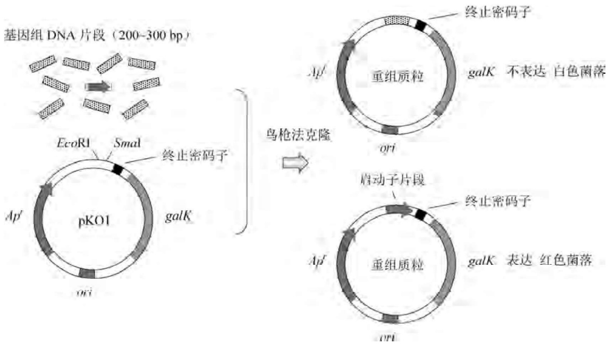

flowchart

图3-1 启动子的克隆与筛选程序

含有启动子活性的 DNA 片段的分离大体上有下列三种方法:

（1）鸟枪法克隆。将DNA随机片段直接克隆至pKO1探针质粒中，重组分子转化 $galE^{+}$ 、 $galT^{+}$ 、 $galK^{-}$ 的大肠杆菌受体细胞，转化液涂布在以半乳糖为唯一碳源的McConkey选择性培养基上进行筛选。凡具有启动子活性的插入片段才能启动galK报告基因的表达，并使半乳糖在受体细胞中进入糖酵解途径进行代谢，重组克隆分泌红色代谢物。
（2）酶保护分离。这种方法依据 RNA 聚合酶与启动子区域的特异性结合原理而设计。将大肠杆菌基因组文库中的重组质粒与 RNA 聚合酶在体外保温片刻，然后选择合适的限制性内切酶对其进行消化，未与 RNA 聚合酶保温的同一重组质粒作酶切对照。如果试验质粒的限制性片段比对照质粒减少，则表明被钝化的酶切位点位于 RNA 聚合酶保护区域内，即该区域存在启动子序列。将这个区域的 DNA 片段次级克隆在启动子探针质粒上，测定其所含启动子的转录活性。
（3）滤膜结合分离。这一程序的原理是双链DNA不能与硝酸纤维素薄膜紧密结合，而DNA-蛋白质复合物却能在一定条件下固定在膜上。将待检测DNA片段与RNA聚合酶保温，并转移保温混合物至膜上，温和漂洗薄膜，除去未结合RNA聚合酶的双链DNA片段，然后再用高盐溶液将结合在薄膜上的DNA片段洗下。一般来说，这种DNA片段在膜上的滞留程度与其同RNA聚合酶的亲和性(即启动子的强弱)成比例，然而这种强弱难以量化，通常仍需要将之克隆在探针质粒上进行检测。

---

第 3 章 大肠杆菌基因工程

95

## 2. 启动子的重组构建

目前在大肠杆菌表达载体上应用最广泛的启动子包括 $P_{\mathrm{lac}}$ 、 $P_{\mathrm{trp}}$ 、 $P_{\mathrm{L}}$ 、 $P_{\mathrm{recA}}$ ，它们分别来自乳糖操纵子、色氨酸操纵子， $\lambda$ 噬菌体基因组左向早期操纵子、recA基因，其一10区和一35区的保守序列列在表3-1中。尽管上述启动子在这两个区域的序列相当保守，但并非完全相同，而且它们的相对强弱差别也较大。因此为了获得更强的启动子，除了从基因组DNA上进行筛选甄别外，还可由已知的启动子重新构建新型杂合启动子，以满足不同外源基因的表达要求。例如从表3-1中可以看出，由 $P_{\mathrm{trp}} - 35$ 区序列和 $P_{\mathrm{lac}} - 10$ 区序列重组（两者间隔$16~\mathrm{bp}$ )而成的杂合启动子 $P_{\mathrm{tac}}$ ，其相对强弱分别是亲本 $P_{\mathrm{trp}}$ 的3倍和 $P_{\mathrm{lac}}$ 的11倍，因而广泛用于大肠杆菌表达系统中（如pGEX表达载体系列）。类似地，由 $P_{\mathrm{trp}} - 35$ 区序列和 $P_{\mathrm{lac}} - 10$ 区序列以17bp间隔构成的杂合启动子称为 $P_{\mathrm{trc}}$ （如pTrc表达载体系列）。在某些情况下，两种相同启动子的同向串联也可大幅度提高外源基因的表达水平，如双 $P_{\mathrm{lac}}$ 启动子的强度约为单个启动子的2.4倍，但这些结果与所控制的外源基因的性质密切相关，并不具有通用性。

表 3-1 大肠杆菌强启动子的保守序列

| 启动子 | -35区 | -10区 |
| --- | --- | --- |
| ${P}_{\mathrm{L}}$ | TTGACA | GATACT |
| ${P}_{\text{recA }}$ | TTGATA | TATAAT |
| ${P}_{\text{trp }}$ | TTGACA | TTAACT |
| ${P}_{\text{lac }}$ | TTTACA | TATAAT |
| ${P}_{\text{tac }}$ | TTGACA | TATAAT |
| ${P}_{\text{tra }}$ | TAGACA | TAATGT |
| 保守序列 | TTGACA | TATAAT |

## 3. 启动子的可控性

从理论上讲，将外源基因置于一个具有持续转录活性的强启动子控制之下是高效表达的理想方法，然而外源基因的全程高效表达往往会对大肠杆菌的生理生化过程造成不利影响。此外，外源基因持续高效表达的重组质粒在细胞若干次分裂循环之后，往往会部分甚至全部丢失，而不含质粒的受体细胞因生长迅速最终在培养物中占据绝对优势，导致重组菌的不稳定。利用具有可控性的启动子调整外源基因的表达时序，即通过启动子活性的定时诱导，将外源基因的转录启动限制在受体细胞生长循环的某一特定阶段，是克服上述困难的有效方法。

## (1) 基于 IPTG 诱导的乳糖启动子

目前广泛应用的大部分大肠杆菌强启动子来自相应的操纵子，它们都含有与各自的阻遏蛋白特异性结合的操作子(O)序列，换句话说，由这些启动子介导的外源基因在大肠杆菌细胞内通常以极低的基底水平表达。例如。在不含乳糖的培养基中，重组大肠杆菌的 $P_{lac}$ 启动子处于阻遏状态，此时外源基因痕量表达甚至不表达。当重组大肠杆菌生长至某一阶段，向培养物中加入乳糖或人工合成的化合物异丙基- $\beta-D-$ 硫代半乳糖苷(IPTG)，两者与乳糖阻遏蛋白(LacI)特异性结合，并使之从乳糖操作子( $O_{lac}$ )上脱落下来， $P_{lac}$ 遂打开并启动外源基因转录。乳糖可为大肠杆菌代谢利用，作为诱导剂使用时需要不断添加；而IPTG不为大肠杆菌分解，因此在诱导表达外源基因过程中无须连续添加。值得注意的是，在生产重组蛋白多肽药物时，出于安全考量不宜使用化学合成的IPTG诱导剂。

野生型大肠杆菌的 $P_{\mathrm{lac}}$ 启动子除可被乳糖或IPTG诱导外，同时又能为葡萄糖及其代谢产物所抑制，而在高密度培养重组大肠杆菌时，培养基中必须加入葡萄糖，因此在实际操作中通常使用的是野生型 $P_{\mathrm{lac}}$ 的一种突变体 $P_{\mathrm{lacUV5}}$ 。该启动子含有一对突变碱基，其活性比野生型 $P_{\mathrm{lac}}$ 更强，而且对葡萄糖及分解代谢产物的阻遏作用不敏感，但仍为受体细胞中的LacI所阻遏，因此可以用乳糖或IPTG诱导。其他类型的启动子如果含有 $O_{\mathrm{lac}}$ 序列，则阻遏诱导

---

96

基因工程

性质与  $P_{lacUV5}$  相同。

## (2) 基于 IAA 诱导的色氨酸启动子

$P_{\mathrm{trp}}$ 与 $P_{\mathrm{lac}}$ 的调控模式稍有不同，其阻遏作用的产生依赖于色氨酸-阻遏蛋白复合物与色氨酸操作子 $(O_{\mathrm{trp}})$ 的特异性结合。由于色氨酸能激活阻遏蛋白，因此 $P_{\mathrm{trp}}$ 的诱导需要在色氨酸耗竭的条件下才能实现，但这一条件显然不利于外源基因的高效表达。化学合成型3-吲哚丙烯酸(IAA)是色氨酸的结构类似物，能与之竞争阻遏蛋白，其引起的后果是改变阻遏蛋白的空间构象，进而解除对 $P_{\mathrm{trp}}$ 的阻遏效应。然而与IPTG相似，IAA同样不适合用于生产重组蛋白多肽药物。

## (3) 基于热诱导的  $\lambda$  噬菌体启动子

$\lambda$ 噬菌体的 $P_{\mathrm{L}}$ 启动子在大肠杆菌中由噬菌体DNA编码的CI阻遏蛋白控制，其脱阻遏途径与宿主和噬菌体若干蛋白的功能有关，很难直接诱导，因此在实际操作中常常使用 $cI$ 阻遏基因的温度敏感型突变体 $cI_{857}$ 控制 $P_{\mathrm{L}}$ 介导的外源基因转录。将基因组上携带 $cI_{857}$ 突变基因的大肠杆菌工程菌首先置于 $28\sim 30^{\circ}\mathrm{C}$ 中培养，在此温度范围内，由大肠杆菌合成的$\mathrm{CI}_{857}$ 阻遏蛋白与 $P_{\mathrm{L}}$ 的操作子 $(O_{\mathrm{L}})$ 区域结合，关闭外源基因的转录。当工程菌培养至合适的生长阶段(一般为对数生长中期)时，迅速将培养温度升至 $42^{\circ}\mathrm{C}$，此时 $\mathrm{CI}_{857}$ 失活并从 $O_{\mathrm{L}}$ 上脱落下来，$P_{\mathrm{L}}$ 启动子遂启动外源基因转录。配置上述诱导系统的载体包括pLEX表达质粒系列。

上述阻遏蛋白灭活以及外源基因转录激活(诱导作用)的效率很大程度上取决于工程菌细胞内阻遏蛋白的分子数与启动子的拷贝数之比(即重组质粒的拷贝数)。这个比值过高，诱导作用的效果并不理想；相反，如果阻遏蛋白分子过少，则启动子发生渗漏性表达(即在非诱导条件下表达)。能够有效避免上述两种情况发生的方法很多，例如可将阻遏蛋白编码基因及其对应的启动子分别克隆在拷贝数不同的两种质粒上，从而确保阻遏蛋白分子数和启动子拷贝数维持在一个合适的比例范围内。通常将阻遏蛋白编码基因置于低拷贝质粒中，使每个工程菌细胞只含有1～8个拷贝的阻遏蛋白编码基因；而启动子和外源基因则克隆在高拷贝质粒上，其拷贝数控制在每个细胞30～100内。

$P_{\mathrm{L}}$ 启动子的热诱导在容积较小 $(1\sim 5\mathrm{L})$ 的培养器中通常很容易做到，但对于 $20~\mathrm{L}$ 以上的发酵罐而言， $42^{\circ}C$ 诱导既耗费大量能源诱导效果又不理想。解决这一技术难题可在工程菌的构建方案设计时加以考虑，例如将CI阻遏蛋白的表达置于 $P_{\mathrm{trp}}$ 启动子控制之下，并克隆在一个低拷贝质粒上，以确保CI阻遏蛋白的表达不至于过量；第二个重组质粒则携带 $P_{\mathrm{L}}$ 启动子控制的外源基因。当培养基中缺少色氨酸时， $P_{\mathrm{trp}}$ 打开，CI阻遏蛋白合成，由 $P_{\mathrm{L}}$ 介导的外源基因不表达[图3-2(a)]；相反，当色氨酸大量存在时， $P_{\mathrm{trp}}$ 启动子关闭，CI阻遏蛋白不再合成， $P_{\mathrm{L}}$ 开放[图3-2(b)]。从整体上看，外源基因虽处于 $P_{\mathrm{L}}$ 控制之下，但却可采取添加色氨酸取代温度进行诱导表达。由此双质粒系统构建的重组大肠杆菌宜采用仅由糖蜜和酪蛋白水解物组成的廉价培养基进行发酵，这种培养基含有微量的色氨酸，而外源基因表达则可通过加入富含色氨酸的胰蛋白胨进行诱导。

## (4) 基于噬菌体 RNA 聚合酶的 T7 噬菌体启动子

上述 $P_{\mathrm{lac}}, P_{\mathrm{trp}}, P_{\mathrm{tac}}, P_{\mathrm{L}}$ 启动子均为大肠杆菌RNA聚合酶特异性识别和作用的转录顺式元件，外源基因转录的启动效率取决于RNA聚合酶与这些启动子的作用强度。然而转录效率不仅与外源基因在单位时间内的转录次数有关，而且还取决于转录启动后RNA聚合酶沿DNA模板链移动的速度。来自大肠杆菌T7噬菌体的T7表达系统利用噬菌体DNA编码的RNA聚合酶转录重组大肠杆菌中的外源基因，这种RNA聚合酶选择性地与T7噬菌体启动子 $(P_{\mathrm{T7}})$ 结合，在不降低转录启动效率的前提下，沿DNA模板链聚合mRNA的速度(230个核苷酸/秒)接近大肠杆菌RNA聚合酶(50个核苷酸/秒)的5倍。安装 $P_{\mathrm{T7}}$ 启动子的表达载体很多，如pET载体系列等。

---

第 3 章 大肠杆菌基因工程

97

(a) 培养基中缺乏色氨酸时

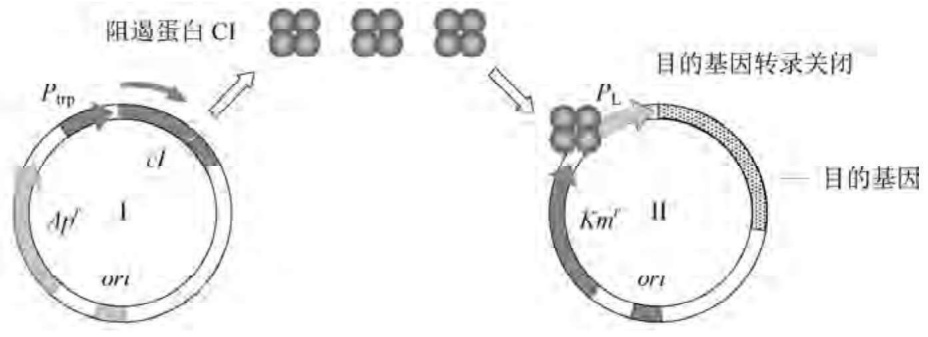

flowchart

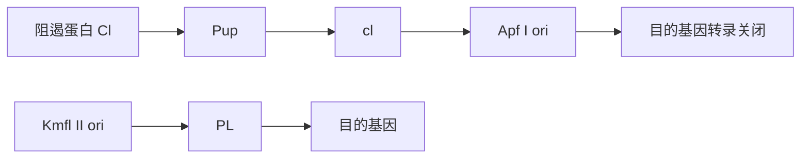

(b) 培养基中富含色氨酸时

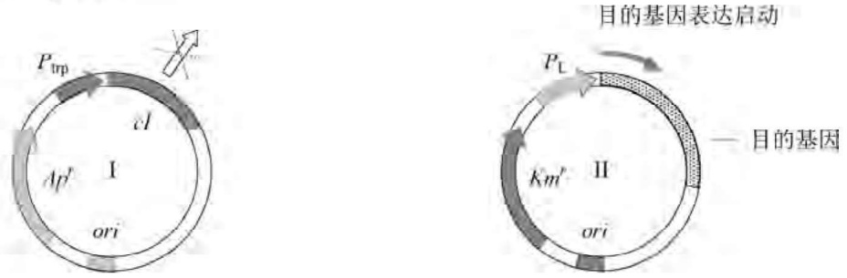

flowchart

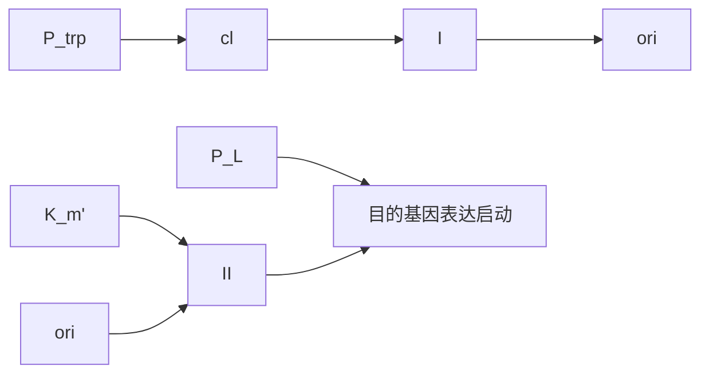

图3-2 基于 $P_{\mathrm{L}}$ 启动子的双质粒表达系统

T7 表达系统实质上是一种基因表达的级联反应(图 3-3)。克隆在 pET 质粒上的外源基因通过 T7 RNA 聚合酶在细胞中的诱导表达而启动转录；而 T7 RNA 聚合酶的编码基因

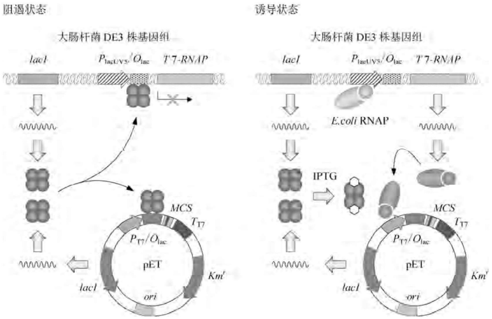

图3-3 大肠杆菌DE3株/pET载体系列的IPTG诱导表达原理

---

98

基因工程

(T7-RNAP)则以噬菌体DE3片段溶原化的形式整合在大肠杆菌宿主的基因组中，如BL21(DE3)和HNS174(DE3)株等。在这些大肠杆菌菌株中，T7 RNA聚合酶由 $P_{\mathrm{lacUV5}}$ 启动

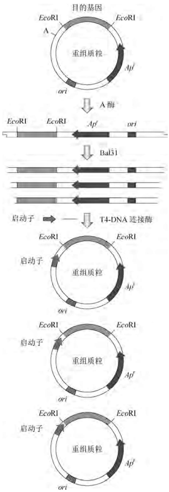

flowchart

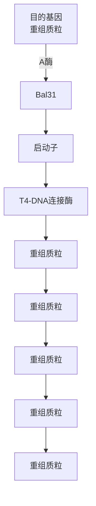

图3-4 启动子最佳作用距离的探测

子介导表达；而pET系列载体中用于控制外源基因转录的元件为 $P_{\mathrm{T7}} / O_{\mathrm{lac}}$ ，因此这一表达系统也呈IPTG诱导型。然而，T7RNA聚合酶编码基因往往呈渗漏性表达。T7溶菌酶是T7RNA聚合酶的一种天然抑制剂，其存在能降低pET表达质粒的渗漏性表达，因而采取T7溶菌酶编码基因与外源基因共表达策略可有效防止T7RNA聚合酶的渗漏性表达，此类表达载体包括pLysS/pLysE。

## 4. 启动子最佳作用距离的探测

在大肠杆菌中，虽然大多数启动子与所属基因TSS之间的距离为 $6\sim 9$ bp，但对外源基因而言，这个距离未必最佳。一种能准确测定启动子最佳作用距离的重组克隆方法如图3-4所示:目的基因克隆在质粒的EcoRI位点处，在距目的基因 $5^{\prime}$ 端 $100\sim 200$ bp处的上游区域选择一个单一的限制性酶切位点，并用相应的酶将重组质粒线性化；然后用Bal31核酸外切酶在严格控制反应速度的条件下处理线状DNA分子，当酶切反应进行至目的基因TSS附近时，迅速加热灭活Bal31；最后将启动子片段与上述处理的DNA重组分子连接和克隆。由于Bal31酶解程度在DNA重组分子之间的差异性，所获得的重组克隆必定含有一系列不同长度的启动子-TSS间隔区域，其中目的基因表达量最高的克隆即最佳的启动子作用距离。将目的基因插在一个较强的启动子下游，若克隆菌细胞内检测不到相应的mRNA或者mRNA水平很低，有必要考虑调整启动子与基因转录区之间的距离。

## 3.1.2 大肠杆菌表达系统的终止子

外源基因在强启动子的驱动下容易发生转录过头，即 RNA 聚合酶滑过终止子结构继续转录质粒上的邻近 DNA 序列，形成长短不一的 mRNA 混合物，这种现象在 T7 表达系统中尤为明显。过长转录物的产生不仅影响 mRNA 的翻译效率，同时也使外源基因的转录速度大幅度降低。首先，转录产物越长，RNA 聚合酶转录一分子 mRNA 所需的时间就相应增加，外源基因本身的转录效率下降；其次，如果外源基因下游紧邻载体质粒上的其

---

第 3 章 大肠杆菌基因工程

99

他重要基因或DNA功能区域，如选择性标记基因和复制子结构等，则RNA聚合酶在此处的转录可能干扰质粒的复制及其他生物功能，甚至导致重组质粒的不稳定性；再次，转录过长的mRNA往往会产生大量无用的蛋白质，增加工程菌的能量消耗；最后也是最严重的是，过长的转录物往往倾向于形成复杂的二级结构，从而大大降低外源基因编码产物的翻译效率。因此，重组表达质粒的构建除了要安装强的启动子外，还必须注意强终止子的合理设置。目前在外源基因表达质粒中常用的终止子是来自大肠杆菌rRNA操纵子的 $rrnT_{1}T_{2}$ 以及T7噬菌体DNA的 $T\phi$ ，对于一些终止作用较弱的终止子，也可采取双拷贝串联的组装方式。

终止子也能像启动子那样通过特殊的探针质粒从细菌或噬菌体基因组 DNA 中克隆筛选。在这种终止子探测质粒上，唯一的克隆位点处于启动子和报告基因的翻译起始密码子之间。当含有终止子序列的 DNA 片段插入该位点上时，由启动子介导的报告基因转录被封闭，从而减少或阻断报告基因的表达。

## 3.1.3 大肠杆菌表达系统的核糖体结合位点

外源基因在大肠杆菌中的高效表达不仅取决于转录启动频率，而且在很大程度上还与mRNA的翻译起始效率密切相关。大肠杆菌细胞中结构不同的mRNA分子具有不同的翻译效率，它们之间的差别有时可高达数百倍。mRNA的翻译起始效率主要由其5'端的结构序列所决定，称为核糖体结合位点(RBS)，它包括下列四个特征结构要素:①位于翻译起始密码子上游的6\~8个核苷酸序列5'UAAGGAGG3'，即Shine-Dalgarno(SD)序列。它通过与大肠杆菌核糖体小亚基中的16S rRNA 3'端序列3'AUUCCUCC5'互补，将mRNA定位于核糖体上，进而启动翻译；②翻译起始密码子，大肠杆菌绝大部分基因以AUG作为翻译起始密码子，但有些基因也使用GUG或UUG；③SD序列与翻译起始密码子之间的距离及碱基组成；④紧接翻译起始密码子之后的两三个密码子碱基组成。

一般而言，mRNA与核糖体的结合程度越强翻译起始效率越高，而这种结合程度主要取决于SD序列与16S rRNA的碱基互补性，其中以GGAG四个碱基序列尤为重要。对多数基因而言，这4个碱基中任何一个换成C或U均会导致翻译效率大幅度降低。SD序列与起始密码子AUG之间的序列对翻译起始效率的影响则表现在碱基组成和间隔长度两个方面。实验结果表明，SD序列下游的碱基为A或U时，翻译效率最高；而C或G的翻译效率则分别是最高值的 $50\%$ 和 $25\%$ 。紧邻AUG的前三个碱基对翻译起始也有影响，对于大肠杆菌 $\beta-$ 半乳糖苷酶的mRNA而言，在这个位置上最佳的碱基组合是UAU或CUU，如果用UUC、UCA或AGG取代之，则酶的表达水平低20倍。

SD 序列与起始密码子之间的精确距离保证了 mRNA 在核糖体上定位后，翻译起始密码子 AUG 正好处于核糖体中的 P 位，这是翻译启动的前提条件。在很多情况下，SD 序列位于 AUG 上游  $(7 \pm 2)$  个核苷酸处，在此间隔中少一个或多一个碱基均导致翻译起始效率不同程度的降低。大肠杆菌的起始 tRNA 可以同时识别 AUG、GUG、UUG 三种密码子，但其识别频率并不相同，通常 GUG 为 AUG 的 50%，而 UUG 只有 AUG 的 25%。相关调查发现，起始密码子下游第二个密码子的碱基组成对翻译起始效率也具有重要影响，在高表达的大肠杆菌基因中该位密码子呈高比例的 A。由于不同的外源基因拥有不同的第二位密码子，因而可能在同样的调控元件介导下呈不同的表达水平。此外，mRNA 5' 端非编码区自身形成的特定二级结构能协助 SD 序列与核糖体结合，任何错误的空间结构均会不同程度地削弱 mRNA 与核糖体的结合强度。由于真核生物和原核生物的 mRNA 5' 端非编码区结构序列存在很大的差异，因此要使真核生物基因在大肠杆菌中高效表达，应尽量避免基因编码区内前几个密码子碱基序列与大肠杆菌核糖体结合位点之间可能存在的互补作用。

---

100

基因工程

目前广泛用于外源基因表达的大肠杆菌表达型载体均含有与启动子来源相同的RBS序列，例如所有含 $P_{\mathrm{lac}}$ 启动子以及由其构建的杂合启动子的质粒均使用lacZ基因的RBS。在一般情况下，这一序列能介导大多数真核生物基因的高效表达；但应当指出的是，在排除了转录效率低下和表达产物不稳定等因素之后，如果外源基因的表达效果仍不理想，可考虑修饰或更换核糖体结合位点序列，其中最重要的是SD序列及其与起始密码子之间的间隔长度，因为对于相当一部分外源基因而言，lacZ的RBS并非最佳选择。

## 3.1.4 大肠杆菌表达系统的密码子

不同的生物甚至同种生物不同的蛋白编码基因，对简并密码子使用的频率并不相同，也就是说，生物体和基因对简并密码子的选择具有一定的偏爱性。含稀有密码子的基因在表达时往往导致翻译错误，这是核糖体在这些密码子处停顿的结果。稀有密码子所致的翻译错误形式包括错误氨基酸的取代、移码事件的发生或者翻译的提前终止。一般而言，至少有三种因素决定密码子的偏爱性。

(1) 生物体基因组中的碱基含量。在富含 AT 的生物(如梭菌属)基因组中, 密码子第三位碱基 U 或 A 出现的频率较高; 而在 GC 丰富的生物(如链霉菌)基因组中, 第三位含 G 或 C 的简并密码子占 90% 以上的绝对优势。
（2）密码子与反密码子相互作用的自由能。在碱基含量没有显著差异的生物体基因组中，简并密码子的使用频率也并非均衡，这可能由密码子与反密码子的作用强度所决定。适中的作用强度最有利于蛋白质生物合成的快速进行；弱配对作用可能使氨酰基 tRNA 分子进入核糖体 A 位需要耗费更多的时间；而强配对作用则可能使转肽后核糖体在 P 位逐出空载 tRNA 分子耗费更多的时间。利用这一理论可以解释大肠杆菌基因组中密码子使用的偏爱性规律，以大肠杆菌中含量最丰富的核糖体蛋白编码基因为例（表 3-2）:密码子 GGG (Gly)、CCC(Pro)、AUA(Ile) 的使用频率几乎为零；在前两位碱基由 A 和（或）U 组成的简并密码子中，第三位碱基为 C 的密码子的使用频率要高于 U 或 A，即 UUC > UUU、UAC > UAU、AUC > AUU、AAC > AAU。此外，tRNA 上反密码子的第三位碱基如果是修饰的 U，

表 3-2 大肠杆菌核糖体蛋白质中密码子的使用频率

密码子的第2位

<table><tr><td></td><td>U</td><td>C</td><td>A</td><td>G</td><td></td></tr><tr><td rowspan="3">U</td><td>0.83 UUU $\left.\begin{array}{l}1.90\ UUC\end{array}\right\rbrack$ Phe</td><td>1.49 UCU $\left.\begin{array}{l}1.49\ UCC\end{array}\right\rbrack$ Ser</td><td>0.25 UAU $\left.\begin{array}{l}1.08\ UAC\end{array}\right\rbrack$ Tyr</td><td>0.08 UGU $\left.\begin{array}{l}0.05\ UGC\end{array}\right\rbrack$ Cys</td><td>U</td></tr><tr><td rowspan="2">0.08 UUA $\left.\begin{array}{l}0.17\ UUG\end{array}\right\rbrack$ Leu</td><td rowspan="2">0.08 UCA $\left.\begin{array}{l}0.08\ UCG\end{array}\right\rbrack$ </td><td rowspan="2">UAA $\left.\begin{array}{l}Stop\end{array}\right\rbrack$ UAG $\left.\begin{array}{l}Stop\end{array}\right\rbrack$ </td><td>UGA Stop</td><td>A</td></tr><tr><td>0.25 UGG Trp</td><td>G</td></tr><tr><td rowspan="3">C</td><td>0.33 CUU $\left.\begin{array}{l}0.25\ CUC\end{array}\right\rbrack$ Leu</td><td rowspan="3">0.25 CCU $\left.\begin{array}{l}0.00\ CCC\end{array}\right\rbrack$ Pro</td><td>0.25 CAG $\left.\begin{array}{l}1.24\ CAC\end{array}\right\rbrack$ His</td><td>3.97 CGU $\left.\begin{array}{l}2.15\ CGC\end{array}\right\rbrack$ Arg</td><td>U</td></tr><tr><td rowspan="2">0.00 CUA $\left.\begin{array}{l}0.17\ CUG\end{array}\right\rbrack$ </td><td rowspan="2">0.74 CAA $\left.\begin{array}{l}2.73\ CAG\end{array}\right\rbrack$ Gln</td><td>0.00 CGA $\left.\begin{array}{l}0.00\ CGG\end{array}\right\rbrack$ </td><td>A</td></tr><tr><td>0.00 CGG $\left.\begin{array}{l}0.00\ CGG\end{array}\right\rbrack$ </td><td>G</td></tr><tr><td rowspan="3">A</td><td>1.08 AUU $\left.\begin{array}{l}4.22\ AUC\end{array}\right\rbrack$ ILe</td><td>2.98 ACU $\left.\begin{array}{l}2.16\ ACC\end{array}\right\rbrack$ Thr</td><td>0.25 AAU $\left.\begin{array}{l}3.47\ AAC\end{array}\right\rbrack$ Asn</td><td>0.08 AGU $\left.\begin{array}{l}0.99\ AGC\end{array}\right\rbrack$ Ser</td><td>U</td></tr><tr><td rowspan="2">0.00 AUA $\left.\begin{array}{l}2.48\ AUG\end{array}\right\rbrack$ Met</td><td rowspan="2">0.25 ACA $\left.\begin{array}{l}0.00\ ACG\end{array}\right\rbrack$ </td><td rowspan="2">7.44 AAA $\left.\begin{array}{l}1.99\ AAG\end{array}\right\rbrack$ Lys</td><td rowspan="2">0.08 AGA $\left.\begin{array}{l}0.00\ AGG\end{array}\right\rbrack$ Arg</td><td>A</td></tr><tr><td>G</td></tr><tr><td rowspan="3">G</td><td>4.47 GUU $\left.\begin{array}{l}0.50\ GUC\end{array}\right\rbrack$ Val</td><td rowspan="3">7.69 GCU $\left.\begin{array}{l}0.83\ GCC\end{array}\right\rbrack$ Ala</td><td>1.41 GAU $\left.\begin{array}{l}1.24\ GAC\end{array}\right\rbrack$ Asp</td><td>4.05 GGU $\left.\begin{array}{l}2.81\ GGC\end{array}\right\rbrack$ Gly</td><td>U</td></tr><tr><td rowspan="2">3.31 GUA $\left.\begin{array}{l}1.32\ GUG\end{array}\right\rbrack$ </td><td rowspan="2">5.05 GAA $\left.\begin{array}{l}1.32\ GAG\end{array}\right\rbrack$ Glu</td><td>0.00 GGA $\left.\begin{array}{l}0.00\ GGG\end{array}\right\rbrack$ </td><td>A</td></tr><tr><td>0.00 GGG $\left.\begin{array}{l}0.00\ GGG\end{array}\right\rbrack$ </td><td>G</td></tr></table>

注:表中数字为使用频率(%)。

---

第 3 章 大肠杆菌基因工程

101

则它与 A 配对的机会多于 G; 如果是 I, 则与 U 和 C 配对的频率高于 A。就三个终止密码子而言, 大肠杆菌 mRNA 的翻译终止由 UAA 优势介导, 插入该保守型终止密码子或者延长型 UAAU 能提升外源基因转录物的翻译终止效率。

（3）细胞内 tRNA 的含量。无论原核细菌还是真核生物，简并密码子的使用频率均与相应 tRNA 的丰度呈正相关，特别是那些表达水平较高的蛋白质编码基因更是如此。表达水平较高的基因往往含有较少种类的密码子，而且这些密码子又对应于高丰度的 tRNA，这样细胞才能以更快的速度合成需求量大的蛋白质；而对于需求量少的蛋白质而言，其基因中含有较多与低丰度 tRNA 相对应的密码子，用以控制该蛋白质的合成速度，这也是原核生物和真核生物基因表达调控的共同战略之一。所不同的是，各种 tRNA 的丰度在原核细菌和真核生物细胞中并不一致。就大肠杆菌而言，argU（AGA 和 AGG）、argX（CGG）、argW（CGA 和 CGG）、ileX（AUA）、glyT（GGA）、leuW（CUA）、proL（CCC）、lys（AAG）等 tRNA 编码基因的表达水平很低。

由于原核生物和真核生物基因组中密码子的使用频率具有不同程度的差异性，因此外源基因尤其是哺乳动物基因在大肠杆菌中高效翻译的一个重要因素是密码子的正确选择。一般而言，有两种策略可以使外源基因中的密码子在大肠杆菌细胞中获得最佳表达:一是采用基因化学合成的方法，按照大肠杆菌密码子的偏爱性规律设计更换外源基因中不适宜的相应简并密码子，人胰岛素、干扰素、生长激素在大肠杆菌中的高效表达均采用此法；二是对于那些含有不和谐密码子种类单一、出现频率较高，而本身相对分子质量又较大的外源基因而言，则选择相关tRNA编码基因共表达的策略较为有利。例如，在人尿激酶原cDNA的412个密码子中共有22个精氨酸密码子，其中包含7个AGG和2个AGA密码子，但大肠杆菌细胞中 $\mathrm{tRNA}_{\mathrm{AGG}}$ 和 $\mathrm{tRNA}_{\mathrm{AGA}}$ 的丰度较低。为使人尿激酶原cDNA在大肠杆菌中获得高效表达，可将大肠杆菌的这两个tRNA编码基因克隆到另一个高表达的质粒上，由此构建的大肠杆菌双质粒系统能有效解除受体细胞由于 $\mathrm{tRNA}_{\mathrm{AGG}}$ 和 $\mathrm{tRNA}_{\mathrm{AGA}}$ 匿乏而对外源基因表达所造成的制约作用。

## 3.1.5 大肠杆菌表达系统的 mRNA 稳定性

基因的表达水平主要由转录效率、mRNA 稳定性、mRNA 翻译的启动频率决定。在典型的大肠杆菌重组表达系统中，转录和翻译已被广泛优化，然而转录物的稳定性却很少涉及。大肠杆菌在  $37^{\circ}$ C 时的 mRNA 平均半衰期在数秒钟至 20 min 的范围内变化，基因的表达水平直接取决于 mRNA 的固有稳定性。在大肠杆菌中，mRNA 由 RNase 催化降解，后者主要包括两类核酸外切酶(RNase II 和 PNPase)以及一种内切酶(RNase E)。mRNA 的正确折叠以及核糖体与 mRNA 的结合能在一定程度上防止细胞内 RNase 的降解，但外源基因转录物的二级结构未必具备有效的保护作用。大肠杆菌 BL21 \* 株含有 RNase E 编码基因突变(rne131 突变)，因而能有效提升重组表达系统中 mRNA 的稳定性。此外，通过引入有效的 5' 端和 3' 端稳定序列(作为核酸酶攻击的障碍)可构建稳定的 mRNA 杂合体，例如大肠杆菌编码 Fo-ATPase 亚基 C 端区域的一段 mRNA 与编码绿色荧光蛋白的序列相融合可起到稳定效果；然而与 lacZ mRNA 的融合却没有类似效应，因此 GFP 转录物能为 mRNA 提供保护性结构元件。

## 3.1.6 大肠杆菌表达系统的质粒拷贝数

蛋白质生物合成的主要限制性因素是核糖体与 mRNA 的结合速度。在生长旺盛的每个大肠杆菌细胞中，大约含有 2 万个核糖体单位，而 600 种 mRNA 总共只有 1500 个分子（表 3-3）。因此，强化外源基因在大肠杆菌中高效表达的中心环节是提高 mRNA 的生成量，这可通过两种途径来实现:安装强启动子以提高转录效率以及将外源基因克隆在高拷贝载体上以增加基因的剂量。

---

102

基因工程

表 3-3 大肠杆菌细胞的构成成分

| 组分 | 占细胞干重比例/% | 细胞内数量 | 种类数 | 平均拷贝数 |
| --- | --- | --- | --- | --- |
| 细胞壁 | 10.0 | 1 | 1 | 1 |
| 细胞膜 | 10.0 | 2 | 2 | 1 |
| DNA | 1.5 | 1 | 1 | 1 |
| mRNA | 1.0 | $1.5 \times 10^3$ | 600 | 2~3 |
| tRNA | 3.0 | $2.0 \times 10^5$ | 60 | >3000 |
| rRNA | 16.0 | $3.8 \times 10^4$ | 2 | 19000 |
| 核糖体蛋白质 | 9.0 | $1.0 \times 10^6$ | 52 | 19000 |
| 可溶性蛋白质 | 46.0 | $2.0 \times 10^6$ | 1850 | >1000 |
| 小分子 | 3.0 | $7.5 \times 10^6$ | 800 |  |

目前实验室里广泛使用的表达型载体在每个大肠杆菌细胞中可达数百甚至上千个拷贝，质粒的扩增过程通常发生在受体细胞的对数生长期，而此时正是细菌生理代谢最旺盛的阶段。质粒分子的过度增殖势必影响受体细胞的生长与代谢，进而导致质粒的不稳定性以及外源基因宏观表达水平的下降。解决这一难题的一种有效策略是将重组质粒的扩增纳入可控制轨道，也就是说，在细菌生长周期的最适阶段将重组质粒扩增到一个最佳水平。这方面较成功的例子是采用温度敏感型复制子控制重组质粒的复制。

pPLc2833是一种含强启动子 $P_{\mathrm{L}}$ 的大肠杆菌高表达型质粒。将温度敏感型质粒pKN402的温度可诱导型复制子置换pPLc2833中的复制子，构建成pCP3新型表达质粒。携带pCP3的大肠杆菌在 $28^{\circ}\mathrm{C}$ 生长时，每个细胞含有60个质粒拷贝，介于pKN402和pPLc2833之间；当生长温度提升至 $42^{\circ}\mathrm{C}$ 时，pCP3的拷贝数迅速提高 $5\sim 10$ 倍。与此同时，由受体细胞染色体DNA中 $cI_{857}$ 基因合成的温度敏感型阻遏蛋白失活，$P_{\mathrm{L}}$ 开放并启动外源基因的转录。pCP3这种集基因扩增和转录控制于一身的优良特性，使之成为稳定高效表达外源基因的理想载体。将T4-DNA连接酶编码基因克隆到该质粒的多克隆位点上，所构建的大肠杆菌工程菌在 $42^{\circ}\mathrm{C}$ 时可产生占细胞蛋白总量 $20\%$ 的重组T4-DNA连接酶。这一表达水平远远高于绝大部分高丰度的大肠杆菌内源型蛋白质。

## 3.2 大肠杆菌基因工程菌的构建策略

在大肠杆菌中表达的重组异源蛋白按其细胞学定位具有三种模式，即胞质型、周质（内膜与外膜之间的空隙)型、胞外型。将重组异源蛋白引导至何种特定的细胞间隔各有利弊，在正常情况下一般优先考虑采用胞质型表达策略，因为其表达水平较高。异源蛋白既可单独表达，也可与具有特殊性能的受体菌蛋白融合表达，甚至以同聚体的形式串联表达。由外源基因编码序列以及介导其表达的调控元件构成的表达单位(亦称为表达盒)则可借助载体独立于受体细胞染色体DNA而自主复制，或者通过整合作用作为受体细胞基因组的一部分而稳定遗传。

## 3.2.1 包涵体型重组异源蛋白的表达

在某些生长条件下，大肠杆菌能积累某种特殊的生物大分子，它们致密地集聚在细胞内，或被膜包裹或形成无膜裸露结构，这种结构称为包涵体(Inclusion Bodies, IB)。富含蛋白质的包涵体多见于生长在含有氨基酸类似物培养基的大肠杆菌细胞中，由这些氨基酸类似物所合成的蛋白质往往会丧失其正常的理化特性而集聚形成包涵体。由高效表达质粒构建的大肠杆菌工程菌大量合成非天然性的同源或异源蛋白质，后者在一般情况下也以包涵体的形式存在于细菌细胞内。

---

第 3 章 大肠杆菌基因工程

103

## 1. 包涵体的基本特征

高效表达重组异源蛋白的大肠杆菌所形成的包涵体以可溶性和不溶性两种形式存在于细胞质中，它们基本上由蛋白质组成，其中大部分（50%～95%）是外源基因的表达产物，具有正确的氨基酸序列，但空间构象在相当程度上有别于非集聚型蛋白质，甚至因错误折叠而丧失生物活性。事实上，包涵体是胞质内松散包裹型折叠中间物的临时蓄水池，其形成是蛋白质集聚与溶解之间不平衡的一种结果。除此之外，包涵体中还含有受体细胞本身高表达的蛋白产物（如RNA聚合酶、核糖核蛋白体、外膜蛋白等）以及质粒的编码蛋白（如标记基因表达产物）。包涵体的第三种组分则是DNA、RNA、脂多糖等非蛋白分子。由于包涵体中相当部分的蛋白组分未能折叠成天然的空间构象，且所有的分子致密集聚成颗粒或胶束状，因此在胞质水环境中呈固液两相。至于重组异源蛋白究竟以包涵体的可溶性形式还是不溶性形式存在，以及包涵体内拥有正确折叠构象和生物活性的蛋白比例（即蛋白质的构象质量）究竟有多大，主要取决于多肽链的氨基酸组成与序列、生物合成的速率与产量以及受体细胞内蛋白质折叠机器（如分子伴侣等）的有效性。在大多数情况下，呈集聚状态（即两种形式的包涵体）的蛋白质的正确构象和生物活性均显著低于以单分子游离形式存在的蛋白质；但两种形式的包涵体内仍含有一定比例完善折叠的蛋白流分，而且这一比例在水溶性和不溶性包涵体之间大致相同。

以包涵体尤其是不溶性包涵体的形式表达重组异源蛋白，其显著优点表现在:① 允许重组异源蛋白高效表达。一般而言，以包涵体形式表达的重组异源蛋白可达细菌细胞蛋白总量的 $20\% \sim 60\%$ ，这对规模化工业生产以及基础研究尤其是重组蛋白晶体衍射具有重要意义。② 简化外源基因表达产物的分离纯化程序。基于包涵体的固相属性，可借助高速离心操作将重组异源蛋白从细胞破碎物中有效分离出来。③ 稳定重组异源蛋白的高水平积累。重组异源蛋白在大肠杆菌体细胞内的稳定性主要取决于包涵体的形成速度:在形成包涵体之前，由于二硫键的随机形成以及多肽链侧链基团修饰的缺乏，重组异源蛋白的蛋白酶作用位点往往裸露在外，导致对酶解作用的敏感性；但在形成包涵体之后，蛋白酶的攻击基本上已构不成威胁。④ 兼具固相和纳米双重应用优势。至少部分存在于不溶性包涵体中的重组异源蛋白拥有正确折叠构象及其相应的生物活性，因而可省去烦琐的固定化和纳米化工艺操作而直接用于酶促生产和组织再生医学，这些重组异源蛋白产物包括绿色荧光蛋白(GFP)、半乳糖苷酶、氧化/还原酶、磷酸激酶/磷酸酶以及醛缩酶等。

然而，对于包涵体内构象质量较低或(和)应用要求以单分子均相形式存在(如注射性药物)的异源重组蛋白而言，需要增加从包涵体中回收单分子且完善折叠型重组异源蛋白的操作工序，从而招致多重劣势:其一，在离心洗涤分离包涵体的过程中，难免会有包涵体的部分流失，导致收率下降；其二，包涵体的溶解一般需要使用高浓度的变性剂，在无活性异源蛋白复性之前，必须通过透析超滤或稀释的方法大幅度降低变性剂的浓度，这就增加了操作难度，尤其在重组异源蛋白的大规模生产过程中，这个缺陷更为明显；其三，误折叠重组异源蛋白的重折叠效率相当低，完善折叠型单分子的回收率难以满足应用需求且耗时费力。

## 2. 包涵体的形成机理

包涵体是一种结构复杂的蛋白集聚体，当大肠杆菌胞质中的蛋白质浓度达到 $200\sim$ $300~\mathrm{mg / mL}$ 临界值时，蛋白质折叠环境已呈高度不利状态。然而，包涵体究竟是通过非折叠型多肽链上暴露出来的疏水性区域之间相互作用而被动发生还是通过特异性的 $\beta$ -折叠成簇机制形成，目前尚不能完全确定。一般推测的包涵体形成机理包括下列三个方面:

（1）折叠状态的蛋白质集聚作用。至少在某些情况下，具有折叠结构的蛋白质通过其集聚基序如  $\beta-$  折叠片之间的堆积是包涵体形成的基础，这一过程颇似淀粉体的天然形成。蛋白质的水难溶性以及胞内的高浓度均能促进这种集聚过程，如大肠杆菌自身正常表达的

---

104

基因工程

膜结合蛋白即便拥有良好的天然折叠构象,但因其较小的水溶性而倾向于集聚形成疏水颗粒。对外源基因表达的重组异源蛋白而言,尽管它们能依靠自身的二硫键进行体内折叠,但这种折叠形式在大肠杆菌细胞内往往呈随机性,异源多肽链中半胱氨酸残基的含量越高,二硫键错配的概率也就越大。这种错误折叠的蛋白质往往表现为较高的疏水性,再加上高浓度蛋白分子之间的相互碰撞概率增大,最终形成多分子集聚物。

（2）非折叠状态的蛋白质集聚作用。对于那些热稳定性差又在生长温度较高的细菌中表达的重组异源蛋白而言，由于多肽链分子内部的二硫键不易形成，非折叠状态在胞质内始终占主导地位。而且，含高浓度或高比例游离巯基的非折叠多肽的存在，会大幅度提高多肽链分子间二硫键形成的概率，导致产生高分子量的蛋白多聚体，从而降低单分子份额而形成包涵体颗粒。
（3）蛋白折叠中间体的集聚作用。有些细菌或噬菌体自身合成的天然蛋白质虽然呈可溶性，但其折叠中间体的半衰期较长而且溶解度较低。如果这些细菌或噬菌体生长在高温等非生理条件下，那么任何对蛋白折叠速率有负面影响的环境条件均可在不同程度上导致折叠中间体的积累，后者在折叠成天然蛋白构象之前集聚为包涵体。例如，沙门氏菌噬菌体P22一个编码尾部蛋白基因的突变株在42℃时，由于这一尾部蛋白折叠过程的延长，导致折叠中间体集聚形成包涵体，从而影响噬菌体感染颗粒的装配。

根据上述包涵体的形成机理，可将高效表达的重组异源蛋白在大肠杆菌中形成包涵体的影响因素归纳为下列几个方面:① 培养温度。温度对包涵体形成的影响虽然不是个别现象，但并非一成不变的规律。较低细菌培养温度有利于重组异源蛋白可溶性表达的有 $\beta-$ 干扰素、$\gamma-$ 干扰素、肌酸激酶、免疫球蛋白 Fab 片段、$\beta-$ 半乳糖苷酶融合蛋白、枯草杆菌蛋白酶 E、糖原磷酸化酶等，但其机理是降低重组异源蛋白的表达水平；相当多的重组异源蛋白并不能通过简单降低培养温度而实现可溶性表达。相反，虽然较高的培养温度能诱导受体细胞热休克蛋白的表达，后者在某种程度上抑制包涵体的形成，但高温本身不利于蛋白质的折叠。② 表达水平。不管包涵体的形成机理如何，重组异源蛋白的过量表达均有利于包涵体的形成，然而通过降低表达量来提高异源蛋白的可溶性却并非总能奏效。③ 遗传背景。相同的重组质粒在不同的大肠杆菌菌株中表达异源蛋白，其可溶性与不溶性流分的比例可能不同，有时甚至相差很大。一般来说，大肠杆菌染色体 DNA 上的热休克基因表达产物（如 Hsp、GroEL、PPIase 等）有助于重组异源蛋白的正确折叠而形成可溶性流分，如大肠杆菌 C41(DE3) 和 C43(DE3) 株等。④ 蛋白结构。天然的人 $\gamma-$ 干扰素在大肠杆菌中往往是以包涵体的形式表达的，但通过基因人工合成或定点突变技术改变其天然氨基酸序列，则可获得高比例的可溶性蛋白流分；相反，对于另一些异源蛋白而言，突变体比天然分子更易形成包涵体。

## 3. 包涵体的分离纯化

无论由包涵体回收可溶性单分子重组异源蛋白(即包涵体的体外复性,详见3.3.4)还是直接将包涵体用于固相催化或纳米颗粒投送,纯化型包涵体的制备都是必需的工序。包涵体的分离纯化主要包括菌体破碎、离心收集、清洗回收三大操作步骤。菌体破碎大多采用高压匀浆、高速珠磨、反复冻融等物理方法。细胞破碎物经差速离心首先去除未完全破碎的菌体及较大的细胞碎片,然后以较高转速回收包涵体颗粒,并弃去大量可溶性杂蛋白、核酸、热源及内毒素等杂质。由此获得的包涵体粗品中仍含有相当比例的大肠杆菌膜结合蛋白和种类繁多的脂多糖化合物,它们通常可用去垢剂清洗除去。常用的去垢剂包括Triton X-100、SDS、脱氧胆盐等,其中Triton X-100可以以较高的回收率获得包涵体重组蛋白,但去除杂蛋白的效果不完全;脱氧胆酸盐清洗的纯度较高,但会使重组异源蛋白部分溶解并损失,导致回收率下降。由于去垢剂的效果与包涵体中重组异源蛋白的性质具有一定关系,因

---

第 3 章 大肠杆菌基因工程

105

此包涵体清洗条件的优化显得尤为重要。一般而言，用于回收可溶性单分子重组异源蛋白的包涵体因需要经历后续烦琐的变复性操作对初始纯度要求不高；但直接用于固相催化尤其纳米颗粒投送的包涵体往往需要精致纯化，其纯化工艺至今仍是一种挑战。

## 4. 包涵体型重组异源蛋白表达系统的构建

将合适的基因高效表达调控元件(如启动子、SD序列、终止子、纯化标签序列等)安装在外源基因的上下游两侧是构建表达质粒的主要内容。由于介导外源基因高效表达的大肠杆菌调控元件种类有限，故可通过酶切重组、PCR扩增甚至化学合成等方法将两者按照最佳间隔及碱基序列连为一体，组成大肠杆菌表达复合元件。目前广泛使用的大肠杆菌商品化表达载体均装有高效表达型复合元件，包括TSS距启动子之间以及起始密码子ATG距SD序列之间的最佳间隔和碱基组成，并在ATG处设置合适的外源基因插入位点，任何外源基因编码序列均可通过PCR扩增引入与表达载体克隆位点匹配的限制性酶切位点，进而方便地构建序列完整的重组表达盒。便于安装ATG或识别序列本身含ATG的常用限制性核酸内切酶，如图3-5所示，外源基因编码序列经PCR修饰后既可直接接入，也可将线性化的载体处理成 $3^{\prime}$ 末端以ATG结尾的形式，然后再以平头连接方式无缝对接。然而需要特别注意的是，TSS与启动子之间尤其是起始密码子ATG与SD序列之间的间隔和碱基组成有时与外源基因的 $5^{\prime}$ 端编码序列相关，此时常用表达载体上复合表达元件的设置未必最佳。如果在排除其他因素之后外源基因仍不能高效表达，则需考虑通过重组调整表达元件之间的间隔和碱基组成。

## 3.2.2 分泌型重组异源蛋白的表达

在大肠杆菌中表达的重组异源蛋白除了以可溶性(单分子和包涵体)或不溶性(包涵体)状态定位于胞质中外;还能通过运输或分泌方式进入大肠杆菌的周质空间,甚至渗透外膜进入培养基中。这两种形式均要求重组异源蛋白穿透细胞质膜,而蛋白产物N端信号肽序列的存在是蛋白质穿膜分泌的前提条件。

## 1. 分泌型异源蛋白表达的基本特性

相对其他生物而言，绝大多数野生型大肠杆菌菌株缺乏健全的蛋白质分泌机制，只能将少数几种蛋白分泌至周质中，至于以被动扩散或渗漏方式穿透外膜进入培养基中的蛋白则更寥寥无几。然而，重组异源蛋白的分泌型表达（即使仅分泌至大肠杆菌周质中）却具有很多优势:①无论分泌至细胞周质还是直接进入培养基，重组异源蛋白均能与大肠杆菌数以千计的内源蛋白分隔在不同的空间中，从而大大简化后续的分离纯化操作。进入培养基的重组异源蛋白通过简单离心操作除去大肠杆菌细胞便可方便获得；而位于周质中的重组异源蛋白也能通过物理、酶促、化学的细胞外直接渗透方法得以释放。②大肠杆菌周质中含有更有效的二硫键形成酶系（如DsbA/DsbC），定位于周质的重组异源蛋白能被高效折叠成正确的单分子空间构象；而且由于周质中缺少蛋白酶，重组异源蛋白的稳定性大幅度提高，例如重组人胰岛素原合成后若被分泌至周质中，其稳定性大约相当于胞质中的10倍。③哺乳动物体内绝大多数的蛋白质在生物合成后甚至翻译过程中，必须跨膜（如内质网膜、高尔氏基体膜、线粒体膜、细胞质膜等）传递或运输，并经过复杂的翻译后加工修饰环节才能形成活性状态，因此相当多的天然成熟蛋白N端第一位氨基酸残基并非甲硫氨酸。然而，当哺乳动物蛋白编码序列在大肠杆菌中表达时，其重组蛋白N端第一位的甲硫氨酸残基往往不能被切除。如果将外源基因与大肠杆菌信号肽编码序列重组在一起进行分泌表达，其N端的甲硫氨酸残基便随信号肽的专一性剪切而被有效除去，从而确保重组异源蛋白的N端序列与天然蛋白一致，降低其作为药物使用的免疫原性。但是，由于蛋白质分泌过程通常缓慢且低效，因此重组异源蛋白的分泌型表达往往需要牺牲表达速率和表达量。

---

106

基因工程

5' 黏性末端:

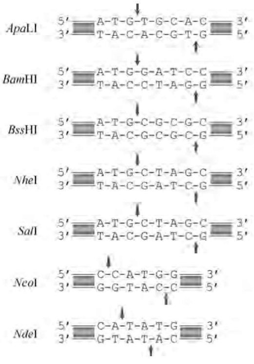

flowchart

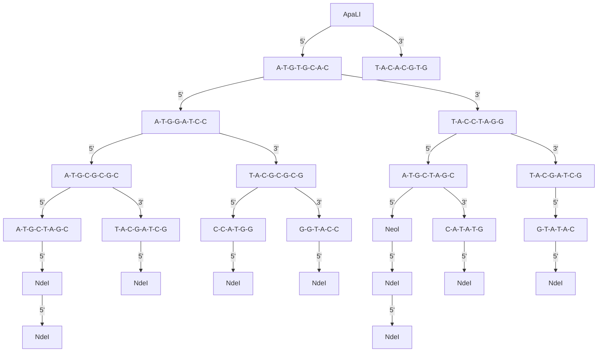

切平5'黏性末端:

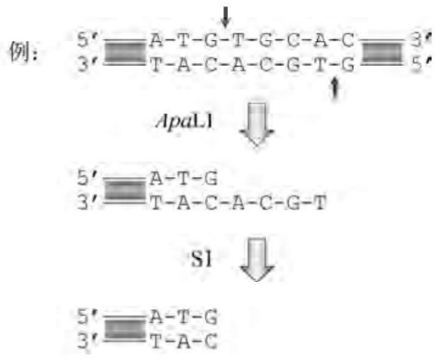

flowchart

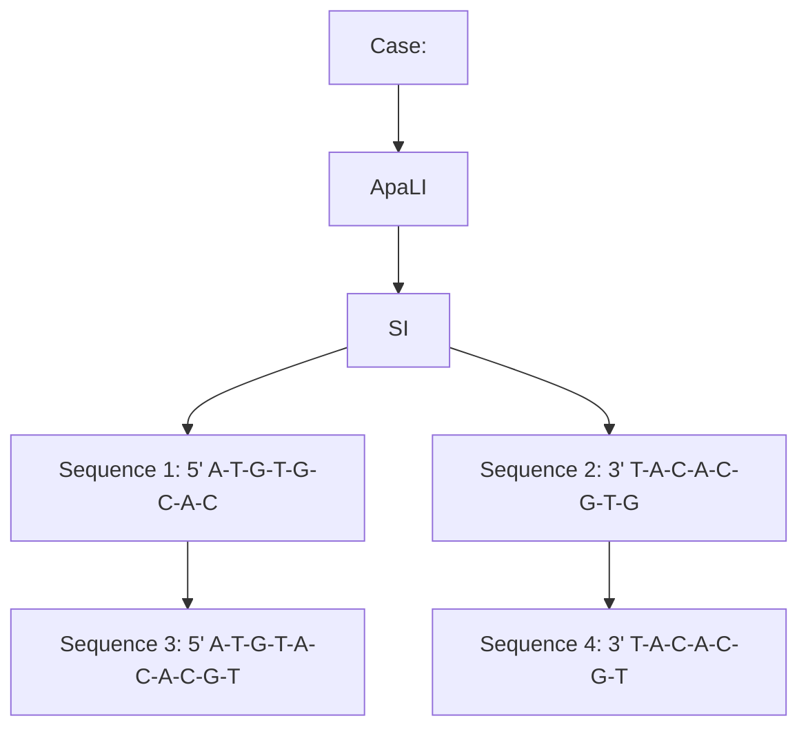

补平5'黏性末端:

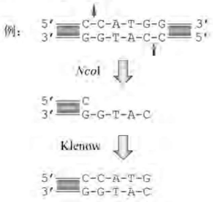

flowchart

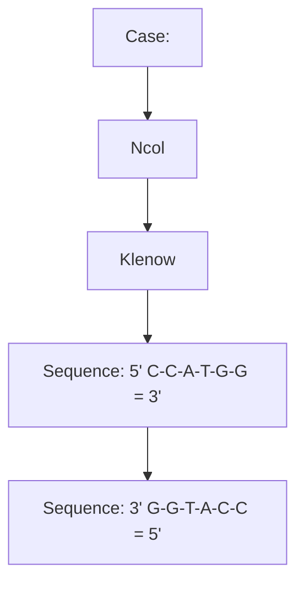

3' 黏性末端:

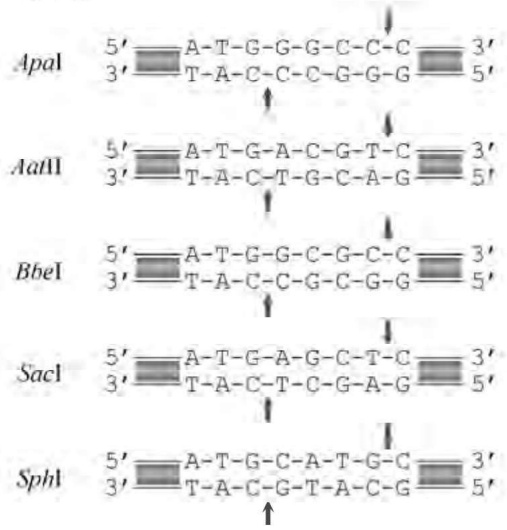

chemical

RNA secondary structure diagram showing five gene loci (Apal, AatII, BbeI, SacI, SphI) with base pairing and conserved regions

切平3'黏性末端:

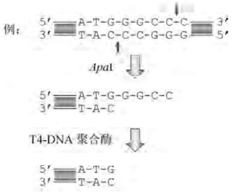

flowchart

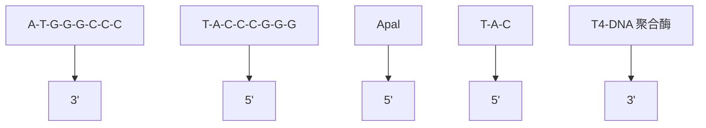

图3-5 用于插入外源基因编码序列的限制性核酸内切酶作用位点

---

第 3 章 大肠杆菌基因工程

107

## 2. 大肠杆菌蛋白质的运输和分泌机制

原核细菌蛋白质的分泌机制与真核生物十分相似，包括翻译共转移和翻译后转运两种机制。在大肠杆菌中，翻译共转移形式较为普遍但并非唯一，有些蛋白可同时通过两种方式进行分泌。大肠杆菌分泌型蛋白的N端存在由15～30个氨基酸残基组成的信号肽(Signal Peptide)，其前几个残基为带正电荷的极性氨基酸，后者靠静电引力将多肽链导至带负电荷的质膜内侧；信号肽的中部及后部皆为连续排列的疏水氨基酸并形成 $\alpha-$ 螺旋，它对蛋白质穿透疏水性膜结构起着决定性作用；大肠杆菌信号肽的最后三个氨基酸残基通常为AXA序列，其中的X大都是侧链较长的氨基酸，为信号肽酶的剪切位点。除此之外，蛋白质穿透膜结构后的正确定位有时还需要第二个信号序列，例如大肠杆菌 $\beta-$ 内酰胺酶的C末端区域对该蛋白离开内膜进入周质是必需的。在蛋白质穿膜分泌的过程中，N端的信号肽会被固定在内膜上的膜蛋白信号肽酶特异性识别并切除。

在以翻译后转运机制分泌的过程中，蛋白质折叠的控制十分重要，构象的改变发生在转膜期间。例如，大肠杆菌的 $\beta-$ 内酰胺酶在转膜之前和转膜期间所拥有的空间结构呈胰蛋白酶敏感型，但当它从内膜进入周质后，即转变成胰蛋白酶抗性构象。大肠杆菌蛋白翻译后转运过程如图3-6所示:分子伴侣(Chaperone)SecB与新合成的蛋白前体结合，并控制其折叠构象；然后SecB将蛋白前体转移至固定在内膜内侧的SecA处，后者与膜蛋白SecE/SecY复合物相连；在ATP的存在下，SecA将蛋白前体推入内膜，同时释放SecB因子；最后，内膜分泌系统中的信号肽酶切除蛋白前体的信号肽序列，蛋白质被分泌到细胞周质中。大肠杆菌细胞内拥有多种能有效阻止蛋白前体随机折叠的分子伴侣，包括分泌触发因子(tf)、GroEL、SecB。其中，SecB在细胞内的含量较前两种蛋白少，但对蛋白分泌的促进作用却最大，因为它既具有分子伴侣的功能又对SecA具有亲和性。在以分子伴侣形式发挥作用时，SecB仅仅是阻止蛋白前体错误折叠的发生，但不能改变蛋白质已折叠的构象。

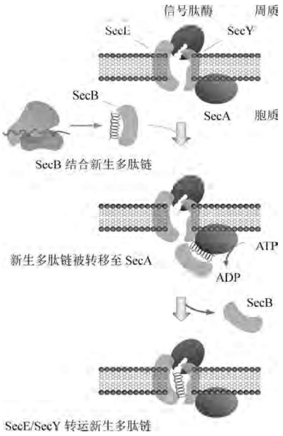

flowchart

图3-6 大肠杆菌蛋白翻译后转运过程

由此可见，在大肠杆菌中表达的可分泌型内源或异源蛋白，无论采取何种机制进行转膜分泌，都必须在分子伴侣的协助下维持合适的构象，也就是说，分泌在细胞周质或培养基中的蛋白质很少形成分子间的二硫键交联。然而，对于富含半胱氨酸残基的真核生物异源蛋白来说，即便它能在大肠杆菌中以分泌的形式表达，其产物仍有很大可能发生分子内的二硫键错配，因为大肠杆菌的分子伴侣作用特异性与真核生物不同。

## 3. 分泌型异源蛋白表达系统的构建

大肠杆菌少数基因如 ompT、ompA、pelB、phoA、malE、lamB、 $\beta$ -内酰胺酶编码基因的5'端编码区含有周质定位序列(即信号肽编码序列)。从理论上讲,将这些信号肽编码序列

---

108

基因工程

与外源基因拼接，即可实现重组异源蛋白在大肠杆菌中的分泌型表达，然而实际上信号肽的存在并不能保证分泌的有效性和高速率，不同信号肽序列所介导的分泌效率往往与异源蛋白本身的结构密切相关。除此之外，因外膜结构的存在，包括大肠杆菌在内的革兰氏阴性菌一般不能将蛋白质直接分泌至培养基中，但由OmpA所属信号肽序列介导分泌的异源重组蛋白有时能扩散至培养基中，因而得到广泛应用。革兰氏阳性细菌和真核细胞由于不存在外膜结构，可从培养基中直接获得重组异源蛋白。大肠杆菌分泌表达系统中常用的典型信号肽序列列在表3-4中。

表 3-4 大肠杆菌分泌表达系统中常用的典型信号肽序列

| 信号肽来源 | 信号肽序列 |
| --- | --- |
| EXase(芽孢杆菌木聚糖内切酶) | $\underline{\underline{MFKFKKKFLVGLTAAFMSISMFSATASA}}$ |
| LamB($\lambda$噬菌体受体蛋白) | $\underline{\underline{MMITLRKLPLAVAVAAGVMSAQA}}$ |
| Lpp(胞壁质脂蛋白) | $\underline{\underline{MKATKLVLGAVILGSTLLAG}}$ |
| LTB(热不稳定性肠毒素亚基B) | $\underline{\underline{MNKVKCYVLFTALLSSLYAHG}}$ |
| MalE(麦芽糖结合蛋白) | $\underline{\underline{MKIKTGARILALSALTTMMFSASALA}}$ |
| OmpA(外膜蛋白A) | $\underline{\underline{MKKTAIAIAVALAGFATVAQA}}$ |
| OmpC(外膜蛋白C) | $\underline{\underline{MKVKVLSLLVPALLVAGAANA}}$ |
| OmpF(外膜蛋白F) | $\underline{\underline{MMKRNILAVIVPALLVAGTANA}}$ |
| OmpT(蛋白酶VII) | $\underline{\underline{MRAKLLGIVLTTPIAISSFA}}$ |
| PelB(胡萝卜软腐欧文氏菌果胶裂解酶B) | $\underline{\underline{MKYLLPTAAAGLLLLAAQPAMA}}$ |
| PhoA(碱性磷酸单酯酶) | $\underline{\underline{MKQSTIALALLPLLFTPVTKA}}$ |
| PhoE(外膜孔蛋白E) | $\underline{\underline{MKKSTLALVVMGIVASASVQA}}$ |
| StII(热稳定性肠毒素II) | $\underline{\underline{MKKNIAFLLASMFVFSIATNAYA}}$ |

注:下画线分别代表信号肽 N 端引导区和 C 端信号肽酶剪切区。

有些革兰氏阴性菌能将极少数的细菌抗菌蛋白(细菌素)分泌至培养基中,这种特异性的分泌过程严格依赖于细菌素释放蛋白的存在,后者激活定位于内膜上的磷酸酯酶A,导致细菌内膜和外膜的通透性增大。因此,只要将这一细菌素释放蛋白编码基因克隆在质粒上,并置于一个可控性强启动子的控制之下,即可改变大肠杆菌细胞对重组异源蛋白的通透性,形成可分泌型受体细胞。此时,用另一种携带大肠杆菌信号肽编码序列和外源基因的重组质粒转化上述构建的可分泌型受体细胞,并且使用相同性质的启动子驱动外源基因的转录,则两个基因的高效共表达可同时被诱导,最终在培养基中获得重组异源蛋白。此外,将天然存在于某些大肠杆菌致病株中的分泌机器导入实验室菌株,或者突变大肠杆菌外膜蛋白的结构使其通透性增大,也能在一定程度上促进已分泌进周质中的异源重组蛋白继续渗透至培养基中,但效率通常很低。

## 3.2.3 融合型重组异源蛋白的表达

除了在大肠杆菌中直接表达重组异源蛋白外，也可将外源基因与受体菌自身蛋白编码基因拼接在一起，作为同一阅读框架进行表达。由这种杂合基因表达出的蛋白质称为融合蛋白，其中受体菌蛋白（即融合伙伴）通常位于N端，异源蛋白位于C端。通过在DNA水平上人工设计引入蛋白酶切割位点或化学试剂特异性断裂位点，可在体外从纯化的融合蛋白分子中释放回收异源蛋白。

## 1. 融合型异源蛋白表达的基本特性

异源蛋白与受体菌自身蛋白以融合形式共表达的第一个显著特性是其稳定性大幅度提高。重组异源蛋白尤其是小分子多肽极易为大肠杆菌的内源性蛋白酶系统降解，其主要原因是异源蛋白和小分子多肽不能形成有效的空间构象，使得多肽链中的蛋白酶识别位点直

---

第 3 章 大肠杆菌基因工程

109

接暴露在外。而在融合蛋白中，融合伙伴能与异源蛋白形成良好的杂合构象，这种结构尽管不同于两种蛋白质独立存在时的天然构象，但在很大程度上封闭了异源蛋白的蛋白酶水解作用位点，从而增加其稳定性。同时在很多情况下，因融合伙伴对应于大肠杆菌胞内蛋白复性和折叠系统，融合蛋白还具有较高的水溶性以及相应的正确空间构象，甚至某些异源蛋白的融合形式本身就已拥有生物活性。

融合蛋白的第二个特性是分离纯化程序简洁且高效。由于与异源蛋白相连的细菌融合伙伴的结构与功能通常是已知的，因此可以利用融合伙伴的特异性抗体、配体、底物亲和层析技术高效快速纯化融合蛋白。如果异源蛋白与融合伙伴的分子量大小以及氨基酸组成差别较大，则融合蛋白经酶促法或化学法特异性水解后，即可简便地纯化异源蛋白最终产物。不过，由此获得的重组异源蛋白仍有可能存在错配的二硫键，在此情况下也必须进行体外复性。

融合蛋白的第三个特性是表达效率高。在构建融合蛋白表达系统时，所选用的细菌融合伙伴编码基因通常是高效表达的，其SD序列的碱基组成以及与起始密码子之间的距离为融合蛋白的高效表达创造了有利条件。目前广泛使用的外源基因融合表达系统中的融合伙伴，如谷胱甘肽转移酶(GST)、麦芽糖结合蛋白(MBP)、金黄色葡萄球菌蛋白A、硫氧化还原蛋白(TrxA)等，均能在大肠杆菌中介导融合蛋白的高效可溶性表达。

值得注意的是,当重组异源蛋白用作药物或者融合伙伴的存在干扰异源蛋白的结构和功能时,需要进行融合蛋白的裂解和异源蛋白的回收操作,这种操作有时较为烦琐和低效。然而在更多的情形中,融合蛋白主要用于工业催化、医学诊断、蛋白基础研究中,此时往往可以省去融合蛋白的裂解操作,因而异源蛋白以融合形式表达是目前应用最普遍的策略。

## 2. 融合型异源蛋白表达系统的构建

构建融合蛋白表达载体必须遵循三个原则:① 细菌融合伙伴应能在大肠杆菌中高效表达，且其表达产物可以通过亲和层析进行特异性高效纯化。② 外源基因应插在受融合伙伴编码序列的下游，并为融合蛋白提供终止密码子，在某些情况下融合伙伴并不需要完整的编码序列。如果需要裂解融合蛋白，两种编码序列拼接位点处的序列设计十分重要，它直接决定了融合蛋白的裂解工艺和效率，同时尽可能避免融合蛋白分子中两种组分的相对分子质量过于接近，为异源蛋白的分离回收创造条件。③ 最重要的是，当两种蛋白编码序列融合在一起时，外源基因的正确表达完全取决于其翻译阅读框的维持。

融合蛋白中的细菌融合伙伴除了具备高效表达的基本条件外，还应同时具有下列特性中的一种或多种:维持整个融合蛋白分子的正确空间构象以增加其水溶性，如麦芽糖结合蛋白(MBP)、谷胱甘肽转移酶(GST)、硫氧化还原蛋白(TrxA,对应于pTrxFus系列载体)、泛素蛋白(Ubi)、N使用蛋白(NusA)、2-酮基-3-脱氧磷酸葡萄糖酸醛缩酶(EDA)等；促进融合蛋白定位于细胞周质甚至外膜以实现分泌表达，如周质定位因子(DsbA,对应于pET39b)、外膜蛋白(OmpF)等；提供融合蛋白一种用于亲和层析分离的标签序列以简化异源蛋白的纯化程序，如β-半乳糖苷酶(LacZ)、金黄色葡萄球菌蛋白A(SAPA,对应于pRIT2T系列载体)、组氨酸六聚体标签(6×His-tag)、Flag八聚体标签(DYKDDDDK)等。其中，GST具有促进折叠和免疫亲和层析双重功效，而含有His-tag的融合蛋白则可借助镍柱进行配体亲和层析纯化。为了使融合蛋白分子同时具备上述多重特性，也可串联重组两种融合伙伴标签序列。例如，一个较为实用的融合蛋白表达系统同时含有大肠杆菌编码外膜蛋白的ompF基因5'端序列以及编码β-半乳糖苷酶的lacZ基因(图3-7)，前者为融合蛋白提供转录翻译表达元件以及分泌信号肽序列，后者则被设计用于融合蛋白免疫亲

---

110

基因工程

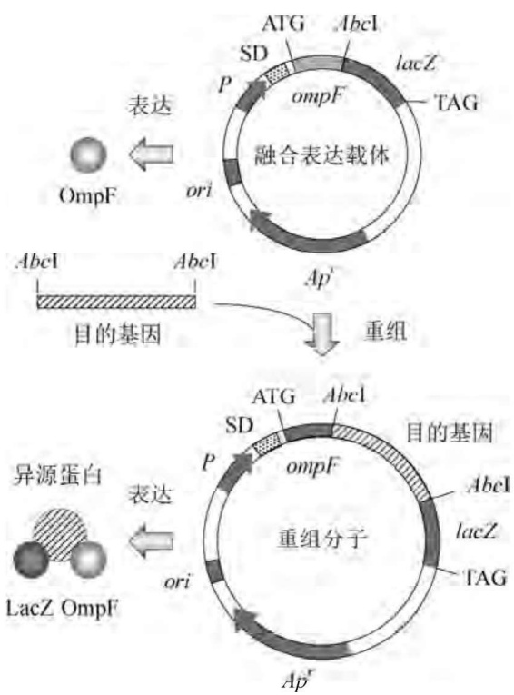

flowchart

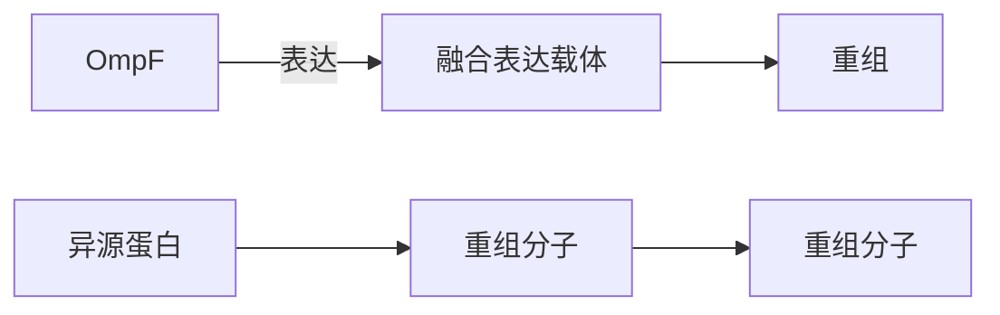

图3-7 含二元标签的融合蛋白表达系统

和层析分离的抗原标签。β-半乳糖苷酶的一个显著特性是即便缺失N端前8个氨基酸残基仍具有酶活性和抗原活性，因而在其N端组装一个异源蛋白多肽，融合蛋白在大多数情况下仍能保持β-半乳糖苷酶的各种性质。另外，在ompF与lacZ基因的交界处加装一个不含终止密码子的限制酶切位点（假设为AbcI），位于下游的lacZ基因相对ompF编码序列具有错误的阅读框架，因此由其表达出的OmpF-LacZ二元融合蛋白并不具有β-半乳糖苷酶活性。当外源基因插入AbcI克隆位点后，在维持自身阅读框架正确的同时又可纠正lacZ编码序列的错误阅读框架，重组克隆能表达出一个三元融合蛋白，它既具有可分泌性，又能通过β-半乳糖苷酶抗体亲和层析进行快速纯化。

为了确保融合蛋白中重组异源蛋白序列的正确性,通常将细菌融合伙伴的编码序列设计成三种阅读框架,构成三种相应的融合蛋白表达质粒[图3-8(a)]。例如,PinPoint Xa 融合表达系列载体 Xa-1、

Xa-2、Xa-3三个质粒的MCS内依次增加一对碱基(A/T)，分别对应于三种不同的翻译阅读框[图3-8(b)]。将外源基因分别插在三个质粒的任何相同位点(如HindIII)中，所获得的三种重组分子必有一种能维持外源基因编码序列的正确阅读框架。

## 3. 重组异源蛋白从融合蛋白中的回收

在生产药用重组异源蛋白时,将融合蛋白中的融合伙伴肽段完整除去是必不可少的工序。融合蛋白的位点特异性断裂方法有两种:即化学裂解法和蛋白酶酶促裂解法。

用于蛋白质位点特异性化学裂解的最佳试剂为溴化氰(CNBr)，它能与多肽链中的甲硫氨酸侧链进行硫醚基反应，生成溴化亚氨内酯，后者不稳定，在水的作用下断裂肽键，形成两个多肽降解片段，其中上游肽段C末端的甲硫氨酸转化为高丝氨酸，而下游肽段N端的第一位氨基酸残基保持不变。这一方法的优点是产率高（可达到 $85\%$ 以上），特异性强，而且所形成的异源蛋白N端不含甲硫氨酸，与真核生物细胞中的成熟表达产物在氨基酸序列上较为接近。然而，如果异源蛋白分子内部含有甲硫氨酸，则不能用此方法；另外，CNBr易挥发且有毒，对操作容器的密封性能要求较高。

蛋白酶酶促裂解法的特点是断裂效率更高，同时每种蛋白酶均拥有相应的断裂位点决定簇，因此可供选择的特异性断裂位点范围较广。几种断裂位点特异性最强的商品化蛋白酶列在表3-5中，它们分别在多肽链中精氨酸、谷氨酸、赖氨酸残基的C端切开酰氨键，形成不含上述残基的下游肽段，与溴化氰化学断裂法相同。用上述蛋白酶裂解融合蛋白的前提条件是异源蛋白肽段内部不能含有精氨酸、谷氨酸或赖氨酸，如果外源基因表达产物为小分子多肽，这一限制条件并不苛刻，但对于相对分子质量较大的异源蛋白而言，上述三种氨基酸的出现频率相当高。

---

第 3 章 大肠杆菌基因工程

111

(a) 融合表达质粒 PinPoint Xa-1 的图谱

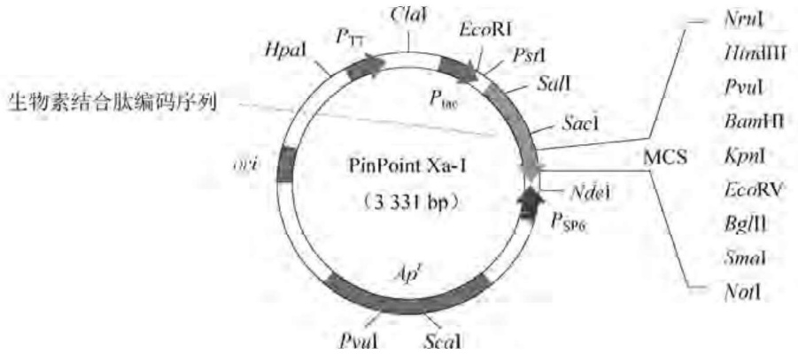

flowchart

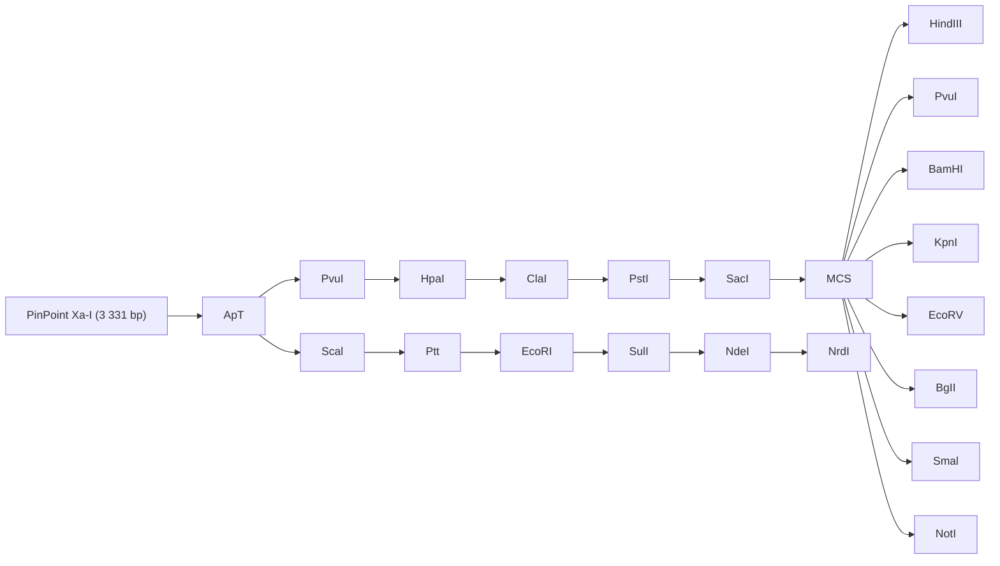

(b) 三种 PinPoint 载体上的多克隆位点（MCS）

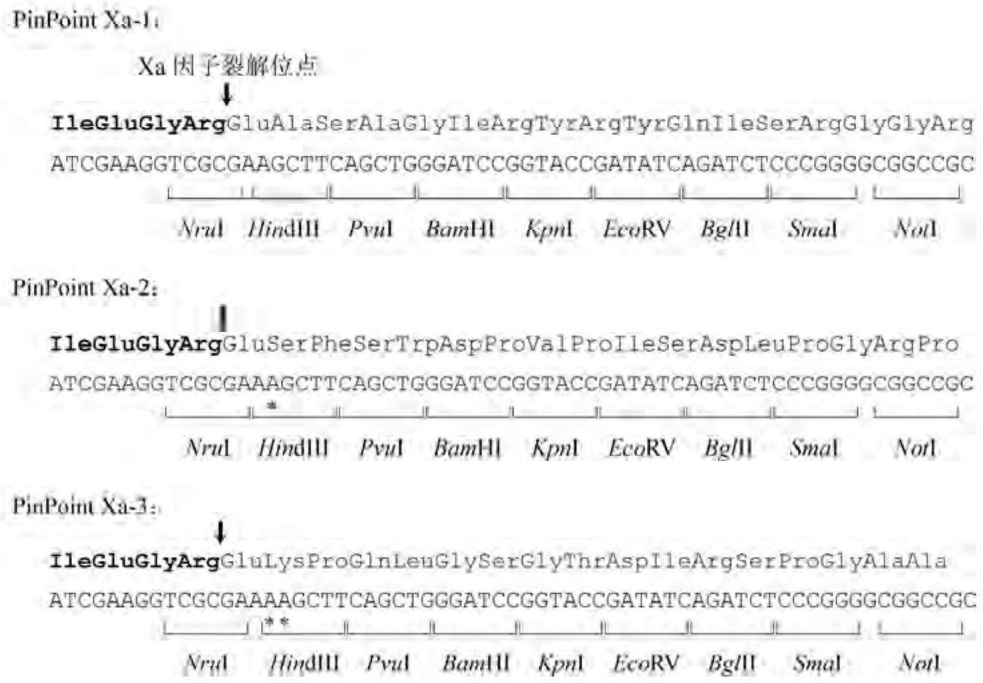

flowchart

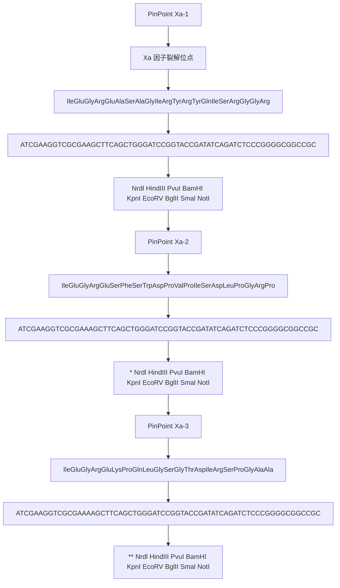

图3-8 融合表达载体PinPoint的结构与特性

表 3-5 几种常用于裂解融合蛋白的蛋白质内切酶

| 蛋白酶 | 来源 | 识别和裂解位点 |
| --- | --- | --- |
| 测序级梭菌蛋白酶 | 溶组织梭菌 | R-X(X为所有氨基酸) |
| 测序级V8蛋白酶 | 金黄色葡萄球菌 | E-X(X为所有氨基酸) |
| 测序级Lys-C蛋白酶 | 产酶溶杆菌 | K-X(X为所有氨基酸) |
| 测序级修饰型胰蛋白酶 | 猪 | R-X或K-X(X为所有氨基酸) |
| 丝氨酸蛋白酶型凝血因子Xa | 哺乳动物 | IEGR-X(X为Arg和Pro之外的所有氨基酸) |
| 丝氨酸蛋白酶型凝血酶 | 哺乳动物 | LVPR-G |
| 肠激酶 | 哺乳动物 | DDDDK-X(X为Pro之外的任何氨基酸) |
| 病毒3C蛋白酶 | 小核糖核酸病毒 | LEVLFQ-GP |
| 病毒3C蛋白酶 | 烟草蚀纹病毒 | ENLYFQ-G |

注:“-”表示断裂位点。

---

112

基因工程

为了克服这些仅识别并作用于单一氨基酸残基型蛋白酶的应用局限性，可在细菌融合伙伴编码序列与不含起始密码子的外源基因之间加装一段编码IEGR寡肽序列的人工接头片段，该寡肽为具有丝氨酸蛋白酶活性的凝血因子Xa所识别，其断裂位点位于IEGR与X之间（X代表除Arg和Pro之外的所有氨基酸）。纯化后的融合蛋白用Xa处理，即可获得不含上述寡肽序列的异源蛋白。由于天然或异源蛋白中出现这种寡肽序列的概率极少，因此

flowchart

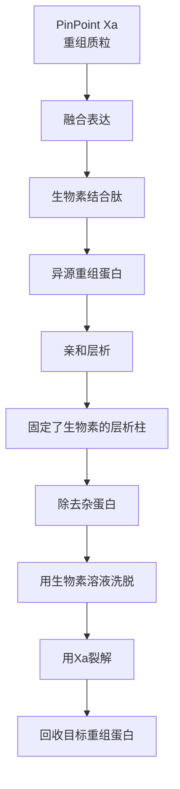

图3-9 利用PinPoint系统表达纯化融合蛋白示意图

这种方法可广泛用于从融合蛋白中回收各种不同大小的外源蛋白产物。另一种具有丝氨酸蛋白酶活性的凝血酶识别 LVPR/G，并在 R 与 G 之间裂解多肽链。特异性更高的蛋白酶包括肠激酶（其识别和裂解序列为 DDDDK/X，其中 X 代表除 Pro 之外的任何氨基酸）、小核糖核酸病毒 3C 蛋白酶（其识别和裂解序列为 LEVLFQ/GP）以及烟草蚀纹病毒蛋白酶（TEV）3C 蛋白酶（其识别和裂解序列为 ENLYFQ/G）。需要注意的是，特定蛋白酶及其最佳反应条件的选择往往取决于目标重组蛋白的序列和性质。

商品化的 PinPoint Xa 蛋白纯化系统为上述方法的实际应用提供了更为便捷的外源基因融合表达载体(图 3-8)，它含有控制融合基因表达的 $P_{\text{tac}}$ 启动子以及可用于融合蛋白亲和层析分离纯化的大肠杆菌生物素结合肽标签编码序列，其下游的 Xa 因子识别序列可供从纯化的融合蛋白裂解回收异源蛋白。此外，在 $P_{\text{tac}}$ 启动子和多克隆位点 MCS 的外侧，还分别装有 $P_{\text{T7}}$ 和 $P_{\text{SP6}}$ 启动子，两者能在含有相应噬菌体 RNA 聚合酶编码基因的特殊大肠杆菌受体细胞中大量合成 RNA，用于无细胞外体翻译。含有外源基因的重组分子在大肠杆菌中表达出 N 端含有生物素结合肽标签的融合蛋白，细菌裂解悬浮液直接用生物素抗性蛋白(Avidin)亲和层析柱分离，然后再借助于游离生物素的竞争结合技术将融合蛋白从层析柱上洗脱下来，并用 Xa 因子位点特异性切除融合蛋白 N 端的标签序列，最终获得异源蛋白产物(图 3-9)。

## 3.2.4 寡聚型重组异源蛋白的表达

从理论上讲,外源基因的表达水平与受体细胞中可转录基因的拷贝数(即基因剂量)呈正相关,重组质粒拷贝数的增加在一定程度上能提高异源蛋白的产量。然而,重组质粒除了含有外源基因外还携带其他的

---

第 3 章 大肠杆菌基因工程

113

可转录基因，如作为筛选标记的抗生素抗性基因等。随着重组质粒拷贝数的不断增加，受体细胞内的大部分能量被用于合成所有的重组质粒编码蛋白，而细胞的正常生长代谢却因能量不济受到影响，并且除了外源基因表达产物外，质粒编码的其他蛋白合成并没有任何价值，因此通过增加质粒拷贝数提高外源基因表达产物的产量往往不能获得如期的效果。另一种通过增加外源基因剂量而提高蛋白产物产量的有效方法是构建寡聚型重组异源蛋白表达载体，即将多拷贝的外源基因克隆在一个低拷贝质粒上，以取代单拷贝外源基因在高拷贝载体上表达的策略，这种方法对高效表达那些分子量较小的异源蛋白或多肽具有很强的实用性。

外源基因多拷贝线性重组是寡聚型异源蛋白表达系统构建的关键技术,它包括三种不同的重组策略,其构建方法、表达产物的后加工程序以及适用范围各不相同(图 3-10)。

## 1. 多表达盒型重组策略

外源基因拷贝均携带各自的启动子、终止子、SD序列以及起始和终止密码子，形成相互独立的转录和翻译串联表达盒，其中盒与盒之间的连接方向可正可反，一般与表达效率无关，因此多拷贝连接较为简单。表达出的异源蛋白无须进行裂解处理，但每个产物分子的N端含有甲硫氨酸残基[图3-10(a)]。这个策略特别适用于表达相对分子质量较大的异源蛋白，尤其是表达用于体内功能研究的重组蛋白复合物，例如四亚基的血红蛋白和丙酮酸脱氢酶、三亚基的复制蛋白A以及两亚基的肌球蛋白和肌酸激酶等。

(a) 多表达盒型重组策略

---

114

基因工程

(c) 多编码序列型重组策略

flowchart

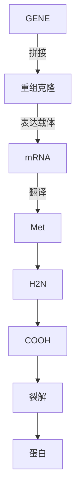

图3-10 寡聚型重组异源蛋白表达载体的构建策略

## 2. 多顺反子型重组策略

外源基因拷贝含有各自的SD序列以及翻译起始终止信号，将它们串联起来后克隆在一个公用的启动子-转录起始位点下游。为了防止转录过头，通常在最后一个基因拷贝的下游组装一个较强的转录终止子，使得多个异源蛋白编码序列转录在一个mRNA分子中，但最终翻译出的异源蛋白分子却是相互独立的，其表达机理与原核生物中的操纵子极为相似[图3-10(b)]。这种方法对中等分子量的异源蛋白表达较为有利，使用一套启动子和终止子转录调控元件，可以在外源DNA插入片段大小不变的前提下，克隆更多拷贝的外源基因。但是在体外拼接组装时，各顺反子的极性必须与启动子保持一致，有时在技术上很难满足这种要求。为解决这一难题，可采用多种质粒介导双顺反子表达策略，例如采用四种不同质粒各携带双顺反子允许在一个大肠杆菌细胞内共表达八种重组蛋白，每种质粒分别携带不同的复制起始位点(ColE1、p15A、RSF、CDF)，同时使用四套不同的选择性标记(壮观霉素、卡那霉素、氯霉素、氨苄青霉素)。

## 3. 多编码序列型重组策略

将多个外源基因编码序列串联在一起，使用一套转录调控元件和翻译起始终止密码子，各编码序列在接口处设计引入溴化氰断裂位点甲硫氨酸密码子或蛋白酶酶解位点序列。由这种重组分子表达出的多肽链上包含多个由酰氨键相连的目的产物分子，纯化后多肽分子用溴化氰或相应的蛋白酶位点特异性裂解，形成产物的单体分子[图3-10(c)]。这种方法特别适用于小分子多肽(通常小于50个氨基酸)的高效表达。前已述及，小分子多肽由于缺乏有效的空间结构，在大肠杆菌中的半衰期很短。多拷贝串联多肽的合成弥补了上述缺陷，在提高表达率的同时，也增加了对受体细胞内源性蛋白酶系统的抗性能力，可谓一箭双雕。然而这种策略在实际操作中困难很大，其焦点是裂解后多肽单体分子的序列不均一性或(和)不正确性。首先，各编码序列的分子间重组需要特殊的酶切位点，这些位点的引入势必导致氨基酸残基的增加。非限制性内切酶产生的平头末端连接虽然可以避免这种缺陷，但

---

第 3 章 大肠杆菌基因工程

115

很难保证各编码序列以极性相同的方式排列；其次，用溴化氰断裂多肽链会使单体产物分子C端多出一个高丝氨酸，尽管这个多余的残基可用化学方法切除，但在大规模生产中往往难以实现；最后，若用蛋白酶系统释放单体分子，则产物中至少有一部分单体分子的N端带有甲硫氨酸，除非每个编码序列均含有甲硫氨酸密码子，才能保证单体分子序列的均一性。

多顺反子和多编码序列型重组均要求各单元序列的极性一致排列，借助于限制性内切酶 AvaI可有效达到此目的。该酶的识别序列为 $5^{\prime}\mathrm{C}(\mathrm{T} / \mathrm{C})\mathrm{CG}(\mathrm{A} / \mathrm{G})\mathrm{G}3^{\prime}$，切割位点在T/C的 $5^{\prime}$ 端一侧。含有唯一 $5^{\prime}$ CTCGGG3'序列的质粒用AvaI切开，Klenow酶填平黏性末端，然后接上EcoRI人工接头(5'GAATTC3')，由此修饰的质粒含有两个AvaI位点，它们通过部分重叠的形式左右包裹一个EcoRI位点(图3-11)。外源基因的转录元件和翻译元件克隆在EcoRI处。从另一个重组质粒中切开两端含有AvaI黏性末端的编码序列，由于每个单体分子上的黏性末端并不对称，因而在体外连接时各单体的极性是一致的。将这一线形串联的DNA分子克隆在经AvaI部分酶解的线形化表达载体上，所形成的转化子中 $50\%$ 的重组克隆能够进行表达。

寡聚型外源基因表达策略曾成功用于人干扰素(抗病毒和抗肿瘤)、鲑鱼降钙素(防止骨质疏松的特效药)、人胰高血糖素样多肽(降血糖)等小分子量蛋白或寡肽的高效表达,每个重组质粒分子携带4\~8个外源基因编码序列拷贝,能大幅度提高重组产物的产率和稳定

flowchart

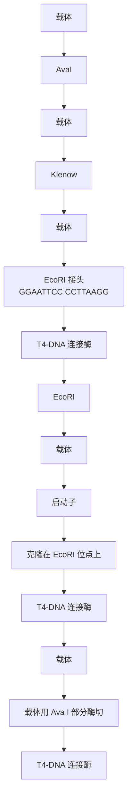

图3-11 寡聚型编码序列的极性保持

---

116

基因工程

性。然而在某些情况下，串联的外源基因拷贝会因同源重组而表现出结构不稳定。在大肠杆菌生长过程中，重组分子中的一部分甚至全部外源基因拷贝会从质粒上脱落。这种现象与串联拷贝的数目、编码序列单体的大小及其产物性质、受体菌的遗传特性和培养条件等有着密切的关系。

## 3.2.5 整合型重组异源蛋白的表达

受体菌中重组质粒的自主复制以及编码基因的高效表达大量消耗能量，为细胞造成沉重的代谢生理负担，而且高拷贝质粒产生的影响更大。作为针对这种不利影响的抗争形式，一部分细菌往往在其生长期间将重组质粒逐出胞外。不含质粒的这部分细菌的生长速度远比含有质粒的细菌要快，经过若干代繁殖之后，培养基中不含质粒的细菌最终占有绝对优势（在不施加选择性压力的情况下），从而导致重组异源蛋白的宏观产量急剧下降。至少有两种方法可以阻止重组质粒的丢失:将克隆菌置于含有筛选试剂（药物或生长必需因子）的培养基中生长，这样可以有效地控制丢失质粒的细胞的增殖速度，维持培养物中克隆菌的绝对优势。然而在大规模产业化过程中，向发酵罐中加入抗生素或氨基酸等筛选试剂很不经济，且易造成产品和环境污染；另一种几乎是一劳永逸的方法是将外源基因直接整合在受体细胞染色体DNA的特定位置上，使之成为染色体DNA的一个组成部分，从而提升其稳定性。

当外源基因表达盒与受体细胞染色体DNA进行整合时，其整合位点必须在染色体DNA的必需编码区外，否则会严重干扰受体菌的正常生长与代谢过程，因此整合必须呈位点特异性。为了达到此目的，根据同源重组交换原理，通常在待整合基因附近或两侧加装一段受体菌染色体DNA的同源序列（一般至少 $50\mathrm{bp}$）。此外，为了保证重组异源蛋白的高效表达，待整合的外源基因应该拥有相应的可控性启动子等表达元件。总之，整合型外源基因表达盒的构建应包括如下步骤:①探测并确定受体菌染色体DNA的合适整合位点，以该位点被外源DNA片段插入后不影响细胞的正常生理功能为前提，例如细菌的抗药性基因、次级代谢基因或两个操纵子之间的间隔区等；②克隆分离选定的染色体DNA整合位点并进行序列分析；③将外源基因以及必要的可控性表达元件连接到已克隆的染色体整合区域(同源臂)内部[图3-12(a)]或邻近区域[图3-12(b)]；④将上述重组质粒转入受体细胞中；⑤筛选和扩增整合了外源基因表达盒的转化子。

以同源重组交换为基本形式的整合现象广泛存在于各种生物体中，其整合频率取决于同源序列的相似程度和同源区域的大小。同源性越高，同源区域越大，整合频率也就越高，但实际上不可能达到 $100\%$ 的整合率。因此，为了保证受体细胞内不存在任何形式的游离质粒分子，通常选用那些不能在受体细胞中进行自主复制的质粒或者温度敏感型质粒，后者在敏感温度时因不能复制而丢失。当染色体DNA整合位点的同源序列位于外源基因两侧时[图3-12(a)]，两个同源臂同时发生交叉重组反应，载体上外源基因表达盒与受体细胞染色体DNA中两个重组位点之间的区域发生位置交换（即同源交换）。由于质粒不能复制扩增，受体菌繁殖几代后，不含质粒的细胞便占绝对优势，此时，通过检测外源基因的表达产物以及载体骨架的存在与否即可分离出整合型工程菌。如果染色体DNA整合位点的同源序列位于外源基因的一侧，则重组质粒通常以整个分子的方式进入染色体DNA中[即同源整合，见图3-12(b)]。在这种情况下，整合性工程菌的筛选标记既可使用外源基因，也可使用原质粒所携带的可表达性基因，如抗生素的抗性基因等。

在一般情况下,整合型的外源基因或重组质粒随克隆菌染色体 DNA 的复制而复制,因此受体细胞通常只含有一个拷贝的外源基因。但如果使用的质粒呈温度敏感型复制,而且整合时质粒同时进入染色体 DNA 中,那么当整合型工程菌在含有高浓度抗生素(其抗性基因定位于质粒上)的培养中生长时,整合在染色体 DNA 上的质粒仍有可能进行自主复制,从而导致外源基因形成多拷贝。有趣的是,尽管整合型质粒在染色体上的自主复制程度非常

---

第 3 章 大肠杆菌基因工程

117

flowchart

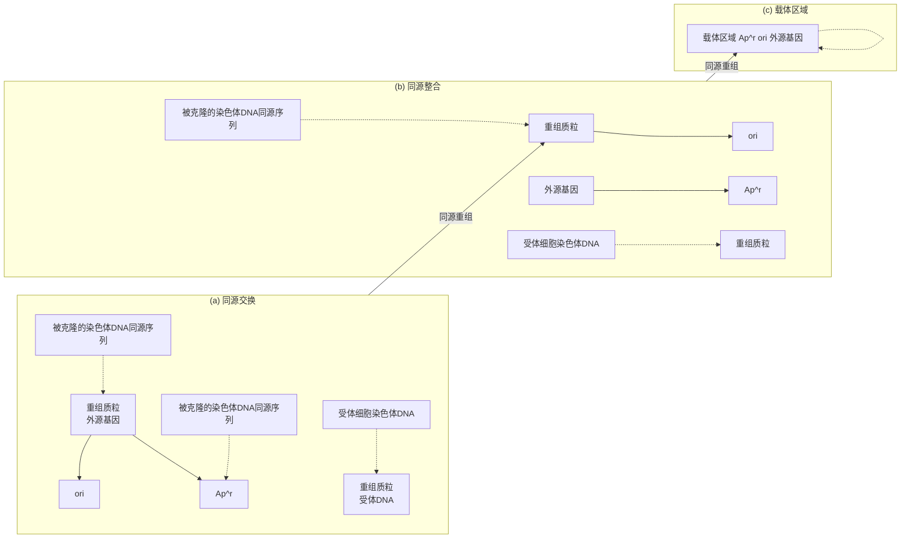

图3-12 细胞内DNA同源重组示意图

有限(通常不及游离型质粒的 25%),但外源基因的宏观表达总量却远远高于游离型重组质粒上外源基因的数倍,而且定位于染色体 DNA 上的外源基因相当稳定。

## 3.3 重组异源蛋白的体内修饰与体外复性

依据基因的表达调控原理,可采用多种手段提高外源基因在受体细胞内合成相应蛋白质的产量,然而高水平表达的重组异源蛋白在大肠杆菌中往往呈无活性状态(质),甚至因蛋白酶的降解作用而难以积累(量),严重影响活性目标产物的最终收率。导致重组异源蛋白在大肠杆菌细胞中失活和不稳定性的主要原因包括:① 大肠杆菌缺乏针对重组异源蛋白有效的折叠复性和翻译后修饰加工系统;② 大肠杆菌不具备真核生物细胞完善的亚细胞结构以及众多的稳定因子;③ 高效表达的重组异源蛋白在大肠杆菌细胞中形成高浓度微环境(可溶性和不溶性集聚体),致使蛋白分子间的相互作用增强。因此,在不影响外源基因表达效率的前提下,如何减少因上述三方面不利因素所造成的重组表达产物质和量的损失,是大肠杆菌基因工程设计和操作过程中应考虑的主要问题。

## 3.3.1 重组异源蛋白的稳定性维持

蛋白质降解是生物体必需的生理过程。在很多情况下，蛋白质降解具有调控功能，即降低代谢途径关键酶的存量以及灭活细胞调控因子，如转录调控因子及细胞循环调控因子等。细胞内蛋白质降解的另一个生理功能是清除代谢过程中产生的误折叠、误装配、误定位、毒性大或其他形式的异常蛋白。各种蛋白质在体内的半衰期相差很大，从数分钟到数小时不等，取决于细胞的种类、培养条件、细胞周期以及蛋白质本身的性质等诸多因素，其中最基本

---

118

基因工程

的影响因素是细胞内蛋白酶系统的性质和蛋白质结构对蛋白酶降解作用的敏感性。

## 1. 细胞内蛋白质降解的基本特征

细胞内蛋白质降解的一个重要特征是其显著的选择性。底物特异性的蛋白质降解作用需要特定的多肽序列结构，它或者为特异性的蛋白酶直接识别，或者与蛋白降解复合物系统中某些特异性识别组分相互作用，进而定位在蛋白酶水解组分的作用区域内。因此，在特定的细胞内部环境中，一个特定蛋白质的半衰期是蛋白酶识别组分对蛋白质有效靶序列的亲和性以及蛋白降解系统各成分在细胞内的浓度这两者的函数。实验证据表明，许多蛋白质拥有几种不同的降解序列决定簇，它们分别为不同的蛋白水解系统所识别，同时以不同的途径和机理降解。在某些条件下，半衰期长的蛋白质由于其隐蔽的降解作用位点暴露使得它对蛋白酶的敏感性大大增加，这实际上是细胞蛋白质降解的一种调控方式。例如，蛋白底物经特异性修饰后空间结构改变，从而缩短了半衰期。另外，蛋白质中的有些序列尤其是C端和N端的某些序列也对蛋白质的稳定性起着重要作用，它们或者影响降解型靶序列的形成，或者直接抑制某些蛋白酶的外切活性。

无论是在真核细胞还是原核细胞中，重组异源蛋白表达后很难逃脱被迅速降解的命运，其稳定性甚至还不如半衰期较短的细胞内源性蛋白质。在大多数情况下，重组异源蛋白的不稳定性可归结为对受体细胞蛋白酶系统的敏感性。尽管目前对细胞内蛋白质降解途径尚未形成全景式的了解，由蛋白质序列预测其空间构象还存在许多误差，但越来越多的实验结果揭示，重组异源蛋白在受体细胞内的半衰期可以通过蛋白序列的人工设计以及受体细胞的改造加以调整和控制。

## 2. 蛋白酶缺陷型大肠杆菌受体细胞的改造

在大肠杆菌中，蛋白质的选择性降解由一整套庞大的蛋白酶系统所介导。绝大多数不稳定的重组异源蛋白由蛋白酶La和Ti介导降解，两者分别由lon和clp基因编码，其蛋白水解活性均依赖于ATP。lon基因由热休克其他环境压力激活，细胞内异常蛋白或重组异源蛋白的过量表达也可作为一种环境压力诱导lon基因的表达。研究发现， $lon^{-}$ 型大肠杆菌突变株可使原来半衰期较短的细菌调控蛋白（如SulA、RscA、 $\lambda N$ 等）稳定性大增，因此被广泛用于基因表达研究及工程菌的构建。然而这种突变株并非对所有蛋白质的稳定表达均有效，有些蛋白质（如 $\lambda$ 噬菌体的CII）在 $lon^{-}$ 型突变株中并不稳定，可能是因为其他底物特异性的蛋白酶在起作用。

很多异常或异源蛋白在大肠杆菌中的降解还直接与庞大的热休克蛋白家族的生物活性有关。这些蛋白质在环境压力缺席的大肠杆菌细胞中通常以基底水平痕量表达，它们参与天然蛋白质的折叠，并胁迫异常或异源蛋白形成一种对蛋白酶识别和降解较为有利的空间构象，从而提高其对降解的敏感性。热休克基因 $dnaK, dnaJ, groEL, grpE$ 以及环境压力特异性 $\sigma$ 因子编码基因 $htpR$ 的突变株均呈现出对异源蛋白降解作用的严重缺陷，特别是 $lon^{-}htpR^{-}$ 型双突变株，非常适用于各种不稳定蛋白质的高效表达。大肠杆菌 $hflA$ 基因的编码产物为 $\lambda$ 噬菌体CII蛋白降解所必需，在 $hflA^{-}$ 型突变株中，CII蛋白的半衰期显著延长，而 $degP^{-}$ 型突变株则能提升某些定位在大肠杆菌细胞周质中的融合蛋白的稳定性。因此，构建多种蛋白酶单一或多重缺陷型大肠杆菌突变株，并将其用于重组异源蛋白的稳定性表达比较，是基因工程菌构建的一项重要内容。

## 3. 抗蛋白酶的重组异源蛋白序列设计

系统研究蛋白质的降解敏感性决定簇序列有助于了解大肠杆菌控制蛋白质稳定性的机制，并可通过人工序列设计和修饰达到稳定表达重组异源蛋白之目的。利用缺失分析和随机点突变技术对 $\lambda$ 噬菌体阻遏蛋白降解型敏感序列的研究结果表明，存在于该蛋白质近C端的五个非极性氨基酸是提高对蛋白酶降解敏感性的重要因素。有趣的是，含有非极性C

---

第 3 章 大肠杆菌基因工程

119

末端的蛋白质降解作用也发生在 $lon^{-}$ 和 $htpR^{-}$ 的突变株中，而且呈ATP非依赖性，暗示这种降解作用与大肠杆菌降解异常蛋白质的机理并不相同。由此可以推测，C端区域内极性氨基酸的存在可能会提高蛋白质的稳定性。进一步的实验结果证实了这一点:在所有的极性氨基酸中，Asp的存在对提高蛋白质稳定性的效应最大，而且Asp距C末端越近，蛋白质的稳定性就越大。更为重要的是，在多种结构和功能相互独立的蛋白质C端引入Asp，都能显著延长这些蛋白质的半衰期。

蛋白质 N 末端的氨基酸序列对稳定性的影响同样显著。将某些氨基酸加入大肠杆菌  $\beta$ -半乳糖苷酶的 N 末端，经改造的蛋白质在体外的半衰期差别很大，从 2 min 到 20 h 以上不等（表 3-6）。重组异源蛋白 N 末端的序列改造可在外源基因克隆时方便实施，通常在 N 末端接上一个特殊的氨基酸就足以使异源蛋白在大肠杆菌中的稳定性大增，而且这一策略在原核和真核生物中均通用。例如有关实验结果表明，在胰岛素原的 N 端加装一段由 6～7 个氨基酸残基组成的同聚寡肽也能明显改善该蛋白在大肠杆菌细胞中的稳定性。具有这种稳定效应的氨基酸包括 Ala、Asn、Cys、Gln、His。

表 3-6 大肠杆菌 β-半乳糖苷酶 N 端氨基酸残基对蛋白质稳定性的影响

<table><tr><td colspan="6">氨基酸残基</td><td>蛋白质半衰期</td></tr><tr><td>Met</td><td>Ser</td><td>Ala</td><td>Thr</td><td>Val</td><td>Gly</td><td>大于20h</td></tr><tr><td>Ile</td><td>Glu</td><td></td><td></td><td></td><td></td><td>大于30min</td></tr><tr><td>Tyr</td><td>Gln</td><td></td><td></td><td></td><td></td><td>大约10min</td></tr><tr><td>Pro</td><td></td><td></td><td></td><td></td><td></td><td>大约7min</td></tr><tr><td>Phe</td><td>Leu</td><td>Asp</td><td>Lys</td><td></td><td></td><td>大约3min</td></tr><tr><td>Arg</td><td></td><td></td><td></td><td></td><td></td><td>大约3min</td></tr></table>

相反，N端富含Pro、Glu、Ser、Thr的真核生物蛋白质在真核或原核细胞中的半衰期通常都很短，至少E1A、c-Myc、c-Fos和p53等蛋白都具有这种特性，特别是由这四种氨基酸残基构成的Pro-Glu-Ser-Thr四肽序列（即PEST序列）显示出对细胞内蛋白酶系统的超敏感性。在大多数情况下，PEST序列的两侧拥有一些带正电荷的极性氨基酸，据推测PEST序列实质上是一个钙结合位点，它能促进那些钙依赖性蛋白酶系统对蛋白质的降解作用。尽管有些实验结果并不能证实PEST序列对蛋白质稳定性的负面影响，但当某一真核生物基因在大肠杆菌中不能稳定表达时，注意PEST序列是否存在，并在不影响异源蛋白生物功能的前提下对之进行适当的改造，不失为一种提高表达产物稳定性的尝试。

## 3.3.2 重组异源蛋白的糖基化修饰

据统计，临床上约 $70\%$ 的治疗用蛋白属于糖基化修饰型蛋白。糖基化修饰能提升蛋白质的结构稳定性、药代动力学性能以及与靶细胞表面受体的结合能力。真核生物蛋白质糖基化的主要形式为多肽链保守序列内天冬酰胺残基N原子上交联特定长度和糖基组成的寡聚糖苷链（即 $N-$ 糖基化修饰），但大肠杆菌细胞缺乏此类蛋白质糖基化修饰系统。自从将空肠弯曲杆菌(Campylobacter jejuni)的 $N-$ 糖基化修饰机器导入大肠杆菌获得成功后，利用大肠杆菌生产糖基化的重组异源蛋白已成为可能。

## 1. 降低细菌寡糖基转移酶的底物特异性

大肠杆菌虽然不含复杂糖链的合成机器，却拥有 O-抗原（由 3～6 个单糖构成的寡糖链）连接酶 WaaL，后者能将 O-抗原交联在脂质 A 上，任何在大肠杆菌中表达的异源寡糖链均可被 WaaL 交联至脂质但非目标蛋白中。因此，大肠杆菌异源蛋白糖基化能力工程化设计和引入的第一步是构建基因型为  $\Delta waaL$  的缺失突变株，如源自大肠杆菌 W3110 株的 CLM24 突变株。

---

120

基因工程

空肠弯曲杆菌的蛋白质寡糖基转移酶PglB能在周质环境中将寡糖链位点特异性地交联在原核细菌内源性蛋白或重组异源蛋白多肽链中 $\mathrm{D / E - X_1 - N - X_2 - S / T}$ (X为Pro除外的所有氨基酸)保守序列的天冬酰胺残基上，但绝大多数来自真核生物的异源蛋白糖基化位点序列往往不含带负电荷的D或E残基。由于目标蛋白的氨基酸序列一般不允许改变，因此需要通过改造PglB的结构特征以拓宽其对蛋白底物的识别特异性。事实上，D或E的存在并非PglB介导寡糖链交联所必需，但对酶促反应效率影响很大。PglB的晶体结构已提示改变其底物识别特异性或提高酶催化活性的关键氨基酸位点，但基于点突变的PglB改造效果并不理想，在大肠杆菌中PglB介导真核型寡糖链转移的效率仅为 $1\%$ ；在原核细菌范围内进一步搜寻具有较低底物糖基化位点特异性的PglB同源物有可能最终解决这一问题。

## 2. 引入真核生物糖链合成的机器

大肠杆菌天然存在十一异戊烯焦磷酸- $\alpha-N-$ 乙酰葡萄糖胺-1-磷酸转移酶(WecA)，它能将N-乙酰葡萄糖胺-1-磷酸转移至定位于内膜胞质一侧的原核细菌特征性寡糖链合成载体十一异戊烯焦磷酸(Und-PP)上。研究显示，在 $\Delta waaL$ 型大肠杆菌CLM24缺失突变株中分别导入来自酿酒酵母的异源二聚体型 $\beta-1,4-N-$ 乙酰葡萄糖胺转移酶(Alg13/Alg14)、 $\beta-$ 甘露糖转移酶(Alg1)、双功能型 $\alpha-1,3-$ 甘露糖和 $\alpha-1,6-$ 甘露糖转移酶(Alg2)以及空肠弯曲杆菌的PglB编码基因，便能使大肠杆菌产生含类似真核生物寡糖侧链 $Man_{3}GlcNAc_{2}$ 的重组糖蛋白(图3-13)。这种经工程化改造的大肠杆菌首先在其内膜胞质一侧合成 $Man_{3}GlcNAc_{2}$ 寡糖单位，再借助其自身存在的O-抗原翻转酶(Wzx)将之翻转至周质一侧，最后由PglB交联至重组异源蛋白的相应糖基化位点上。然而，人体内天然糖蛋白的糖链结构还含有N-乙酰葡萄糖胺、半乳糖、唾液酸的延伸单位，上述构建的大肠杆菌工程株距最终表达人源化糖蛋白产物的目标还有较长的路。此外，这一策略要求重组异源蛋白能分泌至大肠杆菌的周质中，因而表达量往往受到很大程度上的限制。

flowchart

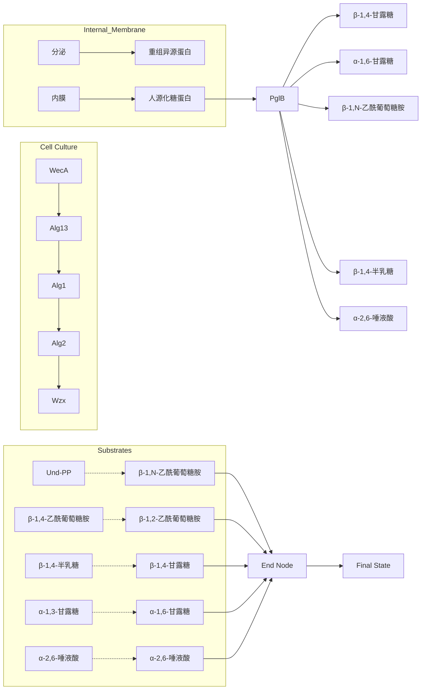

图3-13 表达真核型糖基化机器的大肠杆菌工程化改造策略

---

第 3 章 大肠杆菌基因工程

121

## 3. 提升糖基化重组异源蛋白的表达效率

限制大肠杆菌高效表达糖基化重组异源蛋白的因素很多。第一，PglB的寡糖链转移效率具有较大的改进空间，采用密码子优化等策略可使PglB在大肠杆菌中的寡糖链转移效率提升至 $77\%$ 。第二，减小大肠杆菌的代谢负荷被证明能有效提高重组异源蛋白的糖基化效能，提升磷酸烯醇丙酮酸依赖型单糖磷酸转移系统的效率有助于打通重组大肠杆菌的代谢瓶颈。例如，ptsA基因的过表达能使多种重组异源糖蛋白的表达量提高6.7倍，达到大约 $9\mathrm{mg / L}$ 的水平；参与寡糖链装配的异柠檬酸裂解酶的过表达也能使重组异源糖蛋白的表达量提高3倍。

## 3.3.3 包涵体型重组异源蛋白的体外溶解与变性

大肠杆菌中过量表达的重组异源蛋白往往聚集在一起形成水不溶性包涵体，这种现象也会发生在其他受体系统如芽孢杆菌、酵母、家蚕甚至某些猴细胞系中。从包涵体中回收活性蛋白实质上可归结为蛋白质的体外复性这一基本命题，它不仅具有重要的蛋白质化学学术价值，而且也是基因工程产品产业化过程中的重大技术难题。蛋白质的体外复性主要包括包涵体的溶解变性与蛋白质复性重折叠(Refolding)两大基本操作单元，其效率受诸多因素的制约，且操作程序因包涵体的性质而异。在由大肠杆菌产生的包涵体中，重组异源蛋白的复性率除个别例子可高达 $40\%$ 外，一般不超过 $20\%$ 。

由于包涵体中的重组异源蛋白大部分以分子间或(和)分子内的错配二硫键形成可逆性集聚体,因此从包涵体中回收具有生物活性的异源蛋白首先必须使包涵体全部溶解并变性,只有在此基础上才能进行异源蛋白的复性重折叠操作。变性溶剂的选择不仅影响后续复性重折叠工序的设计,同时也是变性过程成败的关键。理想的变性剂应具备如下性质:① 变性溶解速度快;② 对包涵体中残留细胞碎片的分离没有干扰;③ 无温度依赖性;④ 对蛋白酶具有抑制作用;⑤ 对蛋白质中的氨基酸侧链基团无化学反应活性。目前广泛使用的变性剂为促溶剂(Chaotropic)和清洗剂,促溶剂最早用于天然蛋白颗粒的溶解,而像SDS等离子型清洗剂则通常用于溶解膜蛋白颗粒。包涵体一旦溶解,多肽链中的巯基会迅速氧化形成折叠中间体和共价集聚物,它们通常难以进行重折叠,因此必须除去。为了防止这种自发氧化反应的发生,还必须在溶解缓冲液中加入低分子量的巯基试剂,或者通过S-碘酸盐的形成保护还原性的巯基基团。

## 1. 清洗剂的溶解变性作用

使用清洗剂是溶解包涵体最廉价的一种方法，其溶解物在稀释后的蛋白质集聚作用要比用其他溶解方法减少很多，而且阳离子、阴离子以及两性离子型的清洗剂均可使用。但必须注意，在包涵体的溶解过程中，清洗剂的使用浓度必须大大高于其临界胶束浓度（CMC），通常在 $0.5\% \sim 5\%$ 内。清洗剂使用的最大缺陷是为下游蛋白质复性和纯化工序增添了不少麻烦，它能不同程度地与蛋白质结合而很难除去，因此干扰复性蛋白的离子交换层析及疏水分离。最普通的清洗剂SDS广泛用于牛生长激素、 $\beta-$ 干扰素、白细胞介素-2的大规模纯化，其缺点是CMC值低，除去它极其困难。值得推荐的是正十二醇肌氨酸，它的CMC值可达 $0.4\%$ ，远远高于SDS。用它溶解包涵体可直接通过稀释的方法进行复性操作，残留的清洗剂可采用阴离子交换层析或超滤除去。此外，正十二醇肌氨酸还是一种温和的清洗剂，它能选择性地溶解许多包涵体，但不溶解不可逆的蛋白集聚体和大肠杆菌的内膜蛋白。

使用清洗剂溶解包涵体的一个难以解决的问题是几乎所有的清洗剂均能同时溶解任何污染的细胞膜蛋白酶，并且其蛋白质水解活性为清洗剂所激活，从而导致溶解和折叠过程中异源蛋白的大量损失。防止这种现象发生的改进方法是:①在包涵体溶解之前，先用一种能抽提大肠杆菌膜蛋白但不溶解包涵体的溶剂预洗包涵体；②通过离心尽可能多地除去包涵体制备物中的固体细胞碎片；③在包涵体溶解液中加入适量的蛋白酶抑制剂，如EDTA、苯基脒或PMSF等。

---

122

基因工程

然而，清洗剂的存在并非总是对蛋白质折叠工序不利，至少对于某些蛋白质，非变性的清洗剂在重折叠混合物中能维持折叠产物的稳定性；而对于另一些蛋白质，清洗剂也许能屏蔽折叠中间产物的疏水表面，阻止其集聚和沉淀，有利于提高正确折叠率。例如，硫氰酸合成酶由于其折叠中间产物的集聚作用有效折叠率很低，但清洗剂的存在能显著改善其体外折叠效果，这是一个典型的清洗剂辅助重折叠的例子。

## 2. 促溶剂的溶解变性作用

可用于溶解包涵体的促溶剂很多，但盐酸胍(Gdm)和尿素使用最为普遍。就色氨酸合成酶A和 $\alpha_{2}$-干扰素而言，阳离子和阴离子促溶剂对包涵体的相对溶解能力大小次序分别为:$\mathrm{Gdm}^{+} > \mathrm{Li}^{+} > \mathrm{K}^{+} > \mathrm{Na}^{+}$ 和 $\mathrm{SCN} > \mathrm{I}^{-} > \mathrm{Br}^{-} > \mathrm{Cl}^{-}$ 。然而其中有些盐在实际操作中并不实用，因为其溶液比盐酸胍和尿素溶液的密度高、黏度大，难以进行后续离心和层析操作。盐酸胍或尿素用于溶解包涵体的浓度主要取决于异源蛋白本身的性质，在低浓度的上述溶液中即可保持非折叠状态的蛋白质，其包涵体往往能在相似的溶液浓度下溶解。例如，黏颤菌血红蛋白在尿素溶液中的非折叠状态平衡中点与其包涵体溶解度的中点完全一致。如果异源蛋白的非折叠性质未知，则变性剂及其浓度的选择只能凭经验确定。

一般而言，6 mol/L 的盐酸胍溶液是一强的变性溶解剂，但其高离子强度使得溶解蛋白的离子交换层析操作变得困难。盐酸胍价格昂贵，因而仅适用于生产具有高附加值的蛋白产物或药品。尿素虽然便宜，但常常会被自发形成的氰酸盐所污染，后者极易与蛋白质侧链中的氨基发生反应，导致产物的异质性。为了避免这种情况发生，尿素溶液在使用前可用阴离子交换树脂进行预处理，并在包涵体溶解及重折叠操作中使用氨基类缓冲液，如 Tris-HCl 等。

## 3. 极端 pH 的溶解变性作用

酸性或碱性缓冲液也能廉价有效地溶解包涵体，然而许多蛋白质在极端 $\mathrm{pH}$ 条件下会发生不可逆修饰反应，因此这种方法的应用范围不如上述两种方法广泛。最有效的酸溶解剂是有机酸，使用浓度范围为 $5\% \sim 80\%$ ，白介素- $1\beta$ 和 $\beta-$ 干扰素的包涵体均可用乙酸或丁酸溶解。高 $\mathrm{pH}$ 值 $(>11)$ 的碱溶剂可用来溶解牛生长激素和凝乳酶原包涵体，但这种情况并不多见，因为大部分蛋白质在强碱溶液中会发生脱氨反应和半胱氨酸的脱硫反应，导致蛋白质的不可逆变性。

## 4. 混合溶剂的溶解变性作用

在一般情况下，各种促溶剂不能联合使用，例如盐酸胍和尿素的混合溶液达不到很高的饱和浓度，然而有些商品化的促溶型生物多聚体变性剂的混合物却可达到 $14\mathrm{mol / L}$ 的饱和浓度。尿素与其他促溶剂盐类化合物的混合液可用于变性RNase，目前这一方法也多用于包涵体的溶解中。高浓度的非促溶剂盐类化合物（如氯化钠）可降低包涵体在尿素中的溶解度。将促溶剂与某些添加剂或溶解增强剂联合使用，有时能大大促进包涵体的溶解变性，例如尿素分别与乙酸、二甲基砜、2-氨基-2-甲基-1-丙醇以及高 $\mathrm{pH}$ 联合使用，可成功地溶解牛生长激素的包涵体。

## 3.3.4 包涵体型重组异源蛋白的体外复性与重折叠

在重组异源蛋白的大规模生产中，复性与重折叠操作是一项关键技术，用于溶解变性包涵体的化学试剂性质及其在重折叠前的残留浓度是影响折叠策略选择的两大要素。如果包涵体中的异源蛋白含有较少的二硫键，而且二硫键错配的比例较低，则从理论上来说，选用较弱的清洗剂溶解包涵体能大幅度提高重组异源蛋白的复性率；然而对于二硫键错配率较高的重组异源蛋白而言，只有彻底拆开二硫键才能进行有效的重折叠。

## 1. 重组异源蛋白纯度对重折叠的影响

在包涵体的制备过程中,无论怎样清洗,包涵体中或多或少会存在一定量的受体细胞蛋

---

第 3 章 大肠杆菌基因工程

123

白质、DNA和脂类杂质。实验结果表明，在含有 $8\mathrm{mol} / \mathrm{L}$ 尿素的色氨酸酶变性溶液中，增加大肠杆菌杂蛋白的浓度并不影响该酶的重折叠回收率，而且包涵体型重组异源蛋白的三十年工业化生产经验也很少有大肠杆菌组分通过共集聚作用直接降低蛋白重折叠率的确凿证据。因此，当重组异源蛋白在包涵体中的含量达到 $60\%$ 以上时，变性溶解的包涵体蛋白质可直接进行复性和重折叠操作。如果重组异源蛋白的含量不足 $50\%$ ，最好通过多次洗涤离心的方法进一步纯化包涵体，否则大量的受体细胞组分在复性后会直接增加蛋白质纯化工序的负担，而包涵体富集纯化所需的成本远远低于大规模的层析分离操作。

绝大部分大肠杆菌组分虽然不会直接影响重组异源蛋白的重折叠率，但若这些杂质中含有微量的蛋白酶活性，则活性蛋白的总回收率将大打折扣，因此尽可能除去大肠杆菌来源的蛋白酶也是包涵体纯化的一个重要目的。很多清洗剂处理方法可用来除去包涵体中的大肠杆菌结合型蛋白及其他杂质，其中包括Triton X-100和脱氧胆酸等。Triton X-100对包涵体蛋白具有较高的回收率，但杂蛋白的清除作用不完全。相反，脱氧胆酸的纯化效果较好，却能部分溶解并除去重组异源蛋白。

## 2. 重组异源蛋白重折叠方法的选择

在绝大多数情况下，溶解变性的重组异源蛋白完全丧失了空间构象。如果重组异源蛋白在溶解变性过程中并非完全处于非折叠状态或者还原型蛋白呈可溶性（如肿瘤坏死因子TNF），则下游操作可简化为离心、缓冲液交换、二硫键氧化，必要时进行层析纯化。如果重组异源蛋白呈完全变性，则必须进行重折叠操作，并尽可能避免部分折叠中间产物形成不溶性集聚物。为达到此目的可采取下列方法:

（1）一步稀释法。蛋白质集聚作用属于多级动力学反应，严格依赖于蛋白质的浓度。在稀释过程中，重折叠与集聚作用的相互竞争可用数学模型关联，而且重折叠蛋白质的回收率可由两个反应的速度常数推算。显然，在重折叠操作中，降低蛋白质浓度可以在很大程度上抑制集聚作用。例如，当牛生长激素在重折叠反应中的浓度为 $1.6\mathrm{mg / mL}$ 时，可观察到部分折叠中间产物的形成，但当稀释为原浓度的1/100后，折叠中间产物便不会大量形成，这种浓度恰恰是牛生长激素体外折叠的最佳条件。然而，重折叠体系高倍数的稀释不仅增加了复性缓冲液的消耗成本，也为后续纯化工序带来了很大麻烦。应当指出的是，蛋白质性质不同，其最佳重折叠所对应的蛋白浓度差别很大，有些蛋白质可在 $0.1\sim 10\mathrm{mg / mL}$ 内溶解完全，并足以进行有效折叠。

（2）分段稀释法。对于那些非折叠和部分折叠状态不溶于水的蛋白质，往往采用分步稀释的方法对之进行有效复性。变性蛋白在启动体外复性和重折叠时，不但变性剂的性质和浓度对折叠率有很大影响，而且对其变化速度的掌握也至为重要，也就是说，变性剂的更换或稀释速度快慢对重折叠的影响因蛋白质而异。稀释速度加快有利于重折叠的典型例子是色氨酸酶，它在 $3\mathrm{mol} / \mathrm{L}$ 的尿素溶液中极易形成部分折叠中间产物的集聚作用，因此从$8\mathrm{mol} / \mathrm{L}$ 尿素的变性溶液透析至低浓度时必须加快透析速度，使得色氨酸酶在 $3\mathrm{mol} / \mathrm{L}$ 尿素溶液中的存在时间尽可能最短。反之，若将含有牛生长激素的 $2.8\sim 5\mathrm{mol} / \mathrm{L}$ 盐酸胍溶液迅速稀释到复性重折叠所需的低浓度，会形成大量的不可逆沉淀；但若将这一溶液先稀释至$2\mathrm{mol} / \mathrm{L}$ 盐酸胍浓度并保温一段时间，此时难溶性的折叠中间产物逐步趋于溶解，在此基础上进一步的稀释则可获得高产率的天然蛋白。应当特别指出的是，在上述分段稀释法中，重折叠蛋白的产率还与蛋白质浓度密切相关，所采用的稀释倍数也受到缓冲液 $\mathrm{pH}$ 值、离子组成以及保温温度的显著影响。与天然折叠蛋白的等电点沉淀性质相似，在重折叠过程中应当避免折叠缓冲液的 $\mathrm{pH}$ 值接近重组异源蛋白质的等电点 $\mathrm{pI}$ 。除此之外，还应注意选择缓冲液的离子种类及使用浓度。阴离子对蛋白质的疏水作用强度具有性质不同的影响，它们同时兼有稳定蛋白质折叠结构以及诱导折叠蛋白集聚的双重功能。各种阴离子的作用强度

---

124

基因工程

次序为  $SO_{4}^{2-}>HPO_{4}^{2-}>Ac^{-}>Ci^{3-}>Cl^{-}>NO^{3-}>I^{-}>ClO^{4-}>SCN^{-}(Ci^{3-}$  为柠檬酸根)，其中多价阴离子的双重功能一般比单价阴离子要强。

（3）特种试剂添加法。在复性折叠系统中，某些特殊化合物的存在可以提高很多蛋白质的重折叠率。例如，0.2 mol/L 的精氨酸可以明显改善重组人尿激酶原(pro-UK)的活性回收率，同样条件也适用于组织型纤溶酶原激活剂(t-PA)和免疫球蛋白片段的体外重折叠。0.1 mol/L 的甘氨酸能提高松弛肽激素的折叠产率，而血红素和钙离子则能促进重组马过氧化物酶的重折叠反应。另外，有些中性分子如甘油、蔗糖、聚乙二醇等也能稳定蛋白质的天然构象，在某些情况下，将这些中性物质加入折叠缓冲液中可以改善蛋白质的体外重折叠产率。

（4）蛋白化学修饰法。胰蛋白酶原的重折叠很难用上述的缓冲液交换方法实现，然而在变性条件下，若将该蛋白的游离巯基特异性保护，然后再进行柠檬酸酐酰化修饰，则修饰后的胰蛋白酶原可溶于非变性的缓冲液中，从而促进重折叠反应的顺利进行。在上述修饰反应中所使用的酸酐活性试剂能可逆性地修饰多肽链上的游离氨基，并将其正电荷转换成负电荷，从而使蛋白质形成多聚阴离子状态，后者通过分子间的斥力阻止集聚作用的发生。一旦修饰型蛋白氧化并转入非变性溶液中，将 $\mathrm{pH}$ 值调低至5.0即可通过脱酰基反应回收具有天然折叠构象的蛋白产物。这一方法的效果已为后来的多次实验所证实，特别适用于包涵体型重组蛋白的活性回收。蛋白质的化学修饰也可用于防止因二硫键错配所产生的共价集聚作用。在变性溶解状态下，将多肽链上的所有游离巯基全部烷基化封闭，然后进行复性重折叠操作，最终脱去烷基并在氧化条件下修复二硫键。

（5）重折叠分子隔离法。蛋白质及其折叠中间产物的集聚作用依赖于分子之间的碰撞与接触，因此将非折叠蛋白分子固定化，从理论上来说可以从根本上杜绝集聚作用的产生，实验结果也证明这一思路的实用价值。例如，将非折叠状态的胰蛋白酶原固定在琼脂糖颗粒上，然后用一种复性缓冲液平衡层析柱，即可回收 $71\%$ 的酶活性。如果固定在层析介质上的蛋白质能方便地可逆性回收，那么便可实现蛋白原位重折叠，最终通过特定的解离溶剂从重折叠层析柱上洗脱天然构象的活性蛋白产物。这项技术已成功用于包涵体型重组蛋白的重折叠，只是精细的操作条件尤其是层析介质对蛋白质的亲和性需要逐一建立。

## 3. 重组异源蛋白二硫键的形成

由二硫键错配引起的集聚作用是重组异源蛋白体外重折叠过程中的一个普遍问题。当蛋白质处于变性状态时，这种二硫键介导的集聚极易发生，因为在很强的变性条件下，蛋白质难以维持二硫键正确配对所必需的空间构象。对于那些含有半胱氨酸但在天然状态下并不形成二硫键的蛋白质而言，在其溶解变性和复性折叠操作过程中必须加入还原剂和EDTA，并适当调低缓冲液的pH值，使得蛋白质始终处于还原状态。而对于更多的蛋白质来说，它们的天然构象及生物活性需要正确的二硫键存在，这些蛋白质在变性溶解过程中也应保持半胱氨酸的还原游离状态，只有在蛋白质复性过程中或复性之后才能进行体外二硫键复原反应。

从化学角度分析,蛋白质分子二硫键形成有两种机理(图3-14)。在生物体内,当新生多肽链进入内质网膜腔后,相应的半胱氨酸通过二硫键交换机制形成共价交联结构(反应B),催化这一反应的二硫键异构酶(PDI)存在于大多数真核生物细胞内。原核细菌缺乏内质网膜这样的胞内氧化空间,表达的蛋白质通常难以在胞质中形成二硫键,因此在大肠杆菌中表达的重组异源蛋白大多需要进行体外二硫键修复操作。分泌型重组异源蛋白往往定位于大肠杆菌的周质中,后者是一个氧化微环境,即使异源蛋白的分泌速率足以使表达产物在周质中形成包涵体,蛋白质仍可在此环境中形成二硫键。大肠杆菌周质中同样存在PDI酶活性,只是这个蛋白在结构上与真核生物的PDI并不具有同源性。缺失这种重折叠酶的大

---

第 3 章 大肠杆菌基因工程

125

chemical

化学氧化法与二硫键交换法的对比图，展示氢键形成与GSH结合的过程

图3-14 蛋白质分子二硫键形成的两种机理

肠杆菌突变株不能使碱性磷酸单酯酶正确折叠,然而即便是该酶功能正常,在大肠杆菌中以分泌形式表达的可溶性异源蛋白仍会产生错配的二硫键,因此这种分泌型异源蛋白也需要重折叠处理。

（1）化学氧化法。化学氧化反应(反应 A)进行的前提条件是电子受体的存在。最为廉价的电子受体为空气，空气接受电子的反应可由重金属、碘基苯甲酸以及过氧化氢催化。如果还原状态的蛋白质在氧化前能被诱导形成准空间构象，则通过化学氧化法恢复二硫键是可行的；但如果还原型蛋白不能形成稳定的中间构象，空气氧化往往会产生二硫键错配的平衡反应混合物。空气的氧化反应通常很慢，例如在  $Cu^{2+}$  催化下，经肌氨酸类表面活性剂变性的粒细胞集落刺激因子(G-CSF)用空气氧化法修复二硫键，需要 0.5～4.5 h。低分子量巯基化合物的缺乏也会导致错配二硫键转变为天然结构的反应趋缓。此外，空气氧化法也不适用于含有多个半胱氨酸的蛋白质重折叠，尤其是那些天然构象中存在一个或多个游离型半胱氨酸的蛋白质。空气氧化极易造成二硫键错配、二聚体集聚或将半胱氨酸直接氧化成磺基丙氨酸和半胱氨酸亚砜。尽管如此，空气氧化法还是在几种不含游离型半胱氨酸的蛋白质重折叠操作中获得了成功。

（2）二硫键交换法。二硫键交换法(反应 B)可以避免空气氧化法的许多缺陷。其反应条件应掌握两点:第一，反应缓冲液系统应同时含有低分子量的氧化剂和还原剂；第二，还原型巯基与氧化型巯基的分子之比应维持在 5:1～10:1 内，这一比例与体内天然条件相似。在很多重组异源蛋白的体外重折叠过程中，通常使用还原型谷胱甘肽(GSH)和氧化型谷胱甘肽(GSSG)，两者的浓度分别为 1 mmol/L 和 0.2 mmol/L。谷胱甘肽能为二硫键的正确形成提供一定程度的空间特异性，因此上述以还原型为主体的氧化还原反应系统能最大限度地减少蛋白分子内和分子间二硫键的随机配对，从而保证体外重折叠的高效性。然而，作为氧化还原生理系统中重要成分的 GSH 对工业化大规模而言显得极其昂贵，因此重组异源蛋白的大规模生产通常使用较为廉价的还原剂，如半胱氨酸、二巯基苏糖醇、2-巯基乙醇以及半胱胺等。

如前所述，溶剂和环境条件的选择对抑制非共价型蛋白分子的集聚具有重要意义。一般地，较低的温度（5～10℃）以及在维持变性蛋白水溶性的前提条件下使用含量尽可能低的变性剂，是促进二硫键正确配对的两大关键要素。此外，为了最大限度地减少蛋白分子间和分子内二硫键的随机形成，可在变性溶解蛋白溶液更换复性折叠缓冲液之前，先对蛋白质进行预处理，即向还原型的蛋白质溶液中加入过量的高氧化型缓冲液。此时，蛋白质上所有的游离巯基均被低分子量的氧化型巯基化合物共价封闭，从而有效地阻止蛋白分子在转换缓冲液过程中出现的二硫键错配现象。然后，将蛋白质转入复性缓冲液中，并在低分子量还原型巯基化合物的存在下逐步发生二硫键重排，从而提高重折叠的正确率。作为对这一方法的改进，也可将氧化型的谷胱甘肽固定在层析介质上，处于完全变性状态的蛋白溶液上柱后，与氧化型谷胱甘肽发生二硫键交换反应。经多次清洗后，再用还原型的谷胱甘肽复性折

---

126

基因工程

叠溶液进行梯度洗脱，最终从层析流出液中可以回收高产率的正确氧化型蛋白。

（3）二硫键介导的集聚物检测。在蛋白质重折叠过程中，由二硫键错配所产生的集聚蛋白质通常难以恢复到正确的折叠途径中，因此这种不可逆集聚作用的检测对有效控制重折叠反应十分有用。检测方法主要采用SDS非还原性聚丙烯酰胺凝胶电泳（SDS-PAGE）。在实际操作过程中，为了保证检测的准确性，必须注意以下两点:①在将重折叠反应物加入SDS凝胶电泳缓冲液之前，必须除去样品中痕量的游离巯基，包括小分子还原剂和蛋白质本身存在的活性基团，否则这些游离的巯基会与集聚体中的二硫键发生交换反应，导致检测结果偏低。样品中的所有游离巯基可用过量的碘乙酸胺或碘乙酸盐加以封闭灭活；②在电泳过程中通常需要还原型样品作为对照，如果对照样品与检测样品相邻，则还原型样品中的2-巯基乙醇会扩散至待测样品孔内，导致事先被封闭的样品重新还原，此时寡聚型的集聚体样品在电泳中会出现单体多肽链的条带，因此对照样品与待测样品之间应留有足够的空间。

## 4. 重组异源蛋白折叠辅助蛋白因子的应用

在蛋白质的重折叠反应中，二硫键的正确配对很大程度上取决于蛋白质复性的准确性，根据传统的蛋白质化学理论，复性的准确性又完全来自多肽链的氨基酸序列所包含的结构信息。然而近三十年来的相关研究表明，大多数蛋白质在细胞内的天然折叠必须依赖于被称为分子伴侣的蛋白因子的辅助作用，分子伴侣通过与部分折叠中间产物分子的相互作用而促进蛋白质的准确复性与折叠。在大肠杆菌中，$50\%$ 的可溶性蛋白在其变性状态下与分子伴侣GroEL蛋白结合。分子伴侣和其他一些重折叠酶不仅能协助蛋白质进行特异性折叠、分泌运输以及亚基装配，而且在所有蛋白质的代谢周期中也起着非同寻常的作用。

分子伴侣在体外促进变性蛋白的重折叠不仅进一步证实了它们生理作用，同时也展示了其良好的应用前景。大肠杆菌来源的分子伴侣GroEL和GroES至少可以促进下列蛋白质的体外折叠:1,5-二磷酸核酮糖羧化酶、柠檬酸合成酶、二氢叶酸还原酶以及硫氰酸合成酶。DnaK是另一种形式的分子伴侣蛋白，它能阻止热变性RNA聚合酶的集聚物形成，同时又可将不溶性的集聚蛋白转变为可溶性。将DnaK与GroEL和GroES等因子混合，能使免疫毒素蛋白的体外重折叠率提高5倍以上。在上述实验中，分子伴侣相对待折叠蛋白必须大大过量，这将限制分子伴侣在大规模重组异源蛋白生产中的应用。然而两项颇有意义的尝试能打破这种限制:

（1）分子伴侣的固定化策略。理想的重组异源蛋白重折叠工艺如下:① 将包涵体制备物溶解在含有弱变性剂、低浓度 PDI 的溶剂中；② 采用固定了分子伴侣的层析柱对变性蛋白分离；③ 以 ATP 溶液洗脱纯的重折叠蛋白产物。
（2）分子伴侣或(和)折叠酶编码基因与外源基因共表达策略。大量的实验结果表明，分子伴侣编码基因与外源基因共表达可在不同程度上提高重组异源蛋白的可溶性及其重折叠率。例如，分子伴侣DsbA与牛胰蛋白酶抑制因子RBI共表达，并在细菌培养基中添加还原型谷胱甘肽以控制氧化还原电位，可使具有天然构象的RBI回收率提高14倍；DsbA与T细胞受体共表达也能明显改善后者的分泌效率。然而，分子伴侣对其辅助对象具有一定的特异性，深入了解这种特异性的相对程度有助于提高分子伴侣的应用范围。

## 3.4 大肠杆菌工程菌培养的工程化控制

重组异源蛋白的工业化生产除了需要在实验室中构建出一株高效稳定表达外源基因的基因工程菌外，工程菌大规模培养的优化设计与控制也很重要，相当多的基因工程产品需要从大规模发酵物（100～10 000 L）中获得。细菌在500 L发酵罐中的生长代谢状况决非

---

第 3 章 大肠杆菌基因工程

127

200 mL 摇瓶的简单放大,而且发酵罐也为工程菌生长及外源基因的稳定高效表达提供了更多更有效的最优化控制手段和模式。

## 3.4.1 细菌生长的动力学原理

基因工程菌的发酵通常具有三种不同的操作方式，即分批式发酵、流加式发酵、连续式发酵，根据工程菌的生长代谢特征以及外源基因表达产物的性质可选用不同的发酵模式。

## 1. 分批式发酵

不同的培养条件往往会导致细菌以不同的动力学特征生长与代谢。在分批发酵过程中，所有的培养成分一次性投入发酵罐中。在整个发酵过程中，培养基组成、菌体浓度、细胞内代谢物质成分、外源基因表达产物均随着细菌生长状态、细胞代谢流量、营养成分利用率的变化而变化。在上述条件下，细菌生长整个过程可分为六个典型阶段:潜伏期、加速期、对数期、减速期、稳定期、衰亡期（图3-15）。

当细菌接种到无菌培养基中后，在一段时间内细菌数量并不会立即增加，这个阶段称为潜伏期。细菌在此期间主要适应新的环境条件，包括诱导表达原来处于关闭状态的代谢途径，合成营养物质代谢所需的运输蛋白和相关图3-15 细菌一步生长曲线

line

| 培养时间 | 细胞数的对数 |
| --- | --- |
| ① | ~0.1 |
| ② | ~0.2 |
| ③ | ~0.8 |
| ④ | ~0.95 |
| ⑤ | ~0.95 |
| ⑥ | ~0.7 |

① 潜伏期:② 加速期:③ 对数期:

④ 减速期；⑤ 稳定期；⑥ 衰亡期

酶系等。潜伏期的长短首先取决于用于发酵接种的细菌菌龄，其次也与种子培养基和发酵培养之间的差别大小有关。如果细菌接种物来自对数期，则发酵潜伏期通常很短，接种后细菌在发酵罐中立即进入生长阶段。

在对数生长期中，细菌的数目呈指数增长，但单位细菌数量的生长速度（即比生长速率$\mu$）维持恒定。在营养成分过量且培养基中不存在生长抑制剂的前提条件下，比生长速率与营养成分的浓度无关，细菌的生长速度 $(\mathrm{d}X / \mathrm{d}t)$ 与菌体的瞬时浓度（$X$）成正比，即 $\mathrm{d}X / \mathrm{d}t = \mu X$ 。若发酵液体积随发酵时间的变化忽略不计，则细胞数目的增加速率 $\mathrm{d}N / \mathrm{d}t$ 也是比生长速率与细胞瞬时数目的乘积，即 $\mathrm{d}N / \mathrm{d}t = \mu N$ ，而细菌数目随发酵时间的变化趋势则可由上式的积分函数式表征:$N = N_0\exp (\mu t)$，其中 $N_0$ 为接种细胞数。由此公式可以直接得到细菌数目增加一倍所需的时间 $t_\mathrm{d} = 0.693 / \mu$ （此时 $N = 2N_{0},t = t_{\mathrm{d}}$）。对于大肠杆菌而言，$t_\mathrm{d}$ 实际上就是单个细胞的生长周期或细菌增殖一代所需的时间。

比生长速率  $\mu$  是营养成分浓度 S、最大比生长速率  $\mu_{max}$  和营养成分特异性参数  $K_{s}$  的函数: $\mu = \mu_{\max} S / (K_{\mathrm{s}} + S)$ 。最大比生长速率一般与细菌的遗传特性有关，在正常生长情况下，细菌的  $\mu_{max}$  值大多在  $0.086 \sim 2.1 h^{-1}$  之间，因此细菌繁殖一代所需要的时间  $t_{d}$  大约从 20 min 到 8 h 不等。在分批发酵过程中，如果培养基中的营养成分大大过量（即  $S >> K_{s}$ ），那么  $\mu$  几乎等于  $\mu_{max}$ 。实际上， $K_{s}$  值通常很低， $K_{s}$  与 S 相差不大的情况在对数期中极为罕见，因此处于对数生长期的细菌能以最大的比生长速率增殖。例如，对于大肠杆菌而言，葡萄糖的  $K_{s}$  值大约为 1 mg/L，而发酵培养基中的葡萄糖初始浓度一般在 10 g/L 左右。

随着培养成分的大量消耗以及抑制细菌生长的代谢最终产物的不断积累,细菌总数最终停止增长并进入稳定期。在此阶段虽然细菌的数目维持恒定,但细胞内代谢途径却在发生急剧变化,某些具有经济价值的次级代谢产物开始大量合成,例如抗生素通常是在处于稳定期的细菌中合成的。稳定期的长短主要取决于细菌遗传特性及生长条件,当培养基的能量全部耗竭后,所有的代谢途径中止,细菌步入衰亡期。对于绝大多数生物产品发酵而言,

---

128

基因工程

均在此时收获菌体或培养液。

为了给细菌生长设计最佳的培养基，必须知道菌体浓度增殖与营养成分消耗之间的关系，即生长收率(Y)，其定义为: $Y = \mathrm{d}X / \mathrm{d}S$ 。在细菌比生长速率较大的情况下，Y通常可近似为一个常数。细菌在以葡萄糖作为唯一碳源的培养基中进行有氧呼吸，其典型的Y值为每克葡萄糖产0.4～0.5g干重细胞。营养成分利用与细菌生长之间的一个更为精确的关系式为: $\mathrm{d}S / \mathrm{d}t = (1 / Y_{G})\mathrm{d}X / \mathrm{d}t + mX$，式中 $Y_{G}$ 为扣除了维持过程能耗的真正生长产率，m为维持系数。

## 2. 流加式发酵

在流加式发酵过程中,一种或多种营养成分定时定量添加入细菌培养系统中,这种补料操作可以在一定范围内延长对数期和稳定期,从而提高菌体密度和稳定期代谢产物的合成总量。通过补加关键营养成分还可控制细菌的比生长速率,综合平衡工程菌外源基因表达程度与细胞增殖速度之间的关系,同时兼顾代谢反应的氧耗和能耗。例如,培养基中过量的葡萄糖可阻遏一些代谢途径,使得大肠杆菌大量合成醋酸等有机酸,这些部分氧化的中间代谢产物进一步抑制细菌的生长。若在初始发酵培养中减少葡萄糖的用量,而在发酵过程中根据需要逐步定量补加,则可最大限度地减少这种不利影响。

然而，处于稳定期的细菌往往会产生大量的蛋白酶，直接导致外源基因表达产物的降解，因此基因工程菌发酵的关键是尽可能避免工程菌处于稳定期。由于在发酵过程中难以直接测定营养成分的浓度，所以通常用有机酸的合成量、$\mathrm{pH}$ 变化或 $\mathrm{CO}_{2}$ 生成量等参数来估算补料的规模和时间。虽然流加式发酵较适用于基因工程菌的培养，但相对单纯的分批发酵模式而言，它对工艺控制的要求较为严格。

## 3. 连续式发酵

连续式发酵的一个重要特征是稳定态的形成，即在连续发酵反应器中，细胞的总数和培养液总体积同时维持恒定。达到这种状态的前提条件是由培养液流出所造成的细胞损失正好为细菌分裂所产生的新细胞弥补，前者是培养液流出速率 $F$ 与培养液中细胞瞬时浓度 $X$ 的乘积，而后者则是比生长速率 $\mu$ 、细胞瞬时浓度 $X$ 与反应器中发酵液恒定体积 $V$ 的乘积，不难看出，$F / V = \mu$ 。若将 $F / V$ 定义为稀释率（因为新鲜培养基的流入速率等于细菌发酵液的流出速率），并用 $D$ 表示，则一个连续发酵过程在达到稳定态时，其稀释率应等于细菌的比生长速率。为了在流体动力学上真正做到细菌发酵液体积和细胞总数的双重恒定性，细菌的比生长速率必须小于最大比生长速率。在实际操作过程中，上述条件是通过调节一个控制发酵液流出速率 $F$ 的泵来实现的。

在连续发酵容器中，关键营养成分 $S$ 的物料平衡可用下式表示: $(F / V)S_{0} - (F / V)S - \mu X / Y = \mathrm{d}S / \mathrm{d}t$ 。式中， $S_0$ 为流入反应体系的新鲜培养基中关键营养成分的浓度； $S$ 为容器内关键营养成分的瞬时浓度。当稳定态形成时， $\mathrm{d}S / \mathrm{d}t = 0$ ，因此 $Y = X(S_0 - S)$ 。如果再将用于非生长性维持过程的能量消耗考虑进去，则更为精确的营养成分物料平衡式为: $\mu X / Y = \mu X / Y_{\mathrm{G}} + mX$ 。将此式代入上述物料平衡式中，并注意 $\mu = D$ 以及 $\mathrm{d}S / \mathrm{d}t = 0$ ，则可得到下式:$D(S_0 - S) = DX / Y_{\mathrm{G}} + mX$ ，其变形为: $(S_0 - S)X = 1 / Y_{\mathrm{G}} + m / D$ 。又因为在稳定态形成时， $Y = (S_0 - S)X$ ，因此， $1 / Y = 1 / Y_{\mathrm{G}} + m / D$ ，也就是说，在一个达到稳定态的连续发酵体系中，细菌总生长速率的倒数与稀释率的倒数呈线性关系，其斜率为维持系数，而截距则是细菌真正生长速率的倒数。

工业发酵的基本目标是以最少的代价获得最大的产品产量，而实现这一目标的工程手段是针对每个特定过程建立相应的高效发酵模式。由于连续式发酵方法要求对细菌生长代谢等生理特性具有更为准确详尽的了解，因此它在工业生产中的应用并不普遍。然而理论和经验都表明，采取连续式发酵方法生产生物产品所需的成本远远低于其他发酵方法。其

---

第 3 章 大肠杆菌基因工程

129

原因如下:① 生产相同量的产品，连续式发酵所用的发酵容器小于分批式发酵所需的发酵罐。② 分批式发酵后产生的细菌培养液往往需要大型设备进行菌体分离、细胞破碎以及蛋白质或其他代谢产物的下游分离纯化操作，而连续式发酵所产生的细菌培养液在单位时间内量较少，因此进行同样的工艺操作，连续式发酵对下游设备的处理量要求较低。③ 连续式发酵可以有效缩短发酵设备的停工期，因为一种单一操作通常能维持一个月以上。而对于分批式发酵工艺来说，在批与批之间，发酵设备需要维修、清洗以及灭菌等操作，这种非生产性的停工期在相当程度上降低了发酵产品的产量。④ 在连续发酵过程中，细菌的生理状态相当均一，产品的产量与质量也较为稳定。而在分批发酵过程中，菌体收获时间上的微小差异很可能会导致细菌生理状态的显著变化，并进而影响产品的产量与质量。对于大多数基因工程菌而言，如果重组异源蛋白在胞内表达（如包涵体型），则菌体的收获时间通常在对数生长中期至后期之间，分批式发酵难免会造成批与批之间的这种差异。

目前，连续式发酵已成功地用于大规模生产单细胞蛋白、抗生素以及有机酸等生化产品。然而它也有一定的缺陷，必须引起高度重视:① 连续式发酵的周期一般在 500～1 000 h，缩短周期实际上就等于降低了其优越性。基因工程菌中的一些细胞经过多代连续繁殖后，有可能丢失其携带的重组质粒，但整合型的重组细菌一般不易发生这种不利现象。② 无菌条件的长时间维持在工业大规模生产中较为困难，此外连续式发酵需要独立的灭菌设备，而且价格不菲。

## 3.4.2 发酵过程的最优化控制

基因工程菌的大规模培养是个十分复杂的过程，与普通的细菌发酵相比，其显著特征是在细胞内增加了一条由重组质粒编码的相对独立的代谢途径，而它的代谢速率又随着重组质粒拷贝数的变化而变化。这一微型代谢途径的动态流向与细胞初级代谢有着千丝万缕的联系，在某些情况下甚至还可与宿主的次级代谢发生相互作用。从总体上分析，基因工程菌的代谢过程优化控制可在三个层面进行，即遗传特性的分子水平、代谢途径的细胞水平以及热量、质量、动量传递的工程水平，这三方面的相互关系可由图3-16表示。

## 1. 工程水平的优化控制

不管采取何种模式的发酵过程,最优化控制培养系统中的溶氧、pH、温度、物料混合程度都是十分重要的,改变这些参数中的任何一个均可影响细菌的生长以及重组异源蛋白产物的稳定性。

大肠杆菌及其他许多原核细菌的最佳生长通常需要大量的溶氧。发酵罐中最大的溶氧需求量 $Q_{\mathrm{max}}$ 取决于细菌的瞬时浓度 $X$ 、最大比生长速率 $\mu$ 、氧耗生长产率 $Y_{\mathrm{O_2}}$ 三者之间的关系: $Q_{\mathrm{max}} = X\mu_{\mathrm{max}} / Y_{\mathrm{O_2}}$ 。由于氧气难溶于水，$25^{\circ}\mathrm{C}$ 时氧的溶解度仅为 $8.4\mathrm{mg / L}$，因此在发酵过程中必须以无菌空气的形式不断补充。然而，大量空气导入发酵罐中会产生泡沫，如果气泡体积过大，氧气的传递效果并不理想，直接影响细菌的最佳生长。这就要求发酵罐在设计时应充分考虑培养系统中溶氧水平的控制能力，包括细胞的完美悬浮以及气泡的破碎等。有时还可直接向发酵罐中补充纯氧，以缓解发酵液中溶氧的极度匮乏。

绝大多数细菌生长的最佳 pH 范围在 5.5～8.5 之间，但在发酵罐中生长代谢的细胞无时不在将其代谢产物释放到培养基中，导致整个系统的 pH 值产生较大的波动。因此在发酵过程中，必须用酸碱调节控制培养液的 pH 值，使其维持在一个相对细菌生长代谢最佳的恒定值范围内。加入的酸或碱溶液同样需要快速扩散至整个容器，局部过量的酸碱会给细菌带来危害。

温度是一个决定发酵成败的重要参数。在低于最佳生长温度的环境中细菌生长缓慢，同时也降低了目标产物的合成速度。另外，如果培养系统的温度过高，即使不高于细菌的致死温度也会产生许多不利影响。例如，含有温度敏感型启动子的工程菌在过高的温度下会

---

130

基因工程

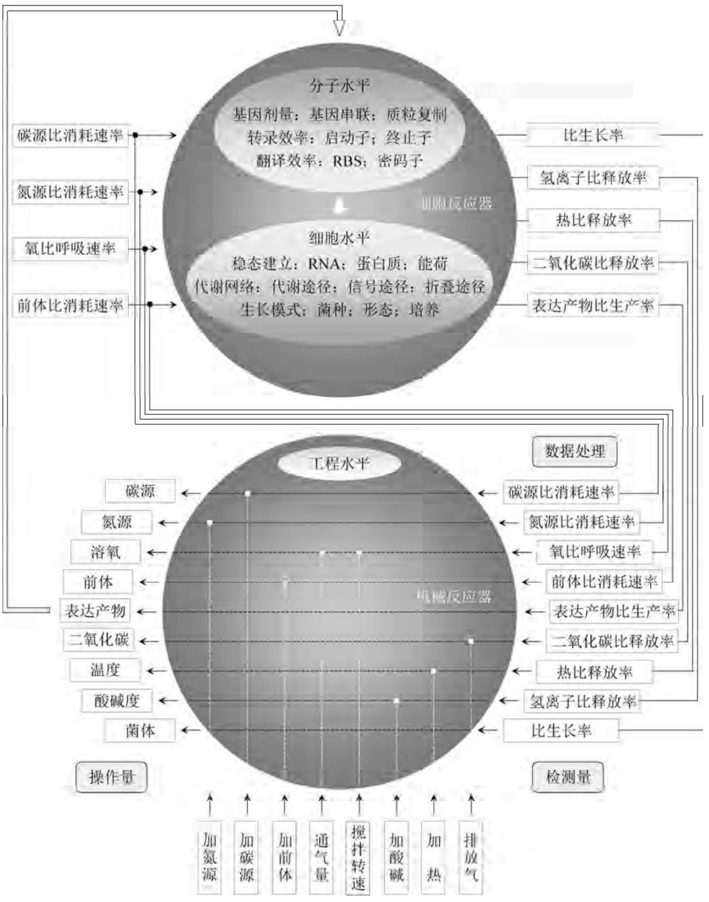

flowchart

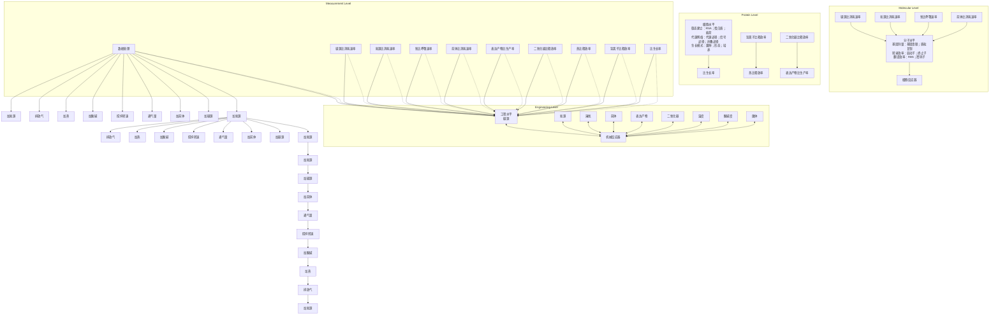

图3-16 基因工程菌发酵过程的多尺度控制

导致外源基因的泄露性表达。过高的温度还可能诱导受体菌的热休克反应，产生大量的胞内蛋白酶降解重组异源蛋白。

细菌培养液的适度混合可以在很多方面促进细胞的生长和代谢,其中包括加快营养成分和溶氧的传递、促进热量的散发以及降低细胞有毒代谢副产物的局部浓度等。从某种意义上来说,搅拌效果越佳,细菌发酵就越理想。然而,过大的搅拌速度会产生流体动力学压

---

第 3 章 大肠杆菌基因工程

131

力,它可能损害体积较大的细菌或哺乳动物细胞,同时也向培养液中散发大量的机械热,从而提高发酵的能耗。因此,在提供最佳混合效率、避免细胞损伤以及降低能耗产量比之间,搅拌转速必须达到最优化平衡。

## 2. 分子水平的优化控制

基因工程菌在发酵过程中的优化控制有三个分子水平上的作用位点:

（1）外源基因的表达控制。基因工程菌的构建为这种控制提供了分子结构上的可能性，但它必须通过各种工艺手段在细菌生长过程中得以实现，这些手段包括外源基因转录启动的特异性诱导、表达产物在受体菌中的定位和转运等。外源基因的时空特异性表达控制可以在最大程度上减少表达产物对细菌自身生长代谢过程的影响，提高表达产物的宏观产率。
（2）细胞内蛋白质生物合成系统的均衡。无论基因工程菌的目标产物是蛋白质还是其他小分子化合物，它们都必须与细菌的初级代谢和次级代谢途径共用一套蛋白质翻译系统，其成分包括核糖体、tRNA、ATG/GTP以及相关的酶系。这些成分通常都由受体细胞的染色体DNA编码，合理控制这些细菌基因的表达时间与强度，有利于细胞内三种代谢途径的和谐与稳定。
（3）重组质粒拷贝数或外源基因剂量的维持。从理论上来讲，外源基因剂量的增加有助于提高其表达产物的产量，但实际上并不都是如此。如果细胞内RNA聚合酶是限制性因素，外源基因剂量与其表达水平未必呈正相关。而且重组质粒的高拷贝复制耗费大量的能源，不但影响细菌的正常生长与代谢，同时不利于其稳定性。另外，重组质粒高拷贝复制在提高外源基因剂量的同时也同步增加了载体上其他基因（如标记基因）的分子数，这些基因的表达效率通常并不逊色于外源基因，因此两者之间的表达竞争不容忽视。

## 3. 细胞水平的优化控制

细胞水平的控制作用位点主要包括发酵过程中的细胞密度、代谢途径调整、产物比生产率等，后者又可分为相对限制性营养成分消耗以及相对菌体生长两种产物比生产率，它们分别是产物合成速率与营养成分消耗速率以及菌体生长速率之比。实验结果表明，重组蛋白的最大合成量和受体菌代谢活力的维持往往与细菌较低的生长速率相伴。但降低细菌生长速率必须在拥有一定细胞密度的基础上才能有助于提高重组蛋白的宏观表达量，这种控制在分批或流加式发酵过程中一般难以操作。另外，培养基中主要营养成分葡萄糖的不完全代谢产物乙酸对外源基因的高效表达也有明显的抑制作用。乙酸的大量合成固然与补料工艺和工程控制参数有关，但很大程度上也取决于基因工程受体菌本身的遗传特性。

## 3.4.3 大肠杆菌工程菌的高密度发酵

在基因工程菌的大规模发酵过程中，重组异源蛋白产物的宏观合成产量取决于最高的外源基因表达水平以及菌体浓度。从理论上来说，在维持外源基因表达水平不变的前提下，提高工程菌的发酵密度可以大幅度降低产物的生产成本，然而两者在很多情况下并不能兼顾。在提高工程菌培养密度的同时，单个细胞中的外源基因表达率往往伴随着不同程度的下降，这种现象的本质是外源基因表达与细菌生长两大反应对反应基质和能量的争夺。因此，通过工程方法打破发酵系统中的传质传热限制，同时通过工艺手段控制反应基质尤其是生物能源的组成和转入速率，是在不影响外源基因表达水平前提下提高工程菌发酵密度的基本策略。

## 1. 高密度发酵培养基的设计

大量的研究结果表明:细菌在碳源限制的条件下生长，其生物能源的有效利用率最高；而在氮源限制的环境中生长的细菌通常会在细胞中积聚糖原等多聚物，同时大量合成有机酸、乙醇以及其他部分生物氧化代谢中间产物，这种现象在葡萄糖作为主要碳源时尤为突

---

132

基因工程

出。除此之外，以最大比生长速率或接近这一速率生长的细菌也倾向于产生上述部分氧化分子，这些化合物的存在不仅降低了细菌的碳源比消耗率，而且最终导致细胞的生长抑制。因此，工程菌高密度发酵的培养基设计原则是:① 使用最小培养基以精确设计营养成分与细菌生长之间的定量关系，同时避免任何不利于菌体生长的营养限制性因素；② 调整培养基配比，维持细菌以合适的比生长速率生长，使得培养基中的碳源和能源不能转化为胞内储存型多聚物或胞外潜在生长抑制剂的部分氧化有机化合物，也就是说，细菌的比生长速率应尽可能低到足以使碳源全部有效利用，同时又不至于影响目标产物宏观产率的水平；③ 利用碳源限制方法阻断细菌生长期间部分氧化代谢产物的合成途径。在培养基中，碳源的绝对量往往大于其他营养成分，因此以碳源作为限制性营养成分更易于控制；④ 依据细菌细胞的组成元素确定培养基各成分的精确配比（表3-7），其中以葡萄糖作为限制细菌生长的营养成分，其加入量则以每克葡萄糖形成0.3～0.5g干重细菌的碳源比消耗率为基准。为了确保葡萄糖之外的其他营养成分的绝对过量，必须在表3-6所列数据的基础上各追加20%。此外，理想的细菌培养基还应加入适量的稀有元素和维生素。表3-8是用于大肠杆菌高密度发酵的典型培养基配方。

表 3-7 细菌细胞的主要元素含量

| 组成元素 | C | N | P | S | Mg |
| --- | --- | --- | --- | --- | --- |
| 占细胞干重的百分率/% | 50 | 7~12 | 1~3 | 0.5~1 | 0.5 |

表 3-8 用于大肠杆菌高密度发酵的培养基配方

| 成分 | 间歇培养 | 连续培养 |
| --- | --- | --- |
| 葡萄糖 | 5 g/L | 433 g/L |
| 酵母提取物 | 5 g/L | 0 g/L |
| $K_2HPO_4$ | 7 g/L | 0 g/L |
| $KH_2PO_4$ | 8 g/L | 0 g/L |
| $(NH_4)_2SO_4$ | 5 g/L | 107 g/L |
| $MgSO_4 \cdot 7H_2O$ | 1 g/L | 8.5 g/L |
| 微量元素溶液 | 2 mL/L | 56 mL/L |
| 维生素溶液 | 2 mL/L | 56 mL/L |
| 氨苄青霉素 | 0.5 g/L$^1$ | 0 g/L |

① 仅用于重组菌株培养。

## 2. 高密度发酵的温度控制

生长在最小培养基中的大肠杆菌，其发酵密度与温度关系密切。一般地，在 $19\sim 34^{\circ}\mathrm{C}$ 内，大肠杆菌的发酵密度随温度的降低而增加。在 $22^{\circ}\mathrm{C}$ 时，细胞密度达到最高值，为每升培养液 $55\mathrm{g}$ 干重细菌，其相对应的碳源比消耗率则高达每克葡萄糖 $0.44\mathrm{g}$ 干重细菌。值得注意的是，不同的大肠杆菌菌株达到最高密度所对应的培养温度往往会有差异，而且最终培养密度也各不相同，有时相差多达3倍以上。此外，在相同培养条件下，大肠杆菌K株工程菌的发酵密度比非工程菌高出 $30\% \sim 50\%$ 。温度控制的实质是调节细菌的比生长速率和溶氧需求量，较低的培养温度固然可以得到最大的发酵密度，但培养周期相对延长，而且菌株不同这种对应关系也有差异。因此在确定实际操作温度时应充分考虑工程菌株的特殊遗传性质以及物料、能量、产品产率三者之间的综合平衡。

## 3. 高密度发酵的溶氧控制

一般而言,细菌的高密度培养需要较高的溶氧浓度,尤其是在生长后期。由于细胞内各种代谢途径的高速运转以及外源基因的诱导表达,溶氧往往成为限制性因素,此时大量补加

---

第 3 章 大肠杆菌基因工程

133

葡萄糖等生物能源不仅于事无补，甚至会诱导产生并积累乙酸等部分氧化产物。克服这一困难的唯一方法是向反应体系中输送纯氧，为了确保纯氧传递对细胞高密度生长的最佳效率，通常将之与溶氧水平和碳源补料速率相关联。例如，在大肠杆菌W株的高密度发酵过程中，蔗糖的补加速率根据溶氧水平进行控制，当溶氧浓度上升至 $14\%$ 饱和度时，开始补加碳源；而当溶氧浓度跌至这一数值以下时，补料自动停止。如果将溶氧、 $\mathrm{pH}$ 与碳源补加速率三者联合控制，则效果更佳，在此条件下，大肠杆菌发酵密度可达到每升培养液 $125\mathrm{g}$ 干重细胞的水平。

## 3.4.4 基因工程菌的遗传不稳定性及其机制

重组微生物在工业生产中的应用包括两个方面:其一是重组异源蛋白的高效表达，即利用基因工程菌合成大量的生物贵重功能蛋白；其二是借助于分子克隆技术重新设计细菌的代谢途径，构建品质优良的功能微生物。然而，基因工程菌产业化应用的最大障碍是在其保存及培养过程中表现出的遗传不稳定性，它直接影响到发酵过程中比生长速率的控制以及培养基组成的选择。

基因工程菌的遗传不稳定性主要表现在重组质粒的不稳定性。这种不稳定性具有下列两种主要存在形式:① 重组 DNA 分子上某一区域发生缺失、重排或修饰，导致其表观功能丧失；② 整个重组分子从受体细胞中逃逸。上述两种情况分别称为重组分子的结构不稳定性和分配不稳定性，其形成的主要机制包括:① 受体细胞中存在的限制修饰系统对外源 DNA 的降解作用。由于目前使用的受体菌均在不同程度上减弱甚至丧失了限制修饰酶系，因此这种因素通常不会单独发挥作用；② 重组分子中所含基因的高效表达严重干扰受体细胞的正常生长代谢过程，包括能量和生物分子的竞争性消耗以及外源基因表达产物的毒性作用。这种干扰作用与自然环境中的其他生长压力（如极端温度、极端 pH、高浓度抗生长代谢剂、营养物质匮乏等）一样，可以诱导受体菌产生相应的应激反应，包括关闭生物大分子的生物合成途径以节约能源、启动蛋白酶和核酸酶编码基因的表达以补充必需的营养成分，于是工程菌中的重组 DNA 分子便会遭到宿主核酸酶的降解，造成结构缺失或重排现象；③ 重组分子尤其是重组质粒在细胞分裂时的不均匀分配是重组质粒逃逸的基本原因。这种情况通常取决于载体质粒本身的结构因素，但也与外源基因表达产物对细胞所造成的重大负荷有关；④ 受体细胞中内源性的转座元件促进重组分子 DNA 片段的缺失和重排。

当含有重组质粒的工程菌在非选择性条件下生长至某一时刻，培养液中的一部分细胞不再携带重组质粒，这部分细胞数与培养液中的总细胞数之比称为重组质粒的宏观逃逸率。事实上它并不仅仅表征重组质粒从受体细胞中的逃逸频率，而且还是下列四种情况的总和:① 重组质粒因种种原因被受体转运至胞外，这种情况大多发生在细菌处于高温或含表面活性剂（如 SDS）、某些药物（如利福平）、染料（如吖啶类）的环境中；② 受体菌核酸酶将重组质粒降解，使之不能进行独立复制，如果降解作用较为完全，则重组质粒的消失并不依赖于受体细胞的分裂；③ 重组质粒所携带的外基因过度表达抑制受体细胞的正常生长，致使原来数目极少的不含重组质粒的细胞在若干代繁殖后占据数量优势；④ 重组质粒在细胞分裂时不均匀分配，造成受体细胞所含重组质粒拷贝数的差异，这种差异随着细胞分裂次数的增加而扩大。含有较少重组质粒拷贝数的细胞其生长速度显然高于那些含重组质粒拷贝数多的细胞，而且前者更有可能在细胞继续分裂时全部丢失其重组质粒，并在最终的发酵液中占据绝对优势。

因此，重组质粒宏观水平上的逃逸现象实质上取决于含有重组质粒的受体细胞比生长速率 $(\mu^{+})$ 小于不含重组质粒的受体细胞比生长速率 $(\mu^{-})$ ，即 $\mu^{-} / \mu^{+} > 1$ ，多种大肠杆菌菌株均表现出这种特性(表3-9)。假定在发酵接种时工程菌全部含有重组质粒，对数生长期中细胞每代的重组质粒丢失率为 $\rho$ ，工程菌 $\mu^{-}$ 与 $\mu^{+}$ 的比值为 $\alpha$ ，则经过25代分裂后，含有重组

---

134

基因工程

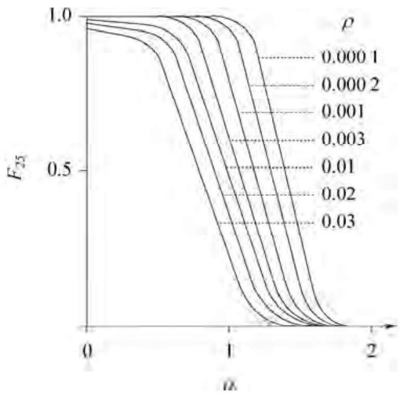

line

| \(\alpha\) | \(\rho=0.0001\) | \(\rho=0.0002\) | \(\rho=0.001\) | \(\rho=0.003\) | \(\rho=0.01\) | \(\rho=0.02\) | \(\rho=0.03\) |
|---|---|---|---|---|---|---|---|
| 0 | 1.0 | 1.0 | 1.0 | 1.0 | 1.0 | 1.0 | 1.0 |
| ~0.5 | ~0.98 | ~0.96 | ~0.94 | ~0.92 | ~0.88 | ~0.84 | ~0.78 |
| ~1.0 | ~0.95 | ~0.92 | ~0.88 | ~0.82 | ~0.72 | ~0.62 | ~0.52 |
| ~1.5 | ~0.55 | ~0.45 | ~0.35 | ~0.25 | ~0.15 | ~0.08 | ~0.04 |
| ~1.8 | 0 | 0 | 0 | 0 | 0 | 0 | 0 |

图3-17 质粒丢失率与比生长速率的关系

质粒的细胞数占总细胞数的百分率 $F_{25}$ 与 $\rho$ 和$\alpha$ 之间的对应关系可由图3-17表示。由图3-17可以看出，如果不含重组质粒的受体细胞具有生长优势（即 $\mu^{-} / \mu^{+} > 1$ )，那么即使重组质粒的丢失率很小，经过数代培养后，发酵液中也会出现大量的无重组质粒型细胞。例如，当 $\alpha = 1,\rho = 0.001$ 时， $F_{25} = 99.8\%$ ，重组质粒的宏观逃逸率仅为 $0.2\%$ ；但当 $\alpha = 1.5,\rho$ 仍为0.001时， $F_{25} = 0.1\%$ ，即重组质粒的宏观逃逸率可达 $99.9\%$ ！对于培养周期固定的分批式发酵而言，重组质粒丢失的时间越早，最终发酵液中无重组质粒的细胞的比例就越高。如果接入发酵罐的种子中含有无重组质粒的细胞，所引起的后果则更为严重。

表 3-9 不含质粒与含质粒细菌的比生长速率之比

| 受体菌株 | 质粒类型 | $\mu^{-}/\mu^{+}$ |
| --- | --- | --- |
| 大肠杆菌C600 | F' lac | 0.99~1.10 |
| 大肠杆菌K12 EC1005 | R1 drd-19 | 1.05~1.12 |
| 大肠杆菌JC 7623 | Col E1 | 1.06~1.20 |
| 铜绿假单胞菌PA01 | Tol | 2.00 |
| 大肠杆菌K12 R713 | TP120 | 1.50~2.31 |

野生型质粒在宿主菌中通常能稳定遗传，其机制是这些质粒大多含有编码特异性质粒拷贝均衡分配的基因（par）。在一些低拷贝质粒中 par 基因已被克隆鉴定，实验室常用的一些扩增表达型质粒（如 pUC 系列等）具有完整的质粒拷贝分配功能，因而由此原因引起的质粒丢失现象基本上可以忽略不计。但更多的人工构建质粒往往不具备 par 功能，而且由于重组质粒降解或分子重排引起的工程菌不稳定性影响更大，因此在工程菌发酵和重组质粒构建的过程中保持工程菌的相对稳定意义重大。

## 3.4.5 改善基因工程菌遗传不稳定性的对策

根据工程菌不稳定性的影响因素,目前已发展出多种方法抑制重组质粒的结构和分配不稳定性,归纳起来大致有下列几个方面:

## 1. 改进载体宿主系统

以增强载体质粒稳定性为目的的构建方法包括三个要点:一是将 par 基因引入表达型质粒中。例如，将大肠杆菌质粒 pSC101 的 par 基因克隆到 pBR322 类型的质粒上，或将 R1 质粒上 580 bp 的 parB 基因导入普通质粒上，其表达产物可选择性地杀死由于质粒拷贝分配不均匀而产生的无质粒细胞；二是正确设置载体质粒上的多克隆位点，防止外源基因插入质粒的稳定区域内；三是将大肠杆菌染色体 DNA 上的 ssb 基因克隆到载体质粒上，该基因编码的 DNA 单链结合蛋白 SSB 为 DNA 复制和细菌生存所必需，因此无论因何原因丢失质粒的细胞均不再能在细菌培养过程中增殖。

相同细菌的不同菌株有时会对同一种重组质粒表现出不同程度的耐受性,因此直接选择较稳定的受体菌株往往能够达到事半功倍的效果。另外,对于某些受体细胞而言,借助于诱变或基因同源灭活方法除去其染色体 DNA 上存在的转座元件,也可有效抑制重组质粒的结构不稳定性。

---

第 3 章 大肠杆菌基因工程

135

## 2. 施加选择压力

利用载体质粒上原有的遗传标记可在工程菌发酵过程中选择性地抑制丢失重组质粒的细胞生长，从而提高工程菌的稳定性。根据载体质粒上选择性标记基因的不同性质，可以设计多种有效的选择压力，其中包括:

（1）抗生素添加法。大多数表达型质粒上携带抗生素抗性基因。将相应的抗生素加入细菌培养体系中，即可降低重组质粒的宏观逃逸率。但这种方法在大规模工程菌发酵时并不实用，因为相对于简单培养基而言，加入大量的抗生素会使生产成本增加。对于一些不稳定的抗生素来说，添加抗生素造成的选择压力只能维持较短的时间。例如，多数表达型质粒携带的氨苄青霉素抗性基因实质上编码的是 $\beta-$ 内酰胺酶，若以氨苄青霉素作为选择压力，则需在培养基中加入足够的量，而且抗生素的存在对以结构不稳定性为主的重组质粒并不构成选择压力。此外，对于重组蛋白药物的生产来说，添加大量的抗生素通常会影响产品的最终纯度。

（2）抗生素依赖法。借助于诱变技术筛选分离受体菌对某种抗生素的依赖性突变株，也就是说，只有当培养基中含有抗生素时，细菌才能生长，同时在重组质粒构建过程中引入该抗生素的非依赖性基因。在这种情况下，含有重组质粒的工程菌能在不含抗生素的培养基上生长，而不含重组质粒的细菌被抑制。这种方法可以节省大量的抗生素，但其缺点是受体细胞容易发生回复突复。

（3）营养缺陷法。这种方法与上述抗生素依赖法较为相似，其原理是灭活某一种细胞生长所必需的营养物质的生物合成基因，分离获得相应的营养缺陷型突变株，并将这个有功能的基因克隆在载体质粒上，从而建立起质粒与受体菌之间的遗传互补关系。在工程菌发酵过程中，丢失重组质粒的细胞同时也丧失了合成这种营养成分的能力，因而不能在普通培养基中增殖。这种生长所必需的因子既可以是氨基酸（如色氨酸），也可以是某种具有重要生物功能的蛋白质（如氨基酰-tRNA合成酶）。

## 3. 控制外源基因过量表达

外源基因的过量表达,某种意义上也包括重组质粒拷贝的过度增殖,均可能诱发基因工程菌的遗传不稳定性。前已述及,使用可诱导型的启动子控制外源基因的定时表达,以及利用二阶段发酵工艺协调细菌生长与外源基因高效表达之间的关系,是促进工程菌的遗传稳定的一种策略。

## 4. 优化培养条件

基因工程菌所处的环境条件对其所携带的重组质粒的稳定性影响很大，在工程菌构建完成之后，选择最适的培养条件是进行大规模生产的关键步骤。培养条件对重组质粒稳定性的影响机制错综复杂，其中以培养基组成、培养温度、细菌比生长速率尤为重要。

（1）培养基组成。细菌在不同的培养基中启动不同的代谢途径，对工程菌来说，培养基组分可能通过各种途径影响重组质粒的稳定性遗传。含有pBR322的大肠杆菌在葡萄糖和镁离子限制的培养基中生长，比在磷酸盐限制的培养基中显示出更高的质粒稳定性。另一个携带氨苄青霉素、链霉素、磺胺、四环素四个抗药性基因的重组质粒，在大肠杆菌中的遗传稳定性同时依赖于培养基组成:当葡萄糖限制时克隆菌仅丢失四环素抗性；而磷酸盐的限制则导致多重抗药物性同时缺失。还有一个携带氨苄青霉素抗性基因和人 $\alpha-$ 干扰素结构基因的温度敏感型多拷贝重组质粒，当它转入大肠杆菌后，所形成的克隆菌在葡萄糖限制以及氨苄青霉素存在的条件下生长，开始时人干扰素高效表达，但随后便大幅度减少，此时的重组质粒已有相当部分丢失了干扰素结构基因，这表明培养基组分有可能导致重组质粒的结构不稳定性。除此之外，质粒通常在丰富培养基(如PBB)中比在最小培养基(如MM)中更加不稳定，而且不同的质粒其不稳定性的机制也各有差异，例如某些培养基导致质粒

---

136

基因工程

RSF2124-trp 产生结构不稳性,同时又使质粒 pSC101-trp 产生分配不稳定性(表 3-10)。

表 3-10 培养基对大肠杆菌克隆菌稳定性的影响

<table><tr><td>克隆菌</td><td>培养基</td><td> $F_{20\sim 25}$ </td><td>不稳定类型</td></tr><tr><td rowspan="2">W3110 trpAE1 trpR tnaA(RSF2124-trp)</td><td>PBB</td><td>7%</td><td>结构性</td></tr><tr><td>MM</td><td>99%</td><td>结构性</td></tr><tr><td rowspan="2">W3110 trpAE1 trpRam27(pSC101-trp)</td><td>PBB</td><td>12%</td><td>分配性</td></tr><tr><td>MM</td><td>48%</td><td>分配性</td></tr></table>

（2）培养温度。一般而言，培养温度较低有利于重组质粒的稳定遗传。有些温度敏感型的质粒不但其拷贝数随温度的上升而增加，而且当温度达到 $40^{\circ}\mathrm{C}$ 以上时，还会引起降解作用。另外，重组质粒的导入有时也会改变受体菌的最适生长温度。上述两种情况均可能与重组质粒表达产物和受体菌代谢产物之间的相互作用有关。
（3）比生长速率。细菌比生长速率对重组质粒稳定性的影响趋势不尽一致，与细菌本身的遗传特性以及质粒的结构均有关系。如前所述，如果不含重组质粒的细胞不比含有重组质粒的细胞生长得快，即 $\mu^{-} / \mu^{+} = 1$ 时，重组质粒的丢失不会导致非常严重的后果，因此调整这两种细胞的比生长速率可以提高重组质粒的稳定性。但在实际操作中往往难于选择性地提高或降低某种细胞的比生长速率，因为绝大多数环境条件（不包括施加选择压力）对两种细菌的生长影响是同步的。只有在个别情况下，可以利用分解代谢产物专一性地控制受体菌的比生长速率，降低 $\mu^{-}$ 与 $\mu^{+}$ 的比值，从而提高重组质粒的稳定性。

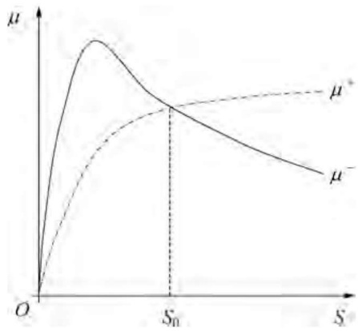

line

| X | \(\mu (\)Solid Line) | \(\mu+ (\)Dashed Line) |
| --- | --- | --- |
| 0 | 0 | 0 |
| S0 | ~Intersection Point | ~Intersection Point |

图3-18 基质浓度与比生长速率的关系

有些细菌在以碳水化合物作为碳源和能源时，营养成分浓度过高或过低均不利于其生长，高浓度的营养基质可抑制相关代谢途径中的某个基因表达。如果重组质粒上携带这种代谢基因，则含有重组质粒的克隆菌不再受高浓度基质的抑制。在这种情况下，不含重组质粒的细胞生长符合典型的底物抑制动力学模型，而工程菌则遵循Monod方程，两条曲线的交点便是 $\mu^{-} = \mu^{+}$ 时所对应的基质浓度 $S_{0}$ （图3-18）。当 $S < S_{0}$ 时，$\mu^{-} > \mu^{+}$，此时容易导致重组质粒的不稳定性；但当 $S > S_{0}$ 时，$\mu^{-} < \mu^{+}$，在这种情况下，重组质粒可以稳定地遗传。细菌的连续发酵技术为基质浓度的恒定控制提供了保证。

## 3.5 利用重组大肠杆菌生产人胰岛素

重组 DNA 技术的目标之一是实现目的基因编码产物的产业化，而大肠杆菌高效表达平台则是基因工程应用最为广泛也最成熟的一项技术。不断完善的基因操作技术可将大肠杆菌构建成为用于重组异源蛋白生产的分子工厂，而且这种工程菌在价格低廉的培养基中生长迅速易于控制，因此重组大肠杆菌在医用蛋白的大规模生产中具有重要的经济意义。尽管有些生物活性严格依赖于糖基化作用的真核生物功能蛋白无法采用重组大肠杆菌进行生产，而且蛋白质生物合成后加工系统的缺乏使得某些人体蛋白难以折叠成天然构象，但仍有100多种异源蛋白通过大肠杆菌基因工程菌实现了产业化，其中包括一些结构相当复杂的人体蛋白，如富含半胱氨酸的血清白蛋白（HSA）、尿激酶原（pro-UK）、金属硫蛋白（MT），

---

第 3 章 大肠杆菌基因工程

137

二硫键共价交联的二聚体蛋白巨噬细胞集落刺激因子(M-CSF)，四聚体的血红蛋白(Hb)以及结构复杂的抗体片段等。本节以重组人胰岛素为例，论述利用大肠杆菌生产外源基因表达产物的基本过程。

## 3.5.1 胰岛素的结构及其生物合成

胰岛素广泛存在于人和动物的胰脏中，正常人的胰脏约含有200万个胰岛，占胰脏总质量的 $1.5\%$ 。胰岛主要由 $\alpha, \beta, \gamma$ 三种细胞组成，其中 $\beta-$ 细胞特异性合成胰岛素。胰岛素发现于1922年，翌年便开始在临床上作为药物使用，迄今为止，胰岛素仍是治疗胰岛素依赖型糖尿病的特效药物。据统计，目前全世界糖尿病患者已超过一亿，而且发病率呈逐年增长的趋势。因此，为临床提供质量可靠及价格低廉的胰岛素制品是现代生物医药领域的一项重要工程。

胰岛素是在胰岛 $\beta$-细胞的内质网膜结合型核糖体上合成的，核糖体上最初形成的产物是一个比胰岛素分子大一倍多的前胰岛素原单链多肽，其N端区域含有20个左右的氨基酰疏水性信号肽。当新生肽链进入内质网腔后，信号肽酶便切除信号肽形成胰岛素原，后者被运输至高尔基体进一步加工，并以颗粒的形式贮存备用。胰岛素原单链多肽由三个串联的区域组成(图3-19):C端21个氨基酸为A链，N端30个氨基酸为B链，两者分别通过两对碱性氨基酸(Arg-Lys)与C肽相连。当机体需胰岛素时，高尔基体内的特异性肽酶分别在A-C和B-C连接处将胰岛素原切成3段，其中A链与B链借助于二硫键形成共价交联的活性胰岛素，并通过血液循环作用于靶细胞膜上的特异性胰岛素受体。

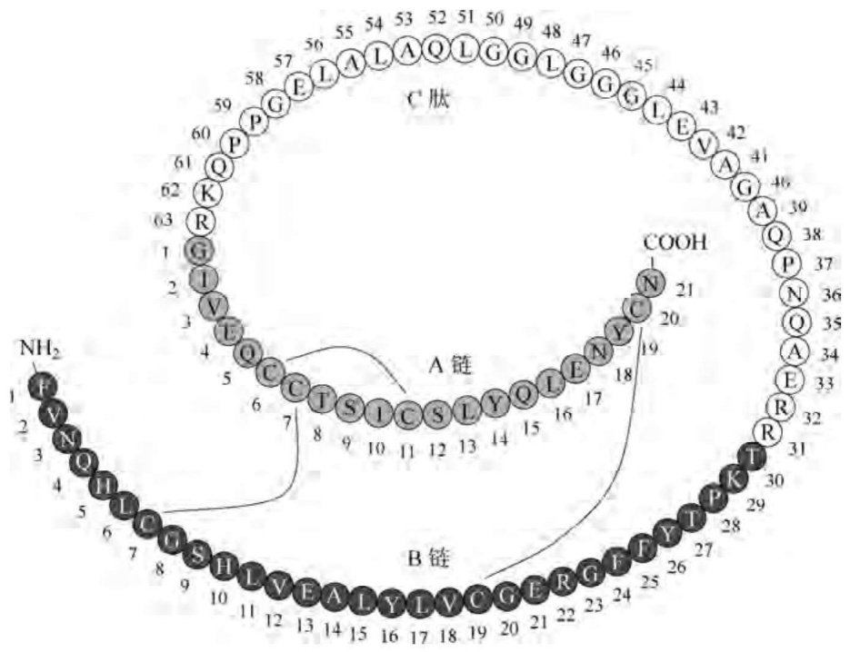

chemical

DNA strand diagram showing C-terminal, A-shape, and B-shape with nucleotide positions labeled

图3-19 人胰岛素原结构示意图

活性胰岛素含有三对二硫键，其中两对二硫键在A链和B链之间形成，分别为A7-B7和A20-B19，另一对二硫键则由A链的第6位Cys与第11位Cys形成。不同哺乳动物种属的胰岛素分子结构大致相同，主要区别表现在A链二硫键之间的第8、第9和第10位上的3个氨基酸残基以及B链C端的最后一个氨基酸残基上，但这些差别并不改变胰岛素的生理功能。在所有来源的胰岛素中，人的胰岛素与猪和狗的胰岛素最为接近，两者唯一的区

---

138

基因工程

别是 B 链 C 末端一个氨基酸残基不同。除此之外，不同种属动物的胰岛素原 C 肽序列和长度也有差异，人的 C 肽为 31 肽，牛的为 26 肽，而猪的为 29 肽。

## 3.5.2 人胰岛素的生产方法

工业上可采用下列 4 种方法大规模生产人胰岛素:

（1）从人的胰脏中直接提取胰岛素。这种方法在早期用于生产少量的人胰岛素，由于原料供应的限制，其产量不可能满足临床需要。
（2）以氨基酸为原料直接化学合成。这种全合成方法从技术上来说是能够做到的，我国科学家曾在20世纪60年代成功合成了具有生物活性的牛结晶胰岛素，但不难想象其成本奇高。

（3）由猪胰岛素化学转型为人胰岛素。前已述及，猪与人的胰岛素只在B链C末端的一个氨基酸上存在差异，前者为丙氨酸，后者为苏氨酸，但两种胰岛素的生理功效完全一致，因此一些国家在临床上使用猪胰岛素制剂治疗糖尿病。然而由于氨基酸序列上的微小差异，猪胰岛素的长期使用会在患者体内产生一定程度的免疫反应，更为严重的是，患者体内抗猪胰岛素抗体的诱导生产还可能对患者剩余的正常 $\beta-$ 细胞功能以及内源性胰岛素分泌造成负面影响。因此，人胰岛素制剂的使用被认为是最理想的糖尿病治疗方法。由于利用传统的生化方法从猪胰脏中提取胰岛素早已形成生产规模，且成本相对低廉，所以将猪胰岛素在体外用酶促方法转化为人胰岛素不失为一种选择，至少在重组人胰岛素的大规模产业化之前，这种半合成方法仍是相当多生物制药厂家采用的生产工艺。其基本原理是:胰蛋白酶在 $\mathrm{pH}$ 为 $6.0\sim 7.0$ 以及苏氨酸叔丁酯的过量存在下能脱去猪胰岛素B链C末端的丙氨酸，并将苏氨酸转入相应位置；所形成的人胰岛素叔丁酯再用三氯乙酸除去其叔丁酯基团，最终获得人胰岛素，整个过程的总转化率为 $60\%$ 。但是这个工艺路线相当耗时，且需要一整套复杂的纯化方法，导致最终产品的价格不菲。

（4）利用基因工程菌大规模发酵生产重组人胰岛素。1982年，美国Ely LiLi公司首先使用重组大肠杆菌生产人胰岛素，这是第一个上市的基因工程药物。5年后，Novo公司又开发了利用重组酵母生产人胰岛素的新工艺。这种由重组微生物合成的人胰岛素无论在体外胰岛素受体结合能力、淋巴细胞和成纤维细胞的离体应答能力，还是在血糖降低作用以及血浆药代动力学方面，均与天然的猪胰岛素无任何区别，但却显示出无免疫原性以及注射吸收较为迅速等优越性，因而深受广大医生和患者的欢迎。

## 3.5.3 产重组人胰岛素大肠杆菌工程菌的构建策略

胰岛素的特殊分子结构决定了其工程菌的构建必须更多地兼顾后续的分离纯化及加工过程,这是提高生产效率降低生产成本的关键因素。虽然长期以来已发展了多种大肠杆菌工程菌,但是有代表性和实用性的构建方案主要有下列3种:

（1）AB链分别表达法。这种方法在Ely LiLi公司早期开发重组大肠杆菌生产胰岛素时采用，其基本原理如图3-20所示。A链和B链的编码区由化学合成，两个双链DNA片段分别克隆在含 $P_{\mathrm{tac}}$ 启动子和 $\beta-$ 半乳糖苷酶编码基因的表达型质粒上，后者与胰岛素编码序列形成杂合基因，其连接位点处为甲硫氨酸密码子。重组分子分别转化大肠杆菌受体细胞，两种克隆菌分别合成 $\beta-$ 半乳糖苷酶-人胰岛素A链以及 $\beta-$ 半乳糖苷酶-人胰岛素B链两种融合蛋白。经大规模发酵后，从菌体中分离纯化融合蛋白，再用溴化氰在甲硫氨酸残基的C端化学裂解融合蛋白，释放出人胰岛素的A链和B链。由于 $\beta-$ 半乳糖苷酶中含有多个甲硫氨酸，溴化氰处理后生成多个小分子多肽，而A链和B链内部均不含甲硫氨酸残基，故不为溴化氰继续降解。A链和B链进一步纯化后，以 $2:1$ 的物质的量比混合，并进行体外化学氧化折叠。由于两条肽链上共存在三对巯基，二硫键的正确配对率较低，通常只有 $10\% \sim 20\%$ ，因此利用这条路线生产的重组人胰岛素每克售价高达180

---

第3章 大肠杆菌基因工程

139

美元。为了进一步降低生产成本，Ely LiLi 公司随后又发展了第二种生产工艺。

（2）人胰岛素原表达法。将人胰岛素原cDNA编码序列克隆在 $\beta$ -半乳糖苷酶编码基因的下游，两段DNA序列的连接处仍为甲硫氨酸密码子。该杂合基因在大肠杆菌中高效表达后，分离纯化融合蛋白，并同样采用溴化氰化学裂解法回收人胰岛素原片段，然后将之进行体外折叠。由于C肽的存在，胰岛素原在复性条件下能形成天然的空间构象，为3对二硫键的正确配对提供了良好的条件，使得体外折叠率高达 $80\%$ 以上。为了获得具有生物活性的胰岛素，经折叠后的人胰岛素原分子必须用胰蛋白酶特异性切除C肽。胰蛋白酶的作用位点位于精氨酸或赖氨酸的羧基端(图3-21)，由于天然构象的存在，人胰岛素原链第22位上的精氨酸和第29位上的赖氨酸对胰蛋白酶的作用均不敏感。因此用胰蛋白酶处理人胰岛素原后，获得的是完整的A链以及C末端带有精氨酸的B链，与人的天然胰岛素相比，这种B链多出一个氨基酸，后者必须用高浓度的羧肽酶B专一性切除。虽然上述工艺路线并不比AB链分别表达更为简捷，而且需要额外使用两种高纯度的酶制剂，但由于其体外折叠的成功率相当高，在一定程度上弥补了工艺烦琐的缺陷，使得最终产品的生产成本仅为50美元/克。目前Ely LiLi公司采用这种工艺路线年产数十吨的重组人胰岛素，其经济效益相当可观。

（3）AB链同时表达法。这种方法的基本思路是将人胰岛素的A链和B链编码序列拼接在一起，然后组装在大肠杆菌β-半乳糖苷酶基因的下游。重组子表达

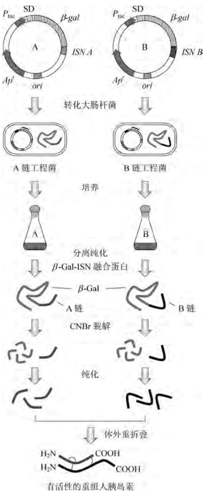

flowchart

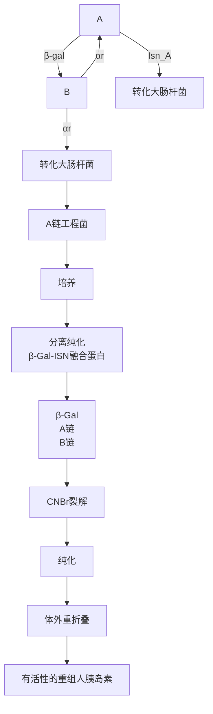

图3-20 人胰岛素AB链分别表达法的基本原理

出的融合蛋白经 CNBr 处理后，分离纯化 A-B 链多肽，然后再根据两条链连接处的氨基酸性质采用相应的裂解方法获得 A 链和 B 链肽段，最终通过体外化学折叠制备具有活性的重组人胰岛素。与第一种方法相似，其最大的缺陷仍是体外折叠的正确率较低，因此目前尚未进入产业化应用阶段。

上述 3 种工程菌的构建路线均采用胰岛素或胰岛素原编码序列与大肠杆菌  $\beta-$  半乳糖苷酶基因拼接的方法，所产生的融合型重组蛋白表达率高且稳定性强，但不能分泌，主要以包

---

140

基因工程

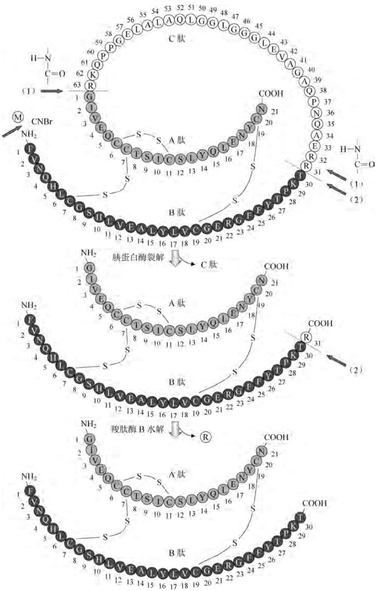

chemical

DNA helix structure showing C, A, and B ribosomes with labeled amino acid residues and enzyme steps (Lactobase and B-lyzing)

图3-21 人胰岛素原表达法示意图

---

第 3 章 大肠杆菌基因工程

141

涵体的形式存在于细胞内。一种能促进融合蛋白分泌的工程菌构建策略是将胰岛素或胰岛素原编码序列插入表达型质粒 $\beta-$ 内酰胺酶编码基因的下游，后者编码降解青霉素的酶蛋白，通常能被大肠杆菌分泌到细胞外。这一构建策略具有稳定高效表达和重组产物可分泌两大优良特性，为胰岛素的后续分离纯化工序减轻了负担。

## 3.6 利用重组大肠杆菌生产人抗体及其片段

抗体是高等动物适应性免疫系统中的一个重要家族，在体内具有多重生理功能。除此之外，抗体还广泛应用于生命科学研究的各个领域，包括生物分子尤其是蛋白或多肽的定性分析（如蛋白质印迹技术、微扩散试验、组织免疫学技术）、定量分析（如放射免疫分析RIA、酶联免疫吸附分析ELISA等）以及利用免疫亲和层析技术分离生物大分子。在临床上，抗体在免疫诊断以及肿瘤治疗中更显示出令人瞩目的应用前景。因此，抗体及其衍生物的工业化生产具有重要的社会意义和经济价值。

## 3.6.1 重组抗体的生产策略

高等动物体内的抗体分子是一类由两条轻链(L)和两条重链(H)组成的四聚体蛋白质(图3-22)，其中四条多肽链通过四对二硫链共价连为一体。轻链和重链的N端区域构成抗体分子的抗原识别位点，称为可变区 $(\mathrm{V_H}$ 和 $\mathrm{V_L})$ ，它们均由三个互补决定位点（亦称为超变位点，CDR1～CDR3)组成。此外，每条轻链还含有一个恒定区 $(\mathrm{C_L})$ ，而每条重链则含有三个不同的恒定区 $(\mathrm{C_{H1}},\mathrm{C_{H2}},\mathrm{C_{H3}})$ 。用木瓜蛋白酶水解抗体蛋白可获得三个抗体片段，即两个相同的 $\mathrm{F_{AB}}$ 片段，每个片段含有一条完整的轻链以及半条由 $\mathrm{V_H}$ 和 $\mathrm{C_{H1}}$ 组成的重链，两者在各自的恒定区内以二硫键相连；水解产物的另一部分则为 $\mathrm{F_C}$ 片段，由两条以二硫键相连的重

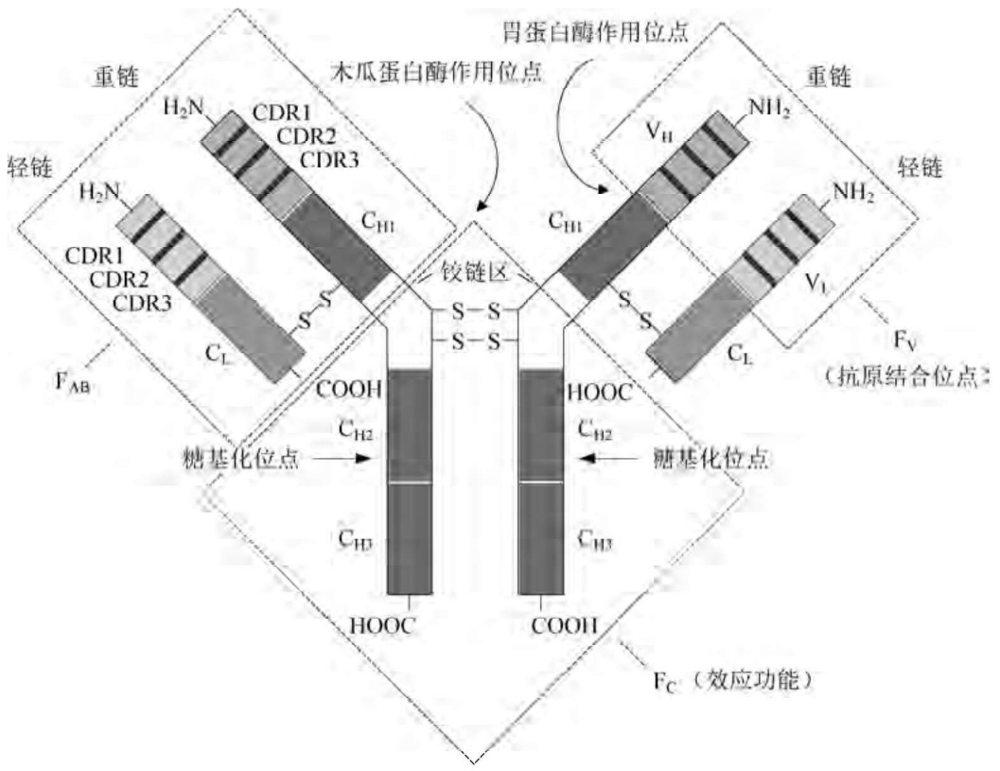

flowchart

This diagram illustrates the biochemical mechanism of a mitochondrial protein complex, showing interactions between heavy chain (重链), light chain (轻链), and salt chain (铰链区) regions with labeled functional blocks and enzyme activities.

图3-22 哺乳动物抗体分子的结构

---

142

基因工程

链组成，每条重链只含有 $\mathrm{C_{H2}}$ 和 $\mathrm{C_{H3}}$ 两个区域。 $\mathrm{F}_{\mathrm{AB}}$ 片段保留着抗原的结合活性，但并非维持这一活性的最小单位，事实上 $\mathrm{F}_{\mathrm{AB}}$ 片段N端的一半区域（即 $\mathrm{F_V}$ 片段）仍具有完整抗体分子的所有抗原结合活性。$\mathrm{F_V}$ 片段的氨基酸序列是抗体分子之间差异的主要表现形式，完整的 $\mathrm{F_V}$ 片段可由 $\mathrm{F_{AB}}$ 片段经胃蛋白酶降解获得。

当抗体与抗原特异性结合后，抗体分子中的 $\mathrm{F_C}$ 部分便诱导下列三大免疫学反应:① 激活补体级联反应。经活化的补体系统裂解靶细胞膜，激活巨噬细胞，并产生相应信号将机体内免疫应答系统中的其他组分固定在靶细胞或抗体-抗原复合物周围。② 诱导抗体依赖型细胞毒性反应(ADCC)。这是抗体 $\mathrm{F_C}$ 部分与ADCC型效应细胞上相应的 $\mathrm{F_C}$ 受体特异性结合的结果，经 $\mathrm{F_C}$ 诱导后的效应细胞释放细胞毒素蛋白，裂解与抗体分子 $\mathrm{F_{AB}}$ 部分结合的外来细胞。③ 激活巨噬细胞的吞噬反应。当 $\mathrm{F_{AB}}$ 部分与一可溶性抗原结合后，抗体分子上的 $\mathrm{F_C}$ 部分可与巨噬细胞上的 $\mathrm{F_C}$ 受体特异性结合，激活巨噬细胞吞噬并降解抗原-抗体复合物。

抗体是一种糖蛋白，其糖基化位点位于重链的 $\mathrm{C_H2}$ 区域内。糖基的存在为抗体结构维持、分泌性、可溶性以及稳定性所必需，但与抗原的特异性识别和结合功能无关。在基础研究和部分临床应用（如免疫诊断、免疫导向药物设计和装配等）中，主要利用的是抗体与抗原之间的特异性识别与作用这一特性。因此根据使用范围的不同，重组抗体的生产可采取下列多种策略（图3-23）:

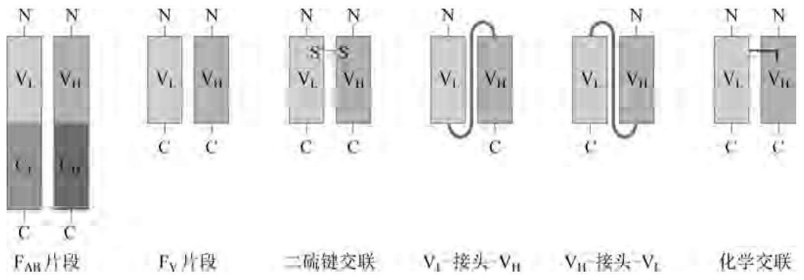

text_image

N N
VL VH
C L CH
C C
FAB片段
N N
VL VH
C C
FV片段
N N
VL VH
S S
VL VH
C C
二硫键交联
N N
VL VH
C
VL VH
C
VL VH
C
VL VH
C
VL VH
化学交联
N N
VL VH
C C

图3-23 重组抗体在大肠杆菌中的表达形式

（1）$\mathrm{F_{AB}}$ 片段。 $\mathrm{F_{AB}}$ 片段为一异源二聚体，含有一对二硫键。轻重两条链的不变区 $\mathrm{C_L}$ 和$\mathrm{C_H}$ 对维持整个 $\mathrm{F_{AB}}$ 分子的稳定性起着重要作用，但在异源表达(如大肠杆菌)时两条多肽链会因二硫键错配形成同源二聚体，从而降低重组分子的收率。作为另一种选择，也可构建$\mathrm{F}_{(\mathrm{AB})2}$ 分子的重组表达系统，即两个相同的 $\mathrm{F_{AB}}$ 片段通过各自铰链区内的两个半胱氨酸残基形成共价四聚体。 $\mathrm{F}_{(\mathrm{AB})2}$ 是抗体分子中最完整最稳定的抗原识别结合单位。
(2) $\mathrm{F_V}$ 片段。 $\mathrm{F_V}$ 片段是维持抗原特异性识别和结合活性的最小单位，在大肠杆菌中能高效表达。根据 $\mathrm{V_H}$ 和 $\mathrm{V_L}$ 氨基酸序列的不同，重组 $\mathrm{F_V}$ 分子可能稳定维系，也可能相互解离。利用基因定向突变技术分别在 $\mathrm{V_H}$ 和 $\mathrm{V_L}$ 编码区合适位点内引入半胱氨酸密码子，两个可变区表达后，进行体外二硫键修复；或者直接通过化学交联方法将两者共价连为一体，均可提高重组 $\mathrm{F_V}$ 片段的稳定性。此外，还可在 $\mathrm{V_H}$ 和 $\mathrm{V_L}$ 之间插入一段由15个氨基酸残基构成的接头肽段，其序列通常为:GGGGSGGGGSGGGGS，即 $(\mathrm{Gly}_4\mathrm{Ser})_3$ 。相应的重组表达产物为单链 $\mathrm{F_V}$ 片段 $(\mathrm{scF_V})$ ，它拥有两种分子形式，即 $\mathrm{N - V_H}$ -接头- $\mathrm{V_L - C}$ 和 $\mathrm{N - V_L}$ -接头- $\mathrm{V_H - C}$ 。
（3）二价迷你抗体。将两分子的单链 $\mathrm{F_V}$ 片段通过一个人工设计的铰链区多肽片段融合在一起，可形成重组二价抗体(图3-24)。铰链区中含有一个或两个两性螺旋结构，使得整个重组抗体分子在大肠杆菌周质中能顺利装配。由此生产的二价迷你抗体大大增强了对表面结合型抗原或多聚体抗原的亲和力，与天然完整的抗体分子相比几乎没有任何区别。完

---

第3章 大肠杆菌基因工程

143

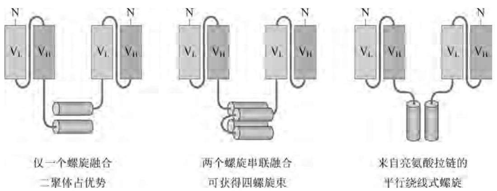

图3-24 由大肠杆菌表达的重组二价抗体装配形式

整的抗体由于结构复杂且存在四对二硫键，在大肠杆菌中的异源表达效率极低，而采用上述三种策略生产抗体重组片段很大程度上为抗体的基因工程开辟了广阔的应用前景。

## 3.6.2 由大肠杆菌生产重组抗体片段的优越性

抗体在生命科学基础研究和临床上的广泛应用要求产业化的抗体制品必须具备高抗原结合特异性、低人体免疫原性以及可规模化生产。为达到此目标，抗体生产经历了三次重大变革。

## 1. 以重组抗体取代天然抗体

在杂交瘤技术问世之前，抗体的制备主要采用抗原免疫动物（如兔子）的方法，从动物抗血清中直接分离纯化天然抗体。对于相对分子质量较大结构较为复杂的蛋白质抗原而言，往往存在多种不同的抗原决定簇，因此由此获得的抗体制剂实际上是多重抗体的混合物，其中每一种抗体对应于抗原的一个决定簇。这种抗体混合物在实际应用中存在两大缺陷:① 抗体制备物不同抗体的含量不稳定，也就是说，用同样的抗原多次免疫兔子，每次所获得的抗体制备物具有不同配比的各种抗体。由于抗原分子中各种抗原决定簇在每次免疫反应中所表现出的抗体刺激能力差异较大，所以这种变化直接影响了抗体制备物中和抗原的能力；② 抗体混合物不能区分两种相似抗原之间的差异，相似抗原分子往往拥有一部分相似甚至相同的抗原决定簇，它们均能为同一种抗体所识别，因此多重抗体混合物具有较低的特异性，这在免疫诊断和治疗中相当危险。

1975年发展起来的杂交瘤技术使得制备针对一种抗原决定簇的抗体成为可能。抗体由抗原激活的B淋巴细胞(确切而言为浆细胞)合成,一个B淋巴细胞只合成一种抗体分子。B淋巴细胞通常很难在离体条件下大规模培养,但在较为罕见的情况下,正常的B淋巴细胞会转变成癌细胞(即骨髓瘤),这种骨髓瘤细胞在维持B淋巴细胞基本生理特征的同时,获得了在体外培养基中生长增殖的能力。如果以一种不能合成任何抗体的骨髓瘤细胞为受体,而以另一种能产生所需抗体的B淋巴细胞为供体,两者进行细胞融合,在合适的选择压力存在下,即可筛选出一株既能合成单一抗体又能进行体外培养的杂合细胞系,这就是利用杂交瘤技术生产单克隆抗体的基本原理。从严格意义上讲,由这种技术生产的单克隆抗体仍属于天然抗体,抗体分子的组成与结构没有任何改变。

早期的杂交瘤技术均采用小鼠或大鼠的 B 淋巴细胞作为亲本，所产生的单克隆抗体自然呈鼠源性。这种抗体在离体免疫检测方面的应用取得了满意的效果，但若将之作为体内治疗药物使用，则首先碰到的问题便是免疫交叉反应。由于鼠的抗体与人的抗体在结构上存在一定的差异，因此重复使用鼠源性抗体会诱导机体产生抗抗体，而后者的积累轻者大大降低鼠源性抗体的疗效，重者甚至会导致严重的过敏反应。为了克服这一难题，必须使单克

---

144

基因工程

隆抗体尽可能人源化。一种较为成熟的策略是将鼠源性的单克隆抗体转化为含有一部分人抗体序列并保留原有抗原结合特异性的重组抗体，又称嵌合抗体或人源化抗体。鼠源性抗体中被人抗体相应序列取代的部分首推 $\mathrm{F_C}$ 片段，因为鼠源性 $\mathrm{F_C}$ 区域在人体中所产生的免疫应答能力较弱，而且该区域最易刺激人体B淋巴细胞产生抗抗体。但在重组抗体的实际构建过程中，通常是将大鼠或小鼠的 $\mathrm{F_V}$ 编码序列置换人抗体轻链和重链基因的相应编码序列，形成的重组分子再克隆到合适的表达载体上，最终转染B淋巴细胞系。为了进一步减少嵌合抗体中鼠源性序列的比例，还可只将鼠抗体的CDR编码序列引入人抗体基因中，形成所谓的CDR移植抗体。目前，针对不同的抗原，如肿瘤相关抗原、细胞表面受体以及淋巴细胞因子等，已构建出数十种CDR移植抗体。

当然，就医学角度而言，最为理想的免疫治疗药物是纯人抗体，然而采用类似于杂交瘤技术的程序很难获得能合成人单克隆抗体的杂交瘤细胞系。其原因是:第一，人淋巴细胞与鼠骨髓细胞融合形成的杂合瘤中，人的染色体呈现高度的不稳定性，导致单克隆抗体产量极低；第二，终始没有找到理想的人骨髓瘤细胞系取代小鼠的骨髓瘤细胞；第三，基于伦理道德方面的顾虑，不可能用各种抗原直接免疫人体，因此很难分离获得能产生特定抗体的人B淋巴细胞。有人尝试将人B淋巴细胞在体外用抗原进行诱导，然后再用Epstein-Barr病毒将抗原激活的B淋巴细胞转化为癌细胞，遗憾的是这种癌细胞合成特异性抗体的能力极低，且抗体与抗原的亲和性也很弱。也有人试图将人的免疫球蛋白基因转入小鼠的胚胎细胞系中，构建产生人源性抗体的转基因鼠，然后再用特定抗原免疫转基因鼠，合成特异性抗体，目前转基因鼠表达重组人免疫球蛋白已获成功。

## 2. 以抗体片段取代完整抗体分子

除少数情况外，抗体在体内和体外的大部分应用是基于抗体分子与抗原的特异性识别与结合原理，而这种特性又与抗体分子中的恒定区无关，因此以抗体片段取代完整分子是一种颇有前途的选择。首先，各种抗体片段的相对分子质量只及整个抗体分子的 $10\% \sim 50\%$ ，小分子的抗体片段有利于高效表达和分泌，而且由于二硫键含量的下降，重组表达产物的重折叠也得以简化，这对于利用重组大肠杆菌大规模生产高纯度的抗体片段尤为重要；此外，无论基础研究还是临床应用，抗体极少单独使用，大多数需要进行修饰处理，如同位素标记、生色酶偶联以及导向药物的连接等，相对分子质量较小的抗体片段显然为上述操作提供了较大的空间。抗体片段在临床上的应用最具有优越性，由于分子小，对实体肿瘤组织的穿透力强，几乎可作为所有药物、毒素和同位素的载体，构成标准化系列化的生物导弹制导系统，在肿瘤的诊断与防治中显示出巨大威力。其次，抗体片段由于结构简单，更易做到人源化，从而一定程度上降低了它们在机体内的免疫原性。此外，利用蛋白质工程技术对抗体片段进行定位修饰显得更为直观。天然抗体分子对抗原的亲和性以及稳定性未必最佳，在不增加其免疫原性的前提条件下，对抗体片段的氨基酸序列加以改造，已证明能明显延长它在血液中的半衰期，从而大大提高抗体片段在临床上的实用性。

## 3. 以大肠杆菌取代哺乳动物等真核细胞生产重组人抗体片段

尽管小鼠的骨髓瘤细胞、人的B淋巴细胞以及中国仓鼠卵巢细胞(CHO)在生产单克隆抗体、人鼠嵌合抗体直至表达人免疫球蛋白基因方面起着不可替代的作用，其中由CHO细胞合成人的 $\mathrm{F}_{\mathrm{AB}}$ 抗体片段还可以省去体外重折叠工序，但是与重组大肠杆菌相比，克隆基因在高等哺乳动物细胞中的表达水平很低，而且培养工艺复杂，培养基昂贵，这些不利因素严重阻碍了动物细胞来源的抗体制品在研究及临床上的广泛应用。酵母曾被认为是表达人源性免疫球蛋白基因的候选受体系统，人抗体重链和轻链基因在酵母中已获成功表达，并在分泌过程中 $\mathrm{F}_{\mathrm{AB}}$ 重组片段也能正确折叠和装配。但是对于重组抗体片段的生产而言，酵母仍不如大肠杆菌平台简易方便，抗体片段编码基因的表达水平也比大肠杆菌低很多。在合成抗

---

第 3 章 大肠杆菌基因工程

145

体完整分子方面,由于酵母细胞内的蛋白质糖基化作用机制与哺乳动物细胞不同,尽管重组酵母来源的完整抗体分子具有相同的抗体依赖型细胞毒性活力,但缺少补体依赖型的细胞毒性功能,因此酵母对生产重组抗体及抗体片段并非理想的表达系统。

虽然大肠杆菌由于缺少糖基化系统难以合成具有多重生物学效应的抗体完整分子，但在表达功能性 $F_{V}$ 、 $F_{AB}$ 、 $scF_{V}$ 片段方面却有着得天独厚的优势。重组大肠杆菌在发酵罐中可合成450 mg/L的 $F_{V}$ 片段以及1\~2 g/L的二价重组人抗体片段，这一表达水平远远高于酵母和哺乳动物细胞，再加上重组大肠杆菌发酵周期短、发酵密度高及培养条件简单易于控制等优势，使得它成为重组人抗体片段大规模生产的首选表达系统。

## 3.6.3 产重组抗体片段大肠杆菌工程菌的构建

除  $scF_{V}$  片段外，重组抗体片段 ( $F_{V}$  和  $F_{AB}$ ) 工程菌构建的一个显著特点是必须考虑两条多肽链在表达后的重折叠。对于天然的  $F_{V}$  片段而言，重链与轻链可变区的分子间重折叠主要依靠肽链氨基酸残基侧链基团的非共价键作用；而对于  $F_{AB}$  片段以及人工引入半胱氨酸的  $F_{V}$  变体来说，两条多肽链是由二硫键维系的，因此重组子的构建策略和程序与抗体片段的功能表达密切相关。

## 1. 重组抗体片段在大肠杆菌中的表达方式

与其他人体基因的表达策略相似，重组抗体片段表达产物在大肠杆菌中也有三种定位方式，即以包涵体的形式存在于胞质中、以可溶性或不溶性的蛋白形式存在于周质中、以膜融合蛋白的形式定位于细胞外表面上。三种表达方式均有各自的优缺点，但从总体上评价，将重组抗体表达产物分泌到周质中的方法最为理想。

以包涵体形式在大肠杆菌中表达重组抗体片段与表达其他重组蛋白质没有很大的区别，在受体菌株、表达载体以及工程菌培养工艺等方面也没有特殊要求。几乎所有的单价抗体片段（如  $F_{AB}$ 、 $F_{V}$ 、 $scF_{V}$ ）都可以这种方式高效表达，其表达率一般可达到 35%～40%。由于抗体片段的相对分子质量较小，且最多只有一个半胱氨酸，因此多聚体的集聚作用并不显著，这在某种程度上降低了包涵体的形成速率，同时也使得表达产物对蛋白酶较为敏感。重组抗体片段的体外重折叠与普通重组蛋白略有区别，对于  $F_{AB}$  和含有半胱氨酸的  $F_{V}$  变体片段而言，轻重链之间的重折叠和二硫键形成遵循另一种动力学模型。实验结果表明，在含有 1～2 mmol/L 还原型谷胱甘肽、0.1～0.2 mmol/L 氧化型谷胱甘肽以及 1 mol/L 精氨酸的碱性溶液中，抗体片段均可进行有效折叠，其中  $F_{AB}$  片段的重折叠率一般在 10%～40%，而  $scF_{V}$  片段的重折叠亦可达 10%～20%。

以分泌形式表达重组抗体片段具有许多优点，除了分泌产物N端不含多余的甲硫氨酸外，周质区域中的氧化环境为抗体片段的折叠也提供了良好的条件，各种类型的重组抗体片段均可在周质中形成具有抗原结合功能的最终产物。在大多数情况下，由于表达产物的分泌速率大于折叠速率，因此功能性抗体片段的形成速率主要取决于后者。当分泌速率远远大于折叠速率时，折叠中间产物得以积累，形成不溶性的周质形包涵体。与胞质型包涵体相同，周质型包涵体也需要体外重折叠操作才能转化成功能片段，因此任何能提高周质中蛋白折叠速率的因素理论上均可增加功能抗体片段的表达水平。分泌型表达的另一个优点是产物较为稳定。大肠杆菌中已被鉴定的蛋白酶共达25种之多，但周质中只存在8种。绝大多数的蛋白酶活性需要偏碱性条件，胞质中的 $\mathrm{pH}$ 一般维持在 $7.5\sim 7.9$ ，有利于蛋白酶活性的发挥；而周质中的 $\mathrm{pH}$ 值更多地依赖于培养基的组成。由于小于$600\mathrm{Da}$ 的小分子可以透入外膜影响周质的 $\mathrm{pH}$，因此在工程菌发酵过程中，将培养液 $\mathrm{pH}$ 控制在 $6.0\sim 6.5$ 即可有效抑制周质中的蛋白酶活性。此外，低温和 $\mathrm{Zn^{2 + }}$ 的存在也能减少蛋白酶的降解作用。分泌型表达的唯一缺点是表达效率较低，装配强启动子或提高培养温度均于事无补，因为重组蛋白的翻译往往与分泌偶联在一起，分泌速率是产物表达速

---

146

基因工程

率的决定性因素。

将抗体片段与大肠杆菌外膜脂蛋白进行融合表达已有成功报道。对于 $\mathrm{scF_v}$ 片段而言，每个大肠杆菌细胞表面能结合大约(5～10)万个融合蛋白分子。这种表达方法多用于抗体片段突变体的大规模筛选，利用特定抗原不经细胞裂解可直接进行免疫检测，从而快速获得期望的克隆菌。在抗体片段生产中，融合蛋白必须进行体外裂解，这为分离纯化带来很大负担，因而不是重组抗体片段生产的首选方法。

## 2. 重组抗体片段的大肠杆菌表达载体

用于重组抗体片段分泌型表达的最典型载体是pIG系列质粒，其组成元件如图3-25所示。它含有两个不同的复制子结构，一个来自pUC家族质粒，能产生较高的拷贝数，另一个来自f1噬菌体DNA，在一定条件下重组质粒可进行选择性单链复制并分泌，便于克隆基因的定点突变操作。表达元件选用乳糖启动子及其操作子 $P / O_{\mathrm{lac}}$ ，其诱导条件不受培养温度和细菌生理状态等因素的限制；转录终止子则来自大肠杆菌脂蛋白编码基因。pIG质粒上的克隆位点为EcoRV和EcoRI，上游的XbaI与EcoRV之间装有为信号肽编码的A盒序列，不同的pIG成员分别使用不同的信号肽，如大肠杆菌外膜蛋白OmpA和碱性磷酸单酯酶PhoA信号肽等。由于抗体片段的轻链和重链都必须含有信号肽，两种相同的信号肽编码序列同处于一个细胞中有可能发生同源重组，导致重组质粒的结构不稳定性，因此往往使用两种不同的信号肽编码序列。下游的EcoRI和HindIII之间装有B盒序列，它通常含有用于表达产物检测的标签序列、碱性磷酸单酯酶或噬菌体蛋白III的活性决定序列、用于表达产物亲和层析分离的寡聚组氨酸(His-tag)序列，或者用于表达二价迷你抗体的多肽二聚化元件等。A盒和B盒具有多种功能模件，可根据不同抗体片段的表达需求方便地拼装。pIG系列载体适用于表达各种类型的重组抗体片段，对于 $\mathrm{F}_{\mathrm{AB}}$ 和 $\mathrm{F}_{\mathrm{V}}$ 片段，可将轻链和重链编码序列以顺反子的形式克隆在同一个质粒上，两者共享一个启动子，但拥有各自的SD序列；对于 $\mathrm{scF}_{\mathrm{V}}$ 片段，则可在两个编码序列之间融合一段接头编码序列，使表达产物呈单一多肽链（图3-26）。

## 3. 抗体片段重组分子的构建程序

抗体片段重组分子的构建包括轻链和重链编码序列的分离克隆、PCR装配以及与载体质粒拼接三部分内容。抗体片段重链和轻链编码基因的分离方法主要采取cDNA法，从抗原激活的B淋巴细胞中提取总mRNA，通过逆转录酶将之转化为cDNA，然后用特异性引物分别PCR扩增轻链和重链编码序列。如果抗体序列未知，需选用合适的噬菌体载体构建cDNA文库，然后利用噬菌体展示技术以特定抗原分离阳性克隆。在大多数情况下，抗体片段轻链和重链编码序列中并没有合适的克隆位点，因此在与载体质粒拼接之前，必须借助PCR技术引入相应的限制性酶切位点。对于 $\mathrm{scF_V}$ 片段的重组子构建，还需要将连接轻链和重链可变区的接头片段编码序列一并引入。由此可见，PCR扩增在重组分子的构建过程中起着重要的作用。为了使抗体片段的两条链等分子地分泌到细菌周质中，轻链和重链的编码序列最好以顺反子的形式重组，以便同步控制两者的协同表达。采用双质粒系统或单一质粒双启动子结构往往会导致抗体轻重链的不等价表达（顺反子结构也可能出现两个阅读框架的不对等表达，但这种不对等性并不显著）。由于 $\mathrm{F_{AB}}$ 和 $\mathrm{F_V}$ 片段属于等分子折叠，所以多余合成的轻链或重链分子不但不能提高功能抗体片段的产率，而且还会抑制正确折叠并诱发重组质粒的不稳定性。

## 4. 重组抗体片段表达产物的检测

在重组抗体片段的结构研究以及规模化生产过程中,常常需要对表达产物进行定性和定量检测,而且要求检测方法灵敏快速,最好不依赖于抗体片段本身的性质。下列三种方法可以满足这些要求:

---

第3章 大肠杆菌基因工程

147

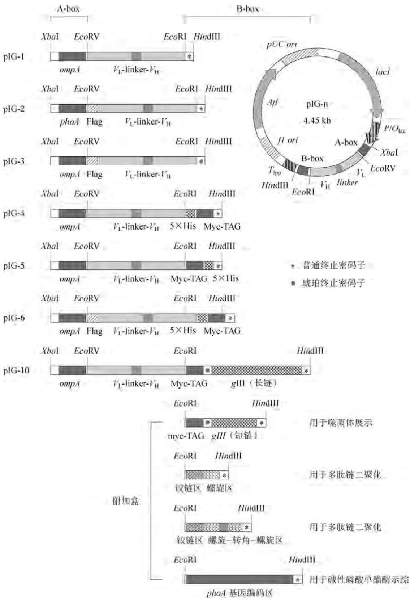

text_image

A-box
B-box
pIG-1
XbaI EcoRV EcoRI HindIII
ompA VL-linker-VH
pIG-2
XbaI EcoRV EcoRI HindIII
phoA Flag VL-linker-VH
pIG-3
XbaI EcoRV EcoRI HindIII
ompA Flag VL-linker-VH
pIG-4
XbaI EcoRV EcoRI HindIII
ompA VL-linker-VH 5×His Myc-TAG
pIG-5
XbaI EcoRV EcoRI HindIII
ompA VL-linker-VH Myc-TAG 5×His
pIG-6
XbaI EcoRV EcoRI HindIII
ompA Flag VL-linker-VH 5×His Myc-TAG
pIG-10
XbaI EcoRV EcoRI HindIII
ompA VL-linker-VH Myc-TAG gIII（长链）
附加盒
myc-TAG gIII（短链）
EcoRI HindIII
铰链区螺旋区
EcoRI HindIII
铰链区螺旋-转角-螺旋区
EcoRI HindIII
phoA基因编码区
用于噬菌体展示
用于多肽链二聚化
用于多肽链二聚化
用于碱性磷酸单酯酶示踪

图3-25 pIG系列载体的结构

---

148

基因工程

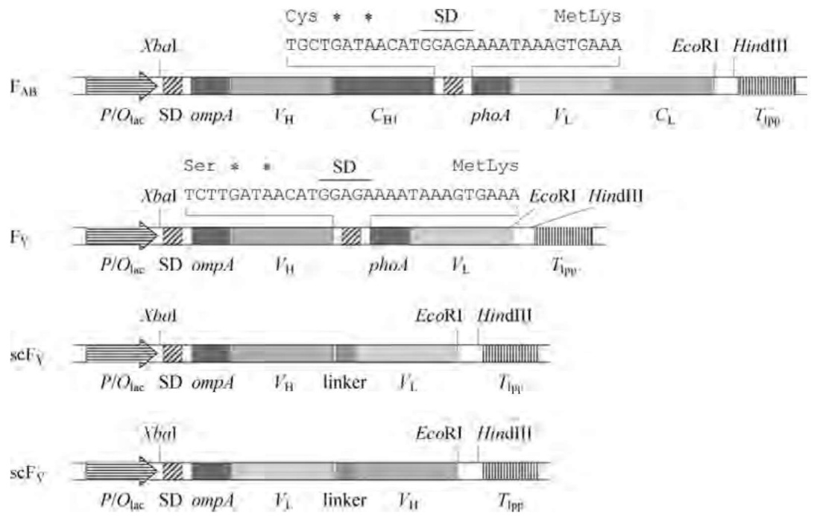

text_image

Cys * * SD MetLys
TGCTGATAACATGGAGAAAATAAAGTGAAA EcoRI HindIII
FAB
XbaI
P/O lac SD ompA VH CHH phoA VL CL Tpp
Ser * * SD MetLys
XbaI TCTTGATAACATGGAGAAAATAAAGTGAAA EcoRI HindIII
FY
P/O lac SD ompA VH phoA VL Tpp
scFY
XbaI EcoRI HindIII
P/O lac SD ompA VH linker VL Tpp
scFY
XbaI EcoRI HindIII
P/O lac SD ompA VH linker VH Tpp

图3-26 抗体片段编码序列与pIG载体的重组

## (1) Flag 标签序列检测法

用于重组抗体片段分泌表达的 pIG 载体为表达产物的快速检测做了一些特殊设计，如 pIG2、pIG3、pIG6 中所含的 Flag 抗原决定簇就是专门用来检测表达产物的。原始的 Flag 肽段是强极性和可溶性的八肽序列 (DYKDDDDK)，能为一种商品化了的单克隆抗体特异性识别，而且这种作用严格依赖于  $Ca^{2+}$  的存在。将此序列与任何抗体片段融为一体，便可利用酶联免疫分析技术或免疫印迹技术快速灵敏检测。大肠杆菌的内源性蛋白不含此序列，因此不会产生交叉免疫反应。Flag 序列 C 末端的四个氨基酸 (DDDK) 是为引入肠激酶切割位点而设计的，如果重组抗体片段用于体内治疗，Flag 序列在纯化后可从表达产物分子上用该酶完整卸下，以免引起免疫原性反应；然而对于体外检测和疾病诊断而言，这个酶切位点并没有存在的必要。事实上，装在 pIG 载体中的 HAG 序列为 DYKDE，最后一个谷氨酸残基的引入可使抗 Flag 单克隆抗体的识别敏感性提高 10 倍。

Flag标签序列可以装在抗体片段编码区两端的任一处，但装在N端具有几个优点:第一，Flag只有装在N端才能保证在肠激酶处理后获得纯净的抗体片段；第二，抗Flag抗体与该序列的结合程度严格依赖于第一位氨基酸残基的 $\alpha$ -氨基游离性。如果将Flag序列插在信号肽与抗体之间，则当表达产物分泌时信号肽被切除，Flag序列第一位氨基酸残基的 $\alpha-$ 氨基便呈游离状态，此时抗Flag抗体识别Flag序列的能力比位于表达产物的C末端要高$3\sim 4$ 个数量级；第三，Flag序列位于N端能在一定程度上抗大肠杆菌内源性氨基端蛋白水解酶的降解，而且Flag序列的存在并不影响抗体片段对特异性抗原的识别结合能力；第四，大多数重组抗体片段在使用前需要进行体外加工或连接一些生色酶及毒素蛋白等，这些操作均位于抗体片段的C末端，将Flag序列装在N端便不会干扰后加工程序。

## (2) Myc-TAG 标签序列检测法

Myc-TAG 序列来源于癌蛋白 Myc C 末端的十肽结构 (EQKLISEEDL)，将之装在抗体片段编码序列的下游，则融合表达产物可用商品化的抗 Myc 抗体-过氧化酶复合物进行定性定量分析。该序列的存在一般不会导致抗体片段对特异性抗原亲和力的显著下降，而

---

第 3 章 大肠杆菌基因工程

149

且它本身是人体蛋白序列,因此使用前无须切除。

## (3) 靶蛋白检测法

由于大多数抗体片段需与其他生色酶或细菌毒素等靶蛋白融合后才能使用，因此直接表达这种融合蛋白并利用靶蛋白序列或功能特征进行检测是一种更为简捷的方法。然而这种方法只适用于 $\mathrm{scF_V}$ 抗体片段，对于 $\mathrm{F_{AB}}$ 和 $\mathrm{F_V}$ 双链片段而言，靶蛋白与轻链或重链融合往往会严重干扰两条多肽链的折叠。

## 3.6.4 重组抗体及其片段表达产物的分离纯化

重组抗体及其片段的分离纯化相对其他重组蛋白来说较为简单,理想的纯化方法可从重组大肠杆菌蛋白粗提液中一步获得足够纯度的抗体产物,因此纯化方法的合理选择尤为重要。重组抗体及其片段的纯化大体上可选用下列几种方法:

（1）细菌亲和层析法。有些细菌能合成特异性识别并结合高等哺乳动物免疫球蛋白的蛋白质，如蛋白A、B、G和L，其结合位点主要位于抗体分子的恒定区，只有极少数存在于可变区内，因此这种方法较适用于分离重组抗体完整分子以及单价和双价 $F_{AB}$ 片段，但对 $F_{V}$ 或 $scF_{V}$ 片段的分离无效。
（2）抗体亲和层析法。以融合蛋白形式表达的抗体片段常可根据靶蛋白的特性选择合适的抗体亲和层析柱进行分离。目前常用的靶蛋白如碱性磷酸单酯酶、过氧化物酶以及一些毒素蛋白等均有相应的商品化抗体亲和层析介质，但是如果大肠杆菌本身也能合成这种靶蛋白或靶蛋白的同源蛋白，则这种方法的特异性就会受到影响。为了克服这一困难，pIG载体中的Flag和Myc-TAG标签序列也可作为抗Flag抗体和抗Myc-TAG抗体的靶序列，含有这些序列的融合蛋白可经相应的抗体亲和层析柱进行分离。但是上述抗体价格昂贵，一般只用于实验室规模。
（3）抗原亲和层析法。如果与重组抗体或抗体片段相对应的特异性抗原容易获得，那么利用这种抗原亲和层析柱分离表达产物是最佳选择，因为它不仅具有很高的选择性，而且还能从任何非正确折叠的蛋白混合物中快速分离目标抗体或抗体片段。在半抗原亲和层析过程中，分离产物通常需要用可溶性半抗原在非常温和的条件下进行洗脱。然而对于一些具有危害性的抗原(如肿瘤抗原等)，一般不宜采取这种方法分离用于体内的抗体片段。
（4）配体亲和层柱法。早期用于分离完整抗体分子的磷酸胆碱亲和层析柱也可直接用来从大肠杆菌蛋白粗提液中纯化重组 $F_{AB}$ 、 $F_{V}$ 、 $scF_{V}$ 片段以及各种二价迷你抗体，其前提条件是所有的重组抗体片段必须具有良好的折叠结构。此外，在一些pIG载体上安装的His-tag标签序列是专门为表达产物的配体亲和层析纯化工艺而设计的。多肽链中的组氨酸残基能与多种二价重金属离子配合，一级序列中组氨酸残基分布集中的蛋白质理论上均可用二价重金属离子亲和层析柱进行分离，其最佳分离效果在很大程度上取决于金属离子与洗脱剂的搭配，例如 $Zn^{2+}$ 柱常用二乙酸亚胺溶液洗脱，而 $Ni^{2+}$ 柱则需用咪唑或三乙酸腈溶液洗脱。由于重金属离子亲和层析介质价格低廉，因此这种方法更适用于重组抗体片段的大规模生产。
