# 第4章 原核细菌基因工程

原始 PDF 第 151–253 页。

## 第 4 章 原核细菌基因工程

随着原核生物分子遗传学研究的不断深入，大肠杆菌以外的其他原核细菌也被广泛地用作DNA重组和基因表达的受体细胞，其中一部分细菌还弥补了大肠杆菌在外源基因表达过程中暴露出来的缺陷。例如，芽孢杆菌的分泌系统为真核生物基因的功能表达提供了良好条件。此外，一些小分子生化物质代谢途径的基因工程日益受到人们的重视，利用DNA重组技术改良氨基酸、抗生素、有机酸醇的生产菌具有重要的经济价值，而在此过程中，棒状杆菌、链霉菌和梭菌则分别是重要的受体系统。

## 4.1 芽孢杆菌基因工程

芽孢杆菌(Bacillus)是革兰氏阳性菌的一个属，该属的几个种如枯草芽孢杆菌(Bacillus subtilis)、短小芽孢杆菌(Bacillus brevis)、巨大芽孢杆菌(Bacillus megaterium)等已被开发成为具有广泛应用前景的表达系统，其原因是:①它们能将蛋白表达产物高效分泌到培养基中，而且在多数情况下，真核生物的异源重组蛋白经芽孢杆菌分泌后便具有天然构象和生物活性；②许多芽孢杆菌在传统发酵工业中的应用已有几十年的历史，它们无致病性，不产生内毒素，属于安全的基因工程受体(GRAS)；③芽孢杆菌属的分子遗传学背景较为清楚，生长迅速，培养条件简单。枯草芽孢杆菌、地衣芽孢杆菌(Bacillus licheniformis)、解淀粉芽孢杆菌(Bacillus amyloliquefaciens)的全基因组已被先后测序，大部分基因的功能也得以鉴定。许多芽孢杆菌自身的特殊功能蛋白和酶类已借助于基因工程技术得以开发并形成规模化生产能力，其中包括解淀粉芽孢杆菌中的淀粉酶、嗜热脂肪芽孢杆菌(Bacillus stereothermophilus)中的高温脂肪酶、苏云金芽孢杆菌(Bacillus thuringiensis)中的昆虫专一性毒素蛋白以及其他芽孢杆菌来源的各种蛋白酶、葡聚糖酶、木聚糖酶、青霉素酰化酶等。此外，能高效分泌表达人干扰素和白细胞介素等药物的芽孢杆菌工程菌也已构建成功。总之，芽孢杆菌有望成为与大肠杆菌并驾齐驱的原核生物基因工程操作平台。

## 4.1.1 芽孢杆菌的载体克隆系统

目前广泛用于芽孢杆菌基因克隆和表达的载体可分为自主复制型质粒、整合型质粒、噬菌体载体三大类。

## 1. 芽孢杆菌的自主复制型质粒

用于芽孢杆菌的自主复制型质粒包含野生型质粒和人工构建的质粒(表4-1)。野生型质粒中具有实用价值的大都来自金黄色葡萄球菌(Staphylococcus aureus)和短小芽孢杆菌(如pWT481)。最早从金黄色葡萄球菌中分离鉴定的四种野生型质粒能在芽孢杆菌(至少枯草芽孢杆菌)中交叉复制，且它们的复制子结构和选择性标记基因各不相同。其中，pUB110在枯草芽孢杆菌中的复制启动过程是在细胞膜上进行的，受体细胞中的基因(dnaBI)产物为质粒的复制启动和膜结合活性所必需，每个细胞拥有30～50个拷贝。pUB110的基因组织和物理图谱如图4-1所示，其中BA为膜结合位点，复制子结构序列位于BA2区域，整个质粒具有五个开放阅读框架，分别编码卡那霉素/新霉素抗性和 $\alpha$ 、 $\beta$ 、 $\gamma$ 、 $\delta$ 蛋白，后三种蛋白与质粒的复制无关，而蛋白 $\alpha$ 则具有与细胞膜和质粒复制子特异性结合的能力。pC194编码氯霉素抗性，在每个细胞中能维持15个拷贝；pE194赋予受体细胞大环

---

第 4 章 原核细菌基因工程

151

内酯-林可酰胺-链阳霉素B(MLS)类抗生素的抗性，其拷贝数大约为10，且呈温度敏感性复制，在枯草芽孢杆菌中 $45^{\circ}\mathrm{C}$ 以上便不复制；pT181类似于很多其他的四环素抗性质粒，拷贝数大约20个。上述野生型质粒均呈滚环模式复制，拷贝数较高，因而可直接作为基因克隆的载体，但更重要的是以其复制子和选择性标记基因为蓝本构建性能多样化的穿梭载体、表达载体和分泌载体。芽孢杆菌自身所含的野生型质粒大都属于隐蔽型质粒（无选择性标记或表型），因而开发应用受到限制。

含金黄色葡萄球菌野生型复制子的载体质粒在枯草芽孢杆菌中虽然拷贝数较高,但不稳定。一般来说,高拷贝质粒分配不稳定


<details>
<summary>flowchart</summary>


</details>

图4-1 金黄色葡萄球菌野生型质粒pUB110图谱

性的一个重要原因是它们倾向于形成多聚体(尤其是滚环式复制的质粒)。控制质粒拷贝数的机制能确保每条染色体平均拥有相同的复制起始位点,因此多聚体形式的质粒在拥有相同数目复制起始位点的前提下,分子数自然会少,随着细胞分裂循环次数的增加,质粒在各细胞中的差异性会逐步扩大。高拷贝质粒的结构不稳定性往往由错误的复制终止以及异常的缺刻封闭事件(由质粒编码的复制蛋白介导)所致。质粒结构缺失形成的另一重要来源是由滚环式复制过程中出现的单链DNA中间产物内短小正向重复序列之间的重组,此时9 bp(甚至更短)的正向重复序列足以形成缺失重组。有时,虽然载体本身是稳定的,但克隆的DNA片段有可能引入正向重复序列,即一个重复序列位于载体上,另一个则来自插入片段,同样会引发单链重组。相反,以θ模式复制的低拷贝质粒往往较为稳定,如来自粪肠球菌(Enterococcus faecalis)的广宿主质粒pAMβ1、枯草芽孢杆菌的野生型质粒pLS20、pBS72以及嗜热脂肪芽孢杆菌的pTB19,其拷贝数均只有寥寥数个,但即使在无选择压力下也很少会丢失。为了便于制备纯化,这些野生型质粒均被开发成穿梭载体(表4-1)。

表 4-1 用于芽孢杆菌基因克隆和表达的自主复制型质粒

| 质粒名称 | 来源/ori | 选择标记 | 大小/kb | 载体类型 | 开发年份 |
| --- | --- | --- | --- | --- | --- |
| pUB110 | S. aureus | $Km^r$ | 4.55 | 野生型质粒 | 1974 |
| pC194 | S. aureus | $Cm^r$ | 2.91 | 野生型质粒 | 1978 |
| pE194 | S. aureus | $Em^r$ | 3.73 | 野生型质粒 | 1976 |
| pT181 | S. aureus | $Tc^r$ | 4.50 | 野生型质粒 | 1976 |
| pAMβ1 | E. faecalis | $Em^r$ | 26.50 | 野生型质粒 | 1974 |
| pTA1015 | B. subtilis | — | 5.80 | 野生型质粒 | 1998 |
| pTA1060 | B. subtilis | — | 8.60 | 野生型质粒 | 1980 |
| pBS72 | B. subtilis | — | 90 | 野生型质粒 | 2003 |
| pLS20 | B. subtilis | — | 5.30 | 野生型质粒 | 1977 |
| pLS32 | B. subtilis | — | 70 | 野生型质粒 | 1998 |
| pTB19 | B.stearothermophilus | $Tc^r Km^r$ | 26 | 野生型质粒 | 1981 |
| pWT481 | B. brevis | — | 2.50 | 野生型质粒 | 1985 |
| pHY481 | $ori_{pWT481}$ | $Em^r$ | 3.70 | 克隆质粒 | 1985 |
| pHY500 | $ori_{pWT481}$ | $Em^r$ | 5.20 | 分泌质粒 $P_{cwp}$ | 1989 |
| pNU210 | $ori_{pUB110}$ | $Em^r$ | 4.40 | 分泌质粒 $P_{cwp}$ | 1989 |
| pEB10 | $ori_{pUB110} ori_{pBR322}$ | $Km^r Ap^r$ | 8.90 | 克隆质粒 | 1988 |

---

152

基因工程

续表

| 质粒名称 | 来源/ori | 选择标记 | 大小/kb | 载体类型 | 开发年份 |
| --- | --- | --- | --- | --- | --- |
| pE18 | $ori_{pE194cop6} ori_{pUC18}$ | $Em^{r}Ap^{r}$ | 3.80 | 克隆质粒 | 1998 |
| pHV14 | $ori_{pC194} ori_{pBR322}$ | $Cm^{r}Ap^{r}$ | 4.60 | 克隆质粒 | 1978 |
| pLB5 | $ori_{pUB110} ori_{pBR322}$ | $Cm^{r}Km^{r}Ap^{r}$ | 5.80 | 克隆质粒 | 1985 |
| pUB18 | $ori_{pUB110} ori_{pUC18}$ | $Km^{r}Ap^{r}$ | 3.60 | 克隆质粒 | 1988 |
| pUB19 | $ori_{pUB110} ori_{pUC18}$ | $Km^{r}Ap^{r}$ | 3.30 | 克隆质粒 | 1999 |
| pHPS9 | $ori_{pTA1060} ori_{pBR322}$ | $Cm^{r}Em^{r}$ | 5.60 | 克隆质粒 | 1990 |
| pHP13 | $ori_{pTA1060} ori_{pBR322}$ | $Cm^{r}Em^{r}$ | 4.90 | 克隆质粒 | 1987 |
| pHV1431/2 | $ori_{pAMβ1} ori_{pBR322}$ | $Em^{r}Ap^{r}$ |  | 克隆质粒 | 1990 |
| pHV1436 | $ori_{pTB19} ori_{pBR322}$ | $Tc^{r}Km^{r}Ap^{r}$ |  | 克隆质粒 | 1990 |
| pTRKH2 | $ori_{pAMβ1} ori_{p15A}$ | $Em^{r}Ap^{r}$ |  | 克隆质粒 | 1993 |
| pMTLBS72 | $ori_{pBS72} ori_{pBR322}$ | $Cm^{r}Ap^{r}$ | 5.80 | 克隆质粒 | 2003 |
| pHCMC02 | $ori_{pBS72} ori_{pBR322}$ | $Cm^{r}Ap^{r}$ | 6.87 | 表达质粒 $P_{\text{lepA}}$ | 2005 |
| pHCMC03 | $ori_{pBS72} ori_{pBR322}$ | $Cm^{r}Ap^{r}$ | 6.96 | 表达质粒 $P_{\text{gsiB}}$ | 2005 |
| pHCMC04 | $ori_{pBS72} ori_{pBR322}$ | $Cm^{r}Ap^{r}$ | 8.09 | 表达质粒 $P_{\text{xylA}}$ | 2005 |
| pHCMC05 | $ori_{pBS72} ori_{pBR322}$ | $Cm^{r}Ap^{r}$ | 8.32 | 表达质粒 $P_{\text{spac}}$ | 2005 |
| pHT01 | $ori_{pBS72} ori_{pBR322}$ | $Cm^{r}Ap^{r}$ | 7.96 | 表达质粒 $P_{\text{grac}}$ | 2007 |
| pHT43 | $ori_{pBS72} ori_{pBR322}$ | $Cm^{r}Ap^{r}$ | 8.17 | 分泌质粒 $P_{\text{groE}}$ | 2007 |
| pBSMuL1 | $ori_{pUB110} ori_{pBR322}$ | $Km^{r}Ap^{r}$ | 7.49 | 分泌质粒 $P_{\text{HapII}}$ | 2006 |
| pBSMuL2 | $ori_{pUB110} ori_{pBR322}$ | $Km^{r}Ap^{r}$ | 7.56 | $P_{\text{HapII}}P_{59}$ | 2006 |
| pLIKE - rep | $ori_{pTA1030} ori_{pBR322}$ | $Em^{r}Ap^{r}$ | 6.67 | 表达质粒 $P_{\text{liaI}}$ | 2012 |

注: $Ap^{r}$ 一氨苄青霉素抗性基因； $Cm^r$ 一氯霉素抗性基因； $Em^{r}$ 一红霉素抗性基因； $Km^{r}$ 一卡那霉素抗性基因； $Tc^{r}$ 一匹环素抗性基因。

## 2. 芽孢杆菌的整合型质粒

避免重组质粒在芽孢杆菌中遗传不稳定的另一种策略是使用能异位插入受体细胞染色体DNA上的整合型载体，它们通常随染色体DNA的复制而复制，拷贝数与受体细菌染色体相同。因此在大多数情形中，整合型载体通常基于大肠杆菌的复制子（如pBR322或其衍生质粒，不能为芽孢杆菌的DNA复制机器所识别)而构建，同时含有合适的选择性标记基因以及与芽孢杆菌染色体同源的DNA序列。然而，如果芽孢杆菌染色体上事先或事后整合了一个能复制的质粒(如pE194)，那么没有复制能力的整合型质粒同样会增加拷贝数。芽孢杆菌整合型质粒最常见的整合位点是编码 $\alpha$ -淀粉酶的基因位点amyE。广泛使用的重要整合型载体列在表4-2中。

表 4-2 用于芽孢杆菌基因克隆和表达的几种整合型载体

| 载体名称 | 同源序列 | 基因功能 | 构建年份 |
| --- | --- | --- | --- |
| pDH32 | amyE | α-淀粉酶编码基因 | 1986 |
| pDG271 | amyE | α-淀粉酶编码基因 | 1990 |
| pDL,pDK | amyE | α-淀粉酶编码基因 | 1995 |
| pMLK83 | amyE | α-淀粉酶编码基因 | 1995 |
| pDG1661,pDG1661,pDG1728 | amyE | α-淀粉酶编码基因 | 1996 |
| pDG1663,pDG1664,pDG1729,pDG1731 | trpC | 色氨酸生物合成基因 | 1996 |
| pAX01,pA-spac | lacA | β-半乳糖苷酶 | 2001 |
| pPyr-Cm,pPyr-Kan | pyrD | 嘧啶生物合成基因 | 2004 |
| pGlt-Cm,pGlt-Kan | gltA | 谷氨酸生物合成基因 | 2004 |
| pSac-Cm,pSac-Kan | sacA | 蔗糖6-果糖基转移酶编码基因 | 2004 |

---

第 4 章 原核细菌基因工程

153

## 3. 芽孢杆菌的噬菌体载体

除了上述质粒载体外，以枯草芽孢杆菌两种温和型噬菌体 $\phi 105$ 和SPβ的基因组DNA为蓝本的一系列克隆表达载体也具有很高的实用性。$\phi 105$ 与大肠杆菌的λ噬菌体很相似，其基因组为 $39.2\mathrm{kb}$ 的线状双链DNA，两端各有一段单链黏性末端（$5^{\prime} - \mathrm{GCGCTCC} - 3^{\prime}$），但SPβ的基因组则大得多(120 kb)。在 $\phi 105 - \mathrm{DNA}$ 中缺失 $4\mathrm{kb}$ 的非必需区，并在不同位点引入多个限制性酶识别位点，即可构建出J系列的克隆载体(图4-2)。其中，$\phi 105\mathrm{J}27$ 载体含有突变的tsi位点，该位点能使 $\phi 105\mathrm{J}27$ 在温度诱导的条件下由溶原状态转换至溶菌状态，便于噬菌体DNA的制备及重组子的筛选。此外，以 $\phi 105\mathrm{MU}209$ 和 $\phi 105\mathrm{MU}331$ 为代表


图4-2 枯草芽孢杆菌设计菌体 $\phi 105$ 系列载体图谱

---

154

基因工程

的表达型 $\phi 105 - \mathrm{MU}$ 系列载体则含有来自大肠杆菌的氯霉素抗性基因以及噬菌体自身的启动子 $(P_{\mathrm{ro}})$，它为外源基因的表达提供了合适的翻译起始元件，同时还能防止宿主细胞的裂解。

采用 $\phi 105$ 载体克隆外源DNA片段有两种策略:直接感染法和原噬菌体转化法。在前者中，将待克隆的DNA片段直接与 $\phi 105$ 载体连接后，经体外包装转染枯草芽孢杆菌细胞；原噬菌体转化法发挥枯草芽孢杆菌能有效转化线形DNA片段的优势，外源DNA片段与载体DNA连接后，直接转化进事先含有 $\phi 105$ 原噬菌体的宿主细胞中，然后两者发生同源重组。

理论上，基于原噬菌体的表达系统相对质粒表达系统具有如下优势:第一，原噬菌体无须人为设置选择压力便能提供重组分子的稳定性，因为噬菌体DNA是以单拷贝的方式与宿主染色体DNA共价连为一体的；第二，溶原状态也意味着噬菌体转录的强烈阻遏，所以在宿主生长期间，潜在的毒性基因和非稳定性基因的表达可降低至最小程度；第三，一旦原噬菌体被诱导，强启动子被激活，噬菌体DNA的复制导致外源基因拷贝数的迅速增加；第四，借助关键基因的删除突变可以防止宿主细胞的裂解，有利于重组蛋白的分泌表达。

## 4.1.2 芽孢杆菌的宿主转化系统

枯草芽孢杆菌的很多株在某些生理条件下能天然吸收DNA片段，这种生理状态称为感受态。在对数生长结束前短暂时间内的细菌培养物中，最多有 $20\%$ 的细胞会呈感受态。感受态细胞能吸纳线形和环状DNA，但后者在吸收过程中也被线性化。双链DNA分子中只有一条链能有效进入细胞质，而另一条链则被核酸酶降解。进入细胞的ssDNA可通过RecA依赖性重组途径整合在细菌染色体中，但整合过程需要外源DNA与细菌染色体之间的序列同源性。从生长在Spizizzen最小培养基中的枯草芽孢杆菌细胞可方便地制备感受态细胞，含 $15\%$ 甘油的感受态细胞悬浮液可贮存于 $-80^{\circ}\mathrm{C}$ 达数月之久。然而，就鸟枪法克隆实验而言，这种感受态转化的效率远远不能满足要求。枯草芽孢杆菌感受态细胞转化率低的根本原因在于单聚体质粒DNA转化枯草芽孢杆菌几乎无活性，成功的感受态转化只有在供体质粒呈三聚体或更高聚体时才会出现。但常规基因克隆实验必须对载体质粒进行切接操作，此时多聚体结构已被释放且难以回复。而且，有些芽孢杆菌（如短小芽孢杆菌）也难以形成感受态，因此需要建立其他的转化程序。

## 1. 芽孢杆菌的原生质体转化法

用溶菌酶除去芽孢杆菌大部分的细胞壁可从营养细胞制备原生质体。对于像枯草芽孢杆菌这样的杆状细胞而言，原生质体的形成可用光学显微镜监视，因为原生质体呈球状。实验证明枯草芽孢杆菌的原生质体在聚乙二醇(PEG)的存在下能被质粒转化，且转化效率远高于感受态细胞转化，每微克超螺旋DNA可获得 $4\times 10^{7}$ 个转化子。其原因是在这种转化程序中，单聚体双链质粒因细胞壁的屏障解除而较易被吸纳。不过，原生质体的制备尤其是转化后的细胞壁再生既耗时又低效，上述转化率会大打折扣。

## 2. 芽孢杆菌的碱金属离子诱导转化法

碱金属离子诱导转化枯草芽孢杆菌的标准程序如下:收集处于对数生长中期的菌体，先用 $4.1\mathrm{mol} / \mathrm{L}$ 的KCl溶液在 $30^{\circ}\mathrm{C}$ 处理，然后加入质粒，$30^{\circ}\mathrm{C}$ 静止 $30\mathrm{min}$，等体积加入 $70\%$ 的PEG6000溶液，缓慢混合，$30^{\circ}\mathrm{C}$ 保温 $10\mathrm{min}$，再置于 $42^{\circ}\mathrm{C}$ 水浴 $5\mathrm{min}, 30^{\circ}\mathrm{C}$ 冷却。上述PEG悬浮液经稀释后离心收获细菌，用新鲜培养基悬浮，并在 $37^{\circ}\mathrm{C}$ 振荡培养 $2\mathrm{h}$，扩增后的细菌培养液即可涂板进行筛选。对于pC194和pUB110而言，采用这种方法的转化率约为$10^{3} \sim 10^{4}$ 个/ $\mu \mathrm{g}$ DNA。在所有的稀土金属离子中，只有达到饱和浓度的 $\mathrm{K}^{+}$ 和 $\mathrm{Cs}^{+}$ 有效，其转化率在质量为 $1 \sim 10~\mu \mathrm{g}$ 时与DNA量成正比，受体细胞在浓度为 $5 \times 10^{7}$ 个/mL时转化率最高，低于或高于这个密度转化率会下降10倍左右。这种方法的最大特点是线性质粒分子

---

第 4 章 原核细菌基因工程

155

转化率虽然较环状分子低,但明显高于用线状质粒转化感受态细胞(表4-3)。对于染色体DNA片段而言,情况正好相反,也就是说,稀土金属离子转化法能特异性地转化质粒DNA。

表 4-3 不同结构的 DNA 对芽孢杆菌转化效率的影响

<table><tr><td>DNA</td><td>碱金属转化</td><td>感受态转化</td><td>选择性标记</td></tr><tr><td>多聚体 pC194</td><td> $5.8 \times 10^4$ </td><td> $6.4 \times 10^3$ </td><td> $Cm^r$ </td></tr><tr><td>单体 pC194</td><td> $8.6 \times 10^4$ </td><td> $<1.0 \times 10^2$ </td><td> $Cm^r$ </td></tr><tr><td>线形 pC194</td><td> $1.2 \times 10^4$ </td><td> $<1.0 \times 10^2$ </td><td> $Cm^r$ </td></tr><tr><td rowspan="2">B. subtilis MI115 染色体 DNA</td><td> $<1.0 \times 10^2$  1</td><td> $1.0 \times 10^4$  1</td><td> $Trp^+$ </td></tr><tr><td> $<1.0 \times 10^2$  2</td><td> $7.4 \times 10^4$  2</td><td> $Arg^+$ </td></tr><tr><td>B. subtilis 168 染色体 DNA</td><td> $<1.0 \times 10^2$  3</td><td> $8.5 \times 10^4$  3</td><td> $Arg^+$ </td></tr></table>

注:将氨基酸加入基本培养基( $\mu g/mL$ )。

① Arg + Leu; ② Trp + Leu; ③ Trp。

## 3. 芽孢杆菌的电击转化法

电击转化法(也称电穿孔转化)是一种简便且广泛用于各细菌物种(也包括真核细胞)的转化程序,该技术采用电脉冲处理细胞,导致细胞壁微裂以及细胞膜渗透壁垒的暂时性崩溃,进而促进DNA的转入,通常革兰氏阳性菌的转化效率低于革兰氏阴性菌。对于枯草芽孢杆菌和短小芽孢杆菌而言,这种方法的转化率大多为 $10^{4}\sim10^{6}/\mu g$  DNA,与原生质体转化法大致相同,但比稀土金属离子转化法的效率要高100倍以上。当大小范围在2.9\~12.6 kb的质粒DNA电击转化进入枯草芽孢杆菌菌株中,转化率随着DNA尺寸的增加而递减。但即使12.6 kb大小的质粒,转化率也能达到 $2.0\times10^{3}$ 个/ $\mu g$  DNA。然而,电穿孔法的操作条件对转化率影响很大,因此最佳条件的建立非常重要。

影响电穿孔转化率的几个主要因素包括 PEG 浓度、电场强度、渗透剂（甘露醇、山梨醇、蔗糖、甘油）浓度（一般取等渗浓度）、细菌密度以及质粒浓度等，但这些条件的最优化因菌种和所使用的质粒性质而异。对于 pC194 转化枯草芽孢杆菌 NB22 株来说，最佳的电穿孔转化程序如下:收集处于对数生长中期的菌体，用  $4^{\circ}$ C 预冷的 1 mmol/L HEPES(N-2-羟甲基哌嗪-N'-乙烷磺酸)无菌缓冲液（pH 7.0）洗涤两次，然后再用冰冷的转化溶液（25% PEG6000 和 0.1 mol/L 甘露醇）洗涤一次，以相同溶液将菌体悬浮并定容至细胞密度为  $10^{10} \sim 10^{11}$  个/mL， $4^{\circ}$ C 保温 10 min。在 40  $\mu$ L 这种细胞悬浮液中加入小于 5  $\mu$ L 的质粒溶液，取 20  $\mu$ L 的混合液于电穿孔仪的样品池中，然后施加单一电脉冲（2.5 kV 电压，2  $\mu$ F 电容，4 kΩ 电阻）。脉冲结束后 2～3 min 内，取 10  $\mu$ L 处理液与 0.5 mL 新鲜培养基混合，于 37℃ 培养 3 h，培养液即可用于涂板筛选。

## 4. 芽孢杆菌的接合转化法

用于将重组质粒从大肠杆菌向各种革兰氏阳性菌包括枯草芽孢杆菌中接合转移，需要使用专门的载体。原型载体pAT187由pBR322和 $\mathrm{pAM}\beta 1$ 的复制起始位点、已知能在大肠杆菌和枯草芽孢杆菌中表达的卡那霉素抗性基因、IncP质粒RK2转移的起始位点构成。pAT187可通过滤膜交配的方式从染色体上整合了RK2的大肠杆菌SM10株成功转移至枯草芽孢杆菌细胞中，其接合频率大约为 $3\times 10^{-7}$ 。另一个可转移载体pTCV-lac携带pACYC184的复制起始位点以及一个无启动子的lacZ基因，可以用来筛选克隆启动子元件或进行转录分析。

## 4.1.3 芽孢杆菌的基因表达系统

## 1. 用于基因转录的芽孢杆菌启动子

芽孢杆菌含有比大肠杆菌更多的  $\sigma$  因子，它们分别识别不同的启动子序列。在枯草芽孢杆菌中，已经鉴定的  $\sigma$  因子约有 10 种，其中  $\sigma^{43}(\sigma^{\mathrm{A}})$  与大肠杆菌中的  $\sigma^{70}$  同源，并且两种  $\sigma$

---

156

基因工程

因子对两种细菌的启动子具有交叉可识别性，枯草芽孢杆菌被 $\sigma^{\mathrm{A}}$ 识别的启动子也具有相似的-35区和-10区特征序列。许多大肠杆菌及其杆状噬菌体来源的启动子在枯草芽孢杆菌中的转录启动效率甚至比枯草芽孢杆菌的自身启动子还要高。然而，枯草芽孢杆菌众多 $\sigma$ 因子的表达与菌体生长周期及生理条件密切相关。例如，$\sigma^{\mathrm{A}}$ 只在细菌进入对数生长期时才合成，由其装配而成的RNA聚合酶只能作用于对数生长期中表达的基因启动子。因此，外源型大肠杆菌启动子（即为 $\sigma^{70}$ 所特异性识别的启动子）能在枯草芽孢杆菌中发挥功能，但其最佳表达受到枯草芽孢杆菌生长周期的严格限制。

与大肠杆菌相似，芽孢杆菌的表达质粒也应具有外源基因表达的可控制性。根据诱导机制和条件的不同，芽孢杆菌用于介导外源基因转录的启动子可分为诱导剂特异型启动子、生长期特异型启动子、自诱导特异型启动子(压力诱导型)三大类(表4-4)，分述如下:

表 4-4 用于芽孢杆菌基因表达的主要启动子

<table><tr><td>启动子类型</td><td>启动子名称</td><td>所属基因</td><td>调控区性质</td><td>诱导条件</td></tr><tr><td rowspan="8">诱导剂特异型启动子</td><td> $P_{spac}$ </td><td>噬菌体 SPO-1 基因</td><td>大肠杆菌  $O_{lac}$ </td><td>IPTG</td></tr><tr><td> $P_{grac}$ </td><td>热休克操纵子 groESL</td><td>大肠杆菌  $O_{lac}, gsiB-SD$ </td><td>IPTG</td></tr><tr><td rowspan="2"> $P_{xylA}$ </td><td rowspan="2">木糖异构酶基因</td><td>大肠杆菌  $O_{tet}$ </td><td>四环素</td></tr><tr><td>芽孢杆菌  $O_{xylA}$ </td><td>木糖</td></tr><tr><td> $P_{citM}$ </td><td>柠檬酸转运子基因</td><td>芽孢杆菌 cre 元件</td><td>柠檬酸</td></tr><tr><td> $P_{sacB}$ </td><td>蔗糖 6-果糖基转移酶基因</td><td>芽孢杆菌 sacB 前导序列</td><td>蔗糖</td></tr><tr><td> $P_{gcv}$ </td><td>甘氨酸降解基因</td><td>芽孢杆菌 gcv 核糖开关</td><td>甘氨酸</td></tr><tr><td> $P_{liaI}$ </td><td>细胞包膜压力响应基因</td><td>LiaR/LiaS 双组分系统</td><td>杆菌肽</td></tr><tr><td rowspan="4">生长期特异型启动子</td><td> $P_{rpsF}$ </td><td>核糖体蛋白 S6 基因</td><td>受控于  $\sigma^{A}$  因子</td><td>对数生长全程</td></tr><tr><td> $P_{aprE}$ </td><td>枯草杆菌蛋白酶基因</td><td>受控于  $\sigma^{A}$  因子</td><td>对数生长晚期</td></tr><tr><td> $P_{spaS}$ </td><td>枯草菌素靶基因 SURE</td><td>芽孢杆菌 spa 元件</td><td>对数生长晚期</td></tr><tr><td> $P_{cwp}$ </td><td>短小芽孢杆菌胞壁蛋白基因</td><td></td><td>静止期</td></tr><tr><td rowspan="5">自诱导特异型启动子</td><td> $P_{pst}$ </td><td>磷酸传递响应基因</td><td>PhoP/PhoR 双组分系统</td><td>磷酸饥饿</td></tr><tr><td> $P_{phoD}$ </td><td>磷酸传递响应基因</td><td>PhoP/PhoR 双组分系统</td><td>磷酸饥饿</td></tr><tr><td> $P_{gsiB}$ </td><td>基本压力蛋白基因</td><td>受控于  $\sigma^{B}$  因子</td><td>热休克/乙醇</td></tr><tr><td> $P_{lysC}$ </td><td>天冬氨酸激酶 II α 亚基基因</td><td>芽孢杆菌 lysC 核糖开关</td><td>赖氨酸饥饿</td></tr><tr><td> $P_{des}$ </td><td>脂肪酸去饱和酶基因</td><td>DesK/DesR 双组分系统</td><td>25°C 低温</td></tr></table>

## (1) 诱导剂特异型启动子

诱导剂特异型启动子种类繁多，应用范围也最广。枯草芽孢杆菌的第一个诱导型启动子系统是安装在pHCMC05等表达载体上的 $P_{\mathrm{spac}}$ ，由枯草芽孢杆菌噬菌体SPO-1的一个启动子与大肠杆菌的lac操作子杂合而成，与之配套的受体细胞必须重组表达大肠杆菌来源的阻遏蛋白LacI。这一阻遏蛋白编码基因lacI或事先整合在受体细胞的染色体上，或克隆在表达载体上，例如一个质粒携带组成型表达的lacI基因(pREP4)；另一个相容性质粒安装强启动子 $P_{\mathrm{N25}}$ 与lac操作子的融合序列(p602/22)。上述需用IPTG为诱导剂的表达系统有下列缺点:① IPTG价格不菲且有毒性，不适合大规模发酵；② $P_{\mathrm{spac}}$ 启动子的强度不足以支持大规模重组蛋白的生产；③启动子的控制欠严密，即使不添加诱导剂重组蛋白也会少量渗漏表达。第一个缺点可通过引入大肠杆菌编码乳糖渗透酶的基因lacY以及编码 $\beta-$ 半乳糖苷酶的lacZ突变版本加以解决，后者可将乳糖转换成异乳糖，而异乳糖在枯草芽孢杆菌中难以进一步分解代谢，这样便可使用较为廉价且无毒的乳糖作为诱导剂。后两个有缺点的解决方案是选用改造过的 $P_{\mathrm{grac}}$ 启动子，它不但转录效率高，而且IPTG的诱导渗漏比高达1300。

第二个诱导型启动子系统基于木糖作为诱导剂。细菌参与木糖降解的基因处于 $xylR$

---

第 4 章 原核细菌基因工程

157

基因编码的 XylR 阻遏蛋白负调控之下, 因而芽孢杆菌木糖异构酶编码基因 xylA 所属的  $P/O_{xylA}$  系统(安装在 pHCMC04 等表达载体上)便能为木糖所诱导, 其诱导渗漏比值为 200。不过, 该系统对葡萄糖代谢物的阻遏效应呈敏感型, 即在葡萄糖存在时木糖的诱导效果欠佳。

第三个诱导型启动子系统采用柠檬酸作为诱导剂。枯草芽孢杆菌的citM基因编码$\mathrm{Mg}-$ 柠檬酸复合物的次级转运子，并处于CitST双组分信号转导系统的正调控以及阻遏蛋白CcpA与其结合元件cre的负调控之下。加入 $2\mathrm{mmol / L}$ 的柠檬酸可诱导含cre元件的启动子 $P_{\mathrm{citM}}$ 启动下游基因的转录。

第四个可诱导启动子系统由枯草芽孢杆菌编码胞外蔗糖6-果糖基转移酶(Lvs, 果聚糖酶)基因 sacB 所属的启动子  $P_{sacB}$  及其与下游 SD 序列之间的一个终止子结构组成，后者对  $P_{sacB}$  启动子介导的转录具有抑制作用，然而这种作用又可被抗终止蛋白 SacY 解除。sacY 基因的表达既为蔗糖所诱导又为 DegU/DesS 双组分信号转导系统所激活，由此构成以蔗糖为诱导剂的  $P_{sacB}$  启动子系统。如果再使 degQ 基因高效表达，则该系统效果更佳。

第五个可诱导启动子系统采用四环素作为诱导剂。将大肠杆菌Tn10转座子的tet操作子序列置于枯草芽孢杆菌的强启动子 $P_{\mathrm{xylA}}$ 的-35区与-10区之间，在TetR阻遏因子编码基因存在的条件下，这一系统可被诱导大约100倍，展示出较高的启动子强度。若在-10区的下游再安装一个tet操作子，则可杜绝基底水平的渗漏性表达。

第六个可诱导型启动子系统是基于甘氨酸核糖开关设计的。核糖开关是位于一些mRNA 5'端非翻译区(5'-UTR)内的调控元件，它们所形成的二级结构往往能为某些小分子代谢物（如维生素和氨基酸等）所识别并结合，同时二级结构发生两种状态的转换位点，由此控制相应代谢物生物合成或转运的基因表达。在细菌中，核糖开关或控制转录延伸或控制翻译起始，大约2%的枯草芽孢杆菌基因受核糖开关机制的调控。大多数的代谢物通过与其相对应的核糖开关相互作用而阻止基因的表达，但甘氨酸在高浓度条件下却导致由 $P_{gcv}$ 启动子介导的甘氨酸降解操纵子转录激活。基于上述发现构建了相应的可诱导表达系统，它能通过添加甘氨酸而被诱导。

## (2) 生长期特异型启动子

生长期特异型启动子主要有两种:一种是核糖体蛋白S6和S18编码基因rpsF和rpsR所属的启动子 $P_{rpsF}$ ，它在对数生长期被激活；另一种是枯草杆菌蛋白酶编码基因aprE所属的启动子 $P_{aprE}$ ，它在对数生长期终点被 $\sigma^{A}$ 高效激活。

枯草芽孢杆菌ATCC6633株产羊毛硫氨酸抗生素枯草菌素，后者触发群体感应控制。传感器激酶SpaK能感应枯草菌素并将信号转导至应答调控因子SpaR，磷酸化的SpaR再与几个基因上游启动子区域内的spa序列结合，进而触发启动子的转录激活。此外，枯草菌素又受静止期 $\sigma^{\mathrm{H}}$ 的控制。作为上述双组分信号转导调控机制的一种结果，枯草菌素在对数早期和中期的产生水平较低，但在对数生长晚期至静止期达到高峰。因此，受控于枯草菌素的基因表达(SURE)系统基于 $P_{\mathrm{spaS}}$ 启动子得以建立。

## (3) 自诱导特异型启动子

自诱导特异型启动子通常响应细胞内外环境中的各种压力而呈现开或关两种状态。第一个自诱导型启动子来自枯草芽孢杆菌参与磷酸传递并响应磷酸饥饿而被强烈诱导的 pst 操纵子。该操纵子由单个启动子  $P_{pst}$  介导转录，并受控于 PhoP/PhoR 双组分信号转导系统。一旦磷酸饥饿， $P_{pst}$  可激活转录 5000 倍以上。采用这一系统，植酸酶的表达水平可达 2.9 g/L，相当于细菌培养终点时胞外蛋白总量的 65%。相似地，枯草芽孢杆菌的 phoD 基因所属启动子在低磷培养基中培养 12 h 后可被诱导大约 2000 倍。

第二个自诱导型启动子是受  $\sigma^{B}$  调控的 gsiB 基因所属启动子  $P_{gsiB}$  。小型的亲水性 GsiB

---

158

基因工程

蛋白相对其他的 $\sigma^{\mathrm{B}}$ 依赖型基本压力蛋白以较高的速率合成并积累，此特性至少部分可归结为 $g\mathrm{si}B$ mRNA长达大约 $20\mathrm{min}$ 的半衰期，并且有证据显示，$P_{\mathrm{gsiB}}$ 能分别为热休克、乙醇、甚至胞内的缺氧环境所诱导。基于上述发现，构建了能为上述压力因素之一诱导的表达系统如pHCMC03。

第三个自诱导型启动子系统是基于赖氨酸核糖开关设计的。与甘氨酸核糖开关相反，赖氨酸核糖开关在细胞内赖氨酸充足时导致转录终止，而当赖氨酸水平跌至一定阈值以下时呈转录衰减效应，此时激活其下游编码天冬氨酸激酶Ⅱα亚基的lysC基因表达。基于这一发现构建了一种以 $P_{\mathrm{lysC}}$ 启动子为核心的表达系统，它能在生长着的细胞胞内赖氨酸浓度跌至一定阈值以下时而自诱导。

第四个自诱导型启动子系统的设计基于下列事实:在细菌中高水平表达重组蛋白的一个主要缺憾是很多重组蛋白难以形成其天然构象。限制过表达蛋白集聚的一种实验手段是降低细胞培养的温度。为了确保在较低温度下重组蛋白的高水平表达，可将目的基因置于一种冷休克型启动子的控制之下。在枯草芽孢杆菌中，des基因编码一种膜结合型的去饱和酶，后者能将顺式双键引入各种饱和脂肪酸的 $\Delta 5$ 位。des基因的表达也依赖于一种双组分信号转导系统，后者由传感器激酶DesK和应答调控因子DesR组成。当DesK通过质膜物理状态的改变感应温度降低时，便发生自磷酸化，随后再将磷酸基团转移给DesR。磷酸化的DesR结合在两个邻近的DNA结合位点上，导致 $P_{\mathrm{des}}$ 启动子转录激活。基于这种冷诱导型 $P_{\mathrm{des}}$ 构建的两种表达型载体pAL10和pAL12，能在温度突然下降至 $25^{\circ}\mathrm{C}$ 的 $30\mathrm{min}$ 内诱导重组蛋白在胞外和胞内连续长达 $5\mathrm{h}$ 的表达。

## 2. 用于基因表达的芽孢杆菌翻译元件

细菌 mRNA 的平均功能性半衰期只有大约 2 min，但少数转录物的半衰期可增至 30 min，这种半衰期的延长是 mRNA 5' 稳定元件、3' 稳定元件或 SD 序列的直接结果。

(1) mRNA 的 $5^{\prime}$ 稳定元件 $(5^{\prime} - SES)$ 。在枯草芽孢杆菌中已鉴定出两种 mRNA 的 $5^{\prime}$ 稳定元件，它们存在于 $ermC$ 和 $aprE$ 的前导区内。$erm$ 家族基因使 rRNA 特异性甲基化，通过降低 MLS 类抗生素与核糖体之间的亲和性而介导针对这些抗生素的抗性。例如，纳摩尔浓度的大环内脂类抗生素红霉素就能诱导甲基化酶的表达，其诱导机制在 $ermC$ 中得以详尽研究，后者存在于 pE194 质粒上。该基因的转录物编码两种不同的多肽链，即 19 个氨基酸的前导肽和甲基化酶，两者的阅读框均置于各自的 SD 序列之后。在红霉素缺席时，$ermC$ mRNA 的前导序列折叠成一种稳定的茎环结构，使得甲基化酶编码序列之前的 SD 序列无法有效翻译。在亚抑制浓度的红霉素存在下，结合了抗生素的核糖体暂停翻译前导肽，从而打开茎环结构并允许核糖体与第二个 SD 序列结合，导致甲基化酶翻译增加 20 倍。而且，这种诱导效应同时伴随 $ermC$ mRNA 的稳定性也提高 $15 \sim 20$ 倍，达到 $40\mathrm{min}$ 的半衰期。这个例子表明，处于停顿状态下的核糖体能物理上保护 mRNA 免遭核酸内切酶的切割。将 $ermC$ 前导区与 cat-86 报告基因融合，杂合转录物无论是在物理上还是在功能上均为红霉素所稳定。另外，当枯草芽孢杆菌细胞进入静止期后，几种新的基因程序被打开，包括几种胞外酶类的产生。这些酶中的一种便是由 $aprE$ 基因编码的枯草杆菌蛋白酶，其转录物在静止期细胞中极其稳定，半衰期至少可达 $25\mathrm{min}$ 。在 $aprE$ mRNA 的非翻译前导序列中鉴定出相应的 $5^{\prime}$ 稳定元件。该元件所形成的 $5^{\prime}$ 茎环结构以及核糖体的结合是 $aprE$ mRNA 稳定的必要条件。而且，这一前导序列的稳定性功能可被应用到 $aprE - lacZ$ 融合型 mRNA 中。枯草芽孢杆菌基因组范围的 mRNA 半衰期调查也鉴定出其他极其稳定的转录物，表明 $5^{\prime}$ 稳定元件的存在。

(2) mRNA 的 $3^{\prime}$ 稳定元件 $(3^{\prime} - SES)$ 。迄今为止，芽孢杆菌中只报道了一种 $3^{\prime}$ 稳定元件，它存在于苏云金芽孢杆菌 cryIIIA 毒素编码基因的 $3^{\prime}$ 端。$3^{\prime}$ 稳定元件的调控类型被称为反向调控。当 cryIIIA 的这一反向调控元件与地衣芽孢杆菌青霉素酶编码基因 penP 或人

---

第 4 章 原核细菌基因工程

159

类白介素-2 cDNA 的末端融合后, 其杂合 mRNA 在大肠杆菌和枯草芽孢杆菌中的半衰期从 2 min 增加到 6 min。相比之下, 当这一序列与 lacZ 报告基因的 3' 端融合时, 仅导致 β-半乳糖苷酶活性微小的增加, 这表明在测试条件下, lacZ mRNA 的稳定性并非限速步骤。

（3）mRNA的翻译增强元件。芽孢杆菌mRNA翻译起始区中有三种元件影响多肽链合成的效率，即SD序列、起始密码子以及两种元件之间的间隔区。虽然枯草芽孢杆菌不存在像大肠杆菌那样的密码子偏爱性，但其对SD序列的依赖性比大肠杆菌更严格。大量调查发现，与枯草芽孢杆菌SD保守序列AAGGAGG相似的序列均能提升翻译效率。基于上述原理设计的pLIKE质粒优化了SD序列及其与起始密码子之间的间隔长度和碱基组成，且安装了一个为商品化杆菌肽所强烈诱导的强启动子 $P_{\mathrm{liaI}}$ ，诱导效率高达 $100\sim 1000$ 倍，具有较高的实用价值(图4-3）。


<details>
<summary>flowchart</summary>

```mermaid
graph LR
  subgraph pLIKE_int["pLIKE-int"]
    direction TB
  P_fal["P_fal"] --> MCS["MCS"]
  C_m^r["C_m^r"] --> amyE_left["amyE-left"]
  AmyE_left --> pLIKEInt["pLIKE-int"]
  pLIKE-int "6305 bp (整合型)" --> MCS
  MCS --> P_fal
  P_fal --> CMR["C_m^r"]
  CMR --> amyE_right["amyE-right"]
  amyE_right --> pLIKEInt
  pLIKE-int "6305 bp (整合型)" --> MCS
  MCS --> CMR
  CMR --> pLIKE-rep["pLIKE-rep\n6667 bp (自主复制型)"]
  pLIKERep["pLIKE-rep"] --> MCS
  MCS --> CMR
  CMR --> pLIKEInt
  pLIKE-int "6305 bp (整合型)" --> MCS
  MCS --> CMR
  end

  subgraph pLIKE_rep["pLIKE-rep"]
    direction TB
  P_fal["P_fal"] --> MCS
  C_m^r["C_m^r"] --> pLIKEInt
  pLIKE-int "6667 bp (自主复制型)" --> MCS
  MCS --> CMR
  CMR --> pLIKERep
  pLIKE-rep "6667 bp (自主复制型)" --> MCS
  end
```
</details>

图4-3 枯草芽孢杆菌高效表达型载体pLIKE系列图谱

## 3. 用于重组蛋白纯化分析的标签序列

不同的寡肽或多肽标签序列接在重组蛋白上具有不同的用途。纯化标签允许通过亲和层析一步纯化重组蛋白；表位标签为重组蛋白提供被商业化抗体识别的可操作性；而定位标签则可实现重组蛋白在受体特定细胞区域内的安置。上述三组标签中最重要的是纯化标签，它已成为重组蛋白多肽和天然蛋白复合物纯化的常规工具，能从蛋白粗提液中产生100倍甚至1000倍的纯化效率，而且无须除去核酸或其他细胞组分的预处理步骤。

重组蛋白的亲和标签根据其性质和靶标又可分为三类:第一类纯化标签与交联在固体支撑物表面的小分子结合，如与金属镍结合的6个组氨酸标签His-Tag，以及与附着于层析介质上的谷胱甘肽结合的谷胱甘肽S-转移酶Tag。第二类纯化标签是能与固定在层析介质上的一种蛋白质结合伙伴结合的肽类标签，如钙调蛋白结合肽标签，它能特异性与钙调蛋白结合，允许融合有结合肽标签的蛋白通过钙调蛋白层析介质进行纯化。第三类纯化标签将附着于层析介质上的抗体作为结合伙伴，如FLAG标签和cMyc标签，它们分别能与抗FLAG抗体和抗cMyc抗体结合。

---

160

基因工程

枯草芽孢杆菌的第一批标签化载体是pUSH1和pUSH2，两者均基于携带IPTG诱导型启动子 $P_{\mathrm{N25}}$ 的大肠杆菌/枯草芽孢杆菌穿梭载体 $\mathrm{p602 / 22}$ 构建而成，分别允许在重组蛋白的N端和C端加入6个His残基。此外，另有些IPTG诱导型的载体可为重组蛋白提供三种不同的标签His、Strep（可用于链霉亲和素交联型介质的亲和层析）和cMyc，如pHT系列载体等(图4-4）。

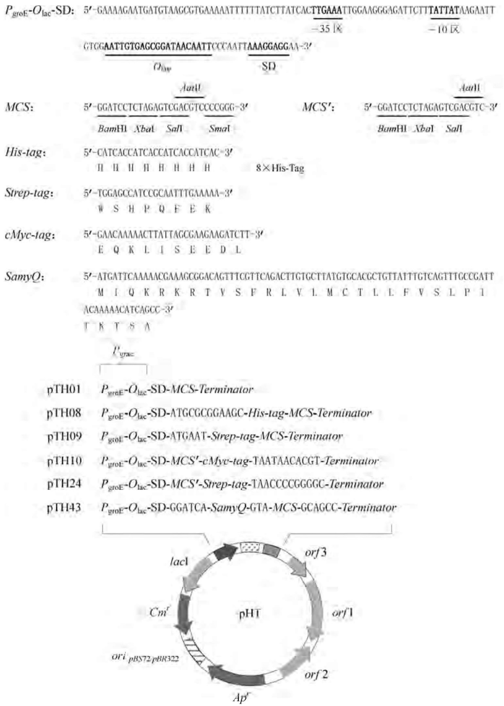

<details>
<summary>chemical</summary>

RNA secondary structure diagram showing P_groE-O_lac-SD and its homologous variants with restriction enzyme sites and gene annotations
</details>

图4-4 枯草芽孢杆菌高效纯化型载体pHT系列图谱

---

第 4 章 原核细菌基因工程

161

## 4.1.4 芽孢杆菌的分泌折叠系统

虽然相比大肠杆菌而言,枯草芽孢杆菌拥有分泌自身蛋白至 20 g/L 的天然优越性,但它分泌异源蛋白的能力却通常较低。其瓶颈在于异源蛋白较差的膜靶向性、膜转位或细胞壁通道的低效性、多肽链折叠的缓慢或误折叠、多肽链的蛋白酶降解。因此,分泌、折叠、降解三个过程往往相互作用和影响。

## 1. 芽孢杆菌的蛋白质分泌机制

一般而言，蛋白质的整个分泌过程分为靶向、转位、释放三个关键步骤。枯草芽孢杆菌蛋白质由胞质向胞质外位点的转位有四条途径:大多数蛋白使用Sec途径分泌；其他三条分泌途径如Tat途径、Com途径、ABC途径仅转位个别的特异性蛋白。通过上述四条途径转位的所有蛋白质前体均含有结构各异的N端信号肽(SP)，后者通过与众多分子伴侣相互作用，将待分泌的蛋白前体靶向合适的途径。一旦转位发生，信号肽酶(SPase)便将信号肽切除。

（1）信号肽的结构。虽然不同的信号肽呈不同的氨基酸保守序列，但一般包括N区、H区、C区三个不同的区域(图4-5)。在Sec型信号肽中，N区(正电荷氨基酸区)往往含有2或3个赖氨酸或精氨酸残基，它们决定信号肽在膜上的最终取向。H区(中部疏水核心)在-4至-6位置(相对裂解位点)一般保留螺旋折断型残基甘氨酸或脯氨酸，该区在膜上采取一种 $\alpha$ 螺旋构象，对蛋白质外输的早期阶段至关重要。C区(极性羧基端区)通常以I型SPase的识别序列AXA结尾，呈 $\beta$-链构象。值得注意的是，N端的非最佳密码子富集对信号肽的构象和活性非常关键。由于原核细菌蛋白质的折叠与其在核糖体上的合成同步进行，这些非最佳密码子在信号肽编码区内的富集往往能降低翻译效率，而这种局部不连续的翻译能使新生的信号肽有充足的时间折叠成特殊的结构域。

(2) Sec 分泌途径。Sec 依赖型分泌机器由胞质分子伴侣、信号识别颗粒(SRP)、SecA 转位马达蛋白、SecYEGDF 转位通道、信号肽酶、膜外折叠(PrsA、BdbBCD)和降解因子(HtrAB、WprA)构成。由于通过 Sec 途径分泌的蛋白首先是在胞质中合成的,因此必须在胞质型分子伴侣的帮助下保持胜任转位的形式。枯草芽孢杆菌的染色体编码五种不同类型的信号肽酶,它们都能加工前体蛋白。当多肽链全部转位后,这些蛋白必须在质膜的外侧再次折叠成天然构象,以避免存在于该环境中的多重蛋白酶的降解。Sec 分泌途径的基本过程如图 4-6 所示。

(3) Tat 系统分泌。迄今已知枯草芽孢杆菌通过 Tat 途径进行分泌的蛋白质只有磷酸二酯酶 PhoD 和 YwbN。与 Sec 途径不同，Tat 途径能使完全折叠了的蛋白质跨膜转运。Tat 途径的关键组分是膜整合型蛋白 TatA、TatB、TatC，其中 TatB 和 TatC 识别 RR 型信号肽，而 TatB 和 TatC 与多重 TatA 组分以复合物的形式构成一种蛋白传送通道。枯草芽孢杆菌含有两种 TatC 蛋白（TatCd 和 TatCy）以及三种 TatA/TatB 样蛋白（TatAd、TatAy、TatAc）。Tat 机器至少由两种最小的 Tat 转位酶构成，每种含有一种特异性的 TatA 和 TatC 组分。TatAcCd 型转位酶识别双精氨酸型蛋白前体 PhoD；而 TatAyCy 则处理 YwbN。Tat 途径能提供转位折叠了的重组蛋白进入培养基中。理论上，将 RR 型信号肽与蛋白质的成熟部分融合足以使其分泌。

根据上述原理,一批性能优良的分泌表达型载体得以设计构建,它们大都选用芽孢杆菌高效分泌型蛋白所属的信号肽序列(如  $\alpha-$  淀粉酶的 SamyQ、脂解酶的 ssLipA、中壁蛋白 spMWP 等)。其中,pBSMuL1/2 还安装了强启动子和用于重组蛋白纯化的标签序列,具有较强的实用性(图 4-7)。

## 2. 芽孢杆菌的蛋白质折叠机制

在芽孢杆菌中表达的重组蛋白的折叠涉及翻译后折叠和分泌后折叠两套系统。前者可使重组蛋白在胞内以可溶性形式积累；后者确保重组蛋白功能性分泌。

---

162

基因工程

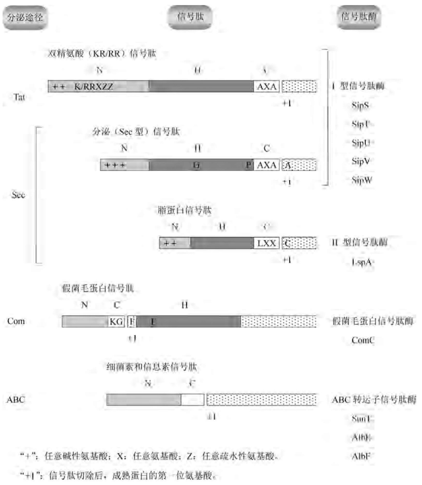

<details>
<summary>text_image</summary>

分泌途径
信号肽
信号肽酶
Tat
双精氨酸（KR/RR）信号肽
N
H
A
++ K/RRXZZ
AXA
+1
I 型信号肽酶
SipS
SipI
SipU
SipV
SipW
Sec
分泌（Sec型）信号肽
N
II
C
+++ G
P AXA A
+1
II 型信号肽酶
LspA
脂蛋白信号肽
N
II
C
++ LXX C
+1
假菌毛蛋白信号肽
Com
N C H
假菌毛蛋白信号肽酶
ComC
细菌素和信息素信号肽
ABC
N F
ABC 转运子信号肽酶
SunI
AlbI
+1：任意碱性氨基酸；X：任意氨基酸；Z：任意疏水性氨基酸。
+1：信号肽切除后，成熟蛋白的第一位氨基酸。
</details>

图4-5 芽孢杆菌N端信号肽的结构与分类

使重组蛋白以可溶性形式表达并积累有多种策略，其中最重要的是协助蛋白质折叠、装配及分泌的分子伴侣共表达。与其他细菌物种一样，枯草芽孢杆菌配备了两大系列的基本分子伴侣，即GroE和DnaK机器，分别由groE操纵子(groES-groEL)和dnaK操纵子(hrcA-grpE-dnaK-dnaJ-orf35-orf28-orf50)编码。这两个操纵子为单一转录阻遏蛋白HrcA所调控，而HrcA的活性又受GroE调节。hrcA的灭活导致胞内分子伴侣系统组成型表达，一般而言这有利于重组蛋白的可溶性表达。例如，一株DnaK和GroE呈组成型表达的枯草芽孢杆菌能使不溶性的重组抗地高辛单链抗体片段(SCA)降低 $45\%$ ，同时使分泌型SCA提升 $60\%$ 。

---

第 4 章 原核细菌基因工程

163

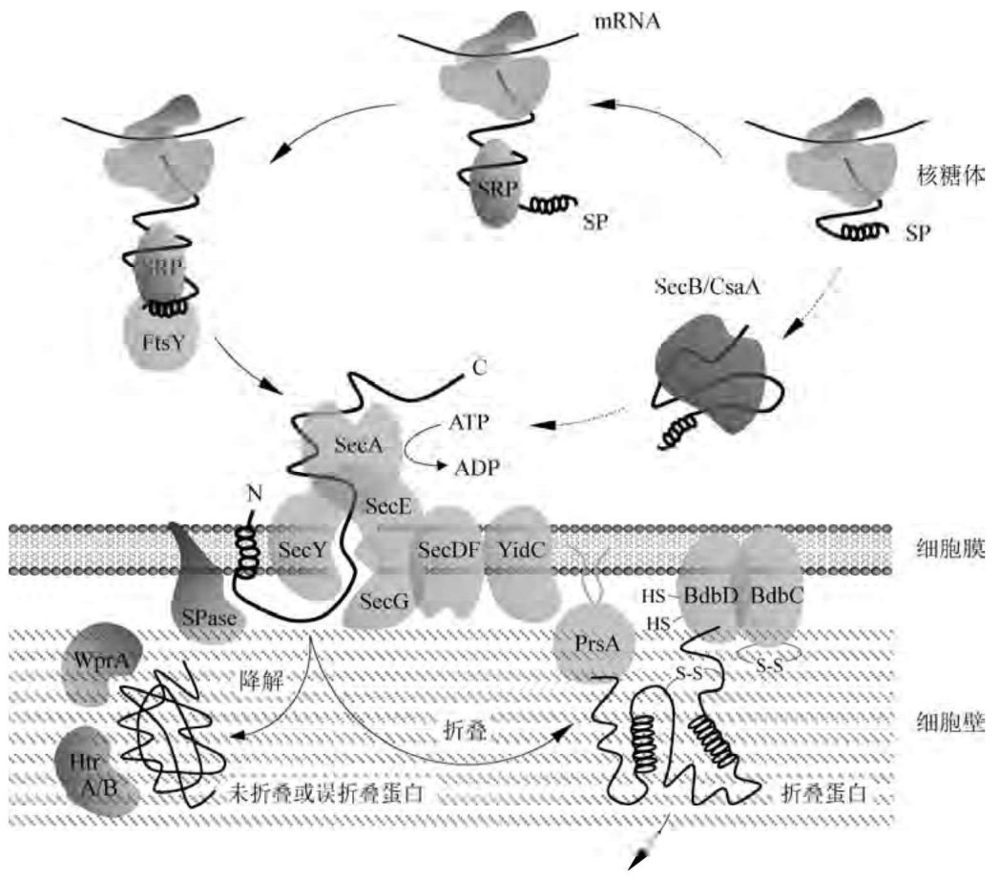

<details>
<summary>flowchart</summary>

This diagram illustrates the molecular mechanism of a protein complex, showing interactions between mRNA binding, transcription factors (SRP, SP), and cellular components like SecA, SecB/CsaA, and Htr/A/B.
</details>

图4-6 枯草芽孢杆菌Sec分泌途径的基本过程

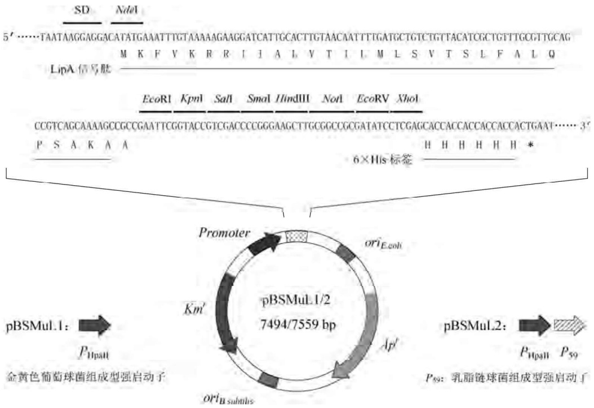

<details>
<summary>flowchart</summary>

```mermaid
graph TD
  subgraph Lipase_II [LipA 信号肽]
    direction TB
    M_K_F_V_K_R_R_I_J_A_L_V_T_I_M_L_S_V_T_S_L_F_A_L_Q
  end

  subgraph Protein_III [pBSMul1/2]
    E_CoR_I_KpnI_SaI_SmaI_HindIII_NoiI_EcoRV_XhoI
    CCGTCAGCAAAAGCCGCCGAATTCGGTACCGTCGACCCCGGGAAGCTTGCGGCCGCGATATCCTCGAGCACCACCACCACCACCACTGAAT...3'
    P_S_A_K_A_A
  end

  subgraph Significance_III [6×His 标签]
    H_H_H_H_H_H*
  end

  subgraph Genes_III [pBSMul1:]
    P_HpaII_P_HpaII_P_HpaII_P_HpaII_P_HpaII_P_HpaII_P_HpaII_P_HpaII_P_HpaII_P_HpaII_P_HpaII_P_HpaII_P_HpaII_P_HpaII_P_HpaII_P_HpaII_P_HpaII_P_HpaII_P_HpaII_P_HpaII_P_HpaII_P_HpaII_P_HpaII_P_HpaII_P_HpaII_P_HpaIIP_HpaII_P_HpaII_P_HpaII_P_HpaII_P_HpaII_P_HpaII_P_HpaII_P_HpaII_P_HpaII_P_HpaII_P_HpaII_P_HpaII_P_HPaII_P_HPaII_P_HPaII_P_HPaII_P_HPaII_P_HPaII_P_HPaII_P_HPaII_P_HPaII_P_HPaII_P_HPaII_P_HPaII_P_HPaII_P_HPaII_P_HPaII_P_HPaII_P_HPaII_P_HPaII_P_HPaII_P_HPaII_P_HPaII_P_HPaII_P_HPaII_P_HPaII_P_HPaII_P_HFaII_P_HFaII_P_HFaII_P_HFaII_P_HFaII_P_HFaII_P_HFaII_P_HFaII_P_HFaII_P_HFaII_P_HFaII_P_HFaII_P_HFaII_P_HFaII_P_HFaII_P_HFaII_P_HFaII_P_HFaII_P_HFaII_P_HFaII_P_HFaII_P_HFaII_P_HFaII_P_HFaII_P_HFaII_P_HFIII
  end

  subgraph Genes_III [pBSMul2:]
    P_HFaII_PHFaII_PHFaII_PHFaII_PHFaII_PHFaII_PHFaII_PHFaII_PHFaII_PHFaII_PHFaII_PHFaII_PHFaII_PHFaII_PHFaII_PHFaII_PHFaII_PHFaII_PHFaII_PHFaII_PHFaII_PHFaII_PHFaII_PHFaII_PHFaII_PHFaII_PHEIII
  end

  subgraph Genes_III [pBSMul1/2]
    Promoter
    Km'
    ori_B_subtilis
    ori_E_coli
    Ap'
    Promoter
  end

  subgraph Genes_III [pBSMul1]
    P_HpaII_PHpaII_PHPaII_PHPaII_PHPaII_PHPaII_PHPaII_PHPaII_PHPaII_PHPaII_PHPaII_PHPaII_PHPaII_PHEIII
  end

  subgraph Genes_III [pBSMul2]
    P_HFaII_PHEIII
    Promoter
    Promoter
    Promoter
    Promoter
    Promoter
    Promoter
    Promoter
  end

  Genes_III["pBSMul1/2"]
  Genes_III["pBSMul2"]
```
</details>

图4-7 枯草芽孢杆菌高效分泌型载体pBSMuL系列图谱

---

164

基因工程

迄今为止,已有三种细胞因素被认为影响胞外蛋白在成功转位通过质膜后的正确和有效折叠:即脂蛋白 PrsA、细胞壁净电荷、巯基/二硫键氧化还原酶。

（1）脂蛋白PrsA。在以非折叠状态转位之后，Sec依赖型的分泌蛋白必须折叠成天然的三维构象。虽然多肽链在体外能自发折叠，但它们在体内的折叠频繁需要折叠催化剂的协助。其中一种重要的折叠催化剂便是脂蛋白PrsA，它与肽酰脯氨酰顺反异构酶具有同源性，而后者对蛋白分泌很重要。携带PrsA突变形式的枯草芽孢杆菌菌株蛋白降解酶系的分泌受损。一般认为，PrsA能防止非折叠的蛋白在转位后与细胞壁迅速相互作用。当prsA基因由一种IPTG诱导型启动子介导表达时，几种测试蛋白的分泌水平显著提升，这表明翻译后折叠也是蛋白质分泌的一个限速步骤。

（2）细胞壁净电荷。除了细胞膜外，细胞壁基质是影响蛋白质分泌的另一因素。胞壁基质由一种复杂的肽聚糖异聚体和共价交联的胞壁酸或糖醛酸磷壁酸阴离子多聚物构成。这些阴离子多聚物与膜结合型脂磷壁酸一起，赋予细胞壁高密度的负电荷。细胞壁的净负电荷取决于胞壁酸和脂磷壁酸的D-丙氨酸酯化程度，而后者又由dlt操纵子编码的蛋白质负责。在枯草芽孢杆菌中，dlt的灭活以及相伴而产生的负电荷密度的增加会导致某些重组（如肺炎球菌溶血素)的稳定性和分泌性成倍提升。

（3）二硫键形成。二硫键形成对很多分泌型蛋白的折叠和稳定具有关键性作用。不能形成正确的二硫键会导致蛋白质集聚和蛋白酶降解。为了加速二硫键的形成，细胞使用巯基/二硫键氧化还原酶及其同源物醌酮氧化还原酶作为折叠催化剂。在枯草芽孢杆菌中，由基因 $bdbA$ 和 $bdbD$ 编码的两个巯基/二硫键氧化还原酶，以及由基因 $bdbB$ 和 $bdbC$ 编码的两个醌酮氧化还原酶已被鉴定。信息生物学模拟显示，BdbA和BdbD各含有一个N端膜锚定结构；而BdbB和BdbC则为带有四跨膜结构的膜整合型蛋白。BdbC和BdbD形成一对功能伙伴，其中BdbD是一种参与氧化底物蛋白质的巯基/二硫键氧化还原酶；而BdbC作为醌酮氧化还原酶使BdbD氧化再生。

虽然很多天然的信号肽已被鉴定并成功用于枯草芽孢杆菌分泌表达重组蛋白，但构建强有力的分泌机器以及折叠系统依然是实现大规模生产重组蛋白的先决条件。随着对芽孢杆菌基因组的深入解析，很多新的工程化策略和强大工具得以积累，使得协调蛋白质表达与分泌成为可能(表4-5)。

表 4-5 基于转位和折叠机器基因操作改良芽孢杆菌蛋白分泌的案例

<table><tr><td>机器组分</td><td>操作靶点</td><td>生理功能</td><td>操作方式</td><td>应用产物</td></tr><tr><td>信号识别颗粒</td><td>CsaA(SecB)</td><td>识别并转运新生多肽链的分子伴侣</td><td>SecB与杂合SecA共表达</td><td>MalE11PhoA</td></tr><tr><td rowspan="2">转位酶复合物</td><td>SecA</td><td>转位ATP酶</td><td>删除C端区域</td><td>hIFN-α2b</td></tr><tr><td>SecYEG</td><td>用于转位的整合型膜蛋白</td><td>过表达</td><td>α-淀粉酶</td></tr><tr><td>信号肽酶</td><td>SipM</td><td>位点特异性切除信号肽</td><td>过表达</td><td>DsrS</td></tr><tr><td>调控因子</td><td>PrsA</td><td>新生多肽链折叠的调控蛋白</td><td>过表达</td><td>枯草杆菌蛋白酶rPAα-淀粉酶</td></tr><tr><td></td><td>BdbD(DsbA)</td><td>巯基/二硫键氧化还原酶</td><td>置换基因</td><td>PhoA</td></tr><tr><td></td><td>WprA</td><td>参与胞质外质量控制的丝氨酸蛋白酶</td><td>删除10个胞外蛋白酶</td><td>rPA</td></tr><tr><td></td><td>GroEL-GroES</td><td>使新生多肽链集聚最小化的分子伴侣</td><td>过表达</td><td>SCNF</td></tr></table>

注:MalE11—麦芽糖结合蛋白；PhoA—碱性磷酸单酯酶；hIFN- $\alpha$ 2b—人 $\alpha$ -干扰素；DsrS—葡聚糖蔗糖酶；rPA—重组保护性抗原；SCNF—单链抗体片段。

## 3. 芽孢杆菌的蛋白质降解机制

野生型芽孢杆菌用作外源基因表达受体的最大限制是它能合成和分泌大量的胞外蛋白

---

第 4 章 原核细菌基因工程

165

酶,直接影响重组蛋白产物的稳定性。不能正确折叠的胞外蛋白易遭蛋白酶的降解,但即便是正确折叠的异源蛋白也能为胞外的蛋白酶所攻击。胞外蛋白酶存在于三种不同的空间中:①水溶性,定位于质膜与胞壁之间以及培养基中;②锚定在胞壁上;③锚定在质膜内但朝向膜外一侧。

枯草芽孢杆菌全部七种水溶性蛋白酶的编码基因已先后被克隆和鉴定。其中两种主要的水溶性蛋白酶 AprE 和 NprE 分别为碱性(枯草杆菌蛋白酶)和中性蛋白酶 A, 两者的双敲除突变株 DB102 已构建。随后, 在此基础上又构建出另外四个胞外水溶性蛋白酶编码基因缺陷株 WB600, 这四个基因分别编码胞外蛋白酶 (epr)、金属蛋白酶 (mpr)、杆菌肽酶 F (bpr) 和中性蛋白酶 B (nprB)。而在 WB800 株中, 一种小型水溶性蛋白酶编码基因 (vpr) 以及胞壁结合型蛋白酶 WprA 编码基因 (wprA) 也被删除。事实上, 含有 3\~5 种蛋白酶基因缺陷的枯草杆菌突变株大都仅剩下 1% 左右的胞外蛋白酶活性, 而 WB600 株的胞外蛋白酶活性只有野生株的 0.32%。不过值得注意的是, 胞外和胞内蛋白酶基因的灭活有时会影响细菌对培养基中蛋白营养成分的利用, 导致生长缓慢, 因此任何突变株必须检测其生长遗传特性。

锚定在细胞质膜上的蛋白酶可分为活性位点面向胞质的I型以及活性位点面向胞壁的II型，理论上这两种类型的蛋白酶均能攻击和降解那些正在转位以及转位之后的蛋白前体。值得注意的是，II型蛋白酶两个成员HtrA和HtrB的表达在分泌压力出现后呈上调趋势，而且htrA或htrB的突变又能引发分泌压力，这表明非折叠的蛋白质直接或间接象征着针对芽孢杆菌分泌压力响应的刺激。分泌压力为CssS-CssR双组分信号转导系统所感应，其中膜传感器激酶CssS在质膜与胞壁之间的界面上感应刺激。这一信息随后经由磷酸化传递给CssR，而CssR调控的靶基因恰恰包含htrA、htrB、cssR和cssS。由此可见，至少蛋白质胞外折叠的状态与胞外蛋白酶的表达和分泌密切相关。

## 4.1.5 重组芽孢杆菌在耐热性酶制剂大规模生产中的应用

利用芽孢杆菌的高效分泌特性,构建耐热性酶制剂的工程菌具有极高的经济价值,其中最为重要的酶制剂首推淀粉加工酶系,包括  $\alpha-$  淀粉酶、 $\beta-$  淀粉酶、葡萄糖淀粉酶、环状麦芽糊精葡糖基转移酶、脱支酶、木糖(葡萄糖)异构酶等。

## 1. 热稳定性酶制剂在工业生产中的应用

热稳定性的酶类目前在工业上已被广泛使用，它与常规酶类相比具有如下优点:①高温下的热稳定性。大多数的工业酶反应是在 $50\sim 55^{\circ}\mathrm{C}$ 内进行的，这样可以减少污染的概率，降低反应体系的黏度，促进传质，有时较高的温度有利于酶的可逆反应（如葡萄糖异构酶催化的反应）朝着合成目标产品的方向进行。②室温下较长的贮存期。尽可能长的存放期对商品酶制剂来说甚为重要，尤其是用于诊断试剂中的酶类对贮存周期要求更高。③较高的抗化学变性作用。一般而言，蛋白质的热稳定性越好，其化学变性的可能性就越小。④高温下的高活性。虽然普通酶类在 $37^{\circ}\mathrm{C}$ 以下其催化的反应速度随着温度的上升而加大，但嗜热性的酶类随温度上升而增加其活性的程度比普通酶类更为显著。⑤易于大规模生产及转化。由于热稳定性的酶大都存在于各种嗜热微生物细胞内，这些微生物往往难以大规模培养，因此热稳定性酶制剂的产业化很大程度上需要利用基因工程技术构建能高效表达并分泌高温酶的常温重组工程菌。后者在发酵过程中必然会产生大量胞内和胞外的宿主酶类，由于绝大多数的宿主蛋白是温度敏感型的，因此只要将工程菌的培养液进一步热处理，即可方便地纯化异源高温酶蛋白。

芽孢杆菌在耐热性酶制剂的大规模生产中具有双重作用:首先，相当一批野生型芽孢杆菌自身便能大量合成并分泌具有广泛应用价值的酶类，如嗜淀粉芽孢杆菌等；其次，有些芽孢杆菌还能产生耐热酶类，如嗜热脂肪芽孢杆菌等。一般而言，微生物属内种间的基因表

---

166

基因工程

达更为简单有效，例如将来自地衣芽孢杆菌、嗜淀粉芽孢杆菌以及嗜热脂肪芽孢杆菌的基因克隆在枯草芽孢杆菌中，重组蛋白的表达和分泌成功率相当高。此外，由于嗜热脂肪芽孢杆菌的耐热性，以它作为受体细胞克隆表达同源或异源高温酶编码基因，所构建的重组工程菌还可直接用于生物转化，减少酶分离纯化工序，降低生产成本。以载体pTB19及其系列质粒为核心的嗜热脂肪芽孢杆菌转化克隆系统的建立，为上述设想的实现奠定了基础。

## 2. 产高温 $\alpha$-淀粉酶和 $\beta$-淀粉酶工程菌的构建

α-淀粉酶是一种随机作用于淀粉分子中  $\alpha-1,4-$  葡聚糖苷键的内切型水解酶，广泛存在于各种细菌、真菌、植物、动物体内，目前已克隆并鉴定了 100 多种 α-淀粉酶基因。所有 α-淀粉酶的氨基酸序列都含有四个功能域，与底物结合及催化活性有关。芽孢杆菌属来源的 α-淀粉酶在淀粉加工业中被广泛用作淀粉液化剂，其中地衣芽孢杆菌的 α-淀粉酶(BLA)还具有耐热和极端 pH 稳定等许多优良特性，在 90℃ 处理 30 min，BLA 的活性仍能维持 80% 以上。

地衣芽孢杆菌及嗜热脂肪芽孢杆菌来源的 $\alpha$-淀粉酶基因均已克隆在短小芽孢杆菌中并获得高效表达。重组短小芽孢杆菌的 $\alpha$-淀粉酶生产能力可达到每升培养液 $3\mathrm{g}$ 以上，然而这种重组 $\alpha$-淀粉酶在工业上并没有太大的优势，因为现有的地衣芽孢杆菌 $\alpha$-淀粉酶生产工艺已相当成熟。构建 $\alpha$-淀粉酶克隆菌的实际用途是探测和分析酶的结构与功能之间的关系，尤其是BLA耐热机理的研究，它对利用蛋白质工程技术提高其他相关酶类的热稳性具有重要的指导意义。

β-淀粉酶是一种特异性作用于淀粉非还原末端α-1,4-葡聚糖苷键的外切型水解酶，可通过β-异构效应合成麦芽糖，后者是一种甜味剂，在自然界中含量稀少，而且是麦芽醇生产的原料，具有较高的经济价值。β-淀粉酶主要存在于植物及某些细菌体内，多黏芽孢杆菌（Bacillus polymyxa）、热硫梭菌（Clostridium thermosulfuogenes）、黄豆、大麦、土豆以及黑麦等来源的β-淀粉酶基因已被克隆和鉴定。其中最引人注目的是热硫梭菌的β-淀粉酶基因，因为该菌嗜热厌氧，由其产生的β-淀粉酶具有较高的热稳定性，其最适反应温度为70℃，但在80℃以上保温数小时酶活没有明显损失。由于热硫梭菌的大规模培养困难很大，因此与α-淀粉酶不同，耐热型β-淀粉酶的基因工程方法生产十分重要。

迄今为止，能高效表达并分泌热硫梭菌 $\beta$-淀粉酶最成功的重组细菌是短小芽孢杆菌工程菌，共有三种结构不同的重组质粒pMM1、pMM2、pMM3（图4-8）可用于转化短小芽孢杆菌表达热硫梭菌的 $\beta$-淀粉酶基因。将含有 $\beta$-淀粉酶基因的热硫梭菌染色体DNA片段插在表达型质粒pNU200上短小芽孢杆菌胞壁蛋白编码基因所属启动子 $P_{\mathrm{cwp}}$ 的下游，构建成重组质粒pMM1，在该插入片段中，$\beta$-淀粉酶编码区的上游和下游分别为热硫梭菌来源的560bp和1428bp非翻译区。pMM2是在pMM1的基础上构建的，目的是除去热硫梭菌 $\beta$-淀粉酶基因自身的信号肽编码序列(SP)以及SD序列，使成熟的 $\beta$-淀粉酶编码序列直接与短小芽孢杆菌中壁蛋白的信号肽编码序列相连，并保持正确的阅读框架。在pMM3重组质粒中，$\beta$-淀粉酶基因含有自身的信号肽编码序列和翻译起始密码子ATG，但启动子和核糖体结合位点来自短小芽孢杆菌，因此pMM2和pMM3两个重组质粒的唯一区别是信号肽编码序列不同。将上述三种重组质粒分别转化短小芽孢杆菌47K和47-5两株，然后比较其 $\beta$-淀粉酶的活性分泌率以确定工程菌的性质。

在所有的转化子中，含有 pMM1 重组质粒的菌株分泌的  $\beta-$  淀粉酶最少，这可能是由于  $\beta-$  淀粉酶基因 5' 端 560 bp 的区域对基因转录和 mRNA 翻译的干扰。携带 pMM3 的短小芽孢杆菌 47K 株最高可分泌 520 U/mL 的  $\beta-$  淀粉酶，而含有 pMM2 的相同受体菌可以连续 6 天不断增加合成  $\beta-$  淀粉酶的速率，之后便维持在一个恒定的水平上，培养液中的最高  $\beta-$  淀粉酶浓度可达 2600 U/mL，相当于 1.6 g/L 的纯酶。该酶的含量在培养液里的所有蛋白组分中最高，这一表达水平是经传统诱变的热硫梭菌高产菌的 60 倍。

---

第 4 章 原核细菌基因工程

167

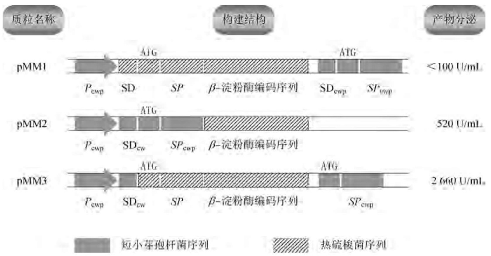

<details>
<summary>text_image</summary>

质粒名称
构建结构
产物分泌
pMM1
ATG
<100 U/mL
P_cwp SD SP β-淀粉酶编码序列 SD_cwp SP_cwp
pMM2
ATG
520 U/mL
P_cwp SD_cw SP_cwp β-淀粉酶编码序列
pMM3
ATG
2 660 U/mL
短小芽孢杆菌序列
热硫梭菌序列
</details>

图4-8 由短小芽孢杆菌表达热硫梭菌 $\beta$ -淀粉酶基因的三种重组质粒结构

## 3. 利用重组芽孢杆菌生产耐热木糖(葡萄糖)异构酶

木糖异构酶催化木糖在戊糖磷酸循环中的第一步代谢反应，即由D-木糖到D-木酮糖的可逆性异构化，同时木糖异构酶也能催化由葡萄糖到果糖的异构反应，因此在工业上常用来生产高果糖糖浆。该酶存在于许多微生物中，大肠杆菌、枯草芽孢杆菌、链霉菌、梭菌以及嗜热菌(Thermus thermosphilus)中的木糖异构酶基因已被克隆鉴定，其中嗜热菌的热稳定性木糖异构酶最为优异，它的最适反应温度高达95℃以上，最佳pH值接近7.0，而最佳pH值在85℃时仍保持在6.5～7.0内。在这种条件下，反应的副产物趋于最小值。由葡萄糖至果糖的异构化反应也是可逆的，果糖最终的产量取决于酶反应的温度，高温对应于高果糖产率，因此用嗜热菌木糖异构酶生产的果浆含有更高的果糖浓度。

嗜热菌木糖异构酶基因可在大肠杆菌和短小芽孢杆菌中高效表达。最简单的大肠杆菌表达重组子构建采用的是高拷贝的pUC119质粒，嗜热菌木糖异构酶基因置于可诱导型$P_{\mathrm{lacUV5}}$ 启动子的控制之下（pUCTXI）。在重组质粒pUSTXI中，异构酶基因插入一个pBR322的衍生质粒pUS21中，它含有可诱导的 $P_{\mathrm{tac}}$ 强启动子。上述两种重组质粒除了携带受体菌的SD序列外，还含有嗜热菌自身的SD序列和翻译起始密码子。在另一个重组质粒pKKTXI中，木糖异构酶编码序列直接与受体菌来源的ATG拼接，并使用大肠杆菌的 $P_{\mathrm{tac}}$ 启动子和SD序列，同时还将木糖异构酶N端编码序列中的精氨酸密码子AGG改为CGT（该密码子在大肠杆菌中的使用频率为 $70\%$ ）。在重组质粒pETTXI中，木糖异构酶基因插在T7-噬菌体 $\phi 10$ 启动子的下游。嗜热菌木糖异构酶基因在短小芽孢杆菌中的重组子构建选用的载体是pNU210，它携带 $P_{\mathrm{cwp}}$ 强启动子，重组质粒pNUTXI的结构与pUCTXI和pUSTXI相似，含有两种来源的SD序列和翻译起始密码子。在pNUTXI-atg中，这两套翻译起始元件直接融合，中间的间隔序列已除去。

上述6种重组质粒分别转化大肠杆菌和短小芽孢杆菌，各克隆在最佳培养条件下表达出的木糖异构酶活性水平由图4-9表示。结果表明:嗜热菌木糖异构酶基因在 $P_{\mathrm{lacUV5}}$ 启动子控制下的表达效果并不理想，用携带 $P_{\mathrm{tac}}$ 强启动子的低拷贝载体(pUSTXI)取代可使酶的产量提高8倍，而使用pKKTXI或pETTXI，酶产量在原来的基础上又分别提高 $80\%$ 和$180\%$ （以pUSTXI重组子为基准）。重组质粒pNUTXI上的木糖异构酶基因在短小芽孢杆菌中的表达水平与在pUSTXI在大肠杆菌克隆菌中相似，但改进后的转化子（pNUTXI-

---

168

基因工程

atg)所产生的木糖异构酶比最佳的大肠杆菌转化子(pETTXI)还要高出近3倍。除此之外，经超声波破菌处理后，短小芽孢杆菌表达的木糖异构酶在不溶性流分中的含量不到 $4\%$ ，几乎可以忽略不计。而在大肠杆菌中，异构酶残留在不溶性流分中的比例高达 $15\% \sim 50\%$ 。由此可见，短小芽孢杆菌作为受体菌比大肠杆菌具有明显的优势。

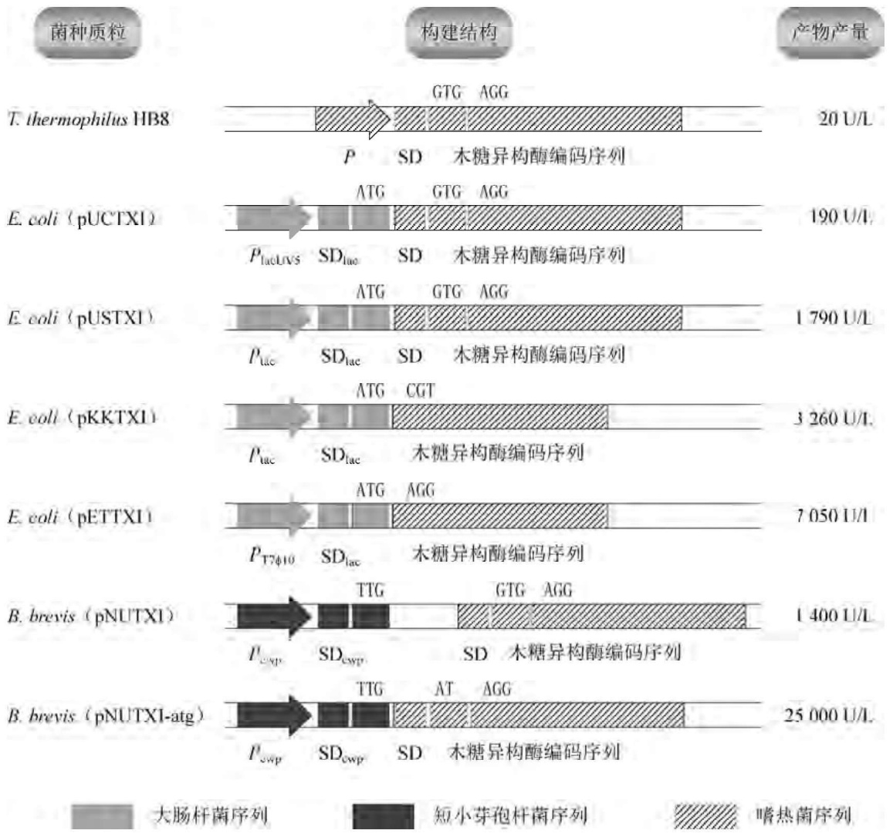

<details>
<summary>other</summary>

| 菌种质粒 | 产物产量 (U/L) | 大肠杆菌序列 | 短小芽孢杆菌序列 | 嗜热菌序列 |
| :--- | :--- | :--- | :--- | :--- |
| T. thermophilus HB8 | 20 | P | — | GTG AGG |
| E. coli (pUCTXI) | 190 | \(P_{lacUVS}\) | ATG | GTG AGG |
| E. coli (pUSTXI) | 1790 | \(P_{lac}\) | ATG | GTG AGG |
| E. coli (pKKTXI) | 3260 | \(P_{lac}\) | ATG | CGT |
| E. coli (pETTXI) | 7050 | \(P_{T7410}\) | ATG | AGG |
| B. brevis (pNUTXI) | 1400 | \(P_{cwp}\) | TTG | GTG AGG |
| B. brevis (pNUTXI-atg) | 25000 | \(P_{cwp}\) | TTG | AT AGG |
</details>

图4-9 不同细菌表达嗜热菌木糖异构酶的产量比较

## 4. 利用重组芽孢杆菌生产耐热中性蛋白酶

热稳定性中性蛋白酶存在于一些嗜热细菌中，其中从嗜热脂肪芽孢杆菌 HY-69 株中分离出来的中性蛋白酶研究最多，但即便是酶产量较高的突变株也不适用于大规模工业化生产，因为嗜热细菌的高发酵温度增加许多能耗。因此，构建高产热稳定性中性蛋白酶的嗜温型工程菌具有广泛的应用前景，构建所用的受体菌则为枯草芽孢杆菌。

嗜热脂肪芽孢杆菌 HY-69 株的中性蛋白酶基因采用鸟枪法克隆，染色体 DNA 用 HindIII 全酶解，克隆在枯草芽孢杆菌的表达质粒 pEDC11 上，连接液转化枯草芽孢杆菌 MI113 受体菌，并在含有卡那霉素和酪蛋白的 LB 琼脂平板上进行筛选。在大约 10 000 个转化子中，有 6 个菌落能产生较大的清晰透明圈，从其中一个菌落中提取出来的重组质粒 (pIMY2) 含有一个 4.5 kb 的插入片段。该克隆菌在 37℃ 培养后，培养液中含有 160 U/mL 的

---

第 4 章 原核细菌基因工程

169

中性蛋白酶活力,大约为嗜热脂肪芽孢杆菌的5倍。克隆菌产生的重组中性蛋白酶最适温度为75℃,比野生型蛋白酶低6℃左右,但最适pH与野生型蛋白酶完全相同,该酶在70℃保温30 min仍能保留80%的活力。这种工程菌目前已成功地用作皮革工业中的脱毛处理。

## 4.1.6 重组芽孢杆菌在人体蛋白药物生产中的应用

## 1. 短小芽孢杆菌的蛋白质超级合成与分泌系统

短小芽孢杆菌具有与枯草芽孢杆菌等同的蛋白产物分泌能力，但它所产生的胞外蛋白酶活性水平却远远低于枯草芽孢杆菌的活性水平，因此是一种理想的芽孢杆菌表达分泌系统。短小芽孢杆菌47株和HPD31株在合适的培养条件下，每升培养液可积累 $30\mathrm{g}$ 蛋白产物。蛋白质主要在细菌稳定期中合成，胞外蛋白比胞内蛋白总量高2倍，而且在常规培养基中，短小芽孢杆菌很少产生孢子，因而均被誉为蛋白质超级生产细胞。

短小芽孢杆菌的另一个特点是它具有独特的细胞壁结构。其47株含有三层细胞壁，包括两层蛋白胞壁和一层较薄的肽聚糖胞壁，前者称为外壁（OW）和中壁（MW）层，分别由相对分子质量为 $103\mathrm{kD}$ 和 $115\mathrm{kD}$ 的蛋白质（OWP和MWP)组成。这种胞壁结构与形态随着细胞生长周期的转换而发生变化，在稳定前期，细胞外壁和中壁蛋白开始从细胞表面脱落，与此同时胞内的可分泌型蛋白启动表达；进入稳定期后，蛋白质层几乎全部脱落，而细胞壁蛋白的合成与分泌仍继续进行一段时间，从而导致大量的细胞壁蛋白在培养基中积累。

细胞壁蛋白组分的表达和分泌还与细胞表面的结构变化相关。当细胞壁蛋白占据细胞表面时，其基因的表达被阻遏在一个恒定的低水平上，以防止这种蛋白组分的过量合成；细菌进入稳定期后，细胞壁蛋白从细胞表面的脱落以及培养基中低浓度  $Mg^{2+}$  的存在会使胞壁蛋白基因的转录去阻遏，从而保证胞壁蛋白连续合成并分泌至培养基中。由于短小芽孢杆菌的细胞壁蛋白合成及分泌极其有效，因此其启动子、操作子、翻译起始区以及蛋白的信号肽编码序列便有利于外源基因的高效表达与分泌。短小芽孢杆菌 47 株的两个胞壁蛋白编码基因已被克隆并鉴定，它们组成一个 cwp 操纵子结构，其 5' 端的基因表达调控区域在构建短小芽孢杆菌的表达分泌系统中得到广泛应用。例如，以 pUB110 为基础构建的高效分泌表达型载体 pNU210 上，安装了短小芽孢杆菌细胞中壁蛋白编码基因的 5' 区域，内含五个启动子、两套翻译起始位点，且能高拷贝自主复制，其结构如图 4-10 所示。

## 2. 利用短小芽孢杆菌生产重组人白介素

虽然目前临床上使用的重组人白细胞介素-2(IL-2)是由大肠杆菌生产的，但用短小芽孢杆菌系统表达这种人体蛋白药物仍具有一定的优势。早期的表达研究是将成熟的IL-2编码序列直接与pNU210的中壁蛋白信号肽编码序列拼接，但重组短小芽孢杆菌只能分泌很少的IL-2(大约为 $1\mathrm{mg / L}$ )。蛋白免疫检测结果发现，在发酵液中存在着大量的IL-2降解片段，而且与细胞膜结合的IL-2前体和成熟蛋白也相当可观，这表明重组质粒上外源基因的表达不存在问题，IL-2的分泌量过低主要是由于发酵液中蛋白酶的降解以及信号肽分泌能力有限所致。为此，采取三项改进措施:一是在发酵过程中添加部分纯化的短小芽孢杆菌蛋白酶抑制剂；二是将疏水性更强的信号肽序列替换原来的中壁蛋白信号肽序列；三是优化培养条件，尤其是在培养基中添加吐温40。经上述改进后，由受体菌表达的重组IL-2大部分存在于发酵液中，其产率可达 $120~\mathrm{mg / L}$，而且这种重组IL-2具有天然活性。尽管这种表达水平仅相当于重组大肠杆菌的 $25\%$ ，但由于短小芽孢杆菌分泌的重组蛋白无须复性处理，且分离纯化简单，因此其最终收率反而高于重组大肠杆菌系统。

## 3. 利用短小芽孢杆菌生产重组人表皮生长因子

表皮生长因子(EGF)是20世纪60年代发现并证实具有刺激表皮等细胞生长的功能蛋白。人的体液如尿液、血液、唾液、泪液、精液、乳汁、胃液、髓液中均含有EGF，其中以尿液、精液、乳汁中含量最高，除此之外，EGF还广泛存在于人的甲状腺、胰腺、唾液腺、空肠、十二

---

170

基因工程

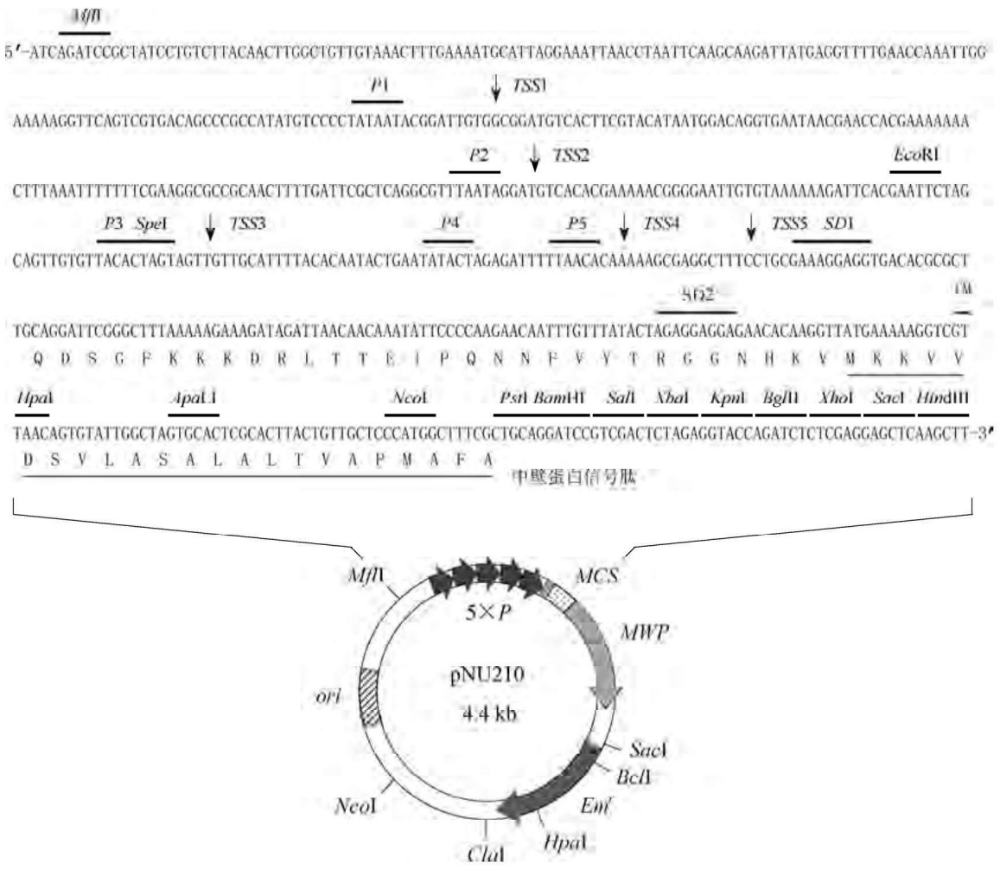

<details>
<summary>flowchart</summary>

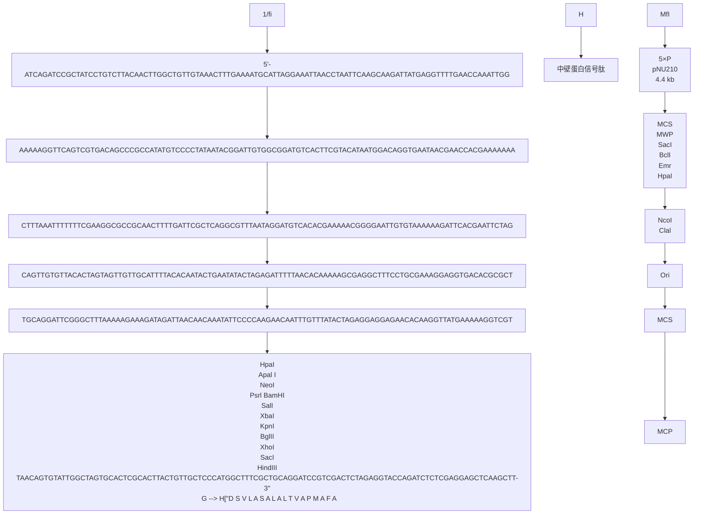
</details>

图4-10 含有短小芽孢杆菌表达分泌元件的pNU210质粒图谱

指肠、肾等许多组织和腺体中。由于它具有抗胃酸分泌作用，故又称为抑胃素。有报道认为EGF是一种脑肠肽，具有促进神经生长、神经传导和神经递质的功能。临床上主要用于促进伤口愈合及加速移植表皮的生长，此外，促进胃和十二指肠溃疡愈合也已走向应用。

天然的人 EGF(hEGF) 是一种由 53 个氨基酸组成的多肽，内含 3 对二硫键，但没有糖基侧链。由大肠杆菌生产的重组 hEGF 已商品化，但利用短小芽孢杆菌系统表达这种多肽仍具有优势，其重组质粒的构建过程如下:将人工合成的成熟 hEGF 编码序列插入 pNU210 上的中壁蛋白信号肽编码序列下游，并保持其阅读框架的正确性，重组质粒转化短小芽孢杆菌 HPD31 株，获得的转化子在最佳培养条件下能分泌 240 mg/L 的重组 hEGF，远比重组大肠杆菌系统高。从细菌培养液中纯化的 hEGF 含有与天然 hEGF 相同的 N 和 C 端序列以及氨基酸组成，而且不经复性处理便具有相应的生物活性，表明分泌的重组多肽具有正确的空间构象。此外，将 hEGF 基因克隆在稳定性能较好的 pHY700 表达质粒上，并转化相同的受体菌，所获得的转化子在稳定期逐步增加 hEGF 的表达量，培养第 6 天时最大产量可达 1.1 g/L。更令人惊奇的是，以短小芽孢杆菌另一个高拷贝的小型隐蔽型质粒为载体表达 hEGF，最终产量可提高到 3 g/L 以上。

在澳大利亚,每年剪下的羊毛高达2.6亿澳元,这需要大批剪毛技工。由于EGF能使羊毛从根部自行脱落,为此澳大利亚政府批准重组hEGF上市,用于羊毛的快速生物收获。

---

第 4 章 原核细菌基因工程

171

依据他们发明的方法,每只绵羊只需注射 5 mg 由短小芽孢杆菌生产的重组 hEGF,即可在 4\~6 周后直接用手去收集羊毛。

## 4.1.7 重组芽孢杆菌在昆虫毒素蛋白生产中的应用

人类从20世纪40年代起便开始开发并大量使用化学杀虫剂控制有害昆虫，其中最为著名的是早在19世纪70年代就已合成了的氯代烃DDT（二氯二苯基三氯乙烷）。这种氯代烃能直接损伤多种昆虫的神经系统和肌肉组织，从而广谱有效地杀死控制各类害虫。但与此同时，人们也认识到大范围、高剂量、长久性使用化学农药所造成的严重后果:一方面，这些化学农药在环境中可稳定存在 $15\sim 20$ 年，高浓度的农药通过食物链迅速为生物体吸收，并直接或间接地给动物和人类带来毒害；另一方面，许多害虫逐渐产生对各种化学农药的抗性，农药的使用量也随之增加，这样便导致恶性循环。

近 30 年来,发展控制和杀灭有害昆虫的新方法已越来越受到人们的重视,其中最引人注目的方法是利用某些细菌和病毒合成生物杀虫剂,其优点是在环境中易降解,对有害昆虫具有较高的选择性,并能在很大程度上降低害虫对之产生的抗药性。在已经开发的生物杀虫剂中,最广泛应用的是苏云金芽孢杆菌的合成产物,其销售额占世界生物杀虫剂总量的 90%\~95%,年销售额达到数亿美元。然而,生物杀虫剂的广泛使用对其生产规模及成本造成了巨大压力,利用 DNA 重组技术有望使这个问题从根本上得到解决。

## 1. 苏云金芽孢杆菌的遗传学特性

苏云金芽孢杆菌1901年首次从家蚕体内分离得到，10年后有人又从面粉飞蛾幼虫中获得这种致病菌并正式为之命名。这种细菌在孢子生成期间合成一种杀昆虫蛋白晶体，后者在孢子成熟细胞裂解后被释放至环境中，整个过程需要 $6\sim 8\mathrm{h}$ 。对之敏感的昆虫一旦摄入这种晶体蛋白，便会在 $1\textrm{h}$ 内停止进食，并在 $1\sim 5\mathrm{h}$ 内死亡。在规模化生产中，通常先从苏云金芽孢杆菌的生长培养液中回收晶体蛋白和孢子，然后制成活性混合物用于田间喷洒。由苏云金芽孢杆菌合成的杀虫剂已经使用了近半个世纪，能有效地维护树木、谷物、棉花、花卉的正常生长，此外这类杀虫剂还被发展用来控制蚊子、苍蝇、蟑螂等有害昆虫的繁殖。苏云金芽孢杆菌的杀虫剂对有害昆虫的作用具有较高的选择性，对哺乳动物、鸟类、鱼类、益虫以及水生无脊椎动植物均无毒性，因此是一种理想的杀虫剂。然而，苏云金芽孢杆菌系统的杀虫剂在农业上的广泛使用也存在着一些限制，其中包括抗虫谱较窄，有时难以抵挡多种昆虫的联合侵害作用；作用效力保持时间短，需要多次重复使用；喷雾液成分中的细菌孢子在一些国家(如日本)会严重影响对苏云金芽孢杆菌敏感的家蚕的养殖。

苏云金芽孢杆菌根据鞭毛抗原的不同分为30个亚种，大多数菌株对鳞翅目类幼虫具有杀灭活性，一小部分菌株则对双翅目或鞘翅目类幼虫起作用，也有若干菌株对上述昆虫均无作用。每个亚种，有时甚至同一亚种中的不同株都有相应的特征抗虫谱，可见苏云金芽孢杆菌抗虫蛋白资源的潜力相当可观。苏云金芽孢杆菌杀虫剂的早期开发使用的是野生型菌株，为了扩大其抗虫谱，在大量筛选新菌株的基础上，更重要的是利用DNA重组技术克隆晶体蛋白的编码基因，分析其结构与功能之间的关系，构建具有新型抗虫谱的工程杀虫蛋白并大量生产，或者直接构建含毒素晶体蛋白的转基因农作物。

## 2. 抗昆虫晶体蛋白的性质及其作用机理

有些苏云金芽孢杆菌株能同时合成多种不同的杀虫蛋白组分，其相对分子质量在 $27\sim$ $140~\mathrm{kD}$ 之间，晶体蛋白的不同杀虫谱正是多种蛋白组分性质差异的表现形式。第一个杀虫蛋白编码基因是在1981年从苏云金芽孢杆菌kurstaki亚种的HD-1株中克隆的，随后大量相关的基因相继克隆并测序。这些基因通常位于质粒上，依据其氨基酸序列以及杀虫谱的相似性分成五大类，分别用cryI～cryV命名(表4-6)。cryI类基因又可进一步分成七个亚类(cryIA～cryIG)，三种CryIA蛋白之间的氨基酸序列具有 $80\%$ 以上的同源性，但与同

---

172

基因工程

亚类其他成员的同源性为 $40\% \sim 70\%$ ，与CryII、CryIII、CryIV各类蛋白的同源性只有$20\% \sim 30\%$ 。虽然CryIA亚类的三个成员之间存在显著的同源性，但每种蛋白仍显示出杀虫特异性差异，分别对应于一些鳞翅目昆虫的种属。近十年来随着越来越多的毒素晶体蛋白编码基因被鉴定，遂形成了基于DNA序列的分类法，它包含cry1～cry51、cyt1、cyt2共53类，其中cry基因372种，cyt基因24种。

表 4-6 苏云氏芽孢杆菌杀虫蛋白基因的性质

| 基因种类 | 宿主范围 | 氨基酸数目 | 预计相对分子质量/kD |
| --- | --- | --- | --- |
| cry [A(a) | L | 1 176 | 133.2 |
| cry [A(b) | L | 1 155 | 131.0 |
| cry [A(c) | L | 1 178 | 133.3 |
| cry [B | L | 1 207 | 138.0 |
| cry [C(a) | L | 1 189 | 134.8 |
| cry [C(b) | L | 1 177 | 134.0 |
| cry [D | L | 1 165 | 132.5 |
| cry [E | L | 1 171 | 133.2 |
| cry [F | L | 1 174 | 133.6 |
| cry [G | L | 1 156 | 129.7 |
| cry II A | L/D | 633 | 70.9 |
| cry II B | L | 633 | 70.8 |
| cry III A | C | 644 | 73.1 |
| cry III B | C | 651 | 74.2 |
| cry III C | C | 652 | 74.4 |
| cry III D | C | 649 | 73.0 |
| cry IV A | D | 1 180 | 134.4 |
| cry IV B | D | 1 136 | 127.8 |
| cry IV C | D | 675 | 77.8 |
| cry IV D | D | 643 | 72.4 |
| cytA | D | 248 | 27.4 |
| cry V | L/C |  | 81 |

注:L—Lepidoptera，鳞翅目；D—Diptera，双翅目；C—Coleoptera，鞘翅目。

苏云金芽孢杆菌合成的杀虫蛋白在细胞内是一种结构庞大的多聚晶体(图4-11)，其含量相当于孢子培养物干重的 $20\% \sim 30\%$ ，其中 $95\%$ 为蛋白质，剩余的则是碳水化合物。这种多聚晶体结构由单一种类的蛋白质集聚而成，用弱碱处理，可将其解离成相对分子质量大约为 $250~\mathrm{kD}$ 的亚基，每个亚基大约含有20个葡萄糖分子和10个甘露糖分子。这些亚基在体外又可用 $\beta-$ 疏基乙醇将之解离为两个相对分子质量为 $130~\mathrm{kD}$ 的相同多肽链。多聚晶体结构并无杀虫活性，只是一种毒素原，当敏感型昆虫的幼虫摄入这种多聚晶体后，便被幼虫消化道中的碱性（$\mathrm{pH}7.5\sim 8.0$）溶液溶解，随之消化液中的特异性蛋白酶将这个毒素原分子加工成具有蛋白酶抗性的杀虫活性片段（约 $60\sim 68~\mathrm{kD}$）。后者插入幼虫消化道的上表细胞膜上，形成一个独特的毒素蛋白离子通道，从而导致上表细胞内ATP的大量流失；离子通道形成后的大约 $15\mathrm{min}$，细胞内代谢中止，幼虫停止进食，最终衰竭致死。由于毒素原转化为活性毒素蛋白需要碱性 $\mathrm{pH}$ 环境和特异性的蛋白酶系统，所以人类和动物对之并不敏感。

用胰蛋白酶处理来自苏云金芽孢杆菌 dendrolimus 亚种的杀虫蛋白, 其 N 端的一半肽

---

第 4 章 原核细菌基因工程

173

段仍具有完整的杀虫活性，表明杀虫功能域处于N端。对苏云金芽孢杆菌kurstaki亚种HD-73株合成的相应蛋白(CryIAc)进行更为深入的研究，发现其活性片段精确定位于Ile-29和Lys-623之间。CryII、CryIII、CryIVC/CryIVD类杀虫蛋白的相对分子质量都在 $70\mathrm{kD}$ 左右，比CryI蛋白小了近一倍，氨基酸序列分析结果表明，CryII、CryIII、CryIVC、CryIVD与CryIA的N端肽段同源，但缺少CryIA C端的相应区域。上述结果证实，几乎所有的杀虫蛋白在其功能区域都是同源的，尽管它们的分子大小相差很大。

苏云金芽孢杆菌产生的杀虫蛋白在使用剂量及投药时间上有着严格的限制，因为在环境条件下毒素原的半衰期很短。这种蛋白对日光显得较为敏感，在正常条件下，日光可在24 h之内破坏毒素蛋白中60%的色氨酸残基。此特性虽然不利于投药操作，并加大了用药量，但同时在很大程度上也降低了昆虫产生抗药性的可能性。

## 3. 重组苏云金芽孢杆菌的构建

苏云金芽孢杆菌 kurstaki 亚种含有七种不同大小的质粒，其大小分别为 2.0 kb、7.4 kb、7.8 kb、8.2 kb、14.4 kb、45 kb、71 kb，后者含有毒素蛋白编码基因。在原始实验中，将质粒 DNA 的混合物构建基因组文库，然后采取免疫杂交法筛选到毒素蛋白基因。苏云金芽孢杆菌 kurstaki 亚种 HD-1(Dipel)株的 cryIAa 基因在体内由两个启动子控制转录启动，两者仅相隔 16 bp，而且在细菌孢子形成期间以不同的方式被

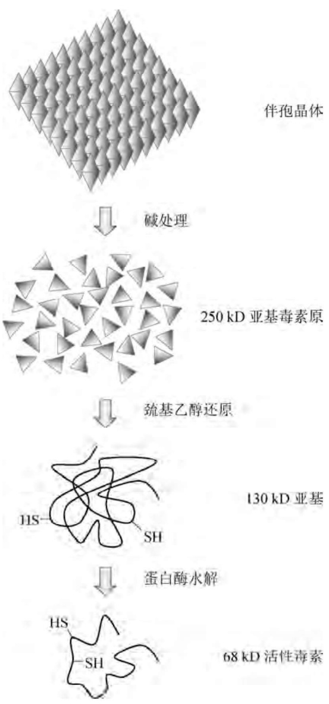

<details>
<summary>flowchart</summary>

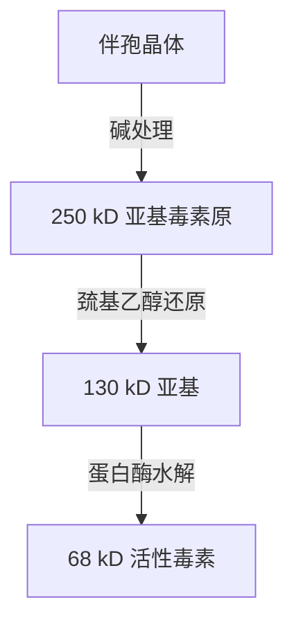
</details>

图4-11 苏云金芽孢杆菌杀虫蛋白的加工过程

激活。所有 cryIA 基因的启动子序列均是保守的，识别这些启动子的两种细菌 RNA 聚合酶分别含有 35 kD 和 28 kD 的 σ 因子，它们均有别于细菌初级代谢中发挥作用的 σ 因子。编码这两个 σ 因子的基因已被克隆并测序，比较结果表明它们与枯草芽孢杆菌的孢子生成特异性 σ 因子 ( $\sigma^{E}$  和  $\sigma^{K}$ ) 具有显著的同源性，并能互补枯草芽孢杆菌的相应突变株。在分析杀虫蛋白编码基因表达调控原理的基础上，重组苏云金芽孢杆菌的构建可从以下三个方面入手:

（1）为了提高苏云金芽孢杆菌合成杀虫蛋白的效率，可用枯草芽孢杆菌的初级代谢启动子取代杀虫蛋白基因的自身启动子，构建出的重组分子转入苏云金芽孢杆菌细胞内，使之在细菌的整个生长周期中全程表达。重组菌采用连续发酵，可以大幅度提高杀虫蛋白的产率，降低生产成本。也可将这种重组分子转入孢子形成缺陷的苏云金芽孢杆菌突变株内，在此条件下，杀虫蛋白的合成远比野生菌更有效。

---

174

基因工程

（2）由于许多农作物往往同时会遭到多种害虫的侵袭，因此构建一株能产生多价杀虫蛋白的工程菌是非常有益的。为达到此目的，可将一种杀虫蛋白基因（如对双翅目昆虫特效）转入只能合成另一种杀虫蛋白（如对鞘翅目昆虫有效）的苏云金芽孢杆菌中，也可将两种编码特异性杀虫蛋白的基因融合在一起，使受体菌合成一种双价杀虫蛋白。例如，将苏云金芽孢杆菌 thuringiensis 亚种 aizawai 株和 tenebrionis 株的两个杀虫蛋白基因克隆在一个苏云金芽孢杆菌/大肠杆菌的穿梭质粒上，重组质粒在大肠杆菌中扩增后，采用电穿孔法将之分别转入苏云金芽孢杆菌的 aizawai、kurstaki、tenebrionis 以及 israelensis 各株，然后测试所有获得的转化子对三种不同幼虫的毒性作用。结果显示，在各种转化子中，宿主内源性的杀虫蛋白基因均能维持正常的表达水平，而且在大多数情况下，导入的杀虫蛋白基因也能表达出相应的特异性毒性蛋白（表 4-7）。更令人感兴趣的是，当 tenebrionis 来源的杀虫蛋白基因导入 israelensis 株中后，所形成的转化子竟对侵袭卷心菜等的白蝴蝶也产生一定程度的毒性作用，而两个亲本菌株并没有这种杀虫特性，这说明两种或多种杀虫蛋白之间存在着交叉增强的毒性作用。

表 4-7 苏云金芽孢杆菌野生株与转化子抗昆虫毒力比较

<table><tr><td colspan="2">毒素来源</td><td rowspan="2">对大菜粉蝶的毒性(Pieris)</td><td rowspan="2">对蚊子的毒性(Aedes)</td><td rowspan="2">对甲虫的毒性(Phaedon)</td></tr><tr><td>宿主DNA</td><td>引入DNA</td></tr><tr><td>aizuwai</td><td>无</td><td>++</td><td>+</td><td>-</td></tr><tr><td>israelensis</td><td>无</td><td>-</td><td>++</td><td>-</td></tr><tr><td>israelensis</td><td>aizuwai</td><td>++</td><td>++</td><td>-</td></tr><tr><td>israelensis</td><td>tenebrionis</td><td>+</td><td>++</td><td>++</td></tr><tr><td>kurstaki</td><td>无</td><td>++</td><td>+</td><td>-</td></tr><tr><td>kurstaki</td><td>tenebrionis</td><td>++</td><td>+</td><td>++</td></tr><tr><td>tenebrionis</td><td>无</td><td>-</td><td>-</td><td>++</td></tr><tr><td>tenebrionis</td><td>aizuwai</td><td>++</td><td>+</td><td>+</td></tr></table>

（3）利用基因定向突变技术改变杀虫蛋白的氨基酸序列，也可增强杀虫蛋白的毒性作用，扩展杀虫选择范围，延长多聚晶体结构在自然环境中的半衰期，这方面的成功例子多有报道。除此之外，苏云金芽孢杆菌杀虫蛋白基因在其他生物细胞中的表达也为其大规模生产及广泛应用提供了新的途径。

## 4.2 棒状杆菌基因工程

氨基酸具有极其广泛的用途，在食品工业中用作助鲜剂（如味精）、抗氧化剂和营养补充剂；在畜牧业中用作饲料添加剂；在医学中用于手术后的输液治疗；而在化学工业中则用作许多聚合物及化妆品生产的合成原料（表4-8）。全世界每年的氨基酸总产量接近500万吨，其中谷氨酸钠的产量占了氨基酸总产量的一半以上。氨基酸的大规模工业化生产主要有蛋白质降解和微生物发酵两种方法。微生物发酵生产氨基酸通常使用棒状杆菌，主要包括棒杆菌属(Corynebacterium)和短杆菌属(Brevibacterium)。这两大类细菌都是不产孢子、不能游动、短杆形状、生物素依赖型的革兰氏阳性菌，其中最重要的是非致病性的谷氨酸棒杆菌(Corynebacterium glutamicum)，在最佳培养条件下，该菌种能在几天内将 $100\mathrm{g / L}$ 的葡萄糖转化为 $60~\mathrm{g / L}$ 的谷氨酸。随着组学研究和系统代谢工程技术的深入展开，多种性能优异的谷氨酸棒杆菌基因工程菌株得以构建并投入应用，在生产效能大幅度提升的同时，还大大扩展了L-型氨基酸的生产范围(图4-12)。

---

第 4 章 原核细菌基因工程

175

表 4-8 氨基酸的基本用途

| 氨基酸 | 用途 | 氨基酸 | 用途 |
| --- | --- | --- | --- |
| Ala(A) | 增香剂 | Leu(L) | 浸剂 |
| Arg(R) | 治疗肝病 | Lys(K) | 饲料添加剂,食品添加剂 |
| Asn(N) | 治疗白血病 | Met(M) | 饲料添加剂 |
| Asp(D) | 增香剂,合成增甜剂 | Phe(F) | 浸剂,合成增甜剂 |
| Cys(C) | 生产面包,治疗支气管炎,抗氧化剂 | Pro(P) | 浸剂 |
| Gln(Q) | 治疗溃疡 | Ser(S) | 化妆品添加剂 |
| Glu(E) | 增鲜剂,增香剂 | Thr(T) | 饲料添加剂 |
| Gly(G) | 合成增甜剂 | Trp(W) | 浸剂,抗氧化剂 |
| His(H) | 治疗溃疡,抗氧化剂 | Tyr(Y) | 浸剂,合成多巴胺 |
| Ile(I) | 浸剂 | Val(V) | 浸剂 |

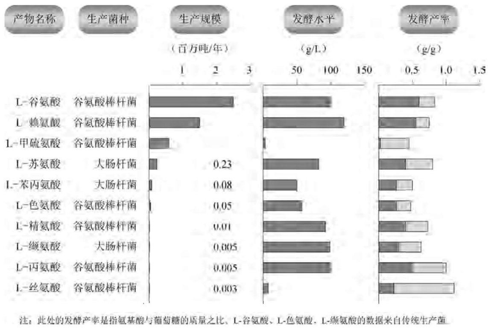

<details>
<summary>bar_stacked</summary>

| 产物名称 | 生产菌种 | 生产规模 (百万吨/年) | 发酵水平 (g/L) | 发酵产率 (g/g) |
| :--- | :--- | :--- | :--- | :--- |
| L-谷氨酸 | 谷氨酸棒杆菌 | ~2.5 | ~100 | ~0.6 |
| L-赖氨酸 | 谷氨酸棒杆菌 | ~1.8 | ~120 | ~0.7 |
| L-甲硫氨酸 | 谷氨酸棒杆菌 | ~0.8 | ~1 | ~0.4 |
| L-苏氨酸 | 大肠杆菌 | 0.23 | ~90 | ~0.7 |
| L-苯丙氨酸 | 大肠杆菌 | 0.08 | ~50 | ~0.4 |
| L-色氨酸 | 谷氨酸棒杆菌 | 0.05 | ~60 | ~0.4 |
| L-精氨酸 | 谷氨酸棒杆菌 | 0.01 | ~90 | ~0.6 |
| L-缬氨酸 | 大肠杆菌 | 0.005 | ~100 | ~0.6 |
| L-丙氨酸 | 谷氨酸棒杆菌 | 0.005 | ~100 | ~1.0 |
| L-丝氨酸 | 谷氨酸棒杆菌 | 0.003 | ~1 | ~1.1 |
</details>

图4-12 微生物发酵法生产L-氨基酸的现状

## 4.2.1 棒状杆菌的载体克隆系统

棒状杆菌含有大量的野生隐蔽型质粒，早期分离鉴定的几个代表性质粒，如来自产乳酸短杆菌（Brevibacterium lactofermentum）ATCC21798株的pBL1（4.4 kb，又称pAM330）、谷氨酸棒杆菌ATCC19223株的pSR1（3.1 kb，又称pHM1519）以及凯鲁那棒杆菌(Corynebacterium callunae)的pCC1(4.2 kb)，均不含有任何抗药性基因；只有少数野生型质粒携带选择性标记基因，但它们往往相对分子质量过大而不能直接用作克隆载体（表4-9）。因此，以上述野生型质粒为基础，构建一系列具有特殊功能的棒状杆菌克隆表达载体十分必要。

---

176

基因工程

表 4-9 存在于棒状杆菌中的野生型质粒

| 质粒名称 | 宿主菌种 | 大小/kb | 抗性标记 |
| --- | --- | --- | --- |
| pX18 | Brevibacterium lactofermentum ATCC 21086 | 4.5 | — |
| pBL1 | Brevibacterium lactofermentum ATCC 21798 | 4.4 | — |
| pBL100 | Brevibacterium linens CECT75 | 7.5 | — |
| pRBL1 | Brevibacterium linens RBL | 8.0 | — |
| pCC1 | Corynebacterium callunae NRRL B2244 | 4.2 | — |
| pNG2 | Corynebacterium diphtheriae | 14.4 | Em |
| pDG101 | Corynebacterium flaccumfaciens subsp. oorti | 69.0 | 砷酸盐,亚砷酸盐,锑 |
| pXZ10145 | Corynebacterium glutamicum | 5.3 | Cm |
| pSR1 | Corynebacterium glutamicum ATCC 19223 | 3.1 | — |
| pCG4 | Corynebacterium glutamicum ATCC 31830 | 29.0 | Sm,Sp |
| pCG2 | Corynebacterium glutamicum ATCC 31832 | 6.8 | — |
| pAL286 | Corynebacterium glutamicum Ferm P5485 | 4.4 | — |
| pGA1 | Corynebacterium glutamicum LP-6 | 4.8 | — |
| pCL1 | Corynebacterium lilium | 4.1 | — |
| pAG1 | Corynebacterium melassecola | 20.4 | Tc |
| pCR1 | Corynebacterium renale | 1.4 | — |
| pCR2 | Corynebacterium renale | 3.2 | — |
| pCR3 | Corynebacterium renale | 4.4 | — |
| pCR4 | Corynebacterium renale | 5.7 | — |
| pTP10 | Corynebacterium xerosis | 45.0 | Tc,Cm,Em,Sm |

注:Cm—氯霉素；Em—红霉素；Sm—链霉素；Sp—壮观霉素；Tc—四环素。

## 1. 棒状杆菌的穿梭质粒

将棒状杆菌来源的两种不相容的天然隐蔽型质粒 pBL1 和 pSR1 分别与大肠杆菌质粒 pBR325( $Ap^{r}$ 、 $Cm^{r}$ 、 $Tc^{r}$ ) 和金黄色葡萄球菌质粒 pUB110( $Km^{r}$ ) 进行重组，获得 pAJ 系列的穿梭质粒（图 4-13）。将这些穿梭质粒转化短杆菌属，至少发现四种类型的转化子，其中含有 pAJ655 和 pAJ1844 的转化子产生氯霉素抗性，而含有 pAJ440 和 pAJ1629 的转化子产生卡那霉素抗性。这个结果表明，大肠杆菌来源的氯霉素抗性基因( $Cm^{r}$ ) 启动子以及金黄色葡萄球菌来源的卡那霉素抗性基因( $Km^{r}$ ) 启动子能在短杆菌属细菌中表达，而且这些穿梭质粒在其他棒状杆菌（如谷氨酸棒杆菌）中也能用相应的选择性标记进行稳定扩增，然而氨苄青霉素抗性基因( $Ap^{r}$ ) 的启动子不能被棒状杆菌的 RNA 聚合酶识别。此外，将大肠杆菌质粒 pBR329 的氨苄青霉素抗性基因以及链霉菌的硫链丝菌素抗性基因(tsr) 导入凯鲁那棒杆菌野生型质粒 pCC1 中，成功构建了 pUL210 质粒；将谷氨酸棒杆菌野生型质粒 pSR1 和 pCG2 与大肠杆菌质粒 pGA22( $Ap^{r}$ 、 $Cm^{r}$ 、 $Tc^{r}$ 、 $Km^{r}$ ) 进行重组，可获得穿梭质粒 pCE51～pCE54；将 pSR1 与枯草芽孢杆菌质粒 pBD10( $Cm^{r}$ 、 $Em^{r}$ 、 $Km^{r}$ ) 合并，则形成穿梭质粒 pHY416( $Cm^{r}$ 、 $Km^{r}$ )。上述穿梭质粒的一个显著特征是分子过大，因此在多轮复制过程中容易发生自发性缺失突变，形成相对分子质量较小的质粒，例如由 pAJ655(10.4 kb) 自发突变产生的质粒 pAJ43 只剩下  $Cm^{r}$  一个选择标记，分子缺失了一半(5.1 kb)，显然不再具有穿梭复制功能，但它却是较为理想的克隆载体。

## 2. 棒状杆菌的启动子探针质粒

为了克隆或检查各种内源型和外源型启动子在棒状杆菌中介导基因转录启动的活性，一系列的启动子探针质粒构建成功。它们均选用便于定量测定的无启动子功能基因

---

第 4 章 原核细菌基因工程

177


<details>
<summary>flowchart</summary>

This diagram illustrates the genetic construct and restriction enzyme interactions between various plasmid genes (pBL1, pBR325, pUB110, pAJ655, pAJ440, pAJ1844, pAJ1629) with their respective gene constructs and restriction enzymes.
</details>

图4-13 棒状杆菌pAJ系列穿梭质粒的构建

---

178

基因工程

编码序列作为报告基因，并在克隆位点的上游邻近区域插入合适的转录终止子序列，以防止质粒上其他基因（如标记基因）所属启动子可能造成的转录过头现象发生，降低检测本底或假阳性。谷氨酸棒杆菌常用的报告基因包括:来自转座子Tn9的氯霉素乙酰基转移酶编码基因（cat）、来自大肠杆菌的β-半乳糖苷酶编码基因（lacZ）、来自转座子Tn5的氨基糖苷磷酸转移酶编码基因（aph）、来自大肠杆菌的β-葡萄糖醛酸酶编码基因（uidA）、来自灰色链霉菌的α-淀粉酶编码基因（amy）、来自淡青链霉菌（Streptomyces glaucescens）的黑色素编码基因（melC）、来自水母（Aequorea victoria）的绿色荧光蛋白编码基因（gfp）。

三种用于克隆和分析谷氨酸棒杆菌启动子的自主复制型启动子探针载体如图4-14所示。其中，携带无启动子报告基因 $cat^{\prime}$ 的pET2使用最广。能对谷氨酸棒杆菌进行接合转化的取代型载体pEMel-1携带黑色素合成基因melC1C2，它们受控于来自Tn5的 $P_{\mathrm{Km}}$ 启动子。使用时可用待克隆或受测试的任何EcoRI-NdeI片段取代pEMel-1上的相应 $P_{\mathrm{Km}}$ 片段。pEPR1携带启动子报告基因 $gfp^{\prime}$ 。为了确保待测试启动子与报告基因以单拷贝形式存在于细胞中，整合型启动子探针载体pRIM2被构建，它只含大肠杆菌复制子，因而不能在谷氨酸棒杆菌中复制，但装有谷氨酸棒杆菌ppc基因上游的一段非编码序列(dppc)，因而可以通过同源重组整合在谷氨酸棒杆菌染色体的相应位点上，而且不会对宿主菌造成生理影响。


<details>
<summary>flowchart</summary>

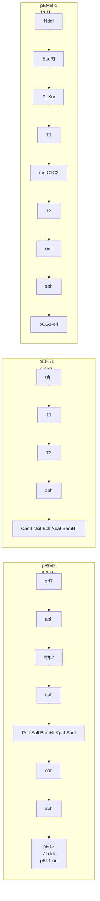
</details>

图4-14 谷氨酸棒杆菌启动子探针质粒图谱

## 3. 棒状杆菌的考斯质粒

与大肠杆菌型的考斯质粒构建路线相似，利用产乳酸短杆菌的F-1A噬菌体DNAcos区可产生一系列的产乳酸短杆菌型考斯质粒。例如，将含有cos序列的F-1A DNA HindIII片段插入pAJ43中，形成考斯质粒pAJ667。由于相应的噬菌体体外包装系统尚未建立，因此pAJ667转导产乳酸短杆菌的完整细胞必须用F-1A噬菌体作为辅助噬菌体，这个系统的转导频率可达 $10^{-4}$ 噬菌斑/细胞。

## 4. 棒状杆菌的接合质粒

pECM1 是另一种人工构建的谷氨酸棒状杆菌-大肠杆菌穿梭质粒，它含有一个来自广泛可转移性质粒 RP4 的 mob 位点以及两个选择标记 $Cm^{r}$、$Km^{r}$。在接合转化过程中，先将 pECM1 或以其为载体的重组质粒转化到一个特殊的大肠杆菌供体菌中，这个菌株的染色体 DNA 上预先整合了一段 RP4 的接合功能区，借助于该区域所表达出的转移辅助功能，pECM1 或者重组质粒即可从大肠杆菌顺利接合到棒状杆菌细胞内。若在接合之前先灭活宿主细胞的限制系统，或在接合过程中进行强热处理（48.5℃）操作，则质粒的接合频率可提高 4 个数量级。对于产乳酸短杆菌和谷氨酸棒杆菌而言，这种接合系统的转化频率大约在 $10^{-4} \sim 10^{-2}$ 个/供体细胞，然而对于短杆菌属其他的菌种如黄色短杆菌（Brevibacterium

---

第 4 章 原核细菌基因工程

179

flavum)和产氨短杆菌(Brevibacterium ammoniagenes)等,相应的接合频率为前两种菌的1/1000。

## 4.2.2 棒状杆菌的基因表达系统

相对 mRNA 的翻译调控而言,无论是内源基因还是外源基因,棒状杆菌细胞中的转录启动都是更为关键的步骤。2003 年谷氨酸棒杆菌 ATCC13032 株完整基因组的测序,使得棒状杆菌启动子及其对应的转录调控因子的结构解析和基因表达调控网络的构筑成为可能,这在很大程度上为棒状杆菌的基因工程设计与操作奠定了坚实的基础。

## 1. 谷氨酸棒杆菌启动子的结构特征

RNA聚合酶全酶中的 $\sigma$ 因子负责识别相应的启动子序列，据此可对启动子进行分类。谷氨酸棒杆菌的基因组编码7种不同类型的 $\sigma$ 因子（它们均属于 $\sigma^{70}$ 型），即 $\sigma^{\mathrm{A}}$ 、 $\sigma^{\mathrm{B}}$ 、 $\sigma^{\mathrm{C}}$ 、 $\sigma^{\mathrm{D}}$ 、 $\sigma^{\mathrm{E}}$ 、 $\sigma^{\mathrm{H}}$ 、 $\sigma^{\mathrm{M}}$ 。其中，$\sigma^{\mathrm{A}}$ 识别谷氨酸棒杆菌持家基因所属的启动子，虽然这些启动子-35区和-10区关键的特异性基序因所属基因不同而呈现广泛的可变性，但其保守序列的框架相对固定。其他的 $\sigma$ 因子所控制的谷氨酸棒杆菌启动子大多数是压力诱导型的，尽管 $\sigma^{\mathrm{B}}$ 、 $\sigma^{\mathrm{H}}$ 、 $\sigma^{\mathrm{M}}$ 依赖型的启动子已被分析得相当清楚，但其新的特征仍在不断被鉴定。

（1）持家基因启动子。谷氨酸棒杆菌持家基因启动子的基本结构与大肠杆菌及其他细菌为基本 $\sigma$ 因子所识别的启动子类似，也含有-35和-10基序。统计学分析显示，159个推测属于 $\sigma^{\mathrm{A}}$ 依赖型的谷氨酸棒杆菌启动子关键基序基本上由-35区的TTGNCA和扩展型-10区的GNTANANTNG构成。扩展型-10区的六碱基基序为TANANT，其中前两位的TA和最后一位的T碱基存在于 $80\%$ 以上的受调查启动子中，其他碱基出现的频率也高于 $35\%$ 。谷氨酸棒杆菌-35区的序列比大肠杆菌启动子的保守性要低得多，甚至在很多谷氨酸棒杆菌启动子中不能识别。然而需要特别指出的是，持家基因启动子的统计学保守性序列未必代表最强的启动子，因为启动子的结构及其强度的演化目的是增强细胞的适应度而非获得最高的基因表达效率。与大肠杆菌相似，谷氨酸棒杆菌启动子的其他并不保守的元件也可能影响其转录启动活性。例如，谷氨酸棒杆菌启动子扩展型-10区内TG二聚体的存在也能增加启动子的强度。因此，可将扩展型-10基序TGNTATAATNG和-35基序TTGA/CCA视为谷氨酸棒杆菌最强的核心启动子元件。当然，即便 $\sigma$ 因子与这两个最优化的元件结合，也不能保证外源基因在谷氨酸棒杆菌细胞中必定获得最高的转录效率。

（2）压力诱导型启动子。很多谷氨酸棒杆菌基因的表达受控 $\sigma^{\mathrm{H}}$ 和 $\sigma^{\mathrm{M}}$ ，这些基因中的大多数涉及细胞对限制性生长(静止期或响应各种压力，如冷热休克、氧化压力、细胞表面压力等)的适应性。$\sigma^{\mathrm{H}}$ 依赖型启动子形成一个最大的压力诱导型启动子家族，它们大都通过野生株、sigH（$\sigma^{\mathrm{H}}$ 编码基因)过表达株、sigH缺失株或rshA(抗 $\sigma^{\mathrm{H}}$ 蛋白RshA编码基因)缺失株的差示表达微阵列而被鉴定。大多数受 $\sigma^{\mathrm{H}}$ 调控的基因参与热休克应答。由45个$\sigma^{\mathrm{H}}$ 调控型启动子的结构比对所提取的保守序列显示，$\mathrm{GGAAN}_{18\sim 21}\mathrm{GTT}$ 构成保守区域的核心，除了第二个A发现于 $88\%$ 的启动子外，其他碱基的出现频率均在 $97\% \sim 100\%$ 内。这一保守序列也存在于分枝杆菌和链霉菌的压力应答基因所属启动子中。谷氨酸棒杆菌$\sigma^{\mathrm{H}}$ 特异性启动子保守序列扩展形式的其他碱基如-35区的G/TGGAAT/CA/T和一10区的C/TGTTG/AA/TA/T则保守性很差(存在于 $40\%$ 以上的启动子)。$\sigma^{\mathrm{H}}$ 特异性启动子目前尚未被用于构建谷氨酸棒杆菌基因工程菌，然而它们在基因表达的热诱导性方面已受到关注。

至少有四个谷氨酸棒杆菌的  $\sigma^{M}$  特异性启动子被鉴定。但这些参与氧化压力响应的基因及其启动子同样也呈  $\sigma^{H}$  依赖性。由于  $\sigma^{M}$  编码基因所属的启动子  $P_{sigM}$  也为  $\sigma^{H}$  所识别，因此这些基因对  $\sigma^{H}$  的依赖性可能是间接的。

---

180

基因工程

（3）$\sigma^{\mathrm{B}}$ 依赖型启动子。虽然大量观察表明 $\sigma^{\mathrm{A}}$ 负责转录持家基因，但无论是在有氧还是厌氧条件下，谷氨酸棒杆菌对数生长期的葡萄糖代谢编码基因却被发现由 $\sigma^{\mathrm{B}}$ 控制的启动子介导表达。也就是说，至少一部分的谷氨酸棒杆菌持家基因是从 $\sigma^{\mathrm{B}}$ 依赖型启动子处转录的。此外，在谷氨酸棒杆菌由对数期转换至静止期的过程中表达最高的一些基因也呈 $\sigma^{\mathrm{B}}$ 依赖性，它们负责压力防卫、物质运输、氨基酸代谢和调控过程。对13个 $\sigma^{\mathrm{B}}$ 特异性启动子的结构分析发现，$\sigma^{\mathrm{B}}$ 特异性启动子的-10区序列与 $\sigma^{\mathrm{A}}$ 特异性启动子的-10区序列很相似，至少有些 $\sigma^{\mathrm{A}}$ 特异性启动子在体内特定生理条件下也可以为 $\sigma^{\mathrm{B}}$ 所识别。因此，$\sigma^{\mathrm{B}}$ 不只是一个用于不利环境的备用因子，而且也是谷氨酸棒杆菌快速生长期中识别某些持家基因启动子的第二套装置。$\sigma^{\mathrm{B}}$ 特异性的启动子因此可以用来提升目的基因在各种压力条件或限制性生长条件下的表达，这对构建谷氨酸棒状杆菌的基因工程菌具有较高的实用价值。

## 2. 谷氨酸棒杆菌的转录调控因子

转录调控因子(TR,包括激活因子和阻遏因子)能与启动子区域内的DNA特定序列(如操作子)结合。谷氨酸棒杆菌的TR根据其所调控的等级水平可分为全局型、主要型、局部型3种类型。基于网络的分析平台CoryneRegNet包含了159种谷氨酸棒杆菌TR及其调控的相互作用。现有数据显示，谷氨酸棒杆菌大多数基因为各种TR所调控，而且158个基因受两种TR调控，46个基因受3种TR调控，15个基因受4种甚至5种TR调控。很多谷氨酸棒杆菌的启动子区域因此携带多重TR识别结合位点。截止到2012年，共有452种TR的DNA结合基序被实验和信息生物学程序所鉴定。单个启动子的时序性转录谱来自若干种TR的综合效应，从而确保细胞对环境和代谢变化的精确应答。

信息生物学预测与电泳凝胶阻滞实验相结合，可将 GlxR(CRP 家族)定义为谷氨酸棒杆菌的一种全局型调控因子，它能调控大约 14% 的已注释基因。采用染色质免疫沉淀与微阵列分析相结合(ChIP-chip)的方法，在谷氨酸棒杆菌的基因组中共发现 209 个 GlxR 的结合位点，与信息生物学预测的结果高度吻合，而且启动子-报告基因分析系统也肯定了 GlxR 对报告基因表达的激活效应。操作子序列的位点特异性诱变能够确定单个碱基在 TR 介导的基因表达控制中的作用，采用这种精细的分析程序，先后揭示了转录调控因子 LldR 控制谷氨酸棒杆菌乳酸脱氢酶编码基因 lldD 的表达机制，以及转录调控因子 RamA、RamB、GlxR 调控谷氨酸棒杆菌复苏促进因子编码基因 rpf2 转录的复杂模式。

## 3. 谷氨酸棒杆菌基因的表达调控

根据介导基因转录调控模式的不同,谷氨酸棒杆菌的启动子可分为组成型、诱导型、修饰型三大类。

## (1) 组成型启动子

在基因工程菌构建中，谷氨酸棒杆菌天然的强组成型启动子被用来组建表达质粒或取代染色体上特定基因的天然启动子。由谷氨酸棒杆菌分泌型表层蛋白PS2编码cspB基因所属的组成型启动子构建的谷氨酸棒状杆菌-大肠杆菌穿梭表达载体pCC，可用作构建克隆基因表达产物分泌或细胞表面展示的衍生载体的蓝本。甘油醛-3-磷酸脱氢酶编码基因gapA以及翻译延伸因子EF-Tu编码基因tuf所属的强组成型启动子，也广泛用于内源或外源基因的高效表达。用超氧化物歧化酶编码基因sod和tuf所属的强组成型启动子置换谷氨酸棒杆菌染色体上特定基因的天然启动子，可以获得产L-赖氨酸、二氨基戊烷、琥珀酸等稳定高效且无质粒的菌株。

## (2) 诱导型启动子

诱导型启动子是控制基因表达的有力工具，也是构建表达载体至关重要的元件。谷氨酸棒杆菌绝大部分的表达载体均使用某些异源的可诱导启动子，包括λ噬菌体的热诱导型启动子 $P_{R}P_{L}$ 以及大肠杆菌的IPTG诱导型启动子 $P_{lac}$ 、 $P_{tac}$ 、 $P_{trc}$ 。含有这些启动子的大肠杆

---

第 4 章 原核细菌基因工程

181

菌-谷氨酸棒杆菌穿梭表达载体已构建了很多，其中 IPTG 诱导型启动子在实验室成功用于控制谷氨酸棒杆菌基因的高效表达，但因诱导剂价格高昂而不适合大规模工业化应用。因此，开发选用其他高效且廉价的诱导剂一直是基因工程应用的需要。

阿拉伯糖诱导表达系统已被开发且大规模应用。该系统基于大肠杆菌L-阿拉伯糖操纵子所属启动子 $P_{\mathrm{araBAD}}$ 在谷氨酸棒杆菌中的功能通用性，并由大肠杆菌araC和araE基因组成，两者分别编码一种正调控因子和L-阿拉伯糖转运子。L-阿拉伯糖在很广泛的浓度范围内均可诱导基因的表达。

异源启动子和谷氨酸棒杆菌内源启动子均被用来构建受严密调控的四环素诱导型表达系统。在表达载体 pCLTON1 中，将目的基因插在一种修饰型的枯草芽孢杆菌启动子  $P_{tet}$  下游，后者在四环素缺席时被阻遏因子 TetR 严密阻遏，而 TetR 的编码基因则由谷氨酸棒杆菌强组成型启动子  $P_{gapA}$  在同一质粒上介导表达。在另一个表达载体 pCeHEMG 中，采用  $\lambda$  噬菌体的操作子  $O_{L1}$  与产氨棒杆菌 (Corynebacterium ammoniagenes) 中介导基因组成型表达的启动子 CJ1 和 CJ4 融合 (CJ1 和 CJ4 也能在谷氨酸棒状杆菌中有效工作)，并连同 His-tag、肠激酶 (EK) 识别切割位点、MCS 编码序列、温度敏感型 cI857 基因一起克隆在 pCES208 质粒上。这种 pCeHEMG (CJ1OX2G-CJ1cI857-MCS-His $_{6}$ -EK, Km $^{r}$ ) 在 42℃ 时能有效诱导外源基因在谷氨酸棒杆菌中高效表达。

迄今也有少数谷氨酸棒杆菌天然的可诱导型启动子用于控制基因的高效表达，包括乙酸诱导型 $P_{\mathrm{pta - ack}}$ 、葡萄糖糖酸诱导型 $P_{\mathrm{git1}}$ 、麦芽糖诱导型 $P_{\mathrm{malE1}}$ 、丙酸诱导型 $P_{\mathrm{prpD2}}$ 。其中，丙酸在PrpR激活因子的存在下可强烈诱导操纵子prpDBC2（编码2-甲基柠檬酸循环）所属的启动子 $P_{\mathrm{prpD2}}$ ，这一表达系统无论是在实验室研究还是在工业大规模应用中都非常实用，因为它只需要极少量(1mg/L)且廉价的丙酸诱导剂，而且在最小培养基和复合生长培养基中均适用。此外，由于丙酸能为细胞所消耗，因此当丙酸被耗尽时转录会突然下跌。该系统已成功用于构建高产L-赖氨酸的谷氨酸棒杆菌工程菌。

新近建立起来的用于谷氨酸棒杆菌单细胞内氨基酸浓度可视化的生物传感器，是谷氨酸棒杆菌可诱导型启动子的全新应用。在这些系统中，氨基酸浓度的增加与一种正调控型TR（作为一种天然传感器）相互作用，进而激活相应的启动子以及一个可定量化的报告基因表达。两种这样的谷氨酸棒杆菌生物传感器系统使用报告基因eyfp，后者编码增强型黄色荧光蛋白，可由荧光激活型细胞分拣系统(FACS)检测。其中，一个系统依靠转录调控因子Lrp感应支链氨基酸(如苏氨酸、缬氨酸、异亮氨酸等)和甲硫氨酸，而brnEF基因(编码一种二元氨基酸外输子)所属的启动子则位于报告基因eyfp的上游，如图4-15所示。另一个系统则通过LysG转录激活因子(作为传感器)感应L-赖氨酸的浓度，并将lysE基因(编码一种碱性氨基酸外输子)所属启动子置于报告基因eyfp的上游。

## (3) 修饰型启动子

除了上述天然启动子外，采取启动子序列特异性点突变策略构建而成的修饰型启动子也被用于谷氨酸棒杆菌基因表达的优化控制。在-35区6碱基对和扩展型-10区内特定碱基改变的谷氨酸棒杆菌突变型启动子列在表4-10中。通过二氢甲基吡啶酸合成酶编码基因dapA所属的谷氨酸棒杆菌启动子位点特异性突变可构建一系列强度各异的启动子。单碱基突变型 $P_{dapA}$ 的分析显示，-10区和-35区启动子序列中各碱基与启动子活性之间存在显著关联性，这为鉴定谷氨酸棒杆菌持家型启动子的保守序列提供了有价值的信息，其中的一些突变型 $P_{dapA}$ 已被用来控制优化L-赖氨酸或丁二胺生产的基因表达。研究发现，将表4-10中强突变型启动子 $P_{dapAMC20}$ 或 $P_{dapAMA16}$ 与单拷贝的dapA基因一同导入染色体上，可使谷氨酸棒杆菌的L-赖氨酸产量显著增加。另外，表4-10所列的弱突变型启动子 $P_{dapAB6}$ 也被用来介导argF基因（鸟氨酸氨甲酰基转移酶）的转录启动，如果更换其翻译起始

---

182

基因工程

细胞内氨基酸浓度低于一定阈值，不发射荧光:

细胞内氨基酸浓度高于一定阈值，荧光发射:


图4-15 基于诱导型启动子的谷氨酸棒杆菌单细胞内氨基酸浓度可视化检测系统

密码子和/或核糖体结合位点，则 $argF$ 基因的表达会进一步得以改善，由此构建出的工程菌产丁二胺的量是迄今为止所有谷氨酸棒杆菌菌株中最高的。表4-10所列的一组八个突变型 $P_{\mathrm{dapA}}$ （除了野生型 $P_{\mathrm{dapA}}$ 外)已被用于实现谷氨酸棒杆菌柠檬酸合成酶编码基因gltA的梯度型表达，由此获得的一组重组菌逐步降低柠檬酸合成酶的活性，而L-赖氨酸的合成水平与柠檬酸合成酶活性的变化成反比。采取这一策略，谷氨酸棒杆菌重组菌在含葡萄糖的最小培养基中生产L-赖氨酸的水平迄今为止最高。

表 4-10 谷氨酸棒杆菌突变型启动子的生物学效应

<table><tr><td>启动子名称</td><td>基因编码产物</td><td>-35区序列</td><td>-10区序列(扩展型)</td><td>突变效应</td></tr><tr><td> $P_{dapA\ WT}$ </td><td rowspan="10">二氢甲基吡啶酸合成酶</td><td>TAACCC</td><td>AGGTAACCTTG</td><td>对照</td></tr><tr><td> $P_{dapA\ MA16}$ </td><td>TAACCC</td><td>AGGTATAATTG</td><td>上调</td></tr><tr><td> $P_{dapA\ MC20}$ </td><td>TAACCC</td><td>TGGTAACCTTG</td><td>上调</td></tr><tr><td> $P_{dapA\ A25}$ </td><td>TAACCC</td><td>AGGTATCATTG</td><td>上调</td></tr><tr><td> $P_{dapA\ A14}$ </td><td>TAACCC</td><td>AGGTATCCTTG</td><td>上调</td></tr><tr><td> $P_{dapA\ A23}$ </td><td>TAACCC</td><td>AGGTAACATTG</td><td>上调</td></tr><tr><td> $P_{dapA\ L1}$ </td><td>TAACCC</td><td>AGGTAGAATTG</td><td>上调</td></tr><tr><td> $P_{dapA\ C7}$ </td><td>TAACCC</td><td>TAGTAACCTTG</td><td>下调</td></tr><tr><td> $P_{dapA\ B6}$ </td><td>TAACCC</td><td>AGGCAACCATG</td><td>下调</td></tr><tr><td> $P_{dapA\ C5}$ </td><td>TAACCC</td><td>TTGTAACCTTG</td><td>下调</td></tr><tr><td> $P_{dccT\ WT}$ </td><td rowspan="2">二羧酸转运子</td><td>CTACCA</td><td>CGTTAATATTC</td><td>对照</td></tr><tr><td> $P_{dccT\ FSM(SSM)}$ </td><td>CTACCA</td><td>TGTTAATATTC</td><td>上调</td></tr><tr><td> $P_{detA\ WT}$ </td><td rowspan="2">二羧酸转运子</td><td>TTGCGT</td><td>TTTCATAATTT</td><td>对照</td></tr><tr><td> $P_{dctA\ MSM}$ </td><td>TTGCGT</td><td>TTTTATAATTT</td><td>上调</td></tr><tr><td> $P_{gdh\ WT}$ </td><td rowspan="8">谷氨酸脱氢酶</td><td>TGGTCA</td><td>TGCCATAATTG</td><td>对照</td></tr><tr><td> $P_{gdh2}$ </td><td>TGGTCA</td><td>TGCTATAATTG</td><td>上调</td></tr><tr><td> $P_{gdh3}$ </td><td>TTGACA</td><td>TGCTATAATTG</td><td>上调</td></tr><tr><td> $P_{gdh4}$ </td><td>TTGTCA</td><td>TGCTATAATTG</td><td>上调</td></tr><tr><td> $P_{gdh7}$ </td><td>TTGCCA</td><td>TGCTATAATTG</td><td>上调</td></tr><tr><td> $P_{gdh527-2}$ </td><td>TGGTCA</td><td>TGCCATAAATG</td><td>下调</td></tr><tr><td> $P_{gdh527-3}$ </td><td>TGGTCA</td><td>CCCCATAATTG</td><td>下调</td></tr><tr><td> $P_{gdh527-4}$ </td><td>TGGTCA</td><td>CCCCATAAATG</td><td>下调</td></tr><tr><td> $P_{ilvD\ WT}$ </td><td>二羟酸脱水酶</td><td>GTGATA</td><td>AGCACTAGAGTGT</td><td>对照</td></tr></table>

---

第 4 章 原核细菌基因工程

183

续表

<table><tr><td>启动子名称</td><td>基因编码产物</td><td>-35区序列</td><td>-10区序列(扩展型)</td><td>突变效应</td></tr><tr><td> $P_{ilvD M7}$ </td><td rowspan="5">转氨酶</td><td>GTGATA</td><td>TGTGCTATAGTGT</td><td>上调</td></tr><tr><td> $P_{ilvD M14}$ </td><td>GTGATA</td><td>AGCACTGTGGTAT</td><td>上调</td></tr><tr><td> $P_{ilvE WT}$ </td><td>GTGTAT</td><td>AGGTGTACCTTAA</td><td>对照</td></tr><tr><td> $P_{ilvE M6}$ </td><td>GTGTAT</td><td>TGTGGTACCATAA</td><td>上调</td></tr><tr><td> $P_{ilvE M3}$ </td><td>GTGTAT</td><td>AGGTGCTCCTTAA</td><td>下调</td></tr><tr><td> $P_{ilvA WT}$ </td><td rowspan="2">苏氨酸转氨酶</td><td>TAGGTG</td><td>GATTACACTAG</td><td>对照</td></tr><tr><td> $P_{ilvA M1CG}$ </td><td>TAGGTG</td><td>GATCACAGTAG</td><td>下调</td></tr><tr><td> $P_{ilvA M1CTG}$ </td><td rowspan="5">异丙基苹果酸合成酶</td><td>TAGGTG</td><td>GATCACTGTAG</td><td>下调</td></tr><tr><td> $P_{leuA WT}$ </td><td>TACCCA</td><td>TTGTATGCTTC</td><td>对照</td></tr><tr><td> $P_{leuA M3A}$ </td><td>TACCCA</td><td>TTGTATGCATC</td><td>下调</td></tr><tr><td> $P_{leuA M2TCG}$ </td><td>TACCCA</td><td>TTTCAGGCTTC</td><td>下调</td></tr><tr><td> $P_{leuA M2C}$ </td><td>TACCCA</td><td>TTGCATGCTTC</td><td>下调</td></tr></table>

注:突变碱基用下画线表示。

谷氨酸脱氢酶编码基因 $gdh$ 的强突变型启动子也被构建用于提升谷氨酸棒杆菌 $odhA$ 缺陷株（缺少 $\alpha$-酮戊二酸脱氢酶）生产L-谷氨酸的水平。相比野生型启动子，-10区内的突变能提高谷氨酸脱氢酶活性4.5倍之多；而-10区和-35区内的联合突变能使该酶的活性进一步提高至7倍。

参与缬氨酸、异亮氨酸、亮氨酸生物合成的基因所属天然启动子也在染色体内被实施突变，旨在改善谷氨酸棒杆菌生产L-缬氨酸的能力。二羟酸脱水酶编码基因ilvD和转氨酶编码基因ilvE所属启动子内部的上调突变(表4-10)，能提高参与L-缬氨酸生物合成的相应酶活性。另外，苏氨酸脱氨酶编码基因ilvA和异丙基苹果酸合成酶编码基因leuA所属启动子的下调突变(表4-10)，则能阻断代谢物流向不期望的副产物异亮氨酸和亮氨酸。结合特定位点的启动子突变，可构建一株无质粒的谷氨酸棒杆菌工程菌，其L-缬氨酸的生产能力得以提升。同理， $P_{\mathrm{ilvE}}$ 的下调突变导致酮异戊酸流向L-缬氨酸的代谢流显著降低，这可用于构建高产泛酸的谷氨酸棒状杆菌工程菌。

研究发现，筛选启动子区域的自发性突变也同样能获得谷氨酸棒杆菌细胞新的代谢性能。例如，启动子区域发生自发性突变并导致编码二羧酸转运子编码基因 $dccT$ 和 $dctA$ 过表达，能使谷氨酸棒杆菌细胞获得以琥珀酸、延胡索酸、L-苹果酸作为唯一碳源加以利用的能力。甚至自然分离到的一株谷氨酸棒杆菌还能生长在葡萄糖胺为唯一碳源的培养基上，该突变株的分析显示，新获得的表型是因其 $nagAB - scrB$ 操纵子所属的启动子内部一个单位点突变所致。与上述的突变型启动子相反，该突变位点位于 $P_{1 - nagA}$ 和 $P_{2 - nagA}$ 启动子-10区和-35区的外侧。

## 4.2.3 棒状杆菌的宿主转化系统

与大肠杆菌和芽孢杆菌相同，用作外源基因克隆表达受体的棒状杆菌应是限制缺陷型的。由于它们大都用来克隆和表达氨基酸生物合成途径中的关键酶编码基因，因而有时还必须呈营养缺陷型。具有上述遗传特性的受体菌构建大都采用传统诱变的方法，同时辅以以载体质粒转化率高低为指标的大规模筛选。一般而言，源自产乳酸短杆菌的pBL1及其衍生质粒能在大多数的异源宿主细胞中复制，源自谷氨酸棒杆菌的pSR1及其衍生质粒也能在短杆菌属的某些种中复制，源自白喉棒杆菌的pNG2甚至还能在大肠杆菌中复制，但棒状杆菌来源的pCC1和pCL1均不能在多数的短杆菌中复制。

棒状杆菌的转化方法主要有下列三种程序。

## 1. 棒状杆菌的原生质体转化法

原生质体转化是棒状杆菌 DNA 重组实验中最常见的一种方法。在以产乳酸短杆菌为

---

184

基因工程

受体、烈性噬菌体 F-1A DNA 为供体的转化系统中，最佳的原生质体转化程序如下:受体菌在营养丰富的培养基中生长至对数生长早期，加入 0.6 U/mL 的青霉素 G，继续培养 1.5 h，然后用 10 mg/mL 的溶菌酶处理菌体并收获原生质体。在 30% 聚乙二醇（PEG）的存在下，将待转化的 DNA 与原生质体混合保温片刻，之后将转化悬浮液涂布在含有 0.8% 琼脂的再生培养基上（此时琼脂的浓度对原生质体再生率极为重要），最后再将含有抗生素的固体培养基覆盖进行筛选。一般情况下，原生质体的再生率可达 90% 以上。采用相同的程序，质粒 pBL1 的转化率也可达到  $1.3 \times 10^{6}$  个/ $\mu$ g DNA。

上述原生质体的转化率与待转化质粒 DNA 的分子大小高度负相关。pUL61(14.6 kb)用原生质体法转化产乳酸短杆菌,转化率只有  $10^{2}$  个/ $\mu$ g DNA;但用 pUL61 的两个缺失型质粒 pUL330 (5.2 kb) 和 pUL340(5.8 kb) 转化同样的受体菌原生质体,其转化率均提高到 4 个数量级。

谷氨酸棒杆菌的原生质体转化方法是以温和型噬菌体 $\phi$CG1DNA和野生型质粒pCG4为供体建立起来的，两者的转染率和转化率分别为 $5\times 10^{7}$ 个/ $\mu \mathrm{g}$ 噬菌体DNA和 $1\times 10^{6}$ 个/ $\mu \mathrm{g}$ 双链环状DNA。转染率比转化率高50倍的原因是，在质粒DNA转化系统中受体菌原生质体的再生率较低，大约只有 $6\%$ 。为了克服这一困难，用 $2\%$ 的甘氨酸代替青霉素G，所制备的谷氨酸棒杆菌原生质体再生率可提高到 $30\%$ 。

## 2. 棒状杆菌的电击转化法

原生质体转化方法的效率并不低，但转化操作周期太长，大约需要 $7\sim 10$ 天，而且有些菌株的原生质体并不能被有效转化。电穿孔转化方法的优点恰好弥补了原生质体转化法的不足，它既可大大缩短转化周期，又适用于那些原生质体再生能力较差的菌株。但其缺点是转化率较低，在最佳条件下，电穿孔法的转化率不高于 $10^{5}$ 个/ $\mu \mathrm{g}$ DNA。对于产乳酸短杆菌和谷氨酸棒杆菌的完整细胞而言，最佳的转化条件是受体细胞浓度为 $10^{10}$ 个/mL，供体DNA浓度为 $10~\mathrm{pg} / \mu \mathrm{L}$，脉冲电场为 $12.5\mathrm{kV / cm}$ 。但完整细胞的电穿孔转化效率并不理想，在其他条件不变的前提下，经溶菌酶处理的受体细胞转化率约为冻融细胞转化率的3.5倍，同时是完整细胞转化率的23倍。由此可见，棒状杆菌细胞壁的存在是DNA转化的天然屏障。

## 3. 棒状杆菌的同源重组转化法

有些棒状杆菌如鳞斑棒杆菌(Corynebacterium melassecola)对大肠杆菌来源的DNA具有很强的限制作用，但对产乳酸短杆菌来源的DNA却显示出相当的宽容性，而后者对大肠杆菌来源的DNA同样很少产生限制作用。因此，采用同源重组转化法可以实现大肠杆菌来源的DNA转化鳞斑棒状杆菌，其程序如下:首先构建一个穿梭质粒pCGL243，它含有两种复制子序列，一个来自大肠杆菌质粒pACYC184，另一个来自产乳酸短杆菌质粒pBL1。将大肠杆菌柠檬酸合成酶编码基因gltA先克隆在pCGL243中，获得重组质粒pCGL519-2。然后采用电穿孔法先将这一重组质粒导入产乳酸短杆菌中，从相应的转化子中抽出重组质粒，最后再采用相同的方法转化鳞斑棒杆菌。从后者转化子中提取重组质粒，切下含有gltA和 $Km^{r}$ 但不含复制子的DNA片段，经自身连接后形成环状结构。将这一环状DNA再次转化鳞斑棒状杆菌，用卡那霉素筛选抗性转化子。在这些转化子中，上述环状DNA已经与宿主染色体DNA发生同源重组。以这种转化子为受体细胞，将鳞斑棒状杆菌来源的pCGL243进行转化，其转化率高达 $3\times 10^{7}$ 个/ $\mu \mathrm{g}$ DNA，相比之下上述环状重组分子的转化率只有 $2\times 10^{4}$ 个/ $\mu \mathrm{g}$ DNA。

## 4.2.4 赖氨酸基因工程菌的构建

L-赖氨酸的产业化规模仅次于L-谷氨酸。截止到2011年，利用谷氨酸棒杆菌工程菌LYS-12间歇式发酵生产L-赖氨酸，是基因工程构建氨基酸发酵生产菌最成功的案例，其产率已达 $120\mathrm{g / L}$，每克葡萄糖能产 $0.55\mathrm{g}$ 产物，生产效能接近 $4.0\mathrm{g / (L\cdot h)}$ ，首次击败了经半个多世纪马拉松式传统诱变筛选出来的产业化菌株。这一成功在很大程度上归功于人们对谷氨

---

第 4 章 原核细菌基因工程

185

酸棒杆菌生物合成 L-赖氨酸各步反应乃至细胞整体代谢网络运行机制的精确理解。

## 1. 赖氨酸的生物合成途径

源自TCA循环中间代谢物草酰乙酸的L-天冬氨酸在合成L-丁氨醛酸之后开始分叉，一支通向苏氨酸、甲硫氨酸、异亮氨酸的生物合成，另一支则由L-丁氨醛酸合成L-2,3-二氢吡啶二羧酸，由此进入L-赖氨酸的特异性生物合成途径。二氢吡啶二羧酸在二氢吡啶二羧酸还原酶的催化下合成四氢吡啶二羧酸，在此原核细菌可经三条路线最终合成L-赖氨酸（图4-16）。大肠杆菌采用琥珀酰化酶途径合成L-赖氨酸，枯草芽孢杆菌由乙酰化酶途径合成L,L-二氨基庚二酸，然后并入琥珀酰化酶途径，而谷氨酸棒杆菌则同时使用琥珀酰化酶和脱氢酶两条途径合成L-赖氨酸，这是迄今为止发现的唯一一种细菌同时拥有两条平行途径合成D,L-二氨基庚二酸直至L-赖氨酸。D,L-二氨基庚二酸除了是L-赖氨酸生物合成三种途径的交汇点之外，还是细菌细胞壁合成的重要成分。脱氢酶途径灭活的谷氨酸棒状杆菌突变株虽然仍是原养型的，但其赖氨酸的分泌量下降到原来的 $50\% \sim 70\%$ ，因此脱氢酶途径尽管不是细菌在无机盐培养基上的生长所必需，但它却是强化代谢产物流向二氨基庚二酸和赖氨酸的先决条件。通常在细菌生长的初期阶段，脱氢酶途径承担 $70\%$ 的代谢流，随着培养时间的延续，这一比例逐步下降，当细菌终止生长时，脱氢酶途径已不再发挥作


<details>
<summary>flowchart</summary>

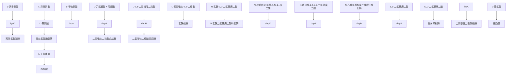
</details>

图4-16 原核细菌D,L-二氨基庚二酸和L-赖氨酸的生物合成途径

---

186

基因工程

用。此外，上述两种途径的运行状况还与细菌培养基中的铵离子浓度关系密切，在较高的铵离子浓度中，脱氢酶途径较为活跃，而当外来铵离子缺乏，只有谷氨酸作为唯一氮源时，琥珀酰化酶途径占绝对优势。

L-赖氨酸生物合成途径的第一步是L-丁氨醛酸与丙酮酸缩合成二氢吡啶二羧酸，这步反应由dapA基因编码的二氢吡啶二羧酸合成酶催化。与dapA紧邻的是dapB基因，它为催化第二步反应的二氢吡啶二羧酸还原酶编码，dapA和dapB的表达及其产物的活性均与赖氨酸或其他氨基酸的存在与否无关。谷氨酸棒杆菌含有较高水平的二氨基庚二酸脱氢酶（由ddh基因编码)活性，其表达状况以及表达产物的活性也不受赖氨酸的影响，因此在此菌种中，由脱氢酶途径合成L-赖氨酸可能较为重要。L-赖氨酸生物合成的最后一步是D,L-二氨基庚二酸的脱羧反应，这一脱羧作用是磷酸吡哆醛依赖型的，由lysA基因编码的二氨基庚二酸脱羧酶催化。

## 2. 赖氨酸的分泌机制

在正常情况下,野生型的谷氨酸棒杆菌并不能大量分泌 L-赖氨酸,而且只有当细菌细胞内 L-赖氨酸的浓度积累到一个临界值时,有限的分泌过程才能启动。因此,在不改变 L-赖氨酸运输系统性能的条件下,任何有利于 L-赖氨酸大量合成并在细胞内积累的因素均可促进其分泌。例如,在谷氨酸棒杆菌发酵液中加入 L-甲硫氨酸或 L-异亮氨酸,能使 L-赖氨酸在培养液中积累,这种现象称为甲硫氨酸效应。甲硫氨酸和异亮氨酸在谷氨酸棒杆菌中都能不同程度地阻遏 hom-thrB 操纵子的转录,hom 基因的编码产物高丝氨酸脱氢酶催化 L-丁氨醛酸生成高丝氨酸,甲硫氨酸和异亮氨酸反馈抑制高丝氨酸脱氢酶的表达,阻断了 L-丁氨醛酸进入苏氨酸、甲硫氨酸和异亮氨酸生物合成途径,在一定程度上促进了 L-丁氨醛酸由赖氨酸生物合成途径转化为 L-赖氨酸,并导致其在细胞内大量积累,进而启动赖氨酸的分泌。

L-苏氨酸虽然与L-甲硫氨酸和L-异亮氨酸同属天冬氨酸系统的氨基酸，也能反馈抑制高丝氨酸脱氢酶，但它同时又能变构抑制L-天冬氨酸激酶的活性，前者有利于L-赖氨酸的合成与积累，而后者又关闭了L-天冬氨酸的代谢途径。因此，L-苏氨酸的大量存在不仅不能诱导L-赖氨酸的分泌，反而会抑制其合成；相反，降低L-苏氨酸的浓度，减轻其对L-天冬氨酸磷酸激酶的变构抑制作用，才能促进L-赖氨酸的分泌。当然，如果能将抗L-赖氨酸和L-苏氨酸变构抑制作用的L-天冬氨酸激酶突变菌用于L-赖氨酸的发酵，效果会更好。

上述L-赖氨酸的分泌过程是建立在被动运输机制基础上的，赖氨酸的分泌速率取决于细胞内外赖氨酸的浓度差。然而，有的谷氨酸棒杆菌突变株可在培养基中产生接近 $1\mathrm{mol} / \mathrm{L}$ 的离子型赖氨酸，说明该菌同时还存在着一个特异性的赖氨酸主动运输系统，大量的实验结果证实这一点。在谷氨酸棒杆菌中，带正电的L-赖氨酸与两个 $\mathrm{OH}^{-}$ 共分泌，而质膜结合型的转运子蛋白不带电，当L-赖氨酸跨过质膜后，转运子蛋白将其结合位点再转向胞质一侧。$\mathrm{H^{+}}$ 和L-赖氨酸的浓度梯度对质膜结合型转运子蛋白的转位作用至关重要，而膜电位则是带正电荷的转运子蛋白回复翻转的动力，不同的谷氨酸棒杆菌菌株(包括突变株)具有不同大小的膜电位，从而决定了其不同的L-赖氨酸主动运输分泌能力。

## 3. 赖氨酸高产工程菌的构建原理

基于组学信息和理论的细胞代谢网络建模，可以预测谷氨酸棒杆菌细胞内L-赖氨酸生物合成最优化的四大关键节点分别是:提升L-赖氨酸生物合成末端途径（即从L-丁氨醛酸至L-赖氨酸的途径)包括脱氢酶分支途径的活性；确保L-丁氨醛酸前体物质草酰乙酸的充足供应；强化L-赖氨酸合成酶系所需的辅酶NADPH的合成；阻断所有无关合成代谢的流量。将上述四大节点分解为可实施基因操作的12处关键靶点（如图4-17所示），然后按照下列设计方案逐次进行靶基因的高效表达、定点突变、无痕敲除单元操作，便可最终构建出集成化的L-赖氨酸高产工程菌。

---

第 4 章 原核细菌基因工程

187


<details>
<summary>flowchart</summary>

This flowchart illustrates the metabolic pathways of glucose metabolism in a plant, showing how various metabolites (such as glucose, lactate, and amino acids) are converted into different substrates like glucose phosphate, starch, and glutamate.
</details>

图4-17 谷氨酸棒杆菌L-赖氨酸生物合成途径的基因操作靶点分布

---

188

基因工程

（1）提升 L-赖氨酸生物合成的末端途径。这一节点涉及四个靶点的基因操作:二氢吡啶二羧酸还原酶编码基因 dapB 采用强组成型启动子  $P_{sod}$  介导过表达；二氨基庚二酸脱氢酶编码基因 ddh 通过提高基因剂量由自身启动子介导过表达；二氨基庚二酸脱羧酶编码基因 lysA 的过表达策略与 ddh 类似；L-天冬氨酸激酶编码基因 lysC 先实施定点突变，然后再由  $P_{sod}$  介导过表达其抗 L-赖氨酸反馈变构抑制的变体酶。

（2）确保前体物质草酰乙酸的充足供应。这一节点涉及两个靶点的基因操作:丙酮酸羧化酶编码基因 pyc 先实施定点突变，然后再由  $P_{sod}$  介导过表达其动力学性质得以优化了的变体酶，促进有利于草酰乙酸积累的丙酮酸羧基化回补反应；无痕敲除磷酸烯醇式丙酮酸激酶编码基因 pck，阻断草酰乙酸的脱羧反应损耗。

（3）强化辅酶NADPH的持续合成。这一节点也涉及两个靶点的基因操作:果糖-1,6-二磷酸酶编码基因fbp采用强组成型启动子 $P_{\mathrm{eftu}}$ （即翻译延伸因子EF-Tu编码基因tuf所属的强组成型启动子)介导过表达，以增加果糖-6-磷酸的积累，进而强化磷酸戊糖途径(PPP)；编码磷酸戊糖途径(PPP)的kt操纵子由 $P_{\mathrm{sod}}$ 介导高效表达，以持续合成充足的NADPH，为L-赖氨酸的生物合成提供强劲的还原力。kt操纵子中含有葡萄糖-6-磷酸脱氢酶(G6PDH)编码基因zwf、转醛醇酶编码基因tal、转酮醇酶编码基因kt、G6PDH亚基编码基因opcA、磷酸葡萄糖酸内酯酶编码基因pgl。

（4）阻断所有无关合成代谢途径的流量。这一节点也涉及两个靶点的基因操作:通过定点突变衰减高丝氨酸脱氢酶编码基因 $hom$ 的活性（此项设计的原理详见4.2.4）；采用定点突变衰减异柠檬酸脱氢酶编码基因 $icd$ 的翻译表达，以降低丙酮酸短路草酰乙酸而直接进入TCA循环。

上述 12 处关键靶点基因操作的逐次叠加产生了一系列中间重组菌株，其 L-赖氨酸的生产效能如图 4-18 所示。整个构建历程的起点为几乎不产 L-赖氨酸的谷氨酸棒杆菌野生株 ATCC13032，经过基因组上 12 处精巧设计环环相扣的操作一跃成为 L-赖氨酸的超级生产菌 LYS-12。

## 4.2.5 精氨酸基因工程菌的构建

L-精氨酸是食品饲料和医药工业重要的半必需氨基酸。在生理医学方面，L-精氨酸能刺激生长激素、催乳素、胰岛素、胰高血糖素的分泌，提升肌肉质量，促进伤口愈合，同时又是心脑血管和神经系统重要介质一氧化氮的前体物质。L-精氨酸与其生物合成相关产物L-鸟氨酸、1,4-丁二胺、藻青素共享同一途径。L-鸟氨酸虽为非蛋白类氨基酸，但能与L-精氨酸及其生物合成途径中的另一中间体L-瓜氨酸联合增强运动员的体能。1,4-丁二胺是一种四碳二氨平台化合物，用于聚合各种高分子材料如尼龙-4,6和尼龙-4,10。藻青素则用于生产另一类生物可降解材料聚天冬氨酸。

L-精氨酸也可以像其他氨基酸那样采取微生物发酵法工业化生产，生产菌种主要为枯草芽孢杆菌和谷氨酸棒杆菌。与L-赖氨酸相似，组学和系统生物学研究在很大程度上促进了高产L-精氨酸的谷氨酸棒杆菌基因工程菌的构建。

## 1. 精氨酸的生物合成途径

原核细菌拥有三条L-精氨酸生物合成途径，即所谓的“线型”“环型”“新型”途径。它们均以源自TCA循环中间代谢物 $\alpha$ -酮戊二酸的L-谷氨酸为起始前体分子，经八步酶促反应最终合成L-精氨酸，其主要区别在于涉及途径中间代谢物 $N$ -乙酰鸟氨酸转换的基因不同。在线型途径中， $N$ -乙酰鸟氨酸由argE基因编码的乙酰鸟氨酸酶负责转换至L-鸟氨酸；在环型途径中， $N$ -乙酰鸟氨酸则由argJ基因编码的鸟氨酸乙酰转移酶催化生成L-鸟氨酸；而在新型途径中，L-鸟氨酸被绕过，直接由argF'基因编码的乙酰鸟氨酸氨甲酰转移酶合成L-鸟氨酸之后的中间产物 $N$ -乙酰瓜氨酸。线型途径存在于较少的细菌物种如黄

---

第 4 章 原核细菌基因工程

189


<details>
<summary>bar</summary>

| Gene | Gene Name | Gene Operation | Value (g/L) |
| :--- | :--- | :--- | :--- |
| ATCC13032 | 野生株 | 定点突变 lysC 基因产生 T3111 | ~40 |
| LYS-1 | 野生株+ | 增加 ddh 基因拷贝 | ~45 |
| LYS-2 | LYS-1+ | 敲除 pck 基因 | ~48 |
| LYS-3 | LYS-2+ | 由 Psod 启动子介导 dapB 基因过表达 | ~50 |
| LYS-4 | LYS-3+ | 增加 lysA 基因拷贝 | ~52 |
| LYS-5 | LYS-4+ | 由 Psod 启动子介导 lysC 基因过表达 | ~55 |
| LYS-6 | LYS-5+ | 定点突变 hom 基因产生 V59A | ~58 |
| LYS-7 | LYS-6+ | 定点突变 pyc 基因产生 P485S | ~60 |
| LYS-8 | LYS-7+ | 由 Psod 启动子介导 pyc 基因过表达 | ~62 |
| LYS-9 | LYS-8+ | 更换 icd 基因起始密码子 ATG 为 GTG | ~70 |
| LYS-10 | LYS-9+ | 更换 fbp 基因自身启动子为 Peffu | ~90 |
| LYS-11 | LYS-10+ | 更换 tkt 操纵子自身启动子为 Psod | ~105 |
| LYS-12 | LYS-11+ | N/A | ~120 |
</details>

图4-18 谷氨酸棒杆菌高产L-赖氨酸基因工程株的生产效能

色黏球菌($Myxococcus xanthus$)和大肠杆菌中;谷氨酸棒杆菌及其他众多原核细菌则通过环型途径合成L-精氨酸,此处“环型”的意思是指第五步反应中从N-乙酰鸟氨酸上脱去的乙酰基团被循环用于第一步反应的L-谷氨酸乙酰化(图4-19)。据了解,环型途径比线型途径进化得更好,效率更高。

就染色体上的基因顺序组织而言，L-精氨酸生物合成基因的编排因物种不同而异。在谷氨酸棒杆菌中，argCJBDFRGH基因簇被分成argCJBDFR和argGH两个操纵子，两者的转录均受控于L-精氨酸、ArgR、FarR（图4-19）。FarR通过与argC、argB、argF、argG基因的上游区域结合而调控arg操纵子的转录。此外，FarR也能通过与编码谷氨酸脱氢酶（催化将 $\alpha$ -酮戊二酸转换成L-谷氨酸)的gdh基因上游区域结合而间接控制L-精氨酸的生物合成。类似地，全局性调控因子ArgR与argC和argG的启动子结合控制L-精氨酸的生物合成，且L-精氨酸能提升其下调的力度，但ArgR的启动子结合亲和力为L-脯氨酸所降低，也就是说L-脯氨酸是L-精氨酸生物合成的刺激因子。

## 2. 精氨酸高产工程菌的构建原理

根据上述谷氨酸棒杆菌 L-精氨酸生物合成途径及其基因表达调控机制,高产菌株的理性设计策略包括下列三个方面(图 4-19):

## (1) 解除阻遏反馈抑制

以谷氨酸棒杆菌ATCC21831株作为基因工程菌构建的出发菌株（AR0），其利用葡萄糖为唯一碳源间歇式发酵产L-精氨酸的水平为 $17.1\mathrm{g / L}$ 。为了使其适应高产L-精氨酸所面临的产物压力，首先借助随机诱变程序筛选出对L-精氨酸结构类似物刀豆氨酸(CVN)和精氨酸异羟肟酸(AHX)具有高耐受性的突变株(AR1)，其在等同发酵条件下产L-精氨

---

190

基因工程


<details>
<summary>flowchart</summary>

This diagram illustrates the metabolic pathways of glucose metabolism in the gut system, showing how various sugars and enzymes drive different metabolites such as glucose metabolism, starch metabolism, and glutathione metabolism.
</details>

图4-19 谷氨酸棒杆菌L-精氨酸生物合成途径及其基因操作策略

酸的水平提升至 34.2 g/L。为了进一步理性确定基因操作的靶点，将 AR0 和 AR1 株的全基因组测序并进行序列比对，结果发现 AR0 株中共计 254 个已注释的基因在 AR1 株中或缺失或发生单碱基序列多态性变化 (SNP)，其中四个与 L-精氨酸生物合成有关的 SNP 突变型基因分别为 argF、argJ、argR、carB（编码氨甲酰磷酸合成酶），碱基突变所造成的氨基

---

第 4 章 原核细菌基因工程

191

酸更换如图 4-19 所示(argJ 因发生的是同义突变未列出)。

鉴于 ArgR 和 FarR 均为 L-精氨酸生物合成基因的转录阻遏因子，且 FarR 同时还抑制 gdh（编码催化  $\alpha$ -酮戊二酸生成 L-谷氨酸的谷氨酸脱氢酶）和 pgl（编码催化 6-磷酸葡糖酸内酯生成 6-磷酸葡萄糖酸的葡萄糖酸内酯酶）基因的表达（图 4-19），因此基因操作的第一步是删除这两个阻遏因子的编码基因 argR 和 farR，产生 AR2 株，其发酵合成 L-精氨酸的水平进一步提高到 61.9 g/L。

## (2) 提升 NADPH 水平

与 L-赖氨酸生物合成的情形相似，细胞内 NADPH 的水平也同样是 L-精氨酸高产的瓶颈，因为合成 1 分子 L-精氨酸需要消耗 3 分子 NADPH。为了提升胞内的 NADPH 水平，首先将 pgi 基因（编码葡萄糖-6-磷酸异构酶）的翻译起始密码子 ATG 转换成不常用的 GTG，以衰减葡萄糖-6-磷酸转换为果糖-6-磷酸的能力（完整敲除 pgi 基因会导致细菌生长严重受阻）。由此形成的 AR3 株虽然将 L-精氨酸发酵水平进一步提升至 80.2 g/L，但其葡萄糖消耗速率降低，且发酵周期延长，这是因为糖酵解途径的衰减以及显著增加的磷酸戊糖途径(PPP)碳流远远超出天然 PPP 酶系的代谢能力所致。

为了解决上述代谢平衡问题,以谷氨酸棒杆菌的强组成型启动子  $P_{sod}$  置换 AR3 株 PPP 操纵子所属的天然启动子(此处与 L-赖氨酸高产菌构建策略相同),由此构建的 AR4 株虽然 L-精氨酸的发酵水平有所降低,但葡萄糖消耗速率得以大幅度提升,且发酵周期缩短了 40 h。

## (3) 强化 L-精氨酸生物合成途径

为了进一步提高 AR4 株合成 L-精氨酸的能力，首先敲除谷氨酸棒杆菌负责 L-谷氨酸外输分泌的 Ncgl1221 基因，但这项操作对提高 L-精氨酸的合成贡献不大；其次，将 AR1 株引入的 argF 随机突变 G166C 重新恢复其野生型，进而使发酵周期再缩短 10 h，表明这一突变事实上属于负突变；再次，受随机突变结果的启示，用强启动子  $P_{sod}$  置换 AR4 株的 carB 基因所属启动子。由上述三项操作构建成 AR5 株，其 L-精氨酸的发酵水平提升至 82 g/L，但同时伴有中间产物 L-瓜氨酸的积累和分泌。在大规模生产过程中，L-瓜氨酸的存在会增加目标产物 L-精氨酸分离纯化的困难。因此，最后一步便通过谷氨酸棒杆菌强组成型启动子  $P_{eftu}$  置换 argGH 操纵子原有启动子，强化由 L-瓜氨酸向 L-精氨酸的转换，最大限度地降低 L-瓜氨酸的积累和分泌。由此构建出的重组谷氨酸棒杆菌 AR6 株间歇式发酵产 L-精氨酸的水平最终定格为 92.5 g/L，单位葡萄糖的产率达到 0.40 g/g。上述所有操作及其效果的对应关系总结在图 4-20 中。

## 3. 精氨酸衍生物的高产菌构建

L-精氨酸生物合成的衍生物 L-鸟氨酸也已采用微生物发酵生产，其生产菌株的基因工程理性设计策略与 L-精氨酸类似，但需增加工程菌 L-精氨酸和 L-脯氨酸营养缺陷的补救措施。由于 L-鸟氨酸是通向 L-精氨酸、L-脯氨酸、精胺生物合成的枢纽分子，因此联合敲除 L-鸟氨酸氨甲酰转移酶编码基因 argF、L-谷氨酸激酶编码基因 proB、精胺合成酶编码基因 speE 以分别阻断 L-精氨酸、L-脯氨酸、精胺合成分支途径，是高效积累 L-鸟氨酸广泛采纳的策略。但上述三个基因的敲除直接导致工程菌呈 L-精氨酸和 L-脯氨酸营养缺陷型，严重影响工程菌的正常生长，因此需要在 L-鸟氨酸发酵时添加适量的 L-精氨酸和 L-脯氨酸。

与高产 L-赖氨酸和 L-精氨酸基因工程菌的构建策略类似, 强化细胞内的 NADPH 池也同样能改善 L-鸟氨酸的生产。但有所不同的是, L-鸟氨酸高产菌的构建采用枯草芽孢杆菌编码 NAD 依赖型谷氨酸脱氢酶的 rocG 基因, 这种酶能催化 $\alpha$-酮戊二酸以一种 NADPH 非依赖性的方式转换成 L-谷氨酸, 从而省下更多的 NADPH 用于 L-鸟氨酸的生

---

192

基因工程

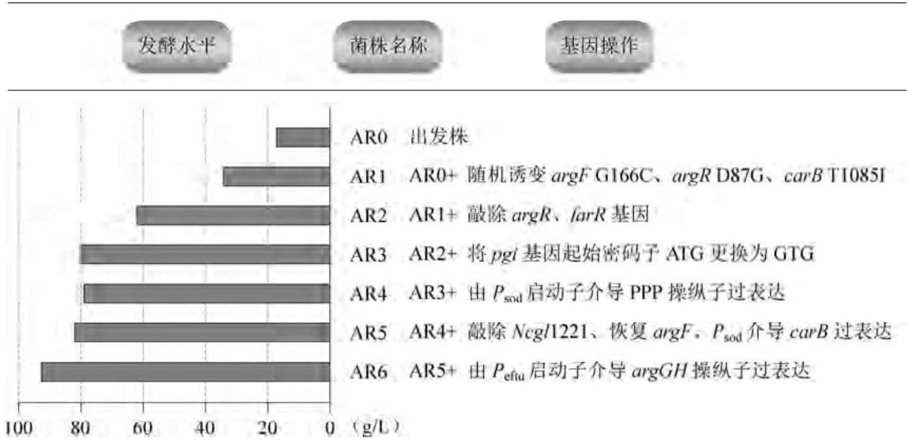

<details>
<summary>bar</summary>

| Gene Variant | Gene Name | Gene Function | Fermentation Level (g/L) |
| :--- | :--- | :--- | :--- |
| AR0 | — | 出发株 | ~25 |
| AR1 | AR0+ | 随机诱变 argF G166C、argR D87G、carB T1085I | ~45 |
| AR2 | AR1+ | 敲除 argR、farR 基因 | ~60 |
| AR3 | AR2+ | 将 pgi 基因起始密码子 ATG 更换为 GTG | ~80 |
| AR4 | AR3+ | 由 Psod 启动子介导 PPP 操纵子过表达 | ~80 |
| AR5 | AR4+ | 敲除 Ncgl1221、恢复 argF、Psod 介导 carB 过表达 | ~80 |
| AR6 | AR5+ | 由 Pefu 启动子介导 argGH 操纵子过表达 | ~95 |
</details>

图4-20 谷氨酸棒杆菌高产L-精氨酸基因工程株的生产效能

物合成。灭活两个推测编码葡萄糖酸激酶的基因 NCgl2399 和 NCgl2905（相当于 gntK）也能使 NADPH 池更加充裕。过表达由 ppnK 基因编码的 ATP 依赖型 NAD 激酶有助于提高 L-鸟氨酸的产量，但编码葡萄糖-6-磷酸脱氢酶的 zwf 以及编码 6-磷酸葡萄糖酸脱氢酶的 gnd 却没有类似的效应，可能的原因是这种基于质粒的基因过表达对细胞造成了负担，因为在染色体上这两个基因的过表达有利于 L-鸟氨酸的生产。综合上述策略构建的一株工程菌在间歇式发酵中能积累 51.5 g/L 的 L-鸟氨酸。

藻青素由等分子的L-赖氨酸与L-天冬氨酸缩合构成，cphA基因编码的藻青素合成酶催化这一聚合反应。因此，过表达异源性cphA基因是构建高产藻青素基因工程菌的主要策略。具体理性设计方案包括:使用不能积累聚羟基脂肪酸酯的突变株；构建C595S型CphA高活性变体；在 $\Delta eda$ 缺失株中，使用携带eda基因的表达质粒，这样可以避免在大规模发酵系统中使用抗生素来稳定重组质粒。eda基因编码2-酮基-3-脱氧-6-磷酸葡萄糖酸醛缩酶，后者为细菌代谢葡萄糖酸和果糖所必需。

## 4.3 链霉菌基因工程

链霉菌属是革兰氏阳性的好氧丝状原核细菌，其生长周期涉及一个复杂的形态分化过程，包括孢子发芽、营养菌丝和气生菌丝形成以及孢子生成。链霉菌具有完善的代谢和分泌系统，能够分解大多数稳定的生物多聚物以及一些人工合成的高分子化合物。链霉菌最为显著的特征是其丰富的次级代谢途径以及初级代谢与次级代谢之间转换的严密调控系统。目前世界上发现的5000多种抗生素中，60%以上是由链霉菌合成的，作为抗生素的生产菌，链霉菌在传统发酵工业中的应用有着悠久的历史。随着天蓝色链霉菌（Streptomyces coelicolor，2002年）、阿维链霉菌（Streptomyces avermitilis，2003年）、灰色链霉菌（Streptomyces griseus，2008年）、疮痂病链霉菌（Streptomyces scabies，2010年）的全基因组相继完成测序，链霉菌次级代谢物的资源开发以及基因重组展现出更为广阔的应用前景，有望成为继大肠杆菌、芽孢杆菌之后的第三个优良的基因表达和分泌平台。

## 4.3.1 链霉菌的载体克隆系统

链霉菌属含有大量的野生型质粒,其中研究最为详尽的是来自天蓝色链霉菌 A3(2)株

---

第 4 章 原核细菌基因工程

193

的可转移性因子 SCP2 \* (31 kb) 以及来自变铅青链霉菌 (Streptomyces lividans) ISP5434 株的非转移性质粒 pIJ101 (8.9 kb)。两者的复制子是相容性的，不存在任何同源序列。SCP2 \* 在宿主菌中通常只有 1～2 个拷贝，而 pIJ101 在变铅青链霉菌中可达 40～300 个拷贝。在变铅青链霉菌 66 株与天蓝色链霉菌 A3(2) 株的接合过程中，后者染色体 DNA 的一段序列转入接合受体菌，可形成另一种中等拷贝 (4～5 个拷贝) 的质粒 SLP1.2。目前广泛使用的链霉菌克隆表达质粒绝大多数以上述三种质粒为模板构建而成，另有一小部分载体则分别从其他的链霉菌野生型质粒和噬菌体 DNA 中获取复制子序列。

## 1. 链霉菌的重组克隆载体

重组克隆载体通常是指仅用于外源 DNA 片段克隆的自主复制型高拷贝质粒。经典的链霉菌重组克隆质粒包括:

## (1) pIJ702

pIJ702属于高拷贝的pIJ101衍生质粒。pIJ101在变铅青链霉菌ISP5434株中可通过自发缺失突变产生pIJ102(4.0 kb)、pIJ103(3.9 kb)、pIJ104(4.9 kb)三种衍生物。其中，pIJ102经BclI部分酶解线性化后，与含有硫链丝菌素抗性基因(tsr)的青蓝链霉菌（Streptomyces azuneus）BclI染色体DNA片段(1.1 kb)重组，形成杂合质粒pIJ350。后者转化变铅青链霉菌66株，在细胞内缺失一段 $1\mathrm{kb}$ 的片段，形成的质粒再用BclI部分酶解，并与含有黑色素生物合成基因(melC)的抗链霉菌（Streptomyces antibioticus）BclI染色体DNA片段(1.55 kb)体外连接，最终形成 $5.65\mathrm{kb}$ 的pIJ702(图4-21)。

pIJ702 能在链霉菌属中高拷贝复制，两个标记基因 tsr 和 mel 也能在绝大多数链霉菌中稳定表达。在典型的链霉菌重组克隆系统中，转化子可由硫链丝菌素抗性筛选，而 mel 基因中的三个唯一限制性酶切口 SacI、BglII、SphI 又为外源 DNA 片段的插入灭活提供了方便，因此不产黑色素的白色克隆即为重组子 $(tsr^{+}, mel^{-})$ 。pIJ702 具有非接合特性，所以可广泛用作鸟枪法克隆外源基因的载体，其最大装载量约为 10 kb。此外，pIJ702 具有与 pIJ101 等量的拷贝数，在无选择压力存在的情况下，能在宿主菌中稳定地遗传几代，即便是在高浓度的质粒驱逐剂（如溴乙锭等）存在下也不易丢失，因此是链霉菌重组克隆系统中最理想的载体。

## (2) pIJ61

pIJ61 的复制子来自野生型质粒 SLP1.2。将 SPL1.2 上的两个复制非必需区域缺失，然后分别加入弗氏链霉菌(Strectomyces fradiae)的氨基糖苷磷酸转移酶基因(aph)和青蓝链霉菌的硫链丝菌素抗性基因，即可构建成 pIJ61(14.8 kb)。aph 基因的编码产物可使许多氨基糖苷类抗生素(如链霉素等)磷酸化而失活，因此也是一种链霉素抗性基因，其编码序列中的单一限制性酶切口 BamHI、PstI、XbaI 是理想的插入灭活型克隆位点。pIJ61 的装载量比 pIJ702 大，但拷贝数少，在溴乙锭存在时，pIJ61 容易从转化子中逃逸。

除了上述两个抗药性标记基因外，pIJ61还具有典型的致死接合反应标记 $(Ltz^{+})$ ，这一标记基因来自野生型质粒SLP1.2。绝大多数的链霉菌接合型质粒均能使其宿主菌产生凹陷菌落，当含有某些接合型质粒的链霉菌与不含相同或亲缘关系相近的接合质粒的链霉菌混合培养时，前者由于生长受到限制而形成凹陷菌落，这种菌落与溶原噬菌体形成的浑浊噬菌斑很相似。如果选择 $Ltz^{+}$ 的链霉菌(如变铅青链霉菌66株)作为受体，则pIJ61转化子便可以以凹陷菌落的形式被方便地筛选出来。

## (3) pIJ699

pIJ699 是一个含有 pIJ101 型链霉菌复制子和 p15A 型大肠杆菌复制子的正选择穿梭质粒，它同时含有用于链霉菌转化系统的筛选标记硫链丝菌素抗性基因以及用于大肠杆菌转化系统的筛选标记紫霉素抗性基因(vph)和氨基糖苷磷酸转移酶基因(aph)。此外，在链霉

---

194

基因工程

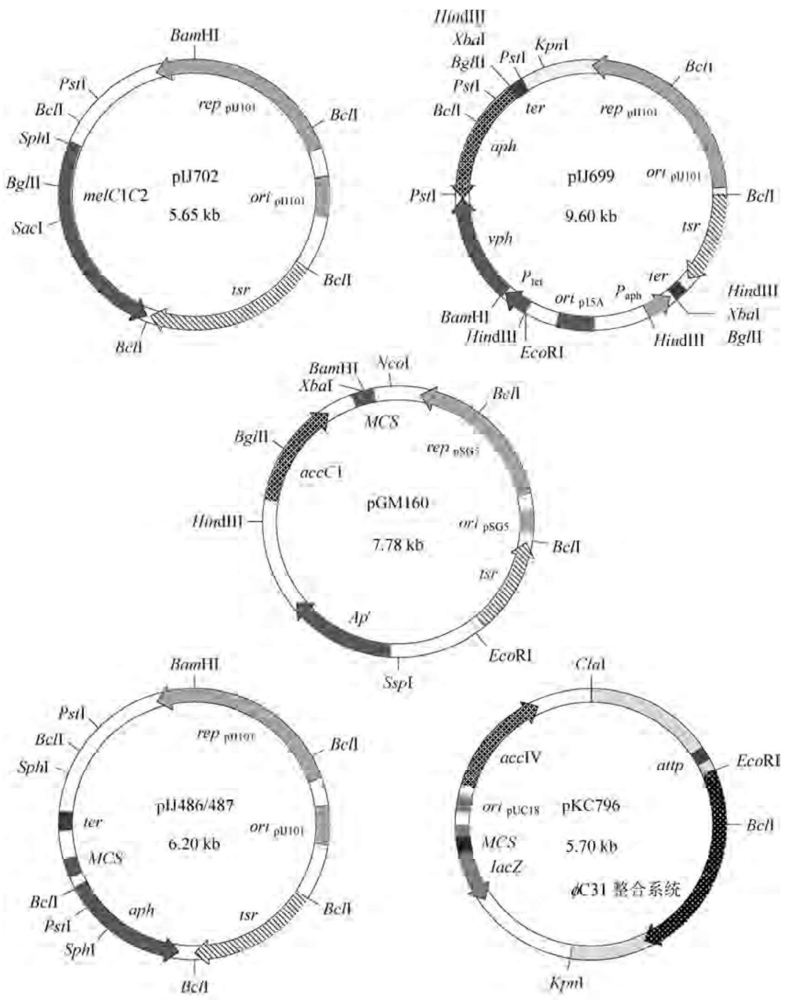

pIJ486 MCS: BglII PstI HindIII SphI PstI SalI XbaI BamHI Smal KpnI SacI EcoRI BglII, 下画线为唯一位点
pIJ487 MCS: BglII EcoRI SacI KpnI Smal BamHI XbaI SalI PstI SphI HindIII PstI BglII, 下画线为唯一位点
pGM160 MCS: SacI KpnI Smal BamHI XbaI SalI PstI SphI HindIII, 下画线为唯一位点
pKC796 MCS: EcoRI EcoRV BstNI NotI SalI BamHI XbaI SacI PstI HindIII, 下画线为唯一位点

图4-21 五种主要的链霉菌克隆质粒图谱

---

第 4 章 原核细菌基因工程

195

菌质粒与大肠杆菌质粒的交界处，存在两套HindIII-XbaI-BglII多克隆位点以及两个拷贝的大肠杆菌fd噬菌体转录终止子结构，两者方向相反。pIJ699总长 $9.6\mathrm{kb}$，其中链霉菌质粒部分与大肠杆菌质粒部分分别为 $5.0\mathrm{kb}$ 和 $4.6\mathrm{kb}$（图4-21）。

任何含有两个不间断反向重复顺序(如两个终止子结构)的质粒都是不稳定的,很难在宿主细胞中遗传,但若在这两个反向重复顺序之间插入一段大于50 bp的DNA片段,即可控制这种不稳定性,pIJ699正是根据上述原理设计构建的。该载体质粒可在大肠杆菌中保存并扩增,使用时只需将外源DNA片段在多克隆位点处取代大肠杆菌质粒部分即可,空载的链霉菌质粒部分在连接后,形成两个反向终止子结构直接接触而不能在受体菌中稳定复制,因此在含有硫链丝菌素的转化平板上长出的菌落绝大多数是重组克隆。此外,以终止子结构作为重复顺序还可以有效地避免克隆的外源DNA片段与载体上编码序列之间由于转录过头所造成的相互影响,从而提高外源基因的表达水平及重组质粒的稳定性。

## (4) pIJ486/487

pIJ486 和 pIJ487 是以 pIJ702 为基本框架的链霉菌启动子探针质粒，两者的唯一区别是位于新霉素抗性基因上游的多克隆位点序列相反（图 4-21）。作为报告基因的新霉素抗性基因不含启动子，在多克隆位点的上游还装有来自大肠杆菌 fd 噬菌体 DNA 的强终止子结构，以防止载体基因转录过头所引起的报告基因非特异性表达。任何内源或外源 DNA 片段插入多克隆位点中的 BglII、EcoRI、SacI、BamHI、XbaI 或 HindIII 处，通过检测重组克隆的卡那霉素抗性水平，即可确定插入片段有无启动子活性，而且克隆菌对卡那霉素的抗性越高，所克隆的启动子的活性就越强。

除了新霉素抗性基因外，还可将大肠杆菌的氯霉素抗性基因（cat）和红色链霉菌（Streptomyces erythraeus）的红霉素抗性基因（ermE）作为报告基因，分别构建出另外两组链霉菌启动子的探针质粒pIJ462/463以及pIJ479/480。上述质粒在变铅青链霉菌中的拷贝数大都在100～200，且在硫链丝菌素的选择压力存在下表现出较高的稳定性。

## (5) pGM160

链霉菌 pGM 系列质粒（如 pGM9、pGM11、pGM16、pGM17、pGM160）是一类温度敏感型复制的重组克隆质粒，其复制子来自加纳链霉菌（Streptomyces ghanaensis）的野生型质粒 pSG5。pSG5 复制子在 34℃以下时能稳定复制并遗传，但在 37～39℃ 内质粒便停止复制并随着宿主细胞的分裂而逐渐丢失。这一特性非常适用于基于同源重组的基因敲除，经二次重组后，质粒不再存在于宿主细胞中。pGM160 同时也是大肠杆菌-链霉菌穿梭质粒，含有庆大霉素抗性基因（aacC1）、硫链丝菌素抗性基因（tsr）和氨苄青霉素抗性基因（ $Ap^{r}$ ），唯一的酶切位点有 BamHI、XbaI、BglII、EcoRI（图 4-21）。

## (6) pKC796

pKC796 是一种不含链霉菌复制子的整合型质粒，由来自链霉菌广宿主温和型噬菌体  $\phi C31$  的 ClaI-KpnI DNA 片段 (4.0 kb) 与大肠杆菌质粒 pKC787 重组而成。前者含有  $\phi C31$  基因组 DNA 的位点特异性整合序列 (attp)，后者是 pUC18 的衍生质粒（改变多克隆位点序列并将阿普拉霉素抗性基因 accIV 取代氨苄青霉素抗性基因  $Ap^{r}$ ，见图 4-21）。将外源或内源 DNA 片段克隆在 pKC796 的多克隆位点上，先转化大肠杆菌，通过 accIV 和 lacZ' 筛选重组子，然后将抽取的重组质粒直接转化链霉菌。重组分子依靠 pCK796 上提供的 attp 序列特异性地整合在宿主染色体 DNA 的相应位点上，整合性克隆菌同样用 accIV 筛选 (accIV 在大肠杆菌和链霉菌中均可以表达)，未整合的重组分子由于不能在链霉菌中复制，因而不被选择。这种不含链霉菌复制子结构的整合型质粒不但筛选方便，而且其整合频率也比含有链霉菌复制子结构的相同整合质粒要高 100 倍。

---

196

基因工程

## 2. 链霉菌的表达分泌载体

用于链霉菌的表达分泌载体通常包括组成型分泌表达、组成型非分泌表达、诱导型分泌表达、诱导型非分泌表达四类质粒，它们的基本特征列在表4-11中。其中几种性能优异的表达分泌质粒分述如下:

表 4-11 用于链霉菌的表达质粒

| 质粒名称 | 构建来源 | 大小/kb | 筛选标记 | 表达条件 | 产物定位 | 纯化标签 |
| --- | --- | --- | --- | --- | --- | --- |
| pSJ205ΔEcA |  |  |  | 组成型$P_{\text{SSI}}$ | 分泌型 |  |
| pRM5 | SCP2* | 24.3 | $tsr, Apr^{r}$ | 生长期依赖型启动子$P_{\text{actI}}$ | 胞质型 |  |
| pLTI-CD4 |  |  |  | 组成型$P_{\text{STI-II}}$ | 分泌型 |  |
| pLMS |  |  |  | 组成型$P_{\text{aml}}$ | 分泌型 |  |
| pIJ6021 | pIJ487 | 7.2 | $aph, tsr$ | 诱导型$P_{\text{tipA}}, \text{Th}$诱导 | 胞质型 |  |
| pIJ4123 | pIJ487 | 9.2 | $aph, tsr$ | 诱导型$P_{\text{tipA}}, \text{Th}$诱导 | 胞质型 | 6×His |
| pULHis2 | pIJ699 | 4.1 | $aph, Apr^{r}$ | 诱导型$P_{\text{tipA}}, \text{Th}$诱导 | 胞质型 | 6×His |
| pITS107 | pIJ486 | 7.1 | $aph, tsr, Apr^{r}$ | 诱导型$P_{\text{tra}}, \text{热诱导}$ | 胞质型 |  |
| pSH19 | pIJ487 | 5.7 | $tsr$ | 诱导型$P_{\text{nitA}}, \text{Ca}$诱导 | 胞质型 |  |
| pTONA5 | pIJ702 |  | $aph, tsr$ | 组成型$P_{\text{SSMP}}$ | 胞质型 |  |
| pPC830 | pSET152 |  | $aph, accIV$ | 诱导型$P_{\text{tc830}}, \text{Tc}$诱导 | 胞质型 |  |
| pUC702 | pIJ702 |  | $tsr, Apr^{r}$ | 组成型$P_{\text{pld}}$ | 分泌型 | 6×His |
| pNAnti-Prot | pN702Gem3 |  | $aph$ | 诱导型$P_{\text{pstS}}, \text{木糖诱导}$ | 胞质型 |  |

注:Th—硫链丝菌素；Ca—ε-己内酰胺；aph—氨基糖苷磷酸转移酶基因；tsr—硫链丝菌素抗性基因；accIV—阿普拉霉素抗性基因。

（1）pPC830。pPC830是大肠杆菌-链霉菌穿梭质粒，含有接合转移起始位点oriT，因而可从大肠杆菌接合转化进链霉菌；同时还安装了链霉菌噬菌体 $\phi C31$ 的整合基因(int)以及整合边界序列attL和attR，能高效整合在链霉菌染色体上的 $\phi C31-att$ 位点处。
（2）pTONA5。pTONA5也是含有oriT的大肠杆菌-链霉菌穿梭质粒，能进行接合转化，但它装有pIJ101的复制起始位点（由pIJ702提供），因而能在链霉菌中高拷贝自主复制。pTONA5的克隆位点含有NdeI、EcoRI、XbaI、HindIII酶切序列。
（3）pUC702。pUC702也是大肠杆菌-链霉菌穿梭质粒，同样能在链霉菌中高拷贝自主复制，但因不含oriT位点，因而不能进行接合转化。
（4）pSH19。pSH19是纯粹的链霉菌质粒，不含大肠杆菌序列，能在链霉菌中高拷贝自主复制，克隆位点含有多个单一酶切序列，如EcoRI、SacI、KpnI、BamHI、XbaI、PstI、SphI、HindIII。
(5) pNAnti-Prot。pNAnti-Prot 是一种无需添加抗生素便能在链霉菌培养中维持稳定的高拷贝表达型质粒，其工作原理如图 4-22 所示。变铅青链霉菌基因组中分别含有毒素及其对应的抗毒素编码基因 yoeB/yefM。毒素(YoeB)因其 mRNA 干扰酶活性而抑制宿主细胞内蛋白质翻译的起始，而抗毒素(yefM)则抑制 YoeB 的毒性。事先将变铅青链霉菌基因组上的 yoeB/yefM 删除( $\Delta TA$ )，接着先后导入含 yefM 和 yoeB 表达框的两种重组质粒，其中克隆在温敏型质粒 pGM160 上的 yefM 表达框则由强启动子  $P_{xysA}$  介导高效表达，而 yoeB 表达框由整合型质粒 pKC796 介导整合在铅青链霉菌的染色体上，由此构建出的变铅青链霉菌呈  $\Delta TA - pKC796 - yoeB(pGM160 - yefM^{TS})$  基因型。pNAnti-Prot 含同样的 yefM 表达框，并加装用于目的基因表达的强启动子  $P_{pstS}$，后者与  $P_{xysA}$  均为木糖所诱导。待含目的基因的 pNAnti-Prot 重组质粒导入上述变铅青链霉菌  $\Delta TA - pKC796 - yoeB(pGM160 - yefM^{TS})$  专用受体细胞后，便可在 37℃ 将 pGM160 - yefM $^{TS}$  置换，由此形成稳定的表达系统。

---

第 4 章 原核细菌基因工程

197

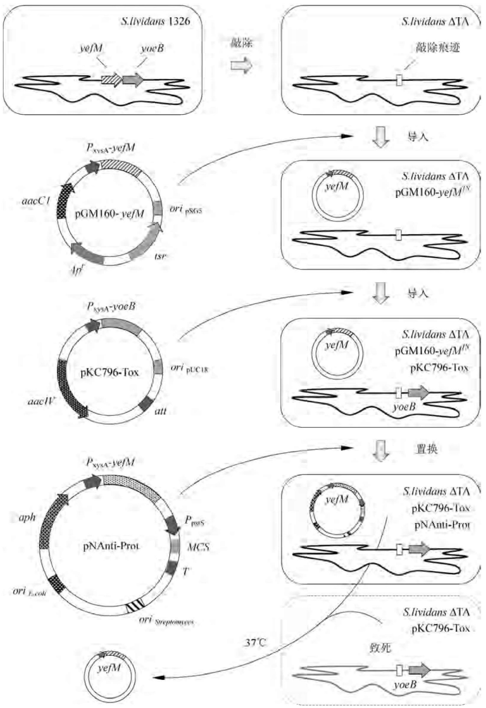

<details>
<summary>flowchart</summary>

```mermaid
graph TD
  A["S.lividans 1326"] -->|敲除| B["S.lividans ΔTA"]
  B -->|敲除痕迹| C["S.lividans ΔTA\npGM160-yefM^IN"]
  C -->|导入| D["pKM160-yefM"]
  D --> E["pKC796-Tox"]
  E -->|导入| F["pKC796-Tox\npGM160-yefM^IN"]
  F -->|置换| G["pNAnti-Prot"]
  G -->|致死| H["yefM"]
  H --> I["ori Streptomyces"]
  I --> J["ori L.coli"]
  J --> K["MCS"]
  K --> L["aph"]
  L --> M["PxySA-yefM"]
  M --> N["PsysA-yefM"]
  N --> O["pGMS"]
  O --> P["ori pSG5"]
  P --> Q["pXysA-yefM"]
  Q --> R["aacC1"]
  R --> S["pGM160-yefM"]
  S --> T["srf"]
  T --> U["att"]
  U --> V["ori pUC18"]
  V --> W["PxySA-yoeB"]
  W --> X["pKC796-Tox"]
  X --> Y["yefM"]
  Y --> Z["S.lividans ΔTA\npKM160-yefM^IN\npKC796-Tox"]
  Z --> AA["yoeB"]
```
</details>

图4-22 无抗生素选择压力下pNAnti-Prot稳定维持的工作原理

---

198

基因工程

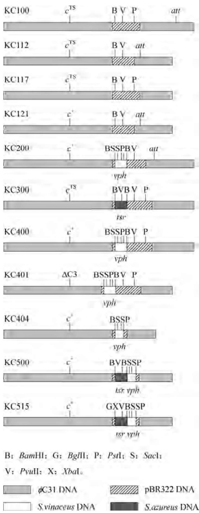

<details>
<summary>text_image</summary>

KC100
cTS
B V P
att
KC112
cTS
B V att
KC117
cTS
B V P
KC121
c+
B V att
KC200
c'
BSSPBV att
vph
KC300
cTS
BVB V P
tsr
KC400
c'
BSSPBV P
vph
KC401
ΔC3 BSSPBV P
vph
KC404
c'
BSSP
vph
KC500
c'
BVBSSP
tsr vph
KC515
c'
GXVBSSP
tsr vph
B: BamHI; G: BglII; P: PstI; S: Sacl;
V: PyvII; X: XbaI.
φC31 DNA pBR322 DNA S.vinaceus DNA S.azureus DNA
</details>

图4-23 链霉菌KC噬菌体载体系统

## 3. 链霉菌的 KC 噬菌体载体系列

KC 系列是用于链霉菌重组克隆系统的噬菌体载体，它们均由链霉菌  $\phi C31$  温和型噬菌体 DNA、大肠杆菌质粒 pBR322 以及链霉菌标记基因构建而成，并含有 attp 特异性整合位点和噬菌体溶原维持的 c 基因。如果载体携带温度敏感型的 c 突变基因 ( $c^{TS}$ )，则整合在宿主染色体上的载体或重组分子可用热诱导方法转入溶菌循环。 $\phi C31$  温和型噬菌体的宿主范围较广，能在大约三分之二的链霉菌中进行溶原和溶菌循环。目前实验室常用的 KC 系列载体允许插入的外源片段大小为 1.5～6.0 kb，其构成图谱如图 4-23 所示。

## 4.3.2 链霉菌的宿主转化系统

虽然天蓝色链霉菌 A3(2) 是链霉菌属中分子遗传学研究最为详尽的菌株,但在 DNA 重组实验中,变铅青链霉菌 66 株及其衍生株(如 TK23 和 TK24 等)一直是最理想、应用也最广泛的克隆表达受体菌,它不含内源型质粒,遗传背景清楚,易于质粒的转化操作,而且对外源 DNA 基本上无明显的限制修饰作用。变铅青链霉菌不但能识别绝大多数链霉菌的启动子和终止子,还能高效表达一些来自大肠杆菌、凋谢沙雷氏菌(Serratia marcescens)、鼠伤寒沙门氏菌(Salmonella typhimurium)、枯草芽孢杆菌以及包氏分枝杆菌(Mycobacterium bovis)等众多革兰氏阳性和阴性菌的基因。此外与大肠杆菌相比,变铅青链霉菌作为外源基因克隆表达受体的一个显著优点是拥有高效率的异源蛋白分泌系统,但其内源或外源蛋白酶的活性却远小于枯草芽孢杆菌。重组分子导入变铅青链霉菌的途径主要有原生质体转化和噬菌体转染两种形式。

## 1. 链霉菌的原生质体转化法

在变铅青链霉菌的转化和转染操作

中，原生质体的制备与再生是一项关键技术，许多链霉菌菌株均能依据下列标准程序制备和再生原生质体。细菌在含有34%蔗糖的YEME培养基中培养至对数生长后期，收集菌丝体，用10%的蔗糖溶液洗涤，再用含有1 mg/mL溶菌酶的P缓冲液悬浮，于30℃保温15～60 min，差速离心或过滤除去未原生质体化的菌丝体。获得的原生质体用P缓冲液悬浮至

---

第 4 章 原核细菌基因工程

199

$10^{10}$ 个/mL的密度,经分装后,先置于冰盒中于 $-70^{\circ}C$ 过夜,然后再除去冰块,放置在 $-70^{\circ}C$ 下保藏备用。

转化时，取1 mL原生质体，离心除去P缓冲液，用残余的缓冲液温和悬浮原生质体，然后依次加入不超过10  $\mu$ L的连接反应液、100  $\mu$ L含25% PEG1000的T缓冲液或P缓冲液、1 mL的P缓冲液。离心除去上清液，再用1 mL新鲜的P缓冲液悬浮原生质体。将100～200  $\mu$ L悬浮液均匀涂布在R2YE再生平板上，30℃培养过夜。如果连接体系中的质粒是pIJ702，则可用3 mL含300  $\mu$ g/mL硫链丝菌素的软琼脂SNA覆盖过夜培养的再生平板。待凝固后，于30℃继续扩增培养48～60 h，长出的克隆即为转化子。

在最佳转化条件下，每微克 ccc 质粒转化变铅青链霉菌或天蓝色链霉菌原生质体，可得到  $10^{6} \sim 10^{7}$  个转化子，而且质粒的大小在 60 kb 以内对转化率没有显著的影响。带有黏性末端的线型质粒或开环质粒的转化率通常要比 cccDNA 低 10～100 倍，不含有黏性末端的线型质粒或染色体 DNA 片段基本上不能转化原生质体。除此之外，影响链霉菌原生质体转化的因素还包括:用于制备原生质体的菌丝体的菌龄、菌体培养和原生质体再生的温度、用于转化的活性原生质体数目、再生平板的干燥程度以及再生培养基的组成等。虽然较高的原生质体再生率是获得理想转化效果的必要保证，但最佳的再生条件未必对应于最大的转化率。对于转化操作来说，加入 DNA 之前原生质体的洗涤以及在 DNA 与原生质体混合后，PEG 缓冲液的迅速加入尤为重要，因为在 PEG 不存在的情况下，原生质体释放出的核酸酶极易降解质粒 DNA，并对原生质体本身造成一定程度的损伤，从而降低再生率和转化率。

## 2. 链霉菌的完整菌丝体转化法

链霉菌的原生质体制备与再生需要复杂的培养基，操作烦琐，周期较长。对于转化率要求不高的纯质粒转化而言，采用完整的菌丝体转化法可以大大简化其操作。在变铅青链霉菌TK23株为受体、pIJ702为供体的转化系统中，为了有效产生感受态菌丝体，可在YEME培养基中加入150  $\mu$ mol/L的EDTA，30℃培养50 h后收集菌丝体，并用含有25%PEG4000、650 mmol/L CsCl以及5 mmol/L MnCl $_{2}$ 的缓冲液悬浮菌丝体，加入质粒DNA。转化后于42℃保温5 min，将转化液涂布在MpII固体培养基上，先在27℃扩增26 h，然后将之影印到含有硫链丝菌素的MpIIS培养基上培养1 h左右。最后移去MpIIS，平板在27℃继续培养1～2 d，此程序的转化率为 $10^{3}$ 个/ $\mu$ gDNA。

## 3. 链霉菌的噬菌体转染法

链霉菌的噬菌体DNA以脂质体形式转染原生质体，可以获得较高的转染率。这一程序同样适用于相对分子质量较大的重组质粒的转化，具体操作方法如下:将 $2.5\mathrm{mgL} - \alpha$ -缩醛磷脂酰胆碱和 $0.12\mathrm{mg}$ 的十八胺溶解在 $10~\mathrm{mL}$ 的氯仿中，用旋转蒸发器在 $55^{\circ}\mathrm{C}$ 抽去溶剂，加入 $0.5\mathrm{mL}$ 的G缓冲液，剧烈振荡，并在室温下继续旋转蒸发数分钟，然后加入 $2\mathrm{mL}$ $5.2\%$ 的KCl乙醇水溶液[(乙醇):(水)=1:10]，室温离心，悬浮液即为脂质体制备物。取$1\mathrm{mL}$ 原生质体 $(10^{9}\sim 10^{10}$ 个原生质体)，离心除去P缓冲液，均匀悬浮，将不超过 $50~\mu \mathrm{L}$ 的噬菌体DNA或连接液加入 $100~\mu \mathrm{L}$ 上述制备的脂质体悬浮液中，并与原生质体均匀混合，然后迅速加入 $0.5\mathrm{mL}60\%$ 的PEG1000溶液，室温放置 $1\mathrm{min}$ 。取 $0.1\mathrm{mL}$ 的转染液涂布在R2YE再生平板上，再用 $3\mathrm{mL}$ 含有变铅青链霉菌孢子 $(10^{7}\text{个/mL})$ 的R2软琼脂覆盖再生板，$30^{\circ}\mathrm{C}$ 保温 $18\sim 24\mathrm{h}$，即可进行噬菌斑计数和筛选。

对于简单的次级克隆实验，也许并不需要很高的转染率，此时噬菌体DNA可不用脂质体操作直接转染原生质体。将 $10\mu \mathrm{L}$ 的DNA溶液与原生质体混合，迅速加入 $0.5\mathrm{mL}25\%$ 的PEG1000溶液，混合均匀后，便可涂布在R2YE再生板上，后续操作与上述脂质体介导的转化方法相同。

---

200

基因工程

在脂质体介导的变铅青链霉菌原生质体转染实验中，$\phi \mathrm{C}31$ 噬菌体线型DNA的转染率可达 $5\times 10^{7}$ 个噬菌斑/ $\mu \mathrm{gDNA}$，但用连接液转染，其转染率降为 $1 / 1000$。转染对原生质体的要求与转化相同，在一般情况下依照上述脂质体程序，用质粒转化原生质体，其转化率比非脂质体的经典转化方法高25倍。

## 4.3.3 链霉菌的基因表达系统

链霉菌的基因组为 $8000\mathrm{kb}$，大约相当于大肠杆菌基因组的两倍，其DNA含有异常高的GC碱基对，平均约为 $73\%$ 。链霉菌具有庞大复杂的次级代谢系统，在次级代谢内部以及次级代谢与初级代谢之间还存在着相互偶联的多层次调控系统，所有这些均表明链霉菌具有不同于大肠杆菌和芽孢杆菌的基因表达系统。

## 1. 链霉菌的启动子

链霉菌的启动子序列具有显著的多样性，只有少数启动子表现出与典型的原核细菌启动子一定的相似性，这些启动子在链霉菌中大都活性不高，而一些较强的链霉菌启动子，如变铅青链霉菌黑色素生物合成基因 melC1、氨基糖苷磷酸转移酶基因 aph、硫链丝菌素抗性基因 tsr、红色链霉菌红霉素抗性基因 ermE、天蓝色链霉菌 CH999 株 act1 基因、桂皮链霉菌 (Streptomyces cinnamoneus) TH-2 株金属内肽酶编码基因 SSMP、委内瑞拉链霉菌 (Streptomyces venezuelae) CBS762.70 株枯草杆菌蛋白酶抑制剂基因 vsi 等所属的启动子则均显示出较大的结构离散性，且相当一部分存在于次级代谢途径中。这种结构离散性一方面对应于多重 σ 因子的特异性识别，另一方面也包含了多种不同基因表达调控途径的作用位点。

利用启动子探针质粒从链霉菌基因文库中筛选可控性的强启动子是项很有意义的工作，但野生型启动子的定向诱变与改造也是获取强启动子的有效手段。大肠杆菌 $ampC$ 基因所属启动子 $(P_{\mathrm{ampC}})$ 的-35区（TTGTCA）与-10区（TACAAT）相隔 $16\mathrm{bp}$，若在间隔区中再插入一个核苷酸，则该启动子的活性在大肠杆菌中提高16倍，而在变铅青链霉菌中提高30倍。然而若采用定点突变技术，将其-10区的序列变为TATAAT，-35区的序列变为TTGACA，使之与大肠杆菌强启动子的标准序列完全一致，则突变的启动子在链霉菌中的活性稍有提高，远不如间隔区核苷酸数目的变化那么有效。

链霉菌氨基糖苷磷酸转移酶基因所属启动子 $P_{\mathrm{aph}}$ 和红霉素抗性基因所属启动子 $P_{\mathrm{ermE}}$ 的结构序列很相似，两者都具有类似于大肠杆菌 $\sigma^{70}$ 因子相关启动子那样的-10区序列（分别为CATGAT和TAGGAT）。将该区中最为保守的 $3^{\prime}$ 端T定点突变为C，则两者在链霉菌中启动报告基因转录的水平下降至S1核酸酶保护分析法无法检测的程度；但若将 $P_{\mathrm{ermE}}$ 的-35区序列从TGGACA定点突变为AAAACA，突变启动子对转录几乎没有影响；若删除该区 $5^{\prime}$ 端的TGG三个核苷酸，形成GGCACA序列，则突变启动子的转录启动活性反而有所提高。由此可见，有些链霉菌启动子-35区序列与 $\sigma$ 因子的相互作用程度并非严格专一，这为野生型启动子的改造提供了广阔的选择空间。

上述活性较强的启动子均组成性激活链霉菌的基因转录，但在很多情况下诱导型启动子更受欢迎，因为它能将受体细胞生长与外源基因表达分为两个时期，避免相互干扰，遗憾的是链霉菌合适的诱导型启动子数量很少。广泛使用的硫链丝菌素抗性基因 $tsr$ 所属启动子 $P_{\mathrm{tipA}}$ 虽然严格意义上属于组成型启动子，但如果换用拉达霉素(radamycin)作为诱导剂，则诱导/渗漏比相对硫链丝菌素显著提高，只是渗漏依然存在，而且在大规模发酵过程中添加抗生素诱导剂对生产菌的生理生长也存在严重影响。

获取理想的强诱导型启动子有两种策略:一是选用来自与链霉菌亲缘关系相对较近的物种的强诱导型启动子；二是人工构建性能良好的高效诱导表达系统。前一种策略的典型例子是选用同属放线菌的玫瑰色红球菌(Rhodococcus rhodochrous)来源的腈水解酶编码基因所属启动子 $P_{\mathrm{nitA}}$ ，调控因子NitR在诱导剂 $\varepsilon-$ 己内酰胺的存在下能激活 $P_{\mathrm{nitA}}$ 处的基因转

---

第 4 章 原核细菌基因工程

201

录启动。因此，将NitR编码基因nitR克隆在含有 $P_{\mathrm{nitA}}$ 启动子的表达载体（如表4-11中的pSH19)上，便构成诱导型表达系统。由于 $P_{\mathrm{nitA}}$ 能为很多链霉菌菌种的 $\sigma$ 因子所识别，且基底表达水平很低，诱导效率大约为60倍，更为重要的是诱导剂 $\varepsilon-$ 己内酰胺对链霉菌的生理没有显著影响，因此这一诱导型表达系统具有广泛的实用价值。

人工构建链霉菌高效诱导表达系统的例子是pPC830上的 $P_{\mathrm{tc830}}$ ，该启动子由红色链霉菌强组成型启动子 $P_{\mathrm{ermE}}$ 与来自大肠杆菌Tn10转座子的两拷贝四环素操作子 $O_{\mathrm{tet}}$ 杂合而成。相应的阻遏蛋白TetR与 $O_{\mathrm{tet}}$ 结合并阻遏 $P_{\mathrm{ermE}}$ 的转录启动活性，但在一定浓度的诱导剂四环素存在下，TetR从 $O_{\mathrm{tet}}$ 处脱落，遂引发靶基因转录。同样，将TetR编码基因tetR克隆在含有 $P_{\mathrm{tc830}}$ 启动子的表达载体(如表4-11中的pPC830)上，便构成四环素诱导型表达系统。该系统的诱导效率大约为40倍，且四环素对链霉菌无明显的生理影响。当然，由于需要使用四环素，该系统也不太适合工业化发酵生产食品或药品。能确保诱导条件安全的理想诱导表达系统是热诱导型的pITS107和木糖诱导型的pNAnti-Prot(表4-11)。

## 2. 链霉菌的终止子

链霉菌基因转录终止子的结构特征是较长的不完全互补反向重复序列，与大肠杆菌的  $\rho$  因子依赖型终止子结构相似，能形成发夹结构，但绝大多数情况下不含寡聚 U 序列，转录的终止位点位于终止子结构的下游邻近区域。一般而言，在相同的启动子作用下，含有单一编码序列的 mRNA 丰度比含有多个编码序列的 mRNA 丰度要高，因此为了使外源基因获得高效表达，强终止子结构的选择或者双终止子的串联安装是十分重要的。与启动子相同，终止子除了借助于相应的探针质粒克隆筛选外，亦可采用定点突变技术对野生型终止子的结构进行必要的改造。此外，一些非链霉菌来源的转录终止子也被证明适用于链霉菌，如大肠杆菌  $\lambda$  噬菌体的  $t_{0}$  以及来自 fd 噬菌体的  $t_{fd}$  等。

## 3. 链霉菌的核糖体结合位点

表4-12列出了44个链霉菌基因所属的SD序列，这些基因的编码产物具有广泛的生物功能和代表性。将这些序列与变铅青链霉菌的 $16\mathrm{S}$ rRNA $3^{\prime}$ 端序列进行比较可以发现，其保守序列为 $(\mathrm{A} / \mathrm{G}) - \mathrm{G} - \mathrm{G} - \mathrm{A} - \mathrm{G} - \mathrm{G}$，但这种保守程度比其他革兰氏阳性细菌（如芽孢杆菌和葡萄球菌）要低。链霉菌不但能表达含有弱SD序列的外源基因，同时自身也拥有各种各样的SD序列结构，这表明链霉菌基因的高效表达并不要求SD序列与其 $16\mathrm{S}$ rRNA $3^{\prime}$ 端序列有很强的互补性。

除此之外，链霉菌基因的转录起始位点与编码区之间的距离也存在着很大的差异。在所分析的48个基因中，间隔区的长度从9 bp到345 bp不等，大多数间隔区长度为100 bp左右，而典型的大肠杆菌基因的这种间隔区平均长度为23 bp。在少数基因的超长5'端非翻译区内，存在着明显的二级结构序列特征，这是基因表达调控的潜在作用位点。更为引人注目的是，目前发现至少有11个链霉菌基因，其转录起始位点与翻译起始密码子重叠，即mRNA分子上不存在5'端非翻译区(表4-13)。有的SD序列位于翻译起始密码子下游的20个核苷酸内，有的基因在此区域根本不存在典型的SD序列。链霉菌的这种基因结构展示了一种明显有别于其他原核细菌基因结构(启动子-转录起始位点-核糖体结合位点-翻译起始密码子)的全新关系。了解这一特性对构建链霉菌的表达载体非常重要。

## 4. 链霉菌的密码子特征

链霉菌蛋白质编码基因的密码子选用有其较为严格的规律，表4-14列出了34种链霉菌编码序列的密码子使用频率统计结果。这些蛋白质编码序列的GC平均含量为 $73\%$ ，密码子第一、第二、第三位碱基的GC含量分别为 $66\% ,53\% ,93\%$ ，而在链霉菌基因组DNA的非编码区内则没有这种顺序。依据此规律，可以从链霉菌DNA序列中迅速判断蛋白质编码区的位置、方向以及正确的阅读框架。

---

202

基因工程

表 4-12 链霉菌 44 个蛋白质编码基因的 SD 序列

| 基因名称 | 从SD至起始密码子序列 | 两者间隔/nt | 结合能$\Delta G/(kcal/mol)$ |
| --- | --- | --- | --- |
| dag | AAGAAGGAGAACGAUCGUG | 11 | -12.8 |
| rep | AAGGGGCGGGAACAUG | 8 | -8.4 |
| XP55 | GUGGGGGAGACAUG | 6 | -12.2 |
| amlV | CAGGAGGAAUCAUG | 6 | -16.6 |
| aml | CAGGAGGCACCACAUG | 8 | -16.6 |
| amySG | CAGGAGGCACCACAUG | 8 | -16.6 |
| ssi | CGGAAGGAUGCACACAAUG | 11 | -7.2 |
| cho | UGAAAGGGCAUACAUG | 8 | -9.0 |
| ermSF | UGAGAGGUGGUCCUCAGUG | 11 | -16.0 |
| amy | GACGAAGGAGCCACAAGAUG | 12 | -2.2 |
| gylR | ACGGAGGCAGUACGUCGAUG | 12 | -14.4 |
| est | UGAAAGGGCACAGCCAUG | 10 | -7.2 |
| korA | UCGAAGGAGUCGUCAUG | 9 | -7.2 |
| aphD | UUGAAGGGUGUGUAAUG | 9 | -7.2 |
| galE | CGAGAGGUAGCGAGUUCAUG | 12 | -11.6 |
| gyl | AAGGAGUCGCGGGUG | 7 | -14.0 |
| cefD | CGGGAGAUGCGUUGACAUG | 11 | -11.6 |
| glnA | UAGGAGGAGCUGGAUG | 8 | -16.6 |
| orfI | AAGGAGUUGAUCGAUG | 8 | -22.2 |
| bla | CAGGAGGUCCGACAUG | 9 | -18.8 |
| galU | GAGGAGUGCGGCAGUG | 8 | -11.6 |
| afsR | AGGGGGACGGCAUG | 6 | -5.0 |
| orf1590 | CGAGGGGUGGCGCAUG | 8 | -9.4 |
| hyg | AUAGAGGUCCGCUGUG | 8 | -15.0 |
| actIII | AGGGAGGGGAACACAUG | 9 | -16.6 |
| dac | CGGGAGAAGAAUCAGAUG | 10 | -11.6 |
| sapA | AUCGAGGUGCCAUG | 6 | -13.8 |
| tsr | CCGGUAGGACGACCAUG | 9 | -5.0 |
| pAC | AAGGAGACCUUCCAUG | 8 | -15.0 |
| sph | CCCGAGGAAUUCGAUAUG | 10 | -11.6 |
| nshA | GAGGAGGAGGACCCGUG | 9 | -16.6 |
| kilB | CAGGGGGCUCACAUG | 7 | -12.2 |
| tra | CUCGACGACCAUG | 6 | -2.2 |
| aacC7 | CGCGACGCUGAUG | 6 | -2.2 |
| drrAB | CUGGGGGCGUUAGGUG | 9 | -10.0 |
| brpA | GAGGGGGCCGUG | 5 | -12.2 |
| strB | AUGGAGGAGAGUCAUG | 9 | -16.6 |
| Bgal | CGGAAGGCCACGGUCAUG | 11 | -7.2 |
| erm | ACGGACACUCGCAUG | 8 | -7.2 |
| npr | CCGCAGAAAGCAUG | 7 | -2.2 |
| melCl(sta) | CAGGAGGUCCCGCAUG | 9 | -18.8 |
| melCl(stg) | CCGGAGGUCCGUAUG | 8 | -16.6 |
| kamB | CAAGAGCCGAUG | 6 | -4.4 |
| tlrC | CAGGGGCUUUCGCAUG | 9 | -7.2 |
| 保守序列: | 5'......GGAGG......3' | 平均:$8.5 \pm 1.8$ | 平均:-11.3±5.1 |
| 16S rRNA 序列: | 3'......UCUUUCCUCCACUAG......5' | 5~12 | 范围:-22.2~-2.2 |

注:SD 序列以下画线表示；翻译起始密码子以黑体表示，1 kcal=4.1840 kJ。

---

第 4 章 原核细菌基因工程

203

表 4-13 转录起始位点与翻译起始密码子重叠的链霉菌基因启动子与编码区交界处序列

<table><tr><td>基因</td><td>-35区</td><td>-10区</td><td>TSS/TIC</td><td>编码区</td></tr><tr><td>ermE</td><td colspan="2">GATGCTGTTGTGGGCTGGACAATCGTGCCGGTTGGTAGGATCCAGCG</td><td colspan="2">GUG AGC UCG GAC GAG CAG CCG CGC ...</td></tr><tr><td>korB</td><td colspan="2">AGCCTGAACTAGTTGCGCAGACTGACACAGTCGGTCAGGATGACTTC</td><td colspan="2">AUG ACG CAA AAG ACA CCG GGC GAG ...</td></tr><tr><td>nshR</td><td colspan="2">CGCTCTGGTGGCCGGGGGCGCAGGCTCCCGGCCAC TAGACT GCGCGC</td><td colspan="2">AUG ACG CAA AAG ACA CCG GGC GAG ...</td></tr><tr><td>sta</td><td colspan="2">GGCTGAAACCAGACCTCACCGGGGCAGGCCGGGCA TAGCCT CGGGTC</td><td colspan="2">AUG ACC ACG ACC CAU GGC AGC ACG ...</td></tr><tr><td>cat</td><td colspan="2">CGGAAAATCGCTACGGCCCGCACACCGGCGGCTGA TATGCT GAGCCG</td><td colspan="2">AUG GAC GCC CCG ATC CCG ACC CCG ...</td></tr><tr><td>aacC9</td><td colspan="2">AAATTACTCGGTTACCTGACGCCCCGGCTCAGGA GAGCCT GCTAGCT</td><td colspan="2">AUG GAA GAG AUG AGC UUA CUC AAU ...</td></tr><tr><td>afsA</td><td colspan="2">GGGGAGTTATGCCCGAAGCAGCAGTCTTGATCGATCCGGTGCCGACT</td><td colspan="2">AUG GAC GCG AGA GCC GAG GUG GUG ...</td></tr><tr><td>aacC7</td><td colspan="2">GAGAAATACGGTGCCGGTGACCGTGAGCGACGGA TACCTT CCCGTCC</td><td colspan="2">AUG GAC GAA CUC GCC UUG CUC AAG ...</td></tr><tr><td>aph</td><td colspan="2">GACGAAAGGCGCGGAACGGCGTCTCCGCCTCTGC CATGAT GCCGCCC</td><td colspan="2">AUG GAC GAC AGC ACG UUG CGC CGG ...</td></tr><tr><td>rph</td><td colspan="2">GTCAAATCACCTAGGGAGAAGGTGCCTTCTCTGC CATGAT GCCGACC</td><td colspan="2">AUG GAA AGC ACG UUG CGC CGG ACG ...</td></tr><tr><td>cdh</td><td colspan="2">GACAATCGGCCTCTGAAACTGGACCTGTTTCAGT TAAGCT GCCCGTC</td><td colspan="2">AUG GGU GAC GCA UCU UUG ACC ACC ...</td></tr></table>

注:TSS—转录起始位点(用单碱基黑体标注)；TIC—翻译起始密码子(用下画线标注)；六碱基黑体表示启动子的-10区。

---

204

基因工程

表 4-14 链霉菌 34 种蛋白质编码序列的密码子使用频率

<table><tr><td>氨基酸</td><td>密码子</td><td>频率/%</td><td>氨基酸</td><td>密码子</td><td>频率/%</td></tr><tr><td rowspan="4">Ala(13.87%)</td><td>GCC</td><td>60.1</td><td rowspan="6">Leu(7.95%)</td><td>CTG</td><td>50.0</td></tr><tr><td>GCG</td><td>33.0</td><td>CTC</td><td>44.5</td></tr><tr><td>GCA</td><td>4.7</td><td>CTT</td><td>2.6</td></tr><tr><td>GCT</td><td>2.3</td><td>TTG</td><td>2.0</td></tr><tr><td rowspan="6">Arg(6.68%)</td><td>CGC</td><td>46.6</td><td>CTA</td><td>0.5</td></tr><tr><td>CGG</td><td>33.4</td><td>TTA</td><td>0.2</td></tr><tr><td>CGT</td><td>8.5</td><td rowspan="2">Lys(2.86%)</td><td>AAG</td><td>97.7</td></tr><tr><td>AGG</td><td>6.1</td><td>AAA</td><td>2.3</td></tr><tr><td>CGA</td><td>3.3</td><td>Met(1.37%)</td><td>ATG</td><td>100.0</td></tr><tr><td>AGA</td><td>2.1</td><td rowspan="2">Phe(2.49%)</td><td>TTC</td><td>98.9</td></tr><tr><td rowspan="2">Asn(3.41%)</td><td>AAC</td><td>96.3</td><td>TTT</td><td>1.1</td></tr><tr><td>AAT</td><td>3.1</td><td rowspan="4">Pro(5.49%)</td><td>CCG</td><td>48.2</td></tr><tr><td rowspan="2">Asp(6.26%)</td><td>GAC</td><td>97.1</td><td>CCC</td><td>47.0</td></tr><tr><td>GAT</td><td>2.9</td><td>CCT</td><td>3.1</td></tr><tr><td rowspan="2">Cys(1.06%)</td><td>TGC</td><td>87.5</td><td>CCA</td><td>1.7</td></tr><tr><td>TGT</td><td>12.5</td><td rowspan="6">Ser(6.36%)</td><td>TCC</td><td>39.4</td></tr><tr><td rowspan="2">Gln(2.87%)</td><td>CAG</td><td>93.7</td><td>AGC</td><td>29.3</td></tr><tr><td>CAA</td><td>6.3</td><td>TCG</td><td>24.5</td></tr><tr><td rowspan="2">Glu(3.78%)</td><td>GAG</td><td>83.9</td><td>TCA</td><td>2.8</td></tr><tr><td>GAA</td><td>16.1</td><td>AGT</td><td>2.8</td></tr><tr><td rowspan="4">Gly(10.40%)</td><td>GGC</td><td>69.5</td><td>TCT</td><td>1.2</td></tr><tr><td>GGG</td><td>15.9</td><td rowspan="4">Thr(8.35%)</td><td>ACC</td><td>66.9</td></tr><tr><td>GGT</td><td>8.2</td><td>ACG</td><td>29.5</td></tr><tr><td>GGA</td><td>6.4</td><td>ACA</td><td>2.3</td></tr><tr><td rowspan="2">His(1.90%)</td><td>CAC</td><td>93.5</td><td>ACT</td><td>1.4</td></tr><tr><td>CAT</td><td>6.5</td><td>Trp(1.63%)</td><td>TGG</td><td>100.0</td></tr><tr><td rowspan="3">Ile(2.46%)</td><td>ATC</td><td>93.8</td><td rowspan="2">Tyr(3.08%)</td><td>TAC</td><td>96.6</td></tr><tr><td>ATA</td><td>4.6</td><td>TAT</td><td>3.4</td></tr><tr><td>ATT</td><td>1.5</td><td rowspan="4">Val(7.44%)</td><td>GTC</td><td>62.1</td></tr><tr><td rowspan="3">STOP(0.23%)</td><td>TGA</td><td>45.8</td><td>GTG</td><td>33.2</td></tr><tr><td>TAG</td><td>41.7</td><td>GTA</td><td>3.1</td></tr><tr><td>TAA</td><td>12.5</td><td>GTT</td><td>1.7</td></tr></table>

注:密码子总数为 10 530。

从表4-14的统计结果可以看出，在所有氨基酸的简并密码子中，使用频率低于 $2\%$ 的稀有密码子分别是:苯丙氨酸的TTT(1.1%)、异亮氨酸的ATT(1.5%)、缬氨酸的GTT(1.7%)、丝氨酸的TCT(1.2%)、脯氨酸的CCA(1.7%)、苏氨酸的ACT(1.4%)，而亮氨酸的密码子TTA(0.2%)和CTA(0.5%)几乎是禁止使用的。TTA密码子在天蓝色链霉菌和变铅青链霉菌的基因表达过程中起着主要的调控作用，它只能为bldA基因编码的 $\mathrm{tRNA}^{\mathrm{Leu}}$ 结构类似物所识别，而bldA基因通常只在链霉菌生长的后期才表达，该基因的突变会导致链霉菌丧失形成气生菌丝及抗生素合成的能力。事实上，TTA密码子较多地出现在次级代谢基因的编码序列中，这与bldA基因的表达时序是一致的。如果一个外源基因含有TTA密码子，那么即使在这个基因编码序列的上游安装天蓝色链霉菌控制初级代谢基因表达的强启动子，这个基因仍只在受体菌的生长后期时序特异性表达。TTA密码子的这一特性为外源基因在链霉菌中的定时表达提供了一种新的控制手段。

链霉菌密码子的第三位碱基不但是GC特异性的，而且在G和C之间也并非完全相同。如果某一氨基酸的简并密码子第三位碱基可C可G，则C的使用频率明显占优势，例如，甘氨酸的密码子GGC(69.5%)和GGG(15.9%)、缬氨酸的密码子GTC(62.1%)和GTG(33.2%)、苏氨酸的

---

第 4 章 原核细菌基因工程

205

密码子 ACC(66.9%) 和 ACG(29.5%)、丙氨酸的密码子 GCC(60.1%) 和 GCG(33.0%)，精氨酸的密码子 CGC(46.6%) 和 CGG(33.4%)，但对于脯氨酸的密码子 CCG(48.2%) 和 CCC(47.0%) 来说，两者基本持平，而在亮氨酸的密码子 CTG(50%) 和 CTC(44.5%) 中，G 还显示出微弱的优势。总之，GC 含量较高的外源基因在链霉菌中一般具有表达优势。

稀有密码子的存在会使核糖体在 mRNA 链上暂停移动。在野生型链霉菌细胞中，一种由 ssrA 基因编码的兼有 tRNA 和 mRNA 双功能的特殊 tmRNA 分子在其结合蛋白 SmpB 的协助下，能进入暂停的核糖体内，并使新生多肽链转移至 tmRNA 分子中的丙氨酰基-tRNA 样功能域上，进而导致停顿的核糖体从原来的 mRNA 上释放；而 tmRNA 上的另一个 mRNA 样功能域则作为临时模板继续翻译出一段短氨基酸标签，这种标签引导新生多肽链降解。一般认为，这种由 tmRNA 介导的新生多肽链标签化作用是干扰那些 AT 含量丰富的外源基因在链霉菌中有效翻译的主要机制。在大肠杆菌和枯草芽孢杆菌中，ssrA 基因的缺失会导致细菌生长缓慢；但变铅青链霉菌 ssrA 缺失突变株的生长和存活似乎并不受到影响，因此这种突变株对于含有多重稀有密码子的真核基因的表达可能具有积极意义。

## 4.3.4 链霉菌的蛋白分泌系统

20世纪80年代中期，胞外琼脂酶基因在变铅青链霉菌中的表达以及褶皱链霉菌（Streptomyces plicatus）可分泌性氨基葡萄糖苷内切酶H编码基因的测序，揭开了同源或异源基因在链霉菌属中分泌表达的序幕。30年来，随着链霉菌分子生物学研究的不断深入，人们对异源重组蛋白在链霉菌中分泌表达机理的认识也上升到了一个新的高度。

## 1. 链霉菌蛋白质的信号肽序列

与其他原核细菌的分泌性蛋白相同，链霉菌的分泌性蛋白首先以蛋白前体的形式合成，其N端的信号肽序列在分泌过程中被切除，最终形成成熟蛋白。唯一的例外是抗生链霉菌和淡青链霉菌表达的分泌型酪氨酸酶不含信号肽序列。虽然链霉菌的信号肽序列并不像其他原核细菌或真核生物那样具有明显的保守序列，但N—H—C三个结构域仍具有特征序列。其中，位于多肽链N端的N结构域长度可变，但总是携带净的正电荷。在链霉菌中，这种正电荷主要由精氨酸残基提供，拥有保守的S/T—R—R—X—F—L—K基序，其中的两个RR恒定不变，这种偏爱性实际上是链霉菌基因组DNA高GC含量的一种直接反映，因为精氨酸密码子的GC含量远高于赖氨酸和组氨酸密码子；中部的H结构域由12～20个疏水氨基酸残基组成。同样，密码子中GC含量较低的氨基酸出现的频率相应也低；位于多肽链C端的C结构域通常以阻断螺旋结构形成的脯氨酸残基开始，长度为6～10个氨基酸残基。链霉菌的信号肽序列遵循所谓的“-1,-3”规律:在23个已鉴定的链霉菌信号肽中，丙氨酸在-1位和-3位的出现频率分别为74%和60%，而在成熟多肽链的+1位，丙氨酸和天冬氨酸出现的频率分别为70%和26%。

## 2. 成熟蛋白质对分泌的影响

虽然 Sec 途径仍是链霉菌主要的蛋白分泌途径,需要典型的 N—H—C 信号肽结构,然而近年来的数据显示,蛋白质前体成熟的结构域对其靶向性贡献很大,而信号肽的作用则并不像所猜测的那么关键。链霉菌也含有双精氨酸依赖性转位(Tat)系统。与革兰氏阴性菌相似,在变铅青链霉菌以及其他链霉菌中,TatA、TatB、TatC 是该途径必需的组分。其中,TatA 和 TatB 的序列和结构相关性很高,在 N 端均含有一个跨膜的 α-螺旋,紧接着是一个定位于膜胞质一侧的两性螺旋,再往后便是长度可变的 C 端区域。TatC 则高度疏水,拥有六个转膜螺旋,N 端和 C 端均面向胞质一侧。虽然大多数原核细菌拥有相同的 Tat 途径,但经由该途径分泌的蛋白质却很少。基于链霉菌 Tat 底物预测程序(TATFIND 1.4 和 TatP)的调查显示,链霉菌的 Tat 底物数目异常多,如天蓝色链霉菌 7825 个 ORF 中共有 145 个潜在的 Tat 底物,其中的 25 个已由实验确认;阿维链霉菌的 7576 个 OR 中也有 145 个潜在的 Tat 底物;采用琼脂糖酶报告

---

206

基因工程

基因分析,疮痂病链霉菌 47 个候选的 Tat 底物的信号肽能介导琼脂糖酶以 Tat 依赖性方式分泌。基于上述数据可以推测,疮痂病链霉菌至少拥有 100 个 Tat 底物。

变铅青链霉菌能高效表达各种同源和异源基因，并分泌相对分子质量从 $8\mathrm{kD}(\alpha$ -淀粉酶抑制剂HaimII)到 $130\mathrm{kD}(\beta$ -半乳糖苷酶)的蛋白产物，最高分泌表达量可达 $1.07~\mathrm{g / L}$ $(\beta$ -内酰胺酶)。链霉菌的表达分泌系统对真核生物基因并没有严格的限制作用，在相同的系统中，真核蛋白与原核蛋白的分泌能力较为接近，这与大肠杆菌与芽孢杆菌表达系统有着显著的区别。然而，若将异源蛋白的部分基因编码序列取代链霉菌成熟蛋白的相应序列，则细菌分泌表达异源重组蛋白的能力仍低于原基因产物。虽然在大肠杆菌中，成熟蛋白内部的序列特征是蛋白质高效分泌所必需的，而且用重组链霉菌表达分泌人白细胞介素-2时也出现过类似的情况，但这种例子毕竟是少数的。将链霉菌蛋白的N端同源序列与异源多肽序列融合，绝大多数情况下均能使重组蛋白以高于 $90\%$ 的效率分泌到培养基中。例如，大肠杆菌的 $\beta$ -半乳糖苷酶和半乳糖磷酸激酶在宿主细胞中是胞内蛋白，但若将其编码序列与链霉菌的启动子和信号肽编码序列融合在一起，两种重组蛋白的分泌率分别为 $33\%$ 和 $74\%$ 。

为了穿膜而出,蛋白质必须具有与分泌过程相适应的空间构象,一旦从胞膜上释放出来,分泌的蛋白质便折叠成其生物活性发挥所必需的另一种构象。在变铅青链霉菌表达系统中,胰岛素原前体的半胱氨酸残基是与其一级结构中最邻近的另一半胱氨酸形成二硫键的,这并非是胰岛素原分子的特征构象。一旦分泌及重折叠,纯化的表达产物便形成正确的天然构象,这表明链霉菌的分泌系统能够确定成熟多肽链的空间构象。

## 3. 培养基及发酵条件对异源蛋白高效分泌表达的影响

虽然近三十年来，有关链霉菌异源重组蛋白高效分泌表达的报道日益增多，但这些研究的焦点一般都放在重组基因的高效表达方面，而对链霉菌生产分泌重组蛋白所需的发酵工艺研究甚少。培养基的组成对重组蛋白分泌表达的影响在链霉菌中表现得非常显著，例如，在YEME培养基中增加葡萄糖的量会导致重组菌表达胆固醇氧化酶的能力急剧下降，而增加蛋白胨的浓度又可显著提高这种重组蛋白的产量。对于一个特定的链霉菌表达系统，选择几种组分差别较大的常用培养基调查重组蛋白分泌表达的最优化，结果表明，与YEME相比，有的培养基可使重组蛋白的合成与分泌量提高8倍；也有的培养基虽然能使细菌在胞内产生较高水平的重组蛋白，但强烈抑制其分泌，也就是说，培养基组成对重组蛋白的合成与分泌可产生完全不同的影响。

重组链霉菌发酵工艺参数的控制对重组蛋白的生产与分泌至关重要,某些参数的轻微改变即可使重组蛋白的产量提高几倍乃至几十倍,但发酵条件的优化与细菌的遗传代谢特征以及重组蛋白的性质密切相关,基本上没有一成不变的规律可循。一般而言,在发酵过程中维持pH恒定是必需的,pH值升高会导致重组β-内酰胺酶和DD-肽酶在链霉菌中的不稳定性。虽然重组链霉菌的最适生长温度是29℃,但重组木聚糖酶分泌表达的最适温度却是34℃。发酵系统中葡萄糖的存在通常会阻遏分解代谢途径,尤其是当浓度较高时这种影响更大,但通过流加技术在发酵系统中维持较低浓度的葡萄糖,往往有利于重组蛋白的表达,因为葡萄糖可以降低氨基酸的分解代谢速率,延缓重组链霉菌的裂解。以廉价的谷物天然基质取代M13培养基中的蛋白胨和酵母粉可使重组木聚糖酶的产量提高2.5倍,有趣的是,在培养基中加入高浓度的蔗糖(超过100 g/L),也可以明显改善重组β-内酰胺酶和DD-肽酶的合成与分泌。蔗糖虽然是一种变铅青链霉菌不能利用的碳源,但它可使水的活度维持在0.96\~0.98的最佳范围内。有些金属离子如Ni$^{+}$能抑制变铅青链霉菌体内胰凝乳蛋白酶样的活性以及氨肽酶对重组胰岛素原的降解作用,但另一些金属离子如Ca$^{2+}$或Mg$^{2+}$则激活这一水解反应。采用有利于重组β-内酰胺酶合成与分泌的最佳发酵条件可以大大减少宿主菌内源性β-内酰胺酶抑制剂的合成。由于在链霉菌中,酶的表达与分泌量往

---

第 4 章 原核细菌基因工程

207

往出现在稳定期，因此重组链霉菌培养条件的控制目标应当放在有利于延长稳定期方面。此外，在碳源和氮源严格限制的条件下，采用连续培养工艺可使重组链霉菌的  $\alpha_{1}$ -干扰素合成及分泌的水平提高 60～100 倍。

链霉菌在液体发酵过程中能呈现几种不同的形态发育阶段:致密小球（直径为 $950\mu \mathrm{m}$）、松散团块（直径为 $600\mu \mathrm{m}$）、分支菌丝和非分支菌丝。位于致密小球表面的细胞在生理上不同于小球内部的细胞，由于小球核心中的氧化和营养条件受限，细胞死亡迅速。菌丝内的分隔程度越高，细菌的比生长速率以及Tat依赖型的分泌效率也就越高，有利于重组蛋白的高效表达和分泌。工程上通过强化搅拌可促进菌丝的分隔程度，同时改善致密小球核心中的养分和营养传递，但这往往意味着发酵动力成本的增加。研究发现，过表达链霉菌与细胞分裂和形态发生相关的SsgA蛋白，能在很大程度上取代强化搅拌的工程化操作，有效促进液体培养过程中的菌丝分隔化，从而降低发酵成本。

## 4.3.5 利用重组链霉菌分泌表达哺乳动物蛋白

迄今为止，已有大量的同源和异源蛋白在变铅青链霉菌中获得分泌表达(表4-15)，然而在分泌表达高等哺乳动物蛋白时，其效率差异很大。有的哺乳动物蛋白的分泌表达水平几近同源蛋白，如重组胰岛素原的分泌率达到 $100\%$ ，重组白细胞介素-1B和 $\alpha_{1}$ -干扰素的分泌率也超过 $90\%$ ；但有些哺乳动物蛋白的分泌表达水平则较低。这表明变铅青链霉菌是一个极有发展前途的重组蛋白分泌表达系统，但对其效率差异性的机制仍需深入调查。

表 4-15 由变铅青链霉菌表达的重组异源蛋白

| 菌株名称 | 信号肽/载体 | 蛋白质/来源 | 大小/kDa | 产量 | 发表年份 |
| --- | --- | --- | --- | --- | --- |
| TK24 | STI-II | T细胞受体CD4,人类 | 80 | 300 mg/L | 1993 |
| TK24 | vsi,pCBS2mTNFα+2 | 肿瘤坏死因子α,小鼠 | 36 | 300 mg/L | 2001 |
| TK24 | gpp,pSGLgpp | 白介素-4受体,人类 | 24 | 10 mg/L | 2004 |
| 1326 | 合成信号肽,pIJ699 | α-整联蛋白CD11b A,大鼠 | 21 | 8 mg/L | 2007 |
| TK24 | melC1,pMGA | 胰高血糖素,人类 | 4 | 24 mg/L | 2008 |
| TK24 | cagA,pIMB4 | 白介素-6,人类 | 20 | &lt;1 mg/L | 2011 |
| IAF10-164 | celA,pIAF811-A.8 | 抗原蛋白,结核分枝杆菌 | 19 | 200 mg/L | 2002 |
| 1326 | 天然信号肽,pIJ6021 | L-氨基酸氧化酶,浑浊红球菌 | 54 | &lt;1 U/mL | 2003 |
| JI66 | xys1,pIJ702 | 木聚糖酶,构巢曲霉 | 22 | 19 U/mL | 2004 |
| 1326 | 天然信号肽,pIJ486 | 糖蛋白,结核分枝杆菌 | 46 | 5 mg/L | 2004 |
| 1326 | PLD,pUC702 | 磷脂酶D | 56 | 118 mg/L | 2004 |
| JT46 | 天然信号肽,pAE053 | 谷氨酰胺转移酶,平板链霉菌 | 38 | 2 U/mL | 2004 |
| TK24 | vsi,pIJ486 | 木葡聚糖酶,琼斯菌 | 100 | 150 mg/L | 2006 |
| TK24 | dag,pRAGA1 | APA蛋白,结核分枝杆菌 | 46 | 80 mg/L | 2006 |
| TK24 | vsi,pOW15 | 链激酶,似马链球菌 | 47 | 15 mg/L | 2007 |
| JI66 | phoA,pIJ702 | 碱性磷酸单酯酶,嗜热栖热菌 | 55 | 267 U/mL | 2008 |
| msiK- | 天然信号肽,pIAFD95A | 耐热脂肪酶,宏基因组分离物 | 33 | 11 mg/L | 2009 |
| 1326 | PLD,pUC702 | β-葡萄糖苷酶,嗜热裂孢菌 |  | 230 mg/L | 2010 |
| 1326 | PLD,pUC702 | 谷氨酰胺转移酶,轮枝链霉菌 |  | 64 mg/L | 2010 |

注:STI-Ⅱ—长孢链霉菌丝氨酸蛋白酶抑制剂信号肽；vsi—委内瑞拉链霉菌枯草杆菌蛋白酶抑制剂信号肽；gpp—球孢链霉菌信号肽；melCl—变铅青链霉菌黑色素激活蛋白信号肽；cagA—球孢链霉菌C-1027脱辅基蛋白信号肽；celA和xys1—霍耳斯特德链霉菌木聚糖酶信号肽；PLD—磷脂酶D信号肽；dag—天蓝色链霉菌琼脂糖酶信号肽；phoA—嗜热栖热菌碱性磷酸单酯酶信号肽。

## 1. 重组小鼠肿瘤坏死因子 $\alpha$ 在变铅青链霉菌中的高效分泌表达

哺乳动物的肿瘤坏死因子(TNF)是一种由激活的巨噬细胞产生的同源三聚体,每个亚基有157个氨基酸。它能作用于两种不同的细胞表面受体TNF-R1和TNF-R2,其中TNF-R1介导TNF的大部分生理活性。TNF与TNF-R1的结合能触发一系列细胞内的信号转导级联反应,最终激活两大核内转录因子 $\kappa B(NF-\kappa B)$ 和c-Jun。这两大转录因子可

---

208

基因工程

诱导表达一组具有重要生理功能的基因，涉及细胞的生长凋亡、组织发育、肿瘤发生、免疫识别、炎症反应、环境压力应答等过程。

由于 TNF 的最大活性依赖于其三聚体结构,因此能否表达具有正确构象的重组 TNF 对细菌表达系统是一个挑战。将小鼠的 TNFα 编码序列与委内瑞拉链霉菌 CBS762.70 株枯草杆菌蛋白酶抑制剂基因 vsi 所属的启动子和信号肽编码序列融合,重组变铅青链霉菌 TK24 株能将小鼠 TNFα 高效分泌至耗尽了的生长培养基中,浓度达到 200\~300 mg/L。重要的是,这种从培养液中纯化获得的重组蛋白具有天然的三聚体结构,体外细胞凋亡组织培养物分析结果显示,其生物活性远高于由重组大肠杆菌产生的相应产物。至此,变铅青链霉菌蛋白分泌表达系统作为大规模生产具有医疗价值的寡聚体蛋白的另一种技术平台,首次得以确立。

## 2. 重组人可溶性白介素-4受体在变铅青链霉菌中的分泌表达

白介素-4(IL-4)是一种多效性细胞分子，在确立免疫应答性质以及介导哮喘促炎性反应中扮演重要角色。IL-4通过与靶细胞质膜上的相应受体(IL-4R)相互作用而实施其效应，而缺少转膜和胞质功能的可溶性受体(sIL-4R)则是IL-4的有效拮抗剂，具有抗哮喘医疗价值。

先前的重组可溶性 sIL-4R 由哺乳动物 HeLa 或 CHO 细胞株表达，表达水平只有 0.6～3 mg/L。由重组大肠杆菌表达的 sIL-4R 基本上以包涵体形式存在，具有生物活性的可溶性产物难以获得。然而，将 sIL-4R 的 cDNA 编码序列克隆在大肠杆菌-链霉菌分泌表达型穿梭质粒 pSGLgpp 上，由来自球孢链霉菌 (Streptomyces globisporus) 的 gpp 基因所属启动子和信号肽介导在变铅青链霉菌 TK24 株中表达和分泌，培养基中重组 sIL-4R 的表达分泌水平至少为哺乳动物表达系统的 3 倍，且重组产物的 N 端结构完整。

## 3. 重组人 C 端酰胺化胰高血糖素在变铅青链霉菌中的分泌表达

由哺乳动物和人类胰脏  $\alpha-$  胰岛细胞产生的 29 肽激素胰高血糖素是胰岛素的生理性拮抗剂，同时又能促进胰岛素的分泌，据信对维持糖尿病患者的血糖水平具有医疗价值。然而，与降钙素（抑制破骨细胞活性，因而能延缓骨质疏松）等其他肽类物质一样，胰高血糖素作为药物开发的瓶颈因素因其相对分子质量过小易遭蛋白酶的降解，同时高活性的 C 端酰胺化形式在众多表达受体中难以实现生物发酵一步生产。

为了解决上述难题，将编码人胰高血糖素(gly)的DNA序列与大鼠的 $\alpha$ -酰胺酶编码基因串联克隆在链霉菌分泌表达质粒pMGA上。后者装有aph强组成型启动子和melC1基因所属的信号肽编码序列，在变铅青链霉菌TK24株中能高效介导两个基因的表达和分泌。结果显示，这一重组方案能直接表达产生C端酰胺化的人胰高血糖素(gly)，重组产物无须进一步C端酰胺化化学修饰操作；而且由于变铅青链霉菌较低的蛋白酶活性，29肽的重组人胰高血糖素也能在培养基中稳定积累至 $24\mathrm{mg / L}$ 的水平，为短肽类特别是C端酰胺化生物活性物质的规模化生产提供了另一种有希望的策略。

## 4.3.6 利用 DNA 重组技术改良抗生素生产菌

利用传统的诱变技术以及同位素示踪技术可以查明抗生素的生物合成途径，但对抗生素生物合成调控机制的诠释必须依靠分子生物学手段。随着大量抗生素合成基因、运输基因、抗性基因、调控基因的克隆与鉴定，人们不仅对抗生素产生菌的自身抗性机理、抗生素生物合成的特殊反应和调控机制，以及初级代谢与次级代谢之间的偶联等命题有了明确的答案，同时还发现在链霉菌中，与抗生素生物合成有关的基因往往连锁在一起，形成典型的基因簇顺序组织，这一特性为抗生素生物合成基因的克隆表达鉴定以及利用基因工程技术改良抗生素生产菌提供了较强的可操作性。

## 1. 链霉菌抗生素生物合成的基因调控网络

链霉菌以其丰富复杂的次级代谢途径而著称，这些次级代谢途径响应外界磷、氮、铁元

---

第 4 章 原核细菌基因工程

209

素饥饿和其他环境压力,驱动细菌形态分化(如孢子生成)和次级代谢产物(如抗生素、色素、免疫调节剂)合成;同时,编码次级代谢途径的基因受到组织有序的等级分层调控,构成精致复杂的次级代谢调控网络,并与细胞的初级代谢调控网络相偶联。

就抗生素生物合成而言，直接作用于抗生素合成基因、运输基因、抗性基因顺式调控元件上的转录调控因子处于次级代谢网络的底层，其编码基因绝大多数位于各种抗生素生物合成基因簇内，属于途径特异性调控因子。途径特异性调控因子受控于次级代谢网络的中层转录调控因子，它们通常控制多重不同的次级代谢途径，因而称为途径多效型调控因子，其编码基因大都位于抗生素生物合成基因簇之外的基因组上，但有些多效型调控因子编码基因与抗生素生物合成基因簇连锁在一起。处于代谢调控网络顶层的是代谢全局型调控因子，它们直接或间接控制次级代谢的中层多效型调控因子编码基因，并介导与初级代谢网络的偶联（图4-24）。


<details>
<summary>flowchart</summary>

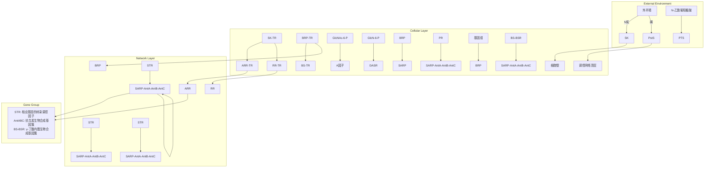
</details>

图4-24 链霉菌抗生素生物合成的基因调控网络

---

210

基因工程

## (1) 抗生素生物合成的途径特异性调控因子

处于次级代谢网络底层的途径特异性调控因子按其结构及调控对象的性质可分为SARP(链霉菌抗生素调控蛋白)、LAL、LysR三大类。其中，SARP型调控因子大都为小型(277～665 aa)转录激活因子，N端含有DNA结合功能域和转录激活功能域，其典型的代表包括天蓝色链霉菌中调控放线菌紫素合成的ActII-ORF4、棒状链霉菌（Streptomyces clavuligerus）中调控头孢菌素和克拉维酸生物合成的CcaR、灰色链霉菌中调控链霉素合成的StrR等(表4-16)。

表 4-16 链霉菌抗生素调控蛋白(SARP)总览

<table><tr><td>途径类型</td><td>抗生素</td><td>菌种名称</td><td>蛋白长度</td><td>TTA密码子</td><td>基因名称</td></tr><tr><td rowspan="26">II型聚酮</td><td>Aranciamycin</td><td>S. echinatus</td><td>270</td><td>70</td><td>orf15</td></tr><tr><td rowspan="4">Lactonamycin</td><td rowspan="4">S. rishiriensis</td><td>626</td><td></td><td>lct23</td></tr><tr><td>277</td><td></td><td>lct15</td></tr><tr><td>221</td><td></td><td>lct21</td></tr><tr><td>510</td><td></td><td>lct22</td></tr><tr><td>Griseorhodin</td><td>S. sp. strain JP95</td><td>274</td><td></td><td>grhR1/2</td></tr><tr><td rowspan="2">Aclacinomycin</td><td rowspan="2">S. galilaeus</td><td>281</td><td></td><td>acl1</td></tr><tr><td>273</td><td></td><td>aknO</td></tr><tr><td>Medermycin</td><td>S. sp. strain AM-7161</td><td>259</td><td></td><td>med -ORFII</td></tr><tr><td rowspan="4">Auricin</td><td rowspan="4">S. aureofaciens</td><td>274</td><td></td><td>sa35</td></tr><tr><td>269</td><td></td><td>sa23</td></tr><tr><td>293</td><td></td><td>sa37</td></tr><tr><td>273</td><td></td><td>a24</td></tr><tr><td>Polyketomycin</td><td>S. diastatochromogenes</td><td>271</td><td>8</td><td>pokR2</td></tr><tr><td>Chartreusin</td><td>S. chartreusis</td><td>217</td><td></td><td>chaR1</td></tr><tr><td>Lysolipin</td><td>S. tendae</td><td>614</td><td>30</td><td>llpR4</td></tr><tr><td>Hedamycin</td><td>S. griseoruber</td><td>273</td><td></td><td>orf16</td></tr><tr><td>Granaticin</td><td>S. violaceoruber</td><td>284</td><td></td><td>gra -ORF9</td></tr><tr><td>Polyketide 5</td><td>S. avermitilis</td><td>271</td><td>129</td><td>?</td></tr><tr><td>Frenolicin</td><td>S. roseofulvus</td><td>283</td><td></td><td>frnG</td></tr><tr><td>Fredericamycin</td><td>S. griseus</td><td>612</td><td>191</td><td>fdmR1</td></tr><tr><td>Alnumycin</td><td>S. sp. strain CM020</td><td>272</td><td>5</td><td>alnR3</td></tr><tr><td>Enterocin</td><td>S. maritimus</td><td>284</td><td></td><td>encF</td></tr><tr><td>Chromomycin</td><td>S. griseus</td><td>301</td><td>13</td><td>cmmR</td></tr><tr><td>Steffimycin</td><td>S. steffisburgensis</td><td>291</td><td>241</td><td>stfR1</td></tr><tr><td>Mithramycin</td><td>S. argillaceus</td><td>277</td><td>6、226</td><td>mtmR</td></tr><tr><td rowspan="14">I型聚酮</td><td>Reveromycin</td><td>S. sp. strain SN-593</td><td>278</td><td>27、30</td><td>revQ</td></tr><tr><td>Tetronasin</td><td>S. longisporus</td><td>257</td><td></td><td>tsn17</td></tr><tr><td>Pactamycin</td><td>S. pactum</td><td>399</td><td></td><td>orf27</td></tr><tr><td>Furaquinocin A</td><td>S. sp. strain KO-3988</td><td>344</td><td>56、75、78</td><td>?</td></tr><tr><td>Chlorothricin</td><td>S. antibioticus</td><td>262</td><td></td><td>chlF2</td></tr><tr><td>Piericidin</td><td>S. piemogenus</td><td>200</td><td></td><td>pieR</td></tr><tr><td>Bafilomycin</td><td>S. lohii</td><td>610</td><td>172</td><td>bafG</td></tr><tr><td rowspan="2">Nangchangmycin</td><td rowspan="2">S. nangchangensis</td><td>254</td><td>31</td><td>nanR2</td></tr><tr><td>242</td><td></td><td>nanR1</td></tr><tr><td>Virginiamycin</td><td>S. virginiae</td><td>330</td><td></td><td>vrmS</td></tr><tr><td rowspan="2">Rubradirin</td><td rowspan="2">S. achromogenes</td><td>291</td><td></td><td>rubRg3</td></tr><tr><td>267</td><td></td><td>rubRg1</td></tr><tr><td>Tetronomycin</td><td>S. sp. strain NRRL11266</td><td>257</td><td>31</td><td>trrn18</td></tr><tr><td>Aureothin</td><td>S. thioluteus</td><td>272</td><td>11</td><td>aurD</td></tr></table>

---

第 4 章 原核细菌基因工程

211

续表

<table><tr><td>途径类型</td><td>抗生素</td><td>菌种名称</td><td>蛋白长度</td><td>TTA密码子</td><td>基因名称</td></tr><tr><td rowspan="2">I型聚酮</td><td>Asukamycin</td><td>S. nodosus</td><td>255</td><td></td><td>asuR5</td></tr><tr><td>Tylosin</td><td>S. fradiae</td><td>278</td><td>68</td><td>tylS</td></tr><tr><td rowspan="11">非聚酮类</td><td>Nosiheptide</td><td>S. actuosus</td><td>324</td><td></td><td>nosP</td></tr><tr><td>Skyllamycin</td><td>S. sp. strain Acta2897</td><td>647</td><td></td><td>sky44</td></tr><tr><td>Peptide-2</td><td>S. avermitilis</td><td>616</td><td></td><td>?</td></tr><tr><td>Thienamycin</td><td>S. cattleya</td><td>267</td><td></td><td>thnU</td></tr><tr><td>4-Hydroxy-3-nitrosobenzamide</td><td>S. murayamaensis</td><td>323</td><td>41</td><td>nspR</td></tr><tr><td>Virginiamycin</td><td>S. virginiae</td><td>330</td><td></td><td>vmsS</td></tr><tr><td>Phenalinolactone</td><td>S. sp. strain Tu6071</td><td>266</td><td></td><td>plaR1</td></tr><tr><td>Heboxidiene</td><td>S. chromofuscus</td><td>262</td><td>200</td><td>?</td></tr><tr><td>Prodigiosin</td><td>S. griseoviridis</td><td>254</td><td></td><td>rphD</td></tr><tr><td>Rubrinomycin</td><td>S. collinus</td><td>662</td><td></td><td>rubS</td></tr><tr><td>Cinnamycin</td><td>S. cinnamoneus</td><td>262</td><td>72</td><td>cinR1</td></tr></table>

注:“TTA 密码子”表示该稀有密码子编码蛋白质中第几位氨基酸残基。

LAL型调控因子相对较大(872～1159aa)，DNA结合功能域位于C端，其成员包括:吸水链霉菌中分别控制大环哌喃、雷帕霉素、格尔德霉素合成的FkbN、RapH、GdmRI/GdmRII、委内瑞拉链霉菌中控制苦霉素合成的PikD、棒状链霉菌中控制5S clavam合成的Cvm7P、诺尔斯氏链霉菌（Streptomyces noursei）控制制霉菌素合成的NysRI/RIII、结节链霉菌（Streptomyces nodosus）控制两性霉素合成的AmphIV、阿维链霉菌（Streptomyces avermitilis）控制菲律宾菌素合成的PteF、纳塔尔链霉菌（Streptomyces natalensis）中控制匹马菌素合成的PimM。

LysR 型转录调控因子的成员含有 310～325 个氨基酸，其 C 端含有 HTH 保守性 DNA 结合功能域，它们大多需要小分子（辅诱导剂）的存在，其成员包括:棒状链霉菌中控制克拉维酸合成的 ClaR、吸水链霉菌和筑波链霉菌中控制大环哌喃合成的 FkbR、阿维链霉菌中的 SAV-4790。

## (2) 次级代谢网络的途径多效性调控因子

处于次级代谢网络中层并以途径特异性调控因子为控制靶标的途径多性调控因子按其作用模式可分为BRP(丁酸内酯受体蛋白)、TCS-RR、IclR、ARR四大类。其中，BRP属于TetR超家族的转录阻遏因子，它们被 $\gamma$ -丁酸内酯类小分子结构类似物所激活，C端拥有 $\gamma-$ 丁酸内酯结合功能域，N端则含有高度保守的螺旋-转角-螺旋（HTH)特征性DNA结合基序，其靶基因所属启动子相应地含有保守的AT丰富序列(被称为自调控元件ARE)。由于$\gamma$ -丁酸内酯呈物种特异性，因此其对应的BRP也是特异性的。

双组分系统(TCS)由质膜结合型传感器激酶(SK)和应答型转录调控因子(RR)构成，SK响应外界压力信号，并使RR磷酸化激活，磷酸化了的RR再作用于底层的途径特异性调控因子编码基因。链霉菌中存在着极其丰富的TCS系统，仅天蓝色链霉菌基因组中就预测有67对二元组分系统，但其生理功能大都未知。研究较为清楚的是天蓝色链霉菌中控制放线菌紫素和十一烷基灵菌红素合成的PhoR-PhoP系统、控制CDA(钙依赖型抗生素)合成的AbsA1-AbsA2系统以及AfsK-AfsR系统，其中的PhoP、AbsA2、AfsR均为转录调控因子，但其转录激活还是阻遏效应则取决于靶基因或辅因子的性质。

IclR 型转录调控因子包括棒状链霉菌 SARP 的调控因子 AreB(ARE 结合蛋白)及其在波赛链霉菌 (Streptomyces peucetius) 和天蓝色链霉菌中的直系同源物 NdgR(氮源依赖型生长调控因子), 此外天蓝色链霉菌中控制 N-乙酰葡萄糖胺代谢和抗生素合成的 DasR 也属于此类。

---

212

基因工程

ARR型转录调控因子不含磷酸化位点，但结构却与TCS中的RR具有同源性，因而被称为“孤儿应答型调控因子”。ARR的典型代表是转录激活十一烷基灵菌红素生物合成基因簇(red)中SARP型途径特异性调控因子编码基因redD的RedZ、委内瑞拉链霉菌中控制节豆霉素(jadomycin)合成的JadR1以及多功能调控因子GlnR。这两种孤儿应答型调控因子的典型特征是均为其各自控制的终端合成物(十一烷基灵菌红素和节豆霉素)所灭活，从而构成在氨基酸生物合成中普遍存在的反馈调控回路。ARR型转录调控因子可分为OmpR和NarI两大家族，其中OmpR家族除了JadR1外，还包括金色链霉菌（Streptomyces aureofaciens）控制金黄菌素合成的Aur1P、生氰链霉菌（Streptomyces cyanogenus）控制兰多霉素合成的LanI、球孢链霉菌（Streptomyces globisporus）控制兰多霉素E合成的LndI；NarI家族除了RedZ外，还包括波赛链霉菌控制柔红霉素合成的DnrN、沙场链霉菌（Streptomyces arenae）控制萘甲酸环内酯合成的NcnR、酒红链霉菌（Streptomyces vinaceus）控制结核放线菌素合成的VioR。

## (3) 代谢全局性调控因子

处于代谢调控网络顶层的代谢全局型调控因子通常指的是那些控制丁酸内酯生物合成基


图4-25 链霉菌次级代谢信号分子丁酸内酯及其结构类似物

因、BRP编码基因、双组分系统SK/RR以及ARR编码基因表达的转录调控因子。链霉菌中共发现大约15种具有 $\gamma-$ 丁酸内酯结构的信号分子，根据最小结构的差异 $\gamma-$ 丁酸内酯可分为:A因子型，其烷基侧链上含有一个10-酮基基团；弗吉尼亚丁酸内酯型，其烷基侧链上含有一个$10 - \alpha$ -羟基基团；IM-2型，其烷基侧链上含有一个 $10-\beta$ -羟基基团。此外，还存在一些非内酯型的丁二醇，如IP因子，其结构式如图4-25所示。此外，细菌严谨型应答的标志性分子ppGpp或pppGpp也通过级联途径间接施加对抗生素生物合成的影响，那些控制ppGpp或pppGpp合成/水解酶系RelA/SpoT编码基因的转录调控因子也属于代谢全局性调控因子的范畴。

值得注意的是:① 上述转录调控因子的底、中、顶三层调控体系并非一成不变，同一等级层次中的转录调控因子可能会横向相互调控，甚至出现自调控现象，如CcaR在调控头孢菌素和克拉维酸生物合成基因的同时也调控自身的编码基因ccaR；② 较低等级的转录调控因子可能会反向作用于较高等级的转录调控因子编码基因，如处于中层的NdgR和PhoP能控制 $\gamma-$ 丁酸内酯的生物合成，甚至处于底层的转录阻遏因子ScbR也能抑制 $\gamma-$ 丁酸内酯(SCB)合成酶编码基因scbA的转录；③ 一种特定的抗生素生物合成基因簇往往受控于多等级转录调控因子的组合式控制，构成极为复杂的调控回路，如图4-26所示的放线菌紫素生物合成基因簇actII

通过其SARP型途径特异性调控因子编码基因actII-ORF4响应至少八种不同的调控信号（即含有八种不同调控因子的结合位点）。

## 2. 链霉菌抗生素生物合成基因簇的克隆与途径操作

克隆链霉菌抗生素生物合成基因簇最直接的方法是采用大肠杆菌考斯质粒或其与链霉菌的穿梭质粒构建相应抗生素生产菌的基因组文库，然后按照下列策略筛选含目标基因簇

---

第 4 章 原核细菌基因工程

213


<details>
<summary>flowchart</summary>

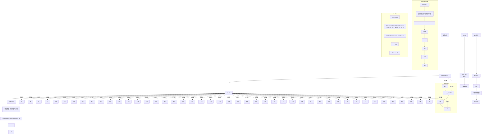
</details>

图4-26 放线菌紫素生物合成基因簇actII的组合调控模式

的重组克隆:① PCR 或杂交鉴定法。结构和功能相似的抗生素在其生物合成途径中往往拥有同源的酶系，在信息生物学数据库中选择同源基因编码序列作为引物或探针，借助 PCR 或 Southern blot 技术筛查基因组文库，即可获得完整的生物合成基因簇。此外，根据已知的生物合成酶蛋白同源序列，人工设计合成引物或探针也能达到同样的目的。② 抗性基因克隆法。由于大多数抗生素合成基因与其抗性基因连锁在一起，因此可先通过目标抗生素抗性筛选法克隆其抗性基因，然后将之作为筛查基因组文库的引物或探针。③ 突变株遗传互补法。以抗生素生物合成途径缺陷的突变株为受体，鸟枪法克隆生物合成基因，然后将之作为筛查基因组文库的引物或探针。随着高通量基因组测序技术的成熟，抗生素生物合成基因簇的克隆与分析变得日趋简化。

在对抗生素生物合成途径基因簇功能及其调控网络进行充分鉴定的基础上,可以采取下列战略改良链霉菌的抗生素生产产量和品质:①强化表达生物合成途径中的关键酶基

---

214

基因工程

因。然而在很多情况下，关键酶基因并不容易确定，此时可采用一种所谓的“基因回转化”技术对生产菌进行直接改良。将克隆的抗生素生物合成基因簇随机切成至少包含一个完整基因的DNA片段，分别插在pIJ702上，重组分子转化拟改良的生产菌，抗生素产量显著提高的转化子中所克隆的生物合成基因则很可能是关键基因。这种战略的实施不需要事先掌握较多的背景信息，实验操作也相对简单，但效率却很高。编者曾采用上述程序改良林可霉素的生产菌林可链霉菌，产量提高了1.37倍，更重要的是鉴定出了关键基因lmbIH。②定向突变关键酶的编码基因。如果关键酶编码基因已知，定向突变该基因有可能进一步提高其表达产物的活性。③基因簇的最小化与异源表达。这是确定特定抗生素生物合成途径必要且充分基因的有效途径，同时也可能使抗生素的产量达到更高的水平。④随机重组相似的抗生素生物合成途径。通过基因重组操作，将不同抗生素的生物合成基因理性组合在一起，有可能构建出具有应用价值的杂合抗生素，这对改善目前临床上不断增加的病原菌抗药性倾向具有重要意义。

## 3. 链霉菌抗生素生物合成基因簇的异源表达

基因组范围的序列分析估计,每个链霉菌基因组中大约含有20\~30种次级代谢物的生物合成基因簇,但其中的大多数或为隐蔽型基因簇(即其编码产物未知)或属沉默型基因簇。抗生素生物合成基因簇的克隆和异源表达技术有望对鉴定隐蔽型基因簇或“唤醒”沉默型基因簇做出贡献。

迄今为止，已有相当数量的抗生素生物合成簇被“搬家”异源表达，包括棒状链霉菌30 kb的全霉素基因簇在白色链霉菌（Streptomyces albus）和天蓝色链霉菌中、克拉维酸基因簇在香灰链霉菌（Streptomyces flavogriseus）中、筑波链霉菌83 kb的大环哌喃基因簇、瑞希链霉菌（Streptomyces rishiriensis）39 kb的香豆霉素基因簇、云顶杉链霉菌（Streptomyces sanyensis）35 kb的吲哚并咔唑基因簇在天蓝色链霉菌中的表达。一般而言，这些异源表达型基因簇所产生的抗生素水平不到其野生型菌株产量的10%；即便对基因簇进行优化改造，其终产物的水平也仅与野生型相当。

一项较为系统的尝试将棒状链霉菌ATCC27064株 $36\mathrm{kb}$ 的头孢菌素C生物合成基因簇用考斯质粒G6-15分别转入香灰链霉菌ATCC33331株、天蓝色链霉菌M1146株、白色链霉菌J1074株中，结果发现只有重组香灰链霉菌能产生头孢菌素C，但产量只及供体菌的$0.2\%$ 。若在导入头孢菌素C生物合成基因簇的基础上，额外再补充1个拷贝的SARP型转录调控因子编码基因ccaR（由香灰链霉菌组成型启动子 $P_{\mathrm{fur}}$ 介导表达），则头孢菌素C的产量能提高近40倍，但这也仅相当于棒状链霉菌ATCC27064株的 $9\%$ 。上述调查结果表明，抗生素生物合成基因簇异源表达的关键是底层转录调控因子(如SARP)编码基因所属启动子能否被受体菌的调控因子有效识别，以及头孢菌素C生物合成是否还需要迄今未知(而受体菌又不存在)的中层甚至顶层调控因子。而这些问题的显现恰恰也是抗生素生物合成基因簇异源表达的价值所在。

## 4.4 梭菌属基因工程

梭菌属(Clostridium)是原核生物中仅次于链霉菌的第二大属革兰氏阳性菌,其特征为专性厌氧,产内生孢子,生长温度在30\~80℃,呈显著的生物催化多样性。梭菌属的有些种如丙酮丁醇梭菌(Clostridium acetobutylicum)和拜氏梭菌(Clostridium beijerinckii)能利用包括最普通的戊糖和己糖在内的大多数单糖、寡糖、多糖发酵产生各种有机酸醇,如乙醇、丁醇、乙酸、丁酸、丙酮等重要化工有机溶剂,而这些小分子碳水化合物又是细胞内核酸、蛋白质、脂类等生物大分子合成的基本骨架,因此它是研究微生物体内复杂的初级代谢基因表

---

第 4 章 原核细菌基因工程

215

达调控以及代谢工程的优秀模型。梭菌属的另一些种如热纤维梭菌（Clostridium thermocellum）、解纤维梭菌（Clostridium cellulolyticum）、植物发酵羧菌（Clostridium phytofermentans）还是高效的纤维素降解细菌，能表达活性较高的纤维素多酶复合系统（又称纤维体，cellulosome）。利用DNA重组技术对这些菌株进行改良，有望从废纸或废弃棉织物等富含纤维素的生活垃圾以及农作物秸秆中直接发酵生产乙醇，协调化工、环保、能源三者的综合平衡。更受鼓舞的是，有些羧菌如瑙氏羧菌（Clostridium noyvii）和生孢梭菌（Clostridium sporogenes）所产生的孢子居然能选择性地在肿瘤组织中萌发和生长，这种独一无二的特性可被用作抗肿瘤药物的投送载体。

然而，公众所熟知的人类致病菌如肉毒杆菌(Clostridium botulinum)、破伤风梭菌(Clostridium tetani)、产气荚膜梭菌(Clostridium perfringens)也是羧菌属的重要成员，它们产致死性毒素，其中的肉毒素还是迄今已知最毒的生物毒剂；而艰难梭菌(Clostridium difficile)则导致一种衰弱性感染，是欧洲某些地区的流行性疾病。

自2001年丙酮丁醇梭菌ATCC824株的全基因组序列公布以来，产业和学术界普遍感兴趣的羧菌属另外几个代表性菌种的基因组测序也相继完成(表4-17)，其中包括肉毒杆菌、破伤风梭菌、艰难梭菌、拜氏梭菌、克氏梭菌（Clostridium kluyveri）、雍氏梭菌(Clostridium ljungdahlii)、粪堆梭菌(Clostridium stercorarium)等。这些基因组信息必将为下列过程提供新的机遇:①利用某些糖分解性菌种的生物催化潜能由可再生生物质生产化学燃料(如丁醇和乙醇)；②全面揭示相关病原菌的毒性机理；③推动病原菌监控和疾病防治有效方法的建立。此外，由表4-17可以看出，梭菌属基因组仅含有 $32\%$ 的GC碱基对（大肠杆菌基因组的GC含量为 $51\%$ ，链霉菌基因组的GC含量为 $75\%$ )，这种特征与其独特的生物功能之间的关联也是令人关注的热点。

表 4-17 羧菌属基因组特征比较

| 羧菌名称(缩写) | C. a. | C. b. | C. d. | C. k. | C. l. | C. t. |
| --- | --- | --- | --- | --- | --- | --- |
| 基因组大小/bp | 4 132 880 | 6 000 632 | 4 298 133 | 4 023 800 | 4 630 065 | 2 873 333 |
| DNA中的G+C含量/% | 31 | 29 | 29 | 32 | 31 | 29 |
| DNA中的复制子数 | 2 | 1 | 2 | 2 | 1 | 2 |
| 开放阅读框(ORF)总数 | 3 848 | 5 020 | 3 757 | 3 912 | 4 198 | 2 432 |
| 已注释功能的ORF数 | 2 350 | 3 883 | 3 211 | 1 240 | 3 141 | 1 989 |
| 功能注释型ORF比例/% | 61 | 77 | 85 | 32 | 75 | 82 |
| 编码rRNA的基因簇数 | 11 | 14 | 11 | 7 | 9 | 6 |
| 编码tRNA的基因数 | 73 | 94 | 87 | 61 | 72 | 54 |

注:C. a.—丙酮丁醇梭菌；C. b.—拜氏梭菌；C. d.—艰难梭菌；C. k.—克氏梭菌；C. l.—雍氏羧菌；C. t.—破伤风梭菌。

## 4.4.1 梭菌属的载体克隆系统

目前已开发的能在羧菌属细胞中自主复制并用于基因克隆和表达的质粒，按其复制子的来源不同主要分为三大类:含羧菌属复制子（如pCB系列、pJU系列、pIP404)的质粒、含枯草芽孢杆菌复制子(pIM13)的质粒、含粪肠球菌(Enterococcus faecalis)复制子(pAMβ1)的质粒。表4-18列举的是一些在羧菌属中常用的克隆质粒、穿羧质粒、接合质粒、表达质粒。

表 4-18 用于羧菌属基因克隆和表达的自主复制型质粒

| 质粒名称 | 复制子来源 | 选择标记 | 大小/kb | 载体特征 | 发表年份 |
| --- | --- | --- | --- | --- | --- |
| pCAK1 | CAK1(C. acetobutylicum) aureus | $Em^r A p^r$ | 11.6 | 滚筒式复制,噬菌粒 | 1993 |
| pTYD101 | pSC86(C. acetobutylicum) | $Cm^r$ | 4.0 | 缺失突变,穿梭质粒 | 1990 |
| pTYD104 | pSC86(C. acetobutylicum) | $Cm^r A p^r$ | 7.6 | 缺失突变,穿梭质粒 | 1990 |

---

216

基因工程

续表

| 质粒名称 | 复制子来源 | 选择标记 | 大小/kb | 载体特征 | 发表年份 |
| --- | --- | --- | --- | --- | --- |
| pCB3 | pCB101(C. butyricum) | $Em^r Ap^r$ | 7.0 | 滚筒式复制 | 1993 |
| pCTC511 | pCB101(C. butyricum) | $Em^r Ap^r$ | 7.9 | IncP,可接合转移 | 1990 |
| pMTL540E | pCB102(C. butyricum) | $Em^r Ap^r$ | 5.2 | 分配稳定 | 1996 |
| pMTL540F | pCB102(C. butyricum) | $Em^r Ap^r$ | 5.5 | 表达载体 | 1996 |
| pMTL9401 | pCB102(C. butyricum) | $Em^r$ | 4.6 | IncP,可接合转移 | 2002 |
| pCB5 | pCB103(C. butyricum) | $Em^r Ap^r$ | 9.5 | 复制机制未鉴定 | 1993 |
| pSYL2 | pCBU2(C. butyricum) | $Em^r Tc^r$ | 8.7 | 穿梭质粒 | 1993 |
| pMTL9301 | pCD6(C. difficile) | $Em^r$ | 7.1 | IncP,可接合转移,穿梭质粒 | 2002 |
| pAK201 | pHB101(C. perfringens) | $Cm^r$ | 8.0 | C. perfringens稳定,穿梭质粒 | 1989 |
| pJIR1456 | pIP404(C. perfringens) | $Cm^r$ | 6.8 | IncP,可接合转移 | 1998 |
| pJIR1457 | pIP404(C. perfringens) | $Em^r$ | 6.2 | IncP,可接合转移 | 1998 |
| pJIR418 | pIP404(C. perfringens) | $Em^r Cm^r$ | 7.4 | 克隆载体,穿梭质粒 | 1992 |
| pMTL9611 | pIP404(C. perfringens) | $Em^r$ | 5.5 | IncP,可接合转移,穿梭质粒 | 2002 |
| pJU12 | pJU121(C. perfringens) | $Tc^r$ | 11.6 | 穿梭质粒 | 1984 |
| pHR106 | pJU122(C. perfringens) | $Tc^r Ap^r$ | 7.9 | C. beijerinckii复制,穿梭质粒 | 1994 |
| pRZE4 | pJU122(C. perfringens) | $Em^r Ap^r Cm^r$ | 10.0 | C. beijerinckii复制,穿梭质粒 | 1994 |
| pRZL3 | pJU122(C. perfringens) | $Tc^r Ap^r$ | 10.8 | C. beijerinckii复制,穿梭质粒 | 1994 |
| pSYL7 | pJU122(C. perfringens) | $Em^r Tc^r$ | 9.2 | 穿梭质粒 | 1989 |
| pCL1 | pTA688L(C. thermosacch.) | $Tc^r Cm^r$ | 12.1 | 穿梭质粒 | 1989 |
| pCS1 | pTA688S(C. thermosacch.) | $Tc^r Cm^r$ | 7.2 | 穿梭质粒 | 1989 |
| pBC16Δ1 | pBC161(B. cereus) | $Tc^r$ | 2.8 | C. acetobutylicum不稳定 | 1989 |
| pECII | pIM13(B. subtilis) | $Em^r$ | 4.5 |  | 2000 |
| pFNK1 | pIM13(B. subtilis) | $Em^r$ | 2.4 | 穿梭质粒 | 1992 |
| pIA | pIM13(B. subtilis) | $Em^r$ |  | pACYC衍生质粒 | 1996 |
| pIM13 | pIM13(B. subtilis) | $Em^r$ | 2.3 | 滚筒式复制,穿梭质粒 | 1989 |
| pKNT11 | pIM13(B. subtilis) | $Em^r Ap^r$ | 6.5 | 克隆载体 | 1989 |
| pKNT14 | pIM13(B. subtilis) | $Em^r$ | 4.3 |  | 1989 |
| pKNT19 | pIM13(B. subtilis) | $Em^r Ap^r$ | 4.9 | 含pUC19的MCS,穿梭质粒 | 1992 |
| pSYL14 | pIM13(B. subtilis) | $Em^r Ap^r$ | 4.4 | 穿梭质粒 | 1989 |
| pXYLgusA | pIM13(B. subtilis) | $Em^r Ap^r$ |  | 表达质粒,木糖诱导 | 2003 |
| pSOS95 | pIM13(B. subtilis) | $Em^r Ap^r$ | 7.0 | 表达质粒,穿梭质粒 | 2003 |
| pAMβ1 | pAMβ1(E. faecalis) | $Em^r$ | 26.5 | 接合质粒,θ型复制 | 1985 |
| pMTL500E | pAMβ1(E. faecalis) | $Em^r Ap^r$ | 6.4 | 广宿主克隆载体 | 1988 |
| pMTL500F | pAMβ1(E. faecalis) | $Em^r Ap^r$ | 6.7 | 表达质粒 | 1993 |
| pMTL502E | pAMβ1(E. faecalis) | $Em^r Ap^r$ | 7.5 | pMTL500E的低拷贝版本 | 1993 |
| pMTL513 | pAMβ1(E. faecalis) | $Em^r Ap^r$ | 7.3 | 克隆载体,稳定 | 1993 |
| pMU1328 | pAMβ1(E. faecalis) | $Em^r$ | 7.5 | 缺失突变 | 1993 |
| pSYL9 | pAMβ1(E. faecalis) | $Em^r Ap^r Tc^r$ | 8.9 | 广宿主克隆载体,穿梭质粒 | 1989 |
| pVA1 | pAMβ1(E. faecalis) | $Em^r$ | 11.0 | 广宿主克隆载体 | 1988 |
| pIP501 | pIP501(E. faecalis) | $Em^r Cm^r$ | 35.0 | 接合质粒 | 1985 |
| pGK12 | pWV01(L. lactis) | $Em^r Cm^r$ | 4.4 | 广宿主克隆载体 | 1984 |
| pT127 | pT127(S. aureus) | $Tc^r$ | 4.4 | C. acetobutylicum不稳定,穿梭 | 1989 |
| pMK419 | pUB110(S. aureus) | $Cm^r Ap^r$ | 5.6 |  | 1987 |
| pUB110 | pUB110(S. aureus) | $Km^r$ | 4.5 | 滚筒式复制,热稳定 | 1974 |
| pMTL30/31 |  | $Em^r Ap^r$ | 4.4 | IncP,可接合转移,整合质粒 | 1990 |

注: $Ap^{r}$  —氨苄青霉素抗性基因； $Cm^{r}$  —氯霉素抗性基因； $Em^{r}$  —红霉素抗性基因； $Km^{r}$  —卡那霉素抗性基因； $Tc^{r}$  —四环素抗性基因。

---

第 4 章 原核细菌基因工程

217

## 1. 羧菌属的天然质粒

羧菌属各种细菌中广泛存在野生型质粒，其中大多数为隐蔽型质粒，少数野生型质粒的功能被鉴定。例如，天然存在于丙酮丁醇梭菌ATCC824株中的pSOL1是一个 $210\mathrm{kb}$ 的巨型质粒，其上编码该菌合成丙酮和丁醇所需的四个关键基因。此外，几种羧菌病原菌中一些重要的毒素因子也由野生型质粒编码，包括编码破伤风毒素的pCL1以及编码G型神经毒素的一个 $123\mathrm{kb}$ 质粒。上述野生型质粒均因相对分子质量过大，难以重组操作，所以不适合用作克隆载体。相对分子质量较小的隐蔽型质粒虽然不能直接作为克隆载体使用，但其复制子序列可用来构建羧菌属的穿梭质粒，这些小型质粒包括来自产气荚膜梭菌的pIP404(10.2kb)、来自肉毒杆菌的pCB101(5.6kb)、pCB102(7.4kb)、pCB103(6.2kb)、艰难梭菌的pCD6(7.0kb)、热解糖羧菌(Clostridium thermosaccharolyticum)的pTA688S(2.3kb)和pTA688L(7.2kb)。其中，pCB101和pIP404的复制子能介导其他非复制型载体在枯草芽孢杆菌和拜氏梭菌NCIMB8052株中的稳定维持。

pCB101的复制子呈滚环式复制型质粒的特征，其上的一个ORF与其他革兰氏阳性菌质粒上的复制蛋白同源；但pCB102的复制子与其他一些复制机制尚不清楚的质粒或DNA序列同源，或编码产物同源。类似地，pCD6和pIP404的复制机制也属未知，然而它们均拥有几个相同的特征，如两个大型、同源型较低的推测复制蛋白以及广泛的DNA重复序列，这些重复序列的存在往往与质粒的 $\theta$ 型复制有关。尽管对这些质粒的复制机制了解欠缺，但并不妨碍其应用，事实上它们已被成功开发成羧菌属的系列克隆载体（表4-18）。

## 2. 羧菌属的穿梭质粒

羧菌属载体构建的另一策略是使用来自其他革兰氏阳性菌的复制子。例如，来自乳酸乳球菌（Lactococcus lactis）pWV01质粒、来自枯草芽孢杆菌pIM13质粒、来自金黄色葡萄球菌pUB110质粒的复制子均能在羧菌属细胞中自主复制。这些异源质粒缺乏复制特异性和分配系统，而且其上的一些抗生素抗性标记基因也能在羧菌属中正常表达，因而被广泛用来构建羧菌属的克隆载体(表4-18)。不过值得注意的是，由这些非羧菌衍生出的质粒基本上呈分配不稳定性，使用时需要施加选择压力（如添加相应的抗生素），这对大规模工业发酵过程而言，既不经济也不被允许。而且，除了pAMβ1通过双向θ型复制外，大部分质粒呈滚环式复制，期间短暂产生的单链DNA中间体是质粒呈结构不稳定性的主要原因。

穿梭质粒的另一种形式是构建含羧菌属天然复制子和大肠杆菌复制子的二元载体，如表4-18中的pTYD104、pSYL2、pSYL7、pHR106、pCS1、pCL1等。对于那些转化率较低的羧菌属受体而言，使用这些羧菌-大肠杆菌穿梭质粒可以先将DNA重组克隆在大肠杆菌或枯草芽孢杆菌中，然后制备高浓度的重组质粒后，再导入合适的羧菌属细胞中，此时即便转化率很低一般也能获得羧菌重组克隆。另外，在采用接合转化程序时，这些二元穿梭质粒更能显示出优越性(参见本节4.羧菌属的接合载体)。

## 3. 羧菌属的表达质粒

在羧菌属中，无论组成型启动子还是诱导型启动子的鉴定均相对滞后，这在一定程度上限制了系列优良表达型载体的开发。pMTL500F和pMTL540F是两种羧菌属通用型的表达载体，其中pMTL500F基于pAMβ1复制子，而pMTL540F使用的是pCB102的复制子，两者均携带含有来自巴斯德梭菌(Clostridium pasteurianum)铁氧还蛋白(Fd)编码基因所属启动子 $P_{\mathrm{fdx}}$ 区域的表达框。它们使用最多的是表达用于癌症治疗的原药转换酶类。诱导型表达载体的代表是专门设计用于丙酮丁醇梭菌ATCC824株的pXYLgus，它含有枯草芽孢杆菌pIM13复制区装，并携带来自木糖葡萄球菌（Staphylococcus xylosus）木糖操纵子的

---

218

基因工程

阻遏蛋白编码基因 $xylR$ 以及相应的 $xylA$ 启动子/操作子区。克隆在 $\mathrm{pXYLgus}$ 上的报告基因用木糖诱导时表达量能提升17倍。

## 4. 羧菌属的接合载体

细菌的接合需要供体细胞与受体细胞密切接触，并且既涉及DNA顺式作用元件（形成缺口的位点oriT)也需要一些反式作用因子(通常由接合型质粒编码)，它们对细胞成对交配、DNA加工，以及接合型质粒转移进受体细胞都是必需的。羧菌属通过细菌接合方式转移重组DNA分子的载体有接合型质粒和接合型转座子两类。

（1）接合型质粒。接合型质粒广泛存在于细菌王国中，然而羧菌属天然存在的接合型质粒相对稀少，迄今为止仅在产气荚膜梭菌中被鉴定。这些接合型质粒编码两个高度保守的抗生素抗性基因 $tetP$ （四环素抗性）和 $catP$ （氯霉素抗性），能在产气荚膜梭菌的不同株之间进行接合转移，但很难用于其他羧菌菌株的基因转移。不过，很多来自其他非羧菌属的接合型质粒具有广宿主范围，例如来自肠球菌和链球菌的接合型质粒包括 $\mathrm{pAM}\beta 1$ 和 $\mathrm{pIP501}$ 均能接合进入丙酮丁醇梭菌中，其中 $\mathrm{pAM}\beta 1$ 还能接合转化肉毒杆菌和巴斯德梭菌。这些质粒的接合转移效率与供体物种高度相关，尤其是革兰氏阳性菌如乳酸乳球菌作为接合供体时，转移效率极高。

（2）接合型转座子。除了接合型质粒外，很多革兰氏阳性菌包括各种羧菌还拥有接合型转座子，如产气荚膜梭菌的Tn4451、粪肠球菌的Tn916、肺炎双球菌（Streptococcus pneumoniae）的Tn1545。这些接合型转座子均为大型可移动基因元件，编码其自身转移所需的所有功能，一般定位于细菌的染色体上，随染色体的复制而复制。接合转座子的转座依赖于共价、封闭、环状超螺旋DNA中间体的形成，既能重新整合进相同细胞的染色体上，也可在接合转移后插入受体的基因组中，且插入发生后不扩增靶点序列。接合型转座子往往拥有极广泛的宿主，能接合转化很多不同的羧菌，如破伤风梭菌、拜氏梭菌、丙酮丁醇梭菌、产气荚膜梭菌、肉毒杆菌、艰难梭菌，因此也被用作投送基因片段的工具以及基于转座子的突变程序。

## 5. 羧菌属的模块化质粒

pMTL80000是基于羧菌属各种菌株生理遗传表型的多样性而精巧设计构建的一套集复制、重组、穿梭、接合、筛选、表达、调控等多元功能于一体的标准化、模块化、通用化质粒系统，适用面广，操作简便，性能优异，且能与目前流行的多种商品化载体系统对接。pMTL80000由母核质粒及下列四类功能性模块构成[图4-27(a)]:

（1）针对羧菌属的革兰氏阳性菌复制子模块。该模块DNA区域的两侧分别为8碱基对识别序列的限制性核酸内切酶AscI和FseI位点，序列分别为 $5^{\prime} - \mathrm{GG}^{\nabla}$ CGCGCC-3'和$5^{\prime} - \mathrm{GGCCGG}^{\nabla}\mathrm{CC} - 3^{\prime}$ 。该模块共有五种选择:①来自肉毒杆菌NCTC2916株天然质粒pBP1的复制子，至少能在生孢梭菌中自主复制；②来自枯草芽孢杆菌pIM13的复制子；③来自丁酸羧菌(Clostridium butyricum)pCB102的复制子；④来自艰难羧菌pCD6的复制子；⑤无关间隔区，此处使用者既可安装未来新发现的其他复制子，又可用来从羧菌基因组上克隆、筛选、鉴定潜在的复制子片段(相当于复制子探针质粒）。

（2）选择性标记基因模块。该模块DNA区域的两侧分别为8碱基对识别序列的限制性核酸内切酶FseI和PmeI位点，后者的序列为 $5^{\prime} - \mathrm{GTTT}^{\nabla}\mathrm{AAAC} - 3^{\prime}$ 。该模块共有四种选择:①氯霉素抗性基因catP；②红霉素抗性基因ermB；③来自产气荚膜梭菌pCW3质粒上的四环素抗性基因tetA；④来自粪肠球菌LDR55株的壮观霉素抗性基因aad9。上述四种抗性标记至少能在一种以上的羧菌中表达，且全部能在大肠杆菌中工作。因此，具有穿梭质粒特性的pMTL80000只需一个筛选标记，这样不但使用方便，而且在很大程度上减小了载体本身的大小，有利于提高转化率。

---

第 4 章 原核细菌基因工程

219


图4-27 羧菌属模块化质粒pMTL80000的构成与性能

（3）针对大肠杆菌的革兰氏阴性菌复制子模块。该模块DNA区域的两侧分别为8碱基对识别序列的限制性核酸内切酶PmeI和SbfI位点，后者的序列为 $5^{\prime} - \mathrm{CCTGCA}^{\nabla}\mathrm{GG} - 3^{\prime}$ 。该模块也有四种选择:①来自pMTL20的高拷贝ColE1复制子，用于外源DNA的扩增和高效表达；②ColE1复制子加Tra编码基因traJ，后者用于质粒从大肠杆菌接合转化进入羧菌属(参见4.4.2)；③低拷贝的p15A复制子，用于表达对受体菌构成严重生理负担或毒性的外源基因；④p15A复制子加Tra编码基因traJ。该模块决定了pMTL80000既是穿梭载体同时又是接合型质粒。

---

220

基因工程

（4）特种克隆表达元件模块。该模块DNA区域的两侧分别为8碱基对识别序列的限制性核酸内切酶SbfI和AscI位点。该模块共有五种选择:①来自pMTL20上的lacZαMCS[多克隆位点，图4-27(b)]，其两侧为极性相反的一对转录终止子，其中TT1来自艰难羧菌630株CD0164-ORF；TT2来自巴斯德羧菌铁氧还蛋白编码基因(fdx)。lacZα的启动子被删除，以配合TT1和TT2防止任何可能的转录过头影响外源基因的表达或对大肠杆菌构成毒性。MCS的上游是NotI位点，含启动子-RBS的DNA片段可克隆在NotI和NdeI(含起始码子ATG)之间。通用引物M13F/M13R用于PCR鉴定重组子，同时提供测序。由于XbaI、SpeI、NheI三者为同尾酶，因此任何来自大肠杆菌标准化载体BioBrick上的NotI/XbaI或NotI/SpeI均可直接克隆在pMTL80000中的NotI和NheI之间并置换MCS；②来自丙酮丁醇梭菌ATCC824株硫解酶编码基因(thl)的启动子-RBS序列；③来自生孢羧菌NCIMB10696株铁氧还蛋白编码基因(fdx)的启动子-RBS序列，从而使pMTL80000又成为一种表达型载体；④以报告基因阅读框catP-ORF置换NdeI和NheI之间的MCS，这样pMTL80000又可作为启动子探针质粒使用；⑤无关间隔区，用于安装其他表达元件或MCS序列。

上述四大类共18件模块彼此相互独立，可以自由组合成400种不同的pMTL8xxxx系列质粒。其中，作为模块工具箱提供的五种基本质粒pMTL80110、pMTL82254、pMTL83353、pMTL84422、pMTL85141包含了所有的18件模块，其构成见表4-19。四种仅革兰氏阳性菌复制子有区别，其他模块均为catP、ColE1-Tra、MCS的载体pMTL82151、pMTL83151、pMTL84151、pMTL85151可进行多种羧菌菌株转化率的横向比较（表4-20）。虽然这些载体对羧菌的转化率并不高，但它们均为穿梭质粒，在用于羧菌转化前已是克隆了外源基因的重组分子，因而这种转化率足以满足常规的实验要求；另外，对同一羧菌受体株而言，不同的复制子可导致转化率相差两个数量级。最后，四种筛选标记的工作浓度也得以确定(表4-21)。

表 4-19 五种 pMTL80000 模块工具箱质粒的构成

| 工具箱质粒 | (+)复制子模块 | 筛选标记模块 | (-)复制子模块 | 特种元件模块 |
| --- | --- | --- | --- | --- |
| pMTL80110 | 0. 间隔区 | 1. catP | 1. p15A | 0. 间隔区 |
| pMTL82254 | 2. pBP1 | 2. ermB | 5. ColE1+traJ | 4. catP 报告基因 |
| pMTL83353 | 3. pCB102 | 3. aad9 | 5. ColE1+traJ | 3. $P_{\text{fdx}}$+MCS |
| pMTL84422 | 4. pCD6 | 4. tetA | 2. p15A+traJ | 2. $P_{\text{thl}}$+MCS |
| pMTL85141 | 5. pIM13 | 1. catB | 4. ColE1 | 1. MCS |

注:（+）和（-）分别表示革兰氏阳性菌和革兰氏阴性菌。

表 4-20 四种 pMTL80000 模块化质粒的羧菌转化率比较

| 模块化质粒 | 丙酮丁酸羧菌 ATCC824 株 | 肉毒杆菌 ATCC3502 株 | 艰难羧菌 630 株 |
| --- | --- | --- | --- |
| pMTL82151 | $1.38 \times 10^{2}$ | $1.01 \times 10^{-3}$ | $3.36 \times 10^{-6}$ |
| pMTL83151 | $2.45 \times 10^{2}$ | $2.90 \times 10^{-4}$ | $2.23 \times 10^{-6}$ |
| pMTL84151 | $8.47 \times 10^{1}$ | $5.71 \times 10^{-6}$ | $7.00 \times 10^{-6}$ |
| pMTL85151 | $2.92 \times 10^{2}$ | $7.80 \times 10^{-6}$ | $4.18 \times 10^{-7}$ |

注:丙酮丁酸羧菌的转化率以每微克质粒DNA产生的克隆数表示；肉毒杆菌和艰难羧菌的转化率以每个大肠杆菌细胞产生的接合转化克隆数表示。

---

第 4 章 原核细菌基因工程

221

表 4-21 pMTL80000 模块化质粒四种筛选标记所对应的抗生素工作浓度

| 筛选标记基因 | catP | ermB | aad9 | tetA |
| --- | --- | --- | --- | --- |
| 大肠杆菌 | Cm,25 μg/mL | Em,500 μg/mL | Sp,250 μg/mL | Tc,10 μg/mL |
| 丙酮丁酸羧菌 ATCC824 株 | Tm,15 μg/mL | Em,40 μg/mL | NF | NF |
| 拜氏羧菌 NCIMB8052 株 | R | Em,10 μg/mL | Sp,750 μg/mL | NF |
| 肉毒杆菌 ATCC3502 株 | Tm,15 μg/mL | Em,40 μg/mL | Sp,600 μg/mL | NF |
| 艰难羧菌 630ΔErm 株 | Tm,15 μg/mL | Em,10 μg/mL | R | R |
| 艰难羧菌 R20291 株 | Tm,15 μg/mL | Lm,20 μg/mL | Sp,750 μg/mL | Tc,10 μg/mL |

注:Cm—氯霉素；Em—红霉素；Lm—林可霉素；Sp—壮观霉素；Tc—四环素；Tm—甲砜霉素；R—抗性；NF—无功能。

## 4.4.2 梭菌属的宿主转化系统

与大肠杆菌和芽孢杆菌不同，羧菌属不存在天然的感受状态。因此，为了促进DNA吸收，用于羧菌属的转化程序通常依赖于细胞壁和细胞膜物理状态的改变。在转化前将细胞转换成原生质体便是这种策略之一，然而原生质体制备程序的优化操作较为复杂且耗时，一般而言，完整细胞的电击转化更常用。

## 1. 梭菌属宿主菌的限制-修饰系统

无论采用何种转化程序，均需突破羧菌属受体菌内源性限制-修饰系统的屏障。在羧菌各菌株中，至少有丙酮丁醇梭菌ATCC824株、解纤维梭菌ATCC35319株、肉毒杆菌ATCC25765株、艰难梭菌CD3和CD6株对外源DNA存在较为强烈的限制作用，而且不同的菌株含有的限制性核酸内切酶也各异，如丙酮丁醇梭菌ATCC824株中的Cac824I(5'-GCNGC-3')、艰难梭菌CD3株中的CdiI(IIIs型酶，5'-CATCG-3')、CD6株中的CdiCD6I(Sau96I的同工酶，5'-GGNCC-3')和CdiCD6II(MboI的同工酶，5'-GATC-3')，以及解纤维梭菌ATCC35319株和肉毒杆菌ATCC25765株中的CceI和CboI，两者均为MspI的同工酶(5'-CCGG-3')。因此事先检测细菌裂解液中的限制和修饰作用特异性是必要的。随着越来越多的基因组信息可供使用，也可以电脑预测使用哪种修饰性甲基化酶处理待转化的质粒DNA最适宜。

突破上述限制性屏障的常用策略是使待转化的质粒 DNA 预先经历合适的体外或体内甲基化修饰，以封闭羧菌属受体细胞内源性限制性核酸内切酶的识别作用位点。体外修饰是用相应的甲基化酶对 DNA 分子进行甲基化保护反应；体内修饰将质粒 DNA 先导入能表达相应甲基化酶的大肠杆菌受体细胞中进行甲基化修饰，然后从大肠杆菌克隆中提取经甲基化保护了的质粒 DNA，再转化羧菌受体细胞。针对丙酮丁醇梭菌 ATCC824 株中的 Cac824I 而言，枯草芽孢杆菌噬菌体  $\phi3T$  的 DNA 含有  $\phi3TI$  甲基转移酶编码基因，该酶能特异性甲基化修饰  $5^{\prime}-GCNGC-3^{\prime}$  和  $5^{\prime}-GGCC-3^{\prime}$  序列中的胞嘧啶残基，从而有效抑制 Cac824I 的限制作用。将上述  $\phi3TI$  甲基转移酶编码基因通过 pAN1 质粒 (p15A 型复制子) 导入特定的大肠杆菌中，而外源 DNA 片段与携带 ColE1 型复制子的羧菌/大肠杆菌穿梭质粒（如 pIMP1、pSYL2、pSYL7）重组，便能在上述大肠杆菌中进行有效的体内甲基化修饰。当然，也可以将合适的甲基化酶编码基因整合在特定的大肠杆菌染色体中。

克服羧菌属限制性障碍的另一策略是将作为转化受体使用的羧菌细胞内的限制性核酸内切酶编码基因从染色体上敲除或灭活，这样可以省去体外或体内甲基化修饰的操作。

需要指出的是,受体细胞的限制-修饰系统是否必定会阻止外源 DNA 的转化因菌种而异。在不少羧菌中,其限制作用并不构成障碍,如拜氏梭菌 NCIMB8052 株、产气荚膜梭菌 13 株、艰难梭菌 CD37 株和 CD630 株、肉毒杆菌 ATCC3502 株等。基因组测序结果显示,这些菌株至少含有一种 II 型甲基化酶编码基因,但缺少编码相应限制性核酸内切酶的基因。

---

222

基因工程

比较特殊的是丙酮丁醇梭菌，它含有6个甲基化酶编码基因，其中2个基因的邻近含有Cac824I编码基因，但羧菌属的大部分II型甲基化酶对限制性核酸内切酶位点没有保护作用，因而丙酮丁醇梭菌对外源DNA构成限制作用。

## 2. 梭菌属的原生质体转化法

虽然原生质体转化法操作较为烦琐,但经优化后的操作程序可获得较高的转化率,如用于丙酮丁醇梭菌 NI-4081 株的原生质体转化程序,转化率可达  $10^{6}$  个/ $\mu$ g DNA,因为它降低了受体菌自溶素的产生(与自溶素抑制剂使用偶联)。原生质体转化包括以下两个步骤:

（1）原生质体制备。羧菌在合适的培养基(如 T69)上生长至对数中期(大约  $10^{8}$  个细胞/mL)，加入无菌固体蔗糖至 0.6 mol/L 最终浓度，并加入溶菌酶(100  $\mu$ g/mL)和青霉素 G(20  $\mu$ g/mL)除去细胞壁，细胞在 34℃ 继续培养 1 h。3 000 g 离心回收原生质体，用原生质体洗涤缓冲液(含 0.6 mol/L 蔗糖、0.5% 牛血清白蛋白、1 mmol/L CaCl $_{2}$  的 T69)清洗两次。然后用原生质体缓冲液(含 0.5 mol/L 木糖、0.5% 牛血清白蛋白、25 mmol/L MgCl $_{2}$ 、25 mmol/L CaCl $_{2}$  的 T69，即羧菌的等渗溶液)悬浮原生质体，备用。

（2）原生质体转化。将质粒（50～800 ng）、PEG4000（35%）、 $10^{9}$ 个原生质体混合，室温放置2 min；然后用含0.5 mol/L木糖、0.5%牛血清白蛋白、1 mmol/L CaCl $_{2}$ 、4 mg/mL胆碱的T69稀释至原浓度的1/10并离心，用相同的T69溶液洗涤原生质体并悬浮；悬浮液经适度稀释后加入T69的软琼脂中，随即灌注至T69固体培养基上，34℃培养20 h；之后再用含合适抗生素的软琼脂覆盖上述转化平板，于37℃继续培养4～6 d即可挑选转化子。

## 3. 梭菌属的完整细胞电击转化法

在电击转化程序中，将细胞置于高压脉冲电场中，致使细胞膜产生瞬时空洞，外源DNA由此进入细胞内。通过改变电击转化之前的细胞预处理程序，几种羧菌的电击转化程序得以优化，电击参数以及转化后细胞的复苏程序也相应进行了调整，因而成为最成熟的转化方法。如果将电击转化仪置于厌氧工作站内进行操作，则效果更佳。下列程序为标准操作，不同的羧菌菌株会有如表4-22所示的差异。

表 4-22 五种羧菌电击转化操作参数的差异比较

| 羧菌名称 | 培养基 | 培养温度/°C | 菌龄/h | 缓冲液 | 电压/kV | 电阻/Ω |
| --- | --- | --- | --- | --- | --- | --- |
| 拜氏羧菌 | 2×YTG | 37 | 0.6 | 270 mmol/L 蔗糖、1 mmol/L 氯化镁、7 mmol/L 磷酸钠 | 1.2 | 200 |
| 丙酮丁醇梭菌 | RCM | 37 | 0.6 | 272 mmol/L 蔗糖、5 mmol/L 磷酸钠 | 2.0 | 200 |
| 肉毒杆菌 | TPGY | 37 | 0.8 | 10% PEG8000、1 mmol/L 氯化镁、7 mmol/L 磷酸钠 | 2.5 | 400 |
| 解纤维羧菌 | MM | 34 | 0.6 | 270 mmol/L 蔗糖、5 mmol/L 磷酸钾,pH 6.5 | 2.0 | 1000 |
| 产气荚膜梭菌 | TYG | 37 | 0.6 | 272 mmol/L 蔗糖、1 mmol/L 氯化镁、7 mmol/L 磷酸钾 | 2.5 | 200 |

注:菌龄是指细菌培养液在  $OD_{600}$  时的光密度值；MM 培养基含葡萄糖、维生素、微量元素；缓冲液 pH 未注明处为 7.5。

将细菌接种到 10 mL 的合适培养基中，于 34～37℃ 培养 16 h（过夜）；培养物按 1:10 的比例接种至 100 mL 的相同培养基中，当菌体密度达到  $OD_{600}$  为 0.6～0.8 h，将培养液置于冰浴中，离心收获菌体；用 10 mL 预冷（4℃）的合适电击缓冲液洗涤并悬浮菌体，冰浴 10 min 备用。

转化时，将质粒DNA(0.1～1.0 μg)加入预冷的细胞悬浮液(0.8～1.0 mL)中，混合物置于4℃预冷的电击转化杯中（两电极之间的距离为0.4 cm），然后在电击转化仪中施加1.25～2.5 kV的脉冲电场(25 μF电容、200～1 000 Ω电阻)。之后，迅速将细胞置于冰浴中

---

第 4 章 原核细菌基因工程

223

10 min, 用合适的培养基将之稀释至原浓度的 1/10, 于 37℃ 培养 3 h, 离心浓缩菌体并悬浮于 100 μL 的相同培养基中, 最后涂布于含合适抗生素的平板上, 34\~37℃ 培养 2\~3 d 即可挑选转化子。应当特别指出的是, 电击转化率因菌种不同差异非常显著, 最高可相差 100\~1000 倍。

## 4. 梭菌属的接合转化法

借助合适的接合型载体,很多羧菌菌株能成功接受从大肠杆菌转移来的质粒 DNA。接合转移依赖于接合型载体编码的广宿主 IncP 家族的一种组分。很多可转移型的羧菌/大肠杆菌穿梭质粒携带 IncP 型质粒(表 4-18)的转移起始位点(oriT),该位点与几种额外的反式作用功能(Tra 功能,既可由 IncP 型质粒编码也可整合在染色体上)相结合,是质粒 DNA 接合进入受体细胞必需的。从大肠杆菌向羧菌进行质粒接合转移的典型程序如下:

大肠杆菌供体株(如含有 IncP 型辅助质粒 R702 和待转移质粒的 HB101 株)接种于 5 mL 含合适抗生素的培养基中,37℃有氧培养过夜;同样体积的羧菌培养物于 37℃厌氧培养过夜,然后两种菌分别接种到新鲜培养基中培养至  $OD_{600}$  为 0.45～0.60。将供体培养物置于厌氧容器中,离心收取 1 mL 培养物,用无氧磷酸缓冲液洗涤菌体,并将之与 100 μL 的受体羧菌混合。将混合菌液涂布于 0.2 μm 的滤纸表面,滤纸预先放在无氧固体羧菌培养基 (RCM) 平板上,厌氧培养过夜。共培养之后,将生长在滤纸上的菌体悬浮于 1 mL 的无氧培养基或磷酸缓冲液中,然后取 0.1 mL 样品涂布于 RCM 固体培养基上(含合适的抗生素)筛选接合转化子。

接合转移程序相比电击转化费事耗时,但却拥有一些优势,其中最主要的是接合转移的效率显著高于电击转化;而且在某些情形中,接合转化是唯一的选择。另外,接合转化不受胞外核酸酶的影响,因为细胞与细胞是紧密接触的,也不需要特别的装置。

## 4.4.3 利用 DNA 重组技术改良有机溶剂的羧菌生产菌

由羧菌属介导的丙酮-丁醇-乙醇(ABE)发酵是发酵工业最古老的过程之一，在规模上仅次于酵母的酒精发酵。早在20世纪20年代初期，哈伊姆·魏茨曼(Chaim Weizmann，后来成为以色列首任总统)便发现丙酮-丁醇-梭菌能以3:6:1的体积比天然厌氧合成丙酮、丁醇、乙醇。早期创建ABE发酵产业起因于第一次世界大战期间制造线状无烟火药对丙酮的大量需求，而丁醇在当时只是一种不需要的副产物。然而到了战后，丁醇作为化工原料成为更重要的产物。20世纪50年代之后，由于石油化工产品丁醇更廉价，ABE发酵业开始衰落。学术界和产业界对羧菌发酵ABE的研究热情从20世纪80年代初又急剧上升，因为当时的石油危机带动了产溶剂羧菌生理学和遗传学的研究。鉴于当今生物燃料愈发受到关注，有关羧菌发酵ABE的研究与实践再次升温，这很可能归咎于杜邦公司和英国石油公司2006年发表的公告:英国将重新建立工业规模的ABE发酵。

## 1. 羧菌属的核心代谢途径及其调控机制

羧菌属发酵葡萄糖形成三个典型的生长期:首先是对数生长期和酸形成；其次是静止期和酸被再同化，同时伴随溶剂的形成；最后是内生孢子形成期。丙酮丁酸羧菌酸生成和溶剂生成的代谢途径如图4-28所示。

葡萄糖通过糖酵解途径分解代谢生成丙酮酸，丙酮酸:铁氧还蛋白氧化还原酶(Pfor)在氢化酶(Hyd)协助下首先催化丙酮酸生成乙酰辅酶A。只有在某些生长条件下(如 $\mathrm{pH} > 5$ 和铁限制)，乳酸才是主要发酵产物（由乳酸脱氢酶Ldh催化丙酮酸脱氢而成）。乙酸由磷酸乙酰转移酶(Pta)和乙酸激酶(Ack)催化的反应合成，后一个反应提供ATP。为了生物合成丁酸，两分子的乙酰辅酶A由硫解酶(Thl)介导缩合成乙酰乙酰辅酶A，后者分别经3-羟基丁酰辅酶A脱氢酶(Hbd)、巴豆酸酶(Crt)、丁酰辅酶A脱氢酶(Bcd)还原成丁酰辅酶A，磷酸丁酰转移酶(Ptb)和丁酸激酶(Buk)再将丁酰辅酶A转换成丁酸，并产生ATP。

---

224

基因工程


<details>
<summary>flowchart</summary>

This flowchart illustrates the metabolic pathway of glucose in the presence of various amino acids (e.g., 乙酸, 丙酮酸) and related enzymes, showing enzymatic reactions and their effects on glucose metabolism.
</details>

图4-28 丙酮丁醇羧菌酸生成和溶剂生成的代谢途径

上述代谢途径显著降低培养液中的 $\mathrm{pH}$ 值，破坏横跨细胞膜的质子梯度，因此丙酮-丁酸-羧菌会将酸生成途径切换至溶剂生成途径:在乙酰乙酰辅酶A:酰基辅酶A转移酶(CtfAB)的催化下，乙酸和丁酸以乙酰乙酰辅酶A为辅酶A供体，逆转成其对应的辅酶A衍生物。特别当还原力受限时，为了驱动除去乙酸的反应，乙酰乙酰辅酶A脱羧在乙酰乙酸脱羧酶(Adc)催化下生成丙酮；而不同的醛/醇脱氢酶(AdhE)则分别将乙酰辅酶A和丁酸辅酶A转换成乙醇和丁醇，即丙酮丁酸羧菌的主要发酵产物。

值得注意的是，革兰氏阳性菌著名的孢子生成调控因子Spo0A对丙酮丁酸羧菌孢子生成的启动以及溶剂的合成两个过程均很重要，虽然孢子生成本身并不需要丙酮和丁醇的产生。联系这两个生理上并不相干过程的是Spo0A的磷酸化形式，而代谢中间物丁酰磷酸很可能作为转录调控因子的磷酸供体而参与其中，但有关的调控网路构成与运行机制却知之甚少。

## 2. 羧菌属溶剂生成途径的基因操作

针对丙酮丁醇梭菌的溶剂生成途径进行基因操作的尝试已有不少积累，但显著倾向于某种特定溶剂（如丁醇或乙醇或丙酮）的途径设计却很难理出清晰的结果，暗示羧菌属的核心代谢途径及其调控机制的复杂程度可能远远超出图4-28所涉及的范围。

---

第 4 章 原核细菌基因工程

225

（1）强化表达 $ctfAB$ 和 $adc$ 基因。由图4-28可以看出，丙酮生物合成分支途径中的两个关键酶是乙酰乙酰辅酶A:酰基辅酶A转移酶(CtfAB)和乙酰乙酸脱羧酶(Adc)，它们一方面直接催化葡萄糖代谢中间产物乙酰辅酶A经乙酰乙酸生成丙酮，同时又通过转化乙酸和丁酸间接促进丙酮和丁醇的合成。在丙酮丁醇梭菌中，为这两个酶编码的基因 $ctfA$、$ctfB$、$adc$ 均位于ATCC824株的天然质粒pSOL1上，其中 $ctfA$ 和 $ctfB$ 分别编码酰基辅酶A转移酶的两个亚基，其转录方向与 $adc$ 基因相反。当细菌处于产酸的对数生长期时，$ctfAB$ 操纵子的转录因被阻遏而基本上处于关闭状态。因此提高丙酮丁醇梭菌丙酮和丁醇产量的方法是更换 $ctfAB$ 操纵子自身的启动子-操纵子系统，从根本上解除对这两个基因表达的阻遏作用。为此，借助于PCR克隆技术将丙酮丁醇梭菌的 $adc$、$ctfA$、$ctfB$ 重组成由 $adc$ 基因启动子-操作子统一控制的 $ace$ 操纵子结构，然后将之克隆在pFNK1穿梭质粒的EcoRI位点上，构建成重组质粒pFNK6。将pFNK6转化丙酮丁酸羧菌ATCC824株，并与相应的对照株比较CtfAB和Adc以及丙酮和丁醇的最终发酵产量(图4-29)。结果表明:$ace$ 操纵子的表达大大改变了ATCC824株丁醇、丙酮、乙醇、丁酸、乙酸五种产物的产量分布。在三种 $\mathrm{pH}$ 的发酵条件下，CtfAB和Adc的酶活分别提高 $4\sim 33$ 倍和 $4\sim 38$ 倍，而且两种酶的表达时间都从稳定期提前到对数生长期。虽然两种酶在克隆株中的最大活性是在$\mathrm{pH}4.5$ 条件下表达的，但丙酮和丁醇合成的最佳 $\mathrm{pH}$ 为5.5，两者的总量达到 $23.2\mathrm{g / L}$，明显高于当时大规模发酵生产中使用的菌株。在 $\mathrm{pH}6.5$ 的发酵条件下，两种产物的产量是三种$\mathrm{pH}$ 中最低的，但此时克隆株与对照株的最终发酵产物产量差别却最大，丙酮和丁醇的产量分别提高了25倍和12倍。显然，此项操作更有利于丙酮的富集。
（2）强化表达 adhE1 和 ctfB 反义 RNA 基因 (ctfB-asRNA)。由图 4-28 可以看出，强化表达醛/醇脱氢酶编码基因 adhE1 理论上有利于乙醇和丁醇的倾向性合成；而利用反义技术衰减 CtfAB 的表达，能阻断丙酮的合成，但未必对丁醇的积累有利，因为乙酸和丁酸的逆转同化也相应会减弱。以磷酸丁酰转移酶编码基因所属的强组成型启动子 $P_{\mathrm{ptb}}$ 取代 adhE1 基因自身启动子 $P_{\mathrm{adhE1}}$ 以及用硫解酶编码基因所属的启动子 $P_{\mathrm{thl}}$ 介导 ctfB-asRNA 的表达，由此构建的重组质粒 (pCASAAD) 转化丙酮丁酸羧菌 ATCC824 株，获得重组克隆 824 (pCASAAD) 株；同样，将含 $P_{\mathrm{adhE1}} - adhE1$ 和 $P_{\mathrm{thl}} - ctfB - asRNA$ 两个表达框的重组质粒 (pAADB1) 转化 ATCC824 株，产生重组克隆 824 (pAADB1) 株。结果发现，在 pH5.0 的发酵条件下，与含空载体的对照株相比，ctfB 反义 RNA 的引入的确使丙酮产量下降了 44%，但 adhE1 基因的强化表达并没有改变丁醇的产量，此项操作最受益的是乙醇，产量提高了 14 倍之多。奇怪的是，除了乙酸产量略提高 10% 外，丁酸反而降为原来的 1/18。由此可见，adhE1 对乙醇的作用明显大于丁醇。
（3）敲除 $adc$ 基因。由图4-28可以看出，能阻断丙酮的合成。实验结果显示，$adc$ 基因敲除株确实只产少量的丙酮，这些丙酮是由乙酰乙酸的非酶促脱羧反应形成的；不可思议的是，丁醇的产量相比对照丙酮丁醇梭菌EA2018株也显著降低了 $46\%$，只是丁醇占总溶剂产量的份额由 $71\%$ 提升至 $80\%$。
（4）在不产孢子的菌株中表达 adhE1-ctfAB。由于溶剂合成往往天然伴随孢子生成，后者最终终止丁醇合成，因此一株不产孢子的丙酮丁醇梭菌（DSM1731）将是羧菌基因改良的理想出发菌株。更为流行的不产孢子的菌株是丧失大型质粒 pSOL1 的退化菌株（如丙酮丁醇梭菌 M5 和 DG1 株）。用 adhE1 基因回补 M5 株，能恢复丁醇的生产且无丙酮形成，进一步的改良是用强组成型  $P_{ptb}$  启动子置换原 sol 启动子，以强化 adhE1 基因的表达。然而，上述无 pSOL1 型工程菌的主要发酵产物伴随高浓度丁醇的还有乙酸，而且敲除乙酸激酶编码基因 ack 和丁酸激酶编码基因 buk 以及共表达硫解酶编码 thl 均不能改变这一表型。

---

226

基因工程


图4-29 丙酮丁醇羧菌ATCC824(pFNK6)重组菌溶剂合成的产量分布

## 4.4.4 利用 DNA 重组技术改良羧菌属的纤维素分解酶系

地球上含量最丰富的生物聚合物纤维素是多聚糖降解型微生物的优秀能源，同时也是将之转换成生物燃料的尚未能高效开发的能源形式。由于纤维素呈高度有序且不溶性的晶体结构，极少数微生物拥有将之降解为可溶性糖的必需酶系。虽然对纤维素降解型微生物研究最多的是好氧真菌里氏木霉（Trichoderma reesei），但由厌氧型热纤维梭菌和解纤维梭菌所产生的多酶复合物同样具有高效的纤维素降解性能。

## 1. 热纤维梭菌纤维素分解酶系的基本特征

热纤维梭菌的细胞表面存在一些隆起的特征结构，称为纤维体，内含多亚基的纤维素多酶复合物(图4-30)。其中，一种非催化型亚基(脚手架蛋白)能借助其纤维素特异性的结合模件(CBM)与水不溶性底物结合；同时热纤维梭菌的脚手架蛋白还含有一套九个I型黏连蛋白(CohI)结合模件，脚手架蛋白通过黏连蛋白与纤维素酶系上的互补型结合模件(船坞模件,DocI)相连，从而介导催化亚基的特异性掺入与组织。脚手架蛋白在其C端还含有另一种类型的II型船坞模件(DocII)，后者通过与一组细胞膜锚定蛋白选择性结合和相互作用，介导纤维体与细胞壁之间的维系。将多酶装配成复合物能确保它们集体靶向底物特殊区域，从而有利于催化组分之间协同发挥作用。

---

第 4 章 原核细菌基因工程

227


<details>
<summary>flowchart</summary>

This diagram illustrates the mechanism of beta-glucosaminoglycan (BglA) in a mouse model, showing how beta-glucosaminoglycan activates the development of the Cerebellum Bone Marrow (CBM) and its role in producing the Cerebellum Inhibitory Complex (CohI).
</details>

图4-30 热纤维羧菌纤维体结构与工程化设计

构成纤维体的不同酶之间的协同降解导致高浓度可溶性纤维二糖终产物的形成。在天然环境中，纤维二糖及其他形式的寡聚葡萄糖被ATP结合盒转运子系统直接转运进细胞。在此期间，纤维二糖被周质中的β-葡萄糖苷酶进一步水解成葡萄糖；其他形式的寡聚葡萄糖的同化吸收则需要环境中额外的不同微生物方能完成。在天然生态系统中，纤维二糖的作用是充当一种调控信号，特别是胞外纤维素酶的抑制剂；纤维二糖2%的浓度足以完全抑制热纤维梭菌的纤维体酶活。因此，在无细胞系统中，纤维二糖抑制剂的除去是木质纤维素底物恒定降解的必要条件。

当纤维体从热纤维梭菌细胞中提取出来并用于水解晶体纤维素时，纤维体可通过其CBM模件高亲和性地结合在不溶性的纤维素底物上，但只有很少部分的 $\beta-$ 葡萄糖苷酶能直接参与水解在底物结合性纤维体环境中积累起来的纤维二糖。因而，将 $\beta-$ 葡萄糖苷酶与纤维体连为一体的策略便有可能以更高的效率清除抑制型的纤维二糖，从而提高纤维素降解的总体水平。

## 2. 热纤维梭菌纤维体与 $\beta$-葡萄糖苷酶的偶联设计

热纤维梭菌纤维体乐高积木式的构造为创建“设计型纤维体”提供了契机，人工装配纤维体组分的杂合形式有望改进纤维素类底物的水解效率。迄今为止，大多数的纤维体设计实验均试图使天然纤维体系统所观察到的协同酶系最小化，其策略是设计制作由一种含黏连蛋白的脚手架以及一套与之相匹配的含船坞模件型纤维素酶构成的人工复合物。

然而，旨在提升纤维体工作效率的另一种策略是运用II型黏连蛋白(CohII)与脚手架蛋白上的II型船坞模件(DocII)特异性相互作用的原理，将外源性的 $\beta$ -葡萄糖苷酶特异性掺入天然的纤维体中(图4-30)。由于DocII与CohII结合的主要功能是在细胞表面的附着，因此在无细胞纤维素降解体系中，这一功能的存在与否不会影响天然纤维体的酶活。如果末端载有脚手架蛋白的DocII模件不被占据，则可以用来附着任何一种含CohII的组分。于是将热纤维梭菌 $\beta$ -葡萄糖苷酶(BglA)在基因水平上与来自热纤维梭菌锚定蛋白Orf2p的II型黏连蛋白(CohII)融合，构成BglA-CohII嵌合酶，便能实现 $\beta$ -葡萄糖苷酶与天然纤维体的结合特异性偶联，进而提升纤维素类底物酶促降解的效率。

## 3. 能利用纤维素类物质发酵乙醇的工程化羧菌的构建

酿酒酵母与发酵单孢菌属(Zymomonas)能由葡萄糖生产较高浓度的乙醇,但它们不能发酵木糖和纤维素,因此利用这两类微生物从纤维素物质生产乙醇,必须首先将纤维素类物质进行液化和糖化预处理。使用嗜温或嗜热性的梭菌属由纤维素类物质直接厌氧发酵乙醇,是生物能源再生的一种理想选择,其优点为代谢速率快,最终产物回收率高,细胞和酶系

---

228

基因工程

稳定，并能直接转化纤维素或戊糖。但这类细菌用于工业规模的乙醇发酵也存在两大缺陷:在乙醇发酵过程中往往伴有乙酸和丁酸等副产物的产生，而且最终产物的最高积累浓度仅为3%左右，只及酿酒酵母或发酵单孢菌属的25%\~30%。利用DNA重组技术重新设计糖酵解途径，阻断副产物的形成路线，解除乙醇生物合成的代谢阻遏作用，同时提高细胞对高浓度乙醇的耐受性，是高产乙醇梭菌属工程菌构建的主要内容。

许多梭菌属菌种能从纤维素或木糖直接发酵产生乙醇，其中最有希望成为生产菌的是生长温度在 $55\sim 75^{\circ}C$ 内的梭菌属嗜热菌种，其生物学特征列在表4-23中。热纤维梭菌所有已鉴定的菌株都能从纤维素和纤维二糖直接发酵产生乙醇，其机理是首先将纤维素经过纤维三糖降解为纤维二糖，后者再转化为葡萄糖，进入糖酵解途径。但热纤维梭菌合成乙醇的能力较低，即使在流加式发酵过程中，由纤维素产生乙醇的产量也只有 $8.5\mathrm{g / L}$ 。热解糖梭菌虽然不能发酵纤维素，但却能高效利用其他碳源合成ATP并积累较高浓度的乙醇。因此，为了提高乙醇产量，可将上述两种嗜热梭菌在纤维素培养基中混合培养，结果在含有$80~\mathrm{g / L}$ 纤维素的培养基中能生产 $25.3\mathrm{g / L}$ 的乙醇。

表 4-23 产乙醇型羧菌的主要生物学特征

| 羧菌名称 | GC/% | 生长温度/°C | 主要产物$^1$ | 可发酵的主要碳水化合物$^2$ |
| --- | --- | --- | --- | --- |
| C. saccharolyticum | 27~29 | 37 | E、A、L | Ceb、Glc、Xyl、etc |
| C. thermosaccharolyticum | 29~32 | 55~62 | E、A、L | Ceb、Glc、Xyl、Suc、Gal、Fru、Ara、Sta |
| C. thermocellum | 38~39 | 60~65 | E、A、L | Ceb、Glc、Fru、Cel |
| C. sterorarium | 43~44 | 60~65 | E、A、L | Ceb、Glc、Xyl、Suc、Gal、Fru、Ara、Sta、Cel、Xyn |
| C. thermohydrosulfuricum | 30~32 | 68 | E、A、L | Ceb、Glc、Xyl、Gal、Fru、Ara、Sta |

① E—乙醇；A—乙酸；L—乳酸。

② Ceb—纤维二糖；Glc—葡萄糖；Xyl—木糖；Suc—蔗糖；Gal—半乳糖；Fru—果糖；Ara—阿拉伯糖；Sta—淀粉；Cel—纤维素；Xyn—木聚糖。

有些解糖梭菌(Clostridium saccharolyticum)和热解糖梭菌虽然不能利用纤维素，但能以木糖合成乙醇。在含有 $75\mathrm{g / L}$ 木糖的培养基中，这些菌种发酵乙醇的产量可达 $27~\mathrm{g / L}$ 。为了进一步提高梭菌属由木糖生产乙醇的能力，降低乙酸和丁酸副产物的产量，同时强化菌种对高浓度乙醇的耐受性，可采用经典的诱变或培养基富集等方法对菌种进行遗传改良。例如，解糖梭菌的一株突变株不能在以丙酮酸为唯一碳源的培养基上生长，其合成乙酸副产物的能力比亲本大为降低，在最终培养液中乙醇与乙酸的比率为 $13:1$ ，而亲本细菌仅为$6.7:1$ 。此外，热硫化氢梭菌(Clostridium thermohydrosulfuricum)的一株突变株对乙醇的耐受性比亲本株提高了3倍。上述经典遗传操作的结果同时也证实了基因操作在梭菌属乙醇生产菌改良中的巨大潜力。

## 4.5 乳酸菌基因工程

乳酸菌是一类以乳酸发酵为基本特征的革兰氏阳性菌群，与食品生产相关的乳酸菌群包含11个属:乳球菌属(Lactococcus)、乳杆菌属(Lactobacillus, 迄今为止研究最多的一个属)、链球菌属(Streptococcus)、明串珠菌属(Leuconostoc)、酒球菌属(Oenococcus)、片球菌属(Pediococcus)、肠球菌属(Enterococcus)、肉杆菌属(Carnobacterium)、乳球形菌属(Lactosphaera)、漫游球菌属(Vagococcus)、魏斯氏菌属(Weissella)，其中乳杆菌属最大，迄今鉴定的已达150多个不同的种。乳酸菌拥有下列共同的特征:①能以碳水化合物生产大量的乳酸，通常占发酵最终产物的 $50\%$ 以上；②能在较低的 $\mathrm{pH}$ 及厌氧条件下良好生长；

---

第 4 章 原核细菌基因工程

229

③ 过氧化氢酶阴性；④ 不产孢子；⑤ 生长需要碳水化合物、氨基酸、维生素等多种复杂的营养成分；⑥ 基因组 DNA 中的 GC 含量小于 55%；⑦ 绝大多数菌株为非致病性。

乳酸菌在自然界中分布极广，并且在人类生活中起着极其重要的作用，其食品发酵的历史可追溯到公元前4000年。许多乳酸菌可用于发酵牛奶、肉类、鱼类、粮食、蔬菜、水果，生产乳酪、酸奶、黄油、香肠、腌鱼、卤素、食醋、酱油、黄酒等食用品[图4-31(a)]，在此过程中形成的低 $\mathrm{pH}$ 环境可有效控制其他微生物的污染，同时酸化反应也是奶酪、酸奶、香肠生产中蛋白质凝固的必要条件。乳酸菌对人体健康的益生作用表现在下列几个方面:① 提升食物的营养价值；② 促进乳糖消化；③ 抑制肠道病原菌群的繁殖；④ 控制血清的胆固醇水平；⑤ 调节机体的免疫功能。

食用乳酸菌中分子遗传学研究最为详尽、生物技术开发最为广泛的是奶酪的主要生产菌乳酸乳球菌(Lactococcus lactis)，其基因操作的主要目的是稳定蛋白酶生产、提高乳糖利用率以及生产菌的噬菌体抗性等。而以保加利亚乳杆菌(Lactobacillus bulgaricus)、干酪乳杆菌（Lactobacillus casei）、嗜酸乳杆菌（Lactobacillus acidophilus）、瑞士乳杆菌(Lactobacillus helveticus)、植物乳杆菌(Lactobacillus plantarum)为代表的食用乳杆菌除了发酵生产食品及其添加剂外，还被开发成生产功能保健品和日用化学品的生物技术平台[图4-31(b)]。

(a) 乳酸菌的产业化应用


(b) 乳酸菌的生物技术平台

G6P: 葡萄糖-6-磷酸; F6P: 果糖-6-磷酸; PEP: 磷酸烯醇式丙酮酸; PYR: 丙酮酸

图4-31 乳酸菌的产业化应用与生物技术平台

## 4.5.1 乳酸菌的载体克隆系统

与其他革兰氏阳性菌不同，乳酸菌各种属尤其是乳杆菌含有丰富的天然质粒，虽然其中大部分为隐蔽型质粒，但其复制子和有限的几种抗生素抗性标记（如红霉素抗性基因和氯霉素抗性基因）足以用来构建一系列标准化的克隆载体；另外，基于食品工业的应用安全性考量，用于构建乳酸菌克隆表达载体的DNA元件或序列必须来自遗传背景安全的乳酸菌菌种，严格排斥任何非食用性微生物来源的质粒组分，即所谓绝对“纯净”的食品级基因操作工具。

---

230

基因工程

## 1. 乳酸菌的天然质粒

虽然大多数迄今已鉴定的乳酸菌天然质粒属于隐蔽型质粒，但也有一些天然质粒编码特殊的表型，如蛋白质水解；糖类、氨基酸、柠檬酸代谢；细菌素（抗菌或杀菌肽）、胞外多糖、色素合成；抗生素、重金属、噬菌体抗性等，其中糖类代谢、抗生素抗性、细菌素合成类编码基因已被广泛用作构建乳酸菌克隆表达载体的选择性标记。

天然存在于乳球菌中的大多数滚环复制型质粒属于革兰氏阳性菌 pE194 质粒家族，如来自乳酸乳球菌乳脂亚种（Lactococcus lactis subsp. cremoris）的 pWV01（2.2 kb）和 pBM02（3.9 kb）、来自乳酸乳球菌乳酸亚种（Lactococcus lactis subsp. lactis）的 pSH71（2.1 kb）、pD125（5.1 kb）和 pCL2.1（2.1 kb）；例外的是同种菌的 pWC1（2.8 kb），含有 pC194 型复制子。上述乳球菌滚环型复制子的一大优势是能同时在大多数革兰氏阳性菌和大肠杆菌中自主复制，因而以这些复制子为蓝本可构建很多广宿主范围的衍生载体，如 pGK 系列、pNZ 系列、pFX 系列，然而这些载体倾向于分配不稳定。相反，乳球菌的  $\theta$  复制型质粒虽然宿主范围较窄，但具有如下优势:① 能与内源性滚环复制型质粒相容；② 具有较高的分配稳定性；③ 外源 DNA 装载量大。 $\theta$  复制型质粒在乳球菌中分布广泛，其复制子高度同源且相容，如来自乳酸乳球菌乳酸亚种的 pCI305（8.7 kb）、pUCL22（40 kb）、pND302（8.8 kb）、pND324（3.6 kb）、pIL7（31 kb）和 pCI2000（60 kb）、来自乳酸乳球菌乳脂亚种的 pWV02（3.8 kb）、pWV03（7 kb）、pWV04（19 kb）、pWV05（27 kb）、pSK11L（47 kb）、pCI528（46 kb）、pJW563（12 kb）和 pCIS3（6.1 kb）、来自乳酸乳球菌二乙酰变种的 pSL2（7.8 kb）、pVS40（7.8 kb）和 pCT1138（8.3 kb）。乳球菌的  $\theta$  复制型质粒对克隆表达载体的构建较为有用，因为它们含有天然的实用性选择标记，如 pVS40 编码尼生素（一种重要的细菌素）抗性；pND302 编码镉离子抗性；pND324 含有一个热敏感型复制子。有趣的是，编码噬菌体抗性功能的乳酸乳球菌质粒 pSRQ700 同时含有滚环型和  $\theta$  型两套复制子。

绝大多数的乳杆菌含有天然质粒，其中隐蔽型质粒众多且呈大小、复制模式、复制子家族多样化。根据Rep蛋白结构和复制起始位点ori的同源性，乳杆菌滚环复制型质粒或属于pE194或属于pC194质粒家族:来自植物乳杆菌的pA1(2.8 kb)和pLB4(3.5 kb)、来自发酵乳杆菌（Lactobacillus fermentum）的pLF1311（2.4 kb）、来自弯曲乳杆菌(Lactobacillus curvatus)的pLC2(2.6 kb)、来自嗜酸乳杆菌的pLA106(2.9 kb)属于pE194家族复制子；而来自植物乳杆菌的pLP1(2.1 kb)、pC30il(2.1 kb)、p8014-2(1.9 kb)和pLP2000(2.1 kb)、来自发酵乳杆菌的pLEM3(5.7 kb)、来自戊糖乳杆菌(Lactobacillus pentosus)的p353-2(2.3 kb)、来自罗伊氏乳杆菌(Lactobacillus reuteri)的pGT232(5.1 kb)和pTC82(7.0 kb)、来自希氏乳杆菌(Lactobacillus hilgardii)的pLAB1000(3.3 kb)则属于pC194质粒复制子家族。来自植物乳杆菌的pLP9000(9.3 kb)虽然也采取滚环模式复制，但其复制子不属于任何已知的家族。与乳球菌相同，乳杆菌θ模式复制型质粒对构建宿主范围虽窄但较稳定的克隆表达载体较为实用，包括来自植物乳杆菌的pLKS(2.0 kb)、来自发酵乳杆菌的pKC5b(4.4 kb)、来自德氏保加利亚乳杆菌(Lactobacillus delbrueckii bulgaricus)的pLBB1(6.1 kb)、来自德氏乳酸乳杆菌(Lactobacillus delbrueckii lactis)的pJBL2(8.7 kb)和pN42(8.1 kb)、来自嗜酸乳杆菌的pLA103(14 kb)和pLA105(3.2 kb)、来自瑞士乳杆菌的pLJ1(3.3 kb)和pLH1(19 kb)、来自干酪乳杆菌的pSAK1(19 kb)和pRV500(13 kb）。

嗜热链球菌(Streptococcus thermophilus)中天然存在的几种质粒能编码小型热休克蛋白，如pER341(2.8 kb)、pCI65st(6.5 kb)、pND103(3.5 kb)、pST04(3.1 kb)、pER1-1(3.4 kb)、pT38(2.9 kb)。提升发酵温度和降低 $\mathrm{pH}$ 能诱导这些质粒上的热休克蛋白编码基因(hsp)的表达，进而增强宿主菌的抗热和抗酸能力，这些热休克基因所属的启动子对外源基因表达的

---

第 4 章 原核细菌基因工程

231

热诱导性具有实用价值。此外，pER35(11 kb)、pST08(7.5 kb)、pST0(8.1 kb)、pCI65st质粒上还含有限制-修饰系统的编码基因。迄今分离鉴定的嗜热链球菌质粒均以滚环机制复制，并属于pC194复制子家族，只有pSMQ172(4.2 kb)属于pE194复制子家族。

片球菌属含有很多不同的天然质粒，并且编码不同的性状，如棉子糖（蜜三糖）、蜜二糖、蔗糖利用以及细菌素合成。几种片球菌产抗李斯特菌的细菌素（片球菌素），来自嗜酸片球菌(Pediococci acidilactici)的pSRQ11(9.4 kb)和pSMB74(8.9 kb)以及来自戊糖片球菌(Pediococci pentosaceus)的pMD136(20 kb)均编码片球菌素的合成基因。由于片球菌素可用作克隆载体的选择性标记，因此携带片球菌素生物合成基因的质粒对构建食品级的克隆载体很有用处。

## 2. 乳酸菌的衍生型载体

乳酸菌或其他革兰氏阳性菌最流行使用的载体可分为两大主要类型。1型载体以链球菌的pIP501和肠球菌的pAMβ1及其衍生质粒为代表，它们是大型接合型质粒，携带MLS类抗生素抗性标记。pIP501和pAMβ1均为θ复制型质粒，其衍生质粒均显示结构和分配稳定性，即使插入较大的外源DNA片段也足以稳定。这些广宿主范围的质粒能在很多革兰氏阳性菌中复制，包括各种乳酸菌，如乳球菌、乳杆菌、片球菌。然而，链球菌和肠球菌并非遗传背景安全的细菌，因此pIP501、pAMβ1及其衍生质粒不属于食品级载体，不适用于食品生产菌株。2型载体来自几种乳球菌的小型隐蔽型质粒，只要加装合适的选择性标记基因便可用作克隆载体。基于乳球菌pSH71和pWV01复制子构建的衍生载体含有一种或多种抗生素抗性标记基因。这些载体因采取滚环复制而倾向于结构和分配不稳定性，仅适用于克隆较小的基因。不过，pSH71、pWV01及其衍生质粒仍很有用，因为它们具有广泛宿主范围。一些常用的乳酸菌克隆表达衍生质粒列在表4-24中。

表 4-24 乳酸菌常用的克隆衍生质粒

| 质粒名称 | 复制子来源 | 选择标记 | 大小/kb | 载体特征 | 发表年份 |
| --- | --- | --- | --- | --- | --- |
| pGK12 | pWV01(L. lactis) | $Cm^r Em^r$ | 4.4 | 穿梭质粒,乳杆菌有效 | 1984 |
| pVE6002 | pWV01(L. lactis) | $Cm^r Em^r$ | 4.4 | 整合质粒(温敏复制) | 1992 |
| pGKV1 | pWV01(L. lactis) | $Cm^r Em^r$ | 4.6 | 穿梭质粒,乳杆菌有效 | 1988 |
| pMG24 | pWV01(L. lactis) | $Km^r$ | 4.4 |  | 1989 |
| pTRK170 | pWV01(L. lactis) | $Cm^r$ | 6.6 | 穿梭质粒,乳杆菌有效 | 1992 |
| pGIP212 | pWV01(L. lactis) | $Cm^r Km^r Sp^r$ | 8.2 | 穿梭质粒,乳杆菌有效 | 1994 |
| pIAV1 | pWV01(L. lactis) | $Cm^r Em^r lacZ$ | 6.1 | 穿梭质粒,乳杆菌有效 | 2001 |
| pIAV7 | pWV01(L. lactis) | $Em^r$ | 5.2 | 穿梭质粒,乳杆菌有效 | 2001 |
| pIAV9 | pWV01(L. lactis) | $Cm^r$ | 5.2 | 穿梭质粒,乳杆菌有效 | 2001 |
| pNZ12 | pSH71(L. lactis) | $Cm^r Km^r$ | 4.1 | 乳杆菌有效 | 1986 |
| pNZ18/19 | pSH71(L. lactis) | $Cm^r Km^r$ |  | 穿梭质粒,乳杆菌有效 | 1992 |
| pCK1 | pSH71(L. lactis) | $Cm^r Km^r$ | 5.5 | 穿梭质粒 | 1985 |
| pMIG1 | pSH71(L. lactis) | $Cm^r Km^r$ | 4.8 | 穿梭质粒 | 1993 |
| pVSB1 | pSH71(L. lactis) | $Cm^r lacZ$ | 4.0 | 穿梭质粒,乳杆菌有效 | 1995 |
| p21-22 | pBM02(L. lactis) | $Em^r Apr^r$ |  | 穿梭质粒,乳杆菌有效 | 2003 |
| pND421 | pND324(L. lactis) | $Em^r Apr^r Nis^r$ | 15.1 | 整合质粒,食品级载体 | 1999 |
| pND625 | pND302(L. lactis) | $Nis^r Cd^r$ | 10.4 | 食品级载体 | 1996 |
| pULP8 | pLP1(Lb. plantarum) | $Em^r Apr^r$ | 6.6 | 穿梭质粒 | 1989 |
| pLFVM2 | pLF1311(Lb. fermentum) | $Cm^r$ | 5.0 | 穿梭接合质粒,乳球菌有效 | 1999 |
| pSP1 | pKC5b(Lb. fermentum) | $Em^r$ | 9.4 | 穿梭质粒,链球菌有效 | 2002 |
| pLP3537-xyl | p353-2(Lb. pentosus) | $Em^r Apr^rxyl$ | 12.2 | 穿梭质粒,食品级载体 | 1991 |
| pTC82-RO | pTC82(Lb. reuteri) | $Em^r$ | 7.0 |  | 2001 |
| pLAB1301 | pLAB1000(Lb. hilgardii) | $Em^r Apr^r$ | 5.3 | 穿梭质粒 | 1989 |

---

232

基因工程

续表

| 质粒名称 | 复制子来源 | 选择标记 | 大小/kb | 载体特征 | 发表年份 |
| --- | --- | --- | --- | --- | --- |
| pJK352 | pLC2(Lb. curvatus) | $Cm^rAp^r$ | 5.9 | 穿梭质粒,乳球菌有效 | 1993 |
| pSS1 | pLBB1(Lb. delbrueckii) | $Cm^rEm^rTc^r$ | 7.0 | 乳球菌有效 | 2002 |
| pLHR | pLJ1(Lb. helveticus) | $Em^rAp^r$ | 8.5 | 穿梭质粒 | 1990 |
| pTRK159 | pPM4(Lb. acidophilus) | $Cm^rEm^rTc^r$ | 10.3 | 穿梭质粒 | 1991 |
| pRV566 | pRV500(Lb. sakei) | $Em^rAp^r$ | 7.3 | 穿梭质粒 | 2003 |
| pMEU5 | pER8(S. thermophilus) | $Em^rAp^r$ | 5.7 | 穿梭质粒 | 1993 |
| pND913 | pND103(S. thermophilus) | $Em^rAp^r$ | 6.4 | 穿梭质粒,乳球菌有效 | 2002 |
| pFBYC18E | pFR18(Ln. mesenteroides) | $Em^r$ | 3.5 | 乳杆菌有效 | 1999 |
| pFBYC050E | pTXL1(Ln. mesenteroides) | $Em^rAp^r$ | 7.7 | 穿梭质粒,乳杆菌/片球菌有效 | 2002 |

注: $Ap^r$ 一氨苄青霉素抗性基因； $Cm^r$ 一氯霉素抗性基因； $Em^r$ 一红霉素抗性基因； $Km^r$ 一卡那霉素抗性基因； $Sp^r$ 一壮观霉素抗性基因； $Tc^r$ 一四环素抗性基因；lacZ-β-半乳糖苷酶标记基因； $Nis^r$ 一尼生素抗性基因； $Cd^r$ 一镉离子抗性基因；Lb—乳杆菌属；Ln—明串珠菌属；S—链球菌属。

（1）基于pWV01的衍生质粒。pGK系列的代表质粒pGK12基于pWV01构建而成，携带氯霉素和红霉素抗性基因，可用于转化乳酸乳球菌、大肠杆菌、枯草芽孢杆菌，乳杆菌属几个重要的种也可作为pGK12的宿主。pGK12在大肠杆菌中高拷贝复制，但在乳酸乳球菌和枯草芽孢杆菌中拷贝数较低。基于pWV01构建的衍生载体还包括pMG系列和pIAV系列的质粒，其中pIAV7和pIAV9在乳酸乳球菌中的拷贝数显著高于其他的pWV01衍生质粒。在无选择压力下，这两种质粒也能稳定维持超过40代；在120代后 $35\%$ 的pIAV7型转化子以及 $20\%$ 的pIAV9转化子仍保留着相应的质粒。

除了上述克隆载体外，基于pWV01的整合型载体也被构建出来。pVE6002是一种由pGK12突变而来的温敏型质粒，当温度超过 $35^{\circ}\mathrm{C}$ 时在乳酸乳球菌中不复制。只含有pWV01复制起始位点的 $\mathrm{pOri^{+}}$ 型质粒在含repA基因的辅助菌不存在时，能整合进宿主的染色体上。

(2) 基于 pSH71 的衍生质粒。基于 pSH71 构建的 pNZ 系列的载体如 pNZ18 和 pNZ19 也能在枯草芽孢杆菌、金黄色葡萄球菌（低拷贝）和大肠杆菌（高拷贝）中复制。pCK1 的拷贝数较高，但既不稳定又缺乏克隆位点。为了克服这些缺陷，以 pCK1 为蓝本构建 pMIG 质粒，后者含 MCS，在革兰氏阳性菌中拷贝数高，而在大肠杆菌中则拷贝数低。
（3）基于其他乳球菌复制子的衍生质粒。乳球菌滚环复制型质粒pBM02具有较广泛的宿主范围，能在多种革兰氏阳性菌和阴性菌中复制，包括植物乳杆菌、干酪乳杆菌、枯草芽孢杆菌、大肠杆菌。基于隐蔽型质粒pWC1构建的pCP12能转化几种革兰氏阳性菌，但不能转化大肠杆菌，主要是因为它属于pC194复制子家族而非pE194家族。一般而言，pE194型复制子具有广泛的宿主范围，能在大肠杆菌中复制。

基于乳球菌 $\theta$ 复制型质粒 pCI305 构建而成的质粒 pCI374 和 pCI3340 宿主范围较窄，只能转化乳酸乳球菌，而且两者的拷贝数都比较低。源自 pWV02 的 pLR300 能转化乳球菌和嗜酸片球菌，在无选择压力下能稳定维持至少 100 代，但拷贝数每个细胞只有 $5\sim 10$ 个。

（4）基于乳杆菌复制子的衍生质粒。基于乳杆菌复制子构建的载体能转化的受体范围一般小于乳球菌衍生载体，但有些乳杆菌复制子能在大肠杆菌中工作，如pA1、pPSC20/22、pGT633、pLC2、pLA106、pLF1311。一些来自发酵乳杆菌、罗伊氏乳杆菌、瑞士乳杆菌、嗜酸乳杆菌、德氏保加利亚乳杆菌、卷曲乳杆菌（Lactobacillus crispatus）的质粒，则呈较窄的宿主范围（被称为宿主特异性复制型质粒），但因不易在细菌物种之间传播反而具有安全性，这样的载体有利于构建食品基因工程菌以及口腔疫苗投送载体，因而受到重视。

基于滚环复制的载体如 pULP8 和 pULP9 在 20 代后便从转化子中丢失；pLAB1000 的

---

第 4 章 原核细菌基因工程

233

衍生质粒在13代后仅存于 $30\%$ 的转化子中；pLE16在28代后也基本上全部丢失。不过，由于用于食品发酵的乳酸菌工业菌种仅经历有限的几代分裂，因此即便呈分配不稳定性的载体也可以用于克隆和表达。基于 $\theta$ 复制型质粒构建的载体具有显著的稳定性，如含pULA105E的转化子在100代后仍呈 $100\%$ 的红霉素抗性表型；源自pKC5b的穿梭载体pSP1能在无选择压力的乳杆菌中维持100代；pTC82及其衍生质粒pTC82-RO均显示出异常的分配稳定性，216代后 $100\%$ 的转化子均含重组质粒。然而，并非所有来自 $\theta$ 复制型质粒的载体均呈稳定性:如pRV566只能在转化的细胞中维持20代，但生产香肠的发酵过程中，米酒乳杆菌一般只生长大约12代，因而这一丢失率还是可以接受的。

乳杆菌属一般能抗氨苄青霉素、邻氯青霉素、庆大霉素、卡那霉素、新霉素、青霉素、链霉素、四环素，但对氯霉素和红霉素较为敏感。因此，用于转化乳杆菌的载体必须携带来自pE194或pAMβ1质粒的红霉素抗性标记，或者来自pC194或pBR322质粒的氯霉素抗性标记，但这些抗生素抗性标记不符合食品级载体的要求。

## 3. 乳酸菌的食品级载体

目前，基因修饰型生物(GMO)在食品工业中的应用受到严格控制，用于食品生产型乳酸菌的基因操作程序和工具必须符合自克隆原则，即导入食品生产型受体细胞中的DNA分子限定为那些来自与受体属于相同种属的生物基因，由此构建产生的基因修饰型乳酸菌可视为非基因修饰型生物。与自克隆原则最相关的因素是食品级克隆表达载体的开发，此类载体应满足下列两大基本条件:①采用遗传背景安全的生物来源的DNA元件（即食品相关型乳酸菌质粒)构建；②不含抗生素抗性标记基因。食品级载体携带的非抗生素抗性标记一般包含显性筛选标记和遗传互补标记两大类:

## (1) 显性筛选标记

乳酸乳球菌乳酸亚种二乙酰变种 DRC3 株中 60 kb 的隐蔽型质粒 pNP40 上携带一种疏水性抗菌肽尼生素（又称乳酸链球菌肽）的抗性基因 nsr，后者经鉴定后被用作首批非抗生素抗性标记的食品级显性筛选标记，pVS40、pFM011、pFK012 均含有 nsr 显性筛选标记。类似地，一些乳酸乳球菌菌株来源的尼生素免疫基因 nisI 也可用作显性标记，如由 pSH71 复制起始位点 ori、repA 复制蛋白编码基因、nisI 及其上游启动子  $P_{45}$  构建而成的食品级质粒 pLEB590（全部由乳球菌 DNA 序列构成），能高效转化尼生素敏感型的乳酸乳球菌和植物乳杆菌。一种由强生乳杆菌（Lactobacillus johnsonii）产生的莴苣苦素 F，其免疫基因也可用作显性标记。来自乳酸乳球菌 IPLA972 株天然  $\theta$  复制型质粒 pBL1(11 kb) 的乳链球菌素 Lcn972 生物合成基因及其抗性基因同样可以实现有效的显性筛选。

第二类显性筛选标记基于一种双质粒系统，其中一个质粒是全部由乳酸乳球菌DNA构建的pVEC1，含有来自pCD4质粒的 $\theta$ 型复制子 $(\mathrm{RepB}^{+})$ ，但无选择性标记，用来装载目的基因；另一个质粒为pCOM1，是一种repB缺陷型的pCD4衍生质粒，携带用于显性筛选的红霉素抗性基因。当共转化子生长在无红霉素的培养基上时，pCOM1逃逸。由于pVEC1采取 $\theta$ 机制复制，非常稳定，因而之后的维持再不需要选择压力。

第三类显性筛选标记为稀有糖类(如木糖、菊粉、蜜二糖等)的代谢利用基因。很多乳酸菌不能利用这些稀有糖类,因而只有携带上述糖类代谢标记基因的转化子才能在稀有糖类为唯一碳源的限制性培养基上长出。不过,此类筛选系统的缺憾是稀有糖类发酵速率较慢,在工业规模的发酵过程中补充这些糖可能不实际,而且价格不菲。

第四类显性筛选标记基于植物乳杆菌来源的胆盐(甘氨脱氧胆酸)水解酶编码基因 bsh。将含 bsh 基因的质粒导入干酪乳杆菌中，转化细胞能出现在含 0.1% 胆盐的正常培养基上，并能在含 0.3% 胆盐的培养基中生长；而干酪乳杆菌野生株在 0.05% 的胆盐浓度下便被显著抑制。这一系统的缺憾是选择压力，胆盐逐渐会被降解，需要不断添加。

---

234

基因工程

## (2) 遗传互补标记

建立稳定可筛选性载体的另一大策略是基于染色体持家或致死性基因的特异性突变及其遗传互补。为了实施遗传互补，需要构建相应的营养缺陷型突变受体，难度较大，但其优势在于选择压力能在发酵过程中维持，无须添加任何补充剂。

第一批营养缺陷型食品级筛选标记是一株嘌呤生物合成基因含无义突变的乳酸乳球菌，与之相匹配的是表达载体pFG1上含有一个无义突变校正tRNA编码基因(赭石型校正tRNA编码基因supB)作为遗传互补标记。由于pFG1质粒在乳球菌工业菌株中严重抑制生长且不稳定，于是便以琥珀型校正tRNA编码基因supD取代supB。由此构建出的克隆载体pFG200具有良好的稳定性，且能在牛奶发酵过程中稳定维持，因为牛奶中的嘌呤和嘧啶含量较低。

编码丙氨酸消旋酶的 $alr$ 基因是另一个很有希望的遗传互补型食品级筛选标记。丙氨酸消旋酶催化L-丙氨酸和D-丙氨酸之间的相互转换，为细菌细胞壁合成因而也为植物乳杆菌和乳酸乳球菌生长所必需。在植物乳杆菌和乳酸乳球菌 $alr$ 基因的内部分别缺失$100\mathrm{bp}$ 和 $30\mathrm{bp}$，两株菌便形成针对D-丙氨酸的营养缺陷。含有乳球菌/乳杆菌 $alr$ 基因的源自pGIP的质粒可用于对上述两株突变株进行遗传互补，在含有L-丙氨酸的培养基上长出的菌落即为阳性转化子。

第三类遗传互补标记是基于各种乳酸菌染色体上乳糖操纵子内的特异性突变。通过同源重组技术删除乳酸乳球菌MG5267株染色体上的lacF基因，并将瑞士乳杆菌0.3kb的β-半乳糖苷酶编码基因lacF安装在含乳球菌pSH71复制子的表达载体上（即pNZ系列载体），便能互补上述的lacF缺陷株并产生相应的 $\mathrm{Lac^{+}}$ 表型。类似地，通过删除磷酸-β-半乳糖苷酶编码基因lacG构建 $\mathrm{Lac^{-}}$ 表型，而互补质粒pLEB600则含有乳球菌复制子以及来自干酪乳杆菌的lacG基因，其上游安装组成型启动子 $P_{\mathrm{pepR}}$ 。

## 4. 乳酸菌的整合型载体

基于质粒载体的克隆系统虽然具有灵活通用性,但往往呈分配不稳定性,虽然选择压力可以解决这一问题,但在工业规模和连续发酵过程中施加选择压力往往很难做到,而且食品发酵有时也不希望施加选择压力。将外源 DNA 片段整合在受体细胞的染色体上才是解决分配不稳定性的根本方法,而且整合性克隆操作还能破坏或删除特定的基因。

（1）基于转座元件的随机整合。由转座子或细菌插入序列(IS)介导的转座能导致染色体基因的随机突变。例如，采用温敏型质粒 $\mathrm{pG}^{+}$ 作为乳球菌插入序列ISS1的投送系统，在正常温度(28℃)下它能转化乳球菌并在之中维持；一旦提升温度至 $35^{\circ}\mathrm{C}$，RepA灭活，阻碍复制并强迫质粒整合在宿主染色体上。一种基于IS1223的整合型载体pTRK327由pSA3构建而成，它随机插入格氏乳杆菌(Lactobacillus gasseri)并无IS元件同源序列的染色体中。
(2) 基于 attB 序列或转座元件的位点特异性整合。该系统采用一种噬菌体整合酶介导质粒 DNA 在受体细胞染色体 attB 位点处的特异性插入, 这种插入作用由来自噬菌体 DNA 的一个小型同源区域 $attP(<20 \mathrm{bp})$ 和噬菌体编码的整合酶 (int) 所介导。整合酶催化或定位于相同 DNA 分子或定位于分开的 DNA 分子位点之间的重组。例如, 复制型质粒 pLB65 含有乳球菌温和型噬菌体 TP901-1 的整合酶编码基因, 而另一非复制型整合载体 pCS1966 装有启动子-报告基因序列。这两种共转化受体细胞后, 报告基因 gusA 和 lacLM (分别编码 $\beta$-葡萄糖醛酸酶和 $\beta$-半乳糖苷酶) 便能整合在染色体上噬菌体 TP901-1 的附着位点 attB 处。pCS1966 质粒以来自乳酸乳球菌乳清酸转运子的编码基因 oroP 为遗传互补型筛选标记, 当该基因整合在受体染色体上后, 嘧啶营养缺陷型宿主菌便能以乳清酸生物合成嘧啶; 而将转化子暴露于 5-氟乳清酸中, 又可选择性杀死表达 oroP 的细胞, 用于筛选投递载体的丢失株。

另一种位点特异性整合策略基于乳球菌 II 型内含子 Ll. ltrB 能特异性靶向细菌重复型

---

第 4 章 原核细菌基因工程

235

插入序列 IS904 的原理而设计, 其优势是允许外源基因的多拷贝整合, 而且在不同乳球菌转座酶的介导下整合的拷贝数也各异, 如转座酶 Tra904、Tra981、Tra983 介导的每条染色体整合拷贝数分别为 9、10、14。

（3）基于染色体同源序列的区域特异性重组。根据DNA的同源重组原理也可设计构建整合型载体并实施基因特异性敲除、扩增、置换、插入。所有的染色体同源整合系统均基于非复制型或条件复制型质粒。前者包括大肠杆菌、枯草芽孢杆菌、金黄色葡萄球菌等非乳酸菌复制子，因为它们不能在乳酸菌中复制；后者基于条件性(温度敏感性)复制的乳球菌复制子，如 $\mathrm{pG}^{+}$ 系列整合型载体。类似的策略也可用来删除乳酸乳球菌的特定基因，例如采用$\mathrm{RepA^{+}}$ 温度敏感型辅助质粒pVE6007和 $\mathrm{RepA^{-}}$ 质粒pORI280，后者携带一段与受体染色体靶序列同源的DNA片段。在正常温度下，上述两种质粒均能在受体细胞中维持；一旦温度升高，RepA被灭活，无法复制的pORI280便整合在宿主染色体上。由乳球菌温度敏感型质粒pND324构建的整合型载体pND421，携带尼生素和红霉素抗性标记，在 $30^{\circ}\mathrm{C}$ 整合模式下，即使无选择压力也能稳定维持100代，具有商业应用价值。

## 4.5.2 乳酸菌的诱导表达系统

可控性表达系统是使目的基因独立于受体细胞生长而表达的重要工具，除了减轻毒性表达产物或连续表达蛋白对受体细胞生长的影响外，可控性表达的另一优势在于通过优化诱导时机和诱导强度能在一定程度上降低包涵体形成的程度。几种用于乳酸菌的诱导型表达系统列在表4-25中，包括糖诱导 $(P_{\mathrm{lac}})$ 、盐诱导 $(P_{\mathrm{gadC}})$ 、温度诱导（突然升高，噬菌体$P_{\mathrm{tec}}$）、pH诱导（降低， $P_{170}$ ）、噬菌体感染诱导 $(P_{\phi 31})$ 。上述系统并非全部满足食品级标准，后者要求诱导剂必须是食品可接受的:如无机小分子（盐）、有机分子（糖类、脂肪酸）、乳酸菌来源的蛋白质成分。另外，包括 $\mathrm{pH}$ 、温度、通气甚至噬菌体感染等生长条件的改变也是可接受的基因表达诱导条件。

表 4-25 乳酸菌常用的诱导表达系统

| 乳酸菌菌种名称 | 诱导条件 | 可诱导表达元件 | 诱导倍数 |
| --- | --- | --- | --- |
| L. lactis | 添加乳糖 | lacA或lacR启动子 | &lt;10 |
| L. lactis | 添加乳糖 | lacA-T7启动子 | &lt;20 |
| L. lactis | 提高温度 | dnaJ启动子 | &lt;4 |
| L. lactis | 提高温度 | tec启动子-Rro12 | >500 |
| L. lactis | 降低pH,降低温度 | PA170启动子 | 50~100 |
| L. lactis | 降低pH | gadC启动子-GadR | >1000 |
| L. lactis | 通气 | sodA启动子 | 2 |
| L. lactis | 肽不存在 | prtP或prtM启动子 | &lt;8 |
| L. lactis | 色氨酸不存在 | trpE启动子 | 100 |
| L. lactis | 添加丝裂霉素C | $\phi$rlt阻遏因子-操作子 | 70 |
| L. lactis | 噬菌体$\phi$31感染 | $\phi$31启动子 | >1000 |
| L. lactis | 添加尼生素 | nisA或nisF启动子 | >1000 |
| Lb. casei | 添加尼生素 |  |  |
| Lb. helveticus | 添加尼生素 |  |  |
| Lb. pentosus | 添加木糖 | xylA启动子 | 60~80 |
| Lb. sakei | 添加米酒乳杆菌素A | sap启动子 | 高 |
| Lb. sakei | 添加米酒乳杆菌素P | spp启动子 | 高 |
| S. thermophilus | 添加乳糖 | lacS-GalR | 10 |

迄今为止最有效且广泛使用的乳酸菌基因可控性表达系统是以尼生素作为诱导剂的NICE系统。抗菌肽尼生素的生物合成由尼生素基因簇控制，其启动子 $P_{\mathrm{nisA}}$ 受一种双组分

---

236

基因工程

调控系统自调控，不同浓度的尼生素可通过质膜结合型蛋白激酶NisK以及转录调控因子NisR激活 $P_{\mathrm{nisA}}$ 介导其下游基因(nisA或目的基因)转录。尼生素诱导表达系统不仅能在乳球菌中工作，也能在其他乳酸菌如乳杆菌属和明串珠菌属中正常发挥功能，对各种蛋白的高效表达非常实用，因为尼生素本身就是一种食品添加剂，具备可靠的安全性，而且该系统也适用于工业规模的发酵。然而需要特别指出的是，采用nsr基因作为筛选标记可能会对尼生素诱导系统施加不利影响，因为nsr编码的尼生素抗性蛋白NSR是一种能降解尼生素的蛋白酶。当既使用nsr作为筛选标记又以尼生素作为外源基因在乳酸乳球菌中表达的诱导剂时，诱导剂会被逐步降解而影响诱导效率，导致表达水平降低。在此情形中，使用尼生素免疫基因nisI作为显性筛选标记似乎较好。

另一种食品级诱导表达系统基于群体感应策略，可用在米酒乳杆菌（Lactobacillus sakei）和植物乳杆菌中的基因诱导性表达。一系列的表达载体（如pSIP)基于II型细菌素米酒乳杆菌素A(sap基因簇)或米酒乳杆菌素P(spp基因簇)的启动子和调控因子被构建。这些启动子可通过外部添加肽类信息素而诱导基因表达。采用几种内源和外源基因测试pSIP性能的结果显示，这两种启动子的诱导比较高，启动子被严密控制，基底水平的表达较低；而且诱导剂信息素的有效浓度极低，典型的工作浓度范围为 $10\sim 25~\mathrm{ng / mL}$ 。pSIP系统的载体以模块化方式构成，可以较为方便地更换其中的不同部件，例如用来自植物乳杆菌WCFS1株的alr基因更换pSIP原始载体中的红霉素抗性标记，可形成食品级的诱导表达载体。

## 4.5.3 乳酸菌的宿主转化系统

相对大肠杆菌和其他革兰氏阳性菌而言，乳酸菌各种属的转化率普遍偏低，这对构建高容量的基因文库是一个严重的制约性因素。将质粒DNA成功导入乳酸菌取决于菌种特殊的性质，如细胞壁结构、质粒大小构成及其复制子类型，而乳酸菌受体细胞内的限制修饰系统也是影响转化率的一个关键因素。

## 1. 乳酸菌的限制修饰系统

在一些乳酸菌菌株中，依照标准的转化程序操作只能获得少量的转化子甚至无法获得转化子，其主要原因是受体细胞对转化质粒DNA的限制修饰作用。细菌的限制修饰系统通常涉及限制性核酸内切酶及其所对应的甲基化酶，就I型和III型限制修饰系统而言，甲基化酶能封闭相应的限制性酶酶切位点。相反，IV型限制修饰系统的限制性核酸内切酶却特异性作用于甲基化修饰型的DNA。有几项报告显示，受体细胞DNA腺嘌呤甲基化(dam)和DNA胞嘧啶甲基化(dcm)对外源DNA的甲基化修饰谱严重影响转化效率。

pCD256质粒是基于大肠杆菌pUC19质粒和植物乳杆菌NC7株野生型质粒p256复制子构建的一种穿梭质粒，能在植物乳杆菌CD033株中自主复制。将pCD256分别转化大肠杆菌JM109株 $(dam^{+},dcm^{+})$ 、BL21(DE3)株 $(dam^{+},dcm^{-})$ 、GM33株 $(dam^{-},dcm^{+})$ 、C2925株 $(dam^{-},dcm^{-})$ ，从上述菌株中提取纯化的pCD256质粒再导入植物乳杆菌CD033株中。结果显示， $dam^{+} / dcm^{-}$ 甲基化修饰型pCD256对植物乳杆菌CD033株的转化率略高于 $dam^{+} / dcm^{+}$ 或 $dam^{-} / dcm^{+}$ 甲基化修饰型pCD256，而 $dam^{-} / dcm^{-}$ 非甲基化型pCD256的转化率却比 $dam^{+} / dcm^{+}$ 甲基化修饰型质粒DNA(来自大肠杆菌JM109株)高出1000倍，其转化率接近 $10^{9}$ 个/ $\mu \mathrm{g}$ DNA，这一转化率完全可与商品化的大肠杆菌克隆系统相媲美。而且，植物乳杆菌另外两株菌CD032和DSM20174也存在类似的现象。这些结果强烈暗示，这些植物乳杆菌菌株中存在着甲基化依赖型的限制性核酸内切酶，如属于IV型限制修饰系统的Mrr型限制性核酸内切酶(mrr，识别并限制甲基化腺嘌呤)。基因组搜寻结果显示，植物乳杆菌WCFS1株和JDM1株同样含有mrr同源基因，但植物乳杆菌ST-III株却不含相应的基因。布氏乳杆菌(Lactobacillus buchneri)CD034株、粪肠球菌(Enterococcus

---

第 4 章 原核细菌基因工程

237

faecium)CD036株、乳酸乳球菌MG1363株对非甲基化修饰型DNA强烈限制的事实，表明乳酸菌群的限制修饰系统存在着普遍的多样性。因而，在建立高效的乳酸菌转化系统之前，事先调查确定受体细胞的限制修饰类型非常重要。

## 2. 乳酸菌的间接转化法

在乳杆菌属的转化系统建立之前，基于革兰氏阳性菌广宿主接合型质粒 pAMβ1 和 pIP501 通过接合作用转移外源 DNA 是普遍采用的方法。这两种质粒能在多数食用乳杆菌中复制，其中 pAMβ1 质粒进入保加利亚乳杆菌和乳酸乳杆菌细胞后，还能整合在受体菌的染色体 DNA 上，因为 pAMβ1 不能在上述两种乳杆菌中复制。

除了上述接合转化程序外，经由大肠杆菌中间受体的间接转化(二次转化)策略也能在很大程度上改善乳酸菌的转化效率。由于基因重组克隆操作在大肠杆菌中远比在乳酸菌中方便，为了获得足够量的重组质粒DNA，通常会采用穿梭质粒先在大肠杆菌中构建并增殖最终的重组质粒，然后从大肠杆菌中制备超量的重组质粒并转化乳酸菌目标受体细胞。很多大肠杆菌-乳酸菌的穿梭载体便是基于这一策略构建的。然而，这些穿梭质粒要么在大肠杆菌中，要么在乳酸菌受体细胞中表现出结构不稳定性，原因可能是它们的尺寸一般较大或者它们属于嵌合型DNA，如GC含量的不同（大肠杆菌的GC含量为 $50\%$ ；而乳酸菌的GC含量一般为 $30\% \sim 40\%$ )。而且，真正意义上的食品级克隆载体也不允许存在大肠杆菌来源的DNA序列。因此，上述经由大肠杆菌中间受体的接合转化和间接转化策略在很多场合下应用受到限制。

## 3. 乳酸菌的噬菌体转染法

食用乳杆菌拥有许多宿主专一性的噬菌体，但用于工业发酵的菌株大都具有噬菌体抗性或溶原免疫力。乳酸乳杆菌的烈性噬菌体LL-H含有一个 $34\mathrm{kb}$ 大小的基因组，其上编码的五个颗粒蛋白已获得重组表达，含有两个结构基因和一个裂解基因的5kb片段可用于构建新型乳酸乳杆菌的克隆载体。干酪乳杆菌至少有两种不同的噬菌体被鉴定，即PL-1和 $\phi$ FSV，后者由溶原噬菌体 $\phi$ FSW转化而来。此外，在该菌种S-1株中还存在着一个$1.3\mathrm{kb}$ 的转座元件，它一旦插入到 $\phi$ FSW的基因组中便使噬菌体由溶原状态转入溶菌循环。食用乳杆菌中的溶原型噬菌体在其宿主染色体上并不十分稳定，利用常规方法可将其从细胞内除去，这项技术对选育抗噬菌体感染的生产菌具有一定的价值。用卵磷脂制成人工脂质体，并将噬菌体DNA包装后转染宿主菌的原生质体，可获得满意的转染效率。嗜酸乳杆菌中的噬菌体均为温和型，在该菌种ADH株中分离出的溶原噬菌体 $\phi$ adh含有一个 $41.7\mathrm{kb}$ 的线状双链基因组。这个噬菌体可以以较低的频率介导某些可转移型质粒的转导，将噬菌体的有关DNA片段与转移型质粒pGK12重组，则重组质粒的转导效率大为提高。

## 4. 乳酸菌的电击转化法

绝大多数乳酸菌的原生质体难以再生，因此质粒转化大都采用完整细胞电击法。乳酸菌电击转化的操作程序和控制参数与其他革兰氏阳性菌大同小异(参见4.4.2)。保加利亚乳杆菌中含有一个 $79\mathrm{kb}$ 的隐蔽型质粒pBUL1，将 $\mathrm{pAM}\beta 1$ 质粒上的红霉素抗性基因插到pBUL1上，构建出的杂合质粒pX3可采用电击法有效转化乳酸乳杆菌。这个载体质粒具有很大的实用性，因为用其他的广宿主质粒如pNZ12和pIL253都不能转化相同的受体菌。pX3用于表达外源基因也获得成功，例如将嗜热链球菌的L-乳酸脱氢酶基因与pX3质粒重组，并克隆在D-乳酸生产菌乳酸乳杆菌中，转化子便能合成两种乳酸对映体。在乳酸菌中，这是利用DNA重组技术改变细菌乳酸发酵产物性质的第一个成功范例。干酪乳杆菌的电击法质粒转化效率最高，可达 $10^{5}$ 个/ $\mu \mathrm{g}$ DNA。采用最佳转化条件，野生型细菌的trp基因可有效互补相应的营养缺陷型突变株。

瑞士乳杆菌中含有许多可用于构建乳杆菌属专一性克隆载体的野生型质粒,这些质粒

---

238

基因工程

大都携带抗药性基因或编码蛋白酶活性和限制修饰系统。此外，瑞士乳杆菌的电击法转化系统也已经建立，一个实用性很强的表达型穿梭质粒pBG10被构建，它含有分别来自瑞士乳杆菌隐蔽型质粒pLJ1和大肠杆菌pBR329的两个复制子，以及保加利亚乳杆菌的 $\beta$ -半乳糖苷酶基因和红霉素抗性基因的启动子序列。用pBG10质粒转化瑞士乳杆菌的 $\beta$ -半乳糖苷酶缺陷株，可在牛奶培养基平板上方便地筛选转化子，克隆在pBG10上的地衣芽孢杆菌$\alpha$ -淀粉酶基因已在瑞士乳杆菌中表达成功。

## 4.5.4 利用 DNA 重组技术改良食用乳酸菌

目前，乳酸菌发酵产物和益生菌相关产品的全球年市场销售额已突破1000亿欧元，而且每年还在以 $10\%$ 的速度递增，因而利用基因技术构建品质优良的食用乳酸菌工程株具有巨大的潜在经济价值和社会效益。然而，从事食用乳酸菌基因遗传性状改良的一个最基本问题是基因操作程序的安全性。虽然绝大多数食用乳酸菌已有多年的生产历史，将工业生产菌直接作为基因工程的受体菌在安全上是有保证的，但容易被疏忽的是工程菌发酵时可能会使用选择压力的化合物，显然抗生素的抗性基因不宜用作选择标记，较为理想的选择基因是来自工业乳酸菌自身的噬菌体或杀菌抑菌性细菌素的抗性基因、碳水化合物发酵过程中的糖代谢基因（如乳糖、半乳糖、木糖等）以及相应的营养缺陷型基因等。另外，对于诱导型目的基因的表达系统而言，诱导剂的选用原则与选择压力相同。总之，食用乳酸菌安全的基因操作策略的建立依赖于人们在组学水平上对目标菌株系统生物学的精确理解。

## 1. 乳酸菌的组学和系统生物学特征

乳酸菌于2001年第一个完成全基因组测序的是用于乳制品发酵的乳酸乳球菌不含大型质粒的模式菌株IL1403（即乳酸乳球菌乳酸亚种），随后另一株乳酸乳球菌模式菌株MG1363（即乳酸乳球菌乳脂亚种）也提交全基因组序列。MG1363株一个含有转座子Tn5276并在尼生素生物合成基因nisA内部缺失了4bp的衍生株NZ9800，广泛用作NICE诱导表达系统的受体，其全基因组测序的完成对食用性和医用性外源基因在乳球菌中的高效表达具有重要意义。

乳杆菌对益生性食用保健品开发具有特殊意义。植物乳杆菌 WCFS1 株是第一个完成全基因组测序的乳杆菌，它拥有乳酸菌中最大尺寸的基因组(3.3 Mb)。植物乳杆菌来自人类的分离物，能在各种糖类培养基中快速生长，且具有较高的转化效率。更重要的是该菌株能在人类和鼠科动物的肠道内存活，是益生菌和药物投递系统的模式菌株。由植物乳杆菌基因组数据获得的一项标志性发现是其脂磷壁酸(LTA)分子上的丙氨酰化程度影响物乳杆菌的免疫应答能力。值得注意的是，植物乳杆菌在人类和鼠科动物肠道中的生存可诱导其自身大约 500 个基因的表达，而这些植物乳杆菌基因在实验室培养基中培养时是沉默的；而且暴露在人类肠道的植物乳杆菌能诱导显著的抗炎性免疫应答。因而，由植物乳杆菌基因组数据揭示的 LTA 结构特征为其调节人类免疫机能的益生效应提供了重要的机制注释。相似地，嗜酸乳杆菌 NCFM 株和鼠李糖乳杆菌(Lactobacillus rhamnosus)GG 株同样被广泛用作益生菌，它们的基因组序列也将有助于揭示不同的益生机制。

除了上述乳酸乳球菌和植物乳杆菌外,很多其他的乳酸菌种属因各自的特征也被列为候选模式乳酸菌而加以全基因组测序与分析。这些候选模式菌种中的大部分具有较高的转化率,因而可作为基因操作的理想受体。有趣的是,这些菌株中特种遗传元件 $CRISPR-cas$ 系统的存在与其可转化性之间存在着高度的负相关性。$CRISPR$ 是1987年首次在嗜热链球菌中发现的成簇排列、规则间隔型短小回文重复序列,与其相关的Cas多酶复合物将入侵细菌的噬菌体基因组或质粒DNA降解成小片段,并重组入$CRISPR$ 序列中,从而对这些入侵者产生免疫记忆。由此可见,乳酸菌至少某些菌株的难转化性除了限制修饰系统的作用外,也归因于这种 $CRISPR-cas$ 系统的免疫识别机制。此外,另一项具有创意的发现是,

---

第 4 章 原核细菌基因工程

239

从同为益生菌的唾液乳杆菌(Lactobacillus salivarius)UCC118株基因组中鉴定出一种能灭活病原菌单核细胞增多性李斯特氏菌(Listeria monocytogenes)的广谱Ⅱ型细菌素编码基因，这为益生菌保健功能提供了抗感染的新视角。乳酸菌基因组之间的比较分析揭示，乳酸菌与枯草芽孢杆菌拥有一个共同的祖先，从而解释了为什么在芽孢杆菌中建立起来的很多基因操作工具也能在乳酸菌中有效工作。比较基因组和泛基因组的研究则显示，大多数的乳酸菌基因组含有2000～3000个基因；20种完整测序的乳杆菌属基因组中共有14000个不同的基因，其中大约有1/3基因尚未得到功能注释，而作为核心基因组的直系同源基因只有383个，表明乳酸菌基因组虽然较小但却呈高度的多样性。

目前，至少有40个食品工业相关性乳酸菌的全基因组序列已存入公共数据库，此外尚有100多个测序项目正在进行之中。随着越来越多的食用乳酸菌全基因组序列的测定，基于全基因组微阵列技术分析乳酸菌全局性基因表达状况(转录组学)以及基因型-表型相互关系的鉴定(比较基因组杂交)将成为可能，这对食用乳酸菌的代谢建模、基因操作、细胞工厂创建具有重要的推动作用。

## 2. 食品乳酸菌基因工程改良的主要策略

基于现已建立的生理代谢和组学蓝图,食用乳酸菌基因工程改良的主要策略包括下列四个方面:

## (1) 增强食品发酵生产菌对噬菌体和病原菌污染的抗性

就工业规模的发酵过程而言，乳酸菌连续培养的稳定性至关重要，而频繁对之构成威胁的是噬菌体感染和病原菌染菌。借助整合酶和 $\beta-$ 重组酶可将乳杆菌A2噬菌体的阻遏蛋白编码基因 $cI$ 以单拷贝的形式被整合在干酪乳杆菌ATTC393株染色体的attB位点处，由此构建出的基因修饰型食品级干酪乳杆菌便获得强劲的A2噬菌体抗感染特征。类似地，借助编码蔗糖和尼生素的结合型转座子的转座特性，可构建基于抗菌肽尼生素的抗李斯特菌(Listeria)及其他病原菌污染的食品级乳酸菌工程株。最后，借助来自嗜热链球菌的CRISPR-cas系统，也能使那些不含该系统的乳酸菌如植物乳杆菌拥有抗噬菌体感染的优良特性。

## (2) 提高食品发酵生产菌对酸的耐受性

乳酸菌适应极端酸性 $\mathrm{pH}$ 条件所必需的基因或途径包括参与鸟嘌呤核苷酸生物合成的基因relA、氨基酸脱羧途径以及海藻糖的生物合成。氨基酸脱羧反应在释放 $\mathrm{CO}_{2}$ 的同时消耗质子，因而抵消胞质中的酸性环境并形成质子动力。不过，氨基酸脱羧途径的存在具有种属特异性，如布氏乳杆菌拥有组氨酸脱羧途径，而短乳杆菌（Lactobacillus brevis）则含有酪氨酸脱羧途径，它们均可用来构建强抗酸性工程菌。在乳酸乳球菌中过表达大肠杆菌来源的海藻糖合成操纵子otsBA，可使重组菌的酸耐受性改善至 $\mathrm{pH}$ 为3，而且海藻糖的产生还能使乳酸乳球菌抗冻(4℃)和抗热(45℃)。此外，提升乳酸菌的酸耐受性也可通过非靶向性策略得以实现，如采用全基因组易错扩增技术改良戊糖乳杆菌的酸耐受性，将随机引物扩增得到的非特异性DNA电击转化导入野生型戊糖乳杆菌中，可获得一株能在 $\mathrm{pH}$ 为3.8的培养基中生长的突变株。

## (3) 强化食品发酵生产菌对乳糖和半乳糖的利用能力

在典型的牛奶发酵过程中，大约 $50\mathrm{g / L}$ 的乳糖中仅有一半能被乳酸菌代谢利用，致使乳糖非耐受型人群无法有效享用酸奶和酪乳之类的乳制品。据估计，北欧人群中的 $5\%$ 以及某些非洲和亚洲国家超过 $90\%$ 的人存在不同程度的乳糖消化不良。因此，开发具有较高乳糖利用率的乳酸菌发酵菌种具有重要意义。强化乳酸菌乳糖代谢性能的主要策略包括同时删除葡萄糖激酶编码基因glk、甘露糖磷酸烯醇式丙酮酸磷酸转移酶系统(PTS)编码基因ptnABCD、纤维二糖磷酸烯醇式丙酮酸磷酸转移酶编码基因(图4-32)。发酵过程中积累

---

240

基因工程

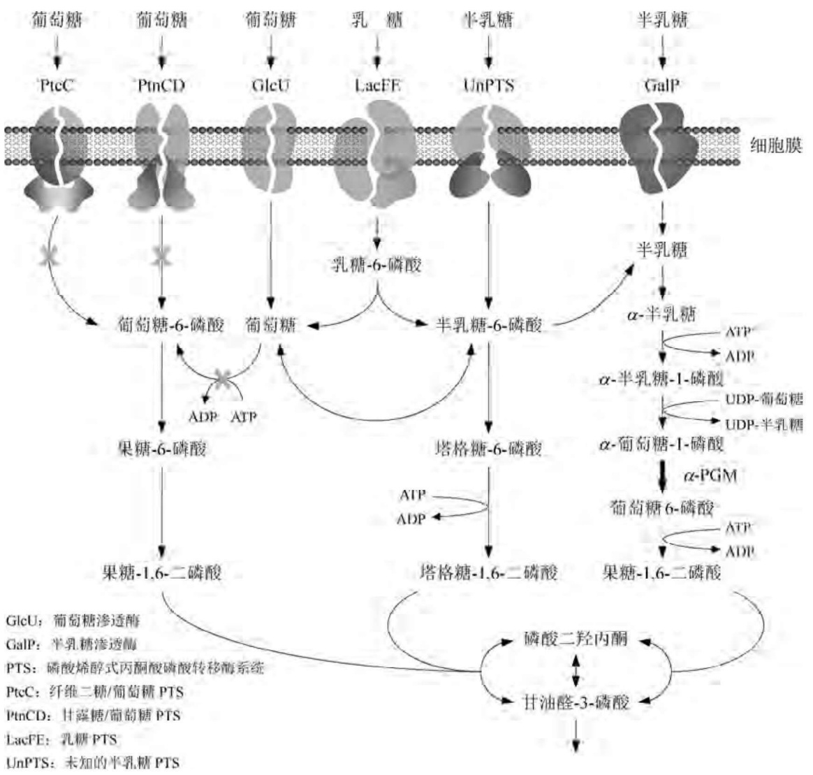

<details>
<summary>flowchart</summary>

```mermaid
graph TD
  A["葡萄糖"] --> B["PtcC"]
  C["葡萄糖"] --> D["PtnCD"]
  E["葡萄糖"] --> F["GlcU"]
  G["乳糖"] --> H["LacFE"]
  I["半乳糖"] --> J["UnPTS"]
  K["半乳糖"] --> L["GalP"]
  
  B -- "葡萄糖-6-磷酸" --> M["葡萄糖-6-磷酸"]
  D -- "葡萄糖-6-磷酸" --> N["葡萄糖-6-磷酸"]
  F -- "葡萄糖-6-磷酸" --> O["葡萄糖-6-磷酸"]
  H -- "葡萄糖-6-磷酸" --> P["葡萄糖-6-磷酸"]
  J -- "半乳糖-6-磷酸" --> Q["半乳糖-6-磷酸"]
  L -- "半乳糖-6-磷酸" --> R["半乳糖-6-磷酸"]
  
  M -- "葡萄糖-6-磷酸" --> S["果糖-6-磷酸"]
  N -- "葡萄糖-6-磷酸" --> T["葡萄糖-6-磷酸"]
  P -- "葡萄糖-6-磷酸" --> U["葡萄糖-6-磷酸"]
  R -- "半乳糖-6-磷酸" --> V["α-半乳糖"]
  
  O -- "葡萄糖-6-磷酸" --> W["β-GalP"]
  X -- "葡萄糖-6-磷酸" --> Y["β-PGM"]
  Z -- "葡萄糖-1-磷酸" --> AA["α-PGM"]
  AB -- "葡萄糖-1-磷酸" --> AC["β-GalP"]
  
  S -- "果糖-1.6-二磷酸" --> AD["果糖-1.6-二磷酸"]
  W -- "葡萄糖-1.6-二磷酸" --> AE["葡萄糖-1.6-二磷酸"]
  Y -- "葡萄糖-1.6-二磷酸" --> AF["葡萄糖-1.6-二磷酸"]
  
  AA -- "β-GalP" --> AG["β-GalP"]
  AC -- "β-GalP" --> AH["β-GalP"]
  AF -- "β-GalP" --> AI["β-GalP"]
  
  AD -- "ADP/ATP" --> AJ["ADP/ATP"]
  AK -- "ADP/ATP" --> AL["ADP/ATP"]
  AM -- "ADP/ATP" --> AN["ADP/ATP"]
  AO -- "ADP/ATP" --> AP["ADP/ATP"]
  
  AE -- "β-GalP" --> AQ["β-GalP"]
  AR -- "β-GalP" --> AS["β-GalP"]
  AT -- "β-GalP" --> AU["β-GalP"]
  AV -- "β-GalP" --> AW["β-GalP"]
  
  AJ -- "β-GalP" --> AX["β-GalP"]
  AU -- "β-GalP" --> AAX["β-GalP"]
  
  AX -- "β-GalP" --> AXY["β-GalP"]
  
  AX -- "β-GalP" --> AXY2["β-GalP"]
  
  AX2 -- "β-GalP" --> AXY3["β-GalP"]
  
  AX3 -- "β-GalP" --> AXY4["β-GalP"]
  
  AXY3 -- "β-GalP" --> AXY5["β-GalP"]
  
  AXY4 -- "β-GalP" --> AXY6["β-GalP"]
  
  AXY5 -- "β-GalP" --> AXY7["β-GalP"]
  
  AXY6 -- "β-GalP" --> AXY8["β-GalP"]
  
  AXY7 -- "β-GalP" --> AXY9["β-GalP"]
  
  AXY8 -- "β-GalP" --> AXY10["β-GalP"]
  
  AXY9 -- "β-GalP" --> AXY11["β-GalP"]
  
  AXY10 -- "β-GalP" --> AXY12["β-GalP"]
  
  AXY11 -- "β-GalP" --> AXY13["β-GalP"]
  
  AXY12 -- "β-GalP" --> AXY14["β-GalP"]
  
  AXY15 -- "β-GalP" --> AXY16["β-GalP"]
  
  AXY16 -- "β-GalP" --> AXY17["β-GalP"]
  
  AXY18 -- "β-GalP" --> AXY19["β-GalP"]
  
  AXY19 -- "β-GalP" --> AXY20["β-GalP"]
  
  AXY20 -- "β-GalP" --> AXY21["β-GalP"]
  
  AXY22 -- "β-GalP" --> AXY23["β-GalP"]
  
  AXY23 -- "β-GalP" --> AXY24["β-GalP"]
  
  AXY25 -- "β-GalP" --> AXY26["β-GalP"]
  
  AXY26 -- "β-GalP" --> AXY27["β-GalP"]
  
  AXY27 -- "β-GalP" --> AXY28["β-GalP"]
  
  AXY29 -- "β-GalP" --> AXY29["β-GalP"]
  
  AXY30 -- "β-GalP" --> AXY31["β-GalP"]
  
  AXY32 -- "β-GalP" --> AXY33["β-GalP"]
  
  AXY34 -- "β-GalP" --> AXY35["β-GalP"]
  
  AXY35 -- "β-GalP" --> AXY36["β-GalP"]
  
  AXY37 -- "β-GalP" --> AXY38["β-GalP"]
  
  AXY39 -- "β-GalP" --> AXY39["β-GalP"]
  
  AXY40 -- "β-GalP" --> AXY41["β-GalP"]
  
  AXY41 -- "β-GalP" --> AXY42["β-GalP"]
  
  AXY43 -- "β-GalP" --> AXY44["β-GalP"]
  
  AXY45 -- "β-GalP" --> AXY46["β-GalP"]
  
  AXY47 -- "β-GalP" --> AXY48["β-GalP"]
  
  AXY49 -- "β-GalP" --> AXY49["β-GalP"]
  
  AXY50 -- "β-GalP" --> AXY51["β-GalP"]
  
  AXY52 -- "β-GalP" --> AXY53["β-GalP"]
  
  AXY54 -- "β-GalP" --> AXY55["β-GalP"]
  
  AXY56 -- "β-GalP" --> AXY57["β-GalP"]
  
  AXY58 -- "β-GalP" --> AXY59["β-GalP"]
  
  AXY59 -- "β-GalP" --> AXY60["β-GalP"]
```
</details>

图4-32 乳酸乳球菌糖代谢的基因工程改造策略

的葡萄糖既可为发酵产物提供原位甜化，也可以将之进一步转化为胞外多糖或果糖产品。

乳酸菌乳糖发酵不完全的另一后果是残留显著量的半乳糖，后者严重影响发酵产物的品质，如奶酪在冷冻过程中变褐色且显脆性，易碎，而且有些人群尤其儿童还患有半乳糖血症。乳酸乳球菌的半乳糖代谢有三条途径:GalP/Leloir途径、塔格糖-6-磷酸途径、半乳糖-PTS/磷酸酶/Leloir途径，其中GalP/Leloir途径是强化半乳糖消耗基因操作的最佳靶点。然而，在乳酸乳球菌中过表达gal操纵子(galPMKT)并不能提升半乳糖的消耗速率，因为α-葡萄糖磷酸变位酶(α-PGM)的水平也是一个重要瓶颈。联合表达gal操纵子和α-PGM编码基因能使半乳糖的消耗速率提高50%(图4-32)。降低半乳糖含量的另一策略是在保加利亚乳杆菌和嗜热链球菌中表达异源的L-阿拉伯糖异构酶，它能将半乳糖转化成其异构体塔格糖，而后者是甜味与蔗糖相当的一种稀有己酮糖，热值相当低，且不能在人体胃肠道中代谢，因此是糖尿病、肥胖症以及其他代谢疾病患者的理想甜味剂。

## (4) 改善发酵食品的风味与品质

丙氨酸是一种天然甜味剂，其生物合成的关键步骤是丙氨酸脱氢酶在铵离子存在下使丙酮酸还原。球形芽孢杆菌异源丙氨酸脱氢酶在乳酸乳球菌乳酸脱氢酶(Ldh)缺陷株中的

---

第 4 章 原核细菌基因工程

241

过表达便可实现高丙氨酸的发酵；在该菌种中删除内源性丙氨酸消旋酶编码基因可导致L-丙氨酸的立体特异性生产。来自枯草芽孢杆菌的丙氨酸脱氢酶也能用于乳球菌合成丙氨酸，该酶的优势是在42℃时仍保持较高的酶活，这对于那些需要高温发酵的产品生产工艺具有重要意义。

二乙酰是乳制品典型的奶油香味化合物，由 $\alpha-$ 乙酰乳酸的氧化脱羧而成，是乳酸菌代谢的副产物。联合删除乳酸脱氢酶（Ldh）、$\alpha-$ 乙酰乳酸脱羧酶（AldB）、磷酸乙酰转移酶（Pta），同时提供甲酰四氢叶酸合成酶(Fhs)、3-磷酸甘油酸脱氢酶(SerA)或葡萄糖-6-磷酸-1-脱氢酶(Zwf)中的一个酶，并过表达NADH氧化酶(NoxE)，便可构建高产二乙酰的短乳杆菌工程株。

乙醛也是乳制品(酸奶)中重要的香味化合物。迄今为止，在乳酸菌中改善乙醛水平最成功的策略是将来自运动发酵单胞菌(Zymomonas mobilis)丙酮酸脱羧酶的过表达与天然NADH氧化酶的过表达相结合。采用一种两步法发酵技术，静止期细胞在厌氧条件下几乎能将 $50\%$ 的葡萄糖转换成乙醛。由NADH氧化酶介导的 $\mathrm{NAD^{+}}$ 有效再生在乳酸脱氢酶受损的途径中能促进由丙酮酸脱羧酶介导的丙酮酸代谢，导致高水平的乙醛积累。

多元醇是低热量的甜味剂，且具有包括抗肿瘤活性的多种有益功能，因而广泛用于食品和医药工业。基因工程改良乳酸乳球菌主要涉及两种最常见的多元醇:木糖醇和甘露醇。使乳酸乳球菌获得产木糖醇能力的策略是共表达来自木糖醇经典生产菌种树干毕赤酵母(Pichia stipitis)的木糖还原酶编码基因(XYL1)以及来自短乳杆菌的木糖运输基因(xylT)。删除甘露醇转运系统(PTSMtl)，或者在Ldh缺陷型乳酸乳球菌中过表达来自柔嫩艾美尔球虫(Eimeria tenella)的异源甘露醇-1-磷酸磷酸酶编码基因，能导致 $50\%$ 的葡萄糖转换为甘露醇。

很多乳酸菌具有合成B族维生素的能力，如核黄素（维生素 $\mathrm{B}_2$ ）、叶酸（维生素 $\mathrm{B}_{11}$ ）、钴胺素（维生素 $\mathrm{B}_{12}$ ）。其中，核黄素是催化氧化还原反应的核黄素型辅酶FMN和FAD的前体物质，由rib操纵子编码的七步酶促反应途径从GTP和核酮糖-5-磷酸合成。过表达四个乳球菌核黄素生物合成基因(ribGBAH)，可构建高产核黄素的乳酸乳球菌工程株。叶酸由GTP、对氨基苯甲酸(pABA)、谷氨酸通过多酶途径合成，在胞内叶酸一般以多聚 $\gamma-$ 谷氨酰化的形式存在，其分泌在很大程度上依赖于谷氨酸残基的数目。在乳酸乳球菌及其他乳酸菌中，将pABA基因簇 $pabA - pabBC$ 与叶酸生物合成基因簇fol联合过表达，可使乳酸乳球菌不依赖于胞外pABA而超量生产叶酸(增加80多倍)。另外，使fol基因簇在一株高产核黄素的乳酸乳球菌中过表达或者在维生素 $\mathrm{B}_{12}$ 生产菌罗伊氏乳杆菌（唯一产维生素 $\mathrm{B}_{12}$ 的乳酸菌)中过表达，还能构建出同时产多种维生素的乳酸菌。

植物次级代谢的几种代谢物具有抗细菌、抗真菌、抗氧化、增香味、促健康等功效。芳樟醇/橙花叔醇合成酶(NES)和一种醇乙酰转移酶是控制草莓典型香味物质芳樟醇、橙花叔醇、酯类的关键酶，将其编码基因导入乳酸乳球菌，便可实现具有天然草莓风味的酸奶生产。此外，具有抗氧化和促长寿功效的白藜芦醇(一种来自类苯基丙烷途径的二苯基乙烯)也可由重组的乳酸乳球菌合成，这对发酵生产具有保健功能的乳制品具有诱人的前景。

## 3. 重组乳酸菌在药物投递中的应用潜力

由于某些食用乳杆菌对人类健康起着重要作用,因此工程菌构建的主要方向体现在这些乳酸菌菌株上。食用乳杆菌的一个基本保健功能是抑制胃肠道致病菌的繁殖,并促进食物的消化和吸收。若将具有重要治疗价值的人体蛋白或多肽编码基因(如抗肿瘤因子、免疫调节因子、疫苗、抗体等)克隆在乳杆菌中,便有可能生产出易被肠道吸收的口服重组药物。与重组大肠杆菌生产的药物相比,乳杆菌的生物制品生产具有无须纯化(事实上,一定比例的细菌存在更有利于药物的吸收)和不含内毒性等优势,当然,如何提高药物基因的表达水

---

242

基因工程

平以及增加异源蛋白在酸性环境中的稳定性是从事这项工作必须攻克的难关。

## 4.5.5 利用 DNA 重组技术构建非食用乳酸菌工程株

事实上,乳酸菌的应用目前已远远超出了食品发酵工业的范围,特别是乳球菌属和乳杆菌属中的一些菌种已被开发成生产日用化学品和生物燃料的理想受体。

## 1. 利用重组乳酸菌生产乳酸

乳酸在传统的食品工业中被用作防腐剂和调味剂，然而日用化学品工业将乳酸作为生产聚乳酸和乳酸乙酯(增香剂)的前体物质，其中聚乳酸(PLA)是生物塑料的一种重要原材料，可替代来自石油的合成塑料。利用乳酸菌发酵生产乳酸具有得天独厚的优势，它们能将$95\%$ 的糖类物质高效转化成乳酸，而且发酵过程既能定向生产光学纯的L-乳酸或D-乳酸又能合成DL混旋型乳酸。删除ldhD基因可使瑞士乳杆菌特异性合成L-乳酸；如果用ldhL基因置换ldhD基因，则L-乳酸的产率可达到 $0.91\mathrm{g / g}$ （乳糖）。

另外，由可再生的农业副产物木质纤维素水解物发酵生产乳酸已受到极大的关注。与其他采用木质纤维素水解物生产高附加值的化学品过程一样，乳酸发酵工艺一个主要的难题是开发一种能利用木质纤维素水解物中所有类型的己糖和戊糖的乳酸菌，以最大限度地提高目标产物的生产效能。在此背景下，强化乳酸菌利用戊糖性能的基因工程策略至关重要。为达到此目的，将来自戊糖乳杆菌的两拷贝 $xylAB$ 操纵子导入植物乳杆菌的基因组中，由此获得的重组乳杆菌能发酵含 $25\mathrm{g / L}$ 木糖和 $75\mathrm{g / L}$ 葡萄糖的混合物，而且不存在碳代谢物阻遏效应，D-乳酸的产率达到 $0.78\mathrm{g / g}$ （糖类）。另一株植物乳杆菌工程菌则能由每克阿拉伯糖发酵产生 $0.82\mathrm{g}$ 的乳酸。在此之中，通过删除磷酸转酮酶编码基因并过表达一种异源的转酮酶编码基因，便能将碳代谢流从磷酸转酮酶途径转向戊糖磷酸途径，从而避免了副产物醋酸的过度积累。

## 2. 利用重组乳酸菌生产一元醇

乙醇既是一种重要的有机溶剂又可作为燃料汽油的替代品。全球范围内相关科研人员对微生物发酵生产乙醇具有浓厚的兴致，包括旨在提高乙醇天然生产菌酿酒酵母和运动发酵单胞菌以及重组大肠杆菌乙醇产量和产率的多种基因工程策略。由于乳酸菌能代谢利用存在于纤维素水解物中多种类型的糖（葡萄糖和木糖），因此它们也成为由纤维素发酵生产乙醇的具有诱惑力的系统。提升乳酸菌生产乙醇产量的基因工程策略包括引入来自高产乙醇的运动发酵单胞菌的丙酮酸脱羧酶和乙醇脱氢酶编码基因(PET操纵子)，并通过构建合成启动子和密码子优化等方法解决异源基因表达水平低的制约因素；同时敲除乳酸菌中三个Ldh编码基因(ldh、ldhB、ldhX)、磷酸转乙酰酶编码基因(pta)、乙醇脱氢酶编码基因(adhE)，可使乳球菌工程株以乙醇作为唯一的发酵产物。此外，生产菌株对乙醇耐受性的改良也是设计构建高产乙醇工程菌需要考虑的一个重要因素。已知在乳酸菌尤其是在片球菌属和乳杆菌属中，乙醇的耐受能力最高可达到 $18\%$ ，这对高产乙醇具有重要意义。

以溶剂著称的丁醇同样已被视为一种很有前途的液体燃料。与乙醇类似，改良丁醇生产的基因工程策略主要集中于丁醇的天然生产菌（如羧菌属）和重组菌（如大肠杆菌）。然而，丁醇的毒性是大规模发酵生产的一个障碍，上述丁醇生产菌一般只能耐受2%以下的丁醇，而乳酸菌成员在天然状态下便具有在3%丁醇中生长的特性，因而被认为是基因工程改良的潜在受体系统。确实，将羧菌属的丁醇生物合成途径移植到短乳杆菌中，重组短乳杆菌能产300 mg/L的丁醇，这一水平与其他基因工程菌已不相上下。如果进一步消除其他竞争性的NADH消耗途径或采用像甘油之类的底物解决乳酸菌的氧还不平衡或辅酶缺乏问题，同时开发催化能力更强的酶系，那么乳酸菌发酵生产丁醇的能力有望得到进一步提升。

## 3. 利用重组乳酸菌生产二元醇

2,3-丁二醇是一种重要的化工原料，可用作塑料生产过程中的抗冻剂，也是很多日用化

---

第 4 章 原核细菌基因工程

243

学品、药品、化妆品的合成原料，2,3-丁二醇的脱水衍生物1,3-丁二烯可用于生产合成橡胶，2,3-丁二醇的脱氢还能生产食品香味化合物二乙酰和乙偶姻。2,3-丁二醇的微生物发酵工艺主要聚焦于改良其天然生产菌株的产率和产量，如肺炎克雷伯氏菌（Klebsiella pneumoniae）、产酸克雷伯菌（Klebsiella oxytoca）、多黏类芽孢杆菌（Paenibacillus polymyxa）。然而，这些细菌的致病性是工业发酵应用的主要障碍。利用重组大肠杆菌生产2,3-丁二醇是目前一种流行的策略，但需要构建完整的生物合成途径。因此，安全的乳酸菌中天然存在的2,3-丁二醇生物合成途径使其成为潜在的大规模生产平台。事实上，利用重组乳酸菌生产2,3-丁二醇的专利已经公开，一株降低乳酸脱氢酶(Ldh)活性且异源表达丁二醇脱氢酶的植物乳杆菌基因工程株能产49%的2,3-丁二醇。通过对NAD $^{+}$ 辅酶循环进行工程化改造，也能使乳酸乳球菌的葡萄糖发酵定向转至2,3-丁二醇的合成，其产率高达67%(厌氧条件下的最大理论产率)。

1,3-丙二醇是一种广泛用于聚合物、溶剂、黏合剂、树脂、洗涤剂、化妆品的平台化合物。1,3-丙二醇的生物合成途径涉及甘油向3-羟基丙醛(3-HPA)的转换，后者进一步被还原成1,3-丙二醇。然而，1,3-丙二醇的大多数生产菌是潜在的病原体（如克雷伯氏菌属和羧菌属），在很大程度上限制了它们在食品、化妆品、医药工业中的应用。就这点而言，乳杆菌属中一些天然1,3-丙二醇生产菌的遗传背景安全性具有很大的优势，如罗伊氏乳杆菌、短乳杆菌、布氏乳杆菌(Lactobacillus bucheneri)等，其中的罗伊氏乳杆菌可能是最佳的1,3-丙二醇生产菌，优化其发酵过程可产生高水平的1,3-丙二醇；而二醇乳杆菌(Lactobacillus diolivorans)生产1,3-丙二醇的产量可达84.5 g/L，与其他天然生产菌的水平已不相上下。这些结果表明，乳酸菌作为1,3-丙二醇生物催化剂是可行的，且具有基因工程进一步改良的空间。

## 4.6 假单胞菌基因工程

很多微生物尤其是革兰氏阴性菌假单胞菌属(Pseudomonads)能降解各种化学性质稳定的物质,因此对环境的生物治理和保护具有重要意义。有些难以降解的化合物如多聚氯代联苯(PCB)和 $\gamma$ -六氯环己烷( $\gamma$ -BHC)能长期滞留在环境中,导致严重污染。多年来人们一直在尝试借助特殊的微生物种群生物降解或转化这些化学工业污染物,现已查明,迄今已知的几乎所有化学污染物均能为微生物或植物所降解,其中许多生物降解途径已经阐明,相关的基因也相继克隆并获得鉴定。利用DNA重组技术构建高效、降解广范围化学污染物且自身生存和增殖可控的环保工程菌已经进入实用阶段。

## 4.6.1 假单胞菌的载体克隆系统

与大多数革兰氏阴性菌相似，假单胞菌属并不能用常规的大肠杆菌质粒转化，而其自身携带的大多数野生型质粒大于 $30\mathrm{kb}$，因此假单胞菌属的基因操作往往使用广宿主载体如RSF1010(8.3 kb，拷贝数 $40\sim 50 /$ 细胞，非移动型，含链霉素抗性标记 $Sm^{r}$ 和EcoRI、HpaI克隆位点）、RK2(56 kb，拷贝数 $5\sim 10 /$ 细胞，可移动型，含氨苄青霉素抗性标记 $Ap^r$、四环素抗性标记 $Tc^r$、卡那霉素抗性标记 $Km^r$ 以及EcoRI、HindIII、BglII、SalI克隆位点）、R300B(8.6 kb，拷贝数 $10\sim 15 /$ 细胞，非移动型，含链霉素抗性标记 $Sm^r$ 和EcoRI克隆位点)以及由这些质粒的复制子构建的衍生载体(表4-26)。其中，pMFY31、pMFY40、pMFY42为理想的克隆载体，至少含有两个抗药性标记基因和大量的单一酶切位点；pMFY500是一种启动子探针质粒；由RK2质粒构建的pKS13、pCP13、pLAFR1、pVK100为考斯质粒，可用于构建假单胞菌属的基因文库；小型隐蔽型质粒pRO1600来自广宿主载体RP1（与RK2非常相似）在铜绿假单胞菌（即致病菌绿脓杆菌，Pseudomonas aeruginosa）PAO株中的体内重组产

---

244

基因工程

表 4-26 用于假单胞菌的广宿主克隆表达载体

| 载体 | 选择标记 | 复制子 | 克隆位点 | 大小/kb | 特性 |
| --- | --- | --- | --- | --- | --- |
| pKT210 | $Cm^r Sm^r$ | RSF1010 | EcoRI, HindIII, HpaI, SacI | 11.8 | 可移动 |
| pKT230/262 | $Km^r Sm^r$ | RSF1010 - pACYC177 | BamHI, BstI, EcoRI, HindIII, SacI, SalI, XhoI, XmaI | 11.9/11.7 | 可移动/移动缺陷,穿梭质粒 |
| pKT240 | $Apr^r Km^r$ | RSF1010 | ClaI, EcoRI, HindIII, SacI, XhoI, XmaI | 12.5 | 可移动,启动子探针 |
| pMFY31 | $Apr^r Cm^r Tc^r$ | RSF1010 | BamHI, EcoRI, HindIII, PstI, SalI | 13.2 | 可移动 |
| pMFY40 | $Apr^r Tc^r$ | RSF1010 | BamHI, EcoRI, HindIII, PstI, PvuI, SalI | 11.6 | 可移动 |
| pMFY42 | $Km^r Tc^r$ | RSF1010 | BamHI, BglI, EcoRI, HindIII, KpnI, PstI, SacI, SalI | 10.9 | 可移动 |
| pMFY500 | $Apr^r$ | RSF1010 | EcoRI, HindIII, KpnI, SacI, SmaI | 11.5 | 可移动,启动子探针 |
| pMMB22/24 | $Apr^r$ | RSF1010 | EcoRI, HindIII | 12.7 | 可移动,tac 启动子 |
| pMMB33/34 | $Km^r$ | RSF1010 | BamHI, EcoRI, SacI | 13.8 | 可移动,黏性质粒 |
| pMW79 | $Apr^r Tc^r Sm^r$ | RSF1010 - pBR322 | BamHI, HindIII, SalI, HpaI | 12.7 | 移动缺陷,穿梭质粒 |
| pRK290 | $Tc^r$ | RK2 | BglII, EcoRI | 20.0 | 可移动 |
| pRK2501 | $Tc^r Km^r$ | RK2 | BglII, EcoRI, HindIII, SalI, XhoI | 11.1 | 可移动 |
| pLAFR1 | $Tc^r$ | RK2 | EcoRI | 21.6 | 可移动,黏性质粒 |
| pVK100 | $Km^r Tc^r$ | RK2 | EcoRI, HindIII, SalI, XhoI | 23.0 | 可移动,黏性质粒 |
| pCP13 | $Km^r Tc^r$ | RK2 | BamHI, ClaI, EcoRI, HindIII, SalI, PstI, Xba | 23.0 | 可移动,黏性质粒 |
| pKS13 | $Tc^r$ | RK2 | BamHI, ClaI, EcoRI, HindIII, PstI, XbaI | 22.0 | 可移动,黏性质粒 |
| pGSS15 | $Apr^r Tc^r$ | R300B - pMB1 | BamHI, BstI, ClaI, EcoRI, HindIII, PstI | 11.5 | 可移动,穿梭质粒 |
| pGSS33 | $Apr^r Cm^r Sm^r Tc^r$ | R300B | BamHI, BstI, ClaI, EcoRI, HindIII, PstI, PvuII, SacI, SacII, SalI | 13.4 | 可移动 |
| pGV1106 | $Km^r Sp^r$ | Sa | BamHI, BglII, EcoRI, PstI, SacII | 8.4 |  |
| pGV1122 | $Sp^r Tc^r$ | Sa - pMB1 | BamHI, HindIII, PstI, SalI | 10.8 | 可移动,穿梭质粒 |
| pSa4 | $Cm^r Km^r Sp^r$ | Sa | BamHI, KpnI, SacI | 9.4 |  |
| pRO1600 |  | RP1 | BglI, PstI | 3.0 | 移动缺陷 |
| pRO1614 | $Apr^r Tc^r$ | pRO1600 - pBR322 | BamHI, HindIII | 6.2 | 移动缺陷 |
| pUCP18/19 | $Apr^r lacZ'$ | pRO1614 - pUC18/19 | EcoRI, KpnI, SmaI, BamHI, XbaI, SalI, PstI, SphI, HindIII | 4.6 | 可移动,穿梭表达质粒,$P_{lac}$ |
| pUCP20T/28T/30T | $Apr^r lacZ'/dhfRII/aacC1$ | pRO1614 - pBR322 | EcoRI, KpnI, SmaI, BamHI, XbaI, SalI, PstI, SphI, HindIII | 4.2/4.1/4.3 | 可移动,穿梭表达质粒,$P_{lac}$ |
| pHERD20T | $Apr^r lacZ'$ | pRO1614 - pBR322 | NcoI, EcoRI, KpnI, SmaI, XbaI, SalI, PstI, SphI, HindIII | 5.1 | 可移动,穿梭表达质粒,$P_{BAD}$ |
| pHERD28T | $Apr^r dhfRII$ | pRO1614 - pBR322 | NcoI, EcoRI, KpnI, SmaI, XbaI, SalI, PstI, SphI, HindIII | 5.0 | 可移动,穿梭表达质粒,$P_{BAD}$ |
| pHERD30T | $Apr^r aacC1$ | pRO1614 - pBR322 | NcoI, EcoRI, KpnI, SmaI, XbaI, SalI, PstI, SphI, HindIII | 5.2 | 可移动,穿梭表达质粒,$P_{BAD}$ |

注: $Ap^r$ —氨苄青霉素抗性； $Cm^r$ —氯霉素抗性； $Km^r$ —卡那霉素抗性； $Sm^r$ —链霉素抗性； $Sp^r$ —壮观霉素抗性； $Tc^r$ —四环素抗性；aacCl—庆大霉素抗性；dh fRII—二氢叶酸还原酶基因；lacZ'—b-半乳糖苷酶基因。

---

第 4 章 原核细菌基因工程

245

物,其含复制子的 PstI 片段克隆在大肠杆菌质粒 pBR322 上,构成 pRO1614。测试结果显示,pRO1614 能在一系列细菌种属中复制,包括绿脓假单胞菌、恶臭假单胞菌(Pseudomonas putida)、荧光假单胞菌(Pseudomonas fluorescens)、肺炎克雷伯菌(Klebsiella pneumoniae)、伯克氏菌(Burkholderia),因而具有广泛的用途。

虽然大肠杆菌克隆质粒 pMB1 或 pBR322 型复制子不能在假单胞菌属中复制，但像  $P_{tac}$ 、 $P_{T7}$ 、 $P_{araBAD}$  等大肠杆菌启动子却能被假单胞菌属的  $\sigma$  因子所识别。在大肠杆菌中，AraC 阻遏阿拉伯糖代谢操纵子 (araBAD) 所属启动子  $P_{BAD}$ ，添加 L-阿拉伯糖可诱导克隆基因的表达，这些大肠杆菌的强启动子也可用来构建假单胞菌属的诱导表达系统。例如，PCR 扩增大肠杆菌商品化表达载体 pBAD/Thio-TOPO 上的阿拉伯糖启动子  $P_{BAD}$  及其阻遏蛋白 AraC 编码基因 araC，并将之分别置换大肠杆菌-假单胞菌穿梭表达质粒 pUCP20T ( $Ap^{r}$ , lacZ')、pUCP28T ( $Ap^{r}$ , dhfRII)、pUCP30T ( $Ap^{r}$ , aacC1) 中的乳糖启动子  $P_{lac}$ ，便构成可用阿拉伯糖诱导表达的 pHERD 相应载体系列（表 4-26）。pHERD 载体家族的优势是当  $P_{BAD}$  启动子不被诱导时，外源基因表达本底极低，阿拉伯糖的诱导倍数接近 250 倍，而且  $P_{BAD}$  以剂量依赖型方式响应阿拉伯糖。如果将外源基因克隆在 EcoRI 位点处，则会产生氨基端带有 MGSDKNS 七肽序列（来自 pBAD-TOPO/Thio 载体上的硫氧还蛋白）的融合蛋白。硫氧还蛋白作为翻译的前导肽能促进外源基因高效表达，甚至在某些情况下还能提高外源蛋白在细胞内的可溶性。此外，该七肽序列还可以用作重组蛋白定量分析的原位标签。值得注意的是，启动子  $P_{BAD}$  与  $P_{lac}$  相似，在葡萄糖存在时呈代谢阻遏，即葡萄糖代谢使胞内 cAMP 浓度降低，从而阻止由 cAMP 结合蛋白介导的很多基因的转录激活效应。

## 4.6.2 假单胞菌的宿主转化系统

假单胞菌属的绝大部分种株可使用下列三种方法进行转化:

## 1. 假单胞菌的经典转化法

恶臭假单胞菌和铜绿假单胞菌的感受态细胞能在  $Ca^{2+}$  和  $Mg^{2+}$  的存在下接纳质粒，但转化效率极低，即使以限制性缺陷型的突变株为受体，其转化率也远远低于大肠杆菌。改变碱金属离子的性质及浓度能在一定程度上提高转化率，依照下列改进方法用广宿主质粒及其衍生物转化上述两种菌的感受态细胞，转化率为  $10^{3}$  个/ $\mu g$  DNA:菌体在 LB 培养基中生长至  $OD_{660}=0.6$ ，离心收获菌体；用冰冷的转化缓冲液（10 mmol/L MOPS, 10 mmol/L RbCl, 100 mmol/L  $CaCl_{2}$ , pH7.0）洗涤菌体；以少量的冷冻转化缓冲液悬浮菌体，冰浴 30 min；在 0.1 mL 的细菌悬浮液中加入不超过 10  $\mu L$  的待转化 DNA 溶液，继续冰浴 20 min；上述冰浴混合物置于 42℃ 中热休克 2 min；加入 1 mL 的新鲜 LB 培养基，于 30℃ 扩增 2 h，随后即可涂板筛选。对有些假单胞菌菌株而言， $CaCl_{2}$  可能会降低转化率，此时可用 100 mmol/L 的  $MgCl_{2}$  取代转化缓冲液中  $CaCl_{2}$ 。

## 2. 假单胞菌的接合共转移法

该程序是将质粒导入许多革兰氏阳性菌受体中的最有效方法。在一个自主接合型质粒的存在下，含有可移动基因(mob、oriT、nic)的重组质粒能有效地从供体菌转入受体菌，无须分离制备质粒DNA。用于转化假单胞菌属的绝大多数广宿主质粒及其衍生物都含有可溶移动基因，如果选择大肠杆菌为供体菌，则首先使辅助质粒(如pRK2013自主接合型质粒)从辅助菌进入大肠杆菌，然后再使供体菌中的重组质粒同步进入受体细胞，这就是所谓的三元接合系统的工作原理。辅助质粒最好选择那些只能在辅助菌中维持但不能在受体菌中复制的载体，以保证在接合之后选择平板上形成的菌落中只含有一种重组质粒。大肠杆菌S17-1株是一个最理想的供体菌，其染色体DNA上含有一个决定接合转移的tra基因，能优先高效转移存在于细胞内的任何重组质粒。接合共转移有两种操作程序，分别为过滤接合和斑点接合。前者是将供体、受体和辅助菌过夜培养液混合，并注入一个铺有滤膜（空孔

---

246

基因工程

为  $0.45 \mu m$  的 10 mL 圆柱形过滤器中（如注射器等），施压过滤后，取出滤膜，放置在 LB 平板上（菌体面朝上），在受体菌生长温度下培养  $4 \sim 6 h$  或过夜。然后将滤膜浸入无菌生理盐水中，悬浮细菌，获得的悬浮液即可涂板筛选。在进行斑点接合操作时，分别将一滴过夜培养的供体菌、受体菌和辅助菌滴在 LB 平板的相应位点上，培养过夜，然后用无菌牙签将混合生长的细菌涂布在选择平板上分离整合型单菌落。

## 3. 假单胞菌的电击转化法

细菌在 LB 培养基中生长至  $OD_{660}$  接近于 0.7，离心收获菌体；分别用冰冷的无菌水和 10% 的甘油溶液洗涤菌体各两次；取 40 μL 悬浮液于 -80℃ 下冰冻保存，使用时将其在室温下缓慢解冻，然后置于冰浴中；加入体积不大于 2 μL 的 DNA 溶液，继续冰浴 1 min。将混合液移至 0.1 mL 的电击槽中，在 1.7 kV、200 Ω 和 25 μF 的条件下电击 1 次；加入 1 mL 的 SOC 液体培养基（2% 蛋白胨，0.5% 酵母粉，10 mmol/L NaCl，25 mmol/L KCl，10 mmol/L  $MgCl_{2}$ ，10 mmol/L  $MgSO_{4}$ ，20 mmol/L 葡萄糖），30℃ 培养 2 h，然后涂板进行筛选，转化率为  $10^{4}$  个/μg DNA。

## 4.6.3 假单胞菌生物降解基因的克隆与鉴定

正如20世纪40年代以来抗生素的大规模使用导致抗生素抗性基因的广泛显现和传播，现代化学工业的飞速发展将大量有害的有机化合物释放至环境中，其中大量的毒性物质具有长达数十年的半衰期，在污染空气、水系、土壤并对人类和动植物的生存造成严重危害的同时，也对环境微生物种群构成了种类和剂量日趋增多的强大选择压力。为了适应这种恶劣的环境，环境微生物种群迅速进化并扩散其降解、转化、代谢各类化学稳定的有机化合物的能力。因此，假单胞菌生物降解的基因和途径大多编码在可移动遗传元件上，如转座子、噬菌体DNA、质粒。这一特征在客观上为人们克隆和鉴定种类繁多且复杂的化学污染物分解基因、进而构建性能优异的超级生物降解基因工程菌提供了便利。目前已探查到的存在于假单胞菌属可移动元件上的生物降解基因簇或操纵子列在表4-27中。其中，$105\mathrm{kb}$ 长的clc元件借助类似于噬菌体型的整合酶在宿主染色体DNA上进行切除和插入，从而可实现生物降解基因簇之间自发的体内重组。值得注意的是，很多转座子元件其实也定位于大型质粒中，它们赋予了生物降解型质粒在宿主染色体上的转座（移动）能力。

表 4-27 假单胞菌属可移动遗传元件上的生物降解基因簇

<table><tr><td>可移动遗传元件</td><td>假单胞菌菌株</td><td>降解底物</td><td>元件大小/kb</td></tr><tr><td colspan="4">质粒</td></tr><tr><td>pAC25</td><td>Pseudomonas putida AC858</td><td>3-氯苯甲酸</td><td>117</td></tr><tr><td>pPC170</td><td>Pseudomonas cichori 170</td><td>1,3-二氯丙烯</td><td>60</td></tr><tr><td>pCS1</td><td>Pseudomonas diminuta</td><td>硝基苯硫磷酯</td><td>68</td></tr><tr><td>pUU204</td><td>Pseudomonas sp. E4</td><td>2-氯丙酸</td><td>293</td></tr><tr><td colspan="4">转座子</td></tr><tr><td>Tn5542</td><td>Pseudomonas putida ML2(含 pHMT112)</td><td>苯</td><td>12</td></tr><tr><td>Tn5280</td><td>Pseudomonas sp. P51(含 pP51)</td><td>氯苯</td><td>9</td></tr><tr><td>Tn4651</td><td>Pseudomonas putida mt-2(含 pWWO)</td><td>甲苯(TOL),二甲苯</td><td>56</td></tr><tr><td>Tn4653</td><td>Pseudomonas putida mt-2(含 pWWO)</td><td>甲苯(TOL),二甲苯</td><td>70</td></tr><tr><td>Tn4655</td><td>Pseudomonas putida G7(含 NAH7)</td><td>萘</td><td>38</td></tr><tr><td>Tn4656</td><td>Pseudomonas putida MT53(含 pWW53)</td><td>甲苯(TOL),二甲苯</td><td>39</td></tr><tr><td>bph-sal element</td><td>Pseudomonas putida KF715</td><td>联苯,水杨酸</td><td>90</td></tr><tr><td>bph element</td><td>Pseudomonas putida JHR</td><td>联苯</td><td></td></tr><tr><td>clc element</td><td>Pseudomonas sp. B13(含 pWR1)</td><td>氯代邻苯二酚,3-氯苯甲酸</td><td>105</td></tr></table>

---

第 4 章 原核细菌基因工程

247

然而，有些生物降解基因簇或操纵子则定位于宿主的染色体上。假单胞菌KKS102是一株降解PCB的优良菌株，它能将联苯或PCB分别代谢成水溶性的苯甲酸或氯代苯甲酸（图4-33）。目前，利用广宿主考斯质粒pKS13已在大肠杆菌HB101中成功地构建了该菌株的基因文库。依照图4-34所示的程序，将KKS102的基因文库从大肠杆菌HB101转移至恶臭假单胞菌PpY101株中，并在含有2,3-二羟联苯的选择性培养基上筛选基因文库。由联苯降解为苯甲酸的第三步反应是2,3-二羟联苯在2,3-二羟联苯双氧化酶的催化下转化为一种亮黄色的变位裂解化合物，因此从上述筛选平板上挑出亮黄色的克隆菌，提取相应的重组质粒(pKH1)，并重新转化大肠杆菌HB101，获得的转化子也能将2,3-二羟联苯降解成黄色化合物，由此确定pKH1上 $28\mathrm{kb}$ 的插入片段中含有假单胞菌KKS102株为2,3-二羟联苯双氧化酶编码的基因bphC。进一步的次级克隆实验表明，bphC基因位于上述克隆片段中一个 $3.2\mathrm{kb}$ 的PstI DNA片段上，将此片段克隆在大肠杆菌的高拷贝质粒pUC18上，重组质粒(pKH101)能大幅度提高大肠杆菌转化子降解2,3-二羟联苯的反应活性。若将相同的片段克隆在广宿主载体pMFY40上，所形成的重组质粒pKH131在大肠杆菌中表达出很少的2,3-二羟联苯双氧化酶活性，但在恶臭假单胞菌中却显示出很强的酶活。

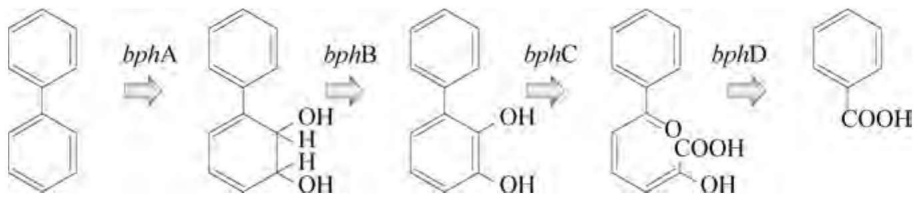

<details>
<summary>chemical</summary>

Chemical reaction pathway showing conversion of phenyl to carboxylic acid via intermediate compounds bphA–bphD
</details>

图4-33 假单胞菌属KKS102株联苯降解途径

假单胞菌属的甲苯-二甲苯降解操纵子 xyl、萘代谢操纵子 nah、n-烷烃利用操纵子 alk 也均已克隆与鉴定，联苯-氯代联苯降解操纵子 bph 的另外四个基因也已通过染色体走读法克隆，它们均位于 bphC 的上游，分别命名为 bphA1、bphA2、bphA3、bphB（图 4-35）。由上述四个阅读框架推出的氨基酸序列与恶臭假单胞菌 F1 株的甲苯降解代谢基因 todB、todC1、todC2、todD 具有 60% 左右的相似性，这表明假单胞菌 KKS102 株的 bphA1、bphA2、bphA3、bphB 基因分别编码铁硫蛋白的大小亚基、联苯二氧化酶的铁氧化还原蛋白亚基、二氨二醇脱氢酶。另外，KKS102 株的 bph 基因编码产物与另一株假单胞菌 KF707 的相应基因产物表现出更高的同源性（接近 70%），但在后者的 bphA3 与 bphB 基因之间，还有一个对应于 todA 的铁氧化还原酶编码基因 bphA。bphA1～bphA3 的基因产物还与萘降解途径中的 ndoABC 基因产物呈现大约 30% 的同源性，上述基因构成了降解各种芳香族化合物的基因家族。

## 4.6.4 假单胞菌生物降解途径的分子设计

自人类条件致病菌铜绿假单胞菌 PAO1 株于 2000 年首次完成全基因组测序以来，越来越多的生物降解型假单胞菌菌株的全基因组得以解析。在假单胞菌属远远大于绝大多数其他原核细菌的基因组序列（平均总长 6.5 Mb, 6 000 个 ORF, GC 含量 63.7%）中，编码了丰富的化合物降解代谢基因和途径，如简单芳香烃、硝基芳香烃、氯化芳香烃、多环芳香烃、联苯芳香烃、多氯联苯、石油组分等，为利用基因工程技术强化重要的生物降解途径以及集成多重污染物分解代谢途径提供了丰富的信息资源[如明尼苏达大学“生物催化/生物降解数据库”(http://umbbd.ahc.umn.edu)以及“生物降解型菌种数据库”(http://bsd.cme.msu.edu/bsd/index.html)]。

---

248

基因工程

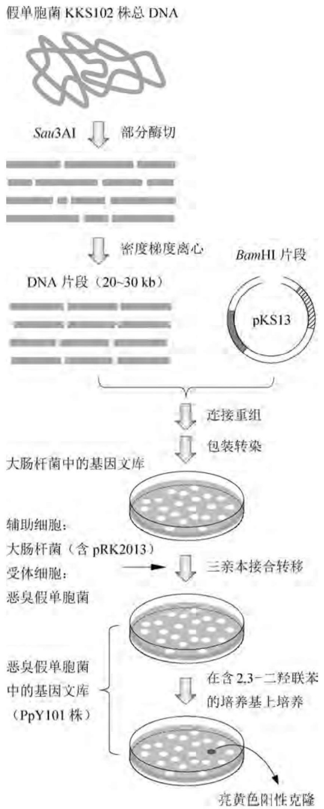

<details>
<summary>flowchart</summary>

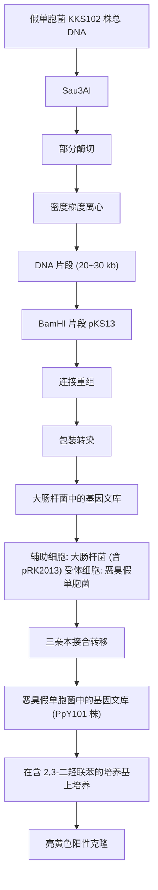
</details>

图4-34 假单胞菌KKS102株联苯降解基因bphC的克隆

---

第 4 章 原核细菌基因工程

249

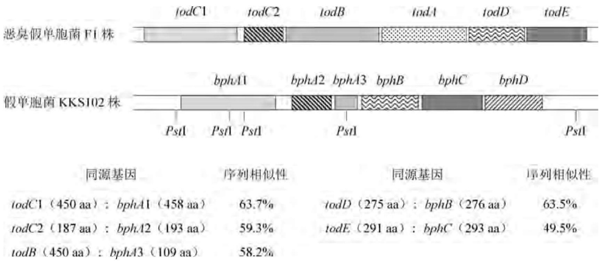

<details>
<summary>bar</summary>

| Strain | Locus | Alignment (%) |
| --- | --- | --- |
| F1 株 | todC1 | 63.7% |
| F1 株 | todC2 | 59.3% |
| F1 株 | todB | 58.2% |
| F1 株 | todA | — |
| F1 株 | todD | — |
| F1 株 | todE | — |
| KKS102 株 | bphA1 | — |
| KKS102 株 | bphA2 | — |
| KKS102 株 | bphA3 | — |
| KKS102 株 | bphB | — |
| KKS102 株 | bphC | — |
| KKS102 株 | bphD | — |
| KKS102 株 | PstI | — |
| KKS102 株 | PstI | — |
| KKS102 株 | PstI | — |
| KKS102 株 | PstI | — |
| KKS102 株 | PstI | — |
| KKS102 株 | PstI | — |
| KKS102 株 | PstI | — |
| KKS102株 (同源基因) | todC1 (450 aa): bphA1 (458 aa) | 63.7% |
| KKS102株 (同源基因) | todC2 (187 aa): bphA2 (193 aa) | 59.3% |
| KKS102株 (同源基因) | todB (450 aa): bphA3 (109 aa) | 58.2% |
| KKS102株 (同源基因) | todD (275 aa): bphB (276 aa) | 63.5% |
| KKS102株 (同源基因) | todE (291 aa): bphC (293 aa) | 49.5% |
</details>

图4-35 恶臭假单胞菌F1株tod基因与假单胞菌KKS102株bph基因编码产物的同源性

## 1. 基于生物降解途径强化的假单胞菌工程菌构建

惰性化合物生物降解基因的表达调控系统具有独特的诱导机制。在DNA重组过程中，这个系统可用于控制并强化外源基因的表达。例如，由 $n$ -烷烃降解基因调控系统构建的可诱导型广宿主表达质粒pRK250和pMFY500，含有转录正调控基因alkR和 $P_{\mathrm{alk}}$ 启动子。将报告基因四环素抗性基因tet插入 $P_{\mathrm{alk}}$ 启动子的下游邻近位点，即可用 $n$ -烷烃诱导其表达，转化子在含有正辛烷的培养基上产生对高浓度四环素的抗性。若将 $\gamma$ -六氯代环己烷（ $\gamma-$ HCH)脱氢氯酶基因(linA)插在 $P_{\mathrm{alk}}$ 启动子与tet基因之间，则linA基因在恶臭假单胞菌中用正辛烷诱导表达的水平是非诱导的30倍。

对天然存在的生物降解基因进行酶学修饰和基因洗牌(详见第10章)，既可强化污染物分解代谢酶系的活性，促进细菌能量和还原力的综合平衡，又能有效扩展降解酶系对底物的作用谱。例如，芳香烃双加氧酶属于芳香环羟基化双加氧酶超家族成员，该家族的所有成员在其加氧酶组分之前均拥有1～2个电子传递蛋白。萘双加氧酶的晶体结构显示，其两个 $\alpha$ 亚基上分别含有双加氧酶特征性的2Fe-2S簇以及单核铁螯合物。这一信息提示可通过基因操作将单氧酶或双加氧酶的单一底物催化性能加以扩展。又如，卤代烷脱卤酶是负责以羟基取代末端氯原子第一步反应的酶，其催化活性腔内空间伸展较大的氨基酸残基为丙氨酸取代后，突变的酶对二氯己烷的脱氯活性提高数倍。

随着对惰性化合物生物降解途径以及降解基因表达调控机理研究的不断积累，已有可能用已克隆的降解基因改良或设计构建一个全新的惰性化合物降解途径。例如，4-乙基苯甲酸通常不能诱导甲苯的生物降解途径，而且还对邻苯二酚-2,3-双氧化酶的活性产生抑制作用。将一个预先克隆有正调控基因xylS的重组质粒与含有受xylS调控的启动子以及tet基因的另一个重组质粒共同转化同一菌株，由此获得的转化子能在4-乙基苯甲酸存在的条件下，诱导表达苯甲酸的代谢途径。含有TOL质粒的恶臭假单胞菌与上述转化子共同培养，既可将4-乙基苯甲酸转化为4-乙基邻苯二酚，同时又能从两种重组菌的混合物中筛选出邻苯二酚双氧化酶对4-乙基苯甲酸的抑制作用产生抗性的转化子，它们均能在以4-乙基苯甲酸为唯一碳源的培养基中生长。

## 2. 基于生物降解途径集成的假单胞菌工程菌构建

假单胞菌 B13 株能将 3-氯苯甲酸降解成不含氯取代基的二羧酸化合物，后者再经三羧酸循环最后代谢为  $CO_{2}$  和  $H_{2}O$ ，其降解途径如图 4-36 所示。催化第一步反应的苯甲酸 1,2-双氧化酶(BO)具有较高的底物特异性，除 3-氯苯甲酸外，不能转化其他任何结构的氯

---

250

基因工程

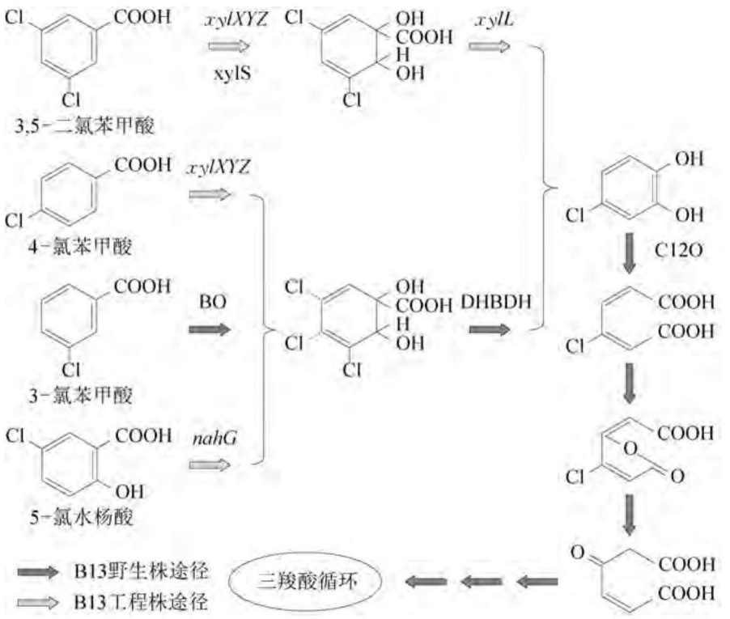

<details>
<summary>flowchart</summary>

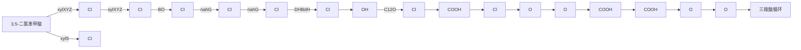
</details>

图4-36 假单胞菌B13株3-氯苯甲酸降解途径

代苯甲酸，而催化第二步反应的二羟环己二烯羧酸脱氢酶(DHBDH)以及邻苯二酚-1,2-双氧化酶(C12O)则显示出较弱的底物专一性，它们既能作用于氯代苯甲酸，也能催化氯代水杨酸的转化。将编码甲苯-1,2-双氧化酶(TO)的基因xylXYZ及其正调控基因xylS导入B13株中，获得的重组菌便能降解4-氯苯甲酸；若将xylXYZ、xylS以及编码DHBDH的基因xylL共同转化B13株，则转化子能在3,5-二氯苯甲酸的诱导下，将其降解成最终代谢产物。采用相似的策略，还可将NAH71质粒上负责萘降解的水杨酸羟化酶(SH)编码基因(nahG)转入B13株中，使之同时能降解3-,4-,5-氯代水杨酸。在另一项研究中，一株恶臭假单胞菌TB105重组株由于理性集成了TOL和TOD两条途径，能使苯、甲苯、p-二甲苯的混合物无机化，而且不含任何分解代谢中间物的积累。上述结果表明，利用DNA重组技术将假单胞菌属控制惰性化合物生物降解的内源性和外源性基因有机结合，可以构建出降解底物范围更广的优良工程菌，这在环境保护领域具有十分重要的意义。

## 3. 基于环境生存与增殖控制的假单胞菌工程菌构建

虽然旨在用于污染源原位生物治理的几株假单胞菌工程株已被成功构建，其实验室条件下生物治理的高效潜力也得以证实，然而这些基因工程菌对生态环境的影响及其监控却是野外大规模试验和应用的主要障碍。基因工程菌野外投放较理想的方式是在完成预设任务之后自动退出环境，起码能自发地规避持久性的增殖和演化。目前已构建出特异性的遏制系统以限制基因工程菌在自然环境中的生存能力，即任何企图从污染源中逃逸的细胞均会被诱导的“自杀性”控制系统杀死。一种更加特异性的方法是通过将“自杀”基因与环境相关性基因偶联而阻断基因的转移，即利用一种在天然微生物潜在受体中不存在的染色体基因控制释放的基因工程菌中“自杀”基因的表达。

野生型细菌为了稳定维持其细胞内的质粒，进化出了所谓的“质粒成瘾”机制，即因各种原因丢失质粒的细胞均被杀死。“质粒成瘾”的分子机制至少需要两个质粒编码基因:一个

---

第 4 章 原核细菌基因工程

251

编码特别稳定的毒素(或杀手);另一个编码能防止中毒的不稳定性因子。毒素在所有已知的案例中均为蛋白质;而解毒因子则既可以是一种反义RNA(能抑制毒素蛋白的翻译)也可以是一种蛋白质。这种“质粒成瘾”现象是构建基因工程菌遏制系统的基础。

基因工程菌野外投放的遏制系统通常由杀手基因以及调控回路构成，后者响应环境信号（如待清除的污染物）的存在或缺席而控制杀手基因的表达。图4-37表示的是构建自杀性遏制系统的设计策略。在一种典型的天然蛋白质型质粒成瘾系统中，杀手基因及其解毒基因组成操纵子，其启动子受杀手蛋白与解毒蛋白复合物的严密负调控[图4-37(a)]。如果选用一种能响应污染物的启动子介导杀手基因的表达，即在污染物存在时，杀手基因的转录被阻遏；当污染物缺席时，杀手基因打开并致死细胞，便构成生物治理工程菌的遏制系统[图4-37(b)]。来自TOL途径的启动子 $P_{m}$ 受XylS蛋白的正调控，而苯甲酸或甲苯酸酯能激活XylS，因此 $P_{m}$ 是介导杀手基因表达的理想调控元件；而可选的杀手基因包括hok（编码特异性靶向细菌细胞膜电子呼吸链组分的小肽）、stv（编码能中和细菌生长必需成分生物素的链霉亲和素）以及gef等。

上述的生物遏制系统存在一个缺陷，即相当部分的细胞由于随机突变而失去自杀功能或规避自杀效应。其主要原因是自杀功能在污染物存在条件下被默认设置为关闭状态，因此在污染物被耗尽之前，控制元件有时间发生随机突变。如果通过污染物的存在与否调控解毒因子的合成，进而依次灭活组成性表达的杀手基因产物，便可使随机突变降低至最小程度，其原理如图4-37(c)所示。在这种自杀系统中，只要污染物被基因工程菌（即可诱导型启动子）感知，解毒因子便连续合成并抵消杀手蛋白的致死效应；一旦污染物被耗尽（或低于启

(a) 天然蛋白质型质粒成瘾系统

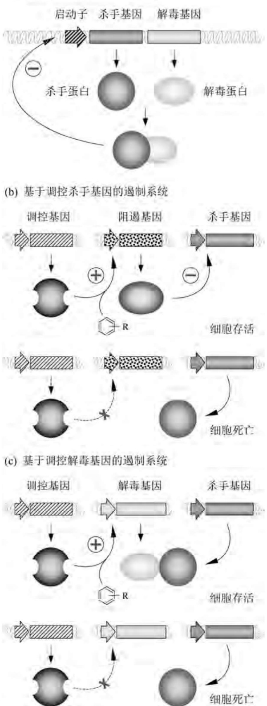

图4-37 基因工程菌遏制系统的设计策略

---

252

基因工程

动子感知的浓度阈值),解毒因子合成终止,细胞立刻死亡。另一种形式是,将两套启动子-解毒因子基因融合表达盒(启动子为多种污染物所诱导)安装在染色体上,使得所有污染物被全部耗尽后细胞才会发生死亡。

与基因工程菌释放相关的另一大障碍是转基因的水平转移,造成转基因的生物扩散。这个问题也可以通过将自杀基因和解毒基因分别安装在质粒和基因工程菌的染色体上而加以解决:如果将自杀基因设置为组成性表达模式,则重组质粒(含自杀基因)的水平转移立刻导致受体菌的死亡,从而有效遏制工程菌中转基因和质粒在环境微生物种群中的扩散。
