# 第9章 第二代基因工程——蛋白质工程

原始 PDF 第 489–518 页。

# 第9章 第二代基因工程——蛋白质工程

第二代基因工程是在DNA分子水平上位点专一性地改变结构基因编码的氨基酸序列，使之表达出比天然蛋白质性能更为优异的突变蛋白(Mutein，亦称蛋白变体)；通过基因编码区的融合操作合成兼有多种天然蛋白质性质的杂合蛋白；采用体外分子进化技术建立蛋白变体文库；或者借助基因化学合成技术设计制造自然界不存在的全新工程蛋白。这种由人工突变基因而达到操纵蛋白质结构和性质的过程又称为蛋白质工程。

## 9.1 蛋白质工程的基本概念

半个多世纪以来，随着分子生物学理论和技术的不断发展，人们对蛋白质结构与功能之间关系的理解日趋广泛和深入。20世纪50年代初胰岛素氨基酸序列的测定、60年代初肌红蛋白三维立体结构的建立、70年代初重组DNA技术的问世，是孕育蛋白质工程于80年代初诞生的三大理论技术基石。而1985年Müllis创立的PCR技术以及1994年Stemmer发展的基因改组(Gene shuffling)技术，则为蛋白质工程的深入研究和广泛应用提供了技术上的保障。

## 9.1.1 蛋白质工程的基本特征

蛋白质工程与重组 DNA 技术、传统 DNA 诱变技术、蛋白质侧链修饰技术有着本质的区别。重组 DNA 技术使得分离任何天然存在的基因并令其在特定受体细胞中表达成为可能，它包括两个方面:① 原生物体中存在某一基因，但其表达效率较低，利用重组 DNA 技术将之分离克隆，并通过基因扩增及基因强化表达使之合成大量基因产物，如将抗生素生物合成的关键基因克隆在质粒上，加装独立的强启动子，然后重新输回原抗生素生产菌中，以提高抗生素的产量，头孢菌素生产菌的基因工程改良就是一例；② 原生物体本来不含某一基因，但可从另一生物体中分离该基因，并在原生物体中表达，如将人的干扰素编码基因克隆至大肠杆菌中高效表达等。上述两种策略的共同之处在于所使用的目的基因均是天然存在的，在目标蛋白的编码区中未做任何改动，因而表达产物仍为天然蛋白。

传统的诱变及筛选技术能创造一个突变基因并产生相应的突变蛋白，但这种诱变方式是随机的，一般在细胞、孢子或生物个体水平上进行，导致靶基因定点发生改变的频率极低。多肽链水平上的化学修饰也能在一定程度上改变天然蛋白的结构和性质，但其工艺十分繁杂，并且由于基因未发生突变，所修饰的蛋白质不能再生。因此，与上述基因重组、常规诱变、多肽修饰策略相比，蛋白质工程的特征是在基因水平上特异性地定做一个非天然的优良工程蛋白或变体。

由人工突变基因而达到操纵蛋白质结构和性质的蛋白质工程主要有两大设计理念:即建立在蛋白质结构与性质对应关系深入理解基础上的分子理性设计，以及建立在体外模拟自然进化过程基础上的分子定向进化(Molecular directed evolution)。后者又称为实验分子进化(Experimentally molecular evolution)，属于蛋白质的非理性设计范畴。

蛋白质工程分子理性设计策略的基本流程如图9-1所示:①克隆一个酶或功能蛋白的编码基因；②测定其核苷酸序列；③演绎出相应的氨基酸序列；④确定蛋白质的生物学性质；⑤建立蛋白质的三维空间结构；⑥设计工程蛋白的分子蓝图；⑦借助于DNA定点突

---

第9章 第二代基因工程——蛋白质工程

489

变技术更换密码子；⑧ 分析突变蛋白的生物学和化学特性；⑨ 确立蛋白质序列-结构-功能三者之间的对应关系；⑩ 将此对应关系反馈至第⑥步，并进行新一轮操作，直至构建出所期望的工程蛋白。在上述流程中，最重要也是最困难的步骤为工程蛋白的分子设计，事实上它需要生物学、化学和物理学等多种学科知识的综合运用。

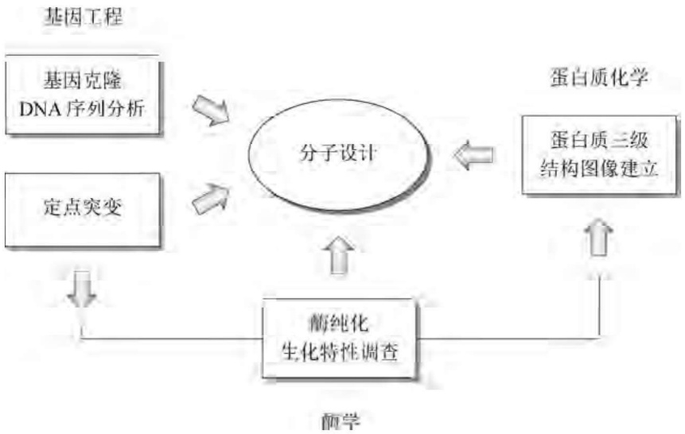

<details>
<summary>flowchart</summary>

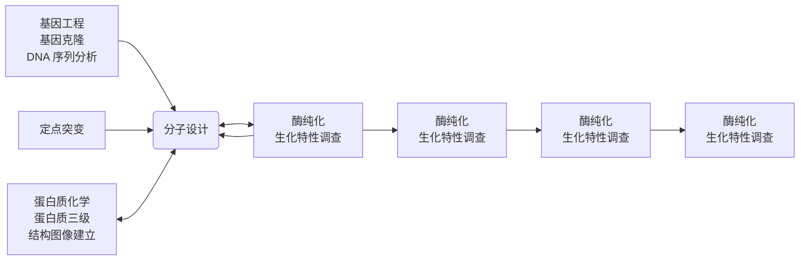
</details>

图9-1 蛋白质工程分子理性设计的基本流程

从理论上来讲，蛋白质分子蕴藏着巨大的进化潜力，很多功能有待于开发，这是蛋白质工程分子定向进化的先决条件。该战略的实施事先不需要了解目标蛋白质的三维结构信息及其作用机制，它着重于体外模拟自然进化的过程（随机突变、重组、选择），使基因发生大量变异，并定向选择出所需性质或功能的目标蛋白质，从而在几天或几周内实现自然界需要数百万年才能获得的进化结果。

## 9.1.2 蛋白质工程的研究内容及应用

蛋白质是所有生命过程的存在形式，它以高度的多样性和特异性直接推动数千种生化反应的进行，并以关键的结构元件组成所有生物体的细胞和组织。酶类分子驱动生物体的整个新陈代谢过程；胶原蛋白、肌动蛋白、肌球蛋白、中间纤维控制细胞和生物个体的框架和运动；抗体提供免疫机能；膜蛋白受体介导细胞之间的物质传送和通信识别；阻遏因子和激活因子操纵基因的表达开关；组蛋白协助DNA包装形成染色体等。蛋白质在催化、构成、运动、识别、运输、调控等各个生命环节均起着不可替代的作用。

因此，在组学计划飞速推进的今天，一个旨在揭示生命世界蛋白质信息谱、结构谱、功能谱的新兴学科——蛋白质组学应运而生。利用基因打靶技术和转基因表达技术，人们可以根据功能丧失型突变体和功能获得型转基因株，确定某一结构基因编码产物的生物学效应。然而，对大多数复杂蛋白质尤其是高等哺乳动物蛋白质而言，其生物功能的发挥还依赖于构成它的若干独立结构域或功能域的有序作用。只有搞清多肽链上各独立功能域结构与功能的关系，并将不同蛋白来源的相似功能域进行综合对比分析，才能建立起完整的蛋白质信息谱。在这方面，蛋白质工程大有用武之地，事实上它是一种位点特异性的体外精细打靶技术，蛋白质工程在分子生物学研究领域中的应用就在于此。

除此之外，借助于蛋白质工程技术改造或创建新型工程蛋白，还能拓展功能蛋白在工业、农业、医学等领域的应用范围，其经济和社会效益不可估量。例如:①通过改变酶的 $K_{\mathrm{m}}$ 和 $V_{\mathrm{m}}$ 等动力学参数，提高其生化反应的催化效率；②通过提升蛋白质的热稳定性和对极端

---

490

基因工程

pH 条件的耐受性,扩大其使用范围;③通过修饰酶的有机相反应活性,使生化反应能在非生理条件下进行;④通过改变酶的催化机制,使其不再需要昂贵的辅酶;⑤通过提高酶与底物的亲和性,减少生物转化过程中副产物的形成;⑥通过增强功能蛋白对蛋白酶的抗降解性能,简化其分离纯化工序并提高收率;⑦通过删除酶的变构效应,解除产物对酶的反馈抑制等。

## 9.1.3 蛋白质工程实施的必要条件

蛋白质工程分子理性设计策略实施的前提条件是必须了解蛋白质结构与功能的对应关系。在多肽链中，往往只有几个氨基酸残基对蛋白质的某一功能负责，但是这些氨基酸残基必须处于一个极其精密的空间状态下才能发挥功能。这里涉及两大元件:维持蛋白质特定空间构象的结构域，以及赋予蛋白质特定生物活性的功能域。根据日益积累的蛋白质结构域和功能域信息，借助电脑辅助设计和模拟(in silico)，绘制出特定突变蛋白的一级序列蓝图，并由此演绎出相应的DNA编码序列，然后通过体外定向突变甚至化学合成，创建相应的突变基因，最终在合适的受体细胞内表达之。

蛋白质的一级结构是由肽键(共价键)形成的,而高级结构则由二硫键(共价键)、疏水键、氢键、离子键维持,后三者均为非共价键。共价键与非共价键的键能范围分别为120\~460 kJ/mol和4\~40 kJ/mol。除了二硫键,其他三种非共价键的存在是蛋白质形成高级结构所必需的,也是蛋白质分子具有柔韧性的原因。蛋白质分子无时不在运动,即便是在0℃以下或晶体状态,其组成原子或基团也能移动旋转(2\~5)×10$^{-11}$ m;在较高温度下,尤其是在蛋白质活性发挥的温度范围(0\~60℃)内,整个结构单元与外部分子之间会发生可逆性转换,事实上这种运动是其底物结合、催化反应、产物释放等功能所要求的;当温度继续升至45\~100℃时,分子内的运动得以加强,蛋白质遂丧失其高级构象并进入变性状态。结晶形态下的蛋白质含有大量的水分子(约达30%\~60%),由X衍射确定的蛋白质四维结构几乎与核磁共振得到的数据相同,这表明处于结晶状态下的蛋白质具有其原始的柔韧性和活性。上述蛋白质的结构参数对工程蛋白的分子设计具有重要意义。

蛋白质工程的分子定向进化战略虽然是以灰箱方式体外模拟自然进化过程，但快速、简便、高效地构建一个随机突变的基因文库，以及发展一套灵敏、准确的高通量筛选系统，是这种策略实施的两大必要条件，事实上这也是当前蛋白质工程研究的活跃领域。

## 9.2 基因的体外定向突变

在 DNA 水平上产生多肽编码顺序的特异性改变称为基因的定向诱变。利用这项技术一方面可对某些天然蛋白质进行定位改造，另一方面还可以确定多肽链中某个氨基酸残基在蛋白质结构及功能上的作用，以收集有关氨基酸残基线性序列与其空间构象及生物活性之间的对应关系，为设计制作新型的突变蛋白提供理论依据。一般而言，含有单一或少数几个突变位点的基因定向突变可选用下列五种策略，而大面积的定位突变则采取基因全合成的方法。

## 9.2.1 局部随机掺入法

将待突变的靶基因克隆在一个载体质粒的特定位点上，其上游紧接着两个酶切位点RE1和RE2，它们分别能产生 $5^{\prime}$ 和 $3^{\prime}$ 突出的单链黏性末端(图9-2)。用大肠杆菌核酸外切酶III(ExoIII)末端特异性降解经RE1和RE2双酶切开的重组质粒 $3^{\prime}$ 凹端，并通过酶解反应时间控制新生成的单链区域大小(单链区域越短，突变精度越高)。终止反应后，单链区域用Klenow酶补平，底物除四种正常的dNTP外，还包括一种特殊结构的脱氧核糖核苷酸类似物，在缺口填补过程中，该类似物掺入DNA链的一处或多处。随后再用S1核酸酶处理单链

---

第9章 第二代基因工程——蛋白质工程

491

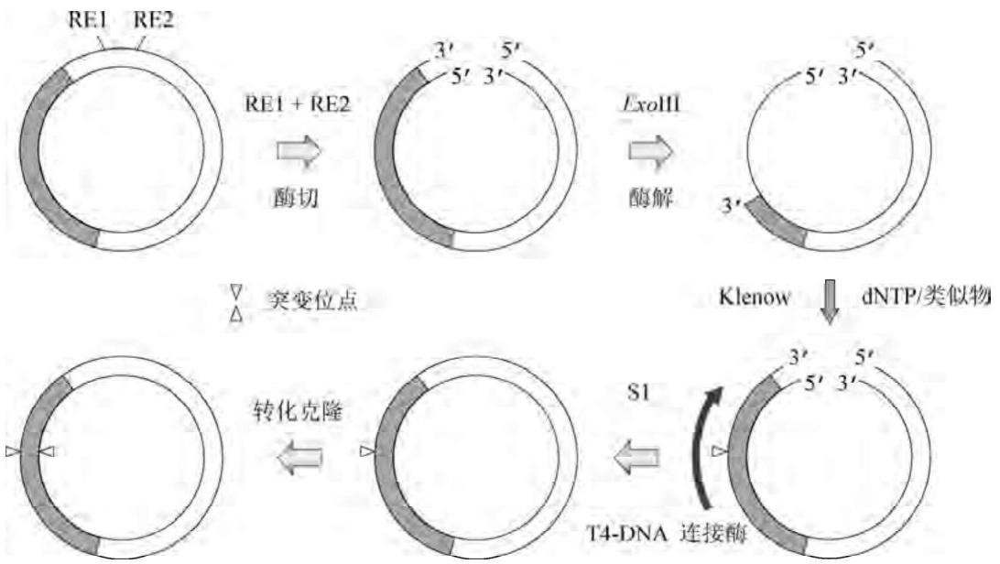

<details>
<summary>flowchart</summary>

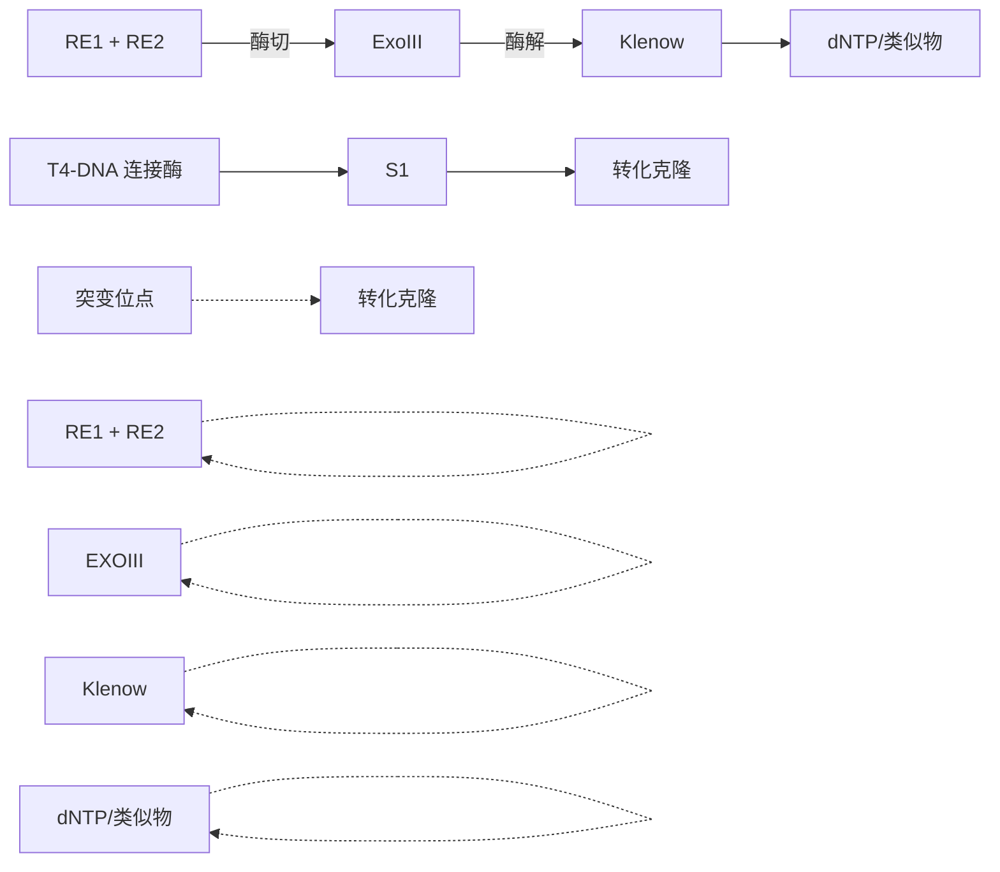
</details>

图9-2 局部随机掺入法操作程序

末端，并由T4-DNA连接酶连接成环。重组分子转化大肠杆菌，在体内复制过程中，由于类似物的碱基配对非特异性，$50\%$ 的扩增产物分子内部引入了错配碱基，并导致位点突变。由这种方法产生的突变体一般含有几对取代碱基，而突变的区域则取决于外切酶III末端降解的程度。

## 9.2.2 碱基定点转换法

能导致碱基定点转换的最简单方法是使用某些化学试剂在体外诱变 DNA 分子。通常将质粒 DNA 或待突变 DNA 片段用诱变剂处理后，转化大肠杆菌，构建突变体文库。最常见的体外诱变剂为亚硫酸氢钠，在 DNA 单链的情况下，它能特异性地使胞嘧啶残基脱氨形成尿嘧啶残基。处理后的 DNA 单链再由 DNA 聚合酶体外转化为双链结构，在复制过程中，原 DNA 分子上的 CG 碱基对便转换成 TA 碱基对。整个操作程序如图 9-3 所示。

从表面上看,这种方法所引入的突变并非定点,但如果合适地控制诱变剂的处理条件,便能做到每个DNA单链分子只含单一转换的碱基,而且其位点随机分布,这样即可在样本庞大的突变体文库中挑选出在期望位点上突变的重组分子。

除了上述化学诱变外，还可以借助于酶促合成对DNA分子进行所有可能的碱基对转换。其原理是使单链DNA在不理想的反应条件下进行体外复制，如较高或较低的离子强度、不平衡的四种核苷酸底物浓度以及缺少从 $3^{\prime}$ 至 $5^{\prime}$ 核酸外切活性的DNA聚合酶(Taq)等。在体外DNA聚合反应系统中，如果某种核苷酸底物浓度过低，当模板要求该底物时便有可能为其他三种底物所取代，从而导致序列突变(详见9.3.1)。

## 9.2.3 部分片段合成法

如果待突变的位点两侧含有合适的限制性内切酶识别序列，尤其当多个待突变位点集中分布在该区域时，可考虑直接化学合成这一片段，在此过程中将欲突变的碱基设计进去，然后以此人工合成的寡聚核苷酸片段置换重组质粒上对应的待突变区域，即可完成基因的定点突变(图9-4)。部分片段合成法特别适用于系统改变功能蛋白的氨基酸序列（即饱和突变），并在体内观察突变位点对蛋白质生物功能的影响，从而确立突变前这些氨基酸残基对蛋白质结构和功能的贡献。例如，在大肠杆菌噬菌体433和P22阻遏蛋白分子中，$\alpha-$ 螺旋-转角-$\alpha-$ 螺旋(HTH)结构域与操作子DNA的结合特性就是采用上述方法解析的。

---

492

基因工程

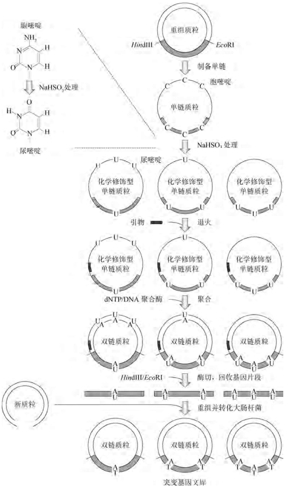

<details>
<summary>flowchart</summary>

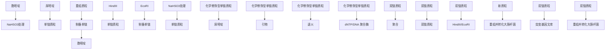
</details>

图9-3 碱基定点转换法操作程序

---

第9章 第二代基因工程——蛋白质工程

493

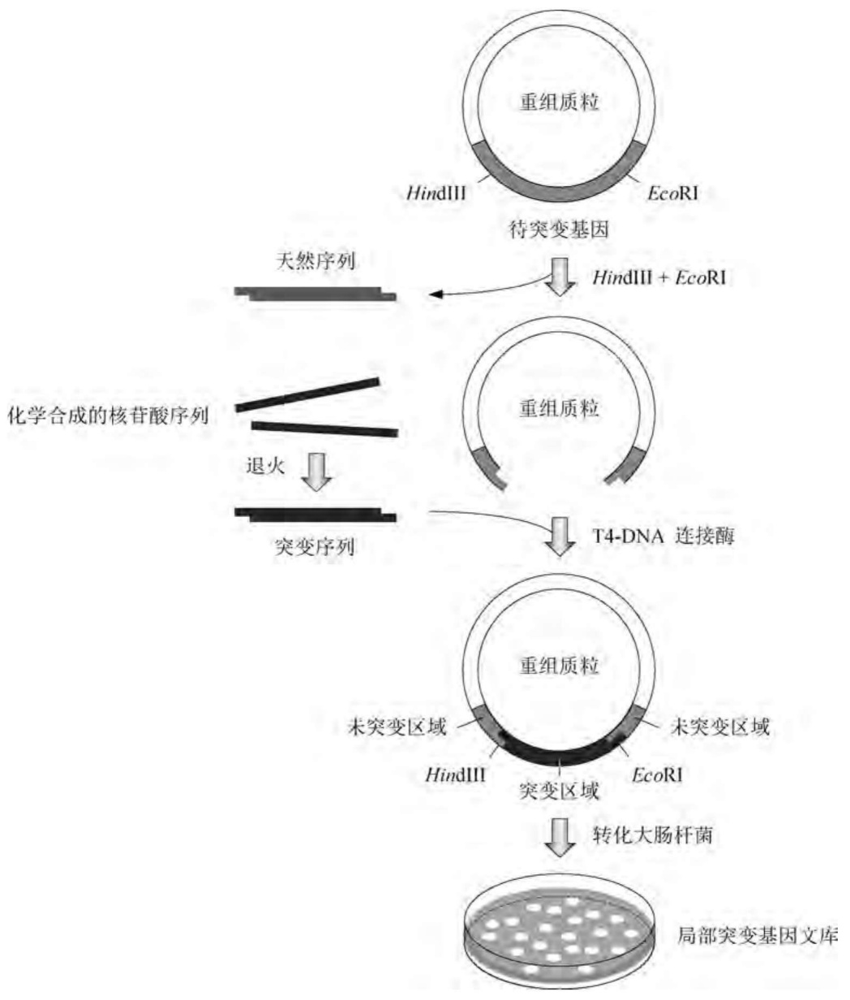

<details>
<summary>flowchart</summary>

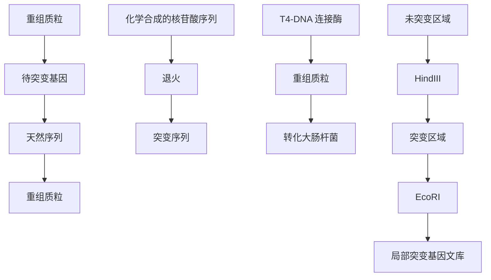
</details>

图9-4 部分片段合成法操作程序

---

494

基因工程

此外,如果上述用于置换的 DNA 片段来自另一种蛋白质的功能编码区,便可依照同样的程序获得集多种异源功能于一体的融合蛋白(或嵌合蛋白);如果以人工合成的多种寡聚

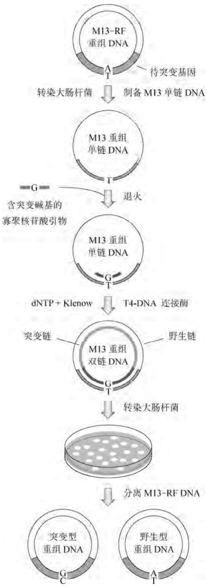

<details>
<summary>flowchart</summary>

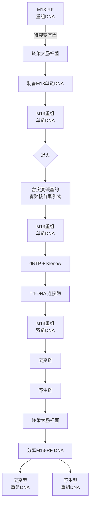
</details>

图9-5 寡核苷酸介导的定点点突变程序

核苷酸随机序列(序列可达 $10^{4}\sim10^{6}$ 种)作为置换片段,则可创建出在局部区域或位点高度多样化的突变文库,再辅以适当的高通量筛选方案,最终获得结构和功能达到理想要求的蛋白变体,这种方法称为盒式突变技术(Cassette mutagenesis)。

## 9.2.4 引物定点引入法

引物定点引入法实质上是一种寡聚核苷酸介导的定点诱变方法，它能在克隆基因内直接产生各种点突变和区域突变，其工作原理如图9-5所示。首先将待突变的目的基因克隆在M13-RF DNA载体上，转化大肠杆菌，挑选重组噬菌斑，从中分离出重组DNA正链；人工合成与待突变区域互补的寡聚核苷酸引物，并在此过程中设计引入突变碱基，然后在较温和条件下与重组DNA正链退火，经DNA体外复制和连接后，双链分子重新转化大肠杆菌；以上述合成的寡聚核苷酸片段为探针，在严格条件下（如将杂交温度提高 $5\sim 10^{\circ}\mathrm{C}$ )杂交筛选含有突变碱基的噬菌斑，从中分离纯化出RF DNA双链分子进行克隆表达。相似地，若要在DNA特定位点上插入或缺失一段，也可设计合成特殊结构的寡聚核苷酸引物(图9-6)，并将之引入待突变区域。但须注意的是欲插入或缺失的DNA片段应小于引物本身的长度，否则退火操作相当困难。

从理论上来讲，在 DNA 体外复制并克隆后，携带突变碱基的噬菌斑应为重组噬菌斑总数的一半，但由于技术上的原因，这种期望的噬菌斑通常只有 1%\~5%。为了特异性富集突变体便于筛选，可将待突变的重组 M13-RF DNA 分子首先转化具有 dut 和 ung 两个 DNA 代谢酶基因缺陷的大肠杆菌受体菌株（图 9-7）。前者由于不能合成 dUTP 水解酶，致使细菌细胞内 dUTP 含量急剧上升，在 DNA 体内复制时，dUTP 部分取代 dTTP 掺入 DNA 新生链中；后者为尿嘧啶糖基化酶基因缺陷，这种变异株丧失了切除 DNA 链中脱氧尿嘧

---

第9章 第二代基因工程——蛋白质工程

495

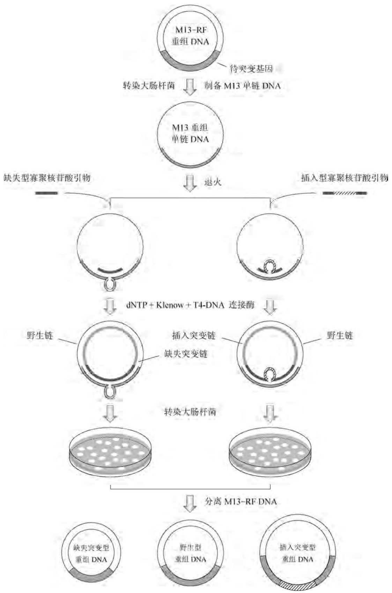

<details>
<summary>flowchart</summary>

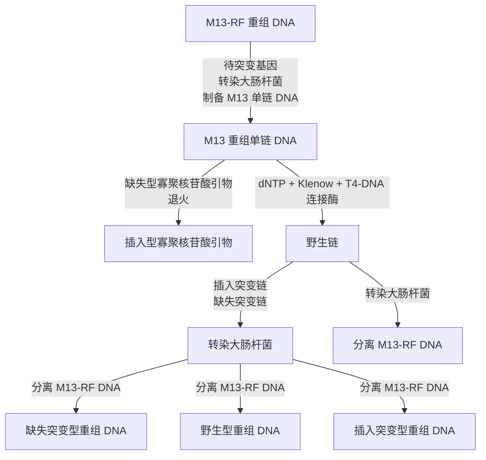
</details>

图9-6 寡核苷酸介导的定点区域突变程序

---

496

基因工程


<details>
<summary>flowchart</summary>

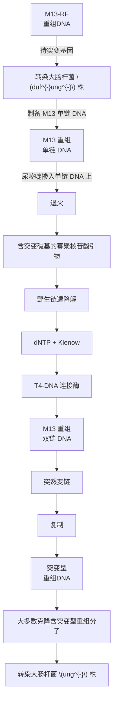
</details>

图9-7 寡核苷酸介导的突变分子富集

啶核苷酸残基的能力。由该菌株产生的重组M13DNA正链分子中大约有 $1\%$ 的T为U所取代，经体外复制后，再将双链DNA分子导入正常的大肠杆菌受体细胞中。此时，该菌株的尿嘧啶 $N-$ 糖基化酶除去DNA链上的脱氧尿嘧啶核苷酸残基，使原来的模板链降解，而突变链因不含U被完整地保留下来。

## 9.2.5 PCR扩增突变法

采用上述几种定点诱变的方法所得到突变子的比率往往很低，排除野生型基因的筛选方法既费时又欠可靠。PCR技术的发展为基因的体外定点诱变开辟了一条新途径，并衍生出多种操作程序，其中最基本的操作程序如图9-8所示。

依照待突变位点旁侧序列设计一对含突变碱基的局部引物P1和P2，同时设计合成突

---

第 9 章 第二代基因工程——蛋白质工程

497

变基因(或片段)两端的全匹配引物 P3 和 P4。由 P1 和 P2 引物介导的 PCR 反应将产生缩短型含突变碱基的扩增产物，而 P3 和 P4 引物的存在又引导其合成各自的互补链。这两组缩短突变型的双链片段在随后的退火过程中，可形成交叉互补结构，并实现两端延伸，最终合成出突变型的全长基因或片段。值得注意的是，由于 P3 和 P4 全匹配引物的存在，基于上述程序合成的 DNA 分子中含有高比例的非突变型基因或片段。然而，P1/P2 与 P3/P4 两对引物的浓度比不同，PCR 扩增产物的产量以及突变型与非突变型扩增产物的比率也会不同。一般而言，高浓度的 P1/P2 倾向于突变型扩增产物的富集；而高浓度的 P3/P4 则有利于扩增产物总产量的提高。

## 9.3 基因的体外定向进化

基因分子定向进化的主要目标是在短时间内获取任何期望的突变基因及其编码产物,其基本策略是在体外对特定基因实施随机突变,然后借助于适当的高通量筛选程序准确、迅速地获得所需要的突变基因。分子定向进化的主要过程包括:①通过随机突变或(和)基因重组,创造一个靶基因或一群家族基因的多样性文本,建立相应的突变文库;②将上述基因的突变文库在适当的受体生物中转换成对应的蛋白变体文库;③采用高通量筛选程序检出由氨基酸置换而引起的变体蛋白性状变化,确定该氨基酸在蛋白分子中的重要作用。必要时,可以多次重复上述操作,直到出现


<details>
<summary>flowchart</summary>

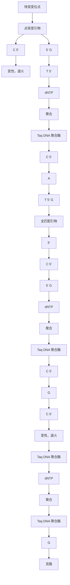
</details>

图9-8 PCR介导的定点突变程序

最佳性能的变体蛋白。由此可见，这种分子定向进化策略不仅可以在实验室里选择到自然界不存在的、性能优异且可再生的变体蛋白，而且也是调查多肽链中氨基酸序列与蛋白质结构和功能关系的重要研究工具。

目前已建立起多种分子定向进化程序,这些程序大大加快了不同物种的不同基因型之间的重组进化速度,而且在所产生的突变分子文库中,个体之间的差异及其与亲本之间的差异达到空前的程度,这在很大程度上确保了理想变异的出现。

## 9.3.1 易错 PCR

易错 PCR 是一种在 DNA 序列中简便、快速、随机制造突变的方法, 其基本原理是通过改变传统 PCR 反应体系中某些组分的浓度, 或使用低保真度的 DNA 聚合酶, 使碱基在一定程度上随机错误引入而创建基因序列多样性文库。

---

498

基因工程

易错 PCR 技术的关键在于选择适当的突变频率,一般为每个基因 2\~5 个碱基替换。PCR 扩增反应最常用的 Taq DNA 聚合酶是所有已知 DNA 聚合酶中掺入错误碱基概率最高的,每扩增一轮其出错率在 $0.1 \times 10^{-4} \sim 2 \times 10^{-4}$ 之间,PCR 反应经 20\~25 次循环后,积累的错误率可积累达 $10^{-3}$/碱基。Taq DNA 聚合酶在一般条件下的错误掺入具有一定的碱基倾向性,即由 AT 碱基对转变成 GC 碱基对。但这种突变率仍然不够,特别是对 DNA 小片段,更难获得理想的突变数量。改进的方法包括:① 提高 $\mathrm{MgCl}_{2}$ 的浓度,以稳定非互补碱基对的存在;② 调节 dNTP 的比例,以促进错误碱基掺入的概率;③ 添加 $\mathrm{MnCl}_{2}$,以降低 DNA 聚合酶对模板的特异性;④ 增加 DNA 聚合酶的用量;⑤ 连续扩增操作,将一次扩增得到的有用突变基因作为下一次 PCR 的模板,反复进行随机突变,以积累重要的有益突变。尽管如此,用于突变处理的 DNA 靶分子仍不宜大于 800 bp。

采用易错PCR技术，在非水相（二甲基甲酰铵，DMF)溶液中定向进化枯草杆菌蛋白酶E获得成功，所得到的变体酶PC3在 $60\%$ 和 $85\%$ 的DMF中，催化效率 $K_{\mathrm{cat}} / K_{\mathrm{m}}$ 分别是野生型蛋白酶E的256和131倍，比活性提高了157倍。将PC3再进行两个循环的定向进化，所产生的突变体13M的 $K_{\mathrm{cat}} / K_{\mathrm{m}}$ 比PC3又提高了3倍。

## 9.3.2 DNA 改组

DNA 改组是对一组同源基因进行体外随机重组的特殊 PCR 技术, 因此又称为基因洗牌术, 其基本原理如图 9-9 所示。首先, 采用 DNase I 酶消化不同来源的同源 DNA, 获得 10\~50 bp 的小片段, 它们之间含有部分重叠碱基序列; 接着将这些 DNA 小片段进行无引物的 PCR 扩增, 在此过程中, 不同来源的 DNA 同源区交错混合互补, 产生大小不等的引物-单链模板结构, 经自身引导的 PCR 反应, 小片段 DNA 重新组装成各种序列的全长基因样本, 形成突变文库; 然后, 通过合适的筛选程序获得较理想的若干突变基因样本; 最终将这些基因样本作为下一轮 DNA 改组的模板, 重复多次改组和筛选, 直到获得性状满意的突变基因。

在上述 DNA 改组过程中,不同来源的同源 DNA 片段可以随机混合杂交,而且自身引导的 PCR 反应又因体外复制不精确性可引入一定程度的错误掺入,因此其突变概率更大。由 DNA 改组产生的基因多样性文库可以有效积累有益突变,排除有害突变和中性突变,进而实现目的蛋白多种特性的共进化,无论是在理论还是实践上,都优于寡聚核苷酸介导的定点诱变和连续易错 PCR 方法。

目前，已建立起多种形式的DNA改组程序，包括基因组改组（Genome shuffling）、家族基因改组（Family shuffling）、单基因改组（Single gene shuffling）、外显子改组（Exon shuffling）等，后者可用于建立各种大小的随机多肽文库。这些DNA改组方法已广泛地用于改良酶和蛋白药物的活性、热稳定性、底物特异性、对映体选择性、可溶性表达、表达水平等方面，取得了令人注目的成果(表9-1)。DNA改组的奠基人Stemmer当年就是采用该技术，在大肠杆菌中使 $\beta$ -内酰胺酶（由TEM-1基因编码）的抗生素抑制活性(MIC)从$0.02\mu \mathrm{g / mL}$ 增至 $640~\mu \mathrm{g / mL}$ ，提高了32000倍。

## 9.3.3 体外随机引发重组

体外随机引发重组(RPR)以单链DNA为模板，配合一套随机序列引物，先产生大量互补于模板不同位点的短DNA片段，由于碱基的错配和错误引发，这些短DNA片段中也会有少量的点突变。在随后的PCR反应中，它们互为引物合成出较长的片段，最终组装成完整的基因长度，形成基因多样性文库。如果需要，可反复进行上述过程，直到获得满意的进化分子(图7-10)。与DNA改组技术相比，RPR具有如下优点:① RPR可以利用单链DNA或mRNA为模板，且对模板量要求少(降为 $1 / 2\sim 1 / 10$ )，大大降低了亲本组分的含量，便于筛选；② 在DNA改组中，片段重新组装前必须彻底除去DNaseI，RPR方法不涉及DNaseI，所以操作更简单；③ 合成的随机引物具有同样长度，不存在像DNaseI所具有的序

---

第 9 章 第二代基因工程——蛋白质工程

499


<details>
<summary>flowchart</summary>

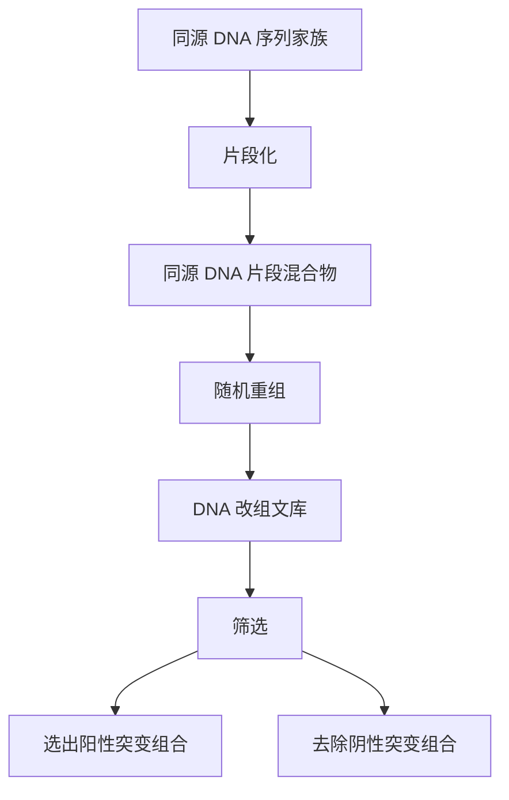
</details>

图9-9 DNA改组的基本原理

---

500

基因工程

表 9-1 应用 DNA 改组技术取得成效的酶和操纵子

| 突变酶 | 研究目的 | 研究结果 |
| --- | --- | --- |
| 三嗪杂苯水解酶 | 改进酶特性 | 取得3个突变体,磷酯酶活性在50% DMSO中明显提高,半衰期提高4倍 |
| β-内酰胺酶 | 改进酶活性 | 提高活性270倍 |
| 天冬酰胺转移酶 | 改进酶活性 | 提高活性,表明6个氨基酸残基与活性相关 |
| 头孢菌素酶 | 改进酶特性 | 提高酶活性540倍 |
| β-半乳糖苷酶 | 改进酶特性 | 获得一个新酶,果糖苷酶活性提高了10倍,而半乳糖糖苷酶活性下降为1/40 |
| 胡萝卜素合成酶 | 构建创新的工程菌 | 构建成功生产四种不同胡萝卜素衍生物的工程菌 |
| TEM-1型β-内酰胺酶 | 改进酶活性 | 酶活性提高32000倍 |
| β-内酰胺酶家族 | 改进酶活性 | 酶活性提高270~540倍 |
| β-半乳糖苷酶 | 改进酶活性和特性 | 岩藻糖苷酶酶活性提高66倍;底物专一性提高1000倍 |
| 绿色荧光蛋白 | 改进酶特性 | 蛋白折叠提高45倍(大肠杆菌和哺乳动物细胞) |
| 抗体(scFv) | 改进酶活性 | 酶活性提高400倍 |
| 抗体(scFv) | 改进酶特性 | 表达水平提高100倍 |
| 砷酸盐代谢操纵子 | 改进酶活性 | 砷酸盐抗性提高40倍 |
| 莠去津降解系统 | 改进酶特性 | 莠去津降解效率提高80倍 |
| 烷基转移酶 | 改进酶特性 | DNA修复能力提高10倍 |
| 苯甲基酯酶 | 改进酶特性 | 抗生素去保护能力降低为1/150 |
| tRNA生物合成酶 | 改进酶特性 | 工程化tRNA结合力提高180倍 |

列偏爱性。在 RPR 过程中, 理论上来讲 PCR 扩增时模板上每个碱基都应被复制或以相似的频率发生突变, 从而保证了子代全长基因中突变和交叉的随机性; ④ 随机引发的 DNA 合


<details>
<summary>flowchart</summary>

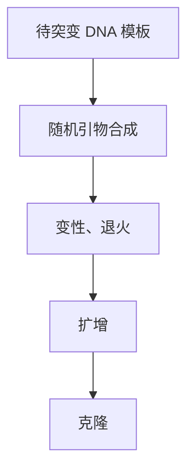
</details>

图9-10 体外随机引发重组的基本原理

---

第 9 章 第二代基因工程——蛋白质工程

501

成不受 DNA 模板长度的限制,有利于小分子肽段的突变。

## 9.3.4 交错延伸

交错延伸(StEP)是一种简化的DNA改组技术。其原理的核心是，在PCR反应中把常规的退火和延伸合并为一步，并大大缩短其反应时间(55℃, 5 s)，从而只能合成出非常短的新生链。经变性后的新生链再作为引物，与体系内同时存在的不同模板退火而继续延伸，即通过模板转换实现不同模板间的重组。此过程反复进行，直至产生完整的基因长度，最终扩增产物为相间的含不同模板序列的新生DNA分子(图9-11)。StEP介导的DNA重组发生在单一试管中，不需分离亲本DNA和产生的子代重组DNA分子；而且DNA重组的程度可以通过调整反应时间和温度来控制，操作灵活简便，因而是分子定向进化的又一创新。

## 9.3.5 过渡模板随机嵌合生长

过渡模板随机嵌合生长(RACHITT)技术是一种基因家族成员之间不同于DNA


<details>
<summary>flowchart</summary>

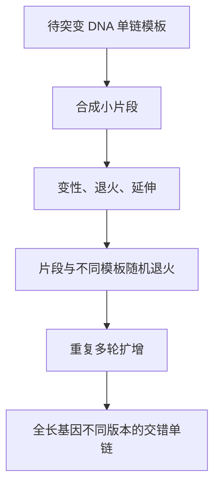
</details>

图9-11 交错延伸技术的基本原理

改组的重组技术。它不需要热循环、链转移或交错延伸反应，而是将随机切开的靶基因片段与一个含有尿嘧啶碱基的临时DNA模板(脚手架模板，制备方法参见9.2.4)进行杂交，然后完成片段排序、非互补区切除、缺口修复、片段连接等操作(图9-12)。其中的非互补区切除操作使来自靶基因的小片段得以重组，由于这些小片段比DNA改组技术中的DNase I消化片段还短，因此RACHITT方法所产生的重组频率明显提高。如果靶基因在实施RACHITT之前先经易错PCR技术处理，或(和)在缺口修复操作时使用易错PCR程序，则获得的扩增产物中带有更多的额外点突变，多样性程度也更高。RACHITT程序的最后一步是用尿嘧啶-DNA-糖基化酶特异性摧毁脚手架模板，并将重组单链转换成双链DNA分子。

RACHITT 技术成功用于体外进化功能蛋白的第一个例子是二苯并噻吩单加氧酶，所产生的嵌合文库平均每个基因含有 14 个交叉点，重组水平比 DNA 改组类方法（1～4 个交叉）高出几倍，并且可在短至 5 bp 的序列同源区内产生交叉重组，这种高频率、高密度的交叉水平是 DNA 改组所难以达到的。从上述重组突变文库中筛选到的变体酶活性为天然二苯并噻吩单加氧酶的 20 倍。

## 9.3.6 渐增切割杂合酶生成

尽管 DNA 改组介导的 DNA 序列随机重组已成为分子定向进化的重要工具,但这种程序通常需要参与随机重组的 DNA 同源性不低于 70%\~80%,而自然界大多数同源基因的序列相似程度难以满足 DNA 改组的条件。为了解决这个问题,Benkovic 等人建立了渐增切割杂合酶生成(ITCHY)程序,用于构建不依赖于 DNA 序列同源性的随机重组文库。其工作原理如图 9-13 所示:用核酸外切酶 III 分别消化两个非高度同源的靶基因,如分别来自大肠杆菌和人类的甘氨酰胺核苷酸甲酰转移酶编码基因(两者的序列相同性仅为 50%),控制切割速度不大于 10 个碱基/min,每隔很短时间连续取样,迅速终止样品反应,以获得一

---

502

基因工程


<details>
<summary>flowchart</summary>

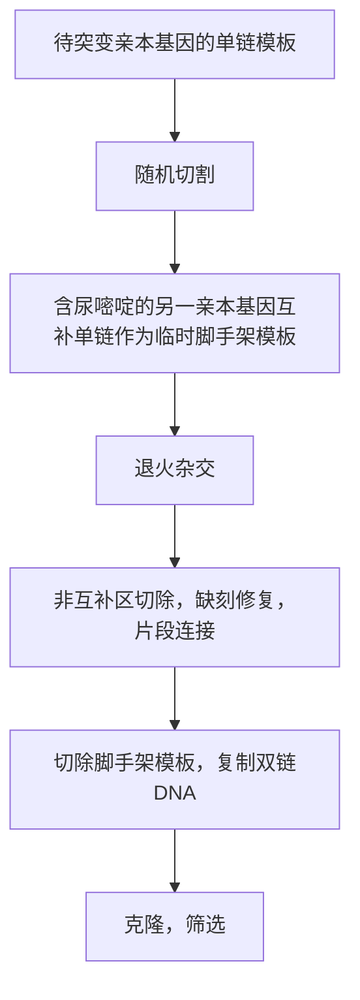
</details>

图9-12 过渡模板随机嵌合生长技术的基本原理

组依次有几个甚至一个碱基缺失的片段样本；然后将一个基因随机长度的  $5'$  端片段与另一基因随机长度的  $3'$  端片段随机混合，产生杂合基因文库；该基因文库经表达后，通过酶活性测定筛选出理想的重组杂合基因。

上述方案的操作难度及工作量是显而易见的。一种改进的程序(Thio-ITCHY)是:首先将两个靶基因串联在同一载体上；通过PCR反应将 $\alpha$ -硫代磷酸核苷酸随机掺入扩增产物中；用核酸外切酶III处理扩增产物，由于 $\alpha$ -硫代磷酸核苷酸抗核酸外切酶III的切割，便会形成不同截短程度的DNA片段；连接上述处理的片段，形成随机杂合文库。如果对其文库再实施DNA改组，还可获得更多的重组点，即所谓的SCRATCHY程序。

## 9.3.7 同源序列非依赖性蛋白质重组

虽然ITCHE技术可以用于那些序列同源性较低的靶基因之间的体外随机重组，但在所形成的重组文库中，基因的长度参差不齐，与亲本靶基因并不一致，因此子代基因中具有功能的杂合子比率很低。要想提高功能杂合子的比例，必须使重组交叉发生在具有相似结构背景的位点处。然而由于亲本靶基因之间缺乏足够的序列相似性，绝大多数的同源重组并不能对所期望的蛋白功能做出贡献。为此，人们又发展了同源序列非依赖性的蛋白质重组方法(图9-14):①将两个靶基因串联在同一载体上，采用Thio-ITCHE程序处理该重组分子；②通过琼脂糖凝胶电泳分离所获得的长度不一的随机杂合文库，并回收与本靶基因长度相似的随机片段；③将回收片段与合适的表达载体连接重组；④转化合适的受体细胞，建立新的等长度杂合文库；⑤最终形成表达型杂合蛋白文库。

上述操作程序确保了随机重组杂合分子的长度与亲本靶基因的一致性,使重组事件主

---

第 9 章 第二代基因工程——蛋白质工程

503


<details>
<summary>flowchart</summary>

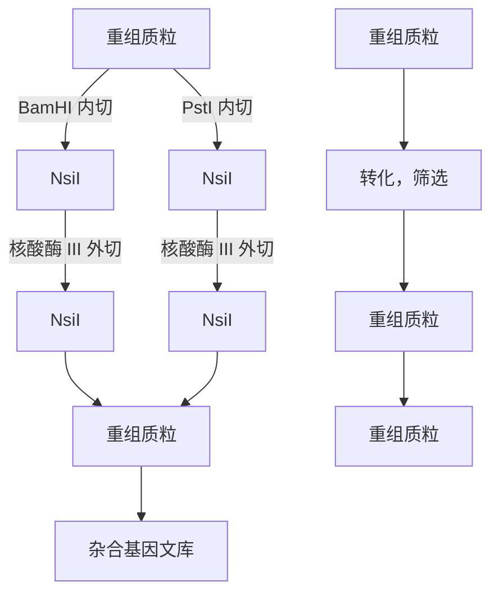
</details>

图9-13 渐增切割杂合酶生成程序的基本原理

要发生在亲本靶基因结构相关的位点处,从而提高了杂合文库中阳性克隆的比例。这种方法可以在那些序列相同性较低,甚至无序列相同性的同源蛋白质之间创建具有单一重组交叉的杂合蛋白质组合文库。迭代型的 SHIPREC 操作还可以产生多个重组交叉。

## 9.3.8 突变文库高通量筛选模型的建立

一旦突变基因或蛋白变体的多样性文库构建完毕，筛选的条件决定了蛋白质特征的进化方向，这被称为定向进化的第一定律。分子定向进化实验成败与否的关键就在于针对目的改造特征的高通量筛选模型的建立。当变体蛋白或酶能赋予宿主细胞生长或存活优势时，很容易搜寻含有 $10^{6}$ 个以上蛋白变体的文库。例如，将抗生素、毒性有机物、重金属抗性蛋白或运输蛋白的变体文库密集涂布在含有高浓度上述物质的平板上，即可直接检出高抗性变体蛋白；如果变体蛋白为淀粉酶、蛋白酶、脂肪酶，则克隆文库能在含有相应底物的平板

---

504

基因工程


<details>
<summary>flowchart</summary>

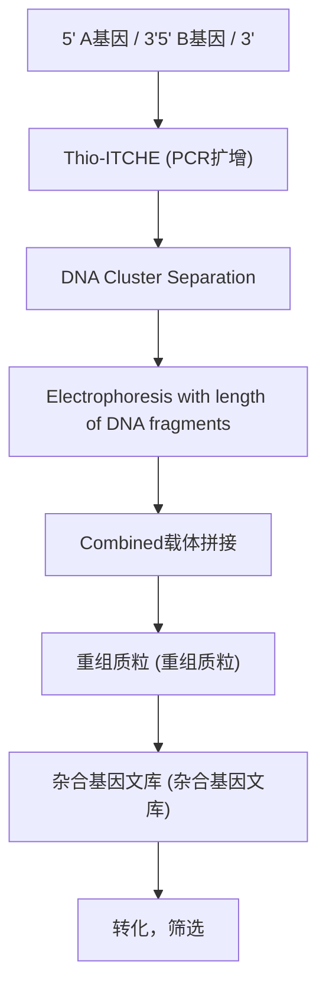
</details>

图9-14 同源序列非依赖性蛋白重组的基本原理

上产生清晰的透明斑，而且其直径与酶活性呈顺变关系，借助紧密仪器甚至肉眼即可辨认；此外，某些易于观察的菌落表型也可用于快速筛选。然而，这些例子毕竟只代表了成千上万种蛋白质或酶类中的很小一部分，更多具有复杂功能的变体蛋白往往需要创建新的高效筛选模型。

近年来，与创建多样性随机重组文库的飞速发展相适应，基因或蛋白质文库的高通量和超高通量筛选技术也取得了令人瞩目的成就。例如，基于体外无细胞翻译体系的核糖体-mRNA展示技术，因不受受体细胞转化率的限制，大大提高了文库容量和筛选通量 $(10^{12}\sim10^{14})$ 。其原理是通过筛选靶蛋白-核糖体-mRNA三元复合物或靶蛋白-mRNA二元复合物的形成，将基因型与表型直接偶联起来，并利用mRNA的可复制性，使靶基因或蛋白质得到有效富集。利用这种程序进化单链抗体可变区(scFv)片段，可获得亲和力提高40倍的变体。其他的高通量筛选程序还包括:细胞表面展示技术和噬菌体表面展示技术、将靶蛋白活性与转录信号相偶联的三元杂交系统、以发光信号为指示的反射增进系统、荧光共振能量转换仪(FRET)-荧光激活细胞筛选仪(FACS)联用程序等，后者每小时可筛选6万个细胞克隆。在硬件设备方面，1536和3456孔板以及多通道多波长检测仪、每秒钟分配几千滴皮开(即 $10^{-6}\mu L$ )级样品的非接触式压电配样仪等，均能大幅度提高样品的处理速度。

---

第9章 第二代基因工程——蛋白质工程

505

## 9.4 蛋白质工程的设计思想与应用

目前，生物体内已鉴定的数千种酶中只有近百种能直接用于工业规模的生物转化反应，绝大多数酶类功能蛋白在大规模体外反应时，或丧失原有的催化特异性，或在高温高压及有机溶剂条件下结构变性。利用蛋白质工程技术改造酶的催化反应特征则为功能蛋白的工业化应用开拓了广阔的前景。此外，已有数百种蛋白药物经分子定向进化改良，获得了理想的医疗性能。

## 9.4.1 提高蛋白质或酶类分子的稳定性

借助理性设计策略提高蛋白质或工业用酶的热稳定性始终是蛋白质工程领域中的一个研究热点。一方面，酶促反应工业中的热处理工序（如淀粉液化中降低反应体系的黏度）通常需要高于 $45^{\circ}\mathrm{C}$ 的温度，而天然酶类普遍存在耐受性差的问题；另一方面，热稳定性的探究也能在一定程度上解析蛋白质结构与功能之间的对应关系。

## 1. 蛋白质稳定性的影响因素

相关研究显示，影响蛋白质热稳定性的因素繁多，而且不同的蛋白质往往会采取不同的机制维持其热稳定性。然而一般认为，多肽链中侧链基团之间的化学键相互作用是蛋白质热稳定性的决定性因素。这些化学键包括:①疏水键。在水介质中，球状蛋白质的折叠往往倾向于将其疏水基团埋藏在分子内部（即疏水相互作用），这种作用源自疏水基团对水分子的强烈躲避效应，是蛋白质三级结构形成和稳定最重要的因素。②氢键。氢键属于氢供体与氢受体之间距离不超过 $0.3\mathrm{nm}$ 且夹角小于 $90^{\circ}$ 时所形成的非共价键，虽然其平均键能仅为 $0.6\mathrm{kcal / mol}$ （1 cal=4.1840 J)，但由于广泛存在于蛋白质的主链、侧链以及周边环境的水分子中，因此其键能总和对蛋白质的热稳定性也有较大贡献。③离子键。不同生物的基因组比较研究发现，嗜热菌蛋白质及其 $\alpha-$ 螺旋结构单元中的三种带净电荷氨基酸(Glu、Lys、Arg)含量明显高于中温菌，它们能在螺旋内部或螺旋之间形成密集的盐键，对维系嗜热蛋白质的稳定性起到非常关键的作用。④ $\pi$ 键。芳香族氨基酸(Trp、Tyr、Phe)芳香环侧链中的 $\pi$ 键能与阳离子形成高强度的相互作用，其键能高于离子键两倍。来自900个中温蛋白质和300个嗜热蛋白质的三维结构显示，嗜热蛋白质结构中 $\pi$ 键附近存在阳离子侧链基团的频率远高于中温蛋白质，而且两者之间的相互作用可显著改善蛋白质对热的适应能力。⑤二硫键。作为共价键的二硫键可通过降低多肽链折叠状态的熵值稳定蛋白质的结构，也是影响蛋白质热稳定性的关键因素。

## 2. 引入二硫键以提高蛋白质或酶类分子的稳定性

一般而言，热稳定的蛋白质大都具有抗有机溶剂和极端 $\mathrm{pH}$ 的能力，在蛋白质分子中引入二硫键能显著提高其稳定性。例如，采用寡核苷酸定向诱变技术构建6种T4溶菌酶的变体蛋白，其中分别有2、4、6个氨基酸残基转化成半胱氨酸，这些氨基酸残基在蛋白的空间结构中距离较近，但不包含酶的活性部位。所形成的1、2、3对二硫键分别位于第3和第97位、第9和第164位、第21和第142位残基处。上述突变基因转入大肠杆菌中表达，分离纯化酶变体，并分别测定其酶活性和热稳定性（表9-2）。野生型的T4溶菌酶含有两个游离的半胱氨酸残基，在天然条件下并不形成二硫键，将这两个半胱氨酸残基分别用苏氨酸和丙氨酸残基取代，不影响酶活性和稳定性，此酶用作对照。实验结果表明，在6种突变蛋白中，有一种变体（即B，其第9和第164位氨基酸残基被转换为半胱氨酸，并形成一对二硫键）的酶活性高于对照 $6\%$ ，熔点温度 $T_{\mathrm{m}}$ 提高 $6.4^{\circ}\mathrm{C}$ ；所有的变体随二硫键数目的增加其 $T_{\mathrm{m}}$ 值呈单调上升趋势；含有3对二硫键的变体酶的 $T_{\mathrm{m}}$ 值比对照提高 $23.6^{\circ}\mathrm{C}$，但活性全部丧失。由此可见，工程蛋白的构建也是一个试验过程，比天然蛋白性能优异的变体并不多见。

---

506

基因工程

表 9-2 T4 溶菌酶及其 6 种变体酶的特性

<table><tr><td rowspan="2">酶</td><td colspan="7">氨基酸位置</td><td rowspan="2">二硫键数量</td><td rowspan="2">相对活性/%</td><td rowspan="2">熔点/°C</td></tr><tr><td>3</td><td>9</td><td>21</td><td>54</td><td>97</td><td>142</td><td>164</td></tr><tr><td>wt</td><td>Ile</td><td>Ile</td><td>Thr</td><td>Cys</td><td>Cys</td><td>Thr</td><td>Leu</td><td>0</td><td>100</td><td>41.9</td></tr><tr><td>pwt</td><td>Ile</td><td>Ile</td><td>Thr</td><td>Thr</td><td>Ala</td><td>Thr</td><td>Leu</td><td>0</td><td>100</td><td>41.9</td></tr><tr><td>A</td><td>Cys</td><td>Ile</td><td>Thr</td><td>Thr</td><td>Cys</td><td>Thr</td><td>Leu</td><td>1</td><td>96</td><td>46.7</td></tr><tr><td>B</td><td>Ile</td><td>Cys</td><td>Thr</td><td>Thr</td><td>Ala</td><td>Thr</td><td>Cys</td><td>1</td><td>106</td><td>48.3</td></tr><tr><td>C</td><td>Ile</td><td>Ile</td><td>Cys</td><td>Thr</td><td>Ala</td><td>Cys</td><td>Leu</td><td>1</td><td>0</td><td>52.9</td></tr><tr><td>D</td><td>Cys</td><td>Cys</td><td>Thr</td><td>Thr</td><td>Cys</td><td>Thr</td><td>Cys</td><td>2</td><td>95</td><td>57.6</td></tr><tr><td>E</td><td>Ile</td><td>Cys</td><td>Cys</td><td>Thr</td><td>Ala</td><td>Cys</td><td>Cys</td><td>2</td><td>0</td><td>58.9</td></tr><tr><td>F</td><td>Cys</td><td>Cys</td><td>Cys</td><td>Thr</td><td>Cys</td><td>Cys</td><td>Cys</td><td>3</td><td>0</td><td>65.5</td></tr></table>

## 3. 转换氨基酸残基以提高蛋白质或酶类分子的稳定性

在高温下,蛋白质中天冬酰胺和谷酰胺的游离氨基会发生脱氨反应,进而损害其结构和功能。因此,在不影响催化活性的前提下,将上述两种氨基酸残基转换为其他合适的氨基酰残基,是提高蛋白质热稳定性的另一种战略。

酵母的丙糖磷酸异构酶由两个相同的亚基组成，每个亚基各含有两个天冬酰胺残基，它们位于亚基相互接触的表面上，可能与该酶的热稳定性有关。利用寡核苷酸定向突变技术将亚基上第14和第78位的两个天冬酰胺残基分别转换成苏氨酸和异亮氨酸残基，变体酶的热稳定性大幅度提高(表9-3)。将亚基中的一个天冬酰胺残基转换为天冬氨酸残基，变体酶的热稳定性非但不增加反而有所下降；若将两个天冬酰胺残基全部换成天冬氨酸残基，则变体酶即使在常温下也不稳定，而且还伴有酶活性的损失。

表 9-3 酵母丙糖磷酸异构酶及其变体的热稳定性

<table><tr><td rowspan="2">酶</td><td colspan="2">氨基酸位置</td><td rowspan="2">半衰期/min</td></tr><tr><td>14</td><td>78</td></tr><tr><td>野生型</td><td>Asn</td><td>Asn</td><td>13</td></tr><tr><td>变体A</td><td>Asn</td><td>Thr</td><td>17</td></tr><tr><td>变体B</td><td>Asn</td><td>Ile</td><td>16</td></tr><tr><td>变体C</td><td>Thr</td><td>Ile</td><td>25</td></tr><tr><td>变体D</td><td>Asp</td><td>Asn</td><td>11</td></tr></table>

由嗜温枯草芽孢杆菌产生的枯草蛋白酶E在 $65^{\circ}\mathrm{C}$ 、 $\mathrm{pH}8.0,1\mathrm{mmol / LCaCl_2}$ 存在的条件下，半衰期大约 $5\mathrm{min}$ 。枯草蛋白酶E的两个热稳定性变体RC1和RC2分别含有3个和7个突变碱基，导致氨基酸置换的有义突变包括RC1中的 $\mathrm{Asn218\rightarrow Ser(N218S)}$ 、RC2中的$\mathrm{Val93\rightarrow Ile(V93I)}$ 和 $\mathrm{Asn181\rightarrow Asp(N181D)}$ ，其中只有N181D和N218S能改善酶分子的热稳定性。在 $65^{\circ}\mathrm{C}$ 时，两者的半衰期分别比天然枯草蛋白酶E提高3倍和2倍；而两个位点同时发生突变的变体酶(N181D+N218S)，其半衰期比天然酶的提高8倍。以野生型枯草蛋白酶E编码基因为出发亲本，首先采用易错PCR进行随机突变，筛选出5种 $65^{\circ}\mathrm{C}$ 半衰期比天然酶的提高 $3\sim 8$ 倍的变体分子(第一代变体)。再以等量的这5种突变基因为亲本实施StEP随机重组，从重组文库中获得大约8000个表达型克隆。利用 $75^{\circ}\mathrm{C}$ 的热稳定性条件筛选这些克隆，检出3个热稳定性最高的变体（第二代变体），它们在 $65^{\circ}\mathrm{C}$ 环境中的半衰期是天然酶的$25\sim 50$ 倍。由上述易错PCR和StEP产生的8种变体的突变位点分析结果如图9-15所示。在易错PCR导致的5种变体分子中，4A5的N181D和N218S以及36D10的N218S两种突变位点是先前已知的（RC1和RC2）；分别来自15C1和35F10变体分子的S194P和

---

第 9 章 第二代基因工程——蛋白质工程

507

S161C则是对热稳定性起作用的新突变位点；在剩下来的32G11和36D10中，由于各自含有多个非同义突变，因此S37T、G166R、A192T的效应尚不能确定。在由StEP产生的变体分子中，热稳定性最高的是A45B7（半衰期为天然酶的50倍），它含有4个非同义突变位点:G166R、N181D、S194P、N218S；两个热稳定性稍次的A9C5和A15B1（半衰期为天然酶的$25\sim 30$ 倍），只含有G166R、N181D、N218S3种类型的突变。由此可知，新突变类型G166R存在于上述所有3种变体分子中，因而是枯草蛋白酶E热稳定性由原来的9倍增至30倍的关键因素。综合上述分析可得出的结论是，S161C、G166R、S194P、N181D、N218S是提高枯草蛋白酶E热稳定性的重要位点。


<details>
<summary>text_image</summary>

第一代变体
N C 15C1
N C 32G11
N C 36D10
N C 35F10
N C 4A5
第二代变体
N C A9C5
N C A15B1
N C A45B7
S37I S161C G166R N181D A192T S194P N218S
氨基酸替代
□ 同义突变位点 ■ 非同义突变位
</details>

图9-15 第一代和第二代耐热枯草芽孢杆菌蛋白酶E变体的序列分析

类似的结果还包括同源四聚体的大肠杆菌 $\beta$-葡糖醛酸糖苷酶(GUS)。首先，通过5轮迭代式易错PCR程序，获得一批在 $70^{\circ}\mathrm{C}$ 仍保持稳定的变体分子。从中选出7个突变基因实施进一步的DNA改组实验，以 $90^{\circ}\mathrm{C}$ 保温 $15\mathrm{min}$ 的条件从26000个克隆中筛选4种仍具有

相当酶活的变体分子。经上述迭代式易错PCR随机突变和DNA体外改组所获得的功能性变体分子中，共有16个位于亚基表面、12个位于亚基与亚基接触面、4个位于蛋白质内部的氨基酸残基被突变。其中，具有最高热稳定性的变体酶分子含有7个位于亚基表面、8个位于亚基与亚基接触面、4个位于蛋白质内部的突变残基。这些变体酶的最适温度普遍升高，但最大活性大都低于天然酶分子(图9-16)。例外的是从第四轮迭代式易错PCR中筛选出的IV-5变体，其最适温度(65℃)下的酶活性比天然GUS最适温度(40℃)下的酶活性还要高出34%。


<details>
<summary>bar</summary>

| Category | Enzymatic Activity (pmol/min) |
| --- | --- |
| WT | ~23 |
| IV-5 | ~31 |
| V-4 | ~15 |
| S-1 | ~15 |
| S-2 | ~20 |
| S-4 | ~13 |
</details>

图9-16 葡糖醛酸糖苷酶变体在最适温度下的活性

---

508

基因工程

增加功能蛋白的酸稳定性，延长其在体内的半衰期，对基因药物的开发具有重要意义。已经上市的急性心肌梗死特效溶栓药物组织型纤溶酶原激活剂(t-PA)是一种相对分子质量为70 kD、由527个氨基酸残基组成的丝氨酸蛋白酶，可分为5个独立的结构域:P区、EGF区、K1区、K2区及蛋白酶区。其中，P区和EGF区与t-PA在血液中的清除速率有关，删除了P区和EGF区的突变分子K2tu-PA在血液中的半衰期明显延长。另外，带有Thr103→Asn(T103N)型突变的t-PA变体也具有体内清除速率降低、半衰期延长的特性。采用蛋白质工程技术进一步提高t-PA和另一种溶栓剂尿激酶原(pro-UK)对酸的稳定性，并制成预防心血管疾病的口服制剂，其市场据估计可扩大10倍。

## 9.4.2 减少重组多肽链的错误折叠

将高等真核生物基因克隆至原核细菌往往会遇到重组蛋白表达水平很高但比活下降的现象,这很可能是由于表达产物在受体细胞内错误折叠所致。转换重组多肽链中多余的半胱氨酸残基即可有效减少其错误折叠的可能性,提高表达产物的生物活性。

人 $\beta$-干扰素(IFN-$\beta$)cDNA在大肠杆菌中表达的重组产物抗病毒活性只有其天然糖基化蛋白的 $10\%$，尽管IFN-$\beta$ 的表达量很高，但重组蛋白绝大部分为无活性的二聚体和多聚体。天然的IFN-$\beta$ 分子在第17、第31、第141位含有3个半胱氨酸残基，其中2个形成功能性二硫键，而另一个游离的半胱氨酸残基是导致重组产物分子间聚合的主要因素。在人体内，由于折叠特异性分子伴侣的存在，这种非特异性的多聚体折叠产物很少形成。如果在IFN-$\beta$ cDNA水平上将编码该游离半胱氨酸残基的密码子转换为其结构类似物丝氨酸残基的密码子，则有可能抑制非特异性二聚体和多聚体的形成。然而当时并不了解IFN-$\beta$ 分子内形成功能性二硫键的确切位点，为了解决这一问题，人们根据与IFN-$\beta$ 同源的IFN-$\alpha$ 已知结构特征推测IFN-$\beta$ 的游离半胱氨酸残基位点，后续实验结果证明了推测的正确性。

如图9-17所示，IFN- $\alpha$ 分子内共有四个半胱氨酸残基，分别位于第1、第29、第98、第138位，其中第1与第98位、第29与第138位残基形成两对功能性二硫键，因此有理由推测天然IFN- $\beta$ 分子内的第17位半胱氨酸残基是游离的。将这一位的密码子转换成丝氨酸密码子，突变基因转化大肠杆菌，表达出的Cys17 $\rightarrow$ Ser(C17S)型变体蛋白不再形成二聚体和多聚体，其比活与天然IFN- $\beta$ 相似，且稳定性更高。


<details>
<summary>flowchart</summary>

```mermaid
graph LR
  subgraph IFN_IFN["IFN-α[\"IFN-α (已知结构)\"]"]
    direction TB
  Cys29["Cys 29"] -->|二硫键| Cys138["Cys 138"]
  Cys1["Cys 1"] -->|二硫键| Cys98["Cys 98"]
  Cys1 --> N["N"]
  Cys98 --> N
  end

  subgraph IFN_IFN_2["IFN-β[\"IFN-β (推测结构)\"]"]
    direction TB
    Cys31["Cys 31"] -.->|二硫键| Cys141["Cys 141"]
  Cys17["Cys 17"] --> N
  Cys141 --> Cys17
  end
```
</details>

图9-17 两种干扰素中半胱氨酸残基和二硫键的位置

## 9.4.3 改善酶的催化活性

大量酶蛋白的晶体 X 衍射结构显示,酶的催化活性中心位于空间构象中相邻的少数几

---

第9章 第二代基因工程——蛋白质工程

509

个关键性氨基酸残基,其侧链基团之间的相互作用在很大程度上决定了酶催化反应的效率,因而成为工程化提升酶催化活性的首选操作靶点。

## 1. 转换氨基酸残基以改善酶的催化活性

采取蛋白质工程的分子理性设计战略改善酶的催化活性较为困难，必须掌握活性中心的有关结构参数以及酶催化反应机理。嗜热芽孢杆菌酪氨酸-tRNA合成酶的三维结构及其活性部位的氨基酸残基序列业已确定，这些信息经电脑处理后，可以预测引入哪些氨基酸残基能提高酶与底物的亲和程度。该酶催化酪氨酸与其tRNA(tRNA $^{Tyr}$ )之间的酰胺化作用，整个反应包括两个步骤(图9-18):一是酪氨酸经ATP活化形成酶结合型的酪氨酰腺苷酸(Tyr-A)，同时释放焦磷酸；二是tRNA $^{Tyr}$ 分子中的3'羟基攻击Tyr-A，使酪氨酸与tRNA $^{Tyr}$ 结合并释放AMP。在上述两步反应过程中，所有的底物都结合在酶分子上。天然状态下，酪氨酸-tRNA合成酶分子内第51位苏氨酸残基的羟基能与底物酪氨酰腺嘌呤核苷酸戊糖环上的氧原子形成氢键，这个氢键的存在影响酶分子与另一底物ATP的亲和力。因此，实验方案是利用定向诱变技术将酶分子中的第51位苏氨酸残基改变为丙氨酸或脯氨酸残基。实验结果表明(表9-4)，丙氨酸残基变体酶(Thr51→Ala，T51A)对ATP的亲和力提高了一倍，但最大反应速度无明显影响；脯氨酸残基变体酶(Thr51→Pro，T51P)对ATP的亲和力增加了130倍，而且最大反应速度亦大幅度提高。


<details>
<summary>flowchart</summary>

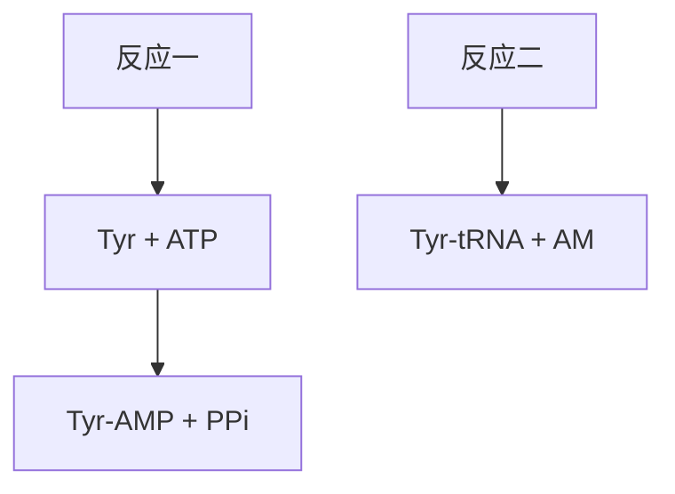
</details>

图9-18 嗜热芽孢杆菌酪氨酰-tRNA合成酶催化氨酰化反应的机理

表 9-4 酪氨酸 tRNA 合成酶及其变体的氨酰化活性

| 酶 | $k_{\text{cat}}/\mathrm{s}^{-1}$ | $K_{\mathrm{m}}/(\mathrm{mmol}\cdot\mathrm{L}^{-1})$ | $(k_{\mathrm{cat}}/K_{\mathrm{m}})/(\mathrm{L}\cdot\mathrm{mol}^{-1}\cdot\mathrm{s}^{-1})$ |
| --- | --- | --- | --- |
| Thr-51(天然) | 4.7 | 2.5 | 1880 |
| Ala-51(修饰后) | 4.0 | 1.2 | 3333 |
| Pro-51(修饰后) | 1.8 | 0.019 | 94736 |

## 2. 随机改组肽段以改善酶的催化活性

头孢菌素酶催化头孢菌素和拉氧头孢类抗生素的水解反应，从而赋予细菌对这些抗生素的抗性。来自弗氏柠檬酸杆菌（Citrobacter freundii）、阴沟肠杆菌（Enterobacter cloacae）、小肠结肠炎耶尔森氏病（Yersinia enterocolitica）、肺炎克雷伯氏菌（Klebsiella pneumoniae）四种细菌的头孢菌素酶编码基因呈现较高的同源性（58%～82%），每个基因均为自然界亿万年选择的结果，各有各的长处。如果将这四个基因分别实施单基因改组，则筛选到的突变克隆菌对拉氧头孢菌素的抗性均为对照菌株（含野生型头孢菌素酶基因的克隆菌）的8倍。然而，若将上述4个同源基因等分子混合进行多基因改组，则从突变重组文库中筛选到一个克隆(A)，其抗性比野生型的Citrobacter和Enterobacter基因提高270倍，比野生型的Klebsiella和Yersinia基因提高540倍[图9-19(a)]。与单个基因的改组相比，家族改组的进化速率分别提高34倍和68倍。也就是说，家族基因的共同改组由于提供了成员之间优势互补的可能性，因而大大加快了进化的步伐。以上述第一轮获得的高抗性重组突变基因为亲本，实施第二轮改组，从大约5万个克隆中又筛选出3个更高抗性的重组突变克隆，其抗性为A克隆的3.5倍，这表明第二轮改组的进化速率已接近极限。对A克隆

---

510

基因工程


图9-19 头孢菌素酶编码基因的改组策略与效应

所含的重组突变基因序列进行分析,结果表明,它是Citrobacter、Enterobacter、Klebsiella野生型基因的杂合分子,7个重组交叉位点形成8个重组区域[图9-19(b)]。此外,这个杂合重组突变基因还含有47处DNA点突变,导致33个氨基酸残基被取代,而且新换上的所有氨基酸残基均不存在于4种亲本酶分子中。

## 3. 删除末端部分氨基酸序列以改善酶的催化活性

枯草芽孢杆菌 MI113 株的  $\alpha-$  淀粉酶结构基因编码 660 个氨基酸，它在相同菌株中的重组表达产物比活并不高。若将其 C 末端的序列分别缩至 617 个、560 个、511 个、500 个氨基酸残基，则表达出的变体酶不仅比活比天然酶高 2.7 倍，而且所有变体酶均变成 383 个氨基

---

第 9 章 第二代基因工程——蛋白质工程

511

酸残基的相同分子，其C末端以组氨酸残基结尾。进一步分析表明，这些蛋白变体由于肽段部分缺失，其C端区域在细菌细胞内不再能维持稳定的三维空间结构，因此被胞内的蛋白酶或羧肽酶降解，而天然的 $\alpha$ -淀粉酶和以His-383结尾的变体酶则能形成稳定的空间结构，故对羧肽酶产生抗性。由此可见，$\alpha$ -淀粉酶的C端肽段对酶的活性发挥有阻碍作用。

## 9.4.4 消除酶的被抑制特性

有些酶分子的催化活性在天然细胞内呈可诱导性，这种酶活诱导机制建立在酶分子中抑制型功能域的基础之上。或许这种诱导机制对天然宿主正常的生理代谢活动具有重要意义，但在异源工程化表达的背景下，消除这种诱导机制不仅不会产生不良影响，更重要的是能在很大程度上提高工业用酶的活性。

## 1. 转换氨基酸残基以消除酶的被抑制特性

枯草芽孢杆菌蛋白酶是一种丝氨酸蛋白酶，因具有广谱的蛋白质降解能力而被广泛用作洗涤添加剂。但早期的这种添加剂有一个严重的缺陷，它不能与漂白剂联合使用，因为后者会灭活蛋白酶。相关生化分析结果表明，酶活性丧失（约 $90\%$ ）是由蛋白分子中第222位的甲硫氨酸残基被氧化所致。为了消除蛋白酶对漂白剂的敏感性，借助DNA定点突变技术将枯草芽孢杆菌蛋白酶第222位的甲硫氨酸残基分别转换成其他19种氨基酸残基（即所谓的饱和突变），形成一系列的变体酶。其中， $\mathrm{Met222\rightarrow Cys(M222C)}$ 型变体酶比天然酶具有更高的降解活性，但它仍对漂白剂敏感；而 $\mathrm{Met222\rightarrow Ala(M222A)}$ 型变体酶虽然降解蛋白质的活性只及天然酶的 $53\%$ ，但已不受漂白剂的抑制，因此可作为第二代洗涤添加剂被广泛使用。

## 2. 删除肽段以消除酶的被抑制特性

血液中存在很多纤溶酶原激活剂(PA)的抑制剂蛋白,使得这类溶栓药物的临床使用剂量较大。由于任何溶栓剂对血栓的专一性降解都是相对的,因此大剂量使用这些药物容易破坏病人的凝血系统,导致出血性死亡。纤溶酶源激活剂的抑制蛋白以PAI-1为主,后者能与t-PA或pro-UK形成等分子的复合物,并使之失活。定点删除型突变的实验结果证明,缺失Lys296-Gly302肽段的t-PA变体为PAI-I抑制的效应明显减弱。进一步研究显示,t-PA与PAI-1结合的位点位于其催化活性中心附近的Lys296-Arg299肽段中。在分析t-PA结构的基础上,将PAI-I结合位点附近带正电荷的氨基酸残基都替换为带负电荷的氨基酸残基,得到的突变分子t-PA R275E、R298E、R299E、R304E具有更强烈的抗PAI-1抑制的特性。而且,根据t-PA与PAI-1相互作用的方式也可预测pro-UK与PAI-1作用的位点可能与其Arg179-Ser184肽段有关。后续实验证明,Arg179-Ser184肽段删除型pro-UK变体确实具有明显的抗PAI-1抑制能力。

## 9.4.5 修饰酶的催化特异性

虽然蛋白质工程的许多研究主要集中在修饰那些催化特异性高的酶的天然性质,但将底物专一性不强的酶改造成只能转化一种底物的高特异性变体酶,也许意义更大。

## 1. 共价结合寡核苷酸以修饰酶的催化特异性

链球菌核酸酶是由149个氨基酸组成的单一多肽链，能催化降解单链RNA和单双链DNA分子中的磷酸二酯键，产生3'磷酸和5'羟基的末端，底物作用部位为A、U或A、T丰富区。X晶体衍射得到的结构数据表明，将一小段已知序列的寡核苷酸片段接在邻近酶催化活性部位的某一氨基酸残基上，可以提高该酶的降解特异性。其构建原理如图9-20所示:利用寡核苷酸定向突变技术将天然核酸酶第116位的赖氨酸残基转变为半胱氨酸残基，同时人工合成3'端带有巯基的寡核苷酸单链片段，两者通过二硫键共价交联在一起。天然链球菌核酸酶分子内没有半胱氨酸残基，因此在体外共价交联时，反应体系中会出现三种产物:核酸酶与寡核苷酸所形成的变体酶、寡核苷酸之间的二聚体以及带有寡核苷酸的变

---

512

基因工程

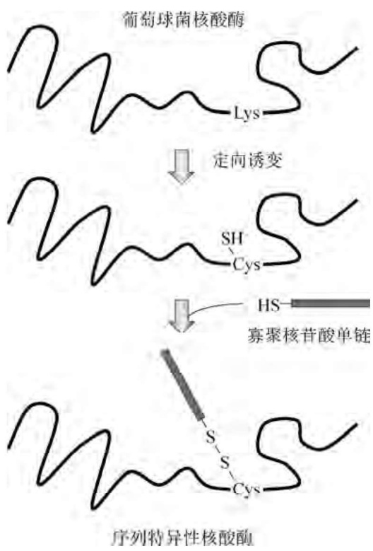

<details>
<summary>flowchart</summary>


</details>

图9-20 链球菌核酸酶的底物特异性改造

体酶之间的二聚体，这种反应混合物可用凝胶过滤程序加以分离。若将由此构建的核酸酶变体用于降解DNA单链，只有那些含有与修饰酶寡核苷酸片段互补序列的DNA分子才能在其互补区域的邻近位点被降解，于是这个修饰酶便成了一个DNA序列特异性的核酸酶。

2. 转换氨基酸残基以修饰酶的催化特异性

利用蛋白质工程技术改变酶催化特异性的另一个典型例子是新支链淀粉酶。嗜脂热芽孢杆菌来源的新支链淀粉酶的活性中心已借助于定点突变技术得以确定，构成活性中心的氨基酸残基组成也可通过与其他淀粉水解酶一级结构的比较进行预测（图9-21）。当活性中心内的谷氨酸和天冬氨酸残基被具有相反电荷或中性的氨基酸残基（如组氨酸、谷酰胺或天冬酰胺）取代时，变体酶的 $\alpha - (1 \rightarrow 4)$ 和 $\alpha - (1 \rightarrow 6)$-糖苷键水解活性完全消失；若将底物结合位点的氨基酸残基进行置换，则变体酶裂解 $\alpha - (1 \rightarrow 4)$-和 $\alpha - (1 \rightarrow 6)$-糖苷键的活性之比明显发生改变。随着变体酶 $\alpha-$

(1→4)-糖苷键水解活性的增强,由支链淀粉产生潘糖的产率也显著提高;相反,若提高变体酶  $\alpha-(1\rightarrow6)$ -糖苷键的水解活性,则潘糖的产率下降。

提高 t-PA 和 pro-UK 等溶栓药物的血纤维蛋白专一性，是降低急性心肌梗死病人死亡率的一个重要因素。前期大量的定点突变实验已经鉴定出与纤维蛋白专一性密切相关的区域和氨基酸位点。据此，可构建一种 t-PA 的组合型变体分子 KHRR296-299AAAA，即置换连续排列的四个氨基酸残基。这种突变使血纤维蛋白的专一性增强 14 倍，同时抗 PAI-1 抑制的能力提高 80 倍。

不饱和脂肪酸合成酶在脂肪酸合成过程中具有去饱和酶、羟化酶、环氧酶、乙炔酶、连接酶5种催化活性(图9-22)。定点突变该酶活性中心的关键氨基酸序列可产生不同的酶活性，进而生成不同的最终产物。涉及这种酶催化性质转变的位点已鉴定了7个，它们在5种去饱和酶中严格保守，但在2种羟化酶中的相应位点却有所不同。在这7个位点处将去饱和酶和羟化酶的氨基酸残基进行交换，就会明显改变去饱和酶与羟化酶的活性比例。例如，4种氨基酸残基交换就足以使去饱和酶转变成羟化酶；而6个氨基酸残基被替换，又可以使羟化酶转变为去饱和酶。

## 9.4.6 改造配体与其受体的亲和性

广泛存在于生物体内的各类信号转导在很大程度上介导着生命的运动过程，而配体与其受体之间的识别和结合又是细胞信号转导的触发开关。因此，工程化理性设计改造配体与受体之间的亲和性具有重要的临床应用意义。

1. 随机点突变以强化配体与其受体的亲和性

在没有任何蛋白质结构与功能相关数据的情况下,欲通过 DNA 定点突变技术提高多肽激素与其受体的亲和性是难以想象的。试想,如果在一个多肽分子中只改变其中的 3 个氨

---

第 9 章 第二代基因工程——蛋白质工程

513

<table><tr><td></td><td></td><td colspan="2">区域1</td><td colspan="2">区域2</td><td colspan="2">区域3</td><td colspan="2">区域4</td></tr><tr><td>α-淀粉酶</td><td>米曲霉菌</td><td>117</td><td>DVVANH</td><td>202</td><td>GLRIDTVKH</td><td>230</td><td>EVLD</td><td>292</td><td>FVENHD</td></tr><tr><td>α-淀粉酶</td><td>嗜脂热芽孢杆菌</td><td>101</td><td>DVVFDH</td><td>230</td><td>GFRLDAVKH</td><td>264</td><td>EYWS</td><td>326</td><td>FVDNHD</td></tr><tr><td>α-淀粉酶</td><td>嗜淀粉芽孢杆菌</td><td>98</td><td>DVVLNH</td><td>227</td><td>GFRIDAAKH</td><td>261</td><td>EYWQ</td><td>323</td><td>FVENHD</td></tr><tr><td>α-淀粉酶</td><td>枯草芽孢杆菌</td><td>97</td><td>DAVINH</td><td>172</td><td>GFRFDAAAKH</td><td>208</td><td>EILQ</td><td>264</td><td>WVESHD</td></tr><tr><td>α-淀粉酶</td><td>大鼠</td><td>96</td><td>DAVINH</td><td>190</td><td>GERLDAAAKH</td><td>230</td><td>EVID</td><td>292</td><td>FVDNHD</td></tr><tr><td>α-淀粉酶</td><td>小鼠,唾液</td><td>96</td><td>DAVINH</td><td>193</td><td>GFRLDASKH</td><td>233</td><td>EVID</td><td>295</td><td>FVDNHD</td></tr><tr><td>α-淀粉酶</td><td>小鼠,胰腺</td><td>96</td><td>DAVINH</td><td>190</td><td>GFRLDAAAKH</td><td>230</td><td>EVID</td><td>292</td><td>FVDNHD</td></tr><tr><td>α-淀粉酶</td><td>猪</td><td>96</td><td>DAVINH</td><td>193</td><td>GFRIDASKH</td><td>233</td><td>EVID</td><td>295</td><td>FVDNHD</td></tr><tr><td>α-淀粉酶</td><td>人类,唾液</td><td>99</td><td>DAVINH</td><td>196</td><td>GFRIDASKH</td><td>236</td><td>EVID</td><td>298</td><td>FVDNHD</td></tr><tr><td>α-淀粉酶</td><td>人类,胰腺</td><td>99</td><td>DAVINH</td><td>196</td><td>GFRLDASKH</td><td>236</td><td>EVID</td><td>298</td><td>FVDNHD</td></tr><tr><td>α-淀粉酶</td><td>大麦</td><td>101</td><td>DIVINH</td><td>127</td><td>DGRLDWGPH</td><td>218</td><td>EVWD</td><td>299</td><td>FVDNHD</td></tr><tr><td>新支链淀粉酶</td><td>嗜脂热芽孢杆菌</td><td>242</td><td>DAVENH</td><td>324</td><td>GWRLDVANE</td><td>357</td><td>EIWH</td><td>419</td><td>LLGSHD</td></tr><tr><td>异淀粉酶</td><td>嗜淀粉假单胞菌</td><td>291</td><td>DVVYNH</td><td>370</td><td>GFRFDLASV</td><td>454</td><td>EWSV</td><td>502</td><td>PIDVHD</td></tr><tr><td>支链淀粉酶</td><td>产气克雷伯杆菌</td><td>600</td><td>DVVYNH</td><td>671</td><td>GFRFDLMGY</td><td>704</td><td>EGWD</td><td>827</td><td>YVSKHD</td></tr><tr><td>环化糊精葡聚糖转移酶</td><td>软化芽孢杆菌</td><td>135</td><td>DFAPNH</td><td>225</td><td>GIRFDAVKH</td><td>258</td><td>EWFL</td><td>324</td><td>FIDNHD</td></tr><tr><td>环化糊精葡聚糖转移酶</td><td>嗜碱芽孢杆菌</td><td>135</td><td>DFAPNH</td><td>225</td><td>GIRVDAVKH</td><td>268</td><td>EYHQ</td><td>323</td><td>FIDNHD</td></tr><tr><td>环化糊精葡聚糖转移酶</td><td>嗜脂热芽孢杆菌</td><td>131</td><td>DFAPNH</td><td>221</td><td>GLRMDAVKH</td><td>253</td><td>EWFL</td><td>319</td><td>FIDNHD</td></tr></table>

图9-21 淀粉酶家族的高度保守区域

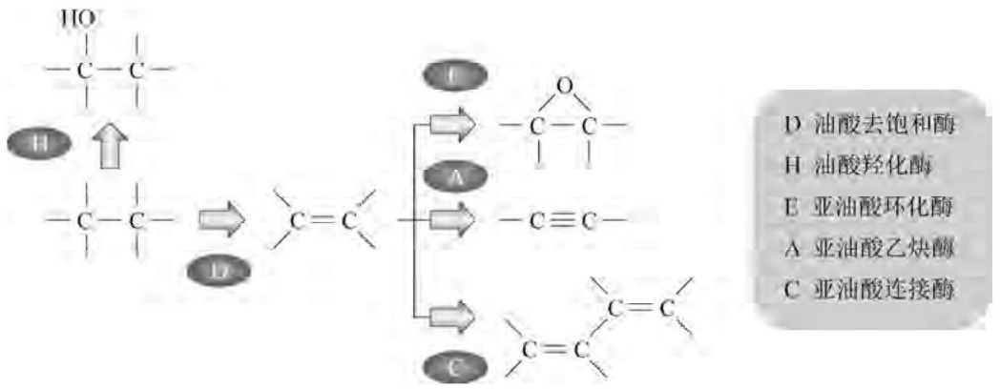

<details>
<summary>chemical</summary>

Chemical reaction pathway showing hydrolysis of a polymer with labeled intermediates and products
</details>

图9-22 不饱和脂肪酸合成酶的催化活性

基酸残基便有 8 000 种可能性, 若转换 10 个氨基酸残基, 其可能的排列组合高达  $10^{13}$  。然而, 只要借助于一个巧妙的实验设计(图 9-23), 上述难题便会迎刃而解。

在人生长激素(hGH)负责与其受体结合的区域内，通过随机点突变技术创造所有可能的突变编码序列文库，将之连接到M13噬菌粒表达载体上，并使其与M13基因III产物的C端编码序列融合。融合基因表达产物的C端结构域维系于重组噬菌体的颗粒内，而其N端的hGH变体部分则暴露在噬菌体的外表面上。将所有的重组分子转化大肠杆菌，获得的 $Ap^r$ 克隆再由一个能产生完整噬菌体颗粒的辅助噬菌体感染，此时大约 $1\% \sim 10\%$ 的噬菌体颗粒(10$^{11}$个以上)含有hGH-III型融合蛋白，而且每个颗粒携带一种融合蛋白，它们共同组成了一个庞大的hGH变体文库。这一程序称为噬菌体表面展示技术。

---

514

基因工程

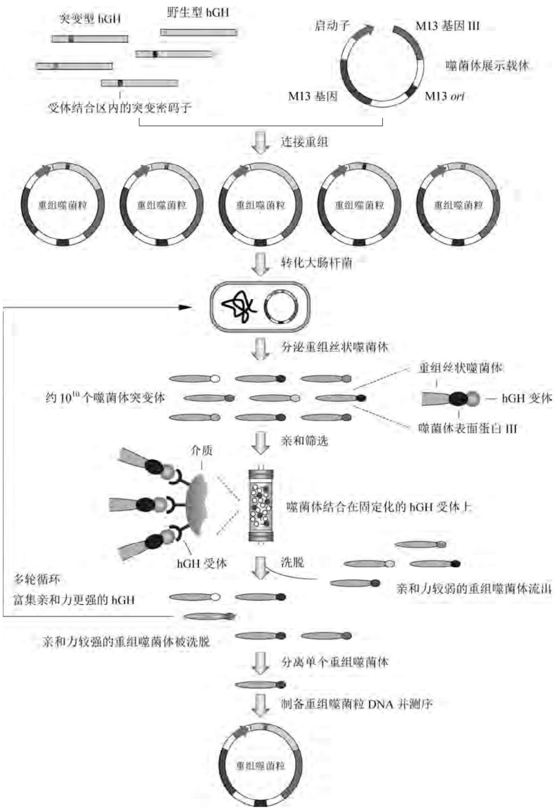

<details>
<summary>flowchart</summary>

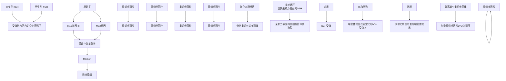
</details>

图9-23 丝状噬菌体表面蛋白质或多肽的展示

---

第9章 第二代基因工程——蛋白质工程

515

接下来的工作是从上述构建的变体文库中筛选出与受体亲和能力最强的激素变体。这个步骤相对较为简单，只需将所有的噬菌体颗粒悬浮液上受体亲和层析柱，与受体结合力弱的噬菌体颗粒被洗脱，亲和性高的颗粒则可用高离子强度的溶液回收。由此获得的高亲和性噬菌体颗粒再次感染大肠杆菌加以扩增，然后进行第二轮亲和层析分离。重复上述操作6个循环，每次循环均使亲和性更高的噬菌体颗粒得以富集。最终获得的一个hGH变体，其受体亲和活性比天然激素高10倍，若将在另一项实验中筛选出的hGH另一区域内的突变位点引入，则含双重突变的hGH变体显示出比天然激素高50倍的受体亲和活性。

## 2. 基因家族改组以强化配体与其受体的亲和性

人的 $\alpha$-干扰素至少有11种亚型，其氨基酸序列呈一定程度的多样性[图9-24(a)]。根据每个多态性位点所观察到的不同氨基酸数进行计算，由这11种亚型可以产生 $10^{26}$ 种组合变体，但没有任何技术能准确地获得这一庞大组合文库的样品。一项基因家族改组的尝试是选取其中的8个亚型成员，用DNaseI随机切成 $20\sim 50\mathrm{bp}$ 和 $50\sim 100\mathrm{bp}$ 两组片段，然后分别进行无引物PCR扩增。将扩增物与M13噬菌体的基因III重组并融合表达，然后通过测定融合蛋白对Daudi细胞的抗增殖活性，从上述噬菌体展示文库中筛选目的重组突变体。所获得的16个随机重组变体进行基因序列分析，结果表明，高重组交叉文库和低重组交叉文库分别产生于 $20\sim 50\mathrm{bp}$ 和 $50\sim 100\mathrm{bp}$ 片段的改组[图9-24(b)]。其中，IFN $\alpha-$ MAX4变体(存在于高重组交叉库中，从顶部数起第四行)的抗Daudi细胞抗增殖活性分别比亲本IFN $2\alpha$ 和保守的1型干扰素高40倍和2倍。

## 9.4.7 降低异源蛋白药物的免疫原性

L-天冬酰胺酶是治疗小儿白血病的有效药物，但在临床应用中因其异源性常常引起过敏反应，因此降低其免疫原性是该药研究开发的重要内容。应用定点突变技术对L-天冬酰胺酶的表位抗原进行结构改造，已证明策略可行。经结构预测，L-天冬酰胺酶中的八条肽段为其抗原表位关键序列，其中第261位至第269位及第192位至第199位（TPARKHTS）的两个肽段与重组大肠杆菌L-天冬酰胺酶抗体的结合力最强。192TPARKHTS199肽段中含有连续的3个碱性氨基酸残基RKH，其中的Lys与抗体分子的结合功能有关。由此设计针对Lys进行定点突变，以Ala残基替代Lys残基。结果表明，这种Lys196→Ala(K196A)型的L-天冬酰胺酶变体活性保持不变，但其免疫原性下降了2.5倍。

葡激酶(Staphylokinase, SAK)是葡萄球菌产生的一种蛋白酶，具有较高的纤维蛋白专一性。葡激酶能选择性地与血栓表面的纤溶酶源形成等分子的复合物，并在血栓表面痕量纤溶酶的作用下，转变为活化的复合物，从而高效特异地溶解血栓。但由于葡激酶对人体而言属于异源蛋白，作为药物注射使用会引起免疫反应，因此必须对其抗原决定簇进行改造。通过定点突变将SAK多肽链上某些带电荷的极性氨基酸残基改变为丙氨酸残基后，得到SakSTAR. M38(将Lys35、Glu38、Lys74、Glu75、Arg77分别替换为Ala)和SakSTAR.M89(将Lys74、Glu75、Arg77、Glu80、Asp82分别替换为Ala)两种变体，其免疫原性明显降低，而且溶栓活性不受影响。类似的例子还包括来自细菌的链激酶，一种缺少C末端42个氨基酸残基的链激酶变体(Skc2)也能大大削弱在人体中的免疫原性。

目前临床上使用的单克隆抗体绝大多数为鼠源性抗体，它们进入人体后最终会被机体视为异源蛋白而遭清除。降低鼠源性单克隆抗体免疫原性的第一种方法是构建含有鼠源性可变区和人源性不变区编码序列的嵌合抗体基因，由此合成半人源化的基因工程抗体（图9-25），但这种嵌合抗体仍含有一定比例的鼠源性区域。

抗体分子三维空间结构的深入研究表明,在可变区100个氨基酸残基中只有少数几个真正参与接触抗原,由其构成的接触区域称为互补决定域(CDR)。每个抗体轻链和重链中均含有3个CDR,而其余的可变区氨基酸残基则作为支架将CDR锚定在正确的位置上。因

---

516

基因工程

(a) 各型 $\alpha$ -干扰素序列比

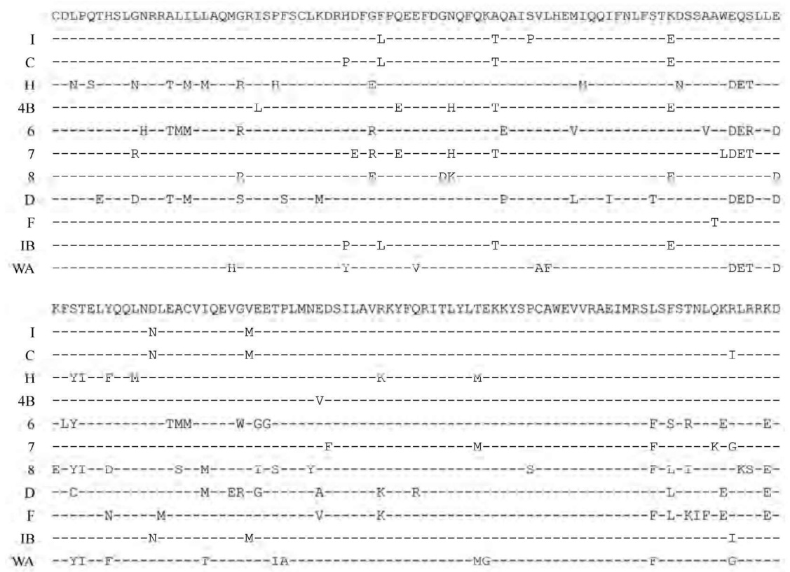

<details>
<summary>text_image</summary>

CDLPQTHSLGNRRALILLAQMGRISFFSCLKDRHDFGFPQEEFDGNQFQKAQAI SVLHEMIQQIFNLFSTKDSSAAWEQSLLLE
I -------------------------- L---------- T--P---------- E------------
C -------------------------- P--L---------- T---------- E------------
H --N-S--- N---T-M-M---R---H--------E---------M------N-----DET--
4B -------------------------- L---------- E----H----T---------E------------
6 -------------------------- H--TMM---R--------R--------E--------V--------V--DER--D
7 -------------------------- R--------E-R-E---H----T---------LDET--
8 -------------------------- P--------E----DK---------F--------D
D ---E--D---T-M---S---S---M--------P--------L--I----T--------DED--D
F -------------------------- T-----------------------------T------------------
IB -------------------------- P--L--------T--------E------------
WA -------------------------- H--------Y--------V--------AF---------DET--D

KFSTELYQQLNDLEACVIQEVGVEETPLMNEDSILAVRKYFQRITLYLTEKKYSPCAWEVVRAEIMRSLSFSTNLQKRLARKD
I -------------------------- N-------M--------I-----------------------------I--------
C ---N-------M--------I--------
H --YI--F--M--------K--------M-------------------------------
4B -------------------------- V--------F-S-R--E--E-
6 --LY-------TMM---W-GG--------F-S-R--E--E-
7 -------------------------- F--------M--------F-----K-G--------
8 --E-YI--D-------S--M------I-S---Y--------S------F-L-I-----KS-E-
D --C-------M--ER-G------A---K--R------L-----E-----E-
F ---N-------M--------V-----K--------F-L-KIF-E-----E-
IB ---N-------M--------I------I--------
WA --YI--F-------T-------IA--------MG------F-----G-----
</details>

(b) 重组交叉文库的构成

高重组交叉库:

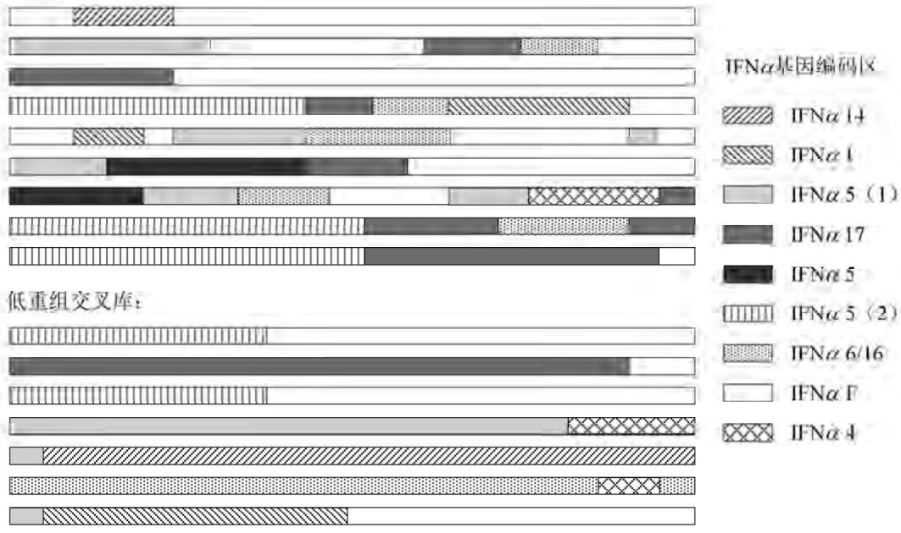

<details>
<summary>bar_stacked</summary>

| Sample | \(IFN\alpha\) Gene Editing Region |
| :--- | :--- |
| 1 | \(IFN\alpha 14\) |
| 2 | \(IFN\alpha 1\) |
| 3 | \(IFN\alpha 5 (1)\) |
| 4 | \(IFN\alpha 17\) |
| 5 | \(IFN\alpha 5\) |
| 6 | \(IFN\alpha 5 (2)\) |
| 7 | \(IFN\alpha 6/16\) |
| 8 | \(IFN\alpha F\) |
| 9 | \(IFN\alpha 4\) |
</details>

图9-24 人 $\alpha$-干扰素随机重组变体的序列分析

---

第 9 章 第二代基因工程——蛋白质工程

517

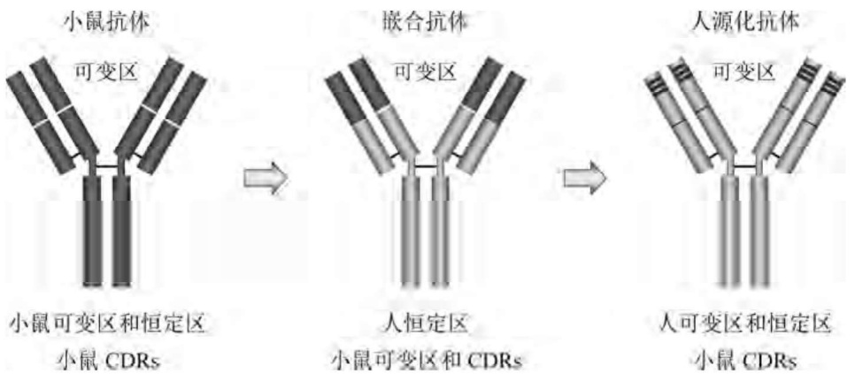

<details>
<summary>flowchart</summary>


</details>

图9-25 人源化单克隆抗体的构建程序

此,完全人源化单克隆抗体的构建策略是利用体外基因突变技术将鼠单克隆抗体中的 CDR 氨基酸序列转移至人的天然抗体分子内。这种工程化改造型的人源化单克隆抗体能识别人体淋巴细胞的表面抗原,目前已在临床试验中作为免疫阻断剂治疗人淋巴细胞瘤。

单克隆抗体另一个极有应用价值的特性是能与很多乳腺癌细胞表面上的生长因子受体结合。相关实验证明，这种抗体能在培养基中抑制癌细胞的生长，并使鼠的乳腺癌组织消退。利用计算机精确设计抗体可变区CDR的氨基酸残基取代方案，以增强抗体与抗原之间的相互作用强度，由此可构建出若干抗体变体。其中有一个变体与肿瘤细胞表面抗原的结合能力比原来的抗体提高250倍，目前这种工程化抗体已大量生产并用于临床。
