# 第10章 第三代基因工程——途径工程

原始 PDF 第 519–566 页。

## 第 10 章 第三代基因工程——途径工程

借助于分子生物学理论与技术，人们不仅能精确描述基因表达和调控的分子机制，而且对细胞内的物质/能量(物能)代谢途径和信号转导途径也有了一个全景式的认知。日臻完善的DNA重组技术已经允许人们对生物体内固有的两大类生理途径进行倾向性和功利性的设计与修饰，甚至像心脏搭桥外科手术那样实现细胞天然生理途径的局部重建。如果说，四十年前主要用于单基因克隆和表达的DNA重组技术属于第一代基因工程；三十年前在基因水平上对蛋白质结构和功能进行局部修饰属于第二代基因工程；那么近二十年来利用重组DNA技术对生物细胞内固有物能代谢途径和信号转导途径进行改造设计的尝试就属于第三代基因工程，即途径工程。

## 10.1 途径工程的基本概念

## 10.1.1 途径工程的基本定义

细胞是生命运动的基本功能单位,其所有的生理生化过程(即细胞代谢活性的总和)是由一个可调控的、大约有上千种酶促反应高度偶联的网络以及选择性的物质运输系统来实现的。在大多数情况下,细胞内生物物质的合成、转化、修饰、运输及分解各过程需要经历多步酶促反应,而这些反应又以串联的形式组合成为途径,其中前一反应的产物是后一反应的底物。

根据底物在代谢反应中对通用性酶和特异性酶的使用要求,可将细胞内所有的生物分子分成两大类:①一级基因产物,如 RNA、蛋白质、核酸、多糖、脂质等,其生物合成和分解只需要有限的几种通用性酶及蛋白因子,包括 RNA 聚合酶、RNA 剪切酶、DNA 聚合酶、糖苷酶、酯酶、氨酰基-tRNA 合成酶、肽基转移酶、核酸酶等;②二级基因产物,如氨基酸、维生素、抗生素、核苷酸等小分子化合物,它们的从头生物合成和降解少则涉及几个基因多则需要几十个基因所编码的酶系,而且这些酶大都具有使用的特异性。上述合成和分解二级基因产物的酶系及其催化的生化反应构成了一个个相互联系的物能代谢网络,对这些代谢网络进行解析不难看出,它们均由若干个串联和并联的简单子途径构成(图 10-1),其中各子途径的并联交汇点称为节点(Node)。

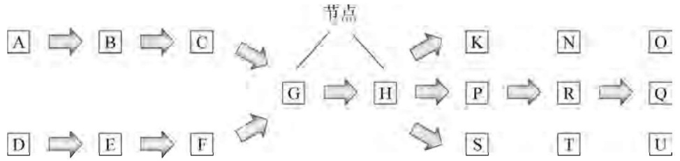

<details>
<summary>flowchart</summary>


</details>

图10-1 细胞物能代谢途径示意图

途径工程(Pathway engineering)是一门利用分子生物学原理系统分析细胞物能代谢网络和信号转导网络，并通过重组DNA技术理性设计和遗传修饰之，进而完成细胞特性改造的应用性学科。由于生物细胞自身固有的物能代谢途径对于实际应用而言并非最优，因此

---

第 10 章 第三代基因工程——途径工程

519

人们需要对之进行功利性修饰，途径工程的基本理论及其应用战略就是在这一发展背景下形成的。1974年，Chakrabarty在假单胞菌属的恶臭假单胞菌(Pseudomonas putida)和铜绿假单胞菌(Pseudomonas aeruginosa)两个菌种中分别引入几个稳定的重组质粒，从而提高了两者对樟脑和萘等复杂有机物的降解活性，这是途径工程技术的第一个应用实例。在此之后的十几年中，人们更加注重途径工程的应用方法和目的，通常表现在对细胞内特定物能代谢途径进行功利性改造，并积累了多个成功的范例，但未能形成自己的基本理论体系。1991年，Bailey用代谢工程(Metabolic engineering)术语表述利用重组DNA技术对细胞的酶促反应、物质运输、调控装置进行基因操作的过程，这被认为是途径工程或代谢工程向一门系统学科发展的转折点。近年来，虽然众多学者对这一学科的名称及定义有多种精确的界定(表10-1)，但其基本内涵达到了公认的一致，并以途径工程或代谢工程冠名。

表 10-1 途径工程和代谢工程概念的演变

<table><tr><td colspan="2">术语</td><td>定义</td></tr><tr><td colspan="2">(微生物)途径工程 (Microbial)Pathway Engineering</td><td>利用重组DNA技术修饰各种代谢途径(包括生物体非固有的代谢途径),提高特定代谢物的产量</td></tr><tr><td>代谢工程</td><td>Metabolic Engineering</td><td>利用重组DNA技术优化细胞的酶活、运输和调控功能,提高细胞活力</td></tr><tr><td>代谢途径工程</td><td>Metabolic Pathway Engineering</td><td>生化途径的修饰、设计与构建</td></tr><tr><td>代谢工程</td><td>Metabolic Engineering</td><td>利用重组DNA技术对代谢进行目的性修饰</td></tr><tr><td>途径工程/代谢设计 Design</td><td>Pathway Engineering/Metabolic</td><td>改造细胞代谢途径,提高天然最终产物产量或合成新产物(包括中间产物或修饰型最终产物)</td></tr><tr><td>代谢工程</td><td>Metabolic Engineering</td><td>对生化反应的代谢网络进行目的性修饰</td></tr><tr><td>代谢工程</td><td>Metabolic Engineering</td><td>为达到所需目标对活细胞的代谢途径进行修饰</td></tr><tr><td>代谢工程</td><td>Metabolic Engineering</td><td>利用分子生物学原理系统分析代谢途径,设计合理的遗传修饰战略从而优化细胞生物学特性</td></tr></table>

然而，由于途径工程或代谢工程的基本原理和技术建立在多学科相互渗透的基础之上，人们往往从完全不同的学科理论体系出发，采取完全不同的研究路线，实现改造或重构细胞物能代谢途径之目的。因此，以研究内容、方法、路线上存在的差异区分途径工程和代谢工程很有必要:代谢工程注重以酶学、化学计量学、分子反应动力学以及现代数学的理论和技术为研究手段，在细胞水平上阐明代谢途径与代谢网络之间局部与整体的关系、胞内物能代谢过程与胞外物质传输之间的偶联以及代谢流流向与控制的机制，并在此基础上借助相关的工程和工艺操作达到优化细胞性能之目的；而途径工程则侧重于利用分子生物学和遗传学原理分析代谢途径各所属反应在基因水平上的表达与调控机制，并借助重组DNA技术扩增、删除、植入、转移、调控编码途径反应的相关基因，进而筛选出具有优良遗传特性的工程菌或细胞。因此，途径工程实质上是基因工程应用的高级阶段。

## 10.1.2 途径工程的基本过程

途径工程通过定向改变细胞内物能代谢途径的分布及代谢流重构代谢网络，进而提高代谢物的产量；外源基因的准确导入及其编码蛋白的稳定表达可拓展细胞内现有代谢途径的延伸路线，以获得新的生物活性物质或者优良的遗传特性。为达到上述目标，途径工程操作至少应包括下列三大基本过程（图10-2）。

## 1. 靶点设计

虽然所有物种改良程序的目的性都是明确的,但相对于随机诱变而言,途径工程的一个显著特点是工作的定向性,因为它在修饰靶点选择、实验设计以及数据分析方面占据绝对优势。然而,从自然界分离具有特殊品质的野生型微生物菌种以及利用传统诱变程序筛选遗

---

520

基因工程

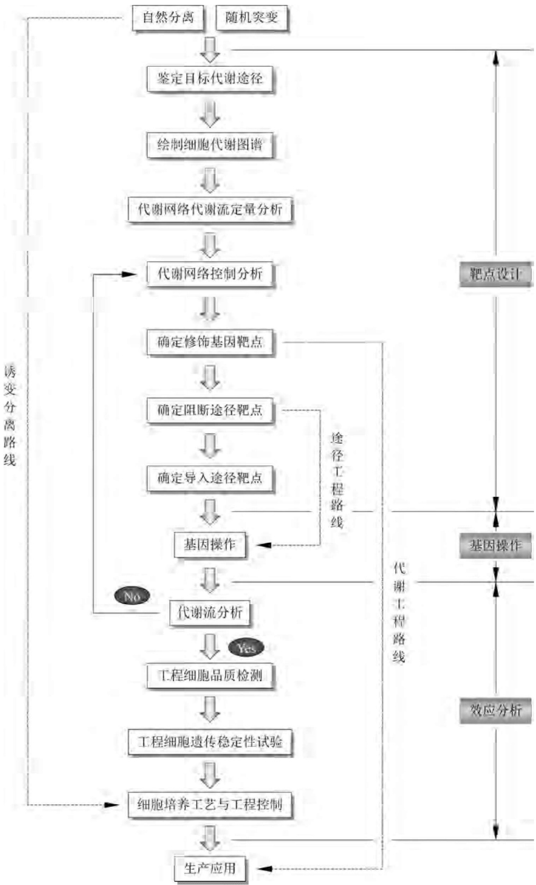

<details>
<summary>flowchart</summary>

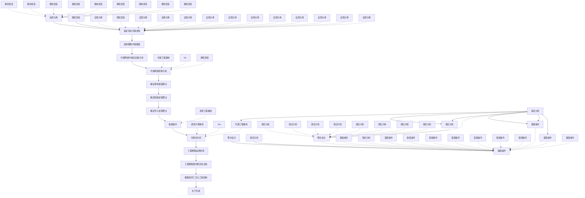
</details>

图10-2 途径工程基本过程示意图

---

第 10 章 第三代基因工程——途径工程

521

传性状优良的物种，恰恰是途径设计和靶点选择的重要信息资源和理论依据。事实上，迄今为止途径工程应用成功的范例无一不是从这一庞大的数据库中获得创作灵感的，这个过程称为“反向途径工程”。虽然单纯为了获取一个理想代谢途径而采取传统的分离诱变程序并非最佳选择，但这种操作所积累的信息量却具有重大使用价值。

生物化学家在长达数十年的研究中，已对相当数量细胞内的物能代谢途径进行了鉴定，并绘制出较完整的代谢网络图，这对途径工程的实施奠定了基础。然而，正确的靶点设计还必须对现有的物能代谢途径和网络信息进行更深入的分析。首先，根据化学动力学和计量学原理定量测定网络中的代谢流分布（即代谢流分析，MFA），其中最重要的是细胞内碳和氮元素的流向比例关系；其次，在代谢流分析的基础上调查其控制状态、机制和影响因素（即代谢流控制分析，MCA）；最后，根据代谢流分布和控制的分析结果确定途径操作的合理靶点，通常包括拟修饰基因的靶点、拟导入途径的靶点或者拟阻断途径的靶点等。需要强调的是，靶点设计对途径工程的成败起着关键作用，任何精细的靶点选择都必须经得起细胞生理特性以及代谢网络热力学平衡的检验。

## 2. 基因操作

利用途径工程战略修饰改造细胞物能代谢网络的核心是在分子水平上对靶基因或基因簇进行遗传操作,其中最典型的形式包括基因或基因簇的克隆、表达、修饰、敲除、调控以及重组基因在目标细胞染色体 DNA 上的稳定整合。后者通常被认为是途径工程重要的特征操作技术,因为在以高效表达基因编码产物为主要目标的基因工程以及以生产变体蛋白为特征的蛋白质工程中,DNA 重组分子一般独立于受体细胞染色体而自主复制。

实现目的基因或基因簇在受体细胞染色体DNA上的定位整合，主要依赖于同源重组和非同源重组两大技术。前者采用质粒或病毒载体输入含有同源序列的目的基因，并通过载体上同源序列与宿主基因组内相关序列之间的体内重组反应，将外源基因置入染色体DNA的特定位点上，或者定向敲除灭活某一靶基因；后者则借助于转座元件将外源基因随机导入宿主基因组内，同时灭活不期望的功能基因。

与途径工程不同，在代谢工程的一些应用实例中，代谢流的分布和控制往往绕过基因操作，直接通过发酵和细胞培养的工艺和工程参数控制提高细胞代谢流，并胁迫代谢流流向所期望的目标产物。在此过程中，向反应体系内施加溶氧、pH、补料等扰动，在酶或相关蛋白因子水平上激活靶基因的转录（诱导作用）、调节酶的活性（阻遏、变构、抑制或去抑制作用），进而实现改变和控制细胞代谢流的目的。这里必须指出的是，虽然就提高目标产物的产量而言，上述非基因水平的操作与典型的途径工程操作在效果上也许没有显著的差异，但在新产物的合成尤其是遗传性状的改良等方面，基因操作是不可替代的。因为只有引入外源的基因或基因簇，才能从根本上改造细胞的物能代谢途径，甚至重新构建新的代谢旁路。

## 3. 效果分析

很多初步的研究结果显示,一次性的途径工程设计和操作往往不能达到实际生产所要求的目标产物的产量、速率或浓度,因为大部分实验涉及的只是与单一物能代谢途径相关的基因、操纵子或基因簇的改变。然而通过对新途径进行全面的效果分析,这种由初步途径操作构建出来的细胞所表现出的限制与缺陷可以作为新一轮实验的改进目标。正像蛋白质工程所采用的研究策略,如此反复进行的迭代式遗传操作是获得优良物种的重要保证。目前,通过这种途径工程操作循环已获得不少成功的范例,所积累的经验有助于鉴定和判断哪一类特定的遗传操作对细胞功能的期望改变相对有效。

## 10.1.3 途径工程的基本原理

途径工程是一个多学科高度交叉的新型领域,其主要目标是通过定向组合细胞生理代谢途径和重构生理代谢网络达到改良生物体遗传性状之目的。因此,它必须遵循下列基本

---

522

基因工程

原理:

（1）涉及细胞物能代谢规律及途径组合的生物化学原理，它提供了生物体基本的物能代谢图谱和生化反应的分子机理。
（2）涉及细胞物能代谢流及其控制分析的化学计量学、分子反应动力学、热力学和控制学原理，这是物能代谢途径修饰的理论依据。
（3）涉及途径代谢流推动力的酶学原理，包括酶反应动力学、变构抑制效应、修饰激活效应等。
（4）涉及细胞间和细胞内通信联系的信号转导原理，它提供了生物体信息传递、转换和发挥效应的分子机制与途径网络。
（5）涉及基因操作与控制的分子生物学和分子遗传学原理，它们阐明了基因表达的基本规律，同时也提供了基因操作的一整套相关技术。
（6）涉及细胞生理状态平衡的细胞生理学原理，它为细胞代谢机能提供一个全景式的描述，因此是一个代谢速率和生理状态表征研究的理想平台。
（7）涉及发酵或细胞培养的工艺和工程控制的生化工程和化学工程原理，化学工程对将工程方法运用于生物系统的研究无疑是最合适的渠道。就一般意义而言，这种方法在生物系统的研究中融入了综合、定量、相关等概念。更为特别的是，它为速率过程受限制的系统分析提供了独特的工具和经验，因此在途径工程领域中具有举足轻重的意义。
（8）涉及生物信息收集、分析与应用的基因组学、转录组学、蛋白质组学、代谢组学原理，随着以基因组为核心的组学研究的不断深入，各生物物种的基因物理信息与其生物功能信息在此交汇(图10-3)，并为途径设计提供了更为广阔的表演舞台，这是途径工程技术迅猛发展和广泛应用的最大推动力。

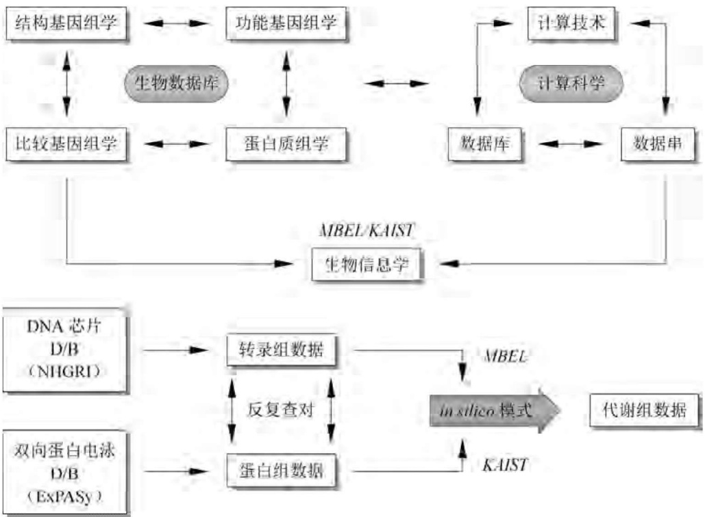

图10-3 途径设计的信息基础

---

第 10 章 第三代基因工程——途径工程

523

## 10.2 途径工程的研究策略

就目前已积累起的细胞物能代谢途径和信号转导途径背景知识而言,途径工程实施的战略思想主要有下列三个方面。

## 10.2.1 在现存途径中提高目标产物的代谢流

在处于正常生理状态下的生物细胞内,对于某一特定产物的生物合成途径而言,其代谢流变化规律通常是恒定的。增加目标产物的积累可以从以下五个方面入手:

（1）增加代谢途径中限速步骤酶编码基因的拷贝数。这一策略并没有改变代谢路径的组成和流向，而是增加关键酶基因在细胞内的剂量，通过提高细胞内酶分子的浓度来促进限速步骤的生化反应，进而导致最终产物产量的增加[图10-4(a)]。
（2）强化以启动子为主的关键基因的表达系统。在此情况下，重组质粒在受体细胞中的拷贝数并未增加，强启动子只是高效率地促进转录，合成更多的mRNA，并翻译出更多的关键酶分子[图10-4(b)]。
（3）提高目标途径激活因子的合成速率。激活因子是生物体内基因表达的开关，它的存在和参与往往能触发相关基因的高效转录，因此提高激活因子的合成速率理论上能促进关键基因的表达[图10-4(c)]。
（4）灭活目标途径抑制因子的编码基因。这一策略的目的是去除代谢途径中具有反馈抑制作用的某些因子或者这些因子作用的DNA靶位点(如操作子)，从而解除其对代谢途径的反馈抑制，提高目标代谢流[图10-4(d)]。
（5）阻断与目标途径相竞争的代谢途径。细胞内各相关途径的偶联是代谢网络的存在形式，任何目标途径必定会与多个相关途径共享同一种底物分子和能量形式。因此，在不影响细胞基本生理状态的前提下，阻断或者降低竞争途径的代谢流，使更多的底物和能量进入目标途径，无疑对目标产物产量的提高是有益的。但是这种操作成功的概率受到挑战，因为它容易导致代谢网络综合平衡的破坏[图10-4(e)]。

上述策略的单独使用或合理组合能在一定程度上提升目标产物的代谢流,进而达到产物积累之目的。在这方面成功的经典案例列在表10-2中。

## 10.2.2 在现存途径中改变物质流的性质

在天然存在的代谢途径中改变物质流的性质主要是指:使用原有途径更换初始底物或中间物质，以达到获得新产物的目的。至少有两种方法可以改变途径物质流的性质:

（1）利用某些代谢途径中酶对底物的相对专一性，投入非理想型初始底物（如己糖及其衍生物）参与代谢转化反应，进而合成细胞原本不存在的化合物[图10-5(a)]。酶对底物的相对专一性在一些原核细菌中较为普遍，生物代谢途径的大量研究结果表明，参与次级代谢的酶编码基因大多是从初级代谢基因池(Gene pool)中演化而来的，这种在自然条件下发生的演化作用使得酶分子对底物的结构表现出一定程度的宽容性。在此过程中，虽然细胞固有的代谢途径并未发生基因水平上的改变，但是其物质运输功能也许要经历修饰，因为在一般情况下，生物体并不具备对非理想型底物分子的转运机制。这种底物转运机制的改变仍然需要基因操作。这方面的应用案例列在表10-3中。

（2）在酶对底物的专一性较强的情况下，通过蛋白质工程技术修饰酶分子的结构域或功能域，以扩大酶对底物的识别和催化范围[图10-5(b)]。在基因水平上通过修饰酶的结构拓展其对底物的专一性甚至改变酶的催化程序，具有诱人的应用前景。

---

524

基因工程

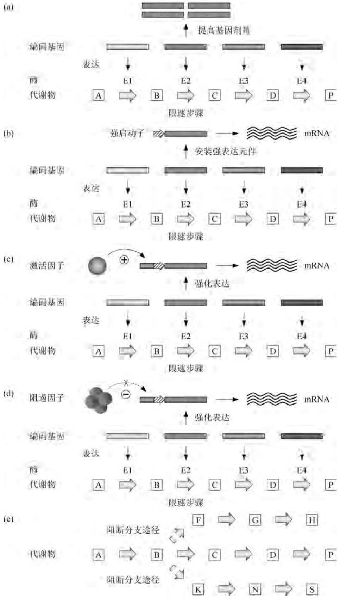

图10-4 提高现有途径代谢流的基本策略

---

第 10 章 第三代基因工程——途径工程

525

表 10-2 提高细胞现有生化物质产量的经典案例

| 生化物质 | 细胞类型 | 主要操作 |
| --- | --- | --- |
| CO2 | 酿酒酵母 | 引入果糖-1,6-二磷酸酶基因 |
| H2 | 大肠杆菌 | 引入弗氏柠檬酸杆菌的脱氢酶基因 |
| 乙酸 | 醋化醋杆菌 | 引入醋杆菌 Acetobacter polyoxogenes 的乙醛脱氢酶基因 |
| 乙醇 | 大肠杆菌 | 引入运动发酵单胞菌的丙酮酸脱羧酶基因 |
| 乙醇 | 菊欧文氏菌 | 引入运动发酵单胞菌的丙酮酸脱羧酶基因,但乙醇耐受性下降 |
| 乙醇 | 植生克雷伯氏菌 | 引入运动发酵单胞菌的丙酮酸脱羧酶基因 |
| 乙醇 | 大肠杆菌 | 引入运动发酵单胞菌的丙酮酸脱羧酶基因,乙醇脱氢酶基因大量表达 |
| 乙醇 | 大肠杆菌 | 引入运动发酵单胞菌的 pet 操纵子(含有丙酮酸脱羧酶和乙醇脱氢酶基因) |
| 乙醇 | 大肠杆菌 | 运动发酵单胞菌丙酮酸脱羧酶和乙醇脱氢酶基因整合至大肠杆菌染色体中 |
| 乙醇 | 产酸克雷伯氏菌 | 引入运动发酵单胞菌丙酮酸脱羧酶基因和乙醇脱氢酶基因 |
| 乙醇 | 植生克雷伯氏菌 | 引入运动发酵单胞菌丙酮酸脱羧酶基因和乙醇脱氢酶基因 |
| 丁醇、丙酮 | 丙酮丁醇羧酸 | 引入乙酰乙酸脱羧酶和磷酸转丁酰酶基因 |
| 泰乐菌素 | 弗氏链霉菌 | 引入大肠杆菌的 tylF 基因 |
| 头霉素C | 耐内酰胺链霉菌 | 引入卡特利链霉菌的基因 |
| 头霉素C | 顶头孢霉菌 | 引入 defEF 基因 |
| LL-E33288 | 棘孢小单胞菌 |  |
| 阿霉素 | 波赛链霉菌 | 增加基因拷贝数 |
| 螺旋霉素 | 产二素链霉菌 |  |
| 生物素 | 大肠杆菌 | 克隆五个生物素合成基因,解除了反馈抑制 |
| DAHP | 大肠杆菌 | 强化表达转酮醇酶和3-脱氧-D-阿拉伯庚酮糖酸-7-磷酸(DAHP)合成酶基因 |
| DHS | 大肠杆菌 | 表达转酮醇酶,DAHP,DHS(3-脱氢莽草酸)合成酶基因 |
| L-天冬氨酸 | 黏质沙雷氏菌 | 强化表达天冬氨酸酶基因 |
| L-苏氨酸 | 黏质沙雷氏菌 | 强化表达磷酸烯醇式丙酮酸羧化酶基因 |
| L-精氨酸 | 棒杆菌属,短杆菌属 | 克隆嗜乙酰乙酸棒杆菌的精氨酸生物合成基因 |
| L-谷氨酸、L-脯氨酸 | 棒杆菌属,短杆菌属 | 引入大肠杆菌的柠檬酸合成酶基因 |
| L-谷氨酸 | 棒杆菌属,短杆菌属 | 表达磷酸果糖激酶基因 |
| L-苯丙氨酸 | 大肠杆菌 | 引入 L-Phe 生物合成基因,解除分支酸变位酶反馈抑制 |
| L-苯丙氨酸 | 大肠杆菌 | 表达 pheA,aroF 基因,并接入噬菌体 λ 温度敏感型启动子 |
| L-苯丙氨酸、L-色氨酸 | 谷氨酸棒杆菌 | 强化表达预酚脱氢酶、分支酸变位酶、DAHP 合成酶 |
| 黄原胶 | 野油菜黄单胞菌 | 强化表达黄原胶合成基因 |
| 细菌纤维素 | 木醋杆菌 | 克隆表达纤维素生物合成操纵子 |
| S-D-乳酰谷胱甘肽 | 大肠杆菌 | 强化表达恶臭假单胞菌乙二醛酶I基因 |
| 谷胱甘肽及衍生物 | 大肠杆菌 | 强化表达谷胱甘肽合成酶基因 |
| S-腺苷甲硫氨酸 | 酿酒酵母,大肠杆菌 | 强化表达 S-腺苷甲硫氨酸(SAM)基因 |
| 类脂类 | 微藻类 |  |

---

526

基因工程

(a) 利用酶对前体库分子结构的宽容

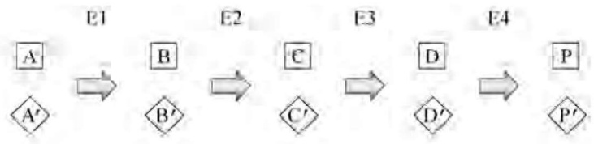

<details>
<summary>flowchart</summary>


</details>

(b) 在基因水平上修饰酶分子以扩展其底物识别范围

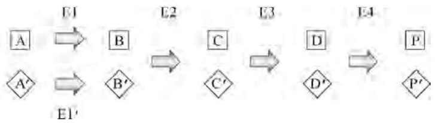

<details>
<summary>flowchart</summary>

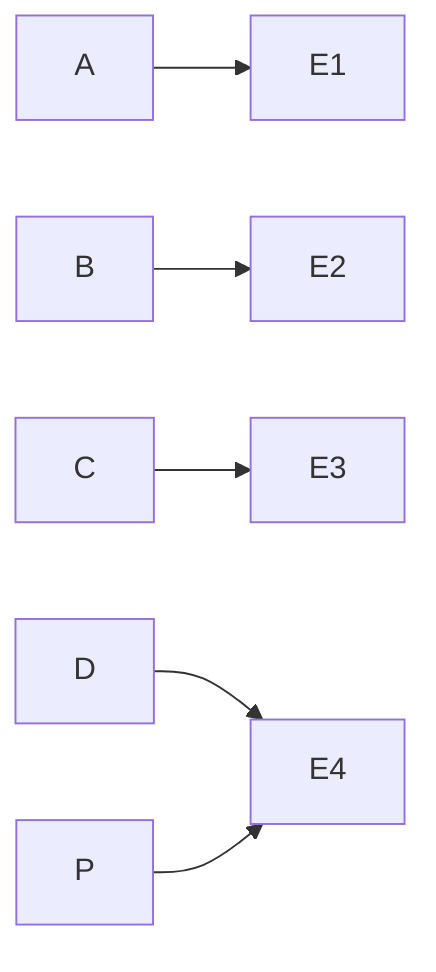
</details>

图10-5 改变途径代谢流性质的基本策略

表 10-3 扩展底物识别范围的应用案例

| 底物 | 细胞 | 操作 |
| --- | --- | --- |
| 乳糖 | 乳脂明串珠菌 | 引入了乳酸链球菌的乳糖发酵机制 |
| 乳糖 | 恶臭假单胞菌 | 大肠杆菌的lacYZ基因整合至染色体DNA中 |
| 乳清/乳糖 | 野油菜黄单胞菌 | 表达大肠杆菌lacYZ基因 |
| 乳糖/半乳糖 | 真氧产碱菌 | 引入了大肠杆菌的lac和gal操纵子 |
| 乳糖/甘露糖醇 | 运动发酵单胞菌 | 参看乙醇生产工艺中底物范围 |
| 乳清/乳糖 | 酿酒酵母 | 表达黑曲霉β-半乳糖苷酶基因 |
| 木聚糖 | 大肠杆菌,产酸克雷伯氏菌 | 引入热纤梭菌的木聚糖酶基因 |
| 纤维素二糖 | 产酸克雷伯氏菌 | 表达热纤梭菌葡糖酸酶基因 |
| 蔗糖 | 大肠杆菌K12 | 引入了大肠杆菌B-62的蔗糖利用系统 |

## 10.2.3 利用已有途径构建新的代谢旁路

在明确已有的生物合成途径、相关基因以及各步反应的分子机制后，通过相似途径的比较，利用多基因间的协同作用构建新的代谢途径是可能的。这种战略包括以下两方面的内容:

（1）修补完善细胞内部分途径以合成新的产物。自然界中存在的遗传和代谢多样性提供了一个具有广范围底物吸收谱和产物合成谱的生物群集合，然而许多天然的生物物种对实际应用而言并非最优，它们的性能有时可通过天然代谢途径的拓展而提高。借助于少数几个精心选择的异源基因的安装，天然的代谢物可转化为更为优良的最新型产物。这方面成功的例子总结在表10-4中。

表 10-4 生产细胞本身不能合成的新物质

| 生化物质 | 细胞类型 | 操作内容 |
| --- | --- | --- |
| 麦迪郝迪霉素 | 链霉菌属,紫红链霉菌 | 引入天蓝色链霉菌抗生素基因簇 |
| 红霉素 | 变铅青链霉菌 | 引入红色糖多孢菌的基因 |
| 修饰型红霉素 | 红色糖多孢菌 | 灭活eryF基因,产生6-脱氧红霉素A |
| 异戊酰螺旋霉素 | 产二素链霉菌 | 引入耐热链霉菌的基因 |

---

第 10 章 第三代基因工程——途径工程

527

续表

| 生化物质 | 细胞类型 | 操作内容 |
| --- | --- | --- |
| 青霉素V | 粗糙链孢霉,黑曲霉 | 引入产黄青霉的青霉素合成基因簇 |
| 螺旋霉素 | 产二素链霉菌 | 利用螺旋霉素生物合成基因的缺陷株 |
| 聚-β-羟丁酸(PHB) | 大肠杆菌 | 引入真氧产碱杆菌的PHB生物合成基因 |
| 多聚羟链烷酸(PHA) | 食油假单胞菌 | 引入真氧产碱杆菌的PHB生物合成基因 |
| 聚3-羟丁酸-3-羟戊酸 | 大肠杆菌 | 引入真氧产碱杆菌的PHB操纵子 |
| PHB | 拟南芥 | 引入真氧产碱杆菌乙酰乙酰CoA还原酶,PHB合成酶 |
| 修饰型黄原胶 | 野油菜黄单胞菌 | 突变株,修饰了黄原胶的单体五糖 |
| 黑色素 | 大肠杆菌 | 引入抗生链霉菌的酪氨酸酶基因 |
| 吲哚 | 大肠杆菌 | 引入恶臭假单胞菌的吲哚操纵子 |
| 吲哚 | 大肠杆菌 | 表达恶臭假单胞菌的甲苯双氧化酶基因 |
| 吲哚 | 大肠杆菌 | 表达恶臭假单胞菌的甲苯双氧化酶基因 |
| 吲哚 | 大肠杆菌 | 表达红球菌属的吲哚双氧化酶基因 |
| 2-酮基-L-葡糖酸 | 草生欧文氏菌 | 引入棒状杆菌ATCC 31090的2,5-DKG还原酶基因 |
| 2-酮基-L-古龙酸 | 柠檬欧文氏菌 | 引入棒状杆菌SHS 752001的2,5-DKG还原酶基因 |
| 3-羟基-2-丁酮 | 大肠杆菌 | 引入乳酸链球菌的α-乙酰乳酸脱羧酶基因 |
| L-色氨酸 | 棒杆菌属,短杆菌属 | 引入DAHP合成酶和分支酸变位酶 |
| 喹啉酸 | 大肠杆菌 | 引入nadA和nadB基因 |
| 1,3-丙二醇 | 大肠杆菌 | 表达肺炎克雷伯氏菌的1,3-丙三醇脱水酶 |
| 儿茶酚 | 大肠杆菌 | 表达转羟乙醛酶,DAHP合成酶和DHQ合成酶基因 |
| 木糖醇 | 酿酒酵母 | 引入树干毕赤酵母的木糖还原酶基因 |
| 辛酸 | 大肠杆菌 | 引入食油假单胞菌的alk基因 |
| 环糊精 | 马铃薯 | 引入肺炎克雷伯氏菌的环糊精转移酶基因 |
| 生物碱 | 颠茄,烟草,马铃薯 | 引入农杆菌的Ti和Ri质粒 |
| β-胡萝卜素 | 运动发酵单胞菌,根瘤农杆菌 | 引入噬夏孢欧文氏菌的crtB,crtI,crtY基因 |
| 二香叶醇焦磷酸 | 酿酒酵母 | 引入草生欧文氏菌的类胡萝卜生物合成基因 |
| 月桂酸 | 拟南芥 | 引入加州月桂的中等长度脂肪酸合成关键酶 |

（2）移植多个途径以构建杂合代谢网络。将编码某一完整生物合成途径的基因转移至受体细胞中，可构建具有很高经济价值的生产菌株。它们或者能提高目标产物的产率，或者允许使用相对廉价的原材料，而且这些实验结果对生物物种内特定多步代谢途径的调控和功能的诠释也是很有价值的。这种策略的应用在链霉菌的抗生素生物合成途径改良中具有天然的便利条件，因为这些功能相关的基因往往以基因簇的结构存在。例如，将来自天蓝色链霉菌（Streptomyces coelicolor）的部分放线菌紫素（Actinorhodin）生物合成基因转化美达霉素（Medermycin）生产菌，获得的转化子能合成一种新型杂合抗生素美达紫红素（Mederrhodin），其结构与美达霉素相似，但在6位上引入了一个羟基（图10-6）。

## 10.3 初级代谢的途径工程

生物体正常生理功能所必需的生化反应过程称为初级代谢，其同化途径(合成反应)和异化途径(分解反应)的产物直接支撑着生物的生长、发育和繁殖。除此之外，与上述反应序列紧密偶联的能量代谢途径、辅因子代谢途径、分子调控途径、信号转导途径也属于初级代谢研究的范畴。初级代谢的产物具有广泛的应用范围，途径工程在工业上获得实质性成功的大多数案例也集中在这个方面。由于细胞对初级代谢途径存在极大的依赖性，为这些途径编码的基因大多属于看家基因(House keeping)家族，因此阻断甚至仅仅衰减原有途径的代谢流便会严重干扰细胞正常的生理生化过程，直至产生致死效应。上述特征决定了初级

---

528

基因工程

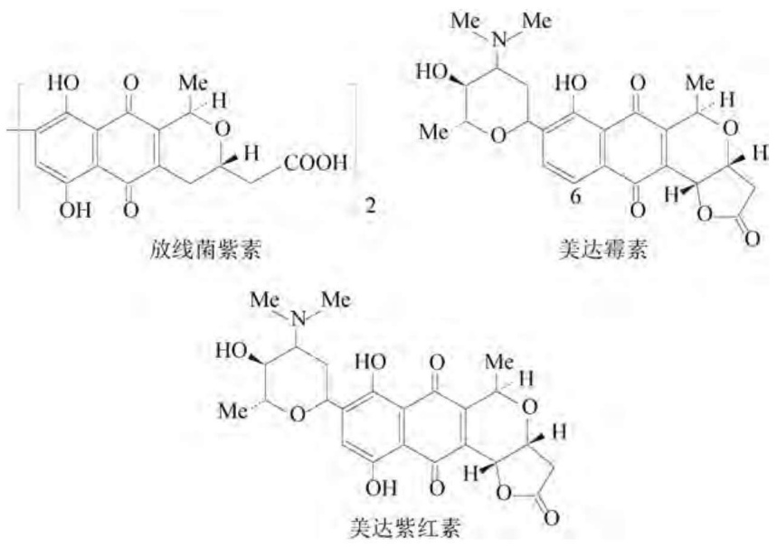

<details>
<summary>chemical</summary>

Three chemical structures of bacteria: flavonoid purple, ammonia, and redesulfuric acid, labeled with compound numbers.
</details>

图10-6 杂合抗生素美达紫红素的化学结构

代谢的途径工程往往采用代谢流扩增和底物谱拓展的所谓“加法战略”，尽量避免实施途径阻断和基因敲除的“减法战略”操作。

## 10.3.1 乙醇生产菌的途径操作

乙醇是一种重要的化工原料，广泛用作有机溶剂。作为一种生物能源，乙醇有望取代日益减少的化石燃料（如石油和煤炭），而且它燃烧污染较小，具有显著的环境友好性。更为重要的是，先进的乙醇生产工艺大都使用农业原料，这一过程有助于推动太阳光能的转化利用，同时间接促进大气中二氧化碳的去除与循环。然而，目前乙醇主要还是以石油为原料通过化学工艺生产，事实上这对于经济的可持续发展战略是不利的。因此，世界上多数经济发达国家都注重以碳水化合物为原料发酵生产乙醇的生物技术开发，并期望由此稳定能源供应、改善能源保障、拉动农业及其他相关传统经济的发展。

## 1. 发酵生产乙醇的基本策略

许多细菌、真菌、高等植物中都存在由丙酮酸生成乙醇的途径(图10-7)，它为厌氧条件下的糖酵解途径起着再生 $\mathrm{NAD^{+}}$ 的重要作用。其中，丙酮酸脱羧酶(PDC)催化丙酮酸的非氧化脱羧反应，形成二氧化碳和乙醛；后者在乙醇脱氢酶(ADH)的作用下转变为乙醇。由于丙酮酸在糖酵解途径中是个关键的节点，与草酰乙酸、乙酰辅酶A、乳酸等合成途径均有密切联系，因此通过强化表达细胞内PDC和ADH的活性来扩增目标途径，是构建高产乙醇基因工程菌的主要策略。

微生物菌种利用广谱碳源和能源能力的拓展是设计和改进发酵过程的一项基本内容，这对于那些底物成本在生产总成本中占有重大比例的大规模生产过程尤为重要。例如，乙醇生产的底物成本为 $60\% \sim 65\%$ ，赖氨酸为 $40\% \sim 45\%$ ，抗生素和工业用酶为 $25\% \sim 35\%$ 。由于大多数微生物共享种类齐全的公共代谢途径，因此底物范围的拓展操作通常只需引入有限的几种酶反应即可实现。然而在偶然情况下，这些所引入的步骤需要与下游反应相协调，这对途径工程的设计提出了很高的要求。

乙醇可以从许多可再生的原材料制得，包括含糖作物甘蔗、含淀粉谷物玉米以及木质纤维素类物质，如农业废料、草类和木材等。美国每年200万吨的乙醇燃料生产几乎全部由玉米制得，然而由葡萄糖单体构成的淀粉和蔗糖毕竟来自农作物的果实，以这两种原料生产乙

---

第 10 章 第三代基因工程——途径工程

529

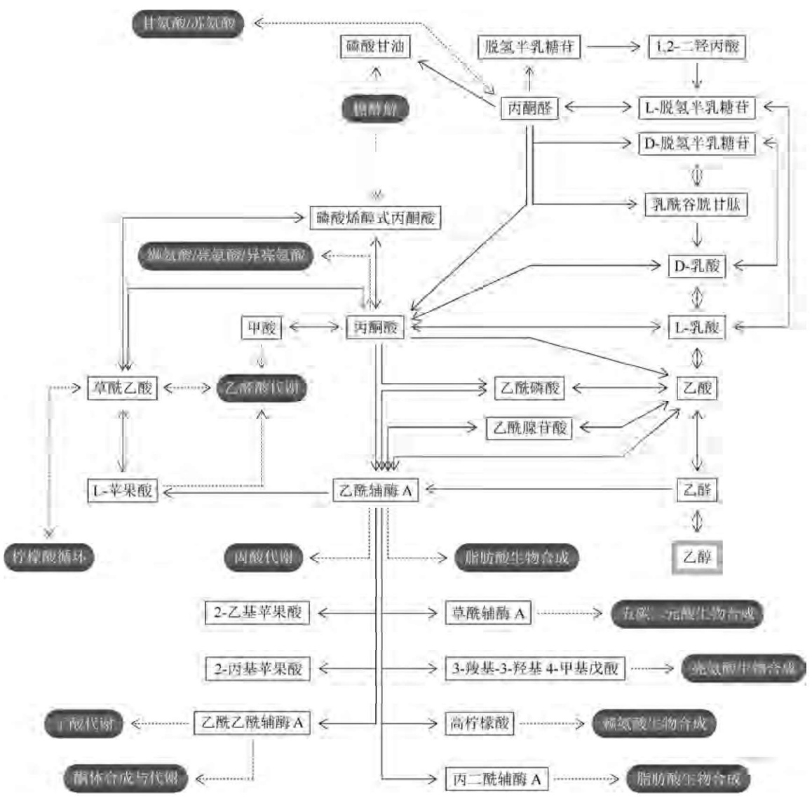

<details>
<summary>flowchart</summary>

```mermaid
graph TD
  A["甘氨酸/苏氨酸"] --> B["磷酸甘油"]
  C["&quot;磷酸"] --> D["脱氢半乳糖苷"]
  E["磷酸解"] -.-> F["丙酮醛"]
  G["L-脱氢半乳糖苷"] --> H["1,2-二羟丙酸"]
  I["D-脱氢半乳糖苷"] --> J["乳酰谷胱甘肽"]
  K["D-乳酸"] --> L["甲酸"]
  M["L-乳酸"] --> N["乙酰胺"]
  O["&quot;乙酰"] --> P["乙酰辅酶A"]
  Q["&quot;乙酰"] --> R["脂肪酸生物合成"]
  S["乙醇"] --> T["脂肪酸生物合成"]
  U["&quot;丙酸"] --> V["草酰乙酸"]
  W["&quot;乙酰"] --> X["乙酰酸代謝"]
  Y["甲酸"] --> Z["丙酮酸"]
  AA["甲酸"] --> AB["甲酸烯醇式丙酮酸"]
  AC["&quot;乙酰"] --> AD["乙酰磺酸"]
  AE["&quot;乙酰"] --> AF["乙酰腺苷酸"]
  AG["&quot;乙酰"] --> AH["&quot;乙酰"]"]
  AI["&quot;乙酰"] --> AJ["&quot;乙酰"]"]
  AK["&quot;乙酰"] --> AL["&quot;乙酰"]"]
  AM["&quot;乙酰"] --> AN["&quot;乙酰"]"]
  AO["&quot;乙酰"] --> AP["&quot;乙酰"]"]
  AQ["&quot;乙酰"] --> AR["&quot;乙酰"]"]
  AS["&quot;乙酰"] --> AT["&quot;乙酰"]"]
  AU["&quot;乙酰"] --> AV["&quot;乙酰"]"]
  AW["&quot;乙酰"] --> AX["&quot;乙酰"]"]
  AY["&quot;乙酰"] --> AZ["&quot;乙酰"]"]
  BA["&quot;乙酰"] --> BB["&quot;乙酰"]"]
  BC["&quot;乙酰"] --> BD["&quot;乙酰"]"]
  BE["&quot;乙酰"] --> BF["&quot;乙酰"]"]
  BG["&quot;乙酰"] --> BH["&quot;乙酰"]"]
  BI["&quot;乙酰"] --> BJ["&quot;乙酰"]"]
  BK["&quot;乙酰"] --> BL["&quot;乙酰"]"]
  BM["&quot;乙酰"] --> BN["&quot;乙酰"]"]
  BO["&quot;乙酰"] --> BP["&quot;乙酰"]"]
  BR["&quot;乙酰"] --> CA["&quot;乙酰"]"]
  CD["&quot;乙酰"] --> CE["&quot;乙酰"]"]
  CF["&quot;乙酰"] --> CG["&quot;乙酰"]"]
  CH["&quot;乙酰"] --> CI["&quot;乙酰"]"]
  CJ["&quot;乙酰"] --> CK["&quot;乙酰"]"]
  CL["&quot;乙酰"] --> CM["&quot;乙酰"]"]
  CN["&quot;乙酰"] --> CO["&quot;乙酰"]"]
  CP["&quot;乙酰"] --> QC["&quot;乙酰"]"]
  RD["&quot;乙酰"] --> SQC["&quot;乙酰"]"]
  RT["&quot;乙酰"] --> SU["&quot;乙酰"]"]
  TV["&quot;乙酰"] --> USC["&quot;乙酰"]"]
  UV["&quot;乙酰"] --> WV["&quot;乙酰"]"]
  XW["&quot;乙酰"] --> XYC["&quot;乙酰"]"]
  YU["&quot;乙酰"] --> YV["&quot;乙酰"]"]
  ZX["&quot;乙酰"] --> YR{""}
  YZ{""}
  AA{""}
  AB{""}
  AC{""}
  AD{""}
  AE{""}
  AF{""}
  AG{""}
  AH{""}
  AI{""}
  AJ{""}
  AK{""}
  AL{""}
  AM{""}
  AN{""}
  AO{""}
  AP{""}
  AQ{""}
  AR{""}
  AS{""}
  AT{""}
  AU{""}
  AV{""}
  AW{""}
  AX{""}
  AZ{""}
  
  B --> C
  C --> D
  D --> E
  E --> F
  F --> G
  G --> H
  H --> I
  I --> J
  J --> K
  K --> L
  L --> M
  M --> N
  N --> O
  O --> P
  P --> Q
  Q --> R
  R --> S
  S --> T
  T --> U
  U --> V
  V --> W
  W --> X
  X --> Y
  Y --> Z
  Z --> AA
  AA --> AB
  AB --> AC
  AC --> AD
  AD --> AE
  AE --> AF
  AF --> AG
  AG --> AH
  AH --> AI
  AI --> AJ
  AJ --> AK
  AK --> AL
  AL --> AM
  AM --> AN
  AN --> AO
  AO --> AP
  AP --> AQ
  AQ --> AR
  AR --> AS
  AS --> AT
  AT --> AU
  AU --> AV
  AV --> AW
  AW --> AX
  AX --> AZ
  AZ --> BB
  BB --> CC
  CC --> DD
  DD --> EE
  EE --> FF
  FF --> GG
  GG --> HH
  HH --> IJ
  IJ --> JJ
  JJ --> LL
  LL --> MM
  MM --> NN
  NN --> OO
  OO --> PP
  PP --> QM
  QM --> RR
  RR --> SS
  SS --> TT
  TT --> UQ
  UQ --> UR
  UR --> SV
  SV --> TW
  TW --> XU
  XU --> YV
  YV --> ZV
  ZV --> AAV
  AAV --> ABV
  ABV --> ACV
  ACV --> ADV
  ADV --> AEV
  AEV --> AFV
  AFV --> AGV
  AGV --> AHV
  AHV --> AIV
  AIV --> AJV
  AJV --> AKV
  AKV --> ALV
  ALV --> AMV
  AMV --> ANV
  ANV --> AOV
  AOV --> APV
  APV --> AQV
  AQV --> ARV
  ARV --> ASV
  ASV --> ATV
  ATV --> AUV
  AUV --> AVV
  AVV --> AWV
  AWV --> AXV
  AXV --> AYV
  AYV --> AYX
  AYX --> AYYX["(&quot;Glycine: Glycine & Glucose)&quot;)"]
  
  subgraph Metabolites [Metabolites]
    B --- C --- D --- E --- F --- G --- H --- I --- J --- K --- L --- M --- N --- O --- P --- Q --- R --- S --- T --- U --- V --- W --- X --- Y --- Z --- AA --- AB --- AC --- AD --- AE --- AF --- AG --- AH --- AI --- AJ --- AK --- AK' --- AL --- AM --- AN --- AO --- AP --- AQ --- AR : AY : AYX : AYY : AYZ : AYX : AYY : AYZ : AYX : AYY : AYZ : AYX : AYY : AYZ : AYX : AYY : AYZ : AYX : AYY : AYZ : AYX : AYY : AYZ : AYX : AYY : AYZ : AYX : AYY : AYZ : AYXX : AYX : AYY : AYZ : AYXX : AYY : AYZX : AYXX : AYYZ : AYXX : AYYZ : AYXX : AYXX : AYXX : AYXX : AYXX : AYXX : AYXX : AYXX : AYXX : AYXX : AYXX : AYXX : AYXX : AYXX : AYXX : AYXX : AYXX : AYXX : AYXX : AYXX : AYXX : AYXX : AYXX : AYXX : AYXX : AYXY : AYXX : AYXY : AYXY : AYXY : AYXY : AYXY : AYXY : AYXY : AYXY : AYXY : AYXY : AYXY : AYXY : AYXY : AYXY : AYXY : AYXY : AYXY : AYXY : AYXY : AYXY : AYXY : AYXY : AYXY : AYXY : AYXY : AYXX : AYE : AGX : AGXX : AGXXX : AGXXX : AGXXXX : AGXXXXX : AGXXXXXX : AGXXXXXXXXXXXXXXXXXXXXIX: AGXXIXXIXIXIXIXIXIXIXIXIXIXIXIXIXIXIXIXIXIXIXIXIXIXIXIXIXIXIXIXIXIXIXIXIXIXIXIXIXIXIXIXIXIXIXIXIXIXIXIXIXIXIXIXIXIXIXIXIXIXIXIXIXIXIXIXIXIXIXIXIXIXIXIXIXIXIXIXIXIXIXIXIXIXIXIXIXIXIXIXIXIXIXIXIXIXIXIXIXIXIXIXINEXRX: AGXINEXRXINEXRXINEXRXINEXRXINEXRXINEXRXINEXRXINEXRXINEXRXINEXRXINEXRXINEXRXINEXRXINEXRXINEXRXINEXRXINEXRXINEXRXINEXRXINEXRXINEXRXINEXRXINEXRXINEXRXINEXRXINEXRXINEXRXINEXRXINEXRXINEXRXINEXRXINEXRXINEXRXINEXRX INEXRXINEXRXINEXRXINEXRXINEXRXINEXRXINEXRXINEXRXINEXRXINEXRXINEXRXINEXRXINEXRXINEXRXINEXRXINEXRXINEXRXINEXRXINEXRXINEXRXINEXRXINEXRXINEXRXINEXRXINEXRXINEXRXINEXRXINEXRXINEXRXINEXRXINEXRXINEXRXINEXRXINENAXINAXINAXINAXINAXINAXINAXINAXINAXINAXINAXINAXINAXINAXINAXINAXINAXINAXINAXINAXINAXINAXINAXINAXINAXINAXINAXINAXINAXINAXINAXINAXINAXINAXINAXINAXINAXINAXINAXINAXINAXINAXINAXINAXINAXINAXINAXINAXINAXINAXINAXI: AGX: AGXENAX: AGXENAX: AGXENAX: AGXENAX: AGXENAX: AGXENAX: AGXENAX: AGXENAX: AGXENAX: AGXENAX: AGXENAX: AGXENAX: AGXENAX: AGXENAX: AGXENAX: AGXENAX: AGXENAX: AGXENAX: AGXENAX: AGXENAX: AGXENMAX: AGXL: AGXL: AGXL: AGXL: AGXL: AGXL: AGXL: AGXL: AGXL: AGXL: AGXL: AGXL: AGXL: AGXL: AGXL: AGXL: AGXL: AGXL: AGXL: AGXL: AGXL: AGXL: AGXL: AGXL: AGXL: AGXL: AGXL: AGXL: AGXL: AGXL: AGXL: AGXL: AGXL: AGXL; AGXL: AGXL: AGXL: AGXL: AGXL: AGXL: AGXL: AGXL: AGXL: AGXL: AGXL: AGXL: AGXL: AGXL: AGXL: AGXL: AGXL: AGXL: AGXL: AGXL: AGXL: AGXL: AGXL: AGXL: AGXL: AGXL: AGXL: AGXL: AGXL: AGXL: AGXL: AGXL: AGXL: ABTXNEXBXNEXBXNEXBXNEXBXNEXBXNEXBXNEXBXNEXBXNEXBXNEXBXNEXBXNEXBXNEXBXNEXBXNEXBXNEXBXNEXBXNEXBXNEXBXNEXBXNEXBXNEXBXNEXBXNEXBXNEXBXNEXBXNEXBXNEXBXNEXBXNEXBXNEXBXNEXBXNEXBXNEXBXNXNEXBXNXNEXBXNXNEXBXNXNEXBXNXNEXBXNXNEXBXNXNEXBXNXNEXBXNXNEXBXNXNXNEXBXNXNXNXNXNXNXNXNXNXNXNXNXNXNXNXNXNXNXNXNXNXNXNXNXNXNXNXNXNXNXNXNXNXNXNXNXNXNXNXNXNXNXNXNXNXNXNXNXNXNXNXNXNXNXNXNXNXNXNXNXNXNXNXNXNXNXNXNXNXNXNXNXNXNXNXNXNXNXNXNXNXNXNXNXNXNXNXNXNXNXNXNXNXNXNXNXNXNXNXNXNxMXNMXNMXNMXNMXNMXNMXNMXNMXNMXNMXNMXNMXNMXNMXNMXNMXNMXNMXNMXNMXNMXNMXNMXNMXNMXNMXNMXNMXNMXNMXNMXNMXNMXNMXNMXNMXNMXNMXNMXNMXNMXNMXNMXNMXNMXNMXNMXNMXNMXNMXNxMXxMXxMXxMXxMXxMXxMXxMXxMXxMXxMXxMXxMXxMXxMXxMXxMXxMXxMXxMXxMXxMXxMXxMXxMXxMXxMXxMXxMXxMXxMXxMXxMXxMXxMXxMXxMXxMXxMXxMXxMXxMXxMXxMXxMXxMXxMXxMXxMXxMXxMXnMXnMXnMXnMXnMXnMXnMXnMXnMXnMXnMXnMXnMXnMXnMXnMXnMXnMXnMXnMXnMXnMXnMXnMXnMXnMXnMXnMXnMXnMXnMXnMXnMXnMXnMXnMXnMXnMXnMAXnMAXnMAXnMAXnMAXnMAXnMAXnMAXnMAXnMAXnMAXnMAXnMAXnMAXnMAXnMAXnMAXnMAXnMAXnMAXnMAXnMAXnMAXnMAXnMAXnMAXnMAXnMAXnMAXnMAXnMAXnMAXnMAXnMAXnMAXnMAXnMAXnMAXnMAXnMAXnMAXnMAXnMAXnMAXnMAXnMAXnMAXnMAXnMAXnMAXnMAkNAkNAkNAkNAkNAkNAkNAkNAkNAkNAkNAkNAkNAkNAkNAkNAkNAkNAkNAkNAkNAkNAkNAkNAkNAkNAkNAkNAkNAkNAkNAkNAkNAkNAkNAkNAkNAkNAkNAkNAkNAkNAkNAkNAkNAkNAkNAkNAkNAkNAkNaKNaKNaKNaKNaKNaKNaKNaKNaKNaKNaKNaKNaKNaKNaKNaKNaKNaKNaKNaKNaKNaKNaKNaKNaKNaKNaKNaKNaKNaKNaKNaKNaKNaKNaKNaKNaKNaKNaKNaKNaKNaKNaKNaKNaKNaKNaKNaKNaKNaKNaKaKNaKNaKNaKNaKNaKNaKNaKNaKNaKNaKNaKNaKNaKNaKNaKNaKNaKNaKNaKNaKNaKNaKNaKNaKNaKNaKNaKNaKNaKNaKNaKNaKNaKNaKNaKNaKNaKNaKNaKNaKNaKNaKNaKNaKNaKNaKNaKNaKNaK NaKNaKNaKNaKNaKNaKNaKNaKNaKNaKNaKNaKNaKNaKNaKNaKNaKNaKNaKNaKNaKNaKNaKNaKNaKNaKNaKNaKNaKNaKNaKNaKNaKNaKNaKNaKNaKNaKNaKNaKNaKNaKNaKNaKNaKNaKNaKNaKNaKNaKnaKaKaKaKaKaKaKaKaKaKaKaKaKaKaKaKaKaKaKaKaKaKaKaKaKaKaKaKaKaKaKaKaKaKaKaKaKaKaKaKaKaKaKaKaKaKaKaKaKaKaKaKaKaKaKaKaKaKaKaKaKaKaKaKaKaKaKaKaKaKaKaKaKaKaKaKaKaKaKaKaKaKaKaKaKaKaKaKaKaKaKaKaKaKaKaKaKaKaKaKa KaKaKaKaKaKaKaKaKaKaKaKaKaKaKaKaKaKaKaKaKaKaKaKaKaKaKaKaKaKaKaKaKaKaKaKaKaKaKaKaKaKaKaKaKaKaKaKaKaKaKaKaKaKaKaKaKaKaKaKaKaKaKaKaKaKaKaKaKaKaKaKaKa Ka Ka Ka Ka Ka Ka Ka Ka Ka Ka Ka Ka Ka Ka Ka Ka Ka Ka Ka Ka Ka Ka Ka Ka Ka Ka Ka Ka Ka Ka Ka Ka Ka Ka Ka Ka Ka Ka Ka Ka Ka Ka Ka Ka Ka Ka Ka Ka Ka Ka Ka Ka Ka Ka Ka Ka Ka Ka Ka Ka Ka Ka Ka Ka Ka Ka Ka Ka Ka Ka Ka Ka Ka Ka Ka Ka Ka Ka Ka Ka Ka Ka Ka Ka Ka Ka Ka Ka Ka Ka Ka Ka Ka Ka Ka Ka Ka Ka Ka Ka Ba K NaBa K NaBa K NaBa K NaBa K NaBa K NaBa K NaBa K NaBa K NaBa K NaBa K NaBa K NaBa K NaBa K NaBa K NaBa K NaBa K NaBa K NaBa K NaBa K NaBa K NaBa K NaBa K NaBa K NaBa K NaBa K NaBa K NaBa K NaBa K NaBa K NaBa K NaBa K NaBa K NaBa K NaBa KuBbBbBbBbBbBbBbBbBbBbBbBbBbBbBbBbBbBbBbBbBbBbBbBbBbBbBbBbBbBbBbBbBbBbBbBbBbBbBbBbBbBbBbBbBbBbBbBbBbBbBabEhEhEhEhEhEhEhEhEhEhEhEhEhEhEhEhEhEhEhEhEhEhEhEhEhEhEhEhEhEhEhEhEhEhEhEhEhEhEhEhEhEhEhEhEhEhEhEhEhEhEheEhEhEhEhEhEhEhEhEhEhEhEhEhEhEhEhEhEhEhEhEhEhEhEhEhEhEhEhEhEhEhEhEhEhEhEhEhEhEhEhEhEhEhEhEhEhEhEhEhEehEAHEAHEAHEAHEAHEAHEAHEAHEAHEAHEAHEAHEAHEAHEAHEAHEAHEAHEAHEAHEAHEAHEAHEAHEAHEAHEAHEAHEAHEAHEAHEAHEAHEAHEAHEAHEAHEAHEAHEAHEAHEAHEAHEAHEAHEAHEAHEAHEAHEAHEAHAHEAHAHEAHAHEAHAHEAHAHEAHAHEAHAHEAHAHEAHAHEAHAHEAHAHEAHAHEAHAHEAHAHEAHAHEAHAHEAHAHEAHAHEAHAHEAHAHEAHAHEAHAHEAHAHEAHAHEAHAHEAHAHEAHAHEAHAHEAHAHEAHAHEAHAHEAHAHEAHAHEAHAHEAHaHEAHAHEAHAHEAHAHEAHAHEAHAHEAHAHEAHAHEAHAHEAHAHEAHAHEAHAHEAHAHEAHAHEAHAHEAHAHEAHAHEAHAHEAHAHEAHAHEAHAHEAHAHEAHAHEAHAHEAHAHEAHAHEAHAHEAHAHEAHAHEAHAHEAHAHEAHAHEAHAHEAHAHeAHeAHeAHeAHeAHeAHeAHeAHeAHeAHeAHeAHeAHeAHeAHeAHeAHeAHeAHeAHeAHeAHeAHeAHeAHeAHeAHeAHeAHeAHeAHeAHeAHeAHeAHeAHeAHeAHeAHeAHeAAHeAAHeAAHeAAHeAAHeAAHeAAHeAAHeAAHeAAHeAAHeAAHeAAHeAAHeAAHeAAHeAAHeAAHeAAHeAAHeAAHeAAHeAAHeAAHeAAHeAAHeAAHeAAHeAAHeAAHeAAHeAAHeAAHeAAHeAAHeAAHeAAHeAAHeAAHeAAHeAAHeAAHeAAHeAAHeAAHeAAHeAAHeAAHeAAHeAAHeAUHeAUHeAUHeAUHeAUHeAUHeAUHeAUHeAUHeAUHeAUHeAUHeAUHeAUHeAUHeAUHeAUHeAUHeAUHeAUHeAUHeAUHeAUHeAUHeAUHeAUHeAUHeAUHeAUHeAUHeAUHeAUHeAUHeAUHeAUHeAUHeAUHeAUHeAUHeAUHeAUHeAUHeAUHeAUHeAUHeAUHeAUHeAUHeAUHeAUHeALIneAgAsAgAsAgAsAgAsAgAsAgAsAgAsAgAsAgAsAgAsAgAsAgAsAgAsAgAsAgAsAgAsAgAsAgAsAgAsAgAsAgAsAgAsAgAsAgAsAgAsAgAsAgAsAgAsAgAsAgAsAgAsAgAsAgAsAgAsAgAsAgAsAgAsAgAsAgAsAgAsAgAsAgAsAgAsAgAsAgAsAgAsAgAsAgAsAgAsAgAsAgSAGAsAGAsAGAsAGAsAGAsAGAsAGAsAGAsAGAsAGAsAGAsAGAsAGAsAGAsAGAsAGAsAGAsAGAsAGAsAGAsAGAsAGAsAGAsAGAsAGAsAGAsAGAsAGAsAGAsAGAsAGAsAGAsAGAsAGAsAGAsAGAsAGAsAGAsAGAsAGAsAGAsAGAsAGAsAGAsAGAsAGAsAGAsAGAsAGAsAGAsAGsAGAsAGAsAGAsAGAsAGAsAGAsAGAsAGAsAGAsAGAsAGAsAGAsAGAsAGAsAGAsAG Asag Asag Asag Asag Asag Asag Asag Asag Asag Asag Asag Asag Asag Asag Asag Asag Asag Asag Asag Asag Asag Asag Asag Asag Asag Asag Asag Asag Asag Asag Asag Asag Asag Asag Asag Asag Asag Asag Asag Asag Asag Asag Asag Asag Asag Asag Asag Asag Asag Asag Asug Asug Asug Asug Asug Asug Asug Asug Asug Asug Asug Asug Asug Asug Asug Asug Asug Asug Asug Asug Asug Asug Asug Asug Asug Asug Asug Asug Asug Asug Asug Asug Asug Asug Asug Asug Asug Asug Asug Asug Asug Asug Asug Asug Asug Asug Asug Asug Asug Asug Asu<nl>
```
</details>

图10-7 以丙酮酸为中心的乙醇发酵途径

醇不但成本较高，而且对农产品的综合利用也没有直接的贡献。另外，木质纤维素类物质的来源却极其丰富且廉价，可由生长期较短的木材、农业和林业的废料（如作物秸秆和树枝树叶）以及各类废弃物（如腐烂物、废纸和市政固体垃圾）获得。因此，利用木质纤维素类物质生产乙醇燃料具有重大的经济价值和社会意义。

所有植物来源的木质纤维素类物质均含有丰富的纤维素、半纤维素、木质素，不同的植物三者的相对含量有所差异。在农作物的秸秆或甘蔗渣中，上述三种组分的含量分别为30%\~40%、20%\~30%、5%\~10%，其中前两种成分可作为乙醇发酵的原料（图10-8）。纤维素是一种由100\~10000个β-D-吡喃型葡萄糖单体以β-1,4-糖苷键连接的直链多糖，多个分子平行紧密排列形成丝状不溶性微小纤维。在工业上，纤维素经酸解或酶解预处理后，释放出的葡萄糖可进入乙醇发酵途径。半纤维素是由多种多糖分子组成的支链聚合物，不同来源的半纤维素其单糖的组成各异。在硬木和谷物废料中的半纤维素中，其主要成分为多聚木糖，由D-木糖以β-1,4-糖苷键聚合而成，其支链单体上还含有L-乙酰阿拉伯糖苷和糖醛等修饰基团。在软木的半纤维素中，甘露糖则最为丰富。经测算，木质纤维素类

---

530

基因工程

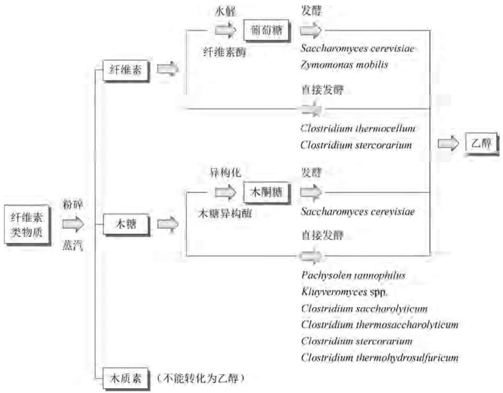

<details>
<summary>flowchart</summary>

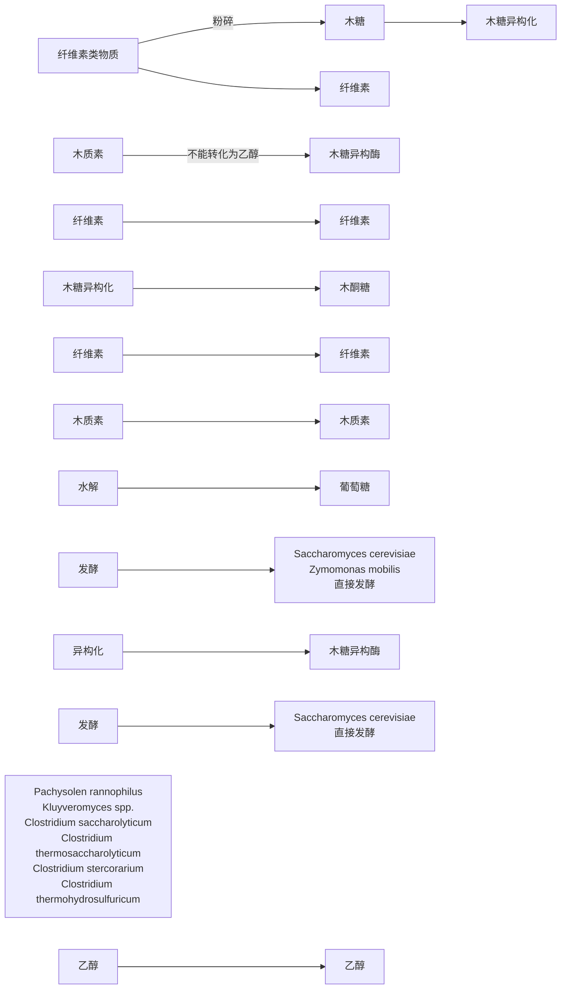
</details>

图10-8 由农业原材料发酵生产乙醇的工艺路线

原料中半纤维素组分的有效利用有可能使乙醇燃料的生产成本降低 $25\%$ ，这显然应当归功于D-木糖。木糖是自然界中含量仅次于葡萄糖的糖分，仅仅从美国垃圾场的废纸和垃圾中通过微生物转化产生的残留糖分每年就可提供4亿吨乙醇，这相当于在输气管线中以 $10\%$ 分量混合的燃料乙醇(由谷物发酵生产)的10倍量。

## 2. 酵母属乙醇发酵途径的改良

发酵生产乙醇的微生物最好能利用所有存在的单糖，此外还必须抵抗原料水解物中存在的任何潜在抑制剂。最常见的乙醇发酵微生物酿酒酵母以及发酵单胞菌属(Zymomonas)能从葡萄糖生产较高浓度的乙醇，但它们不能发酵纤维素和木糖，而后者在原料中的含量高达8%\~28%。因此，利用这两类微生物由纤维素类物质生产乙醇，必须首先将之进行液化和糖化预处理。

能发酵木糖的微生物包括细菌、酵母和真菌，其中酵母中的柄状毕赤酵母（Pichia stipitis）是自然界中利用木糖最有潜力的种属。遗憾的是，这种酵母的乙醇生产能力很低，而且与发酵葡萄糖的酿酒酵母相比，对乙醇的耐受性也不理想。柄状毕赤酵母对木糖的代谢分别依赖于木糖还原酶XR（将木糖转化为木糖醇）、木糖醇脱氢酶XDH（将木糖醇转化为木酮糖）、木酮糖激酶XK（将木酮糖转化为5-磷酸木酮糖），5-磷酸木酮糖再经3-磷酸甘油醛进入糖酵解途径(图10-9)。上述三种酶的表达均为木糖所诱导，同时为葡萄糖所阻遏。酵母属(Saccharomyces)的各种虽不能发酵木糖，但能利用木酮糖，而且如果培养基中存在细菌来源的木糖异构酶(将木糖直接转化为木酮糖)，它们也能发酵木糖，只是所含的木酮糖激酶活性很低而已。

---

第 10 章 第三代基因工程——途径工程

531

在大多数酵母和真菌中，XR 和 XDH 的活性分别依赖于 NADPH 和 NADH，然而柄状毕赤酵母的 XR 却具有双辅助因子的特异性。这种类型的酶具有防止细胞内 NAD/NADH 还原系统不平衡现象发生的优势，尤其是在氧限制的条件下，这一特性非常重要。人工构建的一组高拷贝的酵母菌-大肠杆菌穿梭重组质粒 pLNH，能将部分葡萄糖发酵的酵母属物种转化为木糖利用者。这些重组质粒含有  $2\mu$  复制子、来自柄状毕赤酵母的 XR、XDH 编码基因 XR、XD 以及来自酿酒酵母的 XK 编码基因 XK，它们受控于酿酒酵母糖酵解基因的 5' 端调控区，组成重组操纵子 XYL（图 10-10）。将上述重组质粒转化酵母属 sp.1400 株，获得的转化子能同时有效地将木糖和葡萄糖转化为乙醇，而且这些克隆的木糖代谢基因的表达不再需要木糖诱导，也不为葡萄糖所阻遏。

利用途径工程技术改良酵母属乙醇发酵过程的内容还包括提高酿酒酵母对木质纤维素水解物中酚抑制剂的抗性。在一项研究中，将来自白色腐烂真菌（Trametes versicolor）的漆酶(Laccase)编码基因置在PGK1启动子的控制下，并转化酿酒酵母。结果表明，漆酶的过量表达能赋予克隆菌对木质纤维素水解物

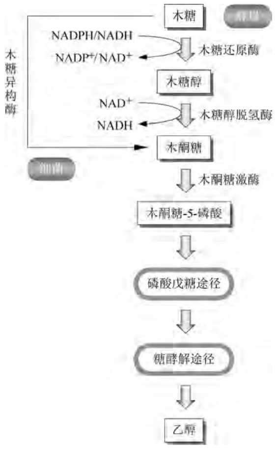

<details>
<summary>flowchart</summary>

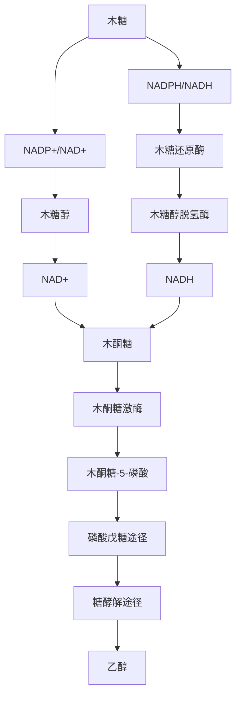
</details>

图10-9 酵母种属中的木糖代谢途径

中酚抑制剂的高耐受性，从而改善酿酒酵母由可再生原材料生产乙醇的产量。

## 3. 高产乙醇型重组大肠杆菌的构建

在非乙醇生产者的肠道细菌中引入乙醇生物合成基因，构建定向高产乙醇工程菌的部分成功是在菊欧文氏菌(Erwinia chrysanthemi)、植生克雷伯氏菌(Klebsiella planticola)和大肠杆菌中实现的。选择大肠杆菌作为途径操作对象的依据很明显:它生长迅速，大规模发酵工艺简单，遗传背景清楚，基因操作便捷，尤为重要的是能利用广范围的碳源底物（包括戊糖）。第一代的重组菌构建仅仅强化了丙酮酸脱羧酶(PDC)催化的反应，同时依赖于内源性的ADH途径偶联乙醛还原反应和NADH氧化反应。由于乙醇只是上述肠道细菌众多发酵产物中的一种，因此ADH活性的缺陷以及NADH的积累会形成各种副产物，乙醇定向发酵的目标并未达到。

1987年，世界上第一株高产乙醇的大肠杆菌基因工程菌问世。将来自移动发酵单胞菌的丙酮酸脱羧酶编码基因 $pdc$ 和乙醇脱氢酶编码基因 $adh$ 构成 $pet$ 人工操纵子，插入pUC载体形成重组质粒pLOI295，并转化大肠杆菌。该重组质粒以葡萄糖为原料在氨苄青霉素的存在下发酵能产生 $34\mathrm{g / L}$ 的乙醇。1991年，美国佛罗里达州立大学的食品和农业科学学院构建了一株品质优良的大肠杆菌(KO11)而获得美国专利号5000000。这种重组大肠杆菌的染色体中整合有移动发酵单胞菌的 $pdc$ 和 $adhB$ 基因，从含有 $10\%$ 葡萄糖和 $8\%$ 木糖的每升发酵培养基中可分别获得 $54.4\mathrm{g}$ 和 $41.6\mathrm{g}$ 乙醇，这已经接近于每克葡萄糖生成 $0.5\mathrm{g}$ 乙醇的理论产量。更为可贵的是，这种产乙醇的重组大肠杆菌还能发酵除葡萄糖和木糖外所有

---

532

基因工程

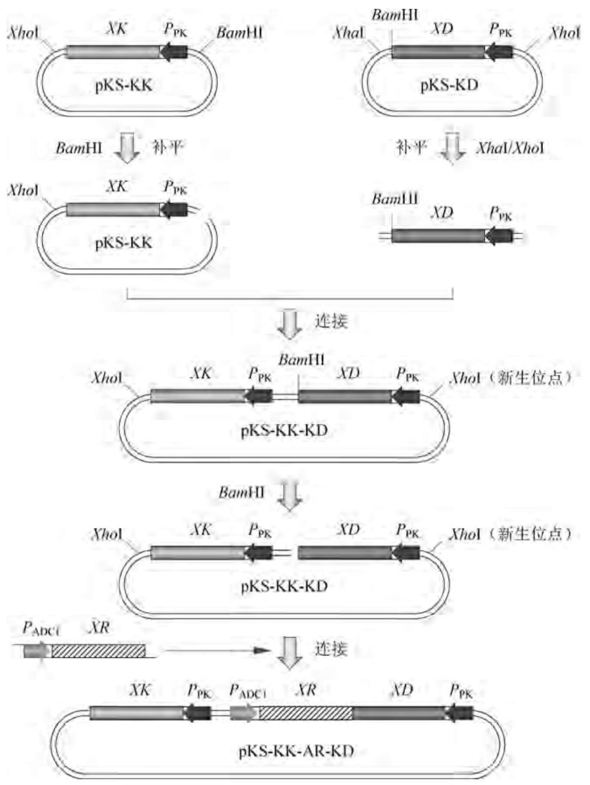

图10-10 酿酒酵母木糖利用重组操纵子的构建

木质纤维素类物质的其他糖组分，如甘露糖、阿拉伯糖、半乳糖等。当重组细菌生长在半纤维素水解液的混合糖培养基中时，葡萄糖首先被利用，接下来的是阿拉伯糖和木糖，并且均产生接近最大理论产量的乙醇。

尽管如此，各项优化大肠杆菌 KO11 工程株的研究工作仍在继续进行，其中包括改善 pet 重组操纵子的遗传稳定性以及进一步拓展工程菌发酵底物的范围等内容。以重组质粒形式携带 pet 操纵子的大肠杆菌 B 株（pLOI297）和在染色体中整合了 pet 操纵子的 KO11 株均需要在发酵培养基中添加相应的抗生素，以维持重组基因的遗传稳定性以及乙醇的最终发酵水平。将 pet 人工操纵子与氯霉素抗性基因一同整合在大肠杆菌的染色体中，整合子在氯霉素不存在的情况下显示出较高的稳定性，但由于 pet 操纵子的拷贝数较少，乙醇产量极低。为了克服这一困难，新的改进思路是选用大肠杆菌的条件致死突变株 FMJ39 作为受体细胞。FMJ39 株携带乳酸脱氢酶基因 ldh 和丙酮酸-甲酸裂合酶基因 pfl 的双重突变，因而只能进行好氧生长，原因在于它不能通过将丙酮酸还原为乳酸而再生 NAD $^{+}$ 。而 pet

---

第 10 章 第三代基因工程——途径工程

533

操纵子能互补这种突变，因为 pdc 和 adh 基因的表达能将丙酮酸转化为乙醇，同时再生  $NAD^{+}$ 。用含有 pet 操纵子的质粒 pLOI295 和 pLOI297 分别转化大肠杆菌 FMJ39，得到 FBR1 和 FBR2 株。这两株菌都能进行厌氧生长，并在培养 60 代后无明显的质粒损失，但在好氧发酵时质粒迅速丢失。在高密度间歇发酵过程中，由 10% 的葡萄糖可分别产生每升 38 g (FBR1) 和 44 g (FBR2) 的乙醇，这种遗传稳定性具有较高的应用价值。

重组大肠杆菌 KO11 株能从含有戊糖和己糖的半纤维素酸水解物中生产乙醇，但不能利用纤维二糖，因而难以直接发酵纤维素。产酸克雷伯氏菌（Klebsiella oxytoca）含有天然的磷酸烯醇依赖型磷酸转移酶（PTS）基因，赋予该菌株有效利用纤维二糖的特性。基于上述分析，将产酸克雷伯氏菌编码纤维二糖 II 型酶和磷酸- $\beta$ -葡糖苷酶的 casAB 操纵子引入大肠杆菌 KO11 株中，其重组克隆中的一株自发突变株表现出高效利用纤维二糖的优良特性，同时能直接发酵纤维素生产乙醇。

在重组大肠杆菌中，PDC和ADH活性的高效表达是将碳源代谢物由丙酮酸代谢途径转向高水平乙醇合成途径的关键操作。高水平的PDC酶量以及该酶对丙酮酸较低的表观$K_{\mathrm{m}}$ 值相结合，是将碳源代谢流转到乙醇的有力保证。含有pet操纵子的重组大肠杆菌在好氧和厌氧条件下能产生大量的乙醇。在好氧条件下，野生型的大肠杆菌通过PDH和PEL$(K_{\mathrm{m}}$ 值分别为 $0.4\mathrm{mmol / L}$ 和 $2.0\mathrm{mmol / L})$ 代谢丙酮酸，主要形成二氧化碳和乙酸，后者由过量的乙酰辅酶A转化而来。移动发酵单胞菌PDC的表观 $K_{\mathrm{m}}$ 值与PDH相似，但低于PFL和LDH，因而有利于乙醛合成。另外， $\mathrm{NAD^{+}}$ 的再生主要来源于和电子呼吸链相偶联的NADH氧化酶。由于移动发酵单胞菌ADH II的表观 $K_{\mathrm{m}}$ 值比大肠杆菌的NADH氧化酶低4倍，所以外源的ADH II能与内源性的NADH池有效竞争，使得乙醛还原为乙醇。在厌氧条件下，野生型的大肠杆菌首先通过LDH和PEL（ $K_{\mathrm{m}}$ 值分别为 $7.2\mathrm{mmol / L}$ 和$2.0\mathrm{mmol / L})$ 代谢丙酮酸，表10-5列出的数据显示，这两个酶的表观 $K_{\mathrm{m}}$ 值分别为移动发酵单胞菌PDC的18倍和5倍。而且，与 $\mathrm{NAD^{+}}$ 再生有关的初级代谢天然酶的表观 $K_{\mathrm{m}}$ 值在大肠杆菌中也明显高于移动发酵单胞菌的ADH。因此，移动发酵单胞菌的乙醇合成酶系在大肠杆菌中过量表达，完全可以与受体菌固有的丙酮酸碳代谢途径和NADH还原过程的天然酶系进行竞争。上述分析表明，对于初级代谢的途径工程操作而言，必须注意新引入的代谢途径与受体细胞内原有的相关途径之间同样存在着代谢流的分布。如果前者不能占据绝对优势，途径操作就会事倍功半，这是途径工程实施“加法战略”首先应考虑的问题。

表 10-5 大肠杆菌和运动发酵单胞菌丙酮酸作用酶系的 ${\mathrm{K}}_{\mathrm{m}}$ 值比较

<table><tr><td rowspan="2">生物</td><td rowspan="2">酶系</td><td colspan="2"> $K_m/(mmol \cdot L^{-1})$ </td></tr><tr><td>丙酮酸</td><td>NADH</td></tr><tr><td rowspan="5">大肠杆菌</td><td>PDH</td><td>0.4</td><td>0.18</td></tr><tr><td>LDH</td><td>7.2</td><td>0.5</td></tr><tr><td>PFL</td><td>2.0</td><td></td></tr><tr><td>ALDH</td><td></td><td>0.05</td></tr><tr><td>NADH-OX</td><td></td><td>0.05</td></tr><tr><td rowspan="2">运动发酵单胞菌</td><td>PDC</td><td>0.4</td><td></td></tr><tr><td>ADH II</td><td></td><td>0.012</td></tr></table>

注:PDH(pyruvate dehydrogenase)—丙酮酸脱氢酶；LDH(lactate dehydrogenase)—乳酸脱氢酶；PFL(pyruvate formate lyase)—丙酮酸甲酸裂解酶；ALDH(aldehyde dehydrogenase)—醛脱氢酶；NADH-OX(NADH oxidase)—NADH氧化酶；PDC(pyruvate decarboxylase)—丙酮酸脱羧酶；ADH II(alcohol dehydrogenase II)—乙醇脱氢酶II。

## 4. 直接利用太阳能合成乙醇的光合细菌途径设计

上述构建的乙醇生产菌尽管能直接发酵纤维素或纤维素水解物(戊糖和己糖),但就太

---

534

基因工程

阳能的利用形式而言,这个过程仍然是间接的,因为纤维素类物质来自能进行光合作用的植物,包括农作物。一种新的思路是将细菌中的光合作用途径与乙醇生成途径组装在一起,构建能直接利用太阳能生产乙醇的超级工程菌。

蓝绿藻(Cyanobacteria)属于自养型原核细菌,能进行有氧光合成反应,并积累糖原作为碳源的主要储存形式。由于其光合成途径中含有丙酮酸代谢物(图10-11),因此可以通过引入新途径的操作使之产生乙醇。将来自移动发酵单胞菌的丙酮酸脱羧酶编码基因 pdc 和乙醇脱氢酶 II 编码基因 adh 克隆在穿梭质粒 pCB4 上,并转化圆杆菌属(cyanobacterium)的聚球蓝细菌(Synechococcus)。这两个基因在蓝绿藻 rbcLS 操纵子(编码核酮糖-1,5-二磷酸羧化酶和加氧酶)所属启动子的控制下获得高效表达,并在培养基中积累 5 mmol/L 的乙醇。虽然这一产量与上述重组大肠杆菌和酵母的生产能力无法比拟,但由于圆杆菌属生长需求简单,培养密度高,且能有效利用光、二氧化碳和无机元素,因此该系统对将太阳能和二氧化碳直接转化为生物能源(乙醇)具有重要的意义。事实上,许多蓝绿藻种属已被广泛开发用于食品和饲料工业,因为它无致病性,而且营养价值较高。

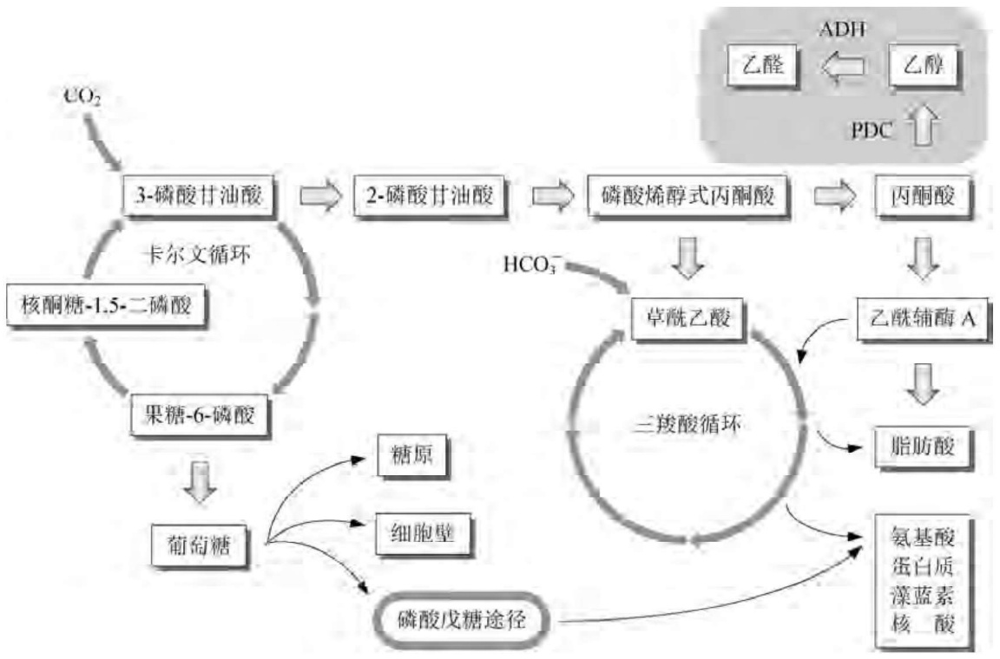

<details>
<summary>flowchart</summary>

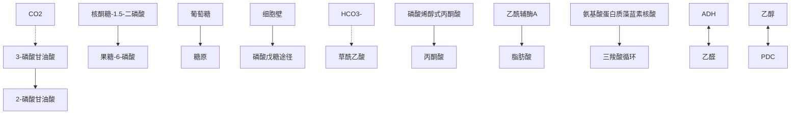
</details>

图10-11 蓝细菌属中的光合成途径

## 10.3.2 辅酶Q生产菌的途径操作

辅酶Q又称泛醌，在生物细胞体内作为线粒体呼吸链中NADH脱氧酶(复合酶I)、琥珀酸脱氧酶(复合物II)、细胞色素bc(复合物III)之间的脂溶性电子载体，起到递氢体的作用。与线粒体电子传递链其他组分不同，辅酶Q以其疏水侧链定位于线粒体内膜的脂质相中，整个分子从膜的一侧迁移到另一侧，其间伴随着质子的结合与释放以及自身的氧化和还原，形成跨膜质子梯度，以此产生生物体重要的能量物质ATP。细胞中的辅酶Q有两种不同的氧化还原状态(图10-12):氧化型醌(Q)，还原型醌 $\mathrm{(QH_2)}$ 以及介于两者之间的自由基半醌(QH)。除了线粒体内膜，辅酶Q还存在于细胞核、质膜、高尔基体、溶酶体内，可能参与抗氧化、电子转膜运输和胞质糖酵解等代谢活动。

---

第 10 章 第三代基因工程——途径工程

535

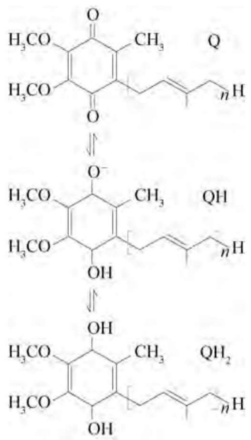

<details>
<summary>chemical</summary>

Three chemical structures showing ester and hydroxyl groups with labeled functional groups (Q, QH, QH₂)
</details>

图10-12 辅酶Q的分子结构

辅酶 Q 侧链类异戊二烯单体的数目决定辅酶 Q 的种类，自然界中主要有辅酶  $Q_{6} \sim Q_{10}$  几种同系物，不同的生物所含的辅酶 Q 也往往不同（表 10-6）。某些微生物含有极少量的类异戊二烯单体少于 6 的辅酶 Q，如大肠杆菌含有辅酶  $Q_{1} \sim Q_{8}$ ，酵母含有辅酶  $Q_{1} \sim Q_{6}$ ，动物中除了一些啮齿目和鱼类含辅酶  $Q_{9}$  外，多数含有辅酶  $Q_{10}$ 。

表 10-6 生物体内辅酶 Q 的含量

| 生物来源 | 辅酶Q主要种类 | 含量/[μg·(g干细胞)$^{-1}$] |
| --- | --- | --- |
| 大豆油 | 辅酶$Q_{10}$ | 30 |
| 玉米油 | 辅酶$Q_9$ | 120~210 |
| 麦芽油 | 辅酶$Q_9$ | 120 |
| 脱氮假单胞菌 | 辅酶$Q_{10}$ | 1000 |
| 掷孢酵母 | 辅酶$Q_{10}$ | 400 |
| 红色青霉 | 辅酶$Q_9$ | 375 |
| 荚膜红细菌 | 辅酶$Q_{10}$ | 3418 |
| 大肠杆菌 | 辅酶$Q_8$ | 490 298 |
| 棕色固氮菌 | 辅酶$Q_8$ | 1890 |
| 产朊假丝酵母 | 辅酶$Q_7$ | 385 |
| 酿酒酵母 | 辅酶$Q_6$ | 371 |

## 1. 辅酶 Q 的生物合成途径

辅酶 Q 的生物合成反应大部分发生在线粒体内。合成反应前期主要由两条路径组成，一条为辅酶 Q 苯醌环的合成途径，提供 4-羟基苯甲酸(PHB)。在微生物中，PHB 来自芳香族氨基酸的生物合成途径；而在动物体内，则以食物中的酪氨酸和苯甲氨酸生成苯醌结构。辅酶 Q 生物合成的另一条路径是侧链聚异戊二烯的合成，其基本反应单体为类异戊二烯焦磷酸(IPP)。在真核生物及部分原核细菌中，IPP 的合成路径早已确定:三分子乙酸聚合形成甲羟戊酸，然后转化为 IPP。但近年来发现大肠杆菌中的 IPP 生物合成途径有所不同，其五碳单元类似于缬氨酸的生物合成:由丙酮酸转化而来的乙醛经硫胺素活化后结合到二羟

---

536

基因工程

磷酸丙酮的C-2基团上，C-2位上的羟甲基基团再转至C-3位，形成类异戊二烯单体结构，后者经过一系列的还原、异构、脱羟、磷酸化反应最终形成IPP(图10-13)。由IPP聚合生成聚异戊二烯焦磷酸(PPP)，在真核生物和原核生物中基本类似。IPP异构化形成全反式二甲基烯丙基焦磷酸(DPP)，后者再以头尾缩合的方式逐一结合IPP单体，使异戊二烯碳链不断延长。DPP先与两分子IPP缩合形成法尼焦磷酸(FPP)，后者再与若干个IPP缩合，构成含有 $(n + 3)$ 个IPP单体的聚异戊二烯焦磷酸(PPP)长链。上述反应途径中，IPP聚合生成PPP不仅是合成辅酶Q的重要步骤，也是合成固醇类和类胡萝卜素化合物的基本反应序列（图10-14）。

在大肠杆菌中，辅酶Q生物合成的后期阶段是以PHB与PPP的缩合反应开始的，共由九步反应组成(图10-15)。其中，3-聚异戊二烯-4-羟基苯甲酸经脱羧、邻位羟基化和甲基化生成2-聚异戊二烯-6-甲氧基苯酚，再经酚基对位羟化、氧化及聚异戊二烯基团邻位甲基化，形成5-脱甲氧基辅酶Q，后者在5位羟基化和甲基化后转化为辅酶Q。在此途径中，PHB和PPP的缩合反应是辅酶Q生物合成途径的限速步骤，因此催化该反应的4-羟基苯甲酸聚异戊二烯焦磷酸转移酶对途径操作具有重要意义。在真核生物中，辅酶Q生物合成途径只有部分与原核生物相同，作为原核生物辅酶Q生物合成中间代谢物的2-聚异戊二烯-6-甲氧基苯酚在鼠体内并不存在，取而代之的是3,4-二羟基苯甲酸和3-甲氧基-4-羟基-5-聚异戊二烯甲酸。

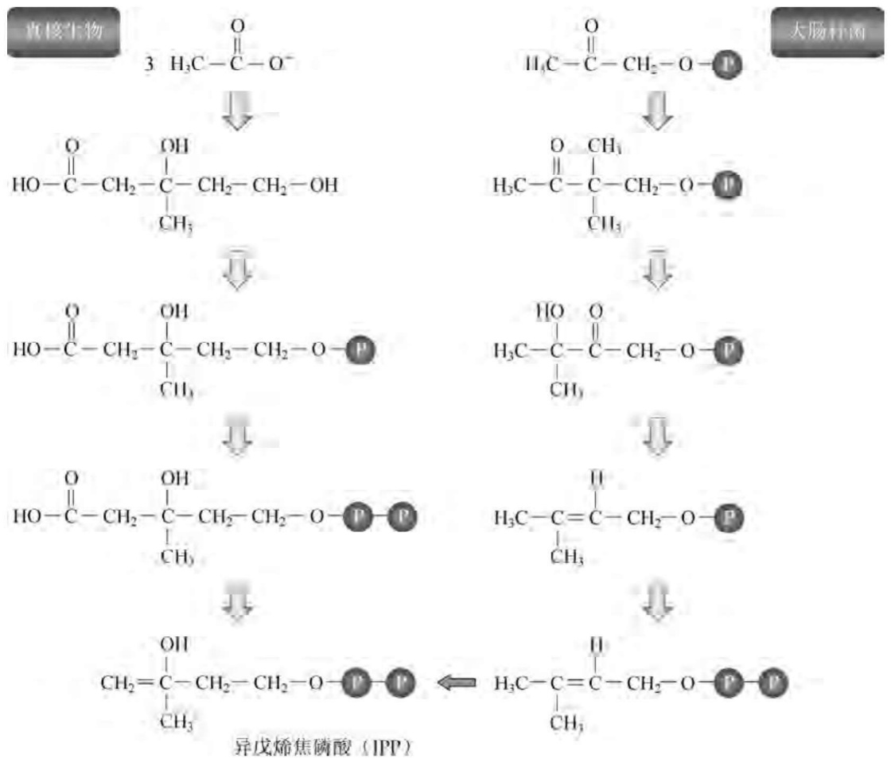

<details>
<summary>chemical</summary>

化学反应路径图，展示直接生物与大肠杆菌中异戊烯焦磷酸（IPP）的反应路径
</details>

图10-13 类异戊二烯焦磷酸的生物合成

---

第 10 章 第三代基因工程——途径工程

537

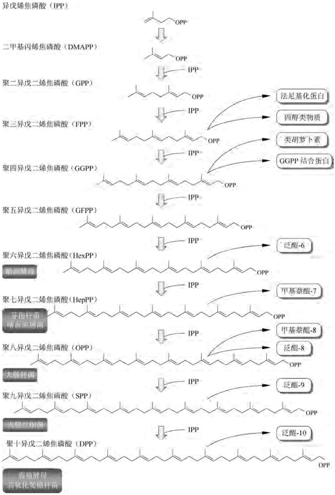

<details>
<summary>flowchart</summary>

```mermaid
graph TD
  A["异戊烯焦磷酸 (IPP)"] --> B["二甲基丙烯焦磷酸 (DMAPP)"]
  B --> C["聚二异戊二烯焦磷酸 (GPP)"]
  C --> D["聚三异戊二烯焦磷酸 (FPP)"]
  D --> E["聚四异戊二烯焦磷酸 (GGPP)"]
  E --> F["聚五异戊二烯焦磷酸 (GFPP)"]
  F --> G["聚六异戊二烯焦磷酸 (HexPP)"]
  G --> H["聚七异戊二烯焦磷酸 (HepPP)"]
  H --> I["聚八异戊二烯焦磷酸 (OPP)"]
  I --> J["聚九异戊二烯焦磷酸 (SPP)"]
  J --> K["聚十异戊二烯焦磷酸 (DPP)"]
  
  subgraph Metabolites
    L["法尼基化蛋白"]
    M["固醇类物质"]
    N["类胡萝卜素"]
    O["GGPP结合蛋白"]
  end
  
  %% Reactions
  P["IPP"] -.-> C
  Q["IPP"] -.-> D
  R["IPP"] -.-> E
  S["IPP"] -.-> F
  T["IPP"] -.-> G
  U["IPP"] -.-> H
  V["IPP"] -.-> I
  W["IPP"] -.-> J
  X["IPP"] -.-> K
  Y["IPP"] -.-> K
  Z["IPP"] -.-> K
  AA["IPP"] -.-> K
  AB["IPP"] -.-> K
  AC["IPP"] -.-> K
  AD["IPP"] -.-> K
  AE["IPP"] -.-> K
  AF["IPP"] -.-> K
  AG["IPP"] -.-> K
  AH["IPP"] -.-> K
  AI["IPP"] -.-> K
  AJ["IPP"] -.-> K
  AK["IPP"] -.-> K
  AL["IPP"] -.-> K
  AM["IPP"] -.-> K
  AN["IPP"] -.-> K
  AO["IPP"] -.-> K
  AP["IPP"] -.-> K
  AQ["IPP"] -.-> K
  AR["IPP"] -.-> K
  AS["IPP"] -.-> K
  AT["IPP"] -.-> K
  AU["IPP"] -.-> K
  AV["IPP"] -.-> K
  AW["IPP"] -.-> K
  AX["IPP"] -.-> K
  AY["IPP"] -.-> K
  AZ["IPP"] -.-> K
  BA["IPP"] -.-> K
  BA2["IPP"] -.-> K
  BA3["IPP"] -.-> K
  BA4["IPP"] -.-> K
  BA5["IPP"] -.-> K
  BA6["IPP"] -.-> K
  BA7["IPP"] -.-> K
  BA8["IPP"] -.-> K
  BA9["IPP"] -.-> K
  BA10["IPP"] -.-> K
  BA11["IPP"] -. ~2000:100000000000000000000000000000000000000000000000000000000000000000000000000000000000000000000000000001577777777777777777777777777777777777777777777777777777777777777777777777777777777777777777777777777771111111111111111111111111111111111111111111111111111111111111111111111111111111111111111111111111111<nl>
```
</details>

图10-14 固醇类和类胡萝卜素的生物合成

---

538

基因工程

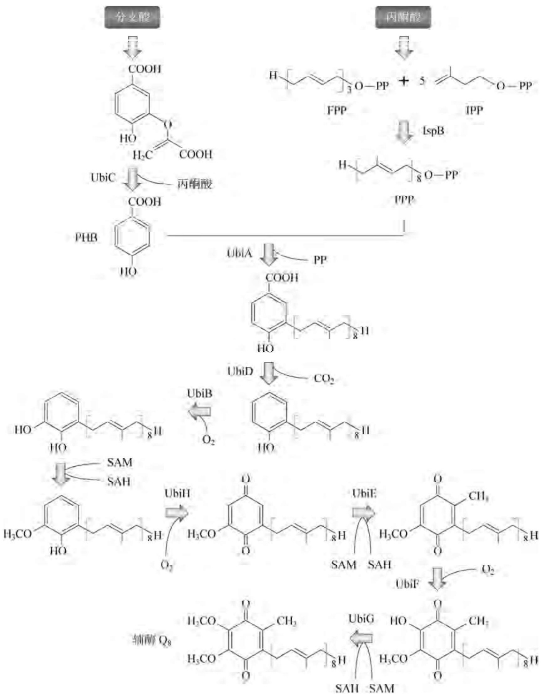

<details>
<summary>flowchart</summary>

```mermaid
graph TD
  A["分支酸"] --> B["COOH"]
  B --> C["HO-COOH"]
  C --> D["H2C-CH2-O-COOH"]
  D --> E["UbiC (丙酮酸)"]
  E --> F["PHB"]
  F --> G["COOH"]
  G --> H["COOH"]
  I["PPP"] --> J["FPP + 5-CH2-O-PP"]
  J --> K["IPP"]
  L["PPB"] --> M["H-CH2=CH2-O-PP"]
  M --> N["IspB"]
  O["PP"] --> P["COOH"]
  Q["PP"] --> R["COOH"]
  S["PPA"] --> T["COOH"]
  U["CO2"] --> V["HO-COOH"]
  W["CO2"] --> X["HO-COOH"]
  Y["CO2"] --> Z["HO-COOH"]
  AA["O2"] --> AB["HO-COOH"]
  AC["O2"] --> AD["HO-COOH"]
  AE["SAM"] --> AF["HO-COOH"]
  AG["SAH"] --> AH["HO-COOH"]
  AI["SAM"] --> AJ["HO-COOH"]
  AK["SAM"] --> AL["HO-COOH"]
  AM["O2"] --> AN["HO-COOH"]
  AO["O2"] --> AP["HO-COOH"]
  AQ["O2"] --> AR["HO-COOH"]
  AS["O2"] --> AT["HO-COOH"]
  AU["O2"] --> AV["HO-COOH"]
  AW["O2"] --> AX["HO-COOH"]
  A --> B
  B --> C
  C --> D
  D --> E
  E --> F
  F --> G
  G --> H
  H --> I
  I --> J
  J --> K
  K --> L
  L --> M
  M --> N
  N --> O
  O --> P
  P --> Q
  Q --> R
  R --> S
  S --> T
  T --> U
  U --> V
  V --> W
  W --> X
  X --> Y
  Y --> Z
  Z --> AA
  AA --> AB
  AB --> AC
  AC --> AD
  AD --> AE
  AE --> AF
  AF --> AG
  AG --> AH
  AH --> AI
  AI --> AJ
  AJ --> AK
  AK --> AL
  AL --> AM
  AM --> AN
  AN --> AO
  AO --> AP
  AP --> AQ
  AQ --> AR
  AR --> AS
  AS --> AT
  AT --> AU
  AU --> AV
```
</details>

图10-15 大肠杆菌辅酶 $\mathrm{Q}_{8}$ 的生物合成途径

---

第 10 章 第三代基因工程——途径工程

539

## 2. 辅酶 $\mathrm{Q}_{10}$ 的医疗保健功能

各种辅酶 Q 中只有辅酶  $Q_{10}$  具有医疗价值。正常人体内辅酶  $Q_{10}$  约 1.5 g，主要来源于食物，牛肉、菠菜、沙丁鱼、金枪鱼和花生中辅酶  $Q_{10}$  的含量较高。但由于膳食的不平衡或随着年龄的增长，人体内的辅酶  $Q_{10}$  通常达不到所需的水平。研究表明，当辅酶  $Q_{10}$  少于正常水平 20% 时，可导致人体各种机能下降和许多疾病的产生。

辅酶  $Q_{10}$  过去只是作为一种能量药物使用，随着药理学研究的深入，它在临床上的应用范围也愈加广泛，尤其在心脏病和肝病的治疗方面有明显效果。现已查明，心衰和高血压病人的心肌内辅酶  $Q_{10}$  含量明显低于正常人，补充适量的辅酶  $Q_{10}$  可以保护缺血的心肌免受损伤，缓解冠心病、风湿性心脏病和病毒性心肌炎引起的心悸、房早、室早和阵发性房颤等心律失常症状，同时对某些原发性及肾血管性高血压的治疗也能奏效。辅酶  $Q_{10}$  是一种非特异性的免疫功能增强剂，因而在对付各种急慢性病毒性肝炎方面有其独到之处。此外，辅酶  $Q_{10}$  还用于治疗糖尿病（刺激胰岛素分泌）、再生障碍性贫血、支气管哮喘、牙周炎等疾病。

美国第二医学(Alternative Medicine)的临床研究结果证实，辅酶 $Q_{10}$ 作为体内强抗氧化剂具有清除自由基、维持细胞膜通透性、改善免疫功能以及促进脂肪代谢等显著的生理功能，因而其预防保健作用逐渐为人们所重视。经常补充适量辅酶 $Q_{10}$ 可以降低血液黏度，防止动脉粥样硬化，并在一定程度上降低体重。鉴于辅酶 $Q_{10}$ 广泛的生理功能，且无特殊的副作用以及与其他药物的配伍禁忌，世界上许多国家将之誉为人体重要的营养素，其销售量也逐年增加。

## 3. 辅酶 $\mathrm{Q}_{10}$ 的大规模产业化现状

在20世纪60年代，辅酶 $Q_{10}$ 主要从动物的脏器中提取，由于含量小且受到原材料的限制，不可能实现大规模生产。野生型微生物合成辅酶 $Q_{10}$ 的能力相当低，且多为辅酶Q同系物的混合物，故提纯成本较高。据报道，自然界中只有34个属的微生物含有辅酶 $Q_{10}$，其中能用于发酵生产的以细菌和酵母为主（表10-7）。一般来说，细菌辅酶 $Q_{10}$ 的含量高，但发酵难以达到高密度，酵母则与之相反，因而选择生产菌株的关键是在细胞含量和细胞密度之间做适当的取舍。由于野生型菌株的辅酶 $Q_{10}$ 生产能力远不能满足大规模产业化的要求，因而早期辅酶 $Q_{10}$ 的发酵主要通过筛选突变株来提高产量。例如，日本Kanegafuchi公司利用诱变技术分离到一株将辅酶 $Q_{10}$ 积累水平提高50多倍的光合细菌突变株，因而在1977年首次实现了辅酶 $Q_{10}$ 发酵生产的工业化。

辅酶 $\mathrm{Q}_{10}$ 的第三种生产工艺是化学合成法，其基本途径包括芳香族醌（即辅酶 $\mathrm{Q}_0$）结构和聚异戊二烯侧链结构的分别合成以及两者的缩合。辅酶 $\mathrm{Q}_0$ 的化学合成以香草醛为起始反应物，醛基还原为甲基得到甲氧酚，再经硝化、羟甲基化、氢化生成2-氨基高黎芦醇，后者形成重氮盐后水解为酚衍生物，再经亚硝基二磺酸钾氧化生成辅酶 $\mathrm{Q}_0$。$\mathrm{C}_{50}$ 聚异戊二烯的合成以短链类异戊二烯作为起始反应物，但需要相当复杂的化学反应才能获得最终产物，而且收率极低。一种改进的工艺是使用茄呢醇（一种天然的全反式 $\mathrm{C}_{45}$ 聚异戊二烯醇）作为反应起始物，并通过异戊二烯单位的延伸反应合成 $\mathrm{C}_{50}$ 聚异戊二烯。茄呢醇在烟叶、马铃薯叶和桑叶含量较高，相对而言提取工艺也较简单。辅酶 $\mathrm{Q}_0$ 与 $\mathrm{C}_{50}$ 异戊二烯醇的缩合过程通常是先将辅酶 $\mathrm{Q}_0$ 还原为氢醌衍生物，然后在酸性催化剂存在下与 $\mathrm{C}_{50}$ 异戊二烯醇缩合。该过程伴随一些不利的副反应，从 $\mathrm{C}_{50}$ 聚异戊二烯醇生成的异戊二烯支链通常含有顺反异构体，而且由于相对分子质量较大，缩合效率极低。因此，化学合成辅酶 $\mathrm{Q}_{10}$ 的工艺路线并不比传统的发酵方法更优越。

目前日本基本上垄断了世界辅酶  $Q_{10}$  的生产。由于辅酶  $Q_{10}$  的化学合成路线已经没有进一步改进的余地，因而利用途径操作技术构建高产辅酶  $Q_{10}$  的工程菌是实现大规模生产辅

---

540

基因工程

酶 $\mathrm{Q}_{10}$ 的关键步骤。

表 10-7 用于发酵生产辅酶 $\mathrm{Q}_{10}$ 的微生物

| 微生物 | 含量/$[\mu g \cdot (g\text{干细胞})^{-1}]$ | 发酵年份 |
| --- | --- | --- |
| 着色菌属 |  | 1959 |
| 脱氮假单胞菌 | 1041 | 1960 |
| 玉米黑粉菌 | 172 | 1960 |
| 烟曲霉 | 150 | 1964 |
| 黄枝孢霉 | 293 | 1963 |
| 深红红螺菌 | 4913 | 1963 |
| 荚膜红假单胞菌 | 3620 | 1965 |
| 浑球红假单胞菌 | 2862 | 1965 |
| 胶红酵母菌 | 330 | 1967 |
| 葡糖杆菌属 |  | 1969 |
| 木醋杆菌 |  | 1969 |
| 假丝酵母属 |  | 1972 |
| 球拟酵母属 |  | 1972 |
| 白冬孢酵母属 |  | 1972 |
| 黏红酵母 | 280 | 1973 |
| 新型隐球酵母 | 230 | 1973 |
| 掷孢酵母 | 440 | 1973 |
| 裂殖酵母 |  | 1973 |

## 4. 高产辅酶 $\mathrm{Q}_{10}$ 工程菌构建的战略

在大肠杆菌中，由 ubiA 基因编码的 4-羟基苯甲酸聚异戊二烯焦磷酸转移酶催化 PHB 与 PPP 的缩合反应，这是辅酶 Q 生物合成途径中的限速步骤。该酶对 PPP 的专一性不强，将 ubiA 基因置于光合细菌启动子的控制之下，可以实现在光合细菌中的大量表达。由于 ubiA 基因表达产物取代或增强了光合细菌内源性的 4-羟苯甲酸聚异戊二烯焦磷酸转移酶的活性，使重组光合细菌合成辅酶  $Q_{10}$  的能力大幅度提升。这一成果已被应用于辅酶  $Q_{10}$  的工业化发酵生产中。

辅酶Q生物合成途径中另一种重要的酶是聚异戊二烯焦磷酸合成酶，催化FPP与若干IPP缩合成一定链长的PPP，并控制聚异戊二烯链的长度。不同的生物体该酶的性质不同，这就决定了所合成的辅酶Q结构的差异。例如，大肠杆菌中的聚异戊二烯焦磷酸合成酶编码基因为ispB，控制合成辅酶 $\mathrm{Q}_{8}$ ；而在酵母中其编码基因是coq1，导致辅酶 $\mathrm{Q}_6$ 积累。在ispB编码区上游接上一段酵母线粒体转移信号肽的编码序列，并克隆在表达载体上。重组质粒导入到野生型酵母细胞内，结果从转化株中分离得到了辅酶 $\mathrm{Q}_6$ 和辅酶 $\mathrm{Q}_8$ 的混合物。这一实验结果表明:酿酒酵母的4-羟基苯甲酸聚异戊二烯焦磷酸转移酶对底物并无严格的专一性，八聚异戊二烯焦磷酸也可以作为其反应底物；异源性的辅酶Q（如大肠杆菌产的辅酶 $\mathrm{Q}_8$ )可以取代酵母菌自身的辅酶 $\mathrm{Q}_6$ 的生理功能，其生长不受任何影响。更深入的研究还表明，各种细胞对异源辅酶Q具有较高的耐受性。将来自流感嗜血菌（Haemophilus influenzae）和集胞蓝细菌属(Synechocystis)分别编码七和九聚异戊二烯焦磷酸合成酶的基因转入ispB缺陷型大肠杆菌中，受体细胞产生的辅酶Q种类由辅酶 $\mathrm{Q}_8$ 分别转变为辅酶 $\mathrm{Q}_7$ 和辅酶 $\mathrm{Q}_9$ ，并且菌体生长正常。相似地，使弱氧化葡萄杆菌的ddsA基因(编码十聚异戊二烯焦磷酸合成酶)在ispB缺陷型大肠杆菌中表达，转化株正常积累辅酶 $\mathrm{Q}_{10}$ 。上述研究对辅

---

第 10 章 第三代基因工程——途径工程

541

酶 Q 生物合成途径的设计与操作具有重要指导意义。

光合细菌虽然拥有效率较高的辅酶 $\mathrm{Q}_{10}$ 生物合成系统，但其发酵条件需要光照厌氧，这在大规模生产中较难实现，因此对光合细菌的相关途径进行操作并非理想的选择。相反，大肠杆菌大规模发酵工艺相当成熟，且易于达到每升数百克湿菌体的培养密度，这对高产的辅酶 $\mathrm{Q}_{10}$ 极为有利。过量表达 ubiA 基因以扩增由 PHB 到辅酶 $\mathrm{Q}_0$ 的合成途径代谢流，同时将弱氧化葡萄杆菌的辅酶 $\mathrm{Q}_{10}$ 链长控制基因 $ddsA$ 取代大肠杆菌内源性的 ispB 基因，即可实现高产辅酶 $\mathrm{Q}_{10}$ 的大肠杆菌工程菌的构建。

## 10.3.3 氢气生产菌的途径操作

氢气是造成污染并不可再生的化石燃料的最终取代物，可直接用于动力、加热、发电等诸多领域。由于氢气燃烧时仅仅产生水蒸气和少量的氧化氮，大量使用并不加重气候变暖的负担，因此对空气的污染微不足道。德国奔驰公司早在十几年前就设计生产出以氢气为动力的汽车样品，其测试结果相当令人满意。氢气不比甲烷或汽油更危险，事实上它已广泛用于工业生产中，而且美国的太空计划使用氢气已有五十年历史，为这种燃料的全面推广提供了丰富的经验。

目前，利用传统的电解技术从取之不尽、用之不竭的水中制取氢气仍是个净耗能的过程。从能量转换效率的角度上看，通过风力或太阳能热解汽化水来生产氢气的工艺显然优于前者。将发酵和酶法技术用于氢气生产是当前研究的一个热门领域，在这方面初步的研究成果包括:筛选出了能有效将氢气作为代谢最终产物的微生物，几个与氢气生成有关的基因已经被分离，来自弗氏柠檬酸杆菌(Citrobacter freudii)的氢化酶基因也被克隆在大肠杆菌中。

近些年，人们正在调查氢气体外生产的可能性。该系统由两个酶组成，即从嗜酸热原体（Thermoplasma acidophilum）中分离出的葡萄糖脱氢酶（GDH）和从激烈火球菌（Pyrococcus furiosus）中分离出的氢化酶。GDH催化葡萄糖氧化为葡糖酸-δ-内酯，后者利用NADH或NADPH进一步水解为葡糖酸。尽管由于细菌的脱氢酶缺乏足够的势能而极少与NADPH相互作用，但激烈火球菌和真养产碱菌的脱氢酶却拥有利用NADPH作为电子供体的特性。有关实验证实，GDH和氢化酶的联合使用能在体外由葡萄糖生产氢气（图10-16），其附加条件是需要辅因子的连续循环（至少20次）。这一新发现的途径似乎是由可再生资源生产氢气的一种颇有价值的方法，而且没有二氧化碳和一氧化碳等中间废气

的形成。然而，上述过程的产业化运用还存在着许多难题:首先，要考虑在此过程中产生的大量葡糖酸的再利用，即使在小规模的氢气生产植物中它也是一种副产物；其次，酶和辅因子的循环使用可能会涉及固定化的工程问题；最后也是最关键的问题是酶促反应的速率以及高效率能量转换途径的设计。利用途径操作原理和技术有望克服上述困难，因为生物王国存在着丰富多彩的特殊途径资源可供创作，如绿藻（Chlamydomonas reinhardtii）就可以提供一种将光能有效捕捉进入氢气分子的优良模型。人类利用可再生氢气作为新型能源的时代为期不远了。

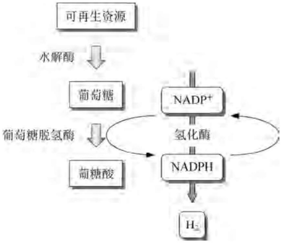

<details>
<summary>flowchart</summary>

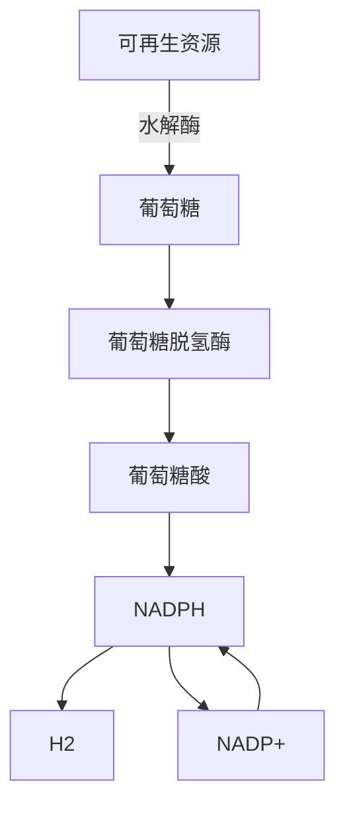
</details>

图10-16 由可再生资源生产氢气

---

542

基因工程

## 10.4 次级代谢的途径工程

原核细菌和低等真核生物拥有丰富而又复杂的次级代谢途径，它们使用与初级代谢途径相同的小分子初始底物，合成的却是种类更多、结构远比初级代谢产物复杂的化合物。以各类抗生素为代表的这些次级代谢产物虽然并非宿主细胞生理活动所必需，但却具有极其重要的应用价值。在过去的30年里，次级代谢物的途径工程已发展到运用特异性基因操作方法的高等阶段，其中最为典型的案例首推对聚酮类物质生物合成途径的理性操作。随着分子生物学原理和技术的不断发展，可以预计抗生素的途径工程将在大规模工业化生产中得以现实。

## 10.4.1 聚酮生物合成的分子机制

聚酮是一类庞大的次级代谢物家族，大多数的大环内酯类抗生素属于聚酮类物质。聚酮类物质可分为多环芳香族聚酮和大环聚酮，两者虽然化学结构不同，但却拥有一个由聚酮合酶(PKS)催化的基本相似的生物合成机制。这种性质为利用途径操作技术定向组合聚酶生物合成模件，开发一系列杂合新型生物活性物质奠定了良好的基础。

聚酮合酶是一类多功能酶，根据其基因序列和组成成分的空间构象不同，可分为模块型(PKS-I)和重复型(PKS-II)两大类。模块型PKS呈较大的多酶复合体，通过乙酸、丙酸、丁酸的缩合构筑大环聚酮，在每个缩合循环中，其 $\beta$ -羰基经历不同程度的还原反应。重复型PKS主要从乙酸单位合成多环芳香族聚酮，每次缩合后形成的羰基一般不还原。由于大环聚酮类衍生物具有重要的临床应用价值，因而在过去的三十年里模块型PKS的分子遗传学研究取得了巨大进展，围绕其基因簇对相关抗生素生物合成途径进行设计和修饰的工作也在不断地深入。

指导多环芳香族聚酮合成的重复型PKS-II通过一系列类似于脂肪酸生物合成的反应，以重复的方式将短链羧酸组装成聚酮长链。最小的细菌PKS-II复合物仅含三种蛋白组分，包括一个拥有酮酰基合酶(KS)和酰基转移酶(AT)活性多功能酶体、一个链长决定因子、一个酰基载体蛋白。最小的真菌PKS-II则在一条蛋白多肽链上含有同样的酶活性模块。细菌和真菌的PKS均在酰基载体蛋白上组装聚酮链，然后再利用独立于PKS而存在的酮基还原酶、芳香环化酶、O-甲基转移酶等修饰组装好的聚酮链分子，产生一系列具有不同结构的多环芳香聚酮衍生物。

催化大环聚酮合成的模块型PKS-I拥有完全不同的结构组织，但它们也在酰基载体蛋白上从短链羧酸组装聚酮。在PKS-I复合物中，每个独立的活性位点负责一步反应，而且不会像PKS-II以重复的方式多次使用某一个活性位点。PKS-I在延长聚酮生长链时，每掺入一个羧酸单位就可能包括脂肪酸生物合成的一个完整循环所需的所有反应。PKS-I的功能性亚基包括酰基载体蛋白(ACP)、酰基转移酶(AT)、酮酰基载体蛋白合成酶、酮基还原酶(KR)、脱水酶(DH)、烯酰还原酶(ER)，其中一个亚基含有终止聚酮链生长和环化大环聚酮所需的硫酯酶。在典型情况下，一个基因簇编码涉及大环聚酮链延伸循环的所有蛋白质，每个蛋白质亚基可能含有将羧酸单位加到生长的聚酮链上两轮循环所需的所有酶活性模块，这样可以省略产生不同氧化状态产物的缩合后修饰，因为有些模块编码了不应有的酶促活性结构域。聚酮生物合成的基因簇通常还拥有额外的基因，它们编码在组装和环化聚酮后对分子进行进一步修饰的酶系。上述链延伸反应顺序的典型案例是红霉素大环内酯的合成(图10-17)。

## 10.4.2 聚酮合酶各组成模块的操作策略

模块是 PKS 各种活性的基本结构单位。在模块编码序列的水平上将它们重新编排可

---

第 10 章 第三代基因工程——途径工程

543

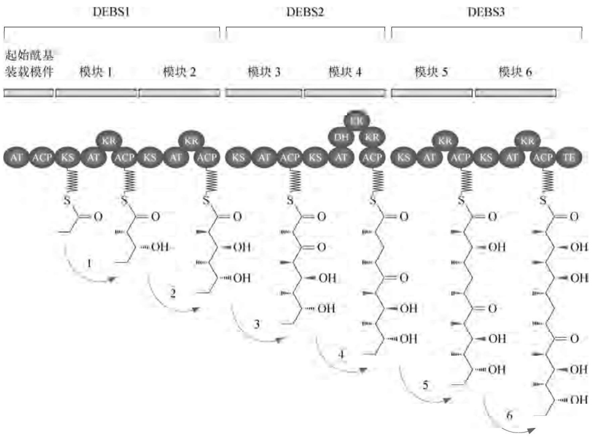

<details>
<summary>flowchart</summary>

This diagram illustrates the structural and secondary structure of a protein sequence (DEBS1-3), showing the assembly of proteins (AT, KS, KR) through multiple modules and their corresponding secondary structures.
</details>

图10-17 红霉素聚酮合酶的构成和链延伸反应的顺序

产生新的聚酮；缺失某个或多个模块可以改变链长；与来自其他 PKS 的异源模块交换则可增加最终产物结构的多样性；通过在链增长过程中掺入不同的延伸单位或者修饰加工程度，也同样可以达到改变聚酮链结构和性质的目的。

## 1. 缺失或增加模块以控制链长

大量的实验结果表明，在保留基本功能的前提条件下，PKS的模块缺失一般不会妨碍聚酮链的释放、环化、修饰。例如，将红霉素PKS的TE结构域调至6-脱氧红霉内酯合成酶1(DEBS1)的下游时，突变株会合成一个相对分子质量变小的三酮内酯，而不是正常的十四元大环内酯。DEBS的末端模块能够加工与天然底物相似但更简单的底物，在不存在其他DEBS蛋白的情况下，DEBS3蛋白会自发地从一个C3羧酸经过两轮缩合延伸形成一个三酮。延伸底物的特异性可能是红霉素PKS模件的共同特性。

## 2. 置换定位结构域以拓宽起始单位的使用范围

定位结构域(LD)在PKS基因簇的几个修饰目标中是最重要的，拓宽它对起始单位的使用范围可产生许多新的聚酮化合物。除了普拉内酯和红霉素PKS的LD可分别被泰乐菌素和除虫菌素PKS的等价模块置换外，利福霉素PKS LD结构域的性能调查也引起了人们的兴趣。利福霉素使用的普通底物是3-氨基-5-羟苯甲酸(AHBA)，将一株不能合成AHBA的地中海链霉菌(Amycolatopsis mediterranei)突变株在含有AHBA及其结构类似物HBA和DHBA的培养基中培养，结果表明该突变株也能以HBA和DHBA作为起始底物进行聚酮链延长反应，但在培养系统中只能检测到四酮支路的相应产物。也就是说，利福霉素PKS可从错误的起始单位延伸，但随后便被相关酶活性识别，并提前释放这个异常的中间体。由此可见，利福霉素PKS对起始单位的特异性要求也不高，但是其聚酮链后续加工程序对中

---

544

基因工程

间体的结构要求却远比红霉素PKS严格。事实上，利福霉素的模块4几乎不加工具有芳香环结构的聚酮链。

## 3. 置换酰基转移酶结构域以产生杂合衍生物

在不同的聚酮合酶及其模块之间交换相应的结构域可以显著扩展生物细胞合成杂合分子的能力，这是利用PKS多酶复合体生产具有潜在经济价值的新聚酮药物的关键步骤。在这方面第一个成功的例子是用rapPKS丙二酰特异性AT结构域置换DEBS1甲基丙二酰特异性的相应结构域，导致两个新的三酮内酯的合成，它们在其内酯环上均缺失了一个甲基。另一个例子是以三个异源的丙二酰特异性AT结构域置换红霉素PKS模块1和模块2中的甲基丙二酰特异性AT结构域，这三个用于置换的AT结构域分别来自雷帕霉素生产菌吸水链霉菌模块2(hygAT2)、苦霉素生产菌委内瑞拉链霉菌(Streptomyces venezuelae)的PKS基因簇(venAT)以及rapPKS的模件14(rapsAT14)。

经过上述改造了的红色糖多孢菌 ER720 工程菌可产生多种新型的红霉素衍生物。例如，当其 AT1 结构域被同源的丙二酰 AT 结构域置换时，工程菌将合成 12-去甲基-12-脱氧红霉素 A。这种类型的置换可以发生在 eryPKS 的模块 1 和模块 2 中，但在模块 4 中进行同样的置换却检测不到聚酮化合物的产生。另外，将来自尼达霉素 PKS 的甲基丙二酰特异性 AT5 置换红霉素模块 4 中的相应结构域，工程菌可产生乙基取代的红霉素。

进一步的研究表明,DEBS的AT结构域不会影响延伸单位的差向异构化,决定甲基分支立体化学性质的是每个模块的KS结构域。在丙二酰转移酶和甲基丙二酰转移酶之间交换编码几个氨基酸肽段的DNA序列,结果发现存在于所有AT结构域中的一个短的C末端片段是底物特异性的主要决定者。同时实验还表明,PKS模件对延伸单位的选择受一个超变区的影响,这使得人们有可能通过组合突变构建底物特异性较低的新型AT结构域。

## 4. 还原环的遗传操作

KR、DH、ER等结构域的改造和修饰同样是开发红霉素衍生物的研究内容。例如，将红霉素PKS模块4的ER结构域失活后，突变菌便合成如图10-18所示的红霉素结构类似物。除了修饰还原环的功能外，在没有还原功能的模块中组装合适的还原结构域，同样可以在聚酮分子中引入广泛的结构多样性。例如，将DEBS3的KR2结构域用来自rapPKS模块4的DH-KR双结构域进行置换，所形成的嵌合多功能蛋白不仅能催化 $\beta$ -酮基还原和区域专一性的脱水反应，而且还能将相应的聚酮链转移至模块3上进行加工，最终产生四酮类衍生物。

## 5. 人工合酶和聚酮文库的构建

对单一PKS编码基因进行遗传操作，可在一定程度上构建具有多种特殊催化功能和催化顺序的人工聚酮合酶变体，并由此形成相应的聚酮类化合物文库，后者为筛选有效药物增添了新的途径和范围。然而，这一策略的主要限制在于大多数PKS对结构改变了的聚酮链的接受能力有限。为了克服这种局限性，人们利用模块和结构域的几种变换组合来研究PKS的组合潜能。例如，用rapPKS的AT结构域和 $\beta$ -碳加工结构域置换DEBS中的相应结构域，使之拥有不同的底物特异性以及 $\beta$ -碳还原脱水活性。另外，为了便于聚酮的组合生物合成，还开发了一个用于DEBS异源表达的三质粒系统。eryAI、eryAII、eryAIII基因分别克隆到三个相容性的链霉菌质粒中，用这三个重组质粒转化同一株变铅青链霉菌（Streptomyces lividans），获得一株能高效积累6-脱氧红霉素内酯B(6-DEB)的转化子。如果将上述三个基因克隆在一个质粒上，所构建出来的转化子同样能达到相似的效果。

---

第 10 章 第三代基因工程——途径工程

545

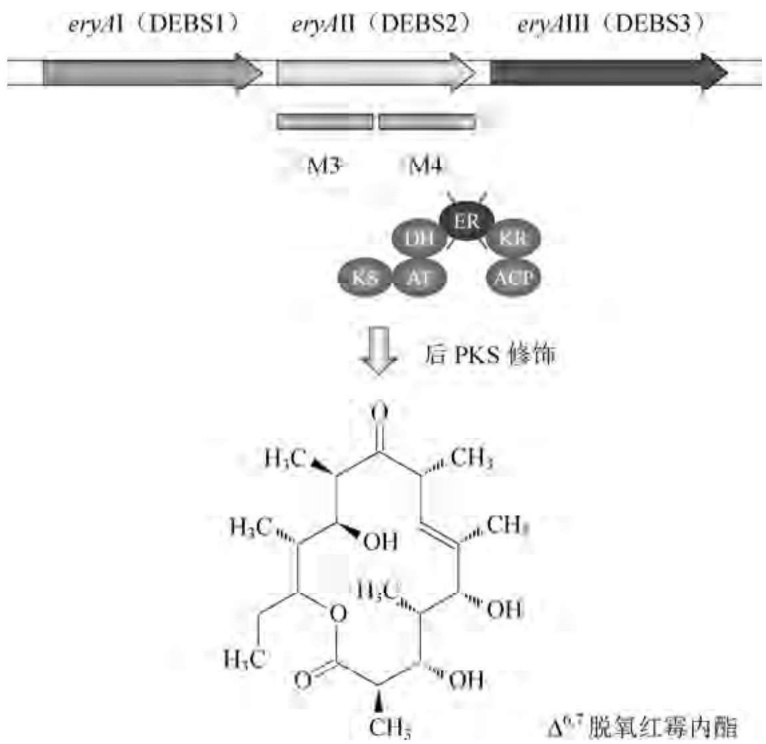

<details>
<summary>flowchart</summary>

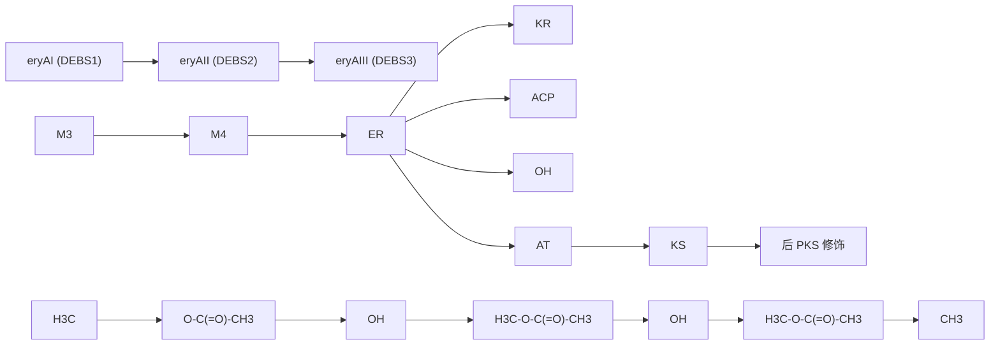
</details>

图10-18 截断型6-脱氧红霉内酯合成酶的模块结构

为了产生大量结构发生改变的化合物,人们还致力于设计多模块化的人工合酶。相关实验结果显示,在 eryPKS 基础上设计的二模块和三模块型人工聚酮合酶能合成具有预期结构的新化合物。这一结果令人鼓舞,因为组合化学的一个目标就是通过混合来自不同 PKS 基因簇且具有不同模块数的异源多肽或酶促结构域构建融合型的 PKS。

## 6. 聚酮内和聚酮间接头的设计

PKS中的单个模块对它们的底物具有明显的选择性，因此限制了模块的组合潜能，在实际应用过程中往往表现为杂合酶的低活性甚至无活性。然而深入研究表明，如果在PKS中的模块与模块之间以及结构域与结构域之间人为设计和组装一些氨基酸序列短小可变的接头片段，则能在很大程度上改善单个模块对不同聚酮链的接受能力，从而突破模块组合的限制性因素。例如，在模块内接头存在的条件下，用异源的rifPKS模块5置换DEBS模块2，可以产生预期的6-DEB三酮内酯衍生物（图10-19）。Rif PKS模块5的作用方式与DEBS模块2相似，而且DEBS模块2和模块3之间的多肽内接头允许聚酮链从Rif PKS模块5到DEBS模块3进行正常的转移。由此可见，对存在于多肽内部或多肽之间的接头进行重新设计和加工，能有效促进生物合成中间体在非天然连接的模块之间的转移。

从过去三十年在聚酮类化合物生物合成机制方面的研究进展来看,不远的将来人们能够对天然的 PKS 结构进行任何精确和方便的修饰,这不仅能促进对大环类抗生素生物合成过程形成更深的理解,更重要的是大规模生物合成新型聚酮类似物有望进入产业化阶段。

## 10.4.3 聚酮生物合成基因的异源表达

红色糖多孢菌的 6-脱氧红霉内酯 B 生物合成基因簇已在天蓝色链霉菌中获得表达，重组细菌能有效地将添加的前体掺入到 6-脱氧红霉内酯 B 中，所合成的衍生物含有一个甲基侧链，而在红色糖多孢菌中则是乙基侧链，这个结果证明异源基因表达产生了一个具有功能

---

546

基因工程

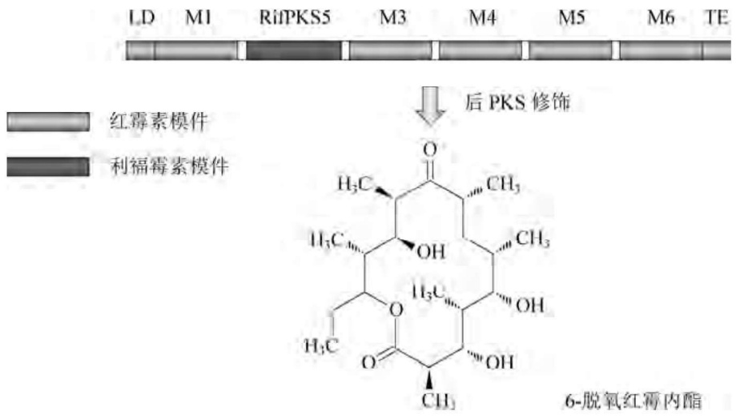

<details>
<summary>chemical</summary>

Chemical structure of 6-脱氧红霉素内酯, showing red霉素模件与利福霉素模件的结构及后PKS修饰过程
</details>

图10-19 异源模块的工程化融合

的酶。6-脱氧红霉内酯 B 是红霉素 A 生物合成中一个重要的中间体，它的异源合成再次表明抗生素合成基因不仅可以从天然产生菌中克隆出来，而且经体外改造后能在新的宿主细胞中表达出相应的新功能，为增产并合成新型聚酮类物质提供了广阔的应用前景。

此外，将来自真菌开放青霉菌(Penicillium patulum)的6-甲基水杨酸合成基因与可调控的链霉菌表达元件进行体外拼接，重组质粒导入具有多环聚酮类化合物合成能力的天蓝色链霉菌中。上述设计方案提高了宿主细胞合成前体分子的能力，同时也使得它能利用这些前体分子高效生产相应的聚酮化合物。

除虫菌素装载结构域的广谱底物特异性具有很高的应用价值。除虫菌素的结构类似物道拉菌素(Doramectin)是由除虫链霉菌的一个 $bkd$ 突变株在环庚酸存在的条件下发酵生产的。由于不能产生正常的分支底物异丁酰辅酶A和甲基丁酰辅酶A，这个突变菌株的除虫菌素生物合成装载结构域将环庚酸掺入天然产物中。在一项实验中，将山丘链霉菌（Streptomyces collinus）环庚酰辅酶A合成酶的编码基因转入至除虫链霉菌 $bkd$ 突变株中，重组菌可在不添加环庚酸底物的条件下直接发酵生产道拉菌素。

改造或修饰侧链基团或糖基加入相关途径是构建杂合抗生素生产菌的一项重要策略。在这种情况下，或者用一个完整的异源添加途径取代天然途径，以合成全新的侧链前体；或者缺失天然途径中的某个基因，以产生非天然的侧链前体。例如，从产碳霉素的耐热链霉菌（Streptomyces thermotolerans）中克隆编码酰基转移酶编码基因 carE，将其转入至产螺旋霉素的产二素链霉菌（Streptomyces ambofaciens）中，重组细菌便能合成杂合抗生素异戊酰螺旋霉素；而缺失 dNTP-德糖胺生物合成中转氨酶催化的反应，并以异鼠李糖代替正常的氨基糖德糖胺，可使重组菌产生酒霉素衍生物，这是糖基转移酶以修饰过的核糖作为底物的另一个例子。

$4^{\prime}$-表阿霉素(Epirubicin)是新一代的抗肿瘤药物，目前通常的生产方法是由碳疽环酮(Anthracyclinone)的前体进行化学修饰。为了利用发酵工艺生产这个半合成产品，将除虫链霉菌编码表- $4^{\prime}$-还原酶的 $avrE$ 基因置换波塞链霉菌TDP-道诺胺生物合成途径中编码 $4^{\prime}$-还原酶的 $dnmV$ 基因(图10-20)。实验结果表明，波塞链霉菌的TDP-道诺胺-$\varepsilon$-紫红霉酮糖基转移酶(DnmS)完全可以识别并使用经上述途径操作形成的核糖底物，合成重要的中间产物 $4^{\prime}$-表紫红霉素D，后者再由三个下游酶DnrP、DnrK、DoxA转化为最终产物 $4^{\prime}$-表阿霉素。

---

第 10 章 第三代基因工程——途径工程

547

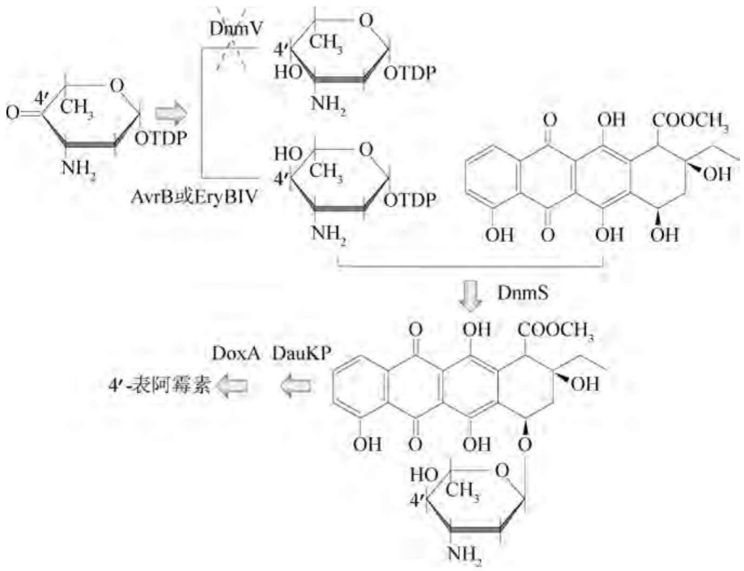

<details>
<summary>chemical</summary>

Chemical reaction pathway showing enzymatic transformation of a glycoside with DnmV, DnmS, and DoxA/DauKP enzymes
</details>

图10-20 $4^{\prime}$ -表阿霉素的生物合成

## 10.5 信号转导的途径工程

除了物质/能量代谢途径外，生物体几乎所有的生理活动还受到信号转导途径的支配。组织或细胞内外的生理物质(信号分子)结构特异性地与质膜定位型或胞质游离型蛋白受体结合，触发受体空间构象发生改变，后者在胞质中引起单一或多种蛋白产生以磷酸化反应为主的级联响应，最终激活相应的转录因子并介导相关基因的表达，这一过程称为细胞信号转导，信号传递的路线称为信号转导途径。与物质/能量代谢途径相似，以细胞为单位的信号转导途径也可通过基因操作而被工程化设计和改造，最终实现修饰细胞、组织乃至整个生物体遗传特征和生理性状的目标。

## 10.5.1 信号转导途径的构成与功能

从原核细菌到高等动植物体内存在数以千计构成和功能各异的信号转导途径。一般而言，一条典型的信号转导途径由信号分子、感应受体、转导组分、转录因子、效应基因五大元素构成，它们均由基因编码。如果将之类比物理电子电路，则信号转导途径中信号分子的缺席/显现以及效应基因的关闭/表达分别为这种生物基因电路的输入信号和输出信号。以哺乳动物体内广泛存在的Ras信号转导途径为例(图10-21)，典型的信号转导过程通常包含信号感应、信号传递、信号解析三大环节。

## 1. 信号转导途径的信号感应

信号感应是指细胞外(主要形式,如成纤维生长因子 FGF)或细胞内的信号分子(亦称配体)特异性地识别细胞质膜定位型(主要形式,如 FGFR)或胞内游离型受体蛋白并与之结合;一旦结合信号分子,受体空间构象便发生响应性改变,后者主要有三种表现形式:① 激活受体自身含有的蛋白磷酸激酶(简称蛋白激酶,如 FGFR)。此类受体通常跨膜一次(1TM),由胞外区、跨膜区、胞内区三部分构成。胞外区为信号分子的结合位点;胞内区为受

---

548

基因工程

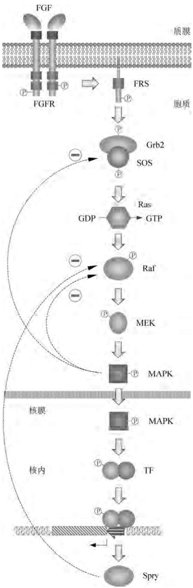

<details>
<summary>flowchart</summary>

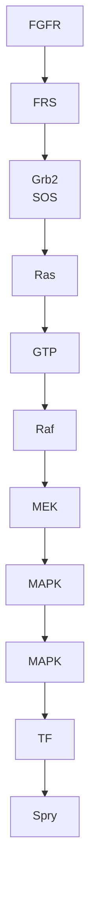
</details>

图10-21 典型的Ras信号转导途径

体自身的蛋白激酶活性区（即受体的顺式酶活），主要分为酪氨酸蛋白激酶和丝氨酸/苏氨酸蛋白激酶两大类。此外，此类受体的胞内区还可能含有蛋白磷酸酶活性或者直接与核苷酸环化酶相连。② 激活胞质内的蛋白磷酸激酶（如 T 淋巴细胞表面受体 CD4）。此类受体通常也跨膜一次，胞外区负责结合信号分子；胞内区不含蛋白激酶功能域，但在近膜处存在与细胞内蛋白激酶的结合位点。当配体与受体结合后，受体激活质膜内侧附近的蛋白激酶。③ 激活质膜内侧结合型 G 蛋白。此类受体的特征是跨膜七次（7TM），且与 G 蛋白构成蛋白复合物，因此又称为 G 蛋白偶联型受体（GPCR）。G 蛋白是一个庞大的 GTP/GDP 结合蛋白家族，分为三聚体和单体（如图 10-21 所示中的 Ras）两个亚家族。三聚体亚家族成员含 α、β、γ 三个亚基，一旦 GPCR 被激活，G 蛋白结合的 GDP 便为 GTP 所取代，并解离成携带 GTP 的 α 亚基以及不含核苷酸的 βγ 二聚体，这两种解离组分均能独立发挥传递信号的功能。

## 2. 信号转导途径的信号传递

信号传递是指胞质中的蛋白转导组分为受体所激活，并依次激活其下游转导伙伴直至转录因子，构成信号转导级联反应。其中，信号转导的方式主要表现为磷酸基团在各种转导组分中的接力式传递，因而这些转导组分大都是蛋白激酶；有些信号转导途径则采取蛋白逐次降解的方式转导信号（如Fas信号转导途径），因此这些转导组分均拥有蛋白酶顺式酶活。信号在细胞内有三条传递路线:① 信号通过多重转导组分逐次传递至细胞核内。在相当多的信号转导途径（如图10-21所示的Ras信号转导途径）中，被配体激活的受体将信号经多种转导组分逐次传递给下游伙伴，这些转导组分或呈胞质游离型，或以蛋白复合物的形式首尾相连，构成信号转导脚手架（颇像古时由驿站构成的邮路），并进行蛋白磷酸化或降解级联反应。② 信号通过胞质潜伏型转录因子直接传递至细胞核内。有些转录因子能直接为配体-受体复合物

---

第 10 章 第三代基因工程——途径工程

549

所激活，并穿过胞质直接进入核内。原核细菌的双组分信号转导以及高等植物的生长素信号转导均采用这一方式。在哺乳动物的一些信号转导途径中，SMAD和STAT家族成员身兼信号转导和转录调控两种功能，当受体呈非激活状态时，它们潜伏在质膜附近的胞质内；一旦受体被配体激活，受体便将游离型的SMAD或STAT招募至自己身边并激活之，其中SMAD在Ser残基、STAT在Tyr残基上被受体蛋白激酶磷酸化。经磷酸化激活后的SMAD或STAT在核内直接识别并作用于相关基因的表达调控元件。③信号通过第二信使分子传递至细胞核。在有些信号转导途径(如NFAT和PLC信号转导途径)中，被配体激活的受体可导致胞质内第二信使分子浓度的波动，并依赖这些小分子或离子在胞质中的扩散作用将信号传递至细胞核。具有上述功能的第二信使分子包括 $\mathrm{Ca^{2+}}$ 、cAMP、磷酸肌醇酯(PIP)等。

## 3. 信号转导途径的信号解析

信号解析是指转录因子经信号转导被激活后，在细胞核内或独立或与其他调控因子联合识别相应效应基因的DNA顺式应答元件上，进而启动或关闭基因的转录（视联合的调控因子性质而定）。在Ras信号转导途径中(图10-21)，胞质型有丝分裂原激活型蛋白激酶(MAPK,又称ERK)被其上游转导组分MEK激活后，转位于核内并以磷酸化方式激活一大批重要的转录因子(TF)。例如，MAPK激活转录因子Srf和ElK1表达Fos编码基因，同时又能激活转录因子Fos和Jun形成二聚体AP1，后者与相关效应基因的佛波醇应答元件TGACTCA结合表达Myc等众多蛋白质编码基因；而Myc与Max也能组成转录因子二聚体，与另一批效应基因的DNA顺式元件CACGTG结合并激活其转录启动。

## 4. 信号转导途径的信号反馈

鉴于信号转导途径沟通环境与机体之间的密切联系并介导生物体内几乎所有的生理过程，因此任何信号转导事件的发生、强化、消退必须被严密调控，这种调控网络的组成部分之一便是由该信号转导途径自身所包含的负反馈回路。例如在Ras信号转导途径中，一方面磷酸化激活型MAPK构成对其上游转导组分Raf和SOS的活性抑制（见图10-21）；另一方面，MAPK又能通过磷酸化激活转录因子Ets1促使负调控因子Spry的表达(图10-22)，而后者同样抑制Raf的活性图(见图10-21)，从而使Ras信号转导途径的输出信号呈短促的脉冲性。值得注意的是，任何使Ras信号转导途径脱离严密调控的因素均具有致癌倾向。

## 10.5.2 信号转导途径的性能修饰

人类多种生理和代谢紊乱性疾病均与相应信号转导途径的异常或故障密切相关，因此针对这些信号转导途径的性能进行基因操作有望为矫正疾病提供一种崭新的治疗策略。由于全身性基因治疗在相当程度上依赖于被禁止的生殖性克隆技术，因而信号转导途径修饰型细胞主要采用两种方式导入机体:第一种方式是在体外对分离出来的个体细胞进行基因操作，然后输回体内；第二种方式是移植含修饰型信号转导途径的非人类异种微胶囊化细胞（以人造半渗透膜包裹的哺乳动物细胞），所用胶囊通常由海藻酸-多聚L-赖氨酸或纤维素硫酸酯制成，能保护细胞免遭机体内免疫应答和清除，但却能获得必需的营养供应并分泌治疗性蛋白和代谢物。

## 1. 白介素-2信号转导途径的重新连线

体内输入抗原特异性 T 淋巴细胞能帮助机体重构免疫系统抵御病毒感染和抑制肿瘤生长,然而此类基于细胞的基因治疗策略在临床应用中的一个主要障碍是移植型工程 T 细胞在人体内的难以生存,因此开发具备可控性增殖能力的工程 T 细胞是细胞治疗的关键。

哺乳动物的 T 细胞克隆由白介素-2(IL-2)之类的细胞因子触发,后者作为机体内源型信号分子激活 JAK-STAT 信号转导途径,最终刺激一组 T 细胞生长调节基因的表达

---

550

基因工程

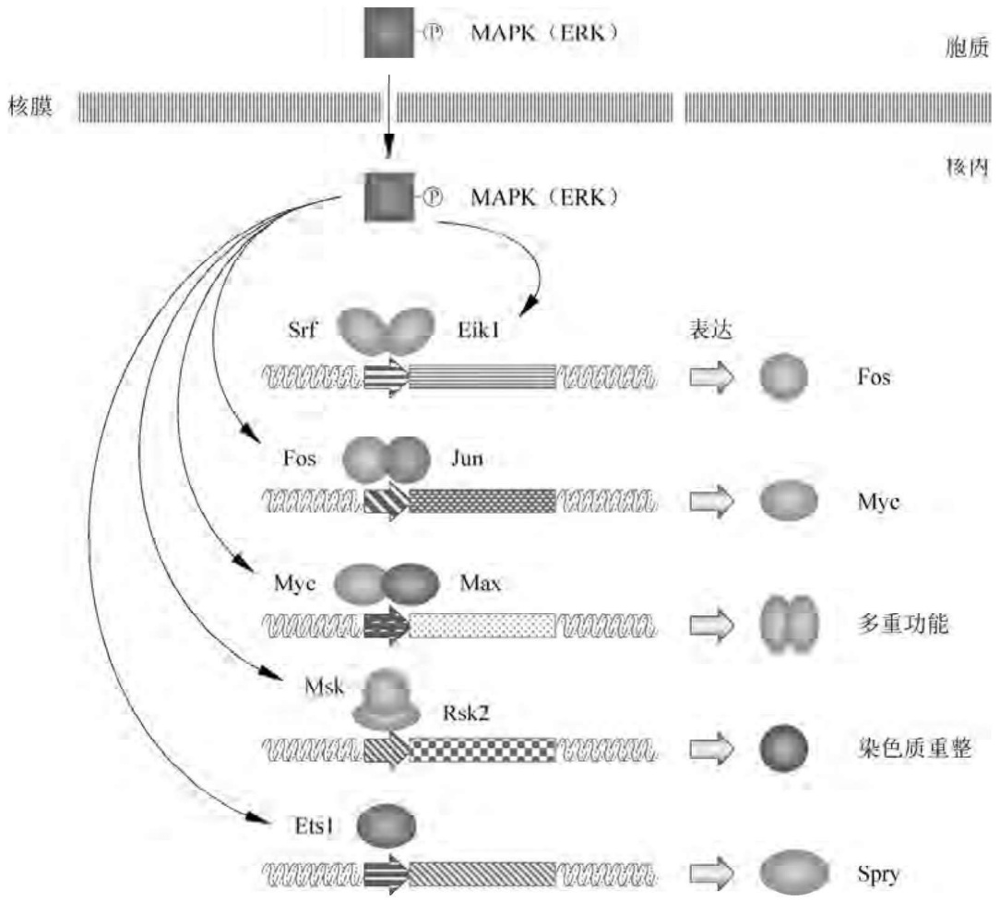

<details>
<summary>flowchart</summary>

This diagram illustrates the molecular signaling pathway of MAPK (ERK) in breast tissue, showing how ERK binds to various proteins and downstream molecules like Eik1, Jun, Max, Rsk2, and Ets1.
</details>

图10-22 磷酸化MAPK在核内的多重激活效应

(图 10-23(a))。CTLL-2 型小鼠的 T 细胞组成型表达 IL-2 受体, 注射提供 IL-2 能诱导 T 细胞生长, 而除去 IL-2 则导致 T 细胞凋亡, 因此 IL-2 是此类 T 细胞增殖的唯一触发因子。然而, 内源性 IL-2 生理表达量不足以刺激移植型工程 T 细胞的增殖, 而外部给药又使治疗费用过高, 因此开发一种能高效诱导 IL-2 表达的小分子廉价药物不失为一种选择。由小分子茶碱诱导机体表达 IL-2 进而重新连线 JAK-STAT 信号转导途径的构建策略如图 10-23(b) 所示: 设计一种茶碱响应型 RNA 适配体 (即核糖开关), 并将之与核酶序列融合, 构成茶碱依赖型核酶装置。将这一装置重组至 IL-2 基因的 $3^{\prime}$-UTR 内, 使得茶碱与适配体的结合能在空间结构上有效抑制核酶的自剪切活性, 从而导致 IL-2 mRNA 有效翻译; 但在茶碱缺席时, 核酶介导的 mRNA 降解导致 IL-2 表达水平显著降低。正如所设计的那样, 由此构建的工程 T 细胞转入小鼠体内后效果相当理想, 移植型小鼠在茶碱的存在下 T 细胞呈显著增长态势。如果将三拷贝的茶碱响应型核酶编码序列引入靶基因的 $3^{\prime}$-UTR, 则系统运行更佳。

## 2. 激活型 T 细胞核内因子信号转导途径的重新连线

高等动物的视觉形成途径与激活型T细胞核内因子(NFAT)介导的信号转导途径在G蛋白偶联型受体(GPCR)的激活环节部分重叠。其中，视觉形成途径由光子受体视网膜杆细胞中的视紫红质和视锥细胞中的视蛋白(颜色敏感)介导相应的信号转导级联反应，这两类光子受体均含有能特异性吸收光子的11-顺视网膜素(即维生素A)，它们与质膜内侧的

---

第 10 章 第三代基因工程——途径工程

551

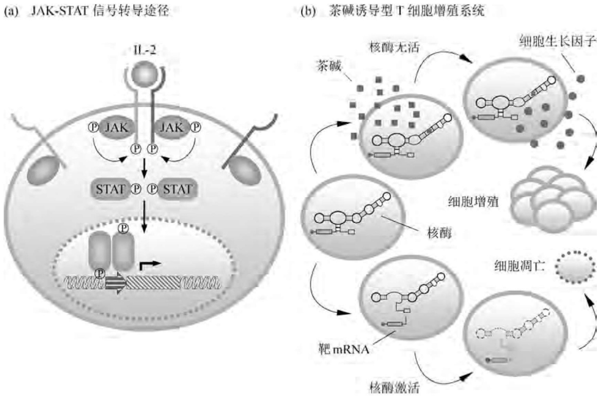

图10-23 以茶碱控制JAK-STAT信号转导途径运行的设计策略

GPCR 相偶联。不同波长的光子激活相对应的视蛋白，后者依次激活 GPCR 和磷酸二酯酶 (PDE)。激活型 PDE 将结合在钠离子通道上的 cGMP 水解成 GMP，从而关闭  $Na^{+}$  的胞内流入并在质膜两侧形成电位差，后者由视觉神经元传至大脑视觉中枢，遂产生视觉。然而，在 T 细胞以及其他类型的细胞中，为抗体等信号分子激活的 GPCR 可使与之偶联的 Gq 蛋白解离出  $\alpha$  亚基 ( $G_{q\alpha}$ )。 $G_{q\alpha}$  依次激活磷脂酶 C(PLC) 活性，后者将定位于质膜内表面上的磷脂酰肌醇 -4,5-二磷酸酯 ( $PIP_{2}$ ) 水解成 1,4,5-三磷酸肌醇 ( $IP_{3}$ )。 $IP_{3}$  与质膜型钙离子通道直接结合，导致  $Ca^{2+}$  在胞质中大量积累。 $Ca^{2+}$  浓度的剧变会触发钙调蛋白 (CaM) 依赖型的钙调磷酸酶 (CaN) 激活，后者使磷酸化型 NFAT 脱去磷酸基团。NFAT 转位至核内，识别特定的靶基因应答调控元件，进而激活相关基因的表达。

基于上述两条信号途径的重叠性，将特异性感应蓝光（波长约为 $480\mathrm{nm}$ ）的视黑素蛋白(MEL,能激活GPCR)以及能刺激胰岛素同时抑制胰高血糖素产生的胰高血糖素样多肽-1变体(GLP-1)编码基因导入人胚胎肾细胞株(HEK293)，并采用NFAT特异性识别的应答调控元件介导GLP-1编码序列的表达，可构建获得响应蓝光而高效表达GLP-1的工程细胞株(图10-24)。将该细胞株经微胶囊化包裹后移植进II型糖尿病小鼠模型体内，转基因小鼠在接受蓝光照射后便呈胰岛素水平提升，血糖也相应被有效控制。更重要的是，蓝光既能通过皮肤照射实施诱导又能借助光纤传递实现体内特定部位的局部光照，从而增强了这种治疗策略的应用潜力。

## 3. 环化腺苷酸应答元件结合蛋白信号转导途径的重新连线

细胞内固有的信号转导途径甚至还可用于工程化构建微胶囊化细胞以改善母牛的人工授精。迄今为止，畜牧业高效的母牛授精作业主要基于农民准确掌握母牛排卵的时间，这一过程不但耗时而且需要经验丰富的操作人力。事实上，母牛的排卵时间也可通过测定其内源性黄体生成素(LH)的水平而精确确定。一种理想的设计思路是将母牛的 LH

---

552

基因工程

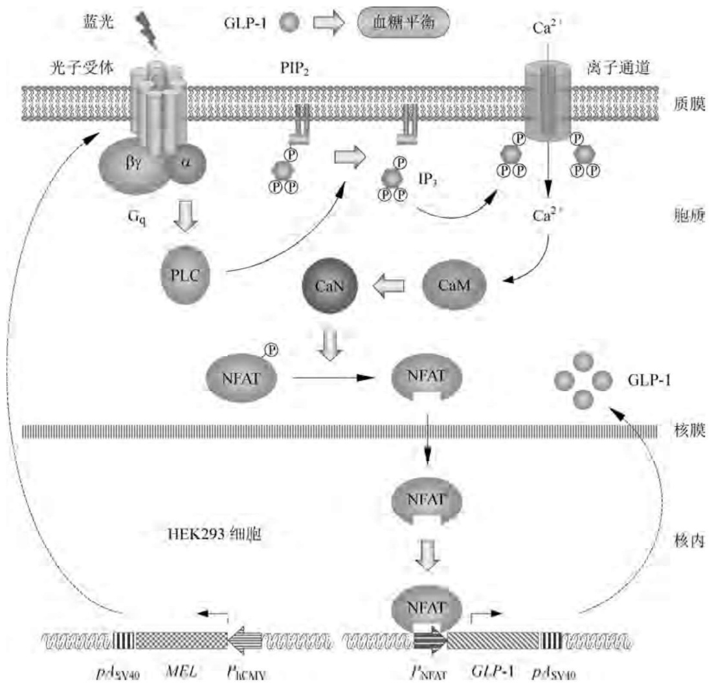

<details>
<summary>flowchart</summary>

This diagram illustrates the biochemical pathway of HEK293 cells, showing how light exposure and calcium ion transport (Ca²⁺) interact with PIP2 and GLP-1 to regulate various proteins like PLCs, NFATs, and their interactions in the nucleus.
</details>

图10-24 以光照控制II型糖尿病小鼠模型血糖平衡的设计策略

检测与人工授精紧密偶联，其中母牛体内 LH 的出现为工程化途径的输入信号，而精子至奶牛子宫的释放则为最终的输出效应。通过整合这些必需的输入/输出组分，一种基于纤维素微胶囊化感应细胞和精子细胞一同植入牛奶子宫的工程化全自动授精系统问世。其中，感应细胞（HEK293）携带异源表达型 LH 受体（rLHR，即 GPCR）以检测母牛内源性 LH 水平。LH 浓度的增高经 rLHR 诱导由 G 蛋白  $G_{s\alpha}$  亚基介导的腺苷酰环化酶（AC）激活，后者触发 cAMP 形成，并最终导致靶基因的 CREB（cAMP 应答元件 CRE 结合蛋白）依赖型转录激活。通过将编码一种纤维素酶分泌型变体的基因置于 CREB 控制下（在启动子  $P_{ETR}$  邻近区域安装 CRE 应答元件），受体的激活最终触发高浓度胞外纤维素酶的分泌（图 10-25）。此时，纤维素胶囊被降解，其内含的精子被释放进入母牛的子宫内，从而实现即时自动授精。

## 10.5.3 信号转导途径的动力学行为修饰

广泛存在于生物王国中数以千计的信号转导途径以受体分子感应信号、转导蛋白传递信号、转录因子解码信号的基本模式精确控制生命机器的运转。然而，除了信号分子、感应受体、转导组分、转录因子、效应基因的身份性质及其浓度阈值外，编码、构成、定义一条特定的信号转导途径还涉及其运行的动力学要素，即信号转导途径构成组分的浓度、活性、状态、

---

第 10 章 第三代基因工程——途径工程

553

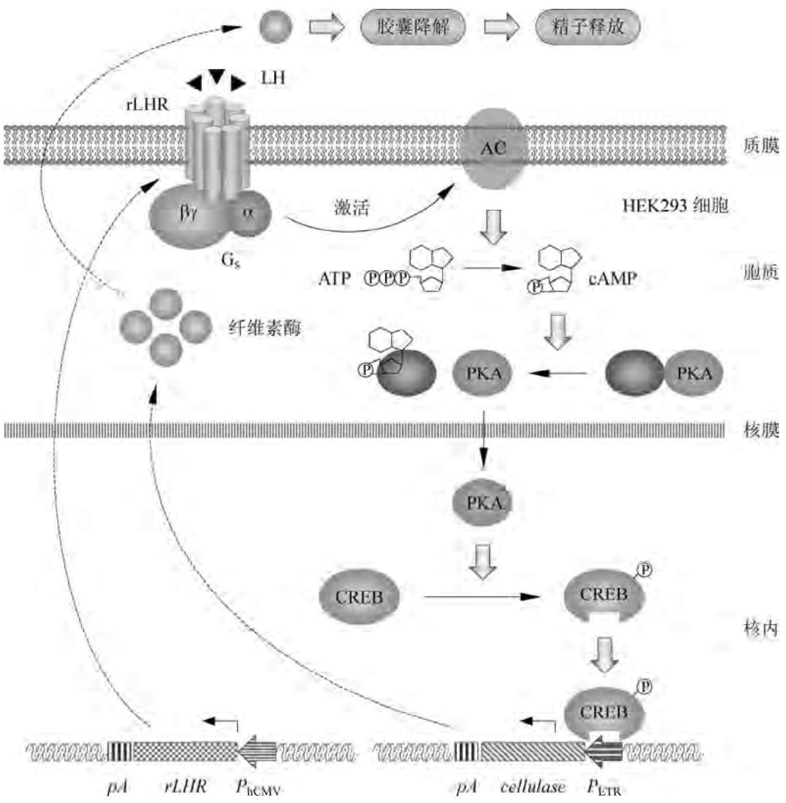

<details>
<summary>flowchart</summary>

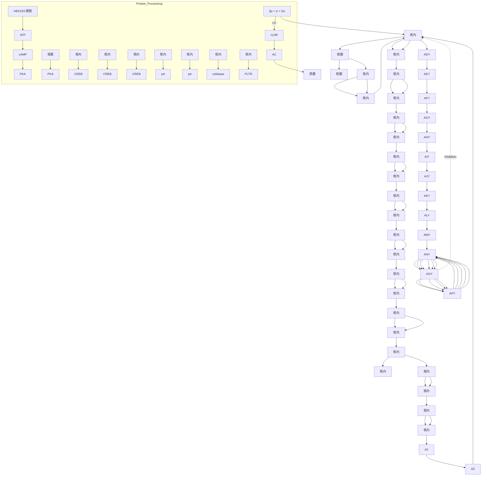
</details>

图10-25 基于母牛排卵触发型精子释放的工程化全自动授精设计策略

定位随时间变化而变化的行为。对信号转导途径的动力学行为进行工程化设计与修饰，同样能改变其输出的性质和效能。

1. 信号转导途径动力学的行为与表征

在信号转导过程中,信号强度(S)随时间(t)变化的动力学曲线可用频率(F)、振幅(A)、续长(D)、延迟(E)以及累积(M,即曲线面积)表征或定义(图10-26)。细胞的信号转导途径也可用上述动力学参数编码和解析生物信息,显然这种编码模式远比用一个时间点的单个分子状态编码信息更呈多样化。

由信号转导动力学行为研究产生的第一个概念是:不同的上游信号分子可导致同一转导组分呈现不同的动力学行为。例

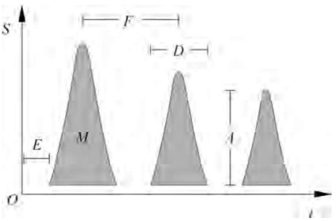

<details>
<summary>area</summary>

| Category | Peak Position (t) |
| --- | --- |
| M | Leftmost peak |
| D | Middle-right peak |
| A | Rightmost peak |
</details>

图10-26 信号转导动力学的表征参数

---

554

基因工程

如,不同的生长因子决定大鼠神经元前体不同的细胞命运: 神经生长因子(NGF)导致分化;而表皮生长因子(EGF)导致细胞增殖。事实上这两种信号分子均激活 MAPK, 只是动力学行为不同: EGF 触发 MAPK 产生一种瞬时响应, 而 NGF 则诱导 MAPK 呈现持久性激活,正是 MAPK 的不同动力学行为导致神经元前体细胞两种截然不同的命运。

无独有偶，不同的炎症刺激因子诱导转录因子 $\mathrm{NF} - \kappa \mathrm{B}$ 呈现不同的动力学行为。在静息条件下，$\mathrm{NF} - \kappa \mathrm{B}$ 于胞质和核内连续穿梭。肿瘤坏死因子 $\alpha (\mathrm{TNF}\alpha)$ 对 $\mathrm{NF} - \kappa \mathrm{B}$ 的刺激导致 $\mathrm{NF} - \kappa \mathrm{B}$ 在核内占据时间的延长及其负调控因子 $\mathrm{I}\kappa \mathrm{B}\alpha$ 编码基因的转录激活，由此构成$\mathrm{NF} - \kappa \mathrm{B}$ 信号转导途径的负反馈回路，并使转录激活型 $\mathrm{NF} - \kappa \mathrm{B}$ 呈振荡行为；相反，细菌脂多糖(LPS)则导致 $\mathrm{NF} - \kappa \mathrm{B}$ 的活性在核内缓慢积累。上述 $\mathrm{NF} - \kappa \mathrm{B}$ 活性两种截然不同的动力学行为导致两组不同的靶基因转录激活，进而产生不同的免疫学效应。

在某些系统中，信号刺激的身份和强度也能改变同一转导组分的动力学行为。例如，酵母转录因子Msn2通过转位至核内响应环境压力。单细胞研究发现，当响应葡萄糖限制或高渗透压信号刺激时，核内的Msn2显现刺激剂量依赖型的续长增加，但振幅固定；相反，氧化压力型信号刺激则导致核内Msn2的积累振幅随着 $\mathrm{H}_2\mathrm{O}_2$ 浓度的增加而增强。而且在初始脉冲之后，葡萄糖限制或高渗透压均引发核内Msn2一系列浓度峰的形成。这些脉冲的频率取决于葡萄糖限制信号的强度，但与渗透压的强度无关。

类似地，肿瘤抑制因子p53也呈现刺激和剂量依赖型的动力学行为。由 $\gamma$ 射线所致的DNA双链断裂(DSB)触发一系列固定振幅和续长的p53浓度脉冲。较高剂量的射线增加脉冲的数量，但不影响其振幅和续长；相反，紫外线则诱导产生一个振幅和续长呈照射剂量依赖型的p53浓度单峰。前者与暂时性的细胞循环阻止和恢复有关，而后者则诱导细胞进入凋亡程序。这些案例表明，信号转导分子的动力学行为能准确捕捉上游刺激信号的身份和强度；而且细胞能将相同信号转导分子的不同动力学行为“翻译”成特殊的表型格局。

## 2. 信号转导途径动力学的编码与解码

信号转导途径构成的不同规定或编码了其动力学响应模式的差异性。例如，MAPK 响应 EGF 和 NGF 之所以会产生不同的动力学行为差异，是因为在 EGF 途径中存在一个 MAPK 与 SOS 之间的负反馈回路；而在 NGF 途径中却存在一个经由 PKC 的正反馈，即两条途径的组分身份及其连结的差异编码 MAPK 的动力学行为（图 10-27）。

由 TNFα 和 LPS 诱导的 NF-κB 激活动力学行为的差异也可归结为特异性的信号转导途径构成:NF-κB 响应 TNFα 而短暂激活由一个负反馈回路介导，涉及 NF-κB 及其靶基因之一的表达产物 IκB；NF-κB 响应 TNFα 的长时相动力学行为则为另一个靶基因产物 A20 所控制，A20 半衰期较长且作用于比 IκB 更远的上游 [图 10-28(a)]。相反，NF-κB 响应 LPS 的持续性激活则归因于一条自分泌途径的正反馈回路，该回路涉及 TNFα 的重新合成。LPS 对 Toll 样受体 4(TLR4) 的激活触发 TNFα 的重新合成以及 TNF 受体的激活，因而形成了由 LPS 诱导的 NF-κB 激活的持久稳定性 [图 10-28(b)]。

相似地，DNA损伤网络中的反馈回路对p53响应 $\gamma$ 射线和紫外线的不同动力学行为负责。在这两条途径中，PI3K相关性激酶(ATM或ATR)将损伤信号传递至p53，并激活两条负反馈回路:一条介于p53和E3泛素连接酶Mdm2之间；另一条介于p53和磷酸脂酶Wip1之间。然而，两者之间一个重要的差异是，响应 $\gamma$ 射线的网络还包含了一条由Wip1介导的p53与ATM之间额外的负反馈回路(图10-29)。这一反馈对响应 $\gamma$ 射线触发p53产生连续脉冲至关重要，因为p53对 $\gamma$ 射线的响应比紫外线更敏感，较低的短暂信号输入足以触发p53脉冲。

在考虑信号转导动力学行为的功能时,自然会产生下一个问题:细胞如何识别或解码

---

第 10 章 第三代基因工程——途径工程

555

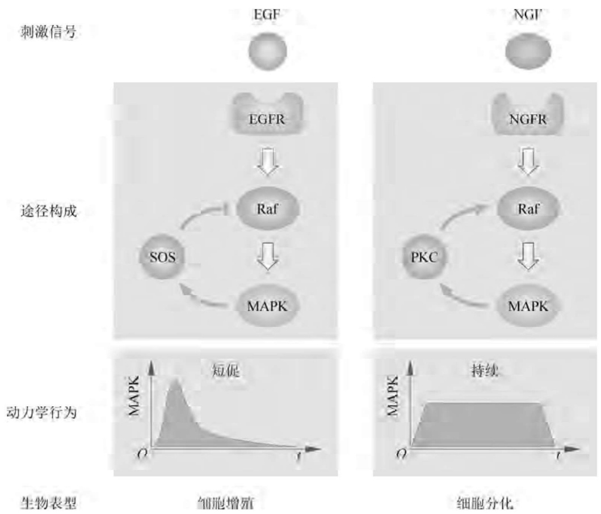

<details>
<summary>flowchart</summary>

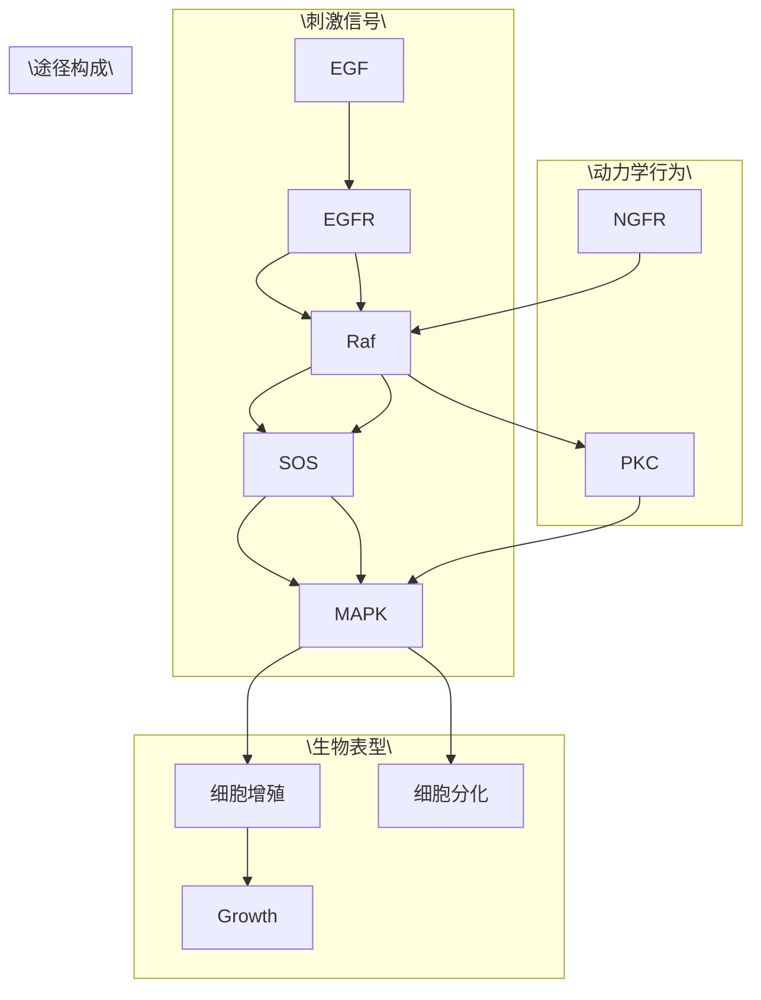
</details>

图10-27 信号转导途径构成对MAPK动力学行为的影响

不同的动力学行为并将其翻译成不同的表型应答。信号转导的动力学翻译最简单的机制是基于下游效应因子对呈现动力学行为的信号转导分子所表现出的灵敏度。在这种机制中，低亲和性的效应因子为了显示显著的激活，需要持续性的信号输入水平；而高亲和性的效应因子则能迅速响应短促变化的信号输入。以这种机制运行的信号转导途径包括那些能响应短暂或持续性  $Ca^{2+}$  信号的 JNK、NF- $\kappa$ B、NFAT 等信号转导组分。解码信号转导动力学行为更为复杂的机制是基于一种能感应上游信号转导分子时间依赖型变化的特异性转导结构单位。例如在 MAPK 途径中，短暂型和持续型的 MAPK 动力学行为是由一套早期基因表达产物感知和辨认的，这些产物能响应激活型 MAPK 而积累。当 MAPK 的激活呈短暂型时，诸如 c-Fos 之类的基因表达产物被诱导，但随即经历迅速的降解；而当 MAPK 的水平呈持续型时，新合成的 c-Fos 便一直接被持续存在的 MAPK 磷酸化，由此稳定细胞核中的 c-Fos 活性水平。

## 3. 信号转导途径动力学的设计与应用

现有研究表明，控制信号转导分子的动力学(时序)行为是细胞一种独特的信号转导构成策略。因此，人们可以遵循这一原理，设计特定基因表达的操控装置。例如对于那些含有多个靶基因的转录因子而言，其水平的变化对每个启动子具有不同的效应；然而通过控制转录因子的频率而非绝对水平，细胞在相同的浓度范围内工作，因此对各个靶基因的启动子具有一致的效应，这便可以实现无论启动子亲和性如何均可共调控多个靶基因以相对合适的比例表达之目的(图10-30)。

---

556

基因工程

(a) 配体 TNFα 对 NF-κB 动力学行为的影响

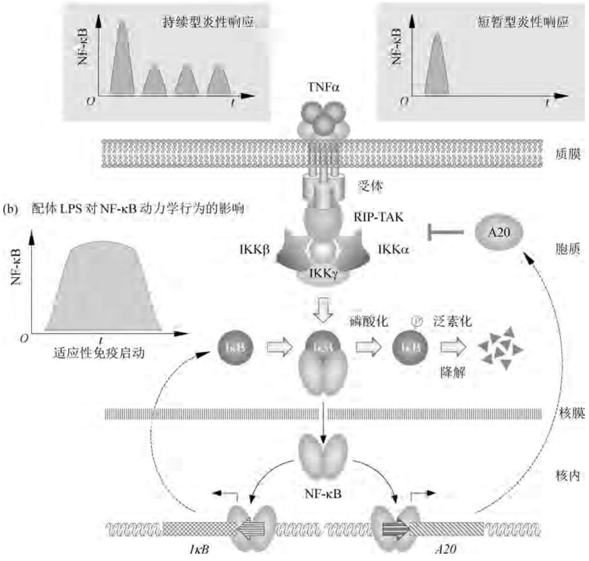

<details>
<summary>flowchart</summary>

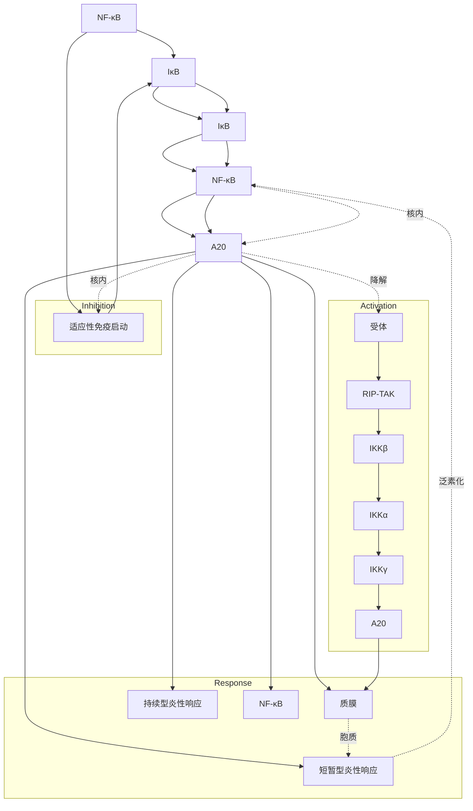
</details>

图10-28 信号转导途径构成对 $\mathrm{NF} - \kappa \mathrm{B}$ 动力学行为的影响

---

第 10 章 第三代基因工程——途径工程

557

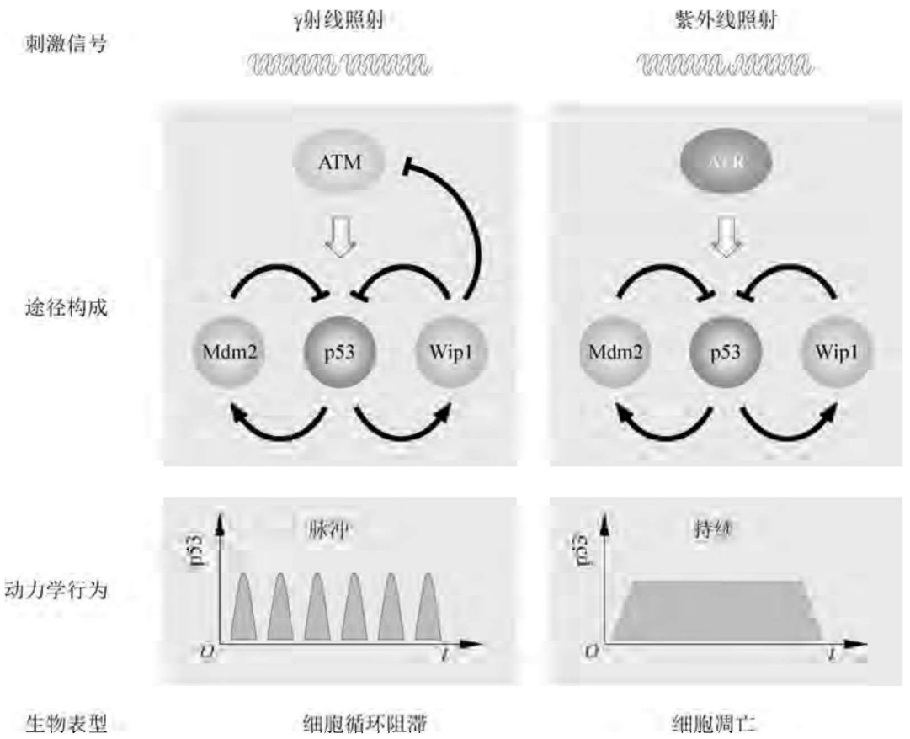

<details>
<summary>flowchart</summary>

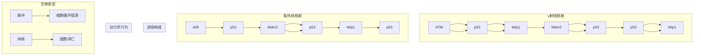
</details>

图10-29 信号转导途径构成对p53动力学行为的影响

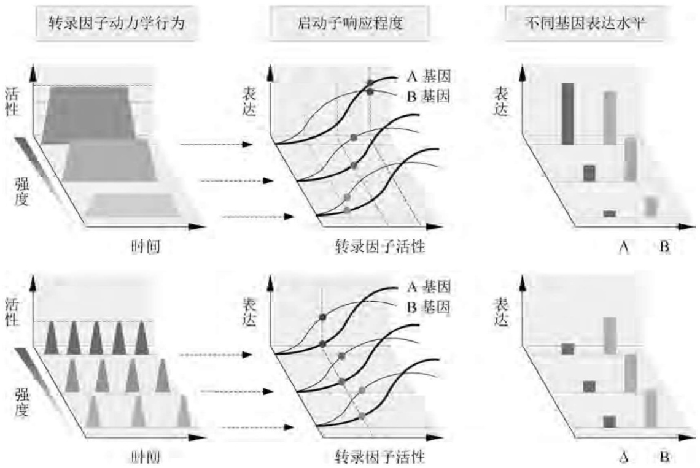

<details>
<summary>flowchart</summary>

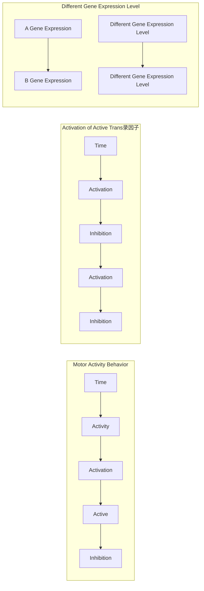
</details>

图10-30 多基因等比例协同表达的信号转导途径动力学设计

---

## 参考文献

[1] COMFORT N. Recombinant gold. Nature, 2014, 508: 176.
[2] OLIVEIRA P H, MAIRHOFER J. Marker-free plasmids for biotechnological applications — implications and perspectives. Trends in Biotechnology, 2013, 31: 539.
[3] BHARAT T A M, et al. Structures of actin-like ParM filaments show architecture of plasmid-segregating spindles. Nature, 2015, 523: 106.
[4] ALPER H, et al. Tuning genetic control through promoter engineering. Proc. Natl. Acad. Sci. USA, 2005, 102: 12678.
[5] GARCÍA-FRUITÓS E. Inclusion bodies: a new concept. Microbial Cell Factories, 2010, 9: 80.
[6] KHOURY G A, et al. Protein folding and de novo protein design for biotechnological applications. Trends in Biotechnology, 2014, 32: 99.
[7] MARTÍNEZ-ALONSO M, et al. Side effects of chaperone gene co-expression in recombinant protein production. Microbial Cell Factories, 2010, 9: 64.
[8] S∅ENSEN H P, MORTENSEN K K. Soluble expression of recombinant proteins in the cytoplasm of Escherichia coli. Microbial Cell Factories, 2005, 4: 1.
[9] VALDERRAMA-RINCON J D, et al. An engineered eukaryotic protein glycosylation pathway in Escherichia coli. Nature chemical biology, 2012, 8: 434.
[10] CHEN R. Bacterial expression systems for recombinant protein production: E. coli and beyond. Biotechnology Advances, 2012, 30: 1102.
[11] JAFFE S R P, et al. Escherichia coli as a glycoprotein production host: recent developments and challenges. Current Opinion in Biotechnology, 2014, 30: 205.
[12] LEVIN D, et, al. Fc fusion as a platform technology: potential for modulating immunogenicity. Trends in Biotechnology, 2015, 33: 27.
[13] SPADIUT O, et al. Microbials for the production of monoclonal antibodies and antibody fragments. Trends in Biotechnology, 2014, 32: 54.
[14] BROCKMEIER U, et al. Versatile expression and secretion vectors for Bacillus subtilis. Current Microbiology, 2006, 52: 143.
[15] VAN DIJL J M, HECKER M. Bacillus subtilis: from soil bacterium to super secreting cell factory. Microbial Cell Factories, 2013, 12: 3.
[16] DONG H N, ZHANG D W. Current development in genetic engineering strategies of Bacillus species. Microbial Cell Factories, 2014, 13: 63.
[17] KANG K, et al. Molecular engineering of secretory machinery components for high level secretion of proteins in Bacillus species. Journal of industrial microbiology & biotechnology, 2014, 41: 1599.
[18] TOYMENTSEVA A A, et. al. The LIKE system, a novel protein expression toolbox for Bacillus subtilis based on the liaI promoter. Microbial Cell Factories, 2013, 11: 143.
[19] LIEBETONA K, et. al. The nucleotide composition of the spacer sequence influences the expression yield of heterologously expressed genes in Bacillus subtilis. Journal of Biotechnology, 2014, 191: 214.
[20] PÁTEK M, NESVERA J. Sigma factors and promoters in Corynebacterium glutamicum. Journal of Biotechnology, 2011, 154: 101.
[21] BECKER J, WITTMANN C. Bio-based production of chemicals, materials and fuels-Corynebacterium glutamicum as versatile cell factory. Current Opinion in Biotechnology, 2012, 23: 631.

---

参考文献

559

[22] JONG-UK P, et al. Construction of heat-inducible expression vector of Corynebacterium glutamicum and C. ammoniagenes: fusion of  $\lambda$  operator with promoters isolated from C. ammoniagenes. Journal of microbiology and biotechnology, 2008, 18: 639.
[23] PÁTEK M, et al. Corynebacterium glutamicum promoters: a practical approach. Microbial Biotechnology, 2013, 6: 103.
[24] SHIN J H, LEE S Y. Metabolic engineering of microorganisms for the production of L-arginine and its derivatives. Microbial Cell Factories, 2014, 13: 166.
[25] BECKER J, WITTMANN C. Systems and synthetic metabolic engineering for amino acid production — the heartbeat of industrial strain development. Current Opinion in Biotechnology, 2012, 23: 718.
[26] SEVILLANO L, et al. Stable expression plasmids for Streptomyces based on a toxin-antitoxin system. Microbial Cell Factories, 2013, 12: 39.
[27] LIU G, et al. Molecular regulation of antibiotic biosynthesis in Streptomyces. Microbiology and Molecular Biology Reviews, 2013, 77: 112.
[28] MARTÍNEZ-BURGO Y, et al. Heterologous expression of Streptomyces clavuligerus ATCC 27064 cephamycin C gene cluster. Journal of Biotechnology, 2014, 186: 21.
[29] NODA S, et al. Over-production of various secretory-form proteins in Streptomyces lividans, Protein Expression and Purification, 2010, 73: 198.
[30] ANNÉA J, et al. Recombinant protein production and streptomycetes. Journal of Biotechnology, 2012, 158: 159.
[31] VRANCKEN K, ANNÉ J. Secretory production of recombinant proteins by Strepomyces. Future Microbiology, 2009, 4: 181.
[32] HEAP J T, et al. A modular system for Clostridium shuttle plasmids. Journal of Microbiological Methods, 2009, 78: 79.
[33] NAGARAJAN H, et al. Characterizing acetogenic metabolism using a genome-scale metabolic reconstruction of Clostridium ljungdahlii. Microbial Cell Factories, 2013, 12: 118.
[34] PAPOUTSAKIS E T. Engineering solventogenic clostridia. Current Opinion in Biotechnology, 2008, 19: 420.
[35] GEFEN G, et al. Enhanced cellulose degradation by targeted integration of a cohesin-fused  $\beta$ -glucosidase into the Clostridium thermocellum cellulosome. Proc. Natl. Acad. Sci. USA, 2012, 109: 10298.
[36] DUERRE P. Handbook on Clostridia, Part I. Methods, Chapter 3: Gene Cloning in Clostridia. CRC Press, 2005, 37.
[37] LÜTKE-EVERSLOH T, BAHL H. Metabolic engineering of Clostridium acetobutylicum: recent advances to improve butanol production. Current Opinion in Biotechnology, 2011, 22: 634.
[38] MINGARDON F, et al. The issue of secretion in heterologous expression of Clostridium cellulolyticum cellulase-encoding genes in Clostridium acetobutylicum ATCC 824. Applied And Environmental Microbiology, 2011, 77: 2831.
[39] CAMPELO A B, et al. A bacteriocin gene cluster able to enhance plasmid maintenance in Lactococcus lactis. Microbial Cell Factories, 2014, 13: 77.
[40] SHARECK J, et al. Cloning vectors based on cryptic plasmids isolated from lactic acid bacteria: their characteristics and potential applications in biotechnology. Critical Reviews in Biotechnology, 2004, 24: 155.
[41] SPATH K, et al. Direct cloning in Lactobacillus plantarum: Electroporation with non-methylated plasmid DNA enhances transformation efficiency and makes shuttle vectors obsolete. Microbial Cell Factories, 2012, 11: 141.
[42] PETERBAUER C, et al. Food-grade gene expression in lactic acid bacteria. Biotechnology Journal, 2011, 6: 1.
[43] GASPAR P, et al. From physiology to systems metabolic engineering for the production of

---

560

基因工程

biochemicals by lactic acid bacteria. Biotechnology Advances, 2013, 31: 764.
[44] SABO SS, et al. Overview of Lactobacillus plantarum as a promising bacteriocin producer among lactic acid bacteria. Food Research International, 2014, 64: 527.
[45] VOS W M. Systems solutions by lactic acid bacteria: from paradigms to practice. Microbial Cell Factories, 2011, 10: S2.
[46] PAUL D, et al. Suicidal genetically engineered microorganisms for bioremediation: need and perspectives. BioEssays, 2005, 27: 563.
[47] BHATNAGAR S, Kumari R. Bioremediation: a sustainable tool for environmental management - a review. Annual Review & Research in Biology, 2013, 3: 974.
[48] QIU D R, et al. PBAD-based shuttle vectors for functional analysis of toxic and highly regulated genes in Pseudomonas and Burkholderia spp. and other bacteria. Applied And Environmental Microbiology, 2008, 74: 7422.
[49] SUENAGA H, et al. Draft genome sequence of the polychlorinated biphenyl-degrading bacterium Pseudomonas putida KF703 (NBRC 110666) isolated from biphenyl-contaminated soil. Genome Announcements, 2015, 3: 1.
[50] SCHULZ S, et al. Elucidation of sigma factor-associated networks in Pseudomonas aeruginosa reveals a modular architecture with limited and function-specific crosstalk. PLOS Pathogens, 2015, 11: e1004744.
[51] BERGERO M F, LUCCHESI G I. Immobilization of Pseudomonas putida A (ATCC 12633) cells: a promising tool for effective degradation of quaternary ammonium compounds in industrial effluents. International Biodeterioration & Biodegradation, 2015, 100: 38.
[52] BHARDWAJ P, et al. Mapping atrazine and phenol degradation genes in Pseudomonas sp. EGD-AKN5. Biochemical Engineering Journal, 2015, 102: 125.
[53] ANDREAS H F J, ROTH, DERSCH P. A novel expression system for intracellular production and purification of recombinant affinity-tagged proteins in Aspergillus niger. Applied And Environmental Microbiology, 2010, 86: 659.
[54] YOON J, et al. Disruption of ten protease genes in the filamentous fungus Aspergillus oryzae highly improves production of heterologous proteins. Applied And Environmental Microbiology, 2011, 89: 747.
[55] FLEIBNER A, DERSCH P. Expression and export: recombinant protein production systems for Aspergillus. Applied And Environmental Microbiology, 2010, 87: 1255.
[56] WARD O P. Production of recombinant proteins by filamentous fungi. Biotechnology Advances, 2012, 30: 1119.
[57] POSCH A E, et al. Science-based bioprocess design for filamentous fungi. Trends in Biotechnology, 2013, 31: 37.
[58] ERJAVEC J, et al. Proteins of higher fungi - from forest to application. Trends in Biotechnology, 2012, 30: 259.
[59] KANDA K, et al. Application of a phosphite dehydrogenase gene as a novel dominant selection marker for yeasts. Journal of Biotechnology, 2014, 182: 68.
[60] WEINHANDL K, et al. Carbon source dependent promoters in yeasts. Microbial Cell Factories, 2014, 13: 5.
[61] BLAZECK J, et al. Controlling promoter strength and regulation in Saccharomyces cerevisiae using synthetic hybrid promoters. Biotechnology and Bioengineering, 2012, 109: 2884.
[62] NANCY A, et al. Introduction and expression of genes for metabolic engineering applications in Saccharomyces cerevisiae. FEMS Yeast Reviews, 2012, 12: 197.
[63] SCHUTTER K D et al. Genome sequence of the recombinant protein production host Pichia pastoris. Nature Biotechnology, 2009, 27: 561.
[64] CREGG J M, et al. Expression in the yeast Pichia pastoris. Methods in Enzymology, 2009, 463: 169.

---

参考文献

561

[65] MELLITZER A, et al. Synergistic modular promoter and gene optimization to push cellulase secretion by Pichia pastoris beyond existing benchmarks. Journal of Biotechnology, 2014, 191: 187.
[66] DIKICIOGLU D, et al. Improving functional annotation for industrial microbes: a case study with Pichia pastoris. Trends in Biotechnology, 2014, 32: 396.
[67] PRIELHOFER R, et al. Induction without methanol: novel regulated promoters enable high-level expression in Pichia pastoris. Microbial Cell Factories, 2013, 12: 5.
[68] HAMILTON S R, et al. Humanization of yeast to produce complex terminally sialylated glycoproteins. Science, 2006, 313: 1441.
[69] STÖKMANN C, et al. Process development in Hansenula polymorpha and Arxula adeninivorans, a re-assessment. Microbial Cell Factories, 2009, 8: 22.
[70] CHEN C H, et al. A synthetic maternal-effect selfish genetic element drives population replacement in Drosophila. Science, 2007, 316: 597.
[71] MORAES A M, et al. Drosophila melanogaster S2 cells for expression of heterologous genes: From gene cloning to bioprocess development. Biotechnology Advances, 2012, 30: 613.
[72] SUÁREZ-PATINO S F, et al. Transient expression of rabies virus glycoprotein (RVGP) in Drosophila melanogaster Schneider 2 (S2) cells. Journal of Biotechnology, 2014, 192: 255.
[73] HALL A B, et al. A male-determining factor in the mosquito Aedes aegypti. Science, 2015, 348: 1268.
[74] WINDBICHLER N, et al. A synthetic homing endonuclease-based gene drive system in the human malaria mosquito. Nature, 2011, 473: 212.
[75] NOLAN T, et al. Developing transgenic Anopheles mosquitoes for the sterile insect technique. Genetica, 2011, 139: 33.
[76] WANG S, JACOBS-LORENA M. Genetic approaches to interfere with malaria transmission by vector mosquitoes. Trends in Biotechnology, 2013, 31: 185.
[77] DYCK VA, et al. Sterile insect technique: principles and practice in area-wide integrated pest management. Published by Springer, 2005.
[78] POTTER C J. Stop the biting: targeting a mosquito's sense of smell. Cell, 2014, 156: 878.
[79] NEAFSEY D E, et al. Highly evolvable malaria vectors: the genomes of 16 Anopheles mosquitoes. Science, 2015, 347: 43.
[80] XIA Q Y, et al. Complete resequencing of 40 genomes reveals domestication events and genes in silkworm (Bombyx). Science, 2009, 326: 433.
[81] ZABELINA V, et al. Genome engineering and parthenocloning in the silkworm, Bombyx mori. Journal of Bioscience, 2015, 40: 645.
[82] TOTH A M, et al. A new insect cell glycoengineering approach provides baculovirus-inducible glycogene expression and increases human-type glycosylation efficiency. Journal of Biotechnology, 2014, 182: 19.
[83] GEISLER C, et al. Engineeringβ1,4-galactosyltransferase I to reduce secretion and enhance N-glycan elongation in insect cells. Journal of Biotechnology, 2015, 193: 52.
[84] XU H F. The advances and perspectives of recombinant protein production in the silk gland of silkworm Bombyx mori. Transgenic Reviews, 2014, 23: 697.
[85] DUDOGNON B, et al. Production of functional active human growth factors in insects used as living biofactories. Journal of Biotechnology, 2014, 184: 229.
[86] JIANG L, XIA Q Y. The progress and future of enhancing antiviral capacity by transgenic technology in the silkworm Bombyx mori. Insect Biochemistry and Molecular Biology, 2014, 48: 1.
[87] WELLS K D. Natural genotypes via genetic engineering. Proc. Natl. Acad. Sci. USA, 2013, 110: 16295.
[88] DOUDNA J A, CHARPENTIER E. The new frontier of genome engineering with CRISPR-Cas9. Science, 2014, 346: 1077.

---

562

基因工程

[89] SAKUMA T, et al. Lentiviral vectors: basic to translational. Biochemical Journal, 2012, 443: 603.
[90] ZHU J W. Mammalian cell protein expression for biopharmaceutical production. Biotechnology Advances, 2012, 30: 1158.
[91] JESUS M D, WURM F M. Manufacturing recombinant proteins in kg-ton quantities using animal cells in bioreactors. European Journal of Pharmaceutics and Biopharmaceutics, 2011, 78: 184.
[92] CACCIATORE J J, et al. Gene amplification and vector engineering to achieve rapid and high-level therapeutic protein production using the Dhfr-based CHO cell selection system. Biotechnology Advances, 2010, 28: 673.
[93] PHAM P L, et al. Large-scale transfection of mammalian cells for the fast production of recombinant protein. Molecular Biotechnology, 2006, 34: 225.
[94] BALDI L, et al. Recombinant protein production by large-scale transient gene expression in mammalian cells: state of the art and future perspectives. Biotechnology Letters, 2007, 29: 677.
[95] MIAO X Y. Recent advances in the development of new transgenic animal technology. Cellular and Molecular Life Sciences, 2013, 70: 815.
[96] DOSAY-AKBULU M. Advantages and disadvantages of transgenic animal technology with genetic engineering. Journal of Agricultural Science and Technology, 2014, 4: 177.
[97] KUMAR R, et al. Transgenic animal technology: recent advances and applications: A Review. Agricultural Review. 2015, 36: 46.
[98] KEEFER C L. Artificial cloning of domestic animals. Proc. Natl. Acad. Sci. USA, 2015, 112: 8874.
[99] HOUDEBINE L M. Production of pharmaceutical proteins by transgenic animals. Comparative Immunology, Microbiology and Infectious Diseases, 2009, 32: 107.
[100] NALDINI L. Gene therapy returns to centre stage. Nature, 2015, 526: 351.
[101] KOTTERMAN M A, SCHAFFER D V. Engineering adeno-associated viruses for clinical gene therapy. Nature Reviews Genetics, 2014, 15: 445.
[102] EGGERMONT L J, et al. Towards efficient cancer immunotherapy: advances in developing artificial antigen-presenting cells. Trends in Biotechnology, 2014, 32: 456.
[103] KOMORI T, et al. Transformation vectors and expression of foreign genes in higher plants. In Historical Technology Developments in Plant Transformation, edu. by Dan YH and Ow DW, Chapter4, 2011: 55.
[104] CHENG M, et al. Cells/tissues conditioning for facilitating T-DNA delivery. In Historical Technology Developments in Plant Transformation, edu. by Dan YH and Ow DW, Chapter5, 2011: 77.
[105] HEFFERON K. Plant virus expression vector development: new perspectives. BioMed Research International, 2014, 1.
[106] ALONSO J M, et al. The physics of tobacco mosaic virus and virus-based devices in biotechnology. Trends in Biotechnology, 2013, 31: 530.
[107] PRADO J R, et al. Genetically engineered crops: from idea to product. Annual Review of Plant Biology, 2014, 65: 769.
[108] KONDOU Y, et al. High-throughput characterization of plant gene functions by using gain-of-function technology. Annual Review of Plant Biology, 2010, 61: 373.
[109] DAYTON L. Blue-sky rice. Nature, 2014, 514: S52.
[110] LONG S P, et al. Meeting the global food demand of the future by engineering crop photosynthesis and yield potential. Cell, 2015, 161: 56.
[111] KANCHISWAMY C N, et al. Looking forward to genetically edited fruit crops. Trends in Biotechnology, 2015, 33: 62.
[112] MOLESINI B, et al. Fruit improvement using intragenesis and artificial microRNA. Trends in

---

参考文献

563

Biotechnology, 2012, 30: 80.
[113] HU H H, XIONG L Z. Genetic engineering and breeding of drought-resistant crops. Annual Review of Plant Biology, 2014, 65: 715.
[114] ROY S J, et al. Salt resistant crop plants. Current Opinion in Biotechnology, 2014, 26: 115.
[115] MANSOOR S, PATERSON A H. Genomes for jeans: cotton genomics for engineering superior fiber. Trends in Biotechnology, 2012, 30: 521.
[116] HILVERT D. Design of protein catalysts. Annual Review of Biochemistry, 2013, 82: 447.
[117] LISZKA M J, et. al. Nature versus nurture: developing enzymes that function under extreme conditions. Annual Review Biomolecular Engineering, 2012, 3: 77.
[118] ACEVEDO-ROCHA CG, et al. Directed evolution of stereoselective enzymes based on genetic selection as opposed to screening systems. Journal of Biotechnology, 2014, 191: 3.
[119] STEPHENS D E, et al. Creation of thermostable and alkaline stable xylanase variants by DNA shuffling. Journal of Biotechnology, 2014, 187: 139.
[120] URVOAS A, et al. Artificial proteins from combinatorial approaches. Trends in Biotechnology, 2012, 30: 512.
[121] SONG W J, TEZCAN F A. A designed supramolecular protein assembly with in vivo enzymatic activity. Science, 2014, 346: 1525.
[122] PEISAJOVICH S G, et al. Rapid diversification of cell signaling phenotypes by modular domain recombination. Science, 2010, 328: 368.
[123] PICKENS L B, et al. Metabolic engineering for the production of natural products. Annual Review Biomolecular Engineering, 2011, 2: 211.
[124] WEBER T, et al. Metabolic engineering of antibiotic factories: new tools for antibiotic production in actinomycetes. Trends in Biotechnology, 2015, 33: 15.
[125] ALPER H, et al. Engineering yeast transcription machinery for improved ethanol tolerance and production. Science, 2006, 314: 1565.
[126] LONG C P, ANTONIEWICZ M R. Metabolic flux analysis of Escherichia coli knockouts: lessons from the Keio collection and future outlook. Current Opinion in Biotechnology, 2014, 28: 127.
[127] WAY J C, et al. Integrating biological redesign: where synthetic biology came from and where it needs to go. Cell, 2014, 157: 151.
[128] PURVIS J E, LAHAV G. Encoding and decoding cellular information through signaling dynamics. Cell, 2013, 152: 945.
[129] WIELAND M, FUSSENEGGER M. Engineering molecular circuits using synthetic biology in mammalian cells. Annual Review Biomolecular Engineering, 2012, 3: 209.
[130] STEIN V, ALEXANDROV K. Synthetic protein switches: design principles and applications. Trends in Biotechnology, 2015, 33: 101.

---

## 内容提要

本书主要论述基因工程的基本原理、单元操作和应用策略。基本原理涉及基因的高效表达原理、重组表达产物的活性回收原理、基因工程细胞的稳定生产原理；单元操作包括DNA的切接反应、重组DNA分子的转化、转化子的筛选与重组子的鉴定，简称为“切、接、转、增、检”实验流程；应用战略部分以大肠杆菌、其他原核细菌、真菌（包括酵母）、昆虫、高等动植物等基因工程典型的受体系统为主线，结合具体的产业化案例，逐一论述基因工程应用的设计思想。此外，与高效表达天然蛋白质编码基因的第一代基因工程相呼应，本书还简述了基于基因修饰而表达蛋白变体的第二代基因工程（蛋白质工程）；并将遗传操作细胞物能代谢途径和信号转导途径表征为第三代基因工程（途径工程），由此构成本书的基本理论框架。

本书适合用作高等院校生命科学类各专业本科生和研究生的基因工程课程教科书，同时也可为从事生物工程技术研究和开发的人员提供参考。

---

现代生物化学工程丛书

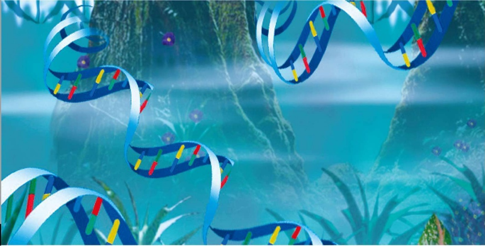

<details>
<summary>natural_image</summary>

Underwater illustration of a DNA double helix structure with colorful helices and aquatic plants (no text or symbols)
</details>

## 基因工程（第4版）


## 现代生物化学工程丛书

基因工程（第4版）

基因工程简明教程

生物催化工程

生物医学工程

现代生物分离工程

现代生物工艺学（上、下册）

发育生物学基础

发酵工程原理与实践

疫苗工程

酶与酶工程

超氧化物歧化酶


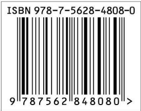

<details>
<summary>text_image</summary>

ISBN 978-7-5628-4808-0
9787562848080>
</details>

定价:78.00元
