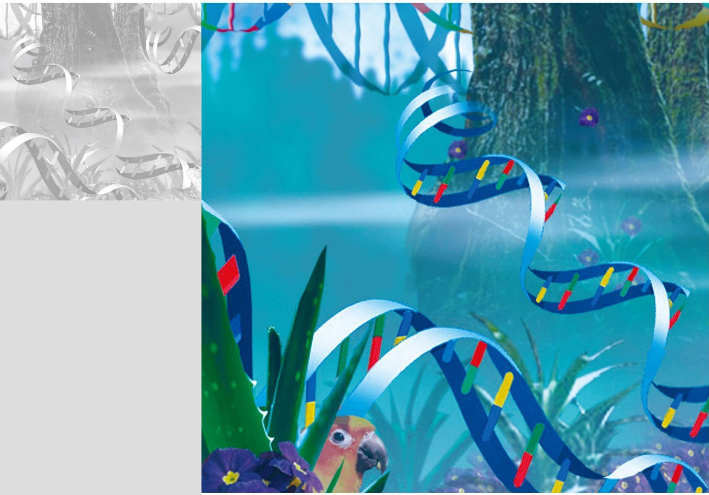
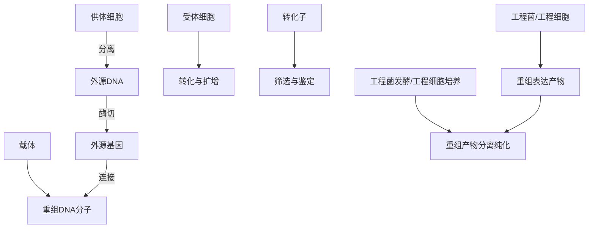
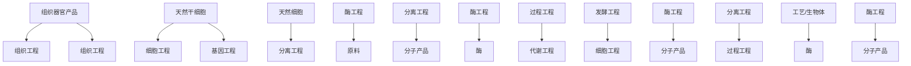
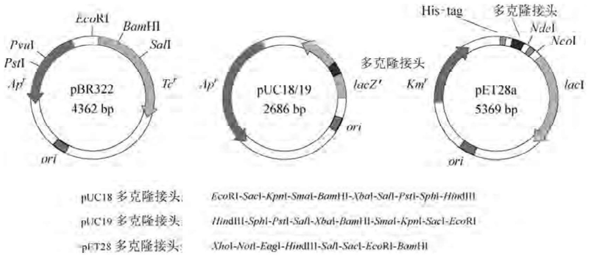
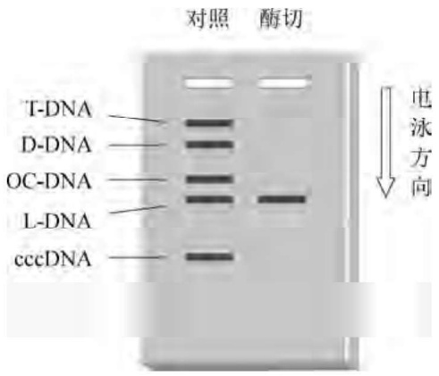
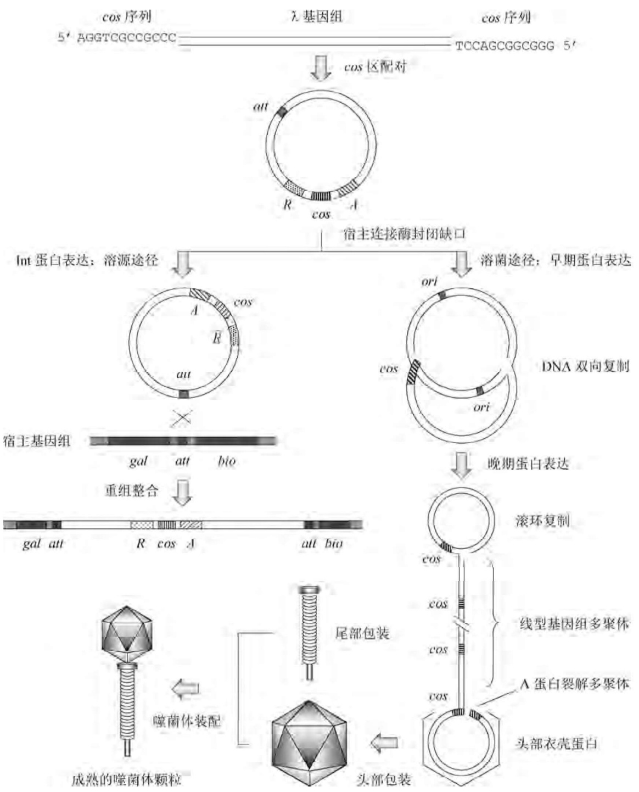
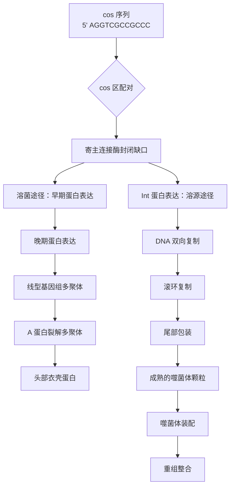

# (第4版)

# 基因工程

text_image

GE

# ENETIC ENGINEERING

张惠展 / 编著

## 第1章 概述

一百多年前，在捷克莫勒温镇一个修道院里沉醉于豌豆杂交实验的孟德尔(Mendel)根本就不会想到，他提出的遗传因子在半个世纪后被摩尔根(Morgen)定义为基因；而且1944年艾弗瑞(Avery)证明了基因的物质基础是DNA；1953年沃森(Watson)和克里克(Crick)又揭示了DNA的双螺旋分子结构；到了1973年，DNA已能在体外被随意拼接并转回至细菌体内遗传和表达。生命科学的飞速发展孕育了现代分子生物学技术——基因工程的诞生。今天，人们在超市货架上可以买到保质期较长的转基因番茄和土豆，以“多利”绵羊为代表的体细胞克隆动物走出实验室，使人们不再将《失落的世界》视为科幻影片，基因工程正驱动着整个人类生活方式发生重大变革。

## 1.1 基因工程的基本概念

## 1.1.1 基因工程的基本定义

基因工程(Genetic engineering)原称遗传工程。从狭义上讲,基因工程是指将一种或多种生物(供体)的基因与载体在体外进行拼接重组,然后转入另一种生物(受体)体内,使之按照人们的意愿遗传并表达出新的性状。因此,供体、受体、载体称为基因工程的三大要素,其中相对于受体而言,来自供体的基因属于外源基因。除了RNA病毒外,几乎所有生物的基因都存在于DNA序列中,而用于外源基因重组拼接的载体也都是DNA分子,因此基因工程亦称为DNA重组技术(DNA recombination)。另外,DNA重组分子大都需在受体细胞中复制扩增,故还可将基因工程表征为分子克隆(Molecular cloning)技术。

广义的基因工程定义为DNA重组技术的产业化设计与应用，包括上游技术和下游技术两大组成部分。上游技术指的是外源基因重组、克隆、表达的设计与构建（即狭义的基因工程）；而下游技术则涉及含外源基因型重组生物细胞(基因工程菌或细胞)的大规模培养以及外源基因表达产物的分离纯化过程。因此，广义的基因工程概念更倾向于工程学的范畴。值得注意的是，广义的基因工程是一个高度统一的整体。上游DNA重组的设计必须以简化下游操作工艺和装备为指导，而下游过程则是上游基因重组蓝图的体现与保证，这是基因工程产业化的基本原则。

## 1.1.2 基因工程的基本过程

依据定义,基因工程的整个过程由工程菌(细胞)的设计构建和基因产物的生产两大部分组成(图1-1)。前者主要在实验室里进行,其基本单元操作过程如下:

（1）从供体细胞中分离出基因组 DNA，用限制性核酸内切酶分别将外源 DNA（包括外源基因或目的基因）和载体分子切开（简称“切”）。
（2）用 DNA 连接酶将含有外源基因的 DNA 片段接到载体分子上，形成 DNA 重组分子（简称“接”）。
(3) 借助于细胞转化手段将 DNA 重组分子导入受体细胞中(简称“转”)。
（4）短时间培养转化细胞，以扩增 DNA 重组分子或使其整合到受体细胞的基因组中（简称“增”）。
(5) 筛选和鉴定经转化处理的细胞, 获得外源基因高效稳定表达的基因工程菌或细胞

flowchart

图1-1 基因工程基本流程示意图

(简称“检”)。

由此可见,基因工程的上游操作过程可简化为:切、接、转、增、检。

## 1.1.3 基因工程的基本原理

作为现代生物工程的主导性技术,基因工程的核心是外源基因的稳定高效表达。为达到此目的,可从以下四个方面考虑:

（1）利用载体 DNA 在受体细胞中独立于染色体 DNA 而自主复制的特性，将外源基因与载体分子重组，通过载体分子的扩增提高外源基因在受体细胞中的剂量（即拷贝数），借此提高其宏观表达水平。这里涉及 DNA 分子高拷贝复制以及稳定遗传的分子遗传学原理。
（2）筛选、修饰和重组启动子、增强子、操作子、终止子等基因的转录调控元件，并将这些元件与外源基因精确拼接，通过强化外源基因的转录而提高其表达水平。
（3）选择、修饰、重组核糖体结合位点和密码子等 mRNA 的翻译调控元件，强化受体细胞中目标蛋白质的生物合成过程。

上述(2)和(3)两点均涉及基因表达调控的分子生物学原理。

（4）基因工程菌(细胞)是现代生物工程中的微型生物反应器,在强化并维持其最佳生产效能的基础上,从工程菌(细胞)大规模培养的工程和工艺角度切入,合理控制微型生物反应器的增殖速度和最终数量,也是提高外源基因表达产物产量的重要环节,这里涉及的是生化工程学的基本理论体系。

因此,分子遗传学、分子生物学和生物化学工程学是基因工程原理的三大基石。

## 1.1.4 基因工程的基本体系

生物工程的学科体系建立在微生物学、遗传学、生物化学和化学工程学的基本原理与技术之上，但其最古老的产业化应用可追溯到公元前40世纪～公元前30世纪期间的酿酒技术。20世纪40年代，抗生素制造

业的出现被认为是微生物发酵技术成熟的标志，同时也孕育了传统生物工程。30年之后，以分子遗传学和分子生物学研究成果为理论基础的基因工程技术则将生物工程引至现代生物技术的高级发展阶段。

生物工程与化学工程同属于化学产品生产技术,但两者在基本原理、生产组织形式以及产品结构等方面均有本质的区别。在化学工业中,产品形成或者化学反应发生的基本场所是各种类型的物理反应器,在那里反应物直接转变成产物;而在生物工程产业中,生化反应往往发生在生物细胞内,作为反应物的底物按照预先编制好的生化反应程序,在催化剂酶的作用下形成最终产物。在生化反应过程中,反应的速度和进程不仅依赖于底物和产物的浓度,而且更重要的是受到酶含量的控制,后者的变化又与细胞所处的环境条件和基因的表达状态直接相关联。虽然在一种典型的生物工程生产模式中,同样需要使用被称为细菌发酵罐或细胞培养罐的物理容器,但它们仅仅用于细胞的培养和维持,真正意义上的生物反应器却是细胞本身。因此,就生产方式而言,生物工程与化学工程的显著区别在于:①生物工程通常需要两种性质完全不同的反应器进行产品的生产,细胞实质上是一种特殊的微型生物反应器(Mircobioreactor);②在一般生产过程中,微型反应器(细胞)的数量与质量随物理反应器内的环境条件变化而变化,因此在物理反应器水平上施加的工艺和工程控制参数种类更多、控制程度更精细;③每个微型反应器(细胞)内的生物催化剂的数量和质量也会增殖或跌宕,而且这种变化受制于更为复杂的机理,如酶编码基因的表达调控程序、蛋白质的加工成熟程序、酶的活性结构转换程序、蛋白质的降解程序等;④如果考虑产品的结构,生物工程则不仅能生产生理活性和非活性分子,而且还能培育和制造生物活体组织或器官。

上述分析表明,现代生物工程的基本内涵(图 1-2)包括:用于维持和控制细胞微型反应器(即细菌或细胞)数量和质量的发酵工程(细菌培养)和细胞工程(动植物细胞培养)、用于产物分离纯化的分离工程、用于实施细胞外生化反应的酶工程、用于生产生物活体组织的组织工程以及用于构建高品质细胞微型反应器的基因工程。值得注意的是,根据酶工程原理和技术组织的产物生产方式表面上看起来似乎与细胞微型反应器无关,但从生物催化剂概念拓展和酶制剂来源的角度上考察,这种生产方式在很大程度上也依赖于细胞微型反应器的使用,因为目前工业上使用的大部分酶制剂实际上是发酵工程的中间产品,而且酶工程产业中相当比例的生物催化剂形式是微生物细胞,后者也同样来自发酵过程。

flowchart

图1-2 现代生物工程的基本内涵

菌种诱变筛选程序和细胞工程中的细胞融合技术分别是微生物和动植物微型反应器品质改良的传统手段，而DNA重组技术则是定向创建所有类型细胞微型反应器（即工程菌或工程细胞)的强有力的现代化工具。其中，第一代基因工程是将单一外源基因导入受体细胞，使之高效表达外源基因编码的蛋白质或多肽，它们基本上以天然的序列结构存在；第二代基因工程(即蛋白质工程)通过基因操作修饰改变蛋白多肽的序列结构，产生生物功能更为优良的非天然蛋白变体(Mutein)；作为第三代基因工程的途径工程则在基因水平上局部设计细胞内固有的物质能量代谢途径和信号转导途径，以赋予细胞更为优越甚至崭新的产物生产品质；而第四代基因工程则涉及生物体全基因组的高通量编辑和转移，由此修饰生物的遗传性状甚至构建全新的生物物种。

## 1.2 基因工程的发展历史

从基因工程基本流程来看,基因工程的操作并不复杂,但其中涉及几项关键性技术,如DNA分子的切割与连接、DNA切接反应的检测以及DNA重组分子导入受体细胞的程序等。有趣的是,这三项基本技术几乎同时于20世纪70年代初得以建立,并迅速导致了第一个DNA体外重组实验的诞生。

## 1.2.1 基因工程的诞生

1972年，美国学者伯格(Berg)和杰克逊(Jackson)等人将猿猴病毒SV40基因组DNA、大肠杆菌 $\lambda$ 噬菌体基因以及大肠杆菌乳糖操纵子在体外重组获得成功。翌年，美国斯坦福大学的科恩(Cohen)和博耶(Boyer)等人在体外构建出含有四环素和链霉素两个抗性基因的重组质粒分子，将之导入大肠杆菌后，该重组质粒得以稳定复制，并赋予受体细胞相应的抗生素抗性，由此宣告了基因工程的诞生。正如科恩在评价其实验结果时指出的那样，基因工程技术完全有可能使大肠杆菌具备其他生物物种所固有的特殊生物代谢途径与功能，如光合作用和抗生素合成等。

出人意料的是，当时科学界对这项新技术问世的第一个反应竟是应当禁止有关实验的继续开展，其严厉程度远大于今天人们对人体克隆的关注。甚至包括科恩本人在内的分子生物学家们也担心，两种不同生物的基因重组有可能为自然界创造出一个不可预知的危险物种，致使人类面临灭顶之灾。1975年西欧几个国家签署公约，限制基因重组的实验规模。第二年美国政府也制定了相应的法规。至今世界上仍有少数国家坚持严格限制基因重组技术的使用范围。

然而，分子生物学家们毕竟不愿看到先进的科学技术葬送在自己手中。从1972年到1976年短短的4年里，人们对DNA重组所涉及的载体和受体系统进行了有效的安全性改造，包括噬菌体DNA载体的有条件包装以及受体细胞遗传重组和感染寄生缺陷突变株的筛选，同时还建立了一套严格的DNA重组实验室设计与操作规范。众多安全可靠的相关技术支撑以及巨大的商业化应用诱惑力终于使DNA重组技术走出困境并迅速发展

起来。

## 1.2.2 基因工程的成熟

早在基因工程发展的初期，人们就已开始探讨将该技术应用于大规模生产与人类健康密切相关的生物大分子，这些物质在人体内含量极少，却具有非常重要的生理功能。1977年，日本学者板仓(Itakura)及其同事首次在大肠杆菌中克隆并表达了人的生长激素释放抑制素编码基因。几个月后，美国的乌尔维希(Ullvich)随即克隆表达了人的胰岛素编码基因。1978年，美国Genentech公司开发出利用重组大肠杆菌合成人胰岛素的先进生产工艺，从而揭开了基因工程产业化的序幕。

这一时期主要基因工程产品的研制开发简况列在表1-1中。除此之外，近十年来又有数以百计的新型基因工程药物问世，另有数千种药物正处于研制开发中。DNA重组技术已逐渐取代经典的微生物诱变育种程序，大大推进了微生物种群的非自然有益演化的进程。

表 1-1 主要基因工程产品的上市时间

| 产品 | 用途 | 首次进入市场时间 | 国家/地区 |
| --- | --- | --- | --- |
| 人生长激素释放抑制素(SRM) | 治疗巨人症 |  |  |
| 人胰岛素 | 治疗糖尿病 | 1982 | 欧洲 |
| 人生长激素(hGH) | 治疗侏儒症,延缓衰老 | 1985 | 美国 |
| 人α-干扰素(α-IFN) | 治疗病毒感染症 | 1986 | 欧洲 |
| 乙肝疫苗(HBsAgV) | 预防乙型肝炎 | 1986 | 欧洲 |
| 人组织纤溶酶原激活剂(t-PA) | 治疗急性心肌梗死 | 1987 | 美国 |
| 人促红细胞生成素(EPO) | 治疗贫血症 | 1989 | 欧洲 |
| 人γ-干扰素(γ-IFN) | 治疗慢性粒细胞增生症 | 1990 |  |
| 人粒细胞集落刺激因子(G-CSF) | 治疗中性白细胞减少症 | 1991 | 美国 |
| 人白细胞介素-2(IL-2) | 治疗肾细胞瘤 | 1992 | 欧洲 |
| 人凝血因子VIII | 治疗A型血友病 | 1992 |  |
| 人β-干扰素(β-IFN) | 治疗多重硬化症 | 1993 |  |
| 葡糖脑苷脂酶 | 治疗高歇氏症 | 1994 |  |
| 人凝血因子IX | 治疗B型血友病 | 1997 |  |
| 人白细胞介素-10(IL-10) | 预防血小板减少症 | 1997 |  |
| 可溶性肿瘤坏死因子(TNF)受体 | 治疗类风湿关节炎 | 1998 | 美国 |
| 白介素2融合毒素 | 治疗皮肤T细胞淋巴瘤 | 1999 | 美国 |
| 聚乙二醇干扰素α-2b | 治疗慢性丙型肝炎 | 2001 | 欧洲 |
| 人甲状旁腺激素(1-34)[hPTH(1-34)] | 治疗骨质疏松 | 2002 | 美国 |
| β-半乳糖苷酶(β-GAL) | 治疗法布莱氏病 | 2003 | 美国 |

## 1.2.3 基因工程的腾飞

20世纪80年代以来，基因工程开始朝着高等动植物物种的遗传性状改良以及人体基因治疗等方向发展。1982年，美国科学家将大鼠的生长激素基因转入小鼠体内，培育出具有大鼠雄健体魄的转基因小鼠及其子代。1983年，携带细菌新霉素抗性基因的重组Ti质粒转化植物细胞获得成功，高等植物转基因技术问世。1990年美国政府首次批准了一项人体基因治疗临床研究计划——对一名因腺苷脱氨酶基因缺陷而患有重度联合免疫缺陷综合征的儿童进行基因治疗获得成功，从而开创了基因治疗的新纪元。1991年，美国倡导在全球范围内实施雄心勃勃的人类基因组计划（用15年时间斥资30亿美元完成人类基因组近30亿对碱基的全部测序工作），目前，这项计划已提前完成，并迅速进入后基因组时代。1997年，英国科学家利用体细胞克隆技术复制出“多利”绵羊，为哺乳动物优良品种的维持提供了一条崭新的途径。2006年，美国和日本两个研究小组借助转基因技术几乎同时实现了分化终端的细胞向干细胞的转换，人类复制或定制自身组织器官的时代为期不远了。

## 1.3 基因工程的研究意义

整整一个甲子的分子生物学和分子遗传学研究结果表明，基因是控制一切生命运动的物质形式。基因工程的本质是按照人们的设计蓝图将生物体内控制性状的基因进行优化重组，并使其稳定遗传和表达。这一技术在超越生物王国种属界限的同时，简化了生物物种的进化程序，大大加快了生物物种的进化速度，最终卓有成效地将人类生活品质提升到一个崭新的层次。因此，基因工程诞生的意义毫不逊色于有史以来的任何一次技术革命。

概括地讲,基因工程研究与发展的意义体现在以下三个方面:①大规模生产生物活性分子。利用细菌(如大肠杆菌和酵母等)基因表达调控机制相对简单和生长速度较快等特点,令其超量合成其他生物体内含量极少但具有较高经济价值的生物产品;②设计构建新物种。借助于基因重组、基因定向诱变甚至基因人工合成技术,创造出自然界中不存在的生物新性状乃至全新物种;③搜寻、分离、鉴定生物体尤其是人体内的遗传信息资源。目前,日趋成熟的DNA重组技术已能使人们获得全部生物的基因组,并迅速确定其相应的生物功能。

## 1.3.1 第四次工业大革命

1980年11月15日，美国纽约证券交易所开盘的 $20\mathrm{min}$ 内，Genentech公司的新上市股票价格从3.5美元飙升至89美元，这是该证券交易所有史以来增值最快的一种股票。闭市的铃声分明在为一个伟大的产业技术革命而欢呼，因为上市前两年，该公司的科学家们克隆了人胰岛素的编码基因。含有人胰岛素编码基因的大肠杆菌细胞就像一个个高效运转的生产车间，制造出足以替代临床上短缺的猪胰岛素的重组人胰岛素产品。这在当时被认为是医药界的一个惊人奇迹，然而在今天看来，这种类型的基因工程产业似乎有些经典。目前，已经投放市场以及正在研制开发的基因工程药物几乎遍布医药界的各个领域，包括各种抗病毒剂、抗癌因子、抗生素、重组疫苗、免疫辅助剂、抗衰老保健品、心脑血管防护急救药、生长因子、诊断试剂等。

在轻工食品产业，与传统的诱变育种技术相比，基因工程在氨基酸、助鲜剂、甜味剂等食品添加剂的大规模生产中日益显示出强大的威力。高效表达可分泌型淀粉酶、纤维素酶、脂肪酶、蛋白酶等酶制剂的重组微生物也已分别在食品制造、纺织印染、皮革加工、日用品生产中大显身手。传统化学工业中难以分离的混旋对映体，借助于基因工程菌可有效地进行生物拆分。

能源始终是严重制约人类生产活动的主要因素。以石油为代表的传统化石能源开采利用率的提高以及新型能源的产业化是解决能源危机的希望所在。利用 DNA 重组技术构建的新型微生物能大幅度提高石油的二次开采率和利用率，并能将难以利用的纤维素分解为可发酵生产燃料乙醇的葡萄糖，使太阳能有效地转化为化学能和热能。

环境保护是人类可持续生存与发展的大课题。一些能快速分解吸收工业有害废料、生物转化工业有害气体以及全面净化工业和生活废水的基因工程微生物种群已从实验室走向“三废”聚集地。

在迅速发展的信息产业中,基因工程技术的应用也已崭露头角。利用基因定向诱变技术可望制成运算速度更快、体积更小的蛋白芯片,人们装备并使用生物电脑的时代为期不

远了。

1983年，美国注册了大约200家以基因工程为主导的生物技术公司，今天这类公司已数以万计。1986年全球基因工程产业的总销售额才600万美元，到1993年已增至34亿美元，20世纪末已突破600亿美元，难怪日本政府将基因工程命名为“战略工业”。基因工程作为20世纪最后一次伟大的工业革命，必将对21世纪产生深远的影响。

## 1.3.2 第二次农业大革命

基因工程技术在农林畜牧业中的应用广泛且意义重大。烟草、棉花等经济作物极易遭受病毒害虫的侵袭，严重时导致绝产。利用重组微生物可以大规模生产对棉铃虫等有害昆虫具有剧毒作用的蛋白类农用杀虫剂，由于这类杀虫剂是可降解的生物大分子，不污染环境，故有“生物农药”之称。将某些特殊基因转入植物细胞内，再生出的植株可表现出广谱抗病毒、真菌、细菌和线虫的优良性状，从而减少甚至放弃使用化学农药，达到既降低农业成本又杜绝谷物、蔬菜和水果污染的目的。

基因工程也可用来改良农作物的品质。作为人类主食的水稻、小麦和土豆蛋白含量相对较低，其中必需氨基酸更为缺乏，选用适当的基因操作手段提高农作物的营养价值正在研究之中。一些易腐烂的蔬菜水果如番茄、柿子等也能通过DNA重组技术改变其原有的性状，从而提高货架存放期。利用基因工程方法还可在温室中按照人们的偏爱改变花卉的造型和颜色，使之更具观赏性。

天然环境压力对农作物生长的影响极为严重。细胞分子生物学研究结果表明，对某些基因进行结构修饰，提高植物细胞内的渗透压，可在很大程度上增强农作物的抗旱、耐盐能力，提高单位面积产量，同时扩大农作物的可耕作面积。

在家畜品种改良方面,基因工程技术同样大有用武之地,其中最主要的成果是动物生长激素的广泛使用。注射或喂养由基因工程方法生产的生长激素可使奶牛大量分泌高蛋白乳汁,鱼虾生长期大为缩短且味道鲜美,猪鸡饲料的利用率提高且瘦肉比重增加。

近 20 年来,豆科植物固氮机制的研究方兴未艾,科学家们试图将某些细菌中的固氮基因移植到非豆科植物细胞内,使其表达出相应的性状。由于固氮基因组结构庞大,表达调控机制复杂,目前尚未取得突破性进展,但这项宏伟计划一旦实现,无疑将是第二次绿色大革命。

## 1.3.3 第四次医学大革命

如果说麻醉外科术是一次医学革命,那么基因疗法则为医学带来了又一次大革命。目前临床上已鉴定出2000多种遗传病,其中相当一部分在不远之前还属于不治之症,如血友病、先天性免疫缺陷综合征等。随着医学和分子遗传学研究的不断深入,人们逐渐认识到,遗传病其实只是基因突变综合征(分子病)中的一类。从更广泛的含义上讲,目前一些严重威胁人类健康的所谓“文明病”或“富贵病”,如心脑血管病、糖尿病、癌症、肥胖综合征、老年痴呆症、骨质疏松症等,均属分子病范畴。分子病的治疗方法主要有两种:一是定期向患者体内输入病变基因的矫正产物,以对抗由病变基因造成的危害;二是利用基因转移技术更换病变基因,达到标本兼治的目的。目前上述两大领域均取得了突破性的进展。

基因治疗实施的前提条件是对人类病变基因的精确认识，因而揭示人体两万多个蛋白质编码基因的全部奥秘具有极大的诱惑力。美国一家生物技术公司不惜花费几千万美元的重金从分子生物学家手中买断刚刚克隆鉴定的肥胖基因，其意义可见一斑。随着20世纪第二个曼哈顿工程——人类基因组计划的实施，一本厚达几百万页的人类基因大词典已经问世，这些价值连城的人类遗传信息资源的所有权究竟归谁，必是21世纪人们关注的热点之一。

新陈代谢是生物界最普遍的法则,然而细胞乃至生命终结的机制却是一个极有价值的命题。近来有迹象表明,科学家们可能已经找到了控制细胞寿命的关键基因——端粒酶编码基因。也许有一天人们借助基因工程手段可以巧妙地操纵该基因的开关,使得日趋衰老的细胞、组织、器官甚至生命重新焕发出青春的光彩。

# 第 2 章 DNA 重组克隆单元操作

DNA 重组克隆的主题思想是目的基因的分离、克隆、扩增和表达。从供体细胞的染色体 DNA 中克隆并扩增特定的基因可揭示其生物功能；将之导入合适的受体细胞中可高效表达其编码产物或修饰改造生物细胞的遗传特征。上述不同的目的往往对应着不同的操作程序和方法技术，然而就整个流程而言，DNA 的重组克隆一般包含切、接、转、增、检五大单元操作。

## 2.1 DNA 重组的载体

绝大多数分子克隆实验所使用的载体是DNA双链分子，有以下几种功能:

（1）为外源基因提供进入受体细胞的转移能力。从理论上讲，任何 DNA 分子均可以以物理渗透的方式进入生物细胞中，但这种方式频率极低，以至于在常规的实验中难以检测到。某些种类的载体 DNA 分子本身具有高效转入受体细胞的特殊生物学效应，因此由载体运载外源基因进入受体细胞的概率比外源 DNA 片段单独导入要高几个数量级。
(2) 为外源基因提供在受体细胞中的复制能力或整合能力。外源基因进入受体细胞后面临两种选择,或者直接整合在受体细胞染色体 DNA 的某个区域内,作为其一部分复制并遗传;或者独立于受体细胞染色体 DNA 而存在。在后一种情况下,载体 DNA 分子必须为外源基因提供独立的复制功能,否则外源基因不可能在受体细胞中复制和遗传。
（3）为外源基因提供在受体细胞中的扩增和表达能力。外源基因的扩增依赖于载体分子在受体细胞中的高拷贝自主复制的能力，这种能力通常由载体DNA上的若干相关元件和基因编码。同时，外源基因高效表达所需的调控元件一般也由载体分子提供。

应当指出的是,上述三大功能并非所有载体分子都必须具备,DNA 重组克隆的目的不同,对载体分子的性能要求也不同。但对于所有不同用途的载体而言,为外源基因提供复制或整合能力是必不可少的,因此通常选择生物体内天然存在的质粒 DNA 或病毒(噬菌体)DNA 作为载体蓝本,并采用分子克隆操作技术对之进行必要的修饰和改造,以满足 DNA 重组克隆和基因表达对载体的性能要求。

一个理想的载体至少应具备下列四个条件:① 具有对受体细胞的可转移性或亲和性，以提高载体导入受体细胞的效率；② 具有与特定受体细胞相匹配的复制位点或整合位点，使得外源基因在受体细胞中能稳定复制并遗传；③ 具有多种且单一的核酸内切酶识别切割位点，有利于外源基因的拼接插入；④ 具有合适的选择性标记，便于重组DNA分子的检测。载体的可转移性和可复制性取决于它与受体细胞之间严格的亲缘关系，不同的受体细胞只能使用相匹配的载体系统。本节主要涉及具有代表性的大肠杆菌载体系统，其他受体生物的载体系统分别在相应的章节中论述。

## 2.1.1 质粒载体

质粒(Plasmid)是一类天然存在于细菌和真菌细胞中能独立于染色体DNA而自主复制的共价、闭合、环状双链DNA分子(Covalently closed circular DNA)，也称为cccDNA，其大小通常在 $1\sim 600\mathrm{kb}$ 内。质粒并非其宿主生长所必需的，但赋予宿主某些抵御外界环境因素不利影响的能力，如抗生素的抗性、重金属离子的抗性、细菌毒素的分泌以及复杂化合物的降解等，上述性状均由质粒上相应的基因编码控制。

## 1. 质粒的基本特性

野生型质粒具有下列基本特性:

（1）质粒的自主复制性。质粒DNA拥有自己的复制起始位点(Origin,简称ori)以及控制复制频率(或质粒拷贝数)的调控基因，有些质粒还携带特殊的复制因子编码基因，形成一个独立的复制子结构(Replicon)。因此，质粒DNA能够摆脱宿主染色体DNA复制调控系统的束缚而进行自主复制，并产生少则一至几个，多则成百上千个拷贝数。野生型质粒的自主复制既可通过反义RNA及相关蛋白因子(如Rop蛋白等)与复制引物的互补钝化作用进行负调控，也可通过rep和cop/inc基因编码产物与复制阻遏物的相互作用进行正调控，从而保证质粒在特定宿主细胞中维持恒定的拷贝数。

（2）质粒的可扩增性。在革兰氏阴性细菌中，质粒的复制呈严紧型(Stringent)复制和松弛型(Relaxed)复制两种模式。严紧型质粒(如pSC101和p15A等)的复制由宿主细胞内的DNA聚合酶III介导，并受质粒编码型蛋白因子正调控，这些蛋白因子极不稳定，因而在宿主正常生长过程中每个细胞通常只能复制产生 $1\sim 5$ 个质粒拷贝；松弛型质粒(如pMB1和ColE1等)的复制需要半衰期较长的DNA聚合酶I、RNA聚合酶以及其他复制辅助蛋白因子的参与，当宿主细胞内蛋白质合成减弱或完全中断时，质粒仍能持续复制，因此这类质粒在每个宿主细胞中通常具有较高的拷贝数 $(30\sim 50)$ 。作为一种极端情况，当宿主细胞进入生长后期，加入氯霉素(最终浓度为 $10\sim 170~\mu \mathrm{g / mL}$ )抑制蛋白质的生物合成，阻断宿主菌的大部分代谢途径，则松弛型质粒利用丰富的原料及能量大量复制，最终每个细胞可积累上百个拷贝，这种操作称为质粒的氯霉素扩增。

（3）质粒的可转移性。在天然条件下，许多野生型质粒可以通过细菌接合作用从一个宿主细胞横向转移至另一个宿主细胞甚至另一种亲缘关系较近的宿主菌中，这一转移过程依赖于质粒上的 mob 基因表达产物与其他蛋白因子的相互作用，具有这种天然横向转移能力的质粒称为接合型质粒。

（4）质粒的不相容性。具有相同或相似复制子结构及其调控模式的两种不同的质粒不能稳定地共存于同一受体细胞内，这种现象称为质粒的不相容性。对于单拷贝质粒来说，当两种不相容的质粒同时进入受体细胞后，由于它们拥有相同或相似的复制子结构以及质粒拷贝控制机制，因此两者并不复制，待受体细胞分裂时，两者被分配在两个子细胞中；在多拷贝质粒的情况下，虽然两种不相容型质粒均可复制，但由于两者复制的起始频率是随机的，且相互竞争宿主细胞内的复制蛋白因子（如Rep蛋白），因而在细胞分裂前夕两种质粒的拷贝数并不完全均等。又因为这些不相容型质粒在两个子细胞中的分配只能按照拷贝数均分，无法辨认质粒的身份，因此造成两个子代细胞中拥有拷贝数并不均等的两种质粒。这样经过若干次细胞分裂后，必然导致两种质粒在细胞中的独占性。具有不同复制子结构的相容型质粒，尽管它们由于复制机制不同而造成各自的拷贝数有差异，但在细胞分裂时每种质粒在两个子细胞中均可保持等同的拷贝数，因而它们可以稳定地存在于同一受体细胞中。一般而言，滚环(σ)复制型质粒呈较为显著的不相容性，而θ复制型质粒往往能数种质粒共存于一个宿主细胞中。

## 2. 质粒的改造与构建

外源基因克隆的目的不同，对质粒载体的性能要求也不同。野生型质粒存在着这样或那样的缺陷，不能满足需要，必须对之进行修饰和改造，其内容包含:① 删除不必要的 DNA 区域，尽量缩短质粒的长度，以提高外源 DNA 片段的装载量。一般来说，大于 20 kb 的质粒很难导入受体细胞中，而且极不稳定；② 灭活某些质粒的编码基因，如促进质粒在细菌种间转移的 mob 基因，杜绝重组质粒扩散污染环境，保证 DNA 重组实验的安全；同时灭活那些对质粒复制产生负调控效应的基因,以提高质粒的拷贝数;③加入易于识别的选择标记基因,最好是双重或多重标记,便于检测含重组质粒的受体细胞;④在选择性标记基因内部引入具有多种限制性内切酶识别切割位点的DNA序列,即多克隆接头(Polylinker),便于多种外源基因的重组;同时删除重复的酶切位点使其单一化,以便环状质粒分子经酶处理后只在一处断裂,保证外源基因的准确插入;⑤根据外源基因克隆的不同要求,分别加装特殊的基因表达调控元件或用于表达产物检测和分离的标签编码序列,如His-tag和Flag-tag等。

载体质粒的改造通常需要一系列体内体外的重组操作，例如DNA重组技术建立初期常用的大肠杆菌质粒pBR322的构建过程包括:①借助Tn3转座子在细胞内的易位作用，将野生型质粒pRIdrd上的氨苄青霉素抗性基因 $(Ap^r)$ 及相关DNA片段分别转至松弛型质粒pMB1和ColE1上；②得到的衍生质粒pMB3经EcoRI\*（见2.2.4）处理，删除不必要的DNA区域，形成一个小质粒pMB8；③采取同样的酶切方法将严紧型质粒pSC101上的四环素抗性基因 $(Tc^{r})$ 转至pMB8上，构成pMB9；④将pSF2124质粒中的 $Ap^r$ 基因通过细胞内易位作用插入pMB9上；⑤得到的重组质粒pBR312已包含 $Ap^r$ 和 $Tc^r$ 两个选择性标记基因，为了进一步缩小质粒，再经EcoRI\*处理形成 $8.2\mathrm{kb}$ 的pBR313；⑥以pBR313为蓝本，同时进行两步独立的酶切反应，删除多余的酶切位点，分别构成pBR318和pBR320两个衍生质粒；⑦最后将两者重组成pBR322质粒，它拥有9种限制性核酸内切酶的不同识别序列，且这些位点在整个质粒分子中均是唯一的，其中6个位点分别位于两个抗性基因的内部（图2-1）。

donut

| Receptor | pUC18 binding (bp) | pUC19 binding (bp) | pET28 binding (bp) |
| --- | --- | --- | --- |
| EcoRI | — | — | — |
| BamHI | — | — | — |
| SalI | — | — | — |
| Te' | — | — | — |
| PvuI | — | — | — |
| PstI | — | — | — |
| Ap' | — | — | — |
| ori | — | — | — |
| His-tag | — | — | — |
| NdeI | — | — | — |
| NcoI | — | — | — |
| lacI | — | — | — |
| ori | — | — | — |
| lacZ' | — | — | — |
| Km' | — | — | — |
| Ap' | 4362 | 2686 | 5369 |
| pUC18多克隆接头::EcoRI-SacI-KpnI-SmaI-BamHI-XbaI-SalI-PstI-Sphi-HindIII | Yes | Yes | Yes |
| pUC19多克隆接头::HindIII-SphI-PstI-SalI-XbaI-BamHI-SmaI-KpnI-SacI-EcoRI | Yes | Yes | Yes |
| pET28多克隆接头::XhoI-NotI-EagI-HindIII-SalI-SacI-EcoRI-BamHI | Yes | Yes | Yes |

图2-1 三种大肠杆菌质粒结构图谱

## 3. 质粒的分类及用途

人工构建的载体质粒根据其功能和用途可分为下列几类:

（1）克隆质粒。这类质粒常用于克隆和扩增外源基因，它们或者拥有氯霉素可扩增的松弛型复制子结构，如pBR系列；或者复制子经过人工诱变（如在RNAII编码基因内引入点突变），解除质粒复制的负控制效应，使得质粒在每个细胞中可达数百甚至上千个复制拷贝，如pUC系列(图2-1)。
（2）测序质粒。这类质粒通常高拷贝复制，并拥有多克隆接头序列，便于各种DNA片段的克隆与扩增。在多克隆接头的两侧设有两个不同的引物序列，使得重组质粒经碱变性后即可进行DNA测序反应，如pUC18/19；另一种测序质粒是大肠杆菌M13噬菌体DNA与质粒DNA的杂合分子，如M13mp系列，它们在受体细胞中复制后能以特定的单链DNA形式分泌至细胞外，克隆在这种质粒上的外源基因无须变性即可直接用于测序反应。

（3）整合质粒。这类质粒拥有噬菌体整合酶编码基因(int)及其整合特异性位点(attP)序列,克隆在这种质粒上的外源基因进入受体细胞后,能准确地重组整合在受体细胞染色体DNA的attB特定位点处。

（4）穿梭质粒。这类质粒拥有两套亲缘关系不同的复制子以及相应的选择性标记基因，因此能在两种不同种属的受体细胞中复制并遗传，如大肠杆菌-链霉菌穿梭质粒、大肠杆菌-酵母穿梭质粒等。克隆在此类质粒中的外源基因不必更换载体便可直接从一种受体转入另一种受体中。

（5）探针质粒。这类载体被设计用来筛选克隆基因的表达调控元件，如启动子和终止子等。它通常装有一个可以定量检测其表达程度的报告基因（如抗生素的抗性基因或显色酶编码基因），但缺少相应的启动子或终止子，因此载体分子本身不能表达报告基因。当且仅当含启动子或终止子活性的外源DNA片段插入至载体的合适位点时，报告基因才能表达，而且其表达量的大小能直接表征被克隆基因表达控制元件的强弱。

（6）表达质粒。这类载体在多克隆位点的上游和下游分别装有两套转录效率较高的启动子、合适的核糖体结合位点(SD序列)以及强有力的终止子，使得克隆在合适位点上的任何外源基因均能在受体细胞中高效表达，如pSPORT系列和pSP系列；除此之外，有的表达质粒还装有特殊的寡肽标签编码序列(如His-tag和Flag-tag等)，便于表达产物进行亲和层析分离，如pET系列(图2-1)。

几种实验室常用的大肠杆菌载体质粒列在表 2-1 中。

表 2-1 实验室常用的大肠杆菌载体质粒

| 质粒 | 大小/kb | 选择标记 | 常用的克隆位点 | 性能 |
| --- | --- | --- | --- | --- |
| pBR322 | 4.36 | $Ap^r, Tc^r$ | BamHI,EcoRI,PstI,HindIII,SalI,ScaI | 克隆载体 |
| pGEX-4T | 4.97 | $Ap^r, lacI^q$ | BamHI,EcoRI,SmaI,SalI,XhoI,NotI | 克隆和表达载体含$P_{\text{tac}}$启动子和GST副合标签序列 |
| pKK233-2 | 4.60 | $Ap^r, Tc^r$ | SalI,BamHI,NcoI,PstI,HindIII,EcoRI | 表达载体,含$P_{\text{tac}}$启动子 |
| pSP72 | 2.46 | $Ap^r$ | XhoI,PvuII,HindIII,SphI,PstI,SalI,XbaI,BamHI,SmaI,KpnI,SacI,EcoRI,EcoRV,BglII | 表达载体,含双向启动子$P_{\text{T7}}$和$P_{\text{SP6}}$ |
| pSPORT1 | 4.11 | $Ap^r, lacOPZ',lacI^q$ | AtaII,SphI,HindIII,BamHI,XbaI,SacI,SalI,SmaI,EcoRI,KpnI,PstI | 表达载体,含双向启动子$P_{\text{T7}}$和$P_{\text{SP6}}$ |
| pUC18/19 | 2.69 | $Ap^r, lacZ'$ | EcoRI,SacI,KpnI,SmaI,BamHI,XbaI,SalI,AccI,PstI,SphI,HindIII | 克隆和测序载体 |
| pUC21 | 3.20 | $Ap^r, lacZ'$ | XhoI,BglII,SphI,NcoI,KpnI,SmaI,SacI,EcoRI,HindIII,PstI,SalI,NdeI,BamHI,EcoRV,XbaI | 克隆和表达载体 |
| pTrc99A | 4.18 | $Ap^r, lacI^q$ | NcoI,EcoRI,SacI,KpnI,SmaI,BamHI,XbaI,SalI,HincII,PstI,HindIII | 克隆和表达载体,含$P_{\text{tce}}$启动子 |
| pET-28a(+) | 5.37 | $Km^r, lacI^q$ | XbaI,NcoI,NdeI,NheI,BamHI,EcoRI,SacI,SalI,HindIII,NotI,XhoI | 表达载体含$P_{\text{T7}}$启动子和His-Tag标签序列 |

## 4. 质粒的分离与纯化

实验室中一般使用两种方法制备载体质粒和重组质粒。第一种方法是碱溶法，其操作步骤如下:① 将菌体悬浮在含 EDTA 的缓冲液中；② 加入溶菌酶裂解细菌细胞壁；③ 加入 SDS-NaOH 混合液，去膜释放细胞内含物；④ 加入高浓度的醋酸钾缓冲液沉淀染色体，离心去除染色体 DNA 及大部分蛋白质；⑤ 上清液用苯酚-氯仿溶液处理，去除灭活痕量的蛋白质和核酸酶；⑥用乙醇或异丙醇沉淀水相的质粒；⑦用不含DNase的RNase降解残余的RNA小分子。用此法制备的质粒DNA纯度较高，制备规模可大可小，但操作烦琐耗时，且质粒DNA中存在着一定比例的开环结构。商品化的质粒提取试剂盒便是根据上述原理设计的，所不同的是试剂盒配有DNA亲和层析介质，因而可取代上述⑤～⑦步操作。

另一种方法是沸水浴法，其流程为:①用牙签将生长在固体培养基上的菌体划取少许，悬浮在含EDTA、TritonX-100和溶菌酶的缓冲液中；②沸水浴中保温30～40 s；③常温离心，用牙签挑去沉淀物；④乙醇或异丙醇沉淀质粒DNA。用此法制备的质粒DNA纯度不高，收率低且制备规模小，但速度快，一个工作日可处理数百个克隆，而且抽出的质粒对酶切

反应没有大的影响,特别适用于重组质粒的快速筛选与鉴定。

上述两种方法分离得到的质粒 DNA 在琼脂糖凝胶电泳中均呈现多条谱带，这是由于质粒的空间结构不同所致。在正常的电泳条件下，各种结构的质粒 DNA 迁移率的相对大小顺序为:cccDNA>L-DNA>OC-DNA>D-DNA>T-DNA(L-DNA: 线型；OC-DNA: 单链开环型；D-DNA: 二聚体；T-DNA: 三聚体)，但经合适的限制性内切酶处理后，所有结构的质粒 DNA 都转化为线型分子(图 2-2)。

text_image

对照
酶切
T-DNA
D-DNA
OC-DNA
L-DNA
cccDNA
电泳方向

图2-2 质粒DNA电泳图谱

## 2.1.2 病毒或噬菌体载体

病毒或噬菌体能通过物种特异性的感染方

式将其基因组 DNA 或 RNA 高效导入宿主细胞内，并独立于宿主基因组而大量复制和增殖，因而与质粒相似，能满足 DNA 重组克隆所需的基本条件。大肠杆菌对应多种噬菌体，其基因组 DNA 已被开发用作克隆外源 DNA 的载体，其中应用最普遍的是来自  $\lambda$  噬菌体和 M13 噬菌体的 DNA。

## 1.  $\lambda$  噬菌体的生物学特征

大肠杆菌 $\lambda$ 噬菌体是一种温和型噬菌体，由外壳蛋白和一个 $48.5\mathrm{kb}$ 长的双链线状DNA分子组成。 $\lambda -\mathrm{DNA}$ 的两端各有一个12个碱基组成的互补单链，称为cos末端。全基因组共有61个基因，其中编码噬菌体头部和尾部结构蛋白的基因集中排列在 $\lambda -\mathrm{DNA}40\%$ 的区域内，与DNA复制及宿主细胞裂解有关的基因占 $20\%$ ，其余 $40\%$ 的区域为重组和控制基因所占据。

$\lambda$ 噬菌体特异性感染大肠杆菌的机制是识别并吸附在宿主菌外膜的受体蛋白上，后者由细菌 lamB 基因编码，其正常功能是转运麦芽糖进入大肠杆菌细胞内。由于麦芽糖可诱导 lamB 基因的表达，而葡萄糖抑制受体的生物合成，因此用作 $\lambda$ 噬菌体宿主的大肠杆菌应在含麦芽糖的培养基中培养。$\lambda$ 噬菌体在细菌表面的吸附过程只需几分钟，之后线型 $\lambda-$ DNA 分子通过尾部通道注入大肠杆菌细胞内，两端的 cos 区碱基配对形成环状结构，宿主菌的 DNA 连接酶迅速修复两个交叉缺口处的磷酸二酯键，形成封闭环状 $\lambda-$ DNA 分子。此时，若 $\lambda-$ DNA 不能有效建立溶原状态（整合），则从其复制起始位点 (ori) 以 $\theta$ 环方式进行环向复制，继而再进行滚筒式复制（图 2-3），这种复制形式的产物为 $\lambda-$ DNA 分子的串联多聚体。

成熟  $\lambda$  噬菌体的头部和尾部结构是分别组装的。头部组装过程中最早形成的是支架状头部前体，其中主要构成成分为  $\lambda$ -DNA 编码的 E 蛋白。接着，宿主基因组编码的 GroE 蛋白对支架部分进行加工修饰，形成空的头部前体结构。将噬菌体DNA分子包装入头部前体结构的过程由Nu1和A蛋白介导，两者特异性地结合在 $\lambda$ -DNA串联多聚体中的每一个cos位点处，并将DNA分子引向头部前体，此时在FI蛋白的作用下，两个相邻cos位点之间的DNA区域经缠绕进入头部前体空壳中。随后，D蛋白(也称装饰蛋白)附着在头部前体的外侧表面上，使其紧紧围绕DNA链，并形成成熟的头部结构。位于头部入口处的两个cos位点此时已紧密相邻，它们在A蛋白的作用下被交叉切开，形成具有12个碱基的单链互补末端。最后，由W蛋白和FII蛋白将包装好的头部结构与经另一途径组装的尾部结构装配成具有感染性的成熟噬菌体颗粒。

flowchart

图2-3 大肠杆菌 $\lambda$ 噬菌体生活史简图

在一般情况下,一个大肠杆菌细胞可装配100个成熟的 $\lambda$ 噬菌体颗粒。宿主细胞的裂解以及 $\lambda$ 噬菌体的释放需要R和S两种噬菌体基因组编码的蛋白因子参与,释放出的噬菌体颗粒又可感染附近的宿主细胞,形成新一轮的裂解周期。若将 $\lambda$ 噬菌体悬浮液加入大肠杆菌液体培养基中,在37℃条件下只需6 h,培养物即可由浑浊转为澄清,表明培养物中大肠杆菌已被裂解殆尽。若将具有合适稀释倍数的 $\lambda$ 噬菌体悬浮液、大肠杆菌培养物以及较低浓度的琼脂混合铺板,37℃培养过夜,固体平板上会出现一个个透明的斑点(噬菌斑),这是由于单个噬菌体颗粒经过若干个感染裂解循环所形成的宿主菌死亡区域。固体培养基对子代噬菌体颗粒扩散的限制,使得透明圈外围的大肠杆菌仍能正常生长。因此,一个噬菌斑中的上百万个噬菌体颗粒均由涂板时的一个噬菌体颗粒无性繁殖产生。此外, $\lambda$ 噬菌体的头部外壳蛋白与DNA分子的包装与DNA内部的序列无关,只识别两个cos位点,但对包装DNA分子的大小要求比较严格,其包装范围为野生型 $\lambda$-DNA总长的75%\~105%,也就是说, $\lambda$ 噬菌体的头部外壳蛋白可以包装36.4\~50.9 kb内含cos位点的任何双链DNA分子。

## 2. $\lambda -\mathrm{DNA}$ 载体的构建

$\lambda$ -DNA可通过噬菌体特异性感染高效进入宿主细胞或受体细胞、噬菌体空壳蛋白对 $\lambda$ -DNA的包装与其序列无关以及 $\lambda$ -DNA在大肠杆菌细胞中的高拷贝复制，都是$\lambda$ -DNA被用作分子克隆载体的基本原理。然而，野生型的 $\lambda$ -DNA本身存在着种种缺陷，必须对之进行多方面的改造才能满足一个理想载体的要求，这些改造包括以下内容:

（1）缩短野生型 $\lambda$-DNA 的长度以提高外源 DNA 片段的有效装载量。$\lambda$-DNA 的包装上限为 $50.9 \mathrm{~kb}$，如果野生型 $\lambda$-DNA 不缩短长度而直接作为载体使用，则其最大的有效装载量仅为 $2.4 \mathrm{~kb} (50.9 - 48.5 \mathrm{~kb})$。因此，在不影响其体内复制、裂解以及包装功能的前提下，将 $\lambda$-DNA 分子缩小得越多，其有效装载量就越大。位于 $\lambda$-DNA 中部的重组整合区以及部分的调控区约占整个分子的 $40 \% (19.4 \mathrm{~kb})$，该区域的缺失并不影响 $\lambda$-DNA 的复制与裂解周期，因此经上述改造过的 $\lambda$-DNA 载体的最大装载量约为 $22 \mathrm{~kb}$。
（2）删除重复的酶切位点，引入单一多克隆接头序列以提升重组克隆的可操作性。野生型 $\lambda -\mathrm{DNA}$ 中有很多重复的酶切口，如5个EcoRI和7个HindIII等，这些多余的酶切位点必须删除。在大幅度缩短 $\lambda -\mathrm{DNA}$ 长度时，有些重复的酶切位点已被除去，但另一些酶切口位于复制、裂解以及包装蛋白编码基因内部，需要通过定向诱变方法进行修饰与封闭，同时引入多克隆接头序列。
（3）灭活某些与裂解周期有关的基因以防止生物扩散和污染。野生型 $\lambda -\mathrm{DNA}$ （甚至经过上述两步改造过的 $\lambda -\mathrm{DNA}$ 载体)能在几乎所有的大肠杆菌细胞内无性繁殖，极易扩散和传播，有可能对人类构成危害。为安全起见，将无义突变(即琥珀型突变)引进 $\lambda$ 噬菌体裂解周期所需的基因内，如 $W,E,S,A$ 或 $B$ 等。这种携带无义突变的 $\lambda$ 噬菌体只能在大肠杆菌K12的少数实验室菌株中繁殖，因为这些菌株可以通过其独有的特异性校正基因的编码产物(即校正tRNA)在蛋白生物合成过程中纠正无义突变。
（4）引入合适的选择标记基因，便于重组噬菌体的筛选。 $\lambda$ -DNA载体分子中常用的选择性标记基因有:①  $lacZ'$ ，该基因片段来自大肠杆菌，携带 $\beta$ -半乳糖苷酶编码基因的调控序列并编码酶N端的前146个氨基酸，后者与宿主细菌基因组表达的 $\beta$ -半乳糖苷酶C端部分肽段功能互补（即 $\alpha$ 互补），所形成的全酶可将5-溴-4-氯-3-吲哚- $\beta$ -D-半乳糖苷(X-gal)水解为蓝色产物(图2-4)。含 $lacZ'$ 标记的 $\lambda$ -DNA载体进入 $lac^{-}$ 型受体菌后，在含