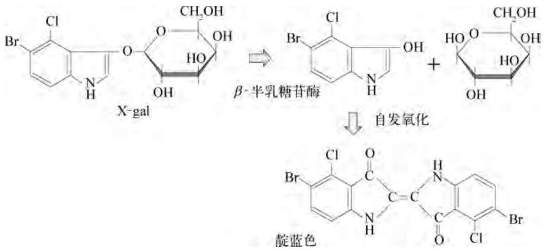

chemical

Chemical reaction pathway showing conversion of X-gal to β-sulfuric acid and subsequent dehydrogenation via self-catalyzed oxidation

图2-4 X-gal酶促显色反应

X-gal 的平板上形成淡蓝色的噬菌斑。但若外源 DNA 片段插入 lacZ' 标记基因内部将其灭活，重组噬菌体则形成无色噬菌斑。②  $cI^{+}$ ，有些  $\lambda-DNA$  载体携带含 EcoRI 位点的  $cI^{+}$ 标记基因，这种载体一旦进入  $hfl^{-}$ （高频溶原化）突变的大肠杆菌菌株内，便能立即进入溶原状态，形成浑浊噬菌斑（溶原细胞生长速度较未感染的细胞慢）。当外源基因插入  $cI^{+}$ 基因的 EcoRI 位点导致其灭活时，重组噬菌体因不能建立溶原状态而形成清晰噬菌斑；③  $Spi^{+}$ ，野生型  $\lambda$  噬菌体在被 P2 原噬菌体溶原化的大肠杆菌中不能进入裂解周期，这种表型称为 P2 干扰敏感型 ( $Spi^{+}$ )，但是缺失了两个重组基因 red 和 gam 的  $\lambda$  噬菌体在  $rec^{+}$ 的 P2 溶原菌中将不受 P2 的干扰而进行正常的无性繁殖 ( $Spi^{-}$ 表型)。在一些  $\lambda-DNA$  载体中，外源基因的插入与载体 DNA 某一片段的缺失同时发生，这段在 DNA 重组过程中缺失的片段中含 red 和 gam 基因，因此凡是重组的  $\lambda$  噬菌体均呈现  $Spi^{-}$ 表型，即裂解溶原菌，形成噬菌斑，反之亦然。

除上述构建步骤外,有些  $\lambda$ -DNA 载体还引入一些基因表达的调控元件,使得外源基因能直接在  $\lambda$ -DNA 上表达,然后利用免疫学方法筛选鉴定重组分子。

## 3. $\lambda$-DNA 载体的分类及用途

有些  $\lambda-DNA$  载体经改造后的长度恰好为包装的下限，因而其本身也能被包装，这类载体称为插入型载体，其允许的外源 DNA 插入片段大小范围为 0～14.5 kb (50.9-36.4 kb)。利用此类载体克隆外源 DNA 片段时，需要使用载体所携带的选择性标记基因来筛选重组噬菌体。另一类作为取代型载体的  $\lambda-DNA$  分子长度约为 40 kb，在其非必需区域内拥有两个相同的酶切口，两者间的距离为 14 kb。使用时用酶切开载体分子，分离去除这个长 14 kb 的非必需 DNA 片段，然后以外源 DNA 片段取而代之，形成重组分子。显然，此类载体的装载量不仅比插入型载体大，而且被克隆的 DNA 片段必定在 10.4～24.9 kb 之间（去除 14 kb 非必需 DNA 片段后的两个载体片段总长为 26 kb）。取代型载体在克隆实验中已无须标记基因，因为空载的载体分子只有 26 kb，不能被包装成成熟的噬菌体颗粒，含小于 10 kb 和大于 25 kb 外源 DNA 片段的重组分子也不能形成噬菌斑。商品化的取代型载体拥有长臂和短臂两个 DNA 片段，中间非必需区域已被分离去除，为克隆实验提供了便利。根据功能和用途不同， $\lambda-DNA$  载体可分为如下几个家族:

（1）Charon 系列。该系列的噬菌体 DNA 是为克隆外源 DNA 大片段而设计的取代型载体，其中 Charon40 载体的非必需区域由多个头尾相聚的 DNA 小片段串联而成，每个小片段均拥有一个相同的酶切口。在使用时，将载体 DNA 用这种限制性核酸内切酶处理，小片段 DNA 即可用聚乙二醇分级沉淀去除，剩下的长臂和短臂载体片段直接用于连接

反应。

（2）EMBL 系列。这类载体也是用来设计克隆大片段基因组 DNA 的取代型载体，其克隆位点为 BamHI，特别适合克隆用 Sau3AI 部分酶切的外源 DNA 片段。在 BamHI 位点的两侧还设计了 EcoRI 和 SalI 位点，克隆后便于用 EcoRI 或 SalI 将外源 DNA 片段从重组  $\lambda$ -DNA 分子中卸下回收。
(3) $\lambda$DASH 系列。这类载体含互为反向的两套多克隆位点接头序列,便于多种外源 DNA 大片段的取代性重组,而且容易从重组分子中回收克隆的外源 DNA 片段。在两套多克隆位点序列的外侧邻近位点还分别装有 $P_{\mathrm{T7}}$ 和 $P_{\mathrm{T3}}$ 启动子,因此可以直接合成与克隆 DNA 片段互补的 RNA 探针,简化染色体走读程序。
（4）$\lambda \mathrm{gt}$ 系列。这是一类插入型表达载体，可用来克隆表达外源 cDNA，形成 $\beta-$ 半乳糖苷酶融合蛋白，通常用免疫学方法对噬菌斑进行筛选。载体上的温度敏感型阻遏物用来控制噬菌体的复制以及融合蛋白的表达。

上述各系列中较为常用的  $\lambda$ -DNA 载体的性能列于表 2-2 中。

表 2-2 几种常用 $\lambda$ -DNA 载体的结构与功能

| 载体 | 大小/kb | 克隆位点 | 标记 | 功能 |
| --- | --- | --- | --- | --- |
| $\lambda gt10$ | 43.3 | EcoRI | 重组后呈 $cI^{-}$ 表型,可在hflA150突变型宿主菌中正常生长并形成噬菌斑 | 当外源DNA的量十分有限时,常用此载体 |
| $\lambda gt11$ | 43.7 | EcoRI | $lacI^{-}$ | 若插入片段的阅读框与lacZ的阅读框相吻合,可表达出融合蛋白 |
| $\lambda -GEM-11$ | 43.0 | SacI,AvrII,EcoRI,BamHI,XhoI,XbaI | 无须特定标记,空载时不能被包装,因而不能在固体培养基上形成噬菌斑 | $P_{T7}$和$P_{SP6}$启动子允许从克隆片段的任意一端合成RNA探针,从而简化染色体走读法操作 |
| $\lambda -GEM-12$ | 43.0 | SacI,NotI,EcoRI,BamHI,XhoI,XbaI | 同上 | 同上 |
| $\lambda -EMBL3/4$ | 43.0 | BamHI,EcoRI,SalI | 重组后呈$Spi^{-}$表型,可用P2噬菌体的溶原性宿主进行筛选 | 用来克隆大片段(可达20kb)基因组DNA的置换型载体 |

## 4. $\lambda -\mathrm{DNA}$ 的分离与纯化

分子克隆实验中快速抽取重组 $\lambda$-DNA 的程序如下:① 在含麦芽糖和 $\mathrm{MgCl}_{2}$ 的 LB 培养基中培养大肠杆菌受体细胞至对数生长期；② 加入合适滴度的重组 $\lambda$ 噬菌体悬浮液（通常为外源 DNA 片段与 $\lambda$-DNA 载体的连接反应体系经体外包装后的悬浮液），$37^{\circ}\mathrm{C}$ 保温 $1\mathrm{h}$；③ 用新鲜的 LB 培养基稀释培养物，继续培养 $4\sim 12\mathrm{h}$，此时培养液逐渐由浑浊变为澄清，大肠杆菌细胞已完全被裂解，噬菌体颗粒可达 $10^{13}\sim 10^{14} / \mathrm{L}$；④ 加入固体 NaCl 和 PEG 8000，高速离心沉淀噬菌体颗粒；⑤ 用蛋白酶 K 处理噬菌体悬浮液，并用苯酚-氯仿抽提蛋白质，释放 $\lambda$-DNA；⑥ 乙醇或异丙醇沉淀 DNA。用此法抽提的 $\lambda$-DNA 纯度不高，含少量的宿主菌染色体 DNA 片段，但程序较为简洁。若在第④步中改用 CsCl 密度梯度离心，则可获得高纯度的 $\lambda$-DNA 样品。

## 5. M13 单链噬菌体 DNA 载体

以大肠杆菌为宿主的噬菌体除了基因组 DNA 较大且呈双链结构的  $\lambda$  和 T 系列噬菌体外，还有一些基因组相对分子质量较小的单链环状噬菌体，其中研究得较为深入的有两大家族:主体对称型噬菌体（如  $\phi$ X174 和 G4）以及雄性专一性丝状噬菌体（如 fl、fd、M13）。后者特异性感染含 F 性散毛结构的大肠杆菌，而且三种噬菌体的基因组 DNA 具有高度同源性。

M13 单链噬菌体基因组 DNA 由 6407 个核苷酸组成, 拥有 9 个编码 10 种蛋白质的重叠基因,成熟的 M13 噬菌体只含 DNA 正链,但所有的噬菌体基因均由 DNA 负链转录。基因 III 和 VIII 编码的蛋白质是噬菌体的主要包装成分,大约 2 700 个 VIII 蛋白亚基与 M13-DNA 单链紧密结合形成噬菌体的丝状结构。如果将外源 DNA 大片段插入 M13-DNA 中,则 VIII 蛋白在感染的细菌细胞中大量合成,重组噬菌体的长度也等比例扩大,其包装极限可达 M13-DNA 本身长度的 7 倍。蛋白 III 形成四聚体,位于丝状结构的一端,在宿主细胞的感染过程中起着与 F 性散毛特异性吸附的作用,是一种导向性蛋白组分。其余的噬菌体基因如 I、IV、VI、VII、IX 则编码少量的噬菌体颗粒装配蛋白组分。

M13 噬菌体与宿主菌性散毛结合后,将其单链 DNA(正链)通过散毛内腔注入细菌细胞内,成熟的噬菌体颗粒则从细胞内通过挤压的方式释放出去,并不裂解宿主细胞。然而这种感染过程毕竟在一定程度上妨碍了细菌的生长,因此在生长着大肠杆菌宿主菌的培养平板上,单一 M13 噬菌体颗粒的无性繁殖系导致其区域内的宿主菌比其他区域的宿主菌生长慢,从而形成典型的浑浊型噬菌斑。

M13-DNA的复制周期如图2-5所示，包含三个主要步骤:第一步，以进入宿主细胞的噬菌体DNA正链为模板，复制其互补的DNA负链，形成亲本双链复制型DNA（RF-DNA）；第二步，由基因II编码的蛋白产物在RF-DNA分子的正链上产生一个缺口，并以负链为模板在宿主细胞DNA聚合酶III的作用下，从游离的正链 $3^{\prime}$ 末端复制一个正链分子。然后，蛋白II切开正链二聚体，形成一个带有缺口的RF双链分子（由亲本负链与子代正链组成）以及一个被取代了的亲本正链，后者自我环化并继续复制单链DNA，由此进入RF-DNA复制的新一轮循环，每一轮循环均涉及双链变单链和单链变双链的两个过程。与此同时，负链DNA还作为转录模板不断表达出更多的基因II和 $V$ 的编码产物；第三步，当宿主细胞内RF-DNA增殖到 $100\sim 200$ 个拷贝后，基因 $V$ 的表达产物也已积累到一定的浓度，它通过与正链DNA结合形成单链DNA-蛋白复合物，特异性抑制其复制负链DNA的活性，导致宿主细胞内正链DNA的大量积累。然后正链DNA-蛋白V复合物移至宿主细胞的膜间隙中，定位在此的已经合成的包装蛋白系取代蛋白V，将正链DNA装配成成熟的噬菌体颗粒。

由于 M13-DNA 本身远小于  $\lambda$ -DNA, 如果待克隆的外源 DNA 片段不是很大, 则 DNA 重组分子可通过常规的质粒转化方法导入受体细胞, 无须体外包装。在 M13-DNA 的整个复制周期中, 宿主细胞内存在多拷贝的双链 RF-DNA 分子, 因此可采用类似于质粒分离纯化的方法从菌体内制备 RF-DNA 载体或 M13-DNA 重组分子; 同时又可以从噬菌体感染的细菌培养上清液中收获噬菌体颗粒, 并采用类似于  $\lambda$ -DNA 分离纯化的方法制备单链 M13-DNA 或 DNA 重组分子, 后者在 DNA 序列测定以及定点诱变等分子生物学操作中极为有用, M13-DNA 作为克隆载体的优越性也表现在这里。

M13-DNA 中的所有基因均为噬菌体增殖所必需的，因此不能删除任何 DNA 片段，只能通过定点诱变或在合适位点插入一段 DNA 序列对其进行改造。由于 M13-DNA 上的基因排列较为紧密，故供 DNA 片段插入的区域仅限于基因 II 与基因 IV 之间的狭小区域。M13-DNA 载体改造的内容包括:① 通过定点诱变技术封闭重复的重要限制性酶切口；② 引入合适的选择性标记基因，如含启动子、操作子和 β-半乳糖苷酶氨基端编码序列 (lacZ') 的乳糖操纵子片段 (lac)、组氨酸操纵子片段 (his) 以及抗生素抗性基因等；③ 将人工合成的多克隆接头片段插在 lacZ' 标记基因内部，这使得重组噬菌斑呈白色，而只含载体 DNA 的浑浊噬菌斑则呈蓝色；④ 将多克隆接头片段的两侧区域改造成统一的 DNA 测序引物序列，使重组 DNA 分子的单链形式经分离纯化后可直接进行测序反应。目前实验室中常见的 M13-DNA 载体为 M13mp 系列，其性能列在表 2-3 中。

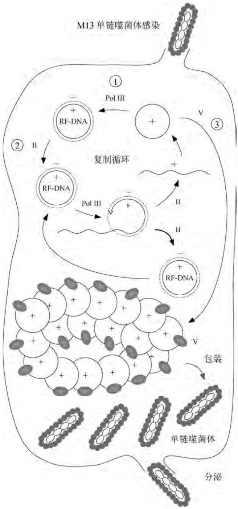

flowchart

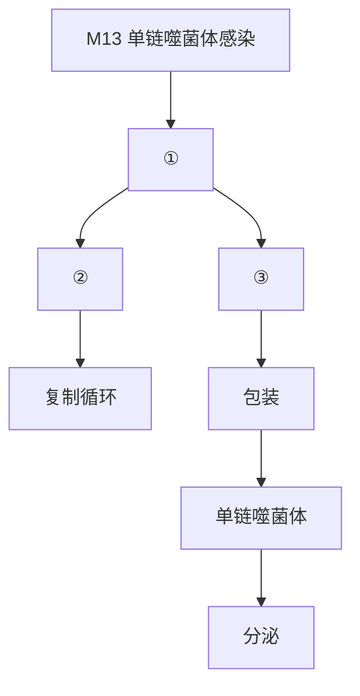

图2-5 大肠杆菌M13噬菌体DNA的复制周期

## 2.1.3 噬菌体-质粒杂合载体

噬菌体 DNA 和质粒 DNA 作为 DNA 重组的载体各有利弊, 若将噬菌体 DNA 某个特征区域(如  $\lambda$  噬菌体 DNA 的 cos 区和丝状噬菌体的复制区)与质粒 DNA 重组, 则构成的杂合质粒具有更多的优良性能, 可大大简化分子克隆的操作。

表 2-3 实验室常用的 M13 单链噬菌体 DNA 载体

| 载体 | 亲本 | 插入片段/bp | 克隆位点 | 表型 | 增殖方式 |
| --- | --- | --- | --- | --- | --- |
| M13mp18/19 | M13mp2 | 5 868 | EcoRI, SacI, KpnI, SmaI, XmaI, BamHI, XbaI, SalI, AccI, HincII, PstI, SphI, HindIII | lac | P/C |
| M13blacat | M13 Tn3 pACYC184 | 5 565 | EcoRI, PstI | $Ap^r$, $Cmr$ | C |
| R199 | fl | 5 725 | EcoRI | - | P |
| R208 | R199 | 5 725 | HindIII, PstI, SalI | $Ap^r$, $Tcr$ | C |
| fd11 | fd pKB252 | 5 830 | EcoRI | - | P |
| fd101 | fd pACYC177 | 5 565 | PstI, HindIII, SmaI | $Ap^r$, $Kmr$ | C |
| fd - tet | fd Tn10 | 5 644 | EcoRI, HindIII | $Tcr$ | C |
| fKN16 | fd - tet | 5 644 | EcoRI, HindIII | $Tcr^r$, $\Delta geneIII$ | C |

注:P—噬菌斑；C—菌落。

## 1. 黏粒载体

黏粒载体又称考斯质粒(Cosmid)，它由 $\lambda -\mathrm{DNA}$ 的cos区与质粒DNA重组而成，故得此名。$\lambda -\mathrm{DNA}$ 载体由于包装尺寸的限制，其外源DNA片段装载量最多只有 $25\mathrm{kb}$，而真核生物基因文库的构建往往需要装载量更大的载体(详见2.5.5)。由于 $\lambda -\mathrm{DNA}$ 的包装蛋白只识别cos信号，与待包装DNA的性质无关，因此用质粒DNA取代 $\lambda -\mathrm{DNA}$ 便可大幅度地提高外源DNA片段的装载量。例如，$\lambda -\mathrm{DNA}$ cos位点及其附近区域的DNA片段为$1.7\mathrm{kb}$，质粒DNA为 $3.3\mathrm{kb}$，则由此构成的考斯质粒总长 $5.0\mathrm{kb}$，其最大装载量便可达$45.9\mathrm{kb}$。

考斯质粒的优越性是显而易见的:外源DNA片段在体外与考斯质粒重组后，用合适的限制性内切酶将其线性化，使得两个cos位点分别位于两端，后者经 $\lambda$ 噬菌体包装系统体外包装成具有感染力的颗粒，便能像 $\lambda$ 噬菌体感染大肠杆菌一样高效进入受体细胞内；由于包装下限的限制，非重组的载体分子即便拥有cos位点也不能被包装，因而具有很强的选择性；考斯质粒也可通过常规的质粒转化方法导入受体细胞并得以扩增，载体分子的大规模制备程序与质粒完全相同；考斯质粒上的多克隆位点为外源DNA片段的克隆提供了很大的可操作性，而且质粒上的选择性标记可直接用来筛选感染的转化细胞。

与 $\lambda$ 噬菌体DNA不同的是，考斯质粒重组分子进入受体细胞后，依靠质粒DNA中的复制子进行自主复制，其拷贝数取决于质粒本身的性质，而且由于重组分子失去了体内包装的能力，故其分离纯化只能采用质粒提取的方法。总之，除了重组分子导入受体细胞的方法与 $\lambda -\mathrm{DNA}$ 相似外，考斯质粒作为克隆载体的全部操作均与质粒完全一致。表2-4列举的是几种常用的大肠杆菌考斯质粒。

表 2-4 实验室常用的考斯质粒

| 考斯质粒 | 大小/kb | 酶切位点 | 装载量/kb | 选择标记 |
| --- | --- | --- | --- | --- |
| pHC79 | 6.1 | EcoRI, SalI, HindIII, PstI, BamHI, PvuII | 30.7~45.5 | $Ap^{r} + Tc^{r}$ |
| pJB8 | 5.4 | EcoRI, HindIII, SalI, BamHI | 31.5~46.1 | $Ap^{r}$ |
| pU206 | 15.5 | BamHI | 21.3~36.0 | $Ap^{r} + Ts^{r}$ |
| pLFR5 | 6.0 | BamHI, ScaI | 31.0~45.5 | $Tc^{r}$ |

## 2. 噬菌粒载体

噬菌粒载体是一类由丝状噬菌体DNA复制起始位点序列与质粒组成的杂合分子。M13噬菌体基因 $II$ 和基因 $IV$ 之间有一段长度为508个核苷酸的间隔区(IG)，它不编码蛋白质,却是正负链 DNA 复制的起始终止区域以及单链 DNA 包装的顺式信号位点。将 IG 片段克隆到质粒上所形成的噬菌粒在受体细胞内能随着质粒的自主复制而稳定遗传。含噬菌粒的受体细胞若用一个合适的辅助丝状噬菌体感染,则这个辅助噬菌体的基因 II 表达产物便会反式激活噬菌粒上的 IG 位点,启动噬菌粒以丝状噬菌体 DNA 的复制模式进行复制,形成的单链噬菌粒 DNA 与辅助噬菌体单链 DNA 分别包装成成熟的丝状噬菌体并分泌至受体细胞外,而被包装的噬菌粒单链 DNA 的性质则取决于 IG 位点的克隆方向。

与 M13-DNA 相比, 噬菌粒载体的优点是: ① 具有质粒的基本性质, 便于外源 DNA 片段的克隆及重组子的筛选; ② 在一定程度上提高了外源 DNA 片段的装载量, 普通的 M13-DNA 系列载体长度为 $7 \mathrm{~kb}$, 外源 DNA 片段与之重组后通常采用质粒转化方法导入受体细胞, 其导入效率在重组分子大于 $15 \mathrm{~kb}$ 时与重组分子的大小成反比, 因此载体分子越小, 其装载量越大, 而噬菌粒通常只有 M13mp 载体大小的一半; ③ M13-DNA 的重组分子在复制时常会发生 DNA 缺失, 而噬菌粒重组分子则相对稳定。表 2-5 列举的是几种实验室常见的噬菌粒载体, 它们大多由质粒 pUC 系列或 pBR322 与丝状噬菌体的 IG 区域构成。

表 2-5 实验室常用的噬菌粒载体

| 质粒 | 大小/kb | 克隆位点 | 选择标记 | 功能 |
| --- | --- | --- | --- | --- |
| pGEM-3Zf | 3.2 | EcoRI, SacI, KpnI, HindIII, SmaI, BamHI, SphI, SalI, PstI, XbaI | lac$Z'$ | 克隆载体,拥有丝状噬菌体fl的复制起始位点,可用于体外转录和环状单链DNA合成的模板 |
| pUC118/119 | 3.2 | EcoRI, SacI, KpnI, BamHI, SmaI, XbaI, SalI, PstI, SphI, HindIII | lac$Z'$ | 当寄主细胞未感染辅助噬菌体M13时,噬菌粒载体的复制与双链质粒DNA相似;当寄主细胞被辅助噬菌体M13感染后,载体便按M13噬菌体的滚环模型进行复制 |
| pZ258 | 4.9 | AvaI, RsaI, DdeI, AhaIII | $Ap^r, Tc^r$ | 同上 |
| pEMBL | 4.0 | EcoRI, HindIII, BamHI, SalI, SmaI, PstI | lac$Z'$ | 同上 |

## 2.1.4 人造染色体载体

人类、动物和植物等大型基因组的序列分析往往需要克隆数百甚至上千 kb 的 DNA 大片段, 此时考斯质粒和噬菌粒载体的装载量也远远不能满足需要。进一步开发高装载量载体的设想是模拟生物染色体 DNA 的结构, 并保留其稳定复制和遗传的特性。例如, 将细菌接合因子、酵母或人类染色体 DNA 中的复制区、分配区、稳定区、端粒区与质粒组装在一起, 即可构成人造染色体载体。当大片段的外源 DNA 与这些染色体载体重组后, 利用电穿孔技术(见 2.3.3) 导入受体细胞, 组蛋白将复制后的重组 DNA 分子包装折叠, 形成重组人造染色体, 后者能像天然染色体那样在受体细胞中稳定复制并遗传。与质粒等其他载体不同的是, 各种类型的人造染色体载体在受体细胞中只能维持单一拷贝。

目前已开发出多种类型的人造染色体载体，包括基于大肠杆菌性因子F质粒的细菌人造染色体BAC系列，其装载量在 $50\sim 300\mathrm{kb}$ 内；基于酵母染色体复制元件的酵母人造染色体YAC系列(见5.2.2)；基于人类染色体复制元件的人类人造染色体MAC或HAC系列(见7.2.3)等。

## 2.2 DNA 的体外重组(切与接)

分子克隆的第一步是从不同来源的DNA(染色体DNA或重组DNA分子)中将待克隆的DNA片段特异性切下，同时打开载体DNA分子，然后将两者连接成杂合分子。有时在外源DNA片段与载体分子拼接前，还需要对连接位点做特殊的技术处理，以提高连接效率。所有这些操作均由一系列功能各异的工具酶来完成，其中一些常用的工具酶本身也已使用基因工程方法产生，如部分限制性核酸内切酶、T4-DNA连接酶以及Klenow DNA聚合酶等。

## 2.2.1 限制性核酸内切酶

限制性核酸内切酶几乎存在于所有原核细菌中，它能在特异位点上催化双链DNA分子的断裂，产生相应的限制性片段。由于不同生物来源的DNA具有不同的酶切位点以及不同的位点排列顺序，因此各种生物的DNA呈现特征性的限制性酶切图谱，这种特性在生物分类、基因定位、疾病诊断、刑事侦查直至基因重组领域中起着极为重要的作用，因此限制性核酸内切酶被誉为“分子手术刀”。

## 1. 限制性核酸内切酶的发现

早在20世纪50年代初，两个研究小组差不多同时发现，两种不同来源的 $\lambda_{\mathrm{K}}$ 和 $\lambda_{\mathrm{B}}$ )能高频感染它们各自的大肠杆菌宿主细胞(K株和B株)，但当这两株菌分别与其他宿主菌交叉混合培养时，感染频率普遍降为原来的数千分之一。一旦 $\lambda_{\mathrm{K}}$ 噬菌体在B株中感染成功，由B株繁殖出的 $\lambda_{\mathrm{K}}$ 后代在第二轮接种中便能像 $\lambda_{\mathrm{B}}$ 一样高频感染B株，但却不能再有效地感染它原来的宿主K株。这种现象称为宿主细胞的限制和修饰作用，广泛存在于原核细菌中。

10年后，人们搞清了细菌限制和修饰作用的分子机制。大肠杆菌K株和B株均拥有各自不同的限制/修饰系统，该系统由3个连续的基因位点控制，其中hsdR编码限制性核酸内切酶，它能识别DNA分子上的特定序列并将双链DNA切断；hsdM的编码产物是DNA甲基化酶，催化DNA分子特定位点上的碱基甲基化反应；而hsdS表达产物的功能则是协助上述两种酶识别特殊的作用位点。$\lambda_{\mathrm{K}}$ 和 $\lambda_{\mathrm{B}}$ 长期寄生在大肠杆菌的K株和B株中，宿主细胞内甲基化酶已将其染色体DNA和噬菌体DNA特异性保护，封闭了自身所产生的限制性核酸内切酶的识别位点。当外来DNA入侵时，便遭到宿主限制性内切酶的特异性降解，由于这种降解作用的不完全性，总有极少数入侵的DNA分子幸免于难，它们得以在宿主细胞内复制，并在复制过程中被宿主的甲基化酶修饰。此后，入侵噬菌体的子代便能高频感染同一宿主菌，但丧失了在其原来宿主细胞中的存活力，因为它们在接受了新宿主菌甲基化修饰的同时，也丧失了原宿主菌甲基化修饰的标记。大肠杆菌C株不产限制性内切酶，因而其他来源的 $\lambda$ 噬菌体可以感染C株，而在C株中繁殖的 $\lambda$ 噬菌体则在K株和B株中受到严格的限制，细菌正是利用这种限制修饰系统区分自身DNA与外源DNA。

目前，在细菌中已发现了上千种限制性核酸内切酶，根据其性质不同可分为三大类。其中，II类限制性核酸内切酶与其所对应的甲基化酶是分离的，不属同一酶分子（即反式酶活），而且由于这类酶的识别切割位点比较专一，因此广泛用于DNA重组。I类和III类酶严格地说应该称为限制-修饰酶，因为它们的限制性核酸内切活性及甲基化活性都作为亚基的功能单位包含在同一酶分子中（即顺式酶活）。三类限制性核酸内切酶的详细特征见表2-6。

## 2. II类限制性核酸内切酶的基本特征

II类限制性核酸内切酶由Smith等人于1968年在流感嗜血杆菌d型菌株中首次鉴定。该类酶是一种相对分子质量较小的单体蛋白，其双链DNA的识别和切割活性仅需要$\mathrm{Mg}^{2+}$，且识别和切割位点的序列大都具有严格的特异性，因而在DNA重组实验中被广泛使用。

表 2-6 原核细菌中的三大类修饰限制系统

<table><tr><td>结构/性能</td><td>I类酶</td><td>II类酶</td><td>III类酶</td></tr><tr><td>酶分子结构</td><td>三亚基双功能酶</td><td>内切酶和甲基化酶不在一起</td><td>三亚基双功能酶</td></tr><tr><td>识别位点</td><td>二分非对称序列</td><td>4~8 bp短序列,多呈回文结构</td><td>5~7 bp非对称序列</td></tr><tr><td rowspan="2">切割位点</td><td>距离识别位点至少1 kb</td><td>在识别位点内部或两侧</td><td>在识别位点下游24~26 bp处</td></tr><tr><td>无特异性</td><td>呈特异性</td><td>无特异性</td></tr><tr><td>限制反应与甲基化反应</td><td>相互排斥</td><td>相互独立</td><td>相互竞争</td></tr><tr><td>限制作用是否需要ATP</td><td>需要</td><td>不需要</td><td>需要</td></tr></table>

## 1) II 类限制性核酸内切酶的命名

目前已分离并鉴定出800余种Ⅱ类限制性核酸内切酶，商品化的约有300种。这些酶的统一命名由其来源的细菌名称缩写构成，具体规则是:以细菌属名的第一个大写字母和种名的前两个小写字母构成酶的基本名称；如果酶存在于一种特殊的菌株中，则将株名的一个字母加在基本名称之后；若酶的编码基因位于噬菌体(病毒)或质粒上，则还需用一个大写字母表示这些非染色体的遗传因子。酶名称的最后部分为罗马数字，表示在该菌株中发现此酶的先后次序，如HindIII是在流感嗜血杆菌(Haemophilus influenzae)d株中发现的第三个酶，而EcoRI则表示其基因位于大肠杆菌(Escherichia coli)的抗药性R质粒上。

## 2) II 类限制性核酸内切酶的识别序列

多数 II 类酶的识别序列为 4～8 对碱基，而且具有  $180^{\circ}$  旋转对称的特征性回文结构。例如，EcoRI 的识别序列为  $5^{\prime}-GAATTC-3^{\prime}$ （单链序列），对称轴位于第 3 与第 4 位碱基之间；对于由 5 对碱基组成的识别序列而言，其对称轴为中间的一对碱基。一部分 II 类酶的识别序列中某一或某两位碱基并非严格专一，但都在两种碱基中具有可替代性，这种不专一性并不影响内切酶和甲基化酶的切割位点，只是增加了 DNA 分子上的酶识别与作用频率。

按照概率计算，4～6碱基对的识别序列在DNA中出现的频率分别为 $1/256(4^{-4})$ 、 $1/1026(4^{-5})$ 和 $1/4096(4^{-6})$ ，若以100种不同的识别序列计算（4、5、6碱基对序列的酶各为20种、30种、50种），则DNA链上出现一个II类酶识别位点的概率为1/9，即任何一个DNA分子上平均每9对碱基中就会有一个II类酶切位点。实际上，由于不同生物的DNA碱基含量不同，因此酶识别位点的分布和频率也不尽相同。例如，梭菌属基因组中A和T具有绝对优势，所以那些富含AT的识别序列（如DraI, $5^{\prime}-TTTAAA-3^{\prime}$ ;SspI, $5^{\prime}-AATATT-3^{\prime}$ )出现频率较高；而链霉菌基因组因其GC含量高达70%～80%，因而富含GC碱基对的识别序列（如SmaI,CCCGGG;SstII,CCGCGG）较为常见。

## 3) II 类限制性核酸内切酶的切割方式

绝大多数的 II 类酶均在其识别位点内部或两侧切割 DNA, 使得 DNA 每条链中相邻两个碱基之间的磷酸二酯键断开。一部分酶识别相同的序列, 但切点不同, 这些酶称为同位酶 (Isoschizomer, 如 XmaI、SmaI、AvaI); 识别序列与切割位点均相同的不同来源的酶称为同裂酶 (如 SstI 与 SacI、HindIII 与 HsuI 等); 有些酶识别位点不同, 但切出的 DNA 片段具有相同的末端序列, 这些酶称为同尾酶 (Isocandamer, 如 MboI、BglII、BclI、BamHI); 还有极少数酶的 DNA 切割活性依赖于识别序列内部碱基的甲基化作用。表 2-7 列出了实验室常用的 4 和 6 碱基对识别位点型 II 类限制性核酸内切酶, 每个小格中的酶互为同裂酶, 每一大格垂直方向的 5 个小格中的酶互为同位酶, 同一竖行中处于各大方格中相应位置上的酶则构成一组同尾酶。

表 2-7 常用 II 类限制性核酸内切酶的识别位点和切点

|  | AATT | ACGT | AGCT | ATAT | CATG | CCGG | CGCG | CTAG | GATC | GCGC | GGCC | GTAC | TATA | TCGA | TGCA | TTAA |
| --- | --- | --- | --- | --- | --- | --- | --- | --- | --- | --- | --- | --- | --- | --- | --- | --- |
| ▼□□□□ |  |  |  |  |  |  |  |  | MboI |  |  |  |  |  |  |  |
| □▼□□□ |  | MaeII |  |  |  | HpaII |  | MaeI |  | HinPI |  |  |  | TaqI |  | MseI |
| □□▼□□ |  |  | AluI |  |  |  | BstUI |  | DpnI |  | HaeIII | RsaI |  |  |  |  |
| □□□▼□ |  |  |  |  |  |  |  |  |  | HhaI |  |  |  |  |  |  |
| □□□□▼ |  |  |  |  | NlaIII |  |  |  |  |  |  |  |  |  |  |  |
| A▼□□□□T |  |  | HindIII |  | AflIII |  | MluIAflIII | SpeI | BglIIBstYI |  |  |  |  |  |  |  |
| A□▼□□□T |  |  |  |  |  |  |  |  |  |  |  |  |  | ClaI |  | AseI |
| A□□▼□□T |  |  |  | SspI |  |  |  |  |  | Eco47III | StuI | ScaI |  |  |  |  |
| A□□□▼□T |  |  |  |  |  |  |  |  |  |  |  |  |  |  |  |  |
| A□□□□▼T |  |  |  |  | Nsp7524I |  |  |  |  | HaeII |  |  |  |  | NsiI |  |
| C▼□□□□G |  |  |  |  | NcoISTyl | XmaIAvaI |  | AvrIIStyI |  |  | EagIEaeI |  |  | XhoIAvaI |  | AflII |
| C□▼□□□G |  |  |  | NdeI |  |  |  |  |  |  |  |  |  |  |  |  |
| C□□▼□□G |  |  | PvuINspBII |  |  | SmaI | NspBII |  |  |  |  |  |  |  |  |  |
| C□□□▼□G |  |  |  |  |  |  | SacII |  | PvuI |  |  |  |  |  |  |  |
| C□□□□▼G |  |  |  |  |  |  |  |  |  |  |  |  |  |  | PstI |  |
| G▼□□□□C | EcoRI |  |  |  |  |  | BsshII | NheI | BamHIBstYI | BanI |  | Asp718BanI |  | SalI | ApaLI |  |
| G□▼□□□C |  | AhaII |  |  |  |  |  |  |  | NarIAhaII |  |  | AccI | AccI |  |  |
| G□□▼□□C |  |  |  | EcoRV |  | NaeI |  |  |  |  |  |  | XcaI | HincII |  | HpaIHincII |
| G□□□▼□C |  |  |  |  |  |  |  |  |  |  |  |  |  |  |  |  |
| G□□□□▼C |  | AatII | SacIBanII |  | SphINsp7524I |  |  |  |  | BbeIHaeII | ApaIBanII | KpnI |  |  | Bsp1286HgiAI |  |
| T▼□□□□A |  |  |  |  | BspHI | BspMII |  | XbaI | BclI |  | EaeI |  |  |  |  |  |
| T□▼□□□A |  |  |  |  |  |  |  |  |  |  |  |  |  |  |  |  |
| T□□▼□□A |  | SnaBI |  |  |  |  | NruI |  |  | FspI | BaI |  |  |  |  | DraI |
| T□□□▼□A |  |  |  |  |  |  |  |  |  |  |  |  |  |  |  |  |
| T□□□□▼A |  |  |  |  |  |  |  |  |  |  |  |  |  |  |  |  |

根据被切开的 DNA 末端性质的不同(不考虑碱基序列)，所有的 II 类酶又可分为  $5'$  突出末端酶、 $3'$  突出末端酶及平头末端酶三大类(图 2-6)。除后者外，任何一种 II 酶产生的两个突出末端在足够低的温度下均可退火互补，因此这种末端称为黏性末端(Cohesive Ends)，这是 DNA 分子重组的基础。

5'黏性末端酶:

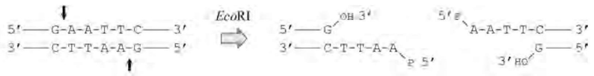

chemical

Chemical reaction diagram showing EcoRI enzyme cleavage to form a modified peptide chain with labeled residues and hydrogen bonds

3'黏性末端酶:

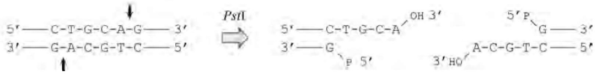

chemical

Chemical reaction scheme showing conversion of compound 5'—C-T-G-C-A-G to 3'—G-A-C-G-T-C via PstII and OH-3' to form intermediate 5'

平头末端酶:

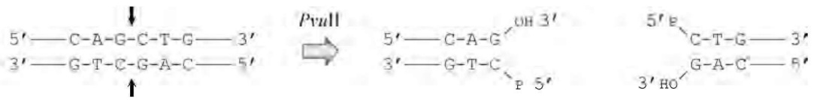

chemical

Chemical reaction scheme showing conversion of a peptide to a hydroxyalkene derivative via PvuII and OH 3' reagent

图2-6 DNA经限制性内切酶作用后的三种断口

## 3. 甲基化酶的基本特征

有些 II 类限制性核酸内切酶拥有相应的甲基化酶伙伴，甲基化酶的识别位点与限制性内切酶相同，并在识别序列内使某位碱基甲基化，从而封闭该酶切口。此类甲基化酶的命名常在相对应的限制性内切酶名字前面冠以“M”，例如，EcoRI 的甲基化酶 M. EcoRI 催化 S-腺苷甲硫氨酸(SAM)中的甲基基团转移到 EcoRI 识别序列中的第 3 位腺嘌呤上，经过 M. EcoRI 处理的 DNA 分子便不再为 EcoRI 所降解。有时一种甲基化酶在封闭一个限制性内切酶切口的同时却形成另一种酶的切口，如两个串联的 TaqI 识别位点经 M. TaqI 甲基化封闭后，会出现一个依赖于甲基化的限制性核酸内切酶 DpnI 的切割位点（图 2-7）。

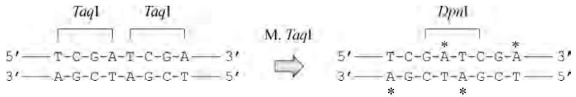

chemical

DNA double-strand break diagram showing Taq1 and DpnI gene structures with mutation sites

图2-7 甲基化依赖型限制性核酸内切酶 $DpnI$ 位点

大肠杆菌细胞内存在两种DNA甲基化酶，即DNA腺嘌呤甲基化酶Dam(DNA adenine methylase)和DNA胞嘧啶甲基化酶Dcm(DNA cytosine methylase)，这两类酶本身没有限制性内切酶活性。Dam酶可在 $5^{\prime} - \mathrm{GATC} - 3^{\prime}$ 序列内部腺嘌呤 $N^6$ 位置上引入甲基基团，而Dcm酶则使 $5^{\prime} - \mathrm{CCAGG} - 3^{\prime}$ 或 $5^{\prime} - \mathrm{CCTGG} - 3^{\prime}$ 序列中的胞嘧啶 $C^5$ 甲基化，因而从大肠杆菌细胞中提取的DNA（包括染色体DNA和质粒DNA）不能被某些限制性内切酶切开，对上述两种甲基化酶的修饰作用敏感的限制性核酸内切酶列在表2-8中。值得注意的是，有些限制性内切酶虽然识别序列本身不含完整的 Dam 或 Dcm 甲基化酶识别序列，但与其左右两侧的碱基能构成完整的甲基化酶识别序列，如 ClaI 的识别序列为  $5^{\prime}-ATCGAT-3^{\prime}$ ，当其  $5^{\prime}$  端外侧含 G，或  $3^{\prime}$  端外侧含 C，或两者同时出现时，便成为 Dam 甲基化酶的修饰靶点，而真正的甲基化位点却在 ClaI 的识别位点内。Dam 酶的这种甲基化修饰作用反而增加了 ClaI 酶的切割特异性，其识别切割序列由  $5^{\prime}-ATCGATN-3^{\prime}$  变为  $5^{\prime}-(C/T/A)ATCGAT(T/A/G)-3^{\prime}$ 。另外，有些限制性内切酶的活性对 Dam 和 Dcm 的甲基化修饰并不敏感，例如 BamHI、BglII、Sau3AI、BclI、MboI 等酶的识别位点均含  $5^{\prime}-GATC-3^{\prime}$  序列，但前 4 个酶的 DNA 切割活性并不为腺嘌呤的甲基化作用所限制，这可能与限制性内切酶本身的空间结构以及 DNA 切割的机制不同有关。

表 2-8 大肠杆菌甲基化修饰系统的影响序列

| Dam 敏感酶 | 序 列 | Dcm 敏感酶 | 序 列 |
| --- | --- | --- | --- |
| BclI | TGATCA | AvaII | $GG_{A}^{T}CC_{T}^{A}GG$ |
| ClaI | GATCGATC | EcoRII | CCAGG |
| HphI | GGTGATC | Sau96I | $GGNCC_{T}^{A}GG$ |
| MboI | GATC | StuI | AGGCCTGG |
| MboII | GAAGATC |  |  |
| NruI | GATCGCGA |  |  |
| TaqI | GATCGA |  |  |
| XbaI | TCTAGATC |  |  |

## 2.2.2 T4-DNA 连接酶

与限制性核酸内切酶不同，DNA连接酶广泛存在于各种生物体内，其催化的基本反应形式是将DNA双链上相邻的 $3^{\prime}$ 羟基和 $5^{\prime}$ 磷酸基团共价缩合成 $3^{\prime}, 5^{\prime}$-磷酸二酯键，使原来断开的DNA缺口重新连接起来，因此它在DNA复制、修复以及体内体外重组过程中起着重要作用。大肠杆菌DNA连接酶的活性发挥需要烟酰胺腺嘌呤二核苷酸 $(\mathrm{NAD}^{+})$ 作为辅助因子，$\mathrm{NAD}^{+}$与酶形成酶-AMP复合物，同时释放烟酰胺单核苷酸NMN。活化后的酶复合物结合在DNA的缺口处，修复磷酸二酯键，并释放AMP。T4噬菌体的DNA连接酶则以ATP作为辅助因子，它在与酶形成复合物的同时释放出焦磷酸基团，整个过程如图2-8所示。

T4-DNA 连接酶由 T4 噬菌体基因编码，相对分子质量约为 60 kD。商品化的 T4-DNA 连接酶均由大肠杆菌基因工程菌生产，这种工程菌的染色体 DNA 中整合了一个含噬菌体 DNA 连接酶编码基因的  $\lambda$ -DNA 片段。当培养温度上升至 42℃ 时，处于溶原状态的重组大肠杆菌大量合成重组 T4-DNA 连接酶，从而大大简化了纯化过程。T4-DNA 连接酶与大肠杆菌连接酶相比具有更广泛的底物适应性，它包括:① 修复双链 DNA 上的单链缺口（与大肠杆菌 DNA 连接酶相同），这是 DNA 连接酶的基本活性；② 连接 RNA-DNA 杂交双链上的 DNA 链缺口或 RNA 链缺口，后者反应速度较慢；③ 连接完全断开的两个平头双链 DNA 分子，由于该反应属于分子间连接，反应速度的提高依赖于两个 DNA 分子与酶分子三者的随机碰撞，因此在正常反应条件下连接速度缓慢，但若在反应系统中加入适量的一价阳离子（如 150～200 mmol/L 的 NaCl）和低浓度的 PEG，或者适当提高酶量及底物浓度均可明显改善平头 DNA 分子的连接。T4-DNA 连接酶的各种催化反应活性总结在图 2-9 中。

## 2.2.3 其他用于 DNA 重组的工具酶

除了 DNA 切割和连接外, 分子克隆实验有时还需要对待连接的 DNA 分子进行结构修饰, 后者由多种功能各异的工具酶催化进行, 分述如下。

## 1. Klenow 酶

Klenow 酶实际上是大肠杆菌 DNA 聚合酶 IC 端的大片段(约占总长的三分之二),首先由

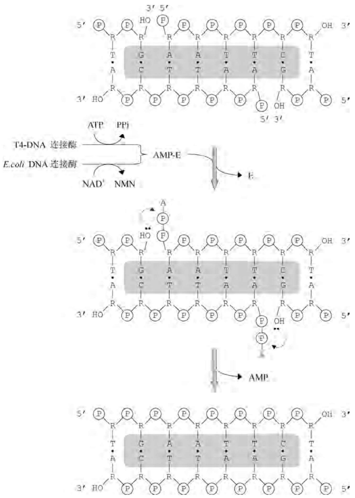

图2-8 DNA连接酶的催化机理

Klenow 采用枯草杆菌蛋白酶位点特异性裂解的方法从 DNA 聚合酶 I 中制备, 故得此名。目前已将 DNA 聚合酶编码基因的相应编码序列克隆表达, 并由重组大肠杆菌廉价生产。

大肠杆菌 DNA 聚合酶 I 在其单一多肽链上具有如下活性:①  $5^{\prime} \rightarrow 3^{\prime}$  的 DNA 聚合活性，使 DNA 链在模板的指导下延伸。②  $3^{\prime} \rightarrow 5^{\prime}$  的核酸酶外切活性，其主要功能是识别并切除错配的碱基，通过这种校正作用确保 DNA 复制的准确性。③  $5^{\prime} \rightarrow 3^{\prime}$  的核酸酶外切活性，这一功能具有三个特征:首先，待切除的核酸分子必须具有  $5^{\prime}$  端游离的磷酸基团；其次，核苷酸在被切除之前必须是已经配对的；最后，被切除的核苷酸既可以是脱氧的也可以为非脱氧的，图2-10列出这种 $5^{\prime} \rightarrow 3^{\prime}$ 外切酶活性的若干底物和产物类型。④核酸内切酶活性，当一段DNA带有游离 $5^{\prime}$ 端磷酸基团的不配对单链时，该酶可作用在与此单链相连的两对配对碱基之间，切断其磷酸二酯键。

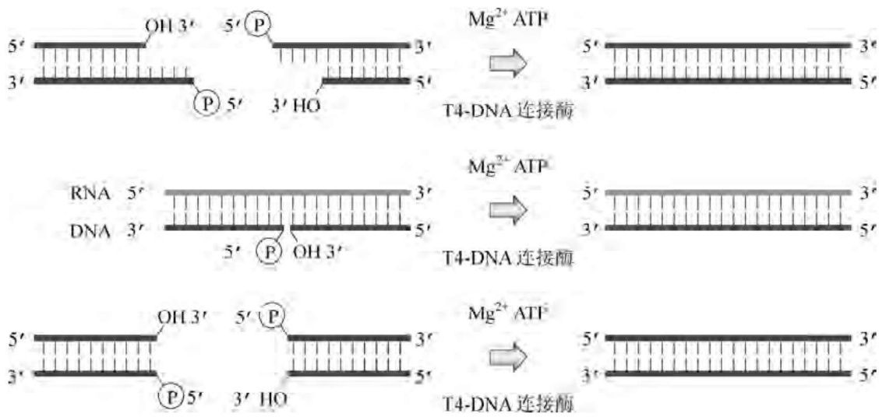

flowchart

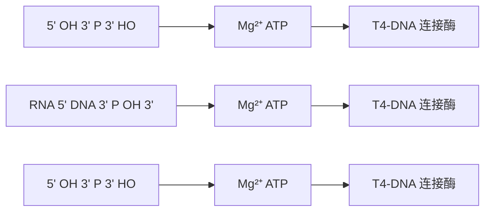

图2-9 T4-DNA连接酶的催化反应

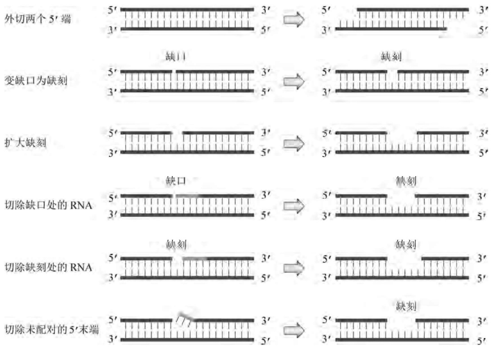

flowchart

This flowchart illustrates the process of RNA cutting and fragment removal using 5' end segments, involving steps such as extracellular regions, variable缺口 formation, expansion, and RNA removal.

图2-10 DNA聚合酶所含的外切酶活性

上述 4 种活性的催化中心在大肠杆菌 DNA 聚合酶 I 的多肽链上呈线型分布,作为该酶 C 端大片段的 Klenow 酶保留了  $5'\rightarrow3'$  的聚合活性和  $3'\rightarrow5'$  的外切校正功能,同时缺失了相应的  $5^{\prime} \rightarrow 3^{\prime}$  外切活性及核酸内切酶活性。Klenow 酶在分子克隆中的主要用途是:① 修复由限制性核酸内切酶造成的  $3^{\prime}$  凹端，使之成为平头末端；② 以含同位素的脱氧核苷酸为底物，对 DNA 片段进行标记；③ 用于催化 cDNA 第二链的合成；④ 用于双脱氧末端终止法测定 DNA 的序列。

## 2. 末端脱氧核苷酰转移酶

末端脱氧核苷酰转移酶(TdT)来源于小牛胸腺,它是一种不需要模板的DNA聚合酶,其合适的底物为带有3'游离羟基的双链DNA分子(图2-11)。当底物为3'端突出的双链DNA时,TdT在 $Mg^{2+}$ 的存在下可将脱氧核苷酸随机聚合在两条链的3'端。对于平头或3'凹端DNA底物,则需要 $Co^{2+}$ 激活,但聚合反应仍不按模板要求进行。TdT在人工黏性末端的构建中极有用处。

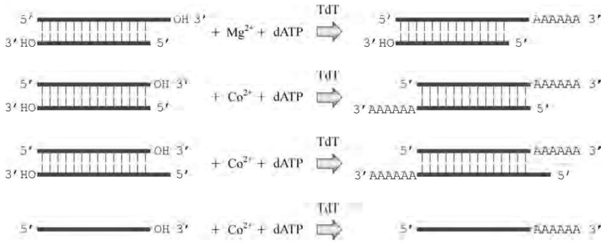

chemical

Diagram showing enzymatic reaction pathways involving TdT enzymes with Mg²⁺ and dATP, involving hydroxyl (OH) and carboxylate (Co²⁺) substrates

图2-11 末端脱氧核苷酰转移酶的催化反应

## 3. S1 核酸酶

S1 核酸酶来源于米曲霉菌，催化反应通常由  $Zn^{2+}$  激活，并在酸性 pH(4.0～4.5) 条件下进行。其特征是:① 降解单链 DNA 或 RNA，包括不能形成双链的区域（如发夹结构中的环状部分），但降解 DNA 的速度大于降解 RNA 的速度；② 降解反应的方式为内切和外切；③ 酶量过大时会伴有双链核酸的降解，因为该酶的双链降解活性比单链低 7.5 万倍。在 DNA 重组及分子生物学研究中，S1 核酸酶常用来切平突出的单链末端或制作 S1 图谱。

## 4. Bal31 核酸酶

Bal31 核酸酶来源于埃氏交替单胞菌(Alteromonas espejiana)BAL31 株,主要表现为  $3'$  端的核酸外切酶活性,同时伴有  $5'$  端外切和内切活性。这些酶活性均严格依赖于  $Ca^{2+}$  的存在,因此可在反应的不同阶段加入二价阳离子螯合剂乙二醇双四乙酸(EGTA)终止反应。Bal31 核酸酶作用的底物类型及产物性质总结在图 2-12 中:①  $3'$  端外切及  $5'$  端内切作用,Bal31 核酸酶可从双链 DNA 两端连续降解,其机理是以  $3'$  外切核酸酶活性迅速降解一条链,随后在互补链上进行缓慢的  $5'$  端内切反应,带平头末端或  $3'$  羟基突出端的双链 DNA 被截短(对双链 RNA 分子也能发生类似的反应),所形成的产物大部分为  $5'$  端突出 5 个碱基的双链分子,小部分则为平头末端双链分子;② 单链 DNA 的外切和内切作用,带有  $3'$  羟基末端的单链 DNA 也可被酶截短,反应机理同上,但  $5'$  端的内切速度远小于  $3'$  端的外切速度;③ DNA 超螺旋结构的线性化作用,该酶可通过其内切核酸酶活性将 DNA 的超螺旋结构转化为双链线状 DNA 分子,并按照上述第一种反应进行连续的降解作用。Bal31 核酸酶在分子克隆中的主要用途是可控制性地截短 DNA 分子。

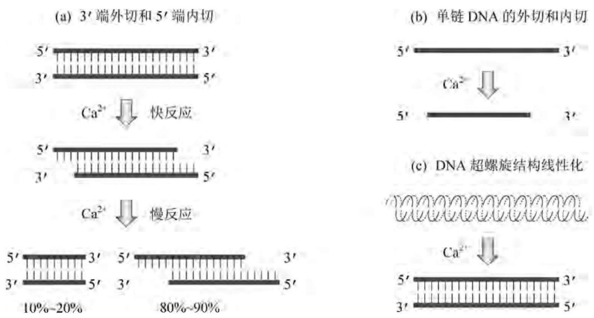

图2-12 Bal31核酸酶的催化反应

## 5. T4-多核苷酸磷酸激酶(T4-PNP)

T4-多核苷酸磷酸激酶(T4-PNP)由T4噬菌体感染的大肠杆菌制备，它催化ATP的$\gamma$-磷酸基团转移至DNA或RNA的$5^{\prime}$末端上，其中包括两种反应:①磷酸激酶的正向反应，将ATP的$\gamma$-磷酸基团转移到单链或双链DNA或RNA的$5^{\prime}$端游离羟基上，其催化$5^{\prime}$突出末端的磷酸化速度比催化平头末端和$5^{\prime}$凹端快得多，然而只要在反应体系中有足够量的酶和ATP存在，后两种末端也能得到完全磷酸化；②磷酸激酶的交换反应，在过量的ATP存在下，T4-PNP可将单链DNA或RNA$5^{\prime}$端的磷酸基团转移至ADP上形成ATP，同时从$\gamma^{-32}\mathrm{P}$型ATP中获得其放射性的$\gamma$-磷酸基团，并使单链DNA或RNA的$5^{\prime}$端重新磷酸化，这个反应常用于核酸杂交探针分子的同位素末端标记。

## 6. 碱性磷酸单酯酶

该酶来源于大肠杆菌和牛小肠。细菌的碱性磷酸单酯酶(BAP)和牛小肠的碱性磷酸单酯酶(CIP)均能催化DNA、RNA、核苷酸的5'端除磷反应，因此在DNA重组实验中该酶主要用于载体DNA的5'末端除磷操作，以提高重组效率；而用于外源DNA片段的5'端除磷则可有效防止外源DNA片段之间的连接。

## 7. T4-DNA 聚合酶

T4-DNA 聚合酶不仅具有  $5^{\prime} \rightarrow 3^{\prime}$  的 DNA 聚合活性和  $5^{\prime} \rightarrow 3^{\prime}$  的核酸外切活性，而且具有极强的  $3^{\prime} \rightarrow 5^{\prime}$  核酸外切活性，后者对单链 DNA 的作用远大于双链 DNA。 $5^{\prime} \rightarrow 3^{\prime}$  合成 DNA 与  $3^{\prime} \rightarrow 5^{\prime}$  降解 DNA 是一对方向相反的可逆反应，在高浓度的 dNTP 存在时，模板中双链区的降解和合成反应趋于平衡，从而生成平头 DNA 分子。T4-DNA 聚合酶可用于修平非平头的 cDNA 分子以及由某些限制性核酸内切酶水解产生的  $3^{\prime}$  突出末端。

## 2.2.4 DNA切接反应的影响因素

在 DNA 重组实验中,酶切和连接反应的不完全会大幅度增加后续操作的负担和难度,而影响切接反应的内在和外在因素又较为复杂,因此必须引起足够的重视。

## 1. 限制性核酸内切酶的切割反应

绝大多数 II 类限制性核酸内切酶对基本缓冲系统的组成要求相似,包括 10\~50 mmol/L (最终浓度,下同)的 Tris-HCl(pH 7.5)、10 mmol/L 的 MgCl₂、1 mmol/L 的 DTT(二巯基苏糖醇,用于稳定酶的空间结构),唯一的区别是各种酶对盐(NaCl)浓度的需求不同。据此,可将所有的II类酶分为三大组,即低盐组(0\~50 mmol/L NaCl)、中盐组(50\~100 mmol/L NaCl)、高盐组(100\~150 mmol/L NaCl)。盐浓度过高或过低均大幅度影响酶的活性,活性最多可降低至1/10。

在相当多的情况下，需要使用两种限制性内切酶切割同一种DNA分子，如果两种酶对盐浓度要求相同，原则上可将两种酶同时加入反应体系中进行同步酶切；对于盐浓度要求差别不大的两种酶，比如一种酶属于中盐组，另一种酶属于高盐组，一般也可以同时进行反应，只是选择对价格较贵的酶有利的盐浓度，而另一种酶可通过加大用酶量的方法来弥补因用盐浓度不合适所造成的活性损失；对盐浓度要求差别较大的（如一个高盐，另一个低盐），一般不宜同时进行酶切反应。理想的操作方法是:①低盐组的酶先切，然后向反应系统中补加NaCl至合适的最终浓度，再用高盐组的酶进行切割反应；②一种酶反应结束后，加入0.1倍体积的5 mol/L KAc溶液(pH 5.5)和两倍体积的冰冻乙醇，20℃放置15 min，于4℃高速离心15 min，干燥，重新加入另一种酶的缓冲液，再进行第二种酶切反应。然而，随着限制性核酸内切酶空间结构解析和催化机制探究的不断深入，现已商品化的优质快切酶系列(FastDigest)已具有数百种限制性核酸内切酶共用同一种缓冲体系的良好性能，且酶切反应时间也缩短至5～15 min。

在某些情况下，两种酶不能同时进行酶切反应，必须先后进行，而且先后次序对酶切效果也相当关键。这种情况多发生在两种酶的识别序列互相重叠的DNA底物上，如pUC18多克隆位点中的KpnI与SmaI识别序列共用两对GC碱基(图2-13)，若先用SmaI酶切开pUC18分子，则该线型DNA分子仍能被KpnI酶解；但若先用KpnI切开pUC18分子，得到的DNA线型分子中的SmaI识别序列已遭破坏，因而SmaI不能进一步切割这种底物。当两种酶同时切割时（两种酶同属低盐组），由于作用次序的随机性，导致一半的产物分子含两种酶的酶解末端，而另一半产物分子则仅含KpnI酶的酶解末端。

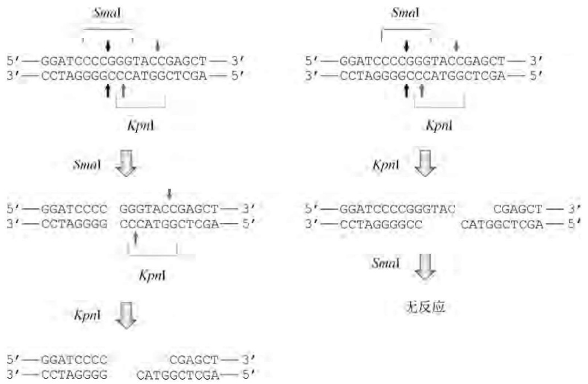

图2-13 多酶联合酶切的先后次序