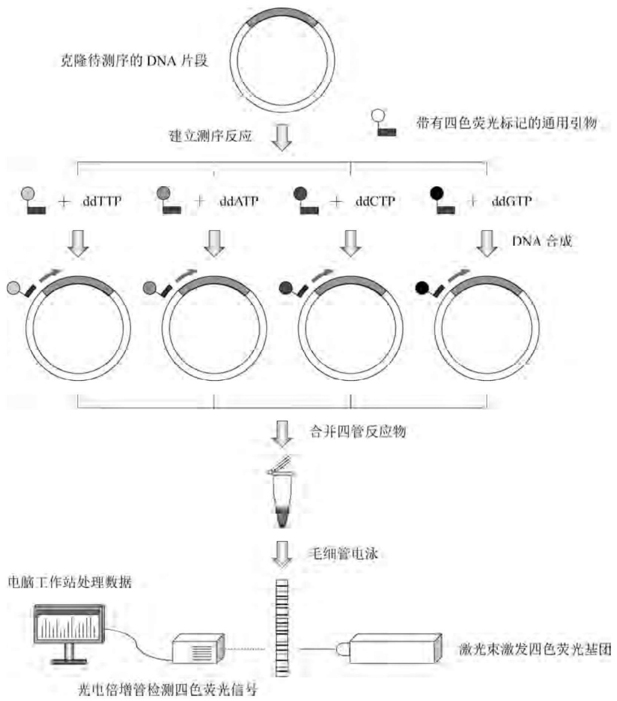

flowchart

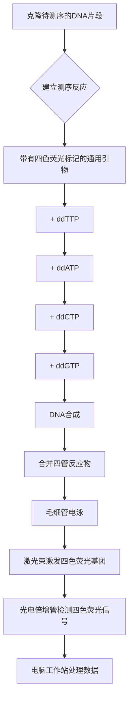

图2-39 DNA全自动序列分析系统

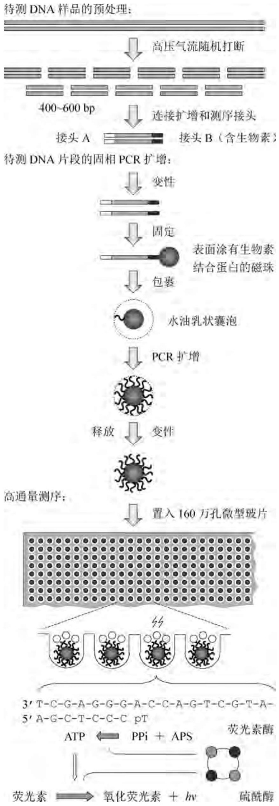

flowchart

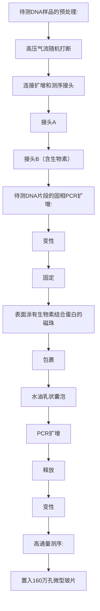

图2-40 焦磷酸测序原理示意图

## 2.4.3 基于外源基因表达产物的筛选与鉴定

如果克隆在受体细胞中的外源基因编码产物是蛋白质,则可通过检测这种蛋白质的生物功能或结构来筛选和鉴定目的重组子。使用这种方法的前提条件是重组分子必须拥有能在受体细胞中发挥功能的表达元件,也就是说外源基因必须表达其编码产物,并且受体细胞本身不具有这种蛋白质的功能。

## 1. 蛋白质生物功能检测法

某些外源基因编码具有特殊生物功能的酶类或活性蛋白（如 $\alpha-$ 淀粉酶、葡聚糖内切酶、$\beta-$ 葡萄糖苷酶、蛋白酶、抗生素抗性蛋白等），设计简单灵敏的平板模型可以迅速筛选出克隆了上述蛋白编码基因的目的重组子。淀粉酶基因表达的淀粉酶可将不溶性的淀粉水解成可溶性的多糖或单糖，在固体筛选培养基中加入适量的淀粉，则平板呈不透明状，待筛选的重组菌落若能表达 $\alpha-$ 淀粉酶并将之分泌到细胞外，则酶分子在固体培养基中均匀扩散，会以菌落为中心形成一个透明圈。如果透明圈不甚明显，还可往培养平板上均匀喷洒碘水气溶胶使之形成蓝色本底，以增强目的重组子克隆与非目的重组克隆之间的颜色反差，易于辨认。利用同样的原理，也可设计出快速筛选含特定蛋白酶编码基因的重组克隆。

有些待克隆外源基因的编码产物可将受体细胞不能利用的物质转化为可利用的营养成分，如 $\beta-$ 半乳糖苷酶编码基因或氨基酸、核苷酸的生物合成基因，据此可设计营养缺陷型互补筛选模型，快速鉴定目的重组子。其具体做法是选择上述基因缺陷的细菌为受体，筛选培养基以最小培养基为基础，补加合适的外源基因产物为作用底物。例如，对于 $\beta-$ 半乳糖苷酶而言，补加乳糖。这样，凡是在选择培养基上长出的菌落理论上就是目的重组克隆。

抗生素抗性基因重组克隆的筛选则更为简单，只要选择对该抗生素敏感的细菌作为受体细胞，并在筛选培养基中添加适量的抗生素即可。然而应当注意的是，由于抗生素的存在往往会诱导受体细胞产生非特异性的广谱抗药性，因此在含抗生素的平板上生长的菌落未必都是该抗生素特异性抗性基因的重组克隆，此时一般需要做进一步的鉴定。其程序为:从获得的重组克隆中抽取相应的重组质粒，并对同一受体细胞进行二次转化，同时以载体质粒作对照。如果二次转化得到的菌落数比对照明显增多，则该重组质粒拥有特异性的抗性基因，否则重组分子中的外源DNA插入片段必定不是目的基因。另一种方法是将重组克隆挑到液体培养基中，然后不经培养稀释涂布在不含该抗生素的平板上，待菌落长出后，将之影印至另一含抗生素的平板上。若在影印过程中菌落全部生长，则基本上可以断定原重组克隆中含该抗生素的特异性抗性基因。上述两种鉴定方法的原理是基于抗生素的抗性诱导作用对受体菌而言是随机低频发生的，而真正克隆的抗性基因则赋予所有的受体细胞以抗性。

## 2. 放射免疫原位检测法

这种方法的基本原理及操作程序与菌落原位杂交法非常相似，只不过后者采用核酸探针通过碱基互补形式特异性杂交目的DNA序列，而前者利用抗体通过特异性免疫反应搜寻目标蛋白质，因此使用放射免疫原位检测法筛选鉴定目的重组子的前提条件是外源基因在受体细胞中必须表达出具有正确空间构象的蛋白产物，同时应具备与之相对应的特异性抗体。放射免疫原位检测法的标准操作程序如图2-41所示:①将聚乙烯薄膜或CNBr活化纸片覆盖在待检测的菌落平板上，制成影印件；②利用氯仿气体或烈性噬菌体的气溶胶处理影印薄膜，裂解菌落，释放包括外源基因表达产物在内的细胞内含物，此时各种蛋白质分子均原位吸附在薄膜或纸片上；③经固定处理后的薄膜或纸片与含目标蛋白对应抗体的溶液保温一段时间，使抗原（待检测蛋白质）与抗体发生特异性免疫结合反应；④洗去薄膜未特异性结合的抗体分子，再与事先用同位素 $^{125}$ I标记的第二种抗体或金黄色葡萄球菌A蛋白溶液进行第二次保温，这种放射性的抗体或蛋白分子特异性地与抗原-抗体复合物中的第

一种抗体结合，并指示出抗原所在的位置；⑤ 最后将薄膜感光 X 光胶片，并根据感光斑点位置在原始平板上挑出相应的目的重组子克隆。

用于最终检测的第二种抗体既可以用同位素标记，也可以事先将之与生物素共价偶联，在免疫结合反应完成之后，薄膜用含荧光分子的生物素结合蛋白处理，最终通过荧光感光X光胶片，这一过程与核酸探针的ABC标记法颇为相似。另外还可采用抗体的酶标技术，将第二抗体与一种特定的示踪酶（如碱性磷酸单酯酶）连为一体，与这种抗体-酶复合物溶液保温后的薄膜再用相应的化合物处理，后者在碱性磷酸单酯酶的作用下产生颜色反应，以此定位目的重组克隆。

放射免疫原位检测法远比探针原位杂交法复杂，它需要使用两种不同的抗体。第一种抗体必须具有与待检测蛋白质特异性的结合作用，但在大多数情况下，这种抗体很难通过免疫血清的方法获得足够的数量用于同位素直接标记。因此，通常的做法是将第一种抗体与一种特定的蛋白质用戊二醛交联，而这种特定蛋白质相应抗体的制备方法相当成熟，如兔血清白蛋白与第一种抗体结合后，所形成的蛋白复合物能特异性地为第二种抗体（即羊抗兔血清白蛋白抗体）所识别。

## 3. 蛋白凝胶电泳检测法

对于那些生物功能难以检测的外源基因编码产物,手头又没有现成的抗体做蛋白免疫原位分析实验,可以通过聚丙烯酰胺凝胶电泳对重组克隆进行筛选鉴定。从重组克隆中分别制备蛋白粗提液,以非重组子作对照进行蛋白凝胶电泳分析。如果克隆在载体质粒上的外源基因能高效表达,则会在凝胶电泳图谱的相应位置上出现较宽、较深的考马斯亮蓝染色带,由此辨认目的重组子。载体质粒上的选择性标记基因通常也会大量表达,但可通过与对照样品对比以及确定蛋白产物相对分子质量大小而排除。然而,如果外源基因表达率较低,则极有可能受体细胞内

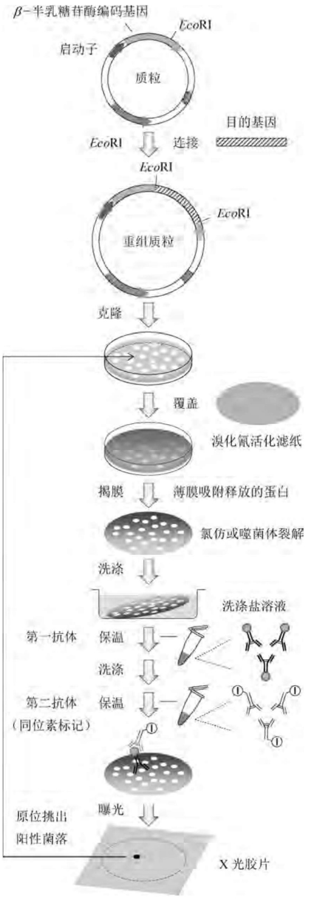

flowchart

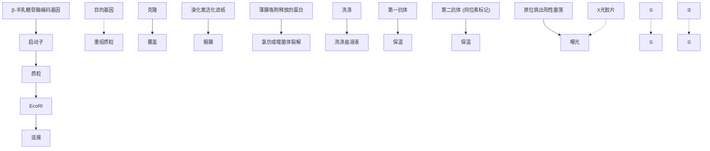

图2-41 放射免疫原位检测法程序

源性表达蛋白干扰而不易区分,此时必须使用特殊受体细胞或体外基因转录翻译系统进行检测,这些技术相当复杂、烦琐,但对重组基因的分析鉴定相当重要。

体外转录翻译偶联系统包含基因表达所需要的所有因子，如RNA聚合酶、核糖体、tRNA、核苷酸、氨基酸以及合适的缓冲液组成成分。将严格分离纯化的重组质粒置入该系统中进行体外基因转录与翻译，并用同位素标记新生蛋白质，最终通过SDS-聚丙烯酰胺凝胶电泳和放射自显影技术检测之。尽管这种偶联反应涉及多种成分的严格配比以及它们对许多因素的敏感性，但近年来已发展出若干成熟的体外蛋白质生物合成系统，使其可靠性大大提升。

## 2.5 目的基因的克隆

基因工程或DNA重组技术三大用途的前提条件是从生物体基因组中分离克隆目的基因，目的基因获得之后，或确定其表达调控机制和生物学功能，或建立高效表达系统，构建具有经济价值的基因工程菌(细胞)，或将目的基因在体外进行必要的结构功能修饰，然后输回细胞内改良生物体的遗传性状，包括人体基因治疗。一般而言，目的基因的克隆策略分为两大类:一类是构建感兴趣的生物个体的基因组文库，即将某生物体的全基因组分段克隆，然后建立合适的筛选模型从基因组文库中挑出含目的基因的重组克隆；另一类是利用PCR扩增技术甚至化学合成法体外直接合成目的基因，然后将之克隆表达。这两大类策略的选择往往取决于对待克隆目的基因背景知识的了解程度、目的基因的用途以及现有的实验手段等因素，只有在目的基因克隆策略确定之后，才能制订基因克隆的各项单元操作方案。本节着重论述几种目前已相当成熟的目的基因克隆策略及其适用范围，最后对基因组文库的构建原则做一简单的介绍。

## 2.5.1 鸟枪法

鸟枪法(Shotgun)克隆目的基因的基本策略如图2-42所示,将某种生物体的全基因组或单一染色体切成大小适宜的DNA片段,分别连接到载体DNA上,转化受体细胞,形成一套重组克隆,从中筛选出含目的基因的目的重组子。

## 1. 鸟枪法的基本程序

标准的鸟枪法操作程序如下:

## 1) 目的基因组 DNA 片段的制备

按照常规方法从作为供体的生物细胞中分离纯化其染色体 DNA，在一般条件下，由于分离纯化操作中的物理剪切作用，制备出的染色体 DNA 片段平均大小在 100～200 kb 左右。然后将染色体 DNA 用下列方法切成片段，以便与载体分子进行体外重组。

（1）机械切割。供体染色体 DNA 可用机械方法（如超声波处理等）随机切割成双链平头片段，采取合适的超声波处理强度和时间可将切割的 DNA 片段控制在一定范围内，其上限为载体的最大装载量，而下限应大于目的基因的长度，否则无法在一个重组克隆中获得完整的目的基因。一般来说，原核生物的基因长度大都在 2 kb 以内，真核生物的基因长度变化很大，最大的基因可达 100 kb 以上，因而将外源 DNA 片段处理成略小于载体装载量上限的长度始终是正确的，因为每个重组克隆中所含的外源 DNA 片段越大，后续筛选的规模就越小。当染色体 DNA 上目的基因区域的限制性酶切图谱未知时，机械切割是制备待克隆 DNA 片段的首选方法，但由于这些 DNA 片段具有随机平头末端，因此必须插入载体 DNA 的平头限制性酶切位点上，而且克隆的外源 DNA 片段很难完整地从重组分子上卸下。

（2）限制性内切酶部分酶解。采用识别序列为四碱基对的限制性内切酶（如 MboI、Sau3A、AluI 等）部分降解染色体 DNA，也可获得大片段的 DNA 分子。由于这些限制性内切酶的识别顺序在任何生物基因组中频繁出现,因此只要采取合适的部分酶解条件同样可以获得一定长度的 DNA 随机片段,而且经部分酶解获得的 DNA 片段具有黏性末端,可以直接与载体分子拼接。

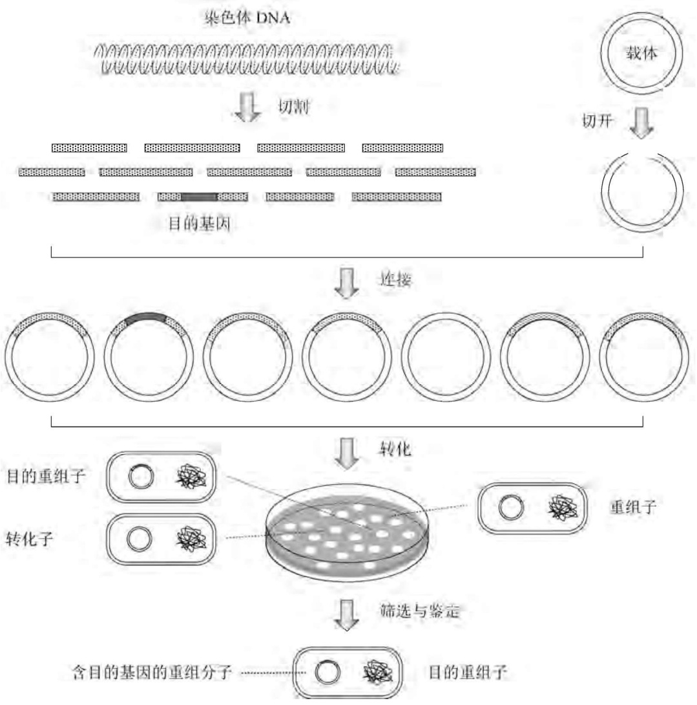

flowchart

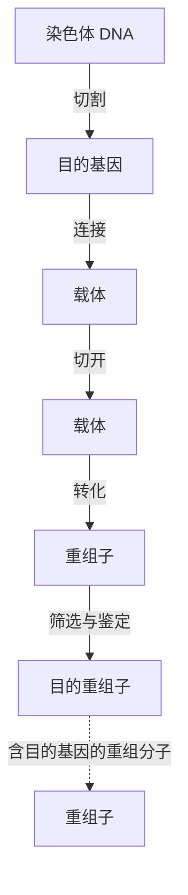

图2-42 鸟枪法克隆目的基因示意图

（3）特定限制性内切酶全酶解。如果染色体 DNA 中目的基因的两侧拥有已知的限制性内切酶识别位点，而且两者之间距离不超过载体装载量的上限，那么用这一种（或两种）限制性内切酶全酶解染色体 DNA 片段可能更为有利，所产生的 DNA 片段呈非随机性，在某些程度上可以简化后续的重组和筛选操作。同时，重组分子可用相同的限制性内切酶完全切下插入片段，这使得利用限制性酶切图谱法直接筛选目的重组子成为可能。

## 2) 外源 DNA 片段的全克隆

根据外源 DNA 片段的末端性质及大小确定克隆载体, 鸟枪法一般选择质粒或  $\lambda-DNA$  作为克隆载体, 受体细胞大多选择大肠杆菌, 只有当后续筛选必须采用外源基因表达产物检测法时才选择那些能使外源基因表达的相应受体系统。

## 3）目的重组子的筛选

从众多的鸟枪法克隆中快速检出目的重组子的最有效手段是菌落(菌斑)原位杂交法或外源基因产物功能检测法，前者需要理想的探针，后者则依赖于简便筛选模型的建立。如前所述，若克隆淀粉酶、蛋白酶或抗生素抗性基因，利用外源基因产物功能检测法筛选目的重组子是最理想的选择。在既无探针又难以建立快速筛选模型的情况下，也可采用限制性酶切图谱法对所获重组克隆进行分批筛选。例如，已知目的基因位于 $2.8\mathrm{kb}$ 的EcoRI DNA片段中，可用EcoRI分别酶解所有的重组分子，初步确定含 $2.8\mathrm{kb}$ 限制性插入片段的重组克隆，然后再根据目的基因内部的特征性限制性酶切位点进行第二轮酶切筛选，最终找到目的重组子。

## 4) 目的基因的定位

在绝大多数情况下,利用鸟枪法获得的目的重组子只是包含目的基因的 DNA 片段,必须通过次级克隆在已克隆的 DNA 片段上准确定位目的基因,然后对目的基因进行序列分

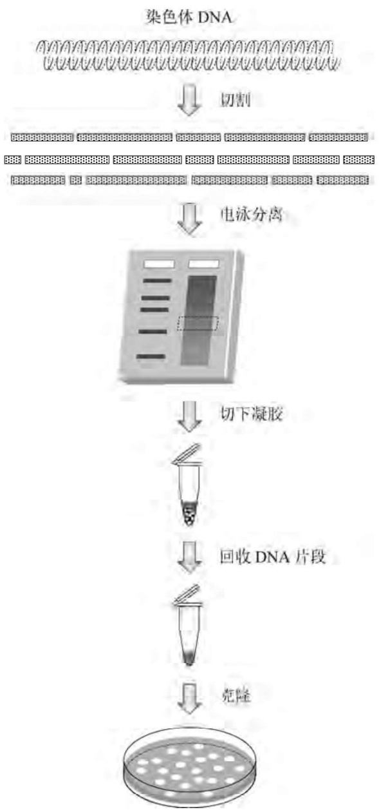

flowchart

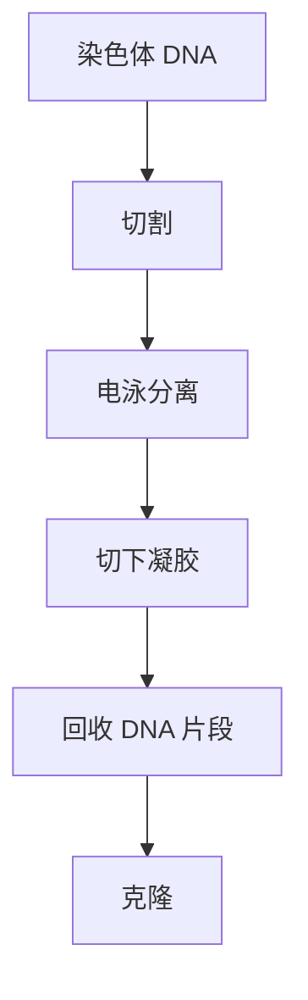

图2-43 非随机鸟枪法克隆目的基因示意图

析，搜寻其编码序列以及可能存在的表达调控序列。鸟枪法克隆目的基因的工作量之大是可想而知的，对目的基因及其编码产物的性质了解得越详尽，工作量就越小。

## 2. 非随机鸟枪法克隆策略

如果已知目的基因两侧的限制性酶切位点以及两个位点之间的距离,则可在克隆前就制备非随机的待克隆 DNA 片段,这样可以有效地缩小筛选的规模和工作量,其基本程序如图 2-43 所示。用特定的限制性内切酶完全酶解染色体 DNA,酶解产物经琼脂糖凝胶电泳分离,从电泳凝胶中直接回收特定大小的 DNA 片段,经过适当的纯化后与载体 DNA 直接拼接,此时重组克隆中目的重组子的存在概率便会大幅度提高。

从琼脂糖凝胶中回收 DNA 片段有下列多种方法:

（1）冻融法。从琼脂糖凝胶中切下对应于一定 DNA 相对分子质量大小的凝胶块，用无菌牙签捣碎，在  $-20^{\circ}C$  下冻融 2～3 次，破坏其凝胶网孔结构，释放 DNA 分子，高速离心后吸取水相，乙醇沉淀回收 DNA 片段。
（2）滤纸法。在琼脂糖凝胶板上的相应相对分子质量条带前沿用无菌手术刀划开一条缝，将一合适大小的滤纸片插入其中，在紫外灯下继续电泳，直至所需回收的DNA样品迁移至滤纸上，然后反向电泳1～2 s以降低滤纸对DNA样品的吸附强度，迅速从凝胶上取下滤纸，然后将之固定在Eppendorf管中，高速离

心，这时 DNA 样品水溶液从滤纸上脱离并进入离心管底部。如果 DNA 样品浓度较高，则可不经沉淀浓缩直接用于体外重组。

(3) 吸附法。用 $5 \mathrm{~mol} / \mathrm{L}$ 的 $\mathrm{NaI}$ 溶液溶解含待回收 DNA 片段的琼脂糖凝胶块, 然后将之稀释, 至 $\mathrm{NaI}$ 最终浓度低于 $1 \mathrm{~mol} / \mathrm{L}$, 用一种特殊的亲和介质吸附 DNA, 并以高盐浓度的水溶液从介质上洗脱 DNA, 沉淀回收。大多数凝胶回收试剂盒便是基于这种原理设计的。

（4）破碎法。编者在 DNA 重组实验中摸索出一种较为简便有效的 DNA 回收程序:将凝胶块置于一个 Eppendorf 管中用无菌牙签捣碎，并用烧红的针头在 Eppendorf 管底部扎一小孔（越小越好），然后剪去离心管的上半部分，将之套在另一个 Eppendorf 管上，高速离心，此时凝胶块在通过小孔时其网孔结构已遭到不同程度的破坏。吸取上清液于另一个离心管中，剩余的凝胶碎片按照上述程序重复操作一次，合并两次上清液，沉淀浓缩。以此法回收 10 kb 以下的 DNA 片段，其回收率高达 70%，且 DNA 样品无需进一步纯化即可用于连接、酶切或缺口前移同位素标记反应。

(5) 低融点琼脂法。回收 DNA 片段需要使用昂贵的低融点琼脂糖凝胶, 它在 $37^{\circ} \mathrm{C}$ 以上即融化, DNA 样品通常在 $10^{\circ} \mathrm{C}$ 左右进行电泳分离。凝胶块切下后加入适量的无菌水, 然后加热至 $37^{\circ} \mathrm{C}$ 使之融化为均相。在一定的稀释度下, 这种 DNA 溶液可直接用于连接反应。

## 3. 鸟枪法克隆目的基因的局限性

在一般情况下,利用探针原位杂交法筛选和检测重组质粒可以较为简便地获得目的基因片段,但若没有合适的探针可用,鸟枪法克隆目的基因的工作量很大,如同盲人打鸟,鸟枪法的名字由此而得。此外,鸟枪法与其说克隆目的基因,倒不如说是克隆含目的基因的DNA片段,如果目的基因用于构建高效表达系统,则需要的是其编码序列而非整个DNA片段,只有在其编码序列的上下游区域拥有特征性的酶切位点时,后续操作才能顺序进行,遗憾的是这种情况并不多见。最后,90%以上的真核生物蛋白质基因都拥有内含子序列,这种真核基因不能在原核细菌受体细胞中表达,因此如果从真核生物中克隆目的基因并在原核细菌中高效表达,使用鸟枪法显然不合适。

## 2.5.2 cDNA 法

cDNA 是与 mRNA 互补的 DNA(Complementary DNA)，严格地讲，它并非生物体内的天然分子。有些 RNA 肿瘤病毒能够通过其自身基因组编码的逆转录酶（即依赖于 RNA 的 DNA 聚合酶）将 RNA 反转录成 DNA，作为基因复制和表达的中间环节，但这种 DNA 分子并非是与特定 mRNA 相对应的 cDNA。将供体生物细胞的 mRNA 分离出来，利用逆转录酶在体外合成 cDNA，并将之克隆在受体细胞内，通过筛选获得含目的基因编码序列的重组克隆，这就是 cDNA 法克隆蛋白质编码基因的基本原理。

与鸟枪法相比，cDNA法的优点是显而易见的。首先，cDNA法能选择性地克隆蛋白质编码基因，而且由mRNA反转录合成的cDNA对特定的基因而言只有一种可能性，因此能大幅度缩小后续筛选样本的范围，减轻筛选工作量；其次，cDNA法克隆的目的基因相当“纯净”，它既不含基因的 $5^{\prime}$ 端调控区，同时又剔除了内含子结构，有利于在原核细胞中表达；最后，cDNA通常比其相应的基因组拷贝小数倍甚至数十倍，一般只有 $2\sim 3\mathrm{kb}$ 或更小，便于稳定地克隆在一些表达型质粒上。因此，利用cDNA法将真核生物蛋白质编码基因克隆在原核生物中高效表达，是基因工程普遍采取的策略。

## 1. mRNA 的分离纯化

从生物细胞中分离 mRNA 比分离 DNA 困难得多, mRNA 在细胞内尤其在原核细菌内的半衰期极短, 平均只有数分钟, 而且由于基因表达具有严格的时序性, 供体细胞的生长阶段对相应 mRNA 的成功分离至关重要。此外, mRNA 在体外也不甚稳定, 这对分离纯化过程和方法都提出了更高的要求。尽管如此, 目前发展起来的基因表达检测技术以及 mRNA高效分离方法已较圆满地解决了上述难题,即使目标 mRNA 在细胞中只存在 1\~2 个分子也能由 cDNA 法成功克隆。

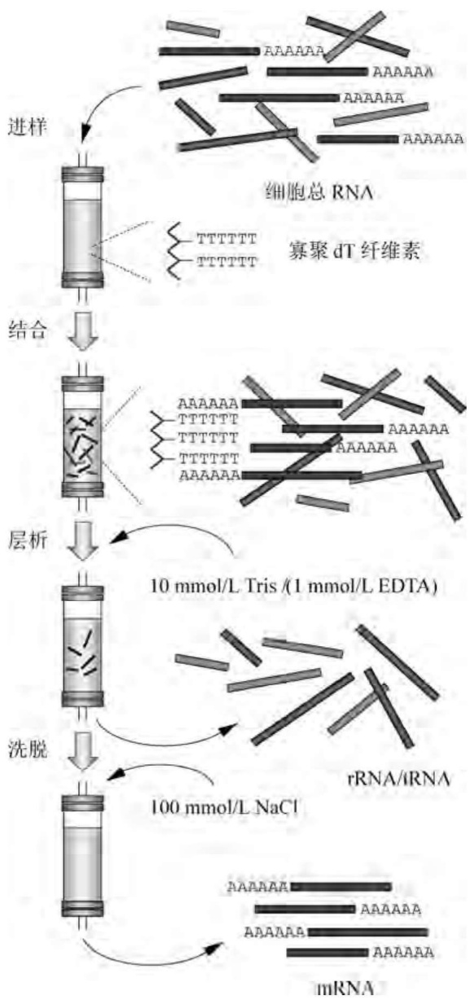

flowchart

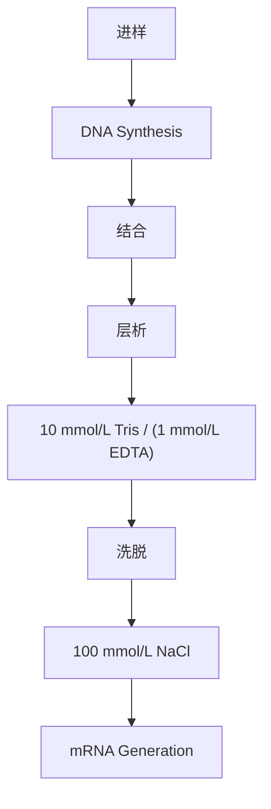

图2-44 mRNA分离纯化程序

绝大多数真核生物的 mRNA 在其 3' 末端都拥有一个多聚腺苷酸(polyA)的尾巴,无论这种结构在细胞内的生物功能如何,客观上却为 mRNA 的分离纯化提供了极为便利的条件,利用它可以迅速将 mRNA 从细胞总 RNA 的混合物中分离出来,其程序如图 2-44 所示。将寡聚脱氧胸腺嘧啶核苷酸(oligo-dT)共价交联在层析介质上,制成相应的 mRNA 亲和层析柱,然后将细胞总 RNA 的制备物上柱层析分离,其中 mRNA 分子通过其 polyA 结构与 oligo-dT 特异性碱基互补作用挂在柱上,而其他的非 mRNA 分子(如 tRNA、rRNA、sRNA)则流出柱外。最终用高盐缓冲液将 mRNA 从柱上洗下,从而纯化得到在细胞总 RNA 中含量只有 1%\~2% 的 mRNA 流分。

由于基因表达的时序和程度不同, 各种 mRNA 在细胞总 mRNA 中的丰度差异很大, 例如珠蛋白、免疫球蛋白和卵清蛋白 mRNA 的丰度通常高达 50%\~90%。这种高丰度的 mRNA 既可在 cDNA 合成前先经琼脂糖凝胶电泳分离, 从亮度最大的区域中回收 mRNA, 然后再进行 cDNA 合成和克隆, 也可不经电泳分级分离直接合成并克隆 cDNA, 或在 cDNA 合成之后进行电泳分级分离。对于绝大多数丰度低于 0.5% 的 mRNA (如干扰素、胰岛素、生长激素等蛋白的 mRNA), 则最好在 cDNA 合成之前进行特异性富集, 以提高 cDNA 期望重组克隆的检出成功率, 减少筛选工作量。低丰度 mRNA 的富集方法大致有蔗糖密度梯度

离心分级分离以及特异性多聚核糖体免疫纯化两种。前者或依据低丰度 mRNA 的相对分子质量大小专一性回收目的 mRNA，或将离心管中的各梯度流分通过无细胞外体翻译系统分别检测目的 mRNA 的翻译产物，以此确定各种 mRNA 流分的取舍，从而获得高浓度目的 mRNA 的制备物；后者的一种方法则是利用特异性目的 mRNA 编码蛋白的抗体把正在合成新生多肽链的多聚核糖体吸附到金黄色葡萄球菌 A 蛋白-琼脂糖亲和层析柱上，然后用 EDTA 将多聚核糖体解离下来，并通过 oligo-dT 层析柱分离目的 mRNA。这种方法可用于分离丰度只有 0.01%～0.05% 的 mRNA，但由于特异性抗体难以获得而限制了它的实用性。

## 2. 双链 cDNA 的体外合成

真核生物 mRNA 的 polyA 结构不但为 mRNA 分离纯化提供了便利,而且也使得 cDNA 的体外合成成为可能。将纯化的 mRNA 与事先人工合成的 oligo-dT(12\~20 个核苷酸)退火,后者成为逆转录酶以 mRNA 为模板合成 cDNA 第一链的引物[图 2-45(a)]。逆转录酶以四种 dNTP 为底物,沿 mRNA 链聚合 cDNA 至 5'末端帽子结构处,完成 cDNA 第一链的合成。有时,逆转录酶会在接近 5'末端帽子结构途中停止聚合反应,尤其当 mRNA 分子特别长时这种现象发生的频率很高,导致 cDNA 第一链的 3'端区域不同程度的缺损。为了克服这一困难,发展出一种随机引物的合成方法,即事先合成一批 6\~8 个核苷酸的寡聚核苷酸随机序列,以此替代 oligo-dT 为引物合成 cDNA 第一链,然后用 T4-DNA 连接酶修补由多种引物合成的 cDNA 小片段缺口,最终的产物仍是 DNA-RNA 杂合双链。cDNA 第二条链的合成大致有以下三种方法:

（1）自身引导法。cDNA与mRNA的杂合双链通过煮沸或用NaOH溶液处理获得单链cDNA，其3'端随即形成短小的发夹结构，其机理不明。这种发夹结构正巧可作为cDNA第二条链合成的引物[图2-45(b)]，在Klenow酶和逆转录酶的共同作用下形成双链cDNA分子。理论上两种酶中的任何一种均可进行聚合反应，但常常会导致聚合中途停止，因为模板中可能存在着引起聚合反应中止的特殊序列，这种序列因聚合酶的性质而异，因此联合使用两种酶可最低程度地降低聚合反应的不完全性，获得长度完整的双链cDNA。聚合反应结束后，用S1核酸酶去除发夹结构以及另一端可能存在的单链DNA区域，所形成的双链cDNA即可用于克隆。这种方法的缺点是S1核酸酶酶解条件难以控制，常常会将双链cDNA的两个末端切去几个碱基对，有时直接导致目的基因编码序列的缺失。

（2）置换合成法。cDNA第一链合成反应的产物cDNA-mRNA不经变性直接与RNA酶H和大肠杆菌DNA聚合酶I混合，此时RNA酶H在杂合双链的mRNA链上产生缺口(内切作用)并形成部分cDNA单链区(外切作用)，DNA聚合酶I则以残存的mRNA作为引物合成cDNA第二链，最后用T4-DNA连接酶修复缺口[图2-45(c)]。此方法的优点是cDNA双链合成效率高且操作简捷，无需对第一链合成产物进行额外的变性处理；但所获得的cDNA双链分子 $5^{\prime}$ 端因RNA引物清除后无法填补，仍会存在末端的缺损。

（3）引物合成法。在第一链合成完毕后，变性残留的mRNA，用末端脱氧核苷酰转移酶(TdT)在cDNA游离的 $3^{\prime}$ 羟基上添加同聚物(dC)末端，然后将之与人工合成的oligo-dG退火形成引物结构，在Klenow酶的作用下合成第二条cDNA链[图2-45(d)]。这种方法能在一定程度上避免双链cDNA合成产物 $5^{\prime}$ 端的缺损，而且因同聚尾的存在也便于cDNA与载体的连接。

## 3. 双链 cDNA 的克隆

上述方法合成的双链 cDNA 产物大都呈平头末端，根据所选用载体（通常是质粒或  $\lambda-DNA$ ）克隆位点的性质，双链 cDNA 或直接与载体分子拼接，或分别在 cDNA 和线性载体分子两个末端上添加互补的同聚尾，或在 cDNA 分子两端装上合适的人工接头，创造可从重组分子中回收克隆片段的限制性酶切位点序列，甚至还可在 cDNA 合成时就进行周密的设计，联合使用上述方法，其程序如图 2-46 所示。在人工合成 oligo-dT 引物的同时，于其 5' 端接上含 SalI 识别序列的寡聚核苷酸片段，组成复合引物。该引物与 mRNA 退火后，在逆转录酶作用下合成 cDNA 第一链，然后用 NaOH 溶液水解杂合双链中的 mRNA 链，获得的单链 cDNA 用 TdT 添加 dC 同聚尾。cDNA 第二链采用引物合成法制备，所使用的引物是含 SalI 酶切位点和寡聚鸟嘌呤核苷酸的 DNA 单链片段，在 Klenow 酶的作用下，聚合反应分别在两条链上进行，最终形成两端各有一个 SalI 酶切口的双链 cDNA 分子，后者经 SalI 消化后即可直接克隆在常规大肠杆菌质粒（如 pUC 系列等）的相应位点上。

(a) 逆转录酶合成 cDNA 第一链

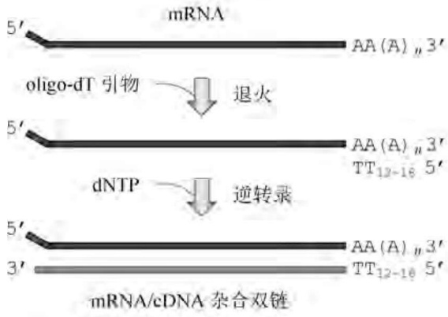

flowchart

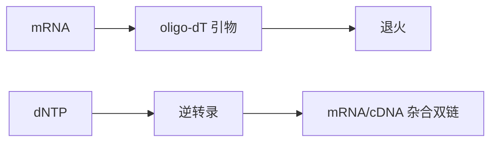

(b) 自身引导法合成 cDNA 第二链

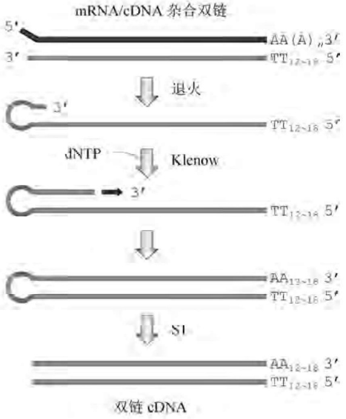

flowchart

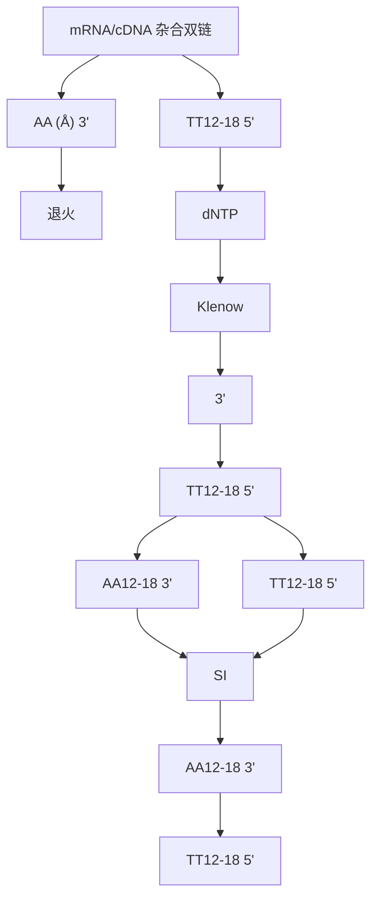

(c) 置换合成法合成 cDNA 第二链

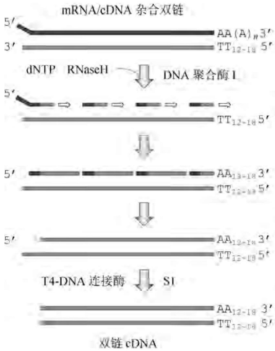

flowchart

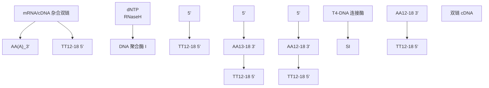

(d) 引物合成法合成 cDNA 第二链

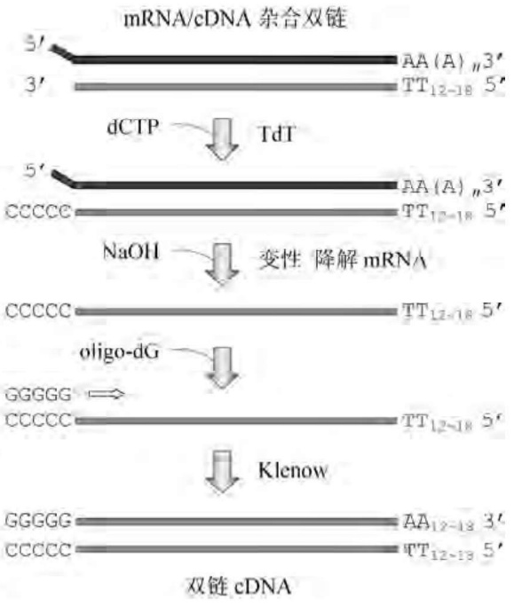

flowchart

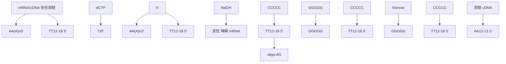

图2-45 双链cDNA的体外合成

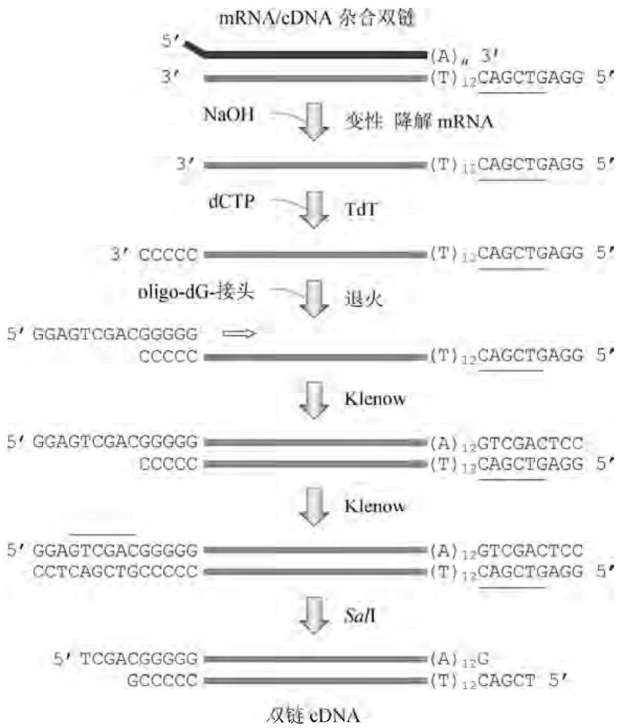

flowchart

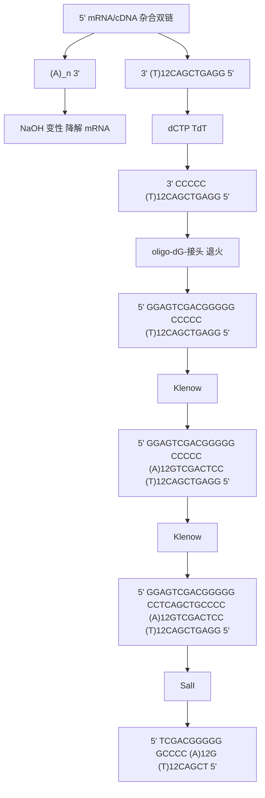

图2-46 引物/接头法合成双链cDNA

上述克隆程序都是先体外合成 cDNA 双链分子,然后再将之与载体 DNA 进行拼接。另一种方法则通过巧妙的设计,将 mRNA 直接黏附在特定的质粒载体上进行 cDNA 合成,从而使得 cDNA 合成与克隆融为一体,大幅度提高克隆效率,其程序如图 2-47 所示:①用 KpnI 使含一段 SV40 DNA 的 pBR322 重组质粒线性化,TdT 处理其两个 3'末端,添加 oligo-dT 尾,然后再用 HpaI 切平一端。通过琼脂糖凝胶电泳和 oligo-dA-纤维素亲和层析分离一端含 dT 同聚尾而另一端为平头的质粒大片段;②将 mRNA 与这个质粒大片段退火,由逆转录酶以 mRNA 为模板合成 cDNA 第一链。聚合反应结束后,即用 TdT 增补 dC 同聚尾,最终用 HindIII 切去质粒载体一端的 dC 同聚尾;③用 PstI 切开另一个 pBR322 重组分子(含另一段 SV40 DNA 片段),同样用 TdT 处理其 3'末端,但这里增补的是 oligo-dG 尾,随后再用 HindIII 消化,电泳分离最小的 SV40 DNA 片段,其一端为 HindIII 黏性末端,而另一端为 dG 同聚尾;④将这个处理过的 SV40 DNA 小片段连接在含 mRNA-cDNA 杂合双链的重组质粒上,形成共价环状分子;⑤采取置换合成程序合成 cDNA 第二链,并用 T4-DNA 连接酶修复重组质粒上的所有缺口,即可直接转化大肠杆菌。

自 20 世纪 90 年代 PCR 技术(详见 2.5.3)普及以来,可将 mRNA 的逆转录与 PCR 技术相偶联,以高效特异性合成双链 cDNA 分子,此项技术称为 RT-PCR。

## 4. cDNA 重组克隆的筛选

常规的目的重组子筛选法均可用于 cDNA 重组克隆的筛选, 其中较为理想的首推探针原位杂交法。但在某些情况下, 探针并不容易或根本无法获得, 此时可采用所谓的差示杂交

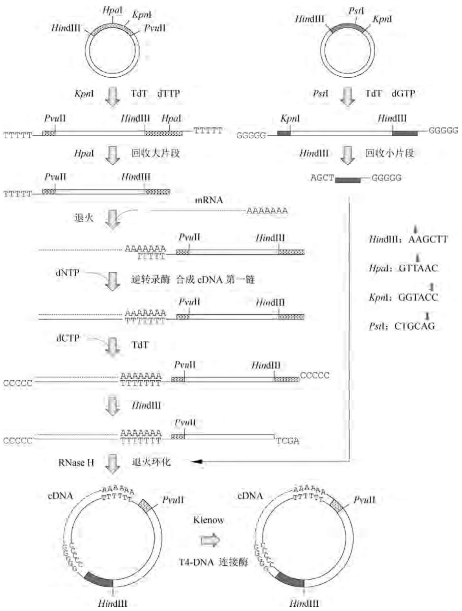

图2-47 Okayama-Berg法克隆cDNA

法来筛选较为特殊的 cDNA 目的重组子, 如某些组织特异性或时序特异性表达的目的基因等。差示杂交法筛选这种目的基因的策略是将细胞分成两大组, 在一组中具备目的基因转录成相应 mRNA 的条件, 而另一组中同样的目的基因并不表达, 至于这个目的基因的序列或功能无须知道, 图 2-48 是某个受生长因子控制的目的基因的差示杂交筛选程序。将细胞涂布在 A 和 B 两个培养皿上, 在 A 中加入血清 (含生长因子) 使细胞生长一段时间后, 分别从两组细胞系中分离纯化细胞总 mRNA, 两种 mRNA 的制备物基本相同, 只是来自 A 培养皿的制备物中含目的基因的 mRNA, 而来自 B 培养皿的 mRNA 中则不含目的 mRNA。由 A 组 mRNA 合成 cDNA 并克隆之, 形成 cDNA 重组克隆, 用硝酸纤维素薄膜复制两份。同时分别由 A、B 两组 mRNA 制备放射性 cDNA 探针, 然后杂交经过处理后的硝酸纤维素薄膜, 并对两张放射自显影 X 光胶片进行原位比较。凡是在 A 组 cDNA 探针杂交膜上存在、而在 B 组 cDNA 探针杂交膜上不出现的相应 cDNA 重组克隆, 必定含目的基因, 并可从原始 cDNA 重组克隆平板的相应位置上分离得到。

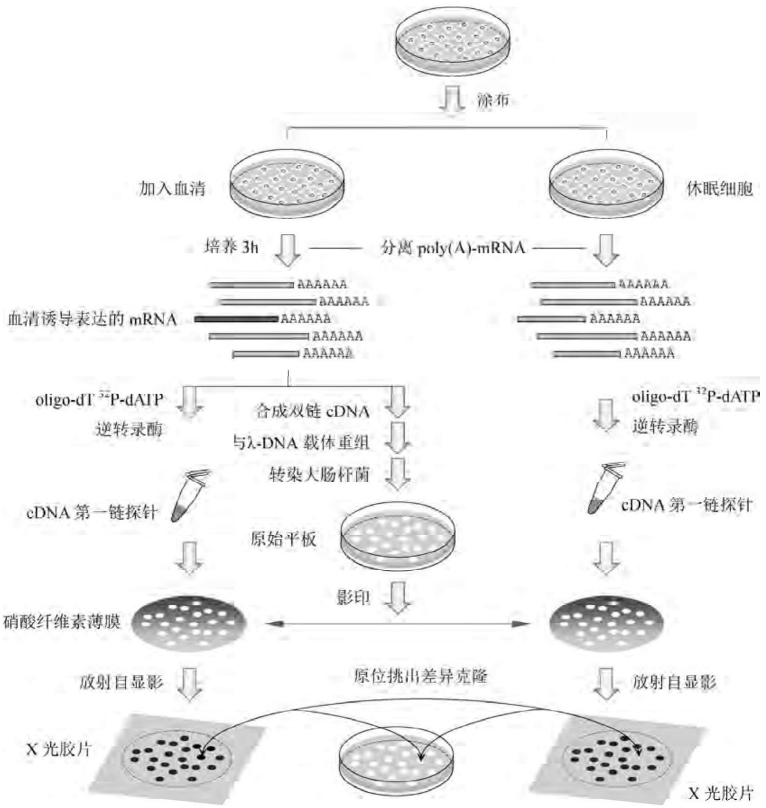

flowchart

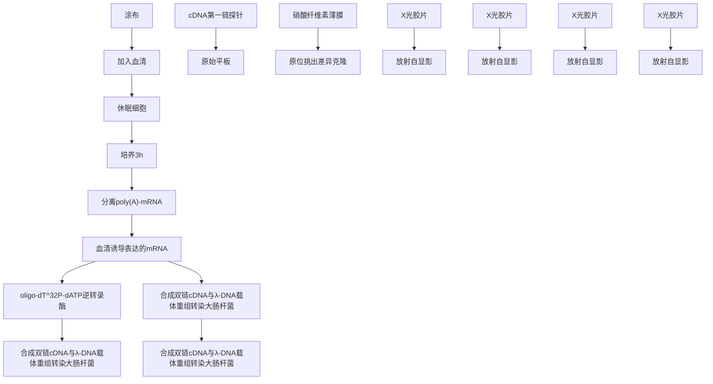

图2-48 受生长因子调控表达的cDNA克隆差示杂交筛选程序

上述方法对筛选表达水平较高的目的基因颇为有效，但在分离由低丰度mRNA克隆的cDNA重组子时相当困难。一种改进的程序如图2-49所示。T淋巴细胞受体(TCR)通常只在T淋巴细胞中少量表达，而在B淋巴细胞中根本不表达。从T细胞中制备总mRNA，并合成相应的cDNA第一链，然后与B细胞中制备的总mRNA退火杂交。由于两种淋巴细胞mRNA的差别是TCR mRNA存在与否，因此在上述杂交物中来自T细胞的TCR cDNA（即目的mRNA的cDNA）为单链形式，其余均为mRNA-cDNA的杂交双链。将这种杂交混合物用特异性吸附双链核酸的羟基磷灰石层析柱分离，流出的是TCR单链cDNA，将其作为探针重新杂交T细胞cDNA重组克隆，可筛选出含TCR编码基因的目的重组子；或者由TCR单链cDNA合成cDNA双链，并直接克隆在载体上。

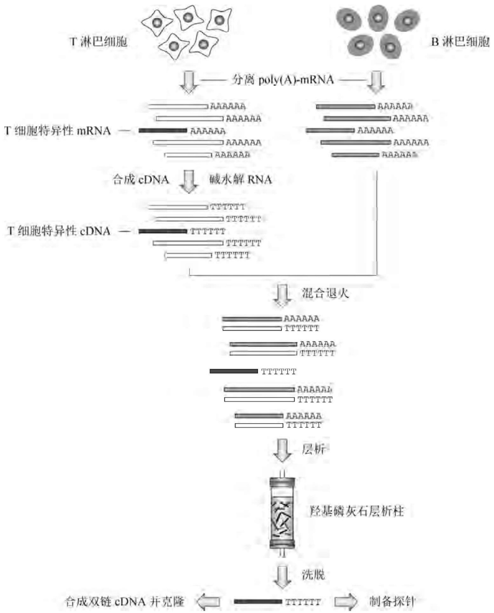

flowchart

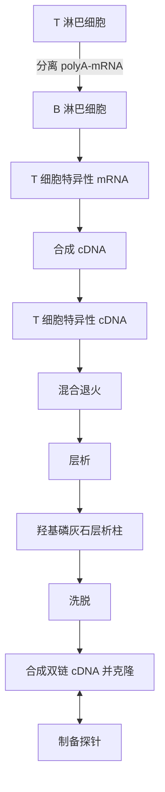

图2-49 TCR cDNA克隆差示杂交筛选程序

## 2.5.3 PCR 扩增法

PCR 扩增技术即聚合酶链反应 (Polymerase Chain Reaction)，由穆勒斯(Kary Mullis)在 20 世纪 80 年代中期发明，利用这项技术可从痕量的 DNA 样品特异性快速扩增某一区域的 DNA 序列。从目的基因的分离克隆角度上讲，PCR 扩增法比目前已经建立起来的任何方法都更简便、快速、有效和灵敏。

## 1. PCR 扩增 DNA 的基本原理

PCR 扩增技术的实质是根据生物体 DNA 的复制原理在体外合成 DNA，这一反应同样需要 DNA 单链模板、引物、DNA 聚合酶、4 种三磷酸脱氧核苷酸（dNTP）以及缓冲系统，并包括 3 步程序（图 2-50）:① 将待扩增双链 DNA 加热变性，形成单链模板；② 2 种不同的单链 DNA 引物分别与两条单链 DNA 模板退火；③ DNA 聚合酶从两个引物的 3'羟基端按照模板要求合成新生 DNA 链，由此构成一轮复制反应。重复上述操作 n 次，理论上即可从一分子的双链 DNA 扩增至 2"个分子，也就是说，经过 42 轮反应后，从一个分子的 1 kb DNA 片段即可得到 1 μg 的相同 DNA 样品，而完成整个扩增反应只需 3 h。

PCR 扩增 DNA 特定靶序列一般需要知道待扩增 DNA 区域两侧 16～24 bp 的序列，由此合成两种引物，并靠它们在待扩增 DNA 区域上的准确定位实现扩增反应的特异性，这种特异性与待扩增 DNA 区域内的序列无关。在第一轮 DNA 聚合反应中，新生链的长度通常大于双引物之间的距离，也就是所谓的聚合过头。但在第二轮反应中，两种引物既可与原 DNA 模板结合，其合成产物与第一轮反应相同；同时也可与新生链退火，此时形成的扩增产物已是以双引物为边界的特异性 DNA 片段，该分子在后续的扩增反应中作为模板，

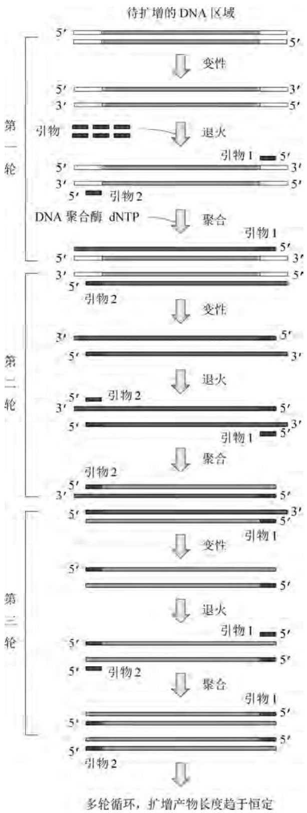

flowchart

This flowchart illustrates the three stages of a DNA amplification cycle, showing how DNA regions are converted into various DNA fragments (5' and 3') and then re-expressed to form new complexes.

图2-50 聚合酶链反应原理示意图