为了克服这些仅识别并作用于单一氨基酸残基型蛋白酶的应用局限性，可在细菌融合伙伴编码序列与不含起始密码子的外源基因之间加装一段编码IEGR寡肽序列的人工接头片段，该寡肽为具有丝氨酸蛋白酶活性的凝血因子Xa所识别，其断裂位点位于IEGR与X之间（X代表除Arg和Pro之外的所有氨基酸）。纯化后的融合蛋白用Xa处理，即可获得不含上述寡肽序列的异源蛋白。由于天然或异源蛋白中出现这种寡肽序列的概率极少，因此

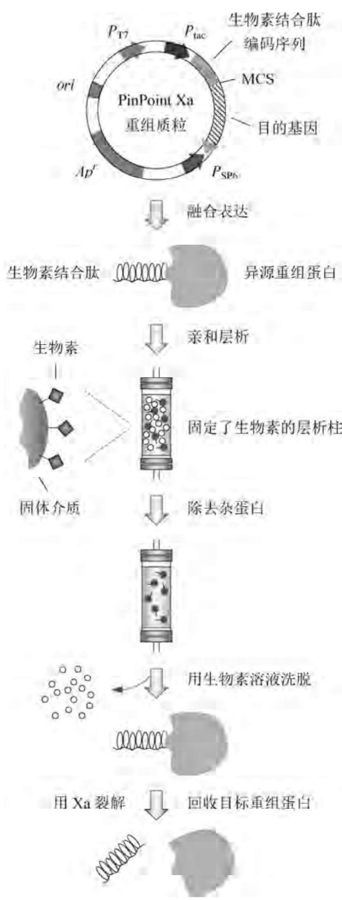

flowchart

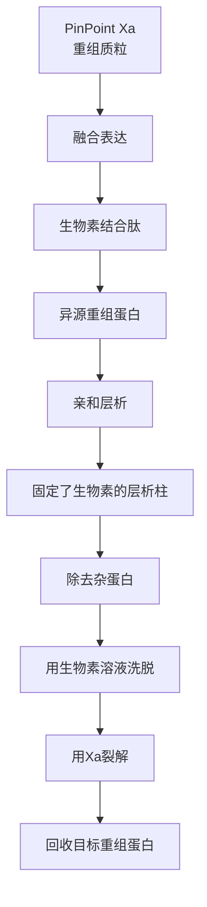

图3-9 利用PinPoint系统表达纯化融合蛋白示意图

这种方法可广泛用于从融合蛋白中回收各种不同大小的外源蛋白产物。另一种具有丝氨酸蛋白酶活性的凝血酶识别 LVPR/G，并在 R 与 G 之间裂解多肽链。特异性更高的蛋白酶包括肠激酶（其识别和裂解序列为 DDDDK/X，其中 X 代表除 Pro 之外的任何氨基酸）、小核糖核酸病毒 3C 蛋白酶（其识别和裂解序列为 LEVLFQ/GP）以及烟草蚀纹病毒蛋白酶（TEV）3C 蛋白酶（其识别和裂解序列为 ENLYFQ/G）。需要注意的是，特定蛋白酶及其最佳反应条件的选择往往取决于目标重组蛋白的序列和性质。

商品化的 PinPoint Xa 蛋白纯化系统为上述方法的实际应用提供了更为便捷的外源基因融合表达载体(图 3-8)，它含有控制融合基因表达的 $P_{\text{tac}}$ 启动子以及可用于融合蛋白亲和层析分离纯化的大肠杆菌生物素结合肽标签编码序列，其下游的 Xa 因子识别序列可供从纯化的融合蛋白裂解回收异源蛋白。此外，在 $P_{\text{tac}}$ 启动子和多克隆位点 MCS 的外侧，还分别装有 $P_{\text{T7}}$ 和 $P_{\text{SP6}}$ 启动子，两者能在含有相应噬菌体 RNA 聚合酶编码基因的特殊大肠杆菌受体细胞中大量合成 RNA，用于无细胞外体翻译。含有外源基因的重组分子在大肠杆菌中表达出 N 端含有生物素结合肽标签的融合蛋白，细菌裂解悬浮液直接用生物素抗性蛋白(Avidin)亲和层析柱分离，然后再借助于游离生物素的竞争结合技术将融合蛋白从层析柱上洗脱下来，并用 Xa 因子位点特异性切除融合蛋白 N 端的标签序列，最终获得异源蛋白产物(图 3-9)。

## 3.2.4 寡聚型重组异源蛋白的表达

从理论上讲,外源基因的表达水平与受体细胞中可转录基因的拷贝数(即基因剂量)呈正相关,重组质粒拷贝数的增加在一定程度上能提高异源蛋白的产量。然而,重组质粒除了含有外源基因外还携带其他的

可转录基因，如作为筛选标记的抗生素抗性基因等。随着重组质粒拷贝数的不断增加，受体细胞内的大部分能量被用于合成所有的重组质粒编码蛋白，而细胞的正常生长代谢却因能量不济受到影响，并且除了外源基因表达产物外，质粒编码的其他蛋白合成并没有任何价值，因此通过增加质粒拷贝数提高外源基因表达产物的产量往往不能获得如期的效果。另一种通过增加外源基因剂量而提高蛋白产物产量的有效方法是构建寡聚型重组异源蛋白表达载体，即将多拷贝的外源基因克隆在一个低拷贝质粒上，以取代单拷贝外源基因在高拷贝载体上表达的策略，这种方法对高效表达那些分子量较小的异源蛋白或多肽具有很强的实用性。

外源基因多拷贝线性重组是寡聚型异源蛋白表达系统构建的关键技术,它包括三种不同的重组策略,其构建方法、表达产物的后加工程序以及适用范围各不相同(图 3-10)。

## 1. 多表达盒型重组策略

外源基因拷贝均携带各自的启动子、终止子、SD序列以及起始和终止密码子，形成相互独立的转录和翻译串联表达盒，其中盒与盒之间的连接方向可正可反，一般与表达效率无关，因此多拷贝连接较为简单。表达出的异源蛋白无须进行裂解处理，但每个产物分子的N端含有甲硫氨酸残基[图3-10(a)]。这个策略特别适用于表达相对分子质量较大的异源蛋白，尤其是表达用于体内功能研究的重组蛋白复合物，例如四亚基的血红蛋白和丙酮酸脱氢酶、三亚基的复制蛋白A以及两亚基的肌球蛋白和肌酸激酶等。

(a) 多表达盒型重组策略

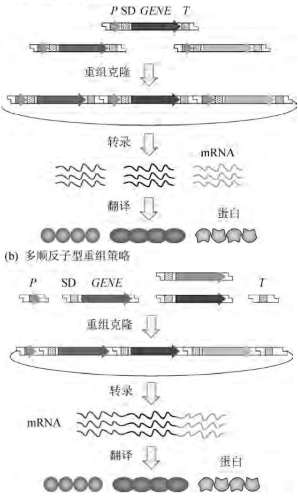

(c) 多编码序列型重组策略

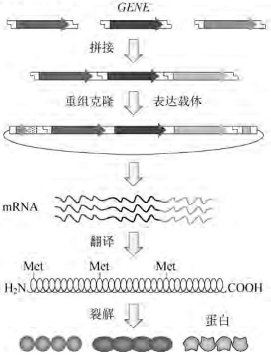

flowchart

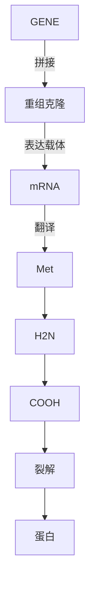

图3-10 寡聚型重组异源蛋白表达载体的构建策略

## 2. 多顺反子型重组策略

外源基因拷贝含有各自的SD序列以及翻译起始终止信号，将它们串联起来后克隆在一个公用的启动子-转录起始位点下游。为了防止转录过头，通常在最后一个基因拷贝的下游组装一个较强的转录终止子，使得多个异源蛋白编码序列转录在一个mRNA分子中，但最终翻译出的异源蛋白分子却是相互独立的，其表达机理与原核生物中的操纵子极为相似[图3-10(b)]。这种方法对中等分子量的异源蛋白表达较为有利，使用一套启动子和终止子转录调控元件，可以在外源DNA插入片段大小不变的前提下，克隆更多拷贝的外源基因。但是在体外拼接组装时，各顺反子的极性必须与启动子保持一致，有时在技术上很难满足这种要求。为解决这一难题，可采用多种质粒介导双顺反子表达策略，例如采用四种不同质粒各携带双顺反子允许在一个大肠杆菌细胞内共表达八种重组蛋白，每种质粒分别携带不同的复制起始位点(ColE1、p15A、RSF、CDF)，同时使用四套不同的选择性标记(壮观霉素、卡那霉素、氯霉素、氨苄青霉素)。

## 3. 多编码序列型重组策略

将多个外源基因编码序列串联在一起，使用一套转录调控元件和翻译起始终止密码子，各编码序列在接口处设计引入溴化氰断裂位点甲硫氨酸密码子或蛋白酶酶解位点序列。由这种重组分子表达出的多肽链上包含多个由酰氨键相连的目的产物分子，纯化后多肽分子用溴化氰或相应的蛋白酶位点特异性裂解，形成产物的单体分子[图3-10(c)]。这种方法特别适用于小分子多肽(通常小于50个氨基酸)的高效表达。前已述及，小分子多肽由于缺乏有效的空间结构，在大肠杆菌中的半衰期很短。多拷贝串联多肽的合成弥补了上述缺陷，在提高表达率的同时，也增加了对受体细胞内源性蛋白酶系统的抗性能力，可谓一箭双雕。然而这种策略在实际操作中困难很大，其焦点是裂解后多肽单体分子的序列不均一性或(和)不正确性。首先，各编码序列的分子间重组需要特殊的酶切位点，这些位点的引入势必导致氨基酸残基的增加。非限制性内切酶产生的平头末端连接虽然可以避免这种缺陷，但很难保证各编码序列以极性相同的方式排列；其次，用溴化氰断裂多肽链会使单体产物分子C端多出一个高丝氨酸，尽管这个多余的残基可用化学方法切除，但在大规模生产中往往难以实现；最后，若用蛋白酶系统释放单体分子，则产物中至少有一部分单体分子的N端带有甲硫氨酸，除非每个编码序列均含有甲硫氨酸密码子，才能保证单体分子序列的均一性。

多顺反子和多编码序列型重组均要求各单元序列的极性一致排列，借助于限制性内切酶 AvaI可有效达到此目的。该酶的识别序列为 $5^{\prime}\mathrm{C}(\mathrm{T} / \mathrm{C})\mathrm{CG}(\mathrm{A} / \mathrm{G})\mathrm{G}3^{\prime}$，切割位点在T/C的 $5^{\prime}$ 端一侧。含有唯一 $5^{\prime}$ CTCGGG3'序列的质粒用AvaI切开，Klenow酶填平黏性末端，然后接上EcoRI人工接头(5'GAATTC3')，由此修饰的质粒含有两个AvaI位点，它们通过部分重叠的形式左右包裹一个EcoRI位点(图3-11)。外源基因的转录元件和翻译元件克隆在EcoRI处。从另一个重组质粒中切开两端含有AvaI黏性末端的编码序列，由于每个单体分子上的黏性末端并不对称，因而在体外连接时各单体的极性是一致的。将这一线形串联的DNA分子克隆在经AvaI部分酶解的线形化表达载体上，所形成的转化子中 $50\%$ 的重组克隆能够进行表达。

寡聚型外源基因表达策略曾成功用于人干扰素(抗病毒和抗肿瘤)、鲑鱼降钙素(防止骨质疏松的特效药)、人胰高血糖素样多肽(降血糖)等小分子量蛋白或寡肽的高效表达,每个重组质粒分子携带4\~8个外源基因编码序列拷贝,能大幅度提高重组产物的产率和稳定性。然而在某些情况下，串联的外源基因拷贝会因同源重组而表现出结构不稳定。在大肠杆菌生长过程中，重组分子中的一部分甚至全部外源基因拷贝会从质粒上脱落。这种现象与串联拷贝的数目、编码序列单体的大小及其产物性质、受体菌的遗传特性和培养条件等有着密切的关系。

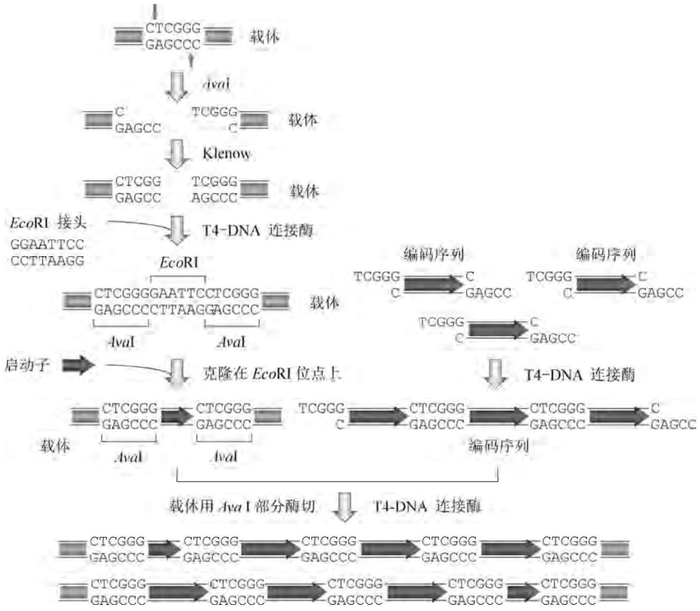

flowchart

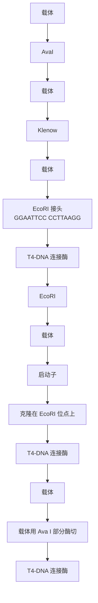

图3-11 寡聚型编码序列的极性保持

## 3.2.5 整合型重组异源蛋白的表达

受体菌中重组质粒的自主复制以及编码基因的高效表达大量消耗能量，为细胞造成沉重的代谢生理负担，而且高拷贝质粒产生的影响更大。作为针对这种不利影响的抗争形式，一部分细菌往往在其生长期间将重组质粒逐出胞外。不含质粒的这部分细菌的生长速度远比含有质粒的细菌要快，经过若干代繁殖之后，培养基中不含质粒的细菌最终占有绝对优势（在不施加选择性压力的情况下），从而导致重组异源蛋白的宏观产量急剧下降。至少有两种方法可以阻止重组质粒的丢失:将克隆菌置于含有筛选试剂（药物或生长必需因子）的培养基中生长，这样可以有效地控制丢失质粒的细胞的增殖速度，维持培养物中克隆菌的绝对优势。然而在大规模产业化过程中，向发酵罐中加入抗生素或氨基酸等筛选试剂很不经济，且易造成产品和环境污染；另一种几乎是一劳永逸的方法是将外源基因直接整合在受体细胞染色体DNA的特定位置上，使之成为染色体DNA的一个组成部分，从而提升其稳定性。

当外源基因表达盒与受体细胞染色体DNA进行整合时，其整合位点必须在染色体DNA的必需编码区外，否则会严重干扰受体菌的正常生长与代谢过程，因此整合必须呈位点特异性。为了达到此目的，根据同源重组交换原理，通常在待整合基因附近或两侧加装一段受体菌染色体DNA的同源序列（一般至少 $50\mathrm{bp}$）。此外，为了保证重组异源蛋白的高效表达，待整合的外源基因应该拥有相应的可控性启动子等表达元件。总之，整合型外源基因表达盒的构建应包括如下步骤:①探测并确定受体菌染色体DNA的合适整合位点，以该位点被外源DNA片段插入后不影响细胞的正常生理功能为前提，例如细菌的抗药性基因、次级代谢基因或两个操纵子之间的间隔区等；②克隆分离选定的染色体DNA整合位点并进行序列分析；③将外源基因以及必要的可控性表达元件连接到已克隆的染色体整合区域(同源臂)内部[图3-12(a)]或邻近区域[图3-12(b)]；④将上述重组质粒转入受体细胞中；⑤筛选和扩增整合了外源基因表达盒的转化子。

以同源重组交换为基本形式的整合现象广泛存在于各种生物体中，其整合频率取决于同源序列的相似程度和同源区域的大小。同源性越高，同源区域越大，整合频率也就越高，但实际上不可能达到 $100\%$ 的整合率。因此，为了保证受体细胞内不存在任何形式的游离质粒分子，通常选用那些不能在受体细胞中进行自主复制的质粒或者温度敏感型质粒，后者在敏感温度时因不能复制而丢失。当染色体DNA整合位点的同源序列位于外源基因两侧时[图3-12(a)]，两个同源臂同时发生交叉重组反应，载体上外源基因表达盒与受体细胞染色体DNA中两个重组位点之间的区域发生位置交换（即同源交换）。由于质粒不能复制扩增，受体菌繁殖几代后，不含质粒的细胞便占绝对优势，此时，通过检测外源基因的表达产物以及载体骨架的存在与否即可分离出整合型工程菌。如果染色体DNA整合位点的同源序列位于外源基因的一侧，则重组质粒通常以整个分子的方式进入染色体DNA中[即同源整合，见图3-12(b)]。在这种情况下，整合性工程菌的筛选标记既可使用外源基因，也可使用原质粒所携带的可表达性基因，如抗生素的抗性基因等。

在一般情况下,整合型的外源基因或重组质粒随克隆菌染色体 DNA 的复制而复制,因此受体细胞通常只含有一个拷贝的外源基因。但如果使用的质粒呈温度敏感型复制,而且整合时质粒同时进入染色体 DNA 中,那么当整合型工程菌在含有高浓度抗生素(其抗性基因定位于质粒上)的培养中生长时,整合在染色体 DNA 上的质粒仍有可能进行自主复制,从而导致外源基因形成多拷贝。有趣的是,尽管整合型质粒在染色体上的自主复制程度非常有限(通常不及游离型质粒的 25%),但外源基因的宏观表达总量却远远高于游离型重组质粒上外源基因的数倍,而且定位于染色体 DNA 上的外源基因相当稳定。

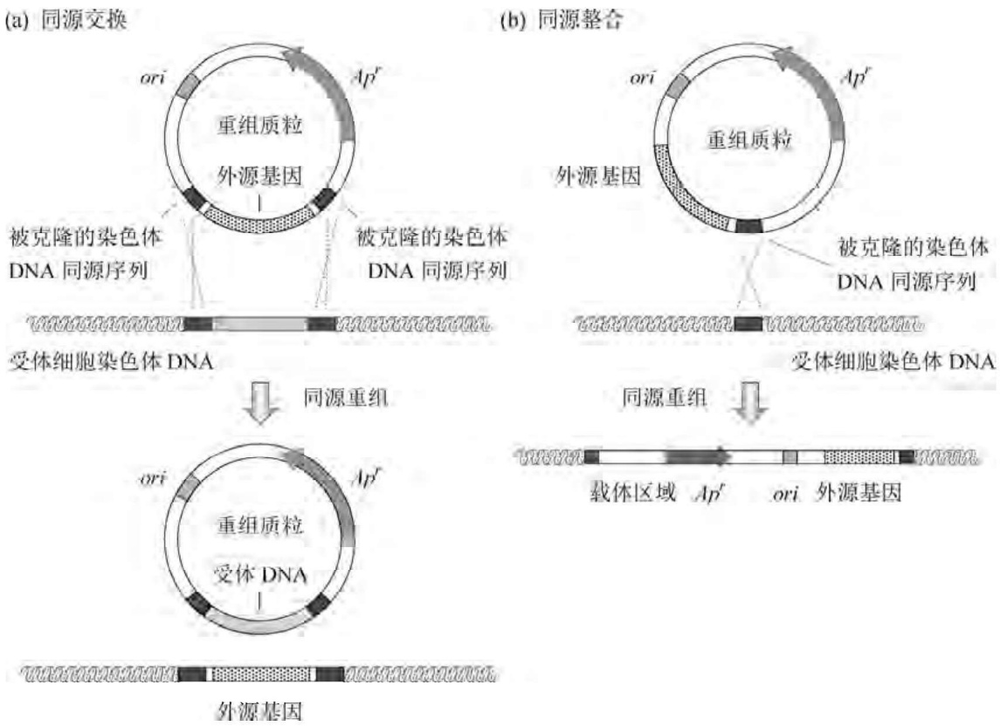

flowchart

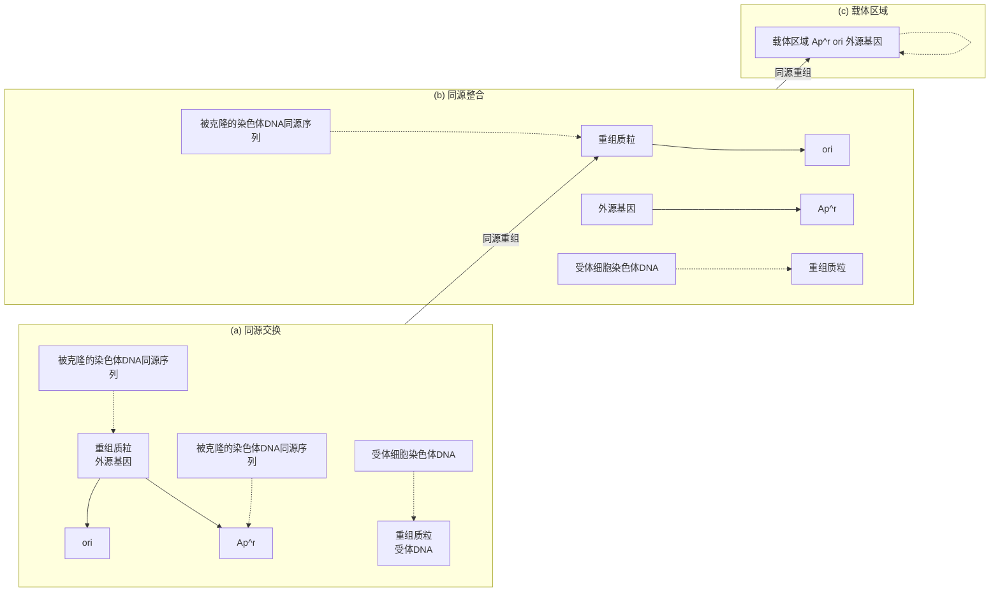

图3-12 细胞内DNA同源重组示意图

## 3.3 重组异源蛋白的体内修饰与体外复性

依据基因的表达调控原理,可采用多种手段提高外源基因在受体细胞内合成相应蛋白质的产量,然而高水平表达的重组异源蛋白在大肠杆菌中往往呈无活性状态(质),甚至因蛋白酶的降解作用而难以积累(量),严重影响活性目标产物的最终收率。导致重组异源蛋白在大肠杆菌细胞中失活和不稳定性的主要原因包括:① 大肠杆菌缺乏针对重组异源蛋白有效的折叠复性和翻译后修饰加工系统;② 大肠杆菌不具备真核生物细胞完善的亚细胞结构以及众多的稳定因子;③ 高效表达的重组异源蛋白在大肠杆菌细胞中形成高浓度微环境(可溶性和不溶性集聚体),致使蛋白分子间的相互作用增强。因此,在不影响外源基因表达效率的前提下,如何减少因上述三方面不利因素所造成的重组表达产物质和量的损失,是大肠杆菌基因工程设计和操作过程中应考虑的主要问题。

## 3.3.1 重组异源蛋白的稳定性维持

蛋白质降解是生物体必需的生理过程。在很多情况下，蛋白质降解具有调控功能，即降低代谢途径关键酶的存量以及灭活细胞调控因子，如转录调控因子及细胞循环调控因子等。细胞内蛋白质降解的另一个生理功能是清除代谢过程中产生的误折叠、误装配、误定位、毒性大或其他形式的异常蛋白。各种蛋白质在体内的半衰期相差很大，从数分钟到数小时不等，取决于细胞的种类、培养条件、细胞周期以及蛋白质本身的性质等诸多因素，其中最基本的影响因素是细胞内蛋白酶系统的性质和蛋白质结构对蛋白酶降解作用的敏感性。

## 1. 细胞内蛋白质降解的基本特征

细胞内蛋白质降解的一个重要特征是其显著的选择性。底物特异性的蛋白质降解作用需要特定的多肽序列结构，它或者为特异性的蛋白酶直接识别，或者与蛋白降解复合物系统中某些特异性识别组分相互作用，进而定位在蛋白酶水解组分的作用区域内。因此，在特定的细胞内部环境中，一个特定蛋白质的半衰期是蛋白酶识别组分对蛋白质有效靶序列的亲和性以及蛋白降解系统各成分在细胞内的浓度这两者的函数。实验证据表明，许多蛋白质拥有几种不同的降解序列决定簇，它们分别为不同的蛋白水解系统所识别，同时以不同的途径和机理降解。在某些条件下，半衰期长的蛋白质由于其隐蔽的降解作用位点暴露使得它对蛋白酶的敏感性大大增加，这实际上是细胞蛋白质降解的一种调控方式。例如，蛋白底物经特异性修饰后空间结构改变，从而缩短了半衰期。另外，蛋白质中的有些序列尤其是C端和N端的某些序列也对蛋白质的稳定性起着重要作用，它们或者影响降解型靶序列的形成，或者直接抑制某些蛋白酶的外切活性。

无论是在真核细胞还是原核细胞中，重组异源蛋白表达后很难逃脱被迅速降解的命运，其稳定性甚至还不如半衰期较短的细胞内源性蛋白质。在大多数情况下，重组异源蛋白的不稳定性可归结为对受体细胞蛋白酶系统的敏感性。尽管目前对细胞内蛋白质降解途径尚未形成全景式的了解，由蛋白质序列预测其空间构象还存在许多误差，但越来越多的实验结果揭示，重组异源蛋白在受体细胞内的半衰期可以通过蛋白序列的人工设计以及受体细胞的改造加以调整和控制。

## 2. 蛋白酶缺陷型大肠杆菌受体细胞的改造

在大肠杆菌中，蛋白质的选择性降解由一整套庞大的蛋白酶系统所介导。绝大多数不稳定的重组异源蛋白由蛋白酶La和Ti介导降解，两者分别由lon和clp基因编码，其蛋白水解活性均依赖于ATP。lon基因由热休克其他环境压力激活，细胞内异常蛋白或重组异源蛋白的过量表达也可作为一种环境压力诱导lon基因的表达。研究发现， $lon^{-}$ 型大肠杆菌突变株可使原来半衰期较短的细菌调控蛋白（如SulA、RscA、 $\lambda N$ 等）稳定性大增，因此被广泛用于基因表达研究及工程菌的构建。然而这种突变株并非对所有蛋白质的稳定表达均有效，有些蛋白质（如 $\lambda$ 噬菌体的CII）在 $lon^{-}$ 型突变株中并不稳定，可能是因为其他底物特异性的蛋白酶在起作用。

很多异常或异源蛋白在大肠杆菌中的降解还直接与庞大的热休克蛋白家族的生物活性有关。这些蛋白质在环境压力缺席的大肠杆菌细胞中通常以基底水平痕量表达，它们参与天然蛋白质的折叠，并胁迫异常或异源蛋白形成一种对蛋白酶识别和降解较为有利的空间构象，从而提高其对降解的敏感性。热休克基因 $dnaK, dnaJ, groEL, grpE$ 以及环境压力特异性 $\sigma$ 因子编码基因 $htpR$ 的突变株均呈现出对异源蛋白降解作用的严重缺陷，特别是 $lon^{-}htpR^{-}$ 型双突变株，非常适用于各种不稳定蛋白质的高效表达。大肠杆菌 $hflA$ 基因的编码产物为 $\lambda$ 噬菌体CII蛋白降解所必需，在 $hflA^{-}$ 型突变株中，CII蛋白的半衰期显著延长，而 $degP^{-}$ 型突变株则能提升某些定位在大肠杆菌细胞周质中的融合蛋白的稳定性。因此，构建多种蛋白酶单一或多重缺陷型大肠杆菌突变株，并将其用于重组异源蛋白的稳定性表达比较，是基因工程菌构建的一项重要内容。

## 3. 抗蛋白酶的重组异源蛋白序列设计

系统研究蛋白质的降解敏感性决定簇序列有助于了解大肠杆菌控制蛋白质稳定性的机制，并可通过人工序列设计和修饰达到稳定表达重组异源蛋白之目的。利用缺失分析和随机点突变技术对 $\lambda$ 噬菌体阻遏蛋白降解型敏感序列的研究结果表明，存在于该蛋白质近C端的五个非极性氨基酸是提高对蛋白酶降解敏感性的重要因素。有趣的是，含有非极性C末端的蛋白质降解作用也发生在 $lon^{-}$ 和 $htpR^{-}$ 的突变株中，而且呈ATP非依赖性，暗示这种降解作用与大肠杆菌降解异常蛋白质的机理并不相同。由此可以推测，C端区域内极性氨基酸的存在可能会提高蛋白质的稳定性。进一步的实验结果证实了这一点:在所有的极性氨基酸中，Asp的存在对提高蛋白质稳定性的效应最大，而且Asp距C末端越近，蛋白质的稳定性就越大。更为重要的是，在多种结构和功能相互独立的蛋白质C端引入Asp，都能显著延长这些蛋白质的半衰期。

蛋白质 N 末端的氨基酸序列对稳定性的影响同样显著。将某些氨基酸加入大肠杆菌  $\beta$ -半乳糖苷酶的 N 末端，经改造的蛋白质在体外的半衰期差别很大，从 2 min 到 20 h 以上不等（表 3-6）。重组异源蛋白 N 末端的序列改造可在外源基因克隆时方便实施，通常在 N 末端接上一个特殊的氨基酸就足以使异源蛋白在大肠杆菌中的稳定性大增，而且这一策略在原核和真核生物中均通用。例如有关实验结果表明，在胰岛素原的 N 端加装一段由 6～7 个氨基酸残基组成的同聚寡肽也能明显改善该蛋白在大肠杆菌细胞中的稳定性。具有这种稳定效应的氨基酸包括 Ala、Asn、Cys、Gln、His。

表 3-6 大肠杆菌 β-半乳糖苷酶 N 端氨基酸残基对蛋白质稳定性的影响

<table><tr><td colspan="6">氨基酸残基</td><td>蛋白质半衰期</td></tr><tr><td>Met</td><td>Ser</td><td>Ala</td><td>Thr</td><td>Val</td><td>Gly</td><td>大于20h</td></tr><tr><td>Ile</td><td>Glu</td><td></td><td></td><td></td><td></td><td>大于30min</td></tr><tr><td>Tyr</td><td>Gln</td><td></td><td></td><td></td><td></td><td>大约10min</td></tr><tr><td>Pro</td><td></td><td></td><td></td><td></td><td></td><td>大约7min</td></tr><tr><td>Phe</td><td>Leu</td><td>Asp</td><td>Lys</td><td></td><td></td><td>大约3min</td></tr><tr><td>Arg</td><td></td><td></td><td></td><td></td><td></td><td>大约3min</td></tr></table>

相反，N端富含Pro、Glu、Ser、Thr的真核生物蛋白质在真核或原核细胞中的半衰期通常都很短，至少E1A、c-Myc、c-Fos和p53等蛋白都具有这种特性，特别是由这四种氨基酸残基构成的Pro-Glu-Ser-Thr四肽序列（即PEST序列）显示出对细胞内蛋白酶系统的超敏感性。在大多数情况下，PEST序列的两侧拥有一些带正电荷的极性氨基酸，据推测PEST序列实质上是一个钙结合位点，它能促进那些钙依赖性蛋白酶系统对蛋白质的降解作用。尽管有些实验结果并不能证实PEST序列对蛋白质稳定性的负面影响，但当某一真核生物基因在大肠杆菌中不能稳定表达时，注意PEST序列是否存在，并在不影响异源蛋白生物功能的前提下对之进行适当的改造，不失为一种提高表达产物稳定性的尝试。

## 3.3.2 重组异源蛋白的糖基化修饰

据统计，临床上约 $70\%$ 的治疗用蛋白属于糖基化修饰型蛋白。糖基化修饰能提升蛋白质的结构稳定性、药代动力学性能以及与靶细胞表面受体的结合能力。真核生物蛋白质糖基化的主要形式为多肽链保守序列内天冬酰胺残基N原子上交联特定长度和糖基组成的寡聚糖苷链（即 $N-$ 糖基化修饰），但大肠杆菌细胞缺乏此类蛋白质糖基化修饰系统。自从将空肠弯曲杆菌(Campylobacter jejuni)的 $N-$ 糖基化修饰机器导入大肠杆菌获得成功后，利用大肠杆菌生产糖基化的重组异源蛋白已成为可能。

## 1. 降低细菌寡糖基转移酶的底物特异性

大肠杆菌虽然不含复杂糖链的合成机器，却拥有 O-抗原（由 3～6 个单糖构成的寡糖链）连接酶 WaaL，后者能将 O-抗原交联在脂质 A 上，任何在大肠杆菌中表达的异源寡糖链均可被 WaaL 交联至脂质但非目标蛋白中。因此，大肠杆菌异源蛋白糖基化能力工程化设计和引入的第一步是构建基因型为  $\Delta waaL$  的缺失突变株，如源自大肠杆菌 W3110 株的 CLM24 突变株。

空肠弯曲杆菌的蛋白质寡糖基转移酶PglB能在周质环境中将寡糖链位点特异性地交联在原核细菌内源性蛋白或重组异源蛋白多肽链中 $\mathrm{D / E - X_1 - N - X_2 - S / T}$ (X为Pro除外的所有氨基酸)保守序列的天冬酰胺残基上，但绝大多数来自真核生物的异源蛋白糖基化位点序列往往不含带负电荷的D或E残基。由于目标蛋白的氨基酸序列一般不允许改变，因此需要通过改造PglB的结构特征以拓宽其对蛋白底物的识别特异性。事实上，D或E的存在并非PglB介导寡糖链交联所必需，但对酶促反应效率影响很大。PglB的晶体结构已提示改变其底物识别特异性或提高酶催化活性的关键氨基酸位点，但基于点突变的PglB改造效果并不理想，在大肠杆菌中PglB介导真核型寡糖链转移的效率仅为 $1\%$ ；在原核细菌范围内进一步搜寻具有较低底物糖基化位点特异性的PglB同源物有可能最终解决这一问题。

## 2. 引入真核生物糖链合成的机器

大肠杆菌天然存在十一异戊烯焦磷酸- $\alpha-N-$ 乙酰葡萄糖胺-1-磷酸转移酶(WecA)，它能将N-乙酰葡萄糖胺-1-磷酸转移至定位于内膜胞质一侧的原核细菌特征性寡糖链合成载体十一异戊烯焦磷酸(Und-PP)上。研究显示，在 $\Delta waaL$ 型大肠杆菌CLM24缺失突变株中分别导入来自酿酒酵母的异源二聚体型 $\beta-1,4-N-$ 乙酰葡萄糖胺转移酶(Alg13/Alg14)、 $\beta-$ 甘露糖转移酶(Alg1)、双功能型 $\alpha-1,3-$ 甘露糖和 $\alpha-1,6-$ 甘露糖转移酶(Alg2)以及空肠弯曲杆菌的PglB编码基因，便能使大肠杆菌产生含类似真核生物寡糖侧链 $Man_{3}GlcNAc_{2}$ 的重组糖蛋白(图3-13)。这种经工程化改造的大肠杆菌首先在其内膜胞质一侧合成 $Man_{3}GlcNAc_{2}$ 寡糖单位，再借助其自身存在的O-抗原翻转酶(Wzx)将之翻转至周质一侧，最后由PglB交联至重组异源蛋白的相应糖基化位点上。然而，人体内天然糖蛋白的糖链结构还含有N-乙酰葡萄糖胺、半乳糖、唾液酸的延伸单位，上述构建的大肠杆菌工程株距最终表达人源化糖蛋白产物的目标还有较长的路。此外，这一策略要求重组异源蛋白能分泌至大肠杆菌的周质中，因而表达量往往受到很大程度上的限制。

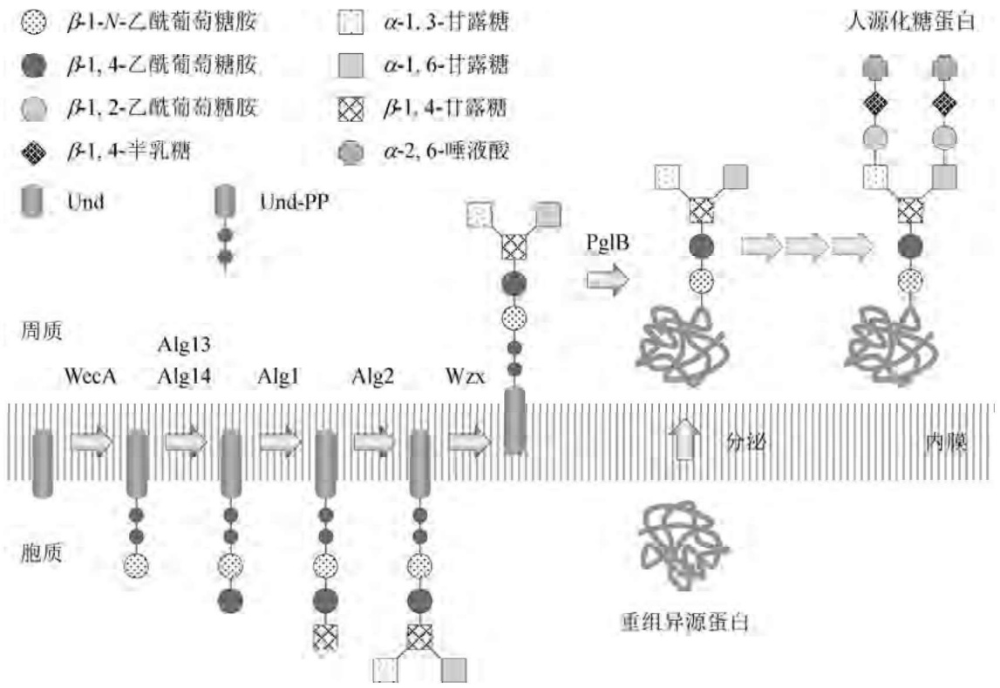

flowchart

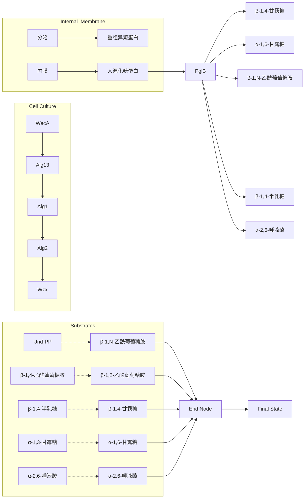

图3-13 表达真核型糖基化机器的大肠杆菌工程化改造策略

## 3. 提升糖基化重组异源蛋白的表达效率

限制大肠杆菌高效表达糖基化重组异源蛋白的因素很多。第一，PglB的寡糖链转移效率具有较大的改进空间，采用密码子优化等策略可使PglB在大肠杆菌中的寡糖链转移效率提升至 $77\%$ 。第二，减小大肠杆菌的代谢负荷被证明能有效提高重组异源蛋白的糖基化效能，提升磷酸烯醇丙酮酸依赖型单糖磷酸转移系统的效率有助于打通重组大肠杆菌的代谢瓶颈。例如，ptsA基因的过表达能使多种重组异源糖蛋白的表达量提高6.7倍，达到大约 $9\mathrm{mg / L}$ 的水平；参与寡糖链装配的异柠檬酸裂解酶的过表达也能使重组异源糖蛋白的表达量提高3倍。

## 3.3.3 包涵体型重组异源蛋白的体外溶解与变性

大肠杆菌中过量表达的重组异源蛋白往往聚集在一起形成水不溶性包涵体，这种现象也会发生在其他受体系统如芽孢杆菌、酵母、家蚕甚至某些猴细胞系中。从包涵体中回收活性蛋白实质上可归结为蛋白质的体外复性这一基本命题，它不仅具有重要的蛋白质化学学术价值，而且也是基因工程产品产业化过程中的重大技术难题。蛋白质的体外复性主要包括包涵体的溶解变性与蛋白质复性重折叠(Refolding)两大基本操作单元，其效率受诸多因素的制约，且操作程序因包涵体的性质而异。在由大肠杆菌产生的包涵体中，重组异源蛋白的复性率除个别例子可高达 $40\%$ 外，一般不超过 $20\%$ 。

由于包涵体中的重组异源蛋白大部分以分子间或(和)分子内的错配二硫键形成可逆性集聚体,因此从包涵体中回收具有生物活性的异源蛋白首先必须使包涵体全部溶解并变性,只有在此基础上才能进行异源蛋白的复性重折叠操作。变性溶剂的选择不仅影响后续复性重折叠工序的设计,同时也是变性过程成败的关键。理想的变性剂应具备如下性质:① 变性溶解速度快;② 对包涵体中残留细胞碎片的分离没有干扰;③ 无温度依赖性;④ 对蛋白酶具有抑制作用;⑤ 对蛋白质中的氨基酸侧链基团无化学反应活性。目前广泛使用的变性剂为促溶剂(Chaotropic)和清洗剂,促溶剂最早用于天然蛋白颗粒的溶解,而像SDS等离子型清洗剂则通常用于溶解膜蛋白颗粒。包涵体一旦溶解,多肽链中的巯基会迅速氧化形成折叠中间体和共价集聚物,它们通常难以进行重折叠,因此必须除去。为了防止这种自发氧化反应的发生,还必须在溶解缓冲液中加入低分子量的巯基试剂,或者通过S-碘酸盐的形成保护还原性的巯基基团。

## 1. 清洗剂的溶解变性作用

使用清洗剂是溶解包涵体最廉价的一种方法，其溶解物在稀释后的蛋白质集聚作用要比用其他溶解方法减少很多，而且阳离子、阴离子以及两性离子型的清洗剂均可使用。但必须注意，在包涵体的溶解过程中，清洗剂的使用浓度必须大大高于其临界胶束浓度（CMC），通常在 $0.5\% \sim 5\%$ 内。清洗剂使用的最大缺陷是为下游蛋白质复性和纯化工序增添了不少麻烦，它能不同程度地与蛋白质结合而很难除去，因此干扰复性蛋白的离子交换层析及疏水分离。最普通的清洗剂SDS广泛用于牛生长激素、 $\beta-$ 干扰素、白细胞介素-2的大规模纯化，其缺点是CMC值低，除去它极其困难。值得推荐的是正十二醇肌氨酸，它的CMC值可达 $0.4\%$ ，远远高于SDS。用它溶解包涵体可直接通过稀释的方法进行复性操作，残留的清洗剂可采用阴离子交换层析或超滤除去。此外，正十二醇肌氨酸还是一种温和的清洗剂，它能选择性地溶解许多包涵体，但不溶解不可逆的蛋白集聚体和大肠杆菌的内膜蛋白。

使用清洗剂溶解包涵体的一个难以解决的问题是几乎所有的清洗剂均能同时溶解任何污染的细胞膜蛋白酶，并且其蛋白质水解活性为清洗剂所激活，从而导致溶解和折叠过程中异源蛋白的大量损失。防止这种现象发生的改进方法是:①在包涵体溶解之前，先用一种能抽提大肠杆菌膜蛋白但不溶解包涵体的溶剂预洗包涵体；②通过离心尽可能多地除去包涵体制备物中的固体细胞碎片；③在包涵体溶解液中加入适量的蛋白酶抑制剂，如EDTA、苯基脒或PMSF等。

然而，清洗剂的存在并非总是对蛋白质折叠工序不利，至少对于某些蛋白质，非变性的清洗剂在重折叠混合物中能维持折叠产物的稳定性；而对于另一些蛋白质，清洗剂也许能屏蔽折叠中间产物的疏水表面，阻止其集聚和沉淀，有利于提高正确折叠率。例如，硫氰酸合成酶由于其折叠中间产物的集聚作用有效折叠率很低，但清洗剂的存在能显著改善其体外折叠效果，这是一个典型的清洗剂辅助重折叠的例子。

## 2. 促溶剂的溶解变性作用

可用于溶解包涵体的促溶剂很多，但盐酸胍(Gdm)和尿素使用最为普遍。就色氨酸合成酶A和 $\alpha_{2}$-干扰素而言，阳离子和阴离子促溶剂对包涵体的相对溶解能力大小次序分别为:$\mathrm{Gdm}^{+} > \mathrm{Li}^{+} > \mathrm{K}^{+} > \mathrm{Na}^{+}$ 和 $\mathrm{SCN} > \mathrm{I}^{-} > \mathrm{Br}^{-} > \mathrm{Cl}^{-}$ 。然而其中有些盐在实际操作中并不实用，因为其溶液比盐酸胍和尿素溶液的密度高、黏度大，难以进行后续离心和层析操作。盐酸胍或尿素用于溶解包涵体的浓度主要取决于异源蛋白本身的性质，在低浓度的上述溶液中即可保持非折叠状态的蛋白质，其包涵体往往能在相似的溶液浓度下溶解。例如，黏颤菌血红蛋白在尿素溶液中的非折叠状态平衡中点与其包涵体溶解度的中点完全一致。如果异源蛋白的非折叠性质未知，则变性剂及其浓度的选择只能凭经验确定。

一般而言，6 mol/L 的盐酸胍溶液是一强的变性溶解剂，但其高离子强度使得溶解蛋白的离子交换层析操作变得困难。盐酸胍价格昂贵，因而仅适用于生产具有高附加值的蛋白产物或药品。尿素虽然便宜，但常常会被自发形成的氰酸盐所污染，后者极易与蛋白质侧链中的氨基发生反应，导致产物的异质性。为了避免这种情况发生，尿素溶液在使用前可用阴离子交换树脂进行预处理，并在包涵体溶解及重折叠操作中使用氨基类缓冲液，如 Tris-HCl 等。

## 3. 极端 pH 的溶解变性作用

酸性或碱性缓冲液也能廉价有效地溶解包涵体，然而许多蛋白质在极端 $\mathrm{pH}$ 条件下会发生不可逆修饰反应，因此这种方法的应用范围不如上述两种方法广泛。最有效的酸溶解剂是有机酸，使用浓度范围为 $5\% \sim 80\%$ ，白介素- $1\beta$ 和 $\beta-$ 干扰素的包涵体均可用乙酸或丁酸溶解。高 $\mathrm{pH}$ 值 $(>11)$ 的碱溶剂可用来溶解牛生长激素和凝乳酶原包涵体，但这种情况并不多见，因为大部分蛋白质在强碱溶液中会发生脱氨反应和半胱氨酸的脱硫反应，导致蛋白质的不可逆变性。

## 4. 混合溶剂的溶解变性作用

在一般情况下，各种促溶剂不能联合使用，例如盐酸胍和尿素的混合溶液达不到很高的饱和浓度，然而有些商品化的促溶型生物多聚体变性剂的混合物却可达到 $14\mathrm{mol / L}$ 的饱和浓度。尿素与其他促溶剂盐类化合物的混合液可用于变性RNase，目前这一方法也多用于包涵体的溶解中。高浓度的非促溶剂盐类化合物（如氯化钠）可降低包涵体在尿素中的溶解度。将促溶剂与某些添加剂或溶解增强剂联合使用，有时能大大促进包涵体的溶解变性，例如尿素分别与乙酸、二甲基砜、2-氨基-2-甲基-1-丙醇以及高 $\mathrm{pH}$ 联合使用，可成功地溶解牛生长激素的包涵体。

## 3.3.4 包涵体型重组异源蛋白的体外复性与重折叠

在重组异源蛋白的大规模生产中，复性与重折叠操作是一项关键技术，用于溶解变性包涵体的化学试剂性质及其在重折叠前的残留浓度是影响折叠策略选择的两大要素。如果包涵体中的异源蛋白含有较少的二硫键，而且二硫键错配的比例较低，则从理论上来说，选用较弱的清洗剂溶解包涵体能大幅度提高重组异源蛋白的复性率；然而对于二硫键错配率较高的重组异源蛋白而言，只有彻底拆开二硫键才能进行有效的重折叠。

## 1. 重组异源蛋白纯度对重折叠的影响

在包涵体的制备过程中,无论怎样清洗,包涵体中或多或少会存在一定量的受体细胞蛋白质、DNA和脂类杂质。实验结果表明，在含有 $8\mathrm{mol} / \mathrm{L}$ 尿素的色氨酸酶变性溶液中，增加大肠杆菌杂蛋白的浓度并不影响该酶的重折叠回收率，而且包涵体型重组异源蛋白的三十年工业化生产经验也很少有大肠杆菌组分通过共集聚作用直接降低蛋白重折叠率的确凿证据。因此，当重组异源蛋白在包涵体中的含量达到 $60\%$ 以上时，变性溶解的包涵体蛋白质可直接进行复性和重折叠操作。如果重组异源蛋白的含量不足 $50\%$ ，最好通过多次洗涤离心的方法进一步纯化包涵体，否则大量的受体细胞组分在复性后会直接增加蛋白质纯化工序的负担，而包涵体富集纯化所需的成本远远低于大规模的层析分离操作。

绝大部分大肠杆菌组分虽然不会直接影响重组异源蛋白的重折叠率，但若这些杂质中含有微量的蛋白酶活性，则活性蛋白的总回收率将大打折扣，因此尽可能除去大肠杆菌来源的蛋白酶也是包涵体纯化的一个重要目的。很多清洗剂处理方法可用来除去包涵体中的大肠杆菌结合型蛋白及其他杂质，其中包括Triton X-100和脱氧胆酸等。Triton X-100对包涵体蛋白具有较高的回收率，但杂蛋白的清除作用不完全。相反，脱氧胆酸的纯化效果较好，却能部分溶解并除去重组异源蛋白。

## 2. 重组异源蛋白重折叠方法的选择

在绝大多数情况下，溶解变性的重组异源蛋白完全丧失了空间构象。如果重组异源蛋白在溶解变性过程中并非完全处于非折叠状态或者还原型蛋白呈可溶性（如肿瘤坏死因子TNF），则下游操作可简化为离心、缓冲液交换、二硫键氧化，必要时进行层析纯化。如果重组异源蛋白呈完全变性，则必须进行重折叠操作，并尽可能避免部分折叠中间产物形成不溶性集聚物。为达到此目的可采取下列方法:

（1）一步稀释法。蛋白质集聚作用属于多级动力学反应，严格依赖于蛋白质的浓度。在稀释过程中，重折叠与集聚作用的相互竞争可用数学模型关联，而且重折叠蛋白质的回收率可由两个反应的速度常数推算。显然，在重折叠操作中，降低蛋白质浓度可以在很大程度上抑制集聚作用。例如，当牛生长激素在重折叠反应中的浓度为 $1.6\mathrm{mg / mL}$ 时，可观察到部分折叠中间产物的形成，但当稀释为原浓度的1/100后，折叠中间产物便不会大量形成，这种浓度恰恰是牛生长激素体外折叠的最佳条件。然而，重折叠体系高倍数的稀释不仅增加了复性缓冲液的消耗成本，也为后续纯化工序带来了很大麻烦。应当指出的是，蛋白质性质不同，其最佳重折叠所对应的蛋白浓度差别很大，有些蛋白质可在 $0.1\sim 10\mathrm{mg / mL}$ 内溶解完全，并足以进行有效折叠。

（2）分段稀释法。对于那些非折叠和部分折叠状态不溶于水的蛋白质，往往采用分步稀释的方法对之进行有效复性。变性蛋白在启动体外复性和重折叠时，不但变性剂的性质和浓度对折叠率有很大影响，而且对其变化速度的掌握也至为重要，也就是说，变性剂的更换或稀释速度快慢对重折叠的影响因蛋白质而异。稀释速度加快有利于重折叠的典型例子是色氨酸酶，它在 $3\mathrm{mol} / \mathrm{L}$ 的尿素溶液中极易形成部分折叠中间产物的集聚作用，因此从$8\mathrm{mol} / \mathrm{L}$ 尿素的变性溶液透析至低浓度时必须加快透析速度，使得色氨酸酶在 $3\mathrm{mol} / \mathrm{L}$ 尿素溶液中的存在时间尽可能最短。反之，若将含有牛生长激素的 $2.8\sim 5\mathrm{mol} / \mathrm{L}$ 盐酸胍溶液迅速稀释到复性重折叠所需的低浓度，会形成大量的不可逆沉淀；但若将这一溶液先稀释至$2\mathrm{mol} / \mathrm{L}$ 盐酸胍浓度并保温一段时间，此时难溶性的折叠中间产物逐步趋于溶解，在此基础上进一步的稀释则可获得高产率的天然蛋白。应当特别指出的是，在上述分段稀释法中，重折叠蛋白的产率还与蛋白质浓度密切相关，所采用的稀释倍数也受到缓冲液 $\mathrm{pH}$ 值、离子组成以及保温温度的显著影响。与天然折叠蛋白的等电点沉淀性质相似，在重折叠过程中应当避免折叠缓冲液的 $\mathrm{pH}$ 值接近重组异源蛋白质的等电点 $\mathrm{pI}$ 。除此之外，还应注意选择缓冲液的离子种类及使用浓度。阴离子对蛋白质的疏水作用强度具有性质不同的影响，它们同时兼有稳定蛋白质折叠结构以及诱导折叠蛋白集聚的双重功能。各种阴离子的作用强度次序为  $SO_{4}^{2-}>HPO_{4}^{2-}>Ac^{-}>Ci^{3-}>Cl^{-}>NO^{3-}>I^{-}>ClO^{4-}>SCN^{-}(Ci^{3-}$  为柠檬酸根)，其中多价阴离子的双重功能一般比单价阴离子要强。

（3）特种试剂添加法。在复性折叠系统中，某些特殊化合物的存在可以提高很多蛋白质的重折叠率。例如，0.2 mol/L 的精氨酸可以明显改善重组人尿激酶原(pro-UK)的活性回收率，同样条件也适用于组织型纤溶酶原激活剂(t-PA)和免疫球蛋白片段的体外重折叠。0.1 mol/L 的甘氨酸能提高松弛肽激素的折叠产率，而血红素和钙离子则能促进重组马过氧化物酶的重折叠反应。另外，有些中性分子如甘油、蔗糖、聚乙二醇等也能稳定蛋白质的天然构象，在某些情况下，将这些中性物质加入折叠缓冲液中可以改善蛋白质的体外重折叠产率。

（4）蛋白化学修饰法。胰蛋白酶原的重折叠很难用上述的缓冲液交换方法实现，然而在变性条件下，若将该蛋白的游离巯基特异性保护，然后再进行柠檬酸酐酰化修饰，则修饰后的胰蛋白酶原可溶于非变性的缓冲液中，从而促进重折叠反应的顺利进行。在上述修饰反应中所使用的酸酐活性试剂能可逆性地修饰多肽链上的游离氨基，并将其正电荷转换成负电荷，从而使蛋白质形成多聚阴离子状态，后者通过分子间的斥力阻止集聚作用的发生。一旦修饰型蛋白氧化并转入非变性溶液中，将 $\mathrm{pH}$ 值调低至5.0即可通过脱酰基反应回收具有天然折叠构象的蛋白产物。这一方法的效果已为后来的多次实验所证实，特别适用于包涵体型重组蛋白的活性回收。蛋白质的化学修饰也可用于防止因二硫键错配所产生的共价集聚作用。在变性溶解状态下，将多肽链上的所有游离巯基全部烷基化封闭，然后进行复性重折叠操作，最终脱去烷基并在氧化条件下修复二硫键。

（5）重折叠分子隔离法。蛋白质及其折叠中间产物的集聚作用依赖于分子之间的碰撞与接触，因此将非折叠蛋白分子固定化，从理论上来说可以从根本上杜绝集聚作用的产生，实验结果也证明这一思路的实用价值。例如，将非折叠状态的胰蛋白酶原固定在琼脂糖颗粒上，然后用一种复性缓冲液平衡层析柱，即可回收 $71\%$ 的酶活性。如果固定在层析介质上的蛋白质能方便地可逆性回收，那么便可实现蛋白原位重折叠，最终通过特定的解离溶剂从重折叠层析柱上洗脱天然构象的活性蛋白产物。这项技术已成功用于包涵体型重组蛋白的重折叠，只是精细的操作条件尤其是层析介质对蛋白质的亲和性需要逐一建立。

## 3. 重组异源蛋白二硫键的形成

由二硫键错配引起的集聚作用是重组异源蛋白体外重折叠过程中的一个普遍问题。当蛋白质处于变性状态时，这种二硫键介导的集聚极易发生，因为在很强的变性条件下，蛋白质难以维持二硫键正确配对所必需的空间构象。对于那些含有半胱氨酸但在天然状态下并不形成二硫键的蛋白质而言，在其溶解变性和复性折叠操作过程中必须加入还原剂和EDTA，并适当调低缓冲液的pH值，使得蛋白质始终处于还原状态。而对于更多的蛋白质来说，它们的天然构象及生物活性需要正确的二硫键存在，这些蛋白质在变性溶解过程中也应保持半胱氨酸的还原游离状态，只有在蛋白质复性过程中或复性之后才能进行体外二硫键复原反应。

从化学角度分析,蛋白质分子二硫键形成有两种机理(图3-14)。在生物体内,当新生多肽链进入内质网膜腔后,相应的半胱氨酸通过二硫键交换机制形成共价交联结构(反应B),催化这一反应的二硫键异构酶(PDI)存在于大多数真核生物细胞内。原核细菌缺乏内质网膜这样的胞内氧化空间,表达的蛋白质通常难以在胞质中形成二硫键,因此在大肠杆菌中表达的重组异源蛋白大多需要进行体外二硫键修复操作。分泌型重组异源蛋白往往定位于大肠杆菌的周质中,后者是一个氧化微环境,即使异源蛋白的分泌速率足以使表达产物在周质中形成包涵体,蛋白质仍可在此环境中形成二硫键。大肠杆菌周质中同样存在PDI酶活性,只是这个蛋白在结构上与真核生物的PDI并不具有同源性。缺失这种重折叠酶的大肠杆菌突变株不能使碱性磷酸单酯酶正确折叠,然而即便是该酶功能正常,在大肠杆菌中以分泌形式表达的可溶性异源蛋白仍会产生错配的二硫键,因此这种分泌型异源蛋白也需要重折叠处理。

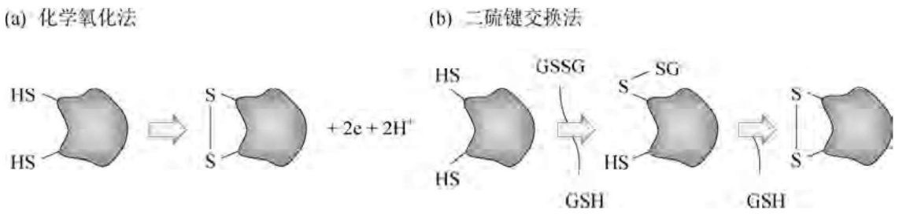

chemical

化学氧化法与二硫键交换法的对比图，展示氢键形成与GSH结合的过程

图3-14 蛋白质分子二硫键形成的两种机理

（1）化学氧化法。化学氧化反应(反应 A)进行的前提条件是电子受体的存在。最为廉价的电子受体为空气，空气接受电子的反应可由重金属、碘基苯甲酸以及过氧化氢催化。如果还原状态的蛋白质在氧化前能被诱导形成准空间构象，则通过化学氧化法恢复二硫键是可行的；但如果还原型蛋白不能形成稳定的中间构象，空气氧化往往会产生二硫键错配的平衡反应混合物。空气的氧化反应通常很慢，例如在  $Cu^{2+}$  催化下，经肌氨酸类表面活性剂变性的粒细胞集落刺激因子(G-CSF)用空气氧化法修复二硫键，需要 0.5～4.5 h。低分子量巯基化合物的缺乏也会导致错配二硫键转变为天然结构的反应趋缓。此外，空气氧化法也不适用于含有多个半胱氨酸的蛋白质重折叠，尤其是那些天然构象中存在一个或多个游离型半胱氨酸的蛋白质。空气氧化极易造成二硫键错配、二聚体集聚或将半胱氨酸直接氧化成磺基丙氨酸和半胱氨酸亚砜。尽管如此，空气氧化法还是在几种不含游离型半胱氨酸的蛋白质重折叠操作中获得了成功。

（2）二硫键交换法。二硫键交换法(反应 B)可以避免空气氧化法的许多缺陷。其反应条件应掌握两点:第一，反应缓冲液系统应同时含有低分子量的氧化剂和还原剂；第二，还原型巯基与氧化型巯基的分子之比应维持在 5:1～10:1 内，这一比例与体内天然条件相似。在很多重组异源蛋白的体外重折叠过程中，通常使用还原型谷胱甘肽(GSH)和氧化型谷胱甘肽(GSSG)，两者的浓度分别为 1 mmol/L 和 0.2 mmol/L。谷胱甘肽能为二硫键的正确形成提供一定程度的空间特异性，因此上述以还原型为主体的氧化还原反应系统能最大限度地减少蛋白分子内和分子间二硫键的随机配对，从而保证体外重折叠的高效性。然而，作为氧化还原生理系统中重要成分的 GSH 对工业化大规模而言显得极其昂贵，因此重组异源蛋白的大规模生产通常使用较为廉价的还原剂，如半胱氨酸、二巯基苏糖醇、2-巯基乙醇以及半胱胺等。

如前所述，溶剂和环境条件的选择对抑制非共价型蛋白分子的集聚具有重要意义。一般地，较低的温度（5～10℃）以及在维持变性蛋白水溶性的前提条件下使用含量尽可能低的变性剂，是促进二硫键正确配对的两大关键要素。此外，为了最大限度地减少蛋白分子间和分子内二硫键的随机形成，可在变性溶解蛋白溶液更换复性折叠缓冲液之前，先对蛋白质进行预处理，即向还原型的蛋白质溶液中加入过量的高氧化型缓冲液。此时，蛋白质上所有的游离巯基均被低分子量的氧化型巯基化合物共价封闭，从而有效地阻止蛋白分子在转换缓冲液过程中出现的二硫键错配现象。然后，将蛋白质转入复性缓冲液中，并在低分子量还原型巯基化合物的存在下逐步发生二硫键重排，从而提高重折叠的正确率。作为对这一方法的改进，也可将氧化型的谷胱甘肽固定在层析介质上，处于完全变性状态的蛋白溶液上柱后，与氧化型谷胱甘肽发生二硫键交换反应。经多次清洗后，再用还原型的谷胱甘肽复性折叠溶液进行梯度洗脱，最终从层析流出液中可以回收高产率的正确氧化型蛋白。

（3）二硫键介导的集聚物检测。在蛋白质重折叠过程中，由二硫键错配所产生的集聚蛋白质通常难以恢复到正确的折叠途径中，因此这种不可逆集聚作用的检测对有效控制重折叠反应十分有用。检测方法主要采用SDS非还原性聚丙烯酰胺凝胶电泳（SDS-PAGE）。在实际操作过程中，为了保证检测的准确性，必须注意以下两点:①在将重折叠反应物加入SDS凝胶电泳缓冲液之前，必须除去样品中痕量的游离巯基，包括小分子还原剂和蛋白质本身存在的活性基团，否则这些游离的巯基会与集聚体中的二硫键发生交换反应，导致检测结果偏低。样品中的所有游离巯基可用过量的碘乙酸胺或碘乙酸盐加以封闭灭活；②在电泳过程中通常需要还原型样品作为对照，如果对照样品与检测样品相邻，则还原型样品中的2-巯基乙醇会扩散至待测样品孔内，导致事先被封闭的样品重新还原，此时寡聚型的集聚体样品在电泳中会出现单体多肽链的条带，因此对照样品与待测样品之间应留有足够的空间。

## 4. 重组异源蛋白折叠辅助蛋白因子的应用

在蛋白质的重折叠反应中，二硫键的正确配对很大程度上取决于蛋白质复性的准确性，根据传统的蛋白质化学理论，复性的准确性又完全来自多肽链的氨基酸序列所包含的结构信息。然而近三十年来的相关研究表明，大多数蛋白质在细胞内的天然折叠必须依赖于被称为分子伴侣的蛋白因子的辅助作用，分子伴侣通过与部分折叠中间产物分子的相互作用而促进蛋白质的准确复性与折叠。在大肠杆菌中，$50\%$ 的可溶性蛋白在其变性状态下与分子伴侣GroEL蛋白结合。分子伴侣和其他一些重折叠酶不仅能协助蛋白质进行特异性折叠、分泌运输以及亚基装配，而且在所有蛋白质的代谢周期中也起着非同寻常的作用。

分子伴侣在体外促进变性蛋白的重折叠不仅进一步证实了它们生理作用，同时也展示了其良好的应用前景。大肠杆菌来源的分子伴侣GroEL和GroES至少可以促进下列蛋白质的体外折叠:1,5-二磷酸核酮糖羧化酶、柠檬酸合成酶、二氢叶酸还原酶以及硫氰酸合成酶。DnaK是另一种形式的分子伴侣蛋白，它能阻止热变性RNA聚合酶的集聚物形成，同时又可将不溶性的集聚蛋白转变为可溶性。将DnaK与GroEL和GroES等因子混合，能使免疫毒素蛋白的体外重折叠率提高5倍以上。在上述实验中，分子伴侣相对待折叠蛋白必须大大过量，这将限制分子伴侣在大规模重组异源蛋白生产中的应用。然而两项颇有意义的尝试能打破这种限制:

（1）分子伴侣的固定化策略。理想的重组异源蛋白重折叠工艺如下:① 将包涵体制备物溶解在含有弱变性剂、低浓度 PDI 的溶剂中；② 采用固定了分子伴侣的层析柱对变性蛋白分离；③ 以 ATP 溶液洗脱纯的重折叠蛋白产物。
（2）分子伴侣或(和)折叠酶编码基因与外源基因共表达策略。大量的实验结果表明，分子伴侣编码基因与外源基因共表达可在不同程度上提高重组异源蛋白的可溶性及其重折叠率。例如，分子伴侣DsbA与牛胰蛋白酶抑制因子RBI共表达，并在细菌培养基中添加还原型谷胱甘肽以控制氧化还原电位，可使具有天然构象的RBI回收率提高14倍；DsbA与T细胞受体共表达也能明显改善后者的分泌效率。然而，分子伴侣对其辅助对象具有一定的特异性，深入了解这种特异性的相对程度有助于提高分子伴侣的应用范围。

## 3.4 大肠杆菌工程菌培养的工程化控制

重组异源蛋白的工业化生产除了需要在实验室中构建出一株高效稳定表达外源基因的基因工程菌外，工程菌大规模培养的优化设计与控制也很重要，相当多的基因工程产品需要从大规模发酵物（100～10 000 L）中获得。细菌在500 L发酵罐中的生长代谢状况决非

200 mL 摇瓶的简单放大,而且发酵罐也为工程菌生长及外源基因的稳定高效表达提供了更多更有效的最优化控制手段和模式。

## 3.4.1 细菌生长的动力学原理

基因工程菌的发酵通常具有三种不同的操作方式，即分批式发酵、流加式发酵、连续式发酵，根据工程菌的生长代谢特征以及外源基因表达产物的性质可选用不同的发酵模式。

## 1. 分批式发酵

不同的培养条件往往会导致细菌以不同的动力学特征生长与代谢。在分批发酵过程中，所有的培养成分一次性投入发酵罐中。在整个发酵过程中，培养基组成、菌体浓度、细胞内代谢物质成分、外源基因表达产物均随着细菌生长状态、细胞代谢流量、营养成分利用率的变化而变化。在上述条件下，细菌生长整个过程可分为六个典型阶段:潜伏期、加速期、对数期、减速期、稳定期、衰亡期（图3-15）。

当细菌接种到无菌培养基中后，在一段时间内细菌数量并不会立即增加，这个阶段称为潜伏期。细菌在此期间主要适应新的环境条件，包括诱导表达原来处于关闭状态的代谢途径，合成营养物质代谢所需的运输蛋白和相关图3-15 细菌一步生长曲线

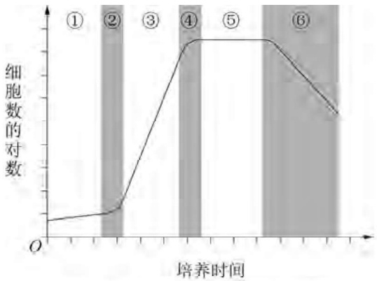

line

| 培养时间 | 细胞数的对数 |
| --- | --- |
| ① | ~0.1 |
| ② | ~0.2 |
| ③ | ~0.8 |
| ④ | ~0.95 |
| ⑤ | ~0.95 |
| ⑥ | ~0.7 |

① 潜伏期:② 加速期:③ 对数期:

④ 减速期；⑤ 稳定期；⑥ 衰亡期

酶系等。潜伏期的长短首先取决于用于发酵接种的细菌菌龄，其次也与种子培养基和发酵培养之间的差别大小有关。如果细菌接种物来自对数期，则发酵潜伏期通常很短，接种后细菌在发酵罐中立即进入生长阶段。

在对数生长期中，细菌的数目呈指数增长，但单位细菌数量的生长速度（即比生长速率$\mu$）维持恒定。在营养成分过量且培养基中不存在生长抑制剂的前提条件下，比生长速率与营养成分的浓度无关，细菌的生长速度 $(\mathrm{d}X / \mathrm{d}t)$ 与菌体的瞬时浓度（$X$）成正比，即 $\mathrm{d}X / \mathrm{d}t = \mu X$ 。若发酵液体积随发酵时间的变化忽略不计，则细胞数目的增加速率 $\mathrm{d}N / \mathrm{d}t$ 也是比生长速率与细胞瞬时数目的乘积，即 $\mathrm{d}N / \mathrm{d}t = \mu N$ ，而细菌数目随发酵时间的变化趋势则可由上式的积分函数式表征:$N = N_0\exp (\mu t)$，其中 $N_0$ 为接种细胞数。由此公式可以直接得到细菌数目增加一倍所需的时间 $t_\mathrm{d} = 0.693 / \mu$ （此时 $N = 2N_{0},t = t_{\mathrm{d}}$）。对于大肠杆菌而言，$t_\mathrm{d}$ 实际上就是单个细胞的生长周期或细菌增殖一代所需的时间。

比生长速率  $\mu$  是营养成分浓度 S、最大比生长速率  $\mu_{max}$  和营养成分特异性参数  $K_{s}$  的函数: $\mu = \mu_{\max} S / (K_{\mathrm{s}} + S)$ 。最大比生长速率一般与细菌的遗传特性有关，在正常生长情况下，细菌的  $\mu_{max}$  值大多在  $0.086 \sim 2.1 h^{-1}$  之间，因此细菌繁殖一代所需要的时间  $t_{d}$  大约从 20 min 到 8 h 不等。在分批发酵过程中，如果培养基中的营养成分大大过量（即  $S >> K_{s}$ ），那么  $\mu$  几乎等于  $\mu_{max}$ 。实际上， $K_{s}$  值通常很低， $K_{s}$  与 S 相差不大的情况在对数期中极为罕见，因此处于对数生长期的细菌能以最大的比生长速率增殖。例如，对于大肠杆菌而言，葡萄糖的  $K_{s}$  值大约为 1 mg/L，而发酵培养基中的葡萄糖初始浓度一般在 10 g/L 左右。

随着培养成分的大量消耗以及抑制细菌生长的代谢最终产物的不断积累,细菌总数最终停止增长并进入稳定期。在此阶段虽然细菌的数目维持恒定,但细胞内代谢途径却在发生急剧变化,某些具有经济价值的次级代谢产物开始大量合成,例如抗生素通常是在处于稳定期的细菌中合成的。稳定期的长短主要取决于细菌遗传特性及生长条件,当培养基的能量全部耗竭后,所有的代谢途径中止,细菌步入衰亡期。对于绝大多数生物产品发酵而言,