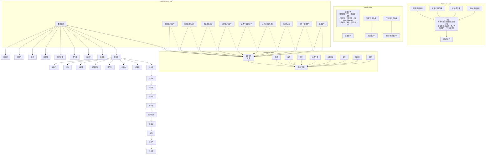
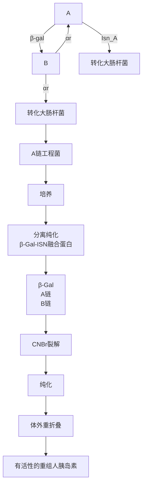

均在此时收获菌体或培养液。

为了给细菌生长设计最佳的培养基，必须知道菌体浓度增殖与营养成分消耗之间的关系，即生长收率(Y)，其定义为: $Y = \mathrm{d}X / \mathrm{d}S$ 。在细菌比生长速率较大的情况下，Y通常可近似为一个常数。细菌在以葡萄糖作为唯一碳源的培养基中进行有氧呼吸，其典型的Y值为每克葡萄糖产0.4～0.5g干重细胞。营养成分利用与细菌生长之间的一个更为精确的关系式为: $\mathrm{d}S / \mathrm{d}t = (1 / Y_{G})\mathrm{d}X / \mathrm{d}t + mX$，式中 $Y_{G}$ 为扣除了维持过程能耗的真正生长产率，m为维持系数。

## 2. 流加式发酵

在流加式发酵过程中,一种或多种营养成分定时定量添加入细菌培养系统中,这种补料操作可以在一定范围内延长对数期和稳定期,从而提高菌体密度和稳定期代谢产物的合成总量。通过补加关键营养成分还可控制细菌的比生长速率,综合平衡工程菌外源基因表达程度与细胞增殖速度之间的关系,同时兼顾代谢反应的氧耗和能耗。例如,培养基中过量的葡萄糖可阻遏一些代谢途径,使得大肠杆菌大量合成醋酸等有机酸,这些部分氧化的中间代谢产物进一步抑制细菌的生长。若在初始发酵培养中减少葡萄糖的用量,而在发酵过程中根据需要逐步定量补加,则可最大限度地减少这种不利影响。

然而，处于稳定期的细菌往往会产生大量的蛋白酶，直接导致外源基因表达产物的降解，因此基因工程菌发酵的关键是尽可能避免工程菌处于稳定期。由于在发酵过程中难以直接测定营养成分的浓度，所以通常用有机酸的合成量、$\mathrm{pH}$ 变化或 $\mathrm{CO}_{2}$ 生成量等参数来估算补料的规模和时间。虽然流加式发酵较适用于基因工程菌的培养，但相对单纯的分批发酵模式而言，它对工艺控制的要求较为严格。

## 3. 连续式发酵

连续式发酵的一个重要特征是稳定态的形成，即在连续发酵反应器中，细胞的总数和培养液总体积同时维持恒定。达到这种状态的前提条件是由培养液流出所造成的细胞损失正好为细菌分裂所产生的新细胞弥补，前者是培养液流出速率 $F$ 与培养液中细胞瞬时浓度 $X$ 的乘积，而后者则是比生长速率 $\mu$ 、细胞瞬时浓度 $X$ 与反应器中发酵液恒定体积 $V$ 的乘积，不难看出，$F / V = \mu$ 。若将 $F / V$ 定义为稀释率（因为新鲜培养基的流入速率等于细菌发酵液的流出速率），并用 $D$ 表示，则一个连续发酵过程在达到稳定态时，其稀释率应等于细菌的比生长速率。为了在流体动力学上真正做到细菌发酵液体积和细胞总数的双重恒定性，细菌的比生长速率必须小于最大比生长速率。在实际操作过程中，上述条件是通过调节一个控制发酵液流出速率 $F$ 的泵来实现的。

在连续发酵容器中，关键营养成分 $S$ 的物料平衡可用下式表示: $(F / V)S_{0} - (F / V)S - \mu X / Y = \mathrm{d}S / \mathrm{d}t$ 。式中， $S_0$ 为流入反应体系的新鲜培养基中关键营养成分的浓度； $S$ 为容器内关键营养成分的瞬时浓度。当稳定态形成时， $\mathrm{d}S / \mathrm{d}t = 0$ ，因此 $Y = X(S_0 - S)$ 。如果再将用于非生长性维持过程的能量消耗考虑进去，则更为精确的营养成分物料平衡式为: $\mu X / Y = \mu X / Y_{\mathrm{G}} + mX$ 。将此式代入上述物料平衡式中，并注意 $\mu = D$ 以及 $\mathrm{d}S / \mathrm{d}t = 0$ ，则可得到下式:$D(S_0 - S) = DX / Y_{\mathrm{G}} + mX$ ，其变形为: $(S_0 - S)X = 1 / Y_{\mathrm{G}} + m / D$ 。又因为在稳定态形成时， $Y = (S_0 - S)X$ ，因此， $1 / Y = 1 / Y_{\mathrm{G}} + m / D$ ，也就是说，在一个达到稳定态的连续发酵体系中，细菌总生长速率的倒数与稀释率的倒数呈线性关系，其斜率为维持系数，而截距则是细菌真正生长速率的倒数。

工业发酵的基本目标是以最少的代价获得最大的产品产量，而实现这一目标的工程手段是针对每个特定过程建立相应的高效发酵模式。由于连续式发酵方法要求对细菌生长代谢等生理特性具有更为准确详尽的了解，因此它在工业生产中的应用并不普遍。然而理论和经验都表明，采取连续式发酵方法生产生物产品所需的成本远远低于其他发酵方法。其原因如下:① 生产相同量的产品，连续式发酵所用的发酵容器小于分批式发酵所需的发酵罐。② 分批式发酵后产生的细菌培养液往往需要大型设备进行菌体分离、细胞破碎以及蛋白质或其他代谢产物的下游分离纯化操作，而连续式发酵所产生的细菌培养液在单位时间内量较少，因此进行同样的工艺操作，连续式发酵对下游设备的处理量要求较低。③ 连续式发酵可以有效缩短发酵设备的停工期，因为一种单一操作通常能维持一个月以上。而对于分批式发酵工艺来说，在批与批之间，发酵设备需要维修、清洗以及灭菌等操作，这种非生产性的停工期在相当程度上降低了发酵产品的产量。④ 在连续发酵过程中，细菌的生理状态相当均一，产品的产量与质量也较为稳定。而在分批发酵过程中，菌体收获时间上的微小差异很可能会导致细菌生理状态的显著变化，并进而影响产品的产量与质量。对于大多数基因工程菌而言，如果重组异源蛋白在胞内表达（如包涵体型），则菌体的收获时间通常在对数生长中期至后期之间，分批式发酵难免会造成批与批之间的这种差异。

目前，连续式发酵已成功地用于大规模生产单细胞蛋白、抗生素以及有机酸等生化产品。然而它也有一定的缺陷，必须引起高度重视:① 连续式发酵的周期一般在 500～1 000 h，缩短周期实际上就等于降低了其优越性。基因工程菌中的一些细胞经过多代连续繁殖后，有可能丢失其携带的重组质粒，但整合型的重组细菌一般不易发生这种不利现象。② 无菌条件的长时间维持在工业大规模生产中较为困难，此外连续式发酵需要独立的灭菌设备，而且价格不菲。

## 3.4.2 发酵过程的最优化控制

基因工程菌的大规模培养是个十分复杂的过程，与普通的细菌发酵相比，其显著特征是在细胞内增加了一条由重组质粒编码的相对独立的代谢途径，而它的代谢速率又随着重组质粒拷贝数的变化而变化。这一微型代谢途径的动态流向与细胞初级代谢有着千丝万缕的联系，在某些情况下甚至还可与宿主的次级代谢发生相互作用。从总体上分析，基因工程菌的代谢过程优化控制可在三个层面进行，即遗传特性的分子水平、代谢途径的细胞水平以及热量、质量、动量传递的工程水平，这三方面的相互关系可由图3-16表示。

## 1. 工程水平的优化控制

不管采取何种模式的发酵过程,最优化控制培养系统中的溶氧、pH、温度、物料混合程度都是十分重要的,改变这些参数中的任何一个均可影响细菌的生长以及重组异源蛋白产物的稳定性。

大肠杆菌及其他许多原核细菌的最佳生长通常需要大量的溶氧。发酵罐中最大的溶氧需求量 $Q_{\mathrm{max}}$ 取决于细菌的瞬时浓度 $X$ 、最大比生长速率 $\mu$ 、氧耗生长产率 $Y_{\mathrm{O_2}}$ 三者之间的关系: $Q_{\mathrm{max}} = X\mu_{\mathrm{max}} / Y_{\mathrm{O_2}}$ 。由于氧气难溶于水，$25^{\circ}\mathrm{C}$ 时氧的溶解度仅为 $8.4\mathrm{mg / L}$，因此在发酵过程中必须以无菌空气的形式不断补充。然而，大量空气导入发酵罐中会产生泡沫，如果气泡体积过大，氧气的传递效果并不理想，直接影响细菌的最佳生长。这就要求发酵罐在设计时应充分考虑培养系统中溶氧水平的控制能力，包括细胞的完美悬浮以及气泡的破碎等。有时还可直接向发酵罐中补充纯氧，以缓解发酵液中溶氧的极度匮乏。

绝大多数细菌生长的最佳 pH 范围在 5.5～8.5 之间，但在发酵罐中生长代谢的细胞无时不在将其代谢产物释放到培养基中，导致整个系统的 pH 值产生较大的波动。因此在发酵过程中，必须用酸碱调节控制培养液的 pH 值，使其维持在一个相对细菌生长代谢最佳的恒定值范围内。加入的酸或碱溶液同样需要快速扩散至整个容器，局部过量的酸碱会给细菌带来危害。

温度是一个决定发酵成败的重要参数。在低于最佳生长温度的环境中细菌生长缓慢，同时也降低了目标产物的合成速度。另外，如果培养系统的温度过高，即使不高于细菌的致死温度也会产生许多不利影响。例如，含有温度敏感型启动子的工程菌在过高的温度下会导致外源基因的泄露性表达。过高的温度还可能诱导受体菌的热休克反应，产生大量的胞内蛋白酶降解重组异源蛋白。

flowchart

图3-16 基因工程菌发酵过程的多尺度控制

细菌培养液的适度混合可以在很多方面促进细胞的生长和代谢,其中包括加快营养成分和溶氧的传递、促进热量的散发以及降低细胞有毒代谢副产物的局部浓度等。从某种意义上来说,搅拌效果越佳,细菌发酵就越理想。然而,过大的搅拌速度会产生流体动力学压力,它可能损害体积较大的细菌或哺乳动物细胞,同时也向培养液中散发大量的机械热,从而提高发酵的能耗。因此,在提供最佳混合效率、避免细胞损伤以及降低能耗产量比之间,搅拌转速必须达到最优化平衡。

## 2. 分子水平的优化控制

基因工程菌在发酵过程中的优化控制有三个分子水平上的作用位点:

（1）外源基因的表达控制。基因工程菌的构建为这种控制提供了分子结构上的可能性，但它必须通过各种工艺手段在细菌生长过程中得以实现，这些手段包括外源基因转录启动的特异性诱导、表达产物在受体菌中的定位和转运等。外源基因的时空特异性表达控制可以在最大程度上减少表达产物对细菌自身生长代谢过程的影响，提高表达产物的宏观产率。
（2）细胞内蛋白质生物合成系统的均衡。无论基因工程菌的目标产物是蛋白质还是其他小分子化合物，它们都必须与细菌的初级代谢和次级代谢途径共用一套蛋白质翻译系统，其成分包括核糖体、tRNA、ATG/GTP以及相关的酶系。这些成分通常都由受体细胞的染色体DNA编码，合理控制这些细菌基因的表达时间与强度，有利于细胞内三种代谢途径的和谐与稳定。
（3）重组质粒拷贝数或外源基因剂量的维持。从理论上来讲，外源基因剂量的增加有助于提高其表达产物的产量，但实际上并不都是如此。如果细胞内RNA聚合酶是限制性因素，外源基因剂量与其表达水平未必呈正相关。而且重组质粒的高拷贝复制耗费大量的能源，不但影响细菌的正常生长与代谢，同时不利于其稳定性。另外，重组质粒高拷贝复制在提高外源基因剂量的同时也同步增加了载体上其他基因（如标记基因）的分子数，这些基因的表达效率通常并不逊色于外源基因，因此两者之间的表达竞争不容忽视。

## 3. 细胞水平的优化控制

细胞水平的控制作用位点主要包括发酵过程中的细胞密度、代谢途径调整、产物比生产率等，后者又可分为相对限制性营养成分消耗以及相对菌体生长两种产物比生产率，它们分别是产物合成速率与营养成分消耗速率以及菌体生长速率之比。实验结果表明，重组蛋白的最大合成量和受体菌代谢活力的维持往往与细菌较低的生长速率相伴。但降低细菌生长速率必须在拥有一定细胞密度的基础上才能有助于提高重组蛋白的宏观表达量，这种控制在分批或流加式发酵过程中一般难以操作。另外，培养基中主要营养成分葡萄糖的不完全代谢产物乙酸对外源基因的高效表达也有明显的抑制作用。乙酸的大量合成固然与补料工艺和工程控制参数有关，但很大程度上也取决于基因工程受体菌本身的遗传特性。

## 3.4.3 大肠杆菌工程菌的高密度发酵

在基因工程菌的大规模发酵过程中，重组异源蛋白产物的宏观合成产量取决于最高的外源基因表达水平以及菌体浓度。从理论上来说，在维持外源基因表达水平不变的前提下，提高工程菌的发酵密度可以大幅度降低产物的生产成本，然而两者在很多情况下并不能兼顾。在提高工程菌培养密度的同时，单个细胞中的外源基因表达率往往伴随着不同程度的下降，这种现象的本质是外源基因表达与细菌生长两大反应对反应基质和能量的争夺。因此，通过工程方法打破发酵系统中的传质传热限制，同时通过工艺手段控制反应基质尤其是生物能源的组成和转入速率，是在不影响外源基因表达水平前提下提高工程菌发酵密度的基本策略。

## 1. 高密度发酵培养基的设计

大量的研究结果表明:细菌在碳源限制的条件下生长，其生物能源的有效利用率最高；而在氮源限制的环境中生长的细菌通常会在细胞中积聚糖原等多聚物，同时大量合成有机酸、乙醇以及其他部分生物氧化代谢中间产物，这种现象在葡萄糖作为主要碳源时尤为突出。除此之外，以最大比生长速率或接近这一速率生长的细菌也倾向于产生上述部分氧化分子，这些化合物的存在不仅降低了细菌的碳源比消耗率，而且最终导致细胞的生长抑制。因此，工程菌高密度发酵的培养基设计原则是:① 使用最小培养基以精确设计营养成分与细菌生长之间的定量关系，同时避免任何不利于菌体生长的营养限制性因素；② 调整培养基配比，维持细菌以合适的比生长速率生长，使得培养基中的碳源和能源不能转化为胞内储存型多聚物或胞外潜在生长抑制剂的部分氧化有机化合物，也就是说，细菌的比生长速率应尽可能低到足以使碳源全部有效利用，同时又不至于影响目标产物宏观产率的水平；③ 利用碳源限制方法阻断细菌生长期间部分氧化代谢产物的合成途径。在培养基中，碳源的绝对量往往大于其他营养成分，因此以碳源作为限制性营养成分更易于控制；④ 依据细菌细胞的组成元素确定培养基各成分的精确配比（表3-7），其中以葡萄糖作为限制细菌生长的营养成分，其加入量则以每克葡萄糖形成0.3～0.5g干重细菌的碳源比消耗率为基准。为了确保葡萄糖之外的其他营养成分的绝对过量，必须在表3-6所列数据的基础上各追加20%。此外，理想的细菌培养基还应加入适量的稀有元素和维生素。表3-8是用于大肠杆菌高密度发酵的典型培养基配方。

表 3-7 细菌细胞的主要元素含量

| 组成元素 | C | N | P | S | Mg |
| --- | --- | --- | --- | --- | --- |
| 占细胞干重的百分率/% | 50 | 7~12 | 1~3 | 0.5~1 | 0.5 |

表 3-8 用于大肠杆菌高密度发酵的培养基配方

| 成分 | 间歇培养 | 连续培养 |
| --- | --- | --- |
| 葡萄糖 | 5 g/L | 433 g/L |
| 酵母提取物 | 5 g/L | 0 g/L |
| $K_2HPO_4$ | 7 g/L | 0 g/L |
| $KH_2PO_4$ | 8 g/L | 0 g/L |
| $(NH_4)_2SO_4$ | 5 g/L | 107 g/L |
| $MgSO_4 \cdot 7H_2O$ | 1 g/L | 8.5 g/L |
| 微量元素溶液 | 2 mL/L | 56 mL/L |
| 维生素溶液 | 2 mL/L | 56 mL/L |
| 氨苄青霉素 | 0.5 g/L$^1$ | 0 g/L |

① 仅用于重组菌株培养。

## 2. 高密度发酵的温度控制

生长在最小培养基中的大肠杆菌，其发酵密度与温度关系密切。一般地，在 $19\sim 34^{\circ}\mathrm{C}$ 内，大肠杆菌的发酵密度随温度的降低而增加。在 $22^{\circ}\mathrm{C}$ 时，细胞密度达到最高值，为每升培养液 $55\mathrm{g}$ 干重细菌，其相对应的碳源比消耗率则高达每克葡萄糖 $0.44\mathrm{g}$ 干重细菌。值得注意的是，不同的大肠杆菌菌株达到最高密度所对应的培养温度往往会有差异，而且最终培养密度也各不相同，有时相差多达3倍以上。此外，在相同培养条件下，大肠杆菌K株工程菌的发酵密度比非工程菌高出 $30\% \sim 50\%$ 。温度控制的实质是调节细菌的比生长速率和溶氧需求量，较低的培养温度固然可以得到最大的发酵密度，但培养周期相对延长，而且菌株不同这种对应关系也有差异。因此在确定实际操作温度时应充分考虑工程菌株的特殊遗传性质以及物料、能量、产品产率三者之间的综合平衡。

## 3. 高密度发酵的溶氧控制

一般而言,细菌的高密度培养需要较高的溶氧浓度,尤其是在生长后期。由于细胞内各种代谢途径的高速运转以及外源基因的诱导表达,溶氧往往成为限制性因素,此时大量补加葡萄糖等生物能源不仅于事无补，甚至会诱导产生并积累乙酸等部分氧化产物。克服这一困难的唯一方法是向反应体系中输送纯氧，为了确保纯氧传递对细胞高密度生长的最佳效率，通常将之与溶氧水平和碳源补料速率相关联。例如，在大肠杆菌W株的高密度发酵过程中，蔗糖的补加速率根据溶氧水平进行控制，当溶氧浓度上升至 $14\%$ 饱和度时，开始补加碳源；而当溶氧浓度跌至这一数值以下时，补料自动停止。如果将溶氧、 $\mathrm{pH}$ 与碳源补加速率三者联合控制，则效果更佳，在此条件下，大肠杆菌发酵密度可达到每升培养液 $125\mathrm{g}$ 干重细胞的水平。

## 3.4.4 基因工程菌的遗传不稳定性及其机制

重组微生物在工业生产中的应用包括两个方面:其一是重组异源蛋白的高效表达，即利用基因工程菌合成大量的生物贵重功能蛋白；其二是借助于分子克隆技术重新设计细菌的代谢途径，构建品质优良的功能微生物。然而，基因工程菌产业化应用的最大障碍是在其保存及培养过程中表现出的遗传不稳定性，它直接影响到发酵过程中比生长速率的控制以及培养基组成的选择。

基因工程菌的遗传不稳定性主要表现在重组质粒的不稳定性。这种不稳定性具有下列两种主要存在形式:① 重组 DNA 分子上某一区域发生缺失、重排或修饰，导致其表观功能丧失；② 整个重组分子从受体细胞中逃逸。上述两种情况分别称为重组分子的结构不稳定性和分配不稳定性，其形成的主要机制包括:① 受体细胞中存在的限制修饰系统对外源 DNA 的降解作用。由于目前使用的受体菌均在不同程度上减弱甚至丧失了限制修饰酶系，因此这种因素通常不会单独发挥作用；② 重组分子中所含基因的高效表达严重干扰受体细胞的正常生长代谢过程，包括能量和生物分子的竞争性消耗以及外源基因表达产物的毒性作用。这种干扰作用与自然环境中的其他生长压力（如极端温度、极端 pH、高浓度抗生长代谢剂、营养物质匮乏等）一样，可以诱导受体菌产生相应的应激反应，包括关闭生物大分子的生物合成途径以节约能源、启动蛋白酶和核酸酶编码基因的表达以补充必需的营养成分，于是工程菌中的重组 DNA 分子便会遭到宿主核酸酶的降解，造成结构缺失或重排现象；③ 重组分子尤其是重组质粒在细胞分裂时的不均匀分配是重组质粒逃逸的基本原因。这种情况通常取决于载体质粒本身的结构因素，但也与外源基因表达产物对细胞所造成的重大负荷有关；④ 受体细胞中内源性的转座元件促进重组分子 DNA 片段的缺失和重排。

当含有重组质粒的工程菌在非选择性条件下生长至某一时刻，培养液中的一部分细胞不再携带重组质粒，这部分细胞数与培养液中的总细胞数之比称为重组质粒的宏观逃逸率。事实上它并不仅仅表征重组质粒从受体细胞中的逃逸频率，而且还是下列四种情况的总和:① 重组质粒因种种原因被受体转运至胞外，这种情况大多发生在细菌处于高温或含表面活性剂（如 SDS）、某些药物（如利福平）、染料（如吖啶类）的环境中；② 受体菌核酸酶将重组质粒降解，使之不能进行独立复制，如果降解作用较为完全，则重组质粒的消失并不依赖于受体细胞的分裂；③ 重组质粒所携带的外基因过度表达抑制受体细胞的正常生长，致使原来数目极少的不含重组质粒的细胞在若干代繁殖后占据数量优势；④ 重组质粒在细胞分裂时不均匀分配，造成受体细胞所含重组质粒拷贝数的差异，这种差异随着细胞分裂次数的增加而扩大。含有较少重组质粒拷贝数的细胞其生长速度显然高于那些含重组质粒拷贝数多的细胞，而且前者更有可能在细胞继续分裂时全部丢失其重组质粒，并在最终的发酵液中占据绝对优势。

因此，重组质粒宏观水平上的逃逸现象实质上取决于含有重组质粒的受体细胞比生长速率 $(\mu^{+})$ 小于不含重组质粒的受体细胞比生长速率 $(\mu^{-})$ ，即 $\mu^{-} / \mu^{+} > 1$ ，多种大肠杆菌菌株均表现出这种特性(表3-9)。假定在发酵接种时工程菌全部含有重组质粒，对数生长期中细胞每代的重组质粒丢失率为 $\rho$ ，工程菌 $\mu^{-}$ 与 $\mu^{+}$ 的比值为 $\alpha$ ，则经过25代分裂后，含有重组质粒的细胞数占总细胞数的百分率 $F_{25}$ 与 $\rho$ 和$\alpha$ 之间的对应关系可由图3-17表示。由图3-17可以看出，如果不含重组质粒的受体细胞具有生长优势（即 $\mu^{-} / \mu^{+} > 1$ )，那么即使重组质粒的丢失率很小，经过数代培养后，发酵液中也会出现大量的无重组质粒型细胞。例如，当 $\alpha = 1,\rho = 0.001$ 时， $F_{25} = 99.8\%$ ，重组质粒的宏观逃逸率仅为 $0.2\%$ ；但当 $\alpha = 1.5,\rho$ 仍为0.001时， $F_{25} = 0.1\%$ ，即重组质粒的宏观逃逸率可达 $99.9\%$ ！对于培养周期固定的分批式发酵而言，重组质粒丢失的时间越早，最终发酵液中无重组质粒的细胞的比例就越高。如果接入发酵罐的种子中含有无重组质粒的细胞，所引起的后果则更为严重。

line

| \(\alpha\) | \(\rho=0.0001\) | \(\rho=0.0002\) | \(\rho=0.001\) | \(\rho=0.003\) | \(\rho=0.01\) | \(\rho=0.02\) | \(\rho=0.03\) |
|---|---|---|---|---|---|---|---|
| 0 | 1.0 | 1.0 | 1.0 | 1.0 | 1.0 | 1.0 | 1.0 |
| ~0.5 | ~0.98 | ~0.96 | ~0.94 | ~0.92 | ~0.88 | ~0.84 | ~0.78 |
| ~1.0 | ~0.95 | ~0.92 | ~0.88 | ~0.82 | ~0.72 | ~0.62 | ~0.52 |
| ~1.5 | ~0.55 | ~0.45 | ~0.35 | ~0.25 | ~0.15 | ~0.08 | ~0.04 |
| ~1.8 | 0 | 0 | 0 | 0 | 0 | 0 | 0 |

图3-17 质粒丢失率与比生长速率的关系

表 3-9 不含质粒与含质粒细菌的比生长速率之比

| 受体菌株 | 质粒类型 | $\mu^{-}/\mu^{+}$ |
| --- | --- | --- |
| 大肠杆菌C600 | F' lac | 0.99~1.10 |
| 大肠杆菌K12 EC1005 | R1 drd-19 | 1.05~1.12 |
| 大肠杆菌JC 7623 | Col E1 | 1.06~1.20 |
| 铜绿假单胞菌PA01 | Tol | 2.00 |
| 大肠杆菌K12 R713 | TP120 | 1.50~2.31 |

野生型质粒在宿主菌中通常能稳定遗传，其机制是这些质粒大多含有编码特异性质粒拷贝均衡分配的基因（par）。在一些低拷贝质粒中 par 基因已被克隆鉴定，实验室常用的一些扩增表达型质粒（如 pUC 系列等）具有完整的质粒拷贝分配功能，因而由此原因引起的质粒丢失现象基本上可以忽略不计。但更多的人工构建质粒往往不具备 par 功能，而且由于重组质粒降解或分子重排引起的工程菌不稳定性影响更大，因此在工程菌发酵和重组质粒构建的过程中保持工程菌的相对稳定意义重大。

## 3.4.5 改善基因工程菌遗传不稳定性的对策

根据工程菌不稳定性的影响因素,目前已发展出多种方法抑制重组质粒的结构和分配不稳定性,归纳起来大致有下列几个方面:

## 1. 改进载体宿主系统

以增强载体质粒稳定性为目的的构建方法包括三个要点:一是将 par 基因引入表达型质粒中。例如，将大肠杆菌质粒 pSC101 的 par 基因克隆到 pBR322 类型的质粒上，或将 R1 质粒上 580 bp 的 parB 基因导入普通质粒上，其表达产物可选择性地杀死由于质粒拷贝分配不均匀而产生的无质粒细胞；二是正确设置载体质粒上的多克隆位点，防止外源基因插入质粒的稳定区域内；三是将大肠杆菌染色体 DNA 上的 ssb 基因克隆到载体质粒上，该基因编码的 DNA 单链结合蛋白 SSB 为 DNA 复制和细菌生存所必需，因此无论因何原因丢失质粒的细胞均不再能在细菌培养过程中增殖。

相同细菌的不同菌株有时会对同一种重组质粒表现出不同程度的耐受性,因此直接选择较稳定的受体菌株往往能够达到事半功倍的效果。另外,对于某些受体细胞而言,借助于诱变或基因同源灭活方法除去其染色体 DNA 上存在的转座元件,也可有效抑制重组质粒的结构不稳定性。

## 2. 施加选择压力

利用载体质粒上原有的遗传标记可在工程菌发酵过程中选择性地抑制丢失重组质粒的细胞生长，从而提高工程菌的稳定性。根据载体质粒上选择性标记基因的不同性质，可以设计多种有效的选择压力，其中包括:

（1）抗生素添加法。大多数表达型质粒上携带抗生素抗性基因。将相应的抗生素加入细菌培养体系中，即可降低重组质粒的宏观逃逸率。但这种方法在大规模工程菌发酵时并不实用，因为相对于简单培养基而言，加入大量的抗生素会使生产成本增加。对于一些不稳定的抗生素来说，添加抗生素造成的选择压力只能维持较短的时间。例如，多数表达型质粒携带的氨苄青霉素抗性基因实质上编码的是 $\beta-$ 内酰胺酶，若以氨苄青霉素作为选择压力，则需在培养基中加入足够的量，而且抗生素的存在对以结构不稳定性为主的重组质粒并不构成选择压力。此外，对于重组蛋白药物的生产来说，添加大量的抗生素通常会影响产品的最终纯度。

（2）抗生素依赖法。借助于诱变技术筛选分离受体菌对某种抗生素的依赖性突变株，也就是说，只有当培养基中含有抗生素时，细菌才能生长，同时在重组质粒构建过程中引入该抗生素的非依赖性基因。在这种情况下，含有重组质粒的工程菌能在不含抗生素的培养基上生长，而不含重组质粒的细菌被抑制。这种方法可以节省大量的抗生素，但其缺点是受体细胞容易发生回复突复。

（3）营养缺陷法。这种方法与上述抗生素依赖法较为相似，其原理是灭活某一种细胞生长所必需的营养物质的生物合成基因，分离获得相应的营养缺陷型突变株，并将这个有功能的基因克隆在载体质粒上，从而建立起质粒与受体菌之间的遗传互补关系。在工程菌发酵过程中，丢失重组质粒的细胞同时也丧失了合成这种营养成分的能力，因而不能在普通培养基中增殖。这种生长所必需的因子既可以是氨基酸（如色氨酸），也可以是某种具有重要生物功能的蛋白质（如氨基酰-tRNA合成酶）。

## 3. 控制外源基因过量表达

外源基因的过量表达,某种意义上也包括重组质粒拷贝的过度增殖,均可能诱发基因工程菌的遗传不稳定性。前已述及,使用可诱导型的启动子控制外源基因的定时表达,以及利用二阶段发酵工艺协调细菌生长与外源基因高效表达之间的关系,是促进工程菌的遗传稳定的一种策略。

## 4. 优化培养条件

基因工程菌所处的环境条件对其所携带的重组质粒的稳定性影响很大，在工程菌构建完成之后，选择最适的培养条件是进行大规模生产的关键步骤。培养条件对重组质粒稳定性的影响机制错综复杂，其中以培养基组成、培养温度、细菌比生长速率尤为重要。

（1）培养基组成。细菌在不同的培养基中启动不同的代谢途径，对工程菌来说，培养基组分可能通过各种途径影响重组质粒的稳定性遗传。含有pBR322的大肠杆菌在葡萄糖和镁离子限制的培养基中生长，比在磷酸盐限制的培养基中显示出更高的质粒稳定性。另一个携带氨苄青霉素、链霉素、磺胺、四环素四个抗药性基因的重组质粒，在大肠杆菌中的遗传稳定性同时依赖于培养基组成:当葡萄糖限制时克隆菌仅丢失四环素抗性；而磷酸盐的限制则导致多重抗药物性同时缺失。还有一个携带氨苄青霉素抗性基因和人 $\alpha-$ 干扰素结构基因的温度敏感型多拷贝重组质粒，当它转入大肠杆菌后，所形成的克隆菌在葡萄糖限制以及氨苄青霉素存在的条件下生长，开始时人干扰素高效表达，但随后便大幅度减少，此时的重组质粒已有相当部分丢失了干扰素结构基因，这表明培养基组分有可能导致重组质粒的结构不稳定性。除此之外，质粒通常在丰富培养基(如PBB)中比在最小培养基(如MM)中更加不稳定，而且不同的质粒其不稳定性的机制也各有差异，例如某些培养基导致质粒

RSF2124-trp 产生结构不稳性,同时又使质粒 pSC101-trp 产生分配不稳定性(表 3-10)。

表 3-10 培养基对大肠杆菌克隆菌稳定性的影响

<table><tr><td>克隆菌</td><td>培养基</td><td> $F_{20\sim 25}$ </td><td>不稳定类型</td></tr><tr><td rowspan="2">W3110 trpAE1 trpR tnaA(RSF2124-trp)</td><td>PBB</td><td>7%</td><td>结构性</td></tr><tr><td>MM</td><td>99%</td><td>结构性</td></tr><tr><td rowspan="2">W3110 trpAE1 trpRam27(pSC101-trp)</td><td>PBB</td><td>12%</td><td>分配性</td></tr><tr><td>MM</td><td>48%</td><td>分配性</td></tr></table>

（2）培养温度。一般而言，培养温度较低有利于重组质粒的稳定遗传。有些温度敏感型的质粒不但其拷贝数随温度的上升而增加，而且当温度达到 $40^{\circ}\mathrm{C}$ 以上时，还会引起降解作用。另外，重组质粒的导入有时也会改变受体菌的最适生长温度。上述两种情况均可能与重组质粒表达产物和受体菌代谢产物之间的相互作用有关。
（3）比生长速率。细菌比生长速率对重组质粒稳定性的影响趋势不尽一致，与细菌本身的遗传特性以及质粒的结构均有关系。如前所述，如果不含重组质粒的细胞不比含有重组质粒的细胞生长得快，即 $\mu^{-} / \mu^{+} = 1$ 时，重组质粒的丢失不会导致非常严重的后果，因此调整这两种细胞的比生长速率可以提高重组质粒的稳定性。但在实际操作中往往难于选择性地提高或降低某种细胞的比生长速率，因为绝大多数环境条件（不包括施加选择压力）对两种细菌的生长影响是同步的。只有在个别情况下，可以利用分解代谢产物专一性地控制受体菌的比生长速率，降低 $\mu^{-}$ 与 $\mu^{+}$ 的比值，从而提高重组质粒的稳定性。

line

| X | \(\mu (\)Solid Line) | \(\mu+ (\)Dashed Line) |
| --- | --- | --- |
| 0 | 0 | 0 |
| S0 | ~Intersection Point | ~Intersection Point |

图3-18 基质浓度与比生长速率的关系

有些细菌在以碳水化合物作为碳源和能源时，营养成分浓度过高或过低均不利于其生长，高浓度的营养基质可抑制相关代谢途径中的某个基因表达。如果重组质粒上携带这种代谢基因，则含有重组质粒的克隆菌不再受高浓度基质的抑制。在这种情况下，不含重组质粒的细胞生长符合典型的底物抑制动力学模型，而工程菌则遵循Monod方程，两条曲线的交点便是 $\mu^{-} = \mu^{+}$ 时所对应的基质浓度 $S_{0}$ （图3-18）。当 $S < S_{0}$ 时，$\mu^{-} > \mu^{+}$，此时容易导致重组质粒的不稳定性；但当 $S > S_{0}$ 时，$\mu^{-} < \mu^{+}$，在这种情况下，重组质粒可以稳定地遗传。细菌的连续发酵技术为基质浓度的恒定控制提供了保证。

## 3.5 利用重组大肠杆菌生产人胰岛素

重组 DNA 技术的目标之一是实现目的基因编码产物的产业化，而大肠杆菌高效表达平台则是基因工程应用最为广泛也最成熟的一项技术。不断完善的基因操作技术可将大肠杆菌构建成为用于重组异源蛋白生产的分子工厂，而且这种工程菌在价格低廉的培养基中生长迅速易于控制，因此重组大肠杆菌在医用蛋白的大规模生产中具有重要的经济意义。尽管有些生物活性严格依赖于糖基化作用的真核生物功能蛋白无法采用重组大肠杆菌进行生产，而且蛋白质生物合成后加工系统的缺乏使得某些人体蛋白难以折叠成天然构象，但仍有100多种异源蛋白通过大肠杆菌基因工程菌实现了产业化，其中包括一些结构相当复杂的人体蛋白，如富含半胱氨酸的血清白蛋白（HSA）、尿激酶原（pro-UK）、金属硫蛋白（MT），二硫键共价交联的二聚体蛋白巨噬细胞集落刺激因子(M-CSF)，四聚体的血红蛋白(Hb)以及结构复杂的抗体片段等。本节以重组人胰岛素为例，论述利用大肠杆菌生产外源基因表达产物的基本过程。

## 3.5.1 胰岛素的结构及其生物合成

胰岛素广泛存在于人和动物的胰脏中，正常人的胰脏约含有200万个胰岛，占胰脏总质量的 $1.5\%$ 。胰岛主要由 $\alpha, \beta, \gamma$ 三种细胞组成，其中 $\beta-$ 细胞特异性合成胰岛素。胰岛素发现于1922年，翌年便开始在临床上作为药物使用，迄今为止，胰岛素仍是治疗胰岛素依赖型糖尿病的特效药物。据统计，目前全世界糖尿病患者已超过一亿，而且发病率呈逐年增长的趋势。因此，为临床提供质量可靠及价格低廉的胰岛素制品是现代生物医药领域的一项重要工程。

胰岛素是在胰岛 $\beta$-细胞的内质网膜结合型核糖体上合成的，核糖体上最初形成的产物是一个比胰岛素分子大一倍多的前胰岛素原单链多肽，其N端区域含有20个左右的氨基酰疏水性信号肽。当新生肽链进入内质网腔后，信号肽酶便切除信号肽形成胰岛素原，后者被运输至高尔基体进一步加工，并以颗粒的形式贮存备用。胰岛素原单链多肽由三个串联的区域组成(图3-19):C端21个氨基酸为A链，N端30个氨基酸为B链，两者分别通过两对碱性氨基酸(Arg-Lys)与C肽相连。当机体需胰岛素时，高尔基体内的特异性肽酶分别在A-C和B-C连接处将胰岛素原切成3段，其中A链与B链借助于二硫键形成共价交联的活性胰岛素，并通过血液循环作用于靶细胞膜上的特异性胰岛素受体。

chemical

DNA strand diagram showing C-terminal, A-shape, and B-shape with nucleotide positions labeled

图3-19 人胰岛素原结构示意图

活性胰岛素含有三对二硫键，其中两对二硫键在A链和B链之间形成，分别为A7-B7和A20-B19，另一对二硫键则由A链的第6位Cys与第11位Cys形成。不同哺乳动物种属的胰岛素分子结构大致相同，主要区别表现在A链二硫键之间的第8、第9和第10位上的3个氨基酸残基以及B链C端的最后一个氨基酸残基上，但这些差别并不改变胰岛素的生理功能。在所有来源的胰岛素中，人的胰岛素与猪和狗的胰岛素最为接近，两者唯一的区别是 B 链 C 末端一个氨基酸残基不同。除此之外，不同种属动物的胰岛素原 C 肽序列和长度也有差异，人的 C 肽为 31 肽，牛的为 26 肽，而猪的为 29 肽。

## 3.5.2 人胰岛素的生产方法

工业上可采用下列 4 种方法大规模生产人胰岛素:

（1）从人的胰脏中直接提取胰岛素。这种方法在早期用于生产少量的人胰岛素，由于原料供应的限制，其产量不可能满足临床需要。
（2）以氨基酸为原料直接化学合成。这种全合成方法从技术上来说是能够做到的，我国科学家曾在20世纪60年代成功合成了具有生物活性的牛结晶胰岛素，但不难想象其成本奇高。

（3）由猪胰岛素化学转型为人胰岛素。前已述及，猪与人的胰岛素只在B链C末端的一个氨基酸上存在差异，前者为丙氨酸，后者为苏氨酸，但两种胰岛素的生理功效完全一致，因此一些国家在临床上使用猪胰岛素制剂治疗糖尿病。然而由于氨基酸序列上的微小差异，猪胰岛素的长期使用会在患者体内产生一定程度的免疫反应，更为严重的是，患者体内抗猪胰岛素抗体的诱导生产还可能对患者剩余的正常 $\beta-$ 细胞功能以及内源性胰岛素分泌造成负面影响。因此，人胰岛素制剂的使用被认为是最理想的糖尿病治疗方法。由于利用传统的生化方法从猪胰脏中提取胰岛素早已形成生产规模，且成本相对低廉，所以将猪胰岛素在体外用酶促方法转化为人胰岛素不失为一种选择，至少在重组人胰岛素的大规模产业化之前，这种半合成方法仍是相当多生物制药厂家采用的生产工艺。其基本原理是:胰蛋白酶在 $\mathrm{pH}$ 为 $6.0\sim 7.0$ 以及苏氨酸叔丁酯的过量存在下能脱去猪胰岛素B链C末端的丙氨酸，并将苏氨酸转入相应位置；所形成的人胰岛素叔丁酯再用三氯乙酸除去其叔丁酯基团，最终获得人胰岛素，整个过程的总转化率为 $60\%$ 。但是这个工艺路线相当耗时，且需要一整套复杂的纯化方法，导致最终产品的价格不菲。

（4）利用基因工程菌大规模发酵生产重组人胰岛素。1982年，美国Ely LiLi公司首先使用重组大肠杆菌生产人胰岛素，这是第一个上市的基因工程药物。5年后，Novo公司又开发了利用重组酵母生产人胰岛素的新工艺。这种由重组微生物合成的人胰岛素无论在体外胰岛素受体结合能力、淋巴细胞和成纤维细胞的离体应答能力，还是在血糖降低作用以及血浆药代动力学方面，均与天然的猪胰岛素无任何区别，但却显示出无免疫原性以及注射吸收较为迅速等优越性，因而深受广大医生和患者的欢迎。

## 3.5.3 产重组人胰岛素大肠杆菌工程菌的构建策略

胰岛素的特殊分子结构决定了其工程菌的构建必须更多地兼顾后续的分离纯化及加工过程,这是提高生产效率降低生产成本的关键因素。虽然长期以来已发展了多种大肠杆菌工程菌,但是有代表性和实用性的构建方案主要有下列3种:

（1）AB链分别表达法。这种方法在Ely LiLi公司早期开发重组大肠杆菌生产胰岛素时采用，其基本原理如图3-20所示。A链和B链的编码区由化学合成，两个双链DNA片段分别克隆在含 $P_{\mathrm{tac}}$ 启动子和 $\beta-$ 半乳糖苷酶编码基因的表达型质粒上，后者与胰岛素编码序列形成杂合基因，其连接位点处为甲硫氨酸密码子。重组分子分别转化大肠杆菌受体细胞，两种克隆菌分别合成 $\beta-$ 半乳糖苷酶-人胰岛素A链以及 $\beta-$ 半乳糖苷酶-人胰岛素B链两种融合蛋白。经大规模发酵后，从菌体中分离纯化融合蛋白，再用溴化氰在甲硫氨酸残基的C端化学裂解融合蛋白，释放出人胰岛素的A链和B链。由于 $\beta-$ 半乳糖苷酶中含有多个甲硫氨酸，溴化氰处理后生成多个小分子多肽，而A链和B链内部均不含甲硫氨酸残基，故不为溴化氰继续降解。A链和B链进一步纯化后，以 $2:1$ 的物质的量比混合，并进行体外化学氧化折叠。由于两条肽链上共存在三对巯基，二硫键的正确配对率较低，通常只有 $10\% \sim 20\%$ ，因此利用这条路线生产的重组人胰岛素每克售价高达180

美元。为了进一步降低生产成本，Ely LiLi 公司随后又发展了第二种生产工艺。

（2）人胰岛素原表达法。将人胰岛素原cDNA编码序列克隆在 $\beta$ -半乳糖苷酶编码基因的下游，两段DNA序列的连接处仍为甲硫氨酸密码子。该杂合基因在大肠杆菌中高效表达后，分离纯化融合蛋白，并同样采用溴化氰化学裂解法回收人胰岛素原片段，然后将之进行体外折叠。由于C肽的存在，胰岛素原在复性条件下能形成天然的空间构象，为3对二硫键的正确配对提供了良好的条件，使得体外折叠率高达 $80\%$ 以上。为了获得具有生物活性的胰岛素，经折叠后的人胰岛素原分子必须用胰蛋白酶特异性切除C肽。胰蛋白酶的作用位点位于精氨酸或赖氨酸的羧基端(图3-21)，由于天然构象的存在，人胰岛素原链第22位上的精氨酸和第29位上的赖氨酸对胰蛋白酶的作用均不敏感。因此用胰蛋白酶处理人胰岛素原后，获得的是完整的A链以及C末端带有精氨酸的B链，与人的天然胰岛素相比，这种B链多出一个氨基酸，后者必须用高浓度的羧肽酶B专一性切除。虽然上述工艺路线并不比AB链分别表达更为简捷，而且需要额外使用两种高纯度的酶制剂，但由于其体外折叠的成功率相当高，在一定程度上弥补了工艺烦琐的缺陷，使得最终产品的生产成本仅为50美元/克。目前Ely LiLi公司采用这种工艺路线年产数十吨的重组人胰岛素，其经济效益相当可观。

（3）AB链同时表达法。这种方法的基本思路是将人胰岛素的A链和B链编码序列拼接在一起，然后组装在大肠杆菌β-半乳糖苷酶基因的下游。重组子表达

flowchart

图3-20 人胰岛素AB链分别表达法的基本原理

出的融合蛋白经 CNBr 处理后，分离纯化 A-B 链多肽，然后再根据两条链连接处的氨基酸性质采用相应的裂解方法获得 A 链和 B 链肽段，最终通过体外化学折叠制备具有活性的重组人胰岛素。与第一种方法相似，其最大的缺陷仍是体外折叠的正确率较低，因此目前尚未进入产业化应用阶段。

上述 3 种工程菌的构建路线均采用胰岛素或胰岛素原编码序列与大肠杆菌  $\beta-$  半乳糖苷酶基因拼接的方法，所产生的融合型重组蛋白表达率高且稳定性强，但不能分泌，主要以包

chemical

DNA helix structure showing C, A, and B ribosomes with labeled amino acid residues and enzyme steps (Lactobase and B-lyzing)

图3-21 人胰岛素原表达法示意图

涵体的形式存在于细胞内。一种能促进融合蛋白分泌的工程菌构建策略是将胰岛素或胰岛素原编码序列插入表达型质粒 $\beta-$ 内酰胺酶编码基因的下游，后者编码降解青霉素的酶蛋白，通常能被大肠杆菌分泌到细胞外。这一构建策略具有稳定高效表达和重组产物可分泌两大优良特性，为胰岛素的后续分离纯化工序减轻了负担。

## 3.6 利用重组大肠杆菌生产人抗体及其片段

抗体是高等动物适应性免疫系统中的一个重要家族，在体内具有多重生理功能。除此之外，抗体还广泛应用于生命科学研究的各个领域，包括生物分子尤其是蛋白或多肽的定性分析（如蛋白质印迹技术、微扩散试验、组织免疫学技术）、定量分析（如放射免疫分析RIA、酶联免疫吸附分析ELISA等）以及利用免疫亲和层析技术分离生物大分子。在临床上，抗体在免疫诊断以及肿瘤治疗中更显示出令人瞩目的应用前景。因此，抗体及其衍生物的工业化生产具有重要的社会意义和经济价值。

## 3.6.1 重组抗体的生产策略

高等动物体内的抗体分子是一类由两条轻链(L)和两条重链(H)组成的四聚体蛋白质(图3-22)，其中四条多肽链通过四对二硫链共价连为一体。轻链和重链的N端区域构成抗体分子的抗原识别位点，称为可变区 $(\mathrm{V_H}$ 和 $\mathrm{V_L})$ ，它们均由三个互补决定位点（亦称为超变位点，CDR1～CDR3)组成。此外，每条轻链还含有一个恒定区 $(\mathrm{C_L})$ ，而每条重链则含有三个不同的恒定区 $(\mathrm{C_{H1}},\mathrm{C_{H2}},\mathrm{C_{H3}})$ 。用木瓜蛋白酶水解抗体蛋白可获得三个抗体片段，即两个相同的 $\mathrm{F_{AB}}$ 片段，每个片段含有一条完整的轻链以及半条由 $\mathrm{V_H}$ 和 $\mathrm{C_{H1}}$ 组成的重链，两者在各自的恒定区内以二硫键相连；水解产物的另一部分则为 $\mathrm{F_C}$ 片段，由两条以二硫键相连的重链组成，每条重链只含有 $\mathrm{C_{H2}}$ 和 $\mathrm{C_{H3}}$ 两个区域。 $\mathrm{F}_{\mathrm{AB}}$ 片段保留着抗原的结合活性，但并非维持这一活性的最小单位，事实上 $\mathrm{F}_{\mathrm{AB}}$ 片段N端的一半区域（即 $\mathrm{F_V}$ 片段）仍具有完整抗体分子的所有抗原结合活性。$\mathrm{F_V}$ 片段的氨基酸序列是抗体分子之间差异的主要表现形式，完整的 $\mathrm{F_V}$ 片段可由 $\mathrm{F_{AB}}$ 片段经胃蛋白酶降解获得。

flowchart

This diagram illustrates the biochemical mechanism of a mitochondrial protein complex, showing interactions between heavy chain (重链), light chain (轻链), and salt chain (铰链区) regions with labeled functional blocks and enzyme activities.

图3-22 哺乳动物抗体分子的结构

当抗体与抗原特异性结合后，抗体分子中的 $\mathrm{F_C}$ 部分便诱导下列三大免疫学反应:① 激活补体级联反应。经活化的补体系统裂解靶细胞膜，激活巨噬细胞，并产生相应信号将机体内免疫应答系统中的其他组分固定在靶细胞或抗体-抗原复合物周围。② 诱导抗体依赖型细胞毒性反应(ADCC)。这是抗体 $\mathrm{F_C}$ 部分与ADCC型效应细胞上相应的 $\mathrm{F_C}$ 受体特异性结合的结果，经 $\mathrm{F_C}$ 诱导后的效应细胞释放细胞毒素蛋白，裂解与抗体分子 $\mathrm{F_{AB}}$ 部分结合的外来细胞。③ 激活巨噬细胞的吞噬反应。当 $\mathrm{F_{AB}}$ 部分与一可溶性抗原结合后，抗体分子上的 $\mathrm{F_C}$ 部分可与巨噬细胞上的 $\mathrm{F_C}$ 受体特异性结合，激活巨噬细胞吞噬并降解抗原-抗体复合物。

抗体是一种糖蛋白，其糖基化位点位于重链的 $\mathrm{C_H2}$ 区域内。糖基的存在为抗体结构维持、分泌性、可溶性以及稳定性所必需，但与抗原的特异性识别和结合功能无关。在基础研究和部分临床应用（如免疫诊断、免疫导向药物设计和装配等）中，主要利用的是抗体与抗原之间的特异性识别与作用这一特性。因此根据使用范围的不同，重组抗体的生产可采取下列多种策略（图3-23）:

text_image

N N
VL VH
C L CH
C C
FAB片段
N N
VL VH
C C
FV片段
N N
VL VH
S S
VL VH
C C
二硫键交联
N N
VL VH
C
VL VH
C
VL VH
C
VL VH
C
VL VH
化学交联
N N
VL VH
C C

图3-23 重组抗体在大肠杆菌中的表达形式

（1）$\mathrm{F_{AB}}$ 片段。 $\mathrm{F_{AB}}$ 片段为一异源二聚体，含有一对二硫键。轻重两条链的不变区 $\mathrm{C_L}$ 和$\mathrm{C_H}$ 对维持整个 $\mathrm{F_{AB}}$ 分子的稳定性起着重要作用，但在异源表达(如大肠杆菌)时两条多肽链会因二硫键错配形成同源二聚体，从而降低重组分子的收率。作为另一种选择，也可构建$\mathrm{F}_{(\mathrm{AB})2}$ 分子的重组表达系统，即两个相同的 $\mathrm{F_{AB}}$ 片段通过各自铰链区内的两个半胱氨酸残基形成共价四聚体。 $\mathrm{F}_{(\mathrm{AB})2}$ 是抗体分子中最完整最稳定的抗原识别结合单位。
(2) $\mathrm{F_V}$ 片段。 $\mathrm{F_V}$ 片段是维持抗原特异性识别和结合活性的最小单位，在大肠杆菌中能高效表达。根据 $\mathrm{V_H}$ 和 $\mathrm{V_L}$ 氨基酸序列的不同，重组 $\mathrm{F_V}$ 分子可能稳定维系，也可能相互解离。利用基因定向突变技术分别在 $\mathrm{V_H}$ 和 $\mathrm{V_L}$ 编码区合适位点内引入半胱氨酸密码子，两个可变区表达后，进行体外二硫键修复；或者直接通过化学交联方法将两者共价连为一体，均可提高重组 $\mathrm{F_V}$ 片段的稳定性。此外，还可在 $\mathrm{V_H}$ 和 $\mathrm{V_L}$ 之间插入一段由15个氨基酸残基构成的接头肽段，其序列通常为:GGGGSGGGGSGGGGS，即 $(\mathrm{Gly}_4\mathrm{Ser})_3$ 。相应的重组表达产物为单链 $\mathrm{F_V}$ 片段 $(\mathrm{scF_V})$ ，它拥有两种分子形式，即 $\mathrm{N - V_H}$ -接头- $\mathrm{V_L - C}$ 和 $\mathrm{N - V_L}$ -接头- $\mathrm{V_H - C}$ 。
（3）二价迷你抗体。将两分子的单链 $\mathrm{F_V}$ 片段通过一个人工设计的铰链区多肽片段融合在一起，可形成重组二价抗体(图3-24)。铰链区中含有一个或两个两性螺旋结构，使得整个重组抗体分子在大肠杆菌周质中能顺利装配。由此生产的二价迷你抗体大大增强了对表面结合型抗原或多聚体抗原的亲和力，与天然完整的抗体分子相比几乎没有任何区别。完整的抗体由于结构复杂且存在四对二硫键，在大肠杆菌中的异源表达效率极低，而采用上述三种策略生产抗体重组片段很大程度上为抗体的基因工程开辟了广阔的应用前景。

图3-24 由大肠杆菌表达的重组二价抗体装配形式

## 3.6.2 由大肠杆菌生产重组抗体片段的优越性

抗体在生命科学基础研究和临床上的广泛应用要求产业化的抗体制品必须具备高抗原结合特异性、低人体免疫原性以及可规模化生产。为达到此目标，抗体生产经历了三次重大变革。

## 1. 以重组抗体取代天然抗体

在杂交瘤技术问世之前，抗体的制备主要采用抗原免疫动物（如兔子）的方法，从动物抗血清中直接分离纯化天然抗体。对于相对分子质量较大结构较为复杂的蛋白质抗原而言，往往存在多种不同的抗原决定簇，因此由此获得的抗体制剂实际上是多重抗体的混合物，其中每一种抗体对应于抗原的一个决定簇。这种抗体混合物在实际应用中存在两大缺陷:① 抗体制备物不同抗体的含量不稳定，也就是说，用同样的抗原多次免疫兔子，每次所获得的抗体制备物具有不同配比的各种抗体。由于抗原分子中各种抗原决定簇在每次免疫反应中所表现出的抗体刺激能力差异较大，所以这种变化直接影响了抗体制备物中和抗原的能力；② 抗体混合物不能区分两种相似抗原之间的差异，相似抗原分子往往拥有一部分相似甚至相同的抗原决定簇，它们均能为同一种抗体所识别，因此多重抗体混合物具有较低的特异性，这在免疫诊断和治疗中相当危险。

1975年发展起来的杂交瘤技术使得制备针对一种抗原决定簇的抗体成为可能。抗体由抗原激活的B淋巴细胞(确切而言为浆细胞)合成,一个B淋巴细胞只合成一种抗体分子。B淋巴细胞通常很难在离体条件下大规模培养,但在较为罕见的情况下,正常的B淋巴细胞会转变成癌细胞(即骨髓瘤),这种骨髓瘤细胞在维持B淋巴细胞基本生理特征的同时,获得了在体外培养基中生长增殖的能力。如果以一种不能合成任何抗体的骨髓瘤细胞为受体,而以另一种能产生所需抗体的B淋巴细胞为供体,两者进行细胞融合,在合适的选择压力存在下,即可筛选出一株既能合成单一抗体又能进行体外培养的杂合细胞系,这就是利用杂交瘤技术生产单克隆抗体的基本原理。从严格意义上讲,由这种技术生产的单克隆抗体仍属于天然抗体,抗体分子的组成与结构没有任何改变。

早期的杂交瘤技术均采用小鼠或大鼠的 B 淋巴细胞作为亲本，所产生的单克隆抗体自然呈鼠源性。这种抗体在离体免疫检测方面的应用取得了满意的效果，但若将之作为体内治疗药物使用，则首先碰到的问题便是免疫交叉反应。由于鼠的抗体与人的抗体在结构上存在一定的差异，因此重复使用鼠源性抗体会诱导机体产生抗抗体，而后者的积累轻者大大降低鼠源性抗体的疗效，重者甚至会导致严重的过敏反应。为了克服这一难题，必须使单克