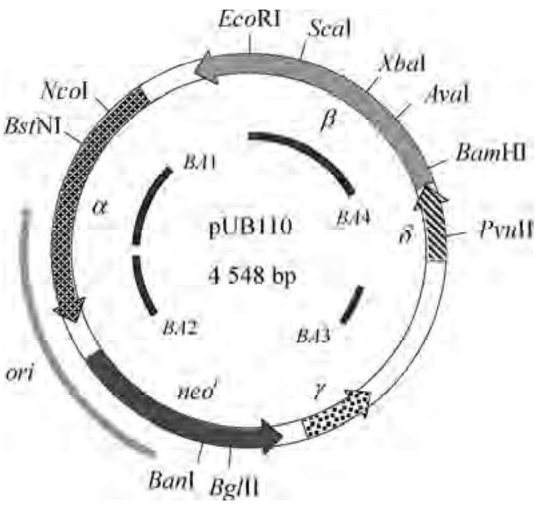
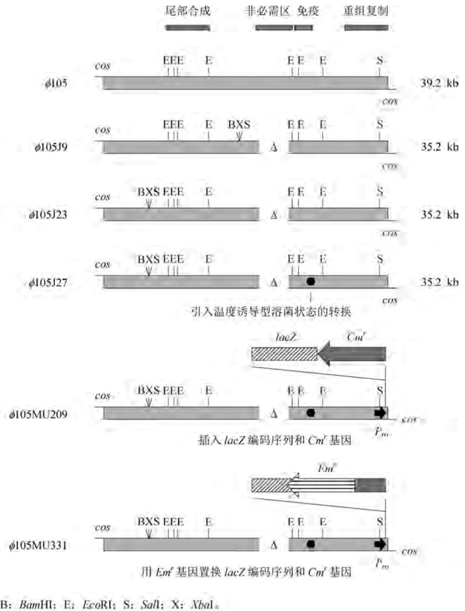
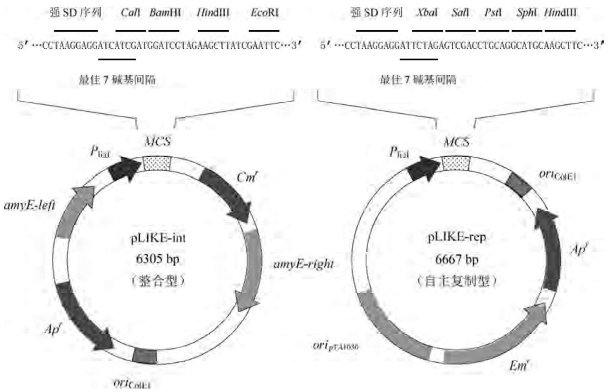

隆抗体尽可能人源化。一种较为成熟的策略是将鼠源性的单克隆抗体转化为含有一部分人抗体序列并保留原有抗原结合特异性的重组抗体，又称嵌合抗体或人源化抗体。鼠源性抗体中被人抗体相应序列取代的部分首推 $\mathrm{F_C}$ 片段，因为鼠源性 $\mathrm{F_C}$ 区域在人体中所产生的免疫应答能力较弱，而且该区域最易刺激人体B淋巴细胞产生抗抗体。但在重组抗体的实际构建过程中，通常是将大鼠或小鼠的 $\mathrm{F_V}$ 编码序列置换人抗体轻链和重链基因的相应编码序列，形成的重组分子再克隆到合适的表达载体上，最终转染B淋巴细胞系。为了进一步减少嵌合抗体中鼠源性序列的比例，还可只将鼠抗体的CDR编码序列引入人抗体基因中，形成所谓的CDR移植抗体。目前，针对不同的抗原，如肿瘤相关抗原、细胞表面受体以及淋巴细胞因子等，已构建出数十种CDR移植抗体。

当然，就医学角度而言，最为理想的免疫治疗药物是纯人抗体，然而采用类似于杂交瘤技术的程序很难获得能合成人单克隆抗体的杂交瘤细胞系。其原因是:第一，人淋巴细胞与鼠骨髓细胞融合形成的杂合瘤中，人的染色体呈现高度的不稳定性，导致单克隆抗体产量极低；第二，终始没有找到理想的人骨髓瘤细胞系取代小鼠的骨髓瘤细胞；第三，基于伦理道德方面的顾虑，不可能用各种抗原直接免疫人体，因此很难分离获得能产生特定抗体的人B淋巴细胞。有人尝试将人B淋巴细胞在体外用抗原进行诱导，然后再用Epstein-Barr病毒将抗原激活的B淋巴细胞转化为癌细胞，遗憾的是这种癌细胞合成特异性抗体的能力极低，且抗体与抗原的亲和性也很弱。也有人试图将人的免疫球蛋白基因转入小鼠的胚胎细胞系中，构建产生人源性抗体的转基因鼠，然后再用特定抗原免疫转基因鼠，合成特异性抗体，目前转基因鼠表达重组人免疫球蛋白已获成功。

## 2. 以抗体片段取代完整抗体分子

除少数情况外，抗体在体内和体外的大部分应用是基于抗体分子与抗原的特异性识别与结合原理，而这种特性又与抗体分子中的恒定区无关，因此以抗体片段取代完整分子是一种颇有前途的选择。首先，各种抗体片段的相对分子质量只及整个抗体分子的 $10\% \sim 50\%$ ，小分子的抗体片段有利于高效表达和分泌，而且由于二硫键含量的下降，重组表达产物的重折叠也得以简化，这对于利用重组大肠杆菌大规模生产高纯度的抗体片段尤为重要；此外，无论基础研究还是临床应用，抗体极少单独使用，大多数需要进行修饰处理，如同位素标记、生色酶偶联以及导向药物的连接等，相对分子质量较小的抗体片段显然为上述操作提供了较大的空间。抗体片段在临床上的应用最具有优越性，由于分子小，对实体肿瘤组织的穿透力强，几乎可作为所有药物、毒素和同位素的载体，构成标准化系列化的生物导弹制导系统，在肿瘤的诊断与防治中显示出巨大威力。其次，抗体片段由于结构简单，更易做到人源化，从而一定程度上降低了它们在机体内的免疫原性。此外，利用蛋白质工程技术对抗体片段进行定位修饰显得更为直观。天然抗体分子对抗原的亲和性以及稳定性未必最佳，在不增加其免疫原性的前提条件下，对抗体片段的氨基酸序列加以改造，已证明能明显延长它在血液中的半衰期，从而大大提高抗体片段在临床上的实用性。

## 3. 以大肠杆菌取代哺乳动物等真核细胞生产重组人抗体片段

尽管小鼠的骨髓瘤细胞、人的B淋巴细胞以及中国仓鼠卵巢细胞(CHO)在生产单克隆抗体、人鼠嵌合抗体直至表达人免疫球蛋白基因方面起着不可替代的作用，其中由CHO细胞合成人的 $\mathrm{F}_{\mathrm{AB}}$ 抗体片段还可以省去体外重折叠工序，但是与重组大肠杆菌相比，克隆基因在高等哺乳动物细胞中的表达水平很低，而且培养工艺复杂，培养基昂贵，这些不利因素严重阻碍了动物细胞来源的抗体制品在研究及临床上的广泛应用。酵母曾被认为是表达人源性免疫球蛋白基因的候选受体系统，人抗体重链和轻链基因在酵母中已获成功表达，并在分泌过程中 $\mathrm{F}_{\mathrm{AB}}$ 重组片段也能正确折叠和装配。但是对于重组抗体片段的生产而言，酵母仍不如大肠杆菌平台简易方便，抗体片段编码基因的表达水平也比大肠杆菌低很多。在合成抗体完整分子方面,由于酵母细胞内的蛋白质糖基化作用机制与哺乳动物细胞不同,尽管重组酵母来源的完整抗体分子具有相同的抗体依赖型细胞毒性活力,但缺少补体依赖型的细胞毒性功能,因此酵母对生产重组抗体及抗体片段并非理想的表达系统。

虽然大肠杆菌由于缺少糖基化系统难以合成具有多重生物学效应的抗体完整分子，但在表达功能性 $F_{V}$ 、 $F_{AB}$ 、 $scF_{V}$ 片段方面却有着得天独厚的优势。重组大肠杆菌在发酵罐中可合成450 mg/L的 $F_{V}$ 片段以及1\~2 g/L的二价重组人抗体片段，这一表达水平远远高于酵母和哺乳动物细胞，再加上重组大肠杆菌发酵周期短、发酵密度高及培养条件简单易于控制等优势，使得它成为重组人抗体片段大规模生产的首选表达系统。

## 3.6.3 产重组抗体片段大肠杆菌工程菌的构建

除  $scF_{V}$  片段外，重组抗体片段 ( $F_{V}$  和  $F_{AB}$ ) 工程菌构建的一个显著特点是必须考虑两条多肽链在表达后的重折叠。对于天然的  $F_{V}$  片段而言，重链与轻链可变区的分子间重折叠主要依靠肽链氨基酸残基侧链基团的非共价键作用；而对于  $F_{AB}$  片段以及人工引入半胱氨酸的  $F_{V}$  变体来说，两条多肽链是由二硫键维系的，因此重组子的构建策略和程序与抗体片段的功能表达密切相关。

## 1. 重组抗体片段在大肠杆菌中的表达方式

与其他人体基因的表达策略相似，重组抗体片段表达产物在大肠杆菌中也有三种定位方式，即以包涵体的形式存在于胞质中、以可溶性或不溶性的蛋白形式存在于周质中、以膜融合蛋白的形式定位于细胞外表面上。三种表达方式均有各自的优缺点，但从总体上评价，将重组抗体表达产物分泌到周质中的方法最为理想。

以包涵体形式在大肠杆菌中表达重组抗体片段与表达其他重组蛋白质没有很大的区别，在受体菌株、表达载体以及工程菌培养工艺等方面也没有特殊要求。几乎所有的单价抗体片段（如  $F_{AB}$ 、 $F_{V}$ 、 $scF_{V}$ ）都可以这种方式高效表达，其表达率一般可达到 35%～40%。由于抗体片段的相对分子质量较小，且最多只有一个半胱氨酸，因此多聚体的集聚作用并不显著，这在某种程度上降低了包涵体的形成速率，同时也使得表达产物对蛋白酶较为敏感。重组抗体片段的体外重折叠与普通重组蛋白略有区别，对于  $F_{AB}$  和含有半胱氨酸的  $F_{V}$  变体片段而言，轻重链之间的重折叠和二硫键形成遵循另一种动力学模型。实验结果表明，在含有 1～2 mmol/L 还原型谷胱甘肽、0.1～0.2 mmol/L 氧化型谷胱甘肽以及 1 mol/L 精氨酸的碱性溶液中，抗体片段均可进行有效折叠，其中  $F_{AB}$  片段的重折叠率一般在 10%～40%，而  $scF_{V}$  片段的重折叠亦可达 10%～20%。

以分泌形式表达重组抗体片段具有许多优点，除了分泌产物N端不含多余的甲硫氨酸外，周质区域中的氧化环境为抗体片段的折叠也提供了良好的条件，各种类型的重组抗体片段均可在周质中形成具有抗原结合功能的最终产物。在大多数情况下，由于表达产物的分泌速率大于折叠速率，因此功能性抗体片段的形成速率主要取决于后者。当分泌速率远远大于折叠速率时，折叠中间产物得以积累，形成不溶性的周质形包涵体。与胞质型包涵体相同，周质型包涵体也需要体外重折叠操作才能转化成功能片段，因此任何能提高周质中蛋白折叠速率的因素理论上均可增加功能抗体片段的表达水平。分泌型表达的另一个优点是产物较为稳定。大肠杆菌中已被鉴定的蛋白酶共达25种之多，但周质中只存在8种。绝大多数的蛋白酶活性需要偏碱性条件，胞质中的 $\mathrm{pH}$ 一般维持在 $7.5\sim 7.9$ ，有利于蛋白酶活性的发挥；而周质中的 $\mathrm{pH}$ 值更多地依赖于培养基的组成。由于小于$600\mathrm{Da}$ 的小分子可以透入外膜影响周质的 $\mathrm{pH}$，因此在工程菌发酵过程中，将培养液 $\mathrm{pH}$ 控制在 $6.0\sim 6.5$ 即可有效抑制周质中的蛋白酶活性。此外，低温和 $\mathrm{Zn^{2 + }}$ 的存在也能减少蛋白酶的降解作用。分泌型表达的唯一缺点是表达效率较低，装配强启动子或提高培养温度均于事无补，因为重组蛋白的翻译往往与分泌偶联在一起，分泌速率是产物表达速率的决定性因素。

将抗体片段与大肠杆菌外膜脂蛋白进行融合表达已有成功报道。对于 $\mathrm{scF_v}$ 片段而言，每个大肠杆菌细胞表面能结合大约(5～10)万个融合蛋白分子。这种表达方法多用于抗体片段突变体的大规模筛选，利用特定抗原不经细胞裂解可直接进行免疫检测，从而快速获得期望的克隆菌。在抗体片段生产中，融合蛋白必须进行体外裂解，这为分离纯化带来很大负担，因而不是重组抗体片段生产的首选方法。

## 2. 重组抗体片段的大肠杆菌表达载体

用于重组抗体片段分泌型表达的最典型载体是pIG系列质粒，其组成元件如图3-25所示。它含有两个不同的复制子结构，一个来自pUC家族质粒，能产生较高的拷贝数，另一个来自f1噬菌体DNA，在一定条件下重组质粒可进行选择性单链复制并分泌，便于克隆基因的定点突变操作。表达元件选用乳糖启动子及其操作子 $P / O_{\mathrm{lac}}$ ，其诱导条件不受培养温度和细菌生理状态等因素的限制；转录终止子则来自大肠杆菌脂蛋白编码基因。pIG质粒上的克隆位点为EcoRV和EcoRI，上游的XbaI与EcoRV之间装有为信号肽编码的A盒序列，不同的pIG成员分别使用不同的信号肽，如大肠杆菌外膜蛋白OmpA和碱性磷酸单酯酶PhoA信号肽等。由于抗体片段的轻链和重链都必须含有信号肽，两种相同的信号肽编码序列同处于一个细胞中有可能发生同源重组，导致重组质粒的结构不稳定性，因此往往使用两种不同的信号肽编码序列。下游的EcoRI和HindIII之间装有B盒序列，它通常含有用于表达产物检测的标签序列、碱性磷酸单酯酶或噬菌体蛋白III的活性决定序列、用于表达产物亲和层析分离的寡聚组氨酸(His-tag)序列，或者用于表达二价迷你抗体的多肽二聚化元件等。A盒和B盒具有多种功能模件，可根据不同抗体片段的表达需求方便地拼装。pIG系列载体适用于表达各种类型的重组抗体片段，对于 $\mathrm{F}_{\mathrm{AB}}$ 和 $\mathrm{F}_{\mathrm{V}}$ 片段，可将轻链和重链编码序列以顺反子的形式克隆在同一个质粒上，两者共享一个启动子，但拥有各自的SD序列；对于 $\mathrm{scF}_{\mathrm{V}}$ 片段，则可在两个编码序列之间融合一段接头编码序列，使表达产物呈单一多肽链（图3-26）。

## 3. 抗体片段重组分子的构建程序

抗体片段重组分子的构建包括轻链和重链编码序列的分离克隆、PCR装配以及与载体质粒拼接三部分内容。抗体片段重链和轻链编码基因的分离方法主要采取cDNA法，从抗原激活的B淋巴细胞中提取总mRNA，通过逆转录酶将之转化为cDNA，然后用特异性引物分别PCR扩增轻链和重链编码序列。如果抗体序列未知，需选用合适的噬菌体载体构建cDNA文库，然后利用噬菌体展示技术以特定抗原分离阳性克隆。在大多数情况下，抗体片段轻链和重链编码序列中并没有合适的克隆位点，因此在与载体质粒拼接之前，必须借助PCR技术引入相应的限制性酶切位点。对于 $\mathrm{scF_V}$ 片段的重组子构建，还需要将连接轻链和重链可变区的接头片段编码序列一并引入。由此可见，PCR扩增在重组分子的构建过程中起着重要的作用。为了使抗体片段的两条链等分子地分泌到细菌周质中，轻链和重链的编码序列最好以顺反子的形式重组，以便同步控制两者的协同表达。采用双质粒系统或单一质粒双启动子结构往往会导致抗体轻重链的不等价表达（顺反子结构也可能出现两个阅读框架的不对等表达，但这种不对等性并不显著）。由于 $\mathrm{F_{AB}}$ 和 $\mathrm{F_V}$ 片段属于等分子折叠，所以多余合成的轻链或重链分子不但不能提高功能抗体片段的产率，而且还会抑制正确折叠并诱发重组质粒的不稳定性。

## 4. 重组抗体片段表达产物的检测

在重组抗体片段的结构研究以及规模化生产过程中,常常需要对表达产物进行定性和定量检测,而且要求检测方法灵敏快速,最好不依赖于抗体片段本身的性质。下列三种方法可以满足这些要求:


<details>
<summary>text_image</summary>

A-box
B-box
pIG-1
XbaI EcoRV EcoRI HindIII
ompA VL-linker-VH
pIG-2
XbaI EcoRV EcoRI HindIII
phoA Flag VL-linker-VH
pIG-3
XbaI EcoRV EcoRI HindIII
ompA Flag VL-linker-VH
pIG-4
XbaI EcoRV EcoRI HindIII
ompA VL-linker-VH 5×His Myc-TAG
pIG-5
XbaI EcoRV EcoRI HindIII
ompA VL-linker-VH Myc-TAG 5×His
pIG-6
XbaI EcoRV EcoRI HindIII
ompA Flag VL-linker-VH 5×His Myc-TAG
pIG-10
XbaI EcoRV EcoRI HindIII
ompA VL-linker-VH Myc-TAG gIII（长链）
附加盒
myc-TAG gIII（短链）
EcoRI HindIII
铰链区螺旋区
EcoRI HindIII
铰链区螺旋-转角-螺旋区
EcoRI HindIII
phoA基因编码区
用于噬菌体展示
用于多肽链二聚化
用于多肽链二聚化
用于碱性磷酸单酯酶示踪
</details>

图3-25 pIG系列载体的结构


<details>
<summary>text_image</summary>

Cys * * SD MetLys
TGCTGATAACATGGAGAAAATAAAGTGAAA EcoRI HindIII
FAB
XbaI
P/O lac SD ompA VH CHH phoA VL CL Tpp
Ser * * SD MetLys
XbaI TCTTGATAACATGGAGAAAATAAAGTGAAA EcoRI HindIII
FY
P/O lac SD ompA VH phoA VL Tpp
scFY
XbaI EcoRI HindIII
P/O lac SD ompA VH linker VL Tpp
scFY
XbaI EcoRI HindIII
P/O lac SD ompA VH linker VH Tpp
</details>

图3-26 抗体片段编码序列与pIG载体的重组

## (1) Flag 标签序列检测法

用于重组抗体片段分泌表达的 pIG 载体为表达产物的快速检测做了一些特殊设计，如 pIG2、pIG3、pIG6 中所含的 Flag 抗原决定簇就是专门用来检测表达产物的。原始的 Flag 肽段是强极性和可溶性的八肽序列 (DYKDDDDK)，能为一种商品化了的单克隆抗体特异性识别，而且这种作用严格依赖于  $Ca^{2+}$  的存在。将此序列与任何抗体片段融为一体，便可利用酶联免疫分析技术或免疫印迹技术快速灵敏检测。大肠杆菌的内源性蛋白不含此序列，因此不会产生交叉免疫反应。Flag 序列 C 末端的四个氨基酸 (DDDK) 是为引入肠激酶切割位点而设计的，如果重组抗体片段用于体内治疗，Flag 序列在纯化后可从表达产物分子上用该酶完整卸下，以免引起免疫原性反应；然而对于体外检测和疾病诊断而言，这个酶切位点并没有存在的必要。事实上，装在 pIG 载体中的 HAG 序列为 DYKDE，最后一个谷氨酸残基的引入可使抗 Flag 单克隆抗体的识别敏感性提高 10 倍。

Flag标签序列可以装在抗体片段编码区两端的任一处，但装在N端具有几个优点:第一，Flag只有装在N端才能保证在肠激酶处理后获得纯净的抗体片段；第二，抗Flag抗体与该序列的结合程度严格依赖于第一位氨基酸残基的 $\alpha$ -氨基游离性。如果将Flag序列插在信号肽与抗体之间，则当表达产物分泌时信号肽被切除，Flag序列第一位氨基酸残基的 $\alpha-$ 氨基便呈游离状态，此时抗Flag抗体识别Flag序列的能力比位于表达产物的C末端要高$3\sim 4$ 个数量级；第三，Flag序列位于N端能在一定程度上抗大肠杆菌内源性氨基端蛋白水解酶的降解，而且Flag序列的存在并不影响抗体片段对特异性抗原的识别结合能力；第四，大多数重组抗体片段在使用前需要进行体外加工或连接一些生色酶及毒素蛋白等，这些操作均位于抗体片段的C末端，将Flag序列装在N端便不会干扰后加工程序。

## (2) Myc-TAG 标签序列检测法

Myc-TAG 序列来源于癌蛋白 Myc C 末端的十肽结构 (EQKLISEEDL)，将之装在抗体片段编码序列的下游，则融合表达产物可用商品化的抗 Myc 抗体-过氧化酶复合物进行定性定量分析。该序列的存在一般不会导致抗体片段对特异性抗原亲和力的显著下降，而且它本身是人体蛋白序列,因此使用前无须切除。

## (3) 靶蛋白检测法

由于大多数抗体片段需与其他生色酶或细菌毒素等靶蛋白融合后才能使用，因此直接表达这种融合蛋白并利用靶蛋白序列或功能特征进行检测是一种更为简捷的方法。然而这种方法只适用于 $\mathrm{scF_V}$ 抗体片段，对于 $\mathrm{F_{AB}}$ 和 $\mathrm{F_V}$ 双链片段而言，靶蛋白与轻链或重链融合往往会严重干扰两条多肽链的折叠。

## 3.6.4 重组抗体及其片段表达产物的分离纯化

重组抗体及其片段的分离纯化相对其他重组蛋白来说较为简单,理想的纯化方法可从重组大肠杆菌蛋白粗提液中一步获得足够纯度的抗体产物,因此纯化方法的合理选择尤为重要。重组抗体及其片段的纯化大体上可选用下列几种方法:

（1）细菌亲和层析法。有些细菌能合成特异性识别并结合高等哺乳动物免疫球蛋白的蛋白质，如蛋白A、B、G和L，其结合位点主要位于抗体分子的恒定区，只有极少数存在于可变区内，因此这种方法较适用于分离重组抗体完整分子以及单价和双价 $F_{AB}$ 片段，但对 $F_{V}$ 或 $scF_{V}$ 片段的分离无效。
（2）抗体亲和层析法。以融合蛋白形式表达的抗体片段常可根据靶蛋白的特性选择合适的抗体亲和层析柱进行分离。目前常用的靶蛋白如碱性磷酸单酯酶、过氧化物酶以及一些毒素蛋白等均有相应的商品化抗体亲和层析介质，但是如果大肠杆菌本身也能合成这种靶蛋白或靶蛋白的同源蛋白，则这种方法的特异性就会受到影响。为了克服这一困难，pIG载体中的Flag和Myc-TAG标签序列也可作为抗Flag抗体和抗Myc-TAG抗体的靶序列，含有这些序列的融合蛋白可经相应的抗体亲和层析柱进行分离。但是上述抗体价格昂贵，一般只用于实验室规模。
（3）抗原亲和层析法。如果与重组抗体或抗体片段相对应的特异性抗原容易获得，那么利用这种抗原亲和层析柱分离表达产物是最佳选择，因为它不仅具有很高的选择性，而且还能从任何非正确折叠的蛋白混合物中快速分离目标抗体或抗体片段。在半抗原亲和层析过程中，分离产物通常需要用可溶性半抗原在非常温和的条件下进行洗脱。然而对于一些具有危害性的抗原(如肿瘤抗原等)，一般不宜采取这种方法分离用于体内的抗体片段。
（4）配体亲和层柱法。早期用于分离完整抗体分子的磷酸胆碱亲和层析柱也可直接用来从大肠杆菌蛋白粗提液中纯化重组 $F_{AB}$ 、 $F_{V}$ 、 $scF_{V}$ 片段以及各种二价迷你抗体，其前提条件是所有的重组抗体片段必须具有良好的折叠结构。此外，在一些pIG载体上安装的His-tag标签序列是专门为表达产物的配体亲和层析纯化工艺而设计的。多肽链中的组氨酸残基能与多种二价重金属离子配合，一级序列中组氨酸残基分布集中的蛋白质理论上均可用二价重金属离子亲和层析柱进行分离，其最佳分离效果在很大程度上取决于金属离子与洗脱剂的搭配，例如 $Zn^{2+}$ 柱常用二乙酸亚胺溶液洗脱，而 $Ni^{2+}$ 柱则需用咪唑或三乙酸腈溶液洗脱。由于重金属离子亲和层析介质价格低廉，因此这种方法更适用于重组抗体片段的大规模生产。

## 第 4 章 原核细菌基因工程

随着原核生物分子遗传学研究的不断深入，大肠杆菌以外的其他原核细菌也被广泛地用作DNA重组和基因表达的受体细胞，其中一部分细菌还弥补了大肠杆菌在外源基因表达过程中暴露出来的缺陷。例如，芽孢杆菌的分泌系统为真核生物基因的功能表达提供了良好条件。此外，一些小分子生化物质代谢途径的基因工程日益受到人们的重视，利用DNA重组技术改良氨基酸、抗生素、有机酸醇的生产菌具有重要的经济价值，而在此过程中，棒状杆菌、链霉菌和梭菌则分别是重要的受体系统。

## 4.1 芽孢杆菌基因工程

芽孢杆菌(Bacillus)是革兰氏阳性菌的一个属，该属的几个种如枯草芽孢杆菌(Bacillus subtilis)、短小芽孢杆菌(Bacillus brevis)、巨大芽孢杆菌(Bacillus megaterium)等已被开发成为具有广泛应用前景的表达系统，其原因是:①它们能将蛋白表达产物高效分泌到培养基中，而且在多数情况下，真核生物的异源重组蛋白经芽孢杆菌分泌后便具有天然构象和生物活性；②许多芽孢杆菌在传统发酵工业中的应用已有几十年的历史，它们无致病性，不产生内毒素，属于安全的基因工程受体(GRAS)；③芽孢杆菌属的分子遗传学背景较为清楚，生长迅速，培养条件简单。枯草芽孢杆菌、地衣芽孢杆菌(Bacillus licheniformis)、解淀粉芽孢杆菌(Bacillus amyloliquefaciens)的全基因组已被先后测序，大部分基因的功能也得以鉴定。许多芽孢杆菌自身的特殊功能蛋白和酶类已借助于基因工程技术得以开发并形成规模化生产能力，其中包括解淀粉芽孢杆菌中的淀粉酶、嗜热脂肪芽孢杆菌(Bacillus stereothermophilus)中的高温脂肪酶、苏云金芽孢杆菌(Bacillus thuringiensis)中的昆虫专一性毒素蛋白以及其他芽孢杆菌来源的各种蛋白酶、葡聚糖酶、木聚糖酶、青霉素酰化酶等。此外，能高效分泌表达人干扰素和白细胞介素等药物的芽孢杆菌工程菌也已构建成功。总之，芽孢杆菌有望成为与大肠杆菌并驾齐驱的原核生物基因工程操作平台。

## 4.1.1 芽孢杆菌的载体克隆系统

目前广泛用于芽孢杆菌基因克隆和表达的载体可分为自主复制型质粒、整合型质粒、噬菌体载体三大类。

## 1. 芽孢杆菌的自主复制型质粒

用于芽孢杆菌的自主复制型质粒包含野生型质粒和人工构建的质粒(表4-1)。野生型质粒中具有实用价值的大都来自金黄色葡萄球菌(Staphylococcus aureus)和短小芽孢杆菌(如pWT481)。最早从金黄色葡萄球菌中分离鉴定的四种野生型质粒能在芽孢杆菌(至少枯草芽孢杆菌)中交叉复制，且它们的复制子结构和选择性标记基因各不相同。其中，pUB110在枯草芽孢杆菌中的复制启动过程是在细胞膜上进行的，受体细胞中的基因(dnaBI)产物为质粒的复制启动和膜结合活性所必需，每个细胞拥有30～50个拷贝。pUB110的基因组织和物理图谱如图4-1所示，其中BA为膜结合位点，复制子结构序列位于BA2区域，整个质粒具有五个开放阅读框架，分别编码卡那霉素/新霉素抗性和 $\alpha$ 、 $\beta$ 、 $\gamma$ 、 $\delta$ 蛋白，后三种蛋白与质粒的复制无关，而蛋白 $\alpha$ 则具有与细胞膜和质粒复制子特异性结合的能力。pC194编码氯霉素抗性，在每个细胞中能维持15个拷贝；pE194赋予受体细胞大环

内酯-林可酰胺-链阳霉素B(MLS)类抗生素的抗性，其拷贝数大约为10，且呈温度敏感性复制，在枯草芽孢杆菌中 $45^{\circ}\mathrm{C}$ 以上便不复制；pT181类似于很多其他的四环素抗性质粒，拷贝数大约20个。上述野生型质粒均呈滚环模式复制，拷贝数较高，因而可直接作为基因克隆的载体，但更重要的是以其复制子和选择性标记基因为蓝本构建性能多样化的穿梭载体、表达载体和分泌载体。芽孢杆菌自身所含的野生型质粒大都属于隐蔽型质粒（无选择性标记或表型），因而开发应用受到限制。

含金黄色葡萄球菌野生型复制子的载体质粒在枯草芽孢杆菌中虽然拷贝数较高,但不稳定。一般来说,高拷贝质粒分配不稳定



<details>
<summary>flowchart</summary>


</details>

图4-1 金黄色葡萄球菌野生型质粒pUB110图谱

性的一个重要原因是它们倾向于形成多聚体(尤其是滚环式复制的质粒)。控制质粒拷贝数的机制能确保每条染色体平均拥有相同的复制起始位点,因此多聚体形式的质粒在拥有相同数目复制起始位点的前提下,分子数自然会少,随着细胞分裂循环次数的增加,质粒在各细胞中的差异性会逐步扩大。高拷贝质粒的结构不稳定性往往由错误的复制终止以及异常的缺刻封闭事件(由质粒编码的复制蛋白介导)所致。质粒结构缺失形成的另一重要来源是由滚环式复制过程中出现的单链DNA中间产物内短小正向重复序列之间的重组,此时9 bp(甚至更短)的正向重复序列足以形成缺失重组。有时,虽然载体本身是稳定的,但克隆的DNA片段有可能引入正向重复序列,即一个重复序列位于载体上,另一个则来自插入片段,同样会引发单链重组。相反,以θ模式复制的低拷贝质粒往往较为稳定,如来自粪肠球菌(Enterococcus faecalis)的广宿主质粒pAMβ1、枯草芽孢杆菌的野生型质粒pLS20、pBS72以及嗜热脂肪芽孢杆菌的pTB19,其拷贝数均只有寥寥数个,但即使在无选择压力下也很少会丢失。为了便于制备纯化,这些野生型质粒均被开发成穿梭载体(表4-1)。

表 4-1 用于芽孢杆菌基因克隆和表达的自主复制型质粒

| 质粒名称 | 来源/ori | 选择标记 | 大小/kb | 载体类型 | 开发年份 |
| --- | --- | --- | --- | --- | --- |
| pUB110 | S. aureus | $Km^r$ | 4.55 | 野生型质粒 | 1974 |
| pC194 | S. aureus | $Cm^r$ | 2.91 | 野生型质粒 | 1978 |
| pE194 | S. aureus | $Em^r$ | 3.73 | 野生型质粒 | 1976 |
| pT181 | S. aureus | $Tc^r$ | 4.50 | 野生型质粒 | 1976 |
| pAMβ1 | E. faecalis | $Em^r$ | 26.50 | 野生型质粒 | 1974 |
| pTA1015 | B. subtilis | — | 5.80 | 野生型质粒 | 1998 |
| pTA1060 | B. subtilis | — | 8.60 | 野生型质粒 | 1980 |
| pBS72 | B. subtilis | — | 90 | 野生型质粒 | 2003 |
| pLS20 | B. subtilis | — | 5.30 | 野生型质粒 | 1977 |
| pLS32 | B. subtilis | — | 70 | 野生型质粒 | 1998 |
| pTB19 | B.stearothermophilus | $Tc^r Km^r$ | 26 | 野生型质粒 | 1981 |
| pWT481 | B. brevis | — | 2.50 | 野生型质粒 | 1985 |
| pHY481 | $ori_{pWT481}$ | $Em^r$ | 3.70 | 克隆质粒 | 1985 |
| pHY500 | $ori_{pWT481}$ | $Em^r$ | 5.20 | 分泌质粒 $P_{cwp}$ | 1989 |
| pNU210 | $ori_{pUB110}$ | $Em^r$ | 4.40 | 分泌质粒 $P_{cwp}$ | 1989 |
| pEB10 | $ori_{pUB110} ori_{pBR322}$ | $Km^r Ap^r$ | 8.90 | 克隆质粒 | 1988 |
| pE18 | $ori_{pE194cop6} ori_{pUC18}$ | $Em^{r}Ap^{r}$ | 3.80 | 克隆质粒 | 1998 |
| pHV14 | $ori_{pC194} ori_{pBR322}$ | $Cm^{r}Ap^{r}$ | 4.60 | 克隆质粒 | 1978 |
| pLB5 | $ori_{pUB110} ori_{pBR322}$ | $Cm^{r}Km^{r}Ap^{r}$ | 5.80 | 克隆质粒 | 1985 |
| pUB18 | $ori_{pUB110} ori_{pUC18}$ | $Km^{r}Ap^{r}$ | 3.60 | 克隆质粒 | 1988 |
| pUB19 | $ori_{pUB110} ori_{pUC18}$ | $Km^{r}Ap^{r}$ | 3.30 | 克隆质粒 | 1999 |
| pHPS9 | $ori_{pTA1060} ori_{pBR322}$ | $Cm^{r}Em^{r}$ | 5.60 | 克隆质粒 | 1990 |
| pHP13 | $ori_{pTA1060} ori_{pBR322}$ | $Cm^{r}Em^{r}$ | 4.90 | 克隆质粒 | 1987 |
| pHV1431/2 | $ori_{pAMβ1} ori_{pBR322}$ | $Em^{r}Ap^{r}$ |  | 克隆质粒 | 1990 |
| pHV1436 | $ori_{pTB19} ori_{pBR322}$ | $Tc^{r}Km^{r}Ap^{r}$ |  | 克隆质粒 | 1990 |
| pTRKH2 | $ori_{pAMβ1} ori_{p15A}$ | $Em^{r}Ap^{r}$ |  | 克隆质粒 | 1993 |
| pMTLBS72 | $ori_{pBS72} ori_{pBR322}$ | $Cm^{r}Ap^{r}$ | 5.80 | 克隆质粒 | 2003 |
| pHCMC02 | $ori_{pBS72} ori_{pBR322}$ | $Cm^{r}Ap^{r}$ | 6.87 | 表达质粒 $P_{\text{lepA}}$ | 2005 |
| pHCMC03 | $ori_{pBS72} ori_{pBR322}$ | $Cm^{r}Ap^{r}$ | 6.96 | 表达质粒 $P_{\text{gsiB}}$ | 2005 |
| pHCMC04 | $ori_{pBS72} ori_{pBR322}$ | $Cm^{r}Ap^{r}$ | 8.09 | 表达质粒 $P_{\text{xylA}}$ | 2005 |
| pHCMC05 | $ori_{pBS72} ori_{pBR322}$ | $Cm^{r}Ap^{r}$ | 8.32 | 表达质粒 $P_{\text{spac}}$ | 2005 |
| pHT01 | $ori_{pBS72} ori_{pBR322}$ | $Cm^{r}Ap^{r}$ | 7.96 | 表达质粒 $P_{\text{grac}}$ | 2007 |
| pHT43 | $ori_{pBS72} ori_{pBR322}$ | $Cm^{r}Ap^{r}$ | 8.17 | 分泌质粒 $P_{\text{groE}}$ | 2007 |
| pBSMuL1 | $ori_{pUB110} ori_{pBR322}$ | $Km^{r}Ap^{r}$ | 7.49 | 分泌质粒 $P_{\text{HapII}}$ | 2006 |
| pBSMuL2 | $ori_{pUB110} ori_{pBR322}$ | $Km^{r}Ap^{r}$ | 7.56 | $P_{\text{HapII}}P_{59}$ | 2006 |
| pLIKE - rep | $ori_{pTA1030} ori_{pBR322}$ | $Em^{r}Ap^{r}$ | 6.67 | 表达质粒 $P_{\text{liaI}}$ | 2012 |

注: $Ap^{r}$ 一氨苄青霉素抗性基因； $Cm^r$ 一氯霉素抗性基因； $Em^{r}$ 一红霉素抗性基因； $Km^{r}$ 一卡那霉素抗性基因； $Tc^{r}$ 一匹环素抗性基因。

## 2. 芽孢杆菌的整合型质粒

避免重组质粒在芽孢杆菌中遗传不稳定的另一种策略是使用能异位插入受体细胞染色体DNA上的整合型载体，它们通常随染色体DNA的复制而复制，拷贝数与受体细菌染色体相同。因此在大多数情形中，整合型载体通常基于大肠杆菌的复制子（如pBR322或其衍生质粒，不能为芽孢杆菌的DNA复制机器所识别)而构建，同时含有合适的选择性标记基因以及与芽孢杆菌染色体同源的DNA序列。然而，如果芽孢杆菌染色体上事先或事后整合了一个能复制的质粒(如pE194)，那么没有复制能力的整合型质粒同样会增加拷贝数。芽孢杆菌整合型质粒最常见的整合位点是编码 $\alpha$ -淀粉酶的基因位点amyE。广泛使用的重要整合型载体列在表4-2中。

表 4-2 用于芽孢杆菌基因克隆和表达的几种整合型载体

| 载体名称 | 同源序列 | 基因功能 | 构建年份 |
| --- | --- | --- | --- |
| pDH32 | amyE | α-淀粉酶编码基因 | 1986 |
| pDG271 | amyE | α-淀粉酶编码基因 | 1990 |
| pDL,pDK | amyE | α-淀粉酶编码基因 | 1995 |
| pMLK83 | amyE | α-淀粉酶编码基因 | 1995 |
| pDG1661,pDG1661,pDG1728 | amyE | α-淀粉酶编码基因 | 1996 |
| pDG1663,pDG1664,pDG1729,pDG1731 | trpC | 色氨酸生物合成基因 | 1996 |
| pAX01,pA-spac | lacA | β-半乳糖苷酶 | 2001 |
| pPyr-Cm,pPyr-Kan | pyrD | 嘧啶生物合成基因 | 2004 |
| pGlt-Cm,pGlt-Kan | gltA | 谷氨酸生物合成基因 | 2004 |
| pSac-Cm,pSac-Kan | sacA | 蔗糖6-果糖基转移酶编码基因 | 2004 |

## 3. 芽孢杆菌的噬菌体载体

除了上述质粒载体外，以枯草芽孢杆菌两种温和型噬菌体 $\phi 105$ 和SPβ的基因组DNA为蓝本的一系列克隆表达载体也具有很高的实用性。$\phi 105$ 与大肠杆菌的λ噬菌体很相似，其基因组为 $39.2\mathrm{kb}$ 的线状双链DNA，两端各有一段单链黏性末端（$5^{\prime} - \mathrm{GCGCTCC} - 3^{\prime}$），但SPβ的基因组则大得多(120 kb)。在 $\phi 105 - \mathrm{DNA}$ 中缺失 $4\mathrm{kb}$ 的非必需区，并在不同位点引入多个限制性酶识别位点，即可构建出J系列的克隆载体(图4-2)。其中，$\phi 105\mathrm{J}27$ 载体含有突变的tsi位点，该位点能使 $\phi 105\mathrm{J}27$ 在温度诱导的条件下由溶原状态转换至溶菌状态，便于噬菌体DNA的制备及重组子的筛选。此外，以 $\phi 105\mathrm{MU}209$ 和 $\phi 105\mathrm{MU}331$ 为代表的表达型 $\phi 105 - \mathrm{MU}$ 系列载体则含有来自大肠杆菌的氯霉素抗性基因以及噬菌体自身的启动子 $(P_{\mathrm{ro}})$，它为外源基因的表达提供了合适的翻译起始元件，同时还能防止宿主细胞的裂解。



图4-2 枯草芽孢杆菌设计菌体 $\phi 105$ 系列载体图谱

采用 $\phi 105$ 载体克隆外源DNA片段有两种策略:直接感染法和原噬菌体转化法。在前者中，将待克隆的DNA片段直接与 $\phi 105$ 载体连接后，经体外包装转染枯草芽孢杆菌细胞；原噬菌体转化法发挥枯草芽孢杆菌能有效转化线形DNA片段的优势，外源DNA片段与载体DNA连接后，直接转化进事先含有 $\phi 105$ 原噬菌体的宿主细胞中，然后两者发生同源重组。

理论上，基于原噬菌体的表达系统相对质粒表达系统具有如下优势:第一，原噬菌体无须人为设置选择压力便能提供重组分子的稳定性，因为噬菌体DNA是以单拷贝的方式与宿主染色体DNA共价连为一体的；第二，溶原状态也意味着噬菌体转录的强烈阻遏，所以在宿主生长期间，潜在的毒性基因和非稳定性基因的表达可降低至最小程度；第三，一旦原噬菌体被诱导，强启动子被激活，噬菌体DNA的复制导致外源基因拷贝数的迅速增加；第四，借助关键基因的删除突变可以防止宿主细胞的裂解，有利于重组蛋白的分泌表达。

## 4.1.2 芽孢杆菌的宿主转化系统

枯草芽孢杆菌的很多株在某些生理条件下能天然吸收DNA片段，这种生理状态称为感受态。在对数生长结束前短暂时间内的细菌培养物中，最多有 $20\%$ 的细胞会呈感受态。感受态细胞能吸纳线形和环状DNA，但后者在吸收过程中也被线性化。双链DNA分子中只有一条链能有效进入细胞质，而另一条链则被核酸酶降解。进入细胞的ssDNA可通过RecA依赖性重组途径整合在细菌染色体中，但整合过程需要外源DNA与细菌染色体之间的序列同源性。从生长在Spizizzen最小培养基中的枯草芽孢杆菌细胞可方便地制备感受态细胞，含 $15\%$ 甘油的感受态细胞悬浮液可贮存于 $-80^{\circ}\mathrm{C}$ 达数月之久。然而，就鸟枪法克隆实验而言，这种感受态转化的效率远远不能满足要求。枯草芽孢杆菌感受态细胞转化率低的根本原因在于单聚体质粒DNA转化枯草芽孢杆菌几乎无活性，成功的感受态转化只有在供体质粒呈三聚体或更高聚体时才会出现。但常规基因克隆实验必须对载体质粒进行切接操作，此时多聚体结构已被释放且难以回复。而且，有些芽孢杆菌（如短小芽孢杆菌）也难以形成感受态，因此需要建立其他的转化程序。

## 1. 芽孢杆菌的原生质体转化法

用溶菌酶除去芽孢杆菌大部分的细胞壁可从营养细胞制备原生质体。对于像枯草芽孢杆菌这样的杆状细胞而言，原生质体的形成可用光学显微镜监视，因为原生质体呈球状。实验证明枯草芽孢杆菌的原生质体在聚乙二醇(PEG)的存在下能被质粒转化，且转化效率远高于感受态细胞转化，每微克超螺旋DNA可获得 $4\times 10^{7}$ 个转化子。其原因是在这种转化程序中，单聚体双链质粒因细胞壁的屏障解除而较易被吸纳。不过，原生质体的制备尤其是转化后的细胞壁再生既耗时又低效，上述转化率会大打折扣。

## 2. 芽孢杆菌的碱金属离子诱导转化法

碱金属离子诱导转化枯草芽孢杆菌的标准程序如下:收集处于对数生长中期的菌体，先用 $4.1\mathrm{mol} / \mathrm{L}$ 的KCl溶液在 $30^{\circ}\mathrm{C}$ 处理，然后加入质粒，$30^{\circ}\mathrm{C}$ 静止 $30\mathrm{min}$，等体积加入 $70\%$ 的PEG6000溶液，缓慢混合，$30^{\circ}\mathrm{C}$ 保温 $10\mathrm{min}$，再置于 $42^{\circ}\mathrm{C}$ 水浴 $5\mathrm{min}, 30^{\circ}\mathrm{C}$ 冷却。上述PEG悬浮液经稀释后离心收获细菌，用新鲜培养基悬浮，并在 $37^{\circ}\mathrm{C}$ 振荡培养 $2\mathrm{h}$，扩增后的细菌培养液即可涂板进行筛选。对于pC194和pUB110而言，采用这种方法的转化率约为$10^{3} \sim 10^{4}$ 个/ $\mu \mathrm{g}$ DNA。在所有的稀土金属离子中，只有达到饱和浓度的 $\mathrm{K}^{+}$ 和 $\mathrm{Cs}^{+}$ 有效，其转化率在质量为 $1 \sim 10~\mu \mathrm{g}$ 时与DNA量成正比，受体细胞在浓度为 $5 \times 10^{7}$ 个/mL时转化率最高，低于或高于这个密度转化率会下降10倍左右。这种方法的最大特点是线性质粒分子转化率虽然较环状分子低,但明显高于用线状质粒转化感受态细胞(表4-3)。对于染色体DNA片段而言,情况正好相反,也就是说,稀土金属离子转化法能特异性地转化质粒DNA。

表 4-3 不同结构的 DNA 对芽孢杆菌转化效率的影响

<table><tr><td>DNA</td><td>碱金属转化</td><td>感受态转化</td><td>选择性标记</td></tr><tr><td>多聚体 pC194</td><td> $5.8 \times 10^4$ </td><td> $6.4 \times 10^3$ </td><td> $Cm^r$ </td></tr><tr><td>单体 pC194</td><td> $8.6 \times 10^4$ </td><td> $<1.0 \times 10^2$ </td><td> $Cm^r$ </td></tr><tr><td>线形 pC194</td><td> $1.2 \times 10^4$ </td><td> $<1.0 \times 10^2$ </td><td> $Cm^r$ </td></tr><tr><td rowspan="2">B. subtilis MI115 染色体 DNA</td><td> $<1.0 \times 10^2$  1</td><td> $1.0 \times 10^4$  1</td><td> $Trp^+$ </td></tr><tr><td> $<1.0 \times 10^2$  2</td><td> $7.4 \times 10^4$  2</td><td> $Arg^+$ </td></tr><tr><td>B. subtilis 168 染色体 DNA</td><td> $<1.0 \times 10^2$  3</td><td> $8.5 \times 10^4$  3</td><td> $Arg^+$ </td></tr></table>

注:将氨基酸加入基本培养基( $\mu g/mL$ )。

① Arg + Leu; ② Trp + Leu; ③ Trp。

## 3. 芽孢杆菌的电击转化法

电击转化法(也称电穿孔转化)是一种简便且广泛用于各细菌物种(也包括真核细胞)的转化程序,该技术采用电脉冲处理细胞,导致细胞壁微裂以及细胞膜渗透壁垒的暂时性崩溃,进而促进DNA的转入,通常革兰氏阳性菌的转化效率低于革兰氏阴性菌。对于枯草芽孢杆菌和短小芽孢杆菌而言,这种方法的转化率大多为 $10^{4}\sim10^{6}/\mu g$  DNA,与原生质体转化法大致相同,但比稀土金属离子转化法的效率要高100倍以上。当大小范围在2.9\~12.6 kb的质粒DNA电击转化进入枯草芽孢杆菌菌株中,转化率随着DNA尺寸的增加而递减。但即使12.6 kb大小的质粒,转化率也能达到 $2.0\times10^{3}$ 个/ $\mu g$  DNA。然而,电穿孔法的操作条件对转化率影响很大,因此最佳条件的建立非常重要。

影响电穿孔转化率的几个主要因素包括 PEG 浓度、电场强度、渗透剂（甘露醇、山梨醇、蔗糖、甘油）浓度（一般取等渗浓度）、细菌密度以及质粒浓度等，但这些条件的最优化因菌种和所使用的质粒性质而异。对于 pC194 转化枯草芽孢杆菌 NB22 株来说，最佳的电穿孔转化程序如下:收集处于对数生长中期的菌体，用  $4^{\circ}$ C 预冷的 1 mmol/L HEPES(N-2-羟甲基哌嗪-N'-乙烷磺酸)无菌缓冲液（pH 7.0）洗涤两次，然后再用冰冷的转化溶液（25% PEG6000 和 0.1 mol/L 甘露醇）洗涤一次，以相同溶液将菌体悬浮并定容至细胞密度为  $10^{10} \sim 10^{11}$  个/mL， $4^{\circ}$ C 保温 10 min。在 40  $\mu$ L 这种细胞悬浮液中加入小于 5  $\mu$ L 的质粒溶液，取 20  $\mu$ L 的混合液于电穿孔仪的样品池中，然后施加单一电脉冲（2.5 kV 电压，2  $\mu$ F 电容，4 kΩ 电阻）。脉冲结束后 2～3 min 内，取 10  $\mu$ L 处理液与 0.5 mL 新鲜培养基混合，于 37℃ 培养 3 h，培养液即可用于涂板筛选。

## 4. 芽孢杆菌的接合转化法

用于将重组质粒从大肠杆菌向各种革兰氏阳性菌包括枯草芽孢杆菌中接合转移，需要使用专门的载体。原型载体pAT187由pBR322和 $\mathrm{pAM}\beta 1$ 的复制起始位点、已知能在大肠杆菌和枯草芽孢杆菌中表达的卡那霉素抗性基因、IncP质粒RK2转移的起始位点构成。pAT187可通过滤膜交配的方式从染色体上整合了RK2的大肠杆菌SM10株成功转移至枯草芽孢杆菌细胞中，其接合频率大约为 $3\times 10^{-7}$ 。另一个可转移载体pTCV-lac携带pACYC184的复制起始位点以及一个无启动子的lacZ基因，可以用来筛选克隆启动子元件或进行转录分析。

## 4.1.3 芽孢杆菌的基因表达系统

## 1. 用于基因转录的芽孢杆菌启动子

芽孢杆菌含有比大肠杆菌更多的  $\sigma$  因子，它们分别识别不同的启动子序列。在枯草芽孢杆菌中，已经鉴定的  $\sigma$  因子约有 10 种，其中  $\sigma^{43}(\sigma^{\mathrm{A}})$  与大肠杆菌中的  $\sigma^{70}$  同源，并且两种  $\sigma$因子对两种细菌的启动子具有交叉可识别性，枯草芽孢杆菌被 $\sigma^{\mathrm{A}}$ 识别的启动子也具有相似的-35区和-10区特征序列。许多大肠杆菌及其杆状噬菌体来源的启动子在枯草芽孢杆菌中的转录启动效率甚至比枯草芽孢杆菌的自身启动子还要高。然而，枯草芽孢杆菌众多 $\sigma$ 因子的表达与菌体生长周期及生理条件密切相关。例如，$\sigma^{\mathrm{A}}$ 只在细菌进入对数生长期时才合成，由其装配而成的RNA聚合酶只能作用于对数生长期中表达的基因启动子。因此，外源型大肠杆菌启动子（即为 $\sigma^{70}$ 所特异性识别的启动子）能在枯草芽孢杆菌中发挥功能，但其最佳表达受到枯草芽孢杆菌生长周期的严格限制。

与大肠杆菌相似，芽孢杆菌的表达质粒也应具有外源基因表达的可控制性。根据诱导机制和条件的不同，芽孢杆菌用于介导外源基因转录的启动子可分为诱导剂特异型启动子、生长期特异型启动子、自诱导特异型启动子(压力诱导型)三大类(表4-4)，分述如下:

表 4-4 用于芽孢杆菌基因表达的主要启动子

<table><tr><td>启动子类型</td><td>启动子名称</td><td>所属基因</td><td>调控区性质</td><td>诱导条件</td></tr><tr><td rowspan="8">诱导剂特异型启动子</td><td> $P_{spac}$ </td><td>噬菌体 SPO-1 基因</td><td>大肠杆菌  $O_{lac}$ </td><td>IPTG</td></tr><tr><td> $P_{grac}$ </td><td>热休克操纵子 groESL</td><td>大肠杆菌  $O_{lac}, gsiB-SD$ </td><td>IPTG</td></tr><tr><td rowspan="2"> $P_{xylA}$ </td><td rowspan="2">木糖异构酶基因</td><td>大肠杆菌  $O_{tet}$ </td><td>四环素</td></tr><tr><td>芽孢杆菌  $O_{xylA}$ </td><td>木糖</td></tr><tr><td> $P_{citM}$ </td><td>柠檬酸转运子基因</td><td>芽孢杆菌 cre 元件</td><td>柠檬酸</td></tr><tr><td> $P_{sacB}$ </td><td>蔗糖 6-果糖基转移酶基因</td><td>芽孢杆菌 sacB 前导序列</td><td>蔗糖</td></tr><tr><td> $P_{gcv}$ </td><td>甘氨酸降解基因</td><td>芽孢杆菌 gcv 核糖开关</td><td>甘氨酸</td></tr><tr><td> $P_{liaI}$ </td><td>细胞包膜压力响应基因</td><td>LiaR/LiaS 双组分系统</td><td>杆菌肽</td></tr><tr><td rowspan="4">生长期特异型启动子</td><td> $P_{rpsF}$ </td><td>核糖体蛋白 S6 基因</td><td>受控于  $\sigma^{A}$  因子</td><td>对数生长全程</td></tr><tr><td> $P_{aprE}$ </td><td>枯草杆菌蛋白酶基因</td><td>受控于  $\sigma^{A}$  因子</td><td>对数生长晚期</td></tr><tr><td> $P_{spaS}$ </td><td>枯草菌素靶基因 SURE</td><td>芽孢杆菌 spa 元件</td><td>对数生长晚期</td></tr><tr><td> $P_{cwp}$ </td><td>短小芽孢杆菌胞壁蛋白基因</td><td></td><td>静止期</td></tr><tr><td rowspan="5">自诱导特异型启动子</td><td> $P_{pst}$ </td><td>磷酸传递响应基因</td><td>PhoP/PhoR 双组分系统</td><td>磷酸饥饿</td></tr><tr><td> $P_{phoD}$ </td><td>磷酸传递响应基因</td><td>PhoP/PhoR 双组分系统</td><td>磷酸饥饿</td></tr><tr><td> $P_{gsiB}$ </td><td>基本压力蛋白基因</td><td>受控于  $\sigma^{B}$  因子</td><td>热休克/乙醇</td></tr><tr><td> $P_{lysC}$ </td><td>天冬氨酸激酶 II α 亚基基因</td><td>芽孢杆菌 lysC 核糖开关</td><td>赖氨酸饥饿</td></tr><tr><td> $P_{des}$ </td><td>脂肪酸去饱和酶基因</td><td>DesK/DesR 双组分系统</td><td>25°C 低温</td></tr></table>

## (1) 诱导剂特异型启动子

诱导剂特异型启动子种类繁多，应用范围也最广。枯草芽孢杆菌的第一个诱导型启动子系统是安装在pHCMC05等表达载体上的 $P_{\mathrm{spac}}$ ，由枯草芽孢杆菌噬菌体SPO-1的一个启动子与大肠杆菌的lac操作子杂合而成，与之配套的受体细胞必须重组表达大肠杆菌来源的阻遏蛋白LacI。这一阻遏蛋白编码基因lacI或事先整合在受体细胞的染色体上，或克隆在表达载体上，例如一个质粒携带组成型表达的lacI基因(pREP4)；另一个相容性质粒安装强启动子 $P_{\mathrm{N25}}$ 与lac操作子的融合序列(p602/22)。上述需用IPTG为诱导剂的表达系统有下列缺点:① IPTG价格不菲且有毒性，不适合大规模发酵；② $P_{\mathrm{spac}}$ 启动子的强度不足以支持大规模重组蛋白的生产；③启动子的控制欠严密，即使不添加诱导剂重组蛋白也会少量渗漏表达。第一个缺点可通过引入大肠杆菌编码乳糖渗透酶的基因lacY以及编码 $\beta-$ 半乳糖苷酶的lacZ突变版本加以解决，后者可将乳糖转换成异乳糖，而异乳糖在枯草芽孢杆菌中难以进一步分解代谢，这样便可使用较为廉价且无毒的乳糖作为诱导剂。后两个有缺点的解决方案是选用改造过的 $P_{\mathrm{grac}}$ 启动子，它不但转录效率高，而且IPTG的诱导渗漏比高达1300。

第二个诱导型启动子系统基于木糖作为诱导剂。细菌参与木糖降解的基因处于 $xylR$基因编码的 XylR 阻遏蛋白负调控之下, 因而芽孢杆菌木糖异构酶编码基因 xylA 所属的  $P/O_{xylA}$  系统(安装在 pHCMC04 等表达载体上)便能为木糖所诱导, 其诱导渗漏比值为 200。不过, 该系统对葡萄糖代谢物的阻遏效应呈敏感型, 即在葡萄糖存在时木糖的诱导效果欠佳。

第三个诱导型启动子系统采用柠檬酸作为诱导剂。枯草芽孢杆菌的citM基因编码$\mathrm{Mg}-$ 柠檬酸复合物的次级转运子，并处于CitST双组分信号转导系统的正调控以及阻遏蛋白CcpA与其结合元件cre的负调控之下。加入 $2\mathrm{mmol / L}$ 的柠檬酸可诱导含cre元件的启动子 $P_{\mathrm{citM}}$ 启动下游基因的转录。

第四个可诱导启动子系统由枯草芽孢杆菌编码胞外蔗糖6-果糖基转移酶(Lvs, 果聚糖酶)基因 sacB 所属的启动子  $P_{sacB}$  及其与下游 SD 序列之间的一个终止子结构组成，后者对  $P_{sacB}$  启动子介导的转录具有抑制作用，然而这种作用又可被抗终止蛋白 SacY 解除。sacY 基因的表达既为蔗糖所诱导又为 DegU/DesS 双组分信号转导系统所激活，由此构成以蔗糖为诱导剂的  $P_{sacB}$  启动子系统。如果再使 degQ 基因高效表达，则该系统效果更佳。

第五个可诱导启动子系统采用四环素作为诱导剂。将大肠杆菌Tn10转座子的tet操作子序列置于枯草芽孢杆菌的强启动子 $P_{\mathrm{xylA}}$ 的-35区与-10区之间，在TetR阻遏因子编码基因存在的条件下，这一系统可被诱导大约100倍，展示出较高的启动子强度。若在-10区的下游再安装一个tet操作子，则可杜绝基底水平的渗漏性表达。

第六个可诱导型启动子系统是基于甘氨酸核糖开关设计的。核糖开关是位于一些mRNA 5'端非翻译区(5'-UTR)内的调控元件，它们所形成的二级结构往往能为某些小分子代谢物（如维生素和氨基酸等）所识别并结合，同时二级结构发生两种状态的转换位点，由此控制相应代谢物生物合成或转运的基因表达。在细菌中，核糖开关或控制转录延伸或控制翻译起始，大约2%的枯草芽孢杆菌基因受核糖开关机制的调控。大多数的代谢物通过与其相对应的核糖开关相互作用而阻止基因的表达，但甘氨酸在高浓度条件下却导致由 $P_{gcv}$ 启动子介导的甘氨酸降解操纵子转录激活。基于上述发现构建了相应的可诱导表达系统，它能通过添加甘氨酸而被诱导。

## (2) 生长期特异型启动子

生长期特异型启动子主要有两种:一种是核糖体蛋白S6和S18编码基因rpsF和rpsR所属的启动子 $P_{rpsF}$ ，它在对数生长期被激活；另一种是枯草杆菌蛋白酶编码基因aprE所属的启动子 $P_{aprE}$ ，它在对数生长期终点被 $\sigma^{A}$ 高效激活。

枯草芽孢杆菌ATCC6633株产羊毛硫氨酸抗生素枯草菌素，后者触发群体感应控制。传感器激酶SpaK能感应枯草菌素并将信号转导至应答调控因子SpaR，磷酸化的SpaR再与几个基因上游启动子区域内的spa序列结合，进而触发启动子的转录激活。此外，枯草菌素又受静止期 $\sigma^{\mathrm{H}}$ 的控制。作为上述双组分信号转导调控机制的一种结果，枯草菌素在对数早期和中期的产生水平较低，但在对数生长晚期至静止期达到高峰。因此，受控于枯草菌素的基因表达(SURE)系统基于 $P_{\mathrm{spaS}}$ 启动子得以建立。

## (3) 自诱导特异型启动子

自诱导特异型启动子通常响应细胞内外环境中的各种压力而呈现开或关两种状态。第一个自诱导型启动子来自枯草芽孢杆菌参与磷酸传递并响应磷酸饥饿而被强烈诱导的 pst 操纵子。该操纵子由单个启动子  $P_{pst}$  介导转录，并受控于 PhoP/PhoR 双组分信号转导系统。一旦磷酸饥饿， $P_{pst}$  可激活转录 5000 倍以上。采用这一系统，植酸酶的表达水平可达 2.9 g/L，相当于细菌培养终点时胞外蛋白总量的 65%。相似地，枯草芽孢杆菌的 phoD 基因所属启动子在低磷培养基中培养 12 h 后可被诱导大约 2000 倍。

第二个自诱导型启动子是受  $\sigma^{B}$  调控的 gsiB 基因所属启动子  $P_{gsiB}$  。小型的亲水性 GsiB蛋白相对其他的 $\sigma^{\mathrm{B}}$ 依赖型基本压力蛋白以较高的速率合成并积累，此特性至少部分可归结为 $g\mathrm{si}B$ mRNA长达大约 $20\mathrm{min}$ 的半衰期，并且有证据显示，$P_{\mathrm{gsiB}}$ 能分别为热休克、乙醇、甚至胞内的缺氧环境所诱导。基于上述发现，构建了能为上述压力因素之一诱导的表达系统如pHCMC03。

第三个自诱导型启动子系统是基于赖氨酸核糖开关设计的。与甘氨酸核糖开关相反，赖氨酸核糖开关在细胞内赖氨酸充足时导致转录终止，而当赖氨酸水平跌至一定阈值以下时呈转录衰减效应，此时激活其下游编码天冬氨酸激酶Ⅱα亚基的lysC基因表达。基于这一发现构建了一种以 $P_{\mathrm{lysC}}$ 启动子为核心的表达系统，它能在生长着的细胞胞内赖氨酸浓度跌至一定阈值以下时而自诱导。

第四个自诱导型启动子系统的设计基于下列事实:在细菌中高水平表达重组蛋白的一个主要缺憾是很多重组蛋白难以形成其天然构象。限制过表达蛋白集聚的一种实验手段是降低细胞培养的温度。为了确保在较低温度下重组蛋白的高水平表达，可将目的基因置于一种冷休克型启动子的控制之下。在枯草芽孢杆菌中，des基因编码一种膜结合型的去饱和酶，后者能将顺式双键引入各种饱和脂肪酸的 $\Delta 5$ 位。des基因的表达也依赖于一种双组分信号转导系统，后者由传感器激酶DesK和应答调控因子DesR组成。当DesK通过质膜物理状态的改变感应温度降低时，便发生自磷酸化，随后再将磷酸基团转移给DesR。磷酸化的DesR结合在两个邻近的DNA结合位点上，导致 $P_{\mathrm{des}}$ 启动子转录激活。基于这种冷诱导型 $P_{\mathrm{des}}$ 构建的两种表达型载体pAL10和pAL12，能在温度突然下降至 $25^{\circ}\mathrm{C}$ 的 $30\mathrm{min}$ 内诱导重组蛋白在胞外和胞内连续长达 $5\mathrm{h}$ 的表达。

## 2. 用于基因表达的芽孢杆菌翻译元件

细菌 mRNA 的平均功能性半衰期只有大约 2 min，但少数转录物的半衰期可增至 30 min，这种半衰期的延长是 mRNA 5' 稳定元件、3' 稳定元件或 SD 序列的直接结果。

(1) mRNA 的 $5^{\prime}$ 稳定元件 $(5^{\prime} - SES)$ 。在枯草芽孢杆菌中已鉴定出两种 mRNA 的 $5^{\prime}$ 稳定元件，它们存在于 $ermC$ 和 $aprE$ 的前导区内。$erm$ 家族基因使 rRNA 特异性甲基化，通过降低 MLS 类抗生素与核糖体之间的亲和性而介导针对这些抗生素的抗性。例如，纳摩尔浓度的大环内脂类抗生素红霉素就能诱导甲基化酶的表达，其诱导机制在 $ermC$ 中得以详尽研究，后者存在于 pE194 质粒上。该基因的转录物编码两种不同的多肽链，即 19 个氨基酸的前导肽和甲基化酶，两者的阅读框均置于各自的 SD 序列之后。在红霉素缺席时，$ermC$ mRNA 的前导序列折叠成一种稳定的茎环结构，使得甲基化酶编码序列之前的 SD 序列无法有效翻译。在亚抑制浓度的红霉素存在下，结合了抗生素的核糖体暂停翻译前导肽，从而打开茎环结构并允许核糖体与第二个 SD 序列结合，导致甲基化酶翻译增加 20 倍。而且，这种诱导效应同时伴随 $ermC$ mRNA 的稳定性也提高 $15 \sim 20$ 倍，达到 $40\mathrm{min}$ 的半衰期。这个例子表明，处于停顿状态下的核糖体能物理上保护 mRNA 免遭核酸内切酶的切割。将 $ermC$ 前导区与 cat-86 报告基因融合，杂合转录物无论是在物理上还是在功能上均为红霉素所稳定。另外，当枯草芽孢杆菌细胞进入静止期后，几种新的基因程序被打开，包括几种胞外酶类的产生。这些酶中的一种便是由 $aprE$ 基因编码的枯草杆菌蛋白酶，其转录物在静止期细胞中极其稳定，半衰期至少可达 $25\mathrm{min}$ 。在 $aprE$ mRNA 的非翻译前导序列中鉴定出相应的 $5^{\prime}$ 稳定元件。该元件所形成的 $5^{\prime}$ 茎环结构以及核糖体的结合是 $aprE$ mRNA 稳定的必要条件。而且，这一前导序列的稳定性功能可被应用到 $aprE - lacZ$ 融合型 mRNA 中。枯草芽孢杆菌基因组范围的 mRNA 半衰期调查也鉴定出其他极其稳定的转录物，表明 $5^{\prime}$ 稳定元件的存在。

(2) mRNA 的 $3^{\prime}$ 稳定元件 $(3^{\prime} - SES)$ 。迄今为止，芽孢杆菌中只报道了一种 $3^{\prime}$ 稳定元件，它存在于苏云金芽孢杆菌 cryIIIA 毒素编码基因的 $3^{\prime}$ 端。$3^{\prime}$ 稳定元件的调控类型被称为反向调控。当 cryIIIA 的这一反向调控元件与地衣芽孢杆菌青霉素酶编码基因 penP 或人类白介素-2 cDNA 的末端融合后, 其杂合 mRNA 在大肠杆菌和枯草芽孢杆菌中的半衰期从 2 min 增加到 6 min。相比之下, 当这一序列与 lacZ 报告基因的 3' 端融合时, 仅导致 β-半乳糖苷酶活性微小的增加, 这表明在测试条件下, lacZ mRNA 的稳定性并非限速步骤。

（3）mRNA的翻译增强元件。芽孢杆菌mRNA翻译起始区中有三种元件影响多肽链合成的效率，即SD序列、起始密码子以及两种元件之间的间隔区。虽然枯草芽孢杆菌不存在像大肠杆菌那样的密码子偏爱性，但其对SD序列的依赖性比大肠杆菌更严格。大量调查发现，与枯草芽孢杆菌SD保守序列AAGGAGG相似的序列均能提升翻译效率。基于上述原理设计的pLIKE质粒优化了SD序列及其与起始密码子之间的间隔长度和碱基组成，且安装了一个为商品化杆菌肽所强烈诱导的强启动子 $P_{\mathrm{liaI}}$ ，诱导效率高达 $100\sim 1000$ 倍，具有较高的实用价值(图4-3）。



<details>
<summary>flowchart</summary>

```mermaid
graph LR
  subgraph pLIKE_int["pLIKE-int"]
    direction TB
  P_fal["P_fal"] --> MCS["MCS"]
  C_m^r["C_m^r"] --> amyE_left["amyE-left"]
  AmyE_left --> pLIKEInt["pLIKE-int"]
  pLIKE-int "6305 bp (整合型)" --> MCS
  MCS --> P_fal
  P_fal --> CMR["C_m^r"]
  CMR --> amyE_right["amyE-right"]
  amyE_right --> pLIKEInt
  pLIKE-int "6305 bp (整合型)" --> MCS
  MCS --> CMR
  CMR --> pLIKE-rep["pLIKE-rep\n6667 bp (自主复制型)"]
  pLIKERep["pLIKE-rep"] --> MCS
  MCS --> CMR
  CMR --> pLIKEInt
  pLIKE-int "6305 bp (整合型)" --> MCS
  MCS --> CMR
  end

  subgraph pLIKE_rep["pLIKE-rep"]
    direction TB
  P_fal["P_fal"] --> MCS
  C_m^r["C_m^r"] --> pLIKEInt
  pLIKE-int "6667 bp (自主复制型)" --> MCS
  MCS --> CMR
  CMR --> pLIKERep
  pLIKE-rep "6667 bp (自主复制型)" --> MCS
  end
```
</details>

图4-3 枯草芽孢杆菌高效表达型载体pLIKE系列图谱

## 3. 用于重组蛋白纯化分析的标签序列

不同的寡肽或多肽标签序列接在重组蛋白上具有不同的用途。纯化标签允许通过亲和层析一步纯化重组蛋白；表位标签为重组蛋白提供被商业化抗体识别的可操作性；而定位标签则可实现重组蛋白在受体特定细胞区域内的安置。上述三组标签中最重要的是纯化标签，它已成为重组蛋白多肽和天然蛋白复合物纯化的常规工具，能从蛋白粗提液中产生100倍甚至1000倍的纯化效率，而且无须除去核酸或其他细胞组分的预处理步骤。

重组蛋白的亲和标签根据其性质和靶标又可分为三类:第一类纯化标签与交联在固体支撑物表面的小分子结合，如与金属镍结合的6个组氨酸标签His-Tag，以及与附着于层析介质上的谷胱甘肽结合的谷胱甘肽S-转移酶Tag。第二类纯化标签是能与固定在层析介质上的一种蛋白质结合伙伴结合的肽类标签，如钙调蛋白结合肽标签，它能特异性与钙调蛋白结合，允许融合有结合肽标签的蛋白通过钙调蛋白层析介质进行纯化。第三类纯化标签将附着于层析介质上的抗体作为结合伙伴，如FLAG标签和cMyc标签，它们分别能与抗FLAG抗体和抗cMyc抗体结合。