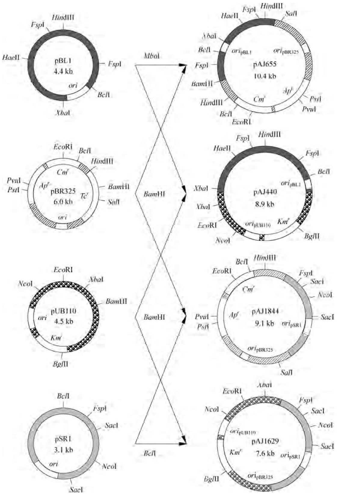
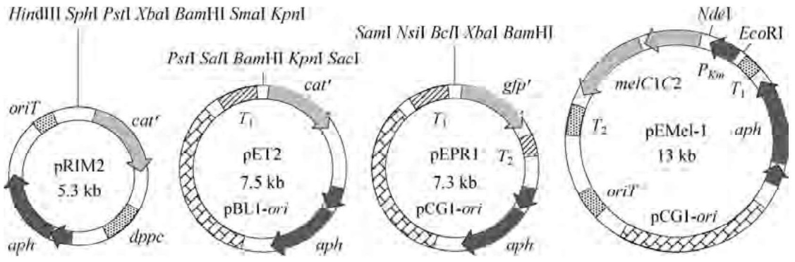
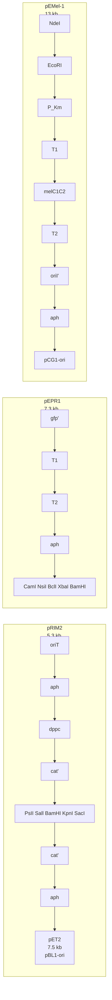
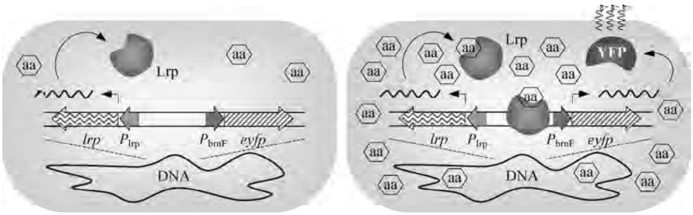
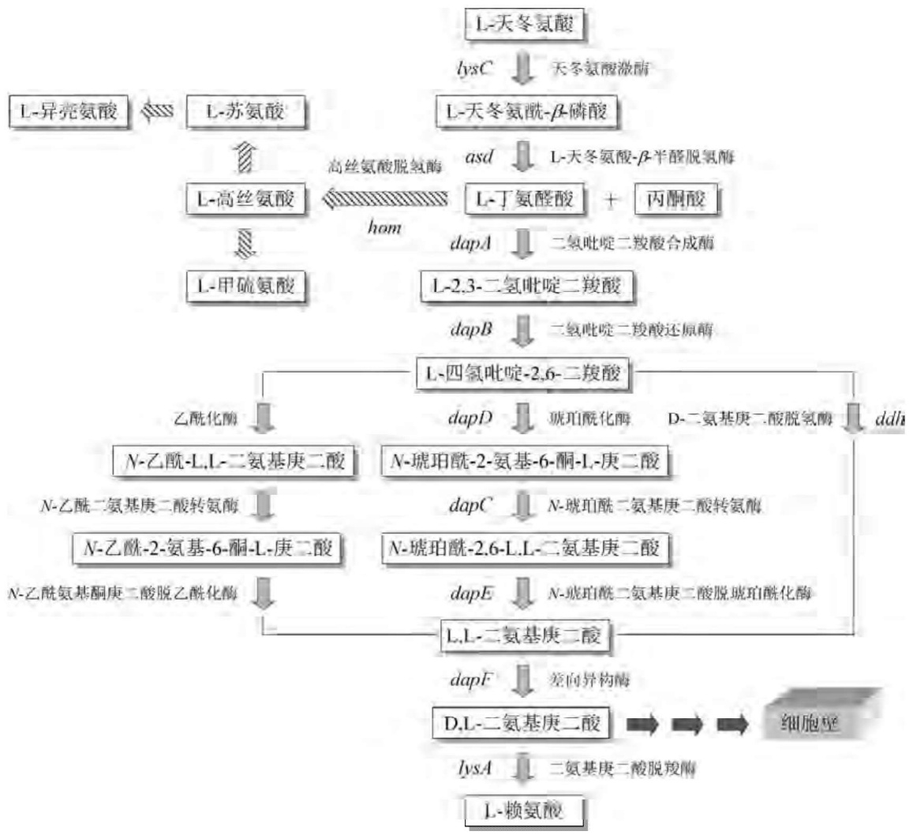
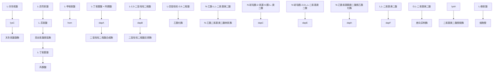
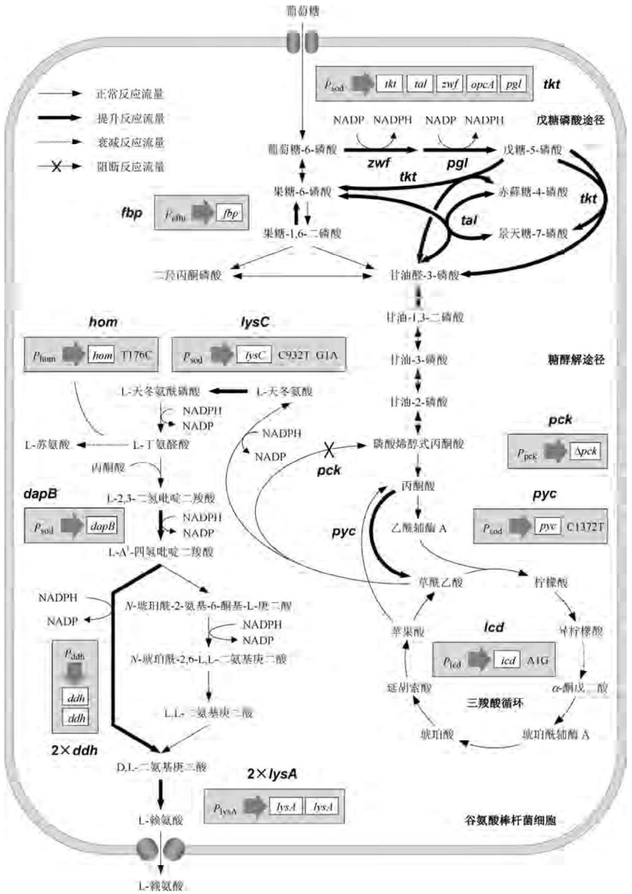
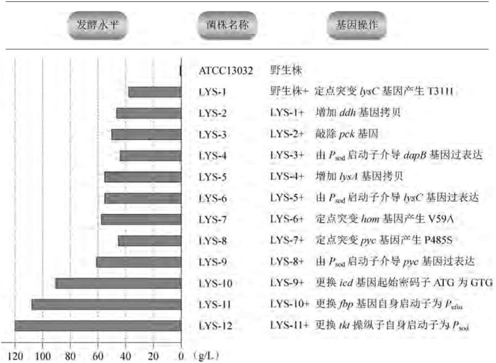
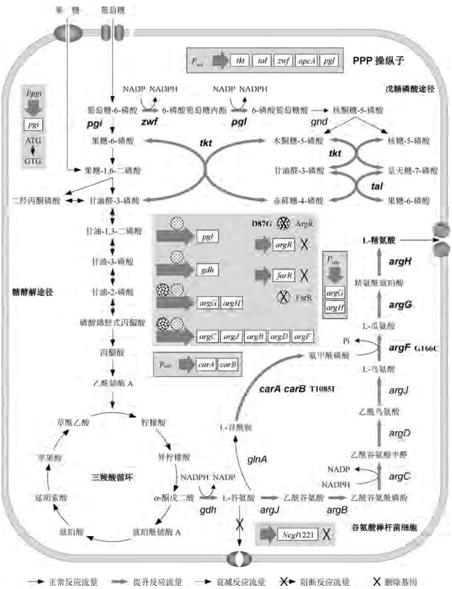

表 4-9 存在于棒状杆菌中的野生型质粒

| 质粒名称 | 宿主菌种 | 大小/kb | 抗性标记 |
| --- | --- | --- | --- |
| pX18 | Brevibacterium lactofermentum ATCC 21086 | 4.5 | — |
| pBL1 | Brevibacterium lactofermentum ATCC 21798 | 4.4 | — |
| pBL100 | Brevibacterium linens CECT75 | 7.5 | — |
| pRBL1 | Brevibacterium linens RBL | 8.0 | — |
| pCC1 | Corynebacterium callunae NRRL B2244 | 4.2 | — |
| pNG2 | Corynebacterium diphtheriae | 14.4 | Em |
| pDG101 | Corynebacterium flaccumfaciens subsp. oorti | 69.0 | 砷酸盐,亚砷酸盐,锑 |
| pXZ10145 | Corynebacterium glutamicum | 5.3 | Cm |
| pSR1 | Corynebacterium glutamicum ATCC 19223 | 3.1 | — |
| pCG4 | Corynebacterium glutamicum ATCC 31830 | 29.0 | Sm,Sp |
| pCG2 | Corynebacterium glutamicum ATCC 31832 | 6.8 | — |
| pAL286 | Corynebacterium glutamicum Ferm P5485 | 4.4 | — |
| pGA1 | Corynebacterium glutamicum LP-6 | 4.8 | — |
| pCL1 | Corynebacterium lilium | 4.1 | — |
| pAG1 | Corynebacterium melassecola | 20.4 | Tc |
| pCR1 | Corynebacterium renale | 1.4 | — |
| pCR2 | Corynebacterium renale | 3.2 | — |
| pCR3 | Corynebacterium renale | 4.4 | — |
| pCR4 | Corynebacterium renale | 5.7 | — |
| pTP10 | Corynebacterium xerosis | 45.0 | Tc,Cm,Em,Sm |

注:Cm—氯霉素；Em—红霉素；Sm—链霉素；Sp—壮观霉素；Tc—四环素。

## 1. 棒状杆菌的穿梭质粒

将棒状杆菌来源的两种不相容的天然隐蔽型质粒 pBL1 和 pSR1 分别与大肠杆菌质粒 pBR325( $Ap^{r}$ 、 $Cm^{r}$ 、 $Tc^{r}$ ) 和金黄色葡萄球菌质粒 pUB110( $Km^{r}$ ) 进行重组，获得 pAJ 系列的穿梭质粒（图 4-13）。将这些穿梭质粒转化短杆菌属，至少发现四种类型的转化子，其中含有 pAJ655 和 pAJ1844 的转化子产生氯霉素抗性，而含有 pAJ440 和 pAJ1629 的转化子产生卡那霉素抗性。这个结果表明，大肠杆菌来源的氯霉素抗性基因( $Cm^{r}$ ) 启动子以及金黄色葡萄球菌来源的卡那霉素抗性基因( $Km^{r}$ ) 启动子能在短杆菌属细菌中表达，而且这些穿梭质粒在其他棒状杆菌（如谷氨酸棒杆菌）中也能用相应的选择性标记进行稳定扩增，然而氨苄青霉素抗性基因( $Ap^{r}$ ) 的启动子不能被棒状杆菌的 RNA 聚合酶识别。此外，将大肠杆菌质粒 pBR329 的氨苄青霉素抗性基因以及链霉菌的硫链丝菌素抗性基因(tsr) 导入凯鲁那棒杆菌野生型质粒 pCC1 中，成功构建了 pUL210 质粒；将谷氨酸棒杆菌野生型质粒 pSR1 和 pCG2 与大肠杆菌质粒 pGA22( $Ap^{r}$ 、 $Cm^{r}$ 、 $Tc^{r}$ 、 $Km^{r}$ ) 进行重组，可获得穿梭质粒 pCE51～pCE54；将 pSR1 与枯草芽孢杆菌质粒 pBD10( $Cm^{r}$ 、 $Em^{r}$ 、 $Km^{r}$ ) 合并，则形成穿梭质粒 pHY416( $Cm^{r}$ 、 $Km^{r}$ )。上述穿梭质粒的一个显著特征是分子过大，因此在多轮复制过程中容易发生自发性缺失突变，形成相对分子质量较小的质粒，例如由 pAJ655(10.4 kb) 自发突变产生的质粒 pAJ43 只剩下  $Cm^{r}$  一个选择标记，分子缺失了一半(5.1 kb)，显然不再具有穿梭复制功能，但它却是较为理想的克隆载体。

## 2. 棒状杆菌的启动子探针质粒

为了克隆或检查各种内源型和外源型启动子在棒状杆菌中介导基因转录启动的活性，一系列的启动子探针质粒构建成功。它们均选用便于定量测定的无启动子功能基因

flowchart

This diagram illustrates the genetic construct and restriction enzyme interactions between various plasmid genes (pBL1, pBR325, pUB110, pAJ655, pAJ440, pAJ1844, pAJ1629) with their respective gene constructs and restriction enzymes.

图4-13 棒状杆菌pAJ系列穿梭质粒的构建

编码序列作为报告基因，并在克隆位点的上游邻近区域插入合适的转录终止子序列，以防止质粒上其他基因（如标记基因）所属启动子可能造成的转录过头现象发生，降低检测本底或假阳性。谷氨酸棒杆菌常用的报告基因包括:来自转座子Tn9的氯霉素乙酰基转移酶编码基因（cat）、来自大肠杆菌的β-半乳糖苷酶编码基因（lacZ）、来自转座子Tn5的氨基糖苷磷酸转移酶编码基因（aph）、来自大肠杆菌的β-葡萄糖醛酸酶编码基因（uidA）、来自灰色链霉菌的α-淀粉酶编码基因（amy）、来自淡青链霉菌（Streptomyces glaucescens）的黑色素编码基因（melC）、来自水母（Aequorea victoria）的绿色荧光蛋白编码基因（gfp）。

三种用于克隆和分析谷氨酸棒杆菌启动子的自主复制型启动子探针载体如图4-14所示。其中，携带无启动子报告基因 $cat^{\prime}$ 的pET2使用最广。能对谷氨酸棒杆菌进行接合转化的取代型载体pEMel-1携带黑色素合成基因melC1C2，它们受控于来自Tn5的 $P_{\mathrm{Km}}$ 启动子。使用时可用待克隆或受测试的任何EcoRI-NdeI片段取代pEMel-1上的相应 $P_{\mathrm{Km}}$ 片段。pEPR1携带启动子报告基因 $gfp^{\prime}$ 。为了确保待测试启动子与报告基因以单拷贝形式存在于细胞中，整合型启动子探针载体pRIM2被构建，它只含大肠杆菌复制子，因而不能在谷氨酸棒杆菌中复制，但装有谷氨酸棒杆菌ppc基因上游的一段非编码序列(dppc)，因而可以通过同源重组整合在谷氨酸棒杆菌染色体的相应位点上，而且不会对宿主菌造成生理影响。

flowchart

图4-14 谷氨酸棒杆菌启动子探针质粒图谱

## 3. 棒状杆菌的考斯质粒

与大肠杆菌型的考斯质粒构建路线相似，利用产乳酸短杆菌的F-1A噬菌体DNAcos区可产生一系列的产乳酸短杆菌型考斯质粒。例如，将含有cos序列的F-1A DNA HindIII片段插入pAJ43中，形成考斯质粒pAJ667。由于相应的噬菌体体外包装系统尚未建立，因此pAJ667转导产乳酸短杆菌的完整细胞必须用F-1A噬菌体作为辅助噬菌体，这个系统的转导频率可达 $10^{-4}$ 噬菌斑/细胞。

## 4. 棒状杆菌的接合质粒

pECM1 是另一种人工构建的谷氨酸棒状杆菌-大肠杆菌穿梭质粒，它含有一个来自广泛可转移性质粒 RP4 的 mob 位点以及两个选择标记 $Cm^{r}$、$Km^{r}$。在接合转化过程中，先将 pECM1 或以其为载体的重组质粒转化到一个特殊的大肠杆菌供体菌中，这个菌株的染色体 DNA 上预先整合了一段 RP4 的接合功能区，借助于该区域所表达出的转移辅助功能，pECM1 或者重组质粒即可从大肠杆菌顺利接合到棒状杆菌细胞内。若在接合之前先灭活宿主细胞的限制系统，或在接合过程中进行强热处理（48.5℃）操作，则质粒的接合频率可提高 4 个数量级。对于产乳酸短杆菌和谷氨酸棒杆菌而言，这种接合系统的转化频率大约在 $10^{-4} \sim 10^{-2}$ 个/供体细胞，然而对于短杆菌属其他的菌种如黄色短杆菌（Brevibacterium flavum)和产氨短杆菌(Brevibacterium ammoniagenes)等,相应的接合频率为前两种菌的1/1000。

## 4.2.2 棒状杆菌的基因表达系统

相对 mRNA 的翻译调控而言,无论是内源基因还是外源基因,棒状杆菌细胞中的转录启动都是更为关键的步骤。2003 年谷氨酸棒杆菌 ATCC13032 株完整基因组的测序,使得棒状杆菌启动子及其对应的转录调控因子的结构解析和基因表达调控网络的构筑成为可能,这在很大程度上为棒状杆菌的基因工程设计与操作奠定了坚实的基础。

## 1. 谷氨酸棒杆菌启动子的结构特征

RNA聚合酶全酶中的 $\sigma$ 因子负责识别相应的启动子序列，据此可对启动子进行分类。谷氨酸棒杆菌的基因组编码7种不同类型的 $\sigma$ 因子（它们均属于 $\sigma^{70}$ 型），即 $\sigma^{\mathrm{A}}$ 、 $\sigma^{\mathrm{B}}$ 、 $\sigma^{\mathrm{C}}$ 、 $\sigma^{\mathrm{D}}$ 、 $\sigma^{\mathrm{E}}$ 、 $\sigma^{\mathrm{H}}$ 、 $\sigma^{\mathrm{M}}$ 。其中，$\sigma^{\mathrm{A}}$ 识别谷氨酸棒杆菌持家基因所属的启动子，虽然这些启动子-35区和-10区关键的特异性基序因所属基因不同而呈现广泛的可变性，但其保守序列的框架相对固定。其他的 $\sigma$ 因子所控制的谷氨酸棒杆菌启动子大多数是压力诱导型的，尽管 $\sigma^{\mathrm{B}}$ 、 $\sigma^{\mathrm{H}}$ 、 $\sigma^{\mathrm{M}}$ 依赖型的启动子已被分析得相当清楚，但其新的特征仍在不断被鉴定。

（1）持家基因启动子。谷氨酸棒杆菌持家基因启动子的基本结构与大肠杆菌及其他细菌为基本 $\sigma$ 因子所识别的启动子类似，也含有-35和-10基序。统计学分析显示，159个推测属于 $\sigma^{\mathrm{A}}$ 依赖型的谷氨酸棒杆菌启动子关键基序基本上由-35区的TTGNCA和扩展型-10区的GNTANANTNG构成。扩展型-10区的六碱基基序为TANANT，其中前两位的TA和最后一位的T碱基存在于 $80\%$ 以上的受调查启动子中，其他碱基出现的频率也高于 $35\%$ 。谷氨酸棒杆菌-35区的序列比大肠杆菌启动子的保守性要低得多，甚至在很多谷氨酸棒杆菌启动子中不能识别。然而需要特别指出的是，持家基因启动子的统计学保守性序列未必代表最强的启动子，因为启动子的结构及其强度的演化目的是增强细胞的适应度而非获得最高的基因表达效率。与大肠杆菌相似，谷氨酸棒杆菌启动子的其他并不保守的元件也可能影响其转录启动活性。例如，谷氨酸棒杆菌启动子扩展型-10区内TG二聚体的存在也能增加启动子的强度。因此，可将扩展型-10基序TGNTATAATNG和-35基序TTGA/CCA视为谷氨酸棒杆菌最强的核心启动子元件。当然，即便 $\sigma$ 因子与这两个最优化的元件结合，也不能保证外源基因在谷氨酸棒杆菌细胞中必定获得最高的转录效率。

（2）压力诱导型启动子。很多谷氨酸棒杆菌基因的表达受控 $\sigma^{\mathrm{H}}$ 和 $\sigma^{\mathrm{M}}$ ，这些基因中的大多数涉及细胞对限制性生长(静止期或响应各种压力，如冷热休克、氧化压力、细胞表面压力等)的适应性。$\sigma^{\mathrm{H}}$ 依赖型启动子形成一个最大的压力诱导型启动子家族，它们大都通过野生株、sigH（$\sigma^{\mathrm{H}}$ 编码基因)过表达株、sigH缺失株或rshA(抗 $\sigma^{\mathrm{H}}$ 蛋白RshA编码基因)缺失株的差示表达微阵列而被鉴定。大多数受 $\sigma^{\mathrm{H}}$ 调控的基因参与热休克应答。由45个$\sigma^{\mathrm{H}}$ 调控型启动子的结构比对所提取的保守序列显示，$\mathrm{GGAAN}_{18\sim 21}\mathrm{GTT}$ 构成保守区域的核心，除了第二个A发现于 $88\%$ 的启动子外，其他碱基的出现频率均在 $97\% \sim 100\%$ 内。这一保守序列也存在于分枝杆菌和链霉菌的压力应答基因所属启动子中。谷氨酸棒杆菌$\sigma^{\mathrm{H}}$ 特异性启动子保守序列扩展形式的其他碱基如-35区的G/TGGAAT/CA/T和一10区的C/TGTTG/AA/TA/T则保守性很差(存在于 $40\%$ 以上的启动子)。$\sigma^{\mathrm{H}}$ 特异性启动子目前尚未被用于构建谷氨酸棒杆菌基因工程菌，然而它们在基因表达的热诱导性方面已受到关注。

至少有四个谷氨酸棒杆菌的  $\sigma^{M}$  特异性启动子被鉴定。但这些参与氧化压力响应的基因及其启动子同样也呈  $\sigma^{H}$  依赖性。由于  $\sigma^{M}$  编码基因所属的启动子  $P_{sigM}$  也为  $\sigma^{H}$  所识别，因此这些基因对  $\sigma^{H}$  的依赖性可能是间接的。

（3）$\sigma^{\mathrm{B}}$ 依赖型启动子。虽然大量观察表明 $\sigma^{\mathrm{A}}$ 负责转录持家基因，但无论是在有氧还是厌氧条件下，谷氨酸棒杆菌对数生长期的葡萄糖代谢编码基因却被发现由 $\sigma^{\mathrm{B}}$ 控制的启动子介导表达。也就是说，至少一部分的谷氨酸棒杆菌持家基因是从 $\sigma^{\mathrm{B}}$ 依赖型启动子处转录的。此外，在谷氨酸棒杆菌由对数期转换至静止期的过程中表达最高的一些基因也呈 $\sigma^{\mathrm{B}}$ 依赖性，它们负责压力防卫、物质运输、氨基酸代谢和调控过程。对13个 $\sigma^{\mathrm{B}}$ 特异性启动子的结构分析发现，$\sigma^{\mathrm{B}}$ 特异性启动子的-10区序列与 $\sigma^{\mathrm{A}}$ 特异性启动子的-10区序列很相似，至少有些 $\sigma^{\mathrm{A}}$ 特异性启动子在体内特定生理条件下也可以为 $\sigma^{\mathrm{B}}$ 所识别。因此，$\sigma^{\mathrm{B}}$ 不只是一个用于不利环境的备用因子，而且也是谷氨酸棒杆菌快速生长期中识别某些持家基因启动子的第二套装置。$\sigma^{\mathrm{B}}$ 特异性的启动子因此可以用来提升目的基因在各种压力条件或限制性生长条件下的表达，这对构建谷氨酸棒状杆菌的基因工程菌具有较高的实用价值。

## 2. 谷氨酸棒杆菌的转录调控因子

转录调控因子(TR,包括激活因子和阻遏因子)能与启动子区域内的DNA特定序列(如操作子)结合。谷氨酸棒杆菌的TR根据其所调控的等级水平可分为全局型、主要型、局部型3种类型。基于网络的分析平台CoryneRegNet包含了159种谷氨酸棒杆菌TR及其调控的相互作用。现有数据显示，谷氨酸棒杆菌大多数基因为各种TR所调控，而且158个基因受两种TR调控，46个基因受3种TR调控，15个基因受4种甚至5种TR调控。很多谷氨酸棒杆菌的启动子区域因此携带多重TR识别结合位点。截止到2012年，共有452种TR的DNA结合基序被实验和信息生物学程序所鉴定。单个启动子的时序性转录谱来自若干种TR的综合效应，从而确保细胞对环境和代谢变化的精确应答。

信息生物学预测与电泳凝胶阻滞实验相结合，可将 GlxR(CRP 家族)定义为谷氨酸棒杆菌的一种全局型调控因子，它能调控大约 14% 的已注释基因。采用染色质免疫沉淀与微阵列分析相结合(ChIP-chip)的方法，在谷氨酸棒杆菌的基因组中共发现 209 个 GlxR 的结合位点，与信息生物学预测的结果高度吻合，而且启动子-报告基因分析系统也肯定了 GlxR 对报告基因表达的激活效应。操作子序列的位点特异性诱变能够确定单个碱基在 TR 介导的基因表达控制中的作用，采用这种精细的分析程序，先后揭示了转录调控因子 LldR 控制谷氨酸棒杆菌乳酸脱氢酶编码基因 lldD 的表达机制，以及转录调控因子 RamA、RamB、GlxR 调控谷氨酸棒杆菌复苏促进因子编码基因 rpf2 转录的复杂模式。

## 3. 谷氨酸棒杆菌基因的表达调控

根据介导基因转录调控模式的不同,谷氨酸棒杆菌的启动子可分为组成型、诱导型、修饰型三大类。

## (1) 组成型启动子

在基因工程菌构建中，谷氨酸棒杆菌天然的强组成型启动子被用来组建表达质粒或取代染色体上特定基因的天然启动子。由谷氨酸棒杆菌分泌型表层蛋白PS2编码cspB基因所属的组成型启动子构建的谷氨酸棒状杆菌-大肠杆菌穿梭表达载体pCC，可用作构建克隆基因表达产物分泌或细胞表面展示的衍生载体的蓝本。甘油醛-3-磷酸脱氢酶编码基因gapA以及翻译延伸因子EF-Tu编码基因tuf所属的强组成型启动子，也广泛用于内源或外源基因的高效表达。用超氧化物歧化酶编码基因sod和tuf所属的强组成型启动子置换谷氨酸棒杆菌染色体上特定基因的天然启动子，可以获得产L-赖氨酸、二氨基戊烷、琥珀酸等稳定高效且无质粒的菌株。

## (2) 诱导型启动子

诱导型启动子是控制基因表达的有力工具，也是构建表达载体至关重要的元件。谷氨酸棒杆菌绝大部分的表达载体均使用某些异源的可诱导启动子，包括λ噬菌体的热诱导型启动子 $P_{R}P_{L}$ 以及大肠杆菌的IPTG诱导型启动子 $P_{lac}$ 、 $P_{tac}$ 、 $P_{trc}$ 。含有这些启动子的大肠杆菌-谷氨酸棒杆菌穿梭表达载体已构建了很多，其中 IPTG 诱导型启动子在实验室成功用于控制谷氨酸棒杆菌基因的高效表达，但因诱导剂价格高昂而不适合大规模工业化应用。因此，开发选用其他高效且廉价的诱导剂一直是基因工程应用的需要。

阿拉伯糖诱导表达系统已被开发且大规模应用。该系统基于大肠杆菌L-阿拉伯糖操纵子所属启动子 $P_{\mathrm{araBAD}}$ 在谷氨酸棒杆菌中的功能通用性，并由大肠杆菌araC和araE基因组成，两者分别编码一种正调控因子和L-阿拉伯糖转运子。L-阿拉伯糖在很广泛的浓度范围内均可诱导基因的表达。

异源启动子和谷氨酸棒杆菌内源启动子均被用来构建受严密调控的四环素诱导型表达系统。在表达载体 pCLTON1 中，将目的基因插在一种修饰型的枯草芽孢杆菌启动子  $P_{tet}$  下游，后者在四环素缺席时被阻遏因子 TetR 严密阻遏，而 TetR 的编码基因则由谷氨酸棒杆菌强组成型启动子  $P_{gapA}$  在同一质粒上介导表达。在另一个表达载体 pCeHEMG 中，采用  $\lambda$  噬菌体的操作子  $O_{L1}$  与产氨棒杆菌 (Corynebacterium ammoniagenes) 中介导基因组成型表达的启动子 CJ1 和 CJ4 融合 (CJ1 和 CJ4 也能在谷氨酸棒状杆菌中有效工作)，并连同 His-tag、肠激酶 (EK) 识别切割位点、MCS 编码序列、温度敏感型 cI857 基因一起克隆在 pCES208 质粒上。这种 pCeHEMG (CJ1OX2G-CJ1cI857-MCS-His $_{6}$ -EK, Km $^{r}$ ) 在 42℃ 时能有效诱导外源基因在谷氨酸棒杆菌中高效表达。

迄今也有少数谷氨酸棒杆菌天然的可诱导型启动子用于控制基因的高效表达，包括乙酸诱导型 $P_{\mathrm{pta - ack}}$ 、葡萄糖糖酸诱导型 $P_{\mathrm{git1}}$ 、麦芽糖诱导型 $P_{\mathrm{malE1}}$ 、丙酸诱导型 $P_{\mathrm{prpD2}}$ 。其中，丙酸在PrpR激活因子的存在下可强烈诱导操纵子prpDBC2（编码2-甲基柠檬酸循环）所属的启动子 $P_{\mathrm{prpD2}}$ ，这一表达系统无论是在实验室研究还是在工业大规模应用中都非常实用，因为它只需要极少量(1mg/L)且廉价的丙酸诱导剂，而且在最小培养基和复合生长培养基中均适用。此外，由于丙酸能为细胞所消耗，因此当丙酸被耗尽时转录会突然下跌。该系统已成功用于构建高产L-赖氨酸的谷氨酸棒杆菌工程菌。

新近建立起来的用于谷氨酸棒杆菌单细胞内氨基酸浓度可视化的生物传感器，是谷氨酸棒杆菌可诱导型启动子的全新应用。在这些系统中，氨基酸浓度的增加与一种正调控型TR（作为一种天然传感器）相互作用，进而激活相应的启动子以及一个可定量化的报告基因表达。两种这样的谷氨酸棒杆菌生物传感器系统使用报告基因eyfp，后者编码增强型黄色荧光蛋白，可由荧光激活型细胞分拣系统(FACS)检测。其中，一个系统依靠转录调控因子Lrp感应支链氨基酸(如苏氨酸、缬氨酸、异亮氨酸等)和甲硫氨酸，而brnEF基因(编码一种二元氨基酸外输子)所属的启动子则位于报告基因eyfp的上游，如图4-15所示。另一个系统则通过LysG转录激活因子(作为传感器)感应L-赖氨酸的浓度，并将lysE基因(编码一种碱性氨基酸外输子)所属启动子置于报告基因eyfp的上游。

## (3) 修饰型启动子

除了上述天然启动子外，采取启动子序列特异性点突变策略构建而成的修饰型启动子也被用于谷氨酸棒杆菌基因表达的优化控制。在-35区6碱基对和扩展型-10区内特定碱基改变的谷氨酸棒杆菌突变型启动子列在表4-10中。通过二氢甲基吡啶酸合成酶编码基因dapA所属的谷氨酸棒杆菌启动子位点特异性突变可构建一系列强度各异的启动子。单碱基突变型 $P_{dapA}$ 的分析显示，-10区和-35区启动子序列中各碱基与启动子活性之间存在显著关联性，这为鉴定谷氨酸棒杆菌持家型启动子的保守序列提供了有价值的信息，其中的一些突变型 $P_{dapA}$ 已被用来控制优化L-赖氨酸或丁二胺生产的基因表达。研究发现，将表4-10中强突变型启动子 $P_{dapAMC20}$ 或 $P_{dapAMA16}$ 与单拷贝的dapA基因一同导入染色体上，可使谷氨酸棒杆菌的L-赖氨酸产量显著增加。另外，表4-10所列的弱突变型启动子 $P_{dapAB6}$ 也被用来介导argF基因（鸟氨酸氨甲酰基转移酶）的转录启动，如果更换其翻译起始

细胞内氨基酸浓度低于一定阈值，不发射荧光:

细胞内氨基酸浓度高于一定阈值，荧光发射:

图4-15 基于诱导型启动子的谷氨酸棒杆菌单细胞内氨基酸浓度可视化检测系统

密码子和/或核糖体结合位点，则 $argF$ 基因的表达会进一步得以改善，由此构建出的工程菌产丁二胺的量是迄今为止所有谷氨酸棒杆菌菌株中最高的。表4-10所列的一组八个突变型 $P_{\mathrm{dapA}}$ （除了野生型 $P_{\mathrm{dapA}}$ 外)已被用于实现谷氨酸棒杆菌柠檬酸合成酶编码基因gltA的梯度型表达，由此获得的一组重组菌逐步降低柠檬酸合成酶的活性，而L-赖氨酸的合成水平与柠檬酸合成酶活性的变化成反比。采取这一策略，谷氨酸棒杆菌重组菌在含葡萄糖的最小培养基中生产L-赖氨酸的水平迄今为止最高。

表 4-10 谷氨酸棒杆菌突变型启动子的生物学效应

<table><tr><td>启动子名称</td><td>基因编码产物</td><td>-35区序列</td><td>-10区序列(扩展型)</td><td>突变效应</td></tr><tr><td> $P_{dapA\ WT}$ </td><td rowspan="10">二氢甲基吡啶酸合成酶</td><td>TAACCC</td><td>AGGTAACCTTG</td><td>对照</td></tr><tr><td> $P_{dapA\ MA16}$ </td><td>TAACCC</td><td>AGGTATAATTG</td><td>上调</td></tr><tr><td> $P_{dapA\ MC20}$ </td><td>TAACCC</td><td>TGGTAACCTTG</td><td>上调</td></tr><tr><td> $P_{dapA\ A25}$ </td><td>TAACCC</td><td>AGGTATCATTG</td><td>上调</td></tr><tr><td> $P_{dapA\ A14}$ </td><td>TAACCC</td><td>AGGTATCCTTG</td><td>上调</td></tr><tr><td> $P_{dapA\ A23}$ </td><td>TAACCC</td><td>AGGTAACATTG</td><td>上调</td></tr><tr><td> $P_{dapA\ L1}$ </td><td>TAACCC</td><td>AGGTAGAATTG</td><td>上调</td></tr><tr><td> $P_{dapA\ C7}$ </td><td>TAACCC</td><td>TAGTAACCTTG</td><td>下调</td></tr><tr><td> $P_{dapA\ B6}$ </td><td>TAACCC</td><td>AGGCAACCATG</td><td>下调</td></tr><tr><td> $P_{dapA\ C5}$ </td><td>TAACCC</td><td>TTGTAACCTTG</td><td>下调</td></tr><tr><td> $P_{dccT\ WT}$ </td><td rowspan="2">二羧酸转运子</td><td>CTACCA</td><td>CGTTAATATTC</td><td>对照</td></tr><tr><td> $P_{dccT\ FSM(SSM)}$ </td><td>CTACCA</td><td>TGTTAATATTC</td><td>上调</td></tr><tr><td> $P_{detA\ WT}$ </td><td rowspan="2">二羧酸转运子</td><td>TTGCGT</td><td>TTTCATAATTT</td><td>对照</td></tr><tr><td> $P_{dctA\ MSM}$ </td><td>TTGCGT</td><td>TTTTATAATTT</td><td>上调</td></tr><tr><td> $P_{gdh\ WT}$ </td><td rowspan="8">谷氨酸脱氢酶</td><td>TGGTCA</td><td>TGCCATAATTG</td><td>对照</td></tr><tr><td> $P_{gdh2}$ </td><td>TGGTCA</td><td>TGCTATAATTG</td><td>上调</td></tr><tr><td> $P_{gdh3}$ </td><td>TTGACA</td><td>TGCTATAATTG</td><td>上调</td></tr><tr><td> $P_{gdh4}$ </td><td>TTGTCA</td><td>TGCTATAATTG</td><td>上调</td></tr><tr><td> $P_{gdh7}$ </td><td>TTGCCA</td><td>TGCTATAATTG</td><td>上调</td></tr><tr><td> $P_{gdh527-2}$ </td><td>TGGTCA</td><td>TGCCATAAATG</td><td>下调</td></tr><tr><td> $P_{gdh527-3}$ </td><td>TGGTCA</td><td>CCCCATAATTG</td><td>下调</td></tr><tr><td> $P_{gdh527-4}$ </td><td>TGGTCA</td><td>CCCCATAAATG</td><td>下调</td></tr><tr><td> $P_{ilvD\ WT}$ </td><td>二羟酸脱水酶</td><td>GTGATA</td><td>AGCACTAGAGTGT</td><td>对照</td></tr><tr><td> $P_{ilvD M7}$ </td><td rowspan="5">转氨酶</td><td>GTGATA</td><td>TGTGCTATAGTGT</td><td>上调</td></tr><tr><td> $P_{ilvD M14}$ </td><td>GTGATA</td><td>AGCACTGTGGTAT</td><td>上调</td></tr><tr><td> $P_{ilvE WT}$ </td><td>GTGTAT</td><td>AGGTGTACCTTAA</td><td>对照</td></tr><tr><td> $P_{ilvE M6}$ </td><td>GTGTAT</td><td>TGTGGTACCATAA</td><td>上调</td></tr><tr><td> $P_{ilvE M3}$ </td><td>GTGTAT</td><td>AGGTGCTCCTTAA</td><td>下调</td></tr><tr><td> $P_{ilvA WT}$ </td><td rowspan="2">苏氨酸转氨酶</td><td>TAGGTG</td><td>GATTACACTAG</td><td>对照</td></tr><tr><td> $P_{ilvA M1CG}$ </td><td>TAGGTG</td><td>GATCACAGTAG</td><td>下调</td></tr><tr><td> $P_{ilvA M1CTG}$ </td><td rowspan="5">异丙基苹果酸合成酶</td><td>TAGGTG</td><td>GATCACTGTAG</td><td>下调</td></tr><tr><td> $P_{leuA WT}$ </td><td>TACCCA</td><td>TTGTATGCTTC</td><td>对照</td></tr><tr><td> $P_{leuA M3A}$ </td><td>TACCCA</td><td>TTGTATGCATC</td><td>下调</td></tr><tr><td> $P_{leuA M2TCG}$ </td><td>TACCCA</td><td>TTTCAGGCTTC</td><td>下调</td></tr><tr><td> $P_{leuA M2C}$ </td><td>TACCCA</td><td>TTGCATGCTTC</td><td>下调</td></tr></table>

注:突变碱基用下画线表示。

谷氨酸脱氢酶编码基因 $gdh$ 的强突变型启动子也被构建用于提升谷氨酸棒杆菌 $odhA$ 缺陷株（缺少 $\alpha$-酮戊二酸脱氢酶）生产L-谷氨酸的水平。相比野生型启动子，-10区内的突变能提高谷氨酸脱氢酶活性4.5倍之多；而-10区和-35区内的联合突变能使该酶的活性进一步提高至7倍。

参与缬氨酸、异亮氨酸、亮氨酸生物合成的基因所属天然启动子也在染色体内被实施突变，旨在改善谷氨酸棒杆菌生产L-缬氨酸的能力。二羟酸脱水酶编码基因ilvD和转氨酶编码基因ilvE所属启动子内部的上调突变(表4-10)，能提高参与L-缬氨酸生物合成的相应酶活性。另外，苏氨酸脱氨酶编码基因ilvA和异丙基苹果酸合成酶编码基因leuA所属启动子的下调突变(表4-10)，则能阻断代谢物流向不期望的副产物异亮氨酸和亮氨酸。结合特定位点的启动子突变，可构建一株无质粒的谷氨酸棒杆菌工程菌，其L-缬氨酸的生产能力得以提升。同理， $P_{\mathrm{ilvE}}$ 的下调突变导致酮异戊酸流向L-缬氨酸的代谢流显著降低，这可用于构建高产泛酸的谷氨酸棒状杆菌工程菌。

研究发现，筛选启动子区域的自发性突变也同样能获得谷氨酸棒杆菌细胞新的代谢性能。例如，启动子区域发生自发性突变并导致编码二羧酸转运子编码基因 $dccT$ 和 $dctA$ 过表达，能使谷氨酸棒杆菌细胞获得以琥珀酸、延胡索酸、L-苹果酸作为唯一碳源加以利用的能力。甚至自然分离到的一株谷氨酸棒杆菌还能生长在葡萄糖胺为唯一碳源的培养基上，该突变株的分析显示，新获得的表型是因其 $nagAB - scrB$ 操纵子所属的启动子内部一个单位点突变所致。与上述的突变型启动子相反，该突变位点位于 $P_{1 - nagA}$ 和 $P_{2 - nagA}$ 启动子-10区和-35区的外侧。

## 4.2.3 棒状杆菌的宿主转化系统

与大肠杆菌和芽孢杆菌相同，用作外源基因克隆表达受体的棒状杆菌应是限制缺陷型的。由于它们大都用来克隆和表达氨基酸生物合成途径中的关键酶编码基因，因而有时还必须呈营养缺陷型。具有上述遗传特性的受体菌构建大都采用传统诱变的方法，同时辅以以载体质粒转化率高低为指标的大规模筛选。一般而言，源自产乳酸短杆菌的pBL1及其衍生质粒能在大多数的异源宿主细胞中复制，源自谷氨酸棒杆菌的pSR1及其衍生质粒也能在短杆菌属的某些种中复制，源自白喉棒杆菌的pNG2甚至还能在大肠杆菌中复制，但棒状杆菌来源的pCC1和pCL1均不能在多数的短杆菌中复制。

棒状杆菌的转化方法主要有下列三种程序。

## 1. 棒状杆菌的原生质体转化法

原生质体转化是棒状杆菌 DNA 重组实验中最常见的一种方法。在以产乳酸短杆菌为受体、烈性噬菌体 F-1A DNA 为供体的转化系统中，最佳的原生质体转化程序如下:受体菌在营养丰富的培养基中生长至对数生长早期，加入 0.6 U/mL 的青霉素 G，继续培养 1.5 h，然后用 10 mg/mL 的溶菌酶处理菌体并收获原生质体。在 30% 聚乙二醇（PEG）的存在下，将待转化的 DNA 与原生质体混合保温片刻，之后将转化悬浮液涂布在含有 0.8% 琼脂的再生培养基上（此时琼脂的浓度对原生质体再生率极为重要），最后再将含有抗生素的固体培养基覆盖进行筛选。一般情况下，原生质体的再生率可达 90% 以上。采用相同的程序，质粒 pBL1 的转化率也可达到  $1.3 \times 10^{6}$  个/ $\mu$ g DNA。

上述原生质体的转化率与待转化质粒 DNA 的分子大小高度负相关。pUL61(14.6 kb)用原生质体法转化产乳酸短杆菌,转化率只有  $10^{2}$  个/ $\mu$ g DNA;但用 pUL61 的两个缺失型质粒 pUL330 (5.2 kb) 和 pUL340(5.8 kb) 转化同样的受体菌原生质体,其转化率均提高到 4 个数量级。

谷氨酸棒杆菌的原生质体转化方法是以温和型噬菌体 $\phi$CG1DNA和野生型质粒pCG4为供体建立起来的，两者的转染率和转化率分别为 $5\times 10^{7}$ 个/ $\mu \mathrm{g}$ 噬菌体DNA和 $1\times 10^{6}$ 个/ $\mu \mathrm{g}$ 双链环状DNA。转染率比转化率高50倍的原因是，在质粒DNA转化系统中受体菌原生质体的再生率较低，大约只有 $6\%$ 。为了克服这一困难，用 $2\%$ 的甘氨酸代替青霉素G，所制备的谷氨酸棒杆菌原生质体再生率可提高到 $30\%$ 。

## 2. 棒状杆菌的电击转化法

原生质体转化方法的效率并不低，但转化操作周期太长，大约需要 $7\sim 10$ 天，而且有些菌株的原生质体并不能被有效转化。电穿孔转化方法的优点恰好弥补了原生质体转化法的不足，它既可大大缩短转化周期，又适用于那些原生质体再生能力较差的菌株。但其缺点是转化率较低，在最佳条件下，电穿孔法的转化率不高于 $10^{5}$ 个/ $\mu \mathrm{g}$ DNA。对于产乳酸短杆菌和谷氨酸棒杆菌的完整细胞而言，最佳的转化条件是受体细胞浓度为 $10^{10}$ 个/mL，供体DNA浓度为 $10~\mathrm{pg} / \mu \mathrm{L}$，脉冲电场为 $12.5\mathrm{kV / cm}$ 。但完整细胞的电穿孔转化效率并不理想，在其他条件不变的前提下，经溶菌酶处理的受体细胞转化率约为冻融细胞转化率的3.5倍，同时是完整细胞转化率的23倍。由此可见，棒状杆菌细胞壁的存在是DNA转化的天然屏障。

## 3. 棒状杆菌的同源重组转化法

有些棒状杆菌如鳞斑棒杆菌(Corynebacterium melassecola)对大肠杆菌来源的DNA具有很强的限制作用，但对产乳酸短杆菌来源的DNA却显示出相当的宽容性，而后者对大肠杆菌来源的DNA同样很少产生限制作用。因此，采用同源重组转化法可以实现大肠杆菌来源的DNA转化鳞斑棒状杆菌，其程序如下:首先构建一个穿梭质粒pCGL243，它含有两种复制子序列，一个来自大肠杆菌质粒pACYC184，另一个来自产乳酸短杆菌质粒pBL1。将大肠杆菌柠檬酸合成酶编码基因gltA先克隆在pCGL243中，获得重组质粒pCGL519-2。然后采用电穿孔法先将这一重组质粒导入产乳酸短杆菌中，从相应的转化子中抽出重组质粒，最后再采用相同的方法转化鳞斑棒杆菌。从后者转化子中提取重组质粒，切下含有gltA和 $Km^{r}$ 但不含复制子的DNA片段，经自身连接后形成环状结构。将这一环状DNA再次转化鳞斑棒状杆菌，用卡那霉素筛选抗性转化子。在这些转化子中，上述环状DNA已经与宿主染色体DNA发生同源重组。以这种转化子为受体细胞，将鳞斑棒状杆菌来源的pCGL243进行转化，其转化率高达 $3\times 10^{7}$ 个/ $\mu \mathrm{g}$ DNA，相比之下上述环状重组分子的转化率只有 $2\times 10^{4}$ 个/ $\mu \mathrm{g}$ DNA。

## 4.2.4 赖氨酸基因工程菌的构建

L-赖氨酸的产业化规模仅次于L-谷氨酸。截止到2011年，利用谷氨酸棒杆菌工程菌LYS-12间歇式发酵生产L-赖氨酸，是基因工程构建氨基酸发酵生产菌最成功的案例，其产率已达 $120\mathrm{g / L}$，每克葡萄糖能产 $0.55\mathrm{g}$ 产物，生产效能接近 $4.0\mathrm{g / (L\cdot h)}$ ，首次击败了经半个多世纪马拉松式传统诱变筛选出来的产业化菌株。这一成功在很大程度上归功于人们对谷氨酸棒杆菌生物合成 L-赖氨酸各步反应乃至细胞整体代谢网络运行机制的精确理解。

## 1. 赖氨酸的生物合成途径

源自TCA循环中间代谢物草酰乙酸的L-天冬氨酸在合成L-丁氨醛酸之后开始分叉，一支通向苏氨酸、甲硫氨酸、异亮氨酸的生物合成，另一支则由L-丁氨醛酸合成L-2,3-二氢吡啶二羧酸，由此进入L-赖氨酸的特异性生物合成途径。二氢吡啶二羧酸在二氢吡啶二羧酸还原酶的催化下合成四氢吡啶二羧酸，在此原核细菌可经三条路线最终合成L-赖氨酸（图4-16）。大肠杆菌采用琥珀酰化酶途径合成L-赖氨酸，枯草芽孢杆菌由乙酰化酶途径合成L,L-二氨基庚二酸，然后并入琥珀酰化酶途径，而谷氨酸棒杆菌则同时使用琥珀酰化酶和脱氢酶两条途径合成L-赖氨酸，这是迄今为止发现的唯一一种细菌同时拥有两条平行途径合成D,L-二氨基庚二酸直至L-赖氨酸。D,L-二氨基庚二酸除了是L-赖氨酸生物合成三种途径的交汇点之外，还是细菌细胞壁合成的重要成分。脱氢酶途径灭活的谷氨酸棒状杆菌突变株虽然仍是原养型的，但其赖氨酸的分泌量下降到原来的 $50\% \sim 70\%$ ，因此脱氢酶途径尽管不是细菌在无机盐培养基上的生长所必需，但它却是强化代谢产物流向二氨基庚二酸和赖氨酸的先决条件。通常在细菌生长的初期阶段，脱氢酶途径承担 $70\%$ 的代谢流，随着培养时间的延续，这一比例逐步下降，当细菌终止生长时，脱氢酶途径已不再发挥作用。此外，上述两种途径的运行状况还与细菌培养基中的铵离子浓度关系密切，在较高的铵离子浓度中，脱氢酶途径较为活跃，而当外来铵离子缺乏，只有谷氨酸作为唯一氮源时，琥珀酰化酶途径占绝对优势。

flowchart

图4-16 原核细菌D,L-二氨基庚二酸和L-赖氨酸的生物合成途径

L-赖氨酸生物合成途径的第一步是L-丁氨醛酸与丙酮酸缩合成二氢吡啶二羧酸，这步反应由dapA基因编码的二氢吡啶二羧酸合成酶催化。与dapA紧邻的是dapB基因，它为催化第二步反应的二氢吡啶二羧酸还原酶编码，dapA和dapB的表达及其产物的活性均与赖氨酸或其他氨基酸的存在与否无关。谷氨酸棒杆菌含有较高水平的二氨基庚二酸脱氢酶（由ddh基因编码)活性，其表达状况以及表达产物的活性也不受赖氨酸的影响，因此在此菌种中，由脱氢酶途径合成L-赖氨酸可能较为重要。L-赖氨酸生物合成的最后一步是D,L-二氨基庚二酸的脱羧反应，这一脱羧作用是磷酸吡哆醛依赖型的，由lysA基因编码的二氨基庚二酸脱羧酶催化。

## 2. 赖氨酸的分泌机制

在正常情况下,野生型的谷氨酸棒杆菌并不能大量分泌 L-赖氨酸,而且只有当细菌细胞内 L-赖氨酸的浓度积累到一个临界值时,有限的分泌过程才能启动。因此,在不改变 L-赖氨酸运输系统性能的条件下,任何有利于 L-赖氨酸大量合成并在细胞内积累的因素均可促进其分泌。例如,在谷氨酸棒杆菌发酵液中加入 L-甲硫氨酸或 L-异亮氨酸,能使 L-赖氨酸在培养液中积累,这种现象称为甲硫氨酸效应。甲硫氨酸和异亮氨酸在谷氨酸棒杆菌中都能不同程度地阻遏 hom-thrB 操纵子的转录,hom 基因的编码产物高丝氨酸脱氢酶催化 L-丁氨醛酸生成高丝氨酸,甲硫氨酸和异亮氨酸反馈抑制高丝氨酸脱氢酶的表达,阻断了 L-丁氨醛酸进入苏氨酸、甲硫氨酸和异亮氨酸生物合成途径,在一定程度上促进了 L-丁氨醛酸由赖氨酸生物合成途径转化为 L-赖氨酸,并导致其在细胞内大量积累,进而启动赖氨酸的分泌。

L-苏氨酸虽然与L-甲硫氨酸和L-异亮氨酸同属天冬氨酸系统的氨基酸，也能反馈抑制高丝氨酸脱氢酶，但它同时又能变构抑制L-天冬氨酸激酶的活性，前者有利于L-赖氨酸的合成与积累，而后者又关闭了L-天冬氨酸的代谢途径。因此，L-苏氨酸的大量存在不仅不能诱导L-赖氨酸的分泌，反而会抑制其合成；相反，降低L-苏氨酸的浓度，减轻其对L-天冬氨酸磷酸激酶的变构抑制作用，才能促进L-赖氨酸的分泌。当然，如果能将抗L-赖氨酸和L-苏氨酸变构抑制作用的L-天冬氨酸激酶突变菌用于L-赖氨酸的发酵，效果会更好。

上述L-赖氨酸的分泌过程是建立在被动运输机制基础上的，赖氨酸的分泌速率取决于细胞内外赖氨酸的浓度差。然而，有的谷氨酸棒杆菌突变株可在培养基中产生接近 $1\mathrm{mol} / \mathrm{L}$ 的离子型赖氨酸，说明该菌同时还存在着一个特异性的赖氨酸主动运输系统，大量的实验结果证实这一点。在谷氨酸棒杆菌中，带正电的L-赖氨酸与两个 $\mathrm{OH}^{-}$ 共分泌，而质膜结合型的转运子蛋白不带电，当L-赖氨酸跨过质膜后，转运子蛋白将其结合位点再转向胞质一侧。$\mathrm{H^{+}}$ 和L-赖氨酸的浓度梯度对质膜结合型转运子蛋白的转位作用至关重要，而膜电位则是带正电荷的转运子蛋白回复翻转的动力，不同的谷氨酸棒杆菌菌株(包括突变株)具有不同大小的膜电位，从而决定了其不同的L-赖氨酸主动运输分泌能力。

## 3. 赖氨酸高产工程菌的构建原理

基于组学信息和理论的细胞代谢网络建模，可以预测谷氨酸棒杆菌细胞内L-赖氨酸生物合成最优化的四大关键节点分别是:提升L-赖氨酸生物合成末端途径（即从L-丁氨醛酸至L-赖氨酸的途径)包括脱氢酶分支途径的活性；确保L-丁氨醛酸前体物质草酰乙酸的充足供应；强化L-赖氨酸合成酶系所需的辅酶NADPH的合成；阻断所有无关合成代谢的流量。将上述四大节点分解为可实施基因操作的12处关键靶点（如图4-17所示），然后按照下列设计方案逐次进行靶基因的高效表达、定点突变、无痕敲除单元操作，便可最终构建出集成化的L-赖氨酸高产工程菌。

flowchart

This flowchart illustrates the metabolic pathways of glucose metabolism in a plant, showing how various metabolites (such as glucose, lactate, and amino acids) are converted into different substrates like glucose phosphate, starch, and glutamate.

图4-17 谷氨酸棒杆菌L-赖氨酸生物合成途径的基因操作靶点分布

（1）提升 L-赖氨酸生物合成的末端途径。这一节点涉及四个靶点的基因操作:二氢吡啶二羧酸还原酶编码基因 dapB 采用强组成型启动子  $P_{sod}$  介导过表达；二氨基庚二酸脱氢酶编码基因 ddh 通过提高基因剂量由自身启动子介导过表达；二氨基庚二酸脱羧酶编码基因 lysA 的过表达策略与 ddh 类似；L-天冬氨酸激酶编码基因 lysC 先实施定点突变，然后再由  $P_{sod}$  介导过表达其抗 L-赖氨酸反馈变构抑制的变体酶。

（2）确保前体物质草酰乙酸的充足供应。这一节点涉及两个靶点的基因操作:丙酮酸羧化酶编码基因 pyc 先实施定点突变，然后再由  $P_{sod}$  介导过表达其动力学性质得以优化了的变体酶，促进有利于草酰乙酸积累的丙酮酸羧基化回补反应；无痕敲除磷酸烯醇式丙酮酸激酶编码基因 pck，阻断草酰乙酸的脱羧反应损耗。

（3）强化辅酶NADPH的持续合成。这一节点也涉及两个靶点的基因操作:果糖-1,6-二磷酸酶编码基因fbp采用强组成型启动子 $P_{\mathrm{eftu}}$ （即翻译延伸因子EF-Tu编码基因tuf所属的强组成型启动子)介导过表达，以增加果糖-6-磷酸的积累，进而强化磷酸戊糖途径(PPP)；编码磷酸戊糖途径(PPP)的kt操纵子由 $P_{\mathrm{sod}}$ 介导高效表达，以持续合成充足的NADPH，为L-赖氨酸的生物合成提供强劲的还原力。kt操纵子中含有葡萄糖-6-磷酸脱氢酶(G6PDH)编码基因zwf、转醛醇酶编码基因tal、转酮醇酶编码基因kt、G6PDH亚基编码基因opcA、磷酸葡萄糖酸内酯酶编码基因pgl。

（4）阻断所有无关合成代谢途径的流量。这一节点也涉及两个靶点的基因操作:通过定点突变衰减高丝氨酸脱氢酶编码基因 $hom$ 的活性（此项设计的原理详见4.2.4）；采用定点突变衰减异柠檬酸脱氢酶编码基因 $icd$ 的翻译表达，以降低丙酮酸短路草酰乙酸而直接进入TCA循环。

上述 12 处关键靶点基因操作的逐次叠加产生了一系列中间重组菌株，其 L-赖氨酸的生产效能如图 4-18 所示。整个构建历程的起点为几乎不产 L-赖氨酸的谷氨酸棒杆菌野生株 ATCC13032，经过基因组上 12 处精巧设计环环相扣的操作一跃成为 L-赖氨酸的超级生产菌 LYS-12。

## 4.2.5 精氨酸基因工程菌的构建

L-精氨酸是食品饲料和医药工业重要的半必需氨基酸。在生理医学方面，L-精氨酸能刺激生长激素、催乳素、胰岛素、胰高血糖素的分泌，提升肌肉质量，促进伤口愈合，同时又是心脑血管和神经系统重要介质一氧化氮的前体物质。L-精氨酸与其生物合成相关产物L-鸟氨酸、1,4-丁二胺、藻青素共享同一途径。L-鸟氨酸虽为非蛋白类氨基酸，但能与L-精氨酸及其生物合成途径中的另一中间体L-瓜氨酸联合增强运动员的体能。1,4-丁二胺是一种四碳二氨平台化合物，用于聚合各种高分子材料如尼龙-4,6和尼龙-4,10。藻青素则用于生产另一类生物可降解材料聚天冬氨酸。

L-精氨酸也可以像其他氨基酸那样采取微生物发酵法工业化生产，生产菌种主要为枯草芽孢杆菌和谷氨酸棒杆菌。与L-赖氨酸相似，组学和系统生物学研究在很大程度上促进了高产L-精氨酸的谷氨酸棒杆菌基因工程菌的构建。

## 1. 精氨酸的生物合成途径

原核细菌拥有三条L-精氨酸生物合成途径，即所谓的“线型”“环型”“新型”途径。它们均以源自TCA循环中间代谢物 $\alpha$ -酮戊二酸的L-谷氨酸为起始前体分子，经八步酶促反应最终合成L-精氨酸，其主要区别在于涉及途径中间代谢物 $N$ -乙酰鸟氨酸转换的基因不同。在线型途径中， $N$ -乙酰鸟氨酸由argE基因编码的乙酰鸟氨酸酶负责转换至L-鸟氨酸；在环型途径中， $N$ -乙酰鸟氨酸则由argJ基因编码的鸟氨酸乙酰转移酶催化生成L-鸟氨酸；而在新型途径中，L-鸟氨酸被绕过，直接由argF'基因编码的乙酰鸟氨酸氨甲酰转移酶合成L-鸟氨酸之后的中间产物 $N$ -乙酰瓜氨酸。线型途径存在于较少的细菌物种如黄色黏球菌($Myxococcus xanthus$)和大肠杆菌中;谷氨酸棒杆菌及其他众多原核细菌则通过环型途径合成L-精氨酸,此处“环型”的意思是指第五步反应中从N-乙酰鸟氨酸上脱去的乙酰基团被循环用于第一步反应的L-谷氨酸乙酰化(图4-19)。据了解,环型途径比线型途径进化得更好,效率更高。

bar

| Gene | Gene Name | Gene Operation | Value (g/L) |
| :--- | :--- | :--- | :--- |
| ATCC13032 | 野生株 | 定点突变 lysC 基因产生 T3111 | ~40 |
| LYS-1 | 野生株+ | 增加 ddh 基因拷贝 | ~45 |
| LYS-2 | LYS-1+ | 敲除 pck 基因 | ~48 |
| LYS-3 | LYS-2+ | 由 Psod 启动子介导 dapB 基因过表达 | ~50 |
| LYS-4 | LYS-3+ | 增加 lysA 基因拷贝 | ~52 |
| LYS-5 | LYS-4+ | 由 Psod 启动子介导 lysC 基因过表达 | ~55 |
| LYS-6 | LYS-5+ | 定点突变 hom 基因产生 V59A | ~58 |
| LYS-7 | LYS-6+ | 定点突变 pyc 基因产生 P485S | ~60 |
| LYS-8 | LYS-7+ | 由 Psod 启动子介导 pyc 基因过表达 | ~62 |
| LYS-9 | LYS-8+ | 更换 icd 基因起始密码子 ATG 为 GTG | ~70 |
| LYS-10 | LYS-9+ | 更换 fbp 基因自身启动子为 Peffu | ~90 |
| LYS-11 | LYS-10+ | 更换 tkt 操纵子自身启动子为 Psod | ~105 |
| LYS-12 | LYS-11+ | N/A | ~120 |

图4-18 谷氨酸棒杆菌高产L-赖氨酸基因工程株的生产效能

就染色体上的基因顺序组织而言，L-精氨酸生物合成基因的编排因物种不同而异。在谷氨酸棒杆菌中，argCJBDFRGH基因簇被分成argCJBDFR和argGH两个操纵子，两者的转录均受控于L-精氨酸、ArgR、FarR（图4-19）。FarR通过与argC、argB、argF、argG基因的上游区域结合而调控arg操纵子的转录。此外，FarR也能通过与编码谷氨酸脱氢酶（催化将 $\alpha$ -酮戊二酸转换成L-谷氨酸)的gdh基因上游区域结合而间接控制L-精氨酸的生物合成。类似地，全局性调控因子ArgR与argC和argG的启动子结合控制L-精氨酸的生物合成，且L-精氨酸能提升其下调的力度，但ArgR的启动子结合亲和力为L-脯氨酸所降低，也就是说L-脯氨酸是L-精氨酸生物合成的刺激因子。

## 2. 精氨酸高产工程菌的构建原理

根据上述谷氨酸棒杆菌 L-精氨酸生物合成途径及其基因表达调控机制,高产菌株的理性设计策略包括下列三个方面(图 4-19):

## (1) 解除阻遏反馈抑制

以谷氨酸棒杆菌ATCC21831株作为基因工程菌构建的出发菌株（AR0），其利用葡萄糖为唯一碳源间歇式发酵产L-精氨酸的水平为 $17.1\mathrm{g / L}$ 。为了使其适应高产L-精氨酸所面临的产物压力，首先借助随机诱变程序筛选出对L-精氨酸结构类似物刀豆氨酸(CVN)和精氨酸异羟肟酸(AHX)具有高耐受性的突变株(AR1)，其在等同发酵条件下产L-精氨酸的水平提升至 34.2 g/L。为了进一步理性确定基因操作的靶点，将 AR0 和 AR1 株的全基因组测序并进行序列比对，结果发现 AR0 株中共计 254 个已注释的基因在 AR1 株中或缺失或发生单碱基序列多态性变化 (SNP)，其中四个与 L-精氨酸生物合成有关的 SNP 突变型基因分别为 argF、argJ、argR、carB（编码氨甲酰磷酸合成酶），碱基突变所造成的氨基酸更换如图 4-19 所示(argJ 因发生的是同义突变未列出)。

flowchart

This diagram illustrates the metabolic pathways of glucose metabolism in the gut system, showing how various sugars and enzymes drive different metabolites such as glucose metabolism, starch metabolism, and glutathione metabolism.

图4-19 谷氨酸棒杆菌L-精氨酸生物合成途径及其基因操作策略

鉴于 ArgR 和 FarR 均为 L-精氨酸生物合成基因的转录阻遏因子，且 FarR 同时还抑制 gdh（编码催化  $\alpha$ -酮戊二酸生成 L-谷氨酸的谷氨酸脱氢酶）和 pgl（编码催化 6-磷酸葡糖酸内酯生成 6-磷酸葡萄糖酸的葡萄糖酸内酯酶）基因的表达（图 4-19），因此基因操作的第一步是删除这两个阻遏因子的编码基因 argR 和 farR，产生 AR2 株，其发酵合成 L-精氨酸的水平进一步提高到 61.9 g/L。

## (2) 提升 NADPH 水平

与 L-赖氨酸生物合成的情形相似，细胞内 NADPH 的水平也同样是 L-精氨酸高产的瓶颈，因为合成 1 分子 L-精氨酸需要消耗 3 分子 NADPH。为了提升胞内的 NADPH 水平，首先将 pgi 基因（编码葡萄糖-6-磷酸异构酶）的翻译起始密码子 ATG 转换成不常用的 GTG，以衰减葡萄糖-6-磷酸转换为果糖-6-磷酸的能力（完整敲除 pgi 基因会导致细菌生长严重受阻）。由此形成的 AR3 株虽然将 L-精氨酸发酵水平进一步提升至 80.2 g/L，但其葡萄糖消耗速率降低，且发酵周期延长，这是因为糖酵解途径的衰减以及显著增加的磷酸戊糖途径(PPP)碳流远远超出天然 PPP 酶系的代谢能力所致。

为了解决上述代谢平衡问题,以谷氨酸棒杆菌的强组成型启动子  $P_{sod}$  置换 AR3 株 PPP 操纵子所属的天然启动子(此处与 L-赖氨酸高产菌构建策略相同),由此构建的 AR4 株虽然 L-精氨酸的发酵水平有所降低,但葡萄糖消耗速率得以大幅度提升,且发酵周期缩短了 40 h。

## (3) 强化 L-精氨酸生物合成途径

为了进一步提高 AR4 株合成 L-精氨酸的能力，首先敲除谷氨酸棒杆菌负责 L-谷氨酸外输分泌的 Ncgl1221 基因，但这项操作对提高 L-精氨酸的合成贡献不大；其次，将 AR1 株引入的 argF 随机突变 G166C 重新恢复其野生型，进而使发酵周期再缩短 10 h，表明这一突变事实上属于负突变；再次，受随机突变结果的启示，用强启动子  $P_{sod}$  置换 AR4 株的 carB 基因所属启动子。由上述三项操作构建成 AR5 株，其 L-精氨酸的发酵水平提升至 82 g/L，但同时伴有中间产物 L-瓜氨酸的积累和分泌。在大规模生产过程中，L-瓜氨酸的存在会增加目标产物 L-精氨酸分离纯化的困难。因此，最后一步便通过谷氨酸棒杆菌强组成型启动子  $P_{eftu}$  置换 argGH 操纵子原有启动子，强化由 L-瓜氨酸向 L-精氨酸的转换，最大限度地降低 L-瓜氨酸的积累和分泌。由此构建出的重组谷氨酸棒杆菌 AR6 株间歇式发酵产 L-精氨酸的水平最终定格为 92.5 g/L，单位葡萄糖的产率达到 0.40 g/g。上述所有操作及其效果的对应关系总结在图 4-20 中。

## 3. 精氨酸衍生物的高产菌构建

L-精氨酸生物合成的衍生物 L-鸟氨酸也已采用微生物发酵生产，其生产菌株的基因工程理性设计策略与 L-精氨酸类似，但需增加工程菌 L-精氨酸和 L-脯氨酸营养缺陷的补救措施。由于 L-鸟氨酸是通向 L-精氨酸、L-脯氨酸、精胺生物合成的枢纽分子，因此联合敲除 L-鸟氨酸氨甲酰转移酶编码基因 argF、L-谷氨酸激酶编码基因 proB、精胺合成酶编码基因 speE 以分别阻断 L-精氨酸、L-脯氨酸、精胺合成分支途径，是高效积累 L-鸟氨酸广泛采纳的策略。但上述三个基因的敲除直接导致工程菌呈 L-精氨酸和 L-脯氨酸营养缺陷型，严重影响工程菌的正常生长，因此需要在 L-鸟氨酸发酵时添加适量的 L-精氨酸和 L-脯氨酸。

与高产 L-赖氨酸和 L-精氨酸基因工程菌的构建策略类似, 强化细胞内的 NADPH 池也同样能改善 L-鸟氨酸的生产。但有所不同的是, L-鸟氨酸高产菌的构建采用枯草芽孢杆菌编码 NAD 依赖型谷氨酸脱氢酶的 rocG 基因, 这种酶能催化 $\alpha$-酮戊二酸以一种 NADPH 非依赖性的方式转换成 L-谷氨酸, 从而省下更多的 NADPH 用于 L-鸟氨酸的生