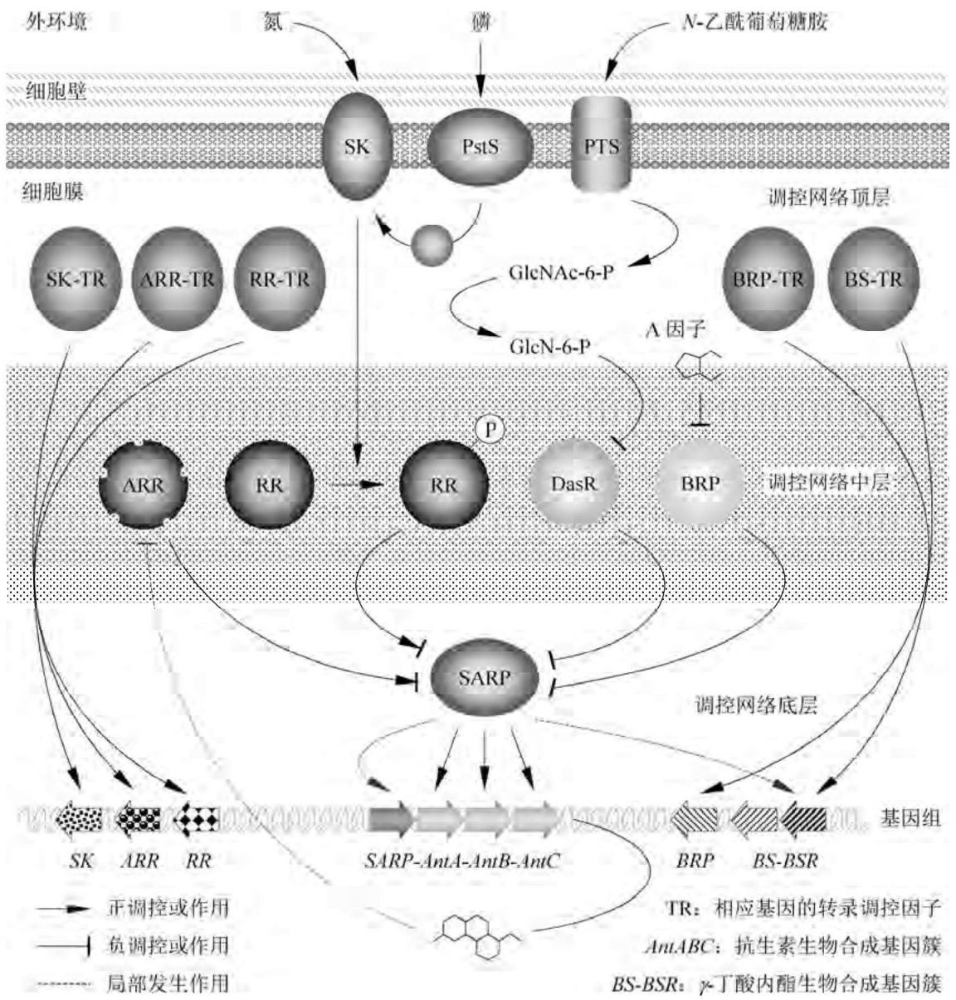
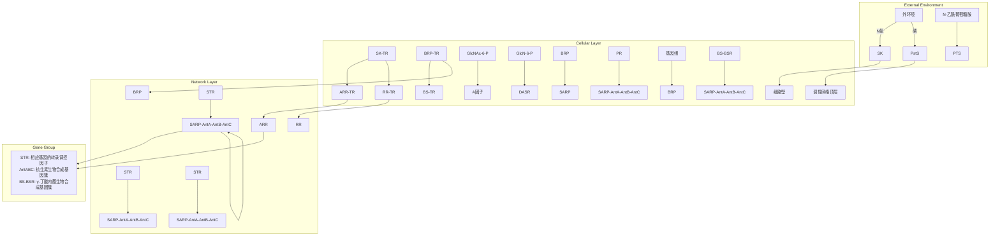
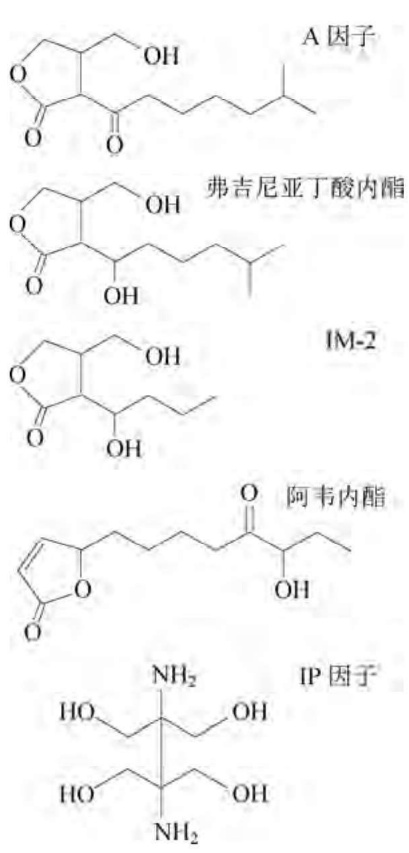
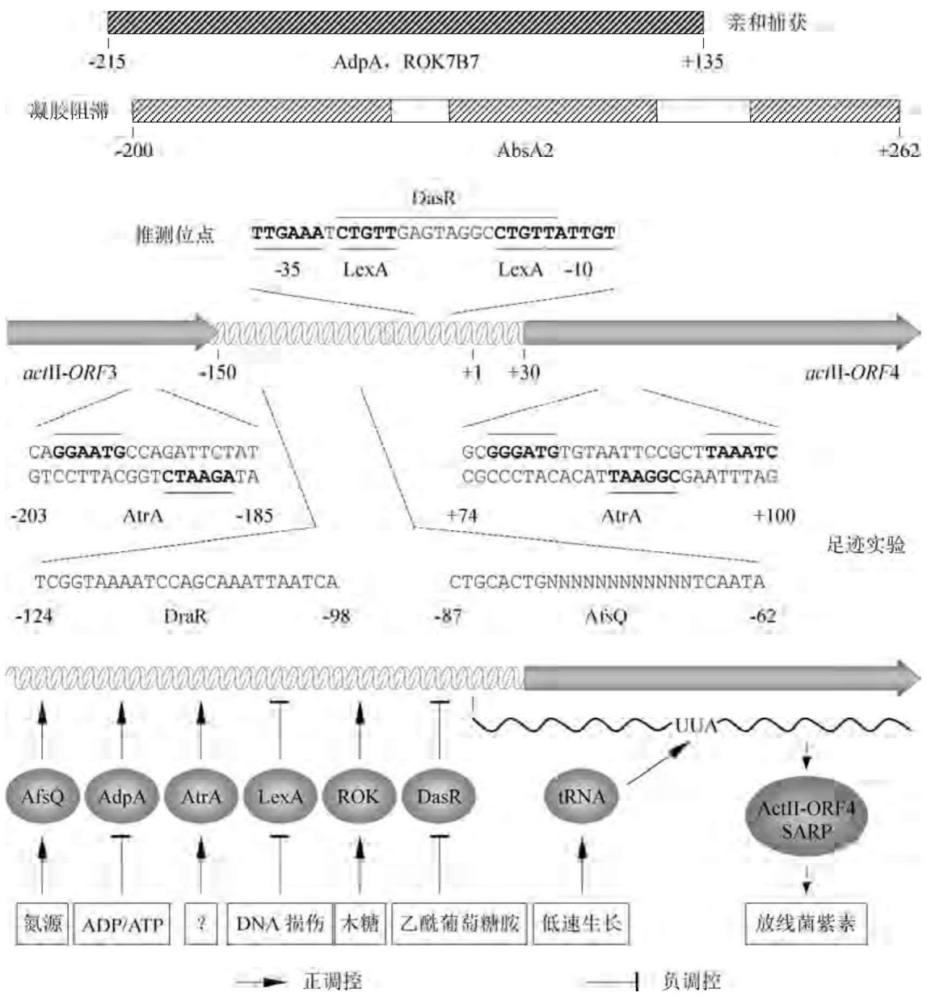
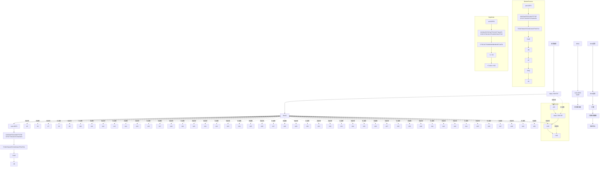
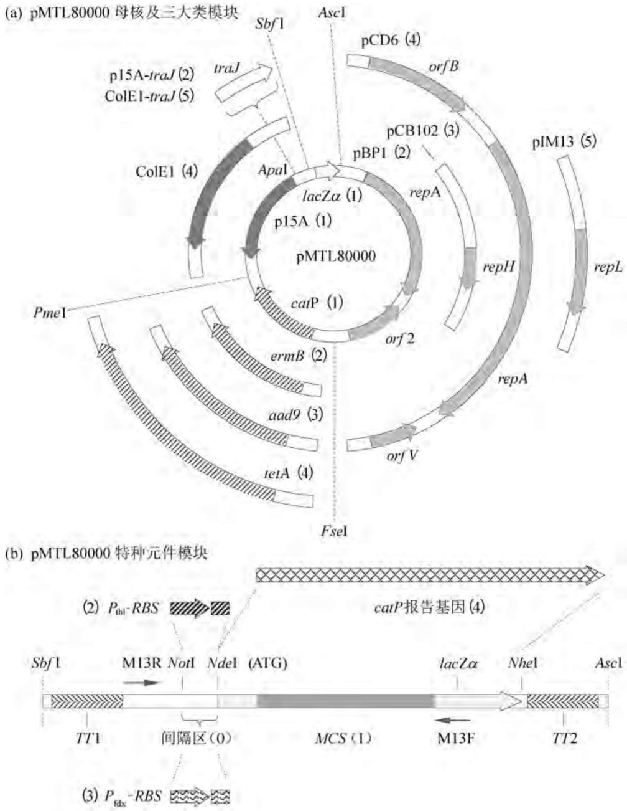

诱导表达一组具有重要生理功能的基因，涉及细胞的生长凋亡、组织发育、肿瘤发生、免疫识别、炎症反应、环境压力应答等过程。

由于 TNF 的最大活性依赖于其三聚体结构,因此能否表达具有正确构象的重组 TNF 对细菌表达系统是一个挑战。将小鼠的 TNFα 编码序列与委内瑞拉链霉菌 CBS762.70 株枯草杆菌蛋白酶抑制剂基因 vsi 所属的启动子和信号肽编码序列融合,重组变铅青链霉菌 TK24 株能将小鼠 TNFα 高效分泌至耗尽了的生长培养基中,浓度达到 200\~300 mg/L。重要的是,这种从培养液中纯化获得的重组蛋白具有天然的三聚体结构,体外细胞凋亡组织培养物分析结果显示,其生物活性远高于由重组大肠杆菌产生的相应产物。至此,变铅青链霉菌蛋白分泌表达系统作为大规模生产具有医疗价值的寡聚体蛋白的另一种技术平台,首次得以确立。

## 2. 重组人可溶性白介素-4受体在变铅青链霉菌中的分泌表达

白介素-4(IL-4)是一种多效性细胞分子，在确立免疫应答性质以及介导哮喘促炎性反应中扮演重要角色。IL-4通过与靶细胞质膜上的相应受体(IL-4R)相互作用而实施其效应，而缺少转膜和胞质功能的可溶性受体(sIL-4R)则是IL-4的有效拮抗剂，具有抗哮喘医疗价值。

先前的重组可溶性 sIL-4R 由哺乳动物 HeLa 或 CHO 细胞株表达，表达水平只有 0.6～3 mg/L。由重组大肠杆菌表达的 sIL-4R 基本上以包涵体形式存在，具有生物活性的可溶性产物难以获得。然而，将 sIL-4R 的 cDNA 编码序列克隆在大肠杆菌-链霉菌分泌表达型穿梭质粒 pSGLgpp 上，由来自球孢链霉菌 (Streptomyces globisporus) 的 gpp 基因所属启动子和信号肽介导在变铅青链霉菌 TK24 株中表达和分泌，培养基中重组 sIL-4R 的表达分泌水平至少为哺乳动物表达系统的 3 倍，且重组产物的 N 端结构完整。

## 3. 重组人 C 端酰胺化胰高血糖素在变铅青链霉菌中的分泌表达

由哺乳动物和人类胰脏  $\alpha-$  胰岛细胞产生的 29 肽激素胰高血糖素是胰岛素的生理性拮抗剂，同时又能促进胰岛素的分泌，据信对维持糖尿病患者的血糖水平具有医疗价值。然而，与降钙素（抑制破骨细胞活性，因而能延缓骨质疏松）等其他肽类物质一样，胰高血糖素作为药物开发的瓶颈因素因其相对分子质量过小易遭蛋白酶的降解，同时高活性的 C 端酰胺化形式在众多表达受体中难以实现生物发酵一步生产。

为了解决上述难题，将编码人胰高血糖素(gly)的DNA序列与大鼠的 $\alpha$ -酰胺酶编码基因串联克隆在链霉菌分泌表达质粒pMGA上。后者装有aph强组成型启动子和melC1基因所属的信号肽编码序列，在变铅青链霉菌TK24株中能高效介导两个基因的表达和分泌。结果显示，这一重组方案能直接表达产生C端酰胺化的人胰高血糖素(gly)，重组产物无须进一步C端酰胺化化学修饰操作；而且由于变铅青链霉菌较低的蛋白酶活性，29肽的重组人胰高血糖素也能在培养基中稳定积累至 $24\mathrm{mg / L}$ 的水平，为短肽类特别是C端酰胺化生物活性物质的规模化生产提供了另一种有希望的策略。

## 4.3.6 利用 DNA 重组技术改良抗生素生产菌

利用传统的诱变技术以及同位素示踪技术可以查明抗生素的生物合成途径，但对抗生素生物合成调控机制的诠释必须依靠分子生物学手段。随着大量抗生素合成基因、运输基因、抗性基因、调控基因的克隆与鉴定，人们不仅对抗生素产生菌的自身抗性机理、抗生素生物合成的特殊反应和调控机制，以及初级代谢与次级代谢之间的偶联等命题有了明确的答案，同时还发现在链霉菌中，与抗生素生物合成有关的基因往往连锁在一起，形成典型的基因簇顺序组织，这一特性为抗生素生物合成基因的克隆表达鉴定以及利用基因工程技术改良抗生素生产菌提供了较强的可操作性。

## 1. 链霉菌抗生素生物合成的基因调控网络

链霉菌以其丰富复杂的次级代谢途径而著称，这些次级代谢途径响应外界磷、氮、铁元素饥饿和其他环境压力,驱动细菌形态分化(如孢子生成)和次级代谢产物(如抗生素、色素、免疫调节剂)合成;同时,编码次级代谢途径的基因受到组织有序的等级分层调控,构成精致复杂的次级代谢调控网络,并与细胞的初级代谢调控网络相偶联。

就抗生素生物合成而言，直接作用于抗生素合成基因、运输基因、抗性基因顺式调控元件上的转录调控因子处于次级代谢网络的底层，其编码基因绝大多数位于各种抗生素生物合成基因簇内，属于途径特异性调控因子。途径特异性调控因子受控于次级代谢网络的中层转录调控因子，它们通常控制多重不同的次级代谢途径，因而称为途径多效型调控因子，其编码基因大都位于抗生素生物合成基因簇之外的基因组上，但有些多效型调控因子编码基因与抗生素生物合成基因簇连锁在一起。处于代谢调控网络顶层的是代谢全局型调控因子，它们直接或间接控制次级代谢的中层多效型调控因子编码基因，并介导与初级代谢网络的偶联（图4-24）。

flowchart

图4-24 链霉菌抗生素生物合成的基因调控网络

## (1) 抗生素生物合成的途径特异性调控因子

处于次级代谢网络底层的途径特异性调控因子按其结构及调控对象的性质可分为SARP(链霉菌抗生素调控蛋白)、LAL、LysR三大类。其中，SARP型调控因子大都为小型(277～665 aa)转录激活因子，N端含有DNA结合功能域和转录激活功能域，其典型的代表包括天蓝色链霉菌中调控放线菌紫素合成的ActII-ORF4、棒状链霉菌（Streptomyces clavuligerus）中调控头孢菌素和克拉维酸生物合成的CcaR、灰色链霉菌中调控链霉素合成的StrR等(表4-16)。

表 4-16 链霉菌抗生素调控蛋白(SARP)总览

<table><tr><td>途径类型</td><td>抗生素</td><td>菌种名称</td><td>蛋白长度</td><td>TTA密码子</td><td>基因名称</td></tr><tr><td rowspan="26">II型聚酮</td><td>Aranciamycin</td><td>S. echinatus</td><td>270</td><td>70</td><td>orf15</td></tr><tr><td rowspan="4">Lactonamycin</td><td rowspan="4">S. rishiriensis</td><td>626</td><td></td><td>lct23</td></tr><tr><td>277</td><td></td><td>lct15</td></tr><tr><td>221</td><td></td><td>lct21</td></tr><tr><td>510</td><td></td><td>lct22</td></tr><tr><td>Griseorhodin</td><td>S. sp. strain JP95</td><td>274</td><td></td><td>grhR1/2</td></tr><tr><td rowspan="2">Aclacinomycin</td><td rowspan="2">S. galilaeus</td><td>281</td><td></td><td>acl1</td></tr><tr><td>273</td><td></td><td>aknO</td></tr><tr><td>Medermycin</td><td>S. sp. strain AM-7161</td><td>259</td><td></td><td>med -ORFII</td></tr><tr><td rowspan="4">Auricin</td><td rowspan="4">S. aureofaciens</td><td>274</td><td></td><td>sa35</td></tr><tr><td>269</td><td></td><td>sa23</td></tr><tr><td>293</td><td></td><td>sa37</td></tr><tr><td>273</td><td></td><td>a24</td></tr><tr><td>Polyketomycin</td><td>S. diastatochromogenes</td><td>271</td><td>8</td><td>pokR2</td></tr><tr><td>Chartreusin</td><td>S. chartreusis</td><td>217</td><td></td><td>chaR1</td></tr><tr><td>Lysolipin</td><td>S. tendae</td><td>614</td><td>30</td><td>llpR4</td></tr><tr><td>Hedamycin</td><td>S. griseoruber</td><td>273</td><td></td><td>orf16</td></tr><tr><td>Granaticin</td><td>S. violaceoruber</td><td>284</td><td></td><td>gra -ORF9</td></tr><tr><td>Polyketide 5</td><td>S. avermitilis</td><td>271</td><td>129</td><td>?</td></tr><tr><td>Frenolicin</td><td>S. roseofulvus</td><td>283</td><td></td><td>frnG</td></tr><tr><td>Fredericamycin</td><td>S. griseus</td><td>612</td><td>191</td><td>fdmR1</td></tr><tr><td>Alnumycin</td><td>S. sp. strain CM020</td><td>272</td><td>5</td><td>alnR3</td></tr><tr><td>Enterocin</td><td>S. maritimus</td><td>284</td><td></td><td>encF</td></tr><tr><td>Chromomycin</td><td>S. griseus</td><td>301</td><td>13</td><td>cmmR</td></tr><tr><td>Steffimycin</td><td>S. steffisburgensis</td><td>291</td><td>241</td><td>stfR1</td></tr><tr><td>Mithramycin</td><td>S. argillaceus</td><td>277</td><td>6、226</td><td>mtmR</td></tr><tr><td rowspan="14">I型聚酮</td><td>Reveromycin</td><td>S. sp. strain SN-593</td><td>278</td><td>27、30</td><td>revQ</td></tr><tr><td>Tetronasin</td><td>S. longisporus</td><td>257</td><td></td><td>tsn17</td></tr><tr><td>Pactamycin</td><td>S. pactum</td><td>399</td><td></td><td>orf27</td></tr><tr><td>Furaquinocin A</td><td>S. sp. strain KO-3988</td><td>344</td><td>56、75、78</td><td>?</td></tr><tr><td>Chlorothricin</td><td>S. antibioticus</td><td>262</td><td></td><td>chlF2</td></tr><tr><td>Piericidin</td><td>S. piemogenus</td><td>200</td><td></td><td>pieR</td></tr><tr><td>Bafilomycin</td><td>S. lohii</td><td>610</td><td>172</td><td>bafG</td></tr><tr><td rowspan="2">Nangchangmycin</td><td rowspan="2">S. nangchangensis</td><td>254</td><td>31</td><td>nanR2</td></tr><tr><td>242</td><td></td><td>nanR1</td></tr><tr><td>Virginiamycin</td><td>S. virginiae</td><td>330</td><td></td><td>vrmS</td></tr><tr><td rowspan="2">Rubradirin</td><td rowspan="2">S. achromogenes</td><td>291</td><td></td><td>rubRg3</td></tr><tr><td>267</td><td></td><td>rubRg1</td></tr><tr><td>Tetronomycin</td><td>S. sp. strain NRRL11266</td><td>257</td><td>31</td><td>trrn18</td></tr><tr><td>Aureothin</td><td>S. thioluteus</td><td>272</td><td>11</td><td>aurD</td></tr><tr><td rowspan="2">I型聚酮</td><td>Asukamycin</td><td>S. nodosus</td><td>255</td><td></td><td>asuR5</td></tr><tr><td>Tylosin</td><td>S. fradiae</td><td>278</td><td>68</td><td>tylS</td></tr><tr><td rowspan="11">非聚酮类</td><td>Nosiheptide</td><td>S. actuosus</td><td>324</td><td></td><td>nosP</td></tr><tr><td>Skyllamycin</td><td>S. sp. strain Acta2897</td><td>647</td><td></td><td>sky44</td></tr><tr><td>Peptide-2</td><td>S. avermitilis</td><td>616</td><td></td><td>?</td></tr><tr><td>Thienamycin</td><td>S. cattleya</td><td>267</td><td></td><td>thnU</td></tr><tr><td>4-Hydroxy-3-nitrosobenzamide</td><td>S. murayamaensis</td><td>323</td><td>41</td><td>nspR</td></tr><tr><td>Virginiamycin</td><td>S. virginiae</td><td>330</td><td></td><td>vmsS</td></tr><tr><td>Phenalinolactone</td><td>S. sp. strain Tu6071</td><td>266</td><td></td><td>plaR1</td></tr><tr><td>Heboxidiene</td><td>S. chromofuscus</td><td>262</td><td>200</td><td>?</td></tr><tr><td>Prodigiosin</td><td>S. griseoviridis</td><td>254</td><td></td><td>rphD</td></tr><tr><td>Rubrinomycin</td><td>S. collinus</td><td>662</td><td></td><td>rubS</td></tr><tr><td>Cinnamycin</td><td>S. cinnamoneus</td><td>262</td><td>72</td><td>cinR1</td></tr></table>

注:“TTA 密码子”表示该稀有密码子编码蛋白质中第几位氨基酸残基。

LAL型调控因子相对较大(872～1159aa)，DNA结合功能域位于C端，其成员包括:吸水链霉菌中分别控制大环哌喃、雷帕霉素、格尔德霉素合成的FkbN、RapH、GdmRI/GdmRII、委内瑞拉链霉菌中控制苦霉素合成的PikD、棒状链霉菌中控制5S clavam合成的Cvm7P、诺尔斯氏链霉菌（Streptomyces noursei）控制制霉菌素合成的NysRI/RIII、结节链霉菌（Streptomyces nodosus）控制两性霉素合成的AmphIV、阿维链霉菌（Streptomyces avermitilis）控制菲律宾菌素合成的PteF、纳塔尔链霉菌（Streptomyces natalensis）中控制匹马菌素合成的PimM。

LysR 型转录调控因子的成员含有 310～325 个氨基酸，其 C 端含有 HTH 保守性 DNA 结合功能域，它们大多需要小分子（辅诱导剂）的存在，其成员包括:棒状链霉菌中控制克拉维酸合成的 ClaR、吸水链霉菌和筑波链霉菌中控制大环哌喃合成的 FkbR、阿维链霉菌中的 SAV-4790。

## (2) 次级代谢网络的途径多效性调控因子

处于次级代谢网络中层并以途径特异性调控因子为控制靶标的途径多性调控因子按其作用模式可分为BRP(丁酸内酯受体蛋白)、TCS-RR、IclR、ARR四大类。其中，BRP属于TetR超家族的转录阻遏因子，它们被 $\gamma$ -丁酸内酯类小分子结构类似物所激活，C端拥有 $\gamma-$ 丁酸内酯结合功能域，N端则含有高度保守的螺旋-转角-螺旋（HTH)特征性DNA结合基序，其靶基因所属启动子相应地含有保守的AT丰富序列(被称为自调控元件ARE)。由于$\gamma$ -丁酸内酯呈物种特异性，因此其对应的BRP也是特异性的。

双组分系统(TCS)由质膜结合型传感器激酶(SK)和应答型转录调控因子(RR)构成，SK响应外界压力信号，并使RR磷酸化激活，磷酸化了的RR再作用于底层的途径特异性调控因子编码基因。链霉菌中存在着极其丰富的TCS系统，仅天蓝色链霉菌基因组中就预测有67对二元组分系统，但其生理功能大都未知。研究较为清楚的是天蓝色链霉菌中控制放线菌紫素和十一烷基灵菌红素合成的PhoR-PhoP系统、控制CDA(钙依赖型抗生素)合成的AbsA1-AbsA2系统以及AfsK-AfsR系统，其中的PhoP、AbsA2、AfsR均为转录调控因子，但其转录激活还是阻遏效应则取决于靶基因或辅因子的性质。

IclR 型转录调控因子包括棒状链霉菌 SARP 的调控因子 AreB(ARE 结合蛋白)及其在波赛链霉菌 (Streptomyces peucetius) 和天蓝色链霉菌中的直系同源物 NdgR(氮源依赖型生长调控因子), 此外天蓝色链霉菌中控制 N-乙酰葡萄糖胺代谢和抗生素合成的 DasR 也属于此类。

ARR型转录调控因子不含磷酸化位点，但结构却与TCS中的RR具有同源性，因而被称为“孤儿应答型调控因子”。ARR的典型代表是转录激活十一烷基灵菌红素生物合成基因簇(red)中SARP型途径特异性调控因子编码基因redD的RedZ、委内瑞拉链霉菌中控制节豆霉素(jadomycin)合成的JadR1以及多功能调控因子GlnR。这两种孤儿应答型调控因子的典型特征是均为其各自控制的终端合成物(十一烷基灵菌红素和节豆霉素)所灭活，从而构成在氨基酸生物合成中普遍存在的反馈调控回路。ARR型转录调控因子可分为OmpR和NarI两大家族，其中OmpR家族除了JadR1外，还包括金色链霉菌（Streptomyces aureofaciens）控制金黄菌素合成的Aur1P、生氰链霉菌（Streptomyces cyanogenus）控制兰多霉素合成的LanI、球孢链霉菌（Streptomyces globisporus）控制兰多霉素E合成的LndI；NarI家族除了RedZ外，还包括波赛链霉菌控制柔红霉素合成的DnrN、沙场链霉菌（Streptomyces arenae）控制萘甲酸环内酯合成的NcnR、酒红链霉菌（Streptomyces vinaceus）控制结核放线菌素合成的VioR。

## (3) 代谢全局性调控因子

处于代谢调控网络顶层的代谢全局型调控因子通常指的是那些控制丁酸内酯生物合成基

图4-25 链霉菌次级代谢信号分子丁酸内酯及其结构类似物

因、BRP编码基因、双组分系统SK/RR以及ARR编码基因表达的转录调控因子。链霉菌中共发现大约15种具有 $\gamma-$ 丁酸内酯结构的信号分子，根据最小结构的差异 $\gamma-$ 丁酸内酯可分为:A因子型，其烷基侧链上含有一个10-酮基基团；弗吉尼亚丁酸内酯型，其烷基侧链上含有一个$10 - \alpha$ -羟基基团；IM-2型，其烷基侧链上含有一个 $10-\beta$ -羟基基团。此外，还存在一些非内酯型的丁二醇，如IP因子，其结构式如图4-25所示。此外，细菌严谨型应答的标志性分子ppGpp或pppGpp也通过级联途径间接施加对抗生素生物合成的影响，那些控制ppGpp或pppGpp合成/水解酶系RelA/SpoT编码基因的转录调控因子也属于代谢全局性调控因子的范畴。

值得注意的是:① 上述转录调控因子的底、中、顶三层调控体系并非一成不变，同一等级层次中的转录调控因子可能会横向相互调控，甚至出现自调控现象，如CcaR在调控头孢菌素和克拉维酸生物合成基因的同时也调控自身的编码基因ccaR；② 较低等级的转录调控因子可能会反向作用于较高等级的转录调控因子编码基因，如处于中层的NdgR和PhoP能控制 $\gamma-$ 丁酸内酯的生物合成，甚至处于底层的转录阻遏因子ScbR也能抑制 $\gamma-$ 丁酸内酯(SCB)合成酶编码基因scbA的转录；③ 一种特定的抗生素生物合成基因簇往往受控于多等级转录调控因子的组合式控制，构成极为复杂的调控回路，如图4-26所示的放线菌紫素生物合成基因簇actII

通过其SARP型途径特异性调控因子编码基因actII-ORF4响应至少八种不同的调控信号（即含有八种不同调控因子的结合位点）。

## 2. 链霉菌抗生素生物合成基因簇的克隆与途径操作

克隆链霉菌抗生素生物合成基因簇最直接的方法是采用大肠杆菌考斯质粒或其与链霉菌的穿梭质粒构建相应抗生素生产菌的基因组文库，然后按照下列策略筛选含目标基因簇的重组克隆:① PCR 或杂交鉴定法。结构和功能相似的抗生素在其生物合成途径中往往拥有同源的酶系，在信息生物学数据库中选择同源基因编码序列作为引物或探针，借助 PCR 或 Southern blot 技术筛查基因组文库，即可获得完整的生物合成基因簇。此外，根据已知的生物合成酶蛋白同源序列，人工设计合成引物或探针也能达到同样的目的。② 抗性基因克隆法。由于大多数抗生素合成基因与其抗性基因连锁在一起，因此可先通过目标抗生素抗性筛选法克隆其抗性基因，然后将之作为筛查基因组文库的引物或探针。③ 突变株遗传互补法。以抗生素生物合成途径缺陷的突变株为受体，鸟枪法克隆生物合成基因，然后将之作为筛查基因组文库的引物或探针。随着高通量基因组测序技术的成熟，抗生素生物合成基因簇的克隆与分析变得日趋简化。

flowchart

图4-26 放线菌紫素生物合成基因簇actII的组合调控模式

在对抗生素生物合成途径基因簇功能及其调控网络进行充分鉴定的基础上,可以采取下列战略改良链霉菌的抗生素生产产量和品质:①强化表达生物合成途径中的关键酶基因。然而在很多情况下，关键酶基因并不容易确定，此时可采用一种所谓的“基因回转化”技术对生产菌进行直接改良。将克隆的抗生素生物合成基因簇随机切成至少包含一个完整基因的DNA片段，分别插在pIJ702上，重组分子转化拟改良的生产菌，抗生素产量显著提高的转化子中所克隆的生物合成基因则很可能是关键基因。这种战略的实施不需要事先掌握较多的背景信息，实验操作也相对简单，但效率却很高。编者曾采用上述程序改良林可霉素的生产菌林可链霉菌，产量提高了1.37倍，更重要的是鉴定出了关键基因lmbIH。②定向突变关键酶的编码基因。如果关键酶编码基因已知，定向突变该基因有可能进一步提高其表达产物的活性。③基因簇的最小化与异源表达。这是确定特定抗生素生物合成途径必要且充分基因的有效途径，同时也可能使抗生素的产量达到更高的水平。④随机重组相似的抗生素生物合成途径。通过基因重组操作，将不同抗生素的生物合成基因理性组合在一起，有可能构建出具有应用价值的杂合抗生素，这对改善目前临床上不断增加的病原菌抗药性倾向具有重要意义。

## 3. 链霉菌抗生素生物合成基因簇的异源表达

基因组范围的序列分析估计,每个链霉菌基因组中大约含有20\~30种次级代谢物的生物合成基因簇,但其中的大多数或为隐蔽型基因簇(即其编码产物未知)或属沉默型基因簇。抗生素生物合成基因簇的克隆和异源表达技术有望对鉴定隐蔽型基因簇或“唤醒”沉默型基因簇做出贡献。

迄今为止，已有相当数量的抗生素生物合成簇被“搬家”异源表达，包括棒状链霉菌30 kb的全霉素基因簇在白色链霉菌（Streptomyces albus）和天蓝色链霉菌中、克拉维酸基因簇在香灰链霉菌（Streptomyces flavogriseus）中、筑波链霉菌83 kb的大环哌喃基因簇、瑞希链霉菌（Streptomyces rishiriensis）39 kb的香豆霉素基因簇、云顶杉链霉菌（Streptomyces sanyensis）35 kb的吲哚并咔唑基因簇在天蓝色链霉菌中的表达。一般而言，这些异源表达型基因簇所产生的抗生素水平不到其野生型菌株产量的10%；即便对基因簇进行优化改造，其终产物的水平也仅与野生型相当。

一项较为系统的尝试将棒状链霉菌ATCC27064株 $36\mathrm{kb}$ 的头孢菌素C生物合成基因簇用考斯质粒G6-15分别转入香灰链霉菌ATCC33331株、天蓝色链霉菌M1146株、白色链霉菌J1074株中，结果发现只有重组香灰链霉菌能产生头孢菌素C，但产量只及供体菌的$0.2\%$ 。若在导入头孢菌素C生物合成基因簇的基础上，额外再补充1个拷贝的SARP型转录调控因子编码基因ccaR（由香灰链霉菌组成型启动子 $P_{\mathrm{fur}}$ 介导表达），则头孢菌素C的产量能提高近40倍，但这也仅相当于棒状链霉菌ATCC27064株的 $9\%$ 。上述调查结果表明，抗生素生物合成基因簇异源表达的关键是底层转录调控因子(如SARP)编码基因所属启动子能否被受体菌的调控因子有效识别，以及头孢菌素C生物合成是否还需要迄今未知(而受体菌又不存在)的中层甚至顶层调控因子。而这些问题的显现恰恰也是抗生素生物合成基因簇异源表达的价值所在。

## 4.4 梭菌属基因工程

梭菌属(Clostridium)是原核生物中仅次于链霉菌的第二大属革兰氏阳性菌,其特征为专性厌氧,产内生孢子,生长温度在30\~80℃,呈显著的生物催化多样性。梭菌属的有些种如丙酮丁醇梭菌(Clostridium acetobutylicum)和拜氏梭菌(Clostridium beijerinckii)能利用包括最普通的戊糖和己糖在内的大多数单糖、寡糖、多糖发酵产生各种有机酸醇,如乙醇、丁醇、乙酸、丁酸、丙酮等重要化工有机溶剂,而这些小分子碳水化合物又是细胞内核酸、蛋白质、脂类等生物大分子合成的基本骨架,因此它是研究微生物体内复杂的初级代谢基因表达调控以及代谢工程的优秀模型。梭菌属的另一些种如热纤维梭菌（Clostridium thermocellum）、解纤维梭菌（Clostridium cellulolyticum）、植物发酵羧菌（Clostridium phytofermentans）还是高效的纤维素降解细菌，能表达活性较高的纤维素多酶复合系统（又称纤维体，cellulosome）。利用DNA重组技术对这些菌株进行改良，有望从废纸或废弃棉织物等富含纤维素的生活垃圾以及农作物秸秆中直接发酵生产乙醇，协调化工、环保、能源三者的综合平衡。更受鼓舞的是，有些羧菌如瑙氏羧菌（Clostridium noyvii）和生孢梭菌（Clostridium sporogenes）所产生的孢子居然能选择性地在肿瘤组织中萌发和生长，这种独一无二的特性可被用作抗肿瘤药物的投送载体。

然而，公众所熟知的人类致病菌如肉毒杆菌(Clostridium botulinum)、破伤风梭菌(Clostridium tetani)、产气荚膜梭菌(Clostridium perfringens)也是羧菌属的重要成员，它们产致死性毒素，其中的肉毒素还是迄今已知最毒的生物毒剂；而艰难梭菌(Clostridium difficile)则导致一种衰弱性感染，是欧洲某些地区的流行性疾病。

自2001年丙酮丁醇梭菌ATCC824株的全基因组序列公布以来，产业和学术界普遍感兴趣的羧菌属另外几个代表性菌种的基因组测序也相继完成(表4-17)，其中包括肉毒杆菌、破伤风梭菌、艰难梭菌、拜氏梭菌、克氏梭菌（Clostridium kluyveri）、雍氏梭菌(Clostridium ljungdahlii)、粪堆梭菌(Clostridium stercorarium)等。这些基因组信息必将为下列过程提供新的机遇:①利用某些糖分解性菌种的生物催化潜能由可再生生物质生产化学燃料(如丁醇和乙醇)；②全面揭示相关病原菌的毒性机理；③推动病原菌监控和疾病防治有效方法的建立。此外，由表4-17可以看出，梭菌属基因组仅含有 $32\%$ 的GC碱基对（大肠杆菌基因组的GC含量为 $51\%$ ，链霉菌基因组的GC含量为 $75\%$ )，这种特征与其独特的生物功能之间的关联也是令人关注的热点。

表 4-17 羧菌属基因组特征比较

| 羧菌名称(缩写) | C. a. | C. b. | C. d. | C. k. | C. l. | C. t. |
| --- | --- | --- | --- | --- | --- | --- |
| 基因组大小/bp | 4 132 880 | 6 000 632 | 4 298 133 | 4 023 800 | 4 630 065 | 2 873 333 |
| DNA中的G+C含量/% | 31 | 29 | 29 | 32 | 31 | 29 |
| DNA中的复制子数 | 2 | 1 | 2 | 2 | 1 | 2 |
| 开放阅读框(ORF)总数 | 3 848 | 5 020 | 3 757 | 3 912 | 4 198 | 2 432 |
| 已注释功能的ORF数 | 2 350 | 3 883 | 3 211 | 1 240 | 3 141 | 1 989 |
| 功能注释型ORF比例/% | 61 | 77 | 85 | 32 | 75 | 82 |
| 编码rRNA的基因簇数 | 11 | 14 | 11 | 7 | 9 | 6 |
| 编码tRNA的基因数 | 73 | 94 | 87 | 61 | 72 | 54 |

注:C. a.—丙酮丁醇梭菌；C. b.—拜氏梭菌；C. d.—艰难梭菌；C. k.—克氏梭菌；C. l.—雍氏羧菌；C. t.—破伤风梭菌。

## 4.4.1 梭菌属的载体克隆系统

目前已开发的能在羧菌属细胞中自主复制并用于基因克隆和表达的质粒，按其复制子的来源不同主要分为三大类:含羧菌属复制子（如pCB系列、pJU系列、pIP404)的质粒、含枯草芽孢杆菌复制子(pIM13)的质粒、含粪肠球菌(Enterococcus faecalis)复制子(pAMβ1)的质粒。表4-18列举的是一些在羧菌属中常用的克隆质粒、穿羧质粒、接合质粒、表达质粒。

表 4-18 用于羧菌属基因克隆和表达的自主复制型质粒

| 质粒名称 | 复制子来源 | 选择标记 | 大小/kb | 载体特征 | 发表年份 |
| --- | --- | --- | --- | --- | --- |
| pCAK1 | CAK1(C. acetobutylicum) aureus | $Em^r A p^r$ | 11.6 | 滚筒式复制,噬菌粒 | 1993 |
| pTYD101 | pSC86(C. acetobutylicum) | $Cm^r$ | 4.0 | 缺失突变,穿梭质粒 | 1990 |
| pTYD104 | pSC86(C. acetobutylicum) | $Cm^r A p^r$ | 7.6 | 缺失突变,穿梭质粒 | 1990 |
| pCB3 | pCB101(C. butyricum) | $Em^r Ap^r$ | 7.0 | 滚筒式复制 | 1993 |
| pCTC511 | pCB101(C. butyricum) | $Em^r Ap^r$ | 7.9 | IncP,可接合转移 | 1990 |
| pMTL540E | pCB102(C. butyricum) | $Em^r Ap^r$ | 5.2 | 分配稳定 | 1996 |
| pMTL540F | pCB102(C. butyricum) | $Em^r Ap^r$ | 5.5 | 表达载体 | 1996 |
| pMTL9401 | pCB102(C. butyricum) | $Em^r$ | 4.6 | IncP,可接合转移 | 2002 |
| pCB5 | pCB103(C. butyricum) | $Em^r Ap^r$ | 9.5 | 复制机制未鉴定 | 1993 |
| pSYL2 | pCBU2(C. butyricum) | $Em^r Tc^r$ | 8.7 | 穿梭质粒 | 1993 |
| pMTL9301 | pCD6(C. difficile) | $Em^r$ | 7.1 | IncP,可接合转移,穿梭质粒 | 2002 |
| pAK201 | pHB101(C. perfringens) | $Cm^r$ | 8.0 | C. perfringens稳定,穿梭质粒 | 1989 |
| pJIR1456 | pIP404(C. perfringens) | $Cm^r$ | 6.8 | IncP,可接合转移 | 1998 |
| pJIR1457 | pIP404(C. perfringens) | $Em^r$ | 6.2 | IncP,可接合转移 | 1998 |
| pJIR418 | pIP404(C. perfringens) | $Em^r Cm^r$ | 7.4 | 克隆载体,穿梭质粒 | 1992 |
| pMTL9611 | pIP404(C. perfringens) | $Em^r$ | 5.5 | IncP,可接合转移,穿梭质粒 | 2002 |
| pJU12 | pJU121(C. perfringens) | $Tc^r$ | 11.6 | 穿梭质粒 | 1984 |
| pHR106 | pJU122(C. perfringens) | $Tc^r Ap^r$ | 7.9 | C. beijerinckii复制,穿梭质粒 | 1994 |
| pRZE4 | pJU122(C. perfringens) | $Em^r Ap^r Cm^r$ | 10.0 | C. beijerinckii复制,穿梭质粒 | 1994 |
| pRZL3 | pJU122(C. perfringens) | $Tc^r Ap^r$ | 10.8 | C. beijerinckii复制,穿梭质粒 | 1994 |
| pSYL7 | pJU122(C. perfringens) | $Em^r Tc^r$ | 9.2 | 穿梭质粒 | 1989 |
| pCL1 | pTA688L(C. thermosacch.) | $Tc^r Cm^r$ | 12.1 | 穿梭质粒 | 1989 |
| pCS1 | pTA688S(C. thermosacch.) | $Tc^r Cm^r$ | 7.2 | 穿梭质粒 | 1989 |
| pBC16Δ1 | pBC161(B. cereus) | $Tc^r$ | 2.8 | C. acetobutylicum不稳定 | 1989 |
| pECII | pIM13(B. subtilis) | $Em^r$ | 4.5 |  | 2000 |
| pFNK1 | pIM13(B. subtilis) | $Em^r$ | 2.4 | 穿梭质粒 | 1992 |
| pIA | pIM13(B. subtilis) | $Em^r$ |  | pACYC衍生质粒 | 1996 |
| pIM13 | pIM13(B. subtilis) | $Em^r$ | 2.3 | 滚筒式复制,穿梭质粒 | 1989 |
| pKNT11 | pIM13(B. subtilis) | $Em^r Ap^r$ | 6.5 | 克隆载体 | 1989 |
| pKNT14 | pIM13(B. subtilis) | $Em^r$ | 4.3 |  | 1989 |
| pKNT19 | pIM13(B. subtilis) | $Em^r Ap^r$ | 4.9 | 含pUC19的MCS,穿梭质粒 | 1992 |
| pSYL14 | pIM13(B. subtilis) | $Em^r Ap^r$ | 4.4 | 穿梭质粒 | 1989 |
| pXYLgusA | pIM13(B. subtilis) | $Em^r Ap^r$ |  | 表达质粒,木糖诱导 | 2003 |
| pSOS95 | pIM13(B. subtilis) | $Em^r Ap^r$ | 7.0 | 表达质粒,穿梭质粒 | 2003 |
| pAMβ1 | pAMβ1(E. faecalis) | $Em^r$ | 26.5 | 接合质粒,θ型复制 | 1985 |
| pMTL500E | pAMβ1(E. faecalis) | $Em^r Ap^r$ | 6.4 | 广宿主克隆载体 | 1988 |
| pMTL500F | pAMβ1(E. faecalis) | $Em^r Ap^r$ | 6.7 | 表达质粒 | 1993 |
| pMTL502E | pAMβ1(E. faecalis) | $Em^r Ap^r$ | 7.5 | pMTL500E的低拷贝版本 | 1993 |
| pMTL513 | pAMβ1(E. faecalis) | $Em^r Ap^r$ | 7.3 | 克隆载体,稳定 | 1993 |
| pMU1328 | pAMβ1(E. faecalis) | $Em^r$ | 7.5 | 缺失突变 | 1993 |
| pSYL9 | pAMβ1(E. faecalis) | $Em^r Ap^r Tc^r$ | 8.9 | 广宿主克隆载体,穿梭质粒 | 1989 |
| pVA1 | pAMβ1(E. faecalis) | $Em^r$ | 11.0 | 广宿主克隆载体 | 1988 |
| pIP501 | pIP501(E. faecalis) | $Em^r Cm^r$ | 35.0 | 接合质粒 | 1985 |
| pGK12 | pWV01(L. lactis) | $Em^r Cm^r$ | 4.4 | 广宿主克隆载体 | 1984 |
| pT127 | pT127(S. aureus) | $Tc^r$ | 4.4 | C. acetobutylicum不稳定,穿梭 | 1989 |
| pMK419 | pUB110(S. aureus) | $Cm^r Ap^r$ | 5.6 |  | 1987 |
| pUB110 | pUB110(S. aureus) | $Km^r$ | 4.5 | 滚筒式复制,热稳定 | 1974 |
| pMTL30/31 |  | $Em^r Ap^r$ | 4.4 | IncP,可接合转移,整合质粒 | 1990 |

注: $Ap^{r}$  —氨苄青霉素抗性基因； $Cm^{r}$  —氯霉素抗性基因； $Em^{r}$  —红霉素抗性基因； $Km^{r}$  —卡那霉素抗性基因； $Tc^{r}$  —四环素抗性基因。

## 1. 羧菌属的天然质粒

羧菌属各种细菌中广泛存在野生型质粒，其中大多数为隐蔽型质粒，少数野生型质粒的功能被鉴定。例如，天然存在于丙酮丁醇梭菌ATCC824株中的pSOL1是一个 $210\mathrm{kb}$ 的巨型质粒，其上编码该菌合成丙酮和丁醇所需的四个关键基因。此外，几种羧菌病原菌中一些重要的毒素因子也由野生型质粒编码，包括编码破伤风毒素的pCL1以及编码G型神经毒素的一个 $123\mathrm{kb}$ 质粒。上述野生型质粒均因相对分子质量过大，难以重组操作，所以不适合用作克隆载体。相对分子质量较小的隐蔽型质粒虽然不能直接作为克隆载体使用，但其复制子序列可用来构建羧菌属的穿梭质粒，这些小型质粒包括来自产气荚膜梭菌的pIP404(10.2kb)、来自肉毒杆菌的pCB101(5.6kb)、pCB102(7.4kb)、pCB103(6.2kb)、艰难梭菌的pCD6(7.0kb)、热解糖羧菌(Clostridium thermosaccharolyticum)的pTA688S(2.3kb)和pTA688L(7.2kb)。其中，pCB101和pIP404的复制子能介导其他非复制型载体在枯草芽孢杆菌和拜氏梭菌NCIMB8052株中的稳定维持。

pCB101的复制子呈滚环式复制型质粒的特征，其上的一个ORF与其他革兰氏阳性菌质粒上的复制蛋白同源；但pCB102的复制子与其他一些复制机制尚不清楚的质粒或DNA序列同源，或编码产物同源。类似地，pCD6和pIP404的复制机制也属未知，然而它们均拥有几个相同的特征，如两个大型、同源型较低的推测复制蛋白以及广泛的DNA重复序列，这些重复序列的存在往往与质粒的 $\theta$ 型复制有关。尽管对这些质粒的复制机制了解欠缺，但并不妨碍其应用，事实上它们已被成功开发成羧菌属的系列克隆载体（表4-18）。

## 2. 羧菌属的穿梭质粒

羧菌属载体构建的另一策略是使用来自其他革兰氏阳性菌的复制子。例如，来自乳酸乳球菌（Lactococcus lactis）pWV01质粒、来自枯草芽孢杆菌pIM13质粒、来自金黄色葡萄球菌pUB110质粒的复制子均能在羧菌属细胞中自主复制。这些异源质粒缺乏复制特异性和分配系统，而且其上的一些抗生素抗性标记基因也能在羧菌属中正常表达，因而被广泛用来构建羧菌属的克隆载体(表4-18)。不过值得注意的是，由这些非羧菌衍生出的质粒基本上呈分配不稳定性，使用时需要施加选择压力（如添加相应的抗生素），这对大规模工业发酵过程而言，既不经济也不被允许。而且，除了pAMβ1通过双向θ型复制外，大部分质粒呈滚环式复制，期间短暂产生的单链DNA中间体是质粒呈结构不稳定性的主要原因。

穿梭质粒的另一种形式是构建含羧菌属天然复制子和大肠杆菌复制子的二元载体，如表4-18中的pTYD104、pSYL2、pSYL7、pHR106、pCS1、pCL1等。对于那些转化率较低的羧菌属受体而言，使用这些羧菌-大肠杆菌穿梭质粒可以先将DNA重组克隆在大肠杆菌或枯草芽孢杆菌中，然后制备高浓度的重组质粒后，再导入合适的羧菌属细胞中，此时即便转化率很低一般也能获得羧菌重组克隆。另外，在采用接合转化程序时，这些二元穿梭质粒更能显示出优越性(参见本节4.羧菌属的接合载体)。

## 3. 羧菌属的表达质粒

在羧菌属中，无论组成型启动子还是诱导型启动子的鉴定均相对滞后，这在一定程度上限制了系列优良表达型载体的开发。pMTL500F和pMTL540F是两种羧菌属通用型的表达载体，其中pMTL500F基于pAMβ1复制子，而pMTL540F使用的是pCB102的复制子，两者均携带含有来自巴斯德梭菌(Clostridium pasteurianum)铁氧还蛋白(Fd)编码基因所属启动子 $P_{\mathrm{fdx}}$ 区域的表达框。它们使用最多的是表达用于癌症治疗的原药转换酶类。诱导型表达载体的代表是专门设计用于丙酮丁醇梭菌ATCC824株的pXYLgus，它含有枯草芽孢杆菌pIM13复制区装，并携带来自木糖葡萄球菌（Staphylococcus xylosus）木糖操纵子的阻遏蛋白编码基因 $xylR$ 以及相应的 $xylA$ 启动子/操作子区。克隆在 $\mathrm{pXYLgus}$ 上的报告基因用木糖诱导时表达量能提升17倍。

## 4. 羧菌属的接合载体

细菌的接合需要供体细胞与受体细胞密切接触，并且既涉及DNA顺式作用元件（形成缺口的位点oriT)也需要一些反式作用因子(通常由接合型质粒编码)，它们对细胞成对交配、DNA加工，以及接合型质粒转移进受体细胞都是必需的。羧菌属通过细菌接合方式转移重组DNA分子的载体有接合型质粒和接合型转座子两类。

（1）接合型质粒。接合型质粒广泛存在于细菌王国中，然而羧菌属天然存在的接合型质粒相对稀少，迄今为止仅在产气荚膜梭菌中被鉴定。这些接合型质粒编码两个高度保守的抗生素抗性基因 $tetP$ （四环素抗性）和 $catP$ （氯霉素抗性），能在产气荚膜梭菌的不同株之间进行接合转移，但很难用于其他羧菌菌株的基因转移。不过，很多来自其他非羧菌属的接合型质粒具有广宿主范围，例如来自肠球菌和链球菌的接合型质粒包括 $\mathrm{pAM}\beta 1$ 和 $\mathrm{pIP501}$ 均能接合进入丙酮丁醇梭菌中，其中 $\mathrm{pAM}\beta 1$ 还能接合转化肉毒杆菌和巴斯德梭菌。这些质粒的接合转移效率与供体物种高度相关，尤其是革兰氏阳性菌如乳酸乳球菌作为接合供体时，转移效率极高。

（2）接合型转座子。除了接合型质粒外，很多革兰氏阳性菌包括各种羧菌还拥有接合型转座子，如产气荚膜梭菌的Tn4451、粪肠球菌的Tn916、肺炎双球菌（Streptococcus pneumoniae）的Tn1545。这些接合型转座子均为大型可移动基因元件，编码其自身转移所需的所有功能，一般定位于细菌的染色体上，随染色体的复制而复制。接合转座子的转座依赖于共价、封闭、环状超螺旋DNA中间体的形成，既能重新整合进相同细胞的染色体上，也可在接合转移后插入受体的基因组中，且插入发生后不扩增靶点序列。接合型转座子往往拥有极广泛的宿主，能接合转化很多不同的羧菌，如破伤风梭菌、拜氏梭菌、丙酮丁醇梭菌、产气荚膜梭菌、肉毒杆菌、艰难梭菌，因此也被用作投送基因片段的工具以及基于转座子的突变程序。

## 5. 羧菌属的模块化质粒

pMTL80000是基于羧菌属各种菌株生理遗传表型的多样性而精巧设计构建的一套集复制、重组、穿梭、接合、筛选、表达、调控等多元功能于一体的标准化、模块化、通用化质粒系统，适用面广，操作简便，性能优异，且能与目前流行的多种商品化载体系统对接。pMTL80000由母核质粒及下列四类功能性模块构成[图4-27(a)]:

（1）针对羧菌属的革兰氏阳性菌复制子模块。该模块DNA区域的两侧分别为8碱基对识别序列的限制性核酸内切酶AscI和FseI位点，序列分别为 $5^{\prime} - \mathrm{GG}^{\nabla}$ CGCGCC-3'和$5^{\prime} - \mathrm{GGCCGG}^{\nabla}\mathrm{CC} - 3^{\prime}$ 。该模块共有五种选择:①来自肉毒杆菌NCTC2916株天然质粒pBP1的复制子，至少能在生孢梭菌中自主复制；②来自枯草芽孢杆菌pIM13的复制子；③来自丁酸羧菌(Clostridium butyricum)pCB102的复制子；④来自艰难羧菌pCD6的复制子；⑤无关间隔区，此处使用者既可安装未来新发现的其他复制子，又可用来从羧菌基因组上克隆、筛选、鉴定潜在的复制子片段(相当于复制子探针质粒）。

（2）选择性标记基因模块。该模块DNA区域的两侧分别为8碱基对识别序列的限制性核酸内切酶FseI和PmeI位点，后者的序列为 $5^{\prime} - \mathrm{GTTT}^{\nabla}\mathrm{AAAC} - 3^{\prime}$ 。该模块共有四种选择:①氯霉素抗性基因catP；②红霉素抗性基因ermB；③来自产气荚膜梭菌pCW3质粒上的四环素抗性基因tetA；④来自粪肠球菌LDR55株的壮观霉素抗性基因aad9。上述四种抗性标记至少能在一种以上的羧菌中表达，且全部能在大肠杆菌中工作。因此，具有穿梭质粒特性的pMTL80000只需一个筛选标记，这样不但使用方便，而且在很大程度上减小了载体本身的大小，有利于提高转化率。

图4-27 羧菌属模块化质粒pMTL80000的构成与性能

（3）针对大肠杆菌的革兰氏阴性菌复制子模块。该模块DNA区域的两侧分别为8碱基对识别序列的限制性核酸内切酶PmeI和SbfI位点，后者的序列为 $5^{\prime} - \mathrm{CCTGCA}^{\nabla}\mathrm{GG} - 3^{\prime}$ 。该模块也有四种选择:①来自pMTL20的高拷贝ColE1复制子，用于外源DNA的扩增和高效表达；②ColE1复制子加Tra编码基因traJ，后者用于质粒从大肠杆菌接合转化进入羧菌属(参见4.4.2)；③低拷贝的p15A复制子，用于表达对受体菌构成严重生理负担或毒性的外源基因；④p15A复制子加Tra编码基因traJ。该模块决定了pMTL80000既是穿梭载体同时又是接合型质粒。

（4）特种克隆表达元件模块。该模块DNA区域的两侧分别为8碱基对识别序列的限制性核酸内切酶SbfI和AscI位点。该模块共有五种选择:①来自pMTL20上的lacZαMCS[多克隆位点，图4-27(b)]，其两侧为极性相反的一对转录终止子，其中TT1来自艰难羧菌630株CD0164-ORF；TT2来自巴斯德羧菌铁氧还蛋白编码基因(fdx)。lacZα的启动子被删除，以配合TT1和TT2防止任何可能的转录过头影响外源基因的表达或对大肠杆菌构成毒性。MCS的上游是NotI位点，含启动子-RBS的DNA片段可克隆在NotI和NdeI(含起始码子ATG)之间。通用引物M13F/M13R用于PCR鉴定重组子，同时提供测序。由于XbaI、SpeI、NheI三者为同尾酶，因此任何来自大肠杆菌标准化载体BioBrick上的NotI/XbaI或NotI/SpeI均可直接克隆在pMTL80000中的NotI和NheI之间并置换MCS；②来自丙酮丁醇梭菌ATCC824株硫解酶编码基因(thl)的启动子-RBS序列；③来自生孢羧菌NCIMB10696株铁氧还蛋白编码基因(fdx)的启动子-RBS序列，从而使pMTL80000又成为一种表达型载体；④以报告基因阅读框catP-ORF置换NdeI和NheI之间的MCS，这样pMTL80000又可作为启动子探针质粒使用；⑤无关间隔区，用于安装其他表达元件或MCS序列。

上述四大类共18件模块彼此相互独立，可以自由组合成400种不同的pMTL8xxxx系列质粒。其中，作为模块工具箱提供的五种基本质粒pMTL80110、pMTL82254、pMTL83353、pMTL84422、pMTL85141包含了所有的18件模块，其构成见表4-19。四种仅革兰氏阳性菌复制子有区别，其他模块均为catP、ColE1-Tra、MCS的载体pMTL82151、pMTL83151、pMTL84151、pMTL85151可进行多种羧菌菌株转化率的横向比较（表4-20）。虽然这些载体对羧菌的转化率并不高，但它们均为穿梭质粒，在用于羧菌转化前已是克隆了外源基因的重组分子，因而这种转化率足以满足常规的实验要求；另外，对同一羧菌受体株而言，不同的复制子可导致转化率相差两个数量级。最后，四种筛选标记的工作浓度也得以确定(表4-21)。

表 4-19 五种 pMTL80000 模块工具箱质粒的构成

| 工具箱质粒 | (+)复制子模块 | 筛选标记模块 | (-)复制子模块 | 特种元件模块 |
| --- | --- | --- | --- | --- |
| pMTL80110 | 0. 间隔区 | 1. catP | 1. p15A | 0. 间隔区 |
| pMTL82254 | 2. pBP1 | 2. ermB | 5. ColE1+traJ | 4. catP 报告基因 |
| pMTL83353 | 3. pCB102 | 3. aad9 | 5. ColE1+traJ | 3. $P_{\text{fdx}}$+MCS |
| pMTL84422 | 4. pCD6 | 4. tetA | 2. p15A+traJ | 2. $P_{\text{thl}}$+MCS |
| pMTL85141 | 5. pIM13 | 1. catB | 4. ColE1 | 1. MCS |

注:（+）和（-）分别表示革兰氏阳性菌和革兰氏阴性菌。

表 4-20 四种 pMTL80000 模块化质粒的羧菌转化率比较

| 模块化质粒 | 丙酮丁酸羧菌 ATCC824 株 | 肉毒杆菌 ATCC3502 株 | 艰难羧菌 630 株 |
| --- | --- | --- | --- |
| pMTL82151 | $1.38 \times 10^{2}$ | $1.01 \times 10^{-3}$ | $3.36 \times 10^{-6}$ |
| pMTL83151 | $2.45 \times 10^{2}$ | $2.90 \times 10^{-4}$ | $2.23 \times 10^{-6}$ |
| pMTL84151 | $8.47 \times 10^{1}$ | $5.71 \times 10^{-6}$ | $7.00 \times 10^{-6}$ |
| pMTL85151 | $2.92 \times 10^{2}$ | $7.80 \times 10^{-6}$ | $4.18 \times 10^{-7}$ |

注:丙酮丁酸羧菌的转化率以每微克质粒DNA产生的克隆数表示；肉毒杆菌和艰难羧菌的转化率以每个大肠杆菌细胞产生的接合转化克隆数表示。

表 4-21 pMTL80000 模块化质粒四种筛选标记所对应的抗生素工作浓度

| 筛选标记基因 | catP | ermB | aad9 | tetA |
| --- | --- | --- | --- | --- |
| 大肠杆菌 | Cm,25 μg/mL | Em,500 μg/mL | Sp,250 μg/mL | Tc,10 μg/mL |
| 丙酮丁酸羧菌 ATCC824 株 | Tm,15 μg/mL | Em,40 μg/mL | NF | NF |
| 拜氏羧菌 NCIMB8052 株 | R | Em,10 μg/mL | Sp,750 μg/mL | NF |
| 肉毒杆菌 ATCC3502 株 | Tm,15 μg/mL | Em,40 μg/mL | Sp,600 μg/mL | NF |
| 艰难羧菌 630ΔErm 株 | Tm,15 μg/mL | Em,10 μg/mL | R | R |
| 艰难羧菌 R20291 株 | Tm,15 μg/mL | Lm,20 μg/mL | Sp,750 μg/mL | Tc,10 μg/mL |

注:Cm—氯霉素；Em—红霉素；Lm—林可霉素；Sp—壮观霉素；Tc—四环素；Tm—甲砜霉素；R—抗性；NF—无功能。

## 4.4.2 梭菌属的宿主转化系统

与大肠杆菌和芽孢杆菌不同，羧菌属不存在天然的感受状态。因此，为了促进DNA吸收，用于羧菌属的转化程序通常依赖于细胞壁和细胞膜物理状态的改变。在转化前将细胞转换成原生质体便是这种策略之一，然而原生质体制备程序的优化操作较为复杂且耗时，一般而言，完整细胞的电击转化更常用。

## 1. 梭菌属宿主菌的限制-修饰系统

无论采用何种转化程序，均需突破羧菌属受体菌内源性限制-修饰系统的屏障。在羧菌各菌株中，至少有丙酮丁醇梭菌ATCC824株、解纤维梭菌ATCC35319株、肉毒杆菌ATCC25765株、艰难梭菌CD3和CD6株对外源DNA存在较为强烈的限制作用，而且不同的菌株含有的限制性核酸内切酶也各异，如丙酮丁醇梭菌ATCC824株中的Cac824I(5'-GCNGC-3')、艰难梭菌CD3株中的CdiI(IIIs型酶，5'-CATCG-3')、CD6株中的CdiCD6I(Sau96I的同工酶，5'-GGNCC-3')和CdiCD6II(MboI的同工酶，5'-GATC-3')，以及解纤维梭菌ATCC35319株和肉毒杆菌ATCC25765株中的CceI和CboI，两者均为MspI的同工酶(5'-CCGG-3')。因此事先检测细菌裂解液中的限制和修饰作用特异性是必要的。随着越来越多的基因组信息可供使用，也可以电脑预测使用哪种修饰性甲基化酶处理待转化的质粒DNA最适宜。

突破上述限制性屏障的常用策略是使待转化的质粒 DNA 预先经历合适的体外或体内甲基化修饰，以封闭羧菌属受体细胞内源性限制性核酸内切酶的识别作用位点。体外修饰是用相应的甲基化酶对 DNA 分子进行甲基化保护反应；体内修饰将质粒 DNA 先导入能表达相应甲基化酶的大肠杆菌受体细胞中进行甲基化修饰，然后从大肠杆菌克隆中提取经甲基化保护了的质粒 DNA，再转化羧菌受体细胞。针对丙酮丁醇梭菌 ATCC824 株中的 Cac824I 而言，枯草芽孢杆菌噬菌体  $\phi3T$  的 DNA 含有  $\phi3TI$  甲基转移酶编码基因，该酶能特异性甲基化修饰  $5^{\prime}-GCNGC-3^{\prime}$  和  $5^{\prime}-GGCC-3^{\prime}$  序列中的胞嘧啶残基，从而有效抑制 Cac824I 的限制作用。将上述  $\phi3TI$  甲基转移酶编码基因通过 pAN1 质粒 (p15A 型复制子) 导入特定的大肠杆菌中，而外源 DNA 片段与携带 ColE1 型复制子的羧菌/大肠杆菌穿梭质粒（如 pIMP1、pSYL2、pSYL7）重组，便能在上述大肠杆菌中进行有效的体内甲基化修饰。当然，也可以将合适的甲基化酶编码基因整合在特定的大肠杆菌染色体中。

克服羧菌属限制性障碍的另一策略是将作为转化受体使用的羧菌细胞内的限制性核酸内切酶编码基因从染色体上敲除或灭活，这样可以省去体外或体内甲基化修饰的操作。

需要指出的是,受体细胞的限制-修饰系统是否必定会阻止外源 DNA 的转化因菌种而异。在不少羧菌中,其限制作用并不构成障碍,如拜氏梭菌 NCIMB8052 株、产气荚膜梭菌 13 株、艰难梭菌 CD37 株和 CD630 株、肉毒杆菌 ATCC3502 株等。基因组测序结果显示,这些菌株至少含有一种 II 型甲基化酶编码基因,但缺少编码相应限制性核酸内切酶的基因。

比较特殊的是丙酮丁醇梭菌，它含有6个甲基化酶编码基因，其中2个基因的邻近含有Cac824I编码基因，但羧菌属的大部分II型甲基化酶对限制性核酸内切酶位点没有保护作用，因而丙酮丁醇梭菌对外源DNA构成限制作用。

## 2. 梭菌属的原生质体转化法

虽然原生质体转化法操作较为烦琐,但经优化后的操作程序可获得较高的转化率,如用于丙酮丁醇梭菌 NI-4081 株的原生质体转化程序,转化率可达  $10^{6}$  个/ $\mu$ g DNA,因为它降低了受体菌自溶素的产生(与自溶素抑制剂使用偶联)。原生质体转化包括以下两个步骤:

（1）原生质体制备。羧菌在合适的培养基(如 T69)上生长至对数中期(大约  $10^{8}$  个细胞/mL)，加入无菌固体蔗糖至 0.6 mol/L 最终浓度，并加入溶菌酶(100  $\mu$ g/mL)和青霉素 G(20  $\mu$ g/mL)除去细胞壁，细胞在 34℃ 继续培养 1 h。3 000 g 离心回收原生质体，用原生质体洗涤缓冲液(含 0.6 mol/L 蔗糖、0.5% 牛血清白蛋白、1 mmol/L CaCl $_{2}$  的 T69)清洗两次。然后用原生质体缓冲液(含 0.5 mol/L 木糖、0.5% 牛血清白蛋白、25 mmol/L MgCl $_{2}$ 、25 mmol/L CaCl $_{2}$  的 T69，即羧菌的等渗溶液)悬浮原生质体，备用。

（2）原生质体转化。将质粒（50～800 ng）、PEG4000（35%）、 $10^{9}$ 个原生质体混合，室温放置2 min；然后用含0.5 mol/L木糖、0.5%牛血清白蛋白、1 mmol/L CaCl $_{2}$ 、4 mg/mL胆碱的T69稀释至原浓度的1/10并离心，用相同的T69溶液洗涤原生质体并悬浮；悬浮液经适度稀释后加入T69的软琼脂中，随即灌注至T69固体培养基上，34℃培养20 h；之后再用含合适抗生素的软琼脂覆盖上述转化平板，于37℃继续培养4～6 d即可挑选转化子。

## 3. 梭菌属的完整细胞电击转化法

在电击转化程序中，将细胞置于高压脉冲电场中，致使细胞膜产生瞬时空洞，外源DNA由此进入细胞内。通过改变电击转化之前的细胞预处理程序，几种羧菌的电击转化程序得以优化，电击参数以及转化后细胞的复苏程序也相应进行了调整，因而成为最成熟的转化方法。如果将电击转化仪置于厌氧工作站内进行操作，则效果更佳。下列程序为标准操作，不同的羧菌菌株会有如表4-22所示的差异。

表 4-22 五种羧菌电击转化操作参数的差异比较

| 羧菌名称 | 培养基 | 培养温度/°C | 菌龄/h | 缓冲液 | 电压/kV | 电阻/Ω |
| --- | --- | --- | --- | --- | --- | --- |
| 拜氏羧菌 | 2×YTG | 37 | 0.6 | 270 mmol/L 蔗糖、1 mmol/L 氯化镁、7 mmol/L 磷酸钠 | 1.2 | 200 |
| 丙酮丁醇梭菌 | RCM | 37 | 0.6 | 272 mmol/L 蔗糖、5 mmol/L 磷酸钠 | 2.0 | 200 |
| 肉毒杆菌 | TPGY | 37 | 0.8 | 10% PEG8000、1 mmol/L 氯化镁、7 mmol/L 磷酸钠 | 2.5 | 400 |
| 解纤维羧菌 | MM | 34 | 0.6 | 270 mmol/L 蔗糖、5 mmol/L 磷酸钾,pH 6.5 | 2.0 | 1000 |
| 产气荚膜梭菌 | TYG | 37 | 0.6 | 272 mmol/L 蔗糖、1 mmol/L 氯化镁、7 mmol/L 磷酸钾 | 2.5 | 200 |

注:菌龄是指细菌培养液在  $OD_{600}$  时的光密度值；MM 培养基含葡萄糖、维生素、微量元素；缓冲液 pH 未注明处为 7.5。

将细菌接种到 10 mL 的合适培养基中，于 34～37℃ 培养 16 h（过夜）；培养物按 1:10 的比例接种至 100 mL 的相同培养基中，当菌体密度达到  $OD_{600}$  为 0.6～0.8 h，将培养液置于冰浴中，离心收获菌体；用 10 mL 预冷（4℃）的合适电击缓冲液洗涤并悬浮菌体，冰浴 10 min 备用。

转化时，将质粒DNA(0.1～1.0 μg)加入预冷的细胞悬浮液(0.8～1.0 mL)中，混合物置于4℃预冷的电击转化杯中（两电极之间的距离为0.4 cm），然后在电击转化仪中施加1.25～2.5 kV的脉冲电场(25 μF电容、200～1 000 Ω电阻)。之后，迅速将细胞置于冰浴中

10 min, 用合适的培养基将之稀释至原浓度的 1/10, 于 37℃ 培养 3 h, 离心浓缩菌体并悬浮于 100 μL 的相同培养基中, 最后涂布于含合适抗生素的平板上, 34\~37℃ 培养 2\~3 d 即可挑选转化子。应当特别指出的是, 电击转化率因菌种不同差异非常显著, 最高可相差 100\~1000 倍。

## 4. 梭菌属的接合转化法

借助合适的接合型载体,很多羧菌菌株能成功接受从大肠杆菌转移来的质粒 DNA。接合转移依赖于接合型载体编码的广宿主 IncP 家族的一种组分。很多可转移型的羧菌/大肠杆菌穿梭质粒携带 IncP 型质粒(表 4-18)的转移起始位点(oriT),该位点与几种额外的反式作用功能(Tra 功能,既可由 IncP 型质粒编码也可整合在染色体上)相结合,是质粒 DNA 接合进入受体细胞必需的。从大肠杆菌向羧菌进行质粒接合转移的典型程序如下:

大肠杆菌供体株(如含有 IncP 型辅助质粒 R702 和待转移质粒的 HB101 株)接种于 5 mL 含合适抗生素的培养基中,37℃有氧培养过夜;同样体积的羧菌培养物于 37℃厌氧培养过夜,然后两种菌分别接种到新鲜培养基中培养至  $OD_{600}$  为 0.45～0.60。将供体培养物置于厌氧容器中,离心收取 1 mL 培养物,用无氧磷酸缓冲液洗涤菌体,并将之与 100 μL 的受体羧菌混合。将混合菌液涂布于 0.2 μm 的滤纸表面,滤纸预先放在无氧固体羧菌培养基 (RCM) 平板上,厌氧培养过夜。共培养之后,将生长在滤纸上的菌体悬浮于 1 mL 的无氧培养基或磷酸缓冲液中,然后取 0.1 mL 样品涂布于 RCM 固体培养基上(含合适的抗生素)筛选接合转化子。

接合转移程序相比电击转化费事耗时,但却拥有一些优势,其中最主要的是接合转移的效率显著高于电击转化;而且在某些情形中,接合转化是唯一的选择。另外,接合转化不受胞外核酸酶的影响,因为细胞与细胞是紧密接触的,也不需要特别的装置。

## 4.4.3 利用 DNA 重组技术改良有机溶剂的羧菌生产菌

由羧菌属介导的丙酮-丁醇-乙醇(ABE)发酵是发酵工业最古老的过程之一，在规模上仅次于酵母的酒精发酵。早在20世纪20年代初期，哈伊姆·魏茨曼(Chaim Weizmann，后来成为以色列首任总统)便发现丙酮-丁醇-梭菌能以3:6:1的体积比天然厌氧合成丙酮、丁醇、乙醇。早期创建ABE发酵产业起因于第一次世界大战期间制造线状无烟火药对丙酮的大量需求，而丁醇在当时只是一种不需要的副产物。然而到了战后，丁醇作为化工原料成为更重要的产物。20世纪50年代之后，由于石油化工产品丁醇更廉价，ABE发酵业开始衰落。学术界和产业界对羧菌发酵ABE的研究热情从20世纪80年代初又急剧上升，因为当时的石油危机带动了产溶剂羧菌生理学和遗传学的研究。鉴于当今生物燃料愈发受到关注，有关羧菌发酵ABE的研究与实践再次升温，这很可能归咎于杜邦公司和英国石油公司2006年发表的公告:英国将重新建立工业规模的ABE发酵。

## 1. 羧菌属的核心代谢途径及其调控机制

羧菌属发酵葡萄糖形成三个典型的生长期:首先是对数生长期和酸形成；其次是静止期和酸被再同化，同时伴随溶剂的形成；最后是内生孢子形成期。丙酮丁酸羧菌酸生成和溶剂生成的代谢途径如图4-28所示。

葡萄糖通过糖酵解途径分解代谢生成丙酮酸，丙酮酸:铁氧还蛋白氧化还原酶(Pfor)在氢化酶(Hyd)协助下首先催化丙酮酸生成乙酰辅酶A。只有在某些生长条件下(如 $\mathrm{pH} > 5$ 和铁限制)，乳酸才是主要发酵产物（由乳酸脱氢酶Ldh催化丙酮酸脱氢而成）。乙酸由磷酸乙酰转移酶(Pta)和乙酸激酶(Ack)催化的反应合成，后一个反应提供ATP。为了生物合成丁酸，两分子的乙酰辅酶A由硫解酶(Thl)介导缩合成乙酰乙酰辅酶A，后者分别经3-羟基丁酰辅酶A脱氢酶(Hbd)、巴豆酸酶(Crt)、丁酰辅酶A脱氢酶(Bcd)还原成丁酰辅酶A，磷酸丁酰转移酶(Ptb)和丁酸激酶(Buk)再将丁酰辅酶A转换成丁酸，并产生ATP。