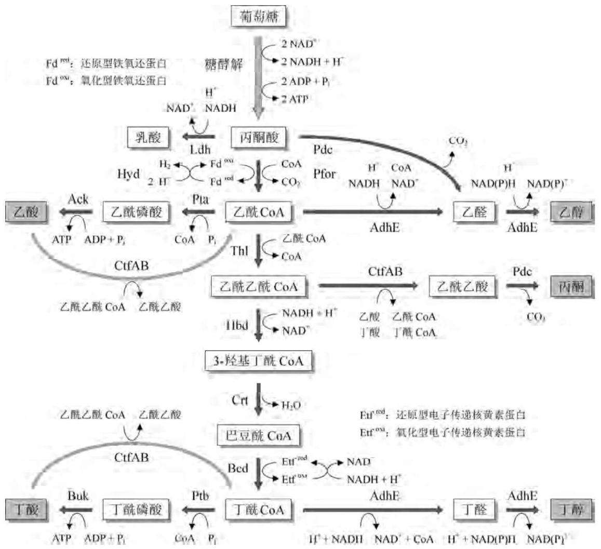
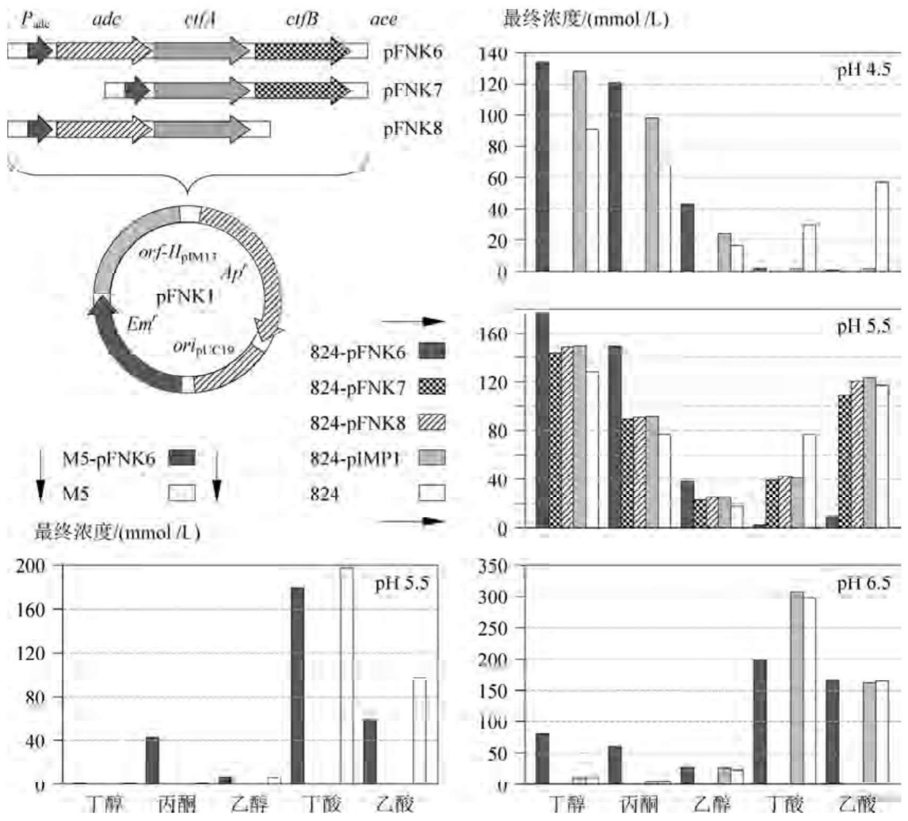
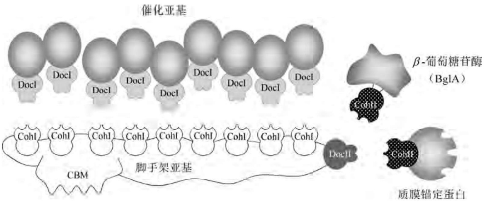
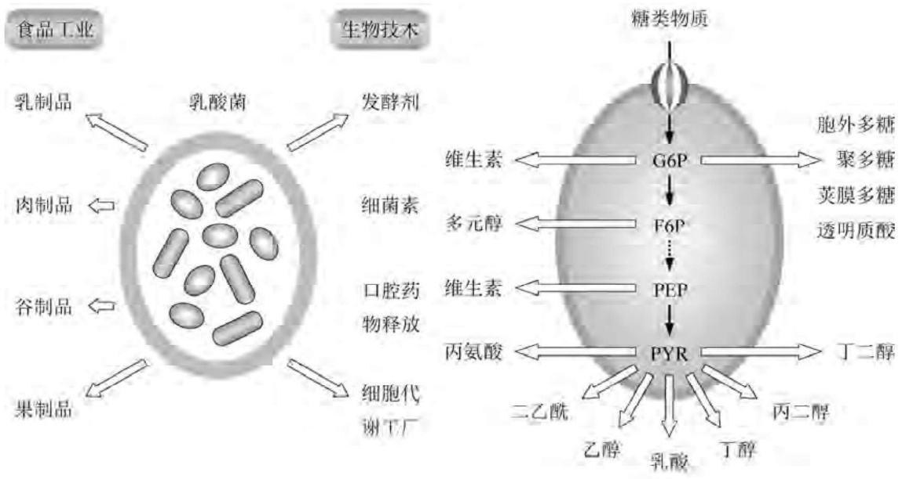

flowchart

This flowchart illustrates the metabolic pathway of glucose in the presence of various amino acids (e.g., 乙酸, 丙酮酸) and related enzymes, showing enzymatic reactions and their effects on glucose metabolism.

图4-28 丙酮丁醇羧菌酸生成和溶剂生成的代谢途径

上述代谢途径显著降低培养液中的 $\mathrm{pH}$ 值，破坏横跨细胞膜的质子梯度，因此丙酮-丁酸-羧菌会将酸生成途径切换至溶剂生成途径:在乙酰乙酰辅酶A:酰基辅酶A转移酶(CtfAB)的催化下，乙酸和丁酸以乙酰乙酰辅酶A为辅酶A供体，逆转成其对应的辅酶A衍生物。特别当还原力受限时，为了驱动除去乙酸的反应，乙酰乙酰辅酶A脱羧在乙酰乙酸脱羧酶(Adc)催化下生成丙酮；而不同的醛/醇脱氢酶(AdhE)则分别将乙酰辅酶A和丁酸辅酶A转换成乙醇和丁醇，即丙酮丁酸羧菌的主要发酵产物。

值得注意的是，革兰氏阳性菌著名的孢子生成调控因子Spo0A对丙酮丁酸羧菌孢子生成的启动以及溶剂的合成两个过程均很重要，虽然孢子生成本身并不需要丙酮和丁醇的产生。联系这两个生理上并不相干过程的是Spo0A的磷酸化形式，而代谢中间物丁酰磷酸很可能作为转录调控因子的磷酸供体而参与其中，但有关的调控网路构成与运行机制却知之甚少。

## 2. 羧菌属溶剂生成途径的基因操作

针对丙酮丁醇梭菌的溶剂生成途径进行基因操作的尝试已有不少积累，但显著倾向于某种特定溶剂（如丁醇或乙醇或丙酮）的途径设计却很难理出清晰的结果，暗示羧菌属的核心代谢途径及其调控机制的复杂程度可能远远超出图4-28所涉及的范围。

（1）强化表达 $ctfAB$ 和 $adc$ 基因。由图4-28可以看出，丙酮生物合成分支途径中的两个关键酶是乙酰乙酰辅酶A:酰基辅酶A转移酶(CtfAB)和乙酰乙酸脱羧酶(Adc)，它们一方面直接催化葡萄糖代谢中间产物乙酰辅酶A经乙酰乙酸生成丙酮，同时又通过转化乙酸和丁酸间接促进丙酮和丁醇的合成。在丙酮丁醇梭菌中，为这两个酶编码的基因 $ctfA$、$ctfB$、$adc$ 均位于ATCC824株的天然质粒pSOL1上，其中 $ctfA$ 和 $ctfB$ 分别编码酰基辅酶A转移酶的两个亚基，其转录方向与 $adc$ 基因相反。当细菌处于产酸的对数生长期时，$ctfAB$ 操纵子的转录因被阻遏而基本上处于关闭状态。因此提高丙酮丁醇梭菌丙酮和丁醇产量的方法是更换 $ctfAB$ 操纵子自身的启动子-操纵子系统，从根本上解除对这两个基因表达的阻遏作用。为此，借助于PCR克隆技术将丙酮丁醇梭菌的 $adc$、$ctfA$、$ctfB$ 重组成由 $adc$ 基因启动子-操作子统一控制的 $ace$ 操纵子结构，然后将之克隆在pFNK1穿梭质粒的EcoRI位点上，构建成重组质粒pFNK6。将pFNK6转化丙酮丁酸羧菌ATCC824株，并与相应的对照株比较CtfAB和Adc以及丙酮和丁醇的最终发酵产量(图4-29)。结果表明:$ace$ 操纵子的表达大大改变了ATCC824株丁醇、丙酮、乙醇、丁酸、乙酸五种产物的产量分布。在三种 $\mathrm{pH}$ 的发酵条件下，CtfAB和Adc的酶活分别提高 $4\sim 33$ 倍和 $4\sim 38$ 倍，而且两种酶的表达时间都从稳定期提前到对数生长期。虽然两种酶在克隆株中的最大活性是在$\mathrm{pH}4.5$ 条件下表达的，但丙酮和丁醇合成的最佳 $\mathrm{pH}$ 为5.5，两者的总量达到 $23.2\mathrm{g / L}$，明显高于当时大规模发酵生产中使用的菌株。在 $\mathrm{pH}6.5$ 的发酵条件下，两种产物的产量是三种$\mathrm{pH}$ 中最低的，但此时克隆株与对照株的最终发酵产物产量差别却最大，丙酮和丁醇的产量分别提高了25倍和12倍。显然，此项操作更有利于丙酮的富集。
（2）强化表达 adhE1 和 ctfB 反义 RNA 基因 (ctfB-asRNA)。由图 4-28 可以看出，强化表达醛/醇脱氢酶编码基因 adhE1 理论上有利于乙醇和丁醇的倾向性合成；而利用反义技术衰减 CtfAB 的表达，能阻断丙酮的合成，但未必对丁醇的积累有利，因为乙酸和丁酸的逆转同化也相应会减弱。以磷酸丁酰转移酶编码基因所属的强组成型启动子 $P_{\mathrm{ptb}}$ 取代 adhE1 基因自身启动子 $P_{\mathrm{adhE1}}$ 以及用硫解酶编码基因所属的启动子 $P_{\mathrm{thl}}$ 介导 ctfB-asRNA 的表达，由此构建的重组质粒 (pCASAAD) 转化丙酮丁酸羧菌 ATCC824 株，获得重组克隆 824 (pCASAAD) 株；同样，将含 $P_{\mathrm{adhE1}} - adhE1$ 和 $P_{\mathrm{thl}} - ctfB - asRNA$ 两个表达框的重组质粒 (pAADB1) 转化 ATCC824 株，产生重组克隆 824 (pAADB1) 株。结果发现，在 pH5.0 的发酵条件下，与含空载体的对照株相比，ctfB 反义 RNA 的引入的确使丙酮产量下降了 44%，但 adhE1 基因的强化表达并没有改变丁醇的产量，此项操作最受益的是乙醇，产量提高了 14 倍之多。奇怪的是，除了乙酸产量略提高 10% 外，丁酸反而降为原来的 1/18。由此可见，adhE1 对乙醇的作用明显大于丁醇。
（3）敲除 $adc$ 基因。由图4-28可以看出，能阻断丙酮的合成。实验结果显示，$adc$ 基因敲除株确实只产少量的丙酮，这些丙酮是由乙酰乙酸的非酶促脱羧反应形成的；不可思议的是，丁醇的产量相比对照丙酮丁醇梭菌EA2018株也显著降低了 $46\%$，只是丁醇占总溶剂产量的份额由 $71\%$ 提升至 $80\%$。
（4）在不产孢子的菌株中表达 adhE1-ctfAB。由于溶剂合成往往天然伴随孢子生成，后者最终终止丁醇合成，因此一株不产孢子的丙酮丁醇梭菌（DSM1731）将是羧菌基因改良的理想出发菌株。更为流行的不产孢子的菌株是丧失大型质粒 pSOL1 的退化菌株（如丙酮丁醇梭菌 M5 和 DG1 株）。用 adhE1 基因回补 M5 株，能恢复丁醇的生产且无丙酮形成，进一步的改良是用强组成型  $P_{ptb}$  启动子置换原 sol 启动子，以强化 adhE1 基因的表达。然而，上述无 pSOL1 型工程菌的主要发酵产物伴随高浓度丁醇的还有乙酸，而且敲除乙酸激酶编码基因 ack 和丁酸激酶编码基因 buk 以及共表达硫解酶编码 thl 均不能改变这一表型。

图4-29 丙酮丁醇羧菌ATCC824(pFNK6)重组菌溶剂合成的产量分布

## 4.4.4 利用 DNA 重组技术改良羧菌属的纤维素分解酶系

地球上含量最丰富的生物聚合物纤维素是多聚糖降解型微生物的优秀能源，同时也是将之转换成生物燃料的尚未能高效开发的能源形式。由于纤维素呈高度有序且不溶性的晶体结构，极少数微生物拥有将之降解为可溶性糖的必需酶系。虽然对纤维素降解型微生物研究最多的是好氧真菌里氏木霉（Trichoderma reesei），但由厌氧型热纤维梭菌和解纤维梭菌所产生的多酶复合物同样具有高效的纤维素降解性能。

## 1. 热纤维梭菌纤维素分解酶系的基本特征

热纤维梭菌的细胞表面存在一些隆起的特征结构，称为纤维体，内含多亚基的纤维素多酶复合物(图4-30)。其中，一种非催化型亚基(脚手架蛋白)能借助其纤维素特异性的结合模件(CBM)与水不溶性底物结合；同时热纤维梭菌的脚手架蛋白还含有一套九个I型黏连蛋白(CohI)结合模件，脚手架蛋白通过黏连蛋白与纤维素酶系上的互补型结合模件(船坞模件,DocI)相连，从而介导催化亚基的特异性掺入与组织。脚手架蛋白在其C端还含有另一种类型的II型船坞模件(DocII)，后者通过与一组细胞膜锚定蛋白选择性结合和相互作用，介导纤维体与细胞壁之间的维系。将多酶装配成复合物能确保它们集体靶向底物特殊区域，从而有利于催化组分之间协同发挥作用。

flowchart

This diagram illustrates the mechanism of beta-glucosaminoglycan (BglA) in a mouse model, showing how beta-glucosaminoglycan activates the development of the Cerebellum Bone Marrow (CBM) and its role in producing the Cerebellum Inhibitory Complex (CohI).

图4-30 热纤维羧菌纤维体结构与工程化设计

构成纤维体的不同酶之间的协同降解导致高浓度可溶性纤维二糖终产物的形成。在天然环境中，纤维二糖及其他形式的寡聚葡萄糖被ATP结合盒转运子系统直接转运进细胞。在此期间，纤维二糖被周质中的β-葡萄糖苷酶进一步水解成葡萄糖；其他形式的寡聚葡萄糖的同化吸收则需要环境中额外的不同微生物方能完成。在天然生态系统中，纤维二糖的作用是充当一种调控信号，特别是胞外纤维素酶的抑制剂；纤维二糖2%的浓度足以完全抑制热纤维梭菌的纤维体酶活。因此，在无细胞系统中，纤维二糖抑制剂的除去是木质纤维素底物恒定降解的必要条件。

当纤维体从热纤维梭菌细胞中提取出来并用于水解晶体纤维素时，纤维体可通过其CBM模件高亲和性地结合在不溶性的纤维素底物上，但只有很少部分的 $\beta-$ 葡萄糖苷酶能直接参与水解在底物结合性纤维体环境中积累起来的纤维二糖。因而，将 $\beta-$ 葡萄糖苷酶与纤维体连为一体的策略便有可能以更高的效率清除抑制型的纤维二糖，从而提高纤维素降解的总体水平。

## 2. 热纤维梭菌纤维体与 $\beta$-葡萄糖苷酶的偶联设计

热纤维梭菌纤维体乐高积木式的构造为创建“设计型纤维体”提供了契机，人工装配纤维体组分的杂合形式有望改进纤维素类底物的水解效率。迄今为止，大多数的纤维体设计实验均试图使天然纤维体系统所观察到的协同酶系最小化，其策略是设计制作由一种含黏连蛋白的脚手架以及一套与之相匹配的含船坞模件型纤维素酶构成的人工复合物。

然而，旨在提升纤维体工作效率的另一种策略是运用II型黏连蛋白(CohII)与脚手架蛋白上的II型船坞模件(DocII)特异性相互作用的原理，将外源性的 $\beta$ -葡萄糖苷酶特异性掺入天然的纤维体中(图4-30)。由于DocII与CohII结合的主要功能是在细胞表面的附着，因此在无细胞纤维素降解体系中，这一功能的存在与否不会影响天然纤维体的酶活。如果末端载有脚手架蛋白的DocII模件不被占据，则可以用来附着任何一种含CohII的组分。于是将热纤维梭菌 $\beta$ -葡萄糖苷酶(BglA)在基因水平上与来自热纤维梭菌锚定蛋白Orf2p的II型黏连蛋白(CohII)融合，构成BglA-CohII嵌合酶，便能实现 $\beta$ -葡萄糖苷酶与天然纤维体的结合特异性偶联，进而提升纤维素类底物酶促降解的效率。

## 3. 能利用纤维素类物质发酵乙醇的工程化羧菌的构建

酿酒酵母与发酵单孢菌属(Zymomonas)能由葡萄糖生产较高浓度的乙醇,但它们不能发酵木糖和纤维素,因此利用这两类微生物从纤维素物质生产乙醇,必须首先将纤维素类物质进行液化和糖化预处理。使用嗜温或嗜热性的梭菌属由纤维素类物质直接厌氧发酵乙醇,是生物能源再生的一种理想选择,其优点为代谢速率快,最终产物回收率高,细胞和酶系稳定，并能直接转化纤维素或戊糖。但这类细菌用于工业规模的乙醇发酵也存在两大缺陷:在乙醇发酵过程中往往伴有乙酸和丁酸等副产物的产生，而且最终产物的最高积累浓度仅为3%左右，只及酿酒酵母或发酵单孢菌属的25%\~30%。利用DNA重组技术重新设计糖酵解途径，阻断副产物的形成路线，解除乙醇生物合成的代谢阻遏作用，同时提高细胞对高浓度乙醇的耐受性，是高产乙醇梭菌属工程菌构建的主要内容。

许多梭菌属菌种能从纤维素或木糖直接发酵产生乙醇，其中最有希望成为生产菌的是生长温度在 $55\sim 75^{\circ}C$ 内的梭菌属嗜热菌种，其生物学特征列在表4-23中。热纤维梭菌所有已鉴定的菌株都能从纤维素和纤维二糖直接发酵产生乙醇，其机理是首先将纤维素经过纤维三糖降解为纤维二糖，后者再转化为葡萄糖，进入糖酵解途径。但热纤维梭菌合成乙醇的能力较低，即使在流加式发酵过程中，由纤维素产生乙醇的产量也只有 $8.5\mathrm{g / L}$ 。热解糖梭菌虽然不能发酵纤维素，但却能高效利用其他碳源合成ATP并积累较高浓度的乙醇。因此，为了提高乙醇产量，可将上述两种嗜热梭菌在纤维素培养基中混合培养，结果在含有$80~\mathrm{g / L}$ 纤维素的培养基中能生产 $25.3\mathrm{g / L}$ 的乙醇。

表 4-23 产乙醇型羧菌的主要生物学特征

| 羧菌名称 | GC/% | 生长温度/°C | 主要产物$^1$ | 可发酵的主要碳水化合物$^2$ |
| --- | --- | --- | --- | --- |
| C. saccharolyticum | 27~29 | 37 | E、A、L | Ceb、Glc、Xyl、etc |
| C. thermosaccharolyticum | 29~32 | 55~62 | E、A、L | Ceb、Glc、Xyl、Suc、Gal、Fru、Ara、Sta |
| C. thermocellum | 38~39 | 60~65 | E、A、L | Ceb、Glc、Fru、Cel |
| C. sterorarium | 43~44 | 60~65 | E、A、L | Ceb、Glc、Xyl、Suc、Gal、Fru、Ara、Sta、Cel、Xyn |
| C. thermohydrosulfuricum | 30~32 | 68 | E、A、L | Ceb、Glc、Xyl、Gal、Fru、Ara、Sta |

① E—乙醇；A—乙酸；L—乳酸。

② Ceb—纤维二糖；Glc—葡萄糖；Xyl—木糖；Suc—蔗糖；Gal—半乳糖；Fru—果糖；Ara—阿拉伯糖；Sta—淀粉；Cel—纤维素；Xyn—木聚糖。

有些解糖梭菌(Clostridium saccharolyticum)和热解糖梭菌虽然不能利用纤维素，但能以木糖合成乙醇。在含有 $75\mathrm{g / L}$ 木糖的培养基中，这些菌种发酵乙醇的产量可达 $27~\mathrm{g / L}$ 。为了进一步提高梭菌属由木糖生产乙醇的能力，降低乙酸和丁酸副产物的产量，同时强化菌种对高浓度乙醇的耐受性，可采用经典的诱变或培养基富集等方法对菌种进行遗传改良。例如，解糖梭菌的一株突变株不能在以丙酮酸为唯一碳源的培养基上生长，其合成乙酸副产物的能力比亲本大为降低，在最终培养液中乙醇与乙酸的比率为 $13:1$ ，而亲本细菌仅为$6.7:1$ 。此外，热硫化氢梭菌(Clostridium thermohydrosulfuricum)的一株突变株对乙醇的耐受性比亲本株提高了3倍。上述经典遗传操作的结果同时也证实了基因操作在梭菌属乙醇生产菌改良中的巨大潜力。

## 4.5 乳酸菌基因工程

乳酸菌是一类以乳酸发酵为基本特征的革兰氏阳性菌群，与食品生产相关的乳酸菌群包含11个属:乳球菌属(Lactococcus)、乳杆菌属(Lactobacillus, 迄今为止研究最多的一个属)、链球菌属(Streptococcus)、明串珠菌属(Leuconostoc)、酒球菌属(Oenococcus)、片球菌属(Pediococcus)、肠球菌属(Enterococcus)、肉杆菌属(Carnobacterium)、乳球形菌属(Lactosphaera)、漫游球菌属(Vagococcus)、魏斯氏菌属(Weissella)，其中乳杆菌属最大，迄今鉴定的已达150多个不同的种。乳酸菌拥有下列共同的特征:①能以碳水化合物生产大量的乳酸，通常占发酵最终产物的 $50\%$ 以上；②能在较低的 $\mathrm{pH}$ 及厌氧条件下良好生长；

③ 过氧化氢酶阴性；④ 不产孢子；⑤ 生长需要碳水化合物、氨基酸、维生素等多种复杂的营养成分；⑥ 基因组 DNA 中的 GC 含量小于 55%；⑦ 绝大多数菌株为非致病性。

乳酸菌在自然界中分布极广，并且在人类生活中起着极其重要的作用，其食品发酵的历史可追溯到公元前4000年。许多乳酸菌可用于发酵牛奶、肉类、鱼类、粮食、蔬菜、水果，生产乳酪、酸奶、黄油、香肠、腌鱼、卤素、食醋、酱油、黄酒等食用品[图4-31(a)]，在此过程中形成的低 $\mathrm{pH}$ 环境可有效控制其他微生物的污染，同时酸化反应也是奶酪、酸奶、香肠生产中蛋白质凝固的必要条件。乳酸菌对人体健康的益生作用表现在下列几个方面:① 提升食物的营养价值；② 促进乳糖消化；③ 抑制肠道病原菌群的繁殖；④ 控制血清的胆固醇水平；⑤ 调节机体的免疫功能。

食用乳酸菌中分子遗传学研究最为详尽、生物技术开发最为广泛的是奶酪的主要生产菌乳酸乳球菌(Lactococcus lactis)，其基因操作的主要目的是稳定蛋白酶生产、提高乳糖利用率以及生产菌的噬菌体抗性等。而以保加利亚乳杆菌(Lactobacillus bulgaricus)、干酪乳杆菌（Lactobacillus casei）、嗜酸乳杆菌（Lactobacillus acidophilus）、瑞士乳杆菌(Lactobacillus helveticus)、植物乳杆菌(Lactobacillus plantarum)为代表的食用乳杆菌除了发酵生产食品及其添加剂外，还被开发成生产功能保健品和日用化学品的生物技术平台[图4-31(b)]。

(a) 乳酸菌的产业化应用

(b) 乳酸菌的生物技术平台

G6P: 葡萄糖-6-磷酸; F6P: 果糖-6-磷酸; PEP: 磷酸烯醇式丙酮酸; PYR: 丙酮酸

图4-31 乳酸菌的产业化应用与生物技术平台

## 4.5.1 乳酸菌的载体克隆系统

与其他革兰氏阳性菌不同，乳酸菌各种属尤其是乳杆菌含有丰富的天然质粒，虽然其中大部分为隐蔽型质粒，但其复制子和有限的几种抗生素抗性标记（如红霉素抗性基因和氯霉素抗性基因）足以用来构建一系列标准化的克隆载体；另外，基于食品工业的应用安全性考量，用于构建乳酸菌克隆表达载体的DNA元件或序列必须来自遗传背景安全的乳酸菌菌种，严格排斥任何非食用性微生物来源的质粒组分，即所谓绝对“纯净”的食品级基因操作工具。

## 1. 乳酸菌的天然质粒

虽然大多数迄今已鉴定的乳酸菌天然质粒属于隐蔽型质粒，但也有一些天然质粒编码特殊的表型，如蛋白质水解；糖类、氨基酸、柠檬酸代谢；细菌素（抗菌或杀菌肽）、胞外多糖、色素合成；抗生素、重金属、噬菌体抗性等，其中糖类代谢、抗生素抗性、细菌素合成类编码基因已被广泛用作构建乳酸菌克隆表达载体的选择性标记。

天然存在于乳球菌中的大多数滚环复制型质粒属于革兰氏阳性菌 pE194 质粒家族，如来自乳酸乳球菌乳脂亚种（Lactococcus lactis subsp. cremoris）的 pWV01（2.2 kb）和 pBM02（3.9 kb）、来自乳酸乳球菌乳酸亚种（Lactococcus lactis subsp. lactis）的 pSH71（2.1 kb）、pD125（5.1 kb）和 pCL2.1（2.1 kb）；例外的是同种菌的 pWC1（2.8 kb），含有 pC194 型复制子。上述乳球菌滚环型复制子的一大优势是能同时在大多数革兰氏阳性菌和大肠杆菌中自主复制，因而以这些复制子为蓝本可构建很多广宿主范围的衍生载体，如 pGK 系列、pNZ 系列、pFX 系列，然而这些载体倾向于分配不稳定。相反，乳球菌的  $\theta$  复制型质粒虽然宿主范围较窄，但具有如下优势:① 能与内源性滚环复制型质粒相容；② 具有较高的分配稳定性；③ 外源 DNA 装载量大。 $\theta$  复制型质粒在乳球菌中分布广泛，其复制子高度同源且相容，如来自乳酸乳球菌乳酸亚种的 pCI305（8.7 kb）、pUCL22（40 kb）、pND302（8.8 kb）、pND324（3.6 kb）、pIL7（31 kb）和 pCI2000（60 kb）、来自乳酸乳球菌乳脂亚种的 pWV02（3.8 kb）、pWV03（7 kb）、pWV04（19 kb）、pWV05（27 kb）、pSK11L（47 kb）、pCI528（46 kb）、pJW563（12 kb）和 pCIS3（6.1 kb）、来自乳酸乳球菌二乙酰变种的 pSL2（7.8 kb）、pVS40（7.8 kb）和 pCT1138（8.3 kb）。乳球菌的  $\theta$  复制型质粒对克隆表达载体的构建较为有用，因为它们含有天然的实用性选择标记，如 pVS40 编码尼生素（一种重要的细菌素）抗性；pND302 编码镉离子抗性；pND324 含有一个热敏感型复制子。有趣的是，编码噬菌体抗性功能的乳酸乳球菌质粒 pSRQ700 同时含有滚环型和  $\theta$  型两套复制子。

绝大多数的乳杆菌含有天然质粒，其中隐蔽型质粒众多且呈大小、复制模式、复制子家族多样化。根据Rep蛋白结构和复制起始位点ori的同源性，乳杆菌滚环复制型质粒或属于pE194或属于pC194质粒家族:来自植物乳杆菌的pA1(2.8 kb)和pLB4(3.5 kb)、来自发酵乳杆菌（Lactobacillus fermentum）的pLF1311（2.4 kb）、来自弯曲乳杆菌(Lactobacillus curvatus)的pLC2(2.6 kb)、来自嗜酸乳杆菌的pLA106(2.9 kb)属于pE194家族复制子；而来自植物乳杆菌的pLP1(2.1 kb)、pC30il(2.1 kb)、p8014-2(1.9 kb)和pLP2000(2.1 kb)、来自发酵乳杆菌的pLEM3(5.7 kb)、来自戊糖乳杆菌(Lactobacillus pentosus)的p353-2(2.3 kb)、来自罗伊氏乳杆菌(Lactobacillus reuteri)的pGT232(5.1 kb)和pTC82(7.0 kb)、来自希氏乳杆菌(Lactobacillus hilgardii)的pLAB1000(3.3 kb)则属于pC194质粒复制子家族。来自植物乳杆菌的pLP9000(9.3 kb)虽然也采取滚环模式复制，但其复制子不属于任何已知的家族。与乳球菌相同，乳杆菌θ模式复制型质粒对构建宿主范围虽窄但较稳定的克隆表达载体较为实用，包括来自植物乳杆菌的pLKS(2.0 kb)、来自发酵乳杆菌的pKC5b(4.4 kb)、来自德氏保加利亚乳杆菌(Lactobacillus delbrueckii bulgaricus)的pLBB1(6.1 kb)、来自德氏乳酸乳杆菌(Lactobacillus delbrueckii lactis)的pJBL2(8.7 kb)和pN42(8.1 kb)、来自嗜酸乳杆菌的pLA103(14 kb)和pLA105(3.2 kb)、来自瑞士乳杆菌的pLJ1(3.3 kb)和pLH1(19 kb)、来自干酪乳杆菌的pSAK1(19 kb)和pRV500(13 kb）。

嗜热链球菌(Streptococcus thermophilus)中天然存在的几种质粒能编码小型热休克蛋白，如pER341(2.8 kb)、pCI65st(6.5 kb)、pND103(3.5 kb)、pST04(3.1 kb)、pER1-1(3.4 kb)、pT38(2.9 kb)。提升发酵温度和降低 $\mathrm{pH}$ 能诱导这些质粒上的热休克蛋白编码基因(hsp)的表达，进而增强宿主菌的抗热和抗酸能力，这些热休克基因所属的启动子对外源基因表达的热诱导性具有实用价值。此外，pER35(11 kb)、pST08(7.5 kb)、pST0(8.1 kb)、pCI65st质粒上还含有限制-修饰系统的编码基因。迄今分离鉴定的嗜热链球菌质粒均以滚环机制复制，并属于pC194复制子家族，只有pSMQ172(4.2 kb)属于pE194复制子家族。

片球菌属含有很多不同的天然质粒，并且编码不同的性状，如棉子糖（蜜三糖）、蜜二糖、蔗糖利用以及细菌素合成。几种片球菌产抗李斯特菌的细菌素（片球菌素），来自嗜酸片球菌(Pediococci acidilactici)的pSRQ11(9.4 kb)和pSMB74(8.9 kb)以及来自戊糖片球菌(Pediococci pentosaceus)的pMD136(20 kb)均编码片球菌素的合成基因。由于片球菌素可用作克隆载体的选择性标记，因此携带片球菌素生物合成基因的质粒对构建食品级的克隆载体很有用处。

## 2. 乳酸菌的衍生型载体

乳酸菌或其他革兰氏阳性菌最流行使用的载体可分为两大主要类型。1型载体以链球菌的pIP501和肠球菌的pAMβ1及其衍生质粒为代表，它们是大型接合型质粒，携带MLS类抗生素抗性标记。pIP501和pAMβ1均为θ复制型质粒，其衍生质粒均显示结构和分配稳定性，即使插入较大的外源DNA片段也足以稳定。这些广宿主范围的质粒能在很多革兰氏阳性菌中复制，包括各种乳酸菌，如乳球菌、乳杆菌、片球菌。然而，链球菌和肠球菌并非遗传背景安全的细菌，因此pIP501、pAMβ1及其衍生质粒不属于食品级载体，不适用于食品生产菌株。2型载体来自几种乳球菌的小型隐蔽型质粒，只要加装合适的选择性标记基因便可用作克隆载体。基于乳球菌pSH71和pWV01复制子构建的衍生载体含有一种或多种抗生素抗性标记基因。这些载体因采取滚环复制而倾向于结构和分配不稳定性，仅适用于克隆较小的基因。不过，pSH71、pWV01及其衍生质粒仍很有用，因为它们具有广泛宿主范围。一些常用的乳酸菌克隆表达衍生质粒列在表4-24中。

表 4-24 乳酸菌常用的克隆衍生质粒

| 质粒名称 | 复制子来源 | 选择标记 | 大小/kb | 载体特征 | 发表年份 |
| --- | --- | --- | --- | --- | --- |
| pGK12 | pWV01(L. lactis) | $Cm^r Em^r$ | 4.4 | 穿梭质粒,乳杆菌有效 | 1984 |
| pVE6002 | pWV01(L. lactis) | $Cm^r Em^r$ | 4.4 | 整合质粒(温敏复制) | 1992 |
| pGKV1 | pWV01(L. lactis) | $Cm^r Em^r$ | 4.6 | 穿梭质粒,乳杆菌有效 | 1988 |
| pMG24 | pWV01(L. lactis) | $Km^r$ | 4.4 |  | 1989 |
| pTRK170 | pWV01(L. lactis) | $Cm^r$ | 6.6 | 穿梭质粒,乳杆菌有效 | 1992 |
| pGIP212 | pWV01(L. lactis) | $Cm^r Km^r Sp^r$ | 8.2 | 穿梭质粒,乳杆菌有效 | 1994 |
| pIAV1 | pWV01(L. lactis) | $Cm^r Em^r lacZ$ | 6.1 | 穿梭质粒,乳杆菌有效 | 2001 |
| pIAV7 | pWV01(L. lactis) | $Em^r$ | 5.2 | 穿梭质粒,乳杆菌有效 | 2001 |
| pIAV9 | pWV01(L. lactis) | $Cm^r$ | 5.2 | 穿梭质粒,乳杆菌有效 | 2001 |
| pNZ12 | pSH71(L. lactis) | $Cm^r Km^r$ | 4.1 | 乳杆菌有效 | 1986 |
| pNZ18/19 | pSH71(L. lactis) | $Cm^r Km^r$ |  | 穿梭质粒,乳杆菌有效 | 1992 |
| pCK1 | pSH71(L. lactis) | $Cm^r Km^r$ | 5.5 | 穿梭质粒 | 1985 |
| pMIG1 | pSH71(L. lactis) | $Cm^r Km^r$ | 4.8 | 穿梭质粒 | 1993 |
| pVSB1 | pSH71(L. lactis) | $Cm^r lacZ$ | 4.0 | 穿梭质粒,乳杆菌有效 | 1995 |
| p21-22 | pBM02(L. lactis) | $Em^r Apr^r$ |  | 穿梭质粒,乳杆菌有效 | 2003 |
| pND421 | pND324(L. lactis) | $Em^r Apr^r Nis^r$ | 15.1 | 整合质粒,食品级载体 | 1999 |
| pND625 | pND302(L. lactis) | $Nis^r Cd^r$ | 10.4 | 食品级载体 | 1996 |
| pULP8 | pLP1(Lb. plantarum) | $Em^r Apr^r$ | 6.6 | 穿梭质粒 | 1989 |
| pLFVM2 | pLF1311(Lb. fermentum) | $Cm^r$ | 5.0 | 穿梭接合质粒,乳球菌有效 | 1999 |
| pSP1 | pKC5b(Lb. fermentum) | $Em^r$ | 9.4 | 穿梭质粒,链球菌有效 | 2002 |
| pLP3537-xyl | p353-2(Lb. pentosus) | $Em^r Apr^rxyl$ | 12.2 | 穿梭质粒,食品级载体 | 1991 |
| pTC82-RO | pTC82(Lb. reuteri) | $Em^r$ | 7.0 |  | 2001 |
| pLAB1301 | pLAB1000(Lb. hilgardii) | $Em^r Apr^r$ | 5.3 | 穿梭质粒 | 1989 |
| pJK352 | pLC2(Lb. curvatus) | $Cm^rAp^r$ | 5.9 | 穿梭质粒,乳球菌有效 | 1993 |
| pSS1 | pLBB1(Lb. delbrueckii) | $Cm^rEm^rTc^r$ | 7.0 | 乳球菌有效 | 2002 |
| pLHR | pLJ1(Lb. helveticus) | $Em^rAp^r$ | 8.5 | 穿梭质粒 | 1990 |
| pTRK159 | pPM4(Lb. acidophilus) | $Cm^rEm^rTc^r$ | 10.3 | 穿梭质粒 | 1991 |
| pRV566 | pRV500(Lb. sakei) | $Em^rAp^r$ | 7.3 | 穿梭质粒 | 2003 |
| pMEU5 | pER8(S. thermophilus) | $Em^rAp^r$ | 5.7 | 穿梭质粒 | 1993 |
| pND913 | pND103(S. thermophilus) | $Em^rAp^r$ | 6.4 | 穿梭质粒,乳球菌有效 | 2002 |
| pFBYC18E | pFR18(Ln. mesenteroides) | $Em^r$ | 3.5 | 乳杆菌有效 | 1999 |
| pFBYC050E | pTXL1(Ln. mesenteroides) | $Em^rAp^r$ | 7.7 | 穿梭质粒,乳杆菌/片球菌有效 | 2002 |

注: $Ap^r$ 一氨苄青霉素抗性基因； $Cm^r$ 一氯霉素抗性基因； $Em^r$ 一红霉素抗性基因； $Km^r$ 一卡那霉素抗性基因； $Sp^r$ 一壮观霉素抗性基因； $Tc^r$ 一四环素抗性基因；lacZ-β-半乳糖苷酶标记基因； $Nis^r$ 一尼生素抗性基因； $Cd^r$ 一镉离子抗性基因；Lb—乳杆菌属；Ln—明串珠菌属；S—链球菌属。

（1）基于pWV01的衍生质粒。pGK系列的代表质粒pGK12基于pWV01构建而成，携带氯霉素和红霉素抗性基因，可用于转化乳酸乳球菌、大肠杆菌、枯草芽孢杆菌，乳杆菌属几个重要的种也可作为pGK12的宿主。pGK12在大肠杆菌中高拷贝复制，但在乳酸乳球菌和枯草芽孢杆菌中拷贝数较低。基于pWV01构建的衍生载体还包括pMG系列和pIAV系列的质粒，其中pIAV7和pIAV9在乳酸乳球菌中的拷贝数显著高于其他的pWV01衍生质粒。在无选择压力下，这两种质粒也能稳定维持超过40代；在120代后 $35\%$ 的pIAV7型转化子以及 $20\%$ 的pIAV9转化子仍保留着相应的质粒。

除了上述克隆载体外，基于pWV01的整合型载体也被构建出来。pVE6002是一种由pGK12突变而来的温敏型质粒，当温度超过 $35^{\circ}\mathrm{C}$ 时在乳酸乳球菌中不复制。只含有pWV01复制起始位点的 $\mathrm{pOri^{+}}$ 型质粒在含repA基因的辅助菌不存在时，能整合进宿主的染色体上。

(2) 基于 pSH71 的衍生质粒。基于 pSH71 构建的 pNZ 系列的载体如 pNZ18 和 pNZ19 也能在枯草芽孢杆菌、金黄色葡萄球菌（低拷贝）和大肠杆菌（高拷贝）中复制。pCK1 的拷贝数较高，但既不稳定又缺乏克隆位点。为了克服这些缺陷，以 pCK1 为蓝本构建 pMIG 质粒，后者含 MCS，在革兰氏阳性菌中拷贝数高，而在大肠杆菌中则拷贝数低。
（3）基于其他乳球菌复制子的衍生质粒。乳球菌滚环复制型质粒pBM02具有较广泛的宿主范围，能在多种革兰氏阳性菌和阴性菌中复制，包括植物乳杆菌、干酪乳杆菌、枯草芽孢杆菌、大肠杆菌。基于隐蔽型质粒pWC1构建的pCP12能转化几种革兰氏阳性菌，但不能转化大肠杆菌，主要是因为它属于pC194复制子家族而非pE194家族。一般而言，pE194型复制子具有广泛的宿主范围，能在大肠杆菌中复制。

基于乳球菌 $\theta$ 复制型质粒 pCI305 构建而成的质粒 pCI374 和 pCI3340 宿主范围较窄，只能转化乳酸乳球菌，而且两者的拷贝数都比较低。源自 pWV02 的 pLR300 能转化乳球菌和嗜酸片球菌，在无选择压力下能稳定维持至少 100 代，但拷贝数每个细胞只有 $5\sim 10$ 个。

（4）基于乳杆菌复制子的衍生质粒。基于乳杆菌复制子构建的载体能转化的受体范围一般小于乳球菌衍生载体，但有些乳杆菌复制子能在大肠杆菌中工作，如pA1、pPSC20/22、pGT633、pLC2、pLA106、pLF1311。一些来自发酵乳杆菌、罗伊氏乳杆菌、瑞士乳杆菌、嗜酸乳杆菌、德氏保加利亚乳杆菌、卷曲乳杆菌（Lactobacillus crispatus）的质粒，则呈较窄的宿主范围（被称为宿主特异性复制型质粒），但因不易在细菌物种之间传播反而具有安全性，这样的载体有利于构建食品基因工程菌以及口腔疫苗投送载体，因而受到重视。

基于滚环复制的载体如 pULP8 和 pULP9 在 20 代后便从转化子中丢失；pLAB1000 的衍生质粒在13代后仅存于 $30\%$ 的转化子中；pLE16在28代后也基本上全部丢失。不过，由于用于食品发酵的乳酸菌工业菌种仅经历有限的几代分裂，因此即便呈分配不稳定性的载体也可以用于克隆和表达。基于 $\theta$ 复制型质粒构建的载体具有显著的稳定性，如含pULA105E的转化子在100代后仍呈 $100\%$ 的红霉素抗性表型；源自pKC5b的穿梭载体pSP1能在无选择压力的乳杆菌中维持100代；pTC82及其衍生质粒pTC82-RO均显示出异常的分配稳定性，216代后 $100\%$ 的转化子均含重组质粒。然而，并非所有来自 $\theta$ 复制型质粒的载体均呈稳定性:如pRV566只能在转化的细胞中维持20代，但生产香肠的发酵过程中，米酒乳杆菌一般只生长大约12代，因而这一丢失率还是可以接受的。

乳杆菌属一般能抗氨苄青霉素、邻氯青霉素、庆大霉素、卡那霉素、新霉素、青霉素、链霉素、四环素，但对氯霉素和红霉素较为敏感。因此，用于转化乳杆菌的载体必须携带来自pE194或pAMβ1质粒的红霉素抗性标记，或者来自pC194或pBR322质粒的氯霉素抗性标记，但这些抗生素抗性标记不符合食品级载体的要求。

## 3. 乳酸菌的食品级载体

目前，基因修饰型生物(GMO)在食品工业中的应用受到严格控制，用于食品生产型乳酸菌的基因操作程序和工具必须符合自克隆原则，即导入食品生产型受体细胞中的DNA分子限定为那些来自与受体属于相同种属的生物基因，由此构建产生的基因修饰型乳酸菌可视为非基因修饰型生物。与自克隆原则最相关的因素是食品级克隆表达载体的开发，此类载体应满足下列两大基本条件:①采用遗传背景安全的生物来源的DNA元件（即食品相关型乳酸菌质粒)构建；②不含抗生素抗性标记基因。食品级载体携带的非抗生素抗性标记一般包含显性筛选标记和遗传互补标记两大类:

## (1) 显性筛选标记

乳酸乳球菌乳酸亚种二乙酰变种 DRC3 株中 60 kb 的隐蔽型质粒 pNP40 上携带一种疏水性抗菌肽尼生素（又称乳酸链球菌肽）的抗性基因 nsr，后者经鉴定后被用作首批非抗生素抗性标记的食品级显性筛选标记，pVS40、pFM011、pFK012 均含有 nsr 显性筛选标记。类似地，一些乳酸乳球菌菌株来源的尼生素免疫基因 nisI 也可用作显性标记，如由 pSH71 复制起始位点 ori、repA 复制蛋白编码基因、nisI 及其上游启动子  $P_{45}$  构建而成的食品级质粒 pLEB590（全部由乳球菌 DNA 序列构成），能高效转化尼生素敏感型的乳酸乳球菌和植物乳杆菌。一种由强生乳杆菌（Lactobacillus johnsonii）产生的莴苣苦素 F，其免疫基因也可用作显性标记。来自乳酸乳球菌 IPLA972 株天然  $\theta$  复制型质粒 pBL1(11 kb) 的乳链球菌素 Lcn972 生物合成基因及其抗性基因同样可以实现有效的显性筛选。

第二类显性筛选标记基于一种双质粒系统，其中一个质粒是全部由乳酸乳球菌DNA构建的pVEC1，含有来自pCD4质粒的 $\theta$ 型复制子 $(\mathrm{RepB}^{+})$ ，但无选择性标记，用来装载目的基因；另一个质粒为pCOM1，是一种repB缺陷型的pCD4衍生质粒，携带用于显性筛选的红霉素抗性基因。当共转化子生长在无红霉素的培养基上时，pCOM1逃逸。由于pVEC1采取 $\theta$ 机制复制，非常稳定，因而之后的维持再不需要选择压力。

第三类显性筛选标记为稀有糖类(如木糖、菊粉、蜜二糖等)的代谢利用基因。很多乳酸菌不能利用这些稀有糖类,因而只有携带上述糖类代谢标记基因的转化子才能在稀有糖类为唯一碳源的限制性培养基上长出。不过,此类筛选系统的缺憾是稀有糖类发酵速率较慢,在工业规模的发酵过程中补充这些糖可能不实际,而且价格不菲。

第四类显性筛选标记基于植物乳杆菌来源的胆盐(甘氨脱氧胆酸)水解酶编码基因 bsh。将含 bsh 基因的质粒导入干酪乳杆菌中，转化细胞能出现在含 0.1% 胆盐的正常培养基上，并能在含 0.3% 胆盐的培养基中生长；而干酪乳杆菌野生株在 0.05% 的胆盐浓度下便被显著抑制。这一系统的缺憾是选择压力，胆盐逐渐会被降解，需要不断添加。

## (2) 遗传互补标记

建立稳定可筛选性载体的另一大策略是基于染色体持家或致死性基因的特异性突变及其遗传互补。为了实施遗传互补，需要构建相应的营养缺陷型突变受体，难度较大，但其优势在于选择压力能在发酵过程中维持，无须添加任何补充剂。

第一批营养缺陷型食品级筛选标记是一株嘌呤生物合成基因含无义突变的乳酸乳球菌，与之相匹配的是表达载体pFG1上含有一个无义突变校正tRNA编码基因(赭石型校正tRNA编码基因supB)作为遗传互补标记。由于pFG1质粒在乳球菌工业菌株中严重抑制生长且不稳定，于是便以琥珀型校正tRNA编码基因supD取代supB。由此构建出的克隆载体pFG200具有良好的稳定性，且能在牛奶发酵过程中稳定维持，因为牛奶中的嘌呤和嘧啶含量较低。

编码丙氨酸消旋酶的 $alr$ 基因是另一个很有希望的遗传互补型食品级筛选标记。丙氨酸消旋酶催化L-丙氨酸和D-丙氨酸之间的相互转换，为细菌细胞壁合成因而也为植物乳杆菌和乳酸乳球菌生长所必需。在植物乳杆菌和乳酸乳球菌 $alr$ 基因的内部分别缺失$100\mathrm{bp}$ 和 $30\mathrm{bp}$，两株菌便形成针对D-丙氨酸的营养缺陷。含有乳球菌/乳杆菌 $alr$ 基因的源自pGIP的质粒可用于对上述两株突变株进行遗传互补，在含有L-丙氨酸的培养基上长出的菌落即为阳性转化子。

第三类遗传互补标记是基于各种乳酸菌染色体上乳糖操纵子内的特异性突变。通过同源重组技术删除乳酸乳球菌MG5267株染色体上的lacF基因，并将瑞士乳杆菌0.3kb的β-半乳糖苷酶编码基因lacF安装在含乳球菌pSH71复制子的表达载体上（即pNZ系列载体），便能互补上述的lacF缺陷株并产生相应的 $\mathrm{Lac^{+}}$ 表型。类似地，通过删除磷酸-β-半乳糖苷酶编码基因lacG构建 $\mathrm{Lac^{-}}$ 表型，而互补质粒pLEB600则含有乳球菌复制子以及来自干酪乳杆菌的lacG基因，其上游安装组成型启动子 $P_{\mathrm{pepR}}$ 。

## 4. 乳酸菌的整合型载体

基于质粒载体的克隆系统虽然具有灵活通用性,但往往呈分配不稳定性,虽然选择压力可以解决这一问题,但在工业规模和连续发酵过程中施加选择压力往往很难做到,而且食品发酵有时也不希望施加选择压力。将外源 DNA 片段整合在受体细胞的染色体上才是解决分配不稳定性的根本方法,而且整合性克隆操作还能破坏或删除特定的基因。

（1）基于转座元件的随机整合。由转座子或细菌插入序列(IS)介导的转座能导致染色体基因的随机突变。例如，采用温敏型质粒 $\mathrm{pG}^{+}$ 作为乳球菌插入序列ISS1的投送系统，在正常温度(28℃)下它能转化乳球菌并在之中维持；一旦提升温度至 $35^{\circ}\mathrm{C}$，RepA灭活，阻碍复制并强迫质粒整合在宿主染色体上。一种基于IS1223的整合型载体pTRK327由pSA3构建而成，它随机插入格氏乳杆菌(Lactobacillus gasseri)并无IS元件同源序列的染色体中。
(2) 基于 attB 序列或转座元件的位点特异性整合。该系统采用一种噬菌体整合酶介导质粒 DNA 在受体细胞染色体 attB 位点处的特异性插入, 这种插入作用由来自噬菌体 DNA 的一个小型同源区域 $attP(<20 \mathrm{bp})$ 和噬菌体编码的整合酶 (int) 所介导。整合酶催化或定位于相同 DNA 分子或定位于分开的 DNA 分子位点之间的重组。例如, 复制型质粒 pLB65 含有乳球菌温和型噬菌体 TP901-1 的整合酶编码基因, 而另一非复制型整合载体 pCS1966 装有启动子-报告基因序列。这两种共转化受体细胞后, 报告基因 gusA 和 lacLM (分别编码 $\beta$-葡萄糖醛酸酶和 $\beta$-半乳糖苷酶) 便能整合在染色体上噬菌体 TP901-1 的附着位点 attB 处。pCS1966 质粒以来自乳酸乳球菌乳清酸转运子的编码基因 oroP 为遗传互补型筛选标记, 当该基因整合在受体染色体上后, 嘧啶营养缺陷型宿主菌便能以乳清酸生物合成嘧啶; 而将转化子暴露于 5-氟乳清酸中, 又可选择性杀死表达 oroP 的细胞, 用于筛选投递载体的丢失株。

另一种位点特异性整合策略基于乳球菌 II 型内含子 Ll. ltrB 能特异性靶向细菌重复型插入序列 IS904 的原理而设计, 其优势是允许外源基因的多拷贝整合, 而且在不同乳球菌转座酶的介导下整合的拷贝数也各异, 如转座酶 Tra904、Tra981、Tra983 介导的每条染色体整合拷贝数分别为 9、10、14。

（3）基于染色体同源序列的区域特异性重组。根据DNA的同源重组原理也可设计构建整合型载体并实施基因特异性敲除、扩增、置换、插入。所有的染色体同源整合系统均基于非复制型或条件复制型质粒。前者包括大肠杆菌、枯草芽孢杆菌、金黄色葡萄球菌等非乳酸菌复制子，因为它们不能在乳酸菌中复制；后者基于条件性(温度敏感性)复制的乳球菌复制子，如 $\mathrm{pG}^{+}$ 系列整合型载体。类似的策略也可用来删除乳酸乳球菌的特定基因，例如采用$\mathrm{RepA^{+}}$ 温度敏感型辅助质粒pVE6007和 $\mathrm{RepA^{-}}$ 质粒pORI280，后者携带一段与受体染色体靶序列同源的DNA片段。在正常温度下，上述两种质粒均能在受体细胞中维持；一旦温度升高，RepA被灭活，无法复制的pORI280便整合在宿主染色体上。由乳球菌温度敏感型质粒pND324构建的整合型载体pND421，携带尼生素和红霉素抗性标记，在 $30^{\circ}\mathrm{C}$ 整合模式下，即使无选择压力也能稳定维持100代，具有商业应用价值。

## 4.5.2 乳酸菌的诱导表达系统

可控性表达系统是使目的基因独立于受体细胞生长而表达的重要工具，除了减轻毒性表达产物或连续表达蛋白对受体细胞生长的影响外，可控性表达的另一优势在于通过优化诱导时机和诱导强度能在一定程度上降低包涵体形成的程度。几种用于乳酸菌的诱导型表达系统列在表4-25中，包括糖诱导 $(P_{\mathrm{lac}})$ 、盐诱导 $(P_{\mathrm{gadC}})$ 、温度诱导（突然升高，噬菌体$P_{\mathrm{tec}}$）、pH诱导（降低， $P_{170}$ ）、噬菌体感染诱导 $(P_{\phi 31})$ 。上述系统并非全部满足食品级标准，后者要求诱导剂必须是食品可接受的:如无机小分子（盐）、有机分子（糖类、脂肪酸）、乳酸菌来源的蛋白质成分。另外，包括 $\mathrm{pH}$ 、温度、通气甚至噬菌体感染等生长条件的改变也是可接受的基因表达诱导条件。

表 4-25 乳酸菌常用的诱导表达系统

| 乳酸菌菌种名称 | 诱导条件 | 可诱导表达元件 | 诱导倍数 |
| --- | --- | --- | --- |
| L. lactis | 添加乳糖 | lacA或lacR启动子 | &lt;10 |
| L. lactis | 添加乳糖 | lacA-T7启动子 | &lt;20 |
| L. lactis | 提高温度 | dnaJ启动子 | &lt;4 |
| L. lactis | 提高温度 | tec启动子-Rro12 | >500 |
| L. lactis | 降低pH,降低温度 | PA170启动子 | 50~100 |
| L. lactis | 降低pH | gadC启动子-GadR | >1000 |
| L. lactis | 通气 | sodA启动子 | 2 |
| L. lactis | 肽不存在 | prtP或prtM启动子 | &lt;8 |
| L. lactis | 色氨酸不存在 | trpE启动子 | 100 |
| L. lactis | 添加丝裂霉素C | $\phi$rlt阻遏因子-操作子 | 70 |
| L. lactis | 噬菌体$\phi$31感染 | $\phi$31启动子 | >1000 |
| L. lactis | 添加尼生素 | nisA或nisF启动子 | >1000 |
| Lb. casei | 添加尼生素 |  |  |
| Lb. helveticus | 添加尼生素 |  |  |
| Lb. pentosus | 添加木糖 | xylA启动子 | 60~80 |
| Lb. sakei | 添加米酒乳杆菌素A | sap启动子 | 高 |
| Lb. sakei | 添加米酒乳杆菌素P | spp启动子 | 高 |
| S. thermophilus | 添加乳糖 | lacS-GalR | 10 |

迄今为止最有效且广泛使用的乳酸菌基因可控性表达系统是以尼生素作为诱导剂的NICE系统。抗菌肽尼生素的生物合成由尼生素基因簇控制，其启动子 $P_{\mathrm{nisA}}$ 受一种双组分调控系统自调控，不同浓度的尼生素可通过质膜结合型蛋白激酶NisK以及转录调控因子NisR激活 $P_{\mathrm{nisA}}$ 介导其下游基因(nisA或目的基因)转录。尼生素诱导表达系统不仅能在乳球菌中工作，也能在其他乳酸菌如乳杆菌属和明串珠菌属中正常发挥功能，对各种蛋白的高效表达非常实用，因为尼生素本身就是一种食品添加剂，具备可靠的安全性，而且该系统也适用于工业规模的发酵。然而需要特别指出的是，采用nsr基因作为筛选标记可能会对尼生素诱导系统施加不利影响，因为nsr编码的尼生素抗性蛋白NSR是一种能降解尼生素的蛋白酶。当既使用nsr作为筛选标记又以尼生素作为外源基因在乳酸乳球菌中表达的诱导剂时，诱导剂会被逐步降解而影响诱导效率，导致表达水平降低。在此情形中，使用尼生素免疫基因nisI作为显性筛选标记似乎较好。

另一种食品级诱导表达系统基于群体感应策略，可用在米酒乳杆菌（Lactobacillus sakei）和植物乳杆菌中的基因诱导性表达。一系列的表达载体（如pSIP)基于II型细菌素米酒乳杆菌素A(sap基因簇)或米酒乳杆菌素P(spp基因簇)的启动子和调控因子被构建。这些启动子可通过外部添加肽类信息素而诱导基因表达。采用几种内源和外源基因测试pSIP性能的结果显示，这两种启动子的诱导比较高，启动子被严密控制，基底水平的表达较低；而且诱导剂信息素的有效浓度极低，典型的工作浓度范围为 $10\sim 25~\mathrm{ng / mL}$ 。pSIP系统的载体以模块化方式构成，可以较为方便地更换其中的不同部件，例如用来自植物乳杆菌WCFS1株的alr基因更换pSIP原始载体中的红霉素抗性标记，可形成食品级的诱导表达载体。

## 4.5.3 乳酸菌的宿主转化系统

相对大肠杆菌和其他革兰氏阳性菌而言，乳酸菌各种属的转化率普遍偏低，这对构建高容量的基因文库是一个严重的制约性因素。将质粒DNA成功导入乳酸菌取决于菌种特殊的性质，如细胞壁结构、质粒大小构成及其复制子类型，而乳酸菌受体细胞内的限制修饰系统也是影响转化率的一个关键因素。

## 1. 乳酸菌的限制修饰系统

在一些乳酸菌菌株中，依照标准的转化程序操作只能获得少量的转化子甚至无法获得转化子，其主要原因是受体细胞对转化质粒DNA的限制修饰作用。细菌的限制修饰系统通常涉及限制性核酸内切酶及其所对应的甲基化酶，就I型和III型限制修饰系统而言，甲基化酶能封闭相应的限制性酶酶切位点。相反，IV型限制修饰系统的限制性核酸内切酶却特异性作用于甲基化修饰型的DNA。有几项报告显示，受体细胞DNA腺嘌呤甲基化(dam)和DNA胞嘧啶甲基化(dcm)对外源DNA的甲基化修饰谱严重影响转化效率。

pCD256质粒是基于大肠杆菌pUC19质粒和植物乳杆菌NC7株野生型质粒p256复制子构建的一种穿梭质粒，能在植物乳杆菌CD033株中自主复制。将pCD256分别转化大肠杆菌JM109株 $(dam^{+},dcm^{+})$ 、BL21(DE3)株 $(dam^{+},dcm^{-})$ 、GM33株 $(dam^{-},dcm^{+})$ 、C2925株 $(dam^{-},dcm^{-})$ ，从上述菌株中提取纯化的pCD256质粒再导入植物乳杆菌CD033株中。结果显示， $dam^{+} / dcm^{-}$ 甲基化修饰型pCD256对植物乳杆菌CD033株的转化率略高于 $dam^{+} / dcm^{+}$ 或 $dam^{-} / dcm^{+}$ 甲基化修饰型pCD256，而 $dam^{-} / dcm^{-}$ 非甲基化型pCD256的转化率却比 $dam^{+} / dcm^{+}$ 甲基化修饰型质粒DNA(来自大肠杆菌JM109株)高出1000倍，其转化率接近 $10^{9}$ 个/ $\mu \mathrm{g}$ DNA，这一转化率完全可与商品化的大肠杆菌克隆系统相媲美。而且，植物乳杆菌另外两株菌CD032和DSM20174也存在类似的现象。这些结果强烈暗示，这些植物乳杆菌菌株中存在着甲基化依赖型的限制性核酸内切酶，如属于IV型限制修饰系统的Mrr型限制性核酸内切酶(mrr，识别并限制甲基化腺嘌呤)。基因组搜寻结果显示，植物乳杆菌WCFS1株和JDM1株同样含有mrr同源基因，但植物乳杆菌ST-III株却不含相应的基因。布氏乳杆菌(Lactobacillus buchneri)CD034株、粪肠球菌(Enterococcus faecium)CD036株、乳酸乳球菌MG1363株对非甲基化修饰型DNA强烈限制的事实，表明乳酸菌群的限制修饰系统存在着普遍的多样性。因而，在建立高效的乳酸菌转化系统之前，事先调查确定受体细胞的限制修饰类型非常重要。

## 2. 乳酸菌的间接转化法

在乳杆菌属的转化系统建立之前，基于革兰氏阳性菌广宿主接合型质粒 pAMβ1 和 pIP501 通过接合作用转移外源 DNA 是普遍采用的方法。这两种质粒能在多数食用乳杆菌中复制，其中 pAMβ1 质粒进入保加利亚乳杆菌和乳酸乳杆菌细胞后，还能整合在受体菌的染色体 DNA 上，因为 pAMβ1 不能在上述两种乳杆菌中复制。

除了上述接合转化程序外，经由大肠杆菌中间受体的间接转化(二次转化)策略也能在很大程度上改善乳酸菌的转化效率。由于基因重组克隆操作在大肠杆菌中远比在乳酸菌中方便，为了获得足够量的重组质粒DNA，通常会采用穿梭质粒先在大肠杆菌中构建并增殖最终的重组质粒，然后从大肠杆菌中制备超量的重组质粒并转化乳酸菌目标受体细胞。很多大肠杆菌-乳酸菌的穿梭载体便是基于这一策略构建的。然而，这些穿梭质粒要么在大肠杆菌中，要么在乳酸菌受体细胞中表现出结构不稳定性，原因可能是它们的尺寸一般较大或者它们属于嵌合型DNA，如GC含量的不同（大肠杆菌的GC含量为 $50\%$ ；而乳酸菌的GC含量一般为 $30\% \sim 40\%$ )。而且，真正意义上的食品级克隆载体也不允许存在大肠杆菌来源的DNA序列。因此，上述经由大肠杆菌中间受体的接合转化和间接转化策略在很多场合下应用受到限制。

## 3. 乳酸菌的噬菌体转染法

食用乳杆菌拥有许多宿主专一性的噬菌体，但用于工业发酵的菌株大都具有噬菌体抗性或溶原免疫力。乳酸乳杆菌的烈性噬菌体LL-H含有一个 $34\mathrm{kb}$ 大小的基因组，其上编码的五个颗粒蛋白已获得重组表达，含有两个结构基因和一个裂解基因的5kb片段可用于构建新型乳酸乳杆菌的克隆载体。干酪乳杆菌至少有两种不同的噬菌体被鉴定，即PL-1和 $\phi$ FSV，后者由溶原噬菌体 $\phi$ FSW转化而来。此外，在该菌种S-1株中还存在着一个$1.3\mathrm{kb}$ 的转座元件，它一旦插入到 $\phi$ FSW的基因组中便使噬菌体由溶原状态转入溶菌循环。食用乳杆菌中的溶原型噬菌体在其宿主染色体上并不十分稳定，利用常规方法可将其从细胞内除去，这项技术对选育抗噬菌体感染的生产菌具有一定的价值。用卵磷脂制成人工脂质体，并将噬菌体DNA包装后转染宿主菌的原生质体，可获得满意的转染效率。嗜酸乳杆菌中的噬菌体均为温和型，在该菌种ADH株中分离出的溶原噬菌体 $\phi$ adh含有一个 $41.7\mathrm{kb}$ 的线状双链基因组。这个噬菌体可以以较低的频率介导某些可转移型质粒的转导，将噬菌体的有关DNA片段与转移型质粒pGK12重组，则重组质粒的转导效率大为提高。

## 4. 乳酸菌的电击转化法

绝大多数乳酸菌的原生质体难以再生，因此质粒转化大都采用完整细胞电击法。乳酸菌电击转化的操作程序和控制参数与其他革兰氏阳性菌大同小异(参见4.4.2)。保加利亚乳杆菌中含有一个 $79\mathrm{kb}$ 的隐蔽型质粒pBUL1，将 $\mathrm{pAM}\beta 1$ 质粒上的红霉素抗性基因插到pBUL1上，构建出的杂合质粒pX3可采用电击法有效转化乳酸乳杆菌。这个载体质粒具有很大的实用性，因为用其他的广宿主质粒如pNZ12和pIL253都不能转化相同的受体菌。pX3用于表达外源基因也获得成功，例如将嗜热链球菌的L-乳酸脱氢酶基因与pX3质粒重组，并克隆在D-乳酸生产菌乳酸乳杆菌中，转化子便能合成两种乳酸对映体。在乳酸菌中，这是利用DNA重组技术改变细菌乳酸发酵产物性质的第一个成功范例。干酪乳杆菌的电击法质粒转化效率最高，可达 $10^{5}$ 个/ $\mu \mathrm{g}$ DNA。采用最佳转化条件，野生型细菌的trp基因可有效互补相应的营养缺陷型突变株。

瑞士乳杆菌中含有许多可用于构建乳杆菌属专一性克隆载体的野生型质粒,这些质粒大都携带抗药性基因或编码蛋白酶活性和限制修饰系统。此外，瑞士乳杆菌的电击法转化系统也已经建立，一个实用性很强的表达型穿梭质粒pBG10被构建，它含有分别来自瑞士乳杆菌隐蔽型质粒pLJ1和大肠杆菌pBR329的两个复制子，以及保加利亚乳杆菌的 $\beta$ -半乳糖苷酶基因和红霉素抗性基因的启动子序列。用pBG10质粒转化瑞士乳杆菌的 $\beta$ -半乳糖苷酶缺陷株，可在牛奶培养基平板上方便地筛选转化子，克隆在pBG10上的地衣芽孢杆菌$\alpha$ -淀粉酶基因已在瑞士乳杆菌中表达成功。

## 4.5.4 利用 DNA 重组技术改良食用乳酸菌

目前，乳酸菌发酵产物和益生菌相关产品的全球年市场销售额已突破1000亿欧元，而且每年还在以 $10\%$ 的速度递增，因而利用基因技术构建品质优良的食用乳酸菌工程株具有巨大的潜在经济价值和社会效益。然而，从事食用乳酸菌基因遗传性状改良的一个最基本问题是基因操作程序的安全性。虽然绝大多数食用乳酸菌已有多年的生产历史，将工业生产菌直接作为基因工程的受体菌在安全上是有保证的，但容易被疏忽的是工程菌发酵时可能会使用选择压力的化合物，显然抗生素的抗性基因不宜用作选择标记，较为理想的选择基因是来自工业乳酸菌自身的噬菌体或杀菌抑菌性细菌素的抗性基因、碳水化合物发酵过程中的糖代谢基因（如乳糖、半乳糖、木糖等）以及相应的营养缺陷型基因等。另外，对于诱导型目的基因的表达系统而言，诱导剂的选用原则与选择压力相同。总之，食用乳酸菌安全的基因操作策略的建立依赖于人们在组学水平上对目标菌株系统生物学的精确理解。

## 1. 乳酸菌的组学和系统生物学特征

乳酸菌于2001年第一个完成全基因组测序的是用于乳制品发酵的乳酸乳球菌不含大型质粒的模式菌株IL1403（即乳酸乳球菌乳酸亚种），随后另一株乳酸乳球菌模式菌株MG1363（即乳酸乳球菌乳脂亚种）也提交全基因组序列。MG1363株一个含有转座子Tn5276并在尼生素生物合成基因nisA内部缺失了4bp的衍生株NZ9800，广泛用作NICE诱导表达系统的受体，其全基因组测序的完成对食用性和医用性外源基因在乳球菌中的高效表达具有重要意义。

乳杆菌对益生性食用保健品开发具有特殊意义。植物乳杆菌 WCFS1 株是第一个完成全基因组测序的乳杆菌，它拥有乳酸菌中最大尺寸的基因组(3.3 Mb)。植物乳杆菌来自人类的分离物，能在各种糖类培养基中快速生长，且具有较高的转化效率。更重要的是该菌株能在人类和鼠科动物的肠道内存活，是益生菌和药物投递系统的模式菌株。由植物乳杆菌基因组数据获得的一项标志性发现是其脂磷壁酸(LTA)分子上的丙氨酰化程度影响物乳杆菌的免疫应答能力。值得注意的是，植物乳杆菌在人类和鼠科动物肠道中的生存可诱导其自身大约 500 个基因的表达，而这些植物乳杆菌基因在实验室培养基中培养时是沉默的；而且暴露在人类肠道的植物乳杆菌能诱导显著的抗炎性免疫应答。因而，由植物乳杆菌基因组数据揭示的 LTA 结构特征为其调节人类免疫机能的益生效应提供了重要的机制注释。相似地，嗜酸乳杆菌 NCFM 株和鼠李糖乳杆菌(Lactobacillus rhamnosus)GG 株同样被广泛用作益生菌，它们的基因组序列也将有助于揭示不同的益生机制。

除了上述乳酸乳球菌和植物乳杆菌外,很多其他的乳酸菌种属因各自的特征也被列为候选模式乳酸菌而加以全基因组测序与分析。这些候选模式菌种中的大部分具有较高的转化率,因而可作为基因操作的理想受体。有趣的是,这些菌株中特种遗传元件 $CRISPR-cas$ 系统的存在与其可转化性之间存在着高度的负相关性。$CRISPR$ 是1987年首次在嗜热链球菌中发现的成簇排列、规则间隔型短小回文重复序列,与其相关的Cas多酶复合物将入侵细菌的噬菌体基因组或质粒DNA降解成小片段,并重组入$CRISPR$ 序列中,从而对这些入侵者产生免疫记忆。由此可见,乳酸菌至少某些菌株的难转化性除了限制修饰系统的作用外,也归因于这种 $CRISPR-cas$ 系统的免疫识别机制。此外,另一项具有创意的发现是,从同为益生菌的唾液乳杆菌(Lactobacillus salivarius)UCC118株基因组中鉴定出一种能灭活病原菌单核细胞增多性李斯特氏菌(Listeria monocytogenes)的广谱Ⅱ型细菌素编码基因，这为益生菌保健功能提供了抗感染的新视角。乳酸菌基因组之间的比较分析揭示，乳酸菌与枯草芽孢杆菌拥有一个共同的祖先，从而解释了为什么在芽孢杆菌中建立起来的很多基因操作工具也能在乳酸菌中有效工作。比较基因组和泛基因组的研究则显示，大多数的乳酸菌基因组含有2000～3000个基因；20种完整测序的乳杆菌属基因组中共有14000个不同的基因，其中大约有1/3基因尚未得到功能注释，而作为核心基因组的直系同源基因只有383个，表明乳酸菌基因组虽然较小但却呈高度的多样性。

目前，至少有40个食品工业相关性乳酸菌的全基因组序列已存入公共数据库，此外尚有100多个测序项目正在进行之中。随着越来越多的食用乳酸菌全基因组序列的测定，基于全基因组微阵列技术分析乳酸菌全局性基因表达状况(转录组学)以及基因型-表型相互关系的鉴定(比较基因组杂交)将成为可能，这对食用乳酸菌的代谢建模、基因操作、细胞工厂创建具有重要的推动作用。

## 2. 食品乳酸菌基因工程改良的主要策略

基于现已建立的生理代谢和组学蓝图,食用乳酸菌基因工程改良的主要策略包括下列四个方面:

## (1) 增强食品发酵生产菌对噬菌体和病原菌污染的抗性

就工业规模的发酵过程而言，乳酸菌连续培养的稳定性至关重要，而频繁对之构成威胁的是噬菌体感染和病原菌染菌。借助整合酶和 $\beta-$ 重组酶可将乳杆菌A2噬菌体的阻遏蛋白编码基因 $cI$ 以单拷贝的形式被整合在干酪乳杆菌ATTC393株染色体的attB位点处，由此构建出的基因修饰型食品级干酪乳杆菌便获得强劲的A2噬菌体抗感染特征。类似地，借助编码蔗糖和尼生素的结合型转座子的转座特性，可构建基于抗菌肽尼生素的抗李斯特菌(Listeria)及其他病原菌污染的食品级乳酸菌工程株。最后，借助来自嗜热链球菌的CRISPR-cas系统，也能使那些不含该系统的乳酸菌如植物乳杆菌拥有抗噬菌体感染的优良特性。

## (2) 提高食品发酵生产菌对酸的耐受性

乳酸菌适应极端酸性 $\mathrm{pH}$ 条件所必需的基因或途径包括参与鸟嘌呤核苷酸生物合成的基因relA、氨基酸脱羧途径以及海藻糖的生物合成。氨基酸脱羧反应在释放 $\mathrm{CO}_{2}$ 的同时消耗质子，因而抵消胞质中的酸性环境并形成质子动力。不过，氨基酸脱羧途径的存在具有种属特异性，如布氏乳杆菌拥有组氨酸脱羧途径，而短乳杆菌（Lactobacillus brevis）则含有酪氨酸脱羧途径，它们均可用来构建强抗酸性工程菌。在乳酸乳球菌中过表达大肠杆菌来源的海藻糖合成操纵子otsBA，可使重组菌的酸耐受性改善至 $\mathrm{pH}$ 为3，而且海藻糖的产生还能使乳酸乳球菌抗冻(4℃)和抗热(45℃)。此外，提升乳酸菌的酸耐受性也可通过非靶向性策略得以实现，如采用全基因组易错扩增技术改良戊糖乳杆菌的酸耐受性，将随机引物扩增得到的非特异性DNA电击转化导入野生型戊糖乳杆菌中，可获得一株能在 $\mathrm{pH}$ 为3.8的培养基中生长的突变株。

## (3) 强化食品发酵生产菌对乳糖和半乳糖的利用能力

在典型的牛奶发酵过程中，大约 $50\mathrm{g / L}$ 的乳糖中仅有一半能被乳酸菌代谢利用，致使乳糖非耐受型人群无法有效享用酸奶和酪乳之类的乳制品。据估计，北欧人群中的 $5\%$ 以及某些非洲和亚洲国家超过 $90\%$ 的人存在不同程度的乳糖消化不良。因此，开发具有较高乳糖利用率的乳酸菌发酵菌种具有重要意义。强化乳酸菌乳糖代谢性能的主要策略包括同时删除葡萄糖激酶编码基因glk、甘露糖磷酸烯醇式丙酮酸磷酸转移酶系统(PTS)编码基因ptnABCD、纤维二糖磷酸烯醇式丙酮酸磷酸转移酶编码基因(图4-32)。发酵过程中积累