## 2. 转化质粒在酵母宿主中的命运

双链 DNA 和单链 DNA 均可高效转化酵母,但单链 DNA 的转化率是双链 DNA 的 10\~30 倍。含有酵母复制子结构的单链质粒进入受体细胞后能准确地转化为双链形式,而不含复制子结构的单链 DNA 则可高效地同源整合到受体细胞的染色体 DNA 上;另外,酵母细胞中含有活性极强的 DNA 连接酶,但 DNA 外切酶的活性比大肠杆菌低得多,因此线形质粒或带有缺口的双链 DNA 分子均可高效转化酵母菌,甚至几个独立的 DNA 片段进入受体细胞后也能在复制前连接成一个环状分子。将人工合成的 20\~60 bp 寡聚脱氧核苷酸片段转化酵母,这些 DNA 小片段能整合在受体细胞染色体 DNA 的同源区域内,这一技术为酵母基因组的体内定点突变创造了极为有利的条件。

除此之外，进入同一受体细胞的不同DNA片段如果存在同源区域，也能发生同源重组并产生新的重组分子。将外源基因克隆在含有一段酵母质粒DNA的大肠杆菌载体（如pBR322及其衍生质粒)上，重组分子直接转化含有酵母质粒的受体细胞，重组分子中的外源基因便可通过体内同源整合进入酵母质粒上，这种方法尤其适用于酵母载体因分子太大、限制性内切酶位点过多而难以进行体外DNA重组的情况。同理，含有酵母染色体DNA同源序列以及合适选择标记的大肠杆菌重组质粒转化酵母后，借助于体内同源整合过程可稳定地整合在受体染色体DNA的同源区域内。同源重组的频率取决于整合型质粒与受体基因组之间的同源程度以及同源区域的长度，就酿酒酵母而言，两侧同源区域各 $25\mathrm{bp}$ 足以发生整合。在一般情况下，$50\% \sim 80\%$ 的转化子含有稳定的整合型外源基因。

同源整合有单交叉和双交叉两种形式。就单交叉而言，载体分子在染色体同源靶序列内部线形化，从而在插入载体片段的两侧形成重复序列，而且当这两个重复序列之间再次发生同源重组时，插入的载体便被剔除（即结构不稳定性）；就双交叉而言，载体上仅同源区内的待整合片段插入染色体靶序列的内部（即同源交换或 $\Omega$ 整合），剩余载体部分在染色体外线形化，此时如果载体上不含酵母复制子，则该片段将随着细胞分裂而消失。由于双交叉整合并不形成重复序列，因而整合在染色体上的外源DNA区域相当稳定。然而，双交叉的整合频率相对单交叉要低得多。

## 3. 用于酵母转化子筛选的选择性标记基因

用于酵母转化子筛选的标记基因主要有营养缺陷互补基因和显性基因两大类，前者主要包括营养成分的生物合成基因，如氨基酸（LEU、TRP、HIS、LYS）和核苷酸（URA、ADE)等。在使用时，受体必须是相对应的营养缺陷型突变株。这些标记基因的表达虽具有一定的种属特异性，但在酿酒酵母、粟酒裂殖酵母、巴斯德毕赤酵母、白色假丝酵母(Candida albicans)以及解脂耶氏酵母等种属之间大都能交叉表达。目前用于实验室研究的几种常规酵母受体系统均已建立起相应的营养缺陷株，但对大多数多倍体工业酵母而言，获得理想的营养缺陷型突变株相当困难甚至不可能，故在此基础上又发展了酵母的显性选择标记系统。

显性标记基因的编码产物主要是干扰酵母受体细胞正常生长的毒性物质的抗性蛋白（表5-9），其中来自大肠杆菌Tn601转座子的aph基因编码氨基糖苷类抗生素G418的抗性蛋白(磷酸转移酶)，这个基因能在酵母中低水平表达，因此在同等转化条件下筛到抗性转化子的数量只及营养互补型转化子的 $10\%$ 。

氯霉素能抑制原核生物70S核糖体以及真核生物线粒体介导的蛋白质生物合成，但对酵母等真核生物细胞质内由80S核糖体介导的mRNA翻译过程没有任何作用。然而，用非发酵型碳源(如乙醇或甘油)培养酵母，则氯霉素也能抑制其生长，不过筛选时所使用的抗生素浓度必须大于 $1\mathrm{mg / mL}$，而且不同的酵母种属对氯霉素的敏感性不同。氯霉素的抗性基因来自原核细菌的转座子 $\mathrm{Tn9}$，其编码产物氯霉素乙酰转移酶(CAT)通过氯霉素的乙酰化作用而使其灭活。为了提高cat标记基因在酵母受体细胞中的表达水平，需将CAT编码序列置于酵母乙醇脱氢酶编码基因(ADC1)所属启动子以及异-1-细胞色素C编码基因(CYC1)基因所属终止子的控制之下。

表 5-9 用于酵母的显性选择标记

| 功能蛋白 | 显性基因 | 作用机理 | 注释说明 |
| --- | --- | --- | --- |
| 氨基糖苷磷酸转移酶 | aph(Tn601) | 修饰灭活氨基糖苷类G418 | 自身启动子 |
| 氯霉素乙酰转移酶 | cat(Tn9) | 修饰灭活氯霉素 | 需在不可发酵的碳源上培养酿酒酵母ADC1启动子 |
| 二氢叶酸还原酶 | Mdhfr(小鼠) | 抵消氨甲喋呤和磺胺的抑制 | 酿酒酵母CYC1启动子 |
| 腐草霉素结合蛋白 | ble(Tn5) | 灭活腐草霉素 | 酿酒酵母CYC1启动子解脂耶氏酵母CYC1启动子 |
| 铜离子螯合物 | CUP1(酵母) | 螯合二价铜离子 | 自身启动子 |
| 蔗糖转化酶 | SUC2(酵母) | 代谢分解蔗糖 | 巴斯德毕赤酵母AOX1启动子解脂耶氏酵母XPR2启动子 |
| 乙酰乳酸合成酶 | $ILV2^r$(酵母) | 抗硫酰脲除草剂 | 自身启动子 |
| EPSP合成酶 | aroA(细菌) | 抵消草甘膦的抑制 | 酿酒酵母ADH1启动子 |
| DAHP合成酶 | ARO4-OFP | 抵消O-氟苯丙氨酸的抑制 | 自身启动子(酿酒酵母) |
| 锌指转录因子 | FZF1(酵母) | 促进亚磷酸盐外排 | 自身启动子(酿酒酵母) |
| 亚磷酸脱氢酶 | ptxD(细菌) | 将亚磷酸氧化为磷酸 | 酿酒酵母IPC启动子粟酒裂殖酵母NMT1启动子 |
| 渗透压调节因子 | SRB1(酵母) | 抗低渗透压生长 | 自身启动子(酿酒酵母) |

注:DAHP—3-脱氧-D-阿拉伯糖庚糖酸-7-磷酸；EPSP—5-烯醇式丙酮酰莽草酸-3-磷酸。

酿酒酵母的生长为甲氨喋呤和对氨基苯磺酰胺的混合物所抑制，前者抑制二氢叶酸还原酶的活性，后者则阻止四氢叶酸的生物合成(图5-17)。在多拷贝的 $2\mu$ 质粒衍生载体上过量表达二氢叶酸还原酶基因 $(dhfr)$，可以有效抵消由于甲氨喋呤抑制所造成的酵母内源性二氢叶酸还原酶活性的不足。标记基因选取小鼠来源的 $Mdhfr$ cDNA，将其置于酵母细胞CYC1基因的启动子控制之下。当重组质粒整合在染色体上后，$Mdhfr$ 表达序列可产生6个随机排列的拷贝，并在受体细胞分裂30代后仍保持结构的稳定。

腐草霉素是由轮枝链霉菌(Streptomyces verticillus)合成的一种抗生素，在低浓度时腐草霉素就能杀死原核和真核生物，其作用机理是在体内和体外断裂DNA。原核细菌Tn5转座子上的ble基因编码产物可灭活腐草霉素，将该编码序列与酵母CYC1基因所属的启动子和终止子重组，便能在酿酒酵母转化子中表达腐草霉素抗性。这个筛选系统尤其适用于解脂耶氏酵母，因为它对相当多的抗生素不敏感。

铜离子抗性基因(CUP1)编码一种  $Cu^{2+}$  螯合蛋白, 其多肽链内 60 个半胱氨酸残基中的 10 个参与  $Cu^{2+}$  的螯合作用。在酵母的  $Cu^{2+}$  抗性突变株中, CUP1 基因的拷贝数是敏感株的 10\~15 倍。将 CUP1 基因插入自主复制型酵母杂合质粒 pJDB207 上, 并转化相应的受体菌, 转化子能稳定维持 100 个拷贝的质粒, 同时高效表达  $Cu^{2+}$  抗性蛋白。酿酒酵母对  $Cu^{2+}$  极其敏感, 因此是  $Cu^{2+}$  筛选系统的最佳受体。在一般情况下, 含有 0.5\~1.0 mmol/L  $CuSO_{4}$  的培养基即可有效筛选 pJDB207-CUP1 型的转化子。

磺酰脲类(SM)除草剂能抑制多种原核和真核生物的乙酰乳酸合成酶,导致细胞内异亮氨酸和缬氨酸生物合成能力的缺失。来自酿酒酵母突变株的 SM 脱敏性基因 ILV2 已被克隆,该基因能使转化子产生显性 SM 抗性表型,而且较低的表达水平就足以克服 SM 对乙酰乳酸合成酶产生的抑制作用，因此这个选择标记系统对许多酵母种属均适用。另一种除草剂草甘膦能抑制芳香族氨基酸生物合成途径中的EPSP合成酶。将编码此酶的大肠杆菌aroA基因置于ADH1启动子和CYC1终止子的控制之下，可在酿酒酵母中高效表达EPSP酶，相应的转化子也产生较高的 $N$ -磷羧甲基甘氨酸耐受性。不同的酵母种属对各种单糖或双糖代谢利用能力的差别很大，因此某些糖代谢基因也可作为选择标记使用。例如，酿酒酵母能分泌一种将蔗糖分解为葡萄糖和果糖的转化酶(蔗糖酶)，而某些酵母种属（如巴斯德毕赤酵母和解脂耶氏酵母)则不能代谢蔗糖。将蔗糖酶编码基因作为选择标记克隆在上述两种酵母受体细胞中，转化子可从含蔗糖唯一碳源的培养基中方便地筛选，而且在重组菌的培养过程中，加入蔗糖还能为维持质粒提供选择压力，这种添加剂在基因工程药物生产中明显优于抗生素及其他有机化合物或重金属离子。

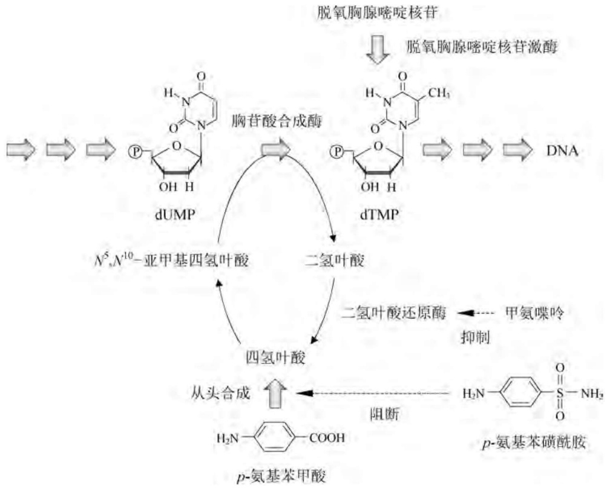

<details>
<summary>flowchart</summary>

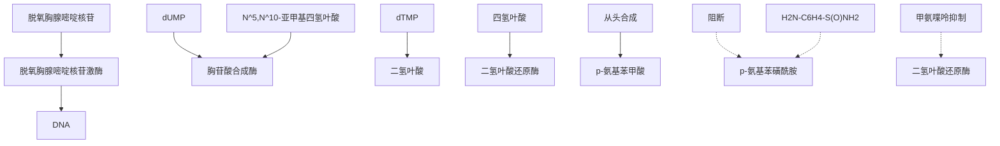
</details>

图5-17 酿酒酵母四氢叶酸合成途径的抑制机制

利用质粒上的营养成分生物合成标记基因互补相应的营养缺陷型受体，可以在不添加任何筛选试剂的条件下维持转化子中质粒的存在，但这种筛选互补模式并不稳定，而且对选择培养基的要求也很高，在大规模传统发酵中普遍使用的复合培养基一般不能用作这种工程菌的培养。解决这一难题的一种有效方法是建立所谓的自选择系统。酿酒酵母的一种 $srb - 1$ 突变株对环境条件极为敏感，它只能在含渗透压稳定剂的培养基中正常生长，而在普通复合培养基中细胞会自发裂解。用含野生型SRB1基因的自主复制型多拷贝质粒转化这种突变株受体细胞，只有转化子才能在不含渗透压稳定剂的普通培养基中生长，因此任何培养基均可用于转化细胞的筛选以及质粒的稳定维持。更为优越的是，含有SRB1标记基因的多拷贝载体能在受体菌中稳定复制80代以上。相对化学试剂或营养缺陷互补筛选程序而言，这种自选择系统具有更高的应用价值。

## 5.2.4 酵母的表达系统

尽管酵母的生长代谢特征与大肠杆菌等原核细菌有许多相似之处，但在基因表达调控模式尤其是转录水平上与原核细菌有着本质的区别，因而酵母是研究真核生物基因表达调控的理想模型。绝大多数的酵母基因在所有生理条件下均以基底水平转录，每个细胞或细胞核只产生 $1\sim 2$ 个mRNA分子。因此，外源基因在酵母中高效表达的关键是选择高强度的启动子，以改变受体细胞基因基底水平转录的控制系统；同时控制外源基因的拷贝数。

## 1. 酵母启动子的基本特征

用于启动转录蛋白质结构基因的酵母II型启动子由基本区和调控区两部分组成，基本区包括TATA盒和转录起始位点。在芽殖酵母的典型代表酿酒酵母的基因组（总长为13.5Mb的16条染色体上拥有6449个蛋白质编码基因)中，转录起始位点位于TATA盒下游$30\sim 120~\mathrm{bp}$ 的区域内，但裂殖酵母的典型代表粟酒裂殖酵母的mRNA合成位点紧邻TATA盒，与高等真核生物的启动子结构非常相似。这两种来源的启动子在启动基因转录方面具有交叉活性，但其转录起始位点的选择与宿主细胞的性质密切相关。例如，粟酒裂殖酵母的基因在酿酒酵母细胞中的转录起始位点位于其正常转录起始位点的下游，而酿酒酵母的基因在粟酒裂殖酵母细胞中的转录却在其TATA盒的邻近区域开始，也就是说，同一个基因的转录产物在两种宿主细胞中的大小并不一致，这种现象有可能直接影响mRNA的翻译过程，因此启动子与受体细胞之间的合理匹配对异源基因在酵母中的表达具有重要意义。

酵母启动子的调控区位于基本区上游数百碱基对的区域内，由上游激活序列(UAS)和上游阻遏序列(URS)等顺式元件组成。这些元件均为相应的反式蛋白调控因子的作用位点，并激活或关闭由TATA盒介导的基因转录，而反式蛋白调控因子的表达及其活性状态的改变又受到特异性信号分子的影响，由此构成酵母基因表达的时空特异性调控网络。

与大肠杆菌相似，利用启动子探针质粒可从酵母基因组中克隆和筛选具有特殊活性的强启动子，所使用的无启动子报告基因为疱疹单纯病毒的胸腺嘧啶激酶编码基因（HSV1-TK），该酶催化胸腺嘧啶合成dTMP。酿酒酵母天然缺少TK基因，其dTMP是由胸腺嘧啶核苷酸合成酶从dUMP转化而来的。甲氨喋呤和对氨基苯磺酰胺抑制其dTMP的生物合成，因而能抑制细胞的分裂。将HSV1-TK基因与pJDB207重组构建一个启动子探针质粒，在TK基因上游的单一限制性酶切口处插入随机断裂的酵母基因组DNA片段，从含有甲氨喋呤、对氨基苯磺酰胺以胸腺嘧啶的选择培养基上即可获得含有启动子活性片段的阳性转化子。启动子的强度则可通过分析转化子中胸腺嘧啶激酶的活性以及转化子在培养基上生长所需的最少胸腺嘧啶浓度来表示，利用这个系统已筛选出一个极强的酵母菌启动子。获得强启动子的另一种方法是利用天然的内源和外源启动子元件拼装具有优良调控性能的合成启动子(详见5.2.4)。

## 2. 酵母的组成型启动子

酵母的组成型启动子泛指那些转录活性严格依赖于葡萄糖存在和营养生长的启动子，其基本特征是在葡萄糖耗竭后所属基因转录水平急剧下跌。就糖代谢异常旺盛的酿酒酵母而言，参与糖酵解途径的基因所属的启动子基本上属于组成型且转录活性最强。这些葡萄糖依赖型的启动子包括:磷酸甘油酸激酶编码基因启动子 $P_{\mathrm{PGK1}}$ 、丙酮酸脱羧酶编码基因启动子 $P_{\mathrm{PDC1}}$ 、磷酸丙糖异构酶编码基因启动子 $P_{\mathrm{TPI1}}$ 、乙醇脱氢酶I编码基因启动子 $P_{\mathrm{ADH1}}$ 、丙酮酸激酶编码基因启动子 $P_{\mathrm{PYK1}}$ 、甘油醛-3-磷酸脱氢酶编码基因启动子 $P_{\mathrm{TDH3}}$ 或 $P_{\mathrm{GPD}}$ 。除此之外，广泛用于介导外源基因高效表达的强组成型启动子还来自那些与酿酒酵母营养生长密切相关的基因，如翻译延伸因子编码基因 $(P_{\mathrm{TEF1}})$ 、细胞色素C编码基因 $(P_{\mathrm{CYC1}})$ 、肌动蛋白编码基因 $(P_{\mathrm{ACT1}})$ 、交配因子 $\alpha_{1}$ 编码基因 $(P_{\mathrm{MF}\alpha 1})$ 以及己糖转运子编码基因 $(P_{\mathrm{HXT7}})$ 等。

上述组成型启动子对葡萄糖存在和细胞生长的严格依赖性与其结构密切相关。例如，全长为 $1500\mathrm{bp}$ 的 $P_{\mathrm{ADH1}}$ 在酿酒酵母生长于葡萄糖培养基时被激活，并随着葡萄糖和乙醇的消耗而呈下调趋势；其上游序列缺失了 $1100\mathrm{bp}$ 的短小版本 $(P_{\mathrm{ADH1s}})$ 将表达转至乙醇生长早期，且活性在乙醇消耗晚期反而上扬；恢复其上游 $300\mathrm{bp}$ 片段所形成的一种中长型版本 $(P_{\mathrm{ADH1m}})$ 则在酿酒酵母对数生长早期被激活，且活性一直维持到乙醇消耗晚期。

采用组成型启动子介导外源基因在酿酒酵母中高效表达的优势在于无需添加任何诱导剂，且能与细胞生长同步保持相对恒定的表达水平。前者可以在降低生产成本的同时避免诱导剂可能造成的污染，这在生产重组蛋白药物时尤为重要；后者对表达那些必须在细胞生长期间具有活性的基因或途径是必不可少的。然而，在外源基因表达产物对酵母细胞构成潜在危害或者希望细胞生长与重组蛋白表达相分离的情况下，组成型启动子并非理想的选择。在不少情形中，组成型强启动子的使用导致重组质粒不稳定以及外源基因拷贝数降低。例如，采用 $2\mu$ 质粒上的强组成型启动子 $P_{GK1}$ 控制海肾荧光素酶(Rluc)编码基因的表达，重组质粒的拷贝数为5.6，而对照空载质粒的拷贝数却为11.6。

由于各组成型启动子的结构和序列各不相同，因此它们介导基因转录的强度也有很大差异，而且这种差异还受到酵母种属、培养基组成、细胞生长阶段、载体复制类型、基因性质和序列等诸多因素的影响。例如，生长于葡萄糖培养基中的酿酒酵母在其含 CEN/ARS 或  $2\mu$  复制子的载体上，四种常用组成型启动子介导大肠杆菌  $\beta-$  半乳糖苷酶表达的相对活性大小顺序为  $P_{TDH3} > P_{TEF1} >> P_{ADH1} >> P_{CYC1}$ 。同样条件下，若将  $\beta-$  半乳糖苷酶报告基因表达盒以单拷贝的方式整合在酿酒酵母的染色体 DNA 上，那么七种组成型启动子在葡萄糖消耗生长期中表现出的强度顺序为  $P_{TEF1} \sim P_{PGK1} \sim P_{TDH3} > P_{TPI1} \sim P_{PYK1} > P_{ADH1} > P_{HXT7}$ ；但在乙醇消耗早期生长阶段中，强度顺序却变为  $P_{HXT7} \sim P_{TEF1} > P_{PGK1} > P_{TPI1} \sim P_{TDH3} > P_{PYK1} \sim P_{ADH1}$ ；而当酿酒酵母生长在含 1% 的乙醇培养基中时（即乙醇生长阶段），启动子的强度顺序又变为  $P_{HXT7} >> P_{PDC1} \sim P_{TPI1} \sim P_{PGK1} > P_{ADH1} > P_{PYK1} > P_{ENO2}$ 。在糖蜜作为碳源并处于葡萄糖消耗生长期时，酿酒酵母含  $2\mu$  复制子质粒上的五种组成型启动子介导白地霉 (Geotrichum candidum) 脂肪酶表达的相对活性顺序为  $P_{PGK1} > P_{ADHm} \sim P_{ACT1} >> P_{ADH1s} \sim P_{TDH1}$ ；但在乙醇消耗早期阶段，启动子的相对强度顺序却变为  $P_{ACT1} > P_{PGK1} \sim P_{ADH1s} > P_{TDH3} > P_{ADHm}$ ；而在乙醇消耗晚期阶段，只有  $P_{ADH1s}$  呈转录启动活性。

## 3. 酵母的调控型启动子

调控型启动子是指那些转录启动活性受诱导剂或阻遏因子明确控制的启动子。调控型启动子能通过诱导效应或(和)脱阻遏效应定时定量地启动外源基因的表达及其水平，因而更适合使重组细胞生长到一定密度之后方诱导外源基因表达的场合，以防止高浓度的重组表达产物对受体细胞可能构成的毒性作用。然而，诱导型启动子的使用也受到启动子对诱导剂的敏感性(包括细胞响应诱导剂或阻遏剂的强度和时间)、因启动子渗漏所造成的表达本底以及诱导剂的价格等因素的影响。根据调控机理不同，调控型启动子又可分为脱阻遏型启动子和诱导型启动子两大类。前者为各种化学阻遏物或物理阻遏因素所阻遏，仅当这些阻遏因子/因素自然消失后才能启动基因的转录；后者可在各种化学诱导剂或物理诱导因素出现时介导基因的转录启动或者增强基因的转录水平。

## (1) 酵母的葡萄糖阻遏机制

葡萄糖是酵母偏爱的碳源和能源。转录组分分析显示，酿酒酵母至少有163个基因在葡萄糖限制条件下表达呈上调趋势，即葡萄糖对这些基因的表达具有阻遏效应。这一阻遏过程涉及相关阻遏因子（如Mig家族成员）对细胞内外葡萄糖浓度的感应以及对其靶基因特定调控序列的识别与结合(图5-18)。在高葡萄糖浓度时，Mig1从胞质转至核内，与靶启动子调控序列中的GC丰富位点结合，并招募由Ssn6-Tup1构成的阻遏复合物，其结果是转录起始因子如 Sip4 等不能接近其结合位点，转录呈阻遏状态；一旦细胞内的葡萄糖被耗尽，蛋白激酶 SNF1 便被磷酸化激活，并通过磷酸化促使 Mig1 和阻遏复合物从靶序列上剥离，启动子脱阻遏。随后，Mig1 被逐出核外，Sip4 被磷酸化激活而介导启动子的转录启动。

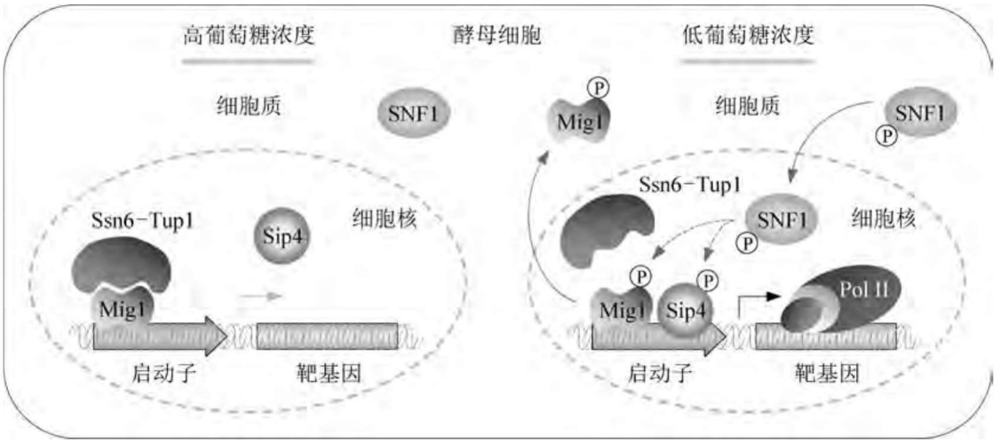

<details>
<summary>flowchart</summary>

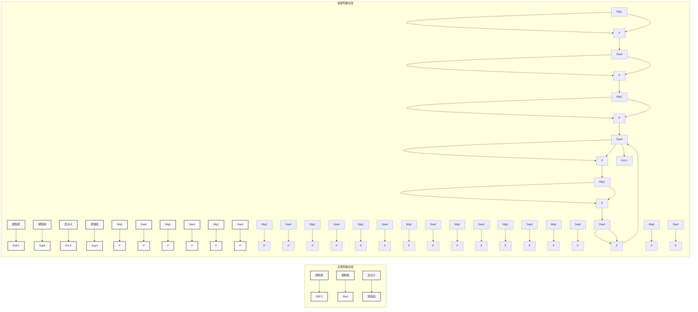
</details>

图5-18 酵母中葡萄糖阻遏的分子机制

很多具有葡萄糖阻遏效应的基因如己糖转运子(MTH1、HXT4、HXK1)仅为Mig1所阻遏。然而，两个额外的Mig阻遏因子(Mig2和Mig3)能以一种增效的方式部分协助Mig1参与葡萄糖阻遏，如ICL1、ICL2、GAL3、HXT2、MAL11、MAL31、MAL32、MAL33、MRK1、SUC2等基因为Mig1和Mig2联合阻遏，甚至SIR2基因仅在Mig3存在下便可被完全阻遏。

## (2) 酵母的脱阻遏型启动子

酵母脱阻遏型启动子的基本特征是不能为化学诱导剂或物理诱导因素所诱导，除非在低浓度或无葡萄糖存在条件下脱阻遏。当细胞内葡萄糖浓度高于一定阈值时，染色质结构阻碍转录激活因子（如 Adr1 等）接近启动子；随着葡萄糖的不断消耗，转录激活因子的 DNA 结合功能域脱磷酸化（以及组蛋白 H3 和 H4 乙酰化），此时在无任何诱导信号存在的情况下，转录激活因子便能与启动子调控区域结合，进而介导靶基因的表达。因此，选择脱阻遏型启动子驱动外源基因表达的优势非常明显:在碳源富足的细胞生长期间目标蛋白并不表达，一旦重组酵母进入对数生长晚期，外源基因无需外部施加诱导便会自动转录。酵母中部分具有代表性的脱阻遏型启动子及其性质列在表 5-10 中。

酿酒酵母的己糖运输子共由17个HXT基因编码，其中一些呈诱导型（如HXT1），而另一些则为高浓度的葡萄糖所阻遏（如HXT2、HXT4、HXT6、HXT7）。在所有的葡萄糖转运子中，HXT7与葡萄糖的亲和性最高，而且HXT7启动子区域也是构建酵母表达系统合适的调控元件，其介导转录启动的强度在酿酒酵母乙醇连续发酵过程中最高。

酿酒酵母的 SUC2 基因编码一种转化酶( $\beta-$ 呋喃果糖糖苷酶)，其所属启动子  $P_{SUC2}$  除蔗糖外无需任何外部诱导剂便能介导高效转录。与 HXT 基因的启动子相似， $P_{SUC2}$  的脱阻遏发生在葡萄糖(或果糖等)浓度低至某一阈值(0.1%质量体积比)以下时；然而当葡萄糖浓度跌至零时， $P_{SUC2}$  重新回到阻遏状态。例如，在以甘油作为唯一碳源(无糖类阻遏)的培养过程中，SUC2 的表达水平比在低浓度葡萄糖培养时低 8 倍。事实上， $P_{SUC2}$  的调控既涉及 Mig1 和 Mig2（高浓度葡萄糖阻遏），又涉及 Rgt1（葡萄糖缺乏时阻遏）。此外， $P_{SUC2}$  的转录启动活性还能为蔗糖所诱导，但这种诱导并非必需。 $P_{SUC2}$  已被证明在重组酵母中表达外源蛋白非常合适，例如在以乳酸作为碳源时， $P_{SUC2}$  介导  $\alpha-$  淀粉酶的表达获得了显著效果。与酿酒酵母  $P_{SUC2}$  性能类似的启动子还包括马氏克鲁维酵母（Kluyveromyces marxianus）中的  $P_{INU1}$ （其基因编码一种菊粉酶）以及粟酒裂殖酵母的  $P_{inv1}$ 。

表 5-10 酵母典型的葡萄糖阻遏型启动子及其性质

<table><tr><td>启动子</td><td>基因功能</td><td>酵母种属</td><td>脱阻遏强度</td><td>调控序列</td><td>DNA结合蛋白</td></tr><tr><td> $P_{HXT7}$ </td><td>高亲和型己糖转运子</td><td>酿酒酵母</td><td>10~15倍</td><td>未知</td><td></td></tr><tr><td rowspan="7"> $P_{HXT2}$ </td><td rowspan="7">高亲和型己糖转运子</td><td rowspan="7">酿酒酵母</td><td rowspan="7">10~15倍</td><td>从-590至-579</td><td rowspan="3">Rgt1(-)</td></tr><tr><td>从-430至-424</td></tr><tr><td>从-393至-387</td></tr><tr><td>从-504至-494</td><td rowspan="2">Mig1(-)</td></tr><tr><td>从-427至-415</td></tr><tr><td>从-291至-218</td><td>UAS</td></tr><tr><td>从-226至-218</td><td>激活因子</td></tr><tr><td> $P_{HXT4}$ </td><td>高亲和型己糖转运子</td><td>酿酒酵母</td><td></td><td>从-645至-639</td><td>Rgt1(-)</td></tr><tr><td> $P_{HXT6}$ </td><td>高亲和型己糖转运子</td><td>酿酒酵母</td><td>10倍</td><td>未知</td><td>Mig2(-)</td></tr><tr><td> $P_{KHT2}$ </td><td>高亲和型己糖转运子</td><td>乳酸克鲁维酵母</td><td>2倍</td><td>未知</td><td></td></tr><tr><td> $P_{HGT9\ 10\ 12\ 17}$ </td><td>高亲和型己糖转运子</td><td>白色假丝酵母</td><td></td><td>未知</td><td></td></tr><tr><td rowspan="5"> $P_{SUC2}$ </td><td rowspan="5">转化酶</td><td rowspan="5">酿酒酵母</td><td rowspan="5">200倍</td><td>从-499至-480</td><td rowspan="2">Mig1/Mig2(-)</td></tr><tr><td>从-442至-425</td></tr><tr><td>从-627至-617</td><td>Skol</td></tr><tr><td>从-650至-418</td><td>UAS</td></tr><tr><td>-133</td><td>RNA Pol II</td></tr><tr><td rowspan="2"> $P_{ADH2}$ </td><td rowspan="2">乙醇脱氢酶II</td><td rowspan="2">酿酒酵母</td><td rowspan="2">100倍</td><td>从-319至-292</td><td>Cat8(+)</td></tr><tr><td>从-291至?</td><td>Adr1(+)</td></tr><tr><td rowspan="5"> $P_{JEN1}$ </td><td rowspan="5">乳酸渗透酶</td><td rowspan="5">酿酒酵母</td><td rowspan="5">10倍</td><td>从-651至-632</td><td rowspan="2">Cat8(+)</td></tr><tr><td>从-1321至-1302</td></tr><tr><td>从-660至-649</td><td rowspan="2">Mig1(-)</td></tr><tr><td>从-1447至-1436</td></tr><tr><td>从-739至-727</td><td>Abf1</td></tr><tr><td rowspan="2"> $P_{MOX}$ </td><td rowspan="2">甲醇氧化酶</td><td rowspan="2">多形汉逊酵母</td><td rowspan="2"></td><td>从-245至-112</td><td>Adr1(+)</td></tr><tr><td>从-507至-430</td><td>UAS</td></tr><tr><td> $P_{AOX\Delta6}$ </td><td>乙醇氧化酶</td><td>巴斯德毕赤酵母</td><td></td><td></td><td>删除GCR1位点</td></tr><tr><td rowspan="3"> $P_{GLK1}$ </td><td rowspan="3">葡萄糖激酶</td><td rowspan="3">酿酒酵母</td><td rowspan="3">6倍</td><td>从-881至-702</td><td>Gcr1</td></tr><tr><td>从-572至-409</td><td>URS</td></tr><tr><td>从-408至-104</td><td>Msn2/Msn4(+)</td></tr><tr><td> $P_{HXK1}$ </td><td>己糖激酶</td><td>酿酒酵母</td><td>10倍</td><td>未知</td><td></td></tr><tr><td> $P_{ALG2}$ </td><td>异柠檬酸裂合酶</td><td>多形汉逊酵母</td><td></td><td>未知</td><td></td></tr></table>

注:（一）—转录阻遏因子；（+）—转录激活因子。

在多个酵母种属中均得以广泛应用的优秀启动子 $P_{\mathrm{ADH2}}$ 来自酿酒酵母的乙醇脱氢酶II编码基因。与广泛使用的组成型启动子 $P_{\mathrm{ADH1}}$ 不同，$P_{\mathrm{ADH2}}$ 为葡萄糖强烈阻遏，只有当转录激活因子Adr1结合在上游激活序列UAS1处时 $P_{\mathrm{ADH2}}$ 才会脱阻遏；而Adr1仅当葡萄糖被耗尽时才脱磷酸化，细胞遂开关转向基于乙醇的生长阶段（Adr1的脱磷酸化呈SNF1依赖性）。此外，$P_{\mathrm{ADH2}}$ 还含有UAS2位点，与之结合的Cat8很可能以一种与Adr1协同的方式激活 $P_{\mathrm{ADH2}}$ 。$P_{\mathrm{ADH2}}$ 序列内部不存在典型的Mig1结合位点，其葡萄糖阻遏效应主要由Glc7/

Reg1 复合物介导。在相同条件下与  $P_{CUP1}$ 、 $P_{GAL1}$ 、 $P_{PGK1}$  相比， $P_{ADH2}$  介导  $\beta-$  半乳糖苷酶报告基因表达的强度最高。

## (3) 酵母的碳源诱导型启动子

酵母碳源诱导型启动子的基本特征是在葡萄糖耗竭时脱阻遏，同时额外需要其他碳源的诱导方能完全呈现其表达效能。这些碳源诱导剂或在胞内碳源代谢过程中相伴产生，或由发酵初始培养基提供。半乳糖、麦芽糖、蔗糖等发酵碳源以及油酸、甘油、乙酸、乙醇等非发酵碳源均可作为碳源诱导剂调控基因的表达。酵母中部分具有代表性的碳源诱导型启动子及其性质列在表5-11中。

表 5-11 酵母典型的碳源诱导型启动子及其性质

<table><tr><td>启动子</td><td>基因功能</td><td>酵母种属</td><td>诱导剂/强度</td><td>调控序列</td><td>DNA结合蛋白</td></tr><tr><td rowspan="2"> $P_{\text{GAL1}}$ </td><td rowspan="2">半乳糖代谢</td><td rowspan="2">酿酒酵母</td><td rowspan="2">半乳糖(1000倍)</td><td>从-390至-255</td><td>Gal4(+)</td></tr><tr><td>从-201至-187</td><td>Mig1(-)</td></tr><tr><td rowspan="2"> $P_{\text{GAL7}}$ </td><td rowspan="2">半乳糖代谢</td><td>酿酒酵母</td><td>半乳糖(1000倍)</td><td>从-264至-161</td><td>Gal4(+)</td></tr><tr><td>乳酸克鲁维酵母</td><td>半乳糖</td><td>未知</td><td></td></tr><tr><td rowspan="2"> $P_{\text{GAL10}}$ </td><td rowspan="2">半乳糖代谢</td><td>酿酒酵母</td><td>半乳糖(1000倍)</td><td>从-324至-216</td><td>Gal4(+)</td></tr><tr><td>麦芽糖假丝酵母</td><td>半乳糖</td><td>未知</td><td></td></tr><tr><td rowspan="3"> $P_{\text{PIS1}}$ </td><td rowspan="3">磷酸肌醇合成酶</td><td rowspan="3">酿酒酵母</td><td>半乳糖缺氧(2倍)</td><td>从-149至-138</td><td>Rox1/Gcr1</td></tr><tr><td rowspan="2">锌耗竭(2倍)</td><td>从-224至-205</td><td>Ste12/Pho2</td></tr><tr><td>从-184至-149</td><td>Mcm1(-)</td></tr><tr><td rowspan="3"> $P_{\text{LAC4}}$ </td><td rowspan="3">乳糖代谢</td><td rowspan="3">乳酸克鲁维酵母</td><td rowspan="3">乳糖半乳糖(100倍)</td><td>从-173至-235</td><td>RNA Pol II</td></tr><tr><td>从-437至-420</td><td>Lac9(+)</td></tr><tr><td>从-673至-656</td><td></td></tr><tr><td> $P_{\text{MAL1}}$ </td><td>麦芽糖酶</td><td>多形汉逊酵母</td><td>麦芽糖</td><td>未知</td><td></td></tr><tr><td> $P_{\text{MAL62}}$ </td><td>麦芽糖酶</td><td>酿酒酵母</td><td>麦芽糖</td><td>从-759至-743</td><td>Mal63</td></tr><tr><td> $P_{\text{AGT1}}$ </td><td>α-葡萄糖苷转运子</td><td>酿酒酵母</td><td>麦芽糖</td><td></td><td>Mig1/Malx3(+)</td></tr><tr><td rowspan="4"> $P_{\text{ICL1}}$ </td><td rowspan="4">异柠檬酸裂合酶</td><td>巴斯德毕赤酵母</td><td>乙醇(200倍)</td><td>未知</td><td></td></tr><tr><td rowspan="3">酿酒酵母</td><td rowspan="3">乙醇(200倍)</td><td>从-397至-388</td><td>Cat8/Sip4(+)</td></tr><tr><td>从-261至-242</td><td>URS</td></tr><tr><td>在-96区域</td><td>RNA Pol II</td></tr><tr><td rowspan="2"> $P_{\text{FBP1}}$ </td><td rowspan="2">果糖-1,6-二磷酸酶</td><td rowspan="2">酿酒酵母</td><td rowspan="2">甘油乙酸乙醇(10倍)</td><td>从-248至-231</td><td>Hap2/3/4(-)</td></tr><tr><td>未知</td><td>Cat8/Sip4(+)</td></tr><tr><td rowspan="3"> $P_{\text{PCK1}}$ </td><td rowspan="3">PEP羧激酶</td><td>酿酒酵母</td><td>甘油乙酸乙醇(10倍)</td><td>从-480至-438</td><td>Cat8/Sip4(+)</td></tr><tr><td rowspan="2">白色假丝酵母</td><td rowspan="2">琥珀酸酪蛋白氨基酸</td><td>从-320至-123</td><td>Hap2/3/4(-)</td></tr><tr><td>从-444至-108</td><td>Mig1(-)</td></tr><tr><td rowspan="2"> $P_{\text{GUT1}}$ </td><td rowspan="2">甘油激酶</td><td rowspan="2">酿酒酵母</td><td rowspan="2">甘油乙酸乙醇油酸</td><td>从-221至-189</td><td>Adr1(+)</td></tr><tr><td>从-319至-309</td><td>Ino2/4(+)</td></tr><tr><td> $P_{\text{CYC1}}$ </td><td>细胞色素C</td><td>酿酒酵母</td><td>氧(200倍)乳酸(8倍)</td><td>未知</td><td></td></tr><tr><td> $P_{\text{ADH4}}$ </td><td>乙醇脱氢酶IV</td><td>乳酸克鲁维酵母</td><td>乙醇</td><td>从-953至-741</td><td>UAS</td></tr><tr><td> $P_{\text{AOX1/2}}$ </td><td>乙醇氧化酶</td><td>巴斯德毕赤酵母</td><td>甲醇</td><td>从-414至-171</td><td>Mxr1(+)</td></tr><tr><td> $P_{\text{AUG1/2}}$ </td><td>乙醇氧化酶</td><td>嗜甲醇毕赤酵母</td><td>甲醇</td><td>未知</td><td></td></tr><tr><td> $P_{\text{DAS1}}$ </td><td>二羟丙酮合成酶</td><td>巴斯德毕赤酵母</td><td>甲醇</td><td>从-980至-1</td><td>Mxr1(+)</td></tr><tr><td> $P_{\text{FDH}}$ </td><td>甲酸脱氢酶</td><td>多形汉逊酵母</td><td>甲醇</td><td>未知</td><td></td></tr><tr><td> $P_{\text{FLD1}}$ </td><td>甲醛脱氢酶</td><td>巴斯德毕赤酵母</td><td>甲醇甲胺胆碱</td><td>未知</td><td></td></tr><tr><td> $P_{\text{POX2}}$ </td><td>过氧化物酶体蛋白</td><td>解脂耶氏酵母</td><td>油酸</td><td>未知</td><td></td></tr><tr><td> $P_{\text{PEX8}}$ </td><td>过氧化物酶体蛋白</td><td>巴斯德毕赤酵母</td><td>油酸甲醇(3~5倍)</td><td>从-1000至-1</td><td>Mxr1(+)</td></tr><tr><td rowspan="2"> $P_{\text{INU1}}$ </td><td rowspan="2">菊粉酶</td><td rowspan="2">马氏克鲁维酵母</td><td rowspan="2">果糖菊粉蔗糖</td><td>从-271至-266</td><td>RNA Pol II</td></tr><tr><td>从-163至-153</td><td>Mig1(-)</td></tr></table>

注:（一）—转录阻遏因子；（+）—转录激活因子；PEP—磷酸稀醇式丙酮酸。

酿酒酵母半乳糖代谢基因 GAL 所属的启动子是最典型且鉴定最详尽的碳源诱导型启动子，它们受顺式激活元件严格调控，在葡萄糖接近耗尽时为主要诱导剂半乳糖强烈诱导，其调控机制如图 5-19 所示。作为一种转录激活因子，Gal4 通过与半乳糖利用途径中 GAL1（半乳糖激酶编码基因）、GAL7（α-D-半乳糖-1-磷酸尿嘧啶转移酶编码基因）、GAL10（尿嘧啶二磷酸葡萄糖-4-差向异构酶编码基因）启动子上游的 UAS 特异性结合而激活之；而 Gal4 在核内又受 Gal6 和 Gal80 的负调控。Gal3 是一种信号转导因子，能与半乳糖和 Gal80 形成复合物，后者导致 Gal80 释放 Gal4，从而激活 GAL1、GAL7、GAL10 的表达。研究显示，无论是在 CEN/ARS 型还是在 2μ 型载体上， $P_{GAL1}$  和  $P_{GAL10}$  介导大肠杆菌 β-半乳糖苷酶表达的强度在所测试的诱导型启动子中均最高 ( $P_{GAL1} \sim P_{GAL10} >> P_{PGK1} > P_{PHO5} \sim P_{CUP1}$ )，因此  $P_{GAL1}$  和  $P_{GAL10}$  被广泛用于酿酒酵母生产重组蛋白，不过半乳糖对这两种启动子的高效诱导严格依赖于低葡萄糖浓度的维持。由于半乳糖（价格较高）在发酵过程中也能被代谢利用，所以其诱导效应会随着发酵时间的推移而减弱。解决这一问题的策略是构建 GAL1、MIG1、HXK2 的联合缺陷突变株，在阻断酿酒酵母半乳糖代谢途径的同时衰减葡萄糖阻遏效应。其结果是  $P_{GAL10}$  即使在较低浓度的半乳糖存在下也能被诱导；同时葡萄糖的存在并不影响启动子的活性。

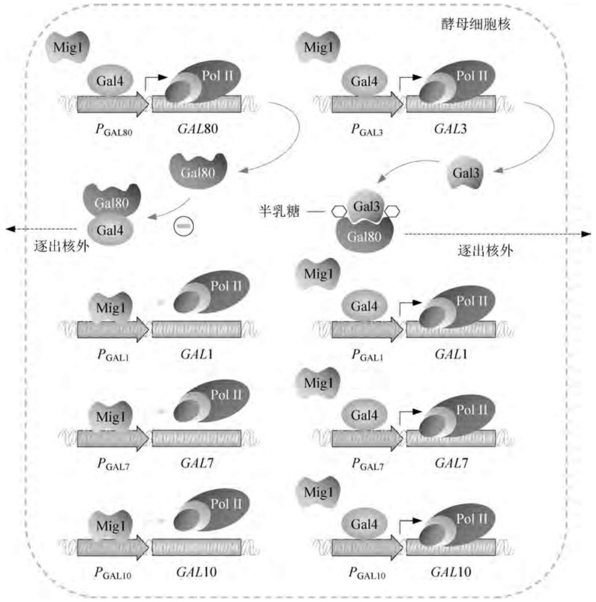

<details>
<summary>flowchart</summary>

```mermaid
graph TD
  subgraph Mouse Cell
  A["Mig1"] --> B["Gal4"]
  B --> C["Pol II"]
  D["P_GAL80"] --> E["Gal80"]
  F["Gal3"] --> G["Gal3"]
  H["Gal4"] --> I["Gal4"]
  J["Gal80"] --> K["Gal80"]
  L["Mig1"] --> M["Gal4"]
  M --> N["Pol II"]
  O["Gal3"] --> P["Gal3"]
  Q["Gal80"] --> R["Gal80"]
  S["Mig1"] --> T["Gal4"]
  T --> U["Pol II"]
  V["Gal1"] --> W["GAL1"]
  X["Mig1"] --> Y["Gal4"]
  Y --> Z["Pol II"]
  AA["Gal7"] --> AB["GAL7"]
  AC["Mig1"] --> AD["Gal4"]
  AD --> AE["Pol II"]
  AF["Gal7"] --> AG["GAL7"]
  AH["Mig1"] --> AI["Gal4"]
  AI --> AJ["Pol II"]
  AK["Gal10"] --> AL["GAL10"]
  AM["Mig1"] --> AN["Gal4"]
  AN --> AO["Pol II"]
  AP["Gal10"] --> AQ["GAL10"]
  end

  subgraph Glucose Pathway
    B -.->|Protonation| E
    E -.->|Protonation| F
    F -.->|Protonation| G
    G -.->|Protonation| H
    H -.->|Protonation| I
    I -.->|Protonation| J
    J -.->|Protonation| K
    K -.->|Protonation| L
    L -.->|Protonation| M
    M -.->|Protonation| N
    N -.->|Protonation| O
    O -.->|Protonation| P
  end

  subgraph Protein Structure
  P --> Q
  Q --> R
  R --> S
  S --> T
  T --> U
  U --> V
  V --> W
  W --> X
  X --> Y
  Y --> Z
  Z --> AA
  AA --> AB
  AB --> AC
  AC --> AD
  AD --> AE
  AE --> AF
  AF --> AG
  AG --> AH
  end

  subgraph Extracellular Vesicle
  I --> AI
  AI --> AJ
  AJ --> AK
  end
```
</details>

图5-19 酵母半乳糖代谢基因表达调控机制

另外，GAL4基因的表达水平通常较低，尤其当外源基因被克隆在含半乳糖启动子的多拷贝质粒上时，半乳糖的诱导效果会大打折扣。为此，将GAL4编码序列置于 $P_{\mathrm{GAL10}}$ 控制之下，由此构建的受体细胞在半乳糖缺乏时，GAL4以基底水平表达；一旦加入半乳糖，高效表达的GAL4便与高浓度的半乳糖共同作用于控制外源基因表达的另一个GAL启动子（如$P_{\mathrm{GAL1}}$），这被称为超诱导表达系统。

除酵母属外,克鲁维酵母属和假丝酵母属(Candida)也存在半乳糖利用的同源基因,只是基因表达的调控机制略有差异;而巴斯德毕赤酵母则缺少功能性的半乳糖代谢途径以及相应的启动子。

## (4) 酵母的其他诱导型启动子

酿酒酵母 $PHO5$ 基因通常在培养基中游离磷酸盐耗尽时被诱导高效表达，将 $PHO5$ 启动子与 $\alpha_{\mathrm{D}}$ -干扰素编码基因重组，转化子在高磷酸盐的培养基中于 $30^{\circ}\mathrm{C}$ 迅速生长，当将之转移到不含磷酸盐的培养基中时，其合成干扰素的能力提高 $100\sim 200$ 倍。PHO4基因的编码产物是 $PHO5$ 基因表达的转录激活因子，其温度敏感型突变版本 $PHO4^{\mathrm{TS}}$ 的编码产物在$35^{\circ}C$ 时失活，因此含有 $PHO4^{\mathrm{TS}} - PHO5$ 型启动子的重组酿酒酵母在 $35^{\circ}C$ 时能正常生长，但不表达外源基因。当培养温度迅速下降到 $23^{\circ}C$ 时，温敏型 $\mathrm{Pho4^{TS}}$ 促进PHO5启动子的转录启动活性，进而诱导其下游外源基因的表达。但这种诱导水平只及游离磷酸缺乏时诱导水平的 $10\% \sim 20\%$ ，其原因可能是由于 $23^{\circ}C$ 时酵母的代谢能力普遍受到抑制，或者温敏型$\mathrm{Pho4^{TS}}$ 蛋白的活性在这种温度下不能正常发挥。

酿酒酵母的a型和 $\alpha$ 型两种单倍体由位于交配类型遗传位点的MATa和MATα两个等位基因共同决定。MATα基因由两个顺反子MATα1和MATα2组成，前者编码一个转录激活因子，为所有决定 $\alpha$ 型细胞表型的 $\alpha$ 特异性基因表达所必需（即 $\alpha_{1}$ 激活过程）；后者编码所有决定a型细胞表型基因的阻遏蛋白（即 $\alpha 2$ 阻遏过程）。MATa基因也由MATa1和MATa2两个顺反子组成，其表达产物在单倍体细胞中没有功能，但在单倍体的交配过程中，$\mathrm{a}_{1}$ 蛋白可与a2蛋白协同阻遏MATα1顺反子的转录（即a1-a2阻遏）。利用上述细胞类型决定簇的两个突变基因可以构建对外源基因表达进行温度控制的二元系统，一个是温度敏感型的 $sir3 - 8^{ts}$ 突变基因；另一个是 $\alpha 2$ 蛋白的hmlα2-102突变，导致它在与a1蛋白交配时对MATα顺反子阻遏活性的丧失，但仍保留着阻遏a特异性基因的能力。

具有 $MATa - hml\alpha 2 - 102 - sir3 - 8^{\mathrm{ts}}$ 基因型的酵母细胞在 $25^{\circ}\mathrm{C}$ 培养时呈a交配类型，因为此时仅有MATa基因能表达，hmlα2-102为Sir蛋白所阻遏；但当这种细胞生长在 $35^{\circ}\mathrm{C}$ 时，MAT和HML均能表达，只有a2基因被阻遏，因此细胞呈现 $\alpha$ 交配类型。当外源基因置于a特异性基因的启动子控制之下时，a交配型的受体细胞在 $25^{\circ}\mathrm{C}$ 表达外源基因，但在$35^{\circ}\mathrm{C}$ 不表达[图5-20(a)]；相反，如果外源基因与 $\alpha$ 特异性基因的启动子重组，则它仅在$35^{\circ}\mathrm{C}$ 表达，而在 $25^{\circ}\mathrm{C}$ 不表达[图5-20(b)]。以PHO5作为报告基因，将之与 $\alpha$ 特异性基因$MF\alpha 1$ 的启动子连接在一起，转化子中PHO5基因在较高的温度下表达，当培养温度迅速下降后，其表达迅速终止，与之相反的例子也同样得以证实。

很多酿酒酵母的宿主载体系统由于缺乏严紧控制的表达机制，在应用中受到一定程度的限制，然而一种以人雄激素受体为中心的严紧控制表达系统能有效地将外源基因的表达水平控制在一个合适的范围内。在此系统中，雄激素受体表达水平、雄激素浓度、重组质粒拷贝数三者之间的平衡，可以有效作用于对雄激素具有应答能力的启动子，并通过这个启动子将外源基因的表达水平控制在高于基底表达水平1400倍的范围内，同时不影响受体细胞的正常生长。这个控制系统相对于普遍应用的酵母诱导表达系统而言具有显著的优越性，它不需要控制碳源和加入诱导剂，因此无论是对重组异源蛋白的生产还是对蛋白质相互作用的基础分子生物学研究都具有很强的实用性。

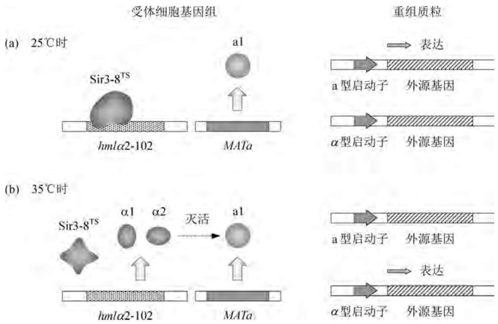

<details>
<summary>flowchart</summary>

```mermaid
graph LR
  subgraph Panel_a [(a) 25°C Time]
  A["Sir3-8^TS"] --> B["hmlα2-102"]
  B --> C["MATa"]
  C --> D["a1"]
  end

  subgraph Panel_b [(b) 35°C Time]
  E["Sir3-8^TS"] --> F["hmlα2-102"]
  F --> G["MATa"]
  G --> H["a1 & a2"]
  H --> I["灭活"]
  I --> J["a1"]
  end

  subgraph Result_a [重组质粒]
  K["a型启动子"] --> L["外源基因"]
  M["α型启动子"] --> N["外源基因"]
    O["表达"] -.-> K
    P["表达"] -.-> M
  end
```
</details>

图5-20 酿酒酵母二元温度控制表达系统的工作原理

## 4. 酵母的合成型启动子

利用各种来源的天然启动子元件可构建强度和调控性能俱佳的酵母合成型启动子。例如，将丙糖磷酸异构酶编码基因所属的强启动子 $P_{\mathrm{TPI}}$ 与温度依赖型阻遏系统 $(sir3 - 8^{ts} - MAT\alpha 2)$ 拼装，构成的合成型启动子一个显著的特征是可用温度诱导外源基因的高效表达。类似地，将酿酒酵母的乙醇脱氢酶II编码基因所属启动子 $P_{\mathrm{ADH2}}$ 的上游调控区与最强的组成型启动子 $P_{\mathrm{TDH3}}$ （来自甘油醛-3-磷酸脱氢酶编码基因）的下游基本区重组在一起，构建出的合成型启动子 $P_{\mathrm{ADH2 - GADPH}}$ 为葡萄糖阻遏并可用乙醇诱导。用这一合成型启动子表达人胰岛素原与超氧化歧化酶的融合基因，重组酿酒酵母在富含葡萄糖的培养基上迅速生长，但不表达融合蛋白；一旦葡萄糖耗尽，融合蛋白便高效表达。

在相当多的情况下，特别是要求精确协调特定物质代谢途径或信号转导途径中的多个基因以不同程度表达时，强度各异且差别范围尽可能大的一组启动子是必备的。天然启动子往往难以满足上述要求，但可采用有限的启动子及其调控元件进行组合设计并构建转录强度递增（或递减）的合成型启动子系列。例如，选用酿酒酵母 $\beta-$ 丙基苹果酸脱氢酶编码基因LEU2所属弱组成型启动子的截短版本 $P_{\mathrm{LEUM}}$ 、细胞色素C编码基因CYC1所属弱组成型启动子 $P_{\mathrm{CYC}}$ 、半乳糖激酶编码基因GAL1强诱导型启动子 $\mathrm{P}_{\mathrm{GAL1}}$ 分别与GAL1上游激活元件$UAS_{\mathrm{GAL}}$ 及其内部的Gal4结合位点GalpBS(参与半乳糖诱导)按图5-21(a)所示方式有序组合，便可生成转录强度递增的合成型启动子系列[图5-21(b)]。分析结果显示，表达水平最高的 $UAS_{\mathrm{GAL}} - P_{\mathrm{GAL}}$ 型启动子与最低的Gal4pBS2- $P_{\mathrm{LEUM}}$ 型启动子之间活性相差50倍。又如，在巴斯德毕赤酵母乙醇氧化酶编码基因所属启动子AOX1的上游区域内增加上游激活序列(UAS)的拷贝数并删除其上游阻遏序列(URS)，创建的合成型 $P_{\mathrm{AOX1}}$ 的转录强度在野生型启动子的基础上提高了 $60\%$ 以上。

对酵母天然启动子及其调控序列进行体外随机突变，构建合成型启动子文库(SPL)，是获得优良启动子的另一种策略。例如，采用易错PCR技术对组成型启动子 $P_{\mathrm{TEF1}}$ 序列进行随机突变，筛选出11种突变型启动子，其强度为天然 $P_{\mathrm{TEF1}}$ 的 $8\% \sim 120\%$ 不等。构建合成型启动子文库的另一成功方法是针对关键启动子元件两侧的间隔区序列进行饱和突变，例如

(a) 合成型启动子系列的设计与构建

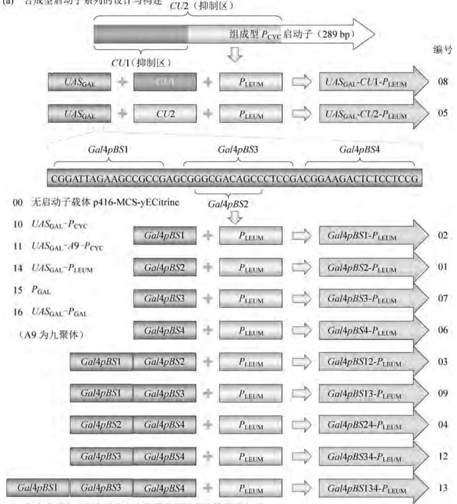

<details>
<summary>flowchart</summary>

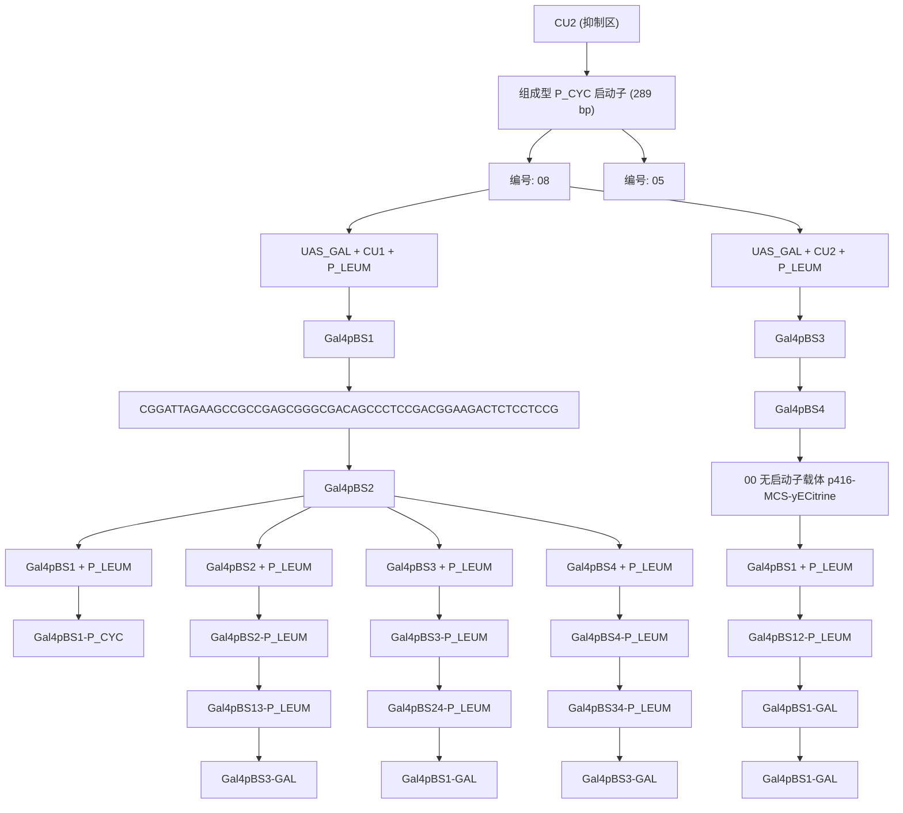
</details>

(b) 各合成型启动子介导荧光素酶报告基因表达的递增水平

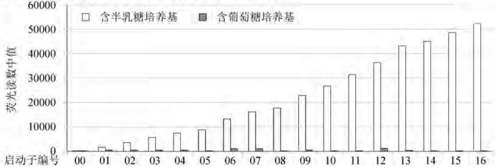

<details>
<summary>bar</summary>

| 启动子编号 | 含半乳糖培养基 (荧光读数中值) | 含葡萄糖培养基 (荧光读数中值) |
| --- | --- | --- |
| 00 | ~100 | ~50 |
| 01 | ~2000 | ~50 |
| 02 | ~3500 | ~50 |
| 03 | ~5500 | ~50 |
| 04 | ~7500 | ~50 |
| 05 | ~9000 | ~50 |
| 06 | ~13500 | ~1000 |
| 07 | ~16500 | ~1000 |
| 08 | ~18000 | ~50 |
| 09 | ~23000 | ~50 |
| 10 | ~27000 | ~50 |
| 11 | ~31500 | ~50 |
| 12 | ~36500 | ~1500 |
| 13 | ~43500 | ~50 |
| 14 | ~45500 | ~50 |
| 15 | ~49000 | ~50 |
| 16 | ~52500 | ~50 |
</details>

图5-21 酿酒酵母半乳糖诱导型转录强度递增的合成型启动子系列

针对RPG调控元件、CT调控元件、 $P_{\mathrm{CUP1}}$ 进行饱和突变，形成被称为YRP的启动子文库，其控制葡萄糖-6-磷酸脱氢酶表达的水平介于野生型启动子的 $0\sim 179\%$ 之间。与构建启动子文库不同，采用多重基因-启动子洗牌术(MGPS)则可同时实现多个基因表达水平的立刻优化。

## 5. 外源基因在酵母中表达的限制性因素

即便使用酵母自身的启动子和终止子，外源基因在酵母中的表达也相当困难。例如，将外源基因与酵母磷酸甘油酸激酶编码基因PGK所属的启动子和终止子一同重组在高拷贝质粒上，外源基因的表达水平普遍比含有PGK基因的相同重组子低 $15\sim 50$ 倍。重组质粒上的PGK基因可表达出占受体细胞总蛋白量 $20\% \sim 25\%$ 的磷酸甘油酸激酶，但使用PGK基因启动子和终止子的人 $\alpha$ -干扰素编码基因在相同的受体中只能合成 $0.5\%$ 的目标蛋白，两个基因转录产物的mRNA浓度分别为 $20\%$ 和 $1\%$ ，这表明重组异源蛋白质产率低的主要原因是稳定态mRNA的水平降低，而非表达产物的不稳定性。若将人 $\alpha$ -干扰素基因插在野生型PGK表达盒的内部，即PGK终止密码子下游的16bp处，则融合基因转录出的mRNA中含有人 $\alpha$ -干扰素的编码序列。此外，mRNA的合成量和PGK蛋白质的表达水平仍旧很高，但为人 $\alpha$ -干扰素编码的mRNA区域基本上不翻译，因此稳定态mRNA的翻译活性是外源基因低水平表达的第二大限制性因素。

在酿酒酵母中，高丰度蛋白质（如GAPDH、PGK、ADH等）中 $96\%$ 以上的氨基酸残基是由25个密码子编码的，它们对应于异常活跃的高成分tRNA，而为低组分tRNA识别的密码子基本上不被使用。利用DNA定点诱变技术将野生型PGK基因中的高成分密码子分别更换成使用频率较低的简并密码子，则突变基因表达水平的降低程度与突变密码子占编码序列中密码子总数的比例成正相关，其中更换164个密码子的PGK突变基因（占全部编码序列的 $39\%$ )的表达水平比野生型PGK下降10倍。这种以密码子的偏爱性控制基因表达产物丰度的模式在真核生物细胞中相当普遍。

在使用酵母启动子和终止子等基因表达调控元件的前提下,异源基因的表达水平与稳定态 mRNA 的半衰期密切相关。如果外源基因 mRNA 的半衰期足够长,那么即便它含有许多对应于酵母低成分 tRNA 的密码子,受影响的只是重组异源蛋白的合成速率,不至于大幅度降低蛋白质的最终产量。然而这种情况并不多见,因为外源基因在酵母中的低效率表达恰恰表现在其 mRNA 的不稳定性上。在外源 mRNA 较短的半衰期内,由于密码子与 tRNA 的不对应性,蛋白质的生物合成速率下降,导致最终异源蛋白的合成总量减少。酵母 PGK 基因 mRNA 的半衰期随着简并密码子的更换程度而缩短,含有 164 个突变密码子的 PGK 基因,其稳态转录产物的含量只及野生型 mRNA 的 30%。这表明酵母 tRNA 与外源基因密码子的不匹配性不仅仅影响异源 mRNA 的翻译速率,更主要的是降低了 mRNA 的结构稳定性,两者共同导致外源基因表达水平的下降。

影响酵母细胞内 mRNA 稳定性的因素可能很多,然而就顺式元件的序列和结构而言,由 AU 丰富元件(ARE)或 AGNN 四联环二级结构介导的 mRNA 衰减效应是确定的。酵母细胞内存在多种类型的 ARE 结合蛋白,它们通过直接或间接的途径缩短成熟 mRNA 的 3' 端 polyA 长度,进而脱去 5' 端的帽子结构,最终降解 mRNA。酵母某些内源性 mRNA 的 3'-UTR 中含有 ARE 序列是细胞正常生理活动所必需的;但外源基因转录物中若存在 ARE 样序列,便有可能在转录后致使其低效表达甚至不表达。此外,那些编码区内部 AT 含量偏高的外源基因在酵母细胞中往往具有转录提前终止(即流产性转录)的倾向。如果上述情况存在,解决的方案便是在外源基因相应区域引入适量的 GC 碱基对。

很多真核生物的非编码型 RNA(ncRNA)中含有如图 5-22 所示的四联环二级结构,依据信息可知是双链 RNA 内切酶 RNase III 家族识别并裂解的靶点。酿酒酵母 RNase III 家族的一个成员Rnt1p典型识别并降解的RNA底物含有三个关键区:由AGNN四联环构成的初始结合定位盒(IBPB)、由紧接着四联环的下游碱基互补区构成的结合稳定盒(BSB)，以及由裂解位点区域构成的裂解效能盒(CEB)。Rnt1p的两个裂解位点分别位于AGNN四联环上游的第14位与第15位核苷酸之间以及下游的第16位与第17位核苷酸之间。如果外源基因转录物中含有AGNN四联环样的结构，那么很可能在重组酿酒酵母细胞中遭到Rnt1p的降解。事实上，至少在酿酒酵母MIG2基因的编码区内存在典型的AGNN四联环序列。

## 6. 酵母表达系统的选择

酿酒酵母表达系统已成功地用于多种重组异源蛋白的生产，但也暴露出一些问题:首先，由于其乙醇发酵途径异常活跃导致生物大分子的合成代谢普遍受到抑制，外源基因的表达水平不高；其次，酿酒酵母细胞能使重组异源蛋白超糖基化，这使得有些异源蛋白（如人血清白蛋白等）与受体细胞膜紧密结合而不能大量分泌；最后，酿酒酵母能代谢利用的碳源种类有限。上述缺陷可用非酿酒酵母的其他酵母表达系统来弥补，包括

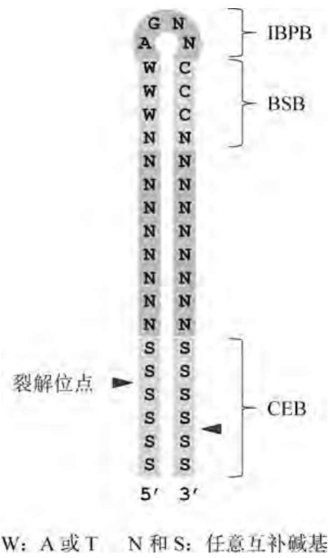

<details>
<summary>text_image</summary>

G N
A N
W C
W C
W C
N N
N N
N N
N N
N N
N N
N N
N N
N N
S S
S S
S S
S S
S S
S S
5' 3'
IBPB
BSB
CEB
裂解位点
W: A 或 T N 和 S: 任意互补碱基
</details>

图5-22 酿酒酵母核酸内切酶Rnt1p 典型的发夹底物结构

巴斯德毕赤酵母、多形汉逊酵母、乳酸克鲁维酵母等。这些表达系统的共同特征是蛋白质的糖基化模式比酿酒酵母更接近于高等哺乳动物，而且能将各种重组异源蛋白分泌至培养基中。

## (1)巴斯德毕赤酵母表达系统

巴斯德毕赤酵母是一种甲基营养菌，能在以相对廉价的甲醇为唯一碳源的合成培养基中生长，细胞分裂周期大约为 $5\mathrm{h}$ （巴斯德毕赤酵母在YPD培养基和普通合成培养基中的分裂周期分别为 $1.5\mathrm{h}$ 和 $3\mathrm{h}$ )。培养基中的甲醇可高效诱导巴斯德毕赤酵母甲醇利用(MUT)途径各酶系编码基因的表达，其中研究最为详尽的是催化该途径第一步反应的乙醇氧化酶编码基因AOX1，在甲醇培养基中生长的巴斯德毕赤酵母细胞可积累占总蛋白 $30\%$ 的乙醇氧化酶。因此，生长相对迅速、易于高密度培养（$200\mathrm{g}$ 干重/L）、AOX1基因所属强启动子表达的可诱导性是该酵母作为外源基因表达受体的三大优势。目前已有上千种异源蛋白在重组巴斯德毕赤酵母中获得表达甚至大规模产业化，培养或发酵液中的分泌型蛋白水平可高达 $13\mathrm{g / L}$，如隔孢伏革菌(Peniophora lycii)的植酸酶；而胞内非分泌型蛋白的产量甚至达到 $22\mathrm{g / L}$，如热带橡胶树(Hevea brasiliensis)的羟氰裂解酶。然而，通过对巴斯德毕赤酵母GS115株基因组（总长为 $9.4\mathrm{Mb}$，分属四条单倍型染色体）上共编码的5313个开放阅读框进行分析，发现其密码子的使用频率也具有与酿酒酵母相似的显著倾向性(表5-12)，因而在很多情况下，外源基因需要进行密码子优化才能在巴斯德酵母中实现高效表达。

目前广泛用于外源基因重组表达的巴斯德毕赤酵母受体均源自 NRRL-Y11430 野生株，大多属于组氨醇脱氢酶编码基因突变型营养缺陷株 $(his4^{-})$ ，这样便于利用表达质粒上的 HIS 标记基因在不含组氨酸的 MD 培养基上正向筛选转化子。野生型毕赤酵母的基因组上含有两个同源性高达 92% 的 AOX1 和 AOX2 基因，前者活性（90%）显著高于后者，因此 AOX1 存在的毕赤酵母株呈快用型 $(Mut^{+})$ ，AOX1 缺陷但 AOX2 存在的菌株呈甲醇慢用型 $(\mathsf{Mut}^{\mathrm{S}})$，而两个基因均缺陷的毕赤酵母则不能代谢甲醇 $(\mathsf{Mut}^{-})$。当使用AOX1启动子介导外源基因表达时，选择 $\mathsf{Mut}^{\mathrm{S}}$ 型突变株作为受体细胞能获得比野生株更高的表达效率，因为野生型巴斯德毕赤酵母在甲醇培养基中生长期间，能产生阻遏AOX1启动子的一种中间代谢产物，而这种阻遏物是由甲醇代谢基因控制合成的。$\mathsf{Mut}^{\mathrm{S}}$ 型突变株从源头上阻断了甲醇代谢途径的运行，因此尽管其他甲醇代谢基因依然存在，但由于没有合适的前体分子，突变株仍丧失了其合成阻遏物的能力。当然，在此情况下培养基的主要碳源不宜使用甲醇，而是以甘油取代。此外，为了使重组蛋白得以大量积累，巴斯德毕赤酵母的一些表达受体还呈蛋白酶编码基因pep4或(和)prb1缺陷型(表5-13)。

表 5-12 巴斯德毕赤酵母的密码子使用频率

<table><tr><td>氨基酸</td><td>密码子</td><td>频率/%</td><td>氨基酸</td><td>密码子</td><td>频率/%</td></tr><tr><td rowspan="4">Ala</td><td>GCC</td><td>24.5</td><td rowspan="6">Leu</td><td>CTG</td><td>15.3</td></tr><tr><td>GCG</td><td>7.9</td><td>CTC</td><td>8.4</td></tr><tr><td>GCA</td><td>27.5</td><td>CTT</td><td>17.0</td></tr><tr><td>GCT</td><td>40.1</td><td>CTA</td><td>12.3</td></tr><tr><td rowspan="6">Arg</td><td>CGC</td><td>5.0</td><td>TTG</td><td>29.1</td></tr><tr><td>CGG</td><td>5.3</td><td>TTA</td><td>17.9</td></tr><tr><td>CGT</td><td>14.1</td><td rowspan="2">Lys</td><td>AAG</td><td>48.0</td></tr><tr><td>CGA</td><td>12.0</td><td>AAA</td><td>52.0</td></tr><tr><td>AGG</td><td>18.1</td><td>Met</td><td>ATG</td><td>100.0</td></tr><tr><td>AGA</td><td>45.5</td><td rowspan="2">Phe</td><td>TTC</td><td>42.2</td></tr><tr><td rowspan="2">Asn</td><td>AAC</td><td>46.5</td><td>TTT</td><td>57.8</td></tr><tr><td>AAT</td><td>53.5</td><td rowspan="4">Pro</td><td>CCG</td><td>10.1</td></tr><tr><td rowspan="2">Asp</td><td>GAC</td><td>38.3</td><td>CCC</td><td>18.1</td></tr><tr><td>GAT</td><td>61.7</td><td>CCT</td><td>33.9</td></tr><tr><td rowspan="2">Cys</td><td>TGC</td><td>37.8</td><td>CCA</td><td>37.9</td></tr><tr><td>TGT</td><td>62.2</td><td rowspan="6">Ser</td><td>AGT</td><td>15.9</td></tr><tr><td rowspan="2">Gln</td><td>CAG</td><td>39.6</td><td>AGC</td><td>10.4</td></tr><tr><td>CAA</td><td>60.4</td><td>TCG</td><td>9.5</td></tr><tr><td rowspan="2">Glu</td><td>GAG</td><td>40.5</td><td>TCA</td><td>20.8</td></tr><tr><td>GAA</td><td>59.5</td><td>TCC</td><td>17.4</td></tr><tr><td rowspan="4">Gly</td><td>GGC</td><td>15.5</td><td>TCT</td><td>26.0</td></tr><tr><td>GGG</td><td>12.2</td><td rowspan="4">Thr</td><td>ACC</td><td>23.8</td></tr><tr><td>GGT</td><td>35.8</td><td>ACG</td><td>12.3</td></tr><tr><td>GGA</td><td>36.5</td><td>ACA</td><td>27.7</td></tr><tr><td rowspan="2">His</td><td>CAC</td><td>38.2</td><td>ACT</td><td>36.2</td></tr><tr><td>CAT</td><td>61.8</td><td>Trp</td><td>TGG</td><td>100.0</td></tr><tr><td rowspan="3">Ile</td><td>ATC</td><td>29.8</td><td rowspan="2">Tyr</td><td>TAC</td><td>48.6</td></tr><tr><td>ATA</td><td>23.6</td><td>TAT</td><td>51.4</td></tr><tr><td>ATT</td><td>46.6</td><td rowspan="4">Val</td><td>GTC</td><td>21.7</td></tr><tr><td rowspan="3">STOP</td><td>TGA</td><td>25.9</td><td>GTG</td><td>21.7</td></tr><tr><td>TAG</td><td>34.0</td><td>GTA</td><td>17.8</td></tr><tr><td>TAA</td><td>40.1</td><td>GTT</td><td>38.8</td></tr></table>

巴斯德毕赤酵母没有天然质粒, 尽管两个自主复制序列 PARS1 和 PARS2 已从基因文库中克隆并鉴定, 但由两者构建的自主复制型质粒在毕赤酵母属中不能稳定维持, 因而通常将外源基因通过一系列大肠杆菌/毕赤酵母穿梭表达载体整合在受体细胞的染色体DNA上。一些常用的毕赤酵母表达载体列在表5-14中，其中最典型的是pPIC3/pPIC3K和pPICZ/pPICαZ系列，其图谱如图5-23所示。大多数毕赤酵母表达载体上安装的是AOX1的 $5^{\prime}$ 端上游区域（含 $P_{\mathrm{AOX1}}$ 启动子及其调控序列）以及 $3^{\prime}$ 端下游区域（含 $T_{\mathrm{AOX1}}$ 终止子及polyA化位点），将待表达的外源基因编码序列插入两者之间，重组分子进入受体细胞后便可以以同源重组的方式高效整合在巴斯德毕赤酵母染色体DNA的AOX1处，形成 $\mathsf{Mut}^{\mathsf{S}}$ 型重组子（如果双交叉重组发生，但同源重组频率低于酿酒酵母）。除了巴斯德毕赤酵母外，嗜甲醇毕赤酵母(Pichia methanolica)、多形汉逊酵母、博氏假丝酵母(Candida boidinii)也拥有甲醇利用途径，三者与AOX1/AOX2对应的基因分别为 $P_{\mathrm{AUG1}} / P_{\mathrm{AUG2}}, P_{\mathrm{MOX}}, P_{\mathrm{AOD1}}$ 。这些启动子与MUT途径中的其他启动子，如比 $P_{\mathrm{AOX1}}$ 更强的二羟丙酮合成酶编码基因所属启动子 $P_{\mathrm{DAS1}} / P_{\mathrm{DAS}}$ 以及甲酸脱氢酶编码基因所属启动子 $P_{\mathrm{FDH1}}$ ，均为葡萄糖严密阻遏，添加甲醇则强烈诱导，甚至还能被非发酵型碳源如甘油脱阻遏；而甲醛脱氢酶编码基因所属启动子$P_{\mathrm{FLD}}$ 则不仅被葡萄糖负调控，而且还能响应甲胺或胆碱的诱导。由于诱导剂甲醇在规模化发酵过程中使用易燃、易挥发，且过度积累会致死细胞，因而这些MUT途径中的天然启动子还被改造成一套突变版本。突变型 $P_{\mathrm{AOX}}$ 不再呈甲醇诱导性，但可用其他安全的分子进行诱导，而且脱阻遏效率更高。

表 5-13 几种常用的巴斯德毕赤酵母受体

| 受体株名称 | 基因型 | 表现型 |
| --- | --- | --- |
| GS115 | $\Delta his4$ | $Mut^{+}, His^{-}$ |
| GS190 | $\Delta arg4$ | $Mut^{+}, Arg^{-}$ |
| GS200 | $\Delta his4, \Delta arg4$ | $Mut^{+}, His^{-}, Arg^{-}$ |
| JC254 | $\Delta ura3$ | $Mut^{+}, Ura^{-}$ |
| JC227 | $\Delta arg4, \Delta ade1$ | $Mut^{+}, Arg^{-}, Ade^{-}$ |
| JC300 | $\Delta his4, \Delta arg4, \Delta ade1$ | $Mut^{+}, His^{-}, Arg^{-}, Ade^{-}$ |
| JC308 | $\Delta his4, \Delta arg4, \Delta ade1, \Delta ura3$ | $Mut^{+}, His^{-}, Arg^{-}, Ade^{-}, Ura^{-}$ |
| KM71 | $\Delta his4, \Delta arg4, AOX1::ARG4$ | $Mut^{S}, His^{-}$ |
| KM71H | $AOX1::ARG4, arg4$ | $Mut^{S}$ |
| MC100-3 | $AOX1::SARG4, AOX2::Phis4$ | $Mut^{-}$ |
| SMD1163 | $\Delta his4, \Delta pep4, \Delta prb1$ | $Mut^{+}, His^{-}, Pep4^{-}, Prb1^{-}$ |
| SMD1165 | $\Delta his4, \Delta prb1$ | $Mut^{+}, His^{-}, Prb1^{-}$ |
| SMD1168 | $\Delta his4, \Delta pep4$ | $Mut^{+}, His^{-}, Pep4^{-}$ |
| SMD1168H | $\Delta pep4$ | $Mut^{+}, Pep4^{-}$ |
| PichiaPinkTM | $\Delta ade2, \Delta pep4, \Delta prb1$ | $Mut^{+}, Ade^{-}, Pep4^{-}, Prb1^{-}$ |

此外，毕赤酵母拥有为数不多的己糖转运子编码基因，其所属启动子 $P_{\mathrm{GTH1\sim 7}}$ 为高浓度$(20~\mathrm{g / L})$ 葡萄糖所严密阻遏，但在葡萄糖浓度下降至 $2\mathrm{mg / L}$ 时，转录强度提升 $50\sim 60$ 倍，而且比甘油醛-3-磷酸脱氢酶编码基因所属组成型启动子 $P_{\mathrm{TDH}}$ 的活性高2倍多，而 $P_{\mathrm{TDH}}$ 在葡萄糖存在时的表达水平已显著高于甲醇诱导的 $P_{\mathrm{AOX}}$ ，因而 $P_{\mathrm{GTH1\sim 7}}$ 也是理想的非甲醇诱导型启动子。PEX8是巴斯德毕赤酵母的一种过氧化物酶体蛋白编码基因（亦称PER3），其启动子 $P_{\mathrm{PEX8}}$ 在葡萄糖存在时中度表达，且为甲醇或油酸轻微诱导（$3\sim 5$ 倍）。 $P_{\mathrm{PEX8}}$ 的主要转录激活因子为Mxr1，后者是毕赤酵母中所有甲醇诱导型基因转录调控的枢纽，与酿酒酵母的锌指转录调控因子Adr1同源，能与靶启动子中的 $5^{\prime} - \mathrm{CYCCNY - 3^{\prime}}$ 基序结合。将强启动子 $P_{\mathrm{DAS}}$ 或 $P_{\mathrm{AOX}}$ 中的多个Mxr1结合基序与 $P_{\mathrm{PEX8}}$ 重组，若能进一步提升 $P_{\mathrm{PEX8}}$ 的强度，则可形成新型的非甲醇诱导型合成启动子。