表 5-14 毕赤酵母表达载体的构成与性能

<table><tr><td>载体名称</td><td>克隆位点</td><td>选择标记</td><td>启动子</td><td>注释</td></tr><tr><td colspan="5">非分泌型表达载体</td></tr><tr><td>pPIC3.5</td><td>BamHI SnaBI EcoRI AvrII NotI</td><td>HIS4</td><td> $P_{AOX1}$ </td><td></td></tr><tr><td>pPIC3.5K</td><td>BamHI SnaBI EcoRI AvrII NotI</td><td>HIS4  $Km^r$ </td><td> $P_{AOX1}$ </td><td>可用G418筛选多拷贝整合转化子</td></tr><tr><td>pPIC6</td><td>MCS(详见图5-23)</td><td> $bsd^r$ </td><td> $P_{AOX1}$ </td><td>可用稻瘟菌素筛选多拷贝整合转化子含c-Myc表位和6×His标签序列</td></tr><tr><td>pPICZ ABC</td><td>MCS(详见图5-23)</td><td> $ble^r(Zeo^r)$ </td><td> $P_{AOX1}$ </td><td>可用博莱霉素筛选整合转化子含c-Myc表位和6×His标签序列</td></tr><tr><td>pAO815</td><td>EcoRI</td><td>HIS4</td><td> $P_{AOX1}$ </td><td>含f1复制起点可构建多拷贝串联表达盒</td></tr><tr><td>pHIL-D3</td><td>EcoRI AsuII</td><td>HIS4</td><td> $P_{AOX1}$ </td><td>含AOX1 5&#x27;端非翻译区和f1复制起点</td></tr><tr><td>pHIL-D7</td><td>EcoRI AsuII</td><td>HIS4  $Km^r$ </td><td> $P_{AOX1}$ </td><td>可用G418筛选多拷贝整合转化子含f1复制起点</td></tr><tr><td>pKANB</td><td>PstI KpnI SacII</td><td> $Km^r$ </td><td> $P_{AOX1}$ </td><td>可用G418直接筛选整合转化子</td></tr><tr><td>pPpB1GAP</td><td>MCS(详见图5-23)</td><td> $ble^r(Zeo^r)$ </td><td> $P_{GAP1}$ </td><td>可用博莱霉素筛选整合转化子含c-Myc表位和6×His标签序列</td></tr><tr><td>pFLD</td><td>MfeI PmlI SfiI Asp718I KpnIXhoI SacII ApaI MfeI</td><td> $ble^r(Zeo^r)$ </td><td> $P_{FLD}$ </td><td>可用博莱霉素筛选整合转化子含V5表位和6×His标签序列</td></tr><tr><td>pPpARG4</td><td></td><td>ARG4</td><td> $P_{AOX1}$ </td><td></td></tr><tr><td>pPpGUT1</td><td></td><td>GUT1</td><td> $P_{AOX1}$ </td><td></td></tr><tr><td colspan="5">分泌型表达载体</td></tr><tr><td>pHIL-S1</td><td>BamHI EcoRI XhoI SmaI</td><td>HIS4</td><td> $P_{AOX1}$ </td><td>含毕赤酵母PHO1信号肽序列含f1复制起点</td></tr><tr><td>pPIC9</td><td>EcoRI XhoI NotI SnaBI</td><td>HIS4</td><td> $P_{AOX1}$  $P_{MET25}$ </td><td>含酿酒酵母α交配因子(αMF)前导肽</td></tr><tr><td>pPIC9K</td><td>EcoRI XhoI NotI SnaBI</td><td>HIS4  $Km^r$ </td><td> $P_{AOX1}$ </td><td>含酿酒酵母α交配因子(αMF)前导肽可用G418筛选多拷贝整合转化子</td></tr><tr><td>pPICZαABC</td><td>MCS(详见图5-23)</td><td> $ble^r(Zeo^r)$ </td><td> $P_{AOX1}$ </td><td>可用博莱霉素筛选整合转化子含c-Myc和6×His标签序列含酿酒酵母α交配因子(αMF)前导肽</td></tr><tr><td>pYAM7SP6</td><td>BamHI EcoRI XhoI NotIBglII StuI SpeI</td><td>HIS4</td><td></td><td>含毕赤酵母PHO1信号肽序列含Kex2蛋白酶位点和f1复制起点</td></tr><tr><td>pKANαB</td><td>PstI KpnI SacII</td><td> $Km^r$ </td><td> $P_{AOX1}$ </td><td>可用G418直接筛选整合转化子含酿酒酵母α交配因子(αMF)前导肽</td></tr><tr><td>pPpT4GAPαS</td><td></td><td> $ble^r(Zeo^r)$ </td><td> $P_{GAP1}$ </td><td>可用博莱霉素筛选整合转化子含酿酒酵母α交配因子(αMF)前导肽</td></tr><tr><td>pJAZ-αMF</td><td>BsaI</td><td> $ble^r(Zeo^r)$ </td><td> $P_{AOX1}$ </td><td>可用博莱霉素筛选整合转化子含酿酒酵母α交配因子(αMF)前导肽</td></tr><tr><td>pFLDα</td><td>与pFLD相同</td><td> $ble^r(Zeo^r)$ </td><td> $P_{FLD}$ </td><td>含酿酒酵母α交配因子(αMF)前导肽</td></tr></table>

大量研究表明，巴斯德毕赤酵母在异源蛋白的分泌表达方面优于酿酒酵母系统。例如，含有单拷贝乙型肝炎表面抗原编码基因的重组巴斯德毕赤酵母可产生 $0.4\mathrm{g / L}$ 的重组抗原蛋白，而酿酒酵母必须拥有50多个基因拷贝才能达到相同的产量。尽管如此，构建多拷贝整合型的重组毕赤酵母菌仍具有很大的潜力。例如，含有破伤风毒素蛋白C片段编码基因的整合型重组质粒转化巴斯德毕赤酵母受体细胞后，各种转化子表达重组蛋白的水平差别很大，占细胞蛋白总量的 $0.3\% \sim 10.5\%$ 不等，最高产量达 $12\mathrm{g / L}$ 。对转化子基因组结构的分析结果表明，获得重组蛋白高效表达的关键因素是整合型表达基因的多拷贝存在。转化的 DNA 重组片段在受体细胞内环化后,通过单交叉重组过程的重复使外源基因多拷贝整合在染色体 DNA 上,这种多拷贝整合型转化子在受体细胞有丝分裂生长期间具有显著的稳定性,而且能够通过诱导作用进行高密度培养。由于多拷贝整合机制与外源基因的序列特异性无关,因此这一高效表达策略具有广范围的应用价值。

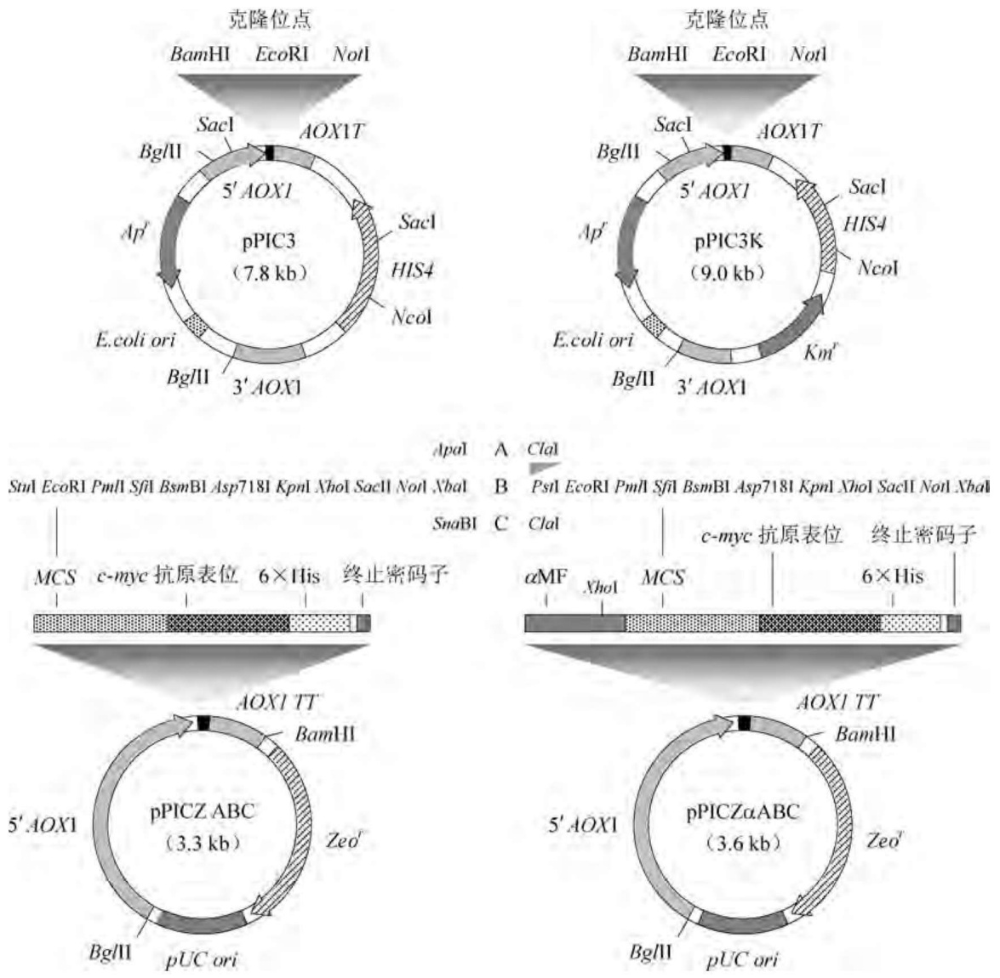

图5-23 毕赤酵母pPIC系列表达质粒图谱

多拷贝重组巴斯德毕赤酵母的构建一般有两种策略:一是将外源基因的表达盒以首尾相连的方式多拷贝重组在合适的表达载体上。这种策略的一个特别优势（尤其在生产人类药物蛋白时）在于，表达盒的精确拷贝数是已知的，而且可以借助于DNA测序直接确认。二是利用含药物抗性标记基因的表达载体，通过药物的高抗水平筛选多拷贝整合株。用于巴斯德毕赤酵母的药物抗性基因有细菌的 $Km^{r}$ 、 $Zeo^{r}$ 、 $Bsd^{r}$ 以及巴斯德毕赤酵母自身的FLD1基因。采用该策略可分离到携带多达30个拷贝表达盒的转化子。但这种筛选程序的缺憾是难以获得足够多的克隆用于筛选多拷贝表达盒，而且整合拷贝数难以控制。

## (2) 多形汉逊酵母表达系统

多形汉逊酵母也是一种甲基营养菌,拥有巴斯德毕赤酵母几乎所有的优势,其 RB11 株的基因组大小约为 $9.5\mathrm{Mb}$，六条单倍型染色体上拥有5933个开放阅读框，其中约 $20\%$ 功能未详。与酿酒酵母相对应的多形汉逊酵母ura3和leu2型缺陷株也已分离出来，因而酿酒酵母的URA3和LEU2基因可用作筛选多形汉逊酵母转化子的选择标记。这种酵母的两个自主复制序列HARS1和HAR2已被克隆，但与巴斯德毕赤酵母和乳酸克鲁维酵母相似，由HARS构建的自主复制型质粒在受体细胞有丝分裂时显示出不稳定性。所不同的是，这种质粒能以较高的频率自发地整合在受体细胞的染色体DNA上，有的HARS型表达载体还可在染色体上连续整合高达100多个拷贝，明显优于巴斯德毕赤酵母。而且，多形汉逊酵母的乙醇氧化酶编码基因所属启动子 $P_{\mathrm{MOX}}$ 和甲酸脱氢酶编码基因所属启动子 $P_{\mathrm{FMD}}$ 具有同等强度的转录启动活性，其中的 $P_{\mathrm{MOX}}$ 可随着葡萄糖或甘油的消耗呈显著的脱阻遏效应，此时的重组蛋白表达水平已相当于重组巴斯德毕赤酵母表达系统甲醇诱导的 $80\%$ ，而甲醇并不能诱导 $P_{\mathrm{MOX}}$ 的转录活性。一套以上述两种启动子为表达调控元件的广宿主多用途模块化载体系列 $\mathrm{pCoMed}^{\mathrm{TM}}$ 可用于构成多形汉逊酵母的表达系统(图5-24)。此外，多形汉逊酵母能在 $50^{\circ}\mathrm{C}$ 时良好生长，这对于显著减少生物过程的操作时间进而降低生产成本很有意义。目前，包括乙型肝炎表面抗原、水蛭素、植酸酶、人 $\alpha-$ 干扰素2a在内的数十种外源蛋白已在多形汉逊酵母系统中获得成功表达甚至规模化生产。

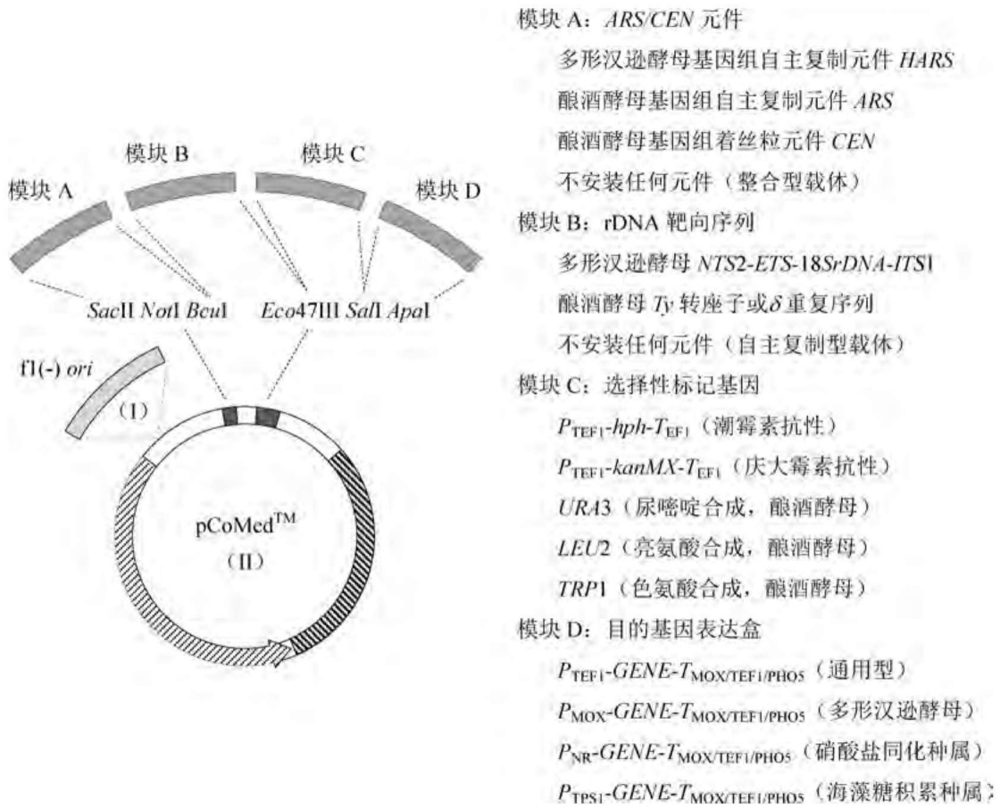

<details>
<summary>flowchart</summary>

```mermaid
graph LR
  subgraph Module_A["模块 A"]
  A1["模块 A"] --> B1["模块 B"]
  B1 --> C1["模块 C"]
  C1 --> D1["模块 D"]
  end

  subgraph Module_B["模块 B"]
  B2["模块 B"] --> C2["模块 C"]
  C2 --> D2["模块 D"]
  D2 --> E1["模块 C"]
  E1 --> F1["模块 C"]
  end

  subgraph Module_C["模块 C"]
  C3["模块 C"] --> G1["模块 C"]
  G1 --> H1["模块 C"]
  H1 --> I1["模块 C"]
  end

  subgraph Module_D["模块 D"]
  D1 --> J1["模块 D"]
  J1 --> K1["模块 D"]
  end

  subgraph Function_II["pCoMed™ (II)"]
    direction TB
  I1 --> II1["f1(-) ori (I)"]
  II1 --> III1["(II)"]
  end

  %% Details for Module_A:**
  Module_A:
  Module_B::ARS/CEN元件
  Module_B::多形汉逊酵母基因组自主复制元件HARS
  Module_B::酿酒酵母基因组自主复制元件ARS
  Module_B::酿酒酵母基因组着丝粒元件CEN
  Module_B::不安装任何元件（整合型载体）
  Module_B::rDNA靶向序列
  Module_B::多形汉逊酵母NTS2-ETS-18SrDNA-ITS1
  Module_B::酿酒酵母Ty转座子或δ重复序列
  Module_B::不安装任何元件（自主复制型载体）
  Module_C::选择性标记基因
  Module_C::PTEF1-hph-TEF1（潮霉素抗性）
  Module_C::PTEF1-kanMX-TEF1（庆大霉素抗性）
  Module_C::URA3（尿嘧啶合成，酿酒酵母）
  Module_C::LEU2（亮氨酸合成，酿酒酵母）
  Module_C::TRP1（色氨酸合成，酿酒酵母）
  Module_D::目的基因表达盒
  Module_D::PTEF1-GENE-TMOX/TEF1/PHOS（通用型）
  Module_D::PMOX-GENE-TMOX/TEF1/PHOS（多形汉逊酵母）
  Module_D::PNR-GENE-TMOX/TEF1/PHOS（硝酸盐同化种属）
  Module_D::PTPS1-GENE-TMOX/TEF1/PHOS（海藻糖积累种属）
```
</details>

图5-24 多形汉逊酵母模块化表达载体 $\mathrm{pCoMed}^{\mathrm{TM}}$ 的构成

## (3) 乳酸克鲁维酵母表达系统

克鲁维酵母菌属长期用于发酵生产  $\beta-$  半乳糖苷酶，因此其遗传学背景比较清楚，其基因组总长约为 12 Mb，共有六条单倍型染色体，编码 5076 个开放阅读框，含自主复制序列以及 LAC4 乳糖利用基因的质粒能高频转化酵母便是在克鲁维酵母中首次得以证实的。从果蝇克鲁维酵母中分离出来的双链环状质粒 pKD1 已被广泛用作重组异源蛋白生产的高效表达稳定性载体。由 pKD1 构建的各种衍生质粒，即使在没有选择压力存在的情况下，也能在许多克鲁维酵母菌种株中稳定遗传。此外，乳酸克鲁维酵母的整合系统也相当成熟，其中以高拷贝整合型质粒 pMIRK1 最为常用，它由乳酸克鲁维酵母的 5S、17S、26S rDNA、无启动子的 trp1-d 基因以及大肠杆菌质粒 pUC19 片段组成，因而能特异性地整合在受体菌的 rDNA 区域内，在无选择压力存在下，能在受体细胞内以 60 拷贝数的规模稳定维持。当外源基因插入该质粒后，pMIRK1 的多拷贝整合能使外源基因获得更高的表达水平，转化子也更趋稳定。

以重组乳酸克鲁维酵母表达分泌型和非分泌型异源蛋白均优于酿酒酵母系统。由pKD1衍生质粒构建的人血清白蛋白基因重组子在乳酸克鲁维酵母中的分泌水平远比酿酒酵母要高，而且在前者的分泌过程中，重组蛋白能正确折叠；在重组凝乳酶原的生产中，含有单拷贝外源基因的重组乳酸克鲁维酵母可在其培养基中表达分泌345 U/mL的重组蛋白，而重组酿酒酵母仅为18 U/mL；由重组乳酸克鲁维酵母合成的人白细胞介素-1β，则是重组酿酒酵母的80～100倍。因此，克鲁维酵母系统在分泌表达高等哺乳动物来源的蛋白质方面具有较高的应用前景。

乳酸克鲁维酵母与众不同的特征是能利用乳糖作为碳源。参与乳糖和半乳糖代谢的酶系编码基因受lac-gal调控子共调控，均为蛋白激活因子Lac9（相当于酿酒酵母中的Gal4）所控制，且均为乳糖或半乳糖所诱导。其中，乳糖利用基因不为葡萄糖所阻遏，而半乳糖代谢基因则被葡萄糖轻微阻遏，较低的代谢物阻遏以及较强的诱导潜能是很多乳酸克鲁维酵母启动子的优势之一。$\beta$-半乳糖苷酶(Lac4)编码基因所属的启动子$P_{\mathrm{LAC4}}$启动子已被成功地用于乳酸克鲁维酵母生产重组蛋白如凝乳酶原(奶酪生产所需的关键酶制剂)以及来自米根霉(Rhizopus oryzae)的 $\alpha$-淀粉酶。然而，与其他酵母表达系统一样，诱导剂的消耗也是乳酸克鲁维酵母/$P_{\mathrm{LAC4}}$表达系统在实际应用中遇到的问题，因而能防止诱导剂过早消耗的KlGAL1缺陷型乳酸克鲁维酵母突变株具有实用价值。有趣的是，野生型$P_{\mathrm{LAC4}}$启动子内部存在一个Pribnow盒样的序列，这使得该启动子可在大肠杆菌中组成型表达异源蛋白。

## (4) 粟酒裂殖酵母表达系统

粟酒裂殖酵母的全基因组大小为 $13.8\mathrm{Mb}$，分布在三条染色体上，预测拥有4997个开放阅读框，其中约 $70\%$ 功能未知。粟酒裂殖酵母大约 $40\%$ 的基因含内含子，就此而言比酿酒酵母（仅 $4\%$ 的基因含内含子）更接近于高等动植物。一套针对粟酒裂殖酵母精致设计的多功能表达载体系列pDUAL/pDUAL2如图5-25所示。该系列载体的默认状态为多拷贝自主复制型；若在转化前用NotI、SacII或ApaI切除ARS1，线形载体便转换成单拷贝整合型，整合位点位于受体细胞染色体DNA上的LEU1处。pDUAL系列载体整合后，可将基因组上突变型的 $\mathrm{LEU1}^{-}$（$5'$ 端编码区内点突变）转换为 $\mathrm{LEU1}^{+}$（遗传互补）；而pDUAL2系列载体整合后，则可将基因组上野生型的 $\mathrm{LEU1}^{+}$转换为 $\mathrm{LEU1}^{-}$（基因灭活）。

## 5.2.5 酵母的蛋白修饰分泌系统

酿酒酵母只能将几种蛋白质(如蔗糖酶、酸性磷酸酯酶、交配因子 $a / \alpha$ 、杀伤毒素等)分泌到细胞外或细胞间质中，而解脂耶氏酵母则可分泌相对分子质量较大的蛋白质(如蛋白酶、脂肪酶、RNA酶等)，但总的说来，酵母的蛋白分泌系统逊色于芽孢杆菌和丝状真菌。

## 1. 酵母蛋白质的分泌运输机制

与其他真核生物相似,高度分化的细胞器结构在酵母蛋白分泌运输过程中起着重要作用。大多数分泌型蛋白的转运路线是:核糖体→内质网膜→高尔基体→囊泡→细胞表面。在动物细胞中,新合成的分泌型蛋白是在翻译过程中转入内质网膜腔内的,新生肽链的N端刚从核糖体上翻译出来,便与信号肽识别颗粒(SRP)形成复合物,这一过程抑制肽链的进一步延长,直到SRP接触到定位于内质网膜外表面上的SRP特异性受体,新生肽链的合成才重新进行下去,此时蛋白质的生物合成系统已被固定在内质网膜上。新合成的多肽链在N端信号肽的作用下穿过内质网膜,进入内腔,同时位于内质网膜内侧的信号肽酶位点专一性地切除信号肽。

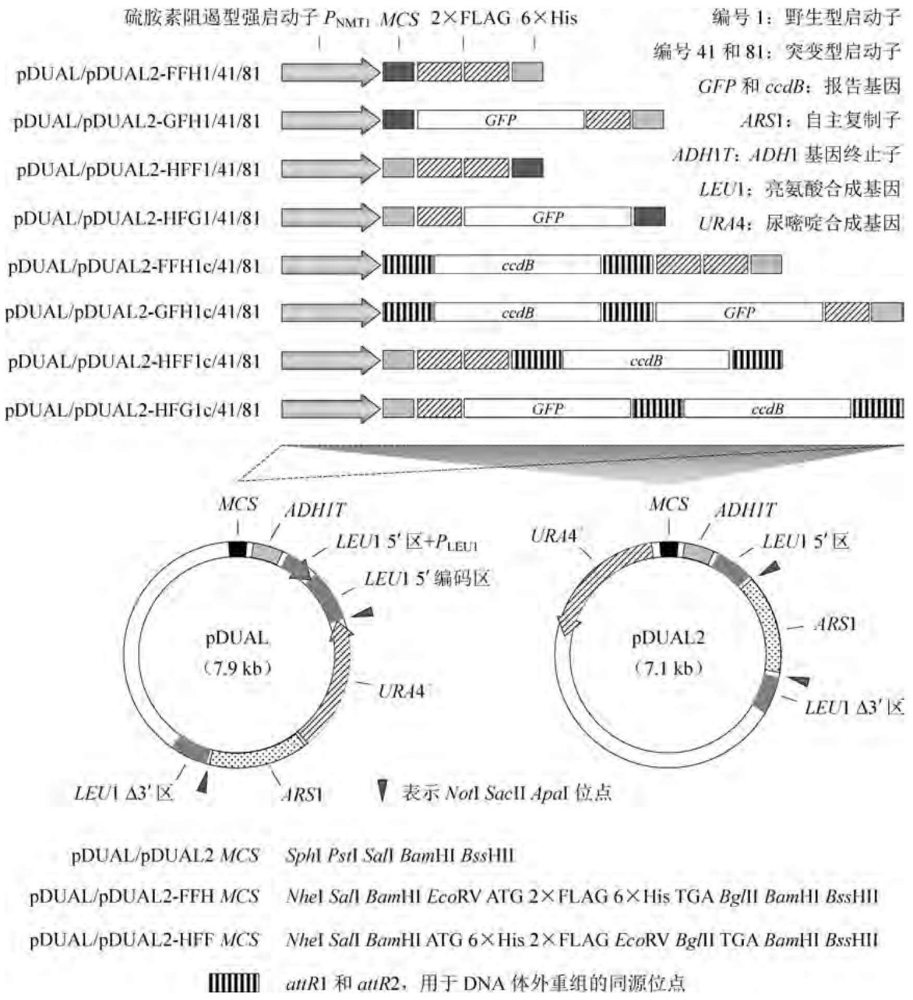

<details>
<summary>text_image</summary>

硫胺素阻遏型强启动子 P_NMT1 MCS 2×FLAG 6×His
编号1：野生型启动子
编号41和81：突变型启动子
GFP 和 ccdB：报告基因
ARS1：自主复制子
ADH1T：ADH1 基因终止子
LEU1：亮氨酸合成基因
URA4：尿嘧啶合成基因
pDUAL/pDUAL2-FFH1/41/81
pDUAL/pDUAL2-GFH1/41/81
pDUAL/pDUAL2-HFF1/41/81
pDUAL/pDUAL2-HFG1/41/81
pDUAL/pDUAL2-FFH1c/41/81
pDUAL/pDUAL2-GFH1c/41/81
pDUAL/pDUAL2-HFF1c/41/81
pDUAL/pDUAL2-HFG1c/41/81
pDUAL/pDUAL2-MCS
pDUAL/pDUAL2-FFH MCS
pDUAL/pDUAL2-HFF MCS
pDUAL/pDUAL2-MCS
pDUAL/pDUAL2-FFH MCS
pDUAL/pDUAL2-HFF MCS
pDUAL/pDUAL2-MCS
pDUAL/pDUAL2-FFH MCS
pDUAL/pDUAL2-HFF MCS
pDUAL/pDUAL2-MCS
pDUAL/pDUAL2-FFH MCS
pDUAL/pDUAL2-HFF MCS
</details>

图5-25 粟酒裂殖酵母pDUAL系列整合型表达载体的构成

在内质网膜内腔中，蛋白质经历第一次糖基化修饰和构象折叠。由 $(\mathrm{GlcNAc})_{2}(\mathrm{Man})_{9}(\mathrm{Glc})_{3}$ 组成的寡聚糖链核心从一个脂类载体蛋白上转移到多肽链Asn-X-Thr/Ser(X为除脯氨酸之外的所有氨基酸残基)特征糖基化序列中的Asn残基上，形成N-糖基化结构；同时将甘露糖单位转移到多肽链Thr或Ser残基的氧原子上，形成另一种O-糖基化结构。

当蛋白质离开内质网膜时,寡聚糖核心结构上的三个葡萄糖残基和一个甘露糖分子被切除,然后进入高尔基体。在此,分泌型蛋白的 N-寡聚糖核心结构以及 O-糖基化结构进一步延伸侧链,最终形成全糖基化的分泌型蛋白质(详见 5.2.5)。

内质网内腔也是新生多肽链折叠成天然构象并对误折叠蛋白进行质量检验的主要场所。内质网驻留蛋白包括折叠酶系、分子伴侣、凝集素伴侣三类。其中，分子伴侣 BiP 首先与新生多肽链结合，并通过屏蔽其未折叠区域与邻近多肽链之间的相互作用而帮助多肽链折叠。折叠酶系中的二硫键异构酶(PDI)主要负责二硫键的形成和异构化；而凝集素伴侣（如钙联蛋白）则参与多肽链折叠和初步糖基化修饰过程。只有正确折叠和装配的蛋白质才能被转运至高尔基体内进行深度糖基化修饰和加工，之后便借助分泌型囊泡转运至细胞外或其他细胞器；而误折叠或聚集型蛋白则为内质网中的质量检验系统所识别，然后进入内质网相关型降解途径(ERAD)。因此，强化重组酵母中的蛋白质折叠途径有利于异源蛋白的高效分泌。

酵母蔗糖酶和酸性磷酸酯酶的分泌是在细胞分裂过程中进行的。分泌蛋白首先集中在胞芽结构中，然后通过膜融合作用将分泌蛋白转入分泌型囊泡中，后者再将蛋白质运输至细胞膜内侧，并在GTP结合蛋白复合物的协助下，与细胞膜发生融合作用，将蛋白质释放至细胞周质中，整个分泌过程均需SEC基因编码产物的参与。巴斯德毕赤酵母的蛋白分泌途径如图5-26所示。

## 2. 酵母蛋白质的信号肽及其剪切系统

与其他真核生物相似，酵母分泌型蛋白的信号肽序列保守性较低，大都由 $15\sim 30$ 个氨基酸残基组成，含有三个不同的结构特征，即N端带正电荷的n区、中间疏水残基的h区、C端极性的c区。n区的长度及氨基酸残基的性质各异，但都含有正电荷；h区的疏水氨基酸残基(Phe、Ile、Met、Leu、Trp、Val)大都随机排列；c区具有对应于信号肽剪切位点的特征序列，即一1位和一3位必是一个相对分子质量较小且不带电荷的残基，如Ala、Ser、Gly、Cys或Thr等，而一2位则通常是高相对分子质量的带电残基，即所谓的“-3，-1”规律，由此可从基因的编码序列中推断信号肽编码序列的存在。

上述三个特征序列的氨基酸组成对蛋白质的分泌效率起着重要作用。例如，卡尔酵母菌(Saccharomyces carlbergensis)α-半乳糖苷酶(Mell)的两个突变型信号肽序列能使异源蛋白锯鳞血抑环肽(Echistin)和人纤溶酶原激活I型抑制因子的分泌提高20～30倍(图5-27)。其中一个突变型分别将野生型信号肽N端疏水区中的Phe和Tyr改成Arg和Leu，另一种突变形式则将野生型信号肽-5位上的Lys改变为Pro，后者是在各种信号肽中通常用来阻断α-螺旋结构的常用残基，对信号肽酶的正确剪切起着重要作用。在酿酒酵母中，交配因子MFα1的信号肽能促进许多重组异源蛋白的高效分泌，因此可根据其信号肽的序列特征，重新设计构建酵母的信号肽。MFα1信号肽的氨基酸序列为:Met-Arg-(Leu) $_{n}$ -Pro-(X)-Ala-Leu-Gly，其中 $n=6\sim12,X=Leu$ 、Ala、Leu-Ala或者无残基。上述Mel1信号肽的两种突变型基本上符合这一序列特征。另一项人工合成信号肽保守序列影响人表皮生长因子(hEGF)在酿酒酵母中有效分泌的实验结果表明，在上述保守序列之后，再加入一段含有KEX-2蛋白酶裂解位点的19个氨基酸残基原序列，可使重组异源蛋白的分泌效率提高5倍以上，这一原序列可能起着类似于分子伴侣的作用，护送MFα1信号肽介导的hEGF通过分泌途径进入高尔基体。然而应该强调的是，信号肽序列与其所介导的重组蛋白序列之间的构象关系是设计理想信号肽序列的重要参考依据。

除了信号肽序列及其构象特征外，受体细胞内信号肽剪切酶系的表达水平对异源蛋白的高效分泌也有很大的影响。在酿酒酵母细胞内，存在两种针对 $\mathrm{MF}\alpha 1$ 信号肽进行剪切的酶系，即由STE13编码的二肽氨肽酶以及由KEN2编码的蛋白酶，它们分别作用于 $\mathrm{MF}\alpha 1$前体分子中的 Glu-Ala 和 Lys-Arg 两个剪切位点。当含有 MFα1 信号肽编码序列的外源基因高效表达时，受体细胞中这两个剪切酶系的含量已不能满足要求，此时若将信号肽剪切酶基因与外源基因共表达，可以有效地促进重组异源蛋白的成熟，进而提高其分泌效率。例如，在含有 MFα1 信号肽编码序列和 α-肿瘤生长因子（TGF）融合基因的克隆株中，转入 KEX2 基因并使其高效表达，则重组克隆分泌 α-TGF 的能力大幅度提高。

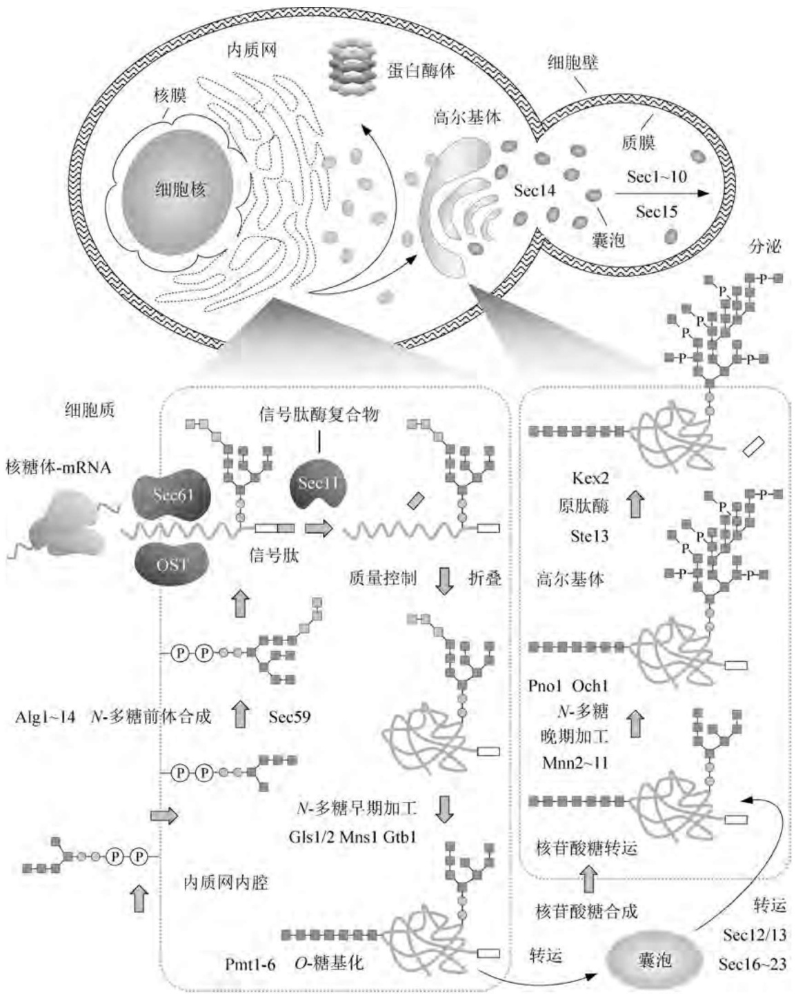

<details>
<summary>flowchart</summary>

This diagram illustrates the process of protein complex formation and transport in a cell membrane, showing how internal proteins (Sec14, Sec15) are converted into a complex via nucleic acid transport to form a final membrane.
</details>

图5-26 巴斯德毕赤酵母蛋白质分泌途径

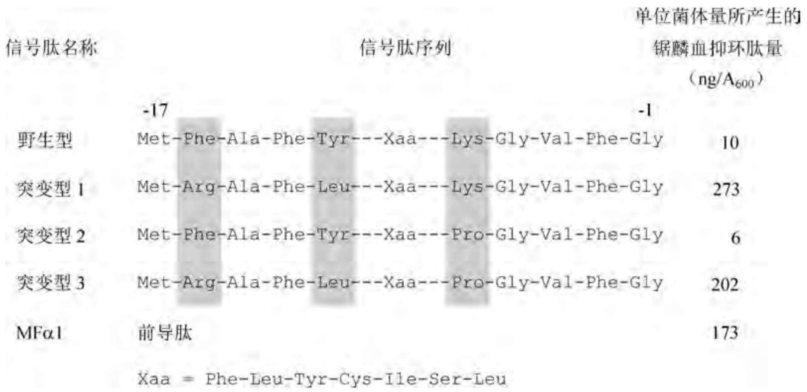

<details>
<summary>flowchart</summary>

```mermaid
graph LR
  A["信号肽名称"] --> B{"信号肽序列"}
  B --> C["单位菌体量所产生的锯鳞血抑环肽量\n(ng/A600)"]
  
  subgraph Genes ["野生型"]
    direction TB
  A1["-17"] --> B
  B --> C
  end
  
  subgraph Genes ["突变型 1"]
    direction TB
  A2["Met-Phe-Ala-Phe-Tyr---Xaa---Lys-Gly-Val-Phe-Gly"] --> D["10"]
  end
  
  subgraph Genes ["突变型 2"]
    direction TB
  A3["Met-Arg-Ala-Phe-Leu---Xaa---Lys-Gly-Val-Phe-Gly"] --> E["273"]
  end
  
  subgraph Genes ["突变型 3"]
    direction TB
  A4["Met-Phe-Ala-Phe-Tyr---Xaa---Pro-Gly-Val-Phe-Gly"] --> F["6"]
  end
  
  subgraph Genes ["MFα1"]
    direction TB
  A5["Met-Arg-Ala-Phe-Leu---Xaa---Pro-Gly-Val-Phe-Gly"] --> G["202"]
  end
  
  subgraph Genes ["MFα1"] --> H["前导肽"]
  end
  
  H --> I["173"]
```
</details>

图5-27 卡尔酵母菌 $\alpha$ -半乳糖苷酶突变型信号肽序列对锯鳞血抑环肽产量的影响

酿酒酵母中能用于促进异源蛋白高效分泌的信号肽序列并不多，它们主要来源于由MFα1基因编码的交配因子α、蔗糖酶(Suc2)、可阻遏型酸性磷酸酯酶(Pho5)、杀伤毒素因子(Kil)等，其中MFα1的信号肽序列最为常用，因为它能促进多种异源蛋白的高效分泌。然而，异源蛋白的性质不同，MFα1信号肽序列的效率也有很大差异，从10 μg/L到5 mg/L不等，其主要原因是与MFα1信号肽序列融合的异源蛋白编码序列对mRNA的稳定性、翻译效率以及新生多肽链的翻译后加工等过程有显著的影响，因此在重组异源蛋白一定的前提条件下，比较信号肽序列对异源蛋白分泌的效率才有意义。

## 3. 酵母分泌型蛋白的糖基化修饰

酵母中的蛋白质糖基化修饰有两个主要步骤，即在内质网膜内腔中的寡聚多糖核装配以及在高尔基体中的糖外链延伸。前者的装配在长萜醇磷酸酯(Dol-P)上进行，依次接上两分子N-乙酰葡萄糖胺(GlcNAc)残基、九分子甘露糖和三分子葡萄糖后，形成Dol-PP-(GlcNAc) $_{2}$ (Man) $_{9}$ (Glc) $_{3}$ 的寡聚多糖核结构(图5-28)。为此过程提供糖基的三个供体分别是UDP-GlcNAc、GDP-Man、UDP-Glc。第一步反应，即GlcNAc-1-P从UDP-GlcNAc到Dol-P上的转移反应为衣霉素所抑制；由Dol-P到Dol-PP-(GlcNAc) $_{2}$ (Man) $_{5}$ 的各步反应均发生在内质网膜的胞质侧面上。该结构然后被翻转入内质网膜内腔中，并继续加入剩余的四分子甘露糖和三分子葡萄糖，最终形成的完整寡聚多糖核结构再转移到多肽链Asn-X-Thr序列中Asn的N原子上。Ser和Thr羟基上的O-糖基化则由Dol-P-Man分子提供甘露糖。

进入高尔基体的分泌型蛋白在其寡聚多糖核上进行侧链的延伸反应，侧链可由多达100～150个甘露糖残基以各种糖基键的形式组成。蔗糖酶的每个Asn残基上都接有九或十聚体的甘露糖寡聚链，使得糖的相对分子质量占到蛋白质总相对分子质量的一半。此外，在高尔基体中还会发生O-糖基侧链的延伸反应。上述所有的寡聚多糖核装配以及侧链延伸均在一个庞大的糖基化修饰酶系参与下进行，其中相当多的编码基因已克隆并鉴定。

酵母虽然拥有完整的蛋白质糖基化修饰系统，但其修饰形式不同于高等真核生物。酵母的 $O$ -寡聚多糖链只有甘露糖单体，但许多高等真核生物的蛋白在相同的糖基化位点上却含有唾液酸基团。酵母蛋白质在内质网膜内腔中发生的 $N$ -寡聚多糖核装配过程与哺乳动物完全相同，但在高尔基体中进行的侧链合成，两个系统有明显的差别。在动物细胞中，$N-$ 糖基侧链除了含有甘露糖单体外，还包括 $N-$ 乙酰葡萄糖胺、半乳糖、果糖、唾液酸等糖基，分别产生高甘露糖型、杂合型、复合型的三种寡聚多糖结构；而酵母糖蛋白的 N-糖基侧链的组成成分只有甘露糖，但其分支结构极为复杂，这种现象称为超糖基化修饰(图 5-29)。

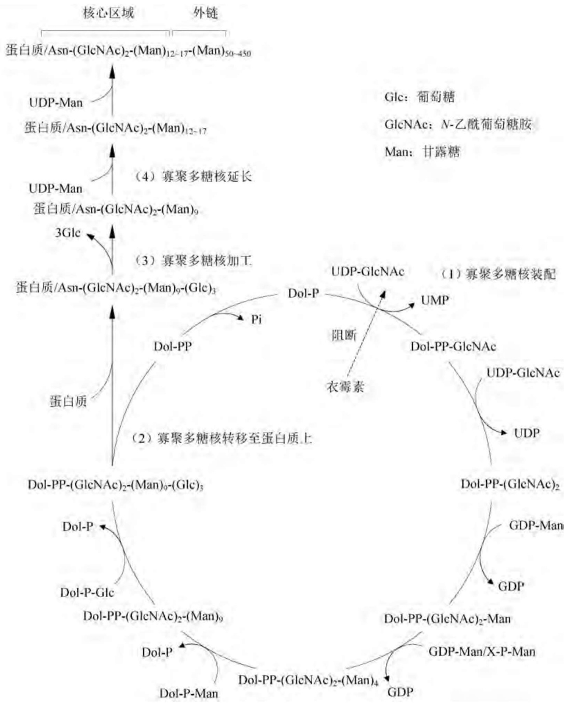

<details>
<summary>flowchart</summary>

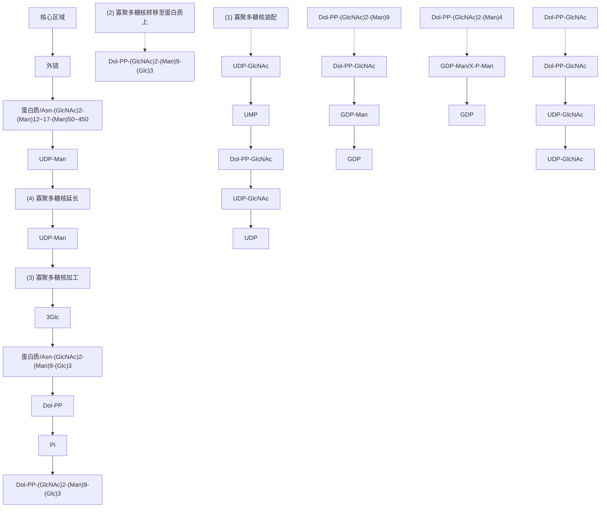
</details>

图5-28 长萜醇化寡聚多糖核的生物合成及其与蛋白质的交联

重组异源蛋白在酵母受体细胞中的超糖基化作用会产生许多不利影响,包括重组蛋白的生物活性下降或抑制以及蛋白质的免疫原性增加等。例如,在酵母细胞中表达的重组N-糖基化人白细胞介素-1β比活为人体中分泌的天然蛋白的1/7\~1/5;由酵母细胞超糖基化的重组HIVgp120蛋白丧失了与CD受体和抗体结合的能力。解决上述问题的途径有三个:①利用基因体外诱变技术封闭重组蛋白中的糖基化位点,从而在根本上避免酵母表达系统的超糖基化作用，重组人尿激酶原、粒细胞-巨噬细胞集落刺激因子、溶葡萄球菌酶采用这种方法取得了较好的效果。然而，如果异源蛋白本身含有糖基化侧链，而且糖链的存在是其生物活性所需的，那么这种封闭方法并不适用。②筛选受体细胞的甘露糖生物合成突变株（见5.2.1），例如酿酒酵母的MNN1突变株能合成不含 $\alpha -1,3-$ 糖苷键的 $N-$ 和 $O-$ 寡聚甘露糖侧链，从而消除了甘露糖糖蛋白严重的免疫原决定簇。MNN9突变株失去了超糖基化功能，只能合成缺少侧链的 $N-$ 糖基化蛋白，这对于表达生产只含有寡聚多糖核的真核生物重组蛋白（如人 $\alpha_{1}$ -抗胰蛋白酶）非常有效。但上述两种突变株的缺陷是在大规模发酵过程中生长缓慢。③选用其他的酵母表达系统，如巴斯德毕赤酵母（不存在MNN1基因）、多形汉逊酵母、粟酒裂殖酵母等，它们的蛋白质超糖基化修饰能力远低于酿酒酵母。

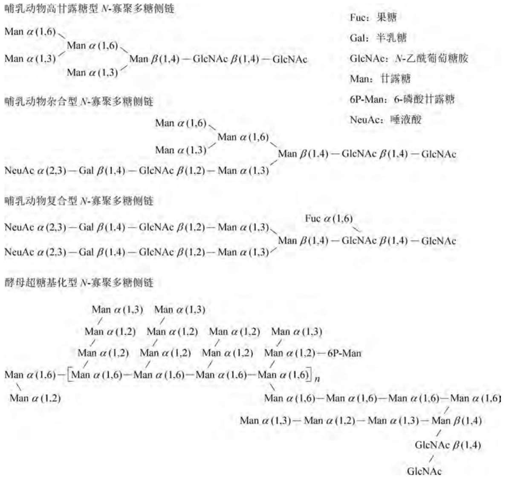

<details>
<summary>flowchart</summary>

```mermaid
graph TD
  A["哺乳动物高甘露糖型 N-寡聚多糖侧链"] --> B["Fuc: 果糖"]
  A --> C["Gal: 半乳糖"]
  A --> D["GlcNAc: N-乙酰葡萄糖胺"]
  A --> E["Man: 甘露糖"]
  
  subgraph Chain_1
    F["Man α(1,6)\nMan α(1,3)\nMan α(1,3)\nMan β(1,4)-GlcNAc β(1,4)-GlcNAc"]
    G["哺乳动物杂合型 N-寡聚多糖侧链"]
    H["6P-Man: 6-磷酸甘露糖"]
    I["NeuAc: 唾液酸"]
  end
  
  subgraph Chain_2
    J["Man α(1,6)\nMan α(1,3)\nMan β(1,4)-GlcNAc β(1,4)-GlcNAc\nNeuAc α(2,3)-Gal β(1,4)-GlcNAc β(1,2)-Man α(1,3)"]
    K["哺乳动物复合型 N-寡聚多糖侧链"]
    L["Fuc α(1,6)\nMan β(1,4)-GlcNAc β(1,4)-GlcNAc\nNeuAc α(2,3)-Gal β(1,4)-GlcNAc β(1,2)-Man α(1,3)"]
  end
  
  subgraph Chain_3
    M["酵母超糖基化型 N-寡聚多糖侧链"]
    N["&quot;Man α(1,3)\nMan α(1,3)\nMan α(1,2)\nMan α(1,2)\nMan α(1,2)\nMan α(1,2)\nMan α(1,6)-[Man α(1,6)-Man α(1,6)-Man α(1,6)-Man α(1,6)"]_n\nMan α(1,2)\nMan α(1,6)-Man α(1,6)-Man α(1,6)-Man α(1,6)\nMan α(1,3)-Man α(1,2)-Man α(1,3)-Man β(1,4)\nGlcNAc β(1,4)\nGlcNAc"]
  end
  
  A -.-> F
  A -.-> G
  A -.-> K
  A -.-> M
```
</details>

图5-29 $N$ -寡聚多糖链的分子结构

然而，即便是巴斯德毕赤酵母的糖基化谱与哺乳动物也存在着差异，如最外侧的糖单位不含哺乳动物中普遍存在的唾液酸[图5-30(a)]，而这种无唾液酸的重组蛋白在人体血清中很容易被迅速清除。解决上述难题的一个成功策略是采用内源基因敲除和外源基因引入

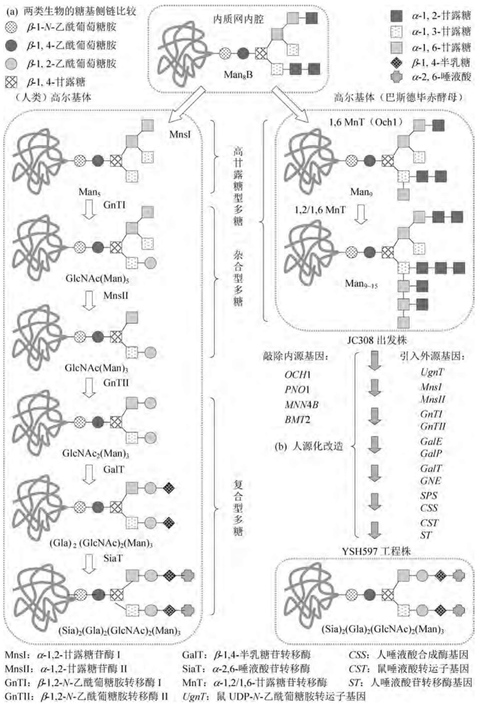

<details>
<summary>flowchart</summary>

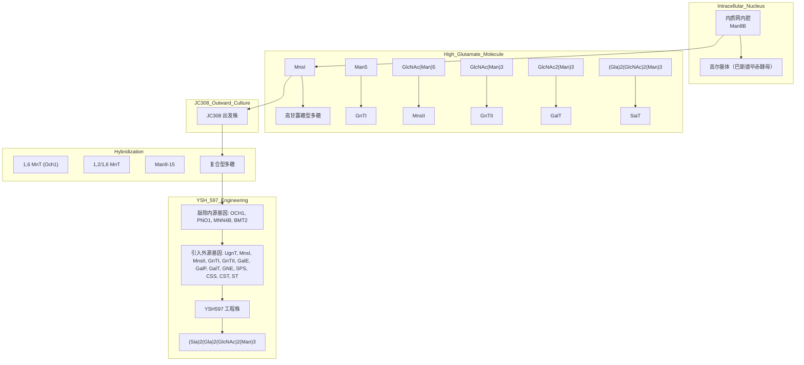
</details>

图5-30 巴斯德毕赤酵母糖基化格局的人源化改造

相结合的多重步骤,将巴斯德毕赤酵母的JC308出发株改造成糖基化修饰格局呈人源化的工程受体。由这种人源化的巴斯德毕赤酵母受体(YSH597)表达的重组人促红细胞生长素(rhEPO)在糖基侧链的分子谱方面已与天然蛋白完全一致[图5-30(b)]。

## 5.2.6 利用重组酵母生产乙肝疫苗

由乙型肝炎病毒(HBV)感染引起的急慢性乙型肝炎是世界范围内的严重传染病,每年约有200万病人死亡,并有3亿人成为HBV携带者,其中相当一部分人有可能转化为肝硬化或肝癌患者。目前对乙肝病毒还没有一种有效的治疗药物,因此高纯度乙肝疫苗的生产对预防病毒感染具有重大的社会效益,而利用重组酵母产生人乙肝疫苗为这种疫苗的广泛使用提供了可靠的保证。

## 1. 乙肝病毒及其基因组结构

乙肝病毒是一种双链环状蛋白质包裹型的DNA病毒，具有感染能力的病毒颗粒呈球面状，直径为 $42\mathrm{nm}$ （即所谓的Dane颗粒），基因组大小仅为 $3.2\mathrm{kb}$ 。Dane病毒颗粒的主要结构蛋白是病毒表面抗原多肽（HBsAg或S多肽），它具有糖基化和非糖基化两种形式，颗粒中的其他蛋白成分还包括核心抗原（HBcAg）、病毒DNA聚合酶以及微量的病毒蛋白。除此之外，乙肝病毒感染者的肝细胞还能合成和释放大量的 $22\mathrm{nm}$ 空壳亚病毒颗粒，这些颗粒由病毒的包装糖蛋白组成，并结合在宿主细胞的脂双层质膜上，其免疫原性是未装配的各种包装蛋白组分的1000倍。包装蛋白共有三种转膜糖蛋白成分，分别命名为S、M、L多肽，

这些蛋白组分是从一个开放阅读框翻译出来的三种不同相对分子质量的产物(图5-31)。阅读框中含有三个翻译起始密码子ATG，但只有一个终止密码子。三个ATG将阅读框架分为pre-S1、pre-S2、S三个区，其中S区的翻译产物为S多肽，由226个氨基酸残基组成；M多肽

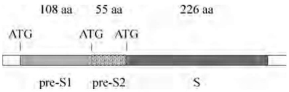

<details>
<summary>text_image</summary>

108 aa 55 aa 226 aa
ATG ATG ATG
pre-S1 pre-S2 S
</details>

图5-31 乙型肝炎病毒表面抗原编码基因的结构

和 L 多肽 $(pre-S2-S$  和 pre-S1-pre-S2-S) 则分别由 281 个和 400 个氨基酸残基组成。Dane 病毒颗粒除了含有大量的 S 多肽外，还有少量的 M 多肽和 L 多肽参与包装。

乙肝病毒在体外细胞培养基中并不能生长，因此第一代的乙肝疫苗是从病毒携带者的肝细胞质膜上提取出来的。虽然这种质膜来源的疫苗具有较高的免疫原性，但其大规模生产受到病毒表面抗原来源的限制，而且提取物需要高度纯化，纯化过程中往往会发生失活现象。此外，最终产品还必须严格检验其中是否混有患者的致病病毒。所有这些工序导致制造成本高居不下，因此这种传统的乙肝疫苗生产方法不能满足几亿接种人群的需求。

## 2. 产乙肝表面抗原的重组酿酒酵母构建

重组乙肝疫苗的开发研究起源于20世纪70年代末，那时乙肝病毒DNA已经克隆，由其序列可以推出HBsAg完整的一级结构。当时人们对大肠杆菌表达重组HBsAg做了大量尝试，结果表明原核细菌的表达水平极低，可能是由于重组产物对受体菌具有强烈的毒性作用，因此从20世纪80年代初开始选择酿酒酵母表达重组HBsAg。其主要工作包括将S多肽的编码序列置于启动子 $P_{\mathrm{ADH1}}$ 的控制之下，转化子能表达出具有免疫活性的重组蛋白，它在细胞提取物中以球形脂蛋白颗粒的形式存在，平均颗粒直径为 $22\mathrm{nm}$，其结构和形态均与慢性乙肝病毒携带者血清中的病毒颗粒相同。此外，采用 $P_{\mathrm{PGK}}$ 启动子表达的重组S多肽也有相似的性质。

由重组酿酒酵母合成的 HBsAg 颗粒完全由非糖基化的 S 蛋白组成, 这与人体细胞质膜来源的由糖基化蛋白构成的天然亚病毒颗粒有所不同。此外, 重组病毒颗粒还含有酵母特异性的脂类化合物, 如麦角固醇、磷酰胆碱、磷酰乙醇胺以及大量的非饱和脂肪酸等。尽管如此,重组酵母和人体两种来源的亚病毒颗粒在与一系列 HBsAg 单克隆抗体(由人细胞质膜提取出来的 HBsAg 所产生)的结合活性上是基本相同的。这一结果表明,两种亚病毒颗粒在免疫活性方面没有区别,它们均含有相同的优势抗原决定簇。

目前，由酿酒酵母生产的这种重组 HBsAg 颗粒已作为乙肝疫苗商品化（其商品名为 Recombivax-B 或 Engerix-B）。重组酿酒酵母的高密度发酵工艺以分批培养为主，控制发酵系统中葡萄糖的浓度以防止乙醇的积累，比生长速率维持在系统完全处于耗氧的状态下，重组产物的最终产量可达细胞总蛋白量的 1%\~2%。发酵结束后，细胞用玻璃珠机械磨碎，裂解物经离心分离后，上清液随后进行离子交换层析、超滤、等密度离心、分子凝胶过滤等几步纯化，最终获得纯度高达 95% 以上的抗原颗粒。将之吸附在产品佐剂上，便制成乙肝疫苗制剂。

进一步的研究结果表明,pre-S1 和 pre-S2 抗原蛋白对 S 型重组疫苗具有显著的增效作用,由三种抗原组分构成的复合型乙肝疫苗可以诱导那些对 S 蛋白缺乏响应的人群的免疫反应。

## 3. 产乙肝表面抗原的重组巴斯德毕赤酵母构建

采用甲基营养型巴斯德毕赤酵母作为受体细胞表达 HBsAg，显示出比酿酒酵母表达系统更大的优越性。重组巴斯德毕赤酵母的构建过程如下:将 HBsAg 的编码序列和用于选择标记的巴斯德毕赤酵母组氨醇脱氢酶编码基因 PHIS4 插入甲醇可诱导型 AOX1 启动子和 AOX1 终止子之间，构成环状重组质粒 pBSAG151（图 5-32）。用 BglII 线形化 pBSAG115，使得 AOX1 启动子和 AOX1 终止子分别位于线形重组 DNA 分子的两端，并转化 HIS $^{-}$ 的受体细胞。在 HIS $^{+}$ 型转化子中，重组 DNA 片段与受体染色体 DNA 上的 AOX1 基因区发生同源交换，单拷贝的 HBsAg 编码序列稳定地整合在染色体上。由于巴斯德毕赤酵母染色体 DNA 上还拥有表达水平较低的第二个乙醇氧化酶基因 AOX2，因此转化子仍能在含有甲醇的培养基上维持（即 Mut $^{S}$ 表型）。

上述重组巴斯德毕赤酵母首先在含有一定浓度的甘油培养基中培养，待甘油耗尽时，加入甲醇诱导 HBsAg 的表达，最终 S 蛋白的产量可达到受体细胞可溶性蛋白总量的 2%～3%，比含有多拷贝表达盒的重组酿酒酵母要高近一倍。这些表达出来的 S 蛋白几乎全部形成类似于病毒携带者血清中的颗粒结构，而由重组酿酒酵母合成的 S 蛋白只有 2%～5% 能装配成 22 nm 颗粒，也就是说前者的单位效价是后者的数十倍。在大规模的产业化试验中，巴斯德毕赤酵母工程株在一个 240 L 的发酵罐中用单一培养基培养，最终菌体量可达 60 g（干重）/L，并获得 90 g 22 nm 的 HBsAg 颗粒，这足以制成 900 万份乙肝疫苗。

## 5.2.7 利用重组酵母生产人血清白蛋白

人血清白蛋白(HSA)是血浆的主要成分,由肝脏合成并分泌至血液循环系统中,然后散布于大多数体液内。人血浆中的血清白蛋白浓度可高达42 g/L,其功能是作为机体内几种重要生理物质的可溶性运输载体,包括类固醇激素、胆汁色素、金属离子、氨基酸、脂肪酸等,同时在维持血液正常渗透压方面也起着重要作用。在临床上,人血清白蛋白主要用作血浆容量扩充剂,抢救休克、烧伤和失血病人,是极为重要的人体蛋白药物,其市场份额占到血浆蛋白总量的40%。人血清白蛋白在肝细胞中最初以血清白蛋白原前体的形式合成,在转运进入内质网膜内腔后,18个氨基酸残基的前体信号肽序列被切除,然后在高尔基体中再由一个类似于酿酒酵母Kex2的肽酶进一步除去6个氨基酸残基的原序列,形成成熟蛋白。成熟的人血清白蛋白为一非糖基化的单一多肽链,由585个氨基酸组成,含有17对二硫键,由此维系的空间构象是血清白蛋白的生物功能所必需的。

在重组人血清白蛋白(rHSA)问世之前,绝大多数厂家从人血浆或胎盘中分离生产人血清白蛋白,全世界为此每年要消耗1 000万升人体新鲜血浆和4 500 t胎盘。然而,血浆和胎盘资源毕竟有限,而且最终产品中很可能被血液中的病毒(如乙肝病毒和艾滋病毒)所污染。由于人血清白蛋白价格低廉(每克仅2美元)且需求量大(每年约300 t),因此利用基因工程方法大规模生产重组人血清白蛋白是否能取代传统的提取方法,很大程度上取决于发酵和分离工序的综合生产成本。此外,由于人血清白蛋白的临床使用剂量一般都在十几克甚至上百克的水平,这给重组制剂的纯度提出了很高的要求,任何痕量的杂蛋白均可能因大剂量使用而造成严重的免疫反应和毒性反应,这是rHSA开发的主要难题。例如,即使rHSA产品的纯度达到99.999%,但在临床急救时一次性输入100 g这样的rHSA药物,等于同时在患者体内引入 1 mg 的杂质(多为表达受体内源性的蛋白、多糖和脂肪)，足以产生严重的免疫反应。

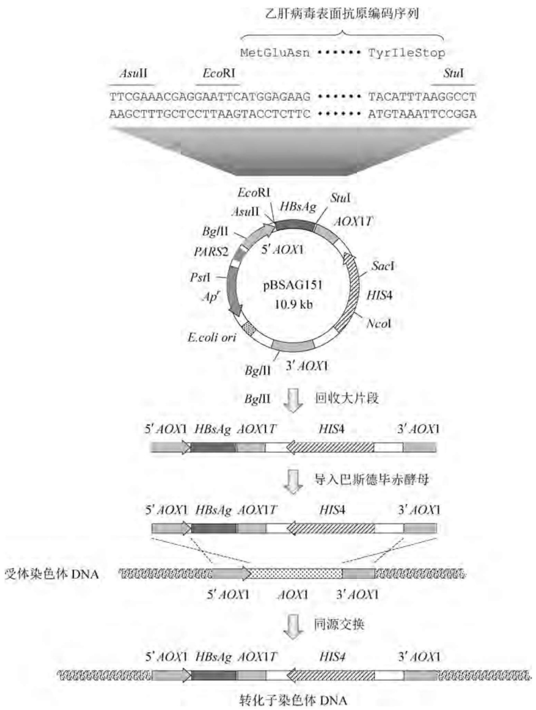

<details>
<summary>flowchart</summary>

```mermaid
graph TD
  A["pBSAG151 plasmid (10.9 kb)"] --> B["Recycle Large Particles"]
  B --> C["Transgenic DNA with Big II"]
  C --> D["Interc)).
```
</details>

图5-32 重组巴斯德毕赤酵母表达乙肝病毒表面抗原

旨在大规模产业化发酵生产rHSA的最初尝试选用的是枯草芽孢杆菌表达系统，但因其原核生物特征，rHSA往往呈不正确的翻译后加工，而且分泌水平也并不像其他异源重组蛋白那么高效。随后改用真核酵母作为rHSA的表达分泌系统，如将带有N端Asp-Ala-His-Lys-Ser特征序列的成熟人血清白蛋白cDNA基因(1.8kb)与各种不同的信号肽编码序列体外拼接，并克隆在含有UYP启动子和ADH1终止子的表达质粒pJDB207上，重组酿酒酵母的表达水平为 $55\mathrm{mg / L}$，但是rHSA在这个系统中依然难以分泌，大都形成受体细胞结合型的表达产物。进一步的改进方法是使用乳酸克鲁维酵母作为受体细胞，其 $\alpha$ -杀伤毒素蛋白的信号肽能大大提高表达产物的分泌效率。重组基因在酿酒酵母启动子 $P_{\mathrm{PGK}}$ 的控制下，摇瓶试验克隆株可分泌表达 $400\mathrm{mg / L}$ 的rHSA；而在高密度发酵过程中，每升发酵液中可获得数克最终重组产物。而且，由乳酸克鲁维酵母生产的rHSA具有正确的折叠构象和加工模式，17对二硫键完全正确配对，与天然的人血清白蛋白几乎没有区别。巴斯德毕赤酵母是迄今为止最优良的rHSA表达分泌系统，与重组HBsAg的工程株构建不同，HSA的基因编码序列由突变型的 $P_{\mathrm{AOX2}}$ 启动子(mAOX2)介导表达，而且这一rHSA表达盒以单交叉同源重组的方式整合在巴斯德毕赤酵母染色体的HIS4位点处(图5-33)。由此构建的重组巴斯德毕赤酵母在最优发酵条件下,合成和分泌 rHSA 的产率可高达 15 g/L,其生产成本已低于传统工艺,更重要的是 rHSA 纯度能满足临床使用严苛的要求,而且其晶体结构也与血清来源的 HSA 没有区别。

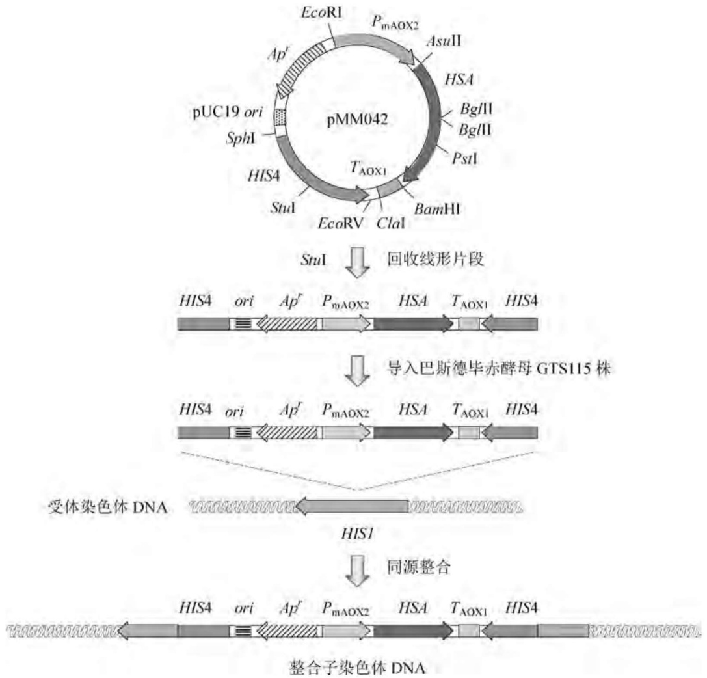

<details>
<summary>flowchart</summary>

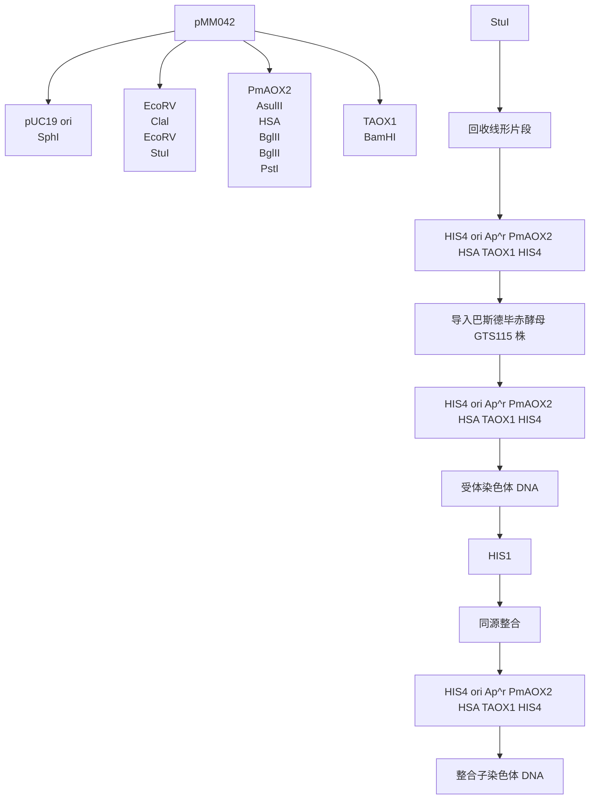
</details>

图5-33 重组巴斯德毕赤酵母表达人血清白蛋白

此外，人血清白蛋白与 CD4 受体的融合蛋白（HSA-CD4）生产工艺也已经问世，开发这种融合蛋白的目的是作为人免疫缺陷型病毒（HIV）的感染阻断剂使用。重组可溶性的 CD4 蛋白已被证明能有效阻止 HIV 感染 CD4 $^{+}$ 淋巴细胞，但这种重组蛋白在人体内的半衰期极短，很难达到临床治疗所需的浓度。人血清白蛋白具有较长的半衰期，体内分布广，而且没有酶学或免疫学活性，因而是一种理想的生物活性蛋白载体。实验结果证实，HSA-CD4 融合蛋白在体内的抗病毒活性与可溶性的 CD4 相似，但在兔子体内的半衰期比可溶性 CD4 长 140 倍。如果人体能耐受高浓度的 HSA-CD4 融合蛋白，则这种蛋白有望成为一种艾滋病毒的拮抗药物。