能成功的关键。

有些害虫天生存在着某些性别上的两态特征,理论上可用于性别分离,例如根据雌雄虫体的尺寸差异可采用人工或机械方法加以分离。然而,工人分离不适合大规模饲养的场合,而机械分离又容易导致虫体物理损伤,从而影响这些转基因虫株在野外的生存适应性和交配能力。采用转基因技术生成害虫遗传性别分离株(GSS)能有效克服上述困难。这些GSS允许根据其特殊的基因组成有效分离性别,甚至在特定条件下诱导转基因虫株性别单向转换(如由雌性转成雄性)或者孵化单种性别(雄性)的子代。GSS的构建策略如下:

## (1) 靶向雄性选择的转基因性别分离

编码绿色荧光蛋白(EGFP)和红色荧光蛋白(RFP)的基因已成功用作哺乳动物、植物、昆虫的转基因标记。将这些标记基因置于雄性特异性启动子控制下并由转座子载体插入雄性特异性染色体(大多数害虫为Y染色体)上表达,便可借助光电识别分离器(COPAS)高效且无损伤地选择出转基因雄性害虫。例如,以害虫的精子特异性基因 $\beta_{2}$ -tubulin所属控制区驱动EGFP的表达,转基因个体的精子呈EGFP阳性而可辨认并加以分离。又如,黑腹果蝇生殖系特异性基因vasa所属的控制区域也被用于介导EGFP的表达。有趣的是,就冈比亚按蚊的vasa基因而言,含有不同长度的起始密码子上游序列的两种构建物呈现不同的表达格局:一种长度的构建物全部呈雄性特异性表达,荧光被限制在睾丸中,且在新生幼虫中即已可见;而另一种长度的构建物虽然呈类似的生殖器限制,但在两种性别中均表达。这种雄性特异性构建物在创建GSS中特别有用,因为这样便可在胚胎发育的很早阶段进行性别分离,从而节省饲养不需要的雌性幼虫的成本和工作量。这两种基于vasa构建物之间的性别差异性表达指出了这样一个事实:基因工程化构建一种GSS切忌随意截取候选基因的上下游调控区控制目的基因的表达。

除了使用雄性特异性启动子外，为了高效分离害虫种群性别，雄性特异性的mRNA剪切模式也具有实用优势。这一策略的基本原理是，采用转基因技术改造一种可选择的标记基因（如EGFP或RFP)，使之含有雄性特异性剪切型内含子，因而这种标记基因只能在雄性害虫中被正确剪切成功能性的编码序列而表达。性别决定途径中的很多基因如transformer和doublesex在两种性别中呈不同的剪切模式，这一特征在广范的昆虫物种中呈高度保守性，因而具有较广的实用价值。

## (2) 靶向雌性消除的转基因性别分离

转基因性别分离的另一种策略不是基于正选择表型如荧光蛋白或杀虫剂抗性基因的雄性特异性表达，而是通过雌性特异性方式表达致死基因来消除雌性。雌性消除的意义远不止用于实验室转基因虫株的雄性富集，更重要的是具有雌性消除特征的转基因雄性虫株一旦被释放至野外，与野生型雌性害虫交配后生育的雄性子代存活，但雌性子代死于胚胎，由此造成害虫种群中的雄性比例不断提升，这一策略称为“显性致死性昆虫释放”(RIDL)。

地中海实蝇是一种最具经济影响力的农业害虫，能侵染250多种果树、坚果、蔬菜，但该物种缺乏类似黑腹果蝇Yp1和Yp3那样的雌性特异性启动子。解决这个难题的有效方法是以广泛存在于昆虫物种中的mRNA性别特异性剪切途径取代雌性特异性启动子的使用需求，其设计原理如下:

昆虫两个关键的性别决定基因 transformer 和 doublesex（在地中海实蝇中分别命名为 Cctra 和 Ccdsx）均受性别特异性另类剪切模式调控（图 6-10）。在雌性中，Cctra 的转录产物被特异性剪切产生 F1、M1、M2 三种不同形式的 mRNA，其中只有 F1 能翻译出功能性的 Tra 蛋白（Tra 的存在决定雌性特异性发育），M1 和 M2 均含有携带翻译终止密码子的额外外显子，因而不能表达 Tra 蛋白。Cctra 转录产物的雄性特异性剪切仅产生 M1 和 M2 两种 mRNA，不能表达 Tra 蛋白（Tra 的缺席决定雄性特异性发育）。将上述雌性特异性剪切的内含子插入到 $tTAV(tTA$ 的突变形式，表达效率更高)的编码区内部，并用含 TRE 位点的热休克启动子 $hsp70$ 介导 $tTAV$ 的表达(图6-10)。这种设计事实上构成了针对转录激活因子 tTAV 表达的一个正反馈系统:$tTAV$ 在 $hsp70$ 启动子介导下仅以基底水平表达出少量的 $tTAV-RNA$，后者在雄性地中海实蝇中因剪切出含翻译终止密码子的 mRNA 而不能表达 tTAV 蛋白；但在雌性地中海实蝇中，$tTAV-RNA$ 中的内含子被精确完整切除，$tTAV-mRNA$ 会翻译出微量的 tTAV 蛋白。此时，如果环境中存在四环素，则 $tTAV$ 仍以基底水平表达；但当四环素缺席时，先前表达出的微量 tTAV 便会结合在启动子 $hsp70$ 上游的 TRE 位点上，激活 $tTAV$ 的高效表达，产生比前一波更多的 tTAV 蛋白，遂引发 tTAV 蛋白在细胞内的迅速积累。重要的是研究结果显示，基底水平表达的 tTAV 蛋白对地中海实蝇无害，但高浓度积累的 tTAV 蛋白则能致死细胞。因此，单条（显性）常染色体上携带上述 $tTAV$ 正反馈表达盒的雄性转基因地中海实蝇一旦被释放至无四环素的野外，与野生型雌性交配后产生的雄性子代能正常存活，但雌性后代均在胚胎早期便死亡。

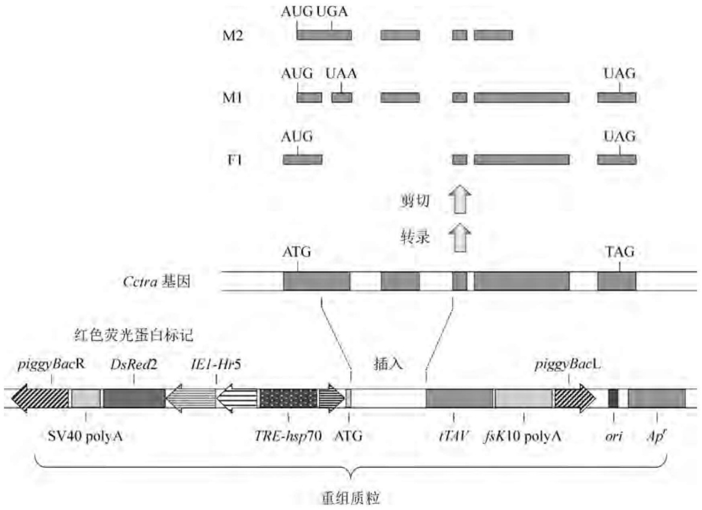

text_image

M2 AUG UGA
M1 AUG UAA UAG
F1 AUG UAG
Cctra基因
ATG TAG
剪切 ↑
转录 ↑
红色荧光蛋白标记
piggyBacR DsRed2 IEI-Hr5
TRE-hsp70 ATG
插入 piggyBacL
SV40 polyA fsK10 polyA ori Apr
重组质粒

图6-10 靶向雌性消除的转基因性别分离设计

## (3) 靶向性别转换的转基因性别分离

从理论上讲，操纵性别决定基因本身就能实现害虫性别的单向转换，从而达到分子不育的目的。黑腹果蝇性别决定基因 doublesex(dsx) 的 RNA 具有雄性特异性和雌性特异性两种剪切模式(图 6-11)。其中，Tra2 单独介导雄性特异性剪切；而雌性特异性剪切需要 Tra 和 Tra2 同时存在。因而，任何能使 Tra 编码基因 (tra) 条件性灭活的转基因设计理论上均能使 XX 基因型的子代果蝇发育雄性。地中海实蝇的性别决定机制与黑腹果蝇有所不同，但主要差异表现在 Tra 蛋白的表达调控层面，而 dsx-RNA 的雌雄特异性剪切模式分别由 Tra+Tra2 和 Tra2 决定的机制在这两个物种中却是保守的。相关实验显示，将一种靶向地中海实蝇 Cctra 的反向重复 DNA 序列置于热休克启动子控制之下,构建物克隆在转座子载体上,可获得 Cctra 表达沉默型的转基因品系(即 RNA 干扰技术)。这些转基因品系的 XX 型胚胎经热脉冲处理后能如期发育成雄性子代,尽管六株转基因品系中只有一株呈性别转换,但其子代中性别转换效果却较为理想(雄性为 95%,其余为双性)。唯一的缺点是这种经“分子变性”了的 XX 型转基因株可能会呈不育性,这对野生型种群规模的压制效果不是很理想。

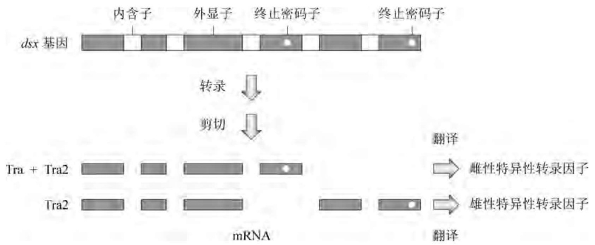

flowchart

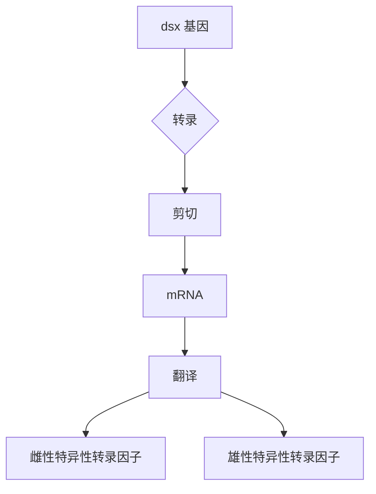

图6-11 黑腹果蝇性别决定基因的两种剪切模式

## 4. 分子绝育及条件致死策略所面临的问题

虽然转基因技术在改进昆虫不育战略方面取得了突破性的进展,但这些策略中的大部分只是在果蝇中得到了初步的概念性验证。果蝇试验所使用的效应基因在果蝇物种之间可能是保守的,但在非果蝇类的农业害虫中也许并不存在这样的直系同源基因,因此需要从特定的害虫物种中分离鉴定相应的效应基因。基因组测序和分析技术的发展无疑会加快这一过程。

已有证据显示，期望特征诸如胚胎致死或性别分离标记基因表达的外显率受到构建物在基因组上定位的强烈影响，构建物与区域性增强子或染色质表观格局的关系会在一定程度上改变转基因的表达状态，这种现象称为定位效应。在这种背景下，较有希望的是由$\Phi \mathrm{C}31$ 介导转基因在昆虫AttB/P位点的特异性整合策略，该系统允许转基因位点特异性插入经过确认的染色体位点处(锚定位点)。

另外，转基因及转基因虫株的遗传稳定性也是必须关注的问题。不少实验观察到，用于转基因整合的非自发性转座子(转座酶缺失)在昆虫受体基因组内源性转座子转座酶或亲缘关系较近的转座酶的驱动下发生再移动。而且，在大规模饲养条件下或野外释放环境中，即便在实验室里检测不出的转座子移动频率也可能会被放大。转基因在受体基因组中的再移动会导致两种后果:一是使转基因丧失预先设计的功能或者干扰转基因株的正常生理过程；二是引起生物泄漏，打破生态系统的平衡。杜绝这种可能性的有效方法是在转基因整合后删除转座子载体上的一个末端重复序列以防止其再移动。

最后，在实验室里构建出具有特定遗传性状的转基因株才是害虫种群压制策略的第一步，在向野外释放之前，这些转基因虫株必须在某种选择压力下规模化饲养到足够的数量。也许转基因株一旦暴露在野外环境中便会产生不同的响应，其适应性（以交配成功率为基准）和生存力的潜在降低可能是转基因操作程序所致的一种直接效应。这些效应既可能来自转基因的整合行为干扰受体内源性基因的功能，也可能来自转基因误表达所带来的直接不利影响。不幸的是，这个过程在实验室里不能模拟，其有效性需要一定时间才能得以验证。

## 6.2.4 蚊虫的基因工程

自然界中的蚊虫大约有3500种，分属按蚊(Anophelinae)和库蚊(Culicinae)两个亚科。按蚊亚科中的冈比亚按蚊是镰状疟原虫(Plasmodium falciparum)的主要传播媒介，而库蚊亚科则含有更多的蚊虫物种，其中包括黄热病、登革热、西尼罗河脑炎、淋巴结丝虫病的主要传播媒介。自2002年肆虐撒哈拉以南非洲的冈比亚按蚊和疟原虫的全基因组序列同年发表以来，共有18种按蚊以及2种库蚊亚科成员(黄热病传播媒介埃及伊蚊和淋巴结丝虫病传播媒介致倦库蚊)的基因组和转录组相继完成测序(图6-12)，有力地推动了利用转基因术控制由蚊虫传播疾病的研究和应用进程。

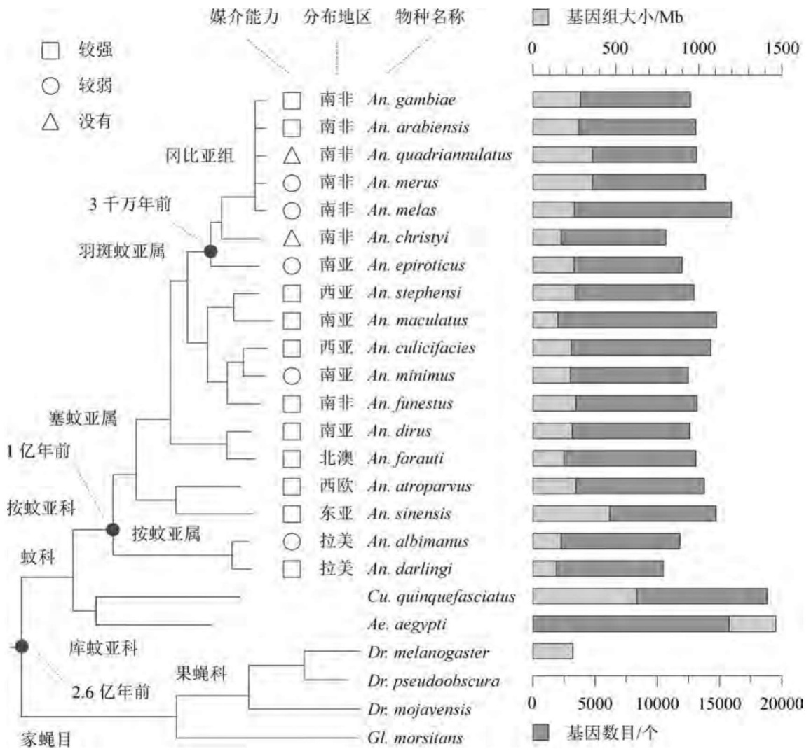

bar_stacked

| Region | Gene Size (Mb) |
| :--- | :--- |
| An. gambiae | ~900 |
| An. arabiensis | ~950 |
| An. quadriannulatus | ~1000 |
| An. merus | ~1050 |
| An. melas | ~1200 |
| An. christyi | ~850 |
| An. epiroticus | ~900 |
| An. stephensi | ~950 |
| An. maculatus | ~1100 |
| An. culicifacies | ~1150 |
| An. minimus | ~900 |
| An. funestus | ~1000 |
| An. dirus | ~1050 |
| An. farauti | ~1100 |
| An. atroparvus | ~1150 |
| An. sinensis | ~1200 |
| An. albimanus | ~950 |
| An. darlingi | ~850 |
| Cu. quinquefasciatus | ~1400 |
| Ae. aegypti | ~1600 |
| Dr. melanogaster | ~300 |
| Dr. pseudoobscura | 0 |
| Dr. mojavensis | 0 |
| Gl. morsitans | 0 |

图6-12 基因组测序蚊虫的系统发生与疾病传播媒介能力

## 1. 蚊虫转基因技术的基本策略

与通过侵袭而直接损害农作物的害虫(如地中海实蝇)不同,蚊虫的叮咬和食血本身对其侵袭对象并不构成危害,致命的是寄生于它们体内的病原体在叮咬和采血过程中被传播至人类和牲畜体内。因而,控制自然界作为病原体传播媒介的蚊虫除了可采用上述对付农业害虫的种群压制策略外,还可通过抑制病原体在蚊虫体内的寄生繁殖能力或者改变蚊虫叮咬人类和牲畜的习性而实现蚊虫无害化,这种不以消灭蚊虫为表现形式的蚊虫遗传改造

策略称为种群置换策略。

## (1) 基于转基因蚊虫不育或性别分离的种群压制策略

理论上，大多数已在黑腹果蝇或地中海实蝇中经过概念验证甚至野外释放获得成功的种群压制转基因设计方案均适用于蚊虫。由于只有雌蚊为其卵的正常发育需要食血，所以无论是分子不育还是性别分离的转基因设计，根除雌蚊并保留雄蚊是技术的关键。例如，将杀虫剂抗性基因插入蚊虫Y染色体上的合适位点，可在转基因蚊虫向野外种群释放之前有效消除雌性蚊虫；采用冈比亚按蚊精子特异性 $\beta 2-$ 微管蛋白编码基因所属控制区驱动EGFP的表达，实验显示冈比亚按蚊、斯氏按蚊、阿拉伯按蚊（Anopheles arabiensis）的转基因雄株早在第3龄幼虫阶段便出现荧光性睾丸，因而可借助光电识别分离器对转基因蚊虫进行性别机械分离；埃及伊蚊虽然没有性染色体，但其第1号常染色体上Y染色体样区域内的雄性决定基因Nix已被证明是雄性伊蚊发育的必要且充分条件，因而可用于将雌蚊转换成无害雄蚊的候选基因。

在蚊虫分子绝育的转基因设计层面，野外条件诱导下的效应基因表达调控系统如“Tet-off”已被证明至少能在斯氏按蚊中有效工作。显然，这种蚊虫种群压制策略的关键是找到适合于蚊虫的性别选择性不育或致死基因。例如，黑腹果蝇促细胞凋亡基因reaper、grim、head involution defective的误表达均能致果蝇于死地。重要的是，这些基因的功能似乎呈系统发生学上的保守性，它们在广泛的昆虫物种中诱导相似的表型，因而应该也能在按蚊中工作；又如，一种靶向X染色体上重复序列的归巢型核酸内切酶（HEG）编码基因在精子发生晚期阶段的表达，能将稳定的HEG转移至受精的胚胎中，并诱导X染色体裂解，阻滞早期胚胎的发育；再如，前述(参见6.2.3)的tTAV正反馈系统高水平积累tTAV对地中海实蝇细胞的致死效应，理论上也应该适用于蚊虫。

## (2) 基于转基因蚊虫抑制病原体寄生繁殖能力的种群置换策略

蚊虫为很多病原体传播所必需，因而阻断蚊虫支持病原体发育的能力而非将蚊虫根除（实践证明也不太可能将自然界中的蚊虫种群彻底根除），同样能降低甚至消除疟疾等疾病的发生和传播。阻断病原体传播的一种方式便是转基因修饰蚊虫，使其表达那些能抑制病原体发育的效应基因。这一概念已在斯氏按蚊转基因株中首次得以验证（详见6.2.4）。随后来自不同实验室并采用各种效用分子的研究均获得了类似的结论。综合而言，这些研究均建立起如下的概念验证:通过媒介蚊虫的转基因修饰衰减病原体的传播程度是可行的。

目前，被列为阻断蚊虫支持病原体发育能力的效应基因有如下四类:第一类为病原体致死性效应基因，包括昆虫先天性免疫系统的多肽，诸如防卫素、冈比亚菌素（gambicin）、杀菌肽以及其他来源的多肽编码基因，这些基因的表达产物能杀灭病原体但不影响宿主蚊虫；第二类为病原体干扰性效应基因。例如，EPIP是一种疟原虫烯醇酶/血纤维蛋白溶酶原相互作用肽，通过阻止血纤维蛋白溶酶原结合在动合子表面而阻断疟原虫入侵蚊子的中肠。其他的效应基因还包括那些靶向病原体动合子或孢子体表面的单链单克隆抗体（scFvs）编码基因；第三类为干扰蚊子中肠（疟原虫入侵靶位）或唾液腺（疟原虫释放靶位）上皮细胞的效应基因，包括12个氨基酸的寡肽SM1、A2磷酸酯酶变体mPLA2以及几丁质酶前肽编码基因；第四类为蚊虫免疫系统效应基因，如蛋白激酶Akt是胰岛素信号转导途径中的一个关键组分，其血食诱导型表达可使蚊子难以为疟原虫所感染。

## (3) 基于转基因蚊虫转变叮咬人类习性的种群置换策略

蚊虫虽是威胁人类健康的大敌，但幸运的是它们也有软肋:利用其嗅觉靶向人类宿主。人体分泌出来的很多化合物已被证明是蚊虫的引诱物，包括由皮肤散发出的乳酸、来自汗水和呼吸的1-辛烯-3-醇以及呼吸中大约 $4\%$ 的 $\mathrm{CO}_{2}$ （皮肤也有痕量的 $\mathrm{CO}_{2}$ 散发）。蚊虫拥有天线和下颚须两套嗅觉器官，其中下颚须头状挂钩(cp)感应器中的A型神经元(cpA)借助其细胞表面的三种味觉受体(Gr1、Gr2、Gr3)复合物直接负责响应  $CO_{2}$ ，但嗅觉的产生还需要由 Orco 蛋白构成的离子通道的诱导性开启。研究显示，Gr3 编码基因的缺失型突变确能使蚊虫下颚须 cpA 神经元不再响应  $CO_{2}$ ，而 Orco 编码基因缺失型蚊虫搜索宿主的能力虽呈降低趋势但非全部丧失。

## (4) 基于转基因蚊虫野外强势扩散的种群置换策略

种群压制策略依靠雌性选择性不育或致死的转基因设计驱动转基因雄性蚊虫在野外种群中的有效蔓延并最终衰减蚊虫种群的规模，但携带效应基因（如抑制病原体寄生繁殖的转基因或嗅觉缺陷型转基因）的转基因蚊虫却并不具备在野生型种群中迅速扩散的优势，甚至还可能有劣势。因此蚊虫种群置换策略的一个关键问题是必须建立一种方法能有效驱动转基因蚊虫进入野外蚊子种群并置换之。目前至少已有下列两种转基因设计得到原理性验证:Medea法和HEG法。

面象虫赤拟谷盗(Tribolium castaneum)中天然存在一种被简称为 Medea 的母体效应自私性遗传元件,这种元件能诱导所有未从其亲本基因组中遗传含元件型染色体的子代发生母体效应性致死,从而保证其自身的优势存在。根据这一现象,可在果蝇中设计一种如图 6-13(a)所示的人工合成型 Medea 元件: 在一种转座型 P 元件载体上以果蝇母体特异性基因 bicoid(bic)所属启动子驱动一个编码两条 miRNA 的多顺反子(miR-myd88)表达,这两种 miRNA 被设计成能沉默果蝇 myd88(毒素生产基因)的表达,而母体型 Myd88 是果蝇早期胚胎发育过程中背腹格局形成所必需的。带有生殖系 myd88 功能丧失型突变的雌蝇产生的胚胎即便其父本野生型等位基因存在也会缺失腹部结构而致死。这种载体(称为 $Medea^{myd88}$)还携带一种对母体 miRNA 非敏感性的 myd88 转基因(合子解毒剂生产基因),受控于早期胚胎特异性基因 bottleneck(bnk)的启动子。将这种转基因构建物整合在果蝇的一条常染色体上便获得杂合型 $Medea^{myd88}/+$ 果蝇(此处的“+”表示另一条同源染色体不携带 $Medea^{myd88}$)。当 $Medea^{myd88}/+$ 杂合型雄蝇与天然纯合型+/+雌蝇交配或者纯合型 $Medea^{myd88}$ 果蝇之间交配时,所有子代胚胎均存活,但其中 50% 的子代携带了 $Medea^{myd88}$[图 6-13(b)];相反,当杂合型 $Medea^{myd88}/+$ 雌蝇与纯合型+/+雄蝇交配时,大约 50% 的子代胚胎会因腹部结构缺陷而致死,而所有存活下来的子代均携带 $Medea^{myd88}$[图 6-13(d)]。实验室箱笼模拟结果显示,不携带 $Medea^{myd88}$ 的果蝇在繁殖 10\~12 代后便永久性地从种群中消失,证明这种 $Medea^{myd88}$ 设计具有强大的种群扩散驱动力。值得注意的是,在种群置换实际应用时,上述驱动装置必定与合适的效应基因联合组装。如果驱动基因与效应基因之间或者驱动基因中毒素基因与解毒剂基因之间因同源染色体重组而发生分离,则分别产生效应基因缺失型 $Medea^{\Delta eff}$ 元件或者毒素基因缺失型 $Medea^{ins}$ 元件[图 6-13(c)]。如果效应基因或毒素基因的存在对转基因虫株具有适应性不利影响,那么自然选择将会有利于并且促进 $Medea^{\Delta eff}$ 或 $Medea^{ins}$ 元件在种群中的扩散。避免上述情况发生的有效设计是将毒素基因和效应基因置于解毒剂基因的一个内含子中[图 6-13(e)]。总之,如果蚊虫卵子生成或早期胚胎发育过程中的基因资源得以鉴定,那么上述 Medea 设计便可用作蚊虫种群置换策略中的必要驱动装置。

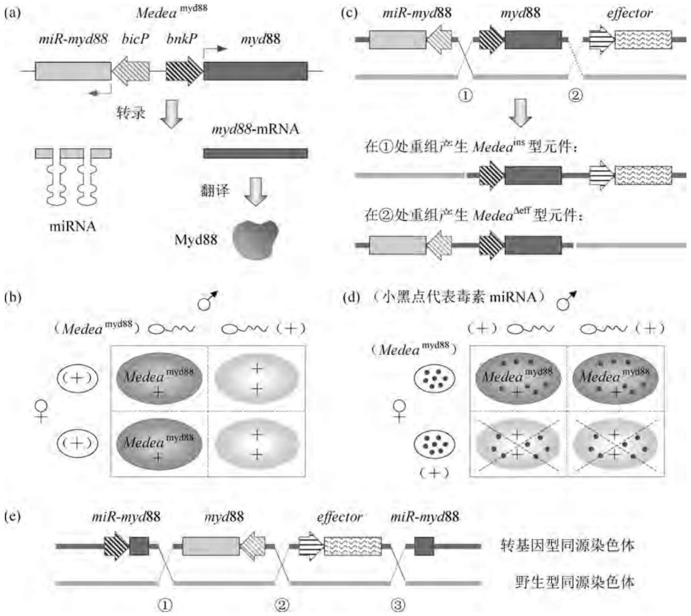

图6-13 昆虫种群置换驱动装置Medea的设计原理

仅存在于单细胞生物中的HEG基因编码高度序列特异性的归巢型核酸内切酶，其识别序列长达 $14\sim 40$ bp，因而几乎不存在于多细胞动物的核基因组中。由HEG诱导的DNA双链断裂能激活细胞内的重组修复系统，后者采用携带HEG的同源染色体作为模板修复断口，从而将HEG拷贝至断裂的染色体上，该过程称为“归巢”。很多单细胞生物正是采用这种机制将含有HEG的DNA序列扩散至种群中。受此现象启发，可设计驱动特定效应基因在蚊虫种群中迅速扩散的置换系统。该系统由供体(D)和靶体(T)两株不同的冈比亚按蚊转基因品系构成，它们在同源染色体3R上的同一位点处或携带HEG家族成员I-SceI基因或含有其识别序列。其中，供体品系采用重组质粒pHome-D生成，其上含有一个 $3\times P3 - GFP$ （绿色荧光蛋白编码基因)转录单位，但为一种合成型HEG表达盒所隔断，后者由I-SceI基因和冈比亚按蚊雄性特异性 $\beta 2$ -tubulin基因的调控区组成；靶体品系采用pHome-T生成，其GFP编码序列内部含有I-SceI裂解位点，但不影响阅读框架因而具有功能。正如所预期的那样，在供体/靶体转基因杂合型雌蚊与野生型雄蚊交配所产的子代中，$\mathrm{GFP^{+}}$ 与 $\mathrm{GFP^{-}}$ 表型的比例大约为 $50:50$ ；相反，在供体/靶体转基因杂合型雄蚊与野生型雌蚊交配所产的子代中，$\mathrm{GFP^{+}}$ 与 $\mathrm{GFP^{-}}$ 表型的比例为 $14:86$ 。PCR分析显示，$\mathrm{GFP^{-}}$ 型子代数的超出部分中 $97\%$ 的个体含有HEG表达盒。实验室箱笼模拟结果显示，用I-SceI等位基因初始频率为 $10\%$ 或 $50\%$ 的供体蚊虫分别接种I-SceI等位基因初始频率为 $90\%$ 或 $50\%$ 的靶体种群（$\mathrm{GFP^{-}}$ 型个体的初始频率为 $1\%$ 或 $25\%$ )，在两种情形中，$\mathrm{GFP^{-}}$ 型个体的频率随时间迅速增长。至第12代时 $\mathrm{GFP^{-}}$ 型个体的频率已从 $1\%$ 提升至 $60\%$ ；若用更高I-SceI等位基因初始频率的供体蚊虫接种靶体种群，则 $\mathrm{GFP^{-}}$ 型个体甚至在第8代后便可达到大约 $75\% \sim 80\%$ 的频率。上述结果暗示，如果HEG的识别序列特异性被改造成靶向蚊虫的病原体媒介功能基因，那么既可用作能灭活蚊虫媒介功能的基因又能使这样的转基因蚊虫在野外种群中迅速扩散；即便HEG经改造后靶向蚊虫基因组中的非基因区，也能在该位点导入一个可阻断蚊虫作为疟疾传播媒介的效应基因。这种设想在埃及伊蚊中已被证明具有可行性。

(a) HEG 供体和靶体的转基因设计与工作原理

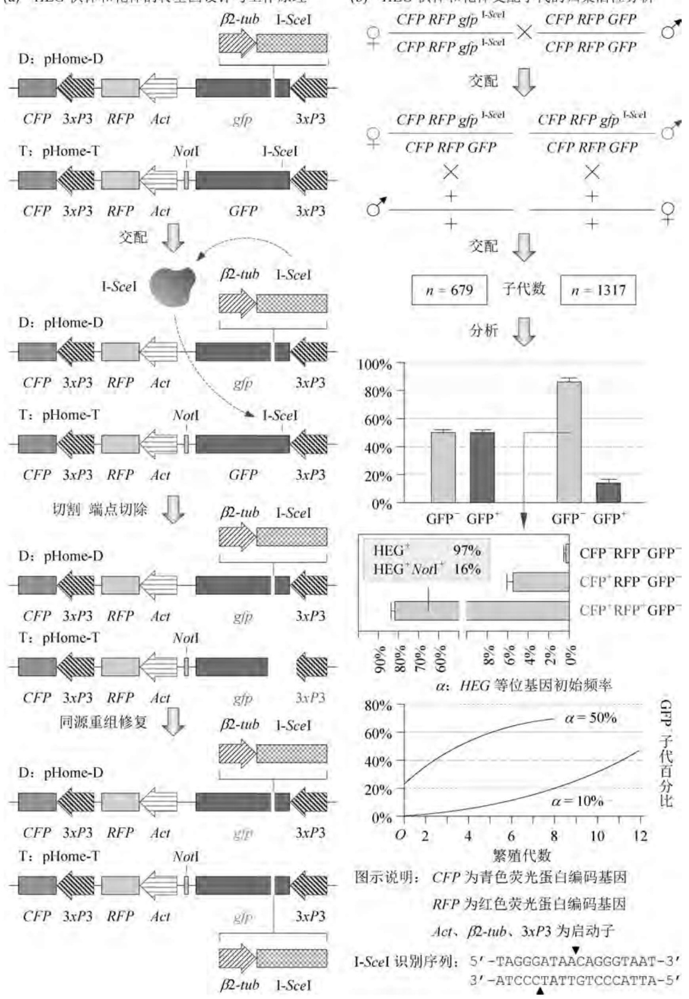

(b) HEG 供体和靶体交配子代的归巢活性分析

图6-14 冈比亚按蚊种群置换驱动装置HEG的设计原理

此外，随着靶序列可任意编程的CRISPR-Cas基因组编辑技术日臻完善，这种由自私性或归巢型元件介导的蚊虫种群置换策略将更普遍地进入实用阶段。

## 2. 斯氏按蚊的基因工程

疟疾是全球发病率和死亡率均较高的传染性疾病，每年约有数亿人染上此病，其中超过100万人死亡。导致人类疟疾的专性真核寄生虫疟原虫(Plasmodium)仅由蚊虫中的按蚊属传播，在该属的450个已知种中大约有60个种具有疟原虫传播能力。疟疾及其他一些由蚊虫传播的疾病之所以非常凶险是因为缺乏有效的疫苗，且蚊虫和病原体对杀虫剂和药物容易产生抗性，因此发展控制疟疾及相关疾病的新战略迫在眉睫。

在疟蚊食入宿主血后的数分钟内，疟原虫的配子母细胞便发育成配子，后者经交配形成合子，并分化成可移动的动合子。一天后，动合子跨越疟蚊的中肠上皮细胞再分化成卵囊。大约两周后，卵囊破裂，将数千枚孢子体释放进疟蚊体腔中。疟原虫的孢子体只能入侵疟蚊的唾液腺，当疟蚊叮咬另一宿主时，便从唾液腺释放出孢子体，从而完成传播过程。虽然一只雌蚊吸食一个宿主个体血液便会吞入数千个配子，但只有大约 $10\%$ 的配子能成功发育成动合子，而且其中大约只有5个动合子能成功侵入跨越疟蚊中肠上皮细胞形成固着的卵囊。因此，疟蚊中肠是疟原虫繁殖的重要瓶颈，自然也成为干预的首要靶标。

构建抗疟原虫蚊虫需要确定的靶基因来自人们对自然界天然存在的抗疟原虫型蚊虫的观察，实验发现有些蚊虫包裹疟原虫的能力强劲，进而确定了蚊虫免疫系统中的某些基因可以作为构建转基因蚊虫的靶基因。之后，雌蚊接触疟原虫后驱动免疫应答基因表达的启动子、响应蚊虫食血的卵黄蛋白基因启动子，以及在蚊虫中肠内特异性表达的启动子相继得以鉴定，为转基因在蚊虫体内的时空特异性表达提供了重要信息。

疟原虫横跨疟蚊上皮细胞的机制尚不十分清楚，但可能与受体有关。用含有12个氨基酸随机序列的细菌噬菌体展示库进行体内筛选，鉴定出一个序列为PCQRAIFQSICN的寡肽（唾液腺和中肠结合肽，SM1），它能特异性地结合接触过疟原虫的蚊虫唾液腺和中肠上皮细胞。实验证明，SM1能强烈地抑制疟原虫横跨这两种上皮细胞，这一结果表明，当受感染的血液被消化后，如果正好有SM1产生并分泌至疟蚊脏器内腔中，则疟原虫的发育就会被阻断。

另外，人们在寻找一种调控系统以表达疟原虫发育抑制基因时发现，羧肽酶(CP)启动子及信号肽序列具有很多理想的性能。CP启动子被食血强烈激活，CP信号肽序列能促进蛋白质分泌到蚊虫的中肠内腔中，这里正是疟原虫早期发育的场所。由此便构建了一个合成基因 $AgCP[SM1]_{4}$ ，它由四个拷贝的SM1编码序列通过一个四肽接头片段(GSPG)编码序列连为一体，接在CP信号肽序列的下游，并以肠特异性、血液诱导的CP启动子控制之(图6-15)。将此基因表达盒插在piggyBac载体上，转化斯氏按蚊。在394个受注射的胚胎中，孵化出63个(16%)幼虫，最终产生33只(8.4%)转基因成蚊。这些蚊虫分成14个家族，其中2个家族(A和B)产生了绿色荧光蛋白(GFP)阳性的子代。Southern blot杂交结果显示，转基因在宿主染色体上的整合区域不尽相同；Northern blot杂交结果证明， $AgCP[SM1]_{4}$ 转基因表达出的mRNA在食血后3～6h内达到高峰。转基因所表达出的重组多肽则存在于食血后6～24h的中肠上皮细胞中，但 $36\mathrm{h}$ 后便消失了。由于疟原虫的动合子通常在食血 $24\mathrm{h}$ 后入侵蚊虫中肠上皮细胞，因此重组多肽的合成和分泌必须先于疟原虫的入侵时间。

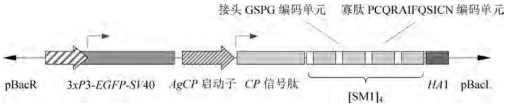

text_image

pBacR
3xP3-EGFP-SV40
AgCP 启动子
接头 GSPG 编码单元
寡肽 PCQRAIFQSICN 编码单元
CP 信号肽
[SM1]₄
HA1
pBacL

图6-15 $AbCP[SM1]_4$ 转基因表达质粒的构成

为了测定 $AgCP[SM1]_4$ 转基因表达对疟原虫发育的影响，将相同的受感染小鼠喂养转基因蚊虫和对照蚊虫，然后分别测定两者的卵囊形成数量。结果显示，卵囊抑制程度在 $68.7\% \sim 94.9\%$ 内。这表明，SM1四聚体结合在蚊虫中肠的内腔表面，阻断了疟原虫-上皮细胞之间的相互作用，从而抑制其入侵。进一步的实验数据表明，转基因蚊虫唾液腺中的疟原虫孢子体数目为对照组的 $1/51 \sim 1/7$ 。在野外自然环境中，绝大多数蚊虫携带的疟原虫卵囊数少于5个，由此可见转基因株抑制疟原虫传播非常有效。而且上述所有实验中所使用的转基因株均为杂合子，可以推测纯合子型的转基因株将更为有效。这是通过转基因技术成功阻断疟原虫传播的第一个案例。初步的实验观察表明，重组多肽的表达并不影响转基因蚊虫的寿命和产卵，因此具有一定的实用价值。

## 3. 埃及伊蚊的基因工程

埃及伊蚊是世界范围内虫媒型病毒最重要的媒介,具有白天叮咬特性,能高效传播登革热病毒、黄热病毒、基孔肯亚病毒。其中,仅受登革热病毒(登革出血热和登革休克综合征病原体)感染的人群每年就达上亿。

2000年，人们调查了利用埃及伊蚊编码卵黄蛋白前体的脂肪体特异性基因vitellogenin(Vg)所属调控区控制表达抗黄热病毒因子的可能性。将一种主要的昆虫免疫因子防卫素A的编码区(DefA)接在 $2.1\mathrm{kb}$ 的Vg启动子下游，并亚克隆到转化载体 $\mathrm{pH}[cn]$ 上，构成$\mathrm{pH[cn]Vg - DefA}$ 重组质粒。$\mathrm{pH[cn]}$ 载体含有来自黑腹果蝇的cinnabar(cn)基因，其两侧为Hermes转座元件的末端反向重复序列(图6-16)。将 $\mathrm{pH[cn]Vg - DefA}$ 重组质粒及编码有Hermes转座酶的辅助质粒注射到3000多个埃及伊蚊白眼株 $(kh^{\mathrm{w}})$ 的前囊胚层胚胎（受精后 $90\sim 270\mathrm{min})$ 中。由于 $\mathrm{pH[cn]}$ 载体上的 $cn$ 基因能互补宿主的 $kh^{\mathrm{w}}$ 遗传性状，使蚊虫的眼睛颜色由白色转换成红色，所以转化的 $\mathrm{G}_1$ 子代很容易辨认筛选。从600个子代个体中获得了5株独立稳定的转基因品系，其中D1品系被用来进行 $Vg - DefA$ 转基因表达特征的分析。连续9代的转基因株跟踪研究表明，$Vg - DefA$ 稳定地整合在宿主染色体上。它在转基因株的脂肪体中被强烈激活，其mRNA水平在食血后 $24\mathrm{h}$ 达到最高峰，大量的转基因防卫素在转基因雌蚊的血淋巴细胞中积累，并在一次食血后能持续表达 $20\sim 22\mathrm{d}$ 。经纯化后的转基因防卫素具有与天然防卫素同等的抗菌活性。这种携带系统免疫因子且遗传稳定的转基因蚊虫表达免疫因子不依赖于病毒的感染，仅由食血级联反应控制。这项工作朝着病原体传播媒介分子遗传控制的方向迈出了重要的一步。

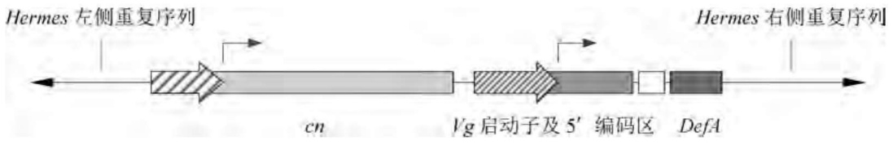

text_image

Hermes 左侧重复序列
Hermes 右侧重复序列
cn
Vg 启动子及 5' 编码区
DefA

图6-16 $\mathrm{pH}[cn]\mathrm{Vg} - \mathrm{DefA}$ 重组质粒的构成

埃及伊蚊的肌动蛋白4编码基因AeAct-4能在雌蛹的间接飞行肌(IFM)组织中优势转录并翻译产生功能性的肌动蛋白，而且该基因的成熟mRNA在雄蚊中因选择性剪切比雌蚊的成熟转录物在 $5^{\prime}$ -UTR多出244个核苷酸，其中含有多个起始密码子和终止密码子，因而导致雄蚊个体中翻译早熟性启动和终止，功能性肌动蛋白表达量相比雌蚊更低。基于这一原理，以AeAct-4所属的转录调控区、 $5^{\prime}$ -UTR、第一内含子序列介导tTAV以第4龄发育阶段、IFM组织、雌性特异性方式表达(转基因株OX3545)；以最低限度的热休克启动子$hsp^{min}$ 与四环素应答元件tRE(含7个tetO拷贝)联合介导致死性效应基因Nipp1Dm(编码

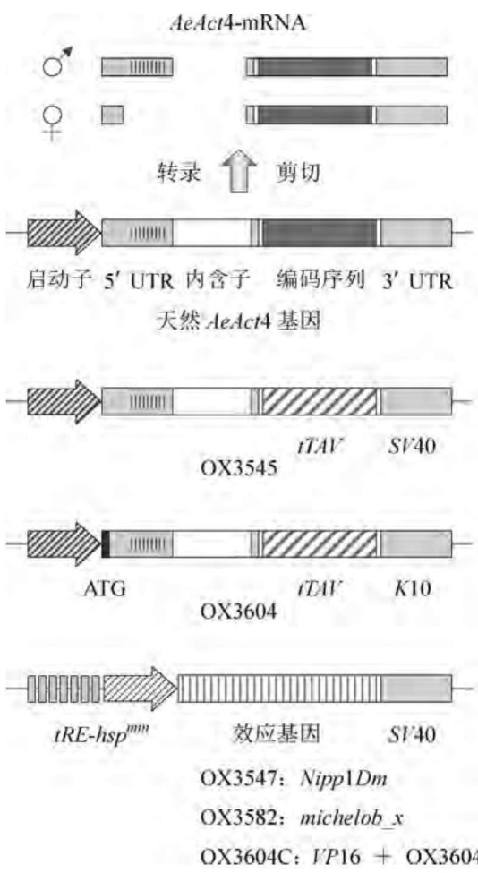

text_image

AeAct4-mRNA
转录 ↑ 剪切
启动子 5' UTR 内含子 编码序列 3' UTR
天然 AeAct4 基因
OX3545
tTAV SV40
ATG
OX3604
tTAV K10
tRE-hspmm 效应基因 SV40
OX3547: Nipp1Dm
OX3582: michelob_x
OX3604C: VP16 + OX3604

图6-17 埃及伊蚊雌性特异性飞行肌缺损转基因株构建

黑腹果蝇1型蛋白磷酸酶核内抑制因子)和michelob\_x(编码蚊虫细胞凋亡蛋白抑制剂的抑制因子)表达(分别为转基因株OX3547和OX3582)，便可构建具有四环素可阻遏的雌性特异性飞行缺损表型的埃及伊蚊转基因株(图6-17)。由于不能飞行意味着雌性埃及伊蚊被捕食的概率大幅增高、难以采血、不能交配(雌性需要振动翅膀发出“求爱之歌”)，因而飞行缺损表型与致死效应相差无几。初步结果显示，当OX3545转基因株分别与OX3547和OX3582转基因株杂交后，同时携带tTAV和致死基因的子代雌蚊在无四环素饲养条件下呈高比例(69.8%\~98.3%)的飞行缺损表型；甚至在OX3545株中也存在低比例的飞行缺损型雌蚊，可能是由于tTAV高水平的表达也能危害飞行肌组织，进一步的实验探查证实tTAV的毒性来自VP16。上述结果表明合适的效应因子在埃及伊蚊IFM中表达确能导致飞行缺损表型。

为了进一步改善上述 tTAV 表达系统的性别特异性, 将一个 ATG 密码子引入雄性特异性外显子邻近 5' 端的位点。在雌性特异性剪切产物中, 该 ATG 密码子与 tTAV 编码序列处于同一阅读框; 但在雄性特异性剪切产物中, 该 ATG 的添加导致 tTAV 编码序列移码并形成多个终止密码子, 因而不能合成功能性的 tTAV 蛋白。由上述额外

设置 ATG 型的 tTAV 表达盒与受控于  $tRE - hsp^{min}$  的 VP16 表达盒插在一条染色体上，遂生成 OX3604C 转基因株。这一转基因株在无四环素条件下饲养，显示出高度的扩散性（99%～100%）、显性、雌性特异性飞行缺损表型，但在 30 μg/mL 的四环素存在下饲养，只有 0.3% 的雌性呈飞行缺损表型，与野生型几乎无区别。正如所预期的那样，绝大多数的雄蚊无论四环素是否存在均能飞行（无四环素时 3.2% 的雄蚊不能飞行；四环素存在时不能飞行的为 2.1%，而其他的基因型在 0～2.4% 不等）。在容积大约为 14 m³、种群规模为 1000 只蚊虫的箱笼实验中，转基因纯合型 OX3604C 株雄株与非转基因雄株按 10:1 比例投放。结果显示，相比对照箱笼，投放 OX3604C 转基因株箱笼中雌性成虫和虫卵的减少分别在投放 5～6 周和 6～8 周后便已显著，投放第 8 周之后，无论是雌性成虫还是虫卵数均接近于零。

上述这种雌性特异性的飞行缺损表型相当于“亚致死”表型，但却优于致死表型，因为它允许以虫卵而非成虫的方式释放，这样可以扩大分布范围；而且虫卵可以储存长达数月，运输和分布也较为方便，预期能显著降低野外大规模实用成本。

## 6.3 家蚕的基因表达系统

家蚕(Bombyx mori)属于鳞翅目家蚕科(Bombycidae)成员,是鳞翅目昆虫研究的模式物种,早在五千多年前就已被驯养。我国是蚕丝业的发祥地,自古以来农桑并茂,“丝绸之路”名扬世界,2011年我国的蚕茧产量为66万吨,占世界总产量的80%,丝绸工业产值逾2000亿元。因此,以抗病毒感染型优良品系培育以及高产异源蛋白型生物反应器构建为主要内容的家蚕分子生物学和转基因技术的深入研究具有重大的理论意义和经济价值。

## 6.3.1 家蚕的分子生物学

家蚕作为昆虫分子遗传学和分子生物学研究的模型可以与果蝇相媲美，早在20世纪初就已建立了家蚕的实验遗传学基础。家蚕拥有28对染色体，在绘制了图距为 $500\mathrm{kb}$ 的精细遗传连锁图谱基础上，2004年我国和日本科学家分别公布了家蚕Dazao株和 $p50$ 株的基因组序列。家蚕Dazao株的基因组大小约为 $432\mathrm{Mb}$ （远大于果蝇和大部分蚊虫的基因组），其上拥有18510个基因，并富含转座子、长末端重复序列(LTR)型逆转座子、非LTR型逆转座子、II型转座子、散布型短重复元件(SINE)。在 $p50$ 株中，这些重复序列占家蚕基因组总容量的 $45\%$ ，其中 $24\%$ 为50000个拷贝的元件，剩下的 $21\%$ 则为500个拷贝的元件，而且绝大部分转座元件被截短到只剩下 $3^{\prime}$ 端小于 $500\mathrm{bp}$ 的序列(表6-3)。29株不同表型和地理分布特征的家蚕以及11株野生型家蚕祖先(Bombyx mandarina)的比较基因组学分析显示，驯养型家蚕获得一些具有代表性的行为特征（如人类接近和操作耐受性、高度集聚习性等），同时也失去了另一些特性(如飞行、捕食、疾病规避等）。

表 6-3 家蚕 p50 株基因组中的转座元件分布

<table><tr><td>类型</td><td>名称</td><td>长度/bp</td><td>5&#x27;拷贝数</td><td>3&#x27;拷贝数</td></tr><tr><td rowspan="3">LTR型逆转座子</td><td>Pao</td><td>4824</td><td>33</td><td>280</td></tr><tr><td>Kabuki</td><td>5308</td><td>6</td><td>130</td></tr><tr><td>Kamikaze</td><td>7098</td><td>26</td><td>66</td></tr><tr><td rowspan="4">非LTR型逆转座子</td><td>BMC1</td><td>5248</td><td>113</td><td>37000</td></tr><tr><td>Bm5886</td><td>3055</td><td>520</td><td>28000</td></tr><tr><td>HOPE Bm2</td><td>4200</td><td>180</td><td>3380</td></tr><tr><td>TREST1</td><td>1746</td><td>193</td><td>590</td></tr><tr><td rowspan="3">II型转座子</td><td>Tomita&#x27;s mariner</td><td>1623</td><td>127</td><td>4700</td></tr><tr><td>Robertson&#x27;s mariner</td><td>480</td><td></td><td>2400</td></tr><tr><td>Bmmar6</td><td>1316</td><td>3300</td><td>3100</td></tr><tr><td>SINEs</td><td>Bml</td><td>354</td><td></td><td>121000</td></tr></table>

家蚕 cDNA 文库的构建以及表达序列标签(Expressed Sequence Tag, EST)的测序也取得了很大进展。我国学者采用非均一化的 Oligo-dT 引物定向克隆技术构建了 13 种家蚕组织的 cDNA 文库，对这些 cDNA 文库的深度测序共获得了 15 万多条 EST 序列。虽然这些 EST 序列中的 90% 存在于上述家蚕基因组中，但并不能完全覆盖所有预测的基因。因此，旨在鉴定具有经济价值的家蚕激素调节、发育变态、抗病免疫，尤其是丝芯蛋白编码基因的研究还依赖于家蚕转录组和蛋白质组的数据。

家蚕一个非常重要的分子生物学特征是在幼虫第5龄的高度特化器官丝腺中大量合成蚕丝，后者主要由丝芯蛋白（占蚕丝总质量的70%～80%）和丝胶蛋白（占蚕丝总质量的20%～30%）构成。丝芯蛋白是一组含有重链（FibH, 350 kD）、轻链（FibL, 25 kD）、丝储蛋白（Fhx，亦称P25, 25 kD）的高度水不溶性蛋白混合物，三者的分子比为6:6:1。家蚕的丝腺由前部（ASG）、中部（MSG）、后部（PSG）三个形态和功能不同的区域构成，其中只有PSG能合成丝芯蛋白；MSG表达用于成茧的水溶性丝胶蛋白；而ASG则作为丝芯蛋白的运输导管。在短短的4～5 d时间内，PSG中的每个细胞合成丝芯蛋白300 μg，即大约1000多个细胞的两条 PSG 每小时可合成丝芯蛋白 2 mg 左右，平均每秒表达  $6 \times 10^{8}$  个丝芯蛋白分子，如此高的蛋白质合成速度在其他动物细胞中是罕见的。基于微阵列的第 5 龄第 3 天家蚕转录组分析显示，在 ASG/MSG 和 PSG 中分别有 412 个和 109 个基因表达上调，且这些上调基因的功能呈显著的差异性。在 ASG/MSG 中显著上调的基因主要包括那些编码蛋白酶、蛋白酶抑制剂、脱氢酶、蛋白激酶、可溶性运输子、角质层蛋白的基因，其中蛋白酶抑制剂对保护丝腺内腔中丝芯蛋白免遭蛋白酶的水解起着重要作用。在 PSG 中表达上调的大部分基因除丝芯蛋白编码基因外，还包括转录调控因子、结构蛋白、糖类运输子、激素信号转导蛋白的编码基因，其中含碱性螺旋-环-螺旋（bHLH）结构域的转录调控因子在丝腺中特异性表达，这表明家蚕的 bHLH 型转录调控因子介导丝腺的生长和发育。

此外，对家蚕丝芯蛋白的重链编码基因分析发现，构成重链的氨基酸组成高度集中于5种优势氨基酸:Gly(45.9%)、Ala(30.3%)、Ser(12.1%)、Tyr(5.3%)、Val(1.8%)。与之相吻合，家蚕基因组中 $tRNA^{Gly}$ 和 $tRNA^{Ala}$ 编码基因的拷贝数也各为41个之多（表6-4）。这种tRNA编码基因拷贝数的不均匀性对家蚕生物反应器的构建具有指导意义。然而，针对1097种家蚕mRNA中密码子碱基组成的一项统计显示，家蚕对简并密码子的使用呈较弱的偏爱性，59个简并密码子中有28个密码子被频繁使用；相对基因内部G+C平均含量为46.43%而言，使用最频繁的密码子第三位碱基A/U与G/C之比为1.8:1，这与很多基因组富含AT的物种相似，如巴斯德毕赤酵母、酿酒酵母、乳酸克鲁维酵母、镰状疟原虫等。

表 6-4 三种昆虫 tRNA 编码基因的拷贝数比较

| tRNA性质 | 家蚕 | 黑腹果蝇 | 冈比亚按蚊 |
| --- | --- | --- | --- |
| Ala | 41 | 17 | 26 |
| Arg | 28 | 23 | 22 |
| Asn | 25 | 8 | 12 |
| Asp | 26 | 14 | 20 |
| Cys | 9 | 7 | 5 |
| Gln | 11 | 12 | 15 |
| Glu | 25 | 16 | 26 |
| Gly | 41 | 20 | 24 |
| His | 13 | 5 | 21 |
| Ile | 12 | 12 | 14 |
| Leu | 26 | 23 | 23 |
| Lys | 1 | 19 | 27 |
| Met | 26 | 12 | 18 |
| Phe | 12 | 8 | 0 |
| Pro | 19 | 17 | 28 |
| Ser | 24 | 20 | 22 |
| Thr | 16 | 17 | 15 |
| Trp | 8 | 8 | 6 |
| Tyr | 12 | 9 | 22 |
| Val | 20 | 15 | 63 |

## 6.3.2 家蚕的杆状病毒基因表达系统

1983年，美国学者Smith和Summers等人创建了针对草地贪夜蛾（Spodoptera frugiperda）卵巢细胞系21(Sf21)的苜蓿银纹夜蛾(Autographa californica, Ac)多核壳体核型多角体病毒(AcMNPV)基因表达系统，他们利用AcMNPV多角体蛋白编码基因(polh)所属的启动子，在Sf21细胞中高效表达人 $\beta$-干扰素获得成功，开创了借助杆状病毒表达载体系统(BEVS)在昆虫细胞中表达异源蛋白的先河。1985年，日本学者Maeda又发展了家蚕核型多角体病毒(BmNPV)基因表达系统，在家蚕中高效表达了人 $\alpha$ -干扰素，其表达量比当时的其他真核表达系统高出3个数量级。1997年，美国食品和药品管理局(FDA)首次批准使用AcMNPV表达系统生产的艾滋病基因工程疫苗投入临床应用。鉴于鳞翅目昆虫细胞能识别信号肽分泌重组蛋白、装配寡聚型多亚基蛋白、进行适度的包括糖基化和二硫键形成在内的翻译后修饰等优良特性，迄今为止，已有来自病毒、细菌、真菌、植物、动物、人类的数百种外源基因在家蚕中获得高效表达。

## 1. 杆状病毒的生物学特征

杆状病毒是一类含有包膜的大型双链DNA病毒，其宿主仅限于无脊椎动物。绝大多数杆状病毒能感染包括鳞翅目、膜翅目、双翅目、鞘翅目、毛翅目等7个目在内的600多种昆虫。在分类学上，杆状病毒科(Baculoviridae)下设包涵体型的真杆状病毒(Eubaculovirinae)和非包涵体型的裸杆状病毒(Nudibaculovirinae)两个亚科。其中，真杆状病毒拥有核型多角体病毒(NPV)和颗粒体病毒(GV)两个属。NPV病毒属的特点是在宿主细胞核内形成多角状的蛋白包涵体结晶(即多角体)，每个多角体包埋数目不等的病毒颗粒。包埋单粒病毒的NPV代表种为家蚕核型多角体病毒(BmNPV)；包埋多粒病毒的NPV代表种为苜蓿银纹夜蛾多核壳体核型多角体病毒(AcMNPV)。GV病毒属与NPV病毒属的最大区别是其包涵体呈椭圆形的颗粒体，比多角体小很多，只有 $0.3\sim 0.5\mu \mathrm{m}$，每个颗粒体含 $1\sim 2$ 个病毒粒子。

AcMNPV 具有较广泛的宿主范围,能在草地贪夜蛾卵巢细胞系 21(Sf21)和粉纹夜蛾细胞系中复制,但不感染家蚕 N 细胞系(BmN)。相反,BmNPV 能强烈感染 BmN 细胞,但在 Sf21 细胞系中复制水平很低甚至根本不能复制。不过实验证据显示,如果将 AcMNPV 基因组上编码 DNA 解旋酶的基因更换一或两个氨基酸,则这种解旋酶变体便能同时驱动病毒基因组 DNA 在 Sf21 和 BmN(或 Bm5)细胞中的复制。

杆状病毒的发育循环包含两个独特的时期(图6-18): 在感染后的第一时相(0\~24 h), 杆状衣壳在宿主细胞核内包装病毒基因组形成核壳体, 后者在跨越宿主细胞质膜时获取包膜, 称为出芽型病毒(BV), 这种类型的病毒又可继发性感染宿主同一组织的其他细胞或者不同的组织; 在随后的第二时相, BV 的释放量急剧减少, 在细胞核内获取包膜的核壳体被包埋进呈多角状的蛋白晶体中, 形成典型的多角体结构, 即所谓的包埋型病毒(OV)。当宿主死亡或细胞裂解后, 多角体被释放到土壤或植物表面。昆虫一旦误食, 多角体便在宿主中肠较高的 pH 环境中很快溶解并释放出 OV 粒子, 后者通过其包膜与宿主中肠上皮细胞的微绒毛膜发生融合, 同时包膜剥落, 携带核衣壳的核壳体侵入宿主细胞, 继而在核内脱去衣壳, 裸露的基因组 DNA 便进入复制循环。

## 2. 杆状病毒的基因组结构

杆状病毒的基因组呈双链环状结构，平均大小约为 $130\mathrm{kb}$ 。最广泛用作BEVS的苜蓿银纹夜蛾多核壳体核型多角体病毒(AcMNPV)C6株的全基因组大小为 $133894\mathrm{bp},\mathrm{G} + \mathrm{C}$ 含量为 $41\%$ ，大于 $150~\mathrm{bp}$ 且以甲硫氨酸密码子起始的潜在开放型阅读框(ORF)有154个，它们均匀分布在整个基因组的两条链上。家蚕核型多角体病毒(BmNPV)T3株的基因组总长为 $128413\mathrm{bp},\mathrm{G} + \mathrm{C}$ 含量为 $40\%$ ，潜在编码60个氨基酸以上蛋白质的ORF有136个。尽管这两种病毒的表型不同，但它们的基因顺序组织却高度同源(图6-19)。BmNPV基因组中 $90\%$ 以上的序列与AcMNPV基因组中大约 $75\%$ 的序列完全相同；两者之间由对应ORF预测的氨基酸序列同源性也高达 $90\%$ 。另外，基因组中存在高频率的多拷贝3bp插入序列是两种病毒的共同特征。然而，BmNPV基因组缺少下列AcMNPV ORFs的同源区:Ac3(芋螺毒素编码基因)、Ac7(orf603)、Ac48(etm)、Ac49(pcna)、Ac70(hcf-1)、Ac86(pnk/pnl)、Ac134(p94)；同时，BmNPV基因组含有5个与AcMNPV的Ac2同源的ORF。

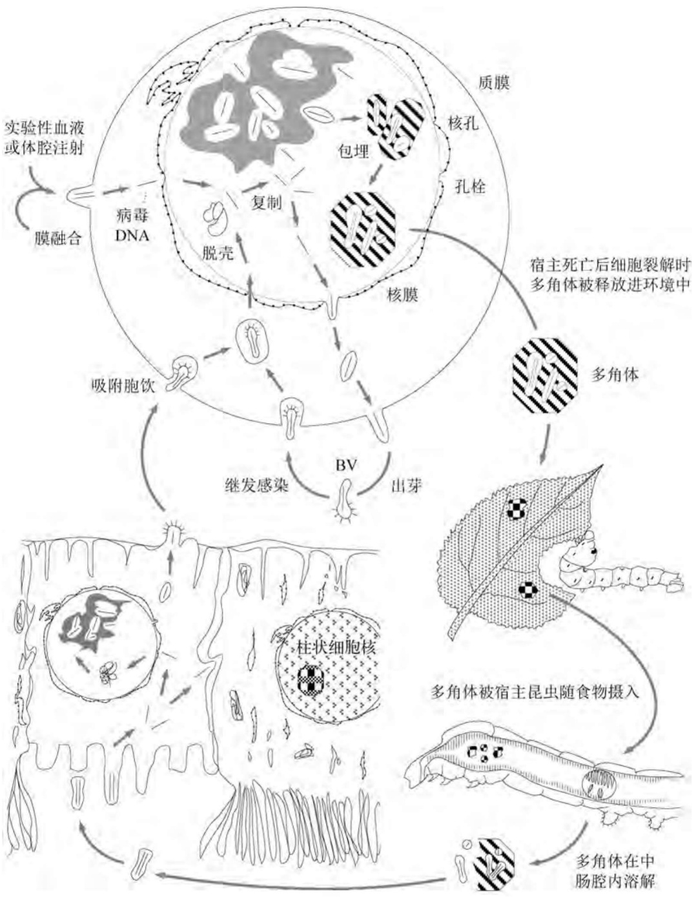

flowchart

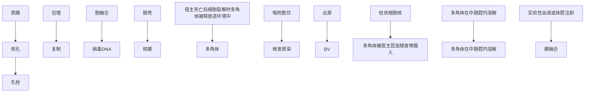

图6-18 杆状病毒发育循环示意图

值得注意的是，BmNPV与另一种杆状病毒黄杉合毒蛾(Orgyia pseudotsugata, Op)多核壳体核型多角体病毒(OpMNPV)同源ORF之间的氨基酸平均相同性(55%)远低于BmNPV与AcMNPV同源ORF之间的氨基酸平均相同性(90%)。但这三种病毒的基因顺序组织以及hr区基本保守。总之，BmNPV基因组序列表明，它是从一种与AcMNPV亲缘关系较近的祖先病毒演化而来的，在演化过程中BmNPV删除了16个特异性基因，将1个基因扩增至5个基因，并在一些ORF中还存在特异性的氨基酸取代。

包括 BmNPV 在内的核型多角体杆状病毒基因组一般含有下列四类功能基因:① 结构蛋白编码基因，包括多角体蛋白编码基因 polh、多角体膜蛋白编码基因 pp34、DNA 结构蛋白编码基因 p6.9、核衣壳蛋白编码基因 p39 和 p87、包膜糖蛋白编码基因 gp64 等；② DNA 复制及基因表达调控基因，包括 DNA 解旋酶编码基因 dnahel、DNA 聚合酶编码基因 dnapol、调控基因 ie-0、ie-1、ie-2、lef-1、lef-2、lef-3、sod、pe38 等；③ 与宿主相互作用的基因，包括蜕皮甾体尿苷二磷酸葡糖基转移酶编码基因 egt、抗细胞凋亡的 p35 和 iap 基因等；④ 酶蛋白基因，包括蛋白激酶、酪氨酸/丝氨酸磷酸酶、超氧化歧化酶、几丁质酶以及蛋白酶的编码基因。此外，还拥有与病毒的遗传突变有关的基因 p25 以及与病毒毒力相关的基因 p74 等。

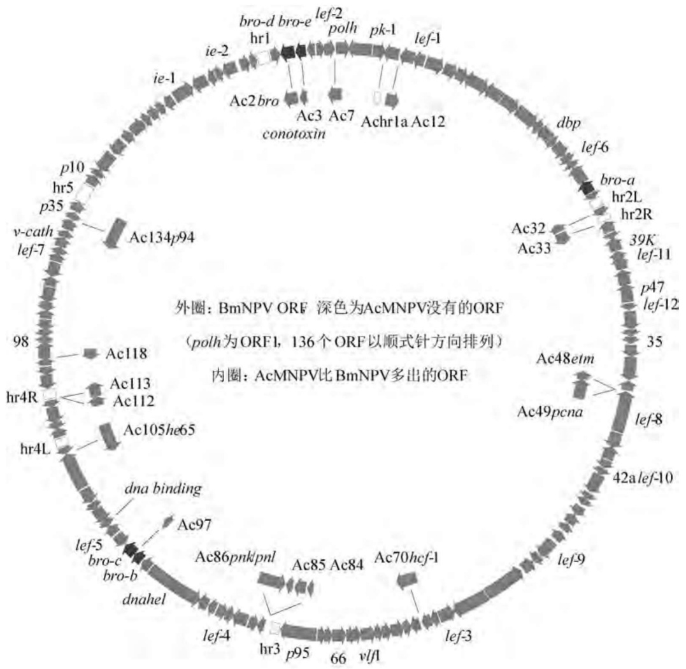

text_image

外圈: BmNPV ORF 深色为AcMNPV没有的ORF
(polh为ORF1, 136个ORF以顺式针方向排列)
内圈: AcMNPV比BmNPV多出的ORF

图6-19 BmNPV DNA的基因顺序组织

BmNPV(T3)基因组序列分析显示,有12个ORF在起始密码子上游的180 bp内含有一种保守的早期启动子基序(即TATA盒下游20\~25 bp处接一个CAGT基序)。这12个ORF中的7个还同时拥有晚期启动子基序(A/T/GTAAG),因而可在病毒感染的早期和晚期阶段均表达。BmNPV超过半数的ORF在起始密码子上游的160 bp内含有保守的晚期启动子基序,而27个ORF在起始密码子上游的210 bp内拥有增强子样元件CGTGC,这些基序和元件能在一定程度上反映病毒基因组的时序特异性表达调控机制。

BmNPV(T3)基因组中还含有5个同源区(hr1～hr5)，它们由重复序列和病毒DNA复