不难想象,如果由 ZFN、TALEN 或 CRISPR/Cas 工程化核酸酶在细胞或动物体内序列特异性地创造双链 DNA 断裂,那么通过细胞内天然存在的 NHEJ 途径便可突变或敲除特定靶基因;同时,在引入两侧含 DSB 区域同源序列的任何转基因的情形中,通过细胞内天然存在的 HDR 途径又可敲入转基因并置换靶基因。而且,若用特定诱导型启动子介导这些工程化核酸酶编码基因在细胞中的表达,还可实现上述基因操作的条件性控制。

## 2. CRISPR/Cas 系统的工作原理

本世纪初人们发现,多数原核细菌除了拥有典型的限制/修饰机制外,还能借助CRISPR/Cas系统抵御噬菌体和外源质粒DNA的侵袭。这些细菌的基因组上含有成簇排列、规则间隔的短小重复回文序列(Clustered, Regularly Interspaced, Short Palindromic Repeat, CRISPR)及其相关位点(cas),后者编码核酸酶、解旋酶、聚合酶等蛋白复合物(Cas)。该系统介导细菌抵御外来入侵核酸的过程分为三个阶段:①入侵的噬菌体或外源质粒DNA被Cas复合物加工成碎片,并整合入CRISPR结构中的间隔区内,形成免疫记忆;②CRISPR结构转录成pre-crRNA,后者经Cas复合物加工形成两侧含重复序列、中部对应于间隔区序列的crRNA,该序列恰好与入侵DNA反义链的相应序列互补;③Cas复合物在crRNA的指导下,序列特异性地靶向入侵DNA反义链上与crRNA间隔子序列互补的位点,并在此处断裂DNA双链从而摧毁之。自此,原核细菌同样拥有适应性免疫系统的观点得以确立。

不同细菌拥有三种不同类型的CRISPR/Cas系统，其中II型CRISPR/Cas系统通过一种不同的机制加工转录出的pre-crRNA（即采用一种反式激活型的crRNA(tracrRNA)与pre-crRNA中的重复序列互补)形成一种特殊的二元RNA结构，后者指导II型系统独特的单一蛋白组分Cas9位点特异性裂解双链DNA靶分子，其断裂位点位于crRNA重复序列邻近基序(PAM)的上游第三或第四对碱基处(图7-18)。

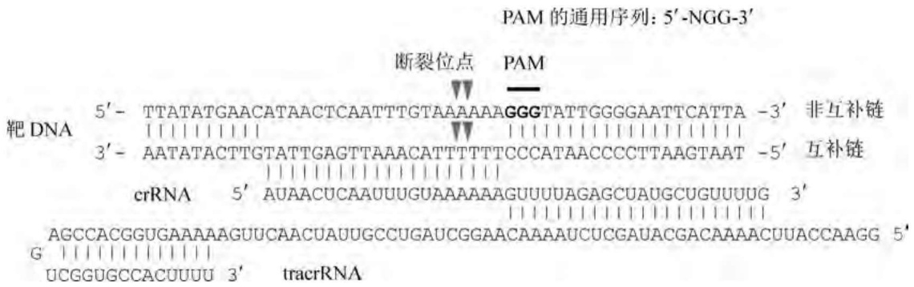

text_image

PAM 的通用序列: 5'-NGG-3'
断裂位点 PAM
靶 DNA 5'- TTATATGAACATAACTCAATTTGTAAAAAAGGGTATTGGGGAATTCATTA -3' 非互补链
    |||||||||
3'- AATATACTTGTATTGAGTTAAACATTTTTCCCATAACCCCTTAAGTAAT -5' 互补链
    ||||||||||||||
crRNA 5' AUAACUCAAUUUGUAAAAAAGUUUUAGAGCUAUGCUGUUUUG 3'
    ||||||||||||||
AGCCACGGUGAAAAAGUUCAACUAUUGCCUGAUCGGAACAAAAAUCUCGAUACGACAAAACUUACCAAGG 5'
G ||||||||||||||
UCGGUGCCACUUUU 3' tracrRNA

图7-18 crRNA-tracrRNA-Cas9三元靶DNA裂解原理

据此，利用基因工程技术设计重组与特定基因组靶序列互补的crRNA以及与其互补的tracrRNA，便能实现生物活体内的基因组定点切割与重组操作。具体策略如下:①人工合成编码crRNA和tracrRNA的多聚脱氧核苷酸序列，其中crRNA的 $5^{\prime}$ 端和 $3^{\prime}$ 端分别与待裂解的DNA靶序列和tracrRNA互补；②crRNA编码序列与tracrRNA编码序列既可分开[图7-19(a)]，也可通过一段合适长度的接头连为一体，后者在细胞内经转录生成单链指导型RNA[sgRNA，图7-19(b)]；③最后将上述两种RNA的编码序列与Cas9编码基因置于合适的表达元件控制下[图7-19(c)]并导入靶细胞中。上述操作只能实现靶DNA的单位点断裂，如果同时设计两套装置便能随心所欲地删除活细胞基因组中的任何区域或基因[图7-19(d)]。一旦基因组DNA在靶序列处断裂(DSB)，细胞内天然存在的NHEJ途径便对

(a) crRNA 与 tracrRNA 分开

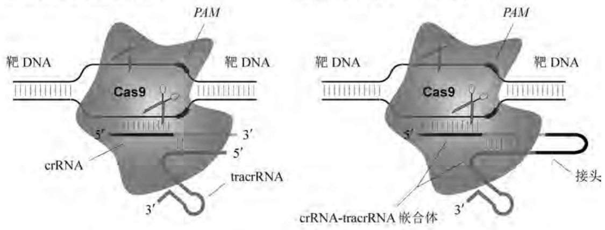

(b) crRNA 与 tracrRNA 连为一体

(c) crRNA-tracrRNA-Cas9 表达盒构建

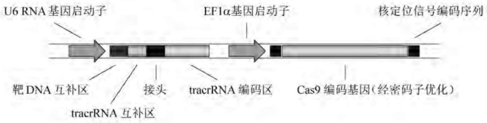

text_image

U6 RNA基因启动子
EF1α基因启动子
核定位信号编码序列
靶DNA互补区
接头
tracrRNA互补区
tracrRNA编码区
Cas9编码基因(经密码子优化)

(d) 双断裂位点的基因敲除设计

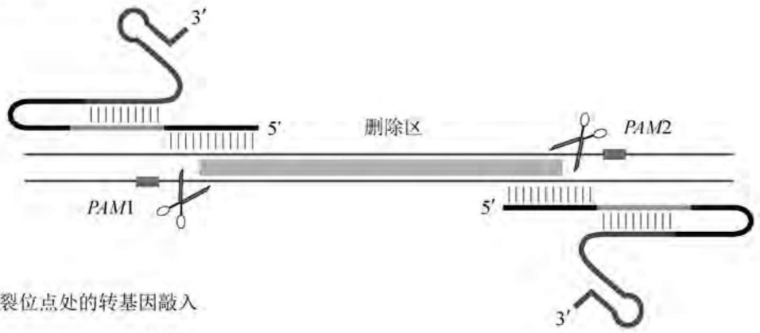

text_image

3'
5'
删除区
PAM1
PAM2
5'
3'
裂位点处的转基因敲入

(e) 断裂位点处的转基因敲入

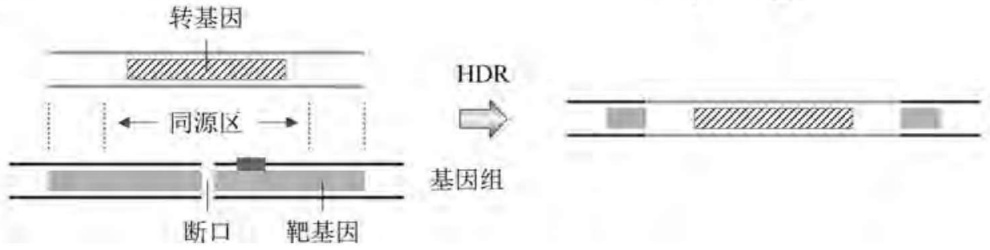

text_image

转基因
同源区 →
断口 靶基因
HDR
基因组

图7-19 基于CRISPR/Cas9系统的活细胞DNA操作

断口进行易错型联结，足以导致靶基因突变灭活（敲除）；如果在导入 sgRNA 和 Cas9 编码序列的同时引入两侧含 DSB 区域同源序列的任何转基因，又可通过细胞内天然存在的 HDR 途径敲入转基因并置换靶基因[图 7-19(e)]。

显然，与Cre/loxP系统等位点特异性整合重组系统相比，CRISPR/Cas9系统的重大优势在于无需顺式元件（如loxP)在靶细胞基因组上的定点预置；与ZFN和TALEN工程化核酸酶系统相比，CRISPR/Cas9系统在sgRNA水平上针对靶向性序列的编程又远比在蛋白质(核酸酶)水平上的编程设计要简便，因而实验操作程序大为简化且成功率更高。

## 3. CRISPR/Cas 系统的功能扩展

根据 sgRNA 指导 Cas9 序列特异性突变任何基因或 DNA 位点的工作原理, 构建一个靶向目标生物全基因组的慢病毒 sgRNA 表达文库, 可用于产生成库性的功能丧失型基因筛查模型。虽然诸如此类的研究也可以采用干扰 RNA(RNAi) 文库通过衰减基因表达的策略来实现, 但 RNAi 并不能永久稳定性地敲除基因, 而且还存在严重的脱靶现象。重要的是, 真核生物不含 CRISPR/Cas 系统, 因而可以基本剔除该系统组分与真核生物细胞内含物之间的相互干扰。

Cas9核酸酶含有RuvC和HNH两个核酸酶催化结构域，两者各使DNA的一条链缺口化，从而产生平头末端的DSB。在基因水平上将其中一个催化结构域灭活，可形成使DNA单链断裂的缺口酶版本nCas9。两种nCas9与带有合适间隔和两条靶向序列的sgRNA串联体配合使用，便能在DNA上产生单链交错缺口的裂解形式，在不牺牲裂解效率的前提下，加倍靶点识别的序列长度，从而进一步降低基因突变的脱靶率，因为单一位点的单链缺口通常会被正确修复。

既然CRISPR/Cas9系统能依靠可编程的指导型RNA序列在PAM所限定的位点处特异性靶向DNA，那么将Cas9中的两个核酸酶功能域同时删除，形成Cas9的全催化灭活型版本dCas9，并将之与其他各种功能蛋白相融合，便可使CRISPR/Cas系统的功能扩展至基因突变、删除、敲入以外的广大范围。例如dCas9与转录阻遏因子相融合，可在全基因组范围内依靠sgRNA的靶向作用选择性关闭特定基因谱的转录启动，即所谓的CRISPR干扰(CRISPRi)，其效应相当于基因功能丧失型探查策略；相反，dCas9与合适的转录激活因子（如VP64或KRAB)相融合，又能以基因功能获得型方式筛查基因对生物表型的贡献；更广义地，dCas9与各种荧光蛋白相融合，可使活细胞或组织中特定DNA区域附近的动态染色质表观修饰过程可视化；而将dCas9与DNA和组蛋白修饰酶系以及染色质重整因子相偶联，又能对基因组特定区域的DNA进行人为可控性的表观遗传修饰。

## 7.2.5 基于序列特异性互补条件性敲低靶基因

生物体内的很多基因属于持家基因(house-keeping gene)，其突变灭活或删除会致死细胞或个体(即不可敲除性)。在此情况下，基因功能丧失型探查策略的另一种形式便是衰减其表达尤其是翻译(即基因敲低)。以基因敲低为目标、序列特异性靶向 mRNA 的策略包含 RNA 反义技术和 RNA 干扰(RNAi)技术两大类。

## 1. 利用 RNA 反义技术条件性衰减靶基因表达

RNA 反义技术是指利用天然合成或人工设计的单链核酸分子以碱基互补原理靶向目标 RNA 尤其是 mRNA, 从而阻断或衰减其翻译的一种基因敲低策略。这种靶向型的核酸分子可以是 RNA, 也可以是寡聚脱氧核苷酸, 其操作程序如下:

（1）从细胞中亲和分离靶基因的 mRNA，并以此为模板，由细菌 RNA 聚合酶体外合成其互补 RNA 链（即反义 RNA），然后将之注射到动物细胞内。反义 RNA 与靶基因转录出的 mRNA 互补形成双链结构,促使其降解。例如,将肌动蛋白编码基因的反义 RNA 注射到动物肌肉细胞中,即可改变细胞的形态;将重要的发育调控基因反义 RNA 注射到果蝇受精卵中,便能改变其发育的程序。

（2）根据靶基因序列，设计并体外合成寡聚型单链脱氧核苷酸(反义DNA)，它与靶基因mRNA 5'端的翻译起始区互补并抑制其翻译。将高浓度的这种寡聚型反义核苷酸溶液直接加入细胞培养基中，由于其相对分子质量较小，细胞能以较低的频率吸收。如果将寡聚型反义核苷酸分子进行一些化学修饰，则其转化效率以及在细胞内的稳定性均会大幅度提高。以提升体内稳定性为目标的寡聚型反义核苷酸的化学修饰包括:改变核糖结构(锁核酸LNA)、用肽链模拟核酸链骨架(肽核酸PNA)、以硫酸取代磷酸(硫核酸SNA)、用吗啉代替核糖(吗啉核酸MO)等，但这些修饰型核酸或寡核苷酸分子均不影响与天然靶 mRNA 的碱基配对。事实上，经化学修饰的寡聚型反义核苷酸已被开发成临床上的抗癌和抗病毒药物（即反义药物）。
(3) 反义 RNA 也能在细胞内合成, 其方法如图 7-20 所示。将靶基因的部分序列反向克隆在一个强启动子的下游，构成反义子结构，并以此作为转基因转化动物受体细胞。反义子借助其转录产物的互补效应特异性阻断靶基因 mRNA 的翻译，生成靶基因表达缺陷型和相关功能丧失型的转基因动物模型。在某些情况下，癌基因反义子的表达成功地将肿瘤细胞无限制生长的特性逆转至正常细胞的生长模式。

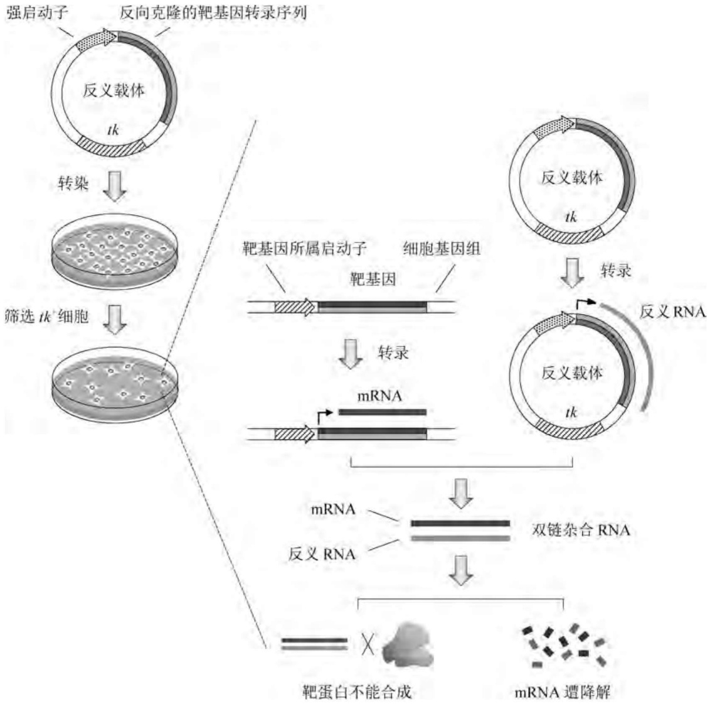

flowchart

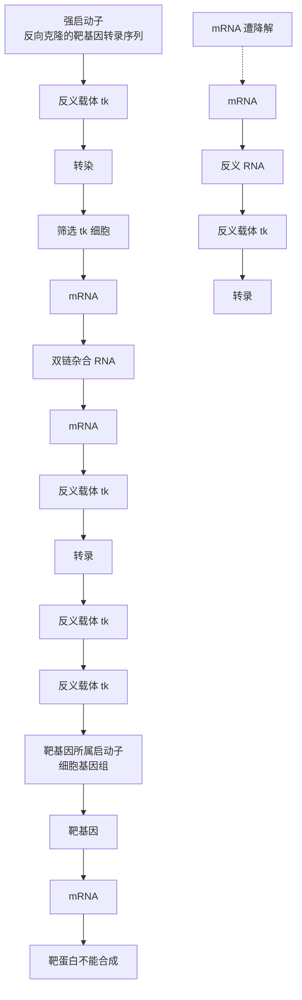

图7-20 反义RNA在宿主细胞中的合成

## 2. 利用 RNA 干扰技术条件性衰减靶基因表达

20 世纪 90 年代初,研究人员在用人工合成的反义 RNA 阻断秀丽隐杆线虫基因表达的实验中偶然发现,反义 RNA 和正义 RNA 都能阻断靶基因的表达。直到 1998 年,这一百思不得其解的谜团才由美国华盛顿卡耐基研究院的 Andrew Fire 和麻省大学医学院的 Craig Mello 解开,他们在秀丽隐杆线虫(Caenorhabditis elegans)中发现了由双链 RNA(dsRNA)介导的转录后基因沉默机制。此后,这种被称为 RNA 干扰(RNAi)的现象陆续在多种真核生物中被发现,并证实这一基因表达调控机制具有普遍的生物学意义。

RNAi 的作用机制包括起始阶段和效应阶段(图 7-21)。在起始阶段,不同来源的 dsRNA 被 Dicer 酶切割成多个具有特定长度和结构的短小双链片段(22\~24 bp),即小干扰 RNA(siRNA),其 3' 端均含有两个突出的碱基。在效应阶段,核酸酶、解旋酶与 Argonaute (Ago)蛋白相连,进而与 siRNA 一起构成 RNA 诱导沉默复合物 RISC;在 RISC 的协助下,双链 siRNA 拆成单链,后者引导 RISC 定位至具有完全互补序列的靶 mRNA 分子上,复合物中的 Ago 蛋白招募 Dicer 酶;此后,Dicer 酶在距离 siRNA 3' 端 12 个碱基的位置处切割与其配对的靶 mRNA,被切割后的靶 mRNA 随即遭 RISC 中的核酸酶进一步降解,从而阻断翻译。

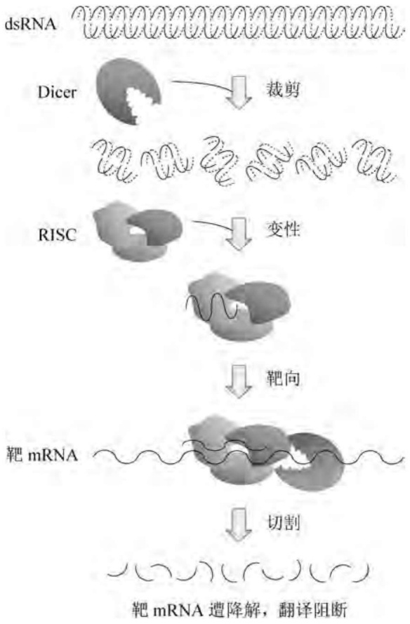

flowchart

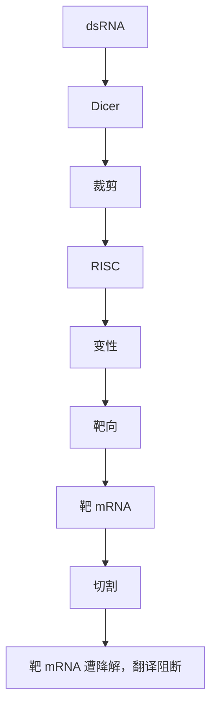

图7-21 小干扰RNA的作用机理

此外，在包括高等动物在内的几乎所有真核生物的细胞核内，从结构致密型异染色质着丝粒区域的DNA重复序列上会转录出一些特殊的非编码型RNA前体（pri-miRNA），后者在核内被微加工器复合物（由RNaseIII组成）先切成大约70个核苷酸的茎环结构（pre-miRNA)，然后再被运输到细胞质中由Dicer进一步裁剪，形成成熟的微干扰RNA(miRNA)分子。最后，这些miRNA再由RISC协助形成长度为 $21\sim 23$ 个碱基的单链sRNA分子，并发挥与siRNA类似的效应。

与反义 RNA 的应用原理相似，为实现对特定靶基因表达的阻断（基因敲低），可采用慢病毒载体构建能够表达特定 siRNA 或 miRNA 的 DNA 重组分子，两者分别由 RNA 聚合酶 III 型启动子或 RNA 聚合酶 II 型启动子介导表达。此类基因沉默型的慢病毒重组分子已被成功用于抑制 HIV-1 的感染、迟滞小鼠肌萎缩性脊髓侧索硬化症的发作和发展速率、延长患羊瘙痒症小鼠的生存时间、提升胎儿血红蛋白的表达量。更为重要的是，目前已商品化了一个能靶向 15000 个人类基因和同等数量小鼠基因的慢病毒沉默文库，大大促进了哺乳动物基因功能的解析。不过值得注意的是，RNAi 能诱发脱靶性基因沉默或不期望的干扰应答。为了探测这些可能性是否存在，设计相应的对照实验至关重要，如在 RNAi 靶向位点处表达含沉默突变的靶基因等。

## 7.3 利用动物转基因技术生产重组蛋白多肽

自20世纪80年代初第一例重组蛋白人胰岛素投入市场以来，美国FDA已批准了100多种重组医用蛋白用于临床治疗，其中相当一部分重组产品是采用哺乳动物细胞或个体生产的。很多重组蛋白如组织型纤溶酶源激活剂(tPA)和促红细胞生成素(EPO)的生物功能需要糖基化之类的翻译后修饰；同样，大多数单克隆抗体的糖基化对其最佳功能的发挥以及药代动力学特征也至关重要。虽然大肠杆菌、酵母、昆虫表达系统已按照人类蛋白质翻译后修饰模式进行了相应的工程化改造，但其翻译后修饰的完美程度和效率仍不及哺乳动物细胞。目前，在生物反应器中规模化培养的哺乳动物细胞生产重组单克隆抗体以及Fc融合蛋白的水平已达到 $10\sim 15\mathrm{g / L}$，丝毫不逊于其他表达系统。

旨在规模化生产重组蛋白或多肽的哺乳动物表达系统采取三种不同的策略:遗传稳定的工程细胞系、瞬时表达的转化型细胞培养物以及连续繁殖的转基因动物个体，三者各有特征性优势。

## 7.3.1 高等动物转基因的表达特征

转基因本身的性质及其重组方式在很大程度上决定了它们在高等动物细胞或个体内的表达特征,概括起来有下列四个方面。

## 1. 转基因的时空特异性表达

时空特异性是动物基因表达调控的一个显著特征，尤其在发育过程中，相关基因的时序特异性和组织特异性表达更为严格。在转基因体外重组时充分考虑这些因素，有利于其高效表达。例如，使用卵清蛋白编码基因所属的启动子和增强子才可能使转基因在蛋清中表达。将哺乳动物乳腺组织特异性的启动子和增强子（如乳清酸性蛋白WAP编码基因所属启动子和增强子）与转基因重组，可使存在于受体动物各种组织和细胞中的转基因仅在乳腺组织中表达其编码产物，一方面有利于目标重组蛋白的收获；另一方面也能将重组蛋白对转基因动物的生理干扰降低至最小程度。此外，其他各种类型的组织特异性启动子和增强子也已被引入高等动物（如小鼠）表达载体中使用，包括神经脊（内皮素受体B编码基因所属 $P_{\mathrm{Ednrb}}$ ）、海马纹状体（ $\mathrm{Ca^{2+}}$ /钙调蛋白依赖型激酶IIα编码基因所属$P_{\mathrm{Camk2a}}$ ）、颌下腺（小鼠乳腺瘤病毒 $P_{\mathrm{MMTV - LTR}}$ ）、视网膜和小脑（视网膜母细胞瘤抑癌基因所属 $P_{\mathrm{RB}}$ 、中/后脑（Engrailed2编码基因所属 $P_{\mathrm{En2}}$ ）乳腺（乳清酸性蛋白编码基因所属$P_{\mathrm{Wap}}$ ）、骨骼肌（肌细胞生成素编码基因所属 $P_{\mathrm{Myog}}$ ）、生黑色素细胞（酪氨酸酶编码基因所属$P_{\mathrm{Tyr}}$ ）、小肠结肠上皮细胞（脂肪酸结合蛋白编码基因所属 $P_{\mathrm{Fabp}}$ ）、心肌细胞（肌球蛋白编码基因所属 $P_{\mathrm{Myh6}}$ ）、肝细胞（肝激活因子编码基因所属 $P_{\mathrm{Lap}}$ ）、角质细胞（人角蛋白基因编码所属 $P_{\mathrm{K14}}$ ）、造血细胞（免疫球蛋白重链 $\mathrm{SR}\alpha$ 编码基因所属 $P_{\mathrm{E}\mu -\mathrm{Sr}}$ ）、T淋巴细胞（淋巴细胞特异性酪氨酸激酶编码基因所属 $P_{\mathrm{Lck}}$ ）、胰脏 $\beta-$ 胰岛细胞（II型胰岛素编码基因所属$P_{\mathrm{Ins2}}$ ）、神经细胞（巢蛋白编码基因所属 $P_{\mathrm{Nes}}$ )等特异性启动子/增强子系统。然而就本质而言，与转基因时空特异性表达密切相关的真正基因元件是增强子，其结构和工作原理参见7.3.2。

## 2. 转基因的可控性表达

以一种合适的方式诱导动物细胞或个体内转基因的稳定高效表达至关重要。转基因的诱导条件往往取决于受体细胞的性质和启动子的类型。例如，就真核生物表达调控元件控制的转基因而言，通常以热休克因子诱导热休克基因家族的启动子 $(P_{\mathrm{HS}})$ ；以糖皮质激素诱导病毒的长末端重复序列启动子 $(P_{\mathrm{LTR}})$ ；以重金属离子诱导金属硫蛋白编码基因的启动子 $(P_{\mathrm{MT}})$ 。著名的超级小鼠就是用小鼠的 $P_{MT}$ 启动子与大鼠生长激素编码序列的拼接物作为转基因获得的表型。

然而，上述纯真核生物基因表达调控元件一般具有多效性，特异性不高，同时能驱动动物受体细胞一系列内源性基因的表达，严重时会对转基因动物构成毒性。为克服这一难题，可构建并使用原核生物调控序列与真核生物启动子的杂合元件介导转基因在动物体内的表达。例如，将大肠杆菌乳糖操纵子系统的操作子(lacO)置于真核生物启动子TATA盒与转录起始位点之间，同时克隆大肠杆菌的lacR基因表达相应的阻遏蛋白，此时转基因的表达即可用IPTG进行诱导。另外，大肠杆菌转座子Tn10上四环素抗性操纵子系统的操作子(tetR/O)也广泛用于构建真核/原核杂合调控序列(参见6.2.3)。不过有证据显示，由强力霉素诱导型TRE结合蛋白与单纯性疱疹病毒的蛋白16(VP16)激活功能域融合而成的转录激活因子(rtTA,图6-8)有时会以非特异性方式诱导受体细胞内源性基因的表达或者对细胞产生毒性效应。因而，一种改进的强力霉素诱导表达系统被设计为不含VP16的双载体模式，其中一种载体由脾病灶形成病毒(SFFV)启动子介导原匹环素阻遏蛋白编码基因(tetR)高效表达；另一载体则由强力霉素响应型的 $P_{CMV}-tetO$ 元件控制转基因的转录。相关研究证明，强力霉素在较低的浓度范围(1～100 ng/mL)内便能诱导转基因高效表达。

## 3. 转基因的共抑制效应

在转基因动物体内，转基因的表达特性往往会发生许多出人意料却又难以解释的现象，其中最为普遍的便是转基因的失活，也称为转基因沉默。转基因沉默现象在植物体内研究得较为深入，当受体细胞基因组上含有转基因的同源伙伴时，转基因与内源性同源基因的表达将同时受到抑制，即所谓的共抑制效应。

共抑制效应具有如下特征:① 共抑制只发生在转基因与同源的内源性基因之间，对其他基因的表达并不产生影响；② 如果转基因与内源性基因发生体内重组，则共抑制效应随之消失，基因表达恢复正常；③ 共抑制现象的发生与基因编码区有关，但不依赖于启动子的来源和性质；④ 两个相同的转基因之间也能发生共抑制效应，这也许是转基因动植物中单拷贝的转基因通常具有最高表达率的直接原因。

造成共抑制效应的原因很多,主要包括:①转基因与其同源的内源性基因相互作用,改变原有的表观遗传状态(包括DNA甲基化、组蛋白翻译后修饰、染色质重整)而影响两者的表达;②转基因与内源基因竞争性结合核基质和核包膜上mRNA转录、加工、转运所必需的非扩散元件,导致相互抑制;③两者转录出互为反义的 RNA 序列或二级结构,使之失活并迅速降解。

## 4. 转基因的位置效应

除了上述共抑制效应外，在某些情况下转基因也会单方面失活，而其同源的内源性基因却正常表达。产生这种现象的原因可能是:① 转基因被受体细胞识别为异己 DNA 并将之甲基化修饰，使其失活；② 转基因整合在染色体的转录非活跃位点处，如异染色质结构高度集中的着丝粒或端粒区。上述两种原因均涉及广泛存在于动植物细胞内的表观遗传修饰。一般而言，DNA 双链上的胞嘧啶尤其是启动子内部 CG 岛（即 CpG 重复单位）中的胞嘧啶碱基被甲基化倾向于关闭基因转录；而组蛋白尤其是 H3 和 H4 中各位赖氨酸侧链的共价修饰（如甲基化和乙酰化）则显著影响基因调控区对相应的转录调控因子的易感性。例如，H3K4 单甲基化和 H3K9 乙酰化致使染色质结构松弛，有利于基因转录激活；而 H3K9 和 H3K27 三甲基化以及 H3K9 脱乙酰化则显著阻遏基因的转录。

鉴于位置效应对转基因表达具有较强的负面影响,采用较长的基因组 DNA 片段作为转基因单位是一种较为可靠的表达策略。另外,使用不依赖于整合位点的游离型载体转移转基因或者将转基因靶向已知的基因组转录活跃位点也是克服位置效应的可选择方式。

## 7.3.2 高等动物转基因的表达元件

在高等动物体内,对转基因表达具有正负两方面效应的 DNA 或 RNA 元件很多,它们涉及基因转录(如启动子、增强子、绝缘子、染色质开放元件)、转录后加工(剪切信号序列)、修饰(终止子、polyA 化信号序列)、转运以及翻译(内部核糖体进入位点)多种水平的调控。正确选择和组装这些元件是转基因高效表达的重要环节。

## 1. 与高等动物匹配的启动子

在高等动物细胞或个体中介导转基因高效表达的大多数普遍使用的强组成型启动子来自病毒的基因组，包括人巨细胞病毒（HCMV或CMV）早早期启动子 $P_{CMV}$ 、猿猴病毒40(SV40)早期启动子 $P_{SV40}$ 、劳斯肉瘤病毒(RSV)长末端重复序列启动子 $P_{RSV}$ 。 $P_{CMV}$ 在大多数哺乳动物细胞系中均拥有较强的转录活性。比较人类、小鼠、大鼠的全长 $P_{CMV}$ 序列发现，人类的 $P_{CMV}$ 在HEK293E和CHO细胞系中的活性最高。动物细胞内源性的启动子如人类翻译延伸因子-1α(EF-1α)基因所属启动子 $P_{EF-1}$ 和β-肌动蛋白编码基因所属启动子 $P_{\beta-actin}$ 的强度与 $P_{CMV}$ 相似。

强诱导型的启动子如细胞G1期特异性生长阻滞和DNA损伤诱导型启动子 $P_{\mathrm{GADD153}}$ 以及糖皮质类固醇诱导型小鼠乳腺肿瘤病毒启动子 $P_{\mathrm{MMTV}}$ 也较为常用。 $P_{\mathrm{GADD153}}$ 在无血清条件下以及在细胞循环的G1期具有较高的转录活性，而 $P_{\mathrm{CMV}}$ 和 $P_{\mathrm{SV40}}$ 则在完全培养基和S1期的细胞中才能发挥最强的转录活性。由于在重组蛋白实际生产阶段大部分细胞处于无血清培养条件下的G1期生长状态，所以 $P_{\mathrm{GADD153}}$ 更具有应用价值。

虽然大多数 cDNA 形式的转基因由强组成型启动子介导能高效表达，但将一个内含子插在启动子与 cDNA 的  $5'$  端之间能显著提高重组蛋白的表达水平。在 HEK293E 细胞系中，含有一个合成型内含子的  $P_{CMV}$  为  $P_{RSV}$  活性的 2 倍；金属硫蛋白编码基因所属启动子  $P_{MT}$  在 CHO 细胞系中的活性强于无内含子的人类  $P_{CMV}$  和  $P_{SV40}$  启动子；同样，将人类或小鼠  $P_{CMV}$  与 EF-1α 基因内含子拼接在一起，其活性也高于  $P_{EF-1}$ 。一般认为，在高等动物细胞中，含内含子的转基因能通过剪切作用促进转录物的成熟、稳定和核外输，同时也间接提升转录速率。然而，这种内含子效应似乎与受体细胞的遗传背景有关。例如，人类  $P_{CMV}$  与 EF-1α 基因内含子的融合物在 HEK293T 细胞株中的活性高于小鼠  $P_{CMV}$  与 EF-1α 基因内含子的融合物，但在 CHO 细胞系中却正好相反。

## 2. 与高等动物匹配的增强子

高等动物基因组上存在多种类型的保守性短小应答元件(RE,5\~20 bp)，它们往往成簇排列并沿基因组构成一个个相对独立的区间(200\~1 000 bp)，对相应启动子的转录启动起着时序和细胞类型特异性的调控和增强作用，该区域称为增强子。增强子具有如下特征:①距其所控制的靶启动子的距离不固定，已发现的最远距离长达1 800 kb。人类基因组据信含有数十万个增强子，有的基因被嵌在数十个增强子的基因组环境中；②与其所控制的靶启动子的极性不固定，位于启动子的上游或下游均具有转录增强效应；③借助其所包含的多样化应答元件与相应的转录调控因子(TF)结合，并通过TF与靶启动子保持直接接触，以激活靶基因的时空特异性转录[图7-22(a)]；④与启动子相似，同样含有转录起始位点(TSS)并转录非编码型小RNA(eRNA)，后者可能介导增强子与启动子之间的间接通信[图7-22(b)]。在哺乳动物体内，数以千计的TF在不同的时间于不同类型的细胞中表达或(和)激活，这是增强子时空特异性控制其靶启动子乃至靶基因表达的分子机制。大量的证据表明，无论高等动物内源性的增强子还是病毒来源的增强子均能使启动子介导转基因的转录水平提升数倍甚至数百倍。

## 3. 与高等动物匹配的翻译起始序列

与原核生物的核糖体结合位点(RBS)相对应,真核生物 mRNA 位于起始密码子 AUG 两侧的序列(通常为 ACCACCAUGG)通过与翻译起始因子的结合而介导含 5' 帽子结构的 mRNA 翻译起始,这段序列称为 Kozak 序列。其中,AUG 之后的第一位碱基 G 以及之前的第三位碱基 A 或 G 对翻译起始至关重要;此外,AUG 上游的 15 个碱基中一般不含 T。

有些 RNA 病毒(如脑心肌炎病毒等)和高等动物 mRNA 的 5'-UTR 区含有能与核糖体结合进而启动翻译的内部核糖体进入位点(IRES)，这使得那些 5'端无帽子结构的 mRNA 可以顺利翻译。由于大多数真核生物 mRNA 的 5'端含有帽子结构和 Kozak 序列，因而 IRES 主要用于构建双顺反子或多顺反子型(多个蛋白质编码序列共存于一个转录单位中)的转基因表达盒，即第一个蛋白质编码序列由 5'帽子结构和 Kozak 序列启动翻译，而下游蛋白质编码序列的翻译起始则由 IRES 介导。一般情况下，IRES 上下游两侧的两个编码序列呈比例表达，但含有 IRES 元件的多顺反子型慢病毒重组载体却对串联排列的双转基因呈表达偏好性，如 IRES 依赖型的第二个编码序列的表达水平往往低于其上游编码序列；更有甚者，当两个串联的转基因编码序列以组织特异性方式在淋巴细胞系和初级树突细胞中表达时，上游转基因编码序列的表达反而受到抑制。事实上，各种病毒来源或哺乳动物内源性的 IRES 序列无论在体内还是在体外均呈组织特异性的表达偏向格局。影响 IRES 使用的另一个限制因素是 IRES，通常大于 500 bp，这在载体装载量受限或者需要使用多个 IRES 拷贝的情况下是不利的。

与 IRES 作用机制类似但不完全相同的是存在于小核糖核酸病毒包衣蛋白中的一段 18～22 个氨基酸的所谓 2A 肽序列。在几乎所有的真核生物细胞中，核糖体一旦翻译至此类 2A 肽序列 C 端的 Gly-Pro 二肽键时便会发生“跳跃”，从 Pro 残基开始重新启动下游多肽的翻译，从而形成 N 端带有 Pro 残基的独立多肽链。目前广泛使用的是四种病毒来源的 2A 肽序列，即口蹄疫病毒的 FMDV 型 2A（F2A）、马鼻病毒的 ERAV 型 2A（E2A）、猪捷申病毒 1 型 2A（P2A）、以及明脉扁刺蛾四体病毒型 2A（T2A）。2A 肽相对 IRES 的优势在于其编码序列较短，克隆操作方便，且上下游两种蛋白的表达水平没有明显的偏好性。

## 4. 与高等动物匹配的染色质重整元件

尽管高等动物基因组中维持染色质开放结构的特异性 DNA 顺式元件目前尚未得以系统鉴定,但非甲基化的 CG 岛区域往往更易接触转录机器而呈基因高表达倾向,这种区域称为泛染色质开放元件(UCOE)。人类 TATA 盒结合蛋白(TBP)和核内不均一性核糖核蛋白(hnRNPA2B1)编码基因所属启动子含有很多非甲基化型 CG 岛,若将这两种启动子以相向形式与转基因 GFP 重组,则 GFP 能以高水平稳定表达。即便转基因整合在稳定表达较差的着丝粒异染色质区,这种稳定表达的特征依然很明显。这表明,受控于双向启动子非甲基化型 CG 岛区的转基因不仅能高效稳定表达,而且能改善转基因所处整合区域的转录敏感性。例如,含有 UCOE 的 $P_{CMV}$ 能介导 cDNA 型转基因在 CHO 细胞系中高效表达;将人类 hnRNPA2B1-CBX3 的 UCOE 引入造血干细胞中可使转基因的表达具有高度可重现性和稳定性。此外,用丁酸钠或 2-丙基戊酸抑制组蛋白的脱乙酰化能使转基因的表达水平提高 16 倍。

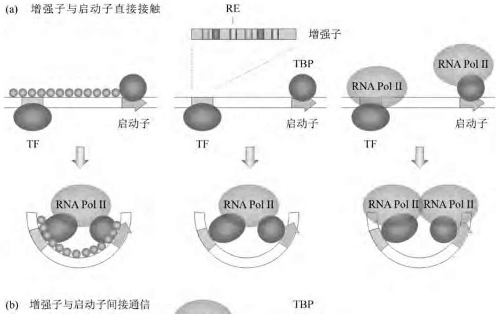

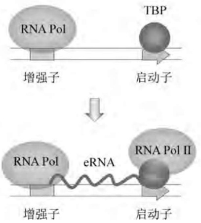

flowchart

图7-22 增强子的结构及其作用机理

高等动物染色体DNA的脚手架或核基质附着区(S/MARS)也是一种DNA顺式元件，染色质在此处被锚定在间期细胞的核基质上。研究发现，S/MARS往往与超乙酰化型组蛋白相连，间接招募DNA脱甲基化酶，使DNA脱甲基化，从而更易于转录启动。在很多情形中，转基因拷贝数的增加与蛋白表达水平的提高并非呈正比，原因就在于扩增的转基因处于转录非活跃型染色质区域。实验显示，如果每个基因拷贝两侧均携带 S/MAR，那么基因的表达水平便正比于其拷贝数。类似地，邻近 S/MARS 的基因往往比远离 S/MARS 的基因表达水平高。将鸡溶菌酶编码基因(cLys)的 S/MARS 安装在分别编码 IgG 重链和轻链的两个质粒上，结果显示，当 S/MARS 位于编码序列的两侧时，CHO 细胞生产重组 IgG 的量提高 5～10 倍。

绝缘子是能屏蔽增强子和启动子为其邻近染色质激活或阻遏的特殊DNA元件。在某些情况下，将染色质的绝缘子序列加入慢病毒载体中，以提升转基因的表达水平。例如，cHS4(鸡超敏位点4)绝缘子已被用来构建高表达载体，然而有迹象表明绝缘子的这种染色质结构屏蔽效果因绝缘子种类及其所处的染色质环境不同而异。

## 7.3.3 利用高等动物工程细胞系生产医用蛋白

采取物理或化学转化程序尤其是借助重组病毒转染方法，将编码重要医用蛋白的转基因导入合适的高等动物受体细胞内，并使之整合在基因组中，进而通过筛选程序构建转基因遗传稳定的生产型工程细胞系，是高等动物基因工程生产重组异源蛋白多肽的第一种策略。这种策略的优势在于能从细胞克隆群（因转基因重组载体的随机整合而形成）中选择使用转基因表达水平最高的克隆，并对这些优势克隆进行生产工艺的优化。尽管这个过程需要花费几个月的时间，但它仍被广泛用于产业化过程中。

## 1. 用于规模化生产重组医用蛋白的高等动物细胞系

用于规模化生产重组医用蛋白(如重组人干扰素 INF 和 tPA)的第一个也是迄今为止使用最普遍的高等动物遗传稳定型工程细胞系是源自 1957 年发现的具有分裂永生性的 CHO 细胞。由这株原始细胞系派生出一株甘氨酸依赖型的细胞株(CHO-K1)，后者再被突变生成 CHO-DXB11(亦称 CHO-DG44、CHO-DUKX 或 CHO-DuxB11)细胞株，该细胞株进一步缺失了 DHFR 活性。CHO 细胞系具有如下优势:① 与其他用于医用蛋白生产的哺乳动物细胞系一样，能以接近于人类蛋白质的糖基化方式修饰其表达的重组蛋白产物；② 能在生物反应器中以悬浮的方式高密度生长；③ 传播人类病毒的风险较低，因而较为安全；④ 相对其他候选细胞系拥有可塑性较大的基因组，便于基因扩增和遗传操作；⑤ 与其他细胞系一样，易为表达目标蛋白的重组基因载体所转染；⑥ 涉及基因转染、筛选、规模化培养的工业生产过程业已建立。

来自人类视网膜的PER-C6细胞系是一种具备真正意义上的人糖基化及其他翻译后修饰机器的受体系统，对生物药物产业颇具吸引力。该细胞系无需基因扩增或选择标记，在少数几个月内便能建立起高产性的稳定克隆，且低拷贝足以维持稳定高效的转基因表达。在流加式分批培养中，该细胞系便能生产高于 $2\mathrm{g / L}$ 的重组蛋白；而在连续培养中，该细胞系可在高密度 $(>1.5\times 10^{8}$ 个细胞/mL)条件下达到 $25\mathrm{g / L}$ 的体积产率。在上述过程中，细胞均在搅拌罐式生物反应器中以悬浮方式生长。而且，PER-C6工程细胞系还能在单个细胞中联合表达具有相同轻链的三种不同类型的重组抗体。

## 2. 旨在提高转基因拷贝数的高等动物基因扩增原理

整合在受体细胞基因组中的转基因除了可采用上述启动子、增强子、Kozak序列、IRES位点、UCOE位点等基因表达元件促进其表达外，在基因组中的原位扩增也是转基因高效稳定表达的一种特殊有效方式。高等动物细胞中的转基因扩增有下列几种系统:

## (1) dhfr-MTX 扩增系统

研究发现,CHO细胞培养物经DHFR特异性抑制剂MTX处理后,绝大多数细胞死亡,但在极少数存活下来的抗性细胞中dhfr基因呈扩增现象。这些细胞正是通过增加相关基因的拷贝数提高关键代谢酶的表达水平,从而抵消MTX的抑制作用。更为重要的是,细胞内扩增了的DNA区域远大于dhfr基因本身,也就是说,与dhfr基因邻近的基因组DNA区域可以随同扩增。这一发现迅即被用于转基因在高等动物细胞中的高效表达设计(图7-23): 将待表达的转基因与 dhfr 基因拼接在一起, 重组分子转化内源性 dhfr 缺陷型的 CHO 细胞系 (dhfr $^{-}$ ); 将转化细胞置于一种不含核苷的选择性培养基上, 使得只有接纳了 dhfr 基因的细胞才能增殖; 挑出克隆株, 经短时间培养后迅速转移至含有 0.05  $\mu$ mol/L MTX 的培养基上继续培养; 将为数极少的存活细胞株依次转到含有更高 MTX 浓度的培养基上进行多轮重复筛选, 当 MTX 浓度达到 5  $\mu$ mol/L 时, 存活细胞中的转基因已随 dhfr 基因扩增了数百倍。

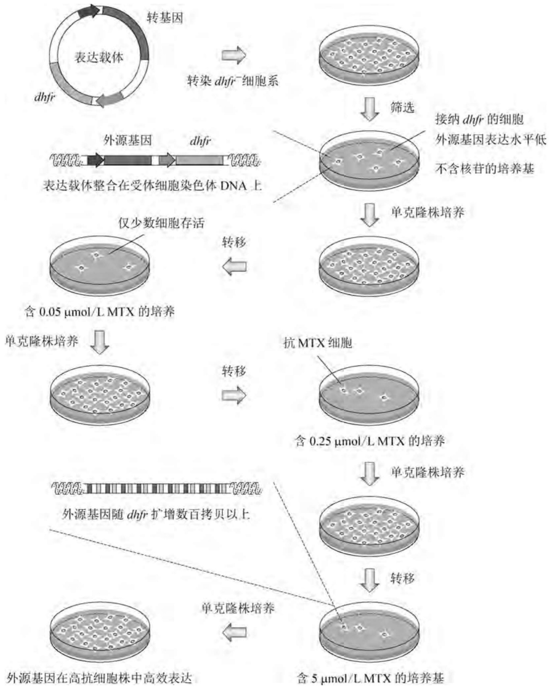

flowchart

This flowchart illustrates the experimental workflow for converting a transgenic plant into various cell culture conditions, including DNA replication, cell sorting, and antibiotic treatment.

图7-23 转基因在高等动物细胞中的扩增机制

## (2) $gs - \mathrm{MSX}$ 扩增系统

谷酰胺合成酶(GS)催化谷氨酸和氨生成谷酰胺的反应，而甲硫氨酸亚砜亚胺(MSX)是GS的特异性抑制剂。gs-MSX扩增系统需要一种非CHO的细胞系，最常用的是鼠科动物骨髓瘤NS0细胞系。与dhfr缺陷型CHO细胞系类似，NS0细胞系呈谷酰胺营养缺陷型 $(gs^{-})$ ，能采用不含谷酰胺的选择性培养基上进行筛选。gs-MSX扩增系统的原理与dhfr-MTX扩增系统类似，只是采用MSX取代MTX进行筛选。如果将该系统用于CHO细胞系，在初始筛选时需要添加低浓度(20 nmol/L)的MSX，因为CHO细胞拥有内源性的谷酰胺合成酶。gs-MSX扩增系统的一个优势是分离出的转化株在基因扩增之前就已具有较高的表达水平。尽管如此，有证据显示GS介导的扩增技术在规模化生产中并不稳定，其原因是染色质结构倾向发生显著改变，因而远不如dhfr-MTX扩增系统应用普遍。

## (3) dhfr - MTX/ada - dCF 双标记扩增系统

上述两种系统对转基因的扩增效应均存在饱和极限，而且由于位置效应的缘故，转基因的拷贝数增加倍数与其表达水平不成正比。增强MTX扩增威力的一种策略是额外使用另一个与dhfr类似的可扩增性标记，后者能在MTX选择扩增型转化株能力达到饱和之后启动额外的扩增步骤。脱氧助间霉素(dCF)是腺苷脱氨酶(ADA)的特异性抑制剂，可用于继MTX之后的扩增筛选。例如，在构建高产重组人促甲状腺激素(TSH)的表达载体时，采取了双顺反子双标记型表达策略，即一个载体携带TSH $\alpha$ 亚基编码基因和dhfr标记基因表达盒；另一载体携带TSH $\beta$ 亚基编码基因和ADA标记基因ada表达盒。两种载体共转染CHO细胞系后先用MTX筛选，然后再用dCF筛选。MTX单独扩增能使重组TSH的分泌水平达到 $(7.2\pm 1.3)\mu \mathrm{g} / (10^{6}$ 细胞·天)；而随后的dCF扩增又使TSH的分泌水平进一步提升至 $(17.8\pm 7.6\mu \mathrm{g} / 10^{6}$ （细胞·天)，双扩增的产率相当于单扩增的 $2\sim 3$ 倍。

## (4) dhfr 弱化型扩增系统

由于基因扩增发生在 dhfr 标记基因与转基因共处的 DNA 区域内, 因此在每轮扩增后两者的拷贝数通常是等量增加的。如果采取某种方式使 dhfr 标记基因的活性弱化, 则细胞对一定剂量的 MTX 的抗性将需要更多的 dhfr 基因拷贝数。因此, 同等 MTX 剂量和轮次的扩增规模便能产生更多拷贝数的标记基因和转基因, 有利于缩短生产过程开发的周期。

弱化 dhfr 活性的一种策略是将其 cDNA 插在转基因的一个内含子中，并在 dhfr - cDNA 两侧分别安装 CMV 的剪切供体位点 (sd) 和 SV40 的剪切受体位点 (sa)。由这种构建物转录出的 mRNA 前体分子中绝大多数能将 dhfr 编码区剔除，只有少数分子剪切遗漏，dhfr 序列连同成熟的转基因 mRNA 一并被翻译成有功能的 DHFR（图 7-24）。由于较低初始水平的 DHFR 便能支持细胞在无嘌呤的选择性培养基上生长，但却对 MTX 呈高度的敏感性，因而对于一个给定的 MTX 筛选浓度，dhfr 基因的拷贝数必定高于 dhfr 基因独立表达的情形。例如，采用 dhfr 基因独立表达的标准载体进行 MTX 扩增，抗人血管内皮生长因子抗体 (VEGFAb) 和抗人神经胶质瘤抗体 (HGAb) 的产量比不经扩增的细胞分别提高 18.4 倍和 17.6 倍；但采取上述设计的 dhfr 弱化型载体，两种抗体的产量能分别再增加 1.6 倍和 1.5 倍。

另一种弱化 dhfr 活性的设计是采用 mRNA 和蛋白质的脱稳定性元件降低每个基因拷贝所表达的 DHFR 量。真核生物 mRNA 3′-UTR 中天然存在的九聚体 AU 丰富元件 (ARE) 能使 mRNA 脱稳定性；而鼠科动物鸟氨酸脱羧酶 (MODC) 中天然存在的 PEST 四肽序列又是促进酶蛋白迅速降解的脱稳定信号序列。在一个携带 dhfr 标记基因和 IFNγ 编码基因的表达载体上，将 ARE 和 MODC-PEST 编码序列引入 dhfr 标记基因内。结果发现,组装 ARE、PEST 或 ARE-PEST 的重组载体表达重组 IFNγ 的水平分别提高 1.1 倍、3.7 倍和 12.6 倍。

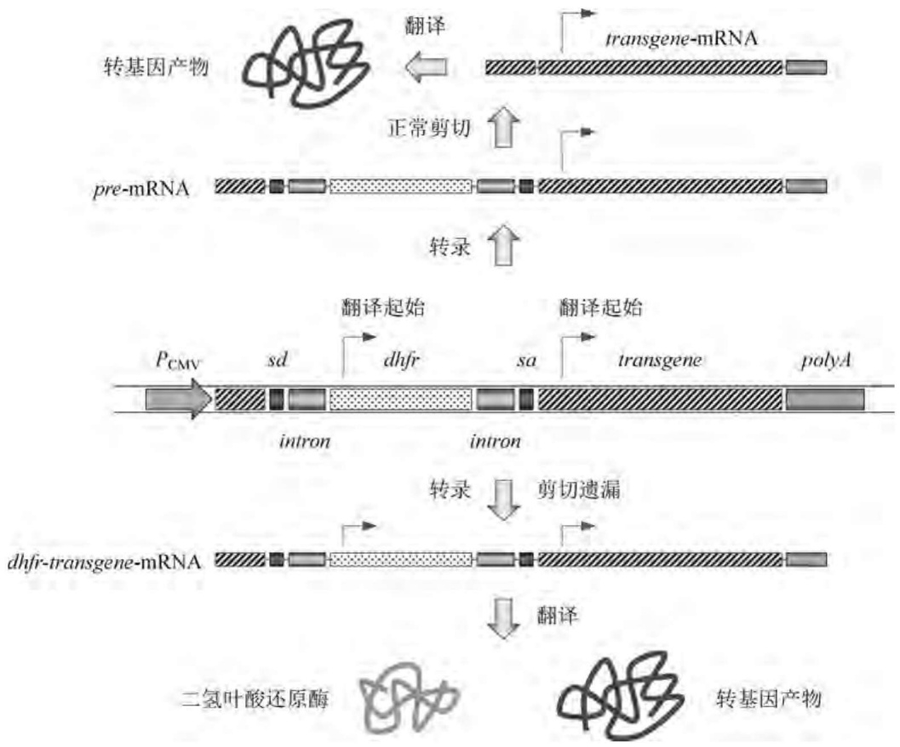

flowchart

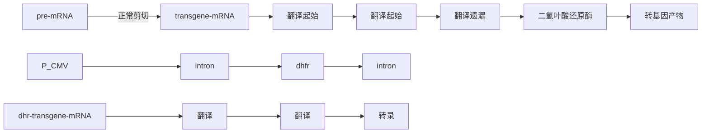

图7-24 基于剪切遗漏设计提升dhfr基因的扩增水平

## 3. 遗传稳定型工程细胞系生产系统的过程优化

第一个由重组哺乳动物细胞规模化生产的医用蛋白是溶血栓药物 tPA，其生产方法如图 7-25 所示。将人的 tPA-cDNA 克隆在含有强启动子和终止子的表达载体上，重组分子转化哺乳动物细胞系。初始转化株能表达重组 tPA 并将之分泌到培养基中，但表达水平很低。用 MTX 处理初始转化株，tPA 编码序列随 dhfr 基因大量扩增，新筛选出的转化株在大规模细胞反应器中生产出高水平的重组人 tPA。目前，采用上述工艺路线生产的 tPA 已商品化。另一个由重组哺乳动物细胞生产的人重组蛋白是凝血因子 VIII，其缺陷与血友病密切相关。多年来，血友病均使用从人血中分离纯化的凝血因子 VIII 制品进行治疗。然而，由于人血污染艾滋病毒，数千名使用这种血液制品的血友病患者惨遭感染，其中的 10% 死于艾滋病而非血友病。早在上述现象发生之前，人凝血因子 VIII 的 cDNA 便已克隆和鉴定，血源的污染则加速了利用 DNA 重组技术生产该药物的进程。与 tPA 相似，人凝血因子 VIII 也是一种结构复杂的蛋白大分子，必须借助重组哺乳动物细胞进行生产。

遗传稳定型工程细胞系在规模化生产中遇到的主要问题是细胞系传代后的生产效能率逐渐降低。就 $\mathrm{DHFR}^{-}$ 型CHO细胞系而言，采用 $dhfr - MTX$ 扩增系统虽然能获得转基因扩增型高产株，但当MTX消失后，扩增的DNA区域便呈不遗传稳定性。因而，在每轮细胞系传代时均需要进行MTX筛选和扩增的重复操作，既耗时又费力。解决这一难题的方法是建立优良细胞系的高通量筛选程序，如基于荧光激活的细胞分拣技术（FACS）。其原理是将 GFP 与转基因共表达，然后借助 GFP 特异性荧光检测器对细胞进行高通量分拣。另一种形式是将转基因与一种编码细胞表面蛋白的基因共表达，然后再用针对该表面蛋白的特异性抗体（为荧光基团所标记）对之进行染色，最后采用 FACS 进行细胞分拣。此外，重组细胞株也可通过检测 dhfr 基因的存在而筛选，做法是将细胞与荧光标记型 MTX 保温，后者能与 DHFR 结合，MTX 特异性荧光强度与目标重组蛋白的表达水平呈正相关。

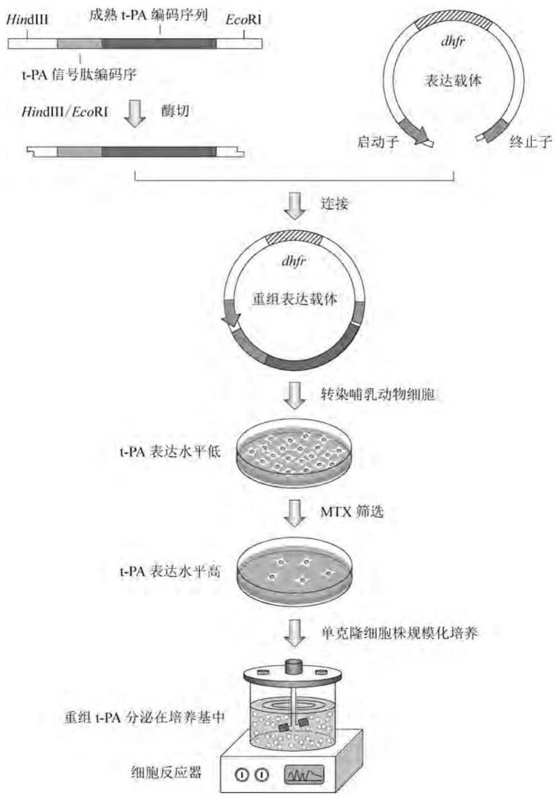

flowchart

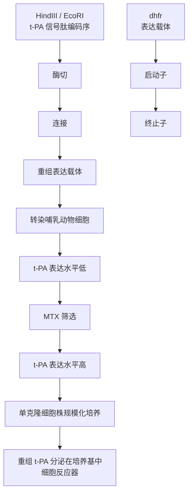

图7-25 重组哺乳动物细胞规模化生产tPA的方法

采用非人类哺乳动物细胞系生产重组人糖基化医用蛋白时，也会遇到糖基化格局的非人源化问题。重组蛋白分子的唾液酸化程度因表达产物、宿主细胞系、培养条件而异，其限速步骤包括唾液酸生物合成酶系（唾液酸转移酶）以及CMP-唾液酸转运子的活性。在CHO细胞系中过表达唾液酸转移酶对唾液酸化水平稍有改善。此外，在正常情况下由CHO细胞系表达的IgG还呈保守的岩藻糖化（即双触角多糖结构）。与后者相比，非岩藻糖化型IgG与人类FcγRIII的结合能力要高50倍。同样，非岩藻糖化的抗CD20抗体也比其岩藻糖化伙伴的B细胞耗竭活性要高出很多(EC50超过100倍)，即非岩藻糖化型IgG1呈现较强的治疗潜能。在CHO工程细胞系的基础上敲除岩藻糖化关键基因FUT8，可在一定程度上抑制IgG的岩藻糖化。

20 世纪 80 年代后期，一批持续 7 d 的培养物可达到的最大细胞密度为 $1 \times 10^{6} \sim 2 \times 10^{6}$ 个细胞/mL，重组蛋白的一般产量为 $50 \sim 100 \mathrm{mg/L}$ 。相比之下，目前的分批式生产能持续 21 天，最大细胞密度可达 $1 \times 10^{7} \sim 1.5 \times 10^{7}$ 个细胞/mL，虽然其比生产率和体积生产率为 $50 \sim 60 \mathrm{pg/(细胞} \cdot$ 天），仅相当于 80 年代的两倍左右，但重组抗体的最终浓度可积累至 $1 \sim 5 \mathrm{~g/L}$，即相当于早年间使用 CHO 细胞的 20 倍。而且，这一显著的产量增长仅仅是改进了培养基的组成（包括使用复合培养基和提高培养基浓度）以及生物过程工艺。需要指出的是，虽然目前重组哺乳动物细胞的比生产率似乎已经接近生物学极限[大约为 $100 \mathrm{pg/(细胞} \cdot$ 天)]，但体积生产率和细胞的密度仍有可能再提高 $2 \sim 5$ 倍。

## 7.3.4 利用高等动物细胞瞬时表达技术生产医用蛋白

与构建遗传稳定的转基因整合型工程细胞系不同，作为高等动物基因工程生产重组异源蛋白多肽第二种策略的动物细胞瞬时表达(TGE)技术被定义为:在转基因进入细胞悬浮培养物之后的短暂时间(1～14 d)内表达或生产重组蛋白。TGE的基本特征是:①转基因通常被克隆在一种非病毒型表达载体上，并用化学试剂如磷酸钙(CaPi)或聚乙烯亚胺(PEI)协助其渗入细胞；②转化后不经烦琐耗时的筛选操作，直接进行无选择压力下的转基因表达或者重组蛋白生产；③转基因及其表达载体并不整合在受体细胞基因组中。相对于遗传稳定的转基因整合型工程细胞系而言，TGE主要优势在于节省细胞株筛选所需的时间。虽然TGE所能达到的比生产率和体积生产率总体上低于遗传稳定的转基因整合型工程细胞系，但目前HEK293细胞系的体积生产率在14 d的生产周期中已能达到1 g/L的水平。不过，目前TGE的最大生产体积为100 L，尚达不到转基因整合型工程细胞系那样1 000 L或更大的生产规模。就所用载体的性能而言，TGE具有复制型和非复制型两种形式。

## 1. 基于复制型载体的瞬时表达系统

对于那些转化及核定位效率较低的系统而言，进入核内的转基因表达载体独立于受体细胞基因组的自主复制能力是提高重组产物高效表达和生产的重要因素，因为在TGE中转基因不能像在稳定整合型工程细胞系中那样实施MTX或MSX扩增。用于TGE的复制型载体借助病毒DNA来源的复制起始位点(ori)并在相应病毒蛋白的支持下进行自主复制，这就要求动物受体细胞能表达这些病毒蛋白。

（1）用于 TGE 的 COS 细胞系。COS-1 和 COS-7 细胞系均源自经紫外照射、复制缺陷型 SV40 病毒转染的非洲绿猴肾细胞系 CV1。这两种细胞系表达 SV40 大 T 抗原 (TAg)，后者能使含 SV40-ori 的质粒高拷贝复制（每个细胞高达 1 万个拷贝）。COS 细胞系的一个重要缺憾是转基因的表达水平较低，携带 SV40-ori 型质粒的 COS-7 细胞系与携带同样载体的 HEK293、HEK293E、HEK293T 细胞系相比，生产效能低 20 倍，因而目前已不大使用。

(2) 用于 TGE 的 HEK293 系列细胞系。HEK293 细胞系分离自腺病毒 Ad5 株修饰型