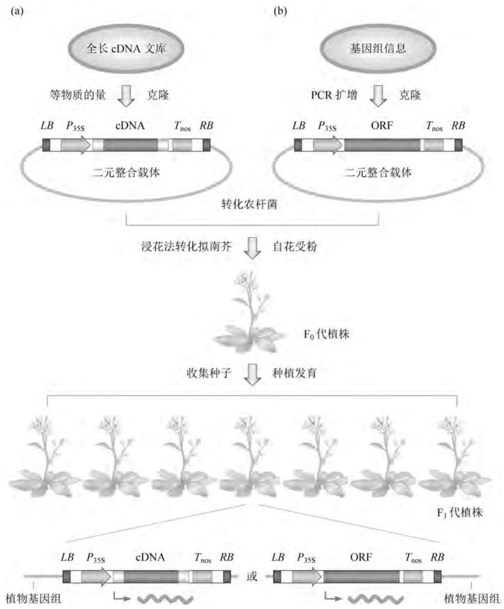
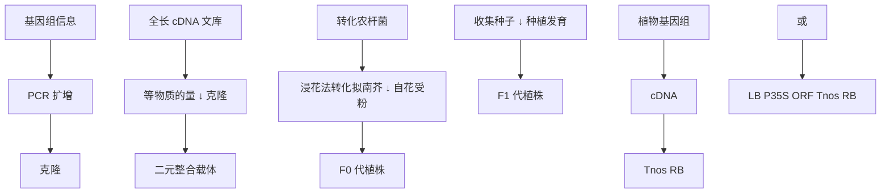
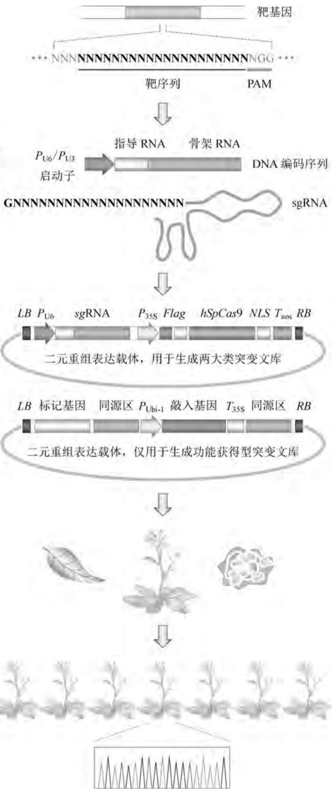
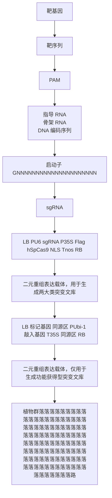
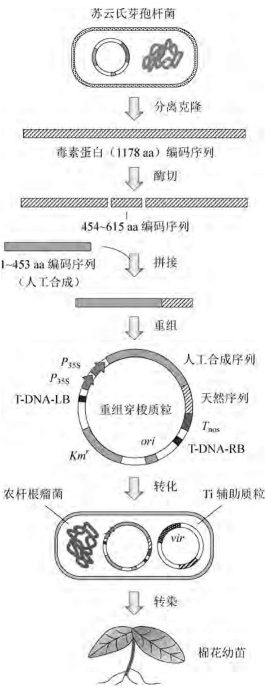
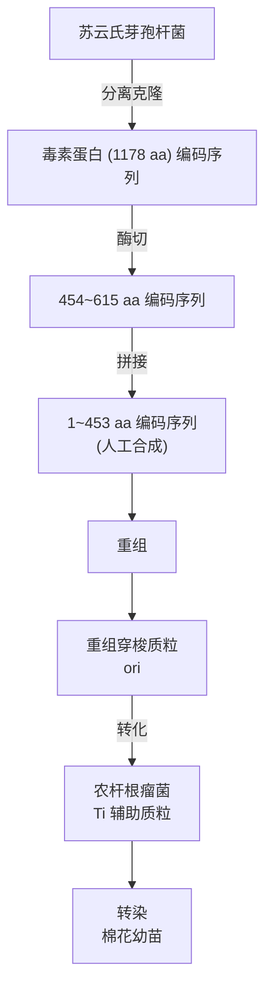
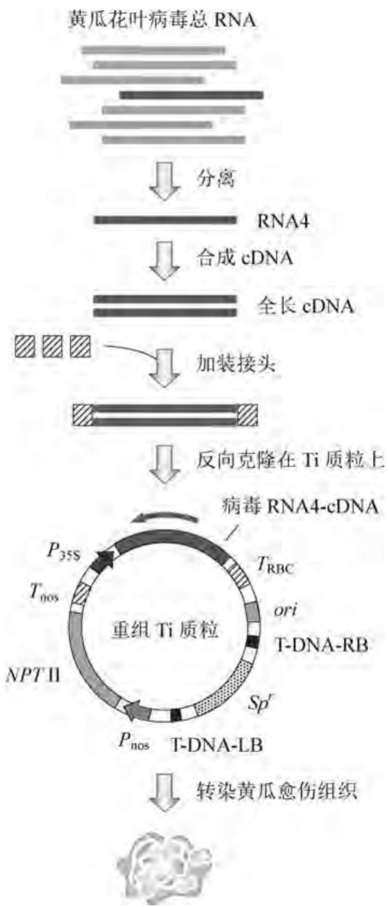
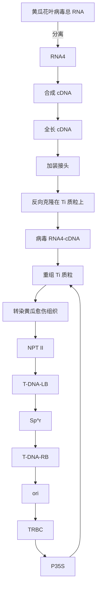
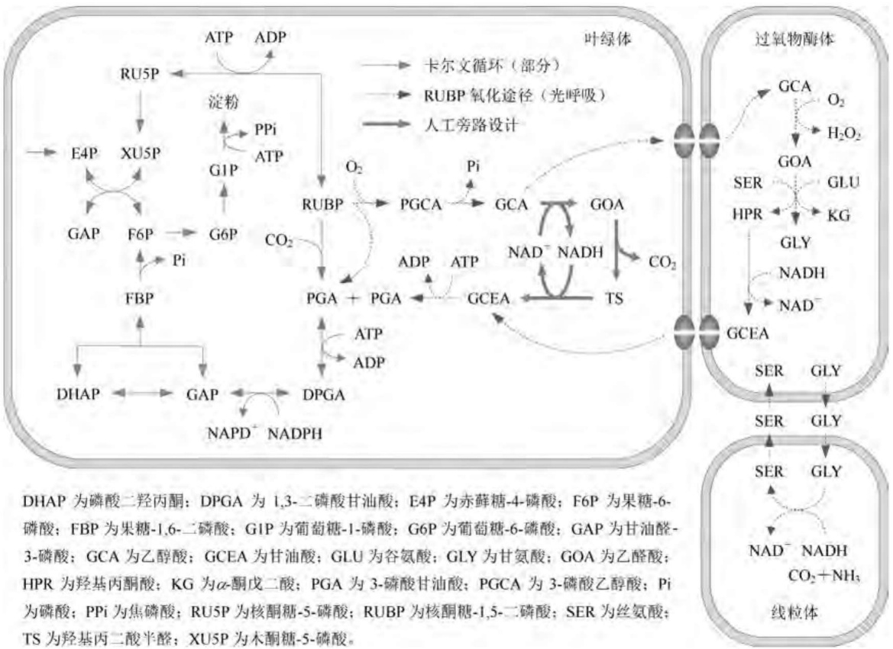
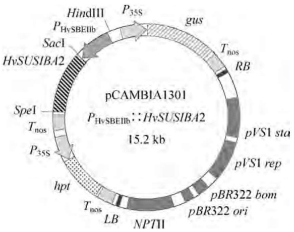

flowchart

图8-18 基于cDNA或ORF的植物功能获得型突变文库构建

cDNA 的表达水平与淡绿色表型强度(叶子中叶绿素的含量)之间呈高度负相关。类似地,由拟南芥 FOX 品系中还分离到六株叶绿体数目增加的突变株。调节拟南芥叶绿体分裂速度的质体分裂(PDV)蛋白过量表达是这种突变的原因。PDV 基因的 T-DNA 插入型突变则导致相反的效应。此外,携带编码细胞分裂素应答型转录调控因子 2(CRF2)cDNA 的另一拟南芥 FOX 品系也呈叶绿体数目的增加,CRF2 过表达的植株中 PDV 的表达水平也增加,而且添加细胞分裂素也能得到相应的表型。这些结果表明细胞分裂素调控 PVD 的表达,后者依次控制叶绿体的分裂速度。由此可见,FOX 系统能胜任植物基因功能的高通量鉴定。

水稻的高效转化系统业已建立，这使得水稻也可用作FOX系统的理想受体植物。例如，由14000条相互独立的水稻全长cDNA在 $P_{\mathrm{Ubi - 1}}$ 控制下可生成12000多株水稻FOX品系，从中分离到携带同一新型基因(编码赤霉素氧化酶)的三株矮小表型品系。

## 3. 基于 ORF 序列的功能获得型突变文库构建

ORF 与全长 cDNA 的区别在于它们不含  $5'$  和  $3'$ -UTR 序列，是编码功能型蛋白信息的最小基因单位。相对于全长 cDNA 而言，采用 ORF 生成功能获得型突变文库可以减少基因两端 UTR 序列对表达的影响；但 ORF 的完备性采集和克隆远比全长 cDNA 烦琐。ORF 功能获得型突变文库的构建与 FOX 系统相似 [8-18(b)]。

转录调控因子在植物发育和胁迫应答过程中扮演重要角色。拟南芥基因组编码1500多种转录调控因子，根据所含的保守性DNA结合功能域，这些转录因子可分成50个家族，其中很多大型家族呈显著的基因冗余性。因此，功能获得型突变是揭示植物转录调控因子功能的一种理想策略。全基因组测序为特定类型的ORF搜寻和克隆提供了信息基础，一个由1200余种拟南芥转录调控因子构成的ORF文库得以建立。另一个由乙烯响应型转录调控因子(ERF)成员构成的ORF收集物在 $\mathrm{CaMV}P_{35\mathrm{S}}$ 启动子介导下生成功能获得型异位表达文库，由该文库分离到8个氧化压力耐受性提高的拟南芥突变株，它们均来自于同一种ERF的过表达。此外，从过表达153种小型分泌肽编码型ORF的拟南芥功能获得型突变文库中分离到EPF1基因，后者在气孔保卫细胞及其前体细胞中特异性表达，能通过调控细胞的不对称分裂而控制植物气孔发育的格局化。

基于 cDNA 或 ORF 过表达策略构建功能获得型突变文库虽然不像增强子激活策略那样受限于 T-DNA 整合位点的不均匀性,但表达序列通常使用组成型启动子驱动,因此在不适宜的组织或发育背景下高水平表达的现象时有发生。这种误表达会导致内源性基因的异位表达,产生一种与目标 cDNA 或 ORF 真实功能并不相关的表型。在某些情形中,这种误表达还会形成错误的基因功能注释信息。

## 8.3.5 利用报告基因展示高等植物基因表达与调控的信息谱

与基因功能注释相平行，高等植物基因表达的调控机制对生成转基因农作物具有重要的指导作用。采用植物体内不存在的外源基因编码序列作为报告基因，将之与目标基因的调控序列拼接成嵌合型表达盒，可探查植物基因表达的强度和时空特异性信息。目前在高等植物中广泛使用的报告基因主要有 $\beta$-葡糖醛酸糖苷酶编码基因 $gus$、荧光素酶编码基因 $luc$ 以及绿色荧光蛋白编码基因 $gfp$。

大肠杆菌来源的 gus 是一个理想的报告基因， $\beta-$ 葡糖醛酸糖苷酶(GUS)的作用底物为葡萄糖醛苷酸，该酶在微生物和脊椎动物中表达，但在植物细胞中几乎不表达。将植物来源的结构基因、启动子以及组织或时序特异性增强子安装在 gus 编码序列的上游，重组分子通过 Ti 质粒介导的二元整合系统转入植物细胞或植株中表达，同时在培养基中加入卤代葡萄糖醛苷酸(X-gluc，与 X-gal 结构相似)，则转基因植株或细胞会产生相应的蓝色反应，借此既可定性观察报告基因表达的时空和组织特异性，也可定量测定报告基因表达的强度。不过，由于植物细胞不能分泌葡糖醛酸糖苷酶，因此在测定酶活性时需要破碎细胞。此外，由于  $\beta-$ 葡糖醛酸糖苷酶及其反应产物在植物细胞中相当稳定，因此定量测定的结果并不能准确反映原植物基因表达产物的天然丰度。

植物组织的基因表达检测常采用昆虫来源的萤光素酶编码序列作为报告基因，其工作原理如下:将昆虫萤光素和ATP与表达萤光素酶的植物细胞或组织混合，该酶催化昆虫萤光素氧化生成 $\mathrm{AMP},\mathrm{CO}_{2}$ 和光，因此表达萤光素酶的重组植物细胞或组织可用胶片感光的方法进行检测和示踪。例如，将重组植物的叶子表面用砂纸磨损，然后浸入含有昆虫萤光素和ATP的缓冲溶液中保温若干时间，晾干，将X光胶片覆盖在叶子上，则表达昆虫萤光素酶的部位会使胶片感光。萤光素酶在植物细胞中的半衰期远短于GUS和GFP，如果待探查基因的表达水平迅速改变很重要的话，那么选择luc作为报告基因是合理的。

与其他生物系统一样,绿色荧光蛋白作为理想的可视化标记物在高等植物中的应用更广泛。其最大的优势在于能在不破坏组织或细胞的前提下对活体植物进行检测;但与GUS和萤光素酶不同,绿色荧光蛋白不是酶,不能在蛋白表达量固定的条件下放大检测信号,因此往往需要强化其在植物体内的高效表达。

## 8.3.6 利用CRISPR/Cas系统编辑植物基因组

简便快速、神通广大的 CRISPR/Cas 技术已成功用于模式植物和农作物的序列指导性基因组编辑，同时兼有生成功能丧失型和功能获得型突变文库的潜能，甚至在某些植物（如拟南芥、水稻、番茄）中通过一代便可获得纯合子突变植株。即便第一代植株不存在纯合型突变，也可在突变型植物种子的后续繁殖中分离到相应的纯合型突变，因为有证据显示，CRISPR/Cas 介导的基因定向突变能以孟德尔方式垂直遗传。就目前研究的总体情况而言，CRISPR/Cas 技术较多用于基因定向敲除，如果同时引入多条单链指导型 RNA (sgRNA)，CRISPR/Cas9 系统也能在拟南芥、水稻、番茄中实施多路编辑，并导致长达 245 kb 的水稻染色体片段删除。通过农杆菌介导的基因转移系统将含有双链断口 (DSB) 同源序列和报告基因的 T-DNA 单位导入植物细胞内，这种转移性重组 DNA 能优先掺入由 CRISPR/Cas 创造的 DSB 处，但效率相对较低。其原因包括:① 转基因植物的组织往往由不倾向使用同源修复机制的细胞构成；② 投送进植物细胞的修复模板难以与姐妹染色质竞争；③ 常规用来投送 Cas9 和 sgRNA 的基因转移策略（如根瘤农杆菌介导法和微粒轰击法）难以携带足够量的修复模板。

采用图8-19所示的工作流程，CRISPR/Cas技术已在模式植物普通烟草（Nicotiana tabacum）、本氏烟草、拟南芥以及农作物小麦、玉米、水稻、高粱、番茄、甜橙中被证实其可行性和有效性。其中，拟南芥7个基因共12个不同靶位点的突变格局显示，含有任何突变类型的拟南芥在 $\mathrm{F}1\sim \mathrm{F}3$ 三代中的比例分别为 $71.2\% ,58.3\% ,79.4\%$ ，虽然F1中没有突变型纯合子，但大约 $22\%$ 的F2植物呈纯合型突变。如果突变事件发生在植物再生的早期阶段（即第一次胚性细胞分裂之前），那么双倍体植物的突变类型包含:杂合型，两条姐妹染色质中只有一条发生突变；纯合型，两个等位基因均发生相同的突变；双等位型，两个等位基因均发生突变，但突变类型不同。在很多情况下突变发生在植株发育的晚期，此时不同组织呈相互独立的突变格局，从而形成嵌合型植株，后者由不同基因型的细胞构成，包括野生型、杂合性、纯合型、双等位型。总之，CRISPR/Cas技术已成为植物分子生物学研究以及转基因植物生成的强有力遗传操作工具；由于导入的Cas9和sgRNA表达盒在基因组编辑后可通过筛选加以剔除，因而所生成的转基因植物与自然演化或传统杂交育种型农作物几乎没有区别，更易为公众和监管机构所接受。

## 8.4 利用转基因技术改良植物品种

植物转基因技术最引人注目的应用成就在于以经济作物品种改良为目标的转基因植物生成，这些转基因农作物具有抗生物胁迫（病虫害）、耐非生物胁迫（干旱、盐碱、寒冷）、提升光合和固氮效能（提高产量）、改善作物品质（营养价值、储藏加工性能）等优良性能，为农业、畜牧业、能源、环境、医药、日用品工业注入了革命性生机。就转基因供体与受体之间的亲缘关系以及构建物的成分结构而言，植物转基因技术可细分为异源转基因（Transgenesis）、同源转基因（或种内转基因，Intragenesis）、顺式转基因(Cisgenesis)三种不同的概念，其区别见表8-5。

第一步:确定植物基因组突变靶位选择PAM上游20bp为靶序列

第二步:设计单链指导型RNA选用sRNA启动子 $P_{\mathrm{U6}}$ 或 $P_{\mathrm{U3}}$ 介导sgRNA编码序列的表达；此时指导序列的第一位碱基应分别为G或A

第三步:构建 Cas9/sgRNA 表达盒
构建敲入型基因表达盒
选用基于 Ti 质粒的二元载体

第四步:转基因投送至植物
叶体原生质体转化；
花序农杆菌浸渍转化；
愈伤组织微粒轰击转化

第五步:植株再生与筛查PCR扩增突变区域；测序分析突变株基因型

flowchart

图8-19 基于CRISPR/Cas系统的植物基因突变文库构建

表 8-5 高等植物转基因技术的概念辨析

| 概念区别点 | 异源转基因 | 同源转基因 | 顺式转基因 |
| --- | --- | --- | --- |
| 转基因编码序列的来源 | 所有类型的异源生物 | 相同物种或性相容性物种 | 相同物种或性相容性物种 |
| 转基因调控序列的来源 | 所有类型的异源生物 | 相同物种或性相容性物种 | 相同物种或性相容性物种 |
| 转基因构建物的类型 | 编码序列与调控序列新组合 | 编码序列与调控序列新组合 | 天然基因的原组合 |
| 表达序列的方向 | 正义、反义、反向重复序列 | 正义、反义、反向重复序列 | 正义 |
| DNA转移边界序列 | 农杆菌Ti质粒的T-DNA | 植物来源的DNA序列 | 不使用转移边界序列 |
| 筛选标记基因 | 存在 | 不存在 | 不存在 |

## 8.4.1 抗生物胁迫型转基因农作物的生成

生物胁迫是指有害昆虫、病毒、真菌、细菌、线虫对农作物的侵蚀效应。其中，昆虫对农作物的危害最大，全世界每年因此损失数千亿美元。目前对付昆虫的主要武器仍是化学杀虫剂，它不但严重污染环境，而且还诱使害虫产生相应的抗性。将生物胁迫抗性基因导入农作物是植物基因工程的得意之笔，能有效避免化学杀虫剂所造成的许多负面影响，目前仅抗害虫作物已占全球转基因作物的 $22\%$ 。用于生成抗害虫转基因植物常见的外源基因有毒晶蛋白、蛋白酶抑制剂、淀粉酶抑制剂、凝集素、脂肪氧化酶、几丁质酶、蝎毒素以及蜘蛛毒素等40多种编码基因，其中毒晶蛋白、蛋白酶抑制剂和凝集素编码基因应用最为广泛。

## 1. 表达抗除草剂酶类的转基因植物

抗生物胁迫型转基因农作物中最经典也最著名的是早已大面积播种的抗化学除草剂草甘膦或草丁膦型转基因大豆。在大田里，尽管每年花费了上百亿美元使用100多种化学除草剂，但杂草的生长仍使农作物减产 $10\%$ 。目前使用的化学除草剂特异性不强，或多或少会影响农作物的生长；而抗草甘膦或草丁膦型转基因植物能有效解决这一问题，其策略包括抑制农作物对除草剂的吸收；高效表达农作物体内对除草剂敏感的靶蛋白，使其不因除草剂的存在而丧失功能；降低敏感性靶蛋白对除草剂分子的亲和性；向农作物体内导入除草剂的代谢灭活能力等。迄今为止，已有多种抗除草剂的转基因农作物进入商品化阶段，包括抗草甘膦大豆和棉花、抗除草剂玉米、抗除草剂油菜等。抗除草剂的转基因农作物占所有转基因植物的份额高达 $72\%$ 。

化学除草剂中使用最广泛的是草甘膦，因为它以很小剂量即可杀灭各种杂草，进入土壤后能被微生物迅速降解，基本上不污染环境。其除草机理是强烈抑制植物叶绿体芳香族必需氨基酸生物合成途径中的5-烯醇式丙酸基莽草酸-3-磷酸合成酶(EPSPS)活性。将来自矮牵牛花的EPSPS cDNA导入油菜中，能使其细胞内的EPSPS活性提高20倍，对除草剂的耐受性也相应增加，但转基因植物生长缓慢。另外，从一种抗草甘膦的大肠杆菌突变株中分离出EPSPS基因，将其置于植物启动子、终止子和polyA化位点的控制之下，并转入植物细胞内表达，由此构建的转基因烟草、番茄、马铃薯、棉花以及矮牵牛花能合成足够量的EPSPS变体蛋白，以补偿被草甘膦抑制了的植物酶系，从而表现出较高水平的除草剂抗性。

溴氰衍生物(3,5-二溴-4-羟-苯甲氰)是一类抑制植物光合反应的化学除草剂。臭鼻克雷伯氏菌能产生一种水解酶，将上述溴氰衍生物特异性转换成对植物基本无毒性的3,5-二溴-4-羟-苯甲酸。该酶编码基因在植物核糖二磷酸羧化酶小亚基编码基因所属光控启动子的介导下于转基因烟草中获得成功表达。

## 2. 表达毒晶蛋白的转基因植物

苏云金芽孢杆菌作为天然的微生物杀虫剂已使用了数十年，该菌能合成一种 $125\mathrm{kD}$ 的晶体蛋白，对很多昆虫包括棉蚜虫的幼虫具有剧毒作用，但对成虫和脊椎动物无害。实际上，苏云金芽孢杆菌产生的只是由1187个氨基酸残基组成的无活性毒素原蛋白，幼虫接触到毒素原蛋白后，其消化道中的蛋白酶将之水解成 $68\mathrm{kD}$ 的毒性片段，后者与幼虫中肠细胞

表面的受体结合,从而干扰细胞的生理过程。然而,采取苏云金芽孢杆菌发酵工艺生产这种生物杀虫剂成本颇高,且晶体蛋白原在自然环境中并不稳定,因此保护期很短(详见4.1.7)。

将苏云金芽孢杆菌晶体蛋白编码基因移植到农作物体内的研究持续了多年，但这个全长基因在植物细胞中的表达率甚低，其主要原因是芽孢杆菌基因的密码子使用规律与植物有较大的差异，而且毒素蛋白原的分子也太大。为此，改进表达效率的方法是只克隆晶体蛋白与毒性有关的N端1～615位氨基酸编码区，其中1～453编码序列人工合成以纠正密码子的偏爱性，同时将该合成型基因置于CaMV $P_{35S}$ 双启动子串联结构的控制之下（图8-20），这使得毒性蛋白在棉花细胞中的表达水平提高近100倍。

多年来的应用实践表明，表达苏云金芽孢杆菌重组毒晶蛋白的转基因植物能有效抵御很多对农作物和森林构成严重危害的食叶性鳞翅目害虫。仅在2009年，全球4000万公顷的毒晶蛋白转基因农作物显著减少了化学除草剂的使用量，其中最重要的转基因农作物包括大豆、玉米、棉花、油菜。然而该系统也有缺陷:首先，其抗虫谱相对比较窄，通常每一种毒晶分子只能针对一种害虫有效，例如表达Cry1Ac型毒晶蛋白的转基因农作物主要控制绿棉铃虫（Heliothis virescens）和玉米螟（Ostrinia nubilalis）。尽管更先进的转基因农作物同时表达多元毒晶蛋白（如Cry34Ab/Cry35Ab），但这种策略受到基因转移的容量限制；其次，毒晶蛋白仅对幼虫有效；最后，害虫对其产生耐受性的问题也日益突出。因此，寻找并开发其他抗虫基因资源十分重要。

## 3. 表达蛋白酶抑制剂的转基因植物

蛋白酶抑制剂是自然界含量最丰富的蛋白种类之一,存在于所有生命体中。其杀

flowchart

图8-20 含细菌毒晶蛋白编码基因的转基因农作物构建

虫机理在于抑制昆虫消化道内的蛋白酶，减弱甚至阻断消化液的蛋白水解作用。相关研究表明，在人工饲料中添加蛋白酶抑制剂能抑制昆虫的生长发育；蛋白酶抑制剂编码基因在转基因烟草中的表达可赋予植物广谱的抗虫害能力；若将细菌毒晶蛋白和丝氨酸蛋白酶抑制剂编码基因联合整合到植物染色体上，则转基因植物的抗虫害能力比只含毒晶蛋白编码基因的植物提高20倍。

迄今为止，已从豇豆、大豆、番茄、马铃薯、大麦等农作物中分离克隆出多个丝氨酸蛋白酶抑制剂编码基因，其中豇豆胰蛋白酶抑制剂(CPTI)的抗虫效果最为理想。CPTI的主要优点在于抗虫谱广，覆盖了鳞翅目、翘翅目、直翅目等很多能使农业造成巨大损失的有害昆虫。目前，含有CPTI基因的转基因烟草和棉花已经问世。大田试验表明，蛋白酶抑制剂不易使昆虫产生耐受性，对人畜无害，但在转基因植物中表达量较低。因此，探索更为有效的表达系统是丝氨酸蛋白酶抑制剂转基因植物开发的关键。

## 4. 表达反义 RNA 的转基因植物

能感染农作物的病原体包括病毒、细菌、真菌、线虫等，其中病毒感染尤为严重，它可导致农作物生长缓慢、产量降低、质量减退。在经典植物遗传学中，通常利用交叉保护原理筛选抗病毒的优良品种，即将一种较为温和的病毒感染植物，培育出来的子代植物一般能抵御更为严重的同类病毒的侵袭。这种类似于动物疫苗接种的现象表明，病毒的包装蛋白对免疫保护作用十分重要。因此，在植物细胞中克隆表达病毒包衣蛋白基因是构建抗病毒型农作物优良品种的一种策略。

flowchart

图8-21 含黄瓜花叶病毒衣壳蛋白反义基因的转基因黄瓜构建

构建抗病毒型转基因植物有两种方法:导入病毒包衣蛋白编码基因或者导入病毒复制酶亚基的反义基因。第一种方法首先在烟草中进行，烟草花叶病毒（TMV）的基因组共编码四种多肽:两个复制酶亚基、一个包衣蛋白（CP）和一个移动蛋白（MP，即宿主结合蛋白）。高效表达 $CP$ 基因的转烟草植物在TMV存在时，能维持抗病毒状态一个月左右，而正常植物 $3\sim 4\mathrm{d}$ 后便出现感染症状。这种 $CP$ 转基因技术在马铃薯、番茄、苜蓿等植物中也获得成功。此外，将 $\mathrm{TMV}5^{\prime}$ 端含复制酶亚基编码序列的片段作为转基因，可成功构建含反义基因型的转烟草植株。实验结果表明，病毒RNA基因组的复制被抑制了 $25\sim 50$ 倍，植物的病毒感染症状消失或大为减轻。

黄瓜花叶病毒(CuMV)的基因组由三个分离的单链RNA分子构成，它们分别编码三种特异性的病毒蛋白。在感染周期中，RNA3被编辑去除一段序列，形成编码病毒包衣蛋白的RNA4链。为了构建抗CuMV的黄瓜转基因新品种，可将RNA4的cDNA反向克隆在根瘤农杆菌/大肠杆菌穿梭质粒的T-DNA区内，其上下游分别安装CaMV的 $P_{35\mathrm{S}}$ 启动子和植物核糖二磷酸羧化酶小亚基编码基因的终止子 $(T_{\mathrm{RBC}})$，构成阻断病毒包衣蛋白翻译的反义基因表达盒。重组分子经根瘤农杆菌整合在植物的染色体上，由此培育出的反义型黄瓜转基因新品种明显表现出对CuMV病毒的抗性(图8-21)。

在抗真菌转基因植物方面,将粘质赛氏杆菌的壳多糖酶编码基因导入烟草,能增强转基因烟草对立枯丝核菌的抗性;将来自大麦的核糖体失活蛋白(RIP)编码基因置于愈伤诱导型启动子的控制之下,构建出的转基因烟草也能对抗立枯丝核菌的感染产生强烈的抗性。类似地,以杀菌肽和溶菌酶等编码基因作为转基因同样能获得抗细菌感染的转基因植物。

## 5. 表达干扰 RNA 的转基因植物

与病毒诱导型基因沉默相似，RNA干扰是一种由dsRNA裁剪生成siRNA而阻遏靶基因表达的机制。在真核生物细胞中，较长的dsRNA被Dicer裁剪成长度约为21核苷酸的siRNA，后者与RNA诱导型沉默复合物(RISC)联合，扫描细胞内的RNA分子直至找到与其互补匹配的靶序列。一旦被识别，靶RNA便遭摧毁(详见8.3.2)。根据这一序列特异性基因沉默原理，可设计并开发新一代的干扰RNA型杀虫剂。相关实验显示，针对害虫必需基因的dsRNA细胞核表达型转基因植物虽能大幅度降低昆虫的危害，但在大部分此类研究中害虫并没有被完全根除。事实上这里涉及的问题是，昆虫摄取的究竟是宿主转基因植物表达的dsRNA还是经裁剪而成的siRNA成品，因为植物和昆虫均拥有各自的siRNA生成机器。如果昆虫更倾向于摄入相对较长的dsRNA，那么在转基因植物细胞核中表达的dsRNA并不能有效为昆虫所吸收，因为dsRNA一经表达便会被裁剪成siRNA。

为了搞清上述问题,一项针对性研究比较了抗昆虫型 dsRNA 编码序列分别整合至细胞核基因组和叶绿体 DNA 两种转基因马铃薯的杀虫效果。结果颇富有戏剧性:所有喂养叶绿体转化型植物的马铃薯甲壳虫均在 5 d 内死亡,而喂养细胞核表达型转基因植物的马铃薯甲壳虫则不受影响。由于叶绿体不含 dsRNA 裁剪机器,在这种细胞器内表达出的长 dsRNA 相当稳定且不能生成 siRNA。这意味着喂养叶绿体转化型植物的甲壳虫吃下了几乎全长型的 dsRNA,而喂养细胞核转化型植物的甲壳虫则摄入更多的是 siRNA。换言之,就启动昆虫体内的 RNA 干扰应答过程而言,摄取长的 dsRNA 远比摄取 siRNA 更有效。因此,至少就马铃薯等转基因农作物的构建而言,dsRNA 转基因应选择性地导入叶绿体还非细胞核中。

然而，在细胞核基因组中表达抗昆虫型 dsRNA 的转基因玉米、棉花、水稻、烟草的结果与上述转基因马铃薯并不一致，这些细胞核整合型的转基因农作物控制害虫的效能似乎比同样采用细胞核整合型策略的转基因马铃薯更显著，这表明玉米、棉花、水稻、烟草细胞加工 dsRNA 并不如马铃薯那么高效。

尽管在昆虫如何从其食物中获取 dsRNA 以及是否所有昆虫均为杀虫型 dsRNA 同等程度地影响等方面存在着很多不确定的因素, 利用 RNA 干扰策略控制农作物害虫的潜力无疑是巨大的。随着 dsRNA 投送至昆虫途径的优化, 并结合 dsRNA 诱导害虫相关基因沉默的特异性, 基于 dsRNA 的杀虫剂能提供新一代环境安全且高效的昆虫控制策略, 保护农作物免遭昆虫天敌那些饥饿的嘴。

## 8.4.2 耐非生物胁迫型转基因农作物的生成

与动物不同，植物不能通过迁徙躲避不利环境因素（如强光、紫外线、干旱、盐碱、寒冷等）对其造成损害，只能借助被动的形态改变和体内生理调节机制抵御这些不利性胁迫。在分子水平上，这一生理调节过程的副作用是在体内产生大量的活性氧组分（ROS，如超氧化物负离子），后者对植物的损伤也相当严重。在生理状况下，植物体内的超氧化歧化酶(SOD)能将之转化为过氧化氢，后者经过氧化酶作用分解出水和氧气，但这种保护作用相当有限。在上述所有非生物胁迫中，干旱和高盐是全球范围内导致经济作物减产的主要环境因素。全球气候变化使得很多地区的这两大胁迫更加恶化。经典的杂交育种在开发干旱和盐碱耐受型农作物优良品种方面遇到了极大的限制，因为这些性能往往属于多基因控制，而植物转基因技术有望在诠释非生物胁迫分子机制的基础上理性设计并改良经济作物的干旱和高盐耐受性。

## 1. 耐盐型转基因农作物的构建

据估计土壤盐分影响全球约4500万公顷的灌溉农田，主要表现为农作物生长缓慢、分蘖减少、生殖受损。盐分可通过几种完全不同的机制危害农作植物，这些机制或者与盐分在芽体中的积累有关(滞后响应)，或者不依赖于盐分在芽体内的积累(快速响应)，主要分为三类:①茎部渗透耐受机制，由长距离信号调控，在芽体积累 $Na^{+}$ 之前触发芽体生长速率的降低；②根部离子排斥机制，将 $Na^{+}$ 和 $Cl^{-}$ 运输至根部，降低 $Na^{+}$ 和 $Cl^{-}$ 毒性浓度在叶部的积累；③组织耐受机制，植物组织(如叶部)存在高浓度的盐分，但被分隔在细胞外或细胞内的液泡中，减轻盐分对细胞生理工程的影响。这些机制大都涉及一系列转运子及其在细胞质膜和液泡膜处的控制。因此，这些转运子的编码基因是生成耐盐型转基因农作物的靶点(表8-6)。

表 8-6 用于改善农作物耐盐性能的转基因

<table><tr><td>转基因名称</td><td>转基因来源</td><td>使用启动子</td><td>转基因作物</td><td>转基因作物性能</td></tr><tr><td colspan="5">离子排除机制</td></tr><tr><td> $Na^{+}/H^{+}$ 逆向转运子(SOS1)</td><td>拟南芥</td><td>组成型</td><td>烟草</td><td>根茎 $Na^{+}$ 、 $K^{+}$ 积累改变</td></tr><tr><td> $Na^{+}/H^{+}$ 逆向转运子(SOS2)</td><td>盐角草</td><td>胁迫诱导型</td><td>水稻</td><td>生物质产量改善</td></tr><tr><td> $Na^{+}$ 转运子(HKT1)</td><td>酵母</td><td>脱落酸响应型</td><td>大麦</td><td>种子萌发改善</td></tr><tr><td colspan="5">组织耐受机制(离子转运子)</td></tr><tr><td> $Na^{+}/H^{+}$ 逆向转运子(NHX)</td><td>拟南芥</td><td>组成型</td><td>荞麦</td><td>根茎生物质产量改善</td></tr><tr><td> $Na^{+}/H^{+}$ 逆向转运子(nhaA)</td><td>滨藜</td><td></td><td>棉花</td><td>根茎 $Na^{+}$ 、 $K^{+}$ 积累改变</td></tr><tr><td>液泡型 $H^{+}$ 焦磷酸酶( $H^{+}PPase$ )</td><td>水稻</td><td></td><td>番茄</td><td>脯氨酸含量提高</td></tr><tr><td colspan="5">组织耐受机制(相容性溶质)</td></tr><tr><td>海藻糖-6-磷酸合成酶(TPS)</td><td>酵母</td><td>组成型</td><td>苜蓿</td><td>相容性溶质积累增加</td></tr><tr><td>海藻糖-6-磷酸酶(TPP)</td><td>水稻</td><td>胁迫诱导型</td><td>番茄</td><td>作物生存改善</td></tr><tr><td>甘露醇-1-磷酸脱氢酶(mt1D)</td><td>大肠杆菌</td><td>茎特异型</td><td>水稻</td><td>作物生长加快</td></tr><tr><td>肌醇-1-磷酸合成酶(MIP)</td><td>禾本草</td><td>叶绿体特异型</td><td>烟草</td><td>萎蔫减轻</td></tr><tr><td>甜菜碱醛脱氢酶(BADH)</td><td>菠菜</td><td></td><td>甘薯</td><td></td></tr><tr><td>胆碱氧化酶/脱氢酶(codA/betA)</td><td>蛾豆</td><td></td><td>小麦</td><td></td></tr><tr><td colspan="5">组织耐受机制(活性氧组分清除)</td></tr><tr><td>抗坏血酸过氧化物酶(APX)</td><td>拟南芥</td><td>组成型</td><td>烟草</td><td>光合效率维持</td></tr><tr><td>谷胱甘肽S-转移酶(GST)</td><td>番茄</td><td>胞质或叶绿体特异型</td><td>水稻</td><td>作物生长维持</td></tr><tr><td>单脱氢抗坏血酸还原酶(MDR)</td><td>烟草</td><td></td><td></td><td>光合效率维持</td></tr><tr><td rowspan="2">过氧化氢酶</td><td>红树林</td><td></td><td>红树林</td><td>种子萌发改善</td></tr><tr><td>豌豆</td><td></td><td>豌豆</td><td>幼苗生长改善</td></tr><tr><td colspan="5">信号转导/调控途径</td></tr><tr><td>钙调磷酸酶B样蛋白激酶(CIPK)</td><td>拟南芥</td><td>组成型</td><td>大麦</td><td> $Na^{+}$ 、 $K^{+}$ 、 $Cl^{-}$ 积累改变</td></tr><tr><td>有丝分裂原激活型蛋白激酶(MAPK)</td><td>鹰嘴豆</td><td></td><td>烟草</td><td>作物生物质产量改善</td></tr></table>

就离子排除机制而言，高亲和性钾离子转子基因家族(HKT)和盐分极度敏感性(SOS)途径在调控 $Na^{+}$ 的植物体内转运中起着重要作用，这些基因的过表达或异位表达操作能显著改变茎体或叶部中 $Na^{+}$ 的积累状态。例如，耐盐型单粒小麦(Triticum monococcum)编码定位于木质部导管周围根细胞质膜上 $Na^{+}$ 选择性转运子的HKT等位基因(TmHKT15-A)能显著改善商业化硬粒小麦的耐盐性，大田试验能显著提高小麦产量(25%)，但这一水平仅与种植在正常土壤中的小麦产量相当。HKT基因需要细胞类型特异性表达方能奏效，因此转基因的胁迫诱导和组织特异性表达至关重要。

就组织耐受机制而言,目前鉴定了三类贡献于茎体组织耐盐性的基因:①  $Na^{+}$ 向液泡转运基因;② 相容性溶质合成基因;③ 活性氧组分(ROS)脱毒酶系基因。研究显示,提高液泡型  $Na^{+}/H^{+}$  逆向转运子(NHX)、液泡型  $H^{+}$  焦磷酸酶(AVP1)、相容性溶质(诸如脯氨酸、甜菜碱、糖类)合成酶系以及 ROS 脱毒酶系的丰度,对改善转基因农作物的耐盐性具有不同程度的效果。例如,拟南芥液泡型  $H^{+}$  焦磷酸酶编码基因(AVP1)在棉花中的异源表达能在大田条件下显著改善棉花的耐盐性,同时提高棉纤维的产量。

就渗透耐受机制而言,不同植物渗透压耐受性的差异很可能与其长距离信号转导、细胞循环控制、茎部对根部所发出信号的感应过程有关,但相应的过程和功能基因尚未得以清晰鉴定。

与针对特异性盐分耐受性机制进行基因操作相平行的另一种策略是调整涉及全局性盐分耐受性的信号感应、转导、调控途径。相关研究显示，ROS信号转导途径对调控植物响应多重非生物胁迫至关重要，能通过调节液泡中 $\mathrm{Na^{+}}$ 浓度而参与对茎部 $\mathrm{Na^{+}}$ 积累的控制。此外，植物生长和发育的很多过程均由 $\mathrm{Ca^{2 + }}$ 介导，质膜型受体感应环境刺激进而激活 $\mathrm{Ca^{2 + }}$ 信号转导级联反应，最终导致相关基因的表达。过表达这一信号转导途径中的效应组分能改善水稻、苹果、大麦、烟草、番茄等农作物在盐胁迫环境中的生长。

耐盐型转基因农作物的构建应遵循下列原则:① 转基因的组织特异性表达至关重要，例如涉及光合作用的基因一般不会在不接触光的根部细胞中正常表达。以组成型启动子介导转录调控因子、离子转运子、相容性溶质合成酶系的表达往往导致不期望的表型产生。② 改变基因的表达程度只是改变蛋白质功能的一种方式，除了变更原蛋白质编码序列外，激活或阻遏蛋白质活性的翻译后修饰对改善植物的盐胁迫耐受性也很重要。$\mathrm{Ca}^{2+}$ 信号转导途径中盐胁迫耐受型关键蛋白磷酸激酶（如SOS1）的翻译后修饰能使植物快速且可逆性响应环境的变化。③ 深入了解特定物种的盐耐受性主流机制对有效操作农作物也很重要。例如，大麦比小麦具有更高的耐盐性，它能在茎部积累高浓度的 $\mathrm{Na}^+$ 。因此，大麦转基因操作策略更倾向于导入渗透耐受机制而非改善离子排斥；相反，将大麦的组织耐受性机制导入小麦或水稻则能显著改善这两种农作物的耐盐性。

## 2. 耐旱型转基因农作物的构建

耐旱也是一种复杂性状，干旱胁迫往往伴随着热胁迫或其他类型的胁迫，可发生在农作物生长的各个阶段，其中在生殖阶段的干旱胁迫可直接导致农作物平均减产50%。植物采用多重形态学改变和生理学策略响应干旱胁迫，包括多样化信号转导级联反应；同时通过加速开花缩短生长周期、减少水分损失（关闭气孔和增厚叶角质层）或者改善水分吸收（开发更深更密的根部系统）、积累渗透压调节分子、抗氧化剂、活性氧组分（ROS）清除剂以抵御干旱，增强其生存能力。在这些过程中，很多蛋白包括转录调控因子、蛋白激酶、多样化胁迫相关型蛋白起着重要作用。涉及这些途径的数百个基因已被鉴定，其中一些基因已在大田试验中被确认具有改善农作物耐旱性能的潜力（表8-7）。

NAC(NAM-ATAF-CUC2)是植物特异性的转录调控因子,具有高度保守的DNA结合功能域,属于该家族的很多基因能响应干旱胁迫。其中,胁迫响应型NAC1基因(SNAC1)是水稻NAC家族的成员,能在干旱条件下的保卫细胞中特异性表达。SNAC1在水稻中过表达导致大田严重干旱条件下转基因水稻在生殖阶段耐旱能力的显著提升,结粉率提高22%\~34%,并且没有任何表型改变。这种转SNAC1基因水稻表现为气孔开度的显著减少以及保卫细胞中脱落酸敏感性的增强,从而提高水的利用效率。不仅如此,SNAC1基因在小麦中过表达,转基因小麦同样能改善耐旱性能。这是操作单个基因便能在严重干旱的大田条件下减少产量损失的首次成功尝试。除了SNAC1,水稻中的其他几种NAC家族成员诸如OsNAC6、OsNAC10、OsNAC5、OsNAC9也都具有抗旱作用。OsNAC6过表达型的转基因水稻在玉米 $P_{Ubi-1}$ 启动子控制下从无土栽培营养液中移植出来12h后,恢复率高达42%\~57%,但转基因植株呈生长迟滞表型。OsNAC5能与OsNAC6和SNAC1相互作用,由根特异性启动子 $P_{\mathrm{RCc3}}$ 驱动OsNAC5过表达的转基因水稻在大田的干旱条件下比野生株水稻高产，但OsNAC5的组成型表达却对耐旱性能没有显著效应。采取相同的策略，$P_{\mathrm{RCc3}}::OsNAC9$ 和$P_{\mathrm{RCc3}}::OsNAC10$ 型转基因水稻在大田试验的生殖阶段也呈显著的耐旱能力提升。

表 8-7 经大田试验确认有效的耐旱型转基因农作物

<table><tr><td>转基因名称</td><td>转基因来源</td><td>使用启动子</td><td>转基因作物</td><td>转基因作物性能</td></tr><tr><td colspan="5">信号转导途径</td></tr><tr><td>MAPKKK(NPK1)</td><td>烟草</td><td>水稻  $P_{\text{Actin1}} / P_{\text{LEA3-1}}$ ,胁迫诱导型</td><td>水稻</td><td>结实率提高</td></tr><tr><td>丝氨酸/苏氨酸蛋白激酶(SOS2)</td><td>拟南芥</td><td>水稻  $P_{\text{LEA3-1}}$ </td><td>水稻</td><td>结实率提高</td></tr><tr><td>DREB1/CBF(DREB1A)</td><td>拟南芥</td><td>水稻  $P_{\text{LEA3-1}}$ </td><td>水稻</td><td>结实率和产量提高</td></tr><tr><td>NAC(SNAC1)</td><td>水稻</td><td> $CaMVP_{35S}$ </td><td>水稻</td><td>存活率和结实率提高</td></tr><tr><td>NAC(OsNAC5)</td><td>水稻</td><td>水稻  $P_{\text{RCc3}}$ ,根特异性型</td><td>水稻</td><td>多重效应改善</td></tr><tr><td>NAC(OsNAC9)</td><td>水稻</td><td>水稻  $P_{\text{RCc3}}$ ,根特异性型</td><td>水稻</td><td>多重效应改善</td></tr><tr><td>NAC(OsNAC10)</td><td>水稻</td><td>水稻  $P_{\text{RCc3}}$ ,根特异性型</td><td>水稻</td><td>多重效应改善</td></tr><tr><td>C2H2-EAR锌指转录调控因子</td><td>拟南芥</td><td>水稻  $P_{\text{Actin1}} / P_{\text{LEA3-1}}$ ,胁迫诱导型</td><td>水稻</td><td>结实率和产量提高</td></tr><tr><td colspan="5">功能蛋白</td></tr><tr><td rowspan="2">钼辅基型硫化酶(LOS5)</td><td rowspan="2">拟南芥</td><td>水稻  $P_{\text{Actin1}} / P_{\text{LEA3-1}}$ ,胁迫诱导型</td><td>水稻</td><td>结实率和产量提高</td></tr><tr><td>含增强子型超级启动子</td><td>大豆</td><td>多重效应改善</td></tr><tr><td>脱水蛋白 LEA(OsLEA3-1)</td><td>水稻</td><td> $CaMVP_{35S} / \text{水稻 } P_{\text{LEA3-1}}$ </td><td>水稻</td><td>结实率和产量提高</td></tr><tr><td>脱水蛋白 LEA(HVA1)</td><td>大麦</td><td>玉米  $P_{\text{Ubi-1}}$ </td><td>小麦</td><td>水分利用率和生物质提高</td></tr><tr><td> $Na^{+}/H^{+}$ 逆向转运子(AtNHX1)</td><td>拟南芥</td><td>水稻  $P_{\text{Actin1}}$ </td><td>水稻</td><td>结实率提高</td></tr><tr><td>活性氧组分清除蛋白(OsSRO1c)</td><td>水稻</td><td>玉米  $P_{\text{Ubi-1}}$ </td><td>水稻</td><td>多重效应改善</td></tr><tr><td>鸟氨酸 δ-氨基转移酶</td><td>水稻</td><td>玉米  $P_{\text{Ubi-1}}$ </td><td>水稻</td><td>存活率和结实率提高</td></tr></table>

核内因子 Y(NF-Y) 是一种由 A、B、C 三种亚基构成的 CCAAT 基序结合型转录调控因子。在拟南芥中，AtNF-YB1 和 AtNF-YA5 基因的组成型过表达能改善耐旱能力；AtNF-YB1 在玉米中的直系同源基因 ZmNY-YB2 在玉米中的过表达也同样呈耐旱品质，这种转基因玉米在相对干旱的大田条件下可提高粮食产量约 50%。植物体内的脱落酸 (ABA) 应答元件结合蛋白/因子 (AREB/ABF) 属于碱性亮氨酸拉链 (bZIP) 型转录调控因子，能以脱落酸依赖型方式响应干旱胁迫。在拟南芥中过表达 AREB1/ABF2、ABF3 或 AREB2/ABF4 能提升转基因植物对脱落酸的敏感性和耐旱性。ABF3 在水稻中以玉米泛素启动子  $P_{Ubi-1}$  介导过表达，转基因稻秧经干旱处理后呈卷叶和萎蔫推迟表型。在大豆中过表达 GmbZIP 基因不仅能提升耐旱性，而且还有助于改善耐盐和耐寒胁迫。

法呢酰化是一种蛋白质翻译后修饰，便于靶蛋白在细胞膜中的定位。转基因油菜中法呢酰转移酶FTB或FTA编码基因被干旱诱导型启动子RD29A介导转录阻遏，在大田试验的干旱胁迫条件下比对照植株呈显著增产性能。采用RNA干扰技术阻遏水稻中的法呢酰转移酶SQS也能在很大程度上提升耐旱能力，其机理是在营养生长和生殖阶段降低气孔导度从而提高组织中的水分含量。

## 8.4.3 提升光合效能型转基因农作物的生成

根据全球人口在 21 世纪中期将达到 95 亿推算,2050 年全球的粮食需求将在现有的基础上再提高 85%。如果按目前单位耕地面积粮食产量的增速不变维持下去,那么 2050 年世界范围内将出现巨大的粮食供需缺口；更何况近20年来全球粮食的生产增幅在显著下降。因此，人类必须开拓崭新的粮食增产战略才能在未来的几十年里维持生存。

## 1. 提升粮食作物产量增幅的可行性战略

一种特定基因型的粮食作物的产量潜能 $(Y_{\mathrm{p}})$ 定义为该作物在各种生物和非生物胁迫缺席条件下单位耕地面积所能收获的粮食质量，它是单位耕地面积全生长季节所接受的光照总量(Q)与粮食作物光照拦截效率 $(\varepsilon_{\mathrm{i}})$ 、由拦截光照量至生物质能量转换效率 $(\varepsilon_{\mathrm{c}})$ 、以及由生物质至农作物收获部分(粮食)分配效率 $(\varepsilon_{\mathrm{p}})$ 的乘积。在过去的半个世纪中，借助经典的遗传育种技术以及确保实现高产遗传潜能的农艺和作物保护措施，第一次绿色革命实现了 $Y_{p}$ 的大幅度提高，具体表现为主要粮食作物水稻、小麦、大豆现代品种的 $\varepsilon_{p}$ 几乎提高了一倍，目前已达到大约60%。然而，由于这些农作物在收获时仍需保持茎和穗(豆荚)的生物质结构以支撑种子，因而 $\varepsilon_{p}$ 进一步提高的空间十分有限。类似地，表征农作物在全生长季节所能接受的可见光部分的拦截效率 $\varepsilon_{i}$ 对现代农作物品种的基因型而言也已达到80%\~90%，换句话说，这一 $Y_{p}$ 的决定性因素也已很接近其生物学极限。改良甚少或者几乎没有涉足的剩余因子便是可见光能的转换效率 $\varepsilon_{c}$，目前仅为2%，相当于C3农作物(如小麦和水稻)理论转换效率10%的1/5；或者C4农作物(如玉米和高粱)理论转换效率13%的1/7。由此可见， $\varepsilon_{c}$ 因子是未来提升主要粮食作物 $Y_{p}$ 的一个大有希望几乎也是唯一的焦点。

将农作物拦截的光照量转换成生物质能量的 $\varepsilon_{\mathrm{c}}$ 取决于光合作用过程本身的效率，即扣除农作物呼吸耗能后的净值。就C3植物而言， $\mathrm{CO}_{2}$ 是光合酶系的限制性底物，数以千计参与光合作用的基因/蛋白质以及由其构成的代谢和调控网络均以 $\mathrm{CO}_{2}$ 为限制性因素而设置和运行的。在过去的2500万年里（现代农作物的祖先在此期间进化），大气中 $\mathrm{CO}_{2}$ 的平均浓度大约为 $220~\mu \mathrm{mol / mol}$ ；现今的 $\mathrm{CO}_{2}$ 平均浓度几乎增加了一倍，而且其中的大部分是在最近100年中增加的。在如此之短的时间段中，现代农作物尚未来得及适应并重新调整其光合机器的有效配置。因此，基于人类对光合作用机制的全面精确性认识，借助高性能计算机和强大软件工具的系统性仿真和推演，并采用转基因技术对农作物光合基因组进行理性设计与改造，便能最终赢得大幅度提升 $\varepsilon_{\mathrm{c}}$ 和 $Y_{\mathrm{p}}$ 的第二次绿色大革命。例如，光合系统的计算机推演显示，在各组分各途径达到最优配置的理想状态下，光合作用的效率能在现有水平上再提升 $60\%$ 。其中，最大的单项改变来自景天庚酮糖-1,7-二磷酸酶(SBPase)投入量的增加，甚至该酶上调的收益还随大气中 $\mathrm{CO}_{2}$ 浓度的升高而递增。相关基因操作证实了上述推演结果:SBPase表达的上调使得转基因烟草的生产能力显著提升，而且这一效应在 $\mathrm{CO}_{2}$ 浓度较高的大田环境中确实被进一步放大。

## 2. 靶向光反应的光合效率提升策略

光合作用分为光反应和暗反应两个阶段。光反应涉及叶绿素等色素分子捕获光子能量、裂解水分子、类囊体膜上的电子传递还原生成NADP以及提供足以磷酸化ADP的质子梯度。而在暗反应中，所生成的NADPH和ATP驱动卡尔文循环，该循环吸收 $\mathrm{CO}_{2}$ 并将之还原成碳水化合物。每吸收1分子的 $\mathrm{CO}_{2}$ 以及从水分子裂解反应中释放出1分子的 $\mathrm{O}_2$ 至少需要8个光子。在低强度光照和其他胁迫缺席条件下，大多数叶子的光合机器非常接近单位 $\mathrm{CO}_{2}$ 吸收和 $\mathrm{O}_2$ 释放捕获8个光子的理论需求值，这表明该过程已经能以接近最大效率的方式工作。此时如果增加光吸收，光子的利用效率反而会因电子传递或者所产ATP和NADPH利用能力受到限制而下降。因此，提升光反应总效率的操作靶点是在突破电子传递或ATP/NADP利用限制（即光饱和效应）的基础上增强光色素分子捕捉光子的能力。就强化光子捕捉机制而言，对色素分子进行基因工程改造使之能利用更广的光谱，具有可行性。植物的色素系统像其进化祖先绿藻一样只能利用可见光，很少能延伸至近红外和UV-A光谱区，这意味着一半以上的太阳光能未被利用。鉴于其他藻类和光合细菌所使用的色素系统能捕捉和利用长波长的近红外光，将这种异源光能捕捉系统移植至农作物能使有效太阳能的使用广泛扩大 $20\%$ ，这对于那些低叶冠型农作物而言非常有效，因为这些植物吸收 $\mathrm{CO}_{2}$ 的能力随光捕捉能力的强化而线性增加。

事实上，解除电子传递或ATP/NADP利用限制的光饱和效应具有更重要意义。在高光(全光至三分之一全光之间)状态下，叶绿色分子通常保持高度的激发状态，这种高激发能可传递至氧气并产生广范围的氧自由基，进而损害光合作用机器。植物通过将叶黄素分子脱环氧化成玉米黄质而诱导光合机器内部的改变，从而保护自身免遭过量自由基的损害，同时以无害的热量形式将过剩的能量散发出去。有些藻类光合系统能提供额外的合成机会迅速减少这种热损耗，其关键装置是叶黄素循环中间物之间的高效转换以及这些中间物与光合系统中心(PSII)复合物之间的高效相互作用。因此，相应的酶系编码基因成为改善农作物光反应总效率的可行性靶点。

## 3. 靶向暗反应的光合效率提升策略

将一个经广泛验证过的光合稳态生化模型应用于农作物叶子的研究显示，在光饱和状态下，植物体内过程显著为羧基化能力和羧基化受体分子核酮糖-1,5-二磷酸(RUBP)的再生能力所共同限制。C3农作物的羧基化能力由RUBP羧化酶/加氧酶(Rubisco)的活性决定，Rubisco占了叶子可溶性蛋白总量的 $50\%$ ，因而是地球上丰度最高的蛋白质。Rubisco既能催化RUBP的羧基化也能催化其的氧化，一旦后者发生，便会形成二碳化合物磷酸乙醇酸(PGCA)。植物通过一条复杂的途径代谢这种二碳氧化产物，涉及过氧化物酶体和线粒体再生磷酸甘油酸(PGA)。PGA是卡尔文循环中的一个C3中间物，但它在此处的生成会损失一分子的 $\mathrm{CO}_{2}$ 并消耗产自光反应的宝贵的还原力和磷酸化力。这一消耗 $\mathrm{O}_2$ 并释放$\mathrm{CO}_{2}$ 的过程称为光呼吸(图8-22)，是对净光合作用效率施加的严厉惩罚，且随着温度的升高而增强，因为Rubisco对 $\mathrm{CO}_{2}$ 底物的特异性随着温度的提高而降低。光呼吸的代价相当高，在寒冷或炎热气候下因光呼吸所造成的损失分别可达 $30\%$ 或 $50\%$ 以上。利用转基因技术有望衰减甚至消除光呼吸的途径包括:

（1）工程化提升 Rubisco 的羧基化催化活性。为了反抗光呼吸，植物中的 Rubisco 似乎已进化得对 $\mathrm{CO}_{2}$ 更特异，但这种高特异性是以牺牲催化反应速度为代价获得的。的确，植物版 Rubisco 的催化速率是任何酶促反应中最慢的，大约每秒每活性位点平均仅催化 3.7 底物分子（典型的酶分子 $1 \mathrm{~s}$ 可催化 1000 个底物分子）。因而，现代版的 Rubisco 代表了 $\mathrm{CO}_{2}$ 底物特异性与催化速率之间的一种妥协。然而，这种妥协似乎是为 100 多年前大气中低一倍的 $\mathrm{CO}_{2}$ 浓度优化的。农作物叶冠的计算机仿真显示，能适应当今大气高 $\mathrm{CO}_{2}$ 浓度的 Rubisco 基因工程优化需要更高的催化速率，甚至需要牺牲其 $\mathrm{CO}_{2}$ 特异性为代价，这样才能在 Rubisco 总量不变的前提下使叶冠光合作用的碳获得量增加 $30 \%$ 。例如，将蓝细菌细长聚球藻 (Synechococcus elongatus) PCC7942 株 Rubisco (Se7942 酶) 大小亚基的编码基因置换烟草叶绿体内的 Rubisco 大亚基编码基因，同时引入 Se7942 酶装配型分子伴侣 RbcX 或羧酶体内部蛋白 CcmM35 编码基因，在转基因烟草的叶绿体基质中形成三亚基样的工程酶。结果显示，两株转基因烟草 (Se7942 酶-RbcX 和 Se7942 酶-CcmM35) 均比对照株呈更高的 $\mathrm{CO}_{2}$ 固定速率。

(2) 工程化模拟 C4 植物 $\mathrm{CO}_{2}$ 浓缩机制。由于 $\mathrm{CO}_{2}$ 是 Rubisco 氧化反应的一种竞争性抑制剂, 因此任何能在 Rubisco 酶分子处浓缩 $\mathrm{CO}_{2}$ 的机制或装置均可有效抑制光呼吸。例如, C4 植物在其独立进化过程中, 将 Rubisco 分隔在一种为叶脉围绕的内层绿色维管束鞘中。$\mathrm{CO}_{2}$ 首先在外层光合组织或叶肉中以磷酸烯醇式丙酮酸(PEP)羧基化的形式被捕获, 形成一种 C4 二羧酸, 然后这种 C4 化合物转入内层维管束鞘, 并在里面释放 $\mathrm{CO}_{2}$ 和丙酮酸, 后者穿梭返回外层组织, 构成 PEP 固碳循环。C4 化合物的 PEP 循环实质上是一种光能驱动的

$CO_{2}$  浓缩机制,在大多数情况下,该浓缩机制所需的额外能量要小于光呼吸损耗的能量,因而能在很大程度上消除光呼吸效应。由此可见,提升 C3 农作物小麦和水稻光合效率的一种策略是将之转换成 C4 植物,包括导入 C4 光合作用的基因。

（3）工程化导入光合细菌  $CO_{2}$  浓缩机制。蓝细菌采用一种不同的机制在 Rubisco 处浓缩  $CO_{2}$ :它们能主动吸收碳酸氢盐进入细胞，而 Rubisco 和碳酸酐酶均位于被称为羧酶体的二十面体蛋白外壳内。其中，碳酸酐酶催化碳酸氢盐释放  $CO_{2}$ ，并在 Rubisco 周围将  $CO_{2}$  浓缩到足以使氧化反应和光呼吸最低化的水平。这种机制似乎要比将 C3 植物转换成 C4 植物更加简单，因为它不需要创建两种不同的光合组织，只需在叶绿体膜上添置碳酸氢盐和  $CO_{2}$  泵并在叶绿体内装配羧酶体即可。相关计算机模型显示，添置上述基本组分能使光合作用提升高达 60%。实现这一策略的理想方案是使光合细菌上述组分的编码基因在植物叶绿体内表达，但叶绿体的定向转化（质体工程）迄今为止仅在烟草和土豆等少数植物中获得成功，绝大多数粮食作物难以转化。一种替代的方法是采用细胞核转化程序表达含叶绿体靶向性转移肽和膜转运子的组分。
（4）工程化设计磷酸乙醇酸代谢旁路。降低光呼吸代价的另一种策略是工程化设计一条更高效的加氧酶催化反应产物磷酸乙醇酸的代谢旁路。植物和绿藻使用一条单一的耗能延伸途径以PGA的分子形式将磷酸乙醇酸回收进入卡尔文循环(图8-22)。原核细菌至少拥有三条更为简捷的途径将磷酸乙醇酸转换成PGA，其中一条途径只涉及三种酶催化步骤，已被工程化导入拟南芥的叶绿体中，并改善了其净光合作用效率。

flowchart

This diagram illustrates the metabolic pathways of glutamate (GCA) and glycine (GLY) in the plant, showing how various enzymes (e.g., E4P, PU5P, GAP) interact with glucose and metabolites to regulate mitochondrial oxygen metabolism.

图8-22 C3植物光合代谢和人工旁路途径设置简图

表8-8总结了目前具有可操作性的改善光合效率的主要策略及其潜在效果。虽然其中有些方法在目前远比其他方法更容易操作，但缺乏足够的实践评判各种方法的优劣。

表 8-8 目前具有可操作性的改善 C3 作物光合效率主要策略及其潜在效果

| 遗传操作内容 | 操作类型 | 计算机模拟收益 | 实现时间/年 | 额外效能 |
| --- | --- | --- | --- | --- |
| 将作物的可用广谱扩展至近红外 | 叶绿体转化 | 10%~30% | 10~30 | 强化C3第三项/C4第十项改造效果 |
| 促进PSII更快速散热 | 细胞核转化 | 30% | 1~5 | 伴有所有其他改变,C4也适用 |
| 将C3作物转换成C4植物 | 细胞核转化 | 30% | 10~30 | 改善水利用和氮利用效率 |
| 导入蓝细菌或微藻的CO2/HCO3泵 | 细胞核转化 | 5%~10% | 5~10 | 改善水利用和氮利用效率 |
| 导入蓝细菌羧酶体系统 | 叶绿体转化 | 60% | 10~30 | 改善水利用和氮利用效率 |
| 导入藻类淀粉核CO2浓缩系统 | 叶绿体转化 | 60% | 10~30 | 改善水利用和氮利用效率 |
| 使用更适应现代CO2浓度的Rubisco | 叶绿体转化 | 15%~30% | 10~30 | 改善水利用和氮利用效率 |
| 搭建光呼吸旁路 | 细胞核转化 | 15% | 1~5 | 改善水利用和氮利用效率 |
| 优化RUBP再生 | 细胞核转化 | 60% | 1~5 | 伴有所有其他改变,C4也适用 |
| 将更多的光传递给低冠作物 | 细胞核转化 | 15%~60% | 1~5 | 伴有第一和第三项改造效果改善水利用效率,C4也适用 |

## 4. 靶向叶绿体基因组的质体工程

所有真核藻类和有胚植物（包括苔藓植物、蕨类植物、种子植物）中的叶绿体起源于15亿年前一次偶然的蓝细菌吸收和内共生事件，在随后漫长的演化过程中，蓝细菌基因组中数千个基因或丢失或移至宿主植物核基因组中，只剩下约100～250个主要编码光合系统和基因表达工具的叶绿体基因组。这意味着，针对农作物光合系统进行的基因操作必须依靠叶绿体转化程序。与线粒体相似，真核光合生物细胞中的叶绿体在基因结构、表达调控模式、基因重组等方面的性质更接近于原核生物系统。植物来源的转基因通常需要安装具有原核生物典型特征的启动子、终止子、SD序列等表达调控元件，并对基因编码序列进行符合原核生物的密码子优化。

使得包括叶绿体在内的植物细胞器转化成为可能的关键性突破是由基因枪等装置介导的微粒轰击技术(亦称生物弹射法)的建立。叶绿体转化首先在单细胞绿藻莱茵衣藻中获得成功,这种衣藻含单个大型叶绿体(体积占据衣藻细胞的一半)并含有约80个完全相同的叶绿体基因组拷贝。然而,种子植物仅一个典型的叶肉细胞便拥有1 000\~2 000个叶绿体基因组拷贝和100个左右的叶绿体,进入细胞的转基因因被稀释很难呈现其相应的表型,必须严格依赖植物细胞和叶绿体复制并在强有力的选择性压力下才能获得期望的转化株,目前只有普通烟草获得相对满意的叶绿体转化效率。不过,相比植物细胞核转化而言,叶绿体转化也有独特的优势:一旦重组DNA分子进入叶绿体,便像在原核细菌细胞中那样能以很高的频率发生同源重组,以极为简单的方式实现外源转基因在叶绿体基因组中的位点特异性整合;当然,重组分子需要安装叶绿体基因组特点位点的同源序列,但其长度以0.5\~1 kb为宜,多长的同源臂并不能导致重组效率的提升。

## 8.4.4 改善品质型转基因农作物的生成

旨在改善农作物品质(如保质期延长或营养更丰富)的转基因操作起步迟于生物和非生物胁迫耐受性转基因。在多数情况下,这种转基因操作并非解决农业生产的产量和成本等主要问题,因而被认为是一种奢侈性的转基因操作。

## 1. 淀粉含量提高而甲烷释放量减少的转基因水稻

大气中的甲烷是继二氧化碳之后位居第二位的温室气体成分，对全球气候变暖具有$20\%$ 的贡献。而大气甲烷中的 $17\%$ 却是由稻田释放的，温热水淹性土壤以及由水稻根部发出的营养组分为稻田中的甲烷生成提高了理想条件。据估测，全球稻田每年甲烷的散发量高达一亿吨，因而迫切需要创建有效的技术在提高水稻产量的同时减少甲烷的散发量。大麦糖信号转导蛋白2(SUSIBA2)是一种植物特异性的WRKY家族转录调控因子，能识别并结合含糖应答元件 SURE 元件和 W 盒的启动子/增强子，并调控糖诱导型基因的表达，因而介导糖源库之间的通信。SUSIBA2 的高表达能提升库强度（植物组织吸收碳水化合物的能力）和淀粉的生物合成速率，而其在种子和茎部的过表达能提升水稻地面组织的库强度，促进光合作用产物优先向地面生物质而非根部的分配。这种光合作用产物分配格局的改变导致转基因水稻种子和茎部生物质和淀粉含量的提高，同时又能通过降低根部散发碳源成分而减少甲烷的生成。

以大麦种子和茎部特异性基因 $HvSBEIIb$ 所属的糖诱导型启动子 $P_{\mathrm{HvSBEIIb}}$ 介导大麦SUSIBA2编码基因 $HvSUSIBA2$ 表达，在Ti二元整合型载体pCAMBIA1301上构建 $P_{\mathrm{HvSBEIIb}}::HvSUSIBA2$ 表达盒（图8-23），并转化根瘤农杆菌。重组农杆菌通过与水稻盾片愈伤组织共培养而转化水稻细胞。由此再生出的一株稳定的转基因纯合型SUSIBA2-77水稻在光合产物(糖)诱导下过表达SUSIBA2，后者刺激其靶基因的糖诱导型转录激活，进而导致种子和茎部库强度提升；而糖在种子和茎部中的富集进一步激活 $P_{\mathrm{HvSBEIIb}}::HvSUSIBA2$ 表达盒，从而形成雪球效应式的正反馈。在中国进行的三年大田试验证明，SUSIBA2-77型转基因水稻在

donut

| Locus | Relative Size |
| --- | --- |
| P_HvSBEIIb | Small |
| HindIII | Medium |
| SacI | Small |
| HvSUSIBA2 | Large |
| SpeI | Small |
| T_nos | Small |
| P_35S | Medium |
| hpt | Large |
| T_nos | Medium |
| LB | Small |
| NPTII | Medium |
| pBR322 ori | Small |
| pBR322 bom | Small |
| pVS1 rep | Medium |
| pVS1 sta | Medium |
| RB | Small |
| T_nos | Small |
| gus | Small |

图8-23 含HvSUSIBA2转基因表达盒的pCAMBIA1301重组二元载体图谱

开花前和开花后的甲烷散发水平分别为对照株的 $10\%$ 和 $0.3\%$ ，根系尺寸显著减小；而且穗大米粒饱满，其淀粉含量由对照株的 $76.7\%$ 提高到 $86.9\%$ 。

## 2. 富含必需营养成分的转基因水稻

据统计，全世界至少有30亿人以大米为主食，水稻作为主粮的一个严重缺陷是很多重要的维生素和营养元素(如铁等)含量低于临界值，而稻谷脱壳加工更使营养成分大量流失。另外，全球约有1亿人患不同程度的缺铁性贫血，3亿人呈不同程度的维生素A缺乏，仅发展中国家每年就有70万儿童因维生素A缺乏而夭折，另有30万儿童致盲。所谓的黄金大米便出自高产维生素A前体物质β-胡萝卜素的转基因水稻。最初版的黄金大米使用的是来自水仙花的八氢番茄红素合成酶编码基因(psy)和噬夏孢欧文氏菌(Erwinia uredovora)的ζ-胡萝卜素去饱和酶编码基因(crtI)，每克大米仅产 $1.6\mu \mathrm{g}\beta$ -胡萝卜素，达不到用作食品强化剂的标准。2005年的新版黄金水稻则选用来自玉米的psy构建，使得β-胡萝卜素的含量提高了22倍，而且人体试验证明其具有安全性。

另外，水稻也是所有主粮中含铁量最低的。采用经典植物育种技术只能使杂交水稻的铁含量提高一倍。为了进一步提高稻米中的铁含量，转基因水稻使用来自大豆芽中的烟酚胺合成酶（该酶能提高铁离子在植物体内的运输效能）和铁蛋白（该蛋白系帮助植物从环境中吸取铁离子的储藏蛋白）编码基因。五年的大田试验取得了颇有希望的结果:这种转基因水稻的铁含量高达 $15\mathrm{mg / kg}$ （精加工过的大米含铁量最高为 $4\mathrm{mg / kg}$ ），且不影响稻米的产量和质量。吃一顿这种富铁米饭，摄入的铁质相当于成人每天需铁量的一大半。新的计划是构建具有复合型营养成分的转基因水稻，如产 $\beta$ -胡萝卜素且含铁量高或者同时产 $\beta$ -胡萝卜素和维生素 $\mathrm{B_6}$ 。

## 3. 耐长期储藏的转基因水果或蔬菜

水果和蔬菜成熟后,其组织呼吸速度和乙烯合成速度普遍加快,并迅速导致果实皱缩和