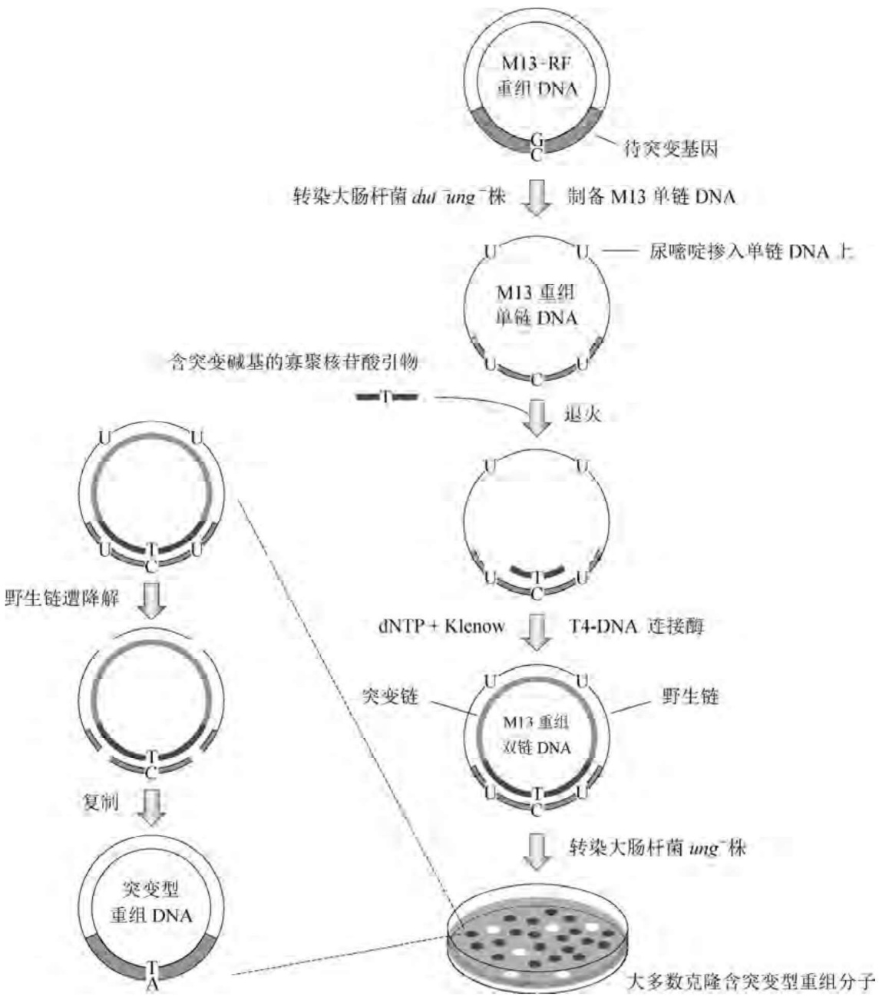

<details>
<summary>flowchart</summary>

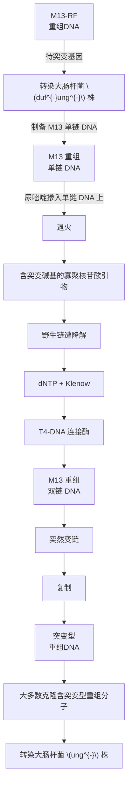
</details>

图9-7 寡核苷酸介导的突变分子富集

啶核苷酸残基的能力。由该菌株产生的重组M13DNA正链分子中大约有 $1\%$ 的T为U所取代，经体外复制后，再将双链DNA分子导入正常的大肠杆菌受体细胞中。此时，该菌株的尿嘧啶 $N-$ 糖基化酶除去DNA链上的脱氧尿嘧啶核苷酸残基，使原来的模板链降解，而突变链因不含U被完整地保留下来。

## 9.2.5 PCR扩增突变法

采用上述几种定点诱变的方法所得到突变子的比率往往很低，排除野生型基因的筛选方法既费时又欠可靠。PCR技术的发展为基因的体外定点诱变开辟了一条新途径，并衍生出多种操作程序，其中最基本的操作程序如图9-8所示。

依照待突变位点旁侧序列设计一对含突变碱基的局部引物P1和P2，同时设计合成突

变基因(或片段)两端的全匹配引物 P3 和 P4。由 P1 和 P2 引物介导的 PCR 反应将产生缩短型含突变碱基的扩增产物，而 P3 和 P4 引物的存在又引导其合成各自的互补链。这两组缩短突变型的双链片段在随后的退火过程中，可形成交叉互补结构，并实现两端延伸，最终合成出突变型的全长基因或片段。值得注意的是，由于 P3 和 P4 全匹配引物的存在，基于上述程序合成的 DNA 分子中含有高比例的非突变型基因或片段。然而，P1/P2 与 P3/P4 两对引物的浓度比不同，PCR 扩增产物的产量以及突变型与非突变型扩增产物的比率也会不同。一般而言，高浓度的 P1/P2 倾向于突变型扩增产物的富集；而高浓度的 P3/P4 则有利于扩增产物总产量的提高。

## 9.3 基因的体外定向进化

基因分子定向进化的主要目标是在短时间内获取任何期望的突变基因及其编码产物,其基本策略是在体外对特定基因实施随机突变,然后借助于适当的高通量筛选程序准确、迅速地获得所需要的突变基因。分子定向进化的主要过程包括:①通过随机突变或(和)基因重组,创造一个靶基因或一群家族基因的多样性文本,建立相应的突变文库;②将上述基因的突变文库在适当的受体生物中转换成对应的蛋白变体文库;③采用高通量筛选程序检出由氨基酸置换而引起的变体蛋白性状变化,确定该氨基酸在蛋白分子中的重要作用。必要时,可以多次重复上述操作,直到出现

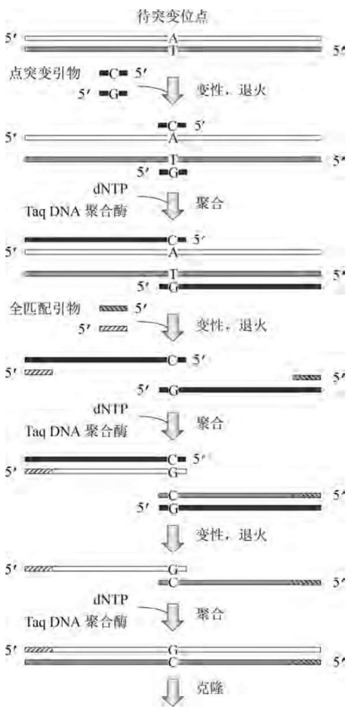

<details>
<summary>flowchart</summary>

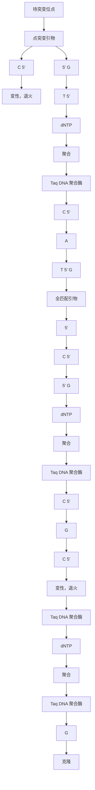
</details>

图9-8 PCR介导的定点突变程序

最佳性能的变体蛋白。由此可见，这种分子定向进化策略不仅可以在实验室里选择到自然界不存在的、性能优异且可再生的变体蛋白，而且也是调查多肽链中氨基酸序列与蛋白质结构和功能关系的重要研究工具。

目前已建立起多种分子定向进化程序,这些程序大大加快了不同物种的不同基因型之间的重组进化速度,而且在所产生的突变分子文库中,个体之间的差异及其与亲本之间的差异达到空前的程度,这在很大程度上确保了理想变异的出现。

## 9.3.1 易错 PCR

易错 PCR 是一种在 DNA 序列中简便、快速、随机制造突变的方法, 其基本原理是通过改变传统 PCR 反应体系中某些组分的浓度, 或使用低保真度的 DNA 聚合酶, 使碱基在一定程度上随机错误引入而创建基因序列多样性文库。

易错 PCR 技术的关键在于选择适当的突变频率,一般为每个基因 2\~5 个碱基替换。PCR 扩增反应最常用的 Taq DNA 聚合酶是所有已知 DNA 聚合酶中掺入错误碱基概率最高的,每扩增一轮其出错率在 $0.1 \times 10^{-4} \sim 2 \times 10^{-4}$ 之间,PCR 反应经 20\~25 次循环后,积累的错误率可积累达 $10^{-3}$/碱基。Taq DNA 聚合酶在一般条件下的错误掺入具有一定的碱基倾向性,即由 AT 碱基对转变成 GC 碱基对。但这种突变率仍然不够,特别是对 DNA 小片段,更难获得理想的突变数量。改进的方法包括:① 提高 $\mathrm{MgCl}_{2}$ 的浓度,以稳定非互补碱基对的存在;② 调节 dNTP 的比例,以促进错误碱基掺入的概率;③ 添加 $\mathrm{MnCl}_{2}$,以降低 DNA 聚合酶对模板的特异性;④ 增加 DNA 聚合酶的用量;⑤ 连续扩增操作,将一次扩增得到的有用突变基因作为下一次 PCR 的模板,反复进行随机突变,以积累重要的有益突变。尽管如此,用于突变处理的 DNA 靶分子仍不宜大于 800 bp。

采用易错PCR技术，在非水相（二甲基甲酰铵，DMF)溶液中定向进化枯草杆菌蛋白酶E获得成功，所得到的变体酶PC3在 $60\%$ 和 $85\%$ 的DMF中，催化效率 $K_{\mathrm{cat}} / K_{\mathrm{m}}$ 分别是野生型蛋白酶E的256和131倍，比活性提高了157倍。将PC3再进行两个循环的定向进化，所产生的突变体13M的 $K_{\mathrm{cat}} / K_{\mathrm{m}}$ 比PC3又提高了3倍。

## 9.3.2 DNA 改组

DNA 改组是对一组同源基因进行体外随机重组的特殊 PCR 技术, 因此又称为基因洗牌术, 其基本原理如图 9-9 所示。首先, 采用 DNase I 酶消化不同来源的同源 DNA, 获得 10\~50 bp 的小片段, 它们之间含有部分重叠碱基序列; 接着将这些 DNA 小片段进行无引物的 PCR 扩增, 在此过程中, 不同来源的 DNA 同源区交错混合互补, 产生大小不等的引物-单链模板结构, 经自身引导的 PCR 反应, 小片段 DNA 重新组装成各种序列的全长基因样本, 形成突变文库; 然后, 通过合适的筛选程序获得较理想的若干突变基因样本; 最终将这些基因样本作为下一轮 DNA 改组的模板, 重复多次改组和筛选, 直到获得性状满意的突变基因。

在上述 DNA 改组过程中,不同来源的同源 DNA 片段可以随机混合杂交,而且自身引导的 PCR 反应又因体外复制不精确性可引入一定程度的错误掺入,因此其突变概率更大。由 DNA 改组产生的基因多样性文库可以有效积累有益突变,排除有害突变和中性突变,进而实现目的蛋白多种特性的共进化,无论是在理论还是实践上,都优于寡聚核苷酸介导的定点诱变和连续易错 PCR 方法。

目前，已建立起多种形式的DNA改组程序，包括基因组改组（Genome shuffling）、家族基因改组（Family shuffling）、单基因改组（Single gene shuffling）、外显子改组（Exon shuffling）等，后者可用于建立各种大小的随机多肽文库。这些DNA改组方法已广泛地用于改良酶和蛋白药物的活性、热稳定性、底物特异性、对映体选择性、可溶性表达、表达水平等方面，取得了令人注目的成果(表9-1)。DNA改组的奠基人Stemmer当年就是采用该技术，在大肠杆菌中使 $\beta$ -内酰胺酶（由TEM-1基因编码）的抗生素抑制活性(MIC)从$0.02\mu \mathrm{g / mL}$ 增至 $640~\mu \mathrm{g / mL}$ ，提高了32000倍。

## 9.3.3 体外随机引发重组

体外随机引发重组(RPR)以单链DNA为模板，配合一套随机序列引物，先产生大量互补于模板不同位点的短DNA片段，由于碱基的错配和错误引发，这些短DNA片段中也会有少量的点突变。在随后的PCR反应中，它们互为引物合成出较长的片段，最终组装成完整的基因长度，形成基因多样性文库。如果需要，可反复进行上述过程，直到获得满意的进化分子(图7-10)。与DNA改组技术相比，RPR具有如下优点:① RPR可以利用单链DNA或mRNA为模板，且对模板量要求少(降为 $1 / 2\sim 1 / 10$ )，大大降低了亲本组分的含量，便于筛选；② 在DNA改组中，片段重新组装前必须彻底除去DNaseI，RPR方法不涉及DNaseI，所以操作更简单；③ 合成的随机引物具有同样长度，不存在像DNaseI所具有的序

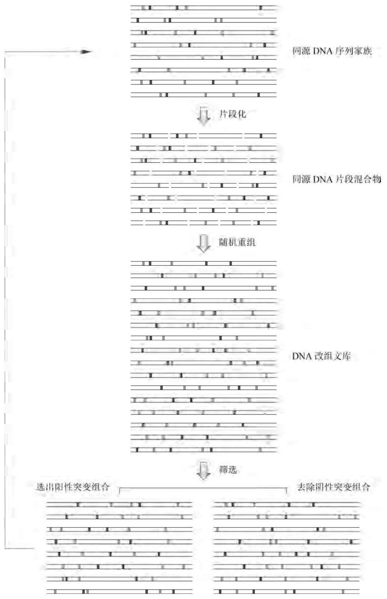

<details>
<summary>flowchart</summary>

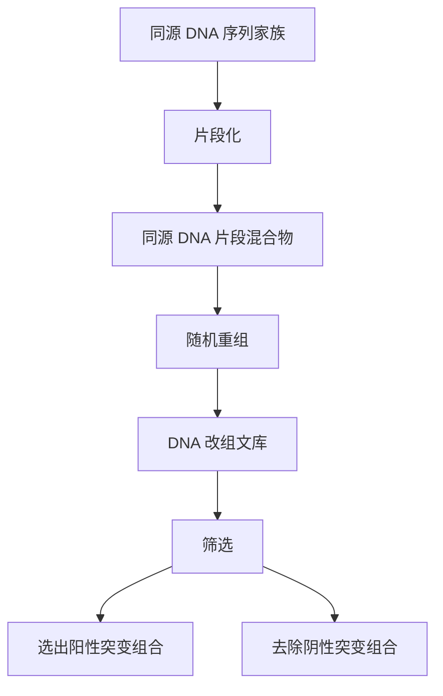
</details>

图9-9 DNA改组的基本原理

表 9-1 应用 DNA 改组技术取得成效的酶和操纵子

| 突变酶 | 研究目的 | 研究结果 |
| --- | --- | --- |
| 三嗪杂苯水解酶 | 改进酶特性 | 取得3个突变体,磷酯酶活性在50% DMSO中明显提高,半衰期提高4倍 |
| β-内酰胺酶 | 改进酶活性 | 提高活性270倍 |
| 天冬酰胺转移酶 | 改进酶活性 | 提高活性,表明6个氨基酸残基与活性相关 |
| 头孢菌素酶 | 改进酶特性 | 提高酶活性540倍 |
| β-半乳糖苷酶 | 改进酶特性 | 获得一个新酶,果糖苷酶活性提高了10倍,而半乳糖糖苷酶活性下降为1/40 |
| 胡萝卜素合成酶 | 构建创新的工程菌 | 构建成功生产四种不同胡萝卜素衍生物的工程菌 |
| TEM-1型β-内酰胺酶 | 改进酶活性 | 酶活性提高32000倍 |
| β-内酰胺酶家族 | 改进酶活性 | 酶活性提高270~540倍 |
| β-半乳糖苷酶 | 改进酶活性和特性 | 岩藻糖苷酶酶活性提高66倍;底物专一性提高1000倍 |
| 绿色荧光蛋白 | 改进酶特性 | 蛋白折叠提高45倍(大肠杆菌和哺乳动物细胞) |
| 抗体(scFv) | 改进酶活性 | 酶活性提高400倍 |
| 抗体(scFv) | 改进酶特性 | 表达水平提高100倍 |
| 砷酸盐代谢操纵子 | 改进酶活性 | 砷酸盐抗性提高40倍 |
| 莠去津降解系统 | 改进酶特性 | 莠去津降解效率提高80倍 |
| 烷基转移酶 | 改进酶特性 | DNA修复能力提高10倍 |
| 苯甲基酯酶 | 改进酶特性 | 抗生素去保护能力降低为1/150 |
| tRNA生物合成酶 | 改进酶特性 | 工程化tRNA结合力提高180倍 |

列偏爱性。在 RPR 过程中, 理论上来讲 PCR 扩增时模板上每个碱基都应被复制或以相似的频率发生突变, 从而保证了子代全长基因中突变和交叉的随机性; ④ 随机引发的 DNA 合

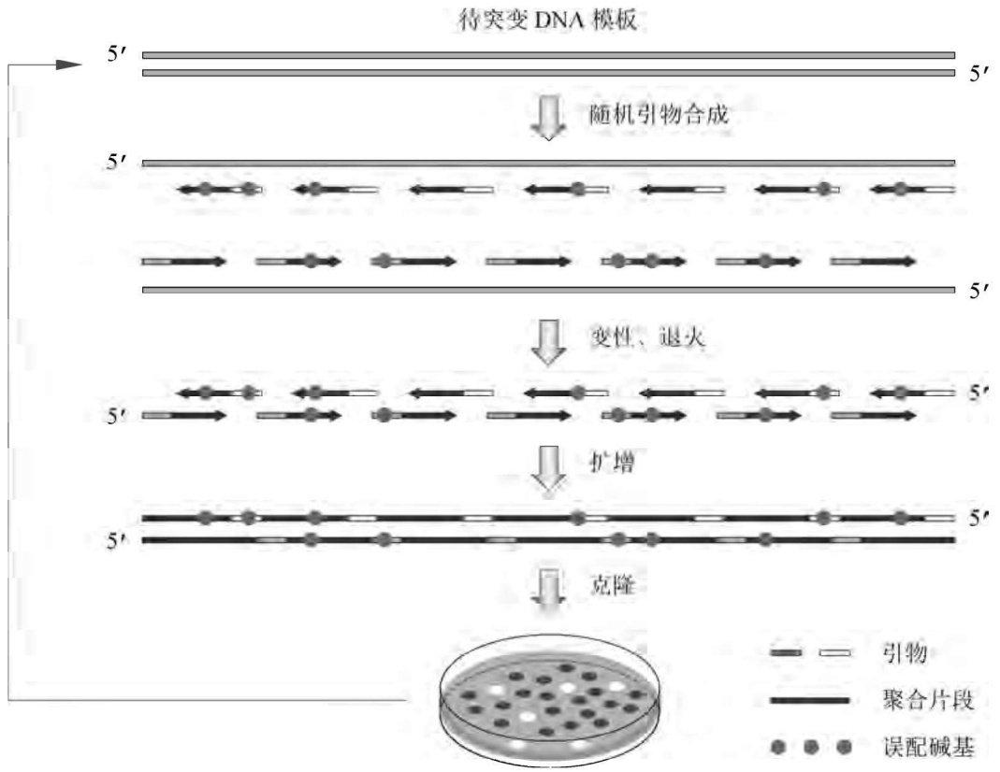

<details>
<summary>flowchart</summary>

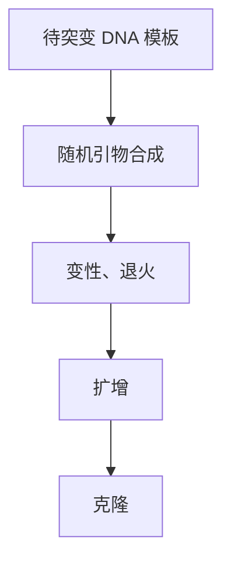
</details>

图9-10 体外随机引发重组的基本原理

成不受 DNA 模板长度的限制,有利于小分子肽段的突变。

## 9.3.4 交错延伸

交错延伸(StEP)是一种简化的DNA改组技术。其原理的核心是，在PCR反应中把常规的退火和延伸合并为一步，并大大缩短其反应时间(55℃, 5 s)，从而只能合成出非常短的新生链。经变性后的新生链再作为引物，与体系内同时存在的不同模板退火而继续延伸，即通过模板转换实现不同模板间的重组。此过程反复进行，直至产生完整的基因长度，最终扩增产物为相间的含不同模板序列的新生DNA分子(图9-11)。StEP介导的DNA重组发生在单一试管中，不需分离亲本DNA和产生的子代重组DNA分子；而且DNA重组的程度可以通过调整反应时间和温度来控制，操作灵活简便，因而是分子定向进化的又一创新。

## 9.3.5 过渡模板随机嵌合生长

过渡模板随机嵌合生长(RACHITT)技术是一种基因家族成员之间不同于DNA

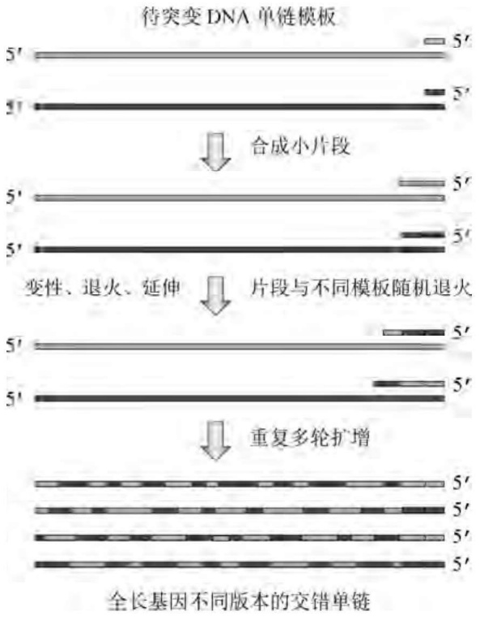

<details>
<summary>flowchart</summary>

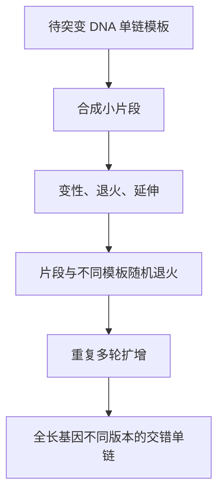
</details>

图9-11 交错延伸技术的基本原理

改组的重组技术。它不需要热循环、链转移或交错延伸反应，而是将随机切开的靶基因片段与一个含有尿嘧啶碱基的临时DNA模板(脚手架模板，制备方法参见9.2.4)进行杂交，然后完成片段排序、非互补区切除、缺口修复、片段连接等操作(图9-12)。其中的非互补区切除操作使来自靶基因的小片段得以重组，由于这些小片段比DNA改组技术中的DNase I消化片段还短，因此RACHITT方法所产生的重组频率明显提高。如果靶基因在实施RACHITT之前先经易错PCR技术处理，或(和)在缺口修复操作时使用易错PCR程序，则获得的扩增产物中带有更多的额外点突变，多样性程度也更高。RACHITT程序的最后一步是用尿嘧啶-DNA-糖基化酶特异性摧毁脚手架模板，并将重组单链转换成双链DNA分子。

RACHITT 技术成功用于体外进化功能蛋白的第一个例子是二苯并噻吩单加氧酶，所产生的嵌合文库平均每个基因含有 14 个交叉点，重组水平比 DNA 改组类方法（1～4 个交叉）高出几倍，并且可在短至 5 bp 的序列同源区内产生交叉重组，这种高频率、高密度的交叉水平是 DNA 改组所难以达到的。从上述重组突变文库中筛选到的变体酶活性为天然二苯并噻吩单加氧酶的 20 倍。

## 9.3.6 渐增切割杂合酶生成

尽管 DNA 改组介导的 DNA 序列随机重组已成为分子定向进化的重要工具,但这种程序通常需要参与随机重组的 DNA 同源性不低于 70%\~80%,而自然界大多数同源基因的序列相似程度难以满足 DNA 改组的条件。为了解决这个问题,Benkovic 等人建立了渐增切割杂合酶生成(ITCHY)程序,用于构建不依赖于 DNA 序列同源性的随机重组文库。其工作原理如图 9-13 所示:用核酸外切酶 III 分别消化两个非高度同源的靶基因,如分别来自大肠杆菌和人类的甘氨酰胺核苷酸甲酰转移酶编码基因(两者的序列相同性仅为 50%),控制切割速度不大于 10 个碱基/min,每隔很短时间连续取样,迅速终止样品反应,以获得一组依次有几个甚至一个碱基缺失的片段样本；然后将一个基因随机长度的  $5'$  端片段与另一基因随机长度的  $3'$  端片段随机混合，产生杂合基因文库；该基因文库经表达后，通过酶活性测定筛选出理想的重组杂合基因。

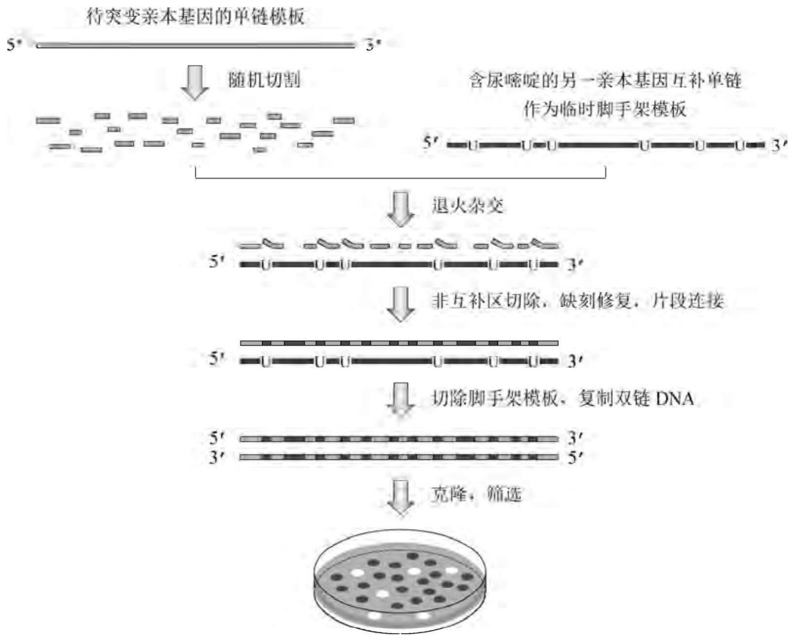

<details>
<summary>flowchart</summary>

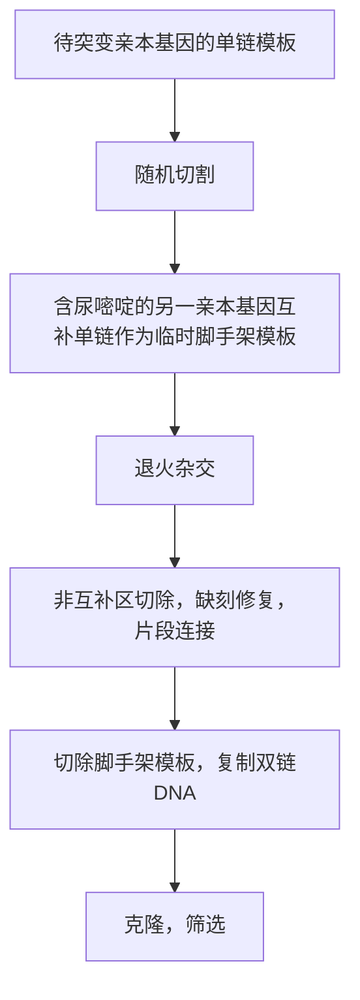
</details>

图9-12 过渡模板随机嵌合生长技术的基本原理

上述方案的操作难度及工作量是显而易见的。一种改进的程序(Thio-ITCHY)是:首先将两个靶基因串联在同一载体上；通过PCR反应将 $\alpha$ -硫代磷酸核苷酸随机掺入扩增产物中；用核酸外切酶III处理扩增产物，由于 $\alpha$ -硫代磷酸核苷酸抗核酸外切酶III的切割，便会形成不同截短程度的DNA片段；连接上述处理的片段，形成随机杂合文库。如果对其文库再实施DNA改组，还可获得更多的重组点，即所谓的SCRATCHY程序。

## 9.3.7 同源序列非依赖性蛋白质重组

虽然ITCHE技术可以用于那些序列同源性较低的靶基因之间的体外随机重组，但在所形成的重组文库中，基因的长度参差不齐，与亲本靶基因并不一致，因此子代基因中具有功能的杂合子比率很低。要想提高功能杂合子的比例，必须使重组交叉发生在具有相似结构背景的位点处。然而由于亲本靶基因之间缺乏足够的序列相似性，绝大多数的同源重组并不能对所期望的蛋白功能做出贡献。为此，人们又发展了同源序列非依赖性的蛋白质重组方法(图9-14):①将两个靶基因串联在同一载体上，采用Thio-ITCHE程序处理该重组分子；②通过琼脂糖凝胶电泳分离所获得的长度不一的随机杂合文库，并回收与本靶基因长度相似的随机片段；③将回收片段与合适的表达载体连接重组；④转化合适的受体细胞，建立新的等长度杂合文库；⑤最终形成表达型杂合蛋白文库。

上述操作程序确保了随机重组杂合分子的长度与亲本靶基因的一致性,使重组事件主要发生在亲本靶基因结构相关的位点处,从而提高了杂合文库中阳性克隆的比例。这种方法可以在那些序列相同性较低,甚至无序列相同性的同源蛋白质之间创建具有单一重组交叉的杂合蛋白质组合文库。迭代型的 SHIPREC 操作还可以产生多个重组交叉。

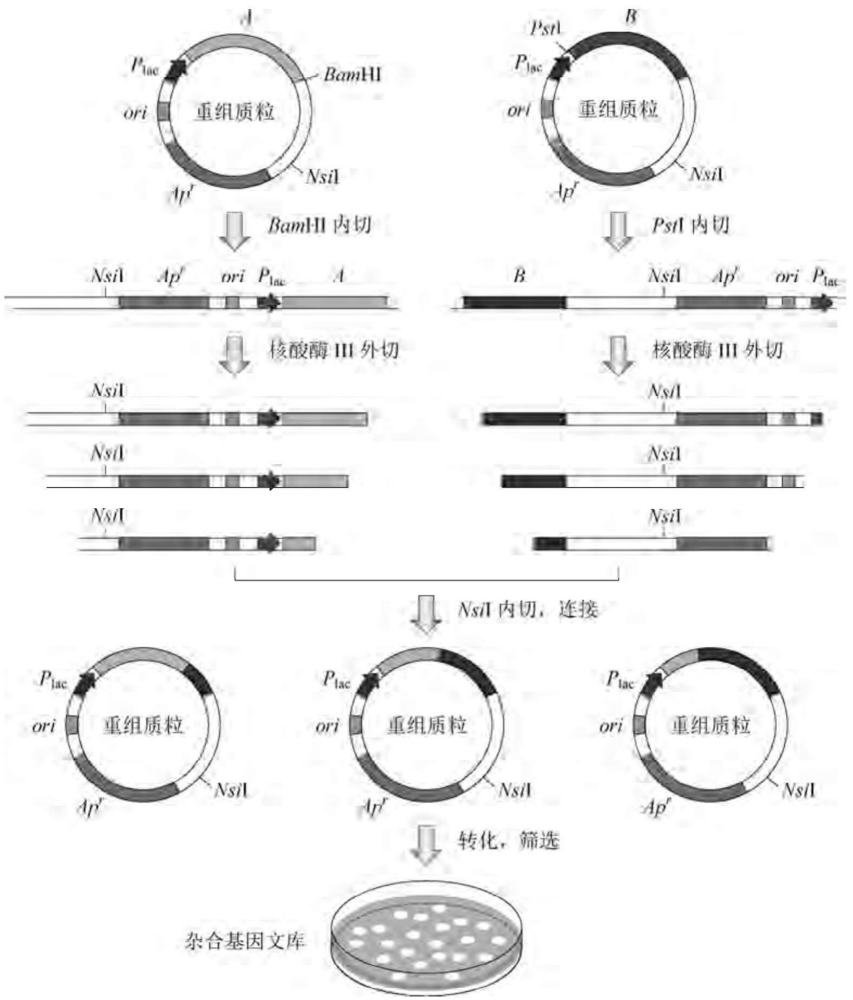

<details>
<summary>flowchart</summary>

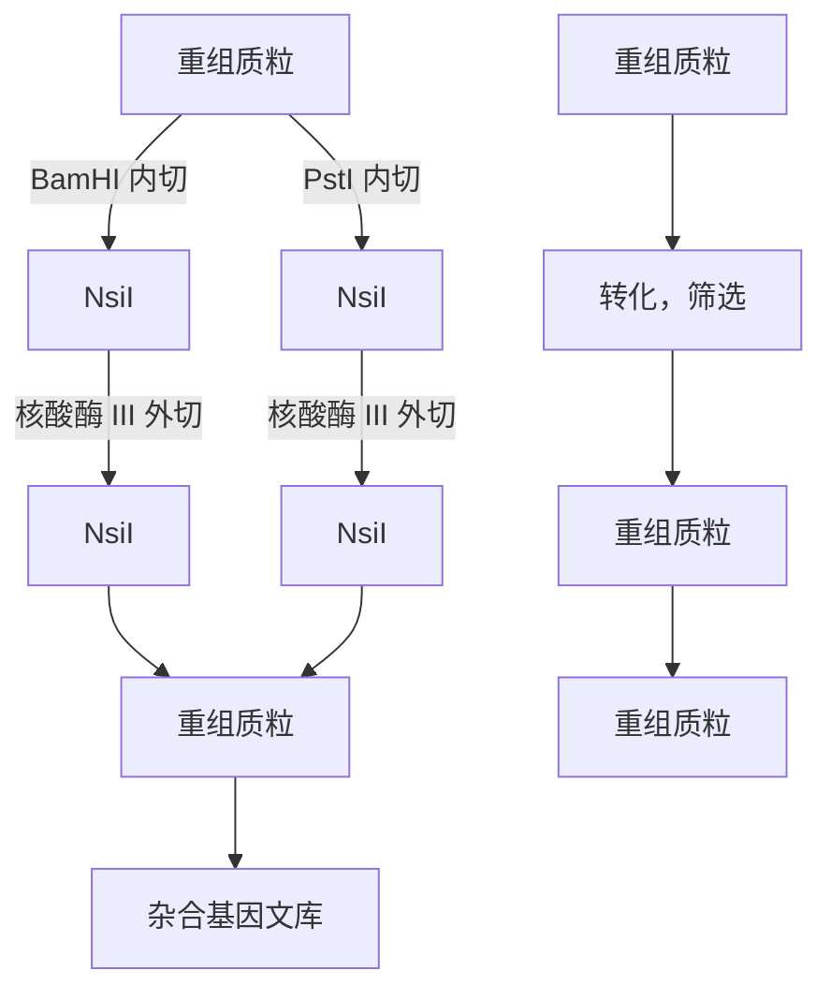
</details>

图9-13 渐增切割杂合酶生成程序的基本原理

## 9.3.8 突变文库高通量筛选模型的建立

一旦突变基因或蛋白变体的多样性文库构建完毕，筛选的条件决定了蛋白质特征的进化方向，这被称为定向进化的第一定律。分子定向进化实验成败与否的关键就在于针对目的改造特征的高通量筛选模型的建立。当变体蛋白或酶能赋予宿主细胞生长或存活优势时，很容易搜寻含有 $10^{6}$ 个以上蛋白变体的文库。例如，将抗生素、毒性有机物、重金属抗性蛋白或运输蛋白的变体文库密集涂布在含有高浓度上述物质的平板上，即可直接检出高抗性变体蛋白；如果变体蛋白为淀粉酶、蛋白酶、脂肪酶，则克隆文库能在含有相应底物的平板上产生清晰的透明斑，而且其直径与酶活性呈顺变关系，借助紧密仪器甚至肉眼即可辨认；此外，某些易于观察的菌落表型也可用于快速筛选。然而，这些例子毕竟只代表了成千上万种蛋白质或酶类中的很小一部分，更多具有复杂功能的变体蛋白往往需要创建新的高效筛选模型。

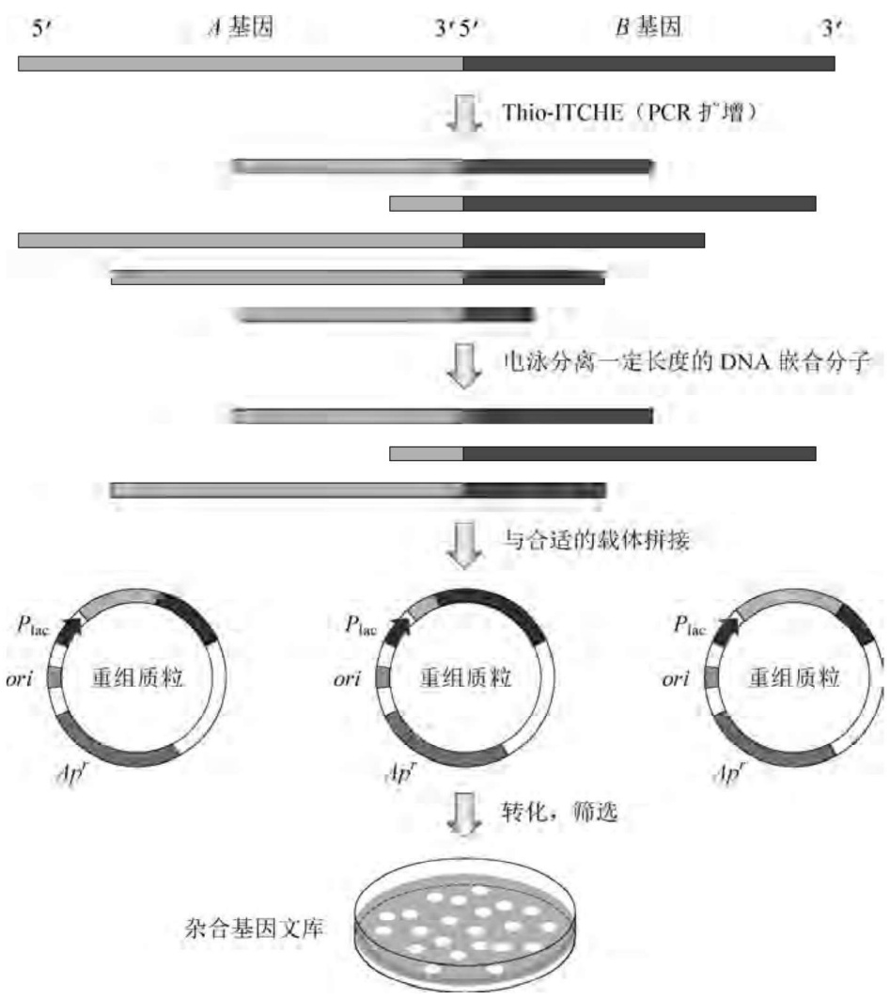

<details>
<summary>flowchart</summary>

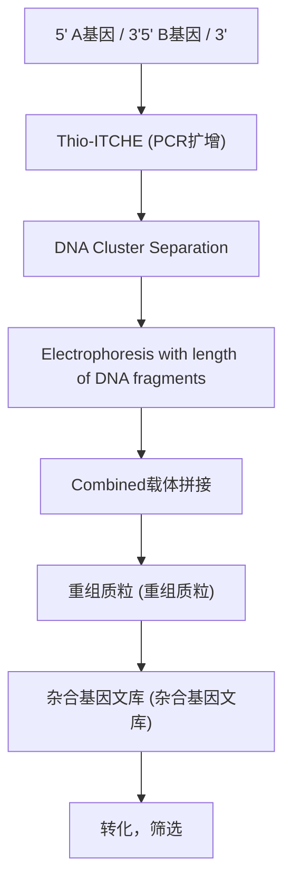
</details>

图9-14 同源序列非依赖性蛋白重组的基本原理

近年来，与创建多样性随机重组文库的飞速发展相适应，基因或蛋白质文库的高通量和超高通量筛选技术也取得了令人瞩目的成就。例如，基于体外无细胞翻译体系的核糖体-mRNA展示技术，因不受受体细胞转化率的限制，大大提高了文库容量和筛选通量 $(10^{12}\sim10^{14})$ 。其原理是通过筛选靶蛋白-核糖体-mRNA三元复合物或靶蛋白-mRNA二元复合物的形成，将基因型与表型直接偶联起来，并利用mRNA的可复制性，使靶基因或蛋白质得到有效富集。利用这种程序进化单链抗体可变区(scFv)片段，可获得亲和力提高40倍的变体。其他的高通量筛选程序还包括:细胞表面展示技术和噬菌体表面展示技术、将靶蛋白活性与转录信号相偶联的三元杂交系统、以发光信号为指示的反射增进系统、荧光共振能量转换仪(FRET)-荧光激活细胞筛选仪(FACS)联用程序等，后者每小时可筛选6万个细胞克隆。在硬件设备方面，1536和3456孔板以及多通道多波长检测仪、每秒钟分配几千滴皮开(即 $10^{-6}\mu L$ )级样品的非接触式压电配样仪等，均能大幅度提高样品的处理速度。

## 9.4 蛋白质工程的设计思想与应用

目前，生物体内已鉴定的数千种酶中只有近百种能直接用于工业规模的生物转化反应，绝大多数酶类功能蛋白在大规模体外反应时，或丧失原有的催化特异性，或在高温高压及有机溶剂条件下结构变性。利用蛋白质工程技术改造酶的催化反应特征则为功能蛋白的工业化应用开拓了广阔的前景。此外，已有数百种蛋白药物经分子定向进化改良，获得了理想的医疗性能。

## 9.4.1 提高蛋白质或酶类分子的稳定性

借助理性设计策略提高蛋白质或工业用酶的热稳定性始终是蛋白质工程领域中的一个研究热点。一方面，酶促反应工业中的热处理工序（如淀粉液化中降低反应体系的黏度）通常需要高于 $45^{\circ}\mathrm{C}$ 的温度，而天然酶类普遍存在耐受性差的问题；另一方面，热稳定性的探究也能在一定程度上解析蛋白质结构与功能之间的对应关系。

## 1. 蛋白质稳定性的影响因素

相关研究显示，影响蛋白质热稳定性的因素繁多，而且不同的蛋白质往往会采取不同的机制维持其热稳定性。然而一般认为，多肽链中侧链基团之间的化学键相互作用是蛋白质热稳定性的决定性因素。这些化学键包括:①疏水键。在水介质中，球状蛋白质的折叠往往倾向于将其疏水基团埋藏在分子内部（即疏水相互作用），这种作用源自疏水基团对水分子的强烈躲避效应，是蛋白质三级结构形成和稳定最重要的因素。②氢键。氢键属于氢供体与氢受体之间距离不超过 $0.3\mathrm{nm}$ 且夹角小于 $90^{\circ}$ 时所形成的非共价键，虽然其平均键能仅为 $0.6\mathrm{kcal / mol}$ （1 cal=4.1840 J)，但由于广泛存在于蛋白质的主链、侧链以及周边环境的水分子中，因此其键能总和对蛋白质的热稳定性也有较大贡献。③离子键。不同生物的基因组比较研究发现，嗜热菌蛋白质及其 $\alpha-$ 螺旋结构单元中的三种带净电荷氨基酸(Glu、Lys、Arg)含量明显高于中温菌，它们能在螺旋内部或螺旋之间形成密集的盐键，对维系嗜热蛋白质的稳定性起到非常关键的作用。④ $\pi$ 键。芳香族氨基酸(Trp、Tyr、Phe)芳香环侧链中的 $\pi$ 键能与阳离子形成高强度的相互作用，其键能高于离子键两倍。来自900个中温蛋白质和300个嗜热蛋白质的三维结构显示，嗜热蛋白质结构中 $\pi$ 键附近存在阳离子侧链基团的频率远高于中温蛋白质，而且两者之间的相互作用可显著改善蛋白质对热的适应能力。⑤二硫键。作为共价键的二硫键可通过降低多肽链折叠状态的熵值稳定蛋白质的结构，也是影响蛋白质热稳定性的关键因素。

## 2. 引入二硫键以提高蛋白质或酶类分子的稳定性

一般而言，热稳定的蛋白质大都具有抗有机溶剂和极端 $\mathrm{pH}$ 的能力，在蛋白质分子中引入二硫键能显著提高其稳定性。例如，采用寡核苷酸定向诱变技术构建6种T4溶菌酶的变体蛋白，其中分别有2、4、6个氨基酸残基转化成半胱氨酸，这些氨基酸残基在蛋白的空间结构中距离较近，但不包含酶的活性部位。所形成的1、2、3对二硫键分别位于第3和第97位、第9和第164位、第21和第142位残基处。上述突变基因转入大肠杆菌中表达，分离纯化酶变体，并分别测定其酶活性和热稳定性（表9-2）。野生型的T4溶菌酶含有两个游离的半胱氨酸残基，在天然条件下并不形成二硫键，将这两个半胱氨酸残基分别用苏氨酸和丙氨酸残基取代，不影响酶活性和稳定性，此酶用作对照。实验结果表明，在6种突变蛋白中，有一种变体（即B，其第9和第164位氨基酸残基被转换为半胱氨酸，并形成一对二硫键）的酶活性高于对照 $6\%$ ，熔点温度 $T_{\mathrm{m}}$ 提高 $6.4^{\circ}\mathrm{C}$ ；所有的变体随二硫键数目的增加其 $T_{\mathrm{m}}$ 值呈单调上升趋势；含有3对二硫键的变体酶的 $T_{\mathrm{m}}$ 值比对照提高 $23.6^{\circ}\mathrm{C}$，但活性全部丧失。由此可见，工程蛋白的构建也是一个试验过程，比天然蛋白性能优异的变体并不多见。

表 9-2 T4 溶菌酶及其 6 种变体酶的特性

<table><tr><td rowspan="2">酶</td><td colspan="7">氨基酸位置</td><td rowspan="2">二硫键数量</td><td rowspan="2">相对活性/%</td><td rowspan="2">熔点/°C</td></tr><tr><td>3</td><td>9</td><td>21</td><td>54</td><td>97</td><td>142</td><td>164</td></tr><tr><td>wt</td><td>Ile</td><td>Ile</td><td>Thr</td><td>Cys</td><td>Cys</td><td>Thr</td><td>Leu</td><td>0</td><td>100</td><td>41.9</td></tr><tr><td>pwt</td><td>Ile</td><td>Ile</td><td>Thr</td><td>Thr</td><td>Ala</td><td>Thr</td><td>Leu</td><td>0</td><td>100</td><td>41.9</td></tr><tr><td>A</td><td>Cys</td><td>Ile</td><td>Thr</td><td>Thr</td><td>Cys</td><td>Thr</td><td>Leu</td><td>1</td><td>96</td><td>46.7</td></tr><tr><td>B</td><td>Ile</td><td>Cys</td><td>Thr</td><td>Thr</td><td>Ala</td><td>Thr</td><td>Cys</td><td>1</td><td>106</td><td>48.3</td></tr><tr><td>C</td><td>Ile</td><td>Ile</td><td>Cys</td><td>Thr</td><td>Ala</td><td>Cys</td><td>Leu</td><td>1</td><td>0</td><td>52.9</td></tr><tr><td>D</td><td>Cys</td><td>Cys</td><td>Thr</td><td>Thr</td><td>Cys</td><td>Thr</td><td>Cys</td><td>2</td><td>95</td><td>57.6</td></tr><tr><td>E</td><td>Ile</td><td>Cys</td><td>Cys</td><td>Thr</td><td>Ala</td><td>Cys</td><td>Cys</td><td>2</td><td>0</td><td>58.9</td></tr><tr><td>F</td><td>Cys</td><td>Cys</td><td>Cys</td><td>Thr</td><td>Cys</td><td>Cys</td><td>Cys</td><td>3</td><td>0</td><td>65.5</td></tr></table>

## 3. 转换氨基酸残基以提高蛋白质或酶类分子的稳定性

在高温下,蛋白质中天冬酰胺和谷酰胺的游离氨基会发生脱氨反应,进而损害其结构和功能。因此,在不影响催化活性的前提下,将上述两种氨基酸残基转换为其他合适的氨基酰残基,是提高蛋白质热稳定性的另一种战略。

酵母的丙糖磷酸异构酶由两个相同的亚基组成，每个亚基各含有两个天冬酰胺残基，它们位于亚基相互接触的表面上，可能与该酶的热稳定性有关。利用寡核苷酸定向突变技术将亚基上第14和第78位的两个天冬酰胺残基分别转换成苏氨酸和异亮氨酸残基，变体酶的热稳定性大幅度提高(表9-3)。将亚基中的一个天冬酰胺残基转换为天冬氨酸残基，变体酶的热稳定性非但不增加反而有所下降；若将两个天冬酰胺残基全部换成天冬氨酸残基，则变体酶即使在常温下也不稳定，而且还伴有酶活性的损失。

表 9-3 酵母丙糖磷酸异构酶及其变体的热稳定性

<table><tr><td rowspan="2">酶</td><td colspan="2">氨基酸位置</td><td rowspan="2">半衰期/min</td></tr><tr><td>14</td><td>78</td></tr><tr><td>野生型</td><td>Asn</td><td>Asn</td><td>13</td></tr><tr><td>变体A</td><td>Asn</td><td>Thr</td><td>17</td></tr><tr><td>变体B</td><td>Asn</td><td>Ile</td><td>16</td></tr><tr><td>变体C</td><td>Thr</td><td>Ile</td><td>25</td></tr><tr><td>变体D</td><td>Asp</td><td>Asn</td><td>11</td></tr></table>

由嗜温枯草芽孢杆菌产生的枯草蛋白酶E在 $65^{\circ}\mathrm{C}$ 、 $\mathrm{pH}8.0,1\mathrm{mmol / LCaCl_2}$ 存在的条件下，半衰期大约 $5\mathrm{min}$ 。枯草蛋白酶E的两个热稳定性变体RC1和RC2分别含有3个和7个突变碱基，导致氨基酸置换的有义突变包括RC1中的 $\mathrm{Asn218\rightarrow Ser(N218S)}$ 、RC2中的$\mathrm{Val93\rightarrow Ile(V93I)}$ 和 $\mathrm{Asn181\rightarrow Asp(N181D)}$ ，其中只有N181D和N218S能改善酶分子的热稳定性。在 $65^{\circ}\mathrm{C}$ 时，两者的半衰期分别比天然枯草蛋白酶E提高3倍和2倍；而两个位点同时发生突变的变体酶(N181D+N218S)，其半衰期比天然酶的提高8倍。以野生型枯草蛋白酶E编码基因为出发亲本，首先采用易错PCR进行随机突变，筛选出5种 $65^{\circ}\mathrm{C}$ 半衰期比天然酶的提高 $3\sim 8$ 倍的变体分子(第一代变体)。再以等量的这5种突变基因为亲本实施StEP随机重组，从重组文库中获得大约8000个表达型克隆。利用 $75^{\circ}\mathrm{C}$ 的热稳定性条件筛选这些克隆，检出3个热稳定性最高的变体（第二代变体），它们在 $65^{\circ}\mathrm{C}$ 环境中的半衰期是天然酶的$25\sim 50$ 倍。由上述易错PCR和StEP产生的8种变体的突变位点分析结果如图9-15所示。在易错PCR导致的5种变体分子中，4A5的N181D和N218S以及36D10的N218S两种突变位点是先前已知的（RC1和RC2）；分别来自15C1和35F10变体分子的S194P和

S161C则是对热稳定性起作用的新突变位点；在剩下来的32G11和36D10中，由于各自含有多个非同义突变，因此S37T、G166R、A192T的效应尚不能确定。在由StEP产生的变体分子中，热稳定性最高的是A45B7（半衰期为天然酶的50倍），它含有4个非同义突变位点:G166R、N181D、S194P、N218S；两个热稳定性稍次的A9C5和A15B1（半衰期为天然酶的$25\sim 30$ 倍），只含有G166R、N181D、N218S3种类型的突变。由此可知，新突变类型G166R存在于上述所有3种变体分子中，因而是枯草蛋白酶E热稳定性由原来的9倍增至30倍的关键因素。综合上述分析可得出的结论是，S161C、G166R、S194P、N181D、N218S是提高枯草蛋白酶E热稳定性的重要位点。

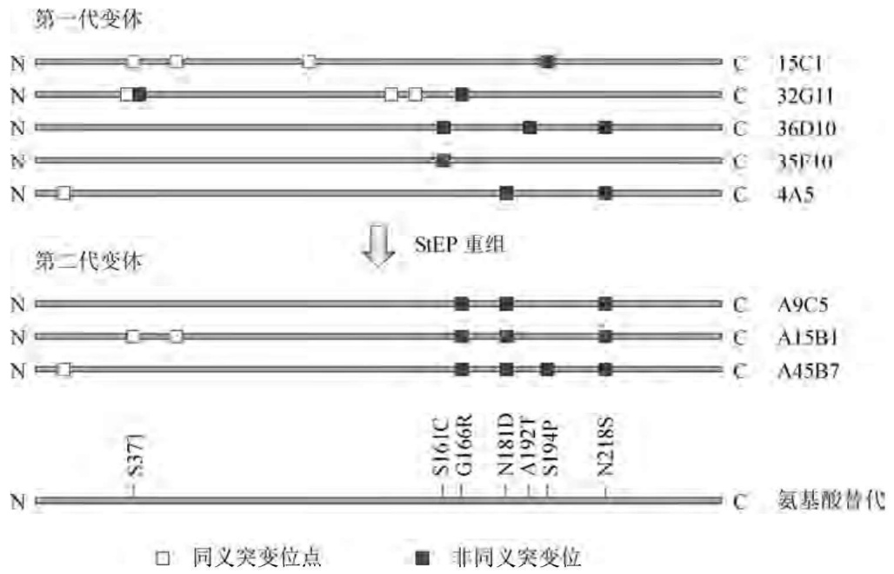

<details>
<summary>text_image</summary>

第一代变体
N C 15C1
N C 32G11
N C 36D10
N C 35F10
N C 4A5
第二代变体
N C A9C5
N C A15B1
N C A45B7
S37I S161C G166R N181D A192T S194P N218S
氨基酸替代
□ 同义突变位点 ■ 非同义突变位
</details>

图9-15 第一代和第二代耐热枯草芽孢杆菌蛋白酶E变体的序列分析

类似的结果还包括同源四聚体的大肠杆菌 $\beta$-葡糖醛酸糖苷酶(GUS)。首先，通过5轮迭代式易错PCR程序，获得一批在 $70^{\circ}\mathrm{C}$ 仍保持稳定的变体分子。从中选出7个突变基因实施进一步的DNA改组实验，以 $90^{\circ}\mathrm{C}$ 保温 $15\mathrm{min}$ 的条件从26000个克隆中筛选4种仍具有

相当酶活的变体分子。经上述迭代式易错PCR随机突变和DNA体外改组所获得的功能性变体分子中，共有16个位于亚基表面、12个位于亚基与亚基接触面、4个位于蛋白质内部的氨基酸残基被突变。其中，具有最高热稳定性的变体酶分子含有7个位于亚基表面、8个位于亚基与亚基接触面、4个位于蛋白质内部的突变残基。这些变体酶的最适温度普遍升高，但最大活性大都低于天然酶分子(图9-16)。例外的是从第四轮迭代式易错PCR中筛选出的IV-5变体，其最适温度(65℃)下的酶活性比天然GUS最适温度(40℃)下的酶活性还要高出34%。

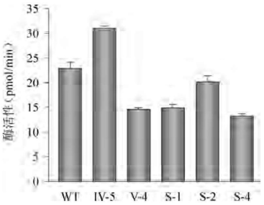

<details>
<summary>bar</summary>

| Category | Enzymatic Activity (pmol/min) |
| --- | --- |
| WT | ~23 |
| IV-5 | ~31 |
| V-4 | ~15 |
| S-1 | ~15 |
| S-2 | ~20 |
| S-4 | ~13 |
</details>

图9-16 葡糖醛酸糖苷酶变体在最适温度下的活性

增加功能蛋白的酸稳定性，延长其在体内的半衰期，对基因药物的开发具有重要意义。已经上市的急性心肌梗死特效溶栓药物组织型纤溶酶原激活剂(t-PA)是一种相对分子质量为70 kD、由527个氨基酸残基组成的丝氨酸蛋白酶，可分为5个独立的结构域:P区、EGF区、K1区、K2区及蛋白酶区。其中，P区和EGF区与t-PA在血液中的清除速率有关，删除了P区和EGF区的突变分子K2tu-PA在血液中的半衰期明显延长。另外，带有Thr103→Asn(T103N)型突变的t-PA变体也具有体内清除速率降低、半衰期延长的特性。采用蛋白质工程技术进一步提高t-PA和另一种溶栓剂尿激酶原(pro-UK)对酸的稳定性，并制成预防心血管疾病的口服制剂，其市场据估计可扩大10倍。

## 9.4.2 减少重组多肽链的错误折叠

将高等真核生物基因克隆至原核细菌往往会遇到重组蛋白表达水平很高但比活下降的现象,这很可能是由于表达产物在受体细胞内错误折叠所致。转换重组多肽链中多余的半胱氨酸残基即可有效减少其错误折叠的可能性,提高表达产物的生物活性。

人 $\beta$-干扰素(IFN-$\beta$)cDNA在大肠杆菌中表达的重组产物抗病毒活性只有其天然糖基化蛋白的 $10\%$，尽管IFN-$\beta$ 的表达量很高，但重组蛋白绝大部分为无活性的二聚体和多聚体。天然的IFN-$\beta$ 分子在第17、第31、第141位含有3个半胱氨酸残基，其中2个形成功能性二硫键，而另一个游离的半胱氨酸残基是导致重组产物分子间聚合的主要因素。在人体内，由于折叠特异性分子伴侣的存在，这种非特异性的多聚体折叠产物很少形成。如果在IFN-$\beta$ cDNA水平上将编码该游离半胱氨酸残基的密码子转换为其结构类似物丝氨酸残基的密码子，则有可能抑制非特异性二聚体和多聚体的形成。然而当时并不了解IFN-$\beta$ 分子内形成功能性二硫键的确切位点，为了解决这一问题，人们根据与IFN-$\beta$ 同源的IFN-$\alpha$ 已知结构特征推测IFN-$\beta$ 的游离半胱氨酸残基位点，后续实验结果证明了推测的正确性。

如图9-17所示，IFN- $\alpha$ 分子内共有四个半胱氨酸残基，分别位于第1、第29、第98、第138位，其中第1与第98位、第29与第138位残基形成两对功能性二硫键，因此有理由推测天然IFN- $\beta$ 分子内的第17位半胱氨酸残基是游离的。将这一位的密码子转换成丝氨酸密码子，突变基因转化大肠杆菌，表达出的Cys17 $\rightarrow$ Ser(C17S)型变体蛋白不再形成二聚体和多聚体，其比活与天然IFN- $\beta$ 相似，且稳定性更高。

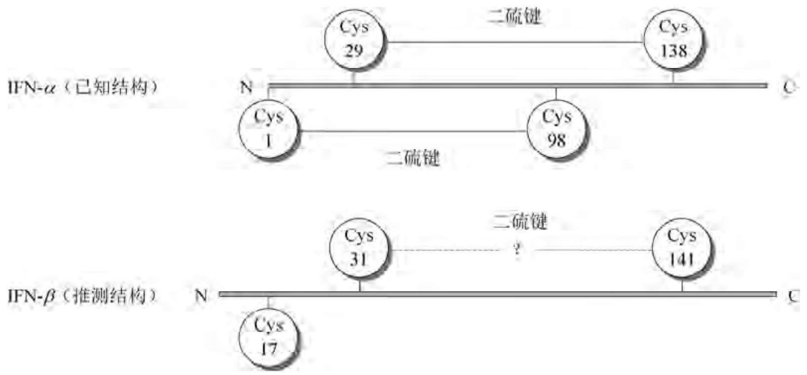

<details>
<summary>flowchart</summary>

```mermaid
graph LR
  subgraph IFN_IFN["IFN-α[\"IFN-α (已知结构)\"]"]
    direction TB
  Cys29["Cys 29"] -->|二硫键| Cys138["Cys 138"]
  Cys1["Cys 1"] -->|二硫键| Cys98["Cys 98"]
  Cys1 --> N["N"]
  Cys98 --> N
  end

  subgraph IFN_IFN_2["IFN-β[\"IFN-β (推测结构)\"]"]
    direction TB
    Cys31["Cys 31"] -.->|二硫键| Cys141["Cys 141"]
  Cys17["Cys 17"] --> N
  Cys141 --> Cys17
  end
```
</details>

图9-17 两种干扰素中半胱氨酸残基和二硫键的位置

## 9.4.3 改善酶的催化活性

大量酶蛋白的晶体 X 衍射结构显示,酶的催化活性中心位于空间构象中相邻的少数几个关键性氨基酸残基,其侧链基团之间的相互作用在很大程度上决定了酶催化反应的效率,因而成为工程化提升酶催化活性的首选操作靶点。

## 1. 转换氨基酸残基以改善酶的催化活性

采取蛋白质工程的分子理性设计战略改善酶的催化活性较为困难，必须掌握活性中心的有关结构参数以及酶催化反应机理。嗜热芽孢杆菌酪氨酸-tRNA合成酶的三维结构及其活性部位的氨基酸残基序列业已确定，这些信息经电脑处理后，可以预测引入哪些氨基酸残基能提高酶与底物的亲和程度。该酶催化酪氨酸与其tRNA(tRNA $^{Tyr}$ )之间的酰胺化作用，整个反应包括两个步骤(图9-18):一是酪氨酸经ATP活化形成酶结合型的酪氨酰腺苷酸(Tyr-A)，同时释放焦磷酸；二是tRNA $^{Tyr}$ 分子中的3'羟基攻击Tyr-A，使酪氨酸与tRNA $^{Tyr}$ 结合并释放AMP。在上述两步反应过程中，所有的底物都结合在酶分子上。天然状态下，酪氨酸-tRNA合成酶分子内第51位苏氨酸残基的羟基能与底物酪氨酰腺嘌呤核苷酸戊糖环上的氧原子形成氢键，这个氢键的存在影响酶分子与另一底物ATP的亲和力。因此，实验方案是利用定向诱变技术将酶分子中的第51位苏氨酸残基改变为丙氨酸或脯氨酸残基。实验结果表明(表9-4)，丙氨酸残基变体酶(Thr51→Ala，T51A)对ATP的亲和力提高了一倍，但最大反应速度无明显影响；脯氨酸残基变体酶(Thr51→Pro，T51P)对ATP的亲和力增加了130倍，而且最大反应速度亦大幅度提高。

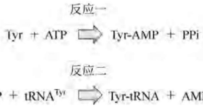

<details>
<summary>flowchart</summary>

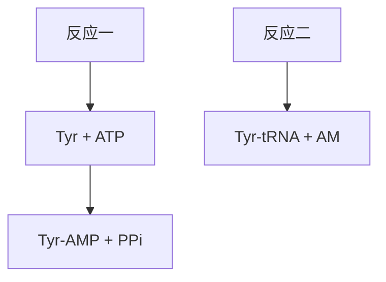
</details>

图9-18 嗜热芽孢杆菌酪氨酰-tRNA合成酶催化氨酰化反应的机理

表 9-4 酪氨酸 tRNA 合成酶及其变体的氨酰化活性

| 酶 | $k_{\text{cat}}/\mathrm{s}^{-1}$ | $K_{\mathrm{m}}/(\mathrm{mmol}\cdot\mathrm{L}^{-1})$ | $(k_{\mathrm{cat}}/K_{\mathrm{m}})/(\mathrm{L}\cdot\mathrm{mol}^{-1}\cdot\mathrm{s}^{-1})$ |
| --- | --- | --- | --- |
| Thr-51(天然) | 4.7 | 2.5 | 1880 |
| Ala-51(修饰后) | 4.0 | 1.2 | 3333 |
| Pro-51(修饰后) | 1.8 | 0.019 | 94736 |

## 2. 随机改组肽段以改善酶的催化活性

头孢菌素酶催化头孢菌素和拉氧头孢类抗生素的水解反应，从而赋予细菌对这些抗生素的抗性。来自弗氏柠檬酸杆菌（Citrobacter freundii）、阴沟肠杆菌（Enterobacter cloacae）、小肠结肠炎耶尔森氏病（Yersinia enterocolitica）、肺炎克雷伯氏菌（Klebsiella pneumoniae）四种细菌的头孢菌素酶编码基因呈现较高的同源性（58%～82%），每个基因均为自然界亿万年选择的结果，各有各的长处。如果将这四个基因分别实施单基因改组，则筛选到的突变克隆菌对拉氧头孢菌素的抗性均为对照菌株（含野生型头孢菌素酶基因的克隆菌）的8倍。然而，若将上述4个同源基因等分子混合进行多基因改组，则从突变重组文库中筛选到一个克隆(A)，其抗性比野生型的Citrobacter和Enterobacter基因提高270倍，比野生型的Klebsiella和Yersinia基因提高540倍[图9-19(a)]。与单个基因的改组相比，家族改组的进化速率分别提高34倍和68倍。也就是说，家族基因的共同改组由于提供了成员之间优势互补的可能性，因而大大加快了进化的步伐。以上述第一轮获得的高抗性重组突变基因为亲本，实施第二轮改组，从大约5万个克隆中又筛选出3个更高抗性的重组突变克隆，其抗性为A克隆的3.5倍，这表明第二轮改组的进化速率已接近极限。对A克隆所含的重组突变基因序列进行分析,结果表明,它是Citrobacter、Enterobacter、Klebsiella野生型基因的杂合分子,7个重组交叉位点形成8个重组区域[图9-19(b)]。此外,这个杂合重组突变基因还含有47处DNA点突变,导致33个氨基酸残基被取代,而且新换上的所有氨基酸残基均不存在于4种亲本酶分子中。

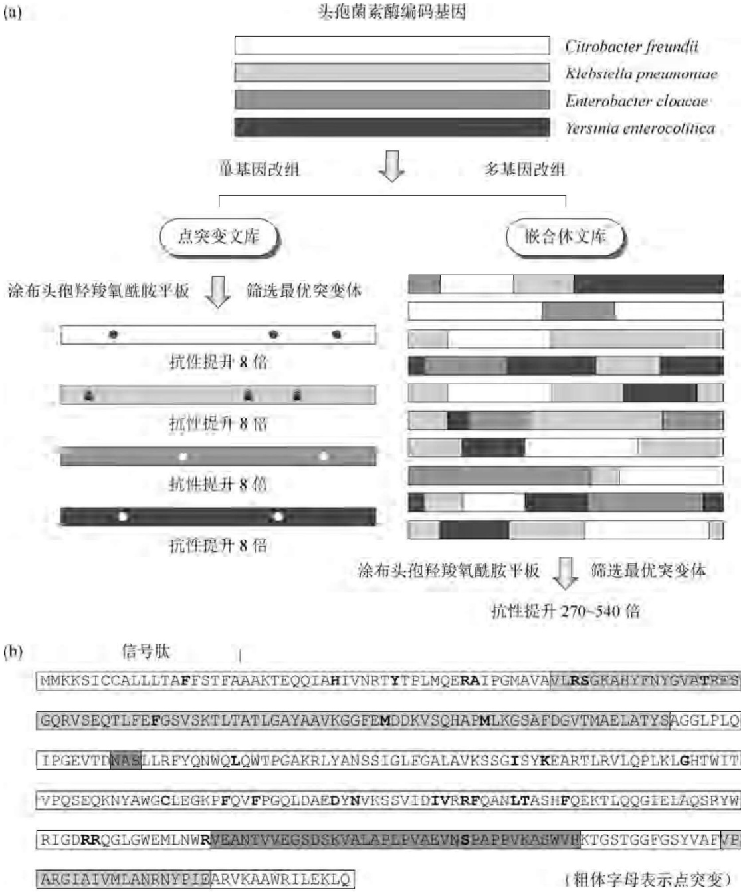

图9-19 头孢菌素酶编码基因的改组策略与效应

## 3. 删除末端部分氨基酸序列以改善酶的催化活性

枯草芽孢杆菌 MI113 株的  $\alpha-$  淀粉酶结构基因编码 660 个氨基酸，它在相同菌株中的重组表达产物比活并不高。若将其 C 末端的序列分别缩至 617 个、560 个、511 个、500 个氨基酸残基，则表达出的变体酶不仅比活比天然酶高 2.7 倍，而且所有变体酶均变成 383 个氨基酸残基的相同分子，其C末端以组氨酸残基结尾。进一步分析表明，这些蛋白变体由于肽段部分缺失，其C端区域在细菌细胞内不再能维持稳定的三维空间结构，因此被胞内的蛋白酶或羧肽酶降解，而天然的 $\alpha$ -淀粉酶和以His-383结尾的变体酶则能形成稳定的空间结构，故对羧肽酶产生抗性。由此可见，$\alpha$ -淀粉酶的C端肽段对酶的活性发挥有阻碍作用。

## 9.4.4 消除酶的被抑制特性

有些酶分子的催化活性在天然细胞内呈可诱导性，这种酶活诱导机制建立在酶分子中抑制型功能域的基础之上。或许这种诱导机制对天然宿主正常的生理代谢活动具有重要意义，但在异源工程化表达的背景下，消除这种诱导机制不仅不会产生不良影响，更重要的是能在很大程度上提高工业用酶的活性。

## 1. 转换氨基酸残基以消除酶的被抑制特性

枯草芽孢杆菌蛋白酶是一种丝氨酸蛋白酶，因具有广谱的蛋白质降解能力而被广泛用作洗涤添加剂。但早期的这种添加剂有一个严重的缺陷，它不能与漂白剂联合使用，因为后者会灭活蛋白酶。相关生化分析结果表明，酶活性丧失（约 $90\%$ ）是由蛋白分子中第222位的甲硫氨酸残基被氧化所致。为了消除蛋白酶对漂白剂的敏感性，借助DNA定点突变技术将枯草芽孢杆菌蛋白酶第222位的甲硫氨酸残基分别转换成其他19种氨基酸残基（即所谓的饱和突变），形成一系列的变体酶。其中， $\mathrm{Met222\rightarrow Cys(M222C)}$ 型变体酶比天然酶具有更高的降解活性，但它仍对漂白剂敏感；而 $\mathrm{Met222\rightarrow Ala(M222A)}$ 型变体酶虽然降解蛋白质的活性只及天然酶的 $53\%$ ，但已不受漂白剂的抑制，因此可作为第二代洗涤添加剂被广泛使用。

## 2. 删除肽段以消除酶的被抑制特性

血液中存在很多纤溶酶原激活剂(PA)的抑制剂蛋白,使得这类溶栓药物的临床使用剂量较大。由于任何溶栓剂对血栓的专一性降解都是相对的,因此大剂量使用这些药物容易破坏病人的凝血系统,导致出血性死亡。纤溶酶源激活剂的抑制蛋白以PAI-1为主,后者能与t-PA或pro-UK形成等分子的复合物,并使之失活。定点删除型突变的实验结果证明,缺失Lys296-Gly302肽段的t-PA变体为PAI-I抑制的效应明显减弱。进一步研究显示,t-PA与PAI-1结合的位点位于其催化活性中心附近的Lys296-Arg299肽段中。在分析t-PA结构的基础上,将PAI-I结合位点附近带正电荷的氨基酸残基都替换为带负电荷的氨基酸残基,得到的突变分子t-PA R275E、R298E、R299E、R304E具有更强烈的抗PAI-1抑制的特性。而且,根据t-PA与PAI-1相互作用的方式也可预测pro-UK与PAI-1作用的位点可能与其Arg179-Ser184肽段有关。后续实验证明,Arg179-Ser184肽段删除型pro-UK变体确实具有明显的抗PAI-1抑制能力。

## 9.4.5 修饰酶的催化特异性

虽然蛋白质工程的许多研究主要集中在修饰那些催化特异性高的酶的天然性质,但将底物专一性不强的酶改造成只能转化一种底物的高特异性变体酶,也许意义更大。

## 1. 共价结合寡核苷酸以修饰酶的催化特异性

链球菌核酸酶是由149个氨基酸组成的单一多肽链，能催化降解单链RNA和单双链DNA分子中的磷酸二酯键，产生3'磷酸和5'羟基的末端，底物作用部位为A、U或A、T丰富区。X晶体衍射得到的结构数据表明，将一小段已知序列的寡核苷酸片段接在邻近酶催化活性部位的某一氨基酸残基上，可以提高该酶的降解特异性。其构建原理如图9-20所示:利用寡核苷酸定向突变技术将天然核酸酶第116位的赖氨酸残基转变为半胱氨酸残基，同时人工合成3'端带有巯基的寡核苷酸单链片段，两者通过二硫键共价交联在一起。天然链球菌核酸酶分子内没有半胱氨酸残基，因此在体外共价交联时，反应体系中会出现三种产物:核酸酶与寡核苷酸所形成的变体酶、寡核苷酸之间的二聚体以及带有寡核苷酸的变