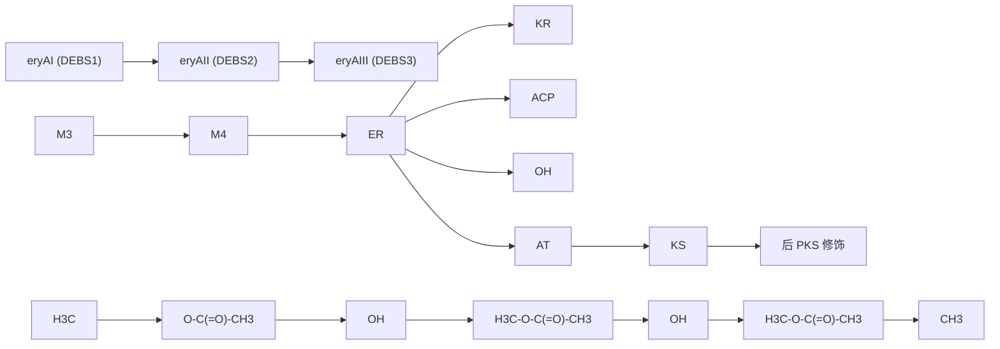
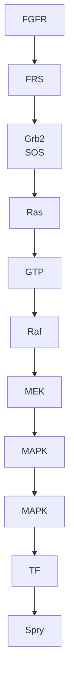
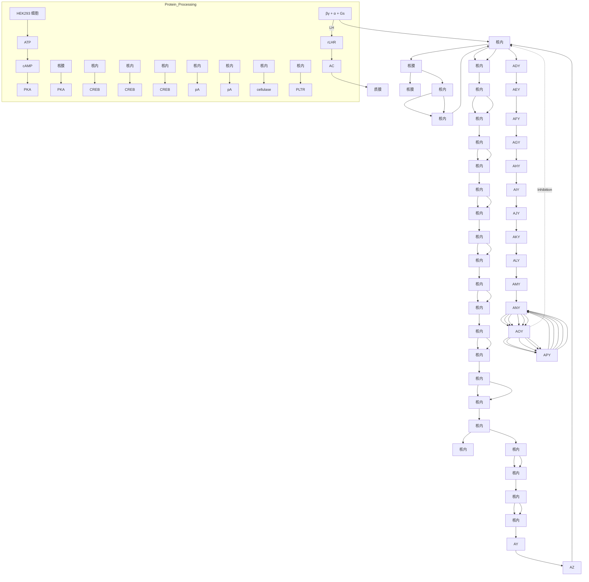
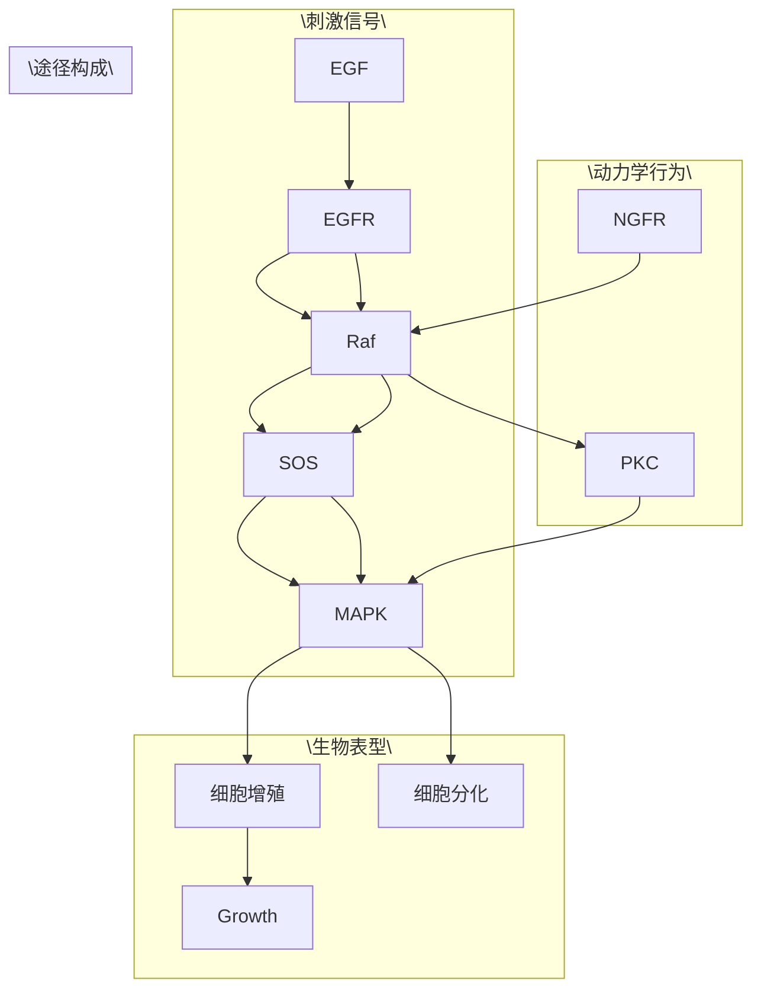
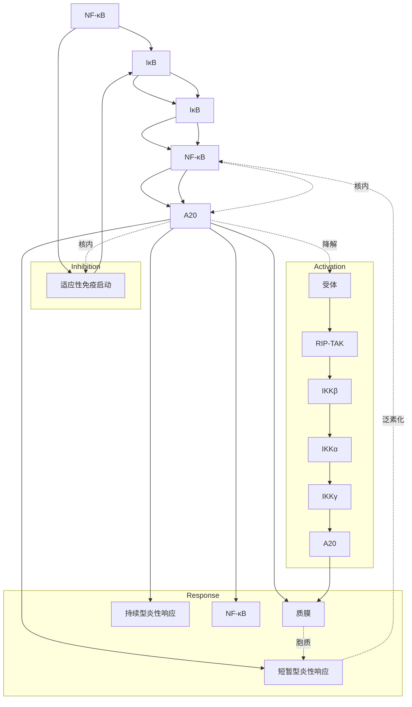
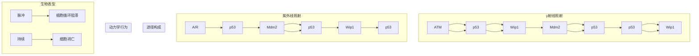
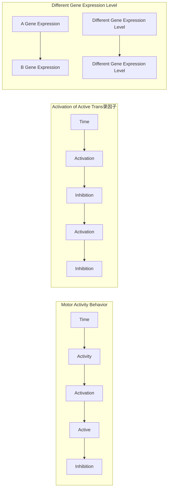

间体的结构要求却远比红霉素PKS严格。事实上，利福霉素的模块4几乎不加工具有芳香环结构的聚酮链。

## 3. 置换酰基转移酶结构域以产生杂合衍生物

在不同的聚酮合酶及其模块之间交换相应的结构域可以显著扩展生物细胞合成杂合分子的能力，这是利用PKS多酶复合体生产具有潜在经济价值的新聚酮药物的关键步骤。在这方面第一个成功的例子是用rapPKS丙二酰特异性AT结构域置换DEBS1甲基丙二酰特异性的相应结构域，导致两个新的三酮内酯的合成，它们在其内酯环上均缺失了一个甲基。另一个例子是以三个异源的丙二酰特异性AT结构域置换红霉素PKS模块1和模块2中的甲基丙二酰特异性AT结构域，这三个用于置换的AT结构域分别来自雷帕霉素生产菌吸水链霉菌模块2(hygAT2)、苦霉素生产菌委内瑞拉链霉菌(Streptomyces venezuelae)的PKS基因簇(venAT)以及rapPKS的模件14(rapsAT14)。

经过上述改造了的红色糖多孢菌 ER720 工程菌可产生多种新型的红霉素衍生物。例如，当其 AT1 结构域被同源的丙二酰 AT 结构域置换时，工程菌将合成 12-去甲基-12-脱氧红霉素 A。这种类型的置换可以发生在 eryPKS 的模块 1 和模块 2 中，但在模块 4 中进行同样的置换却检测不到聚酮化合物的产生。另外，将来自尼达霉素 PKS 的甲基丙二酰特异性 AT5 置换红霉素模块 4 中的相应结构域，工程菌可产生乙基取代的红霉素。

进一步的研究表明,DEBS的AT结构域不会影响延伸单位的差向异构化,决定甲基分支立体化学性质的是每个模块的KS结构域。在丙二酰转移酶和甲基丙二酰转移酶之间交换编码几个氨基酸肽段的DNA序列,结果发现存在于所有AT结构域中的一个短的C末端片段是底物特异性的主要决定者。同时实验还表明,PKS模件对延伸单位的选择受一个超变区的影响,这使得人们有可能通过组合突变构建底物特异性较低的新型AT结构域。

## 4. 还原环的遗传操作

KR、DH、ER等结构域的改造和修饰同样是开发红霉素衍生物的研究内容。例如，将红霉素PKS模块4的ER结构域失活后，突变菌便合成如图10-18所示的红霉素结构类似物。除了修饰还原环的功能外，在没有还原功能的模块中组装合适的还原结构域，同样可以在聚酮分子中引入广泛的结构多样性。例如，将DEBS3的KR2结构域用来自rapPKS模块4的DH-KR双结构域进行置换，所形成的嵌合多功能蛋白不仅能催化 $\beta$ -酮基还原和区域专一性的脱水反应，而且还能将相应的聚酮链转移至模块3上进行加工，最终产生四酮类衍生物。

## 5. 人工合酶和聚酮文库的构建

对单一PKS编码基因进行遗传操作，可在一定程度上构建具有多种特殊催化功能和催化顺序的人工聚酮合酶变体，并由此形成相应的聚酮类化合物文库，后者为筛选有效药物增添了新的途径和范围。然而，这一策略的主要限制在于大多数PKS对结构改变了的聚酮链的接受能力有限。为了克服这种局限性，人们利用模块和结构域的几种变换组合来研究PKS的组合潜能。例如，用rapPKS的AT结构域和 $\beta$ -碳加工结构域置换DEBS中的相应结构域，使之拥有不同的底物特异性以及 $\beta$ -碳还原脱水活性。另外，为了便于聚酮的组合生物合成，还开发了一个用于DEBS异源表达的三质粒系统。eryAI、eryAII、eryAIII基因分别克隆到三个相容性的链霉菌质粒中，用这三个重组质粒转化同一株变铅青链霉菌（Streptomyces lividans），获得一株能高效积累6-脱氧红霉素内酯B(6-DEB)的转化子。如果将上述三个基因克隆在一个质粒上，所构建出来的转化子同样能达到相似的效果。

flowchart

图10-18 截断型6-脱氧红霉内酯合成酶的模块结构

为了产生大量结构发生改变的化合物,人们还致力于设计多模块化的人工合酶。相关实验结果显示,在 eryPKS 基础上设计的二模块和三模块型人工聚酮合酶能合成具有预期结构的新化合物。这一结果令人鼓舞,因为组合化学的一个目标就是通过混合来自不同 PKS 基因簇且具有不同模块数的异源多肽或酶促结构域构建融合型的 PKS。

## 6. 聚酮内和聚酮间接头的设计

PKS中的单个模块对它们的底物具有明显的选择性，因此限制了模块的组合潜能，在实际应用过程中往往表现为杂合酶的低活性甚至无活性。然而深入研究表明，如果在PKS中的模块与模块之间以及结构域与结构域之间人为设计和组装一些氨基酸序列短小可变的接头片段，则能在很大程度上改善单个模块对不同聚酮链的接受能力，从而突破模块组合的限制性因素。例如，在模块内接头存在的条件下，用异源的rifPKS模块5置换DEBS模块2，可以产生预期的6-DEB三酮内酯衍生物（图10-19）。Rif PKS模块5的作用方式与DEBS模块2相似，而且DEBS模块2和模块3之间的多肽内接头允许聚酮链从Rif PKS模块5到DEBS模块3进行正常的转移。由此可见，对存在于多肽内部或多肽之间的接头进行重新设计和加工，能有效促进生物合成中间体在非天然连接的模块之间的转移。

从过去三十年在聚酮类化合物生物合成机制方面的研究进展来看,不远的将来人们能够对天然的 PKS 结构进行任何精确和方便的修饰,这不仅能促进对大环类抗生素生物合成过程形成更深的理解,更重要的是大规模生物合成新型聚酮类似物有望进入产业化阶段。

## 10.4.3 聚酮生物合成基因的异源表达

红色糖多孢菌的 6-脱氧红霉内酯 B 生物合成基因簇已在天蓝色链霉菌中获得表达，重组细菌能有效地将添加的前体掺入到 6-脱氧红霉内酯 B 中，所合成的衍生物含有一个甲基侧链，而在红色糖多孢菌中则是乙基侧链，这个结果证明异源基因表达产生了一个具有功能的酶。6-脱氧红霉内酯 B 是红霉素 A 生物合成中一个重要的中间体，它的异源合成再次表明抗生素合成基因不仅可以从天然产生菌中克隆出来，而且经体外改造后能在新的宿主细胞中表达出相应的新功能，为增产并合成新型聚酮类物质提供了广阔的应用前景。

chemical

Chemical structure of 6-脱氧红霉素内酯, showing red霉素模件与利福霉素模件的结构及后PKS修饰过程

图10-19 异源模块的工程化融合

此外，将来自真菌开放青霉菌(Penicillium patulum)的6-甲基水杨酸合成基因与可调控的链霉菌表达元件进行体外拼接，重组质粒导入具有多环聚酮类化合物合成能力的天蓝色链霉菌中。上述设计方案提高了宿主细胞合成前体分子的能力，同时也使得它能利用这些前体分子高效生产相应的聚酮化合物。

除虫菌素装载结构域的广谱底物特异性具有很高的应用价值。除虫菌素的结构类似物道拉菌素(Doramectin)是由除虫链霉菌的一个 $bkd$ 突变株在环庚酸存在的条件下发酵生产的。由于不能产生正常的分支底物异丁酰辅酶A和甲基丁酰辅酶A，这个突变菌株的除虫菌素生物合成装载结构域将环庚酸掺入天然产物中。在一项实验中，将山丘链霉菌（Streptomyces collinus）环庚酰辅酶A合成酶的编码基因转入至除虫链霉菌 $bkd$ 突变株中，重组菌可在不添加环庚酸底物的条件下直接发酵生产道拉菌素。

改造或修饰侧链基团或糖基加入相关途径是构建杂合抗生素生产菌的一项重要策略。在这种情况下，或者用一个完整的异源添加途径取代天然途径，以合成全新的侧链前体；或者缺失天然途径中的某个基因，以产生非天然的侧链前体。例如，从产碳霉素的耐热链霉菌（Streptomyces thermotolerans）中克隆编码酰基转移酶编码基因 carE，将其转入至产螺旋霉素的产二素链霉菌（Streptomyces ambofaciens）中，重组细菌便能合成杂合抗生素异戊酰螺旋霉素；而缺失 dNTP-德糖胺生物合成中转氨酶催化的反应，并以异鼠李糖代替正常的氨基糖德糖胺，可使重组菌产生酒霉素衍生物，这是糖基转移酶以修饰过的核糖作为底物的另一个例子。

$4^{\prime}$-表阿霉素(Epirubicin)是新一代的抗肿瘤药物，目前通常的生产方法是由碳疽环酮(Anthracyclinone)的前体进行化学修饰。为了利用发酵工艺生产这个半合成产品，将除虫链霉菌编码表- $4^{\prime}$-还原酶的 $avrE$ 基因置换波塞链霉菌TDP-道诺胺生物合成途径中编码 $4^{\prime}$-还原酶的 $dnmV$ 基因(图10-20)。实验结果表明，波塞链霉菌的TDP-道诺胺-$\varepsilon$-紫红霉酮糖基转移酶(DnmS)完全可以识别并使用经上述途径操作形成的核糖底物，合成重要的中间产物 $4^{\prime}$-表紫红霉素D，后者再由三个下游酶DnrP、DnrK、DoxA转化为最终产物 $4^{\prime}$-表阿霉素。

chemical

Chemical reaction pathway showing enzymatic transformation of a glycoside with DnmV, DnmS, and DoxA/DauKP enzymes

图10-20 $4^{\prime}$ -表阿霉素的生物合成

## 10.5 信号转导的途径工程

除了物质/能量代谢途径外，生物体几乎所有的生理活动还受到信号转导途径的支配。组织或细胞内外的生理物质(信号分子)结构特异性地与质膜定位型或胞质游离型蛋白受体结合，触发受体空间构象发生改变，后者在胞质中引起单一或多种蛋白产生以磷酸化反应为主的级联响应，最终激活相应的转录因子并介导相关基因的表达，这一过程称为细胞信号转导，信号传递的路线称为信号转导途径。与物质/能量代谢途径相似，以细胞为单位的信号转导途径也可通过基因操作而被工程化设计和改造，最终实现修饰细胞、组织乃至整个生物体遗传特征和生理性状的目标。

## 10.5.1 信号转导途径的构成与功能

从原核细菌到高等动植物体内存在数以千计构成和功能各异的信号转导途径。一般而言，一条典型的信号转导途径由信号分子、感应受体、转导组分、转录因子、效应基因五大元素构成，它们均由基因编码。如果将之类比物理电子电路，则信号转导途径中信号分子的缺席/显现以及效应基因的关闭/表达分别为这种生物基因电路的输入信号和输出信号。以哺乳动物体内广泛存在的Ras信号转导途径为例(图10-21)，典型的信号转导过程通常包含信号感应、信号传递、信号解析三大环节。

## 1. 信号转导途径的信号感应

信号感应是指细胞外(主要形式,如成纤维生长因子 FGF)或细胞内的信号分子(亦称配体)特异性地识别细胞质膜定位型(主要形式,如 FGFR)或胞内游离型受体蛋白并与之结合;一旦结合信号分子,受体空间构象便发生响应性改变,后者主要有三种表现形式:① 激活受体自身含有的蛋白磷酸激酶(简称蛋白激酶,如 FGFR)。此类受体通常跨膜一次(1TM),由胞外区、跨膜区、胞内区三部分构成。胞外区为信号分子的结合位点;胞内区为受

flowchart

图10-21 典型的Ras信号转导途径

体自身的蛋白激酶活性区（即受体的顺式酶活），主要分为酪氨酸蛋白激酶和丝氨酸/苏氨酸蛋白激酶两大类。此外，此类受体的胞内区还可能含有蛋白磷酸酶活性或者直接与核苷酸环化酶相连。② 激活胞质内的蛋白磷酸激酶（如 T 淋巴细胞表面受体 CD4）。此类受体通常也跨膜一次，胞外区负责结合信号分子；胞内区不含蛋白激酶功能域，但在近膜处存在与细胞内蛋白激酶的结合位点。当配体与受体结合后，受体激活质膜内侧附近的蛋白激酶。③ 激活质膜内侧结合型 G 蛋白。此类受体的特征是跨膜七次（7TM），且与 G 蛋白构成蛋白复合物，因此又称为 G 蛋白偶联型受体（GPCR）。G 蛋白是一个庞大的 GTP/GDP 结合蛋白家族，分为三聚体和单体（如图 10-21 所示中的 Ras）两个亚家族。三聚体亚家族成员含 α、β、γ 三个亚基，一旦 GPCR 被激活，G 蛋白结合的 GDP 便为 GTP 所取代，并解离成携带 GTP 的 α 亚基以及不含核苷酸的 βγ 二聚体，这两种解离组分均能独立发挥传递信号的功能。

## 2. 信号转导途径的信号传递

信号传递是指胞质中的蛋白转导组分为受体所激活，并依次激活其下游转导伙伴直至转录因子，构成信号转导级联反应。其中，信号转导的方式主要表现为磷酸基团在各种转导组分中的接力式传递，因而这些转导组分大都是蛋白激酶；有些信号转导途径则采取蛋白逐次降解的方式转导信号（如Fas信号转导途径），因此这些转导组分均拥有蛋白酶顺式酶活。信号在细胞内有三条传递路线:① 信号通过多重转导组分逐次传递至细胞核内。在相当多的信号转导途径（如图10-21所示的Ras信号转导途径）中，被配体激活的受体将信号经多种转导组分逐次传递给下游伙伴，这些转导组分或呈胞质游离型，或以蛋白复合物的形式首尾相连，构成信号转导脚手架（颇像古时由驿站构成的邮路），并进行蛋白磷酸化或降解级联反应。② 信号通过胞质潜伏型转录因子直接传递至细胞核内。有些转录因子能直接为配体-受体复合物

所激活，并穿过胞质直接进入核内。原核细菌的双组分信号转导以及高等植物的生长素信号转导均采用这一方式。在哺乳动物的一些信号转导途径中，SMAD和STAT家族成员身兼信号转导和转录调控两种功能，当受体呈非激活状态时，它们潜伏在质膜附近的胞质内；一旦受体被配体激活，受体便将游离型的SMAD或STAT招募至自己身边并激活之，其中SMAD在Ser残基、STAT在Tyr残基上被受体蛋白激酶磷酸化。经磷酸化激活后的SMAD或STAT在核内直接识别并作用于相关基因的表达调控元件。③信号通过第二信使分子传递至细胞核。在有些信号转导途径(如NFAT和PLC信号转导途径)中，被配体激活的受体可导致胞质内第二信使分子浓度的波动，并依赖这些小分子或离子在胞质中的扩散作用将信号传递至细胞核。具有上述功能的第二信使分子包括 $\mathrm{Ca^{2+}}$ 、cAMP、磷酸肌醇酯(PIP)等。

## 3. 信号转导途径的信号解析

信号解析是指转录因子经信号转导被激活后，在细胞核内或独立或与其他调控因子联合识别相应效应基因的DNA顺式应答元件上，进而启动或关闭基因的转录（视联合的调控因子性质而定）。在Ras信号转导途径中(图10-21)，胞质型有丝分裂原激活型蛋白激酶(MAPK,又称ERK)被其上游转导组分MEK激活后，转位于核内并以磷酸化方式激活一大批重要的转录因子(TF)。例如，MAPK激活转录因子Srf和ElK1表达Fos编码基因，同时又能激活转录因子Fos和Jun形成二聚体AP1，后者与相关效应基因的佛波醇应答元件TGACTCA结合表达Myc等众多蛋白质编码基因；而Myc与Max也能组成转录因子二聚体，与另一批效应基因的DNA顺式元件CACGTG结合并激活其转录启动。

## 4. 信号转导途径的信号反馈

鉴于信号转导途径沟通环境与机体之间的密切联系并介导生物体内几乎所有的生理过程，因此任何信号转导事件的发生、强化、消退必须被严密调控，这种调控网络的组成部分之一便是由该信号转导途径自身所包含的负反馈回路。例如在Ras信号转导途径中，一方面磷酸化激活型MAPK构成对其上游转导组分Raf和SOS的活性抑制（见图10-21）；另一方面，MAPK又能通过磷酸化激活转录因子Ets1促使负调控因子Spry的表达(图10-22)，而后者同样抑制Raf的活性图(见图10-21)，从而使Ras信号转导途径的输出信号呈短促的脉冲性。值得注意的是，任何使Ras信号转导途径脱离严密调控的因素均具有致癌倾向。

## 10.5.2 信号转导途径的性能修饰

人类多种生理和代谢紊乱性疾病均与相应信号转导途径的异常或故障密切相关，因此针对这些信号转导途径的性能进行基因操作有望为矫正疾病提供一种崭新的治疗策略。由于全身性基因治疗在相当程度上依赖于被禁止的生殖性克隆技术，因而信号转导途径修饰型细胞主要采用两种方式导入机体:第一种方式是在体外对分离出来的个体细胞进行基因操作，然后输回体内；第二种方式是移植含修饰型信号转导途径的非人类异种微胶囊化细胞（以人造半渗透膜包裹的哺乳动物细胞），所用胶囊通常由海藻酸-多聚L-赖氨酸或纤维素硫酸酯制成，能保护细胞免遭机体内免疫应答和清除，但却能获得必需的营养供应并分泌治疗性蛋白和代谢物。

## 1. 白介素-2信号转导途径的重新连线

体内输入抗原特异性 T 淋巴细胞能帮助机体重构免疫系统抵御病毒感染和抑制肿瘤生长,然而此类基于细胞的基因治疗策略在临床应用中的一个主要障碍是移植型工程 T 细胞在人体内的难以生存,因此开发具备可控性增殖能力的工程 T 细胞是细胞治疗的关键。

哺乳动物的 T 细胞克隆由白介素-2(IL-2)之类的细胞因子触发,后者作为机体内源型信号分子激活 JAK-STAT 信号转导途径,最终刺激一组 T 细胞生长调节基因的表达(图 10-23(a))。CTLL-2 型小鼠的 T 细胞组成型表达 IL-2 受体, 注射提供 IL-2 能诱导 T 细胞生长, 而除去 IL-2 则导致 T 细胞凋亡, 因此 IL-2 是此类 T 细胞增殖的唯一触发因子。然而, 内源性 IL-2 生理表达量不足以刺激移植型工程 T 细胞的增殖, 而外部给药又使治疗费用过高, 因此开发一种能高效诱导 IL-2 表达的小分子廉价药物不失为一种选择。由小分子茶碱诱导机体表达 IL-2 进而重新连线 JAK-STAT 信号转导途径的构建策略如图 10-23(b) 所示: 设计一种茶碱响应型 RNA 适配体 (即核糖开关), 并将之与核酶序列融合, 构成茶碱依赖型核酶装置。将这一装置重组至 IL-2 基因的 $3^{\prime}$-UTR 内, 使得茶碱与适配体的结合能在空间结构上有效抑制核酶的自剪切活性, 从而导致 IL-2 mRNA 有效翻译; 但在茶碱缺席时, 核酶介导的 mRNA 降解导致 IL-2 表达水平显著降低。正如所设计的那样, 由此构建的工程 T 细胞转入小鼠体内后效果相当理想, 移植型小鼠在茶碱的存在下 T 细胞呈显著增长态势。如果将三拷贝的茶碱响应型核酶编码序列引入靶基因的 $3^{\prime}$-UTR, 则系统运行更佳。

flowchart

This diagram illustrates the molecular signaling pathway of MAPK (ERK) in breast tissue, showing how ERK binds to various proteins and downstream molecules like Eik1, Jun, Max, Rsk2, and Ets1.

图10-22 磷酸化MAPK在核内的多重激活效应

## 2. 激活型 T 细胞核内因子信号转导途径的重新连线

高等动物的视觉形成途径与激活型T细胞核内因子(NFAT)介导的信号转导途径在G蛋白偶联型受体(GPCR)的激活环节部分重叠。其中，视觉形成途径由光子受体视网膜杆细胞中的视紫红质和视锥细胞中的视蛋白(颜色敏感)介导相应的信号转导级联反应，这两类光子受体均含有能特异性吸收光子的11-顺视网膜素(即维生素A)，它们与质膜内侧的

图10-23 以茶碱控制JAK-STAT信号转导途径运行的设计策略

GPCR 相偶联。不同波长的光子激活相对应的视蛋白，后者依次激活 GPCR 和磷酸二酯酶 (PDE)。激活型 PDE 将结合在钠离子通道上的 cGMP 水解成 GMP，从而关闭  $Na^{+}$  的胞内流入并在质膜两侧形成电位差，后者由视觉神经元传至大脑视觉中枢，遂产生视觉。然而，在 T 细胞以及其他类型的细胞中，为抗体等信号分子激活的 GPCR 可使与之偶联的 Gq 蛋白解离出  $\alpha$  亚基 ( $G_{q\alpha}$ )。 $G_{q\alpha}$  依次激活磷脂酶 C(PLC) 活性，后者将定位于质膜内表面上的磷脂酰肌醇 -4,5-二磷酸酯 ( $PIP_{2}$ ) 水解成 1,4,5-三磷酸肌醇 ( $IP_{3}$ )。 $IP_{3}$  与质膜型钙离子通道直接结合，导致  $Ca^{2+}$  在胞质中大量积累。 $Ca^{2+}$  浓度的剧变会触发钙调蛋白 (CaM) 依赖型的钙调磷酸酶 (CaN) 激活，后者使磷酸化型 NFAT 脱去磷酸基团。NFAT 转位至核内，识别特定的靶基因应答调控元件，进而激活相关基因的表达。

基于上述两条信号途径的重叠性，将特异性感应蓝光（波长约为 $480\mathrm{nm}$ ）的视黑素蛋白(MEL,能激活GPCR)以及能刺激胰岛素同时抑制胰高血糖素产生的胰高血糖素样多肽-1变体(GLP-1)编码基因导入人胚胎肾细胞株(HEK293)，并采用NFAT特异性识别的应答调控元件介导GLP-1编码序列的表达，可构建获得响应蓝光而高效表达GLP-1的工程细胞株(图10-24)。将该细胞株经微胶囊化包裹后移植进II型糖尿病小鼠模型体内，转基因小鼠在接受蓝光照射后便呈胰岛素水平提升，血糖也相应被有效控制。更重要的是，蓝光既能通过皮肤照射实施诱导又能借助光纤传递实现体内特定部位的局部光照，从而增强了这种治疗策略的应用潜力。

## 3. 环化腺苷酸应答元件结合蛋白信号转导途径的重新连线

细胞内固有的信号转导途径甚至还可用于工程化构建微胶囊化细胞以改善母牛的人工授精。迄今为止，畜牧业高效的母牛授精作业主要基于农民准确掌握母牛排卵的时间，这一过程不但耗时而且需要经验丰富的操作人力。事实上，母牛的排卵时间也可通过测定其内源性黄体生成素(LH)的水平而精确确定。一种理想的设计思路是将母牛的 LH检测与人工授精紧密偶联，其中母牛体内 LH 的出现为工程化途径的输入信号，而精子至奶牛子宫的释放则为最终的输出效应。通过整合这些必需的输入/输出组分，一种基于纤维素微胶囊化感应细胞和精子细胞一同植入牛奶子宫的工程化全自动授精系统问世。其中，感应细胞（HEK293）携带异源表达型 LH 受体（rLHR，即 GPCR）以检测母牛内源性 LH 水平。LH 浓度的增高经 rLHR 诱导由 G 蛋白  $G_{s\alpha}$  亚基介导的腺苷酰环化酶（AC）激活，后者触发 cAMP 形成，并最终导致靶基因的 CREB（cAMP 应答元件 CRE 结合蛋白）依赖型转录激活。通过将编码一种纤维素酶分泌型变体的基因置于 CREB 控制下（在启动子  $P_{ETR}$  邻近区域安装 CRE 应答元件），受体的激活最终触发高浓度胞外纤维素酶的分泌（图 10-25）。此时，纤维素胶囊被降解，其内含的精子被释放进入母牛的子宫内，从而实现即时自动授精。

flowchart

This diagram illustrates the biochemical pathway of HEK293 cells, showing how light exposure and calcium ion transport (Ca²⁺) interact with PIP2 and GLP-1 to regulate various proteins like PLCs, NFATs, and their interactions in the nucleus.

图10-24 以光照控制II型糖尿病小鼠模型血糖平衡的设计策略

## 10.5.3 信号转导途径的动力学行为修饰

广泛存在于生物王国中数以千计的信号转导途径以受体分子感应信号、转导蛋白传递信号、转录因子解码信号的基本模式精确控制生命机器的运转。然而，除了信号分子、感应受体、转导组分、转录因子、效应基因的身份性质及其浓度阈值外，编码、构成、定义一条特定的信号转导途径还涉及其运行的动力学要素，即信号转导途径构成组分的浓度、活性、状态、定位随时间变化而变化的行为。对信号转导途径的动力学行为进行工程化设计与修饰，同样能改变其输出的性质和效能。

flowchart

图10-25 基于母牛排卵触发型精子释放的工程化全自动授精设计策略

1. 信号转导途径动力学的行为与表征

在信号转导过程中,信号强度(S)随时间(t)变化的动力学曲线可用频率(F)、振幅(A)、续长(D)、延迟(E)以及累积(M,即曲线面积)表征或定义(图10-26)。细胞的信号转导途径也可用上述动力学参数编码和解析生物信息,显然这种编码模式远比用一个时间点的单个分子状态编码信息更呈多样化。

由信号转导动力学行为研究产生的第一个概念是:不同的上游信号分子可导致同一转导组分呈现不同的动力学行为。例

area

| Category | Peak Position (t) |
| --- | --- |
| M | Leftmost peak |
| D | Middle-right peak |
| A | Rightmost peak |

图10-26 信号转导动力学的表征参数

如,不同的生长因子决定大鼠神经元前体不同的细胞命运: 神经生长因子(NGF)导致分化;而表皮生长因子(EGF)导致细胞增殖。事实上这两种信号分子均激活 MAPK, 只是动力学行为不同: EGF 触发 MAPK 产生一种瞬时响应, 而 NGF 则诱导 MAPK 呈现持久性激活,正是 MAPK 的不同动力学行为导致神经元前体细胞两种截然不同的命运。

无独有偶，不同的炎症刺激因子诱导转录因子 $\mathrm{NF} - \kappa \mathrm{B}$ 呈现不同的动力学行为。在静息条件下，$\mathrm{NF} - \kappa \mathrm{B}$ 于胞质和核内连续穿梭。肿瘤坏死因子 $\alpha (\mathrm{TNF}\alpha)$ 对 $\mathrm{NF} - \kappa \mathrm{B}$ 的刺激导致 $\mathrm{NF} - \kappa \mathrm{B}$ 在核内占据时间的延长及其负调控因子 $\mathrm{I}\kappa \mathrm{B}\alpha$ 编码基因的转录激活，由此构成$\mathrm{NF} - \kappa \mathrm{B}$ 信号转导途径的负反馈回路，并使转录激活型 $\mathrm{NF} - \kappa \mathrm{B}$ 呈振荡行为；相反，细菌脂多糖(LPS)则导致 $\mathrm{NF} - \kappa \mathrm{B}$ 的活性在核内缓慢积累。上述 $\mathrm{NF} - \kappa \mathrm{B}$ 活性两种截然不同的动力学行为导致两组不同的靶基因转录激活，进而产生不同的免疫学效应。

在某些系统中，信号刺激的身份和强度也能改变同一转导组分的动力学行为。例如，酵母转录因子Msn2通过转位至核内响应环境压力。单细胞研究发现，当响应葡萄糖限制或高渗透压信号刺激时，核内的Msn2显现刺激剂量依赖型的续长增加，但振幅固定；相反，氧化压力型信号刺激则导致核内Msn2的积累振幅随着 $\mathrm{H}_2\mathrm{O}_2$ 浓度的增加而增强。而且在初始脉冲之后，葡萄糖限制或高渗透压均引发核内Msn2一系列浓度峰的形成。这些脉冲的频率取决于葡萄糖限制信号的强度，但与渗透压的强度无关。

类似地，肿瘤抑制因子p53也呈现刺激和剂量依赖型的动力学行为。由 $\gamma$ 射线所致的DNA双链断裂(DSB)触发一系列固定振幅和续长的p53浓度脉冲。较高剂量的射线增加脉冲的数量，但不影响其振幅和续长；相反，紫外线则诱导产生一个振幅和续长呈照射剂量依赖型的p53浓度单峰。前者与暂时性的细胞循环阻止和恢复有关，而后者则诱导细胞进入凋亡程序。这些案例表明，信号转导分子的动力学行为能准确捕捉上游刺激信号的身份和强度；而且细胞能将相同信号转导分子的不同动力学行为“翻译”成特殊的表型格局。

## 2. 信号转导途径动力学的编码与解码

信号转导途径构成的不同规定或编码了其动力学响应模式的差异性。例如，MAPK 响应 EGF 和 NGF 之所以会产生不同的动力学行为差异，是因为在 EGF 途径中存在一个 MAPK 与 SOS 之间的负反馈回路；而在 NGF 途径中却存在一个经由 PKC 的正反馈，即两条途径的组分身份及其连结的差异编码 MAPK 的动力学行为（图 10-27）。

由 TNFα 和 LPS 诱导的 NF-κB 激活动力学行为的差异也可归结为特异性的信号转导途径构成:NF-κB 响应 TNFα 而短暂激活由一个负反馈回路介导，涉及 NF-κB 及其靶基因之一的表达产物 IκB；NF-κB 响应 TNFα 的长时相动力学行为则为另一个靶基因产物 A20 所控制，A20 半衰期较长且作用于比 IκB 更远的上游 [图 10-28(a)]。相反，NF-κB 响应 LPS 的持续性激活则归因于一条自分泌途径的正反馈回路，该回路涉及 TNFα 的重新合成。LPS 对 Toll 样受体 4(TLR4) 的激活触发 TNFα 的重新合成以及 TNF 受体的激活，因而形成了由 LPS 诱导的 NF-κB 激活的持久稳定性 [图 10-28(b)]。

相似地，DNA损伤网络中的反馈回路对p53响应 $\gamma$ 射线和紫外线的不同动力学行为负责。在这两条途径中，PI3K相关性激酶(ATM或ATR)将损伤信号传递至p53，并激活两条负反馈回路:一条介于p53和E3泛素连接酶Mdm2之间；另一条介于p53和磷酸脂酶Wip1之间。然而，两者之间一个重要的差异是，响应 $\gamma$ 射线的网络还包含了一条由Wip1介导的p53与ATM之间额外的负反馈回路(图10-29)。这一反馈对响应 $\gamma$ 射线触发p53产生连续脉冲至关重要，因为p53对 $\gamma$ 射线的响应比紫外线更敏感，较低的短暂信号输入足以触发p53脉冲。

在考虑信号转导动力学行为的功能时,自然会产生下一个问题:细胞如何识别或解码不同的动力学行为并将其翻译成不同的表型应答。信号转导的动力学翻译最简单的机制是基于下游效应因子对呈现动力学行为的信号转导分子所表现出的灵敏度。在这种机制中，低亲和性的效应因子为了显示显著的激活，需要持续性的信号输入水平；而高亲和性的效应因子则能迅速响应短促变化的信号输入。以这种机制运行的信号转导途径包括那些能响应短暂或持续性  $Ca^{2+}$  信号的 JNK、NF- $\kappa$ B、NFAT 等信号转导组分。解码信号转导动力学行为更为复杂的机制是基于一种能感应上游信号转导分子时间依赖型变化的特异性转导结构单位。例如在 MAPK 途径中，短暂型和持续型的 MAPK 动力学行为是由一套早期基因表达产物感知和辨认的，这些产物能响应激活型 MAPK 而积累。当 MAPK 的激活呈短暂型时，诸如 c-Fos 之类的基因表达产物被诱导，但随即经历迅速的降解；而当 MAPK 的水平呈持续型时，新合成的 c-Fos 便一直接被持续存在的 MAPK 磷酸化，由此稳定细胞核中的 c-Fos 活性水平。

flowchart

图10-27 信号转导途径构成对MAPK动力学行为的影响

## 3. 信号转导途径动力学的设计与应用

现有研究表明，控制信号转导分子的动力学(时序)行为是细胞一种独特的信号转导构成策略。因此，人们可以遵循这一原理，设计特定基因表达的操控装置。例如对于那些含有多个靶基因的转录因子而言，其水平的变化对每个启动子具有不同的效应；然而通过控制转录因子的频率而非绝对水平，细胞在相同的浓度范围内工作，因此对各个靶基因的启动子具有一致的效应，这便可以实现无论启动子亲和性如何均可共调控多个靶基因以相对合适的比例表达之目的(图10-30)。

(a) 配体 TNFα 对 NF-κB 动力学行为的影响

flowchart

图10-28 信号转导途径构成对 $\mathrm{NF} - \kappa \mathrm{B}$ 动力学行为的影响

flowchart

图10-29 信号转导途径构成对p53动力学行为的影响

flowchart

图10-30 多基因等比例协同表达的信号转导途径动力学设计

## 参考文献

[1] COMFORT N. Recombinant gold. Nature, 2014, 508: 176.
[2] OLIVEIRA P H, MAIRHOFER J. Marker-free plasmids for biotechnological applications — implications and perspectives. Trends in Biotechnology, 2013, 31: 539.
[3] BHARAT T A M, et al. Structures of actin-like ParM filaments show architecture of plasmid-segregating spindles. Nature, 2015, 523: 106.
[4] ALPER H, et al. Tuning genetic control through promoter engineering. Proc. Natl. Acad. Sci. USA, 2005, 102: 12678.
[5] GARCÍA-FRUITÓS E. Inclusion bodies: a new concept. Microbial Cell Factories, 2010, 9: 80.
[6] KHOURY G A, et al. Protein folding and de novo protein design for biotechnological applications. Trends in Biotechnology, 2014, 32: 99.
[7] MARTÍNEZ-ALONSO M, et al. Side effects of chaperone gene co-expression in recombinant protein production. Microbial Cell Factories, 2010, 9: 64.
[8] S∅ENSEN H P, MORTENSEN K K. Soluble expression of recombinant proteins in the cytoplasm of Escherichia coli. Microbial Cell Factories, 2005, 4: 1.
[9] VALDERRAMA-RINCON J D, et al. An engineered eukaryotic protein glycosylation pathway in Escherichia coli. Nature chemical biology, 2012, 8: 434.
[10] CHEN R. Bacterial expression systems for recombinant protein production: E. coli and beyond. Biotechnology Advances, 2012, 30: 1102.
[11] JAFFE S R P, et al. Escherichia coli as a glycoprotein production host: recent developments and challenges. Current Opinion in Biotechnology, 2014, 30: 205.
[12] LEVIN D, et, al. Fc fusion as a platform technology: potential for modulating immunogenicity. Trends in Biotechnology, 2015, 33: 27.
[13] SPADIUT O, et al. Microbials for the production of monoclonal antibodies and antibody fragments. Trends in Biotechnology, 2014, 32: 54.
[14] BROCKMEIER U, et al. Versatile expression and secretion vectors for Bacillus subtilis. Current Microbiology, 2006, 52: 143.
[15] VAN DIJL J M, HECKER M. Bacillus subtilis: from soil bacterium to super secreting cell factory. Microbial Cell Factories, 2013, 12: 3.
[16] DONG H N, ZHANG D W. Current development in genetic engineering strategies of Bacillus species. Microbial Cell Factories, 2014, 13: 63.
[17] KANG K, et al. Molecular engineering of secretory machinery components for high level secretion of proteins in Bacillus species. Journal of industrial microbiology & biotechnology, 2014, 41: 1599.
[18] TOYMENTSEVA A A, et. al. The LIKE system, a novel protein expression toolbox for Bacillus subtilis based on the liaI promoter. Microbial Cell Factories, 2013, 11: 143.
[19] LIEBETONA K, et. al. The nucleotide composition of the spacer sequence influences the expression yield of heterologously expressed genes in Bacillus subtilis. Journal of Biotechnology, 2014, 191: 214.
[20] PÁTEK M, NESVERA J. Sigma factors and promoters in Corynebacterium glutamicum. Journal of Biotechnology, 2011, 154: 101.
[21] BECKER J, WITTMANN C. Bio-based production of chemicals, materials and fuels-Corynebacterium glutamicum as versatile cell factory. Current Opinion in Biotechnology, 2012, 23: 631.
[22] JONG-UK P, et al. Construction of heat-inducible expression vector of Corynebacterium glutamicum and C. ammoniagenes: fusion of  $\lambda$  operator with promoters isolated from C. ammoniagenes. Journal of microbiology and biotechnology, 2008, 18: 639.
[23] PÁTEK M, et al. Corynebacterium glutamicum promoters: a practical approach. Microbial Biotechnology, 2013, 6: 103.
[24] SHIN J H, LEE S Y. Metabolic engineering of microorganisms for the production of L-arginine and its derivatives. Microbial Cell Factories, 2014, 13: 166.
[25] BECKER J, WITTMANN C. Systems and synthetic metabolic engineering for amino acid production — the heartbeat of industrial strain development. Current Opinion in Biotechnology, 2012, 23: 718.
[26] SEVILLANO L, et al. Stable expression plasmids for Streptomyces based on a toxin-antitoxin system. Microbial Cell Factories, 2013, 12: 39.
[27] LIU G, et al. Molecular regulation of antibiotic biosynthesis in Streptomyces. Microbiology and Molecular Biology Reviews, 2013, 77: 112.
[28] MARTÍNEZ-BURGO Y, et al. Heterologous expression of Streptomyces clavuligerus ATCC 27064 cephamycin C gene cluster. Journal of Biotechnology, 2014, 186: 21.
[29] NODA S, et al. Over-production of various secretory-form proteins in Streptomyces lividans, Protein Expression and Purification, 2010, 73: 198.
[30] ANNÉA J, et al. Recombinant protein production and streptomycetes. Journal of Biotechnology, 2012, 158: 159.
[31] VRANCKEN K, ANNÉ J. Secretory production of recombinant proteins by Strepomyces. Future Microbiology, 2009, 4: 181.
[32] HEAP J T, et al. A modular system for Clostridium shuttle plasmids. Journal of Microbiological Methods, 2009, 78: 79.
[33] NAGARAJAN H, et al. Characterizing acetogenic metabolism using a genome-scale metabolic reconstruction of Clostridium ljungdahlii. Microbial Cell Factories, 2013, 12: 118.
[34] PAPOUTSAKIS E T. Engineering solventogenic clostridia. Current Opinion in Biotechnology, 2008, 19: 420.
[35] GEFEN G, et al. Enhanced cellulose degradation by targeted integration of a cohesin-fused  $\beta$ -glucosidase into the Clostridium thermocellum cellulosome. Proc. Natl. Acad. Sci. USA, 2012, 109: 10298.
[36] DUERRE P. Handbook on Clostridia, Part I. Methods, Chapter 3: Gene Cloning in Clostridia. CRC Press, 2005, 37.
[37] LÜTKE-EVERSLOH T, BAHL H. Metabolic engineering of Clostridium acetobutylicum: recent advances to improve butanol production. Current Opinion in Biotechnology, 2011, 22: 634.
[38] MINGARDON F, et al. The issue of secretion in heterologous expression of Clostridium cellulolyticum cellulase-encoding genes in Clostridium acetobutylicum ATCC 824. Applied And Environmental Microbiology, 2011, 77: 2831.
[39] CAMPELO A B, et al. A bacteriocin gene cluster able to enhance plasmid maintenance in Lactococcus lactis. Microbial Cell Factories, 2014, 13: 77.
[40] SHARECK J, et al. Cloning vectors based on cryptic plasmids isolated from lactic acid bacteria: their characteristics and potential applications in biotechnology. Critical Reviews in Biotechnology, 2004, 24: 155.
[41] SPATH K, et al. Direct cloning in Lactobacillus plantarum: Electroporation with non-methylated plasmid DNA enhances transformation efficiency and makes shuttle vectors obsolete. Microbial Cell Factories, 2012, 11: 141.
[42] PETERBAUER C, et al. Food-grade gene expression in lactic acid bacteria. Biotechnology Journal, 2011, 6: 1.
[43] GASPAR P, et al. From physiology to systems metabolic engineering for the production of