# 4 真核微生物的结构与功能

原始 PDF 第 96–118 页。

# 真核微生物的结构与功能

## 导语

本章重点介绍了真核微生物细胞的结构与功能、真核微生物的分化、真核微生物的起源与分类。真菌的营养体分为单细胞和由多细胞组成的菌丝两大类形态。根据这两类形态，真菌分为酵母菌和丝状真菌，有些真菌具有二态性，可根据环境的变化在单细胞和丝状形态之间转换。真菌的分类以形态特征和有性生殖结构作为分类依据，将其分为壶菌门（以卵孢子为特征）、接合菌门（以接合孢子为特征）、子囊菌门（以子囊和子囊孢子为特征）、担子菌门（以担子和担孢子为特征）。基于 rDNA 序列及细胞壁组成等方面的差异，以前归属于真菌的卵菌、丝壶菌、根肿菌和黏菌被排除在真菌之外。本章还以单细胞真菌（酵母菌）、丝状真菌（霉菌）及产大型子实体的真菌（蕈菌）为例，介绍了它们的形态结构和繁殖方式，以及与人类的密切关系。

## 关键词

营养体，繁殖体，菌丝分化，真核生物起源，酵母菌，丝状真菌，蕈菌

4

---

080

4 真核微生物的结构与功能

## 4.1 真核微生物细胞的结构与功能

真核微生物是指细胞内具有细胞核、能够进行有丝分裂、细胞质中存在由膜包裹细胞器的一类微生物，包括真菌、单细胞藻类、原生动物（protozoan）等生物类群。真核微生物比原核微生物的细胞结构复杂，存在多种含膜细胞器，包括细胞核、线粒体、液泡、内质网、高尔基体、溶酶体和过氧化物酶体等，使得真核微生物细胞具备更加高效和独立的代谢调控系统。大量证据显示，真核微生物的线粒体与叶绿体等细胞器是经原始的原核细胞内共生演化而来。

## 4.1.1 细胞壁

真菌（fungus）是最为主要的具有典型细胞壁结构的真核微生物，包括酵母菌（yeast）和丝状真菌（filamentous fungus）。有些丝状真菌会通过组织特化形成大型子实体，称为蕈菌（mushroom）。此外，藻类、卵菌、丝壶菌及黏菌也具有细胞壁结构。真核微生物的细胞壁具有多种功能，主要包括:固定细胞外形、保护细胞免受各种外界逆境因子损伤、调节营养物质的吸收及代谢产物的分泌、维持细胞表面重要酶的活性、体现真核微生物抗原特性、协调真核微生物细胞与其他生物的相互作用、感应胞外信号等。不同真核微生物细胞壁的结构与组成具有不同程度的差异性。

## 4.1.1.1 真菌的细胞壁结构

典型真菌的细胞壁厚度为  $100 \sim 200 \, nm$ ，约占细胞干物质的 30%。真菌细胞壁的成分主要包括:几丁质、脱乙酰几丁质（壳聚糖）、葡聚糖、甘露聚糖、半乳聚糖、蛋白质、类脂和无机盐等。

几丁质（chitin）是大多数真菌细胞壁的主要成分之一，这种高分子物质是N-乙酰葡糖胺单元以 $\beta-1,4-$ 糖苷键连接而成的无支链多聚体。子囊菌、担子菌和低

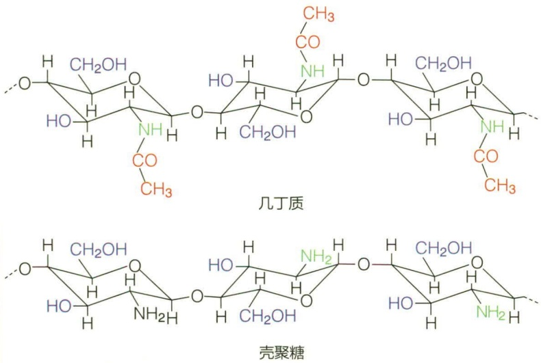

chemical

Chemical structures of glycosides showing glycoside chains and their corresponding glycolarboxylic acid derivatives

图 4-1 几丁质和壳聚糖的化学结构

等的壶菌的细胞壁中都含有几丁质。由于几丁质中存在大量氢键，因此具有很强的伸展性和坚固性，从而使细胞具有一定的刚性（图 4-1）。

真菌细胞壁中通常还含有葡聚糖（glucan），这类高分子是由葡萄糖单元构成的直链或带有支链的多聚体，包括 $\beta-1,3-$ 葡聚糖、 $\beta-1,6-$ 葡聚糖、 $\alpha-1,3-$ 葡聚糖等。 $\beta-1,3-$ 葡聚糖在酿酒酵母细胞壁中含量较高并形成纤维； $\beta-1,6-$ 葡聚糖在酵母细胞壁中起到很重要的作用，介导细胞壁GPI锚定蛋白与 $\beta-1,3-$ 葡聚糖骨架的共价连接。 $\alpha-1,3-$ 葡聚糖存在于裂殖酵母和担子菌细胞壁中，而在

---

4.1 真核微生物细胞的结构与功能

081

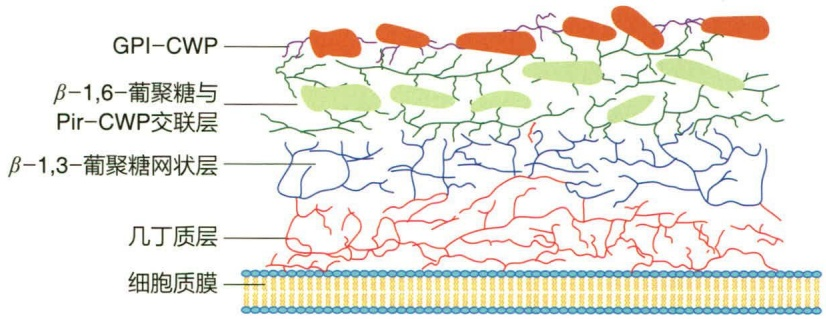

text_image

GPI-CWP
β-1,6-葡聚糖与
Pir-CWP交联层
β-1,3-葡聚糖网状层
几丁质层
细胞质膜

图 4-2 酿酒酵母的细胞壁结构模式图

芽殖酵母和两型性真菌中不含有  $\alpha-1,3-$  葡聚糖。

甘露聚糖（mannan）是酵母菌细胞壁中另一种主要的多糖成分。这些大分子的甘露聚糖在内质网和高尔基体中合成，并通过常规分泌途径运输到细胞壁，然后与GPI-细胞壁蛋白（糖基磷脂酰肌醇锚定的细胞壁蛋白，glycosylphosphatidylinositolanchored cell wall protein）相连接，被锚定在细胞壁的网络骨架结构上。因此，甘露聚糖构成了甘露聚糖蛋白的重要组分。

细胞壁蛋白是真菌细胞壁中主要的非多糖成分，构成了一个覆盖细胞壁结构的网络层，在很大程度上决定了细胞表面的性质。其功能主要包括:①决定菌丝间能否聚集或连接、生殖细胞识别以及宿主细胞识别；②限制细胞壁对外来物质的渗透，对细胞具有保护作用；③细胞壁蛋白大都高度糖基化，在菌丝侵入土壤和树木的过程中起润滑作用；④是决定细胞抗原性的重要组分；⑤作为细胞感应胞外环境刺激的主要信号受体。

酿酒酵母（Saccharomyces cerevisiae）的细胞壁结构研究得较为清楚，其厚度通常为70～100 nm。从细胞质膜向外，依次分布有几丁质层、 $\beta-1,3-$ 葡聚糖网状层、 $\beta-1,6-$ 葡聚糖交联层，以及锚定在 $\beta-1,6-$ 葡聚糖上的GPI-细胞壁蛋白（图4-2）。

丝状真菌的细胞壁与酿酒酵母的细胞壁虽然成分类似，但结构具有明显差异。以粗糙脉孢菌为例，其细胞壁分为4层（图4-3）:最内层紧邻细胞膜的成分为几丁质微纤维丝层，厚度约为18 nm；向外为蛋白质层，厚度为9 nm；再向外为嵌埋在蛋白质基质中的糖蛋白网；最外层是由 $\beta-1,3-$ 葡聚糖和 $\beta-1,6-$ 葡聚糖组成的无定型葡聚糖层。

## 4.1.1.2 单细胞藻类的细胞壁

除隐藻门、裸藻门、金藻门中能够运动的物种及甲藻门少数物种外，大多数单细胞藻类都具有细胞壁。与真菌细胞壁相比，单细胞藻类的细胞壁较薄，一般只有10\~20 nm，蛋白核小球藻的细胞壁更薄，仅有3\~5 nm。不同藻类细胞壁的结构和成分各有不同，可作为藻类分类的依据之一。例如，硅藻门（Bacillariophyta）的细胞壁通常称为壳壁，由两个半瓣、似培养皿样套合而成，主要成分是果胶质

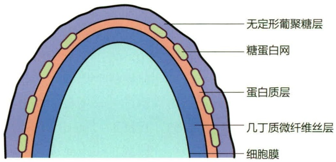

text_image

无定形葡聚糖层
糖蛋白网
蛋白质层
几丁质微纤维丝层
细胞膜

图 4-3 粗糙脉孢菌的细胞壁结构

---

082

4 真核微生物的结构与功能

和硅酸。部分金藻门（Chrysophyta）的细胞壁主要由果胶质组成，其中有些物种还含有由钙质或者硅质构成的球石粒。黄藻门（Xanthophyta）的许多物种的细胞壁由两个似H形的半瓣紧密组成，主要成分为果胶质，有的含有少量硅质和纤维素。甲藻门（Pyrrophyta）的细胞壁主要成分为纤维素，构成具有一定形态的甲片。

## 4.1.1.3 其他真核微生物的细胞壁

现代真菌分类基于 rDNA 序列及细胞壁组成等方面的差异，将以前归属于真菌的卵菌、丝壶菌、根肿菌和黏菌排除在真菌之外。卵菌细胞壁的主要成分是  $\beta-1,3-$  葡聚糖、 $\beta-1,6-$  葡聚糖或者纤维素，一般不含几丁质。然而，有些卵菌，如绵霉属、水霉属真菌的细胞壁中含有少量的几丁质，水节霉目中数个种的细胞壁中几丁质含量较高。另外，卵菌细胞壁中含有羟脯氨酸，这是卵菌的典型特征。丝壶菌细胞壁中同时含有几丁质和纤维素。黏菌在生长期或营养期为裸露、无细胞壁、多核的原生质团，但在繁殖期产生具有纤维质（纤维素）细胞壁的孢子。

## 4.1.2 细胞膜

细胞膜又称细胞质膜、质膜、原生质膜，其化学成分主要为脂质与蛋白质，另有少量糖蛋白和糖脂等物质，其中脂质主要为磷脂。磷脂分子在水溶液中形成具有高度定向的双分子层，相互平行排列，亲水的极性基指向双分子层外表面，疏水的非极性基朝向内部，形成膜的基本骨架。磷脂中的脂肪酸有饱和与不饱和两种，膜的流动性取决于它们的相对含量。此外，质膜中的脂质成分还包括鞘脂质，如神经酰胺和脑苷脂，以及真菌细胞特异性的麦角甾醇。因此，真菌麦角甾醇及其合成途径成为唑类药物、特比萘芬和两性霉素等主要抗真菌药物的作用靶点（表4-1）。

表 4-1 常见抗真菌药物类型及其作用机制

| 药物种类 | 举例 | 作用机制 |
| --- | --- | --- |
| 唑类 | 氟康唑、伊曲康唑 | 抑制麦角甾醇合成途径的14-脱甲基酶 |
| 烯丙胺类 | 特比萘芬 | 抑制麦角甾醇合成途径中的鲨烯环化酶 |
| 吗啉类 | 丁苯吗啉 | 抑制麦角甾醇合成途径中的$\Delta^{8}-\Delta^{7}$异构酶 |
| 两性霉素类 | 两性霉素B | 抑制麦角甾醇的生物活性 |

## 4.1.3 细胞核

与原核生物不同，真核生物具有形态完整、有核膜包裹的细胞核（nucleus），其对细胞的生长发育、繁殖、遗传和变异等起着决定性的作用。细胞核呈球体或椭球体，直径5\~7μm，由核膜、染色质、核仁和核基质等构成。

核膜（nuclear envelope）由双层单位膜构成，厚8\~20 nm，两层膜间夹着宽10\~50 nm的核周间隙（perinuclear space）。核膜上有大量的核孔（nuclear pore），是

---

4.1 真核微生物细胞的结构与功能

083

核质与细胞质物质交换的选择性通道。核内有一中心稠密区为核仁（nucleolus），被一层均匀的无明显结构的核质包围。核膜的外层常有核糖体附着，且核膜与内质网连接。有些真菌在细胞核分裂过程中，核仁和核膜一直存在，所以纺锤体完全在核内形成，这与其他高等生物不同。

染色质（chromatin）是由核小体（nucleosome）成串排列形成的纤维状结构。核小体由 DNA、组蛋白、非组蛋白和少量 RNA 组成。组蛋白是染色质的结构蛋白，分为 H1、H2A、H2B、H3 和 H4 五种，占染色质质量的 50% 以上，富含碱性氨基酸，易与带负电荷的 DNA 结合组成核小体。核小体的核心结构为组蛋白八聚体，由 H2A、H2B、H3 和 H4 各两分子组成。DNA 在八聚体外以左手方向盘绕两周（约 200 bp），H1 与连接 DNA（linker DNA）结合，以稳定核小体的结构。组蛋白在细胞周期的特定时间可发生甲基化 / 去甲基化、乙酰化 / 去乙酰化、泛素化 / 去泛素化、磷酸化和 ADP 核糖基化，改变染色质构型，以调控基因的表达。染色质中的非组蛋白包括一些与 DNA 复制和转录有关的酶，如 DNA 和 RNA 聚合酶等。

细胞核空间由蛋白纤维组成的网状结构所填满，该结构通常为核基质（nuclear matrix）或核骨架（nucleoskeleton），具有支撑细胞核和提供染色质附着点的功能。

真菌的细胞核比其他真核生物的细胞核小，直径一般为 $2\sim 3\mu \mathrm{m}$ ，个别的可达$25~{\mu\mathrm{m}}$ 。不同真菌细胞内细胞核的数目变化很大，通常每个细胞含一个至多个核，如青霉属（Penicillium）细胞内可有 $20\sim 30$ 个核，占细胞总体积的 $20\% \sim 25\%$ ；而担子菌有单核菌丝和双核菌丝，核只占菌丝细胞总体积的 $0.05\%$ ，在菌丝的顶端细胞内常常找不到细胞核。

真菌细胞核内的染色体不易染色和鉴别，但可用遗传学分析法和基因组测序来了解其染色体的数目，如粗糙脉孢菌有7条、构巢曲霉8条、啤酒酵母17条。真菌单倍体细胞中染色体的数目一般在2\~18条。真菌染色体中的蛋白质为组蛋白和酸性蛋白。

真菌的基因组比较小，介于原核生物和高等动植物之间。例如，双孢蘑菇单倍体基因组大小约为 34 Mb，相当于大肠杆菌的 8 倍，仅为人类单倍体基因组的 1%。2012 年完成测序的两株小球藻 Bigelowellia natans 和 Guillardia theta 的基因组相对较大，分别为 95 Mb 和 87 Mb，两个基因组中大约有一半基因是其独有的，之前在其他物种中未发现过，这表明了其物种的独特性。

## 4.1.4 细胞质和细胞器

细胞质（cytoplasm）是细胞膜所包围的除核区外的透明、黏稠、具流动性的胶状物，是细胞生命活动的主要场所，包括细胞质基质（cytoplasmic matrix）、细胞骨架和各种细胞器（organelle）等。

## 4.1.4.1 细胞质基质和细胞骨架

细胞质基质也称为细胞溶胶（cytosol），是细胞质内除去能分辨的细胞器和颗粒

---

084

4 真核微生物的结构与功能

物以外的、呈液态胶状的基底物质。基质含有丰富的酶等蛋白质（占细胞总蛋白的25%\~50%）、各种内含物以及中间代谢产物等，是细胞代谢活动的重要场所和细胞器的存在环境。细胞中的物质变化，如黏度改变、细胞质流动等，都是细胞质基质的活动导致的。

大多数真菌细胞中，细胞骨架（cytoskeleton）是由微管、肌动蛋白和胞裂蛋白三种蛋白纤维构成的细胞支架，是一个相互关联的、巨大而复杂的丝状体网络。细胞骨架为细胞质提供支撑，维持细胞器在细胞质中的位置，同时还担负细胞质和细胞器的运动。细胞骨架还与细胞分裂、基因表达、信息传递和细胞分化等密切相关。

微管（microtubule）是直径为 25 nm 的中空管状纤维，由 2 种十分相似的微管蛋白（tubulin）亚基  $\alpha$  和  $\beta$  组成，每个微管蛋白的直径为 4～5 nm。这些亚基以螺旋方式排列形成柱状结构，平均每圈或每周有 13 根原纤维单位。微管可分散或成束存在于细胞质基质中，具有维持细胞形状、参与细胞运动和胞内运输、参与构成细胞有丝分裂时的纺锤体以及鞭毛和纤毛等功能。例如，菜豆单胞锈菌（Uromyces phaseoli）孢子萌发时加入抗微管因子，核酸、线粒体、液泡和囊泡的运动均被抑制。

肌动蛋白细胞骨架（actin cytoskeleton）通常具有3种存在形式，包括:肌动蛋白束、肌动蛋白皮层斑点以及位于隔膜形成位点的肌动蛋白环。在酿酒酵母中，皮层斑点聚集于极性生长位点，而肌动蛋白束朝向该斑点分布，两者共同参与细胞的极性生长过程。

胞裂蛋白（septin）首次在酿酒酵母出芽时的芽颈部被发现。该类蛋白是 GTP 结合蛋白，从酵母到人类具有保守性。目前发现的酿酒酵母胞裂蛋白含有 7 个亚基，分别为 Cdc3、Cdc10、Cdc11、Cdc12、Shs1、Spr3 及 Spr28。各亚基共同组装形成高度有序的纤维状或环状结构，在胞质分裂、极性生长及胞吐过程中发挥重要作用。

## 4.1.4.2 内质网和核糖体

内质网（endoplasmic reticulum，ER）是与细胞质基质相隔离、但彼此相互沟通的扁平囊腔和膜管系统，由脂质双分子层围成。其内侧与核被膜的外膜相连，所以核周间隙也是内质网腔的一部分。内质网的性质随细胞的功能和生理学状态不同而异。正在大量合成某种目的蛋白的细胞中，内质网的外表附着大量的核糖体，称为糙面内质网（rough ER），也称粗面内质网，糙面内质网还具有运送胞外分泌蛋白的功能。无核糖体附着，与脂质代谢和钙代谢等密切相关的内质网，称为光面内质网（smooth ER），也称滑面内质网。

内质网除了运输蛋白质和脂质，也是细胞膜合成的主要场所，还可以协助其他一些物质穿过细胞。内质网是细胞内最丰富的膜，形成一种网络结构，提供机械支撑，并成为细胞质中酶附着的支架。

核糖体（ribosome）又称核蛋白体，是存在于一切细胞中且无膜包裹的、由核糖体 RNA（rRNA）和蛋白质组成的椭球形致密颗粒（大小为  $15 \, nm \times 25 \, nm$ ），具有合成蛋白质的功能。真核细胞核糖体可附着于内质网膜，或游离在细胞质基质中。真核细胞核糖体直径约  $25 \, nm$ ，主要成分是蛋白质（约 40%）和 rRNA（约 60%），两者共价

---

4.1 真核微生物细胞的结构与功能

085

结合在一起。蛋白质分布在核糖体表面，rRNA位于内层。真核细胞的核糖体较原核细胞的大，其沉降系数为80S，由60S大亚基和40S小亚基组成。不同真核微生物的核糖体大小有一定的变化。核糖体还分布于线粒体和叶绿体中，是与原核生物相同的70S核糖体，这从侧面支持了线粒体和叶绿体的内共生起源学说。细胞质中游离的核糖体主要合成细胞内所需的蛋白质，包括非分泌蛋白和非膜蛋白，如细胞骨架蛋白、细胞质基质中的酶类等，供细胞代谢、生长和增殖需要；另外，由游离的核糖体合成的一些蛋白质可定位于细胞核、线粒体和叶绿体等细胞器；附着于糙面内质网和细胞核膜上的核糖体主要负责合成定位于细胞膜中的蛋白质，以及胞外蛋白；存在于线粒体的核糖体则合成线粒体自身所需的蛋白质。

## 4.1.4.3 高尔基体

高尔基体（Golgi body）是由数个扁平囊泡堆在一起形成的具有高度极性的膜状细胞器，又称高尔基器（Golgi apparatus）或高尔基复合体（Golgi complex）。常分布于内质网与细胞膜之间，呈弓形或半球形，无核糖体颗粒附着，极像光面内质网，因此有科学家认为它是由光面内质网演化而来的。

丝壶菌、卵菌、藻类和原生动物中都被发现有完整的高尔基体，而真菌和纤毛虫原生动物中没有完整的高尔基体结构，有时仅由单个扁囊堆组成，许多细胞都含有20个甚至更多分离的扁囊堆。这种扁囊堆称为分散高尔基体（dictyosome），它们可聚集在某一区域或分散在整个细胞中。

高尔基体是合成、分泌糖蛋白和脂蛋白的重要细胞器，但其确切的作用方式随生物体不同而有所变化。蛋白质在糙面内质网上的核糖体中合成后，可输送到高尔基体并与其中糖类或脂质结合，形成糖蛋白或脂蛋白的分泌泡，最后通过外排作用分泌到胞外。

高尔基体还为合成新细胞壁和细胞膜提供原材料。一些鞭毛藻和放射状原生动物的表面鳞状结构在高尔基体中组建完成，然后通过囊泡运输到胞外。高尔基体还参与细胞膜的形成和细胞产物的包装。一些真菌菌丝的生长是高尔基体囊泡将其包含物运至菌丝尖端壁上的结果。因此，高尔基体作为协调细胞生化功能和沟通细胞外环境的重要细胞器，可将核膜、内质网、高尔基体和分泌囊泡的功能连成一体，相互协作。

## 4.1.4.4 溶酶体

溶酶体（lysosome）是由单层膜包裹的囊泡状细胞器，能水解各种内源性或外源性大分子物质。

溶酶体内含有 60 多种酸性水解酶（如酸性磷酸酶、核糖核酸酶和脂酶等），可水解其中的蛋白质、多糖、脂质以及 DNA 和 RNA 等。不同细胞中的溶酶体数目、大小和所含酶种类不尽相同，但均含酸性磷酸酶。

溶酶体可以维持细胞的营养及防止外来微生物或异体物质的侵袭。当溶酶体与吞噬泡（phagocytic vacuole）或胞饮泡（pinocytotic vesicle）结合后，能消化其中的颗粒状或水溶性有机物；溶酶体也可消化自身细胞产生的碎渣。

---

086

4 真核微生物的结构与功能

溶酶体的种类很多，根据是否含有被消化物质（底物），将其分为初级溶酶体（primary lysosome）和次级溶酶体（secondary lysosome）。初级溶酶体内无底物存在，初级溶酶体与不同的底物结合后形成次级溶酶体，可消化底物。根据底物来源的不同，次级溶酶体又分为自噬溶酶体（autophagolysosome）和异噬溶酶体（heterophagic lysosome）。积累了大量不可消化物质（如尘埃、金属颗粒等异物、衰老细胞器的某些类脂成分）的溶酶体称为残余小体（residual body）。当细胞死亡时，溶酶体膜破裂，酶释放出来导致细胞自溶（autolysis）。

## 4.1.4.5 微体

微体（microbody）是由单层膜包裹的球状、椭球状或哑铃状的细胞器，内含无定形颗粒基质，分为过氧化物酶体和乙醛酸循环体。微体中有过氧化氢酶，可使细胞免受  $H_{2}O_{2}$  的毒害。

真核微生物细胞中普遍存在着过氧化物酶体（peroxisome）。这类细胞中约有20%脂肪酸是在过氧化物酶体中被氧化分解的。与溶酶体相似，不同细胞和不同条件下，过氧化物酶体的数目、形态、大小和功能有所不同。例如，在糖液中生长的酵母，其过氧化物酶体很小，在甲醇溶液中较大，而在脂肪酸培养基中非常发达，可迅速将脂肪酸分解成可供细胞利用的乙酰辅酶A。

乙醛酸循环体（glyoxysome）是含有乙醛酸循环所需酶的微体，是细胞进行乙醛酸循环的场所。乙醛酸循环是使脂质向糖类转化的重要途径。

## 4.1.4.6 线粒体

大多数真核微生物都具有线粒体（mitochondrion）。线粒体是细胞的“动力站”，具有将有机物的化学能转化成生物所需能量的功能。

在光学显微镜下，线粒体呈柱状或颗粒状。典型线粒体的外形和大小酷似一个杆菌，在透射电镜下呈圆柱状，大小一般为（0.3～1.0） $\mu m\times(1.5\sim3.0)\mu m$ 。不同细胞种类或不同生理状态下，其形态和长度变化很大。

一般细胞所含的线粒体数量可达 1 000 个或者更多，少数细胞（如某些酵母、单细胞藻类和锥虫）只有一个巨大的管状线粒体，而巨大变形虫则有 50 万个线粒体。

线粒体是由双层膜包裹的囊状结构，囊内充满液态的基质。外膜平整，内膜则向基质内褶皱，从而形成了大量由双层内膜构成的嵴（cristae），大大地增加了膜的表面积。不同物种的线粒体中嵴的形状不同。内膜的表面着生许多基粒，这些基粒是ATP合成酶复合体，每个线粒体中有 $10^{4}\sim10^{5}$ 个。由内膜和嵴包围的空间即为线粒体基质，内含TCA循环酶系和特有的闭环状DNA。线粒体带有自身的核糖体，但这些核糖体是70S核糖体，而非真核细胞质中的80S核糖体。

线粒体的主要功能是将底物通过电子传递链和氧化磷酸化反应的偶联从而实现呼吸产能。过去曾认为酵母在无氧条件下发酵是没有线粒体的，后来采用冷冻刻蚀技术（freeze-etching）发现，在无氧条件下，酵母形成的是极其简单的线粒体（只有外膜而无内膜和嵴）；当将其转移到有氧条件下，线粒体从无功能的简单结构转变成有功能的正常结构。线粒体的另一个功能是可以半自主性地合成一些蛋白质。科学家推测，

---

4.1 真核微生物细胞的结构与功能

087

在线粒体中合成的蛋白质约占线粒体全部蛋白的 10%，这些强疏水性蛋白质和内膜结合在一起。

大多数真核微生物都具有线粒体，但某些原生动物（如贾第鞭毛虫、阿米巴等）缺失线粒体。这些“无线粒体”的原生动物通常会表现出“厌氧”的特点，其体内的代谢过程较为简单且特殊，在合成DNA以及蛋白质的重要构成片段等方面与它们的哺乳动物宿主有所不同。特别是在含硫氨基酸代谢方面，这些原生动物拥有独特的代谢途径。

## 4.1.4.7 叶绿体

叶绿体（chloroplast）是由内外两层膜包裹、含有叶绿素、可将光能转化为化学能的绿色细胞器，是光能自养型真核细胞内的“食品车间”和“能量转换站”。藻类中叶绿体的形态变化很大，有的呈螺旋带状，如水绵属；有的呈杯状，如衣藻属；也有呈板状或星状的。叶绿体的构造由叶绿体膜、类囊体和基质三部分组成。

叶绿体被膜（chloroplast envelope）由双层膜组成，膜间有10～20 nm的膜间隙。叶绿体膜是控制代谢物质进出叶绿体的屏障。外膜通透性大，核苷、无机磷、蔗糖等营养分子可自由进入膜间隙；内膜选择性强， $CO_{2}$ 、 $O_{2}$ 、Pi、 $H_{2}O$ 、磷酸甘油酸、磷酸丙糖、双羧酸和双羧酸氨基酸可以透过内膜，ADP、ATP、己糖磷酸、葡萄糖和果糖等透过较慢，蔗糖、五碳糖双膦酸酯、六碳糖磷酸酯、 $NADP^{+}$ 和焦磷酸不能直接透过内膜，它们需要特殊的转运体（transporter）才能通过内膜。

类囊体（thylakoid）是单层膜围成的扁平小囊，数量多，彼此连通，连接方式多样。类囊体可以增加内膜面积。膜上含有光合色素和电子传递链组分，又称光合膜（photosynthetic membrane）。藻类的光合色素主要有4类:叶绿素、藻胆蛋白、胡萝卜素和叶黄素。藻类叶绿素包括叶绿素a、叶绿素b、叶绿素c和叶绿素d。所有的藻类都含有叶绿素a，原绿藻门、裸藻门、绿藻门和轮藻门含有叶绿素b，隐藻门、甲藻门、黄藻门、金藻门、硅藻门和褐藻门含有叶绿素c，红藻门中有的种类则含有叶绿素d。

基质（stroma）是充满叶绿体膜与类囊体之间的胶状物质，内含70S核糖体、双链环状DNA和RNA、碳同化相关的酶以及一些颗粒物如淀粉粒。核酮糖二磷酸羧化酶约占基质可溶性总蛋白的60%。

叶绿体除了进行光合作用，还与线粒体一样可以半自主性地合成自身的 DNA 和一些蛋白质，含有与原核生物类似的环状 DNA 和 70S 核糖体。这些为真核生物的内共生学说（endosymbiotic theory）提供了有力的证据。

## 4.1.4.8 液泡

液泡（vacuole）是存在于真菌和藻类等细胞中，由单位膜分隔且充满液体的细胞器。原生动物的食物泡、收缩泡等均属于液泡。液泡的形态和大小受细胞年龄和生理状态影响较大，一般老龄细胞的液泡大而明显。

液泡含有一些营养物质和酶类，因此有维持细胞渗透压、贮存营养物质等功能；另外，它还有溶酶体的功能，可以把蛋白酶等水解酶与细胞质隔离，防止细胞损伤。

---

088

4 真核微生物的结构与功能

研究表明，真菌液泡不仅在蛋白质转换、细胞的动态平衡、膜运输、信号转导等方面有重要的作用，还与真菌的生长、分化、共生、致病等紧密相关。

## 4.1.4.9 膜边体

膜边体（lomasome）是真菌细胞特有的由单层膜包裹的细胞器，存在于细胞膜和细胞壁之间。膜边体的形态变化很大，可为管状、囊状、球状、卵圆状或多层折叠的囊状等，其内有泡状物或颗粒物。在某些情况下膜边体与细胞膜连接在一起，可能是细胞膜内陷形成的。这种内陷经常出现在细胞膜内侧，有时也出现在细胞膜外侧。膜边体的形状和位置与细菌的中间体相似。膜边体也可以由高尔基体或内质网的特殊部位形成，膜边体彼此互相融合，也可以与其他细胞器或膜结合。

膜边体至今尚未在真菌以外的其他细胞中发现。膜边体的功能尚不十分清楚，可能与细胞的分泌、细胞壁的合成、细胞膜的增生以及胞饮现象有关。

## 4.1.4.10 壳质体

壳质体（chitosome）又称为几丁质酶体，是一种活跃于真菌菌丝顶端细胞中，具有膜状外壳的微小囊泡，直径40\~70 nm。壳质体含有几丁质合成酶，可将合成的几丁质运送到菌丝顶端细胞的表面，参与细胞壁的合成。

## 4.1.4.11 沃鲁宁体

沃鲁宁体（Woronin body）是存在于真菌细胞中、由单层膜包围的电子密集的基质构成的较小的球状细胞器，直径约  $0.2 \mu m$ 。它与子囊菌的隔膜孔相关联，具有“塞子”的功能，可调节两个相邻细胞间细胞质的流动。当菌丝受伤后，它可以堵塞隔膜孔，防止细胞质流失。目前还不清楚其化学组成。

## 4.1.4.12 氢化酶体

氢化酶体（hydrogenosome）是单层膜包裹的球状细胞器，内含氢化酶、氧化还原酶、铁氧还蛋白和丙酮酸，也称氢酶体。通常存在于鞭毛基体附近，产生ATP和氢气，为鞭毛运动提供能量。氢化酶体只存在于厌氧性的原生动物和真菌中，有类似线粒体的作用。

## 4.1.4.13 内含物

真菌菌丝中除了有特定功能的细胞器外，通常还有多种内含物（inclusion body）。内含物的种类因真菌的不同而不同，但多为真菌储存的养料，营养丰富时内含物较多，营养缺乏时因被菌体利用而减少或消失。真菌常见的内含物有异染粒、糖原粒、油脂粒等。

异染粒（volutin）:是真菌细胞内普遍存在的内含物，是以无机磷酸盐聚合物为主要成分的一种无机磷的贮备物，还含有少量脂肪、蛋白质和核酸。

糖原粒（glycogen particle）:又称肝糖粒或动物淀粉粒，是多糖的一种，由葡萄糖失水缩合而成，是真菌和动物储存糖类的主要形式。真菌细胞内糖原粒的主要生物学功能是为真菌储存能量。

油脂粒（grease particle）:真菌油脂主要以两种形式存在，一种是作为细胞结构组成部分的体质脂，含量稳定；另一种是作为内含物存在于细胞质中的储存脂——油脂

---

4.2 真核微生物的分化

089

粒。真菌油脂粒的主要生物学功能也是能量储存，而其中一些组成成分如多不饱和脂肪酸还与真菌抗逆性及其他特性有关。

## 4.1.4.14 膜连接系统

在真菌细胞中，内质网与其他膜结构，如细胞膜、线粒体膜、囊泡膜、液泡膜等均存在物理性的连接结构，从而构成了细胞内复杂的膜连接系统，其中包括内质网-质膜连接、内质网-线粒体连接、内质网-液泡连接等。这些结构通过建立起各种膜结构的物理连接，为膜结构间物质与信息交流提供了便捷。

## 4.1.5 细胞表面附属物

某些真核微生物具有鞭毛或纤毛等表面附属物，其通常由蛋白质组成，具有运动和感受功能。鞭毛长度为150\~200  $\mu$ m，数量一般为1\~2根，多处于细胞的一端。纤毛较短，仅为5\~10  $\mu$ m，数量较多，周生于细胞表面。具有鞭毛的真核微生物有鞭毛虫纲的原生动物、藻类和低等水生真菌的游动孢子或配子。具有纤毛的真核微生物主要是纤毛虫纲的原生动物，如草履虫。真核微生物的鞭毛以挥鞭式推动细胞运动，与细菌的螺旋式有所不同。鞭毛运动的能量来自ATP。

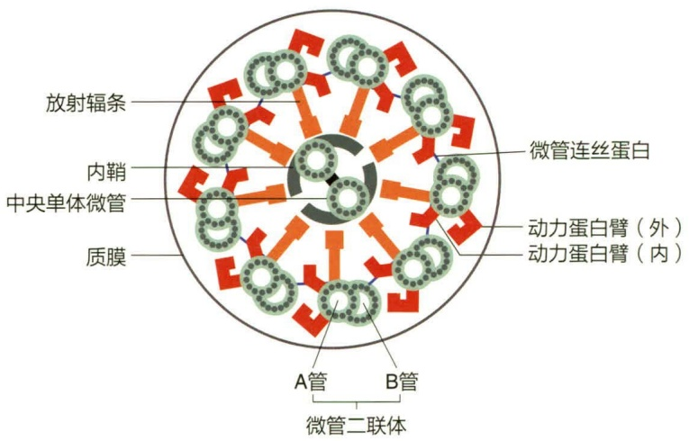

text_image

放射辐条
内鞘
中央单体微管
质膜
A管
B管
微管连丝蛋白
动力蛋白臂（外）
动力蛋白臂（内）
微管二联体

鞭毛与纤毛的构造基本相同，由伸出胞外并

包有细胞膜的鞭杆、埋在细胞质内的基体以及把两者连在一起的过渡区三部分组成。鞭杆的横切面呈“9+2”型，即中心有一对包在中央鞘中的相互平行的中央微管，其外围绕一圈（9个）微管二联体。每条微管二联体由A、B两条中空的亚纤维组成，其中A亚纤维是完全微管，每圈由13个球形微管蛋白亚基环绕而成；B亚纤维则由10个亚基围成，其他3个亚基与A亚纤维共用（图4-4）。

图 4-4 真核微生物的“9+2”型鞭毛结构

## 4.2 真核微生物的分化

## 4.2.1 真菌的营养体和繁殖体

## 4.2.1.1 营养体

真菌营养体有两大类型，一是单细胞（unicellular），二是由多细胞组成的菌丝（hypha）。

以单细胞为营养体的真菌称为酵母菌（yeast），目前已经发现了1 500余种酵母，大概占现有已描述真菌的1%。酵母细胞形状多样，从球状、蛋状、卵状到杆状不等。

---

090

4 真核微生物的结构与功能

图 4-5 真菌的二态性现象

（a）酵母菌的两种生长形态。上图:单细胞酵母及其出芽繁殖。下图:假丝酵母；（b）昆虫病原真菌绿僵菌侵染昆虫过程中的二态性转变现象

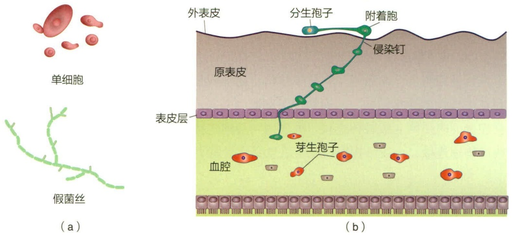

细胞尺寸随种类和环境变化较大，典型酵母细胞直径在  $3 \sim 4 \mu m$ ，某些种的细胞较大，如皮炎芽生菌（Blastomyces dermatitidis）的细胞直径高达  $40 \mu m$ 。在特定的环境下，单细胞酵母出现二态性（dimorphism）转变的现象，形成假菌丝（pseudohyphae），这类真菌称为双相真菌（dimorphic fungi）。例如引起人类念珠菌病（candidiasis）的病原菌白色念珠菌（Candida albicans）感染寄主时往往会由单细胞转变为假菌丝，以侵染寄主组织（图 4-5a）。

菌丝是由多个细长细胞组成的细胞链，是丝状真菌（filamentous fungus）的基本单位。常见的霉菌（mold）和蕈菌（mushroom）都是丝状真菌，其中蕈菌又称为蘑菇（mushroom）。酵母、霉菌和蘑菇是根据真菌形态对真菌进行分类的俗名，而与物种亲缘没有关系，例如一些酵母和蘑菇均属于担子菌门，而有些霉菌和酵母则属于子囊菌门。一些丝状真菌也是双相真菌，如昆虫病原真菌绿僵菌（Metarhizium）和白僵菌（Beauveria）在侵染昆虫时，在它们进入昆虫血腔之后由菌丝生长转为类酵母菌丝段的形式生长（图4-5b）。菌丝以极性生长（polar growth）的方式生长，其间会分枝（branching），最终形成复杂的网状结构即菌丝体（mycelium）。在美国俄勒冈州马卢尔国家森林（Malheur National Forest）发现的奥氏蜜环菌（Armillaria solidipes）的菌丝体占地超过8.8 km²，估计年龄达2 400岁，总质量高达604 t，是目前世界上已知的最大活生物体。

根据是否有隔膜，菌丝可分为有隔菌丝（septate hypha）和无隔菌丝（non-septate hypha 或 aseptate hypha）（图 4-6a）。有隔菌丝以隔膜（septum）将细胞分开，隔膜还可增加菌丝的结构稳定性。隔膜中间有孔径较小的孔，细胞核一般不能穿过，这使得多数有隔菌丝的细胞只有单个细胞核。细胞质可穿过隔膜孔在细胞间流动，当部分菌丝受到损伤时，隔膜孔会关闭，以免整条菌丝的细胞质从伤口流出。无隔菌丝一般含有多个细胞核，因此被称为多核菌丝（coenocytic hyphae）。与有隔菌丝不同，无隔菌丝受损伤时，整条菌丝的细胞质可能全部流出而死亡。但是，菌丝的分枝部位往往有隔膜，以免整个菌丝体死亡。由于隔膜障碍降低细胞质在菌丝间的流动速度，这使得有隔菌丝在培养基表面生长，形成较为紧密的菌落。与之相反，无隔菌丝内细胞质流

---

4.2 真核微生物的分化

091

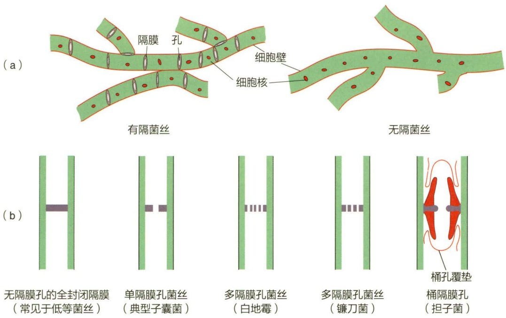

图 4-6 丝状真菌菌丝  
(a) 菌丝类型；(b) 菌丝隔膜孔类型

动更快，导致菌丝向空中四处极性生长，菌落往往不成形。

隔膜是由菌丝细胞壁向内环状生长而形成的，其结构与组成与细胞壁类似。隔膜主要分为3种类型（图4-6b）:①单隔膜孔型，唯一的孔在隔膜中心；②多隔膜孔型，隔膜上有多个小孔；③复孔型（桶孔型，dolipore septum），隔膜上唯一孔的边缘膨大而呈“琵琶桶”状，外盖一层由内质网组成的弧形桶孔覆垫（parenthesome），桶孔覆垫中的穿孔可让细胞质通过。

## 4.2.1.2 菌丝分化与营养吸收

在一定的条件下，菌丝会分化（differentiation）形成较复杂的结构，主要达到三类目的:其一是更有效地获取营养物质；其二是抵抗环境逆境；其三是分化成繁殖结构进行无性繁殖或有性繁殖。

为了高效地获取营养，一些真菌菌丝会分化成如下类型的特殊结构。

假根（rhizoid）:假根具有根状结构，其主要有两个作用，一是将菌丝体锚定在基质上；二是分泌各种水解酶降解基质，并吸收由此产生的营养物质（图 4-7a）。

匍匐菌丝（stolon）:匍匐菌丝是根霉属（Rhizopus spp.）真菌形成的延伸的匍匐状菌丝（图 4-7a）。当匍匐菌丝蔓延一定距离后，在基质里会形成假根，之后可继续延伸形成新的匍匐菌丝和假根。

菌索（rhizomorph）:在自然界中，一些子囊菌门和担子菌门的真菌如蜜环菌（Armillaria mellea）常会形成菌索。菌索是由大量成束的菌丝组成，成束的菌丝比单根菌丝延伸得更远，以寻找更多的食物来源（图4-7b）。菌索中有类似于植物木质部的结构，可长距离地运输水分和易溶于水的营养物质。环境中不同方位的真菌可通过菌索相连，从而共享营养和水分，极大地提高真菌的生存能力。

吸器（haustorium）:一些植物病原真菌的菌丝，如小麦白粉菌（Erysiphe

---

092

4 真核微生物的结构与功能

图 4-7 腐生真菌的菌丝分化

(a) 假根和匍匐菌丝（孢囊孢子）；(b) 菌索

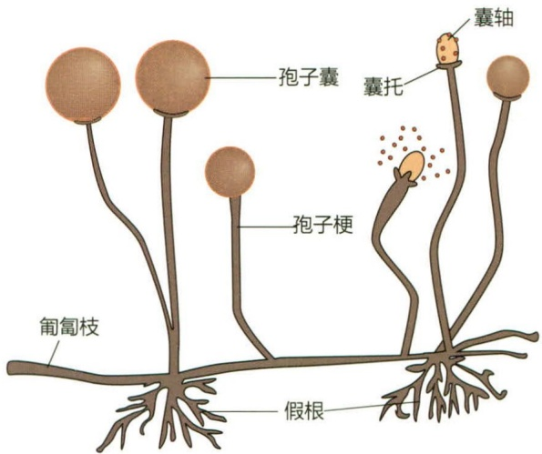

text_image

孢子囊
囊托
囊轴
孢子梗
匍匐枝
假根

(a)

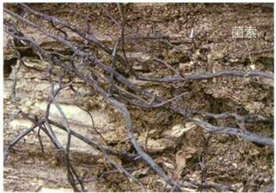

text_image

菌索

(b)

graminis)，进入寄主细胞后分化形成吸器。吸器具有掌状、球状和网状等形状，其主要作用是增大真菌细胞与植物细胞质的接触面积，以充分地从寄主细胞吸收营养物质（图 4-8a）。

附着胞（appressorium）:在寄主表面，一些植物病原真菌（如稻瘟病菌）和昆虫病原真菌（如绿僵菌）的菌丝顶端会膨大分化形成侵染结构附着胞，其内有强大的渗透压，可将侵染钉推入寄主体内（图 4-8b）。

附着枝（hyphopodium）:一些体外寄生菌（ectoparasitic fungi），如煤烟黑霉菌（如 Cladosporium 和 Alternaria），附在寄主表面的菌丝上，其顶端一到两个细胞分化形成附着枝。它们并不进入植物组织中，而只是附在植物寄主的体表，依靠植物分泌的含糖的液质而生活（图 4-8c）。

捕食器（nematode-trapping device）:捕食线虫真菌（nematode-trapping fungi）的菌丝分化形成线虫捕食器，主要有黏性菌网（adhesive networks）、黏球（adhesive knobs）、非收缩环（non-constricting rings）和收缩环（contractile ring）（图4-8d）。成熟的黏性菌网通常包含5\~7个菌环，收缩环则由3个细胞组成。与营养菌丝相比，捕食器菌丝除了形态不同之外，其细胞中还存在电子致密体（electron-dense bodies）。

## 4.2.1.3 菌丝分化与休眠抗逆

一些真菌的菌丝可分化形成休眠结构菌核（sclerotium），以度过不良环境条件（逆境）。菌核是由大量的菌丝组成的致密结构。菌核形态和大小差异很大。引起油菜菌核病的核盘菌（Sclerotinia sclerotiorum）产生较小的黑色菌核（图4-9a），而茯苓（Poria cocos）则产生大型菌核，质量可达50 kg（图4-9b）。茯苓是具有利尿和杀菌等药用效果的有益菌核，而麦角菌（Claviceps purpurea）形成的麦角菌核（图4-9c）则有害，它含有导致麦角毒症的多种生物碱，可污染面粉。一些真菌的菌丝还可与宿主组织形成类菌核结构，称为假菌核（pseudosclerotium）。

---

4.2 真核微生物的分化

093

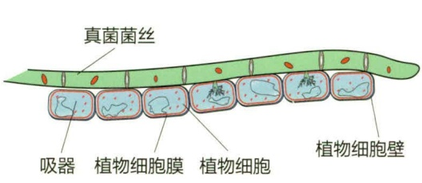

text_image

真菌菌丝
吸器 植物细胞膜 植物细胞 植物细胞壁

(a)

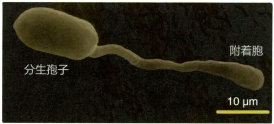

text_image

分生孢子
附着胞
10 µm

(b)

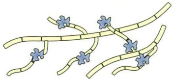

natural_image

Diagram of plant cells with blue star markers indicating specific structures (no text or labels)

(c)

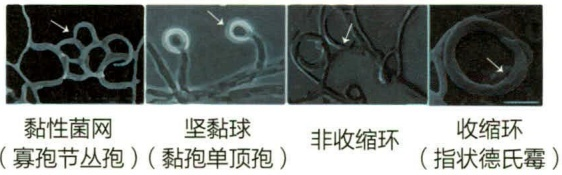

text_image

黏性菌网
(寡孢节丛孢)
坚黏球
(黏孢单顶孢)
非收缩环
收缩环
(指状德氏霉)

(d)

图 4-8 病原真菌的菌丝分化

（a）吸器（小麦白粉病菌等植物病原真菌）；（b）附着胞（绿僵菌等昆虫病原真菌）。AP:附着胞；CO:分生孢子；（c）附着枝（煤烟黑霉菌）；（d）线虫病原真菌的菌丝分化

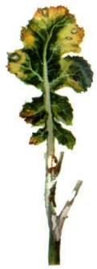

natural_image

Close-up of a plant stem showing yellow and green leafy structures (no text or symbols)

(a)

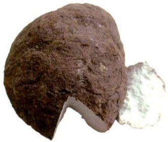

natural_image

Close-up of a rough, brownish, mushroom-like object with a white, irregularly shaped cutout on the right side (no text or symbols visible)

(b)

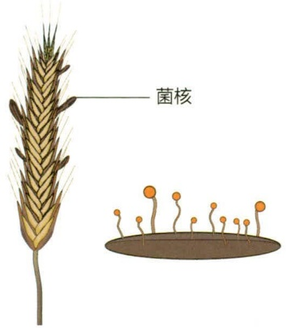

text_image

菌核

(c)

图 4-9 菌丝形成的休眠结构

(a) 油菜菌核 (核盘菌);
(b) 茯苓; (c) 麦角菌核
(麦角菌)

## 4.2.2 其他真核微生物

## 4.2.2.1 藻类

藻类（alga）是自养型真核微生物，可以进行光合作用。藻类的营养体称为厚植体（thallus）。厚植体形态多样，有简单的单细胞，也有高度分化的多细胞。单细胞厚植体有球形、长杆形、星形、弯曲状和被状等。厚植体可以由单细胞产生，而有些细胞分裂后形成的子细胞不分离而形成群落，其形态多样性很高，常见的有球状、片状、丝状、不规则的团块和分枝状。

藻类可以进行无性繁殖和有性繁殖。无性繁殖可在营养细胞内形成孢子，也可在营养细胞分化形成的孢子囊中形成。带有鞭毛的可游动孢子称为动孢子（zoospore），由孢子囊产生的无运动能力的孢子称为静孢子（aplanospore）。有性生殖细胞称为配子，雌配子称为卵细胞（卵子），在藏卵器（oogonium）内形成，藏卵器是相对而言没

---

094

4 真核微生物的结构与功能

有分化的营养细胞。雄配子为精子，在雄器（antheridium，复数 antheridia）内产生。雌雄配子结合成合子，合子脱离母体自行发育。

藻类的形态、生态、固化、生殖及世代交替多样性很高。绝大多数藻类形成无性和有性生殖结构的单细胞，少数种类形成多细胞的配子囊或孢子囊，其内每个细胞最终形成生殖细胞。

## 4.2.2.2 黏菌

黏菌（slime mould）又称裸菌，其营养体为原生质团或黏变形体（myxamoeba）。单倍体黏菌（类似原生动物的变形虫）聚集可形成假原生质团（pseudoplasmodium），但彼此不融合。营养缺乏时，细胞通过分泌黏菌素（acrasin）（也称集胞素）而聚集，并形成不同形态的黏菌子实体，如孢囊体型、复囊体型、假复囊体型和原质囊体型。当适宜的条件下，黏菌孢子萌发形成变形体（amoebae，又称为黏变形体或黏变形虫），或释放带鞭毛的游动孢子，其后再变成变形体。游动孢子和变形体两种形态的互变与环境中的水分含量密切相关。在水中，变形虫可长出鞭毛在水中游动；除去水后，游动孢子可变回爬行的变形体。如在黑暗、干燥或营养缺乏等不良环境下，原生质团可变成有硬壳覆盖的菌核（sclerotium）或子实体（fruiting body）。菌核是休眠结构，可抵抗不良环境；当条件适宜时，菌核可转变为原生质团。

## 4.3 真核微生物的起源与分类

## 4.3.1 真核微生物的起源

真核微生物的数量庞大，种类繁多，它们展现了多种多样的形态、生活方式和习性。尽管许多原核生物已具备带膜的内部组织结构，但真核生物的复杂程度远超过这一点。真核生物拥有核膜包裹的细胞核，将转录和翻译过程分隔开来，为基因调控提供更多选择；由多个细胞器组成的内膜系统使细胞具备高效的运输和代谢功能。这些结构增强了真核生物在适应环境方面的能力，使其成为现存物种中数量众多的生命形式之一。真核微生物在海洋和陆地食物链中扮演着重要角色，它们可以与宿主共生或寄生而引发病害。

真核细胞与原核细胞之间存在巨大差异，那么它们是如何演化而来的呢？至今最主流的真核细胞起源理论是内共生学说（endosymbiotic theory）。该理论认为最原始的真核生物的直接祖先很可能是一种异常巨大的原核生物，其细胞内存在着类似于内质网的内膜系统，由细胞膜内部的褶皱形成，并具备原始的微纤维系统，使其能够进行变形运动和吞噬其他细胞。随后，该内膜系统的一部分包裹了染色质，从而形成了最原始的细胞核。这个内膜系统的其他部分则分化为高尔基体、溶酶体等细胞器。线粒体的起源可以追溯到内共生的细菌，这些细菌能够进行氧化磷酸化作用。而叶绿体的起源则可以追溯到内共生的能够进行光合作用的蓝细菌。

---

4.3 真核微生物的起源与分类

095

内共生现象在现代生物界中十分常见，如许多真核细胞能够与其他真核细胞共生，例如一些单细胞绿藻、甲藻和硅藻可以共生于高等植物、真菌、其他藻类以及脊椎动物和无脊椎动物的细胞中。此外，原核细胞也可以与真核细胞共生。例如，蓝细菌可以共生于真菌、变形虫、鞭毛虫以及已失去叶绿体的绿藻细胞中，并通过光合作用为宿主提供养分。池沼多核变形虫的细胞中没有线粒体，而是存在一些需氧的细胞内共生细菌，这些细菌实际上起到了线粒体的作用。越来越多的事实和新的发现支持着内共生学说。一些学者通过对蛋白质的比较分析提出了假设，认为一个被称为慢性细胞（chronocyte）的类真核细胞，在形成后吞噬了古菌或细菌细胞，进而形成了细胞核和真核细胞，从分子水平上支持了真核细胞起源的内共生理论。

## 4.3.1.1 细胞核的起源

细胞核的形成是真核细胞演化的关键，原核细胞与真核细胞的最根本差别在于细胞核的有无。关于核是如何起源的猜测目前主要有4种假说，但是均未得到广泛的认可。其一是共营模型（syntrophic model），该模型认为与产甲烷古菌类似的某些古老的古菌，侵入并生活在类似于现代黏细菌的细胞体内，形成了早期的细胞核。古菌与真核生物中某些特定蛋白质（如组蛋白）编码基因的相似性被认为是支持以古菌为基础的细胞核起源论的证据。其二是自演化模型（autogenous model），该模型认为原真核细胞（proto-eukaryotic cell）直接由细菌演化而来，并不需要通过内共生。证据来自一类专性好氧菌——浮霉菌（Planctomycete），它们具有清晰的胞内膜结构，其中有一种被称为Gemmata obscuriglobus的出芽菌的染色质被双层的核膜所包裹，类似于真核生物的核结构，而斯氏小梨形菌（Pirellula staleyi）的核被单层的细胞质内膜所包裹。但是，这一模型并未进一步解释核是如何形成的。其三为病毒性真核生物起源模型（viral eukaryogenesis model），该模型认为病毒感染原核生物导致了膜结合的细胞核与其他真核生物特征的产生。证据是真核生物和病毒在大分子结构上存在一定的相似性，譬如线性DNA链、mRNA的加帽以及与蛋白质的紧密结合（病毒的外套膜类似于组蛋白）。该假说认为，吞噬作用形成了早期的细胞“捕食者”，并随之演化出细胞核。其四为外膜假说（exomembrane hypothesis），该假说认为细胞核是起源自演化出第二层外细胞膜的单个早期细胞，而包裹原来细胞的内膜则转变成了核膜，并逐渐演化出精巧的核孔结构，以便于将内部（如核糖体亚基）合成的物质送出核外。

## 4.3.1.2 线粒体和叶绿体的起源

真核细胞与原核细胞的另一个差异在于细胞质中有多种有膜细胞器，这些细胞器的起源和演化同样是真核细胞演化的重要步骤。其中叶绿体和线粒体是细胞内两个重要的细胞器，叶绿体是光合作用的主要场所，线粒体是细胞活动所需的“能量中心”。因此，它们的起源与演化一直是学术界关注的问题。内共生学说认为，线粒体和叶绿体分别起源于同原始真核细胞共生的参与有氧呼吸的细菌和光合自养的蓝细菌。一种革兰氏阴性菌可以利用体内三羧酸循环的酶系和电子传递链在有氧条件下将糖酵解产生的丙酮酸进一步分解，释放更高的能量，该需氧细菌被原始真核细胞吞噬以后，在长期互利共生中演化形成了现在的线粒体。与此相似，蓝细菌在共生中逐渐演化成了

---

096

4 真核微生物的结构与功能

叶绿体。由于长期的共生互利，需氧细菌和蓝细菌将不少基因转移到宿主细胞核中，形成了线粒体和叶绿体的半自主性。

原核细胞在功能上与线粒体相当的结构是细胞膜和由细胞膜内褶形成的结构，但这些结构没有独立的基因组和合成系统。原核生物中的蓝细菌具有与绿色植物和藻类高度相似的产氧光合系统，也说明它们之间具有相同的起源。

## 4.3.1.3 真菌的起源

真菌是一类有真正细胞核，营养体简单，无根茎叶的分化，无维管束组织，不含有叶绿素且无法进行光合作用的生物。

真菌在地球上存在了多长时间至今尚不清楚，对真菌的起源也没有定论。目前主要有两种观点:起源多元论和鞭毛生物起源论。起源多元论根据性器官的形态及交配方式，认为真菌来自藻类，如壶菌自原藻演化而来，毛霉演化自接合藻，子囊菌和担子菌由红藻演化而来。这些藻类因丧失色素故而从自养变成异养，生理的变化引起了形态的改变。鞭毛生物起源论认为绝大多数真菌是起源于一种原始水生生物——鞭毛生物。鞭毛生物为单细胞，具一至数根鞭毛，有的有叶绿素和其他色素，有的无色素；具色素的演化为藻类，无色素的演化为真菌。该假说认为真菌和藻类都起源于鞭毛生物。

真菌的演化由水生到陆生，由腐生到兼性寄生再到专性寄生。其结构由简单到复杂，再由复杂退化而失去特殊的结构，使结构简单化。

## 4.3.2 真核微生物的主要类群

真核微生物包括真菌、单细胞藻类和原生动物等。据估计，全世界有220万\~380万种真菌。其中，已知的真菌约15.5万种，至今全球每年还以发现约2000个新种而不断地递增着。真核微生物在个体和群体形态、代谢类型与产物、遗传特性和生态分布等方面，呈现丰富的多样性。

真核细胞具有核仁和核膜分化的真核，还含有许多由膜包围的细胞器，而原核细胞只有一个核区，没有核膜包围，也无核仁的分化，称为拟核。真菌不含有叶绿素，不能进行光合作用；一般具有发达的菌丝体；细胞壁多数含几丁质；营养方式为异养吸收型；以产生大量无性和（或）有性孢子的方式进行繁殖；以及陆生性较强。

真菌的分类以形态特征和有性生殖结构作为分类依据，将其分为壶菌门（产生卵孢子）、接合菌门（以接合孢子为特征）、子囊菌门（以子囊和子囊孢子为特征）、担子菌门（以担子和担孢子为特征）。

## 4.3.2.1 单细胞真菌——酵母菌

酵母菌（yeast）是一群单细胞的真核微生物。酵母菌是个通俗名称，是以芽殖或裂殖来进行无性繁殖的单细胞真菌的统称，以与丝状真菌区分开。酵母菌主要分布在含糖质较高的偏酸性环境中，如各种水果的表皮、发酵的果汁、蔬菜、花蜜、植物叶面、菜园、果园及糖厂附近的土壤和酒曲中。它们多为腐生菌，少数为寄生菌，能引

---

4.3 真核微生物的起源与分类

097

起人和植物的病害。

酵母菌与人类的关系密切，是工业上最重要以及应用较为广泛的一类微生物，在酿造、食品、医药工业等方面占有重要地位。它可用来制面包；发酵生产乙醇与含乙醇的饮料，如啤酒、葡萄酒和白酒；生产食品工业的酶，如蔗糖酶、半乳糖苷酶；也可用来提取核苷酸、麦角甾醇、辅酶A、细胞色素c、凝血质和维生素等生化药物；酵母菌细胞蛋白质含量高达细胞干重的50%，并含有人体必需的氨基酸，因此酵母菌可用于生产饲用、食用和药物的单细胞蛋白（single cell protein，SCP）。有的酵母菌还具有氧化石蜡与降低石油凝固点的作用，或者以烃类为原料发酵制取柠檬酸、反丁烯二酸、脂肪酸、甘油、甘露醇、乙醇等。酵母菌属单细胞真核生物，与高等动物、高等植物的单个细胞相比，具有基本相同的细胞结构。但由于酵母菌具有世代时间短，可在简单的培养基上生长，单个细胞能完成全部生命活动的特点，所以该菌的细胞学研究比多细胞真核生物相对容易，使其在分子生物学、分子遗传学等重要理论研究中具有特殊的研究价值。至今已研究清楚了许多酵母菌株的细胞核及细胞质基因，并已建立了用于生物学基础研究的相关模型，在生理学、生物化学和遗传学的研究方面取得了较大进展。

但是有些酵母菌也常给人类带来危害。腐生型酵母菌能使食物、纺织品及其他原料腐败变质；少数嗜高渗透压的酵母菌，如鲁氏酵母（Saccharomyces rouxii）、蜂蜜酵母（Saccharomyces mellis）可使蜂蜜、果酱败坏；工业发酵中的污染菌消耗乙醇，降低产品产量或产生不良气味，影响产品质量；还有些酵母菌能引起植物的病害，甚至能寄生在人、畜和昆虫体上，例如，白假丝酵母（Candida albicans）又称白色念珠菌，可引起人类皮肤、黏膜、呼吸道以及泌尿系统的多种疾病；新型隐球酵母（Cryptococcus neoformans）可导致慢性脑膜炎、肺炎等。

## 4.3.2.2 丝状真菌——霉菌

霉菌（mold）意即“会引起物品霉变的真菌”，通常指那些菌丝体较发达又不产生大型子实体结构的真菌。在潮湿的气候下，它们往往在有机物上大量生长繁殖，从而引起食物、工农业产品的霉变或植物的真菌病害。

## (1) 丝状真菌的菌落特征

丝状真菌的菌落由分支状菌丝体组成，形状各异，由于菌丝较粗长，形成的菌落比较疏松，常呈现绒毛状、棉絮状、毯状、绳索状、皮革状或蜘蛛网状等。由于丝状真菌的分生孢子五颜六色，因此菌落表面及背面也呈现各种颜色，有的产生水溶性色素可分泌到培养基中，使培养基的颜色发生改变。有些丝状真菌，如根霉、毛霉、链孢霉的菌丝生长很快，在固体培养基表面蔓延，直至充满整个容器；有的则有一定的局限性，直径1\~2 cm或更小，如青霉和曲霉。因此，菌落特征是丝状真菌鉴定的主要依据之一。

## (2) 丝状真菌与人类的关系

丝状真菌与人类的生活息息相关，在工农业生产、医疗实践、环境保护和生物学基本理论研究等方面起着重要的作用。它们是人类的帮手，可用于生产奶酪、甜酒、

---

098

4 真核微生物的结构与功能

腐乳和其他发酵食品。在发酵工业上，丝状真菌被广泛地用于生产有机酸（如柠檬酸、葡萄糖酸）、酶制剂（如蛋白酶、淀粉酶、纤维素酶）等。在农业上用于饲料发酵、生产植物生长素（如赤霉素）、杀虫农药（白僵菌剂、绿僵菌剂）、除草剂等，部分丝状真菌还能生产抗生素（青霉素、灰黄霉素）作为药物。腐生型的丝状真菌具有分解各种复杂有机物的能力，成为自然界有机物矿化和农业生产中堆肥腐熟的强大动力。丝状真菌在理论与应用研究中也具有很高的价值，如丝状真菌作为基因工程受体菌有着与细菌、酵母菌不同的独特优点，因为丝状真菌具有很高的蛋白质分泌能力，能进行各种翻译后加工，且结构相对简单，便于进行研究。关于安全问题，某些曲霉等已被确认为安全菌株，并有成熟的发酵和后处理工艺，现有不少种类已成为基因工程技术中的受体菌。

丝状真菌有时也对人类生活造成很大的危害，例如，会造成农作物和植物病害；引起农产品、纺织品、食品和其他工业产品的发霉变质，造成严重的经济损失；有些种类的真菌能产生毒素，使人、畜中毒，如黄曲霉（Aspergillus flavus）产生的黄曲霉毒素（aflatoxin）具有极强的致癌作用，以及镰孢菌毒素可能与克山病有关。也有一些真菌是病原菌，可引起人类和动物的许多病害，给人类带来危害甚至灾难，如烟曲霉（Aspergillus fumigatus）。

## 4.3.2.3 产大型子实体的真菌——蕈菌

蕈菌是一个通俗名称，通常是指那些能形成大型肉质子实体的真菌，即蘑菇（mushroom），包括大多数担子菌类和极少数的子囊菌类。从外表来看，蕈菌不像微生物，因此过去一直是植物学的研究对象，但从其演化历史、细胞构造、早期发育特点、各种生物学特性和研究方法等多方面来考察，都可证明它们与其他典型的微生物是完全一致的。

## (1) 蕈菌的繁殖

在蕈菌的发育过程中，其菌丝的分化可明显地分成5个阶段。①形成初生菌丝:担孢子（basidiospore）萌发，形成由许多单核细胞构成的菌丝，称初生菌丝。②形成次生菌丝:不同性别的初生菌丝发生接合后，通过质配形成了由双核细胞构成的次生菌丝，它通过独特的“锁状联合”（clamp connection）使得每个细胞都含有遗传型不同的细胞核。当双核细胞分裂时，菌丝细胞在两个核之间侧生一个钩状短枝，一个核进入短枝内，另一个仍留在菌丝内。两个核同时进行一次有丝分裂，成为4个核，分裂后短枝中的其中一个核留在钩中，另一个则进入菌丝细胞尖端。之后钩状短枝向下弯曲生长直至接触原来的菌丝壁，成为拱桥形。菌丝中分裂开的两个核，一个核趋向前端，同时在拱桥下方两个核之间产生一个横隔，与短枝尖端接触地方细胞壁溶解，而另一个核回到菌丝中生长尖后面的一个细胞内，并生出另一横隔将这个菌丝细胞与短枝隔开。当菌丝尖端继续向前伸长，又开始了新的锁状联合过程（图4-10）。③形成三生菌丝:待条件合适时，大量的次生菌丝分化为多种菌丝束，即为三生菌丝。④形成子实体:菌丝束在适宜条件下会形成菌蕾，然后再分化、膨大成大型子实体。⑤产生担孢子:子实体成熟后，双核菌丝的顶端膨大，担子内2个不同性别

---

本章小结

099

的核配合后形成1个二倍体的细胞核，经减数分裂后形成4个单倍体的核，同时在担子的顶端长出4个小梗，小梗顶端稍微膨大，最后4个核分别进入了小梗的膨大部分，形成4个外生的单倍体的担孢子。

## (2) 蕈菌和人类的关系

蕈菌广泛分布于地球各处，在森林落叶地带更为丰富，为人类提供了大量味道鲜美、营养丰富的健康食品。全球可供食用的种类大约有2000种，我国可食用种类超1000种，如常见的木耳、银耳、香菇、平菇、草菇、杏鲍菇、茶树菇、金针菇和竹荪等；新品种有红菇、柳松菇、阿魏菇、榆黄蘑、真姬菇、白灵菇、大球盖菇（赤松茸）、松露（块菌）、黑皮鸡枞和牛肝菌等；药用类约700种，例如灵芝、云芝、马勃、茯苓和猴

flowchart

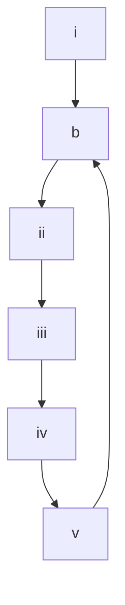

图 4-10 担子菌锁状联合过程示意图

i. 双核 a、b 之间产生突起——锁状联合；ii. 一核 b 进入锁状联合；iii. 二核同时分裂；iv. 锁状联合弯曲成桥形；v. 在与细胞接触处溶解，将另一核 b 输入，确保每细胞中分别含有两个性质不同的核

头等；目前全球商业化栽培的食用菌约100种。食用菌产业已被认为是“五不争”的产业（不与人争粮，不与粮争地，不与地争肥，不与农争时，不与其他行业争资源），是我国继粮、棉、油、果、菜后的第六大农产品，我国也是食用菌生产和出口的全球第一大国。根据我国食用菌协会及相关行业报告的统计数字显示，2010—2023年间，食用菌总产值从1413.22亿元增长到4102.70亿元，成为我国增长率最高的经济作物之一，2023年中央一号文件明确提出“培育壮大食用菌产业”，农业农村部也推动标准化生产和深加工发展，在稳定经济增长、促进社会发展方面发挥着重要作用。

有些蕈菌具有毒性，全世界毒蕈约400种，据中国科学院微生物研究所发布的《中国毒蘑菇名录》（2020版）记载，中国有毒蕈类186种，其中极毒种类30～40种。如有“四大剧毒蘑菇”之称的致命白毒伞、龙花纹鹅膏、黄盖鹅膏（白色变种）和毒鹅膏，以及红网牛肝、凤梨小牛肝、柠檬黄伞、黄褐丝盖伞、死帽菇和毒蝇蕈等。概括地说，世界上毒性较强的蕈菌主要分布在3个属中，即鹅膏属（Amanita）、盔孢伞属（Galerina）和环柄菇属（Lepiota）。

此外，一些侵染木质植物残体的担子菌在分解纤维素和木质素中发挥着重要的作用，它们是森林生态系统中不可或缺的组成成分。这类真菌还被用来生产造纸业的生物制浆及漂白制剂，也可被应用于环境中毒物的净化。有的担子菌与树木的根系共生形成菌根菌，在天然和人工林生态系统中起着重要作用。有的担子菌是植物寄生菌，如黑粉菌和锈菌，可引起严重的植物病害，每年都会给农林业生产带来相当大的损失。一些担子菌如蜜环菌属（Armillaria）的某些种，可引起森林和行道树木的病害。许多担子菌可直接损害多种木质产品。

知识拓展 4- 2

蕈菌

## ※ 本章小结

真菌营养体分为单细胞酵母和多细胞菌丝两类，同时包含这两类营养体的称为双相

---

100

4 真核微生物的结构与功能

真菌。菌丝分为有隔菌丝和无隔菌丝两大类，菌丝以极性生长的方式伸长并分枝形成复杂的网状结构（菌丝体）；菌丝可以有各种分化形式及特化组织，如可分化形成一些特殊结构以获取营养物质、抗逆或繁殖。真菌能进行无性繁殖和有性繁殖，其中子囊菌门和担子菌门真菌因存在双核阶段而被称为双核真菌。单细胞真菌（酵母）通过出芽和裂殖两种方式进行无性繁殖，也可通过子囊和子囊孢子的方式进行有性繁殖。丝状真菌（霉菌）的无性繁殖包括菌丝断裂和无性孢子繁殖，有性繁殖靠产生有性孢子进行。真菌的分类以形态特征和有性生殖结构作为分类依据，可分为壶菌门（产生卵孢子）、接合菌门（以接合孢子为特征）、子囊菌门（以子囊和子囊孢子为特征）和担子菌门（以担子和担孢子为特征）和半知菌类。

## ※ 推荐阅读

1. 潘丽娜，曹承俊，魏羽佳，等.白念珠菌形态转换及其调控机制的研究进展[J].中国细胞生物学学报，2016，38（9）:1049-1059.

很多哺乳动物、昆虫和植物病原真菌是双相真菌，它们的形态转换与致病力和有性繁殖等关键生命活动密切相关。这篇由我国学者发表的综述详细介绍了人类病原真菌白念珠菌形态转换的特点和控制形态转换的分子机制。

2. YADAV V, SUN S, HEITMAN J. On the evolution of variation in sexual reproduction through the prism of eukaryotic microbes [J]. PNAS, 2023, 120 (10): e2219120120.

动植物性别一般由性染色体决定，而真菌则由交配型位点（MAT locus）决定。一些真菌只有两个交配型（与动物的雌雄类似），而有些真菌含有高达2万个交配型。这篇论文系统介绍了真菌性别决定系统及其对动物性别演化研究的贡献。

3. RIQUELME M, AGUIRRE J, BARTNICKI-GARCÍA S, et al. Fungal morphogenesis, from the polarized growth of hyphae to complex reproduction and infection structures [J]. Microbiology and molecular biology reviews, 2018, 82 (2): e00068-17.

极性生长使得丝状真菌能入侵土壤和寄主组织从而探索更广阔的生存环境。这篇综述论文详细介绍了菌丝极性生长的特点，以及细胞生物学和分子生物学机制。

4. HUMPENODER F, BODIRSKY B L, WEINDL I, et al. Projected environmental benefits of replacing beef with microbial protein [J]. Nature, 2022, 605: 90–96.

反刍动物为人类提供了宝贵的蛋白质，但畜牧业生产对环境有许多负面影响，特别是在森林砍伐、温室气体排放和水体富营养化方面。为了寻找动物肉的替代品，人类开发了植物性肉、养殖肉和发酵衍生的微生物蛋白。该研究针对微生物蛋白在2050年的全球土地利用情景进行了前瞻性分析。通过环境效益模型的搭建，预计到2050年，微生物蛋白能取代全球人均反刍动物肉类消费量的20%，能代替未来全球牧场面积的增加，并将每年的森林砍伐和相关 $CO_{2}$ 排放量减少至大约一半，同时会降低甲烷排放量。

---

复习思考题

101

## ※ 开放性讨论题

1. 单细胞酵母和多细胞菌丝两种营养体是真菌长期趋同演化的结果，试论这两种营养体与真菌在环境中广泛存在这一现象的相关性。
2. 很多真菌还未发现有性繁殖方式，它们分布在不同的真菌分类单元中，试论这个现象的生物学和生态学意义。

## ※ 复习思考题

1. 试述双核真菌有性繁殖过程及与其他真菌的差异。
2. 试述真菌菌丝的类型和生长方式。
3. 试述酵母菌无性繁殖的方式及特点。
4. 简述真菌菌丝分化的生物学意义。
5. 丝状真菌孢子与细菌芽孢的区别有哪些？
6. 简述大型真菌子实体的分化。
7. 阐述真菌在农业、工业、医药、环境保护和生物学研究方面的重要性。

(赵明文 喻其林 方卫国)
