# 5 病毒

原始 PDF 第 119–155 页。

## 5

## 病毒

## 导语

病毒是一种特殊的生命形态，属专性寄生物，完全依赖宿主细胞进行生命活动。病毒粒为非细胞构造，由蛋白质和核酸等少数物质按一定对称规则组成，组成成分较为简单，缺少独立进行能量代谢、大分子合成所需的构造和酶系。病毒的繁殖方式与细胞生物完全不同，它通过合成大量病毒蛋白和基因组核酸，将它们“装配”成完整病毒粒的方式产生大量子代病毒粒。病毒种类众多，多样性丰富。几乎所有细胞生物都会被多种病毒感染，如感染人类的病毒种类数以百计。此外，病毒的多样性还表现在病毒核酸类型、复制方式和病毒-宿主关系的多样性等方面。由于病毒粒微小，大多数病毒尚不为人类所知。近年来，借助高通量基因测序技术，人们从自然界不同环境和生物的样品中发现了大量病毒特征性基因序列，其中有许多是以前从未报道的。病毒对维持生物圈和食物链的平衡稳定、介导基因在生物个体和物种之间的流动、推动生物演化等方面发挥了独特的重要作用。病毒也与人类健康及生产生活的各个方面有密切的关系。

## 关键词

病毒，病毒粒，病毒复制周期，巴尔的摩分类法，噬菌体，植物病毒，昆虫病毒，动物病毒，亚病毒因子

---

5.1 病毒与病毒粒

103

## 5.1 病毒与病毒粒

## 5.1.1 病毒的特性

病毒是一类非细胞构造的特殊遗传因子，它具有生命的部分特征，同时又与典型的细胞生物明显不同。归纳起来，病毒有如下特性:

① 成分简单，非细胞构造。病毒不同于细胞生物，它没有细胞构造。在细胞外，病毒以病毒粒（virion）的形式存在。病毒粒又称病毒体或病毒颗粒，是结构完整、具有感染和复制能力的病毒基本感染单位。病毒粒的结构和化学组分比细胞简单得多，许多病毒的病毒粒仅由核酸和一种或少数几种蛋白质构成，有些病毒还有脂质包膜等成分。
② 专性细胞内寄生。病毒依赖宿主细胞进行增殖。病毒没有自己的物质代谢和能量代谢的酶，也没有自己的核糖体，因此无法独立进行物质和能量代谢，也无法独立进行蛋白质和核酸的合成，完全依赖宿主细胞完成这些过程。近期发现的巨型病毒（giant virus）编码了一些代谢和蛋白质合成相关的基因，引起了高度的关注。尽管如此，这些病毒同样不能独立进行代谢和蛋白质合成。
③ 病毒粒仅含有一种核酸。病毒同样以核酸作为携带和传递遗传信息的物质，但病毒的遗传物质不仅可以是 DNA，也可以是 RNA。病毒粒仅含有 DNA 或 RNA 中的一种，一般不同时含有 DNA 和 RNA，即以 DNA 为遗传物质的病毒一般不带有 RNA，反之亦然。但这一特性也非绝对，随着检测技术提升，人们在一些以 DNA 为遗传物质的病毒粒中检测到有病毒和细胞的 mRNA。
④ 以 “合成-组装” 的方式复制。细胞生物都以细胞分裂的方式进行繁殖，但病毒并不如此。病毒侵入细胞后，利用宿主细胞合成大量病毒核酸和蛋白质等组分，再通过组装形成子代病毒粒。这种独特的复制方式是病毒区分于细胞生物的重要特征之一。
⑤ 有感染态和非感染态两种存在状态。病毒粒是病毒的非感染态，是病毒进入宿主细胞前的状态。病毒粒侵入宿主细胞后，病毒就进入感染态，此时病毒粒通常会解体，启动大分子合成。有些病毒的感染态很短暂，而有些病毒可以长期处于感染态。如人类免疫缺陷病毒1型（human immunodeficiency virus type 1，HIV-1）感染宿主细胞 $\mathrm{CD4^{+}T}$ 细胞后，病毒的基因组会整合到细胞染色体上，并长期存在于细胞中。

## 5.1.2 病毒粒的结构

## 5.1.2.1 病毒粒及其大小

作为病毒在宿主细胞外的存在形式和结构单位，病毒粒具有稳定的结构，有利于其在环境中保护所携带的遗传物质。有的病毒在病毒粒中带有一些病毒复制起始所必需的酶和其他因子。

知识拓展 5- 1

病毒的发现

---

104

5 病毒

## 知识拓展 5-2 巨型病毒

不同病毒的病毒粒大小和形态差异很大。常见病毒的病毒粒的大小在 30～300 nm 范围内，如细小病毒（parvovirus）直径在 20～30 nm，痘病毒（poxvirus）长约 300 nm。与它们的宿主细胞相比，病毒的体积往往只有细胞的数千分之一到数百万分之一。但近年也发现了一些病毒粒较大的病毒，被称为巨型病毒，如感染阿米巴原虫的拟菌病毒（mimivirus）、阔口罐病毒（pithovirus）等。目前已知体积最大的病毒——阔口罐病毒大小约  $1.5 \mu m \times 0.5 \mu m$ ，相当于较小的细菌的大小。

由于大多数病毒粒远小于  $1 \mu m$ ，无法用普通光学显微镜进行观察，需要借助电子显微镜。有些病毒感染细胞后，会形成一些光学显微镜下可见的颗粒结构，它们并不是病毒粒本身，而是病毒粒或病毒复制产物的聚集体，如昆虫核型多角体病毒感染后会在细胞核中形成高折光性的“多角体”颗粒；狂犬病毒感染后也会在细胞质中形成内基氏小体（Negri bodies）。

## 5.1.2.2 病毒粒的模式结构

从形态上，病毒粒可以分为球形、丝杆形、椭球（砖块）形、复合形等类型。图 5-1 显示了病毒粒的结构模式。在病毒粒的中央部位是病毒的核酸，它与核酸结合蛋白紧密结合、高度聚集，有利于在病毒粒内部有限空间中装入尽可能多的遗传物质。核酸和核酸结合蛋白一起构成病毒的核心。

在病毒的核心外，是病毒的衣壳（capsid），它由一层或数层蛋白质构成，是病毒粒的特征结构。衣壳是由衣壳蛋白构成的衣壳粒（capsomere）按照一定的对称形式（symmetry）排列形成的，这种对称性是病毒粒结构稳定性的基础。衣壳和核心一起构成核衣壳（nucleocapsid）。对于许多病毒而言，核衣壳就是病毒粒，而且一些构造简单的病毒，如烟草花叶病毒（tobacco mosaic virus，TMV）中，衣壳蛋白同时也是核酸结合蛋白。

还有许多病毒，特别是许多感染动物的病毒，在核衣壳外还有一层包膜（envelope）。包膜又称囊膜、被膜，具有与细胞膜相同的双层脂膜结构。大多数情况

图 5-1 病毒粒的模式结构

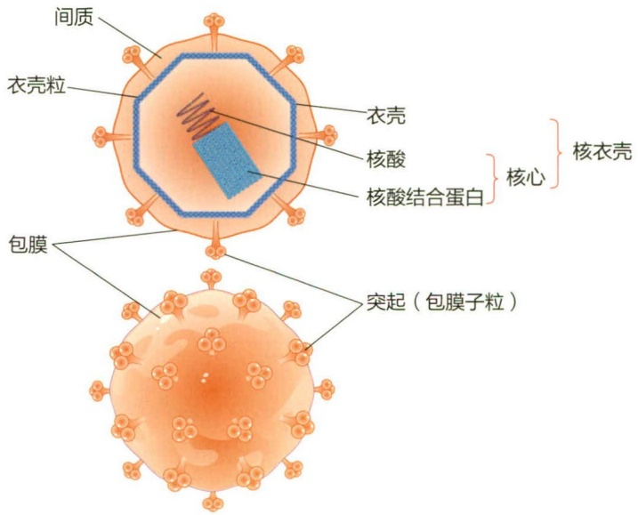

text_image

间质
衣壳粒
衣壳
核酸
核酸结合蛋白
核心
核衣壳
包膜
突起（包膜子粒）

---

5.1 病毒与病毒粒

105

下，包膜来自细胞膜或细胞内膜系统。根据病毒粒是否具有包膜，可以把病毒分为包膜病毒（enveloped virus）和裸露病毒（naked virus）两大类，后者也称为无包膜病毒（nonenveloped virus）。在包膜和核衣壳之间，还分布有以蛋白质为主要成分的间质（tegument）。

在病毒粒的表面常会有一些凸出结构，称为突起（spike），在包膜病毒中，它们也被称为包膜子粒（peplomer）。突起主要由蛋白质构成，可以是衣壳上的一些凸起或延伸结构，如腺病毒（adenovirus）核衣壳顶端的丝状蛋白凸起；也可以是分布在包膜上的一些蛋白质，如冠状病毒（coronavirus）的突起蛋白（spike 蛋白，S 蛋白）。

## 5.1.2.3 病毒衣壳的对称形式

病毒粒中衣壳的对称形式是病毒的一个重要特征，也是区分不同病毒的一个重要指标。衣壳的基本对称形式有两种:螺旋对称和二十面体对称，也有些病毒是复合对称结构，即由上述两种对称形式组合而成。

## (1) 螺旋对称

螺旋对称（helical symmetry）是衣壳蛋白沿对称轴螺旋排列，形成杆状或丝状结构。在这种结构中，衣壳蛋白直接和核酸结合，构成核衣壳。许多单链 RNA 病毒和一些单链 DNA 病毒具有这种对称体制，它的经典代表是烟草花叶病毒（TMV）（图 5-2）。

螺旋对称的主要参数有:①每个蛋白亚基沿中轴上升的距离 p；②每  $360^{\circ}$  包含蛋白亚基的个数  $\mu$ ；③形成的杆状结构的直径  $\Phi$ 。对于 TMV 的病毒粒，p = 0.14 nm， $\mu = 16.3$ ， $\Phi = 18 \, nm$ （图 5-2b）。TMV 的基因组是单链 RNA，总长约 6400 个碱基，每个衣壳蛋白亚基结合 3 个核苷酸，衣壳总长度约 300 nm。可见在这种对称形式中，病毒粒的长度与病毒基因组长度直接相关。

螺旋对称也可以发生一些变形，TMV等病毒的病毒粒是刚性杆状的，也有一些

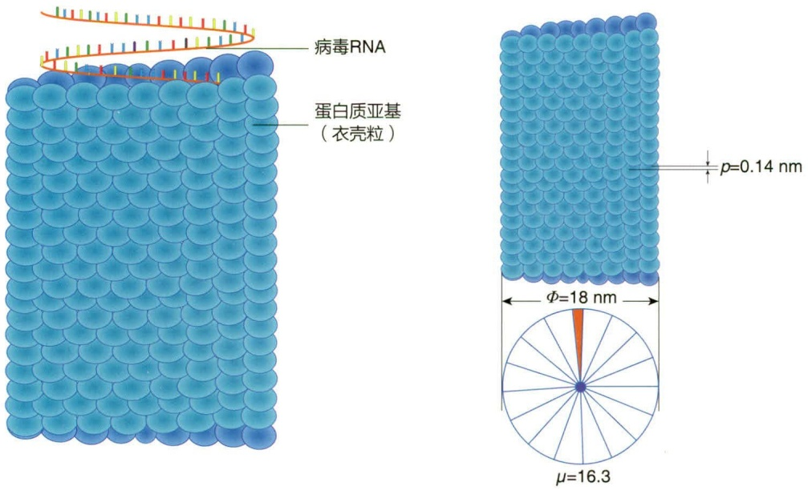

图 5-2 螺旋对称病毒粒的结构

（a）烟草花叶病毒的病毒粒结构；（b）烟草花叶病毒螺旋对称结构的主要参数

---

106

5 病毒

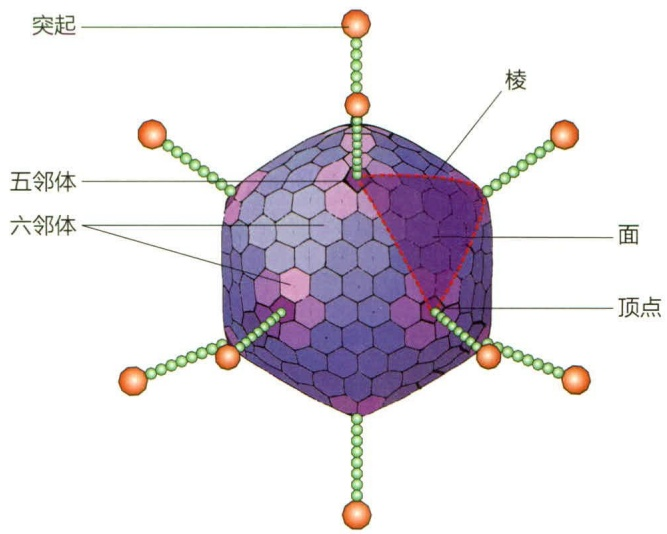

text_image

突起
五邻体
六邻体
棱
面
顶点

图 5-3 腺病毒的二十面体衣壳

植物病毒、噬菌体的病毒粒是可弯曲丝状，或柔性的。一些动物 RNA 病毒的柔性螺旋对称结构甚至可以折叠并覆盖包膜，形成较为复杂的结构。

## (2) 二十面体对称

二十面体对称（icosahedral symmetry）衣壳有20个正三角形面，12个顶点和30条棱（图5-3）。这种衣壳对称性好，同时又接近球体，可以容纳较多的病毒遗传物质。二十面体衣壳同样存在于动物病毒、植物病毒、噬菌体等各类病毒中。

不同病毒二十面体衣壳的大小有很大差别，反映在构成衣壳的蛋白亚基数量上。如最简单的二十面体衣壳之一——噬菌体  $\varphi X174$ ，它的衣壳仅由 60 个衣壳粒构成（每个衣壳粒含噬菌体蛋白 F、G、J 各一个），

衣壳直径约 30 nm；而感染海洋鞭毛虫（Cafeteria roenbergensis）的巨型病毒 CroV 的二十面体衣壳由 14940 个蛋白分子构成，直径达 300 nm。

以腺病毒为例（图5-3），它的衣壳直径约80 nm，内部可容纳约30 kb的双链DNA基因组。它的衣壳由两种衣壳粒构成:由5个蛋白亚基构成的五邻体（pentamer），和由6个蛋白亚基构成的六邻体（hexamer）。每个衣壳有12个五邻体，位于12个顶点；还有240个六邻体，其中每个三角形面上有6个（不计棱上），每条棱上有4个。整个衣壳共有蛋白亚基1500个。除了壳体以外，腺病毒的病毒粒在顶点处还有细长的蛋白突起。

大部分二十面体对称衣壳为单层蛋白衣壳，但某些病毒有双层甚至三层二十面体衣壳。感染动植物的呼肠孤病毒（reovirus）、感染植物的花椰菜花叶

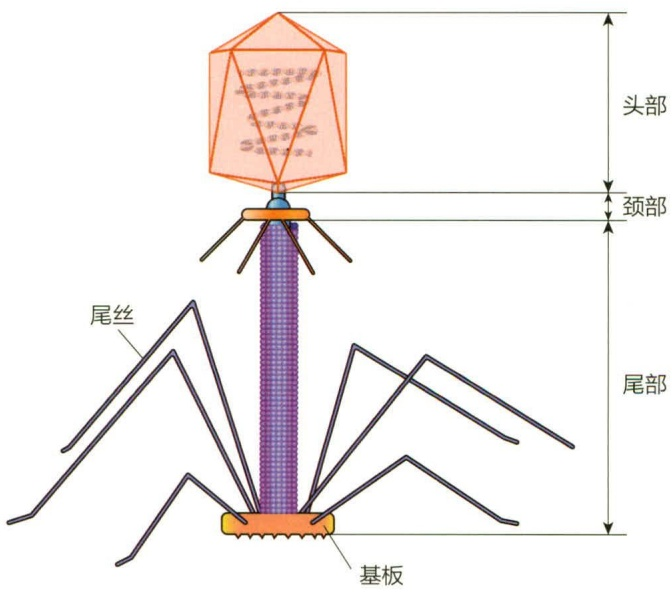

text_image

头部
颈部
尾部
尾丝
基板

图 5-4 大肠杆菌 T4 噬菌体粒的复合对称结构

病毒（caulimovirus）和感染阿米巴的浮士德病毒（faustovirus）的病毒粒都有多层衣壳。不少感染动物的二十面体对称衣壳外还有包膜。

## (3) 复合对称

有些病毒的病毒粒具有更复杂的对称结构。如不少噬菌体头部为二十面体（或加长的二十面体）衣壳，尾部为螺旋对称，此外还有颈部、基板、尾丝等附属结构（图5-4）。其头部容纳了病毒的基因组核酸，尾部和尾丝等起到帮助病毒吸附到宿主细胞并将遗传物质注入宿主细胞的作用。这种对称形式称为复合对称（complex symmetry）。属巨型病毒的雷神病毒（Tupanvirus），除了二十面体的头部外，还有很长尾部结构，使病毒粒总长超过2  $\mu$ m。

痘病毒（poxvirus）是一类感染多种动物和人的重

---

5.1 病毒与病毒粒

107

要病毒，包括了天花病毒等重要病原体。它们的病毒粒较大，结构复杂。科学家用冷冻电镜逐层成像技术对它们进行了研究，揭示了其中一些细节。其病毒粒呈椭球形或砖块形，有包膜，内部是哑铃状的核心，表面另有一层脂质膜，结合了众多蛋白质，上面还有孔状结构，可能可以让核心内外发生一定的物质交流。在核心和包膜之间有称为侧体的构造，其具体结构和功能还不清楚。

## 5.1.3 病毒粒的化学组成

病毒粒的化学成分相对简单，对于裸露病毒，蛋白质和核酸几乎就是病毒粒的所有成分。对于包膜病毒，病毒粒中还有部分脂质。以结构较为复杂，有内外两层脂膜的痘病毒为例，病毒粒中蛋白质占干重的90%，DNA占5%，脂质占3.2%。

## 5.1.3.1 核酸

病毒粒中的核酸是病毒的遗传物质。与仅以双链 DNA（dsDNA）作为遗传物质的细胞生物不同，病毒的遗传物质可以有多种化学形式，包括双链或单链 DNA，双链或单链 RNA。核酸分子既有线形的也有环形的，还有些是分段基因组。不少感染植物的分段基因组病毒把不同基因组片段包装成独立的颗粒，需要多个病毒颗粒同时侵入细胞才能完成感染，这种病毒称为多分体病毒。感染动物的分段基因组病毒一般把各片段包装在同一病毒粒中，但也有个别多分体的报道。表 5-1 列出了不同核酸类型病毒的代表。

与细胞中有许多功能性 RNA 分子（mRNA、rRNA）不同，病毒粒中的 RNA 都是作为遗传物质存在的。虽然用高灵敏度检测技术从某些病毒粒样品中检测到微量的 mRNA 或 rRNA 等，但一般认为它们对于病毒的作用是可以忽略的。对于基因组为单链 RNA（ssRNA）的病毒，其 RNA 又可分作正链和负链，分别指序列与 mRNA 相同和与

表 5-1 病毒核酸的性质

<table><tr><td rowspan="2">基因组性质</td><td rowspan="2">单/双链</td><td rowspan="2">线/环状</td><td rowspan="2">正/负链</td><td colspan="2">病毒举例</td></tr><tr><td>分段</td><td>不分段</td></tr><tr><td rowspan="5">DNA</td><td rowspan="2">单链</td><td>线状</td><td>-</td><td>-</td><td>细小病毒,核盘菌病毒SsHADV-1</td></tr><tr><td>环状</td><td>-</td><td>双生病毒(部分)</td><td>M13噬菌体,φX174噬菌体,圆环病毒</td></tr><tr><td rowspan="3">双链</td><td>线状</td><td>-</td><td>-</td><td>腺病毒,痘病毒,疱疹病毒,λ噬菌体</td></tr><tr><td rowspan="2">环状</td><td rowspan="2">-</td><td rowspan="2">-</td><td>闭合:杆状病毒,乳头瘤病毒,假单胞菌噬菌体PM2</td></tr><tr><td>带缺口:乙肝病毒,花椰菜花叶病毒</td></tr><tr><td rowspan="4">RNA</td><td rowspan="3">单链</td><td rowspan="2">线状</td><td>正链</td><td>雀麦花叶病毒</td><td>脊髓灰质炎病毒,冠状病毒,人类免疫缺陷病毒1型,烟草花叶病毒</td></tr><tr><td>负链</td><td>流感病毒</td><td>麻疹病毒,埃博拉病毒</td></tr><tr><td>环状</td><td>正链</td><td>-</td><td>丁肝病毒,类病毒(亚病毒因子)</td></tr><tr><td>双链</td><td>线状</td><td>-</td><td>呼肠孤病毒,质型多角体病毒</td><td>-</td></tr></table>

---

108

5 病毒

mRNA 互补的链。植物病毒的基因组以 ssRNA 为主，而噬菌体以 dsDNA 最为常见。

病毒的核酸往往有一些特殊的结构。某些病毒核酸的末端通过共价键结合了末端蛋白，如腺病毒 dsDNA 两条链的 5' 端，脊髓灰质炎病毒 ssRNA 的 5' 端等。TMV 基因组 RNA 的 3' 端有 tRNA 样结构，并能被细胞的氨基酰 tRNA 合成酶加上一个组氨酸。痘病毒的线形 dsDNA 也与一般的 dsDNA 分子不同，缺少单链末端游离的 5' 磷酸和 3' 羟基，因为一侧末端的 5' 磷酸基团和 3' 羟基之间发生共价连接，形成封闭的结构。另外，许多线形 DNA 末端带有重复序列和回文结构。以上这些特征往往和病毒的复制有关。

## 5.1.3.2 蛋白质

蛋白质是病毒粒最主要的成分。病毒粒中的蛋白质包括核酸结合蛋白、衣壳蛋白、功能蛋白、膜蛋白等。核酸结合蛋白一般分子量较小，呈碱性，与核酸结合后可以促进核酸聚集压缩，被包装到病毒粒中。衣壳蛋白构成病毒粒的衣壳，往往数量最多，且具有保守的三维结构，有助于形成衣壳。多数病毒粒由多种衣壳蛋白共同构成衣壳。功能蛋白指病毒携带的一些酶和调控细胞的因子，它们对某些病毒复制的起始非常重要。如 HIV-1 携带的逆转录酶、整合酶等对于病毒的感染必不可少。病毒膜蛋白是包膜病毒的表面蛋白，它们往往被糖基化修饰，具有识别并结合细胞受体，从而介导病毒入侵细胞的作用。对于裸露病毒，其衣壳蛋白也具有与细胞受体结合，介导病毒入侵细胞的作用。

## 5.1.3.3 脂质

病毒粒中的脂质主要以膜的形式存在，主要是病毒粒的包膜。病毒包膜在成分和结构上与细胞质膜一致，主要成分是磷脂和固醇。有些大型病毒除了表面的包膜外，内部还有一层膜结构，如痘病毒，其哑铃形的核心结构也有脂膜包围。

## 5.1.3.4 糖类

病毒粒中的糖类主要以糖蛋白的糖基侧链形式存在，占比不高，往往不被作为单独的化学成分。但在一些巨型病毒中，病毒粒的外层包裹着一层多糖物质，类似细菌的糖被，形成纤维状结构。这类病毒还编码自己的糖代谢相关基因。这些多糖类物质对于病毒的意义尚不清楚。

## 5.1.4 病毒的分类与命名

由于病毒粒大多结构微小、构造简单、需采用专门技术手段才能开展研究，因此对于病毒的分类命名长期缺少统一明确的规则，往往不同类型的病毒采用不同的分类命名体系。随着研究深入，特别是基因测序技术进步，获得病毒全基因组序列已经变得容易，病毒分类和命名的系统也逐渐成熟和统一。

病毒的分类命名由国际病毒分类委员会（International Committee on Taxonomy of Viruses，ICTV）统一确定，定期在其官方网页发布。病毒分类的主要依据包括:核酸性质、病毒粒结构特征、生物学特点（如宿主范围、感染组织类型、病症等）、

---

5.2 病毒的复制

109

基因组序列等。

近年，国际病毒分类委员会决定采用和细胞生物相似的方法对病毒进行分类和命名。根据最新的分类系统，病毒最基本的分类单位是“种”，向上主分类阶元有“属”“科”“目”“纲”“门”“界”“域”等。“域”（Realm）是病毒分类的最高阶元，现有6个病毒域，正式记录的病毒已经超过10 000种。

在病毒命名方面，病毒的正式名称采用双名法，即“属名+种名”。病毒的名称应该是有一定意义的单词或缩写。例如，甲型流感病毒的传统名称为 Influenza A virus，根据新的规则，其正式名称为:Alphainfluenzavirus influenzae。命名法还规定，描述抽象的病毒物种时名称应该用斜体，而当指具体病毒（分离株）时不用斜体。目前，由传统命名向新双名法命名的转换过程还在进行中。

## 5.2 病毒的复制

## 5.2.1 病毒的复制周期

病毒与细胞生物最主要的不同之一，就是它的繁殖方式。细菌等单细胞生物通过吸收、代谢和大分子合成，积累生物质，然后通过细胞分裂增加细胞数量，实现繁殖。多细胞生物同样通过细胞生长和细胞分裂从单个细胞（合子）发育成为个体。但病毒没有独立进行吸收和代谢的能力，病毒粒也不通过分裂增加数量。病毒复制周期（viral replication cycle）可以分成“入侵-合成-组装”三个阶段（图5-5）。对病毒的这种特殊复制模式的认识最早来自于对噬菌体的定量研究（见5.5.1）。正是因为病毒的这种特殊繁殖方式，加之病毒被认为是“分子生物”，病毒的繁殖一般被称为“复制”（replication）。

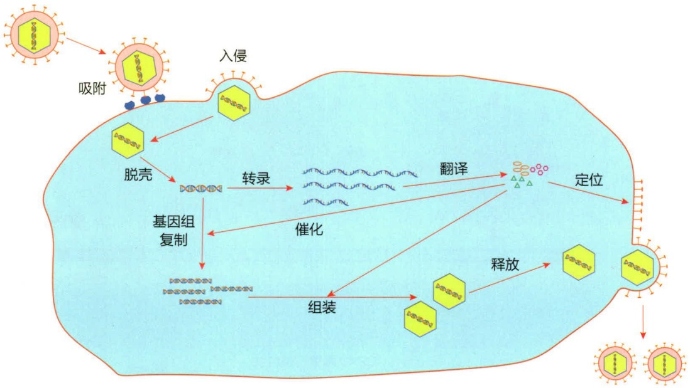

flowchart

This flowchart illustrates the biological process of a virus infection model, showing how an Infection Virus (INV) is transferred into a virus, followed by replication and cell division, with further steps like cell restructuring, assembly, and release.

图 5-5 病毒的复制周期概览

---

110

5 病毒

## 5.2.2 病毒入侵细胞

病毒粒首先需要进入合适的细胞才能开始复制。无法进入细胞，或进入错误的细胞对于病毒粒来说都是“灾难性”的。入侵过程可以分为吸附、进入和脱壳3个步骤。

## 5.2.2.1 吸附

处于细胞外的病毒粒本身并没有运动能力，也无法产生能量，它只能被动和随机地进行“布朗运动”。这种运动是液体中分子相互撞击的结果，没有方向性。当病毒由于随机运动靠近细胞时，病毒粒与细胞间的局部静电作用可能会促进病毒粒进一步向细胞靠拢。病毒粒能否吸附到细胞表面，并进入细胞内，很大程度上取决于病毒粒及细胞表面特定分子之间的相互作用，即病毒吸附蛋白（viral attachment protein）和细胞受体（receptor）之间的相互作用。一些噬菌体的尾丝、包膜病毒的表面糖蛋白、裸露病毒的衣壳蛋白等，都有可能作为病毒吸附蛋白。吸附蛋白有助于病毒选择合适的宿主细胞并高效地侵入。

受体是病毒吸附蛋白最初结合的细胞表面分子，以蛋白质最为常见，但也可能是糖蛋白上的糖基侧链，或者脂质分子。这些细胞分子具有自身的生理功能，同时被某种病毒利用作为进入细胞的“门户”。例如，HIV-1的吸附蛋白是GP120蛋白，它的特异性结合对象，即细胞受体是CD4分子（图5-6）。CD4是一类重要的免疫细胞——辅助T细胞表面的功能蛋白分子，参与辅助T细胞识别抗原和被激活。HIV-1通过与CD4结合感染这类细胞，造成被感染者免疫功能缺陷。

吸附蛋白和细胞受体的互作往往可以影响病毒的宿主范围和致病性。例如，有多种动物病毒以细胞表面糖蛋白上的糖基分子——唾液酸作为受体，如流感病毒、轮状病毒、腮腺炎病毒、冠状病毒 OC43 等等。由于唾液酸在动物各种细胞表面几乎都有

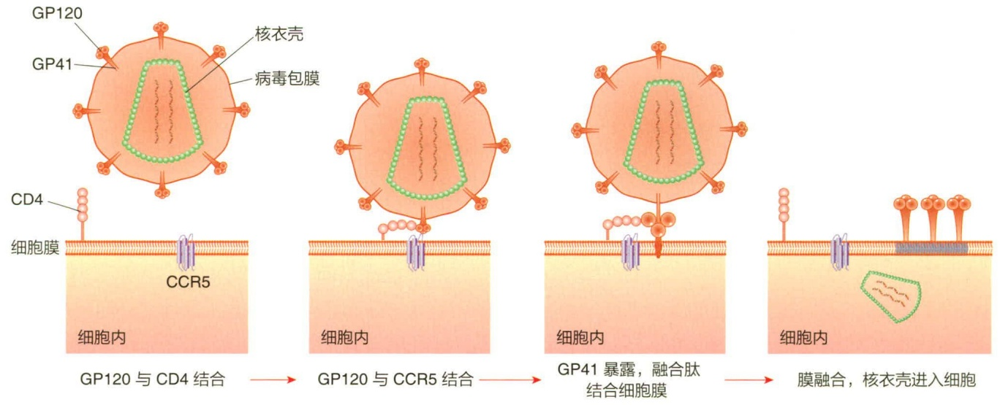

flowchart

图 5-6 HIV-1 入侵细胞示意图

病毒吸附蛋白GP120与细胞受体CD4及辅助受体CCR5先后结合，发生构象变化，暴露出病毒融合蛋白GP41。后者插入细胞膜，介导病毒包膜和细胞膜融合

---

5.2 病毒的复制

111

分布，且不同动物之间在分子构造上差异微小，因此以唾液酸为受体的病毒一般有较广的宿主范围，容易发生跨种感染，造成人兽共患病。人感染禽流感病毒就是这种情况。选择什么样的分子作为它的受体，是病毒长期演化和适应的结果。经常可以看到这样的情况，一些分类上距离很远的病毒利用同一个受体，而分类上相近的病毒，受体却差异很大。有些病毒可以利用多种蛋白作为受体。

除了细胞受体以外，病毒感染有时还需要其他细胞表面蛋白参与。例如，HIV-1感染时，除了需要受体分子CD4外，还需要细胞表面的CXCR4或CCR5等蛋白参与，这些分子被称为辅助受体（co-receptor）（图5-6）。GP120与辅助受体结合后构象发生变化，暴露出融合蛋白GP41。引起新型冠状病毒感染的SARS-CoV-2在感染人体细胞时，除了需要细胞表面有受体蛋白ACE-2（血管紧张素转换酶-2）外，还需要由宿主的蛋白酶将病毒吸附蛋白S进行定点切割，才能顺利侵入细胞。

需要指出的是，一般植物病毒并不通过吸附蛋白-受体互作模式进行感染。植物细胞有坚实的细胞壁，给病毒进入和离开细胞带来困难。植物病毒一般借助昆虫等的媒介生物的作用，或扦插、机械损伤等造成的细胞破损进行感染（见5.5.2）。在植株内，病毒可以通过相邻细胞间的通道——胞间连丝在细胞之间传递，避免进出细胞的困难。

## 5.2.2.2 进入

完成吸附后，病毒粒还留在细胞表面，但有效的吸附会诱导吸附蛋白和受体构象的变化，或激活细胞信号转导，最终导致病毒进入细胞。病毒进入细胞的过程一般需要细胞提供能量，借助细胞的某些生理过程才能完成。病毒进入细胞的机制也有多种。

## (1) 膜融合

不少包膜病毒会在病毒融合蛋白的帮助下发生病毒包膜和细胞膜的融合。膜融合完成后，病毒包膜成为细胞质膜的一部分，而病毒核衣壳进入细胞内。HIV-1 表面的 GP41 蛋白就是一种融合蛋白。GP41 和 GP120 是病毒蛋白 GP160 经蛋白酶定点切割的产物，病毒粒表面的突起由 3 个 GP41 和 3 个 GP120 共同构成，GP120 位于顶端，GP41 位于基部。GP120 与细胞受体及辅助受体结合后，GP41 就会发挥介导病毒包膜和细胞膜之间融合的作用，导致病毒核衣壳进入细胞（图 5-6）。

## (2) 内吞

有不少病毒吸附到细胞表面后，会激活细胞的内吞或胞饮活性，导致细胞将病毒粒吞入，病毒粒进入内吞体。细胞有不同的内吞机制，具体哪种机制起作用，主要和受体有关。这时，位于内吞体的病毒粒或病毒核衣壳仍未真正进入细胞质，需要通过膜融合，或破坏内吞体膜等方式离开内吞体，进入细胞质。

## (3) 其他

许多噬菌体吸附到细菌表面后，可以将基因组 DNA 注射到细菌内。有些小型裸露病毒可能通过细胞表面的通道蛋白等直接进入细胞质。一些肠道 RNA 病毒与细胞表面受体结合后，二十面体衣壳会发生结构变化，直接将病毒 RNA 释放到细胞内，这与噬菌体感染有相似之处。

---

112

5 病毒

## 5.2.2.3 脱壳

病毒粒进入细胞往往并不意味着侵入过程的完成。在细胞中，紧密包裹的病毒粒还需要进行不同程度的解体，释放遗传物质，这个过程称为脱壳（uncoating）。例如，腺病毒是一种无包膜的DNA病毒，它通过细胞内吞方式进入细胞，在内吞体中，病毒蛋白破坏内吞体膜，使核衣壳从内吞体逃逸并解体。在细胞质中，病毒核心被运送到核孔，基因组DNA穿过核孔进入细胞核，开始复制。呼肠孤病毒的病毒粒由双层二十面体衣壳构成，侵入细胞后会脱去一层衣壳，但仍然保留内层衣壳，其RNA合成在内壳中完成，这称为部分脱壳。

## 5.2.3 病毒大分子合成

病毒复制需要合成大量的病毒蛋白和基因组核酸，高度依赖细胞提供能量、材料（氨基酸、核苷酸）和酶等。同时，不少病毒编码自己的核酸合成相关的酶，可以用于催化核酸合成、进行基因转录和基因组核酸的复制。但病毒蛋白质合成几乎都依靠细胞的蛋白质翻译机器进行。

如上所述，病毒的遗传物质具有多样性。在病毒大分子合成阶段，不同核酸类型的病毒有不同的基因组复制和基因表达路径。1971年，诺贝尔奖获得者 David Baltimore 提出根据病毒核酸类型及基因表达、复制方式将病毒分为 6 组；后人又根据新的发现，将分组增加到 7 组，这就是著名的巴尔的摩分类法（Baltimore classification）。这 7 个组的基因组复制和基因表达路径见图 5-7 和图 5-8。

## 5.2.3.1 双链和单链 DNA 病毒

这两类病毒分属巴尔的摩分组系统的第Ⅰ和Ⅱ组。第Ⅰ组 dsDNA 病毒的复制和基因表达路径和宿主细胞基因组 DNA 的复制和基因表达路径完全一致，也就是经典的分子生物学中心法则的路径，即 DNA 自我复制，并通过转录形成 mRNA，mRNA

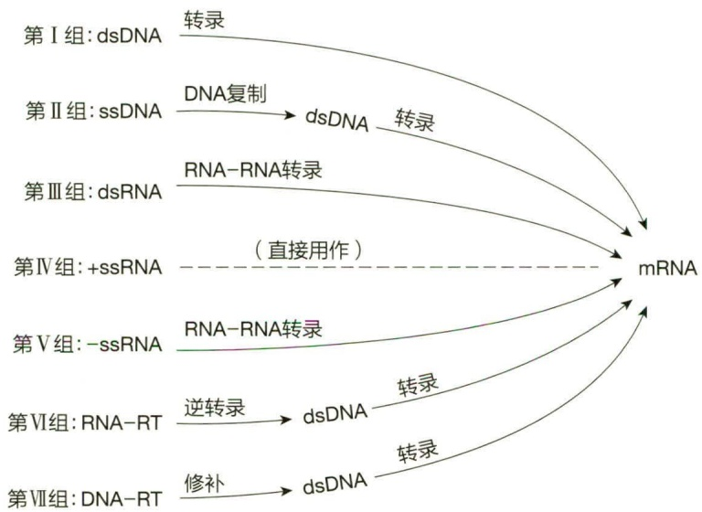

flowchart

This diagram illustrates the transcriptional pathway of mRNA into various RNA-RT groups, including dsDNA, ssDNA, and dsRNA, with directional arrows indicating the process of converting to mRNA.

图 5-7 巴尔的摩分类法中 7 组病毒 mRNA 的产生路径

再指导蛋白质翻译（图 5-8a）。对于第Ⅱ组单链 DNA（ssDNA）病毒，ssDNA 作为模板先合成互补链，成为 dsDNA，然后再以与 dsDNA 类似的方式进行复制和基因表达（图 5-8a），dsDNA 复制产生子代 ssDNA。

虽然细胞中已有进行 DNA 复制和转录的酶，病毒仍然会编码一些自己的 DNA 复制和转录相关的酶，以确保病毒大分子合成的高效进行。一些大型 dsDNA 病毒的基因表达有分期现象，病毒的基因分成极早期、早期和晚期基因。极早期基因在感染后立即表达，主要是一些转录激活因子，用于激活早期基因的表达。早期基因则主要编码复制相关的酶和调节因子，包

---

5.2 病毒的复制

113

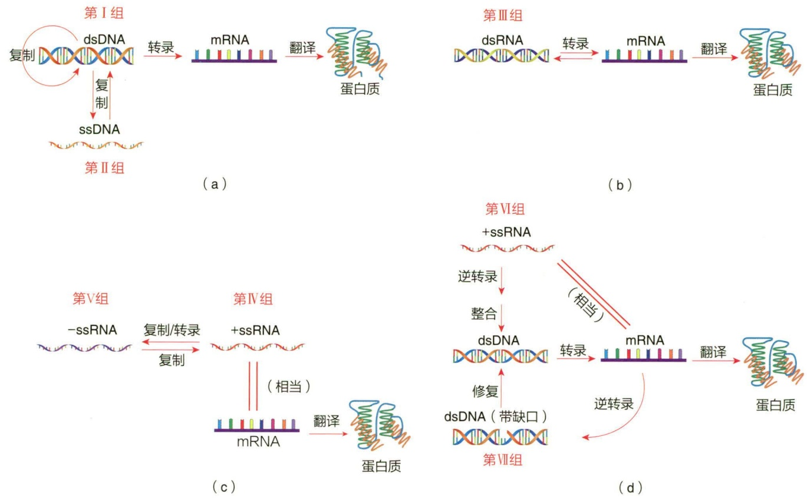

括 DNA 复制相关的酶。这些基因表达后，病毒 DNA 的复制启动，导致细胞内病毒基因组拷贝数大大增加。在此基础上，晚期基因的表达水平也就大大提升，产生大量的病毒结构蛋白，为组装作好准备。

ssDNA 病毒的基因组一般很小，编码的基因数有限，往往高度依赖于细胞的核酸复制酶和转录相关因子，复制周期也相对简单。

## 5.3.3.2 双链 RNA 病毒

第Ⅲ组双链 RNA（dsRNA）病毒种类不多，常见类群是呼肠孤病毒。这类病毒大分子合成流程见图 5-8b。dsRNA 一般会被细胞视作外来有害物入侵的信号，无论动物或植物细胞都能感知它并作出强烈反应，因此病毒 dsRNA 一般不直接进入细胞质。同时，细胞中也缺少 dsRNA 合成有关的酶。病毒粒自带 dsRNA 复制酶，进入细胞并完成部分脱壳后，复制酶在核心衣壳内以 dsRNA 为模板合成 mRNA。mRNA 通过二十面体衣壳的顶点进入细胞质中，进行蛋白质的合成。新合成的病毒蛋白随即组装成新的病毒颗粒，将病毒 mRNA 包裹在其中，并以 mRNA 为模板合成第二条 RNA 链，形成子代 dsRNA。dsRNA 的这种合成方式和 dsDNA 的半保留复制方式完全不同，属于“全保留复制”。

## 5.2.3.3 单链 RNA 病毒

巴尔的摩分类法将 ssRNA 病毒分成第Ⅳ组正链 ssRNA（+ssRNA）病毒和第 V 组负链 ssRNA（-ssRNA）病毒。+ssRNA 病毒的基因组 RNA 与 mRNA 一致，可以直接用来翻译成蛋白质，而 -ssRNA 需要首先拷贝成正链，才能指导蛋白质合成（图 5-7,

图 5-8 巴尔的摩病毒分类法各组病毒的基因表达和基因组复制过程

（a）第Ⅰ组和第Ⅱ组；（b）第Ⅲ组；（c）第Ⅳ组和第V组；（d）第Ⅵ组和第Ⅶ组

---

114

5 病毒

图 5-8c)

之所以 +/-RNA 的差异被如此看重，是因为细胞中缺乏以 RNA 为模板合成 RNA 的酶（依赖于 RNA 的 RNA 聚合酶，RNA-dependent RNA polymerase，RdRp），所有 RNA 病毒都需要自身编码这种 RNA 复制酶。+ssRNA 病毒可以在侵入细胞后，由基因组 RNA 直接翻译产生这个酶，继而开始复制；但 -ssRNA 病毒则无法直接翻译，而是需要先拷贝成 mRNA 才能翻译产生这个酶。因此 -ssRNA 病毒的病毒粒中必须携带 RNA 复制酶来保证产生病毒 mRNA。第 IV 组和第 V 组病毒之间明显的差别就是病毒基因组 RNA 是否能单独启动病毒复制过程。肠道病毒、冠状病毒等 +ssRNA 病毒只需要完整的基因组 RNA 就可以开始复制，但流感病毒、副黏病毒等 -ssRNA 病毒必须有完整的病毒粒感染，或额外提供病毒 RNA 复制酶，才能开始复制。

ssRNA 病毒的基因表达也有几种不同的方式。-ssRNA 病毒会产生多个 mRNA，每个 mRNA 翻译形成一个病毒蛋白。而不少 +ssRNA 病毒则会编码产生一个大的多聚蛋白，由蛋白酶将其切割成成熟蛋白。例如，冠状病毒编码的复制酶蛋白最初就是一个多聚蛋白，长达 7000 个氨基酸，须由病毒编码的 3CL 蛋白酶等将其切割成 16 个成熟蛋白，才能进行病毒的复制，因此 3CL 蛋白酶是抗病毒药物设计的理想靶标。

## 5.2.3.4 有逆转录的病毒

这类病毒包括巴尔的摩分类法的第Ⅵ组逆转录 RNA 病毒（RNA-RT）和第Ⅶ组逆转录 DNA 病毒（DNA-RT）（图 5-7，5-8d）。

第Ⅵ组逆转录 RNA 病毒以 HIV-1 为代表，基因组是 +ssRNA，感染后首先由病毒粒携带的逆转录酶将 RNA 拷贝成 dsDNA 并运送到细胞核。在核内，dsDNA 在病毒粒携带的整合酶等细胞和病毒因子的作用下整合到细胞染色体 DNA。整合的病毒基因组（称为原病毒，provirus）作为细胞基因组的一部分随细胞繁殖得到扩增，并可以从染色体上转录产生病毒 mRNA。该 mRNA 既可以作为子代病毒的基因组，也可以指导病毒蛋白质的合成。

第Ⅶ组逆转录 DNA 病毒的代表是乙型肝炎病毒（hepatitis B virus，HBV）。这类病毒的基因组是不完整的环状 dsDNA。病毒进入细胞后，DNA 先修复成完整环状 dsDNA。由宿主细胞转录酶（RNA 聚合酶Ⅱ）催化转录形成若干病毒 mRNA，指导病毒蛋白合成。在这些病毒 mRNA 中最长的一种 mRNA 被翻译成具有逆转录酶活性的聚合酶，该酶直接和编码它的 mRNA 结合，以其为模板进行逆转录反应，合成 DNA，最后形成不完整的环状 dsDNA 分子，完成病毒核酸复制。

## 5.2.4 病毒组装、成熟和释放

病毒大分子合成完成后，就开始了病毒的组装、成熟和释放过程。

## 5.2.4.1 组装

组装（assembly）包括核衣壳形成、病毒核酸包装、包膜获得等步骤。不同病毒的组装部位有所不同，有的在细胞核，也有的在细胞质。病毒蛋白质和核酸会被聚集

---

5.3 病毒感染

115

到组装位置，开始装配子代病毒。

对病毒组装研究最早的是植物病毒烟草花叶病毒，这种病毒的病毒粒由一种衣壳蛋白和一条 RNA 链构成。在试管中加入这两种成分，在合适的 pH 和离子强度下它们就会自发组装成有感染力的病毒粒，不需要额外的细胞或病毒蛋白质参与。人乳头瘤病毒的结构蛋白 L1 即使在没有病毒核酸的情况下，也会组装成病毒样颗粒（virus-like particle，VLP）。这种颗粒具有病毒粒形态和抗原成分，却没有病毒基因组核酸，是疫苗的理想材料。但许多病毒衣壳的组装需要多种病毒和细胞蛋白的参与和协助。对于构造复杂的复合对称噬菌体，病毒粒的组装会分部进行，头部、颈部、尾部等分别聚集成型后，再组装到一起。

对于二十面体对称衣壳，如何把病毒核酸装入衣壳内极为关键。一般在初步成型的二十面体衣壳的一个顶点处有开口，有病毒蛋白识别病毒基因组核酸上的包装信号序列后，将其装载到衣壳内部。在装载口会有 ATP 水解酶提供这个过程需要的能量。

对于包膜病毒，获得包膜的过程是病毒组装的重要环节。这类病毒一般在细胞内膜系统或细胞膜内侧进行组装，随后直接通过出芽方式离开细胞并获得病毒包膜。也有的病毒先进入内质网或高尔基体等内膜囊泡，然后通过胞吐方式将带包膜的病毒粒释放到细胞外。有少数病毒在细胞核内就获得了病毒包膜，如昆虫杆状病毒中的包涵病毒（见 5.5.3）。

## 5.2.4.2 成熟

有些包装成型的病毒粒还需要经过成熟的过程，其中包括病毒核心的进一步浓缩、蛋白质的结构和位置变化、蛋白质切割等。如肠道病毒包装完成后，会发生 P4 蛋白的内部化和核蛋白浓缩；HIV-1 初步包装完成的核衣壳会发生衣壳蛋白的蛋白酶解和衣壳的“塌陷”，形成最终的楔形结构。

## 5.2.4.3 释放

病毒复制的最后环节是子代病毒粒被释放（release）到细胞外，以感染其他细胞。大多数包膜病毒通过出芽或胞吐被释放到细胞外，裸露病毒则一般通过将细胞裂解离开细胞。一些裸露病毒编码毒性蛋白，会导致细胞膜破损，帮助子代病毒粒离开。许多烈性噬菌体都编码能降解细胞壁的溶菌酶或裂解肽等，在烈性噬菌体复制的后期将细菌裂解，释放子代噬菌体。

## 5.3 病毒感染

病毒必须通过感染宿主进行复制。在自然界，每种病毒都有它可以感染并完成复制的宿主范围（host range）。有的病毒宿主范围较广，例如甲型流感病毒既可以感染鸟类，也可以感染多种哺乳动物和人。一些由节肢动物传播的病毒，如登革病毒、寨卡病毒，既可以在节肢动物（如蚊子）的细胞内复制，也能在人细胞内复制，宿主范围横跨了无脊椎动物和脊椎动物。另一些病毒的宿主范围却很窄，如天花病毒只能感

---

116

5 病毒

染人，这也是人类能够通过普及有效疫苗彻底消灭这个病毒的重要前提。

除了物种层面的宿主范围，病毒往往还有明显组织趋性（tissue tropism），即只感染宿主体内的部分组织的细胞。这种组织趋性主要由受体分子在体内不同组织的分布所决定。以 HIV-1 为例，病毒依赖受体 CD4 和辅助受体 CCR5 或 CXCR4 等侵入细胞，因此只能感染同时带有这些表面蛋白的 CD4 $^{+}$ T 细胞和单核 / 巨噬细胞等细胞种类。

病毒感染在宿主的细胞和机体层面都会产生一定的效应，包括造成损伤和引发系列变化。而宿主也会对病毒的感染作出防御反应，以抑制病毒、保护自身。病毒又会设法逃避宿主的防御反应，使复制能顺利地进行。因此，病毒感染过程是病毒与宿主相互作用的过程。

## 5.3.1 病毒感染类型

根据病毒感染造成的结果，可以把感染分为以下类型。

## 5.3.1.1 生产性感染

生产性感染（productive infection）指有子代病毒产生并释放到细胞外的感染。如果病毒感染导致细胞裂解死亡，又称为裂解性感染（lytic infection），以一些烈性噬菌体感染较为典型。噬菌体复制消耗大量细胞资源，同时还产生一些溶菌酶、裂解肽等细胞毒性物质，最终导致细菌细胞裂解，子代噬菌体被释放到细胞外，继续感染其他细菌。这类噬菌体感染可导致菌液变清、形成肉眼可见的“噬菌斑”。感染人类细胞的腺病毒、细小RNA病毒等也都可以导致细胞裂解。腺病毒编码细胞毒蛋白ADP（adenovirus death protein）等，可以导致细胞膜破裂。

有些生产性感染并不立即造成细胞死亡，而是持续释放子代病毒，同时细胞能维持基本正常的状态，这类感染称为持续性感染（persistent infection）或慢性生产性感染。这种情况往往是病毒与宿主防御、免疫系统之间达成了一定的平衡。例如，HIV-1感染细胞后，原病毒DNA成为细胞染色体的一部分，和其他细胞基因一样进行基因转录合成病毒mRNA、产生子代病毒。这时的细胞会源源不断产生子代病毒，但对细胞影响较小，细胞往往仍能保持正常状态。

## 5.3.1.2 潜伏性感染

潜伏性感染（latent infection）又称隐性感染（occult infection），指病毒的基因组在细胞内潜伏存在，但并不产生子代病毒。 $\lambda$  噬菌体感染宿主大肠杆菌后建立溶原状态就是一种潜伏感染（见 5.5.1）。这种状态下， $\lambda$  噬菌体的基因组插入细菌染色体，几乎所有噬菌体基因的表达都被关闭。在人体中，多种类型的疱疹病毒可以在宿主细胞内长期潜伏。例如，Epstein Barr 病毒（EBV）是人群中携带率最高的病毒之一，据估计 90% 的成年人都带有这一病毒。EBV 主要潜伏于人 B 细胞中，其 dsDNA 基因环化后以染色体外小体的方式存在于细胞核中，随细胞生长繁殖得到有限扩增。在潜伏期间，病毒的大部分基因都处于关闭状态，仅有若干与基因组 DNA 复制和维持密切相关的基因或非编码 RNA 得到表达，因此可以有效躲避人体的免疫识别。

---

5.3 病毒感染

117

潜伏感染在一定条件下可以转化为生产性感染。溶原性  $\lambda$  噬菌体在营养缺乏、紫外线照射等刺激下可以活化，进入裂解性复制周期。潜伏感染的 EBV 也可以在 B 细胞活化时进行生产性感染，产生子代病毒，与许多疾病甚至肿瘤有关。

## 5.3.1.3 流产性感染

流产性感染（abortive infection）是指病毒侵入细胞后，由于某些原因未能完成复制，不产生子代病毒，基因组也从细胞中被清除的情形。一些病毒感染后因为细胞中缺少复制必需的因子，或由于细胞防御机制的作用，未真正完成复制。这种“流产”可以发生在复制的不同阶段，如病毒未能成功地从细胞内吞体逃逸，细胞缺乏病毒复制必需的酶等等。例如，流感病毒感染T细胞后，由于细胞产生的干扰素等抗病毒因子的作用，病毒无法完成复制。也有些被病毒感染的细胞会通过细胞凋亡或自裂解与病毒“同归于尽”，造成流产性感染。由于流产性感染往往对细胞没有明显影响，且最后的结果是病毒消失，因此一般不易被发现或检测到。

## 5.3.1.4 细胞转化

细胞转化（cell transformation）是指病毒感染细胞后导致细胞生长特性发生改变，出现生长旺盛、对生长因子依赖性降低、失去接触抑制等特性。细胞转化并不是一种独立的感染类型，它可以伴随生产性、潜伏性，或者是流产性感染发生，也可以是病毒感染已经结束，病毒被细胞清除，但细胞带有了部分病毒基因，或者病毒感染导致细胞基因组突变或基因表达变化，引起的细胞生长特性的改变。例如，逆转录病毒在复制过程中会产生一些带有细胞癌基因同时缺失部分病毒基因的突变病毒，这些突变病毒感染细胞后，能和野生型病毒一样完成逆转录并将病毒基因组整合到细胞染色体，但由于它缺失了部分病毒基因而无法继续完成复制，不产生子代病毒，但突变病毒携带癌基因，可以改变细胞生长特性，导致细胞转化。

## 5.3.2 病毒与宿主的相互作用

## 5.3.2.1 病毒对细胞的影响

病毒感染会在多方面对细胞造成不同程度的影响，被统称为病毒的细胞病理效应（cytopathic effect，CPE）。最常见的细胞病理效应是细胞形态变化，如由成纤维细胞变成圆形，失去贴壁性，其中往往涉及细胞骨架的改变和内膜系统的变化。有些包膜病毒感染后会导致细胞发生融合，是由于被感染的细胞中表达了病毒的吸附蛋白，这些吸附蛋白会被转运定位到细胞表面，和周围细胞上的受体结合，介导细胞融合（图 5-9）。细胞融合形成有多个细胞核的合胞体（syncytium）。仙台病毒、呼吸道合胞病毒、HIV-1 等都有介导细胞融合的能力。这种由病毒感染所形成的合胞体一般不稳定，常会发生凋亡。

一些病毒感染可以导致细胞中宿主蛋白质合成的降低，将更多的资源用于合成病毒蛋白质。例如，肠道病毒编码的2A蛋白酶可以降解宿主细胞的翻译起始因子eIF4G，导致宿主细胞中从mRNA 5'帽式结构开始的蛋白质合成受阻。但病毒的蛋白

---

118

5 病毒

图 5-9 病毒感染介导细胞融合形成合胞体

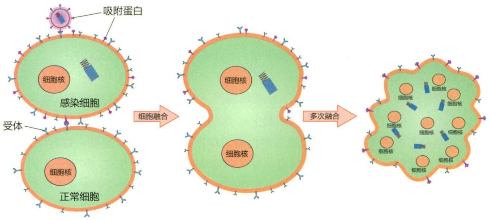

flowchart

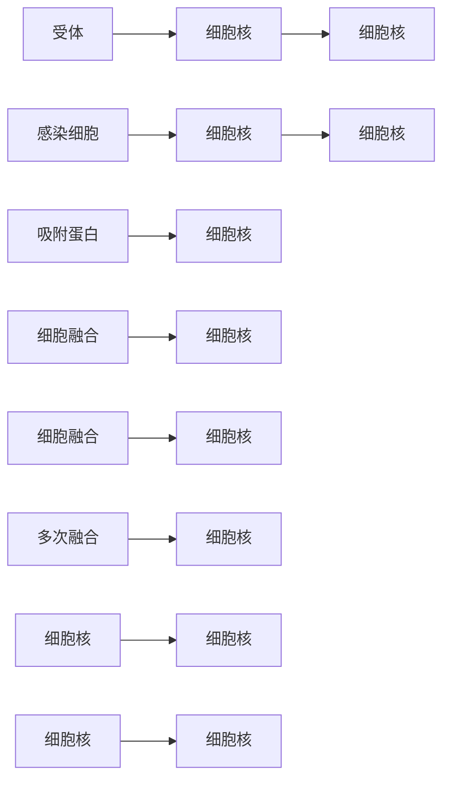

质合成并不受影响，因为病毒 mRNA 缺少 5' 帽式结构，但编码一段 “核糖体内部进入序列”（internal ribosome entry sequence, IRES），可以直接与核糖体结合，开始翻译。在另一些病毒感染的细胞中，病毒 RNA 大量转录，从数量上与细胞 mRNA 竞争，从而抑制细胞的蛋白质合成。

病毒感染的最强烈的效应自然是细胞裂解死亡。除前述病毒会产生裂解细胞的毒性蛋白，有时病毒感染会导致程序性细胞死亡（见 5.3.2.2）。

## 5.3.2.2 细胞的抗病毒感染作用

细胞有一系列机制可以感知病毒的入侵和复制，并做出相应的反应以对抗病毒的感染。细胞主要通过模式识别受体，包括各种 Toll 样受体分子（TLRs），胞内 MDA5、RIG-I 等识别病毒复制过程中形成的 dsRNA、特殊的 RNA 分子结构、细胞质中的未甲基化 DNA 分子等病毒成分，启动细胞信号转导，最终激活各种抗病毒基因的表达，产生干扰素（interferon）等抗病毒因子，使细胞进入“抗感染状态”，抑制病毒的复制。这些抗病毒因子也会分泌到细胞外，激活机体的免疫应答，更有效地抗病毒。

RNA 病毒在复制过程中会产生一些 dsRNA 区域。较长的 dsRNA 能诱导动物细胞产生干扰素，对病毒复制产生强烈的抑制作用。短的 dsRNA 虽然不诱导产生干扰素，但在一些宿主中会激活细胞的 RNA 干扰（RNA interference，RNAi）机制。这些 dsRNA 被切割成 20 nt 左右的长度，并被装载到 RISC（RNA-induced silencing complex，RNA 诱导的沉默复合物）上。RISC 对胞内 RNA 进行识别，降解能与它携带的 RNA 配对的 RNA。在低等动物和植物中，RNA 干扰具有一定的抗病毒作用。在基因组编辑中具有广泛应用的 CRISPR/Cas9 系统，本质上也是一种基于 RNA 的抗噬菌体机制。

一些病毒感染会诱发程序性细胞死亡（programmed cell death），包括凋亡、坏死等。这一现象既可以看作是病毒的细胞病理效应，也可以看作是细胞的抗病毒反应，因为如果细胞死亡发生在子代病毒产生以前，就可以起到清除病毒、阻止病毒在体内扩散的作用。这种程序性细胞死亡一般是病毒复制影响了正常的细胞周期调控，激活细胞相关信号通路导致，或病毒感染激活模式识别受体后诱导的。

---

5.4 亚病毒因子

119

## 5.3.2.3 病毒与机体的互作

机体的抗病毒感染作用主要通过表面屏障、固有免疫应答和获得性免疫应答进行。其中干扰素、抗体、细胞毒性 T 细胞等都可以在抗病毒感染中发挥重要作用。干扰素可以抑制病毒的复制；抗体可以起到中和病毒、阻断其感染的作用；细胞毒性 T 细胞及抗体介导的细胞免疫作用则在清除被感染的细胞方面具有重要的作用。相关内容见第 15 章。

同时，病毒作为一种演化实体，也产生了许多机制来应对细胞和机体对它的抑制作用。例如，许多病毒会通过突变迅速改变表面蛋白的抗原性，逃避抗体的作用。SARS-CoV-2流行期间出现了很多变异株，主要都是病毒表面蛋白S的变异，它们可以逃避已有抗体的作用。又如，流感病毒的非结构蛋白NS1具有多重抑制细胞防御功能的作用，可以抑制细胞对病毒的识别、抑制相关信号通路的激活、抑制干扰素的抗病毒作用等。有部分病毒具有抑制细胞凋亡的活性，如腺病毒E1B蛋白可以直接和细胞P53蛋白互作，抑制它的控制细胞周期、激活细胞凋亡等功能；非洲猪瘟病毒编码了一种与细胞中负调控细胞凋亡的Bcl-2蛋白类似的蛋白，抑制细胞凋亡的发生。

## 5.3.3 病毒与肿瘤

肿瘤是人类健康的大敌。根据世界卫生组织（WHO）和国际癌症研究机构（IARC）的数据，全球大约15.4%的肿瘤与感染（包括病毒、细菌和寄生虫）相关，其中约9.9%的肿瘤与各种病毒感染有关。目前明确感染后有可能引发人类恶性肿瘤的病毒主要有:人乳头瘤病毒（HPV，子宫颈癌）、EB病毒（EBV，鼻咽癌、淋巴瘤等）、乙型肝炎病毒（HBV，肝癌）、人8型疱疹病毒（HHV-8，卡波西氏肉瘤）、梅克尔细胞病毒（MCV，皮肤癌）等。这些病毒的特点是编码了一些可导致细胞转化的蛋白，如HPV编码E6、E7蛋白，可以分别和细胞中控制细胞生长的蛋白RB和P53互作，促进细胞的生长。HPV复制过程中，这些基因会偶发性地整合到细胞染色体上，进行持续表达，可能导致细胞生长失控和发生恶变。

值得指出的是，肿瘤的发生涉及众多因素，包括个体的遗传背景、生理状态、环境因素等。肿瘤相关病毒的感染者中仅有个别会最终罹患肿瘤。尽管如此，防控病毒感染可以切实降低这些病毒相关肿瘤的发生率。

## 5.4 亚病毒因子

亚病毒因子（subviral agent）是一类比病毒更为简单的病原体。它们可能仅由核酸组成而不包含蛋白质衣壳，也可能仅由感染性的蛋白质组成而不包含核酸，还有可能既包含了核酸也包含了蛋白质然而其自身无法实现单独感染，需要在其他辅助病毒的帮助下才能实现感染传播。亚病毒因子包括卫星病毒、卫星核酸、类病毒以及朊病

---

120

5 病毒

毒。亚病毒因子的发现拓展了病毒学的边界以及视野，为传统的病毒学思维注入了新的理念。

## 5.4.1 卫星病毒

卫星病毒（satellite virus）的基因组缺乏其感染复制的必需基因（比如病毒基因组复制酶基因），然而这些必需基因可以被一些辅助病毒编码，所以卫星病毒必须依赖辅助病毒实现感染传播。卫星病毒首先在植物中被发现。已知的植物卫星病毒包括卫星烟草坏死病毒（satellite tobacco necrosis virus，STNV）以及卫星烟草花叶病毒（satellite tobacco mosaic virus，STMV）等。这些卫星病毒自身不编码复制酶，所以必须依赖辅助病毒编码的复制酶进行复制。这些卫星病毒对于辅助病毒的专一性极高，比如STNV仅能依靠烟草坏死病毒（tobacco necrosis virus，TNN）进行复制。

动物中也存在卫星病毒。例如，腺相关病毒（adeno-associated virus，AAV）是一种 ssDNA 卫星病毒，基因组长度大约 4.8 kb。它自身无法复制其基因组，需要与腺病毒或者疱疹病毒同时感染，在它们的辅助下完成复制过程。AAV 编码了自己的衣壳蛋白，其病毒粒直径大约 20 nm，其中包裹的遗传物质为一条 ssDNA，正链以及负链都可以被包裹（病毒粒包裹的正链和负链大约各占一半）。AAV 可以感染人类，然而基本不导致疾病。不同类型的 AAV 有不同类型的衣壳蛋白，它们偏好侵染不同类型的宿主细胞，所以 AAV 也被广泛用于将外源基因递送进入不同类型的组织细胞中。

## 5.4.2 卫星核酸

卫星核酸包含了卫星 RNA 以及卫星 DNA，是一类自身不编码衣壳及包膜蛋白，需要借助辅助病毒编码的衣壳或包膜蛋白来组装的小分子 RNA 或 DNA 因子。它们跟卫星病毒的不同点在于卫星病毒需要辅助病毒提供复制酶而卫星核酸需要辅助病毒提供衣壳或者包膜蛋白。以卫星 RNA 为例，按照大小可以分为两类，较大的一类包括番茄黑环病毒（tomato black ring virus，TBRV）的卫星 RNA，长约 1370 个核苷酸；较小的一类含有大约 300 个核苷酸，包括烟草环斑病毒（tobacco ring spot virus，TRSV）的卫星 RNA 等。较长的卫星 RNA 具有编码功能，而较短的似乎不编码蛋白质。

感染人类的丁型肝炎病毒（hepatitis delta virus，HDV）也是卫星RNA的一类。它的基因组是长约1700个核苷酸的环形ssRNA，编码了δ抗原，但是没有编码包膜蛋白，无法包装生成感染性的病毒颗粒。HDV的辅助病毒是HBV，当HDV同HBV共感染的时候，HBV编码的包膜蛋白可以将HDV的基因组包装成病毒颗粒从而实现HDV的传播。HDV的复制机制跟类病毒极为相似（见5.4.3），其RNA基因组折叠形成的结构可以被宿主DNA依赖型RNA聚合酶识别并且通过滚环（rolling-circle）机制复制，产生多聚体基因组RNA，然后被切割和连接生成新的环形ssRNA。与类病毒（见5.4.3）不同的是，HDV的基因组的复制不仅仅依赖宿主因子同时还依赖病毒因

---

5.4 亚病毒因子

121

子，HDV 基因组编码的  $\delta$  抗原也是上述 HDV 复制过程中的必需因子。HBV 是唯一公认的 HDV 的辅助病毒，然而最新的研究表明除了 HBV，其他的病毒编码的包膜蛋白比如丙型肝炎病毒以及寨卡病毒的包膜蛋白也可以在体外培养的细胞中辅助 HDV 的包装，这个研究表明 HBV 可能不是 HDV 唯一的辅助病毒。然而这个可能性还没有在感染了 HDV 的患者群体中得到验证。

## 5.4.3 类病毒

类病毒（viroid）是一种主要在植物中存在的非编码、单链、环状 RNA 分子病原体。类病毒的长度为 220～400 个核苷酸，可折叠成不同形状的二级结构，比如棒状（图 5-10）。它们不编码任何蛋白质，也没有衣壳蛋白，所以没有包装在病毒颗粒中。类病毒极小，可以通过胞间连丝以及植物维管组织在细胞组织间传播（图 5-11）。

类病毒最早是由美国科学家于1971年在研究马铃薯纺锤形块茎疾病时发现。他们发现这种病原与传统的病毒不同，不包含蛋白质组分，仅由RNA分子组成，类病毒的概念由此形成。根据是否含有中央保守区以及核酶（ribozyme）结构，类病毒可以分为两个家族，分别是马铃薯纺锤形块茎类病毒科［Pospiviroidae，以马铃薯纺锤形块茎类病毒（PSTVd）为代表］和鳄梨日斑类病毒科［Avsunviroidae，以鳄梨日斑类病毒（ASBVd）以及桃潜隐花叶类病毒（PLMVd）为代表］（图5-10）。前者含有中央保守区，但不含核酶保守序列；后者没有中央保守区域，但含有核酶保守序列，

知识拓展 5-3
类病毒的发现

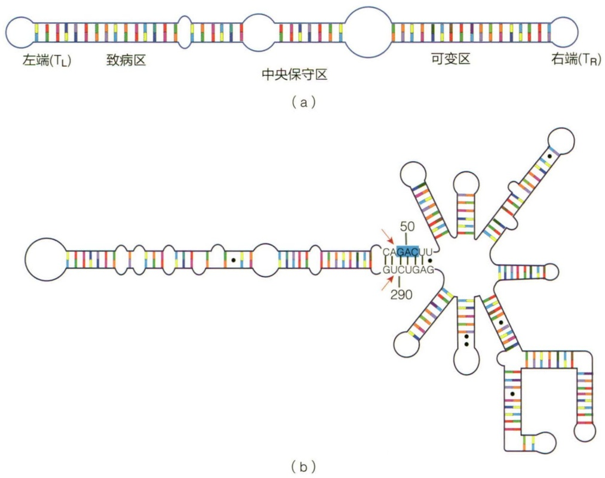

text_image

左端(TL)
致病区
中央保守区
可变区
右端(TR)
(a)
50
CAGACUU
GUCUGAG
290
(b)

图 5-10 类病毒的二级结构

(a) PSTVd（马铃薯纺锤形块茎类病毒）最稳定的热力学二级结构。5个结构/功能区域依次为左端（terminal left， $T_{L}$ ）、致病区（pathogenesis）、中央保守区域（central conserved region）、可变区（variable）和右端（terminal right， $T_{R}$ ）；(b) PLMVd（桃潜隐花叶类病毒）最稳定的热力学二级结构。G-U配对由黑点表示，核酶酶切位点由红色箭头表示

---

122

5 病毒

图 5-11 植物类病毒可导致植株矮小疾病

（a）左植株为健康植株，右为感染植株；（b）类病毒可以通过胞间连丝以及植物维管组织在细胞组织间传播

natural_image

Two potted green plant varieties in black pots, one large and elongated, the other smaller and flatter (no text or symbols visible)

(a)

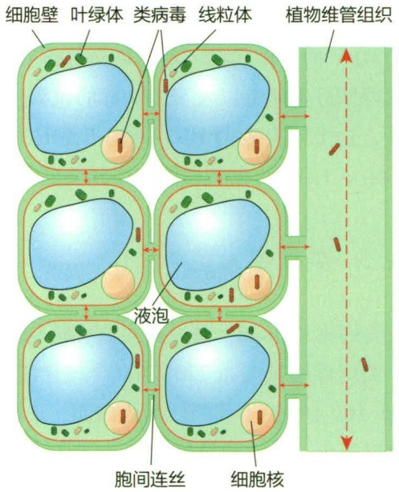

flowchart

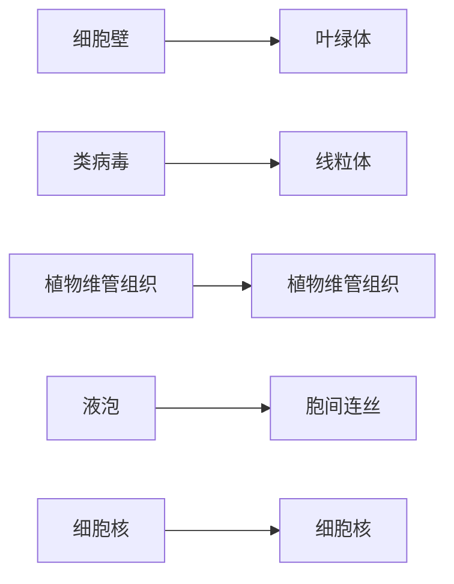

(b)

能够自我切割。

所有类病毒都利用宿主细胞的 RNA 合成酶通过滚环（rolling-circle）机制复制，产生多聚体基因组 RNA，然后通过切割和连接生成新的环状 ssRNA。以 PSTVd 为例，宿主内的 DNA 依赖型 RNA 聚合酶Ⅱ被 PSTVd 的棒状折叠结构欺骗，识别 PSTVd RNA 基因组作为底物，从而转录复制成新的类病毒分子。值得注意的是 RNA 的二级结构会影响其功能，类病毒的 RNA 二级结构不是单一的折叠状态，相同的序列会在复制周期的不同阶段折叠成不同的亚稳态结构（metastable structures），并且在复制过程中行使不同的功能。

## 5.4.4 朊病毒

朊病毒（prion）是只由蛋白质组成的传染性因子，于1982年被发现。这些病原体与一些病程进展缓慢但致命的哺乳动物疾病相关，包括人的克-雅病（Creutzfeldt-Jakob disease，CJD）、库鲁病（Kuru disease）、致死性家族型失眠症（fatal familial insomnia，FFI），以及发生于动物中的羊瘙痒病（scrapie）、牛海绵状脑病（bovine spongiform encephalopathy，BSE）等。在这些疾病中，朊病毒蛋白质在神经组织中沉积，通过尚不清楚的机制导致神经元死亡，脑功能逐渐恶化，组织中出现特征性的海绵状空洞。

羊瘙痒病是朊病毒的主要研究模型。高温、紫外线、辐射、蛋白酶等能使病毒灭活的因子无法使羊瘙痒病致病因子失活。核酸酶也无法破坏其感染性，然而 SDS、尿素、苯酚等蛋白质变性剂可以破坏其感染性。由于迄今为止尚未发现其含有核酸，所以主流观点认为羊瘙痒病致病因子为蛋白质。

从实验感染的仓鼠脑组织中分离得到的羊瘙痒病致病因子蛋白的分子量

## 知识拓展 5-4

## 真菌中的朊病毒

---

5.4 亚病毒因子

123

是 27 000 \~ 30 000，其感染性可以被中和抗体中和，这种蛋白质被称为朊病毒蛋白（prion protein，PrP）。由于该致病蛋白来源于羊瘙痒病（scrapie），所以用 PrP$^{Sc}$（prion protein，scrapie）表示。根据 PrP$^{Sc}$ 的氨基末端序列合成寡核苷酸探针进行检测发现，宿主细胞有编码 PrP 的基因，其编码的基因产物为一种细胞膜糖蛋白 PrP$^{C}$（Prion protein，cellular）。PrP$^{C}$ 与 PrP$^{Sc}$ 是同分异构体，蛋白质初级序列一致，然而二级结构不同，PrP$^{C}$ 含有 43% 的 α 螺旋以及 3% 的 β 折叠，PrP$^{Sc}$ 含有 34% 的 α 螺旋以及 43% 的 β 折叠，从而使得 PrP$^{Sc}$ 的溶解性降低，很难被蛋白酶降解，易于沉积（图 5-12a）。

针对  $PrP^{Sc}$  在体内的复制传播过程，科学家提出了杂二聚机制假说: $PrP^{Sc}$  单体感染物接触细胞之后同  $PrP^{C}$  结合，形成  $PrP^{C}-PrP^{Sc}$  杂二聚物，可诱导  $PrP^{C}$  转变成为  $PrP^{Sc}$，成为  $PrP^{Sc}-PrP^{Sc}$  二聚物。该二聚物解离后同其他的  $PrP^{C}$  结合，并诱导其构象改变，从而不断地将自己的蛋白构象复制下去（图 5-12b）。最终过量的  $PrP^{Sc}$  二聚物朊病毒分子在脑部细胞中堆积形成淀粉样沉淀，造成细胞坏死，使得脑组织呈现海绵状变化。

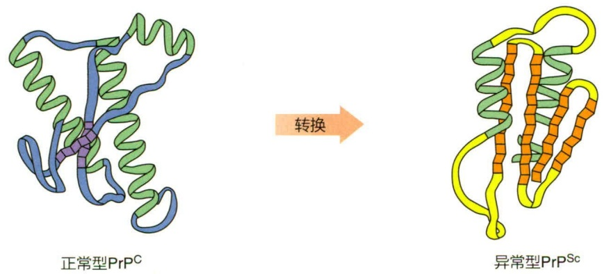

flowchart

(a)

图 5-12 胱病毒的构象变化及其复制

（a）朊病毒蛋白PrP $^{Sc}$ 跟正常的蛋白质PrP $^{C}$ 相比含有很多的β折叠使其易于聚集沉淀；（b）朊病毒复制的杂二聚机制假说

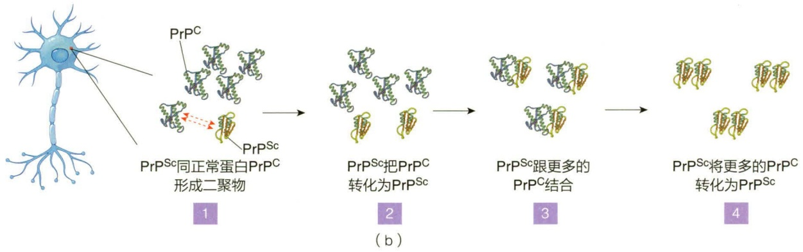

flowchart

---

124

5 病毒

## 5.5 病毒举例

病毒可以感染所有已知的生物类型。细菌、古菌、动物以及植物，无一能够摆脱病毒的纠缠（图 5-13）。病毒对整个自然界以及人类社会影响重大。一方面，病毒感染的致病性会危害人类健康，对畜牧业、种植业以及微生物发酵工业产生负面的影响。另一方面，海洋中的病毒感染每天会导致大量的海洋微生物死亡，将这些生物转化为颗粒物质，成为海洋底层食物链中的浮游植物所需的基本营养物质。同时病毒可以被用于研究生命科学基本规律，以及作为基因工程中的载体，对现代生命科学以及生物工程技术的发展有着极其重要的作用。所以，随着人类对病毒的理解越来越深入，病毒仅是疾病的使者这一观点也逐渐地被模糊化了。

## 5.5.1 噬菌体和古菌病毒

感染细菌和古菌的病毒分别称为噬菌体（bacteriophage）和古菌病毒（archaeal virus）。全球海洋中存在超过 $10^{30}$ 个噬菌体颗粒。噬菌体的形态有球状、丝状、蝌蚪状以及复合结构等类型，绝大多数的噬菌体中的遗传物质是dsDNA。噬菌体是病毒学研究最早的和最简洁的模式系统之一，病毒学中的多数基本概念以及研究方法都是率先使用噬菌体阐释或建立，最终拓展应用到其他病毒中去的。同时研究噬菌体也有重要的应用意义，它既是发酵工业的大敌，又可以被开发用来控制耐药性病原菌的危害。

## 5.5.1.1 噬菌体的增殖

以研究较为广泛的 T4 噬菌体为例介绍噬菌体的复制增殖过程。T4 噬菌体的宿

图 5-13 感染不同物种的病毒举例

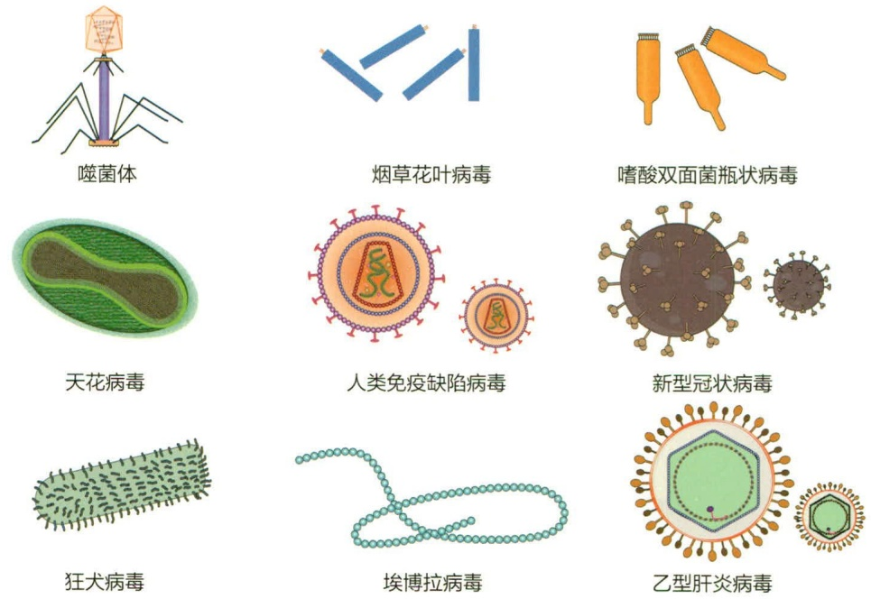

---

5.5 病毒举例

125

主是常见的肠道细菌大肠杆菌，T4噬菌体为复合结构，具有头部、颈部和尾部构成的外壳，dsDNA包装在二十面体的头部。图5-14展示了T4噬菌体的感染和复制过程。

## (1) 吸附

T4 噬菌体不是毫无选择性地吸附到宿主细胞的表面，其尾丝尖端的特定蛋白因子（gp37）特异性地与宿主细胞上的特定受体（LPS，OmpC）结合，这种相互作用触发尾丝展开，从而暴露刺突以及基板，使其附着于宿主细胞的细胞壁表面。虽然包括T4在内的许多噬菌体附着于细胞壁，但也有其他噬菌体可以吸附在鞭毛或菌毛上。

## (2) 侵入

噬菌体尾部存在的溶菌酶会削弱细菌细胞壁。当噬菌体吸附在细胞壁以后尾鞘收缩成原长的一半，将中空的尾管推入被溶菌酶削弱的细菌细胞壁，并与细菌细胞膜接触。然后，病毒 DNA 从头部经过管道被注射进入细菌细胞，噬菌体外壳仍然位于细菌细胞外部。T4 噬菌体从吸附到侵入的全过程仅需数分钟。

## (3) 合成

噬菌体基因组容量有限，无法包含噬菌体复制及组装所需的所有遗传信息，必须利用宿主细胞的生物合成机制来合成噬菌体蛋白质以及基因组。一旦噬菌体DNA进入宿主细胞，其基因就会控制宿主细胞的代谢过程，启动噬菌体蛋白质以及基因组的合成。这一过程具备很强的时序性，主要表现是噬菌体基因组的转录是分期进行的。发生于噬菌体核酸复制以前的转录为早期转录，其转录的基因称为早期基因，主要编码参与病毒核酸复制，调节病毒基因组表达，以及控制宿主细胞中大分子合成的病毒蛋白质。早期基因表达之后，细菌DNA会被降解形成核苷酸，用作复制新噬菌体遗传物质的原料。在噬菌体核酸复制开始之后进行的转录称为中晚

图 5-14 T4 噬菌体感染复制的全过程示意图

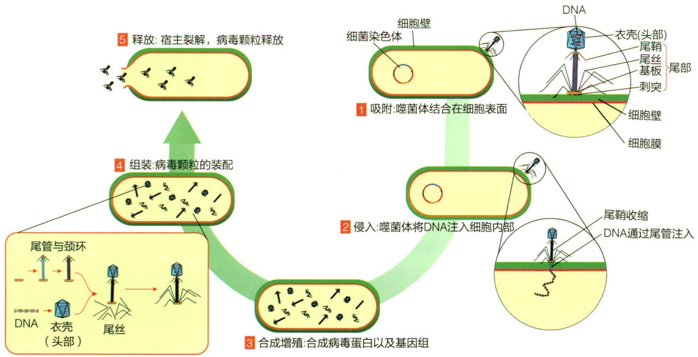

flowchart

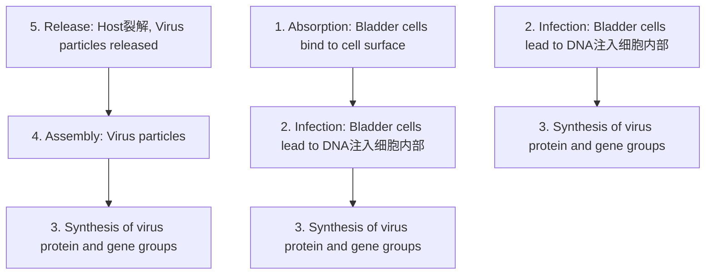

---

126

5 病毒

期转录，所转录的基因称为中晚期基因，主要编码噬菌体组装以及释放所需要的蛋白质。

## (4) 组装

T4 噬菌体的组装是极其复杂的自发装配的过程，整个过程包含了 4 个亚装配途径:①不含尾丝的颈部、尾部组装，②头部的组装，③颈部、尾部同头部的自发结合，④尾丝同已装配好的部分连接。噬菌体尾部由新形成的基板、尾管、尾鞘和颈环组装而成，头部由新合成的衣壳蛋白组装而成。然后，单个病毒 dsDNA 分子被分子装配马达填装进头部，这个过程需要消耗 ATP。当头部与 DNA 正确装填后，每个头部就与一个不含尾丝的尾部连接在一起。只有在头部和尾部连接后，尾丝才会被添加进来，形成成熟的、有传染性的噬菌体。

## (5) 释放

当宿主细胞内大量子代噬菌体成功组装以后，噬菌体基因组编码合成的水解细胞壁的溶菌酶以及水解细胞膜的脂肪酶将宿主细胞裂解，噬菌体得以释放。对于T4等噬菌体，一个被感染的细菌可能释放出50～200个新的噬菌体，从而感染更多的易感细菌。从吸附到释放的时间被称为暴发时间，对于不同的噬菌体一般在20～40min。

## 5.5.1.2 温和噬菌体

噬菌体 T4 感染一旦开始，它总是会裂解并杀死宿主细胞，这样的噬菌体又被称为烈性噬菌体。然而，有一些噬菌体在宿主细菌中会呈现两种不同的状态，可以裂解并杀死宿主，也可以将其基因组整合到宿主的基因组中或者以游离质粒的形式存在，同宿主的基因组一同复制而不直接裂解杀死宿主。这第二种状态被称为溶原状态（lysogeny），可以进入溶原状态的噬菌体被称为温和噬菌体。溶原状态同裂解状态可以在不同的条件下相互转换。

处于溶原状态的噬菌体基因组以整合或者游离质粒形式存在于细菌中，被称为前噬菌体（prophage）。这种溶原状态即潜伏性感染状态，噬菌体基因组中的大多数基因不会转录，而是与宿主染色体同步复制，并在细胞分裂时传递给子细胞，不产生子代噬菌体。溶原状态的细菌经外界因子诱导刺激后，噬菌体基因会活化，进入积极复制、合成和组装的裂解性感染状态，造成细胞裂解，进而释放出子代噬菌体。有很多其他的病毒也具备温和噬菌体的两种状态转换的特征，如导致艾滋病的人类免疫缺陷病毒。

## 5.5.2 植物病毒

已知的植物病毒的种类远远超过所有感染脊椎动物病毒的总和。植物病毒中的烟草花叶病毒（TMV）是第一个被发现的病毒，也是整个病毒学领域的起点。大多数的植物病毒属于ssRNA病毒，多为杆状、丝状或球状，多数无包膜（图5-15）。植物病毒对宿主的专一性通常不强，比如烟草花叶病毒可以侵染数百种的草本以及木本植物，其主要原因可能是植物病毒的入侵一般不依赖于细胞表面受体。

知识拓展 5- 5

香蕉病毒造成的危机

---

5.5 病毒举例

127

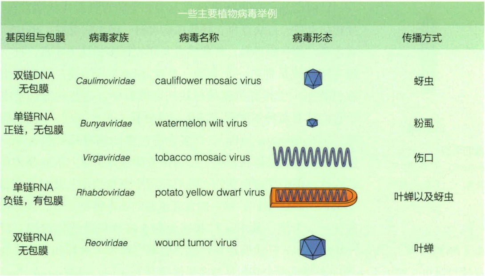

flowchart

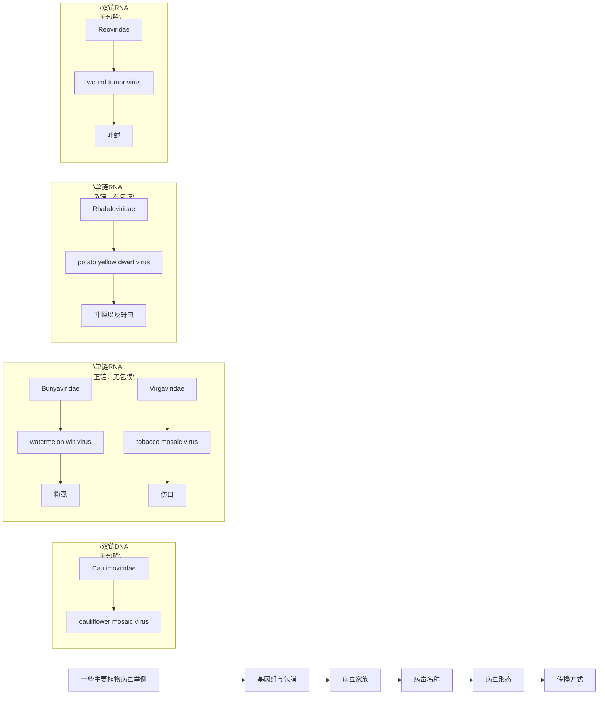

图 5-15 一些植物病毒举例

植物病毒的感染过程同一般的病毒感染复制过程类似，主要包含了入侵宿主细胞、合成增殖、病毒颗粒组装，以及传播扩散。植物病毒也有以下特点:①由于植物有坚韧的表皮和坚硬的细胞壁，病毒难以直接进入细胞，而是需要通过机械力损伤表皮形成微创后进入细胞，比如昆虫等动物进食所导致的创口。所以大多数的植物病毒是虫媒病毒；②植物病毒感染宿主细胞后的过程也具备时序性，一般在感染的初期表达基因组复制蛋白因子，而在感染的后期表达病毒装配的因子。由于大多数植物病毒是RNA病毒，这种转录表达时序性的建立有很多种不同于DNA病毒的机制，其中比较常见的一种是将涉及装配的病毒蛋白编码在亚基因组RNA（subgenomic RNA）上，而这些亚基因组RNA的转录依赖病毒RNA复制酶的表达，因此只能在感染的晚期复制酶表达完成以后才能启动，从而建立时序性；③植物病毒可以通过胞间连丝在植物细胞间传播；④植物依赖韧皮组织来传输养分，植物病毒要实现远端扩散需要能够在韧皮组织细胞间流动。这可能是植物病毒比大多数动物病毒更小且更简单的原因。大多数植物病毒基因组小于10 kb；⑤植物拥有比较发达的基于RNA干扰（RNAi）的免疫系统，因此，几乎所有植物病毒都编码了抑制RNAi的病毒因子。

## 5.5.3 昆虫病毒

世界上有 600 万 \~ 1 000 万种不同的昆虫，它们代表了地球上最多样化的生物类群之一。感染昆虫的病毒也具有极高的多样性。这些病毒可能与昆虫本身一样存在已久，同宿主一起演化了超过 1 亿年的时间。某些昆虫病毒同时也是感染脊椎动物，包括人类的病原体。因此，昆虫病毒的研究长期以来一直是人类医学、农业等领域关注的对象。

---

128

5 病毒

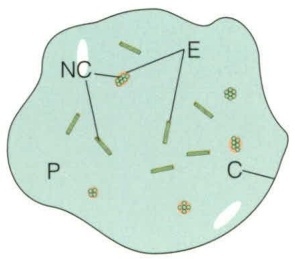

text_image

NC
E
P
C

包涵病毒

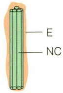

出芽病毒

图 5-16 包涵病毒与出芽病毒的形态

E: envelop, 包膜; NC: nucleocapsid, 核衣壳; P: polyhedrin protein, 多面体蛋白质基质; C: Calyx, 蛋白质 - 碳水化合物外壳

目前已知的昆虫病毒包含至少7个病毒科:杆状病毒科、虹彩病毒科、痘病毒科、呼肠孤病毒科、细小病毒科、小RNA病毒科、弹状病毒科。杆状病毒是研究最多的昆虫病毒，杆状病毒家族成员拥有一个大的、环状dsDNA基因组，该基因组被包装在一个具有包膜的杆状病毒颗粒中。这些病毒的特点是它们具有两种不同形态的传染性颗粒（图5-16）:①包涵病毒（occluded virus，OV），许多含有包膜的病毒粒被包裹在由蛋白质构成的晶体状结构（多角体或颗粒体）里，这些晶体状结构可以保护病毒使它们在外界环境中更加稳定。②出芽病毒（budded virus，BV），单一的含有包膜的病毒颗粒。杆状病毒家族包括4个属，其中α杆状病毒和β杆状病毒感染鳞翅目昆

虫（蛾和蝴蝶），而  $\gamma$  杆状病毒和  $\delta$  杆状病毒分别感染膜翅目昆虫（黄蜂和锯蜂）和双翅目昆虫（蚊子）。 $\alpha$  和  $\beta$  杆状病毒分别包括核多角体病毒（nuclear polyhedrosis virus, NPV）和颗粒病毒（granulosis virus, GV），这两个病毒群是杆状病毒家族中被研究得最为深入的。

杆状病毒感染昆虫有两个感染阶段，初级感染由包涵病毒介导，而出芽病毒介导次级感染。昆虫幼虫是最容易受到杆状病毒感染的发育阶段。在幼虫摄食过程中，包涵病毒蛋白质基质在幼虫中肠碱性pH条件下解体，释放出病毒粒，感染中肠上皮细胞。病毒在中肠上皮细胞中经过合成、增殖、组装，首先在不裂解宿主细胞的情况下通过出芽的方式释放出芽病毒，病毒进入体腔以及循环系统，感染血细胞、脂肪体细胞、气管上皮细胞、真皮细胞以及神经节细胞等，进而在这些细胞中大量增殖，造成大面积继发感染。在病毒感染细胞的极晚期，产生大量的包涵病毒，通过裂解细胞的形式释放出来，造成宿主组织破坏，最终导致死亡。同噬菌体感染细菌相似，杆状病毒感染昆虫细胞后的过程具有高度的时序性，且主要体现在病毒基因组的转录层次上。在复制的早期主要表达促进病毒基因组复制的病毒因子，在晚期表达组装以及出芽释放出芽病毒的因子，在极晚期，表达释放包涵病毒的因子，从而使得整个感染过程高效有序地进行。

## 5.5.4 动物与医学病毒

动物病毒指寄生于各类脊椎动物细胞中的病毒，主要包括哺乳类、禽类、爬行类、两栖类以及鱼类病毒。动物病毒严重危害人类和动物的健康。已知的感染人类并导致疾病的医学病毒有300余种，导致其他脊椎动物疾病的病毒达900余种。

动物病毒一般具有种属特异性以及组织特异性，主要因为动物病毒首先同特定的细胞受体相结合。不同的病毒一般使用不同的表面受体，比如 HIV 以 T 细胞表面的 CD4 作为特异受体，而乙型肝炎病毒则利用肝细胞表面特异的胆汁酸转运蛋白 NTCP 作为入侵细胞的受体。一旦动物病毒与受体结合，它们通常通过与细胞质膜融合或通

---

5.5 病毒举例

129

过内吞作用进入宿主细胞。进入细胞后，包裹动物病毒基因组的核衣壳解体，将其遗传物质释放到细胞核或者细胞质中。多数情况下，DNA 基因组进入细胞核，而 RNA 基因组则在细胞质中。在基因组复制以及合成增殖过程中，多数病毒也表现出转录水平上的时序性，并在病毒基因组复制后进行病毒的组装和释放。

70% 以上的人类传染病是病毒引起的。病毒感染有裂解性感染、持续性感染、潜伏性感染和细胞转化（transformation）等多种情形，引发多种急性和慢性疾病。其中对于慢性病毒感染，迄今为止仅有丙型肝炎病毒（hepatitis C virus，HCV）能够被药物治愈，对于所有其他的慢性病毒感染仍然缺乏有效治愈的手段。同时在全球一体化以及人类社会同自然界的边界不断模糊化的进程中，越来越多的新型病毒开始威胁人类健康。有很多新发现的威胁人类健康的病毒属于人兽共患病病毒以及虫媒病毒。由于这些病毒可以在多种不同的宿主群体中循环存在，增加了防治的难度。长期困扰人类的流感病毒、多次出现大流行的冠状病毒都属于人兽共患病病毒；登革病毒和寨卡病毒则是虫媒病毒的代表。

最近的一次全球病毒传染病大流行是由冠状病毒 SARS-CoV-2 引起的。SARS-CoV-2 是一种 +ssRNA 病毒，基因组接近 30 kb，也是感染人类的基因组最大的 RNA 病毒之一。SARS-CoV-2 是一种包膜病毒，包膜上含有刺突蛋白，在电子显微镜下呈现皇冠状。刺突蛋白可以同呼吸道的上皮细胞表面的血管紧张素转化酶 2（ACE2）结合，然后通过直接膜融合或者内吞作用来入侵细胞，并且释放 SARS-CoV-2 基因组。其 +ssRNA 基因组可以直接用来翻译合成复制病毒基因组必需的 RNA 复制酶，从而形成新的子代病毒基因组。该 RNA 复制酶同时可以将 mRNA 基因组转录产生一系列亚基因组 RNA，编码参与病毒装配以及释放的蛋白因子。最终子代病毒通过出芽的方式释放。RNA 病毒的一个典型的特征是变异率很高，主要是因为 RNA 基因组复制酶催化 RNA 复制时的出错率一般较高，从而使得子代病毒更加容易逃逸免疫系统，造成反复感染。

乙型肝炎病毒（hepatitis B virus，HBV）则是一种长期存在并危害人类健康、导致慢性疾病的病毒。全世界有20亿的人曾经被HBV感染，将近3亿人为无法完全治愈的慢性感染者，其中近三分之一的感染者在中国。不加控制的HBV感染会导致严重肝病，包括肝炎、肝纤维化、肝硬化以及肝癌。有近80%的原发性肝癌同HBV的感染相关。HBV疫苗可以有效预防新发感染，但对已经感染了病毒的人群没有治疗作用。如何治愈HBV感染一直是病毒学领域的难题。HBV属于嗜肝DNA病毒科。病毒粒有包膜，包膜表面带有HBV表面抗原糖蛋白。该糖蛋白可以同肝细胞表面受体NTCP结合，从而介导入侵。侵入细胞后，病毒脱去衣壳，将基因组释放进入细胞核中。病毒颗粒中的病毒基因组为松弛环状双链DNA（relax circular DNA，rcDNA），该基因组的特点是DNA两条链长度不一致，并且存在4种基因缺陷，使得该DNA无法直接作为模板转录形成全套的病毒mRNA，需要首先被宿主肝细胞中的修复因子修复形成能够稳定存在的共价闭合环状DNA（covalently closed circular DNA，cccDNA）。cccDNA可以作为模板来转录生成全套的病毒mRNA，进而产生各种病毒蛋白因子来

---

130

5 病毒

驱动病毒复制、组装以及释放。HBV 通过出芽的方式释放，一般不直接杀死肝细胞，会导致慢性感染。要彻底治愈病毒的感染就必须清除宿主细胞中的病毒基因组，而 HBV 感染治愈的难点在于缺乏能有效抑制以及清除 cccDNA 的方法，这也是 HBV 治疗以及未来研究的核心。

## 5.6 病毒学研究方法

同所有学科的发展一样，病毒学的进展离不开研究方法以及技术手段的突破以及完善。与细菌和真核微生物不同，所有的病毒都必须在宿主细胞中增殖，并且几乎所有的病毒都无法直接用普通光学显微镜观测，所以病毒有一套独特的分离、培养、检测和定量的技术方法。

## 5.6.1 病毒的培养与纯化

病毒培养的主要目的是分离鉴定样本中的病毒，用于制备病毒疫苗，研究病毒的结构、复制周期以及感染宿主细胞后所产生的影响等。由于病毒在活细胞以外无法增殖，所以病毒培养都需要在易感细胞、组织或者活体动物中进行。细菌、动物以及植物病毒培养的具体方法各不相同。

## 5.6.1.1 噬菌体的培养

裂解性噬菌体可以在含有易感细菌的液体培养基或者琼脂固体培养基上生长增殖。液体培养一般用于病毒的扩增从而制备大量的病毒，而固体培养一般用于病毒的分离纯化。当少量的噬菌体接种到含有大量易感细菌的液体培养基中时，噬菌体侵染一部分细胞，复制增殖，将细胞裂解并且释放子代噬菌体。随着培养时间的延长，越来越多的细菌被子代噬菌体感染并发生裂解，噬菌体得到大量的扩增最终使得浑浊的细菌培养物变得澄清。

如图 5-17 所示，在固态培养基上培养病毒的时候，将含有少量的噬菌体样本以及易感细菌的培养基加入 45～50℃ 的熔融低浓度琼脂培养基中，混合均匀后，迅速倾倒入含有固体琼脂的平板中。低浓度琼脂凝固以后会形成含有细菌的固态薄层。在培

图 5-17 噬菌体在固体培养基中感染细菌的实验步骤

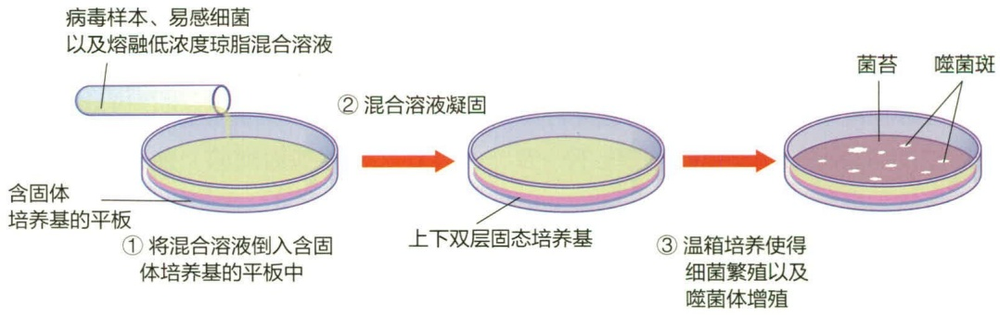

flowchart

---

5.6 病毒学研究方法

131

养箱培养的过程中，薄层中的细菌将增长繁殖成一层不透明的菌苔。与此同时噬菌体先感染裂解少量细菌，释放子代噬菌体，由于低浓度琼脂限制了子代噬菌体的扩散范围，使之仅能感染并裂解周围邻近的细菌。这个感染-裂解周期重复几次之后，在不透明的菌苔的衬托下，这些被噬菌体裂解的区域就会形成一个个圆形透明的空洞，又称为噬菌斑（plaque）（图5-17）。单个的噬菌斑一般仅含有基因组均一的噬菌体，可以被挑出来放入含有易感细菌的液体培养基进行进一步地培养扩增。

## 5.6.1.2 动物病毒的培养

动物病毒的培养主要包括细胞、鸡胚及实验动物培养等形式。细胞培养是培养动物病毒最简便的方式，包括原代细胞以及永生化细胞系的培养。原代细胞是将动物的组织进行酶解处理成均一的单个细胞之后，加入到含有营养物质、生长因子等组分的液体培养基中以贴壁或者是悬浮的形式培养。这些细胞仅能分裂很有限的代数，绝大部分细胞在培养一段时间后会停止分裂并且死亡，但极少数的细胞会积累突变转化为可以无限分裂传代的细胞，从而形成永生化细胞系。在含有单层易感原代细胞或者永生化细胞的液体培养基中加入少量病毒，它们将吸附在细胞表面并且侵入细胞，复制产生的子代病毒将感染新的细胞，经过多个感染周期之后，病毒得到扩增。

同噬菌体培养类似，动物病毒的培养也可以在含有琼脂糖或者甲基纤维素等成分的固态培养基中进行，这样子代病毒仅能扩散感染周围的细胞，最终在单层细胞中造成局部细胞受损以及死亡并形成类似噬菌斑的圆形区域，称为噬斑（plaque）。与噬菌斑的观测不同的是，单层菌苔不透明，噬菌斑显而易见，而单层动物细胞半透明，噬斑很难直接观测到，一般需要用结晶紫（crystal violet）或者中性红（neutral red）对细胞进行染色，噬斑区域由于细胞死亡形成不着色区域，从而被观测到。病毒感染可能会造成细胞死亡以及细胞生长缓慢等细胞病变现象。有的病毒感染并不对细胞造成任何表观上的伤害，这种类型的病毒称为非细胞毒性病毒（non-cytopathic virus）。非细胞毒性病毒的感染不会产生噬斑现象。

鸡胚中含有迅速生长分化的不同类型的细胞，可以满足不同病毒培养繁殖的需求。外壳的保护给鸡胚的生长提供了无菌的条件，使得鸡胚成为了病毒培养极佳的体系。每年都有数以亿计的鸡胚被用于培育流感病毒以生产疫苗。根据培养病毒的不同，病毒的接种需要注射进入不同的胚胎组织中（图 5-18）。

活体实验动物培养也是病毒培养的重要方式。常用的动物有小鼠、大鼠、仓鼠和兔子等。由于很多病毒具有种属以及器官特异性，不同的病毒需要接种到不同的动物，甚至是不同的器官中进行增殖。

## 5.6.1.3 植物病毒的培养

植物病毒的培养有三种不同的方式:植物组织培养、分离细胞培养，以及原生质体（去除了细胞壁的细胞）培养。进行植物组织培养时，可使用病毒同磨砂剂（如金刚砂）的混合物对植物的叶片组织进行摩擦接种，当植物的叶片组织中的细胞壁受到破坏后，病毒可与细胞质膜接触并且感染暴露的宿主细胞。有些植物病毒的传播需要将病变的组织嫁接到健康的植物上。植物被感染后，被感染部位经常会出现局部坏死

知识拓展 5-6

HeLa 细胞

---

132

5 病毒

图 5-18 病毒在鸡胚中的接种与培养

鸡胚切面图展示不同类型病毒接种到不同的位置进行病毒培养

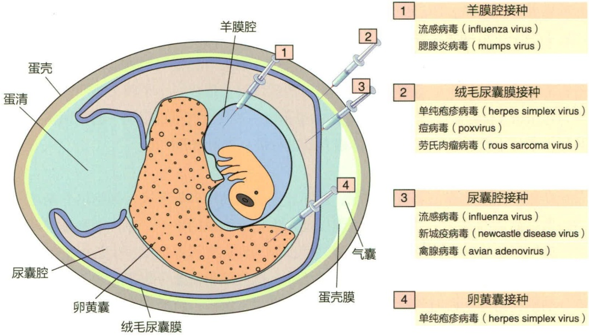

或者是其他的病症，比如叶片颜色或者叶片形状的变化。

## 5.6.1.4 病毒的纯化

在培养得到大量病毒之后，很多时候需要进一步除去杂质，纯化得到均一的病毒。目前主要的纯化方法包括:病毒沉淀和密度梯度离心。在病毒培养液中加入适当浓度的聚乙二醇可以使病毒发生物理聚沉，但不会使病毒发生不可逆变性。弃去含有杂质的上清之后收集病毒沉淀，用缓冲液悬浮病毒即可获得初步纯化浓缩的病毒悬液，此时的病毒浓缩液中还含有少量杂质，比如蛋白质等，进一步的分离纯化可以通过蔗糖或氯化铯密度梯度离心进行。以蔗糖密度梯度离心为例，将不同浓度的蔗糖溶液缓慢分层注入离心管，其浓度自管顶到管底呈线性上升。将聚乙二醇初步纯化浓缩的病毒悬液平铺于蔗糖梯度的最上层进行离心，在离心力的作用下，物质颗粒会沉降到与它们各自等密度的蔗糖梯度中，由于病毒的密度同蛋白质以及核酸等杂质的密度不同，它们可以被分离开来（图 5-19）。

图 5-19 通过蔗糖密度梯度离心分离提纯病毒颗粒

将含有杂质的病毒样品平铺于蔗糖密度梯度溶液最上层，在超速离心的过程中，所有成分到达与其等密度的蔗糖溶液层，最终达到平衡

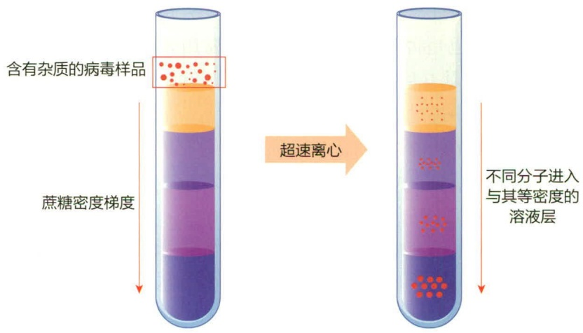

flowchart

---

5.6 病毒学研究方法

133

## 5.6.2 病毒的定量

## 5.6.2.1 直接计数法

病毒的定量和计数是病毒研究中的重要环节，分为直接计数法以及间接计数法。直接计数法包括电镜以及荧光显微镜观测计数。在电镜计数中，可以将病毒样品跟已知浓度的乳胶颗粒混合均匀，然后在电镜下观测并且对病毒颗粒以及乳胶颗粒进行计数，病毒的浓度可以通过病毒颗粒与乳胶颗粒的比值以及乳胶颗粒的浓度计算得到。虽然病毒颗粒太小，在普通光学显微镜下无法直接看到，然而使用荧光染料对病毒的核酸进行染色以后，病毒的核酸可以在落射荧光显微镜（epifluorescence microscope）下直接观测到，这种方法常用在水生环境中病毒的直接观测与计数（图 5-20）。

## 5.6.2.2 间接计数法

病毒的间接定量方法是对病毒的某些属性（血细胞凝集效价、感染单位，或者病毒基因组核酸的拷贝数）进行定量，而不是计算病毒颗粒的绝对数量。间接定量包括

血红细胞凝集试验（hemagglutination assay），噬菌斑/噬斑测定实验，以及荧光定量聚合酶链反应等。一些病毒（如流感病毒）可以结合到红细胞的表面，当病毒跟红细胞的比例达到一定的数值以后，病毒跟相互结合的红细胞会凝集形成一个网状结构，并阻止红细胞的聚沉（图5-21）。具体的操作是将固定数量的红细胞和一系列逐级稀释的病毒样本混合均匀并观测红细胞的凝集情况，引起血细胞凝集（不聚沉）的最高稀释倍数即为病毒的凝集效价（图5-21）。

第二个常用的间接计数法是噬菌斑 / 噬斑测定实

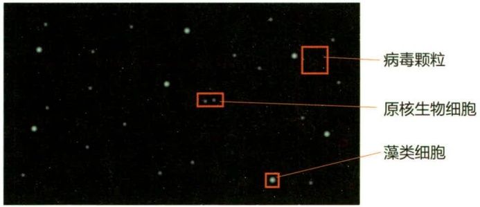

text_image

病毒颗粒
原核生物细胞
藻类细胞

图 5-20 海水样本经 SYBR Green I 染料染色后在落射荧光显微镜下的图像

根据荧光光点的大小及荧光强弱可以大致区分病毒颗粒及细胞

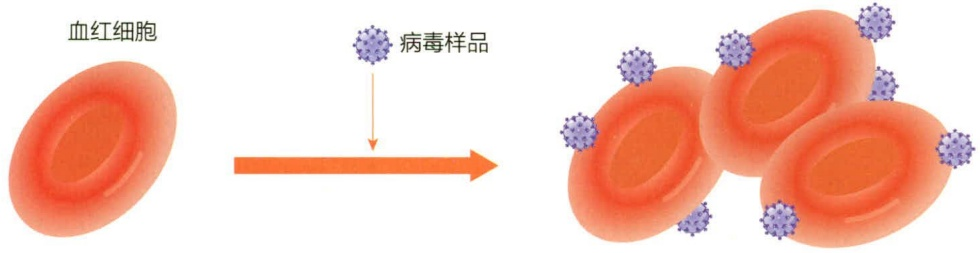

flowchart

(a)

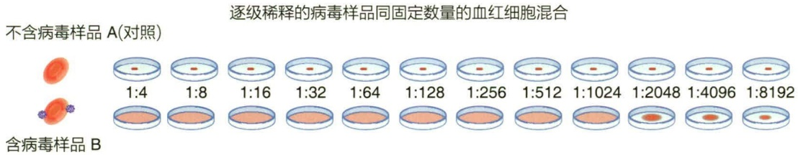

text_image

逐级稀释的病毒样品同固定数量的血红细胞混合
不含病毒样品 A(对照)
1:4 1:8 1:16 1:32 1:64 1:128 1:256 1:512 1:1024 1:2048 1:4096 1:8192
含病毒样品 B

(b)

图 5-21 病毒红细胞凝集效价测定

（a）病毒血红细胞凝集效应示意图；（b）同不含有病毒的对照样品相比，含病毒样品可以使得血红细胞凝集而不聚沉，图中能使血红细胞不聚沉的最高稀释倍数是1024，即为其凝集效价

---

134

5 病毒

验（plaque assay），用于定量病毒的感染单位数，又称病毒效价（virus titer）。以细菌病毒噬菌体为例，噬菌斑测定实验所用的方法同噬菌体在固体培养基上的培养方法相似（见5.6.1），不同的是待测定的病毒悬液需要逐级稀释，然后分别同含有易感细菌的培养基以及熔融的低浓度琼脂培养基混合均匀，最终倾倒于普通固体培养基上（图5-22）。经过一段时间的培养，计算每一种病毒稀释浓度下的噬菌斑的数量。当每个培养皿上噬菌斑的数量为10～100的时候，基本上每一个噬菌斑是由一个初始病毒感染之后经历反复的子代病毒生成以及再感染的过程形成的，即一个噬菌斑代表着一个感染单位。如果在稀释了 $10^{6}$ 倍之后，0.1 mL病毒悬液产生了17个噬菌斑，那么原始未稀释样本中的感染单位数为:

病毒感染单位数  $=17 \times 10^{6}/0.1 = 1.7 \times 10^{8} PFU/mL$ 。

PFU: plaque forming unit, 噬菌斑 / 空斑形成单位。

当噬菌斑的数量过多的时候，可能出现同一个细胞被多个病毒感染，或者噬菌斑交叠无法准确计数的问题，从而无法准确估算感染单位。值得注意的是，感染单位反映的是溶液中含有的病毒可以造成感染的次数，不是病毒颗粒数量的绝对值。

动物病毒的噬斑测试实验同噬菌体的测试十分相似，但是只有当病毒感染可以造成细胞毒性效应以及细胞死亡的情况下噬斑才能形成。当病毒感染不产生任何细胞毒性效应时，可以使用抗体染色的方法来确定感染单位。实验操作同噬斑实验，不同是需要使用识别病毒蛋白的抗体来标记感染的细胞，最终使用荧光显微镜来观察荧光斑点，计数得到荧光斑点形成单位，与感染单位等价。

植物病毒的定量测定也可以通过类似噬斑的方法。植物的组织就相当于固体培养基，用一定量的植物病毒悬液感染植物的茎叶等组织时，会形成坏死斑（lesion），可以通过类似噬斑的方法来计算出感染单位。

随着科学技术的发展，有更多的方法可以用于定量病毒，比较常用的方法之一是

图 5-22 通过噬菌斑实验进行噬菌体感染单位的定量

病毒样品经过10倍逐级稀释的方法获得稀释液，取0.1 mL的稀释液检测生成噬菌斑的量。选取噬菌斑数量为10\~100的平板进行噬菌斑计数，根据稀释倍数及稀释液的体积即可计算出原病毒样品中感染单位的量

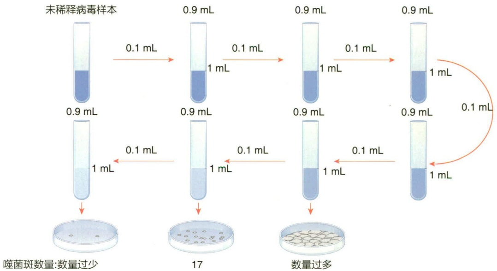

flowchart

This flowchart illustrates the experimental workflow for detecting bacteriophages, showing how different concentrations of a sample are processed through dilution and addition to a petri dish.

感染单位: $1.7 \times 10^{8}$ PFU/mL

---

5.6 病毒学研究方法

135

荧光定量聚合酶链反应（quantitative PCR，qPCR），该反应可以将病毒样本中的，以及一系列已知浓度的标准品中的核酸分子进行扩增。经过扩增的 DNA 可以结合荧光染料并且发出荧光，样品的荧光强度可以准确地测量并且同样品中的 DNA 的数量成正比。这样通过比较病毒样本以及一系列已知浓度的标准品经过扩增后的荧光强度即可计算出病毒样本中的病毒核酸数量。由于链式聚合反应适用于 DNA 分子，所以 RNA 病毒样本提取出的核酸需要先逆转录形成 DNA，然后通过荧光定量聚合酶链反应来定量。该检测方法定量样本中病毒基因组的数量，不能区分该基因组是来自于具有感染性的病毒还是已经失活的病毒。

## 5.6.3 病毒的检测

不同的病毒一般会在物理形态、基因组，以及蛋白组成上存在区别。所以病毒的检测主要分为直接观测、核酸检测，以及病毒抗原检测这3种模式。不同种属的病毒在形态上会存在很大的差异，在电镜下可以根据病毒颗粒的大小、形状等信息大致估计病毒的类型，比如狂犬病毒特异性的弹状结构、埃博拉病毒的丝状结构等（图5-13）。基因组的检测可以设计特异引物通过聚合酶链反应进行，也可以通过DNA阵列（DNA microarray），或者高通量测序技术进行。病毒颗粒中包含多种病毒蛋白，病毒感染宿主细胞以后也会利用宿主合成其复制包装所必需的病毒蛋白，检测这些病毒特异蛋白质也是检测以及鉴定病毒的重要方法，常用的方法有酶联免疫吸附分析（ELISA）。其具体过程是:将一种可以特异识别病毒蛋白的抗体固定在玻璃或者塑料载体表面，加入含有该病毒蛋白的样本后，病毒蛋白就会被载体表面的特异抗体结合，然后使用第二种可以特异性结合病毒抗原的抗体-酶偶联物来进一步标记抗原，最后加入酶的底物，底物被第二种抗体上偶联的酶转化为发光或显色产物，从而放大病毒蛋白的信号并且被检测到（图5-23）。第二种抗体上的酶也可以用有色或者发光基团取代，比如胶体金，许多常用的病毒检测试剂盒就是使用这种原理的（图5-23b）。

## 5.6.4 病毒的分离

病毒的分离是将可能含有病毒的样本（污水、微生物培养液、患者体液等）经过特殊的处理后接种于易感宿主细胞并进行培养扩增，然后进行检测与纯化。

在采集病毒样本时，须根据病毒的生物学性质、病毒感染的特征、传播途径、流行病学规律以及机体的免疫保护机制，合理地选择采集标本的种类、采集的时间、标本处理的方法以及合理的防护措施。标本一般需通过加入抗菌剂、离心或者过滤的物理方法除菌。为了使细胞内的病毒充分释放，需要使用超声等方法破碎细胞。大部分的病毒对热敏感，所以样本需要低温保存，可以4℃冷藏保存数小时，或者在-20\~-80℃长期冷冻保存。

## 知识拓展 5-7

CRISPR 在病毒核酸检测中的应用

---

136

5 病毒

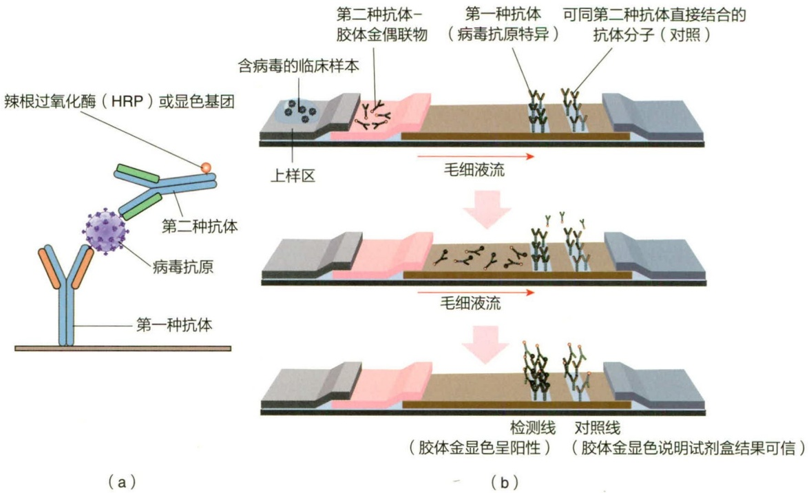

flowchart

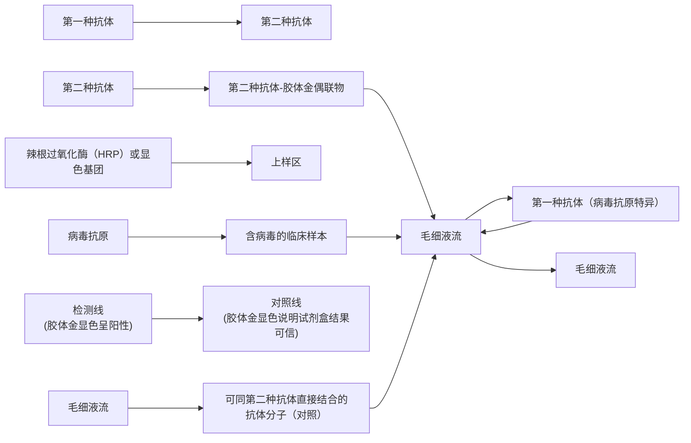

图 5-23 酶联免疫吸附分析检测病毒抗原

（a）同病毒蛋白结合的第一种抗体固定于载体表面，可以从待检测样品中富集病毒蛋白，然后使用可以结合病毒蛋白的第二种抗体来标记病毒抗原。第二种抗体上可以使用特异性酶来放大信号检测微量病毒抗原，或者用有色基团来显示阳性信号；（b）抗原快速检测试剂盒的工作原理，第二种抗体用有色基团（胶体金）偶联标记

从收集的样本中分离病毒需要在易感细胞或宿主中进行，同时应考虑操作简便、易于培养、结果容易判断等因素。分离培养的过程如同5.6.1中的病毒培养一节所述，噬菌体的分离可以通过含有易感细菌的液体或者固体培养基进行。液体培养基可以扩增样本中的噬菌体，而进一步通过固体培养基产生的单个噬菌斑可以分离得到单个的具有相同基因型的噬菌体单克隆。而动物病毒则可以通过接种易感原代或者永生细胞系、鸡胚，或者易感实验动物（小鼠、兔子等）进行进一步的扩增，也可以进一步通过噬斑实验来获得基因型均一的病毒克隆。植物病毒则一般接种于植物的茎叶组织、细胞或者原生质体等进行扩增。

## ※ 本章小结

病毒具有特殊的形态结构、多样化的基因组核酸类型以及特别的增殖方式。作为一种专性寄生物，病毒和宿主之间存在复杂的相互作用关系。它可以引起宿主各种疾病，也会推动宿主的适应和演化，在自然界生物圈中发挥独特的重要作用。亚病毒因子是比病毒更简单的感染物。培养、分离、定量，以及研究病毒有赖于一系列专门的技术方法。

## ※ 推荐阅读

1. BALTIMORE D. Expression of animal virus genomes [J]. Bacteriological reviews, 1971, 35: 235-241.

---

复习思考题

137

David Baltimore 是逆转录病毒的发现者之一，他因此获得 1975 年诺贝尔生理学或医学奖。在这篇文章中，他提出根据病毒基因表达的路径对病毒进行分类，可以更好地反映病毒之间的系统关系。这篇文章对病毒学的发展产生深远影响。

2. TUMPEY T M, BASLER C F, AGUILAR P V, et al. Characterization of the reconstructed 1918 Spanish influenza pandemic virus [J]. Science, 2005, 310: 77–80.
1918 年暴发了一场全球性大流感（西班牙流感）。当时人们对病毒所知甚少，更谈不上分离毒株。80 多年后，研究者用分子生物学技术获得了 1918 年流感病毒的基因组序列信息。这篇文章利用这些信息重构了 1918 病毒株并开展研究，为认识流感病毒高致病性的机制提供了可能。
3. LI W, MOORE M J, VASILIEVA N, et al. Angiotensin-converting enzyme 2 is a functional receptor for the SARS coronavirus [J]. Nature, 2003, 426: 450-454.

2003 年，SARS 席卷全球多国。当年 4 月研究者确定病原体是一种新的冠状病毒 (SARS-CoV)。这篇于当年 11 月发表的文章成功地鉴定了该病毒的受体 ACE2，为认识病毒的感染致病机制提供了重要的信息。
4. SHI M, LIN X-D, TIAN J H, et al. Redefining the invertebrate RNA virosphere [J]. Nature, 2016, 540 (7634): 539–543.

对于病毒的传统认知高度依赖病毒的分离培养，基因测序技术为打破这种限制提供了可能。中国科学家的这篇文章通过对野生无脊椎动物样本进行大规模高通量 RNA 测序，获得了大量病毒基因组信息，从中发现许多前所未知的病毒，很大程度上改变了人们对地球 “RNA 病毒圈” 的认知。

## ※ 开放性讨论题

1. 有人认为病毒可以感染细胞和进行增殖，所以是有生命力的；也有人认为病毒粒就是核酸和蛋白质等构成的化学颗粒，离开细胞没有活力，因此没有生命力。你怎么看？为什么？
2. 病毒在自然界广泛分布，可以感染各种生物。请讨论病毒对自然界生态平衡和生物多样性可能会有什么样的影响。

## ※ 复习思考题

1. 病毒粒有哪几种基本结构？形成病毒粒对病毒有什么意义？
2. 可以用哪些方法对病毒粒进行定量？它们各有什么优缺点？
3. 什么是巴尔的摩（Baltimore）病毒分类？它和病毒系统分类法有什么关系？

---

138

5 病毒

4. 比较病毒、类病毒、卫星病毒以及朊病毒，说明各自的特点及相互之间的差异。
5. 病毒感染有哪些主要类型？举例说明不同感染类型的病毒与人类疾病的关系。
6. 病毒入侵动物细胞和植物细胞的方式有何区别？为什么？

(钟江 魏磊)
