# 7 微生物的代谢

原始 PDF 第 188–220 页。

## 微生物的代谢

## 导语

代谢是维持细胞生物生存、生长和繁殖等生命活动的系列生化反应。代谢的基本需求包括液态水、能量、生化反应需要的电子、合成大分子需要的底物等。微生物包括生活在各种环境中的病毒、细菌、古菌和部分真核生物，它们在地球共演化过程中演化出丰富的代谢多样性，既有利用光能、又有利用化学能的代谢方式，既有能利用  $CO_{2}$  为碳源的自养方式、又有能利用有机物为碳源的异养方式。本章介绍微生物的代谢方式，包括能量代谢、物质分解代谢、物质合成代谢，以及微生物的代谢调控模式，旨在通过本章的内容，向读者介绍:①微生物代谢的基本原理；②微生物的能量代谢方式；③微生物合成代谢的主要类型；④微生物代谢调控的方式。

## 关键词

能量代谢，底物水平磷酸化，氧化磷酸化，合成代谢，分解代谢，光能营养，异养，自养，三羧酸循环，糖异生，代谢调节

7

---

172

7 微生物的代谢

图 7-1 微生物通过代谢活动从生境中获取能量与物质维持生存、生长和繁殖

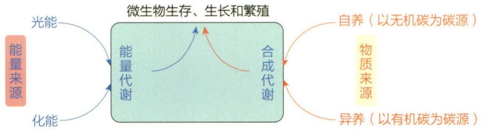

<details>
<summary>flowchart</summary>

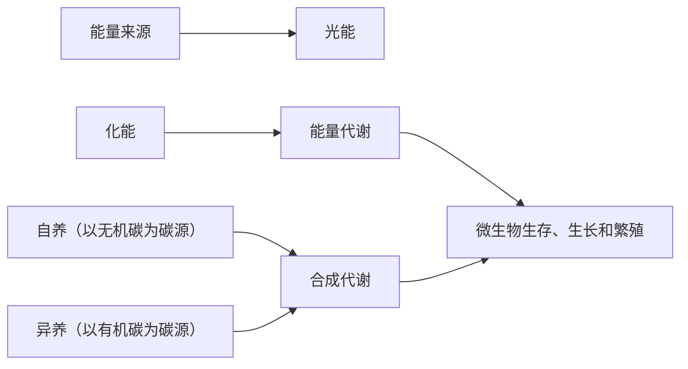
</details>

## 7.1 微生物代谢概论

生活在不同生境的微生物需要在适宜的条件下通过一系列代谢过程获取足够的能量与物质来维持生存、生长和繁殖等生命活动（图 7-1）。类似于智能手机——正常地运行依赖硬件、操作系统、各类 App 和电能。细胞生物的生命活动本质上是依赖细胞结构组分、中心法则、初级代谢网络、次级代谢途径和能量的一系列生化反应。

## 7.1.1 基本代谢类型

微生物的所有代谢类型可根据能量的来源划分。光能营养型（phototroph）从光获取代谢的能量；陆生植物、藻类和蓝细菌在进行光合作用的同时释放氧气，即产氧光合作用（oxygenic photosynthesis）；很多细菌在进行光合作用的时候不释放氧气，即不产氧光合作用（anoxygenic photosynthesis）。化能营养型（chemotroph）从化学反应中获取代谢的能量；如果最初的能量和还原力来源于有机物（如碳水化合物和蛋白质），被称为化能有机营养型（chemoorganotroph）；如果从无机分子获取能量和还原力（如 $H_{2}$ 、 $H_{2}S$ 、 $NH_{3}$ 、 $Fe^{2+}$ 等），被称为化能无机营养型（chemolithotroph）。

除了能量，微生物还需要各种营养物质来合成其细胞组分，其中最重要的是碳元素。异养型（heterotroph）从有机物中获取碳元素并用于生物合成，所以化能有机营养型是异养型生物。自养型（autotroph）则以无机碳（如  $CO_{2}$  ）为唯一或主要碳源，通过消耗能量将其还原为细胞组分，绝大多数化能无机营养型生物和光能营养型生物属于自养型生物。自养型生物也被称为初级生产者（primary producer）。部分化能无机营养型生物和光能营养型生物须从有机物中获取碳元素用于生物合成，它们是异养型生物，分别被称为混合营养型（mixotroph）和光能异养型（photoheterotroph）。

## 7.1.2 生物能学基本原理

如上所述，微生物需要从生境中获取能量和营养物质。根据热力学第二定律，物理化学过程总是向着宇宙的自由度或混乱度增加到最大的方向自发进行。在这个背景下，微生物如何维持细胞的活性和稳定性呢？根据热力学第一定律，能量既不能产生也不能消失，宇宙总能量不变。研究微生物环境能量与细胞内能量相互转化的科学，

---

7.1 微生物代谢概论

173

即生物能学（bioenergetics）。

细胞内可以用于做功的能量被称为自由能（free energy）。细胞内释放自由能的反应是放能反应（exergonic reaction），而需要输入自由能才可进行的反应是吸能反应（endergonic reaction）。自由能的变化 $\Delta G$ 为负值的反应是放能反应；$\Delta G$ 为正值的反应是吸能反应。一个化学反应的自由能变化是在反应物浓度、温度和压力的标准状态下（$25^{\circ}\mathrm{C}$，1个标准大气压，所有溶质的浓度为 $1\mathrm{mol/L}$）测得，即标准自由能的变化 $\Delta G^{0}$。对于反应 $a\mathrm{A} + b\mathrm{B} \rightleftharpoons c\mathrm{C} + d\mathrm{D}$，$\mathrm{pH}$ 为7的标准自由能变化为 $\Delta G^{0'} = -2.303RT\lg K_{\mathrm{eq}}$（$R$ 为气体常数；$T$ 为绝对温度；$K_{\mathrm{eq}} = [\mathrm{C}]^{c}[\mathrm{D}]^{d}/[\mathrm{A}]^{a}[\mathrm{B}]^{b}$ 为平衡常数，表示产物C与D和底物A与B平衡浓度之间的关系，$K_{\mathrm{eq}} > 1$ 为放能反应，$K_{\mathrm{eq}} < 1$ 为吸能反应）。

如果将储能物质 ATP 等看作人类社会的货币，放能反应类比为一个家庭通过工作赚取收入的过程，那么吸能反应就类似于家庭成员消费的过程，收支平衡才能最大化地实现微生物生存、生长和繁殖的良性循环。分解代谢途径（catabolic pathway）将反应物转化为产物的过程中释放自由能，是放能过程，又称为异化作用（dissimilation）。合成代谢途径（anabolism pathway）从结构简单的前体合成细胞组分的过程需要消耗能量，是吸能过程，又称为同化作用（assimilation）。分解代谢与合成代谢的速率会影响细胞的“健康状况”，如果两者的速率处于一个平衡范围，细胞就可以维持一个稳态。通常用 ATP、ADP 和 AMP 的测定值计算出能荷（energy charge, EC），来衡量细胞的合成与分解代谢速率是否处在正常的动态平衡范围内（图 7-2）。活细胞的能荷通常为 0.80 \~ 0.85。

## 7.1.3 氧化还原反应的电子供体与受体

自由能产生的一个重要源头是电子传递反应，即氧化还原反应（redox reaction）。如果一个底物获得电子，它的氧化状态因获得电子而降低，即被还原；相反，如果一

个底物失去电子，氧化状态因失去电子而升高，即被氧化。还原力（reducing power）是在氧化还原反应中供给电子的能力。电子供体（electron donor）供给的电子（ $e^{-}$ ）作为还原力，一方面可以用于能量代谢中电子受体（electron acceptor）的还原并释放自由能（异化途径），另一方面可以用于合成代谢中前体物质的还原并合成细胞组分（图7-3）。

电子在溶液中不能稳定存在，需要在不同的原子或分子间传递，介导能量代谢与合成代谢的一系列氧化还原反应。氧化还原反应中的电子传递事件是以半反应（half reaction）的方式进行，即一个物质通过获得或失去电子转变为另一个物质的反应。例如， $2H^{+} + 2e^{-} \rightleftharpoons H_{2}$ ，其中 $H^{+}$ 和 $H_{2}$ 分别为氧化态和还原态， $2H^{+}/H_{2}$ 也被称为一个氧化还原电对（redox couple）。在一个氧化还原

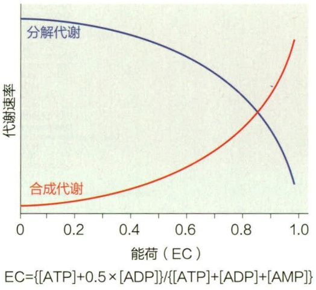

<details>
<summary>line</summary>

| 能荷 (EC) | 分解代谢 (代谢速率) | 合成代谢 (代谢速率) |
| --- | --- | --- |
| 0.0 | ~1.0 | ~0.1 |
| 0.2 | ~0.95 | ~0.15 |
| 0.4 | ~0.85 | ~0.25 |
| 0.6 | ~0.7 | ~0.4 |
| 0.8 | ~0.5 | ~0.6 |
| 1.0 | ~0.2 | ~0.9 |
</details>

图 7-2 能荷——分解代谢与合成代谢

---

174

7 微生物的代谢

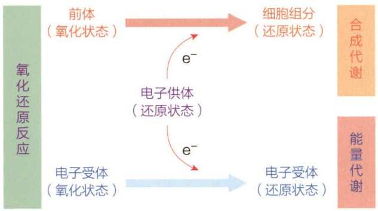

<details>
<summary>flowchart</summary>

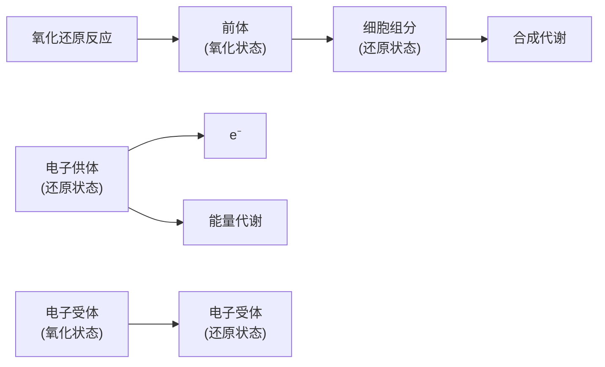
</details>

图 7-3 微生物代谢中的氧化还原反应示意图

反应中，第一个半反应释放的电子会被第二个半反应消耗，第一个半反应中给出电子的反应物为电子供体而第二个半反应中获得电子的反应物为电子受体。自然界存在许多氧化还原电对，它们都具有给出或接受电子的能力（图7-4）。那么，不同氧化还原电对之间得失电子的能力是由什么决定的呢？在特定的一个氧化还原反应里，一个反应物是作为电子供体还是电子受体由还原电势（reduction potential）决定，在标准热力学条件下（pH 7）测得的还原电势用 $E_{0}^{\prime}$ 表示，通常以氧气为标准电子受

体、氢气为标准电子供体来计算氧化还原电对的标准还原电势（图7-4）。反应物给出或得到电子取决于参与反应的两个氧化还原电对的还原电势差。具有更负的还原电势的氧化还原电对将电子提供给有较正电势的氧化还原电对（图7-4，从左往右），释放自由能 $-\Delta G^{0^{\prime}} = -nF\Delta E_{0}^{\prime}$ （$n$ 为转移的电子数目；$F = 96.5\mathrm{kJ}\cdot \mathrm{mol}^{-1}\mathrm{V}^{-1}$，是法拉第常量；$\Delta E_0'$ 为受体与供体的标准还原电势差）。两个半反应的还原电势差越大，释放的自由能越多。自然界微生物已经演化出多种多样的半反应组合，塑造了微生物的代谢多样性。

图 7-4 氧化还原电对的还原电势

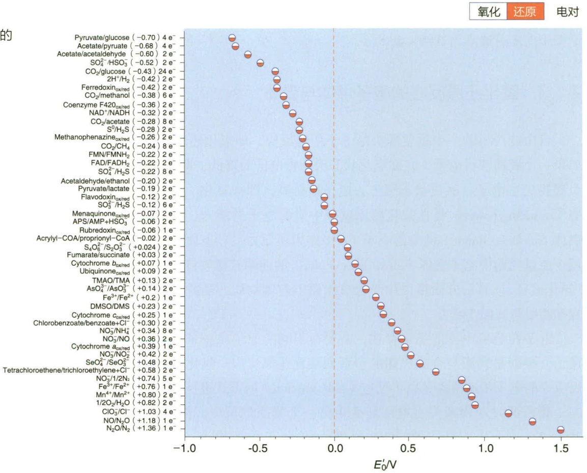

<details>
<summary>scatter</summary>

| Compound | E'0/V |
| :--- | :--- |
| Pyruvate/glucose (-0.70) 4e- | ~ -0.65 |
| Acetate/pyruate (-0.68) 4e- | ~ -0.62 |
| Acetate/acetaldehyde (-0.60) 2e- | ~ -0.55 |
| SO4^2-/HSO3^- (-0.52) 2e- | ~ -0.48 |
| CO2/glucose (-0.43) 24e- | ~ -0.42 |
| 2H+/H2 (-0.42) 2e- | ~ -0.38 |
| Ferredoxinox/red (-0.42) 2e- | ~ -0.35 |
| CO2/methanol (-0.38) 6e- | ~ -0.32 |
| Coenzyme F420ox/red (-0.36) 2e- | ~ -0.28 |
| NAD+/NADH (-0.32) 2e- | ~ -0.25 |
| CO2/acetate (-0.28) 8e- | ~ -0.22 |
| S^0/H2S (-0.28) 2e- | ~ -0.18 |
| Methanophenazineox/red (-0.26) 2e- | ~ -0.15 |
| CO2/CH4 (-0.24) 8e- | ~ -0.12 |
| FMN/FMNH2 (-0.22) 2e- | ~ -0.10 |
| FAD/FADH2 (-0.22) 2e- | ~ -0.08 |
| SO4^2-/H2S (-0.22) 8e- | ~ -0.06 |
| Acetaldehyde/ethanol (-0.20) 2e- | ~ -0.05 |
| Pyruvate/lactate (-0.19) 2e- | ~ -0.04 |
| Flavodoxinox/red (-0.12) 2e- | ~ -0.03 |
| SO3^2-/H2S (-0.12) 6e- | ~ -0.02 |
| Menaquinoneox/red (-0.07) 2e- | ~ -0.01 |
| APS/AMP+HSO3 (-0.06) 2e- | ~ 0.01 |
| Rubredoxinox/red (-0.06) 1e- | ~ 0.02 |
| Acrylyl-COA/propionyl-CoA (-0.02) 2e- | ~ 0.03 |
| S4O6^2-/S2O3^- (+0.024) 2e- | ~ 0.05 |
| Fumarate/succinate (+0.03) 2e- | ~ 0.08 |
| Cytochrome box/red (+0.07) 1e- | ~ 0.11 |
| Ubiquinoneox/red (+0.09) 2e- | ~ 0.14 |
| TMAO/TMA (+0.13) 2e- | ~ 0.17 |
| AsO4^3-/AsO3^3 (+0.14) 2e- | ~ 0.21 |
| Fe3+/Fe2+ (+0.2) 1e- | ~ 0.25 |
| DMSO/DMS (+0.23) 2e- | ~ 0.31 |
| Cytochrome cox/red (+0.25) 1e- | ~ 0.36 |
| Chlorobenzoate/benzoate+Cl^- (+0.30) 2e- | ~ 0.41 |
| NO3/NH4^+ (+0.34) 8e- | ~ 0.46 |
| NO3/NO (+0.36) 2e- | ~ 0.51 |
| Cytochrome aox/red (+0.39) 1e- | ~ 0.56 |
| NO3/NO2^+ (+0.42) 2e- | ~ 0.61 |
| SeO4^-/SeO3^- (+0.48) 2e- | ~ 0.67 |
| Tetrachloroethene/trichloroethylene+Cl^- (+0.58) 2e- | ~ 0.73 |
| NO3/1/2N3^+ (5e-)| ~ 0.81 |
| Fe3+/Fe2+ (+0.76) 1e- | ~ 0.87 |
| Mn4+/Mn2+ (+0.80) 2e- | ~ 0.91 |
| 1/2O2/H2O (+0.82) 2e- | ~ 1.15 |
| ClO3/Cl^- (+1.03) 4e- | ~ 1.35 |
| NO/N2O (+1.18) 1e- | ~ 1.55 |
| N2O/N2^+ (1.36) 1e- | ~ 1.55 |
</details>

氧化 还原

电对

---

7.1 微生物代谢概论

175

## 7.1.4 电子载体与电子传递链

电子从供体到受体的传递很少能够一步完成，往往涉及不同亚细胞定位的一系列中间电子载体（electron carrier）。例如，水溶性的烟酰胺腺嘌呤二核苷酸（NAD⁺），其烟酰胺环从供体获得2个电子和一个质子，被还原为NADH；烟酰胺腺嘌呤二核苷酸磷酸（NADP⁺）具有类似的特征。NAD⁺/NADH的标准还原电势为-0.32 V，NADH是细胞内很多能量代谢反应的电子供体；而NADP⁺/NADPH更多地参与合成代谢。泛醌（ubiquinone）是脂溶性的膜上电子载体，可以从供体获得两个电子和质子。黄素腺嘌呤二核苷酸（FAD）和黄素单核苷酸（FMN）的异咯嗪环从供体获得两个电子和两个质子，含有FAD和FMN的蛋白质被称为黄素蛋白。细胞色素中，铁原子参与血红素或其他类似卟啉环的组成，通过铁原子的可逆氧化还原反应，每次传递一个电子。细胞内也存在含铁原子但无血红素的电子传递蛋白，如铁氧还蛋白。电子从供体向最终电子受体的传递，要经过一系列的载体，这些电子载体组成的系统即为电子传递链（electron transport chain）。第一个载体有最负的 $E_{0}'$ ，每一个接下来的载体的 $E_{0}'$ 都依次升高。存储在发动电子流的氧化还原电对里的势能释放，用来生成ATP。

## 7.1.5 催化与酶

一个反应即使是放能反应，也不一定会自发进行。例如  $H_{2} + \frac{1}{2}O_{2} \longrightarrow H_{2}O$  ( $\Delta G^{0'} = -237 \, kJ/mol$ ) 的进行首先需要消耗一定能量使气体分子内部的键发生断裂，这部分能量被称为激活能量（activation energy）。催化剂（catalyst）可以降低激活反应的能量需求，促进反应的发生，但是不会被反应所消耗。细胞内的催化剂主要是酶（蛋白质或少数 RNA），它们的三维结构决定其所催化反应的特异性。在一个酶催化的反应中，底物结合在酶的激活位点，形成酶-底物复合物。随着反应的进行，产物被释放，酶也恢复初始状态，为催化下一轮反应作准备。这个过程通常只需要几毫秒的时间。有些酶需要辅基（prosthetic group）或辅酶（coenzyme）才能发挥功能。辅基通常以共价结合的方式与酶稳定结合在一起，如细胞色素 c 中的血红素辅基；辅酶往往与酶松散而短暂地结合，如 NADH 和 ATP 等是多种酶的辅酶。和放能反应不同，吸能反应不仅需要激活能量，还需要消耗更多自由能来生成产物，需要与水解 ATP 或消耗质子动力势等产能反应偶联。

代谢是维持生命过程的基础，而生物需根据生命过程的需要调控代谢，以保证细胞中代谢产物的平衡和能量的有效利用。微生物的代谢调控主要通过催化代谢的酶蛋白量和酶活力而实现。细胞中酶蛋白量受遗传调控，根据代谢的需要合成相关的酶蛋白；而酶蛋白合成后，酶的活力也受到调节。酶活力调节发生在酶蛋白分子上，调节速度快且灵活，主要通过酶蛋白分子构象改变和酶蛋白修饰，产生的效果包括酶活力的激活和抑制。而酶蛋白的合成调节速度较慢，调节发生在转录过程，如原核生物主

---

176

7 微生物的代谢

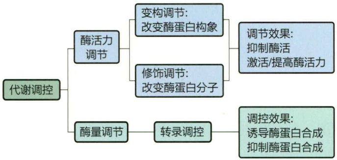

<details>
<summary>flowchart</summary>

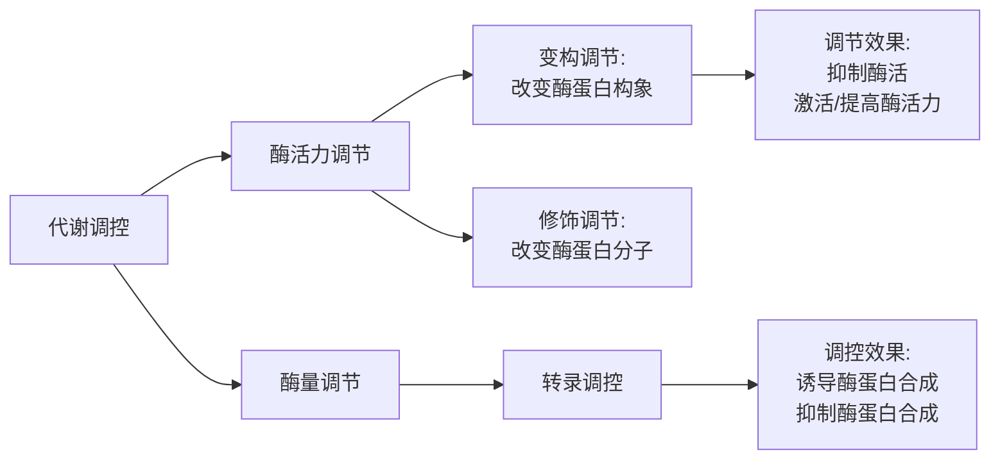
</details>

图 7-5 微生物代谢调控的模式及其调节效果

要是转录调控（见第 10 章）。微生物的代谢调控方式总结见图 7-5。

## 7.1.6 酶活力调节机制

酶活力调节指通过酶蛋白分子构象或分子结构的改变而调节酶的催化活力。该调节方式是在已经存在的酶蛋白上发生，是微生物细胞响应环境变化后迅速调整代谢活力的重要机制。酶活力调节的机制主要有

两种:酶蛋白变构调节和酶蛋白修饰调节。

## 7.1.6.1 酶蛋白变构调节

一个酶的活力高低不仅由其蛋白质的氨基酸序列决定，而且也取决于蛋白质正确的高级结构，尤其是活性中心的结构。细胞中一些生化反应的产物积累时会结合到酶的活性中心，抑制催化该反应的酶与底物结合，或结合到酶的变构位点而改变活性中心的构象，从而抑制酶的活力，导致反应停止。变构调节效果是可逆的，去除结合的变构物质后又恢复酶活力。在多步反应的代谢途径中，末端产物通常反馈抑制该途径的第一个酶，这种酶被称为变构酶（allosteric enzyme）。变构酶通常是代谢途径的第一个酶或是催化某一关键反应的酶。如异亮氨酸合成途径的第一个酶苏氨酸脱氨酶可被末端产物异亮氨酸反馈抑制。细菌的糖酵解和三羧酸循环即通过变构调节保证代谢的平衡。

## 7.1.6.2 酶蛋白修饰调节

修饰调节通过共价调节酶对酶蛋白多肽链的某些氨基酸进行可逆的共价修饰，使酶处于活化/非活化的动态变化中，导致酶被活化或被抑制，从而控制代谢的速度和方向。蛋白质的共价修饰包括:磷酸化、乙酰化、甲基化和巯基（-SH）氧化形成二硫键（S—S）等。表7-1列出一些受修饰调节的酶。

表 7-1 共价修饰改变酶催化活性的例子

| 酶类 | 低活性状态 | 高活性状态 | 来源 |
| --- | --- | --- | --- |
| 糖原合成酶 | 去磷酸化酶 | 磷酸化酶 | 真核细胞 |
| 丙酮酸脱氢酶 | 去磷酸化酶 | 磷酸化酶 | 真核细胞 |
| 糖原磷酸化酶 | 磷酸化酶 | 去磷酸化酶 | 真核细胞 |
| 谷氨酰胺合成酶 | 腺苷酰化酶 | 去腺苷酰化酶 | 原核细胞 |

## 7.1.6.3 酶活调节的类型

酶活调节分激活和抑制两种方式。激活（activation）指在特定物质作用下，使一个无活性的酶变为有活性或活性提高的过程，激活酶的物质主要是底物。抑制（inhibition）则指在特定物质作用下，酶的活力降低或丧失的过程。反馈抑制

---

7.1 微生物代谢概论

177

(feedback inhibition) 是抑制酶活的主要机制，即合成代谢途径的终产物积累抑制酶活力。

反馈抑制又分为直线代谢途径和分支代谢途径两种抑制机制。直线代谢途径的反馈抑制是最简单的模式。如大肠杆菌在合成异亮氨酸时，产物异亮氨酸的积累会抑制合成途径的第一个酶——苏氨酸脱氨酶的活性，使  $\alpha-$  酮丁酸及其后的中间代谢物均无法合成，最终导致异亮氨酸合成的停止。分支代谢途径的反馈抑制模式较为复杂，在具有两个以上分支合成途径中，通常各分支的末端产物抑制该分支的第一个酶，并部分控制整个途径的每个酶。分支代谢途径的反馈抑制有 4 种模式:同工酶、协同、积累及顺序反馈抑制（图 7-6）。

## (1) 同工酶反馈抑制

同工酶（isozyme）指催化同一种化学反应、但酶蛋白的氨基酸组成和结构不尽相同的一组酶。同工酶反馈抑制特点是:分支途径的第一个反应由结构不同的同工酶催化，终产物只抑制相应的分支途径，而不影响另外的分支途径（图7-6a）。如大肠杆菌的天门冬氨酸家族氨基酸的合成，由3个天门冬氨酸激酶催化合成途径的第一个反应，并分别受赖氨酸、苏氨酸、甲硫氨酸的调节。

## (2) 协同反馈抑制

协同反馈抑制是只有几个分支代谢途径的终产物均过量积累时才对总途径的第一个酶有抑制作用，某一分支途径的终产物过量时只抑制该分支，而对总途径的第一个酶无抑制作用（图7-6b）。如多黏芽孢杆菌的天门冬氨酸家族氨基酸的合成时，赖氨

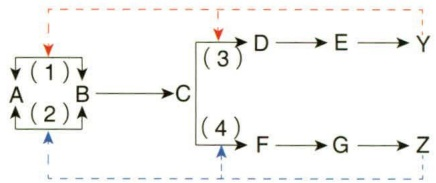

<details>
<summary>flowchart</summary>


</details>

(a) 同工酶反馈抑制模式

(1)、(3) 被Y抑制；(2)、(4) 被Z抑制

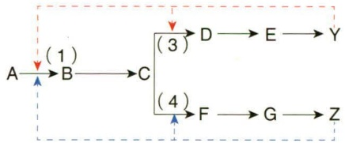

<details>
<summary>flowchart</summary>

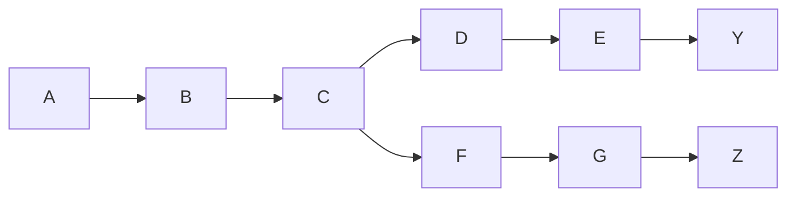
</details>

(b) 协同反馈抑制模式

（1）被Y和Z抑制；（3）被Y抑制；（4）被Z抑制

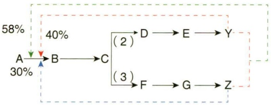

<details>
<summary>flowchart</summary>


</details>

(c) 积累反馈抑制模式

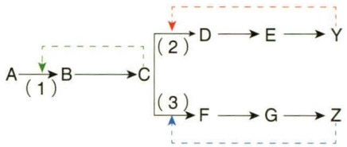

<details>
<summary>flowchart</summary>

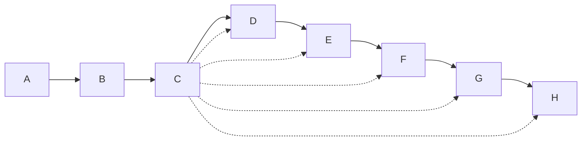
</details>

(d) 顺序反馈抑制模式

（1）被C抑制；（2）被Y抑制；（3）被Z抑制

图 7-6 酶的反馈调节模式

酸、甲硫氨酸和苏氨酸合成分支途径的终产物苏氨酸和赖氨酸协同抑制总途径的第一个酶——天门冬氨酸激酶。

## (3) 积累反馈抑制

积累反馈抑制指任何分支代谢途径的终产物过量时、均部分抑制总途径的第一个酶，而且各途径的终产物抑制作用互不干扰，而所有分支途径的终产物同时过量时，抑制作用会累加（图7-6c）。如终产物Y过量时抑制AB酶活的 $40\%$ ，终产物Z过量时抑制AB酶活的 $30\%$ ，而YZ同时过量时抑制活性为: $40\% + (1 - 40\%) \times 30\% = 58\%$ 。积累反馈抑制最早在大肠杆菌的谷氨酰胺合成中发现，当8个分支途径的终产物同时积累时，谷氨酰胺合成酶的活力完全被抑制。

## (4) 顺序反馈抑制

顺序反馈抑制指两个分支途径的终产物不直接抑制代谢途径的第一个酶，而只分别抑制分支点后的反应；而当分支点前的中间产物积累后反馈抑制第一个酶。因此只有两个分支途径的终产物都过量时，才抑制途径的第一个酶（图 7-6d）。枯草芽孢杆

---

178

7 微生物的代谢

菌合成芳香族氨基酸的代谢途径采取顺序反馈抑制调节。

## 7.2 微生物的能量代谢

如前所述，微生物的能量代谢类型包括化能有机营养型、化能无机营养型、产氧光合营养型和不产氧光合营养型，能量分别来自有机物、无机物和光能。那么这些不同的能量代谢过程是如何发生的呢？是否存在内在的基本规律呢？

## 7.2.1 能量转化方式

微生物能量的产生方式可以分为两大类（图 7-7）:①底物水平磷酸化（substrate-level phosphorylation），即从能源物质分解代谢产生的高能化合物转移磷酸基团到ADP，形成ATP的过程；②化学渗透（chemiosmotic coupling），即膜内外出现质子梯度（化学势能）和电荷梯度（电势能），形成质子动力势（proton motive force），质子动力势推动质子沿质子和电荷梯度穿过细胞膜进入胞内，这种质子流是放能的，在膜上ATP合酶的作用下，使ADP磷酸化成ATP。可见，依赖化学渗透的产能方式本质上是打破膜内外的电化学平衡。

根据电化学平衡被打破的方式，化学渗透可以分为依赖电子传递链和不依赖电子传递链的类型。1973年首次在盐沼盐杆菌（Halobacterium halobium）中报道了基于视紫红质蛋白的化学渗透现象。经多年研究，其作用机制可概括为:低氧下，光照诱导表达更多的视紫红质蛋白，其中的发色团视黄醛共价结合在色素蛋白上，而色素蛋白嵌入细胞质膜，使视黄醛处于膜的中间位置，视黄醛吸收光释放质子，视紫红质经一系列的构象改变转移质子到膜外，形成的质子动力势驱动ATP合酶生成ATP。这类视紫红质蛋白在海洋透光区的浮游古菌和细菌中分布较广，说明不依赖电子传递链来打破电化学平衡的方式并不是个例。

依赖电子传递链打破电化学平衡的化学渗透方式，根据能量的来源分为氧化

磷酸化（oxidative phosphorylation）和光合磷酸化（photophosphorylation）。氧化磷酸化是化能营养微生物的重要产能方式和呼吸反应的关键特征（见7.2.2—7.2.3）。光合磷酸化是多数光合微生物产能的重要方式，利用光能驱动电子传递过程的起始，伴随着电子传递形成膜内外的质子动力势（见7.2.4）。

除了上述大类的划分，电子传递链的复杂程度也存在较大差异。例如，产乙酸细菌的跨膜铁氧还蛋白（Fd）-NAD $^{+}$ 氧化还原酶Rnf，从铁氧还蛋白获得电子并将NAD $^{+}$ 还原为NADH的过程不涉及膜上的脂

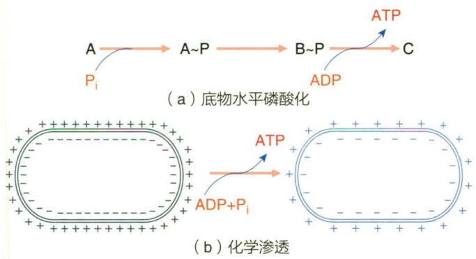

<details>
<summary>flowchart</summary>


</details>

图 7-7 能量产生方式

---

7.2 微生物的能量代谢

179

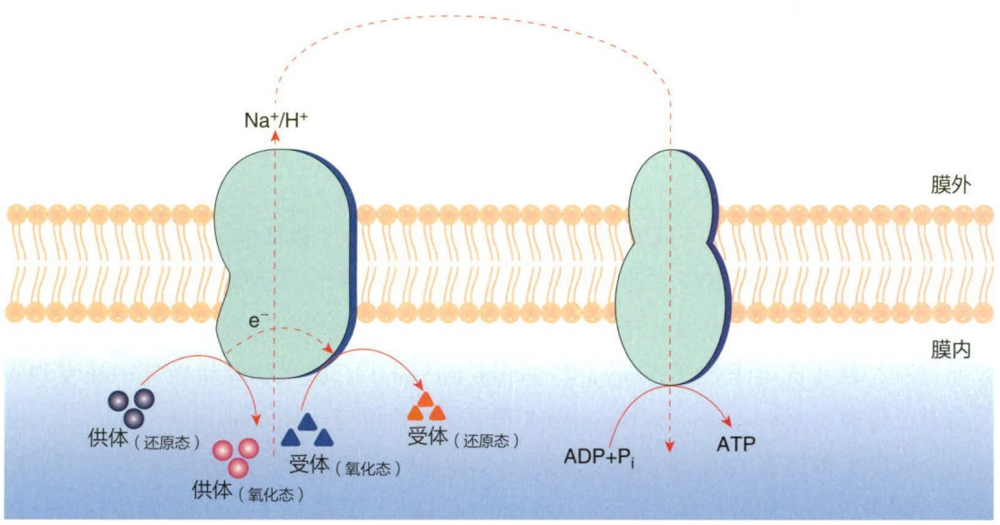

<details>
<summary>flowchart</summary>

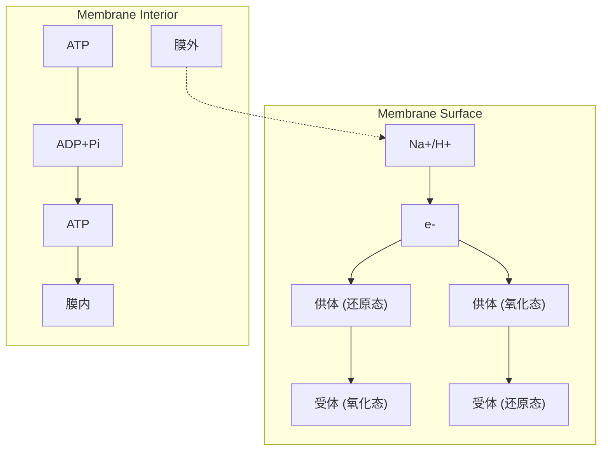
</details>

图 7-8 不涉及脂膜电子载体的超短电子传递链

溶性电子载体， $Na^{+}$ 被泵到膜外，形成 $Na^{+}$ 动力势驱动 ATP 合酶生成 ATP。深红红螺菌（Rhodospirillum rubrum）的膜结合氢酶 Ech 从铁氧还蛋白获得电子并将 $H^{+}$ 还原为 $H_{2}$ ，同时形成质子动力势，这个过程也不涉及脂溶性的膜上电子载体。图 7-8 为这类不涉及脂溶性电子载体的超短电子传递链示意图。

醌类（menaquinone、ubiquinone、plastoquinone 和 caldariellacquinone）和甲萘吩嗪（methanophenazine）这两类膜上的脂溶性电子载体（简称 Q）是复杂电子传递链的重要组成部分。Q 发生氧化还原反应共转移两个电子和两个质子，Q 可以在膜内扩散，在靠近细胞质的一侧被还原为  $QH_{2}$ ，在另一侧被氧化为 Q。这个氧化还原过程可简述为图 7-9:位于膜上的供体氧化复合物从电子供体获得电子，并经由其两个血红素辅基将电子传递给靠近细胞质一侧的 Q，后者从细胞质获得质子并生成  $QH_{2}$ ， $QH_{2}$  扩散到远离细胞质的一侧并被受体还原复合物氧化为 Q，受体还原复合物通过两个血

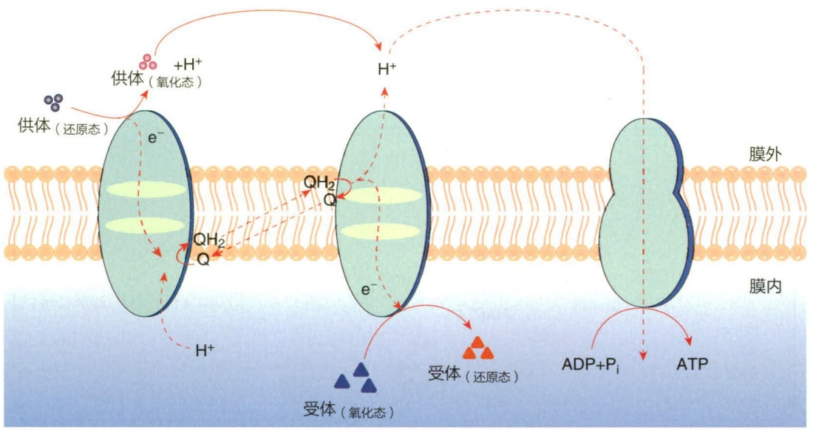

<details>
<summary>flowchart</summary>

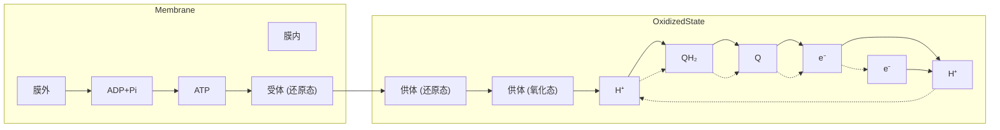
</details>

图 7-9 脂溶性膜上电子载体的电子传递模式

---

180

7 微生物的代谢

红素辅基将获得的电子传递给最终电子受体使其还原，同时  $H^{+}$  被释放到膜外形成质子动力势并驱动 ATP 合酶生成 ATP。更复杂的电子传递链如线粒体的氧化磷酸化和叶绿体或蓝细菌的光合磷酸化等在供体氧化复合物与受体还原复合物之间还加入了其他酶，这增强了与电子传递偶联的质子泵出效率，从而促进了质子动力势的形成（见7.2.2—7.2.4）。

如前所述（7.1.4）电子从  $E_{0}^{\prime}$  更负的氧化还原电对电子供体向  $E_{0}^{\prime}$  更正的氧化还原电对电子受体传递，偶联质子动力势的形成并生成 ATP。这个过程类似于水力发电站利用海拔差来发电（图 7-4），电子从高海拔下降到低海拔的过程是走“下坡路”的放能过程，是正向电子传递（forward electron transport）。微生物能量转化中还发现了反向电子传递（reverse electron transport）和电子歧化反应（electron bifurcation）。

反向电子传递链的电子向  $E_{0}^{\prime}$  更负的电子传递链成分传递，是消耗能量的“爬坡”过程。例如，伍氏醋酸杆菌（Acetobacterium woodii）依赖  $H_{2}$  和  $CO_{2}$  自养生长时，还原态的 Fd ( $E_{0}^{\prime} = -420 \, mV$ ) 在将电子传递给  $NAD^{+}$  ( $E_{0}^{\prime} = -320 \, mV$ ) 的正向电子传递过程中偶联  $Na^{+}$  动力势的形成，后者驱动 ATP 合酶生成 ATP，这个过程是正向化学渗透（forward chemiosmosis）；当该菌依赖低能量的底物乳酸和乙醇生长时，通过底物水平磷酸化产生 ATP，ATP 合酶催化 ATP 水解并建立膜内外的  $Na^{+}$  动力势，后者驱动 Fd- $NAD^{+}$  氧化还原酶催化的 NADH 向氧化态 Fd 的反向电子传递，生成还原态 Fd，该过程是反向化学渗透（reverse chemiosmosis）（图 7-10）。

电子歧化反应中，双电子供体（two-electron donor）的两个电子流向两个不同的单电子受体。相对于双电子供体的 $E_0'$，其中一个电子受体具有较高的 $E_0'$，另一个电子受体具有较低的 $E_0'$（图7-11）。催化电子歧化反应的歧化酶（Bifurcase）分为两类:① 1975年发现的基于醌（Quinone）的定位于膜上的电子歧化酶，催化的电子歧化反应涉及醌氧化还原反应的循环（被称为Q-cycle），如线粒体和好氧变形杆菌的泛醌脱氢酶（complex III和细胞色素 $\mathrm{bc}_1$），厌氧变形杆菌、好氧芽孢菌和好氧古菌

图 7-10 反向化学渗透与反向电子传递链

(红色: 伍氏醋酸杆菌依赖低能量底物乳酸和乙醇生长)

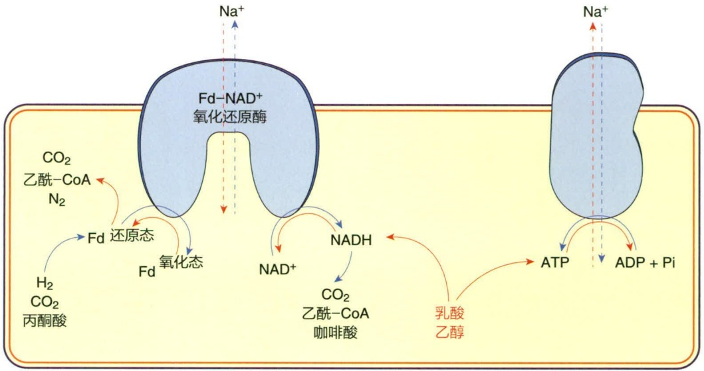

<details>
<summary>flowchart</summary>

This diagram illustrates the metabolic pathways of a biological process involving oxidation and reduction reactions, involving intermediates like Fd-NAD+, CO2/CO2/N2, NADH, ATP, and ADP.
</details>

---

7.2 微生物的能量代谢

181

的甲基萘醌脱氢酶（细胞色素 $bc_{1}$ ），叶绿体和蓝细菌的质体蓝素脱氢酶（细胞色素 $b_{6}f$ ）；②2008年发现的基于黄素（flavin）的电子歧化酶，它们属于4个不相关的蛋白家族——电子转移黄素蛋白（EtfAB/CarED/LctCB/FixBA）、NAD（P）H脱氢酶（NuoF同源蛋白）、NADH-依赖的Fd:NADP还原酶（NfnAB）和异二硫化物还原酶（HdrABC同源蛋白），除了固氮菌的FixBA，这些黄素歧化酶都是细胞质蛋白并分布在厌氧细菌和厌氧古菌。例如，伍氏醋酸杆菌在利用咖啡酸盐生长时，基于黄素的歧化酶CarED与CarC组成复合物，CarD的β位FAD是电子歧化中心，NADH（$E_{0}' = -320 \text{ mV}$）释放出的2个电子经β-FAD发生传递方向的分流，一个经CarE的β-FAD和CarC的β-FAD流向咖啡酰-CoA

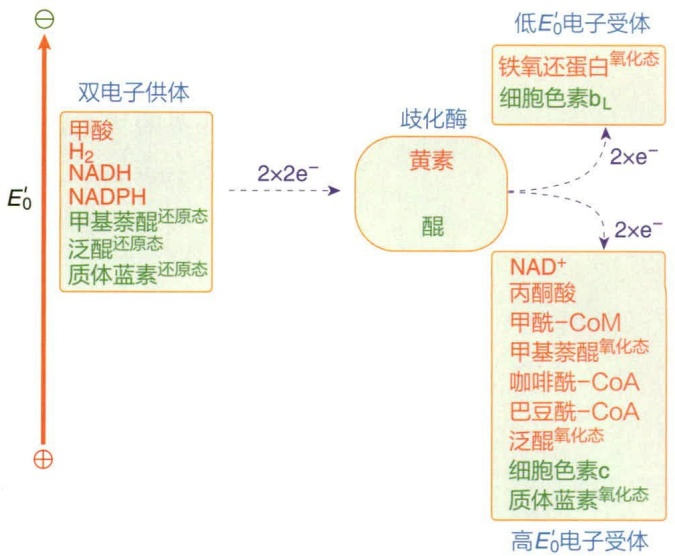

<details>
<summary>flowchart</summary>

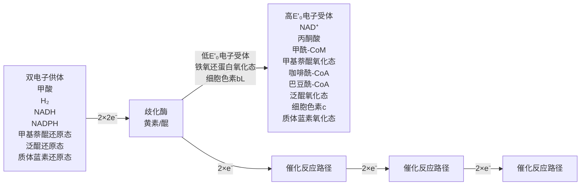
</details>

图 7-11 含有黄素或醌的歧化酶催化电子歧化反应

$(E_{0}^{\prime}=-10\ \mathrm{mV})$ ，另一个电子经CarE的铁硫簇流向Fd  $(E_{0}^{\prime}=-420\ \mathrm{mV})$ ，使咖啡酰-CoA和Fd还原， $Fd^{还原态}$ 进一步通过 $Fd-NAD^{+}$ 氧化还原酶给出电子并偶联膜内外 $Na^{+}$ 动力势的形成，后者驱动ATP合酶生成ATP。

为什么电子歧化酶可以催化电子传递的能量爬坡呢？两类电子歧化酶依赖黄素或醌的三个连续的氧化状态:0、-1、-2，分别用Q（quinone）、SQ（semiquinone）和HQ（hydroquinone）来表示。氧化还原电对Q/SQ的 $E_{0}^{\prime}$ 低于SQ/HQ的 $E_{0}^{\prime}$ ，在电子歧化反应过程中，以HQ传递第一个电子的能量消耗为代价（吸能反应），提高了其氧化产物SQ的电子还原力，使得电子歧化反应能够将电子传递给 $E_{0}^{\prime}$ 较负的电子受体（如:铁氧还蛋白氧化态；放能反应）。例如，进入泛醌脱氢酶复合体Ⅲ氧化位点的HQ将第一个电子传递给 $E_{0}^{\prime}$ 更负的Rieske铁硫簇，这是个能量爬坡过程，该氧化还原反应生成的SQ与Q组成的氧化还原电对的 $E_{0}^{\prime}$ 比complexⅢ中的细胞色素 $b_{L}$ 的 $E_{0}^{\prime}$ 更负——使得SQ向细胞色素 $b_{L}$ 传递电子的过程成为一个放能过程（图7-12）。

需要注意的是，在已知的基于黄素的电子歧化反应中，有一部分是可逆的，被称为反向电子歧化反应（electron confurcation）。例如厌氧微生物海栖热袍菌（Thermotoga maritima）通过底物水平磷酸化获得ATP，同时产生了NADH和 $Fd^{还原态}$ ，电子歧化氢化酶可催化NADH和 $Fd^{还原态}$ 的氧化产 $H_{2}$ ，从而维持细胞的氧化还原平衡状态。

## 7.2.2 化能有机营养

化能有机营养型或化能异养型微生物氧化有机物

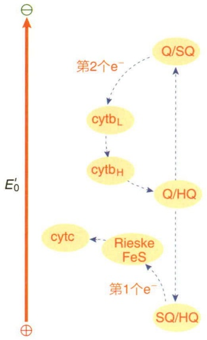

<details>
<summary>flowchart</summary>

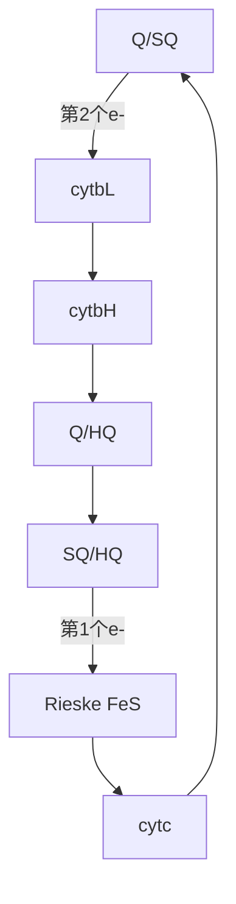
</details>

图 7-12 泛醌脱氢酶复合体Ⅲ催化的电子歧化反应

---

182

7 微生物的代谢

产生能量，其中糖酵解（glycolysis）和三羧酸循环（tricarboxylic acid cycle，TCA）是中心代谢途径，氧化有机物释放的电子可以被多种电子受体接受（表7-2）。最终电子受体是外源的代谢过程被称为呼吸（respiration）；最终电子受体是氧气，即有氧呼吸（aerobic respiration）；最终电子受体是氧气以外的物质，即无氧呼吸（anaerobic respiration）；采用分解代谢途径中间产物等内源的电子受体，即发酵（fermentation）。

表 7-2 最终电子受体来源及 ATP 产生机制

<table><tr><td>最终电子受体来源</td><td>代谢过程</td><td>最终电子受体</td><td>代表性受体</td><td>ATP产生机制</td></tr><tr><td rowspan="2">外源</td><td>有氧呼吸</td><td>氧气</td><td></td><td rowspan="2">氧化磷酸化</td></tr><tr><td>无氧呼吸</td><td>氧气以外的物质</td><td> $NO_{3}^{-}, SO_{4}^{2-}, CO_{2}, Fe^{3+}, SeO_{4}^{2-}$ ,延胡索酸,腐殖酸等</td></tr><tr><td>内源</td><td>发酵</td><td>分解代谢途径的中间产物</td><td>丙酮酸及其衍生物</td><td>底物水平磷酸化</td></tr></table>

图 7-13 有氧呼吸

糖酵解途径和乙醛酸循环相关内容见正文；右图为脱氮副球菌（Paracoccus denitrificans）的氧化磷酸化电子传递链组分，其产生的质子动力势驱动ATP合酶生成ATP

有氧呼吸可以分为以下几个阶段（图 7-13）:

① 蛋白质、多糖和脂质等大分子营养物质被水解或降解成构成它们的单体，这个过程一般不释放能量。

② 氨基酸、单糖、脂肪酸、甘油及第一阶段的其他产物被降解为简单的小分子，

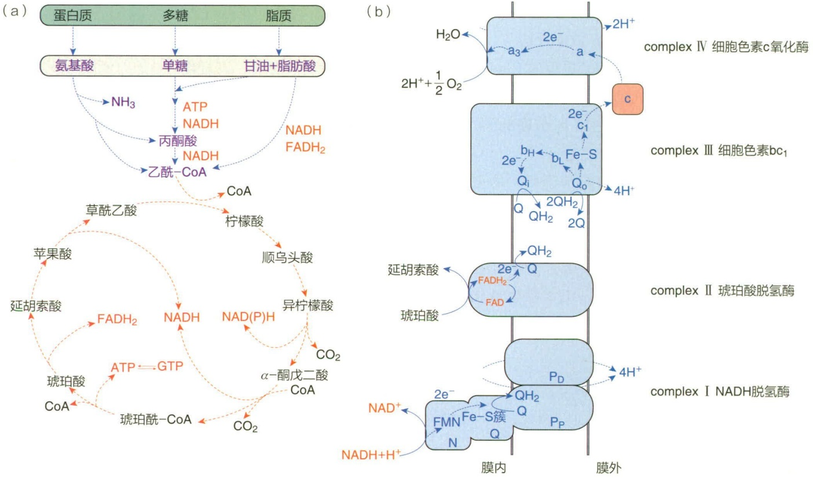

---

7.2 微生物的能量代谢

183

如丙酮酸、乙酰-CoA等，这个过程产生ATP、NADH和 $FADH_{2}$ 等。以糖酵解为例，己糖激酶消耗1分子ATP催化葡萄糖形成6-磷酸葡萄糖，后者在磷酸己糖异构酶催化下异构转化为6-磷酸果糖；磷酸果糖激酶消耗1分子ATP催化6-磷酸果糖磷酸化生成1,6-二磷酸果糖，后者在醛缩酶的作用下生成3-磷酸甘油醛和磷酸二羟丙酮，丙糖磷酸异构酶进一步催化磷酸二羟丙酮转化为3-磷酸甘油醛；2分子3-磷酸甘油醛在3-磷酸甘油醛脱氢酶催化下生成2分子1,3-二磷酸甘油酸，同时产生2分子NADH；磷酸甘油酸激酶将2分子1,3-二磷酸甘油酸的高能磷酰基转给ADP生成2分子ATP和2分子3-磷酸甘油酸，后者在磷酸甘油酸变位酶催化下形成2-磷酸甘油酸，烯醇化酶催化2-磷酸甘油酸脱水生成磷酸烯醇式丙酮酸，后者的高能磷酸基团在丙酮酸激酶催化下转移给ADP生成ATP和丙酮酸。1分子葡萄糖的糖酵解途径先消耗2分子ATP，后经一次氧化还原反应（生成2分子NADH）和两次底物水平磷酸化（生成4分子ATP），净生成2分子NADH和2分子ATP。糖酵解途径不涉及外来电子受体。

③ 部分被氧化的碳原子进入三羧酸循环，被完全氧化成  $CO_{2}$ ，产生 ATP、NADH 和  $FADH_{2}$ （图 7-13）。一些化能有机营养生物也能利用二碳化合物生长，这时需要启动与 TCA 循环偶联的乙醛酸循环（glyoxylate cycle）。因为很多四碳和六碳化合物可以用于生成草酰乙酸，而仅依赖 TCA 循环不足以从二碳化合物生成草酰乙酸。以二碳化合物如乙酸生长时，乙酸被转化为乙酰-CoA、柠檬酸和异柠檬酸；后者在异柠檬酸裂解酶的作用下生成琥珀酸和乙醛酸；苹果酸合酶催化乙酰-CoA 和乙醛酸生成苹果酸；从苹果酸进而生成草酰乙酸保障 TCA 循环中乙酰-CoA 的氧化。

④ 上述分解代谢途径产生的 NADH 被 complex I 氧化，电子经 complex I 的 FMN（位于 N 模块）和一系列 Fe-S 簇传递给 Q（在 Q 模块发生），该电子传递过程伴随着 4 个质子的泵出（在 P 模块发生）； $FADH_{2}$  在 complex II 把电子传递给 Q； $QH_{2}$  在 complex III 的氧化位点  $Q_{0}$  发生电子歧化反应，1 个电子经由 Rieske 铁硫簇、细胞色素  $c_{1}$  传递给细胞色素 c，另一个电子经由细胞色素  $b_{L}$ 、细胞色素  $b_{H}$  在 Q 的还原位点  $Q_{i}$  传递给 Q，这个过程也被称为 Q-cycle，该过程伴随着 4 个质子的泵出；细胞色素 c 再将获得的电子经由 complex IV 的细胞色素 a 和  $a_{3}$  传递给最终电子受体氧气，伴随着 2 个质子的泵出；质子动力势驱动 ATP 合酶生成 ATP。微生物有氧呼吸的电子传递链中的末端氧化酶复合体 IV 具有一定的多样性。例如大肠杆菌在氧分压较高的对数期末端氧化酶为  $bo_{3}-$  型（图 7-14），而氧分压较低的稳定期为 bd- 型，后者是细菌特有的对氧气亲和力较高的末端氧化酶；很多根瘤菌在共生固氮时的低氧分压条件下会调用对氧气亲和力高的  $cbb_{3}-$  型末端氧化酶。此外，图 7-13 中的电子传递链组分数量在微生物中具有多样性，例如 complex III 在大肠杆菌中是缺失的（图 7-14）。

直到约6亿年前生物圈大气的氧气浓度才达到了现在的水平，而且现存的许多微生物能够在氧分压较低甚至无氧的生境生存，例如湿地、沉积物和宿主体内等。一些微生物通过无氧呼吸、或发酵将环境中的能量转化为细胞内的能量。例如，无氧时大肠杆菌利用硝酸盐还原酶进行末端电子受体为硝酸盐的无氧呼吸（图7-14）；在环境

---

184

7 微生物的代谢

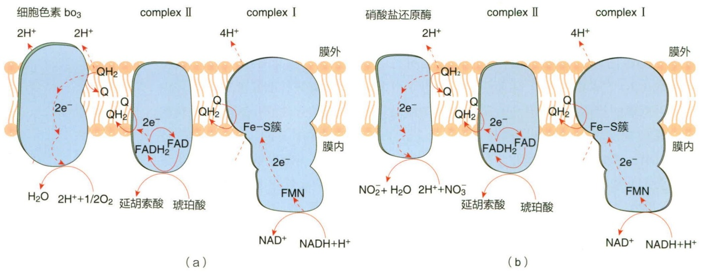

图 7-14 大肠杆菌的有氧呼吸与硝酸盐呼吸

（a）以细胞色素  $bo_{3}$  为末端氧化酶的有氧呼吸；（b）以硝酸盐还原酶为末端氧化酶的无氧呼吸

中存在甲酸盐时，大肠杆菌可利用定位于膜上的甲酸盐脱氢酶 FdnGHI 将甲酸盐氧化为  $CO_{2}$  并释放质子和电子，电子经由该膜蛋白复合物的 Fe-S 簇和两个血红素传递给靠近细胞质的脂溶性电子载体甲基萘醌（menaquinone）；通过甲酸盐脱氢酶或 TCA 循环等其他途径产生的还原态醌类电子载体（甲基萘醌等）在远离细胞质的一侧、将电子传递给硝酸盐还原酶 NarGHI 的两个血红素和 Fe-S 簇，后者最终将电子传递给细胞质中的硝酸盐，并将其还原为亚硝酸盐，这个过程伴随着甲基萘醌氧化位点的质子泵出；质子动力势驱动 ATP 合酶生成 ATP。由于  $NO_{3}^{-}/NO_{2}^{-}$  的  $E_{0}^{\prime}=420\ mV$ ，而  $\frac{1}{2}O_{2}/H_{2}O$  的  $E_{0}^{\prime}=820\ mV$ ，参照图 7-4 可知  $O_{2}$  是更好的电子受体，硝酸盐呼吸释放的自由能少于有氧呼吸。

专性厌氧的硫酸盐还原细菌在无氧条件下以乳酸为能源时（图 7-15），乳酸脱氢酶催化乳酸生成丙酮酸，后者转化为乙酸并产生氢气，膜上的氢化酶氧化氢气并释放

图 7-15 专性厌氧硫酸盐还原细菌以乳酸为能源生长时的硫酸盐呼吸

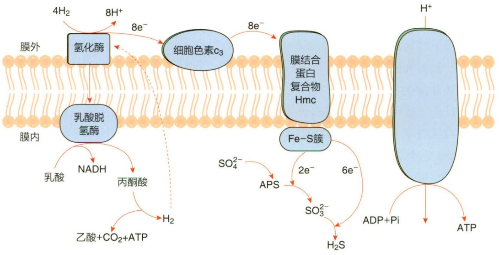

<details>
<summary>flowchart</summary>

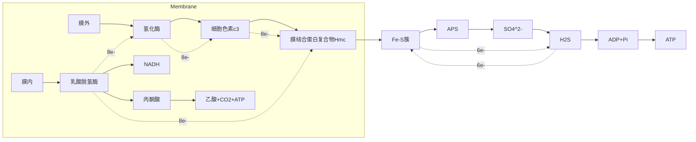
</details>

---

7.2 微生物的能量代谢

185

电子和质子；ATP 硫酸化酶将硫酸盐转化为腺苷 -5'-磷酸硫酸（APS）， $E_{0}^{\prime}$  从  $SO_{4}^{2-}/SO_{3}^{2-}$  的 -516 mV 提高到 APS/ $SO_{3}^{2-}$  的 -60 mV，APS 更容易作为电子受体获得电子；细胞质中的 APS 还原酶和亚硫酸还原酶先后获得电子催化 APS 向亚硫酸盐和硫化氢的还原；这个过程中氢化酶氧化氢气释放质子，形成质子动力势并驱动 ATP 合酶生成 ATP。硝酸盐呼吸、硫酸盐呼吸等无氧呼吸过程产生的 ATP 少于有氧呼吸，所以大肠杆菌等能够进行多种呼吸过程的微生物在条件与资源允许的情况下会优先调用有氧呼吸途径。

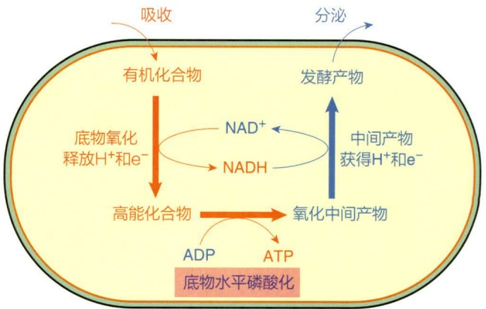

<details>
<summary>flowchart</summary>

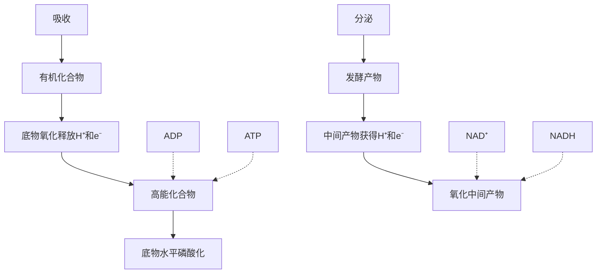
</details>

图 7-16 生理学发酵

在生产实践活动中，人们习惯将利用微生物进行

生产的过程统称为发酵，可以称之为工业发酵。在没有外源电子受体时，分解代谢途径产生的质子和电子不经过电子传递链而直接交给代谢途径未完全氧化的中间产物从而生成发酵产物，然后发酵产物被分泌到细胞外。这个过程中生成的高能化合物以底物水平磷酸化的方式产生 ATP，该生物氧化过程为生理学发酵（图 7-16，无特殊说明时，本章的发酵均指生理学发酵）。可发酵的底物包括核酸、蛋白质和多糖等，发酵类型多以发酵的产物命名如:乙醇发酵、同型乳酸发酵、异型乳酸发酵、丙酸发酵、混合酸发酵、丁酸发酵、丁醇发酵、同型乙酸发酵。也有用发酵底物来命名的，如醋酸杆菌属以甘油和  $HCO_{3}^{-}$  为底物产乙酸的甘油发酵，拟杆菌属以柠檬酸为底物产甲酸、乙酸和  $HCO_{3}^{-}$  的柠檬酸发酵等。在不同底物的发酵中，葡萄糖的发酵最为重要，微生物的葡萄糖发酵主要通过以下 4 个途径:糖酵解途径（EMP 途径，embeden-meyerhof pathway）、单磷酸己糖途径（HMP 途径，hexose monophosphate pathway）、2-酮-3-脱氧-6-磷酸葡萄糖酸途径（ED 途径，entner-doudoroff pathway）、磷酸转酮酶途径（phosphoketolase pathway）。以酵母菌的乙醇发酵为例，通氧会促进有氧呼吸作用，产能多，糖的消耗速度减慢，乙醇的产量降低；无氧时的发酵作用产能少，糖的消耗速度快，乙醇产量高，这一现象是由法国微生物学家巴斯德（Pasteur）发现的，所以也被称为巴斯德效应。可见，尽管发酵产生的能量少，但它可以平衡细胞内的氧化还原状态。

## 7.2.3 化能无机营养

除了有机物作为电子供体的化能有机营养代谢类型，在好氧和厌氧微生物中还发现了以还原态的无机物为电子供体的化能无机营养代谢，例如  $H_{2}S$ 、 $H_{2}$ 、 $Fe^{2+}$ 、 $NH_{4}^{+}$ 等无机物电子供体。还原性硫化物（ $H_{2}S$ 、单质硫等）可以先被氧化为亚硫酸盐，亚硫酸盐经磷酸腺苷硫酸（APS）还原酶、ADP 硫酸化酶（脱氮硫杆菌等）或 ATP 硫酸化酶（从深海热泉的巨型管蠕虫的共生菌中分离获得）组成的 APS 氧化途径被氧化为硫酸盐，该途径一方面通过底物水平磷酸化生成 ADP 或 ATP，另一方面释放 2 个

---

186

7 微生物的代谢

电子经由细胞色素 c 进入电子传递链（图 7-17；途径①）；亚硫酸盐也可以在亚硫酸盐脱氢酶的催化下被氧化为硫酸盐，并将 2 个电子传递给细胞色素 c，通过电子传递链产生质子动力势，进而驱动 ATP 合酶生成 ATP，这个途径被称为亚硫酸氧化途径（图 7-17；途径②）。还原性硫化物也可以直接通过硫化物氧化途径（sulfide-oxidizing pathway，Sox）被氧化为硫酸盐（图 7-17；途径③）:以硫代硫酸盐为电子供体时，在细胞色素复合蛋白 SoxXA 和载体蛋白 SoxYZ 的协同催化下，在周质空间释放 2 个电子；以单质硫或 HS⁻ 为电子供体时，在 SoxXA 和 SoxYZ 的协同催化下，在周质空

图 7-17 还原性硫化物的氧化

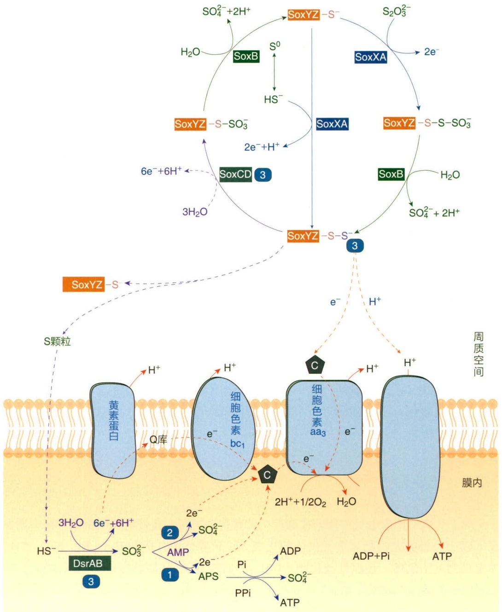

<details>
<summary>flowchart</summary>

This diagram illustrates the biochemical pathway of Sox proteins (SoxYZ, SoxXA, SoxB) in a culture environment, showing enzymatic reactions and molecular interactions between various enzymes like DsrAB, H2O, and ATP.
</details>

---

7.2 微生物的能量代谢

187

间首先释放 2 个电子，如果硫氧化细菌具备硫烷脱氢酶 SoxCD，可在周质空间完成向硫酸盐的完整氧化过程并再释放 6 个电子，该过程涉及水解酶 SoxB——SoxB 将载体蛋白 SoxYZ 携带的末端磺酸基因水解去除，使 SoxYZ 上的硫原子暴露并释放硫酸根。一些硫氧化细菌缺少 SoxCD，会在周质空间和胞内积累 S 颗粒，在细胞质中 S 颗粒可以转化为 HS⁻，后者进一步被异化型亚硫酸盐还原酶 DsrAB 氧化并释放 6 个电子。Sox 途径释放的电子通过细胞色素 c 和黄素蛋白进入电子传递链。

假单胞菌属、产碱杆菌属和罗尔斯通氏菌属等好氧菌，产甲烷古菌和产乙酸细菌等厌氧菌，脱氮副球菌等兼性厌氧菌都可以利用  $H_{2}$  作为电子供体进行产能代谢，胞质和膜结合的两大类氢化酶（hydrogenase）发挥了关键作用。例如富氧罗尔斯通氏菌膜上的氢化酶氧化  $H_{2}$  产生电子和质子，电子经醌和一系列细胞色素传递给最终电子受体  $O_{2}$ ，胞外的质子形成质子动力势驱动 ATP 合酶生成 ATP；细胞质的氢化酶氧化  $H_{2}$  生成 NADH，后者为  $CO_{2}$  固定途径提供还原力（图 7-18）。

还原态无机氮  $NH_{4}^{+}$  和  $NO_{2}^{-}$  可以作为电子供体被微生物氧化。一些好氧氨氧化细菌或氨氧化古菌利用氨单加氧酶和羟胺氧化还原酶将氨氧化为亚硝酸盐，好氧硝化杆菌等利用亚硝酸氧化还原酶将亚硝酸盐氧化为硝酸盐。这些氧化反应释放的电子通过这些原核生物膜上的细胞色素 c、 $aa_{3}$  传给最终电子受体  $O_{2}$ ，形成质子动力势驱动 ATP 合酶合成 ATP。目前已经发现亚硝化螺菌属的部分种拥有完整的硝化过程，即全程氨氧化。除了依赖氧气的氨氧化过程，浮霉菌门细菌还存在厌氧氨氧化过程（anammox）（图 7-19）:以氨为电子供体，亚硝酸盐为电子受体，产生氮气。该过程主要发生在厌氧氨氧化体（anammoxosome），亚硝酸还原酶催化亚硝酸盐从细胞色素 c 获得 1 个电子生产 NO，联氨合酶催化 NO 与  $NH_{4}^{+}$  反应生产  $N_{2}H_{4}$ （从细胞色素 c 获得 3 个电子），后者在联氨脱氢酶的催化下生成  $N_{2}$  并释放 4 个电子，通过细胞色素 c 进入厌氧氨氧化体膜上的醌库、细胞色素  $bc_{1}$ ，然后再经由细胞色素 c 传递给亚硝酸盐（亚硝酸盐还原酶）和 NO（联氨合酶）。在电子经由醌库和细胞色素  $bc_{1}$  传递的过程

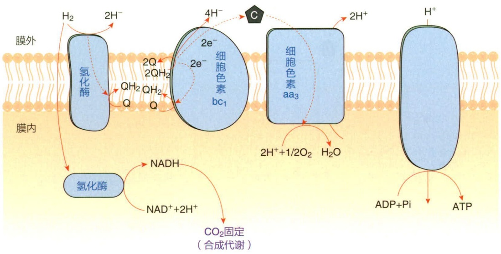

<details>
<summary>flowchart</summary>

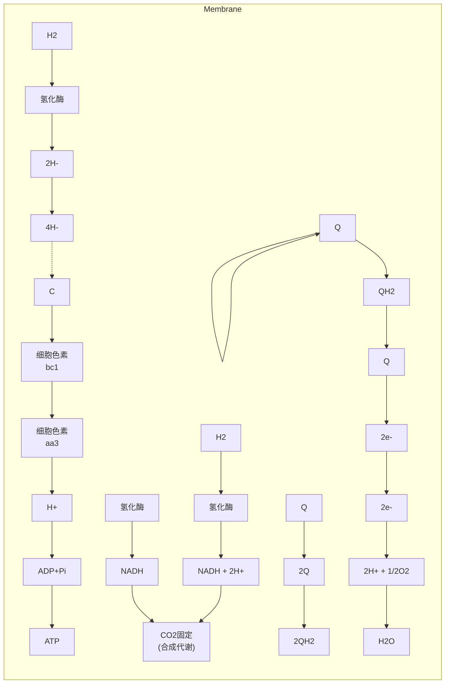
</details>

图 7-18 氢氧化

---

188

7 微生物的代谢

图 7-19 厌氧氨氧化

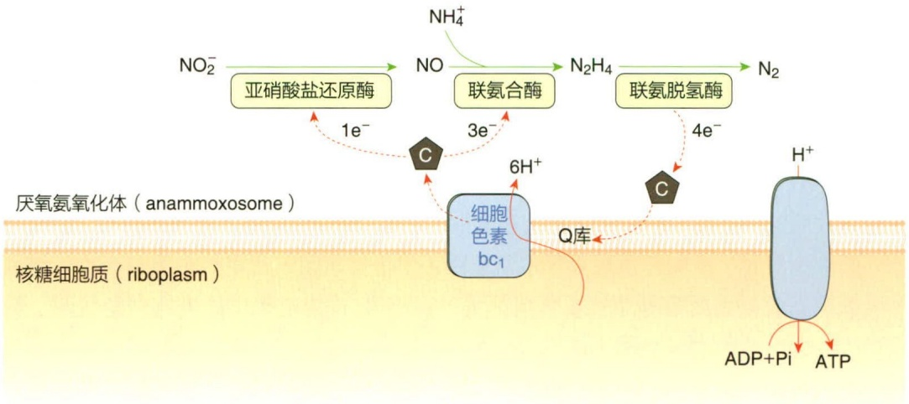

<details>
<summary>flowchart</summary>

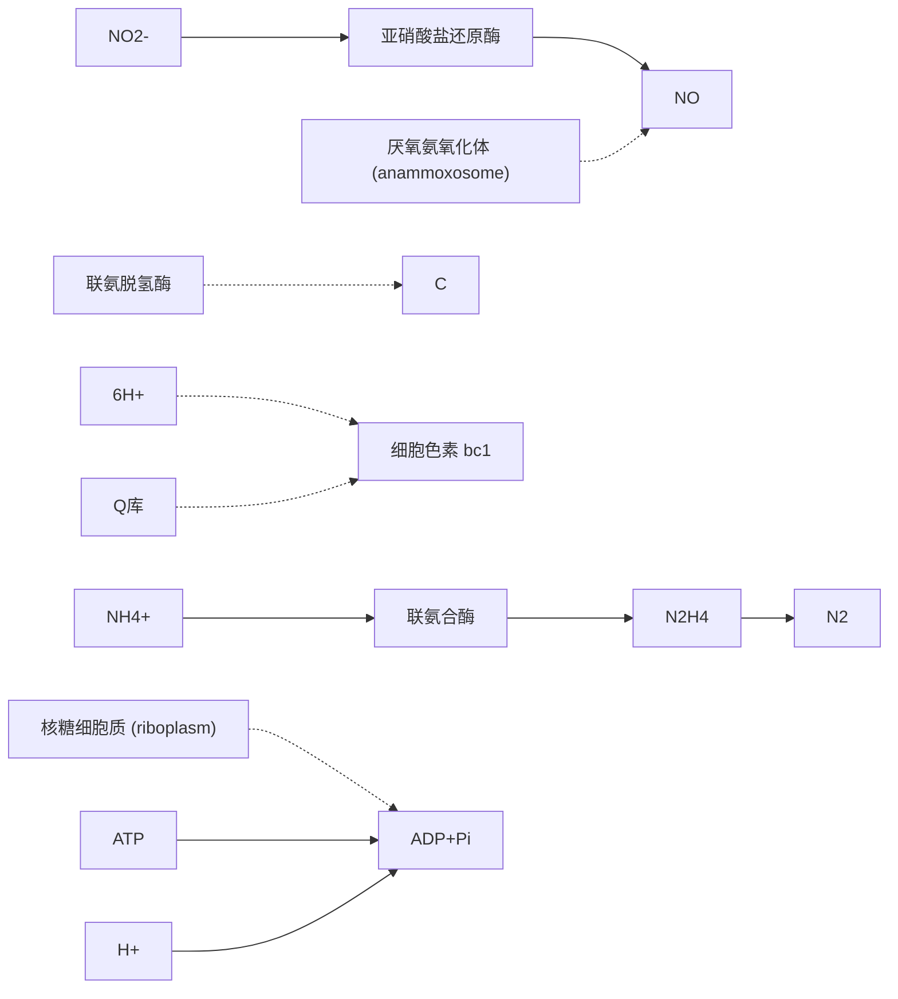
</details>

中，质子进入厌氧氨氧化体，形成厌氧氨氧化体膜内外的质子动力势，驱动 ATP 合酶生成 ATP。

嗜酸氧化亚铁硫杆菌等铁氧化细菌可以利用  $Fe^{2+}$  作为电子供体自养生活，位于外膜的细胞色素 c 氧化  $Fe^{2+}$ ，将电子传递给周质空间的铁硫菌蓝蛋白（rusticyanin），后者进一步把电子传递给细胞色素 c、 $aa_{3}$ ，电子最终受体为  $O_{2}$ ，形成质子动力势，驱动 ATP 合酶合成 ATP；为了获得固定  $CO_{2}$  所需要的 NADH，需要消耗质子动力势，电子经铁硫菌蓝蛋白、细胞色素  $bc_{1}$  和醌库反向传递给  $NAD^{+}$ ，生成 NADH（图 7-20）。由于  $Fe^{3+}/Fe^{2+}$  的还原电势较高，嗜酸铁氧化菌需要消耗很多  $Fe^{2+}$  才能维持其生长，所以

图 7-20 铁氧化

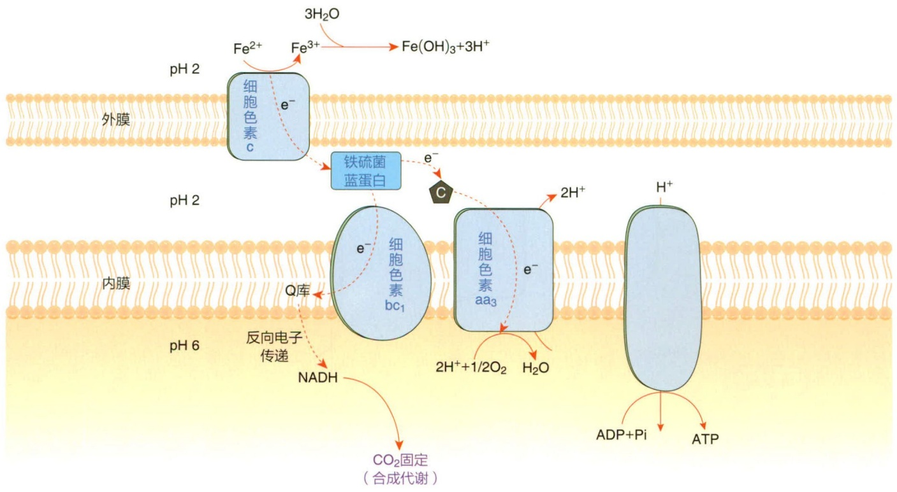

<details>
<summary>flowchart</summary>

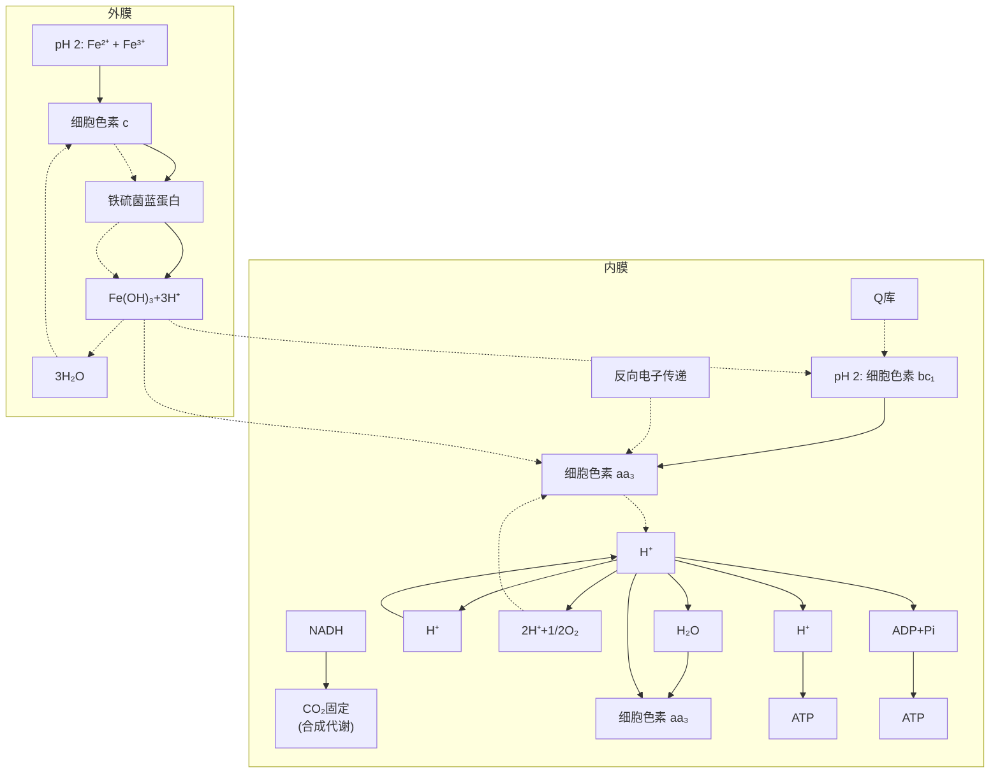
</details>

---

7.2 微生物的能量代谢

189

该菌种旺盛生长的地方会有大量肉眼可见的三价铁沉淀。

## 7.2.4 光能营养

生物圈能够利用光能生长的细胞生物包括:①广义植物，即陆生植物及其他含有原始色素体的生物（绿藻、红藻和灰藻），它们起源于15亿年前的蓝细菌内共生事件，色素体由2层膜包被；②色素体被3\~4层膜包被的硅藻、沟鞭藻、裸藻等原生生物，它们可能起源于原始色素体藻类与特定原生生物

表 7-3 光能营养生物的多样性

<table><tr><td>真核生物</td><td>原核生物</td></tr><tr><td>陆生植物</td><td>盐杆菌</td></tr><tr><td>绿藻、褐藻、红藻</td><td>蓝细菌</td></tr><tr><td>原生生物</td><td>原绿藻</td></tr><tr><td rowspan="4">(如类眼虫鞭毛藻、沟鞭藻、硅藻)</td><td>绿色硫细菌</td></tr><tr><td>绿色非硫细菌</td></tr><tr><td>紫色硫细菌</td></tr><tr><td>紫色非硫细菌</td></tr></table>

的内共生事件；③光能营养型的各类原核微生物型（表7-3）。真核生物利用色素体而原核生物通过细胞膜（绿色细菌也涉及与细胞膜连接的绿色体）捕获光能，用来合成ATP，但能量代谢方式多样。如7.2.1所述，在盐沼盐杆菌等古菌和细菌中发现了光能激发的基于视紫红质蛋白的化学渗透方式，形成的质子动力势驱动ATP合酶生成ATP，该产能过程不依赖电子传递链。

在光能营养型的真核生物、原绿藻和大多数蓝细菌中，光能转化为化学能的过程伴随着电子传递和氧气产生，是产氧光合磷酸化（oxygenic photophosphorylation）。光系统Ⅱ可以捕获短波长的光（小于680 nm）并把能量聚集到P680叶绿素特殊对，P680的 $E_{0}^{\prime}$ 比 $O_{2}/H_{2}O$ 更大， $H_{2}O$ 将电子传递给P680从而被氧化为 $O_{2}$ ；被还原的P680进一步将电子依次传递给脱镁叶绿素a、质体醌、细胞色素 $b_{6}f$ 、质体蓝素和光系统I，这个过程形成的质子动力势驱动ATP合酶生成ATP，线性光合磷酸化（linear photophosphorylation）。蓝细菌和红藻还具有藻胆蛋白，其中的藻胆素使得细胞可以捕获更多的光能。光系统I能够吸收长波长的光（大于680 nm），并把能量聚集到P700的叶绿素a对，P700被光能激发， $E_{0}^{\prime}$ 降低，释放电子到下游电子载体，铁氧还蛋白Fd被还原， $Fd^{还原态}$ 的电子在不同产氧光合生物中的电子传递方向有所不同，但是都能经过一系列电子载体沿循环路线传递并回到被氧化的P700，环式光合磷酸化（cyclic photophosphorylation）。例如，在蓝细菌的循环光合磷酸化中， $Fd^{还原态}$ 将电子传递给complex I的质体醌还原模块，质体醌被还原后将电子传递给细胞色素 $b_{6}f$ 、质体蓝素和光系统I；植物叶绿体 $Fd^{还原态}$ 的电子除了具有与蓝细菌类似的电子传递途径，还能够通过PGR5-PGRL1复合物将电子传递给质体醌，后者再把电子传递给细胞色素 $b_{6}f$ 、质体蓝素和光系统I；微藻叶绿体的 $Fd^{还原态}$ 也可以通过PGR5-PGRL1复合物将电子先后传递给质体醌、细胞色素 $b_{6}f$ 、质体蓝素和光系统I，但是 $Fd^{还原态}$ 不能直接通过complex I将质体醌还原，需要经由NADPH、NADH等中间电子载体，并由NADH为complex I催化的质体醌还原反应提供电子，还原后的质体醌将电子先后传递给细胞色素 $b_{6}f$ 、质体蓝素和光系统I，完成循环电子传递（图7-21）。

需要注意的是部分蓝细菌缺少光系统Ⅱ，不能进行产氧光合磷酸化，例如与真核单细胞藻共生的蓝细菌UCYN-A。此外，绿色细菌、紫色细菌和日光杆菌等厌氧微生物通过不产氧光合磷酸化获取能量，这些微生物的光合磷酸化具有以下特征:

---

190

7 微生物的代谢

图 7-21 产氧光合磷酸化电子传递系统的多样性

（a）模式植物拟南芥叶绿体；（b）模式微藻莱茵衣藻叶绿体；（c）蓝细菌Synechocystis sp. PCC6803 COX:细胞色素aa3氧化酶；Cyd:细胞色素bd泛醇氧化酶；Cyt b6f:细胞色素b6f复合物；Fd:铁氧还蛋白；FNR:铁氧还蛋白-NADP还原酶；FNRL:大FNR异构体；FNRS:小FNR异构体；Pc:质体蓝素；PGR5:PROTONGRADIENT REGULATION 5；PGRL1:PGR5-Like 1；PQ:质体醌库；PSI:光系统I；PSII:光系统II；PTOX:质体末端氧化酶；TH:转氢酶

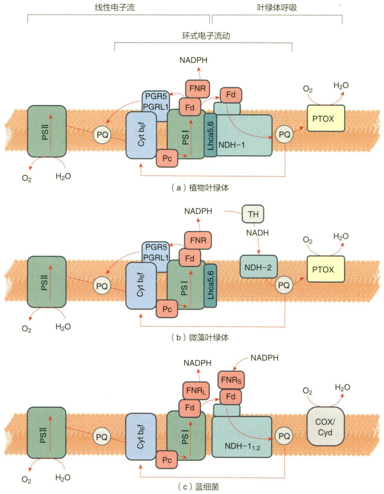

① 水不是电子来源，而以  $H_{2}S$ （如绿硫细菌、紫色细菌）和  $H_{2}$ （如嗜热光合绿丝菌）等作为电子供体。
② 菌绿素具有不同的最大吸收波长，例如，紫色细菌的菌绿素 a（830～890 nm）和菌绿素 b（1 020～1 040 nm），绿硫细菌的菌绿素 c（745～755 nm）、菌绿素 d（705～740 nm）和菌绿素 e（719～726 nm），绿色非硫细菌的菌绿素  $c_{s}$ （740 nm），及日光杆菌的菌绿素 g（788 nm），这些多样的色素使得生物圈更充分地利用了电磁光谱的能量；菌绿素定位于细胞膜（以及绿硫细菌和绿色非硫细菌的绿色体），50～300个菌绿素分子形成一个复合体——其中大多数色素分子作为捕获光的天线色素，小部

---

7.3 微生物的合成代谢

191

分色素分子构成光合电子传递反应中心（图 7-22）。

③ 类胡萝卜素中不同的胡萝卜素或叶黄素发挥光保护作用，如日光杆菌的脱氢神经孢子烯（diaponeurosporene）、绿硫细菌的绿硫菌烯（chlorobactene）、绿色非硫细菌的β-胡萝卜素（beta-carotene）、紫色细菌的神经孢子烯（neurosporene）、番茄红素（lycopene）、球形烯酮（spheroidenone）、螺旋菌黄素（spirilloxanthin）和奥克酮（okenone）等。

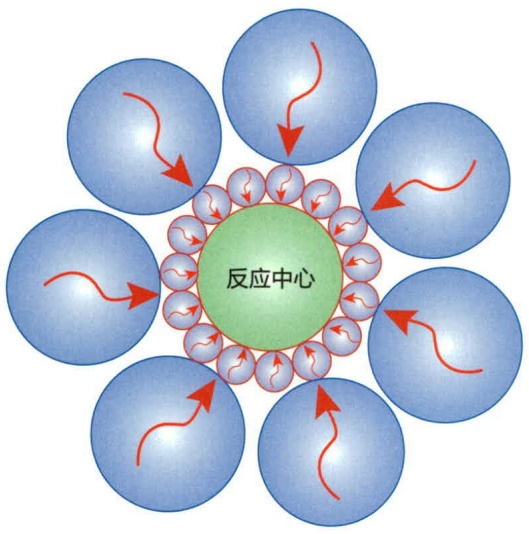

<details>
<summary>flowchart</summary>

This diagram illustrates a biological process involving multiple circular stimuli and their corresponding reaction pathways, centered around an 'Response Center' (反应中心).
</details>

图 7-22 细胞膜上菌绿素分子组成的捕光天线（带红色箭头的色素分子）与光合电子传递反应中心

④ 只有一个光系统，且不同物种的

光系统特征不同，不同物种的细胞色素复合物组成存在差异，并以循环电子流为主，如图 7-23 所示的紫硫细菌和绿硫细菌不产氧光合作用电子传递链。

图中显示了光激发后引起紫硫细菌 P870 或绿硫细菌 P840 还原电势降低，进而驱动电子在载体间的传递；两类细菌分别具有 Q-type 反应中心和 FeS-type 反应中心，而产氧光合磷酸化具有 Q-type（光系统 I）和 FeS-type（光系统 II）两类反应中心。

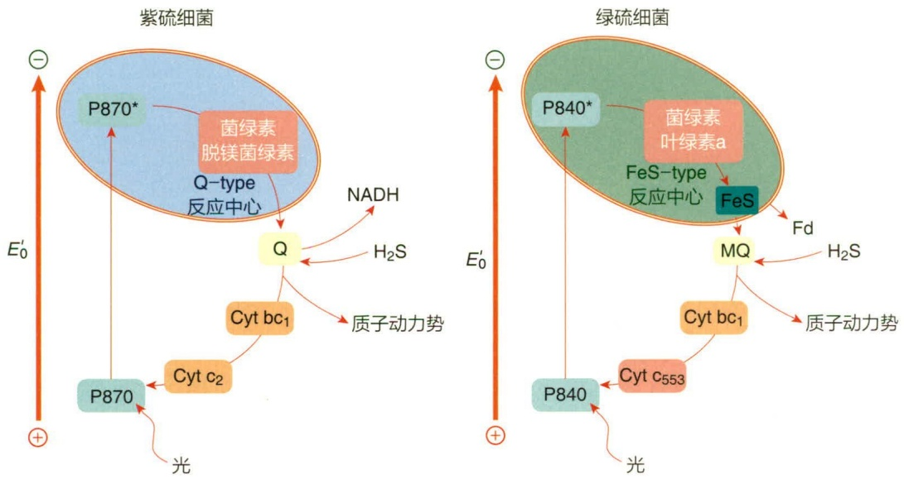

图 7-23 不产氧光合作用的电子传递链

## 7.3 微生物的合成代谢

微生物合成自身细胞物质的过程即是合成代谢。细胞物质主要由蛋白质、多糖、核酸、脂肪等组成，它们分别从相应的小分子单体物质合成，如蛋白质由氨基酸聚合合成，多糖由单糖合成、脂肪酸链与甘油连接合成、核酸则由核苷酸聚合合成。

---

192

7 微生物的代谢

图 7-24 微生物的各种细胞物质合成代谢简图

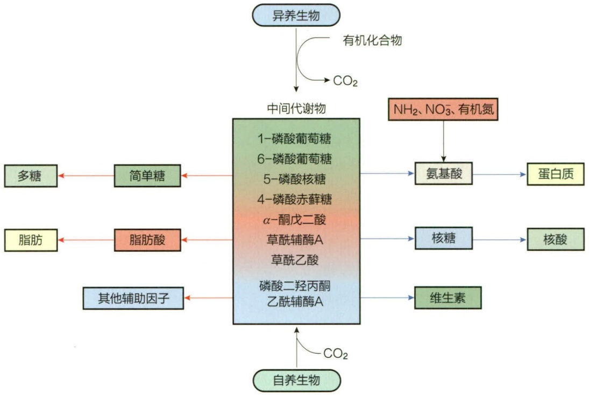

<details>
<summary>flowchart</summary>

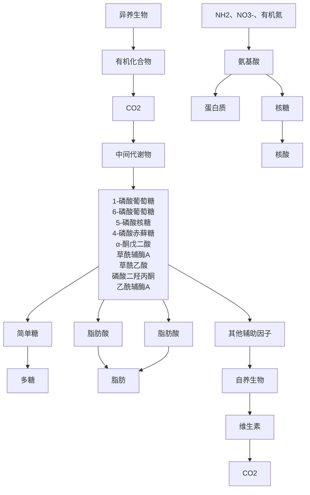
</details>

小分子单体的合成代谢或以无机物（如  $CO_{2}$  和  $N_{2}$ ），或以分解代谢的中间产物（如丙酮酸、乙酰辅酶 A、草酰乙酸和 3-磷酸甘油醛等）为底物（图 7-24）。合成代谢是化合物还原的过程，由分解代谢产生的还原力驱动，同时需要能量 ATP 的投入，是耗能代谢。

## 7.3.1 同化 $\mathrm{CO}_{2} / \mathrm{CO}_{2}$ 固定途径

$CO_{2}$ 是自养微生物的唯一或主要碳源，也是一些异养型微生物的辅助碳源。将大气中 $CO_{2}$ 同化或还原为细胞物质的过程称为 $CO_{2}$ 固定，该过程也是地球早期生命将无机碳转化为有机碳的过程，在许多细菌和古菌中存在。自养型微生物将摄入细胞的 $CO_{2}$ 先固定在特异的 $CO_{2}$ 受体上，再经多个化学反应步骤合成单糖，多数是葡萄糖。而异养型微生物往往将 $CO_{2}$ 与有机酸结合，因此同化 $CO_{2}$ 只是补救代谢。

目前在不同的微生物中发现了7条  $CO_{2}$  固定途径，分别是卡尔文循环、还原性乙酰 CoA 途径、还原性柠檬酸循环、3-羟基丙酸 /4-羟基丁酸循环、双羧酸 /羟基丁酸循环、3-羟基丙酸双循环和还原性甘氨酸途径。除植物也利用卡尔文循环固定  $CO_{2}$  外，其余6条  $CO_{2}$  固定途径只存在于微生物中。本章只介绍三条代表性的  $CO_{2}$  固定途径。

## 7.3.1.1 卡尔文循环

20 世纪美国生物化学家 Calvin 发现藻类和植物利用光能固定  $CO_{2}$  并放出氧气，之后进一步发现这些生物通过还原的戊糖磷酸途径固定  $CO_{2}$ ，因此该  $CO_{2}$  固定途径被

---

7.3 微生物的合成代谢

193

称为卡尔文循环（Calvin cycle）。许多自养微生物，包括蓝细菌和光合细菌等也利用卡尔文循环固定  $CO_{2}$ 。

卡尔文循环需要  $CO_{2}$  受体 1,5-二磷酸核酮糖、NADPH、ATP 和两个关键酶:二磷酸核酮糖羧化酶（ribulose-1,5-bisphosphate carboxylase/oxygenase，RuBisCO）和磷酸核酮糖激酶（phosphoribulokinase）。该循环主要包括三个过程:①  $CO_{2}$  结合到 1,5-二磷酸核酮糖（ribulose-1,5-P，RuBP）上合成六碳化合物；② 六碳化合物裂解并还原成 3-磷酸丙糖、并经一系列反应合成葡萄糖；③ 1,5-二磷酸核酮糖再生。

每个循环可将 6 分子  $CO_{2}$  同化为 1 分子葡萄糖，并需要 12 个 NADPH 和 18 个 ATP。总反应式为:

$$
6 \mathrm{CO} _ {2} + 1 8 \mathrm{ATP} + 1 2 \mathrm{NAD(P)} \mathrm{H} \rightarrow \mathrm{C} _ {6} \mathrm{H} _ {1 2} \mathrm{O} _ {6} + 1 8 \mathrm{ADP} + 1 8 \mathrm{Pi} + 1 2 \mathrm{NAD(P)} ^ {+} + 6 \mathrm{H} _ {2} \mathrm{O}
$$

## 7.3.1.2 还原性乙酰辅酶A途径

还原性乙酰辅酶 A 途径（reductive acetyl-CoA pathway）广泛存在于各种厌氧微生物中，是由 Wood，Ljungdahl 和 Thauer 及其他实验室首先在厌氧的产乙酸细菌中发现的、将  $CO_{2}$  合成乙酰辅酶 A 的途径，因此也被称为 Wood-Ljungdahl（WL）途径。

反应式: $4H_{2}+2HCO_{3}^{-}+H^{+}\rightarrow CH_{3}CO-S\sim CoA+4H_{2}O$

还原性乙酰辅酶 A 途径的关键酶是一氧化碳脱氢酶（CODH）/乙酰辅酶 A 合成酶（ACS），以还原的铁氧化蛋白（ $FdH_{2}$ ）和  $F_{420}H_{2}$ （甲烷古菌）为还原当量，并需要多种金属离子（Ni，Mo/W，Co，Fe）辅助氧化还原反应。该途径将 1 分子  $CO_{2}$  还原为甲基并结合到四氢生物蝶呤上，而将另 1 分子  $CO_{2}$  还原为一氧化碳，然后甲基与一氧化碳及辅酶 A 合成乙酰辅酶 A。合成的乙酰辅酶 A 通过糖异生途径合成细胞碳，并可转化成磷酸乙酰合成 ATP。

还原性乙酰辅酶 A 固碳途径只需 2 分子的  $CO_{2}$  即可起始细胞碳的合成，而且固定 1 分子  $CO_{2}$  只需要 1 个 ATP，因此推测是地球初期生命采用的有机物合成方式。

## 7.3.1.3 还原性三羧酸循环

还原性三羧酸循环（reductive citric acid cycle，rTCA）又称为逆向三羧酸循环（reverse citric acid cycle）（图7-25），首先在光合绿硫细菌的绿菌属（Chlorobium）中发现。rTCA每个循环固定4分子 $CO_{2}$ ，合成1分子草酰乙酸，同时消耗3分子ATP、2分子NAD（P）H和1分子 $FADH_{2}$ 。

## 7.3.2 糖异生和多糖合成

微生物细胞中的糖多以多糖形式存在，很少有游离的单糖。多糖构成细胞的结构，如肽

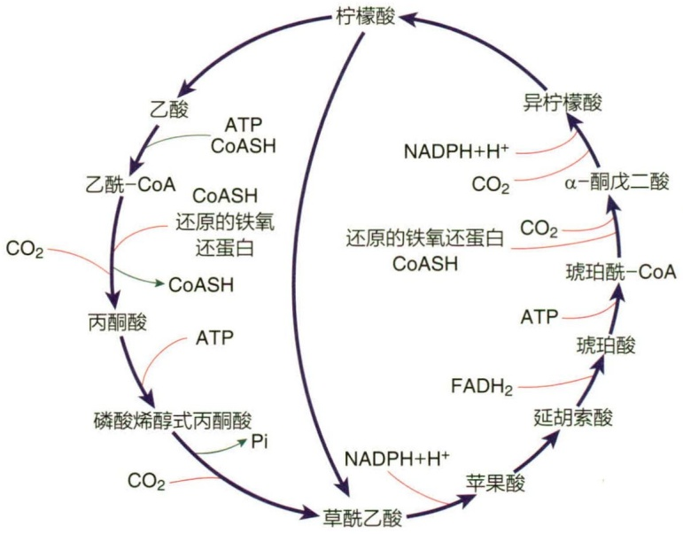

<details>
<summary>flowchart</summary>

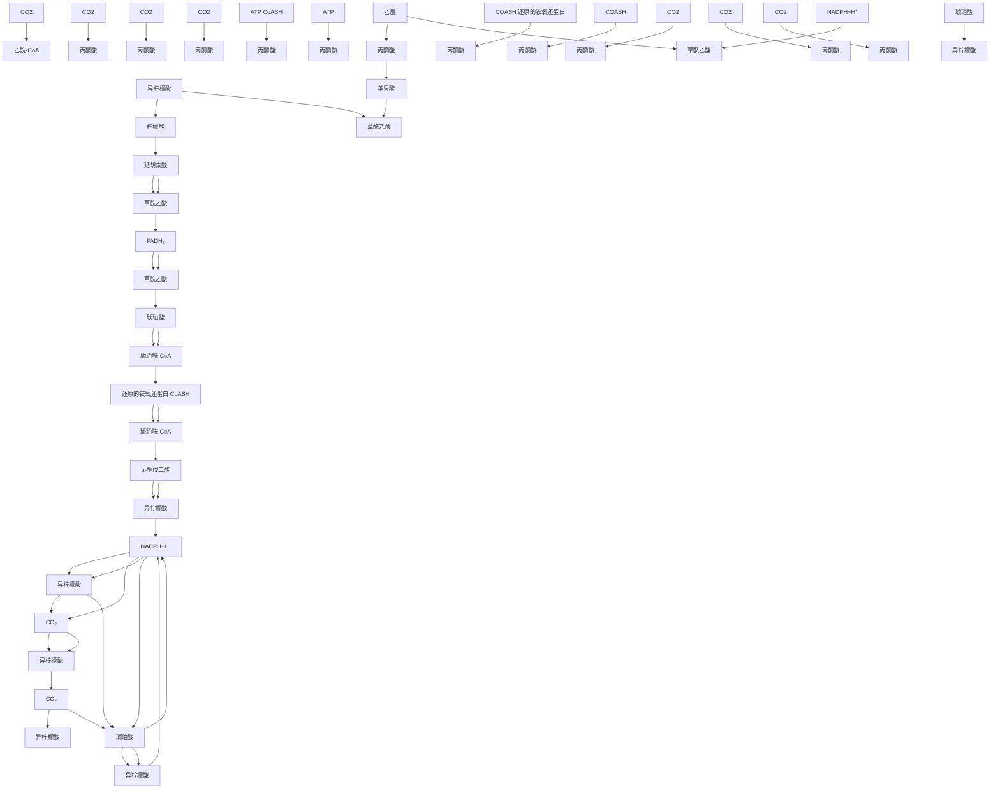
</details>

图 7-25 绿硫细菌还原的三羧酸循环途径

---

194

7 微生物的代谢

图 7-26 糖异生途径示意图

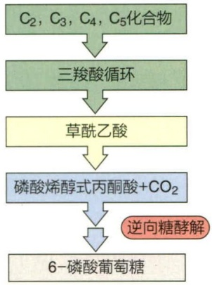

<details>
<summary>flowchart</summary>

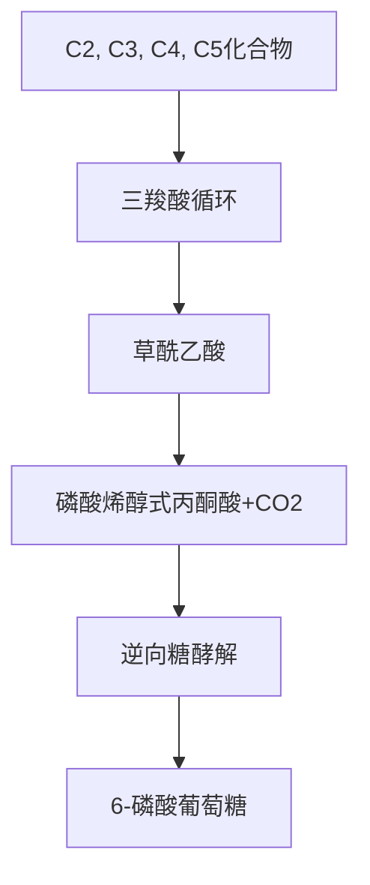
</details>

聚糖、几丁质及纤维素是细菌和真菌细胞壁的组分。细胞也常将碳和能量以多糖形式储存，如胞外多糖和荚膜多糖。

当微生物生长于葡萄糖时，可直接将葡萄糖用于多糖合成；但生长于其他碳化合物时，则须通过部分 EMP 途径逆行合成 6-磷酸葡萄糖，这个过程称作糖异生（gluconeogenesis）（图 7-26），然后再转化为其他糖类。

糖异生以磷酸烯醇式丙酮酸为起始物质，经逆向的糖酵解途径合成葡萄糖。磷酸烯醇式丙酮酸可从三羧酸循环的中间产物——草酰乙酸合成（图 7-26）。卡尔文循环的

中间产物 3-磷酸甘油醛经 TCA 循环逆向反应生成草酰乙酸或乙酰辅酶 A、再转化成磷酸烯醇式丙酮酸；糖酵解途径、有机酸发酵产生的丙酮酸、乙醛酸循环产生的草酰乙酸均可转化成磷酸烯醇式丙酮酸，然后进行糖异生合成葡萄糖。

多糖（纤维素、肽聚糖等）以活化的核苷葡萄糖、尿嘧啶二磷酸葡萄糖（UDPG）或腺苷二磷酸葡萄糖（ADPG）为底物合成。核苷葡萄糖由6-磷酸葡萄糖转化产生。尿嘧啶二磷酸葡萄糖是合成细胞结构多糖的前体，包括肽聚糖、革兰氏阴性细菌外膜脂多糖中的N-乙酰葡萄糖胺和N-乙酰胞壁酸。腺苷二磷酸葡萄糖是合成糖原的前体物质。利用核苷糖的高能磷酸键水解产生的能量，催化在核苷单糖上连接另一个核苷糖、逐步合成多糖链。

## 7.3.3 生物固氮

氮是合成蛋白质、核酸和其他有机物的元素，因此是生命的必需元素。氮分子（ $N_{2}$ ）是合成含氮物质的源头，一些原核微生物能将 $N_{2}$ 还原成生物可利用的氨（ $NH_{3}$ ）或铵盐（ $NH_{4}^{+}$ ），该过程称为生物固氮。

固氮酶复合体催化生物固氮反应，该复合体由固氮酶和固氮酶还原酶组成。两种酶均含铁离子，固氮酶以铁-钼离子为辅酶。氧气不可逆地失活固氮酶还原酶，因此固氮反应只在无氧环境中发生，如豆科植物的根瘤和蓝细菌的异形胞中。

由于  $N_{2}$  分子的 3 个共价键十分稳定，需要能量输入才能激活，并需要 6 个电子将  $N_{2}$  还原为  $NH_{3}$ 。还原 1 分子  $N_{2}$  产生 2 分子  $NH_{3}$ ，需要 16 分子的 ATP。

## 7.3.4 氨基酸合成

氨基酸是构成蛋白质的基本单位，蛋白质通常由20种氨基酸以不同排列方式组成。对于无法从环境中获取的氨基酸，生物需从头合成。一个氨基酸由碳骨架和氨基两种基本组分构成，碳骨架均来源于糖酵解或三羧酸循环的中间产物有机酸，而氨基来源于生物固氮产物 $NH_{4}^{+}$ 和其他氨基酸，以及细胞内分解的含氮物质或硝酸盐还原产物。

---

7.3 微生物的合成代谢

195

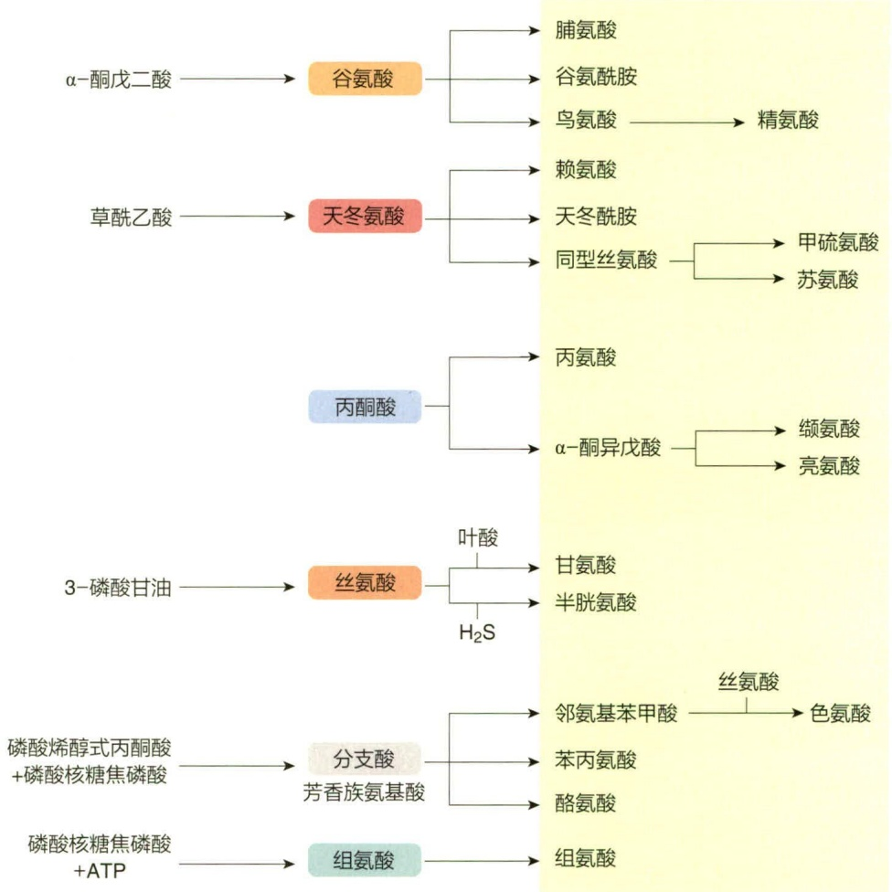

<details>
<summary>flowchart</summary>

```mermaid
graph LR
  A["α-酮戊二酸"] --> B["谷氨酸"]
  C["草酰乙酸"] --> D["天冬氨酸"]
  E["丙酮酸"] --> F["丙氨酸"]
  G["3-磷酸甘油"] --> H["丝氨酸"]
  I["磷酸烯醇式丙酮酸 + 磷酸核糖焦磷酸"] --> J["分支酸\n芳香族氨基酸"]
  K["磷酸核糖焦磷酸 + ATP"] --> L["组氨酸"]
  
  B --> M["脯氨酸"]
  B --> N["谷氨酰胺"]
  B --> O["鸟氨酸"]
  M --> P["精氨酸"]
  
  D --> Q["赖氨酸"]
  D --> R["天冬酰胺"]
  R --> S["同型丝氨酸"]
  S --> T["甲硫氨酸\n苏氨酸"]
  S --> U["丙氨酸"]
  
  F --> V["α-酮异戊酸"]
  V --> W["缬氨酸\n亮氨酸"]
  
  H --> X["叶酸\nH₂S"]
  H --> Y["甘氨酸\n半胱氨酸"]
  
  J --> Z["邻氨基苯甲酸"]
  Z --> AA["色氨酸"]
  
  L --> AB["组氨酸"]
```
</details>

图 7-27 不同家族氨基酸的合成途径

可将20种氨基酸分为5个家族。碳骨架来自糖酵解途径中间产物的有3个家族，丙氨酸家族的来自丙酮酸、丝氨酸家族的来自3-磷酸甘油酸、芳香族的来自分支酸。碳骨架来自三羧酸循环中间产物的有2个家族，谷氨酸家族的来自 $\alpha-$ 酮戊二酸，天冬氨酸家族的来自草酰乙酸。只有组氨酸从磷酸核糖焦磷酸经组氨醇合成（图7-27）。

氨基酸的生物合成主要通过3种方式:①氨基化:酮酸（α-酮戊二酸和丙酮酸）与 $NH_{3}$ 反应合成氨基酸，这是微生物同化 $NH_{3}$ 的主要途径。 $NH_{3}$ 主要用于合成谷氨酸或谷氨酰胺，分别由谷氨酸脱氢酶和谷氨酰胺合成酶催化合成。②转氨基:转氨酶催化一种氨基酸上的氨基转给酮酸形成新的氨基酸；如谷氨酸的氨基可转给草酰乙酸合成天冬氨酸，而谷氨酸脱氨形成α-酮戊二酸。③糖代谢中间产物转化:赤藓糖-4-磷酸，3-磷酸核糖焦磷酸转化合成组氨酸。图7-25展示不同家族氨基酸的合成途径。

## 7.3.5 核苷酸合成

核苷酸是核酸的基本结构单位，由核糖、碱基和磷酸组成。核糖和碱基构成核

---

196

7 微生物的代谢

苷。核苷分为嘌呤核苷和嘧啶核苷。

细胞内核苷酸的合成有两条主要途径:①从头合成途径:利用磷酸核糖、氨基酸、一碳化合物及  $CO_{2}$  等简单物质为原料合成核苷酸，这是核苷酸合成的主要途径；②重新利用（或补救合成）途径:利用体内游离的碱基或核苷，经简单化学反应合成核苷酸。

尿嘧啶核苷酸是合成嘧啶核苷酸的首个化合物，由天冬氨酸和氨甲酰磷酸缩合生成氨甲酰天冬氨酸，再经乳清酸逐步合成尿嘧啶核苷酸与胞嘧啶核苷酸，然后转化为其他嘧啶核苷酸（图 7-28）。

嘌呤核苷酸合成途径更复杂。首先由各种小分子化合物合成次黄嘌呤核苷酸（hypoxanthine nucleotide，IMP），再转化成其他嘌呤核苷酸。嘌呤核苷的碳原子来自  $CO_{2}$  和甲酸，而氮原子来自谷氨酰胺、天冬氨酸和甘氨酸。从次黄嘌呤核苷酸与核糖磷酸经多个反应步骤转化合成肌苷酸，然后再分别合成腺嘌呤核苷酸（AMP）与鸟嘌呤核苷酸（GMP）（图 7-29）。

## 7.3.6 脂肪酸和脂肪合成

脂肪酸组成的磷脂是除古菌外所有细胞生物的细胞膜脂主要成分，以及革兰氏阴性细菌的外膜成分。古菌细胞膜脂由异戊二烯为基本单位构成，不含脂肪酸。脂肪还可作为碳和能量的储存物。

图 7-28 尿嘧啶核苷酸合成途径

脂肪酸的合成以酰基载体蛋白（ACP）为载体。首先由乙酰-ACP与丙二

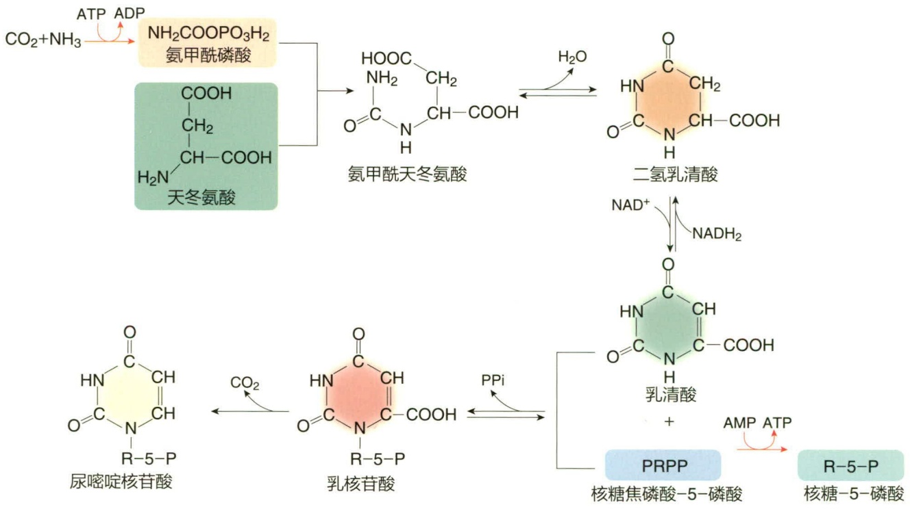

<details>
<summary>flowchart</summary>

```mermaid
graph LR
  A["CO2+NH3"] --> B["NH2COOPO3H2\n氨甲酰磷酸"]
  B --> C["天冬氨酸"]
  C --> D["氨甲酰天冬氨酸"]
  D --> E["二氢乳清酸"]
  E --> F["尿嘧啶核苷酸"]
  F --> G["乳核苷酸"]
  G --> H["PPi"]
  H --> I["核糖焦磷酸-5-磷酸"]
  I --> J["R-5-P"]
  K["AMP ATP"] -.-> J
  L["PRPP"] -.-> I
  M["NAD+"] -.-> E
  N["NADH2"] -.-> E
  O["CO2"] -.-> G
```
</details>

---

7.4 初级代谢

197

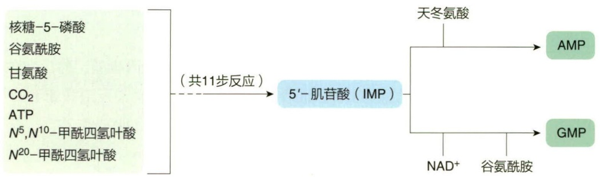

<details>
<summary>flowchart</summary>

```mermaid
graph LR
  A["核糖-5-磷酸\n谷氨酰胺\n甘氨酸\nCO2\nATP\nN^5,N^10-甲酰四氢叶酸\nN^20-甲酰四氢叶酸"] -->|"（共11步反应）"| B["5'-肌苷酸（IMP）"]
  B -->|"天冬氨酸"| C["AMP"]
  B -->|"NAD+"| D["谷氨酰胺"]
  B -->|"GMP"| E["GMP"]
```
</details>

图 7-29 嘌呤核苷酸合成途径

酰-ACP缩合成四碳烷基物质乙酰乙酰-辅酶A，然后每次加一个二碳单位，直到合成所需长度的脂肪酸链后释放出ACP（图7-30）。

不同生物膜脂的脂肪酸组成不同，同一种生物在不同条件下生长时，脂肪酸的组成也可能不同。常见脂肪（三酰甘油）的脂肪酸链长为12个碳至20个碳原子，低温下更易合成短链脂肪酸。除了饱和、偶数碳的脂肪酸，也有不饱和，或奇数碳脂肪酸及其分枝脂肪酸的脂肪。饱和脂肪酸经去饱和酶转化产生不饱和脂肪酸。脂肪合成时先将一个脂肪酸加到甘油分子上，当三个甘油碳均被脂肪酸酯化后即合成脂肪。

## 7.4 初级代谢

初级代谢（primary metabolism）指维持生命活动所必需的代谢，包括分解代谢和合成代谢。初级代谢产物（primary metabolite）指微生物代谢产生的自身生长和繁殖所必需的物质，包括氨基酸、核苷酸、糖类、脂质、维生素等。

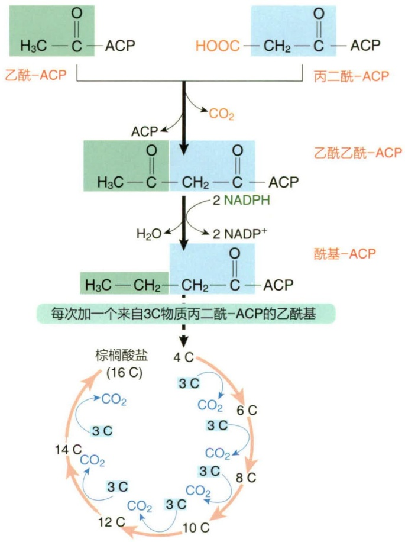

<details>
<summary>flowchart</summary>

```mermaid
graph TD
  A["H3C-C(=O)-ACP"] -->|"乙酰-ACP"| B["丙二酰-ACP"]
  C["HOOC-CH2-C(=O)-ACP"] -->|"丙二酰-ACP"| D["ACP"]
  D -->|"CO2"| E["H3C-C(=O)-CH2-C(=O)-ACP"]
  E -->|"2 NADPH"| F["H2O"]
  F -->|"2 NADP+""| G["H3C-CH2-CH2-C(=O)-ACP"]
  G -->|"每次加一个来自3C物质丙二酰-ACP的乙酰基"| H["4 C"]
  H -->|"6 C"| I["6 C"]
  I -->|"3 C"| J["3 C"]
  J -->|"3 C"| K["3 C"]
  K -->|"8 C"| L["8 C"]
  L -->|"10 C"| M["10 C"]
  M -->|"12 C"| N["12 C"]
  N -->|"14 C"| O["14 C"]
  O -->|"3 C"| P["3 C"]
  P -->|"3 C"| Q["3 C"]
  Q -->|"3 C"| R["3 C"]
  R -->|"3 C"| S["3 C"]
  S -->|"3 C"| T["3 C"]
  T -->|"3 C"| U["3 C"]
  U -->|"3 C"| V["3 C"]
  V -->|"3 C"| W["3 C"]
  W -->|"3 C"| X["3 C"]
  X -->|"3 C"| Y["3 C"]
  Y -->|"3 C"| Z["3 C"]
  Z -->|"3 C"| AA["4 C"]
  AA -->|"4 C"| AB["4 C"]
```
</details>

图 7-30 脂肪酸合成途径

不同类型的微生物具有丰富多样的初级代谢类型，在适宜条件下，它们通过不同类型的发酵过程可产生多种初级代谢产物。下面介绍一些发酵工业生产利用的微生物发酵途径和发酵产物。

## 7.4.1 乙醇发酵

乙醇发酵是酿酒工业的基础，包括白酒、果酒、啤酒酿造，以及乙醇生产。酵酒酵母（Saccharomyces cerevisiae）是常用的乙醇发酵菌种；某些细菌如运动发酵单胞

---

198

7 微生物的代谢

菌（Zymononas mobilis）、嗜糖假单胞菌（Pseudomonas saccharophila）、解淀粉欧文氏菌（Erwinia amylovora）和某些霉菌也用于乙醇发酵。

无氧条件下，酵母菌可将葡萄糖经 EMP 途径转化为 2 分子丙酮酸，然后在丙酮酸脱羧酶的作用下脱羧生成乙醛和  $CO_{2}$ ，最后乙醛被还原为乙醇。总反应式如下:

$$
\mathrm{C} _ {6} \mathrm{H} _ {1 2} \mathrm{O} _ {6} + 2 \mathrm{ADP} + 2 \mathrm{Pi} \rightarrow 2 \mathrm{CH} _ {3} \mathrm{CH} _ {2} \mathrm{OH} + 2 \mathrm{CO} _ {2} + 2 \mathrm{ATP}
$$

## 7.4.2 乳酸发酵

乳酸是最常见的细菌发酵产物之一，也将发酵糖产生大量乳酸的细菌称为乳酸细菌（lactic acid bacteria，LAB）。发酵产物中乳酸含量>85%的称为同型乳酸发酵（homolactic fermentation）；而发酵产物中除乳酸外，还有乙醇、乙酸及 $CO_{2}$ 等称为异型乳酸发酵（heterolactic fermentation）。

## (1) 同型乳酸发酵

进行同型乳酸发酵的细菌主要有链球菌属（Streptococcus）和乳酸杆菌属（Lactobacillus）的一些种，以及凝结芽孢杆菌（Bacillus coagulans）。用于乳酸发酵工业的常用菌种是凝结芽孢杆菌和德氏乳杆菌（L. delhruckii）、保加利亚乳杆菌（L. bulgaricus）和干酪乳杆菌（L. casei）等。

葡萄糖是同型乳酸发酵的主要底物。葡萄糖经 EMP 途径产生丙酮酸，然后在乳酸脱氢酶的作用下还原为乳酸。反应式如下:

$$
\mathrm{C} _ {6} \mathrm{H} _ {1 2} \mathrm{O} _ {6} + 2 \mathrm{ADP} + 2 \mathrm{Pi} \rightarrow 2 \mathrm{CH} _ {3} \mathrm{CHOHCOOH} + 2 \mathrm{ATP}
$$

## (2) 异型乳酸发酵

异型乳酸发酵通常经磷酸解酮酶途径进行。异型乳酸发酵的细菌有肠膜明串球菌（Leuconostos mesentewides）葡萄糖明串球菌（Leuconostoc dextranicum）、短乳杆菌（Lactabacillus brevis）和番茄乳酸杆菌（Lactobacillus lycopersici）等。葡萄糖经戊糖解酮酶途径发酵生成1分子乳酸、1分子乙醇和1分子 $CO_{2}$ ，并且只产生1分子ATP。反应式如下:

$$
\mathrm{C} _ {6} \mathrm{H} _ {1 2} \mathrm{O} _ {6} + \mathrm{ADP} + \mathrm{Pi} \rightarrow \mathrm{CH} _ {3} \mathrm{CHOHCOOH} + \mathrm{CH} _ {3} \mathrm{CH} _ {2} \mathrm{OH} + \mathrm{CO} _ {2} + \mathrm{ATP}
$$

但双歧乳杆菌（Lactobacillus bifidus）和两歧双歧杆菌（Bifidobacterium bifidus）等通过己糖磷酸解酮酶途径，将2分子葡萄糖发酵为2分子乳酸和3分子乙酸，并产生5分子ATP，总反应式为:

$$
2 \mathrm{C} _ {6} \mathrm{H} _ {1 2} \mathrm{O} _ {6} + 5 \mathrm{ADP} + 5 \mathrm{Pi} \rightarrow 2 \mathrm{CH} _ {3} \mathrm{CHOHCOOH} + 3 \mathrm{CH} _ {3} \mathrm{COOH} + 5 \mathrm{ATP}
$$

乳酸发酵被广泛应用于泡菜、酸菜、酸牛奶、乳酪及青贮饲料生产。乳酸发酵积累的乳酸可抑制其他腐败微生物，使食品和饲料得以保存。乳酸还可用于生产生物可降解塑料——聚乳酸。目前的乳酸生产多以淀粉为原料，淀粉经糖化后再接种乳酸细菌进行乳酸发酵生产纯乳酸，也有利用秸秆等木质纤维素生产乳酸的发酵工艺。

---

7.5 次级代谢

199

## 7.4.3 醋酸发酵

发酵糖产生醋酸（乙酸）的微生物主要是细菌，称为醋酸细菌。醋酸细菌既有好氧菌，如醋化醋杆菌、氧化醋酸杆菌（A. oxydans）、巴氏醋酸杆菌（A. pasteurianus）、胶醋酸杆菌（A. xylinum）和氧化醋酸单胞菌（Acetomonas oxydans）等；也有厌氧菌，如嗜热嗜酸梭菌（Clostridium thermoacidophilus）。

好氧醋酸发酵利用氧气将糖发酵产生的乙醇氧化为醋酸，并释放能量。反应式为:

$$
\mathrm{CH} _ {3} \mathrm{CH} _ {2} \mathrm{OH} + \mathrm{O} _ {2} \rightarrow \mathrm{CH} _ {3} \mathrm{COOH} + \mathrm{H} _ {2} \mathrm{O} + 1 5. 5 \mathrm{ATP}
$$

厌氧醋酸发酵通过 EMP 途径将葡萄糖发酵成醋酸。如嗜热醋酸梭菌的丙酮酸脱羧酶将 2 分子的丙酮酸脱羧产生 2 分子乙酸和 2 分子  $CO_{2}$ ，然后 2 个  $CO_{2}$  通过还原性乙酰辅酶 A 途径合成 1 个乙酸，因此 1 个葡萄糖最终产生 3 个乙酸，总反应式为:

$$
\mathrm{C_6H_{12}O_6 + 4ADP + 4Pi\rightarrow 3CH_3COOH + 4ATP}
$$

好氧醋酸发酵被广泛用于制醋工业，在制醋原料中接种醋酸细菌，即可发酵生成食用醋酸，还可从醋酸发酵液提纯制成冰醋酸。而厌氧醋酸发酵主要用于糖醋酿造生产。

## 7.4.4 柠檬酸发酵

目前的柠檬酸发酵由葡萄糖经 EMP 途径产生丙酮酸，2 分子丙酮酸之间通过羧基转移形成草酰乙酸和乙酰 CoA，然后草酰乙酸和乙酰 CoA 再缩合成柠檬酸。

发酵柠檬酸的微生物以真菌为主，包括曲霉属（Aspergillus）、青霉属（Penicillium）和桔霉属（Citromyces）的物种，其中黑曲霉（Aspergillus niger）、米曲霉（Aspergillus oryzae）、灰绿青霉（Penicillium glaucum）、淡黄青霉（Penicillium luteum）和光桔霉（Citromyces glaber）发酵的柠檬酸产量较高。柠檬酸发酵被广泛用于制造柠檬酸盐、香精、饮料、糖果、发泡缓冲剂等，在食品工业中有重要作用。

## 7.5 次级代谢

微生物在一定的生长时期（通常为对数生长后期或稳定期），以初级代谢产物为前体，合成对生命活动没有明确功能物质的过程即次级代谢（secondary metabolism）。次级代谢途径即使被阻断也不会影响菌的生长繁殖。与初级代谢相比，微生物次级代谢要复杂得多。

---

200

7 微生物的代谢

## 7.5.1 次级代谢的特点

① 以初级代谢为产物前体，并受初级代谢的调节。

② 通常在生长后期发生，如对数生长后期或稳定期。

③ 次级代谢的酶专一性低。

④ 具有菌株特异性，即一个种内的不同菌株可能具有不同类型的次级代谢，或不具有。

⑤ 次级代谢途径多数由染色体外遗传因子编码。

## 7.5.2 次级代谢产物的种类

微生物的次级代谢产物种类繁多，主要是抗生素（数万种）和生理活性物质（数千种）。这些物质不是细胞的组成成分，也不是酶的活性基团，多数分泌到胞外。根据次级代谢产物的功能，分为维生素、抗生素、生长激素、生物碱、毒素、色素等。

① 维生素。微生物的一些物种，在一定条件下合成作为辅酶等的维生素，并在超出自身需要量时分泌到胞外。临床上使用的维生素主要由微生物发酵产生。
② 抗生素。微生物在一定条件下产生的抑制其他生物的次级代谢产物。临床上使用的抗生素主要由放线菌产生。
③ 生长激素。微生物和植物产生的激发生物生长的生理活性物质，如吲哚乙酸。真菌产生的赤霉素是广泛应用的植物生长激素。
④ 毒素。微生物产生的对动植物有毒的物质。细菌产生的毒素多数是蛋白质，如苏云金芽孢杆菌产生的伴孢晶体（ $\delta-$  毒素）对许多鳞翅目和鞘翅目昆虫有毒杀作用。对人有毒的真菌毒素也有数百种，黄曲霉毒素  $B_{1}$  是目前已知致癌性最强的天然代谢产物。
⑤ 色素。许多微生物能合成不同颜色的代谢产物，只有水溶性色素分泌到胞外。真菌和放线菌产生的色素种类更多。微生物色素是天然色素的重要来源。

微生物的次级代谢产物大多是分子结构复杂的化合物，种类丰富，尽管产量不高，但具有广阔的应用前景和商业重要性。

## 7.5.3 次级代谢的意义

尽管次级代谢不是微生物生命过程所必需，但具有生理重要性。通常认为次级代谢具有如下功能。

① 维持初级代谢的平衡。初级代谢的某些中间产物是次级代谢的前体，次级代谢是在生长后期某些物质积累时发生。因此，次级代谢可消除过量积累的物质，保持初级代谢的平衡；

---

本章小结

201

② 次级代谢产物作为储藏物质。如脯氨酸、组氨酸、精氨酸等促进链霉素产生。链霉素分子中氮含量较高，因此认为链霉素是过剩氮的储存形式；
③ 提高产生菌的生存竞争优势。抗生素抑制或杀死某些其他微生物，但对产生菌无害，因此提高了产生菌在自然环境中的竞争优势；
④ 与细胞分化有关。抗生素是细胞分化不可缺少的物质，如链霉菌的菌丝产孢子与抗生素产生同步发生。

## 7.5.4 次级代谢的调节

## (1) 次级代谢受初级代谢的调节

次级代谢以初级代谢的中间产物为底物，因此初级代谢可调控次级代谢产物的合成。如  $\alpha-$  氨基己二酸是合成青霉素（次级代谢产物）和赖氨酸（初级代谢产物）的共同前体，当  $\alpha-$  氨基己二酸更多流向赖氨酸合成时，青霉素合成则减少。初级代谢的中间产物又是次级代谢的底物，因此适当调控初级代谢才可能合成更多次级代谢产物。

## (2) 次级代谢受碳、氮代谢物调节

次级代谢多发生在初级代谢完成后，前期营养物质被更多用于初级代谢。如谷氨酰胺合成酶是抗生素合成所需的酶，铵盐降低该酶活，而硝酸盐却有利于抗生素合成。

## (3) 产物反馈抑制

与初级代谢相似，次级代谢产物也会通过反馈抑制合成途径的酶，表7-4列举了一些次级代谢合成中产物抑制代谢酶的例子。

表 7-4 次级代谢产物的反馈抑制

| 产物 | 调节作用 |
| --- | --- |
| 氯霉素 | 阻遏第一个酶:芳香胺合成酶 |
| 卡那霉素 | 阻遏乙酰基转移酶 |
| 氯酚酸 | 抑制合成途径最后一步转甲基酶 |
| 嘌呤霉素 | 抑制O-去甲基嘌呤霉素甲基转移酶 |
| 制菌霉素 | 抑制制菌霉素诱导因子的产生 |

## ※ 本章小结

本章介绍了微生物具有的多种代谢方式，着重介绍了能量代谢的能量学基本原理和微生物特有的厌氧呼吸代谢；介绍了与能量代谢偶联的物质分解代谢，主要的细胞物质合成代谢，包括氨基酸、核苷酸、多糖及脂肪酸的合成代谢途径和微生物特有的次级代谢；最后介绍了微生物的代谢调控模式。通过本章的学习，读者可掌握以下知识:①微生物代谢的理论基础；②微生物的能量储存方式及能量来源类型；③微生物合成代谢的主要类型；④微生物代谢的调控方式。

---

202

7 微生物的代谢

## ※ 推荐阅读

1. BERG I A, KOCKELKORN D, BUCKEL W, et al. A 3-hydroxypropionate/4-hydroxybutyrate autotrophic carbon dioxide assimilation pathway in Archaea [J]. Science, 2007, 318 (5857): 1782-1786.

将  $CO_{2}$  同化为有机物是最重要的生物合成过程。目前已发现微生物携带的 7 条自养  $CO_{2}$  同化途径，本文报道的是在属于泉古菌门的嗜热金属球菌（Metallosphaera sedula）中发现的 3-羟基丙酸 /4-羟基丁酸循环  $CO_{2}$  同化途径。乙酰-CoA /丙酰-CoA 羧化酶是该途径固定  $CO_{2}$  的关键羧化酶。

2. SAPRA R, BAGRAMYAN K, ADAMS M W. et al. A simple energy-conserving system: proton reduction coupled to proton translocation [J]. PNAS, 2003, 100: 7545-7550.

氧化磷酸化需要质子动力势偶联的 ATP 合成，而质子动力势通过一系列膜结合的电子传递复合体产生，电子最终用于还原外源的末端电子受体。但极端嗜热古菌激烈火球菌（Pyrococcus furiosus）的厌氧呼吸系统只是单一的酶，即膜结合的氢酶。该系统不需额外的电子受体去还原质子，而是用来自胞质的氧还蛋白——铁氧还蛋白的电子将质子还原成氢气，因此是最简单的呼吸链。

3. BEJA O, ARAVIND L, KOONIN E V, et al. Bacterial rhodopsin: evidence for a new type of phototrophy in the sea [J]. Science, 2000, 289: 1902–1906.

1973 年科学家首次在嗜盐古菌中发现了基于视紫红质蛋白的光能激发化学渗透现象:低氧条件下，光照诱导该菌的紫膜合成量增加，膜外 pH 降低。2000 年 Beja 等从海洋细菌中发现了与古菌视紫红质蛋白类似的蛋白质，将其在大肠杆菌中异源表达后，在视黄醛存在的情况下，光照能引起含有视紫红质蛋白的大肠杆菌悬浮液 pH 的降低，说明发生了质子的转移。这是不依赖电子传递链的打破电化学平衡的方式。

## ※ 开放性讨论题

1. 目前已经发现了 7 条微生物的自养固碳途径及其关键酶，人们是否可能及如何发现自然界中新的固碳途径？

2. 根据已知的化学反应的热力学常数（氧化还原电势），是否可能在微生物中发现新的能量代谢方式？

## ※ 复习思考题

1. 糖酵解途径用于分解葡萄糖产丙酮酸, 三羧酸循环则氧化丙酮酸产 $\mathrm{CO}_{2}$ 并释放电子, 电子流向电子传递链, 并产生生物合成所需的中间产物; 乙醛酸循环对于二碳电子供体如乙酸的代谢是必需的。但为何只有糖酵解和三羧酸循环不足以支撑生命过程?

---

复习思考题

203

2. 电子传递链由膜偶联的氧还蛋白以 $E_{0}^{\prime}$ 值渐增排列组成, 其功能是以协同方式将电子从初始的电子供体传递到末端电子受体, 如好氧呼吸的 $\mathrm{O}_{2}$ 。那么电子传递链中只传递电子与既传递电子又传递质子的组分间的 $E_{0}^{\prime}$ 值是多少?
3. 如何理解铁氧还蛋白（Fd）和ATP在细胞生物能量代谢演化历史中的重要作用？
4. 卡尔文循环是大多数光能营养型和化能无机营养型细菌实现自养生长的基础，其中 RuBisCO 酶发挥关键功能；将  $N_{2}$  还原成  $NH_{3}$  称为固氮，由固氮酶催化完成。固碳和固氮能力如何赋予细菌的环境竞争力？为何这些细菌生长慢而且生物量低？
5. 多糖是重要的细胞成分，它们从相应的活化的单糖合成。而糖异生过程的葡萄糖是从非糖前体物质产生。那么核糖核苷酸还原酶在糖代谢中的重要性是什么？“自由”糖与“活化的”糖的差异是什么？

(东秀珠 田长富)
