# 14 微生物物种多样性

原始 PDF 第 432–494 页。

## 微生物物种多样性

## 导语

微生物是地球上生物多样性最为丰富的生命形式。一般认为，地球上的微生物物种数量为50万～600万种，甚至更高，但目前被分离鉴定并有效发表的微生物物种数量仅约20万种，绝大多数微生物类群还未能被分离培养。对微生物的物种多样性进行研究，能为早期生命起源的探索、微生物资源的开发利用，以及微生物生态作用的理解提供基础资料。本章主要介绍了细菌（Bacteria）、古菌（Archaea）和真核微生物（Eukaryotic microorganisms）中目前被分离鉴定的类群，按照微生物系统学的降序，即域、界、门、纲、目、科、属、种，对其中的重要类群进行了描述。

## 关键词

物种多样性，细菌，古菌，真核微生物，16S rRNA 基因，可培养微生物，未培养微生物

14

---

416

14 微生物物种多样性

## 14.1 细菌多样性

细菌的多样性比古菌和真核微生物的多样性更加丰富。按照环境样品的宏基因组组装基因组的序列，细菌域含有150多个门。然而，目前仅有其中42个门获得了实验室培养，并进行了描述。近几年，部分细菌门的名称已发生变化，International Journal of Systematic and Evolutionary Microbiology（IJSEM）期刊最新发布的原核生物42个门（其中细菌40个门，古菌2个门）的新命名建议见表14-1。

表 14-1 IJSEM 最新发布的原核生物 42 个门的新命名建议

| 编号 | 原命名(中文译名) | 新命名(中文译名) |
| --- | --- | --- |
| 1 | Acidobacteria(酸杆菌门) | Acidobacteriota(酸杆菌门) |
| 2 | Actinobacteria(放线菌门) | Actinomycetota(放线菌门) |
| 3 | Aquificae(产水菌门) | Aquificota(产水菌门) |
| 4 | Armatimonadetes(装甲菌门) | Armatimonadota(装甲菌门) |
| 5 | — | Atribacterota(暗黑菌门) |
| 6 | Firmicutes(厚壁菌门) | Bacillota(芽孢杆菌门) |
| 7 | Bacteroidetes(拟杆菌门) | Bacteroidota(拟杆菌门) |
| 8 | Balneolaeota(巴纽尔斯菌门) | Balneolota(巴纽尔斯菌门) |
| 9 | — | Bdellovibrionota(蛭弧菌门) |
| 10 | Caldiserica(暖丝菌门) | Caldisericota(暖丝菌门) |
| 11 | Calditrichaeota(暖发菌门) | Calditrichota(暖发菌门) |
| 12 | Epsilonbacteraeota(埃普西隆杆菌门) | Campylobacterota(弯曲菌门) |
| 13 | Chlamydiae(衣原体门) | Chlamydiota(衣原体门) |
| 14 | Chlorobi(绿菌门) | Chlorobiota(绿菌门) |
| 15 | Chloroflexi(绿弯菌门) | Chloroflexota(绿弯菌门) |
| 16 | Chrysiogenetes(产金菌门) | Chrysiogenota(产金菌门) |
| 17 | — | Coprothermobacterota(粪热杆菌门) |
| 18 | Deferribacteres(脱铁杆菌门) | Deferribacterota(脱铁杆菌门) |
| 19 | Deinococcus-Thermus(异常球菌-栖热菌门) | Deinococcota(异常球菌门) |
| 20 | Dictyoglomi(网团菌门) | Dictyoglomota(网团菌门) |
| 21 | Elusimicrobia(迷踪菌门) | Elusimicrobiota(迷踪菌门) |
| 22 | Fibrobacteres(纤维杆菌门) | Fibrobacterota(纤维杆菌门) |
| 23 | Fusobacteria(梭杆菌门) | Fusobacteriota(梭杆菌门) |
| 24 | Gemmatimonadetes(芽单胞菌门) | Gemmatimonadota(芽单胞菌门) |
| 25 | Ignavibacteriae(惰杆菌门) | Ignavibacteriota(惰杆菌门) |
| 26 | Kiritimatiellaeota(圣诞岛菌门) | Kiritimatiellota(圣诞岛菌门) |
| 27 | Lentisphaerae(黏胶球形菌门) | Lentisphaerota(黏胶球形菌门) |

---

14.1 细菌多样性

417

续表

| 编号 | 原命名(中文译名) | 新命名(中文译名) |
| --- | --- | --- |
| 28 | Tenericutes(软壁菌门) | Mycoplasmatota(支原体门) |
| 29 | — | Myxococcota(黏球菌门) |
| 30 | Thaumarchaeota(奇古菌门)* | Nitrososphaerota(亚硝化球菌门) |
| 31 | Nitrospinae(硝化刺菌门) | Nitrospinota(硝化刺菌门) |
| 32 | Nitrospirae(硝化螺菌门) | Nitrospirota(硝化螺菌门) |
| 33 | Planctomycetes(浮霉菌门) | Planctomycetota(浮霉菌门) |
| 34 | Proteobacteria(变形菌门) | Pseudomonadota(假单胞菌门) |
| 35 | Rhodothermaeota(红嗜热菌门) | Rhodothermota(红嗜热菌门) |
| 36 | Spirochaetes(螺旋体门) | Spirochaetota(螺旋体门) |
| 37 | Synergistetes(互养菌门) | Synergistota(互养菌门) |
| 38 | Thermodesulfobacteria(热脱硫杆菌门) | Thermodesulfobacteriota(热脱硫杆菌门) |
| 39 | Thermomicrobia(热微菌门) | Thermomicrobiota(热微菌门) |
| 40 | Crenarchaeota(泉古菌门)* | Thermoproteota(热变形菌门) |
| 41 | Thermotogae(热袍菌门) | Thermotogota(热袍菌门) |
| 42 | Verrucomicrobia(疣微菌门) | Verrucomicrobiota(疣微菌门) |

注:“—”代表之前无相应命名；“\*”标注为古菌门，其余为细菌门。

值得注意的是，细菌域中90%以上的属和种隶属于4个门:假单胞菌门[Pseudomonadota，原名为变形菌门（Proteobacteria)]、放线菌门（Actinomycetota）、芽孢杆菌门[Bacillota，原名为厚壁菌门（Firmicutes）]和拟杆菌门（Bacteroidota）(图14-1)。

目前细菌域中已有 24 000 多个物种被描述，本节仅对其中含有可培养种类较多的 20 个门进行介绍。我们会根据微生物系统学的降序，即域（Domain）、界（Kingdom）、门（Phylum）、纲（Class）、目（Order）、科（Family）、属（Genus）、种（Species），对重要类群进行描述。

## 14.1.1 假单胞菌门

假单胞菌门是细菌域中已知物种数量最多、代谢类型最为多样的门。细菌域中三分之一以上已培养的种类属于假单胞菌门（图 14-1），且假单胞菌门中含有绝大多数已知的医学、工业和农业上的重要细菌。

所有的假单胞菌门细菌均为革兰氏阴性细菌，具有多种细胞形态，包括直的或弯曲的杆状、球状、螺旋状和丝状，还有出芽和具菌柄的种类。它们的能量产生机制亦具有广泛多样性，包括化能无机营养型（chemolithotrophic）、化能有机营养型（chemoorganotrophic）和光能营养型（phototrophic）种类。仅有少量的代

---

418

14 微生物物种多样性

图 14-1 基于 16S rRNA 基因的可培养细菌主要门类的演化树

楔块的面积与每个类群中可培养细菌的数量成正比

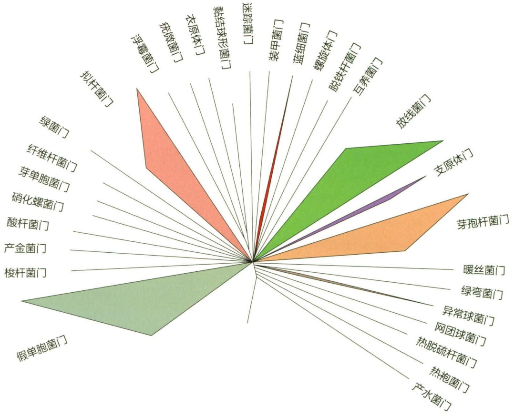

<details>
<summary>radar</summary>

| Category | Relative Value |
| --- | --- |
| 拟杆菌门 | ~0.8 |
| 绿菌门 | ~0.4 |
| 纤维杆菌门 | ~0.3 |
| 芽单胞菌门 | ~0.2 |
| 硝化螺菌门 | ~0.2 |
| 酸杆菌门 | ~0.15 |
| 产金菌门 | ~0.15 |
| 梭杆菌门 | ~0.15 |
| 假单胞菌门 | ~0.9 |
| 放线菌门 | ~0.7 |
| 良原体门 | ~0.6 |
| 芽孢杆菌门 | ~0.5 |
| 绿弯菌门 | ~0.3 |
| 异常球菌门 | ~0.2 |
| 网团球菌门 | ~0.2 |
| 热脱硫杆菌门 | ~0.15 |
| 热袍菌门 | ~0.15 |
| 产水菌门 | ~0.15 |
| 衣结球形菌门 | ~0.15 |
| 迷踪菌门 | ~0.15 |
| 头养菌门 | ~0.15 |
| 螺旋体门 | ~0.15 |
| 蓝细菌门 | ~0.15 |
| 装甲菌门 | ~0.15 |
| 浮霉菌门 | ~0.15 |
| 衣原体门 | ~0.15 |
</details>

谢类型不存在于假单胞菌门中，如无氧产甲烷作用（methanogenesis）只存在于古菌，产氧光能营养型仅存在于蓝细菌，厌氧氨氧化（anammox）仅存在于浮霉菌门（Planctomycetota），全程氨氧化作用（comammox；将 $NH_{4}^{+}$ 完全氧化为 $NO_{3}^{-}$ ）仅存在于硝化螺旋菌门（Nitrospirota），厌氧甲烷氧化（anaerobic methanotrophy，ANME）仅存在于古菌。假单胞菌门与 $O_{2}$ 的关系同样有很高的多样性，有厌氧、微好氧和兼性好氧的种类。

基于16S rRNA基因序列，假单胞菌门可以分为6个纲，依次为α-变形菌纲（Alphaproteobacteria）、β-变形菌纲（Betaproteobacteria）、γ-变形菌纲（Gammaproteobacteria）、δ-变形菌纲（Deltaproteobacteria）、ε-变形菌纲（Epsilonproteobacteria）和ζ-变形菌纲（Zetaproteobacteria）（图14-2）。前5纲均包含很多属，但ζ-变形菌纲目前的种类较少，最先发现的是铁氧化深海菌（Mariprofundus ferrooxydans）（见14.1.1.6）。

尽管假单胞菌门在系统发育上跨度很大，但在不同纲的种类经常具有相似的代谢活性。比如，光营养细菌和甲烷营养菌分布在假单胞菌门的3个纲，而硝化细菌则分布于4个纲。这说明水平基因流（horizontal gene flow）在塑造假单胞菌门代谢多样性方面发挥着主要作用。假单胞菌门不同纲之间代谢特征的共享，也提醒我们表型和系统发育型经常为原核生物的多样性提供不同的视角。

---

14.1 细菌多样性

419

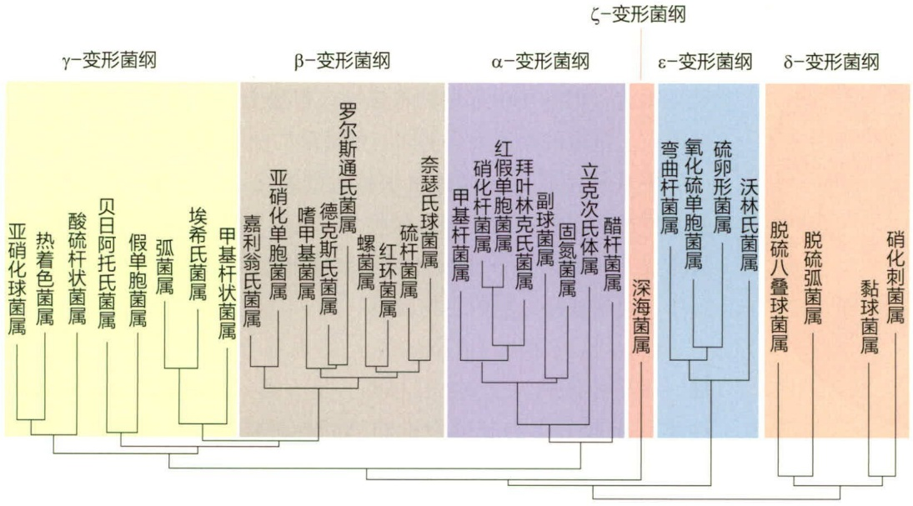

<details>
<summary>flowchart</summary>

```mermaid
graph LR
  subgraph Phylum_1["γ-变形菌纲"]
  A["亚硝化球菌属"] --> B["热着色菌属"]
  B --> C["酸硫杆状菌属"]
  C --> D["贝日阿托氏菌属"]
  D --> E["假单胞菌属"]
  E --> F["弧菌属"]
  F --> G["埃希氏菌属"]
  G --> H["甲基杆状菌属"]
  end

  subgraph Phylum_2["β-变形菌纲"]
  I["亚硝化单胞菌属"] --> J["嘉利翁氏菌属"]
  J --> K["嗜甲基菌属"]
  K --> L["德克斯氏菌属"]
  L --> M["罗尔斯通氏菌属"]
  M --> N["螺菌属"]
  N --> O["红环菌属"]
  O --> P["硫杆菌属"]
  P --> Q["奈瑟氏球菌属"]
  end

  subgraph Phylum_3["α-变形菌纲"]
  R["甲基杆菌属"] --> S["硝化杆菌属"]
  S --> T["红假单胞菌属"]
  T --> U["拜叶林克氏菌属"]
  U --> V["副球菌属"]
  V --> W["固氮菌属"]
  W --> X["立克次氏体属"]
  X --> Y["醋杆菌属"]
  end

  subgraph Phylum_4["ε-变形菌纲"]
  Z["深海菌属"] --> AA["弯曲杆菌属"]
  AA --> AB["氧化硫单胞菌属"]
  AB --> AC["硫卵形菌属"]
  AC --> AD["沃林氏菌属"]
  end

  subgraph Phylum_5["δ-变形菌纲"]
  AE["脱硫八叠球菌属"] --> AF["脱硫弧菌属"]
  AF --> AG["黏球菌属"]
  AG --> AH["硝化刺菌属"]
  end
```
</details>

图 14-2 假单胞菌门的6个纲及其代表属的系统发育树

## 14.1.1.1 $\alpha-$ 变形菌纲

α-变形菌纲是假单胞菌门的第二大纲，有大约1 000个被描述的种。α-变形菌纲具有广泛的功能多样性。多数种类是严格好氧菌或兼性好氧菌，许多种类是寡营养的（oligotrophic），偏爱生活于低营养浓度的环境中，如SAR11类群。

α-变形菌纲中有10个详细描述的目，但绝大多数种类隶属根瘤菌目（Rhizobiales）、立克次氏体目（Rickettsiales）、红杆菌目（Rhodobacterales）、红螺菌目（Rhodospirillales）、柄杆菌目（Caulobacterales）和鞘脂单胞菌目（Sphingomonadales）。

## (1) 根瘤菌目

代表属:巴尔通氏菌属（Bartonella）、甲基杆菌属（Methylobacterium）、远洋杆菌属（Pelagibacter）、根瘤菌属（Rhizobium）、土壤杆菌属（Agrobacterium）。

根瘤菌目是  $\alpha-$  变形菌纲中最大且代谢类型最为多样的目，含有光合细菌如红假单胞菌属（Rhodopseudomonas）、化能无机营养菌如硝化杆菌属（Nitrobacter）、共生菌如根瘤菌属、自由生活的固氮细菌如拜叶林克氏菌属（Beijerinckia）、一些动植物病原菌，以及各种各样的化能有机营养菌。该目的名称来源于根瘤菌（rhizobia），由不同的属组成，可与豆科植物共生形成根瘤进行固氮。

根瘤菌目中有9个属可以形成根瘤，即慢生根瘤菌属（Bradyrhizobium）、苍白杆菌属（Ochrobactrum）、固氮根瘤菌属（Azorhizobium）、德沃斯氏菌属（Devosia）、甲基杆菌属（Methylobacterium）、中慢生根瘤菌属（Mesorhizobium）、叶杆菌属（Phyllobacterium）、中华根瘤菌属（Sinorhizobium）和根瘤菌属。这些菌是典型的化能有机营养菌和严格好氧菌，这些属中的结瘤基因通过水平转移的方式获得。结瘤基因发现于这些属的大质粒成共生岛中，并可在细胞间转移。根瘤菌的每个属都可定殖于不同范围的植物宿主。将根瘤压碎并将其涂布到营养丰富的固体培养基上就可分离根

---

420

14 微生物物种多样性

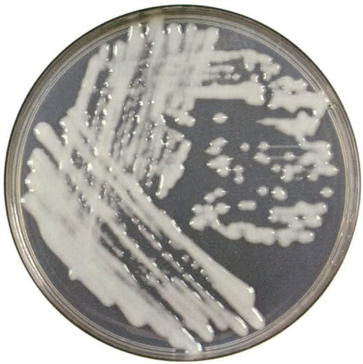

<details>
<summary>natural_image</summary>

Petri dish with bacterial colonies showing spores and flagella (no text or labels visible)
</details>

图 14-3 费氏中华根瘤菌（Sinorhizobium fredii）的菌落（照片来源:中国农业科学院烟草研究所郑艳芬）

菌株分离自野生大豆根瘤部位

瘤菌，菌落通常产生大量的胞外多糖黏液（图 14-3）。

根癌土壤杆菌（Agrobacterium tumefaciens）与根瘤菌属的亲缘关系很近，但它可引起植物根癌病。根癌土壤杆菌不能形成根瘤，其质粒上携带的根癌编码基因与根瘤菌的结瘤基因无关。

甲基杆菌属是根瘤菌目中最大的属之一，其菌落呈粉红色，且在甲醇上生长良好，因此被称为“粉红色兼性甲基营养菌”。该属常见于植物表面、土壤和淡水系统中，也经常出现于厕所和浴室中，可形成粉红色的生物被膜。

巴尔通氏菌属（Bartonella）是根瘤菌目中另一个著名的属。该属曾被归为立克次氏体目，是人类的胞内病原菌。该属的种类可引起人类和其他脊椎动物的各种疾病。五日热巴尔通氏菌（Bartonella quintana）是战壕热（trench fever，又称五日热）的病原菌，其在第一次世界大战的残酷战壕战中杀死了大量的士兵，因此得名。巴尔通氏菌属的其他物种可引起巴尔通氏菌病（bartonellosis）、猫抓病和各种炎症性疾病。这些疾病通过跳蚤和

虱子等节肢动物介导。巴尔通氏菌属的种类很难分离培养，通常需要使用血琼脂平板才能获得。巴尔通氏菌在组织培养中生长时，其细胞生长在真核宿主细胞的表面，而非细胞质或细胞核中。

隶属 SAR11 类群的远洋杆菌属（Pelagibacter）也属于根瘤菌目。遍在远洋杆菌（Pelagibacter ubique）是一种寡营养、专性好氧的化能异养细菌，生活在海洋有光区。该菌可占到表层海洋总细菌的 25%，在温带海域的夏季其数量可达总细菌的 50%，因此遍在远洋杆菌可能是地球上丰度最高的细菌种类。

## (2) 立克次氏体目

代表属:立克次氏体属（Rickettsia）、沃尔巴克氏体属（Wolbachia）

立克次氏体目细菌一般呈球状或杆状，都是动物的专性胞内寄生菌或互利共生菌（mutualist）。该目的细菌在缺乏宿主细胞时尚未获得培养，必须在鸡胚或宿主细胞中才能生长。

立克次氏体属的多个物种都是人类病原菌，包括引起斑疹伤寒的普氏立克次体（Rickettsia prowazekii）和引起落基山斑点热的立氏立克次氏体。这些病原菌可通过蜱虫、跳蚤、虱子和螨虫等节肢动物传播。大多数立克次氏体的代谢作用发生特化，只能氧化谷氨酸或谷氨酰胺，而不能氧化葡萄糖或有机酸。它们不能合成某些代谢物，而必须从宿主细胞中获得。立克次氏体在宿主外存活时间很短，可以节肢动物为媒介在动物之间传播。

立克次氏体具有典型的原核生物形态，含有细胞壁。立克次氏体细胞穿透宿主细胞是一个主动过程，需要两者都具有代谢活性。立克次氏体进入宿主细胞后，主要在其细胞质内繁殖。宿主细胞破裂后，立克次氏体从宿主细胞释放出来。

---

14.1 细菌多样性

421

## (3) 红细菌目和红螺菌目

代表属:红细菌属（Rhodobacter）、红螺菌属（Rhodospirillum）、玫瑰杆菌属（Roseobacter）。

红细菌目和红螺菌目含有代谢类型多样的种类，包括紫色非硫细菌如红细菌属和红螺菌属、好氧不产氧光合细菌如玫瑰杆菌属、固氮细菌如固氮螺菌属（Azospirillum）、反硝化细菌（如副球菌属，Paracoccus）、趋磁细菌（magnetotactic bacteria）（如磁螺菌属，Magnetospirillum）等。

玫瑰杆菌类群（Roseobacter clade），与 SAR11 类群类似，也是全球表层海水中分布最广、数量最多的浮游细菌类群之一，在海洋有机硫循环中扮演重要的角色，在合成或降解有机硫化合物——二甲基巯基丙酸（dimethylsulfoniopropionate，DMSP）和二甲基硫醚（dimethyl sulfide，DMS）中发挥重要作用。

磁螺菌属细菌可以产生由细胞内膜包裹的由  $Fe_{3}O_{4}$  组成的磁性颗粒，即磁小体（magnetosome）（图 14-4），使细菌能够沿着磁力线运动。磁螺菌广泛分布于淡水泥浆中，可在微氧条件下生长。在富铁环境下可产生磁小体链，在缺铁环境下不产生磁小体链。

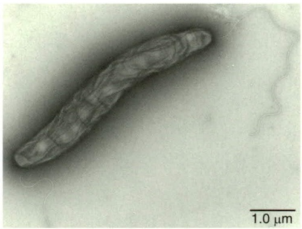

<details>
<summary>natural_image</summary>

Microscopic image of a rod-shaped bacterial cell with 1.0 μm scale bar (no text or symbols beyond scale indicator)
</details>

(a)

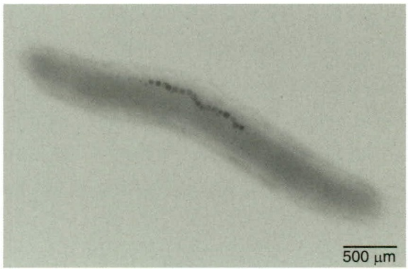

<details>
<summary>natural_image</summary>

Microscopic image of a rod-shaped bacterial cell with a 500 μm scale bar (no text or symbols beyond scale indicator)
</details>

(b)

图 14-4 格瑞菲斯瓦尔德磁螺菌（Magnetospirillum gryphiswaldense）MSR-1 的透射电镜照片（图片来源:中国农业大学田杰生）
(a) 0.3% 乙酸双氧铀染色，拍照时聚焦于细胞表面和鞭毛；(b) 不采用乙酸双氧铀染色，拍照时聚焦于磁小体

## (4) 柄杆菌目

代表属:柄杆菌属（Caulobacter）。

柄杆菌目是典型的寡营养型和严格好氧的化能异养细菌。该目细菌通常形成菌柄，使细菌牢固地附着在水环境中的藻类、石头或其他物体表面上。许多种类具有不对称的细胞分裂形式。新月柄杆菌（Caulobacter crescentus）已被作为细胞分化的模式细菌开展了大量的研究，其细胞周期受到调控蛋白的控制，相当精确地支配细胞周期事件中基因表达的偶联（图 14-5）。

## (5) 鞘氨醇单胞菌目

代表属:鞘氨醇单胞菌属（Sphingomonas）。

鞘氨醇单胞菌目包括各种好氧和兼性好氧的化能异养菌、好氧不产氧光合细菌如（红杆菌属）和一些专性厌氧细菌。鞘氨醇单胞菌属广泛分布于水生和陆地环境中，

---

422

14 微生物物种多样性

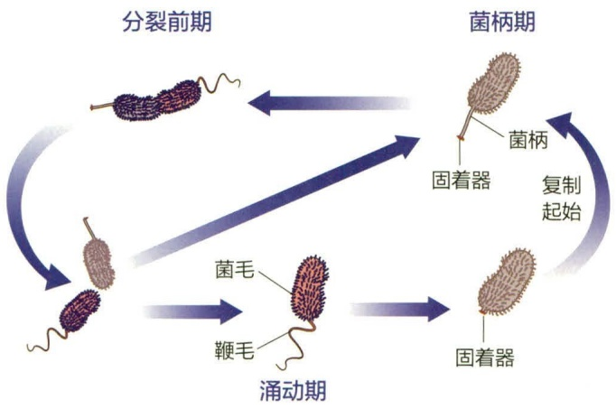

<details>
<summary>flowchart</summary>

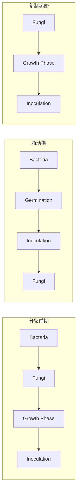
</details>

图 14-5 新月柄杆菌（Caulobacter crescentus）的二态细胞周期

可代谢多种有机化合物，如芳香族化合物（甲苯、壬基酚、萘和蒽）等常见的环境污染物。鞘氨醇单胞菌属作为潜在生物修复剂已被广泛研究。这些细菌很容易在各种复杂的培养基上生长。

## 14.1.1.2 $\beta-$ 变形菌纲

β-变形菌纲是假单胞菌门的第三大纲，有大约500个已被描述的种。β-变形菌纲类群的功能多样性极为丰富（图14-2）。该纲有6个目，包括伯克霍尔德氏菌目（Burkholderiales）、红环菌目（Rhodocyclales）、奈瑟氏球菌目（Neisseriales）、嗜氢菌目（Hydrogenophilales）、嗜甲基菌目（Methylophilales）和亚硝化单胞菌目（Nitrosomonadales）。

## (1) 伯克霍尔德氏菌目

代表属:伯克霍尔德氏菌属（Burkholderia）、马赛菌属（Massilia）。

伯克霍尔德氏菌目包含具有广泛代谢和生态特征的种类，包括严格好氧、兼性好氧和专性厌氧的化能异养菌、不产氧光合细菌、专性和兼性化能自养菌、自由生活的固氮菌以及人类和动植物的病原菌。

伯克霍尔德氏菌属是伯克霍尔德氏菌目的模式属。该属包括各种具有专性呼吸代谢的化能异养菌。所有种类均可在有氧条件下生长，一些种类也可以硝酸盐为电子受体厌氧生长，许多菌株有固氮作用。该属对有机化合物，尤其是芳香族化合物具有代谢多样性，使之可应用于生物修复。该属的某些菌株可促进植物生长。然而，许多种类是动植物的潜在致病菌，其中最著名的致病种是洋葱伯克霍尔德氏菌（Burkholderia cepacia）。

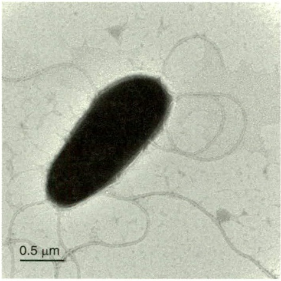

<details>
<summary>natural_image</summary>

Microscopic image of a rod-shaped bacterial cell with a 0.5 μm scale bar, showing internal organelles (no text or symbols beyond scale indicator)
</details>

图 14-6 田地马赛菌（Massilia arvi）A6-12

(图片来源: 武汉大学彭方)

分离自土壤环境

洋葱伯克霍尔德氏菌主要生活于土壤，是一种条件致病菌。该菌通常存在于植物的根际，可产生抗真菌和抗线虫化合物，因此其在植物根部的定殖可以预防病害发生并促进植物生长。然而，在某些情况下，该菌会成为植物病原菌，是洋葱软腐病的主要病因。洋葱伯克霍尔德氏菌也会成为住院患者的条件致病菌，该菌在免疫功能低下或肺炎患者中可形成继发性肺部感染，其在肺中可形成生物被膜并对许多抗生素具耐药性，使之对肺炎患者特别危险。

马赛菌属包含 40 余个有效种，在土壤中广泛分布，从人类临床样本、植物、水、冰芯、空气和岩石等生境中也可分离到。菌落多为黄色，少数为白色、粉色或紫黑色，细胞形态多为杆状，绝大多数种类具有鞭毛（图 14-6），能运动。马赛菌不仅能够合成多种次级代谢产物和酶，而且具有溶磷、降解菲和耐受重金属等多种功能。

## (2) 红环菌目

代表属:红环菌属（Rhodocyclus）、动胶菌属（Zoogloea）。

---

14.1 细菌多样性

423

与伯克霍尔德氏菌目类似，红环菌目也包含了具有不同代谢和生态特征的物种。红环菌目的代表属是红环菌属，一类紫色非硫细菌。红环菌属在光能异养条件下生长最好，但大多数种类也可以  $H_{2}$  为电子供体营光能自养生长。这些种类也可在黑暗条件下通过呼吸作用生长，但其通常发现于光照缺氧且存在有机物的环境中。

动胶菌属是红环菌目的另一个重要属。动胶菌属是一种好氧化能异养菌，其独特之处是产生厚厚的胶状荚膜，将细胞黏合在一起形成复杂的基质，具有分支的指状突起。这种凝胶状基质可以引起絮凝现象，在溶液中形成颗粒沉淀。该菌在有氧废水处理中尤为重要，可降解废水中的大部分有机物，并促进絮凝和沉降，这是水净化的关键步骤。

## (3) 奈瑟氏球菌目

代表属:色杆菌属（Chromobacterium）、奈瑟球菌属（Neisseria）。

奈瑟氏球菌目至少包含29个属，均为化能异养菌。最典型的属是奈瑟氏球菌属和色杆菌属。奈瑟氏球菌属的种类通常分离自动物，某些种类具有致病性。奈瑟氏菌通常为球形，某些种类是自由生活的腐生细菌，存在于口腔和动物体的其他潮湿部位。还有部分种类是严重的病原菌，如脑膜炎奈瑟氏球菌（Neisseria meningitidis），可导致脑膜炎。

色杆菌属中最著名的种类是紫色色杆菌（Chromobacterium violaceum），菌落呈紫色，存在于水和土壤中，偶尔也发现于人类和其他动物的化脓伤口中。紫色色杆菌可产生紫色色素（简称紫色素），是一种具有抗菌和抗氧化特性的非水溶性色素。色杆菌属是兼性好氧菌，可发酵糖类生长，并可在多种碳源上进行有氧生长。

## (4) 嗜氢菌目、嗜甲基菌目和亚硝化单胞菌目

代表属:嗜氢菌属（Hydrogenophilus）、硫杆菌属（Thiobacillus）、嗜甲基菌属（Methylophilus）、亚硝化单胞菌属（Nitrosomonas）。

这三个目的种类具有相当特殊的代谢能力，包括化能自养菌和甲基营养菌。大多数种类是专性好氧菌，许多种类是自养菌。热叶绿体嗜氢菌（Hydrogenophilus thermoluteolus）是一种专性好氧菌，可以 $H_{2}$ 为呼吸作用的电子供体并通过卡尔文循环固定 $CO_{2}$ ，进行化能自养生长。该菌也可以利用简单碳源进行化能异养生长。硫杆菌属是嗜氢菌目的另一个重要属。硫杆菌属的种类有化能异养型，也有化能自养型。硫杆菌属中的化能自养种类是硫细菌，可以还原性硫化物为电子供体进行氧化作用，通过有氧呼吸或反硝化作用进行生长。硫杆菌属的种类也可以通过卡尔文循环固定 $CO_{2}$ ，通常存在于土壤、硫泉、海洋环境和其他含有还原性硫化物的环境。

嗜甲基菌目是专性和兼性甲基营养菌，可利用甲醇和其他一碳（ $C_{1}$ ）化合物，但不能利用甲烷。兼性的种类可以化能异养生长，利用单糖进行有氧呼吸。亚硝化单胞菌目含有专性化能自养氨氧化细菌，关键属是亚硝化单胞菌属和亚硝化螺菌属（Nitrosospira）。

## 14.1.1.3 $\gamma-$ 变形菌纲

γ-变形菌纲是假单胞菌门中最大和多样性最高的纲，包含了该门中近一半已描述

---

424

14 微生物物种多样性

的种类。该纲包含超过 1 500 个已描述的种和至少 15 个已描述的目。其物种具有多样的代谢和生态特征（图 14-2），包括许多众所周知的人类病原菌。该纲细菌可以进行光能营养（包括紫硫细菌）、化能异养、化能自养。该纲成员通常在实验室培养基中迅速生长，并可从广泛多样的栖息地中分离出来。

## (1) 肠杆菌目

代表属:肠杆菌属（Enterobacter）、埃希氏菌属（Escherichia）、克雷伯菌属（Klebsiella）、变形菌属（Proteus）、沙门菌属（Salmonella）、沙雷氏菌属（Serratia）、志贺菌属（Shigella）。

肠杆菌目（Enterobacterales）是  $\gamma-$  变形菌纲中最大和最著名的目之一，通常被称为肠道细菌，是  $\gamma-$  变形菌纲中的一个相对同质的系统发育群，是兼性好氧、不产芽孢的杆状细菌，不运动或以周生鞭毛运动。氧化酶阴性和过氧化氢酶阳性。它们可发酵葡萄糖产酸，还可还原硝酸盐，但只产生亚硝酸盐。肠道细菌的营养需求相对简单，可将糖发酵成多种终产物。

在肠道细菌中，有许多种类是人类或动植物的病原菌，还有一些种类在工业上有重要应用。大肠杆菌是典型的肠道细菌，目前已鉴定了许多属和种。

然而，由于肠道细菌在遗传上密切相关，其鉴别往往比较困难。在临床实验室中，肠道细菌的鉴定通常采用快速诊断试剂盒、免疫学和基因组学进行综合分析，以确定特定种类的特征蛋白或基因。

## (2) 假单胞菌目

代表属:假单胞菌属（Pseudomonas）。

假单胞菌目（Pseudomonadales）细菌全部为行呼吸代谢的化能异养菌。所有种类均可好氧生长，通常为氧化酶和过氧化氢酶阳性，但一些种类亦可以硝酸盐为电子受体进行厌氧呼吸。大多数种类可利用多种有机化合物作为碳源和能源进行生长。该目细菌广泛分布于土壤和水生生态系统，许多种类可导致人类或动植物发病。该目的典型属是假单胞菌属。

假单胞菌属的多个种类具有致病性。其中，铜绿假单胞菌（Pseudomonas aeruginosa）可引起人类的尿道和呼吸道感染。该菌不是专性病原菌，仅在免疫系统薄弱的个体中引发感染。铜绿假单胞菌还是研究生物被膜发生机制的模式生物。由于该菌很容易在物体表面定殖，它是接受气管切开术、腰椎穿刺、严重烧伤治疗等患者医院获得性感染的常见原因。除了局部感染外，铜绿假单胞菌也可引起全身感染，通常发生在经历过大面积皮肤损伤的个体中。

铜绿假单胞菌对许多广泛使用的抗生素具有天然耐药性，因此治疗感染往往很困难。耐药性通常是由抗性质粒（R质粒）转移引起，其基因编码的蛋白质可以解毒不同抗生素或将其泵出细胞。生物被膜的形成进一步增强了其对抗生素的耐药性。多黏菌素是一种具有毒性的抗生素，通常不用于人类治疗，但对铜绿假单胞菌有效，仅用于严重的病例。

“软腐病”病原菌丁香假单胞菌（Pseudomonas syringae），可感染植物的茎和芽，

---

14.1 细菌多样性

425

但很少感染叶片。

施氏假单胞菌（Pseudomonas stutzeri；图 14-7）具有很高的表型和基因型多样性，可以解磷和解钾，在环境生物修复方面发挥重要作用。

## (3) 弧菌目

代表属:另类弧菌属（Aliivibrio）、弧菌属（Vibrio）、发光杆菌属（Photobacterium）。

弧菌目（Vibrionales）含有兼性好氧的杆状或弯曲杆状菌，可发酵代谢。弧菌和肠道细菌之间的一个关键区别是，弧菌氧

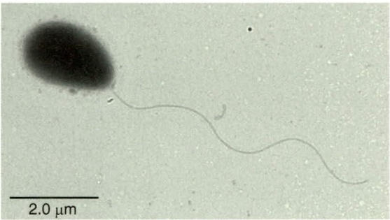

<details>
<summary>natural_image</summary>

Microscopic image of a single dark-stained cell with a wavy line, scale bar indicates 2.0 μm (no text or symbols present)
</details>

图 14-7 施氏假单胞菌的电镜图（图片来源:中国科学院海洋研究所孙超岷）

化酶呈阳性，而肠道细菌氧化酶呈阴性。虽然假单胞菌目也是氧化酶阳性，但它们不能发酵代谢，因此与弧菌目明显不同。弧菌目中最著名的属是弧菌属、另类弧菌属和发光杆菌属，其中多个种类具有生物发光特性（图 14-8）。

大多数弧菌发现于海洋、半咸水或淡水栖息地。霍乱弧菌（Vibrio cholerae）可引起人类霍乱病，但该菌一般不会引起其他宿主发病。霍乱病是发展中国家最常见的人类传染病之一，几乎全部通过水传播。

副溶血弧菌（Vibrio parahaemolyticus）生活于海洋环境中。在日本，由于生鱼被广泛食用，是引发胃肠炎的主要原因，该菌还与其他国家的肠胃炎暴发有关。副溶血弧菌可从海水、贝类或甲壳类动物中分离出来，其主要宿主可能是海洋动物，人类是偶然宿主。

## (4) 硫发菌目

代表属:辫硫菌属（Thioploca）、硫发菌属（Thiothrix）、硫珍珠菌属（Thiomargarita）。

硫发菌目（Thiotrichales）多为丝状化能自养硫氧化菌。辫硫菌属是多细胞丝状细菌，通常以束状形式存在，外包共同的鞘，鞘中含有硫颗粒。纳米比亚硫珍珠菌

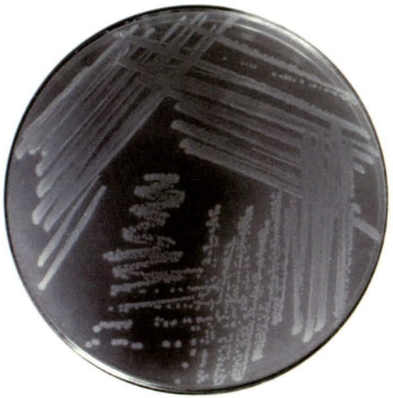

<details>
<summary>natural_image</summary>

Petri dish with bacterial colonies on agar medium (no visible text or labels)
</details>

(a)

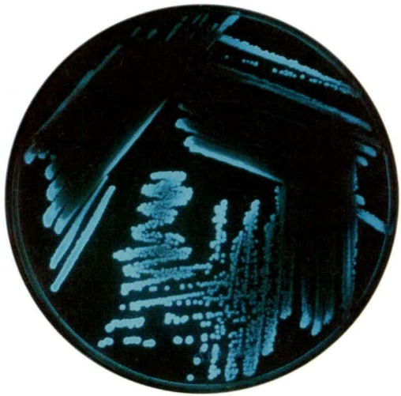

<details>
<summary>natural_image</summary>

Microscopic view of a petri dish with bacterial colonies (no text or labels visible)
</details>

(b)

图 14-8 哈维氏弧菌（Vibrio haveyi）的发光现象（图片来源:中国海洋大学张晓华）

（a）在有光条件下拍照；  
（b）在黑暗条件下拍照，可见哈维氏弧菌VIB391的发光现象

---

426

14 微生物物种多样性

(Thiomargarita namibiensis) 于 1999 年被发现, 是目前已知的单体体积最大的原核生物之一。其球形细胞的直径通常为 $100 \sim 300 \mu \mathrm{m}$, 有的甚至高达 $750 \mu \mathrm{m}$ 。纳米比亚硫珍珠菌在纳米比亚的沿海沉积物中含量很高, 以丝状形式存在, 外包共同的黏液鞘。在显微镜下硫颗粒发出闪烁的白色, 如一串闪亮的珍珠链, 因此取名为硫珍珠菌。纳米比亚海岸的水文地理条件使得大量的营养物质聚集于水表面, 大量浮游植物的生长导致有机物沉积到海底, 被细菌降解产生大量的 $\mathrm{H}_{2} \mathrm{~S}$ 。纳米比亚硫珍珠菌利用 $\mathrm{NO}_{3}^{-}$氧化硫化物。和辫硫菌一样, 纳米比亚硫珍珠菌细胞内含有一个大的液泡, $\mathrm{NO}_{3}^{-}$储存于液泡中, 硫元素则储存于细胞周质中作为营养物质储备, 这样细菌就可在无外界营养物质的条件下生长数个月。

2022 年，根据《科学》杂志报道，一种肉眼可见的细菌被发现，被命名为华丽硫珍珠菌（Ca. Thiomargarita magnifica），它来自加勒比海格兰德特雷岛的红树林，是目前已发现的最大的细菌，单个细菌最大长度为 2 cm。

## 14.1.1.4 δ-变形菌纲

代表属:蛭弧菌属（Bdellovibrio）、黏球菌属（Myxococcus）、脱硫弧菌属（Desulfovibrio）、地杆菌属（Geobacter）、互营杆菌属（Syntrophobacter）。

与  $\alpha-$ 、 $\beta-$  和  $\gamma-$  变形菌纲相比， $\delta-$  变形菌纲的种类较少，功能多样性较低（图14-2）。 $\delta-$  变形菌纲主要是硫酸盐和硫还原细菌、异化铁还原细菌和捕食细菌（如黏细菌）。在  $\delta-$  变形菌纲中有8个目被进行了详细研究。

黏球菌目（Myxococcales）和蛭弧菌目（Bdellovibrionales）含有大量的捕食细菌。蛭弧菌附着于宿主细胞表面，钻穿宿主细胞壁并在周质空间繁殖，最终引起宿主细胞裂解，并释放出多达30个子代个体（图14-9）。

相比之下，脱硫单胞菌目（Desulfuromonadales）含有多个金属和硫还原属，如地杆菌属。与脱硫单胞菌目类似，δ-变形菌纲的许多属都与硫化物的还原有关。含

图 14-9 蛭弧菌的生活周期示意图

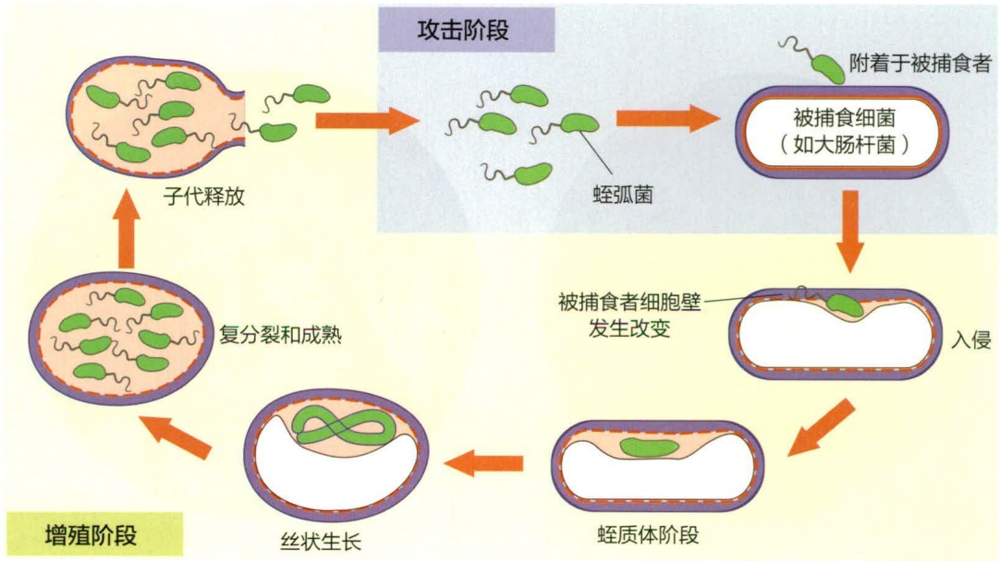

<details>
<summary>flowchart</summary>

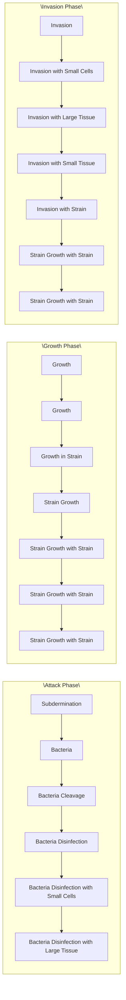
</details>

---

14.1 细菌多样性

427

有硫酸盐还原菌的最大和最常见的目是脱硫弧菌目（Desulfovibrionales）。该目细菌很容易从含有硫酸盐的海洋沉积物和营养丰富的缺氧环境中分离出来。脱硫弧菌目细菌是典型的不完全氧化菌，都能利用硫酸盐作为末端电子受体，并需要乳酸等小分子有机物作为碳源和能源生长。脱硫杆菌目（Desulfobacterales）和脱硫弧菌目（Desulfarculales）的物种也是硫酸盐还原菌，但与脱硫弧菌目相比，这些物种可以是完全或不完全的醋酸氧化菌。除了还原硫酸盐，这三个目的一些种类还能还原亚硫酸盐、硫代硫酸盐或硝酸盐，有些种类还具有一定的发酵能力。

含有硫酸盐还原菌的最后一个目是互营杆菌目（Syntrophobacterales），该目的某些种类也能还原硫酸盐。在自然界中，互营杆菌目细菌主要与  $H_{2}$  利用菌具有互养共栖作用。例如，互养物种沃氏互营杆菌（Syntrophobacter wolinii）能氧化丙酸，产生乙酸盐、 $CO_{2}$  和  $H_{2}$ ，然而这种作用只有在  $H_{2}$  利用菌存在时才能实现。

## 14.1.1.5 $\varepsilon-$ 变形菌纲

代表属:弯曲杆菌属（Campylobacter）、螺杆菌属（Helicobacter）。

与  $\delta-$  变形菌纲类似， $\varepsilon-$  变形菌纲的种类也较少，且功能多样性较低。 $\varepsilon-$  变形菌纲含有许多能将硫化氢氧化为硫或硫酸盐的种类。有好多种类是化能自养细菌，某些种类如弯曲杆菌属（Campylobacter）和螺杆菌属（Helicobacter）的种类是人类病原菌，而另一些种类可与宿主共生。

## (1) 弯曲杆菌属和螺杆菌属

这两个属有许多共同特征，均为螺旋状、可运动、氧化酶和过氧化氢酶阳性，大多数物种对人类或其他动物具有致病性。它们属于微好氧微生物，必须在低  $O_{2}$  （3%～15%）和高  $CO_{2}$  （3%～10%）条件下从临床标本中分离培养。

弯曲杆菌属已有十余种被描述，它们会引起急性胃肠炎，通常导致出血性腹泻。其发病机制与多个因素有关，包括一种与霍乱毒素相关的肠毒素。幽门螺杆菌（Helicobacter pylori）也是人类病原菌，可引起急性或慢性胃炎，最终导致胃溃疡甚至胃癌。

## (2) 代谢硫的  $\varepsilon-$  变形菌纲物种

通过环境样品测序和基于培养的研究，发现  $\varepsilon-$  变形菌纲物种在海洋和陆地环境中广泛存在。这些微生物在硫循环活跃的环境中特别丰富，尤其是在深海热液喷口和海洋沉积物中，那里混有丰富的硫化物和有氧水体。该纲有许多嗜热菌，有助于其在热液系统中生长。化能自养细菌（通过反向三羧酸循环固定  $CO_{2}$ ）也广泛存在于  $\varepsilon-$  变形菌纲中。许多种类能够有氧或厌氧（利用氧化态氮化物或硫化合物作为电子受体）生长，同时利用还原态硫化物或  $H_{2}$  等无机物作为电子供体。在富硫环境中， $\varepsilon-$  变形菌纲细菌会大量附着在有氧-无氧界面，在自然界硫化物氧化中起着重要作用。

ε- 变形菌纲细菌固定  $CO_{2}$  的能力对生活在富硫环境中的动物尤为重要，该纲细菌在热液喷口烟囱上的微生物生物量占比可高达 85%。此外，ε- 变形菌纲细菌可作为许多动物（如寡毛类和多毛类蠕虫、蜗牛、虾等）的外共生和内共生微生物生长。这些共生微生物可对宿主发挥两种作用，既可提供营养物质，又可解毒对宿主有害的  $H_{2}S$ 。

---

428

14 微生物物种多样性

## 14.1.1.6 $\zeta^{\prime}$ -变形菌纲

$\zeta-$ 变形菌纲细菌是典型的微好氧、嗜中性的化能自养型铁氧化菌，常栖息于有氧与无氧交界处的富铁含水环境。铁氧化深海菌是该纲第一株被纯培养的菌株，于1996年分离自夏威夷罗希海山的富铁低温热液喷口，以二价铁离子作为能量来源。该菌与固体表面接触时，可生长出由铁氧化物包裹的螺旋状菌柄。此外，该菌细胞内还含有多聚磷酸物，可为细胞提供能量和磷酸盐。此后陆续从淡水和海洋环境中分离出其他菌株。

依托中国大洋 72 航次（2022 年 4 月 28 日启动的一次重要海洋科学考察），深海菌（Mariprofundus sp.）S2-6 分离自天休热液区沉积物，为该属的潜在新种，是一株严格化能自养的嗜中性铁氧化菌，细胞比同属的其他菌株更长（图 14-10）。

图 14-10 深海菌（Mari-profundus sp.）S2-6 的透射电镜照片（图片来源:自然资源部第三海洋研究所邵宗泽）

在添加氢气、二价铁和氧气的条件下对菌株进行培养，（a）和（b）为不同的视野

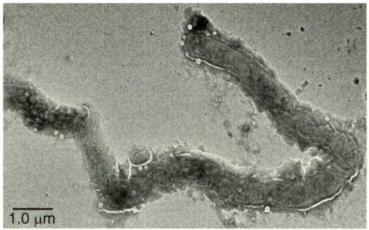

<details>
<summary>natural_image</summary>

Microscopic image of a filamentous structure with scale bar indicating 1.0 μm (no text or symbols present)
</details>

(a)

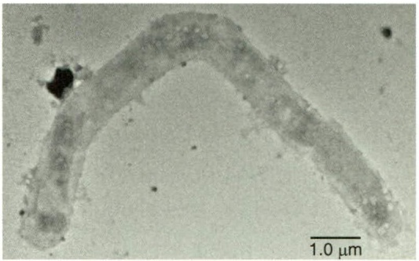

<details>
<summary>natural_image</summary>

Microscopic image of a curved, elongated biological structure with a 1.0 μm scale bar (no text or symbols beyond scale indicator)
</details>

(b)

## 14.1.2 芽孢杆菌门、支原体门和放线菌门

芽孢杆菌门（Bacillota）和放线菌门（Actinomycetota）细菌为革兰氏阳性细菌，许多类群的特征已被详细描述。支原体门（Mycoplasmatota），原名软壁菌门（Tenericutes）包括支原体属（Mycoplasma）等已失去产生肽聚糖和任何类型细胞壁能力的物种。这三个门（图14-11）的细菌包含了近一半已被描述的细菌种类。

放线菌门的种类很多，主要为丝状土壤细菌，其基因组 DNA 通常具有高频率的 GC 碱基对，因此它们也被称为高 G+C 革兰氏阳性细菌。支原体门包括许多缺乏细胞壁的细菌，而芽孢杆菌门包括芽孢形成细菌、乳酸菌和其他一些类群。与放线菌门相比，芽孢杆菌门基因组中 GC 含量通常较低，因此它们也被称为低 G+C 革兰氏阳性细菌。

## 14.1.2.1 芽孢杆菌门

## （1）产芽孢的芽孢杆菌目和梭菌目

代表属:芽孢杆菌属（Bacillus）、梭菌属（Clostridium）、芽孢八叠球菌属（Sporosarcina）。

所有芽孢产生菌都属于芽孢杆菌目（Bacillales）和梭菌目（Clostridiales）。形成芽孢的能力仅在芽孢杆菌目、梭菌目和乳杆菌目的共同祖先中演化过一次。然而，许

---

14.1 细菌多样性

429

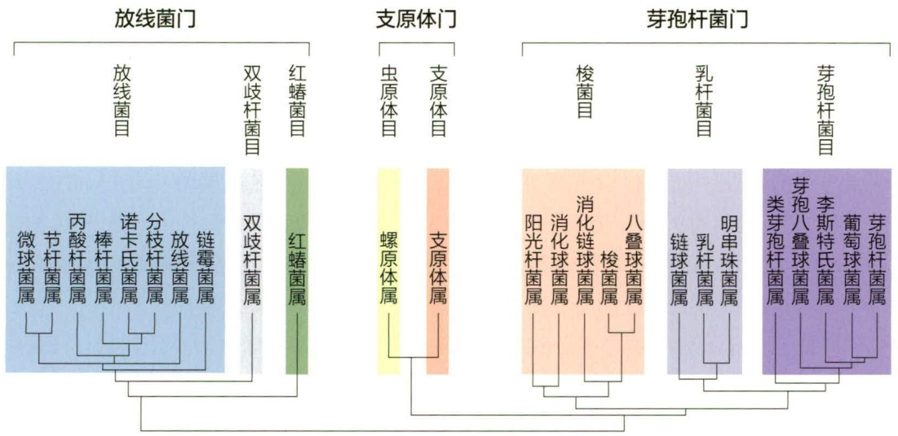

<details>
<summary>text_image</summary>

放线菌门
放线菌目
双歧杆菌目
红蝽菌目
支原体门
虫原体目
支原体目
芽孢杆菌门
梭菌目
乳杆菌目
芽孢杆菌目
微球菌属
节杆菌属
丙酸杆菌属
棒杆菌属
诺卡氏菌属
分枝杆菌属
放线菌属
链霉菌属
双歧杆菌属
红蝽菌属
螺原体属
支原体属
消化球菌属
消化链球菌属
梭菌属
八叠球菌属
乳杆菌属
明串珠菌属
类芽孢杆菌属
芽孢八叠球菌属
李斯特氏菌属
葡萄球菌属
芽孢杆菌属
</details>

图 14-11 革兰氏阳性菌的主要目及其近缘类群以放线菌门、芽孢杆菌门和支原体门代表性属的 16S rRNA 基因序列构建了系统发育树

多芽孢杆菌目和梭菌目以及全部乳杆菌目细菌都无法形成芽孢。芽孢产生需要许多基因参与，且并非通过水平基因转移获得。有许多细菌的芽孢产生能力在演化过程中丧失了。

芽孢产生菌可根据其细胞形态、芽孢形状和在细胞中的位置、与氧气的关系以及能量代谢来区分。最著名的芽孢产生菌是芽孢杆菌属和梭菌属，其中前者为好氧或兼性好氧细菌，而后者为专性厌氧菌和发酵菌。在自然界中，产芽孢菌主要存在于土壤中。即便是对人类或其他动物具致病性的产芽孢菌，也主要是土壤腐生细菌，只是偶尔感染动物。由于土壤的营养水平、温度和水活度高度多变，产生芽孢能力对土壤微生物是有利的。

芽孢杆菌属和类芽孢杆菌属（Paenibacillus）在含有多种碳源的合成培养基上均

能生长良好。许多芽孢杆菌能产生胞外水解酶，分解多糖、核酸和脂质等复杂的聚合物，用作碳源和电子供体。许多芽孢杆菌能产生杆菌肽、多黏菌素、酪氨酸、短杆菌肽和环菌素等抗生素。这些抗生素一般在培养物进入稳定期并开始形成芽孢时释放出来。

有一些芽孢杆菌，如弧丽金龟类芽孢杆菌（Paenibacillus popilliae）和苏云金芽孢杆菌（Bacillus thuringiensis），能产生有毒的杀虫蛋白。弧丽金龟类芽孢杆菌会使甲虫的幼虫患上致命的乳状病（milky disease）。苏云金芽孢杆菌可使许多种类的昆虫死亡。这两种昆虫病原菌伴随芽孢的形成，产生一种晶体蛋白质，称为伴孢晶体（parasporal body）（图 14-12）。

苏云金芽孢杆菌的伴孢晶体是一种毒素前体（protoxin），在昆虫肠道中转化为毒素。该毒素可与某些昆虫的肠道上皮细胞特定受体结合，并诱导形成孔隙，导致宿主细胞质泄漏，继而裂解。苏云金芽孢杆菌的不同菌株可产生不同类型的毒素，对不同种类的昆虫具有特异性。芽孢杆菌的伴孢晶体，可作为生物杀虫剂在

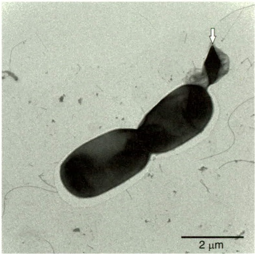

<details>
<summary>natural_image</summary>

Microscopic image of a rod-shaped bacterial cell with a 2 μm scale bar, showing internal structure and a labeled feature (no text or symbols beyond scale indicator)
</details>

图 14-12 苏云金芽孢杆菌（Bacillus thuringiensis）的透射电镜照片（图片来源:武汉大学彭方）

箭头所指为释放到细胞外的伴孢晶体

---

430

14 微生物物种多样性

市场上销售。

目前，已从多个苏云金芽孢杆菌中鉴定出编码伴孢晶体蛋白（也称为“Bt 毒素”）的 cry 基因，并被转化到玉米、大豆和棉花等转基因作物中，以增强植物的抗虫性。这些转基因“Bt 农作物”在世界各地被广泛种植。

与芽孢杆菌不同，梭菌属缺乏呼吸链，因此它们通过底物磷酸化获得 ATP。梭菌属细菌中有多种厌氧产能机制，该属主要根据这些特性及所利用的发酵底物来划分亚群。许多梭菌可发酵糖类，其主要终产物是丁酸。巴氏梭菌（Clostridium pasteurianum）等种类还能产生丙酮和丁醇，该菌还具活跃的固氮作用。

芽孢八叠球菌属细菌并不是常见的产芽孢菌，其细胞是球状而不是杆状。该菌由严格需氧的球形至椭圆形细胞组成，这些细胞在两个或三个垂直断面上分裂，形成四分体或由8个或更多细胞组成的细胞包裹。主要种类是脲芽孢八叠球菌（Sporosarcina ureae）。

## (2) 不产芽孢的芽孢杆菌目和梭菌目

代表属:李斯特菌属（Listeria）、葡萄球菌属（Staphylococcus）、八叠球菌属（Sarcina）。

能产芽孢的芽孢杆菌门细菌属于芽孢杆菌目和梭菌目。然而，这两个目的许多种类不产芽孢，以下介绍一些不产芽孢的种类。

芽孢杆菌目通常包括好氧和兼性好氧的化能异养菌，其成员分布广泛，在土壤中尤为常见。例如，李斯特氏菌属广泛存在于土壤中，是一种条件致病菌，也是食源性疾病常见的常见病因。李斯特氏菌属是革兰氏阳性、过氧化氢酶阳性、杆状、兼性好氧的化能异养菌。单核增生李斯特菌（Listeria monocytogenes）是该属中最著名的种类，可引起重要的食源性疾病——李斯特氏菌病（listeriosis），该病原菌可通过奶酪、香肠等受污染的即食食品传播，可引起轻微疾病或致命的脑膜炎。该属细菌通常在低温下生长良好，可在冷藏食品中生长。

芽孢杆菌目的葡萄球菌属是一种兼性好氧菌，具典型的呼吸代谢，但也能发酵生长。细胞通常成簇生长，并通过好氧和厌氧两种方式代谢葡萄糖产酸。葡萄球菌的过氧化氢酶呈阳性，使之有别于链球菌属和一些其他属的乳酸菌。葡萄球菌属对干燥和高盐环境有很好的耐受性。许多种类具有色素。

葡萄球菌是人类和动物常见的附生菌和寄生菌，偶尔会引起严重感染。表皮葡萄球菌（Staphylococcus epidermidis）和金黄色葡萄球菌（Staphylococcus aureus）存在于人类皮肤或黏膜上。表皮葡萄球菌是一种不产色素的非致病菌，而金黄色葡萄球菌则是一种产黄色色素的致病菌，最常见的病症包括疖子、丘疹、肺炎、骨髓炎、脑膜炎和关节炎。有些金黄色葡萄球菌菌株对多种抗生素具有耐药性（即所谓的MRSA菌株），可造成广泛的组织损伤。

梭菌目的八叠球菌属包含过氧化氢酶阴性的专性厌氧菌。八叠球菌属还具有极强的耐酸性，能够发酵糖类并在 pH 低至 2 的环境中生长。胃八叠球菌（Sarcina ventriculi）的细胞壁周围具有一层厚厚的纤维素层，相邻细胞的纤维素层会粘连在一

---

14.1 细菌多样性

431

起，起到黏合剂的作用，将胃八叠球菌细胞包裹固定在一起。

胃八叠球菌耐酸性极强，是仅有的几种能在人类和其他单胃动物胃中栖息的细菌之一。在某些胃肠道疾病（如幽门溃疡）患者的胃中可观察到胃八叠球菌的快速生长，会阻碍食物流向肠道。

## (3) 乳杆菌目

代表属:乳杆菌属（Lactobacillus）、链球菌属（Streptococcus）。

乳杆菌目（Lactobacillales）是一类以乳酸为主要发酵终产物的乳酸菌，不产芽孢。这些细菌被广泛应用于食品生产和保藏。乳酸菌为氧化酶和过氧化氢酶阴性的棒状或球状菌，专性发酵代谢。所有的乳酸菌都以乳酸为主要或唯一的发酵产物。这类细菌缺乏卟啉和细胞色素，不能通过氧化磷酸化获得能量，只能通过底物水平磷酸化而获得。不同于许多厌氧细菌，大多数乳酸菌对  $O_{2}$  不敏感，可在有氧情况下生长，因此被称为耐氧厌氧菌。

大多数乳酸菌只能从糖代谢中获得能量，因此其通常局限于含糖的栖息地。它们的生物合成能力有限，具有对氨基酸、维生素、嘌呤和嘧啶等复杂营养物质需求。乳酸菌亚群之间的一个重要区别在于糖发酵产物的类型。其中一类被称为同型乳酸发酵菌，产生单一的发酵产物乳酸，另一类被称为异型乳酸发酵菌，除了发酵产乳酸以外，还产生乙醇和二氧化碳。

乳杆菌属（Lactobacillus）是典型的杆菌，链状生长，细胞呈细长或短杆状，大多数为同型乳酸发酵。乳杆菌在乳制品中非常常见，一些菌株可用于制备发酵乳制品。例如，嗜酸乳杆菌（Lactobacillus acidophilus）和德氏乳杆菌（Lactobacillus delbrueckii）可用于酸奶类产品的生产，有些种类可用于泡菜的生产。

乳杆菌属通常比其他乳酸菌更耐酸，在 pH 低至 4 的条件下也能很好地生长。乳杆菌的耐酸性使其可在自然乳酸发酵过程中 pH 下降到其他乳酸菌无法生长时，也能持续生长，因此乳杆菌通常负责乳酸发酵的最后阶段。

乳球菌属（Lactococcus）和链球菌属（Streptococcus）包含同型乳酸发酵的球状乳酸菌。有些种类对人类和动物具有致病性。链球菌的细胞排列特征是链状或四联球状，因此很容易与杆状的乳杆菌区分开来。链球菌的某些种类在龋齿的形成中也扮演着重要角色。

## 14.1.2.2 支原体门

代表属:支原体属（Mycoplasma）、螺原体属（Spiroplasma）。

支原体门包含唯一的纲，即柔膜体纲（Mollicutes），缺乏细胞壁，是已知体积最小的生物之一。该门的代表属是支原体属，因此这类细菌通常被称为支原体，有些种类是人类病原菌。

虽然支原体并非革兰氏染色阳性（因为它们没有细胞壁），但在系统发育上与芽孢杆菌门亲缘关系很近。支原体通常寄生在动物和植物体内，其基因组很小（0.6～2.2 Mbp），这是专性共生体和胞内寄生菌的共同特征。

---

432

14 微生物物种多样性

## (1) 支原体的特性

电镜和化学分析证实，支原体没有细胞壁。支原体与原生质体（经人工去除细胞壁的细菌）相似，但它们对渗透裂解的抵抗力更强，能够在原生质体裂解的条件下存活。支原体的细胞质膜含有固醇，使其比其他细菌的细胞质膜更加稳定。有些支原体的生长培养基中需要添加固醇，对固醇需求情况是支原体分类的依据之一。

除固醇外，某些支原体的细胞质膜中还嵌入了脂多糖。支原体的脂多糖与革兰氏阴性细菌外膜中的脂多糖在某些方面相似，但缺乏脂质 A 骨架。脂多糖的功能是帮助稳定细胞质膜，并可促进支原体附着于动物细胞的表面受体。

## (2) 支原体的生长

支原体可在实验室中培养，是一种小型多形性细胞（图 14-13a）。单个培养物可表现出小的球状细胞、较大的肿胀细胞和丝状细胞（通常高度分枝）。小的球状细胞（0.2～0.3 μm）是最小的自由生活细胞。支原体在液体和固体培养基中的生长方式不同。在固体培养基上，支原体会嵌入培养基中生长，菌落呈现出特殊的“油煎蛋”形（图 14-13c），包括一个向下渗透到琼脂中的致密中心核，周围是颜色较浅的圆形扩散区。与其他缺乏细胞壁的细胞相同，抑制细胞壁合成的抗生素不会抑制支原体的生长。然而，支原体与大多数细菌相同，对作用于细胞壁以外的抗生素非常敏感。

培养支原体的培养基通常相当复杂，需添加新鲜血清或腹腔液来提供不饱和脂肪酸和固醇。不过，有些支原体可以在相对简单的培养基上培养。大多数支原体利用糖类作为碳源和能源，并须添加维生素、氨基酸、嘌呤和嘧啶作为生长因子。

图 14-13 感染 Vero 细胞（非洲绿猴肾细胞）的肺炎支原体（Mycoplasma pneumoniae）细胞和菌落（图片来源:武汉大学沈超）（a）和（b）为荧光显微照片，分别为感染了支原体（a）和未感染支原体（b）的 Vero 细胞；（c）为支原体菌落；（d）为无支原体菌落的对照组


<details>
<summary>natural_image</summary>

Microscopic view of scattered green fluorescent cells on a dark background (no text or symbols)
</details>

(a)


<details>
<summary>natural_image</summary>

Microscopic view of green fluorescent cells against a dark background (no text or symbols)
</details>

(b)


<details>
<summary>natural_image</summary>

A bright circular object with a dark center, set against a dark background with faint speckles (no text or symbols visible)
</details>

(c)


<details>
<summary>natural_image</summary>

Uniform gray textured surface with no visible text, symbols, or distinct features
</details>

(d)

---

14.1 细菌多样性

433

## (3) 螺原体属

螺原体属由螺旋形的支原体组成。虽然螺原体属缺乏细胞壁和鞭毛，但它们却能通过旋转或缓慢起伏来运动，胞内纤维在运动中发挥了重要作用。柑橘僵化螺原体（Spiroplasma citri）是从柑橘植物叶片中分离出来的，它可引起柑橘顽固病，也可从患有玉米矮缩病的玉米植株中分离出来。

## 14.1.2.3 放线菌门

革兰氏阳性细菌的另一大类是放线菌门。放线菌门包含杆状及丝状细菌，主要为好氧细菌，常见于土壤中。大多数放线菌是无害的，但结核分枝杆菌（Mycobacterium tuberculosis）等分枝杆菌例外。某些放线菌在生产抗生素或某些发酵乳制品方面具有很高的经济价值。绝大多数物种属于放线菌目（Actinomycetales）。

## (1) 链霉菌及近缘菌

代表属:链霉菌属（Streptomyces）、放线菌属（Actinomyces）、诺卡氏菌属（Nocardia）。

链霉菌属是放线菌中最重要的属，有600余个已知种。链霉菌的菌丝直径通常为0.5\~1.0  $\mu$ m，长度不固定，在营养菌丝阶段通常缺乏横壁。营养菌丝由复杂、紧密编

织的基质组成，形成紧密、卷曲的菌丝体和随后的菌落。随着菌落的老化，会形成特征性气生菌丝，称为孢子囊，这些菌丝会突出菌落表面并产生孢子。

链霉菌属的孢子称为分生孢子（conidium），与芽孢杆菌属和梭菌属的芽孢截然不同。芽孢的形成需要经过复杂的细胞分化，而分生孢子则在多核孢子囊中形成交叉壁，然后单个细胞直接分离成孢子。不同种类的链霉菌气生菌丝和孢子着生结构的形状和排列差异是其分类依据之一。分生孢子和孢子囊通常带有色素，为成熟菌落带来特有的颜色。链霉菌在琼脂平板上的成熟菌落具有粉尘状形态，且比较紧凑，菌落有色素，使其很容易与其他细菌菌落区分开来（图 14-14）。

链霉菌属细菌主要存在于土壤中，土壤中特有的泥土气味就是由链霉菌产生的一系列复杂代谢物（即地黄素）引起的。链霉菌最显著的生理特性是其可以产生抗生素。在分离链霉菌使用的琼脂平板上经常可以看到其相邻细菌菌落出现抑菌区。约有50%的链霉菌种类可以产生抗生素，链霉菌产生的抗生素达500余种，还有更多的抗生素有待发现。

## (2) 棒状细菌和丙酸细菌

代表属:节杆菌属（Arthrobacter）、棒状杆菌属（Corynebacterium）、丙酸杆菌属（Propionibacterium）。


<details>
<summary>natural_image</summary>

Petri dish with bacterial colonies on agar medium (no text or labels visible)
</details>

(a)


<details>
<summary>natural_image</summary>

Petri dish with bacterial colonies on agar medium (no visible text or labels)
</details>

(b)


<details>
<summary>natural_image</summary>

Petri dish with bacterial colonies on agar medium (no text or labels visible)
</details>

(c)


<details>
<summary>natural_image</summary>

Petri dish containing bacterial colonies with red and white colonies, no visible text or labels
</details>

(d)

图 14-14 产生不同色素的链霉菌菌落形态（图片来源:中国科学院微生物研究所刘庆）

（a）紫色链霉菌（Streptomyces violaceus）CGMCC 4.75；（b）广岛链霉菌（Streptomyces hiroshimensis）CGMCC 4.947；（c）圈卷产色链霉菌（Streptomyces ansochromogenes）CGMCC 4.321；

(d) 三色链霉菌（Streptomyces tricolor）CGMCC 4.1092

---

434

14 微生物物种多样性

图 14-15 节杆菌细胞分裂的透射电镜图（图片来源:武汉大学彭方）

节杆菌（Arthrobacter sp.）24S4-2分离自南极冰川沉积物。（a）细胞分裂处（箭头）；（b）形成V形细胞


<details>
<summary>natural_image</summary>

Microscopic view of three rod-shaped bacterial cells with a 0.5 μm scale bar, showing internal structures and a marked region (no text or symbols beyond scale indicator)
</details>

(a)


<details>
<summary>natural_image</summary>

Microscopic image of a dark, elongated biological structure with a 0.5 μm scale bar (no text or symbols beyond scale indicator)
</details>

(b)

棒状细菌是革兰氏阳性、好氧、不运动的棒状细菌，在生长过程中会形成不规则形、棍棒形或 V 形细胞排列。V 形细胞是由于细胞分裂后突然发生运动而形成的，这一过程被称为 “断裂分裂”（snapping division）。由于细胞壁由两层组成，只有内层参与横壁的形成，因此横壁形成后两个子细胞仍由细胞壁外层连接，当细胞一侧的外层局部破裂后，两个细胞会向远离破裂侧弯曲，从而形成 V 形（图 14-15）。

棒状细菌的主要属是棒状杆菌属和节杆菌属。棒状杆菌属由种类繁多的细菌组成，包括动植物病原菌和腐生菌。某些种类，如白喉棒状杆菌（Corynebacterium diphtheriae），可引起白喉病。节杆菌属主要由土壤微生物组成，其发育周期与棒状杆菌有差别，前者的细胞形态会在杆状和球状之间发生变化。棒状杆菌的细胞末端经常发生膨胀，其外观呈棒状，该外观在节杆菌中不常见。

丙酸杆菌属最早是在瑞士奶酪中发现的，其发酵过程中产生的  $CO_{2}$  会产生特征性小孔，该菌产生的丙酸也是奶酪风味独特的原因之一。这类细菌是厌氧菌，可发酵乳酸、糖类和多羟基醇，主要产物为丙酸、乙酸和  $CO_{2}$ 。

乳酸是许多细菌的发酵产物。瑞士奶酪生产中的起始培养物由同型发酵的链球菌和乳酸杆菌，以及丙酸细菌混合组成。在凝乳（蛋白质和脂肪）形成过程中，同型发酵菌将乳糖初步发酵为乳酸；凝乳沥干后，丙酸细菌迅速生长，产生的  $CO_{2}$  在凝乳中扩散并聚集在薄弱点，形成瑞士奶酪特征性“眼睛”（或小孔）。因此，丙酸细菌可从其他细菌发酵产物中无氧获取能量，这种新陈代谢策略被称为二次发酵。

## (3) 分枝杆菌

代表属:分枝杆菌属（Mycobacterium）。

分枝杆菌在土壤中很常见，大多数对人体无害，但有数个种是人类病原菌，其中最主要的是结核分枝杆菌（Mycobacterium tuberculosis），它是结核病的病原菌。分枝杆菌呈杆状，在其生长周期的某些阶段具有独特的染色特性，称为耐酸性（acid-fastness），主要是由于该菌细胞表面存在一种独特的脂质物质，称为分枝菌酸（mycolic acid），该物质仅存在于分枝杆菌属细菌。分枝菌酸是一组复杂的支链羟基

---

14.1 细菌多样性

435

脂质，可与细胞壁中的肽聚糖共价结合，该复合物使细胞表面具有蜡状疏水性。

由于分枝杆菌表面呈蜡状，因此无法用革兰氏染色法染色。耐酸染色法使用碱性紫红素和苯酚的混合物进行染色。通过缓慢加热可使染色剂进入细胞，苯酚的作用是增强染料对脂质的渗透。样品经蒸馏水冲洗后，用酸性乙醇脱色，并用亚甲基蓝复染。耐酸菌细胞染成红色，而背景和非耐酸菌则呈蓝色。

分枝杆菌具有多形性，可能会出现分枝甚至丝状生长。不过，与常见的放线菌菌丝不同，分枝杆菌不会形成真正的菌丝。分枝杆菌可分为两大类，即结核分枝杆菌、鸟分枝杆菌（M. avium）、牛分枝杆菌（M. bovis）、戈登分枝杆菌（M. gordonae）等生长缓慢的种类，以及耻垢分枝杆菌（M. smegmatis）、草分枝杆菌（M. phlei）、龟分枝杆菌（M. chelonae）、副偶发分枝杆菌（M. parafortuitum）等生长迅速的种类。结核分枝杆菌是一种典型的生长缓慢的分枝杆菌，接种后需要经过数天至数周的培养才能形成肉眼可见的菌落。在固体培养基上生长时，有的分枝杆菌会形成紧密、起皱的菌落，有的则形成黏稠、隆起的菌落（图 14-16）。这种菌落形态可能由细胞表面的高脂质含量和疏水性引起，有利于细胞黏合在一起。


<details>
<summary>natural_image</summary>

Microscopic view of rod-shaped bacterial cells with visible colonies, scale bar indicates 1.0 mm (no text or symbols present)
</details>

(a)


<details>
<summary>natural_image</summary>

Microscopic view of spherical particles or cells against a dark background, scale bar indicates 1.0 mm (no text or symbols present)
</details>

(b)

图 14-16 分枝杆菌的菌落形态（图片来源:中国科学院微生物研究所刘庆；自然资源部第三海洋研究所邵宗泽）

（a）耻垢分枝杆菌（Mycobacterium smegmatis）
CGMCC1.2621，菌落紧密、皱褶；（b）多孔分枝杆菌（Mycobacterium poriferae）
MCCC 1A16626 的菌落，菌落黏稠、隆起

## 14.1.3 拟杆菌门

拟杆菌门（Bacteroidota）包含1 000余个已描述的种类，主要分布在拟杆菌目（Bacteroidales）、噬纤维菌目（Cytophagales）、黄杆菌目（Flavobacteriales）和鞘氨醇杆菌目（Sphingobacteriales）4个目中。该门为革兰氏阴性、不产芽孢的杆菌，该门细菌通常具有蔗糖降解能力，具有严格好氧、兼性好氧和严格厌氧的类群。该门细菌普遍存在滑行运动，少数种类通过鞭毛运动，也有许多种类不能运动。该门细菌在自然界分布广泛，是陆地和水生环境中常见的微生物。由于拟杆菌属是人类肠道微生物的主要组分，因此已得到非常深入的研究。

---

436

14 微生物物种多样性

## 14.1.3.1 拟杆菌目

代表属:拟杆菌属（Bacteroides）。

拟杆菌目中主要包含严格厌氧的发酵种类。标准属为拟杆菌属，该属细菌可发酵蔗糖、其他糖类或蛋白质（取决于物种），以乙酸和丁酸作为主要发酵产物。拟杆菌属细菌通常为共生菌，存在于人类和其他动物肠道，是人类大肠中数量最多的细菌。然而，有些拟杆菌属细菌偶尔也可成为病原菌，是人类菌血症等感染病相关的最重要的厌氧细菌。

多形拟杆菌（Bacteroides thetaiotaomicron）是人类大肠中数量最多的拟杆菌属细菌之一，专门分解复杂多糖，其基因组的大部分基因用于编码多糖分解酶，基因组中糖类代谢基因的多样性和数量远远超过任何其他细菌类群。多形拟杆菌产生许多人类基因组不编码的酶，极大地增加了其在人体消化道中分解植物聚合物的多样性。

拟杆菌属细菌是少见的可合成神经酰胺脂质的细菌类群之一，该类脂质用长链氨基醇神经酰胺取代脂质骨架中的甘油。鞘磷脂、脑苷脂和神经苷脂等神经酰胺脂质，在哺乳动物大脑和其他神经组织中广泛存在，但在细菌中很罕见。拟杆菌门的许多其他属，如弯杆菌属（Flectobacillus）、普雷沃氏菌属（Prevotella）、卟啉单胞菌属（Porphyromonas）和鞘氨醇杆菌属（Sphingobacterium）也可产生鞘脂质。

## 14.1.3.2 噬纤维菌目

代表属:噬纤维菌属（Cytophaga）。

噬纤维菌目细菌几乎全部为严格好氧菌，仅有部分种类具发酵能力。该目细菌通常为细长杆状，常具尖端，进行滑行运动。噬纤维菌专门分解复杂多糖，在土壤和淡水中广泛分布，在纤维素消化细菌中占了很大比例。

噬纤维菌有两种纤维素降解机制。第一种机制是分泌胞外纤维素酶，在细胞外分解不溶性纤维素。菌株可分泌内切纤维素酶（切割内部的  $\beta-1,4-$  糖苷键）和外切纤维素酶（切割末端的  $\beta-1,4$  糖苷键）的复杂混合物，释放纤维二糖。这些胞外酶将不溶性纤维素分解为容易被细胞吸收的可溶性多糖和二糖。哈氏噬纤维菌（Cytophaga hutchinsonii）不产生胞外纤维素酶，需要纤维素与细胞壁表面的纤维素酶进行物理接触，才能进行纤维素降解。

噬纤维菌属细菌不仅可降解纤维素，还可降解琼脂和几丁质。噬纤维菌可在含有纤维素的琼脂上培养。生孢噬纤维菌属（Sporocytophaga）与噬纤维菌属在形态和生理上类似，但细胞可形成休眠球形结构——微囊，与黏细菌的子实体结构类似。

有一些噬纤维菌是鱼类病原菌，在养殖渔业可引起严重问题。比如，柱状噬纤维菌（Cytophaga columnaris）可引起柱状菌病（columnaris disease），而嗜冷黄杆菌（Flavobacterium psychrophilum）可引起冷水病（cold-water disease）。这些疾病主要发生在受环境胁迫的鱼类，如水产养殖鱼类。感染的鱼类在鳃附近会出现组织破坏，可能是由噬纤维菌分泌的蛋白酶引起的。

## 14.1.3.3 黄杆菌目

代表属:黄杆菌属（Flavobacterium）、海水菌属（Aquimarina）。

---

14.1 细菌多样性

437


<details>
<summary>natural_image</summary>

Microscopic view of two elongated, curved dark structures on a light background with a 1.0 μm scale bar (no text or symbols beyond scale indicator)
</details>

(a)


<details>
<summary>natural_image</summary>

Microscopic image of rod-shaped bacterial cells with 1.0 μm scale bar (no text or symbols beyond scale indicator)
</details>

(b)


<details>
<summary>natural_image</summary>

Microscopic image of a rod-shaped bacterial cell with 500 nm scale bar, showing internal structure and an arrow indicating a specific region (no text or symbols beyond scale and label)
</details>

(c)


<details>
<summary>natural_image</summary>

Microscopic image of rod-shaped bacterial cells with 2.0 nm scale bar (no text or symbols beyond scale indicator)
</details>

(d)

黄杆菌目通常包含好氧和兼性好氧的化能异养菌，广泛分布于土壤和水生环境。多数物种可进行滑行运动，可降解多种复杂多糖。黄杆菌目细菌在海洋水体中特别丰富。该目许多细菌呈长杆状，有些种类呈多形性，有些种类细胞表面有附属物（图 14-17）。

黄杆菌属大多数种类是专性好氧菌，但有一些种类可进行厌氧呼吸，还原硝酸盐。黄杆菌通常产生黄色色素、嗜糖，大多数种类也可以降解淀粉和蛋白质。黄杆菌很少具有致病性，但脑膜炎脓毒性黄杆菌（Flavobacterium meningosepticum）曾引起婴儿脑膜炎，有的种类还可引起鱼类疾病。

有一些黄杆菌目细菌具有嗜冷性或耐冷性，如极地杆菌属（Polaribacter）和冷弯曲菌属（Psychroflexus）。这些细菌通常分离自寒冷环境，如极地水域和海冰。许多相关属可在20℃以下生长良好，可能造成食品变质。该目未发现病原菌。

## 14.1.3.4 鞘氨醇杆菌目

代表属:屈挠杆菌属（Flexibacter）。

鞘氨醇杆菌目细菌的表型特征与许多黄杆菌目相似。与黄杆菌目相比，鞘氨醇杆菌目细菌对复杂多糖的降解谱更广，与噬纤维菌目细菌的降解谱更为接近。屈挠杆菌属是鞘氨醇杆菌目的典型属，通常需要复杂的培养基才能良好生长，且不能降解纤维素。某些屈挠杆菌的细胞形态也会从长而滑动的纤维状细胞（缺乏交叉壁）转变为短而不可滑动的杆状细胞。许多屈挠杆菌因其细胞质膜中的类胡萝卜素或细胞外膜中的黄色素（flexirubins）而呈现颜色。屈挠杆菌在土壤和淡水中普遍存在，可降解多糖，目前尚未发现其致病性。

## 14.1.4 衣原体门、浮霉菌门和疣微菌门

衣原体门（Chlamydiota）和浮霉菌门（Planctomycetes）缺乏关键的细胞分裂蛋白FtsZ，产生异常的细胞结构。衣原体门包括细胞内寄生菌，而浮霉菌门和疣微菌门（Verrucomicrobiota）在土壤和水生系统中广泛分布。

衣原体门、浮霉菌门和疣微菌门具有共同祖先，它们之间的亲缘关系比其他门更近（图 14-18）。这三个门的细菌分布于土壤、水生系统等各种生境中，有的寄生于

图 14-17 黄杆菌目细菌的细胞形态（图片来源:中国海洋大学张晓华）

(a) 狭长海水菌（Aquimari-na longa），细胞呈长杆状；(b) 海南海水菌（Aquimari-na hainanensis）；(c) 橙色具柄菌（Muricauda lutea），细胞表面有附属物（箭头所指）；(d) 巨大鱼肠杆菌（Ichthyenterobacterium magnum），细胞呈多形性

---

438

14 微生物物种多样性


<details>
<summary>flowchart</summary>

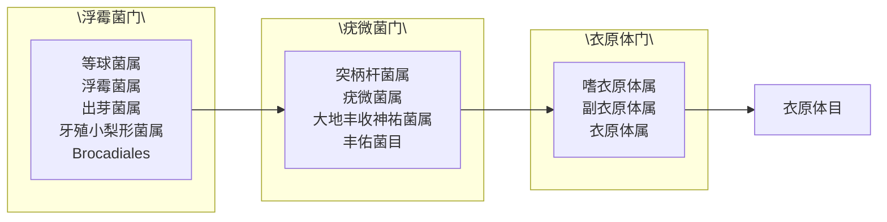
</details>

图 14-18 衣原体门、浮霉菌门和疣微菌门的主要目

以衣原体门、浮霉菌门和疣微菌门代表性属的 16S rRNA 基因序列构建的系统发育树

真核宿主。不同于一般细菌，衣原体门和浮霉菌门缺少编码细胞分裂蛋白 FtsZ 的基因，FtsZ 是细胞分裂中形成隔膜的关键蛋白质。FtsZ 对大多数细菌的细胞分裂是必不可少的，因此人们对衣原体门和浮霉菌门细菌在没有 FtsZ 时是如何分裂的很感兴趣。

## 14.1.4.1 衣原体门

代表属:衣原体属（Chlamydia）、嗜衣原体属（Chlamydophila）、副衣原体属（Parachlamydia）。

衣原体门只包含一个目，即衣原体目（Chlamydiales）。整个门由真核生物特别是人类的专性胞内寄生菌组成。衣原体的基因组很小，约1 Mbp，是生化特征最受限制的已知细菌之一。衣原体无法合成生长所需的许多维生素和生长因子，必须从宿主细胞质中获得

这些分子。

衣原体除了缺乏细胞分裂关键蛋白 FtsZ 外，许多种类还缺乏细胞壁。衣原体最大限度地减少了自身的肽聚糖，以避免被宿主免疫系统发现。尽管衣原体缺乏细胞壁，但其仍然需要形成环状肽聚糖结构，以促进细胞分裂期间隔膜的形成。

衣原体作为人类病原菌，其特征已得到详细描述，但该门还包含寄生于其他真核生物的种类。衣原体细胞通常呈很小的球状，直径约  $0.5 \mu m$ ，并具有独特的生命周期。

## (1) 衣原体的生命周期

衣原体门物种的生命周期中有两种类型的细胞:①原体（elementary body），是小而致密的细胞，耐干燥，利于传播；②网状体（reticulate body），是较大而密度小的细胞，是营养体，可通过二分裂增殖。

原体是非增殖细胞，专门用于传染性传播，而网状体为非感染性形式，其功能为在宿主细胞内繁殖。与立克次氏体不同，衣原体不通过节肢动物传播，而主要通过空气传播进入呼吸系统，因此原体的抗干燥性具有重要意义。经过多次细胞分裂后，转化为原体。当宿主细胞解体时，原体被释放出来，然后感染附近的其他宿主细胞。网状体的代时为2\~3 h，比立克次氏体的代时短得多。

## (2) 衣原体的重要属

不同种类的衣原体感染不同的真核宿主。棘阿米巴副衣原体（Parachlamydia acanthamoeba）可感染自由生活的变形虫，特别是棘阿米巴属（Acanthamoeba）的变形虫，在感染变形虫过程中表现出典型的衣原体生命周期。棘阿米巴副衣原体还会感染人体，其致病性比衣原体小得多。

研究最多的衣原体是感染人类的衣原体属和嗜衣原体属。这两个属中公认的种类有鹦鹉热衣原体（Chlamydophila psittaci；鹦鹉热病的病原菌）、沙眼衣原体（Chlamydia trachomatis；沙眼的病原菌）和肺炎衣原体（Chlamydophila pneumoniae；

---

14.1 细菌多样性

439

某些呼吸系统综合征的病原菌）。鹦鹉热是一种鸟类流行病，偶尔会传播给人类，并导致肺炎样症状。沙眼是一种以角膜血管化和瘢痕形成为特征的眼睛疾病，是人类失明的主要原因。中国科学家汤飞凡于1956年从沙眼中首次分离出沙眼衣原体。沙眼衣原体还可感染泌尿生殖道，是目前主要的性传播疾病之一。

## 14.1.4.2 浮霉菌门

代表属:浮霉菌属（Planctomyces）、牙殖小梨型菌属（Blastopirellula）、出芽菌属（Gemmata）、Brocadia。

浮霉菌门包括许多形态独特的细菌类群，主要分布在两个目，即浮霉菌目（Planctomycetales）和 Brocadiales。浮霉菌门是革兰氏阴性细菌，通常具有柄或附属物，许多种类可形成玫瑰花结（细胞极端附着在一起形成细胞簇）。该门广泛分布于土壤和水生环境中，很少有致病性。浮霉菌门具有一系列不寻常的细胞特征。

浮霉菌缺乏细胞分裂蛋白 FtsZ，它们通过类似于酵母菌的出芽方式分裂。长期以来，浮霉菌被认为缺乏肽聚糖，透射电镜观察到某些种类存在“核被膜”或其他囊泡样细胞器（图 14-19）。浮霉菌中原核和真核细胞特征的独特结合，多年来被认为是细胞演化中缺失的一环。然而，肽聚糖的缺失和囊泡样细胞器的性质之谜最终将随着微生物学技术的进步而解开。

浮霉菌门的有些类群（如 Brocadiales）可在缺氧条件下通过氧化  $NH_{4}^{+}$ 、还原  $NO_{2}^{-}$  生成  $N_{2}$ ，这些类群被称为厌氧氨氧化细菌（anammox bacteria），在氮循环中发挥重要作用。厌氧氨氧化细菌具有特殊的膜间隔区域，即厌氧氨氧化体（anammoxosome）（图 14-20），是厌氧氨氧化作用发生的场所，其膜上有由环丁烷组成的梯形醚状脂质。这种致密的醚状脂质对细菌自身有保护作用，使其免受厌氧氨氧


<details>
<summary>natural_image</summary>

Microscopic image of a circular cellular structure with a 200 nm scale bar, showing internal organelles and a labeled feature (v), no readable text or symbols beyond labels.
</details>

图 14-19 浮霉菌门细菌的囊泡样细胞器（图片来源:中国科学院海洋研究所孙超岷）

分离自南海冷泉沉积物的异养海绵球菌（Poriferisphaera heterotrophicis）ZRK32，其细胞电镜切片中可见囊泡样细胞器（V）


<details>
<summary>text_image</summary>

核糖体
细胞壁
细胞质膜
外室细胞质
细胞质内膜
厌氧氨氧化体
厌氧氨氧化体膜
核糖细胞质
拟核
</details>

图 14-20 厌氧氨氧化细菌的细胞模型

---

440

14 微生物物种多样性

化作用生成的有毒中间产物肼所造成的伤害。细胞最外层为蛋白质亚基晶体排列组成的S层。厌氧氨氧化细菌生长缓慢（14～21 d/代），难以分离纯化，迄今仍未获得纯培养菌株。

## 14.1.4.3 疣微菌门

代表属:疣微菌属（Verrucomicrobium）、突柄杆菌属（Prosthecobacter）。

疣微菌门至少有 4 个已描述的目，但大多数种类属于疣微菌目。疣微菌门是好氧或兼性好氧菌，能发酵糖类。嗜甲酸菌属（Methylacidiphilum）比较特殊，含有好氧甲烷氧化菌。疣微菌门广泛分布于自然界，栖息在淡水、海洋、森林和土壤环境。与浮霉菌门类似，疣微菌门也具有膜包围的细胞内结构。疣微菌门通常由胞质突出形成菌柄或形成其他皱褶（图 14-21）。疣微菌门细胞壁中含有肽聚糖，与浮霉菌门有着明显区别。

疣微菌属和突柄杆菌属细菌的每个细胞会产生2至数个菌柄。与包含单个菌柄的柄杆菌属细胞不同，疣微菌属和突柄杆菌属是对称分裂的，母细胞和子细胞在细胞分裂时都具有菌柄。

突柄杆菌属细菌具有与真核细胞微管蛋白编码基因高度同源的两个基因。微管蛋白是构成真核细胞骨架的关键蛋白质。虽然细胞分裂蛋白 FtsZ 也是微管蛋白同源物，但突柄杆菌属的微管同源蛋白在结构上比 FtsZ 更接近真核微管蛋白。由于在这些生物中尚未发现真核类细胞骨架，所以其微管同源蛋白在突柄杆菌中的作用尚不清楚。

图14-21 分离自深海冷泉的疣微菌门细菌 (Verrucomicrobiota sp.) ZRK36 的电镜照片（图片来源:中国科学院海洋研究所孙超岷）

（a）透射电镜复染照片，可见疣状突起；（b）细胞切片的透射电镜照片，可见细胞表面不均匀的突起


<details>
<summary>natural_image</summary>

Microscopic image showing a circular structure with a dark central region and a 200 nm scale bar (no text or symbols beyond scale indicator)
</details>

(a)


<details>
<summary>natural_image</summary>

Microscopic image of a biological cell or microorganism with visible internal structures and a 200 nm scale bar (no text or symbols beyond scale indicator)
</details>

(b)

## 14.1.5 热袍菌门、热脱硫杆菌门和产液菌门

超级嗜热的细菌门类在细菌系统发育树的根部附近，支持地球上最早的细菌细胞嗜热的观点。超嗜热细菌的三个门，即热袍菌门（Thermotogota）、热脱硫杆菌门（Thermodesulfobacteriota）和产液菌门（Aquificota），集中在细菌系统发育树的根部附近

---

14.1 细菌多样性

441

(图 14-1)。每个门中有 1\~2 个主要属，多数种类的主要生理特征是嗜高温，最适生长温度在  $80^{\circ}$ C 以上。

## 14.1.5.1 热袍菌门

代表属:热袍菌属（Thermotoga）、广袍菌属（Kosmotoga）。

热袍菌门细菌主要生长在低盐火山岩或高温环境中，包括大约12个已培养属。这些种类都是化能异养、厌氧细菌，许多种类是嗜热菌或超嗜热菌，也有少量嗜中温菌。代表属热袍菌属和广袍菌属物种是杆状或球杆状超嗜热细菌，形成鞘状的包膜，称为袍（toga）（图14-22）。其肽聚糖的氨基酸成分不同于其他细菌，脂质中还含有特殊的长链脂肪酸。它们均为发酵性厌氧菌，分解糖或淀粉，以乳酸、乙酸、 $CO_{2}$ 和 $H_{2}$ 为发酵产物。这些细菌也可


<details>
<summary>natural_image</summary>

Microscopic image of a sperm cell with dark nucleus and surrounding cytoplasm, scale bar indicates 500 nm (no text or symbols present)
</details>

图 14-22 太平洋广袍菌（Kosmotoga pacifica）

(图片来源: 自然资源部第三海洋研究所邵宗泽)

可见从细胞两端延伸出疏松的鞘

以利用  $H_{2}$  为电子供体，铁为电子受体，进行无氧呼吸。这些属的种类可从陆地热泉和海洋热液喷口中分离出来。

尽管热袍菌属是细菌，但其基因组含有许多与超嗜热古菌具高同源性的基因。20%以上的热袍菌属基因可能是通过水平基因转移从古菌演化而来。尽管在其他细菌基因组中也存在少数与古菌类似的基因（反之亦然），但只在热袍菌属中发现如此多的域间水平基因转移。

## 14.1.5.2 热脱硫杆菌门

代表属:热脱硫杆菌属（Thermodesulfobacterium）、假脱硫弧菌属（Pseudodesulfovibrio）。

热脱硫杆菌门是一类嗜热硫酸盐还原细菌，在系统发育树上位于热袍菌门和产液菌门之后。热脱硫杆菌属是一类严格厌氧菌，利用乳酸盐、丙酮酸盐和乙醇（但不使用乙酸盐）等化合物作为电子供体，将  $SO_{4}^{2-}$  还原为  $H_{2}S$ ，与  $\delta-$  变形菌纲的脱硫弧菌属的作用类似（见 14.1.1.4）。

热脱硫杆菌属的一个特殊生化特征是产生醚脂（ether-linked lipids）。醚脂是古菌的生物标志物，在古菌中，聚类异戊二烯  $C_{20}$  烃（植烷基）取代脂肪酸作为脂质侧链。然而，在热脱硫杆菌属中，醚连接的脂质非常特殊，甘油侧链不是古菌中的植烷基，

而是由独特的  $C_{17}$  烃和一些脂肪酸组成。因此，热脱硫杆菌门既有很深的系统发育谱系（图 14-1），又有结合了古菌和细菌特征的脂质谱系。目前在其他一些细菌中也发现了醚脂，因此在细菌中醚脂可能比以前认为的更常见。

假脱硫弧菌属是热脱硫杆菌门的另一代表属，多分离自海洋沉积物。其中蛇假脱硫弧菌（Pseudodesulfovibrio serpens）DSM 11384T 分离自南海冷泉，严格厌氧、极生单鞭毛、菌体呈 S 形（图 14-23），可进行硫酸盐还原作用。

## 14.1.5.3 产液菌门

代表属:产液菌属（Aquifex）、热发状菌属（Thermocrinis）。


<details>
<summary>natural_image</summary>

Microscopic image of a rod-shaped bacterial cell with 10 μm scale bar (no text or symbols beyond scale indicator)
</details>

图 14-23 蛇假脱硫弧菌（Pseudodesulfovibrio serpens）（图片来源:中国科学院海洋研究所孙超岷）

---

442

14 微生物物种多样性

产液菌属是专性化能自养超级嗜热菌，是所有细菌中最嗜热的类群。产液菌属细菌可利用  $H_{2}$ 、 $S^{0}$  或  $S_{2}O_{3}^{2-}$  作为电子供体， $O_{2}$  或  $NO_{3}^{-}$  作为电子受体，在高达  $95^{\circ}C$  的温度下生长。产液菌属细菌只能耐受很低的  $O_{2}$  浓度（微好氧），且不能利用有机物。氢杆菌属（Hydrogenobacter）是产液菌属的近亲，大部分特性与产液菌属相同，但是专性好氧菌。

## (1) 产液菌属和自养作用

产液菌属的自养作用通过反向柠檬酸循环（reverse citric acid cycle）进行，此前仅在绿硫细菌中发现该途径。嗜火产液菌（Aquifex pyrophilus）和风产液菌（A. aeolicus）的DNA均具有高G+C含量，使其适宜高温度生长，最高可达95℃。它们的基因组序列揭示了完全化能自养的生活方式，由仅约1.55 Mbp的基因组编码。古菌和细菌中如此多的极端嗜热种类，均为 $H_{2}$ 化能自养菌，而且它们在各自的系统发育树上均为早期谱系，表明 $H_{2}$ 是地球早期原始生命能量代谢的关键电子供体，且最早的细胞可能是嗜热生物。

## (2) 热发状菌属

热发状菌属是产液菌属和产氢菌属的近亲。该菌的最适生长温度为 $80^{\circ}\mathrm{C}$ 以下，化能自养，以 $\mathrm{H}_{2}$ 、 $\mathrm{S}_2\mathrm{O}_3^{2-}$ 或 $\mathrm{S}^0$ 为电子供体， $\mathrm{O}_2$ 为电子受体。该属唯一物种为红色热发状菌（Thermocrinis ruber），生长在美国黄石公园某些温泉的流出口，形成粉色“飘带”，由附着在硅质沉积物上的丝状细胞组成。在静态培养中，红色热发状菌以单个杆状细胞生长。然而，当在流动系统中培养时，其细胞形态与在自然栖息地中类似。

## 14.1.6 奇异球菌门、酸杆菌门和硝化螺菌门

本部分主要介绍在环境中丰度很高且分布广泛，但较难培养的奇异球菌门（Deinococcota）、酸杆菌门（Acidobacteriota）和硝化螺菌门（Nitrospirota）。目前对它们的了解大多基于宏基因组学研究，尤其是酸杆菌门在土壤中的多样性和丰度非常高。

## 14.1.6.1 奇异球菌门

代表属:奇异球菌属（Deinococcus）、栖热菌属（Thermus）。

奇异球菌门是一群对环境具有高度抗逆性的球状细菌，包括三个目，即奇异球菌目（Deinococcales）、特吕珀菌目（Trueperales）和栖热菌目（Thermales），包含少数几个已描述的属。该门细菌通常为好氧化能异养菌，可代谢糖类、氨基酸和有机酸或各种复杂的混合物。虽然该门成员革兰氏染色阳性，但其具有革兰氏阴性菌的细胞壁结构，具革兰氏阴性细菌特有的外膜。然而，该门细菌的外膜缺乏脂质A，还含有一种特别的肽聚糖，在N-乙酰胞壁酸交联中以鸟氨酸取代了二氨基庚二酸。

栖热菌目（Thermales）细菌通常是嗜热菌或超嗜热菌，模式属是栖热菌属（Thermus）。20世纪60年代中期，Thomas Brock在美国黄石公园的一个温泉中发现了

---

14.1 细菌多样性

443

水生栖热菌（Thermus aquaticus），随后人们又从热水器等高温系统中分离出水生栖热菌，从中发现了 Taq DNA 聚合酶。由于 Taq 聚合酶的热稳定性很高，因此扩增 DNA 的聚合酶链反应（PCR）技术能够完全自动化，促进了整个生物学的快速发展。

## (1) 奇异球菌的抗辐射能力

奇异球菌目（Deinococcales）细菌具有极强的抗辐射能力，而耐辐射奇异球菌（Deinococcus radiodurans）是该方面研究最深入的种类。由于含有类胡萝卜素，大多数奇异球菌呈红色或粉红色，而且许多奇异球菌对辐射和干燥都有很强的抵抗力。例如，耐辐射奇异球菌细胞在15 000戈瑞（Gy）的电离辐射（1 Gy = 100 拉德）下仍能存活，该条件足以将生物染色体粉碎成数百个碎片。分离自极地土壤环境的耐冷奇异球菌（Deinococcus psychrotolerans）


<details>
<summary>natural_image</summary>

Microscopic image of three dark circular structures on a light background, scale bar indicates 1.0 μm (no text or symbols present)
</details>

图 14-24 具有抗辐射能力的耐冷奇异球菌（Deinococcus psychrotolerans）的透射电镜图（图片来源:武汉大学彭方）

（图 14-24）的抗辐射能力较耐辐射奇异球菌稍弱。相比之下，一些芽孢在低水平辐射下就会死亡，而人在不到  $10 \, Gy$  的辐射下就会死亡。

除了抗辐射能力外，耐辐射奇异球菌还能抵抗许多诱变剂的作用。唯一对耐辐射奇异球菌起作用的化学诱变剂是亚硝基胍等物质，能诱导 DNA 缺失。

## (2) 奇异球菌的 DNA 修复

耐辐射奇异球菌对受损 DNA 的修复效率很高。该菌存在几种不同的 DNA 修复酶，除了 RecA 之外，还存在几种不依赖于 RecA 的 DNA 修复系统，可修复单链或双链 DNA 的断裂、切除错误的碱基。该菌的修复过程非常有效，甚至可以把染色体从碎片状态重新组合起来。

耐辐射奇异球菌细胞中 DNA 的独特排列方式可能在抗辐射中发挥了重要作用。该菌细胞以成对或四分体的形式存在，其 DNA 并不像典型的类核那样分散在细胞内，而是有序地排列成环状（卷曲或堆叠的环）结构。环状结构为同源重组提供了平台，相邻隔室的拟核融合后可促进 DNA 修复。在这种广泛的 DNA 重组过程中，会产生一条修复后的染色体，含有这条染色体的细胞可以生长和分裂。

## 14.1.6.2 酸杆菌门

代表属:酸杆菌属（Acidobacterium）。

16S rRNA 基因分析表明，酸杆菌门细菌在环境中广泛存在。酸杆菌常见于土壤中，尤其是在酸性土壤（pH < 6.0）中，通常占土壤微生物群落的大部分。酸杆菌门还栖息于淡水、热泉微生物席、污水处理反应器和污泥中。然而，尽管酸杆菌在环境中广泛分布，但只有少数属被分离培养出来。

大多数已描述的酸杆菌都是革兰氏阴性、耐酸、好氧化能异养菌。荚膜酸杆菌（Acidobacterium capsulatum）分离自酸性矿井废水中，是一种专性好氧的荚膜细菌，可利用各种糖和有机酸生长。多态酸八叠球菌（Acidisarcina polymorpha）分离自森林的酸性土壤中，生长在由6\~8个细胞组成的立方体包囊中，也是耐酸菌。该菌好氧，能降解土壤中常见的纤维素和几丁质等聚合物。

---

444

14 微生物物种多样性

## 14.1.6.3 硝化螺菌门

代表属:硝化螺菌属（Nitrospira）、钩端螺菌属（Leptospirillum）、磁杆菌属（Magnetobacterium）和热脱硫弧菌属（Thermodesulfovibrio）。

硝化螺菌门的基本特征为革兰氏阴性，弯曲、弧形或螺旋形细胞。其代谢方式多样，大部分为好氧、化能自养菌，包括亚硝酸盐氧化细菌（nitrite oxidizing bacteria, NOB）、异化硫酸盐还原细菌和趋磁细菌等类群。

硝化螺菌属是硝化螺菌门的代表属，其细胞呈松散螺旋状至弧状，周质空间的厚度是其他革兰氏阴性菌的2倍。与假单胞菌门的硝化杆菌属细菌一样，硝化螺菌属也是能把亚硝酸盐氧化为硝酸盐的化能自养菌。硝化螺菌属与硝化杆菌属的生存环境相似。然而，环境调查发现，自然界中硝化螺菌属比硝化杆菌属丰富得多，因此硝化螺菌属被认为是自然环境中亚硝酸盐氧化的主要驱动力，在废水处理厂和富氨土壤等富氮环境中，大多数亚硝酸盐可能被硝化螺菌所氧化。此外，近年来发现的全程硝化细菌（comammox），能够把氨直接氧化为硝酸盐，也被暂时归类于硝化螺菌属。钩端螺旋属（Leptospirillum）是一类好氧、嗜酸、铁氧化的化能自养菌，常见于开采煤和铁的酸性矿井废水中。

## 14.1.7 梭杆菌门、丝状杆菌门和互养菌门

梭杆菌门（Fusobacteriota）、丝状杆菌门（Fibrobacterota）和互养菌门（Synergistota）被描述的种类相对较少，它们通常具有发酵代谢。

## 14.1.7.1 梭杆菌门

代表属:梭杆菌属（Fusobacterium）。

梭杆菌门是一类革兰氏阴性、不产芽孢的杆菌，存在于沉积物、动物的胃肠系统（图 14-25）和口腔中。梭杆菌门细菌是专性厌氧菌，能发酵糖类、多肽和氨基酸。梭杆菌属细菌是人类微生物组的常见组分。梭杆菌具有黏附素，使之能牢固地

黏附于其他细菌或动物细胞。在口腔牙菌斑的形成上，梭杆菌的粘连发挥着重要的支撑作用。梭杆菌很难培养，在基于 DNA 的微生物群落研究技术发展起来后，才认识到其在人类微生物组中的重要作用。

虽然梭杆菌在健康个体的微生物组中很常见，但它们也与几种人类疾病和综合征有关。特别是在各种口腔疾病的患者中，梭杆菌的丰度增加。牙龈组织炎症和血管撕裂使梭杆菌和其他口腔细菌进入血液中。这些细菌可在动脉斑块中发现，甚至可能在心脏病中发挥作用。此外，血液中的梭杆菌也会对妊娠造成危害，而肠道中的梭杆菌可附着、定殖结肠癌细胞并促进其生长。使用抗生素甲硝唑治疗患有结肠癌的小鼠，既能降低肿瘤中梭杆菌的数量，又能减缓肿瘤的生长。


<details>
<summary>natural_image</summary>

Microscopic image of a nanoscale particle with 500 nm scale bar (no text or symbols on the particle itself)
</details>

图 14-25 分离自北海狮肠道的坏疽梭杆菌 (Fusobacterium necrogenes) SYSU M8D902 的透射电镜照片（图片来源:中山大学李文均）

---

14.1 细菌多样性

445

## 14.1.7.2 丝状杆菌门

代表属:丝状杆菌属（Fibrobacter）。

虽然丝状杆菌门细菌的 16S rRNA 基因分布于多种栖息地，但唯一被描述的种类来自动物瘤胃。丝状杆菌门含有革兰氏阴性、具发酵能力的严格厌氧菌。然而，与大多数梭杆菌门和互养菌门细菌不同，丝状杆菌门细菌不能发酵蛋白质或氨基酸，而是专门发酵糖类，包括纤维素。在瘤胃中，纤维素是主要的能量来源，在该环境中，纤维素不仅是纤维杆菌门等纤维素分解细菌的能量来源，也是许多能利用纤维素降解产物葡萄糖的、非纤维素分解的厌氧细菌的能量来源。

## 14.1.7.3 互养菌门

代表属:联合菌属（Synergistes）。

互养菌门细菌是在陆地和海洋系统的动物和缺氧环境中发现的革兰氏阴性、不产芽孢的杆菌。已描述的物种通常是能够降解蛋白质并发酵氨基酸的专性厌氧菌。在动物中，它们最常见于胃肠道，如约氏联合菌（Synergistes jonesii）栖息于瘤胃中。在人类中，互养菌门细菌与某些软组织伤口和脓肿、牙菌斑和牙周病有关。

## 14.1.8 脱铁杆菌门和产金菌门

脱铁杆菌门（Deferribacterota）和产金菌门（Chrysiogenota）含有厌氧化能异养菌。大多数种类可通过厌氧呼吸将硝酸盐转化为亚硝酸盐或铵而生长。

## 14.1.8.1 脱铁杆菌门

代表属:脱铁杆菌属（Deferribacter）。

脱铁杆菌门细菌通常呈棒状或弧状，嗜中温或高温，是一类通过专性或兼性厌氧代谢获得能量的细菌，可利用多种电子受体，如 Fe（Ⅲ）、Mn（Ⅳ）、S$^{0}$、Co（Ⅲ）和硝酸盐，部分还可进行发酵代谢。该门细菌多生长于含有还原氢离子、高温、高盐、富含硫化物的环境中。脱铁杆菌属是脱铁杆菌门的代表属，是嗜热异化铁还原细菌，也能还原硝酸盐和金属氧化物。其中深海脱铁杆菌（D. abyssi）是分离自大西洋中脊深海热液喷口的嗜热厌氧化能自养菌，它的生存依赖于热液喷口的高温及特殊的化学生境，通过利用 Fe（Ⅲ）和 S$^{0}$ 氧化 H$_{2}$ 获取能量。为了防止被热液冲离，该属细菌会以微生物席的方式黏附于岩石上，或者通过鞭毛感知温度和化学信号，向适宜的生境移动。

## 14.1.8.2 产金菌门

代表属:产金菌属（Chrysiogenes）。

产金菌门的砷酸产金菌（Chrysiogenes arsenatis）及其近缘细菌，可氧化乙酸盐和其他有机化合物，并与作为末端电子受体的砷酸盐的还原相偶联，将砷酸盐还原为亚砷酸盐。除了还原砷酸盐之外，产金菌门的许多种类在厌氧呼吸中还可还原硒酸盐、亚硝酸盐、硝酸盐、硫代硫酸盐和元素硫。

---

446

14 微生物物种多样性

## 14.2 古菌多样性

古菌是一类形态大小与细菌相似，但细胞表面结构及遗传机制等与细菌有本质区别的原核生物。古菌的英文名称“Archaea”，源自古希腊语，意为“古老的东西”。1977年，美国科学家卡尔·乌斯通过比较不同生物的核糖体小亚基RNA序列，建立了泛生命树（universal tree of life），并发现了古菌这一种新的生命形式。到1990年，卡尔·乌斯提出三域学说，将生物分为三个域（domain）:细菌域、古菌域和真核生物域。近年来，在高通量测序技术的快速发展下，古菌的多样性被进一步挖掘，许多新的门被发现，古菌域的生命之树也得到了极大的扩展。目前，古菌域中已报道超过30个门，它们至少组成了4个超群（supergroup），即广古菌门（Euryarchaeota）、TACK古菌超门、DPANN古菌超门和阿斯加德（Asgard）古菌类群（图14-26）。古菌分布广泛，无论是在高温、高寒、强酸、强碱以及高盐等极端环境，如酸性热泉、海底沉积物、深海热液口、盐碱湖、污水池等，还是在相对温和的环境，如普通土壤、沼泽地、动物（包括人）皮肤及消化道，都能检测到古菌的存在，这也凸显了古菌在地球生态系统中的重要地位。本节将对4个古菌超群中的重要门类进行物种和功能多样性的概述。

## 14.2.1 广古菌门

广古菌门（Euryarchaeota），前缀“eury”源自希腊语“euryos”，意为“宽广的，广泛的”。广古菌门是古菌域中早期被描述的门类之一，其覆盖的类群在生理、形态和地理分布方面具有高度的多样性，包含严格厌氧的产甲烷菌、严格好氧的嗜盐菌以及极端嗜热、嗜酸的好氧和厌氧菌。目前，广古菌门共有13个纲（Class），

图 14-26 古菌域中 4 个超群及其门 / 纲类的系统发育树


<details>
<summary>flowchart</summary>

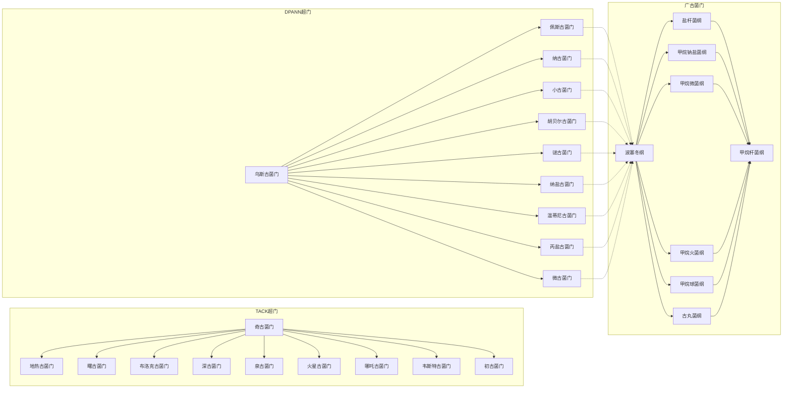
</details>

---

14.2 古菌多样性

447

且每个纲都表现出独特的代谢特征和生活方式。

鳕八迭球菌（Sarcina morrhuae），是最早被描述的广古菌，后来更名为鳕盐球菌（Halococcus morrhuae），并被归为盐杆菌纲（Halobacteria）。目前，广古菌门中拥有最多数量和种类的已培养古菌菌株，其中大多数为产甲烷菌。这些产甲烷菌为专性厌氧菌，可以利用氢、甲酸、乙酸、甲醇或甲基化胺作为电子供体来还原二氧化碳产生甲烷。产甲烷菌在广古菌门中主要分布于5个纲，包括甲烷微菌纲（Methanomicrobia）（图14-27）、甲烷火菌纲（Methanopyri）、甲烷杆菌纲（Methanobacteria）、甲烷球菌纲（Methanococci）和甲烷钠盐菌纲（Methanonatronarchaeia）。

除了产甲烷菌外，盐杆菌纲（Halobacteria）、热原体纲（Thermoplasmata）、古丸菌纲（Archaeoglobi）以及热球菌纲（Thermococci）也已被成功培养。其中，盐杆菌纲中包含了许多嗜盐古菌类群，它们能够利用特殊的胞外及胞内酶，如水解酶和酯酶等，参与到碳和氮元素的生物地球化学循环中，在高盐环境中具有重要的生态功能（图14-28）。值得一提的是，我国科学家在盐湖样品中发现了一种新的具有形态发育过程的极端嗜盐古菌（Actinoarchaeum halophilum YIM 93972），它在形态上与放线菌相似，能够形成类似放线菌的菌丝体和孢子。古丸菌纲、热球菌纲和热原体纲则包含许多嗜热和超嗜热的化能自养或异养菌。热原体纲除嗜热外还具有嗜酸的特性，而且其中来自热原体属（Thermoplasma）和铁原体属（Ferroplasma）的成员具有明显的形态特征——缺少细胞壁。

这些成功培养的极端微生物不仅促进了人们对广古菌生理特征的认知，也加深了对极端环境下生物适应性的理解。例如，坎


<details>
<summary>natural_image</summary>

Microscopic image of three spherical particles with a 500 nm scale bar (no text or symbols on the particles themselves)
</details>

(a)


<details>
<summary>natural_image</summary>

Microscopic image of a spherical nanoparticle with 500 nm scale bar (no text or symbols beyond scale indicator)
</details>

(b)


<details>
<summary>natural_image</summary>

Microscopic image of spherical nanoparticles with 500 nm scale bar (no text or symbols on particles)
</details>

(c)


<details>
<summary>natural_image</summary>

Microscopic image of a spherical particle with textured surface, scale bar indicates 500 nm (no text or symbols present)
</details>

(d)

图 14-27 甲烷微菌纲中两种产甲烷古菌的电镜照片（图片来源:深圳大学李猛）

（a）和（b）沉积甲烷叶菌（Methanolobus sediminis FTZ6 $^{T}$ ）；（c）和（d）红树林甲烷叶菌（Methanolobus mangrovi FTZ2 $^{T}$ ）


<details>
<summary>natural_image</summary>

Microscopic view of fibrous network structure with 10 μm scale bar (no text or symbols)
</details>

(a)


<details>
<summary>natural_image</summary>

Microscopic view of rod-shaped bacterial or fungal structures with 1 μm scale bar (no text or symbols)
</details>

(b)


<details>
<summary>natural_image</summary>

Microscopic view of spherical particles with a 1 μm scale bar (no text or symbols beyond scale indicator)
</details>

(c)


<details>
<summary>natural_image</summary>

Microscopic view of spherical particles on a dark background, scale bar indicates 5 μm (no text or symbols present)
</details>

(d)

图 14-28 多种嗜盐古菌的电镜照片（图片来源:南阳理工学院刘冰冰）
（a）嗜盐放线古菌（Actinoarchaeum halophilum YIM 93972）；（b）嗜盐丝状古菌（Halocatena salina NG A267-1）；（c）钠线菌（Natrinema sp. NG A387）；
（d）土生嗜盐古菌（Saliphagus infecundisoli YIM A93745 $^{T}$ ）

---

448

14 微生物物种多样性

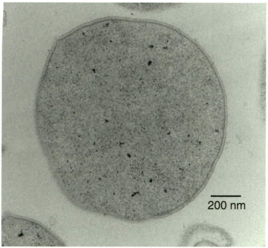

<details>
<summary>natural_image</summary>

Microscopic view of a circular cellular structure with 200 nm scale bar (no text or symbols beyond scale indicator)
</details>

图 14-29 超嗜热广古菌（Thermococcus eurythermalis A501）的电镜照片（图片来源:上海交通大学赵维殳）

氏甲烷嗜热菌（Methanopyrus kandleri）已被证明能够在温度高达122℃、压力高达20 MPa的环境下保持生长，这也拓展了地球生命的温度上限。另外，分离自深海热液烟囱的菌株Thermococcus eurythermalis A501也是一种超嗜热古菌，能够在50～100℃的温度下和0.1～70 MPa的压力下生长，最适生长温度为85℃（图14-29）。虽然其他广古菌纲迄今为止尚未被培养，但它们也被证明是一些环境微生物群落的主要成员。例如，波塞冬纲（Candidatus Poseidoniia，以前被称为海洋古菌类群Ⅱ和Ⅲ，即MG-Ⅱ和MG-Ⅲ）是海洋微生物群落的重要组成部分，其相对丰度能高达40%。哈迪斯古菌纲（Candidatus Hadesarchaea），以前称为南非金矿广古菌类群（即SAGMEG）但目前研究者提出将其划分为新的古菌门Candidatus Hadarchaeota，也广泛分布于陆地和海底环境中。值得注意的是，我国研究者通过对热泉沉积物多年的富集培养，获得了Ca. Hadarchaeota古菌门中烷烃降解古菌（Candidatus

Melinoarchaeum fermentans DL9YTT1）的富集培养物，并揭示了该物种与其他产甲烷古菌的互作产甲烷新模式（图 14-30）。此外，对于广古菌门的深部分支类群，如热液菌纲（Candidatus Hydrothermarchaeota）和硫古菌纲（Candidatus Theionarchaea），研究表明它们与其他广古菌具有一定的代谢共性，包括  $F_{420}$ -氢化酶和 Wood-Ljungdahl 途径的存在。

广古菌在生物地球化学循环中的作用也是多样化的。虽然广古菌通常被认为是产甲烷菌，但实际上其不仅参与了甲烷的产生，还参与了甲烷的厌氧氧化。以厌氧嗜甲烷古菌（ANME）为例，这类微生物通过反向运作产甲烷核心代谢途径实现甲烷氧化，但这一过程需要与特定细菌建立共生关系。由于厌氧甲烷氧化本质上是氧化反应，这一过程需要与还原反应偶联，并依赖外源电子受体（如硫酸盐、硝酸盐等）的参与。因此，ANME 古菌通常与硫酸盐还原菌、反硝化菌或硝酸盐还原菌形成互营共生关系。这类共生体在自然界中多以微小聚集体形式存在，但有时也会发展为大规模的微生物席（microbial mat）。值得注意的是，这种紧密的物理关联使它们能够高效偶联氧化还原反应，通过直接电子传递或代谢中间产物交换实现能量获取，从而维持整

图 14-30 烷烃降解古菌（Ca. Melinoarchaeum fermentans DL9YTT1）富集培养物的荧光显微照片（图片来源:上海交通大学余甜甜）
标尺为  $10 \mu m$

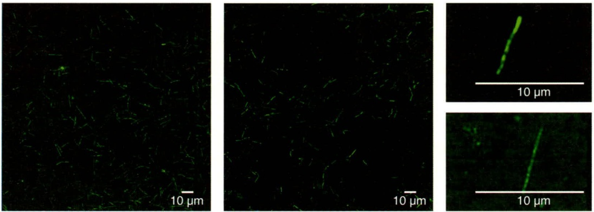

---

14.2 古菌多样性

449

个共生体系的稳定运行。除了甲烷代谢能力外，广古菌也能降解其他碳氢化合物。例如，在海底沉积层富集物中发现的古菌 Candidatus Syntrophoarchaeum，其编码了类甲基-辅酶 M 还原酶（Mcr-like），能够厌氧降解丁烷；在海洋烃渗漏区域富集物中被发现的未培养古菌 Candidatus Argoarchaeum ethanivorans 则是能够进行乙烷的厌氧降解，且代谢产物分析也检测到关键中间代谢产物乙基-辅酶 M；在全球油藏地普遍分布的广古菌 Candidatus Methanoliparia 被发现不仅编码了完整的产甲烷途径，也编码了完整的烷烃厌氧降解途径，推测该菌能够通过歧化作用从烷烃代谢中生产甲烷。其次，广古菌除了参与碳氢化合物的转化外，还在硫、氮和铁元素循环中发挥作用。基因组功能研究表明未培养的哈迪斯纲和硫古菌纲分别具有亚硝酸盐还原与硫还原的作用。此外，一些广古菌类群被发现可能具有有机物降解能力。例如，来自热原体纲的 DHVE2（Deep-Sea Hydrothermal Vent Euryarchaeota 2）类群能够降解蛋白质以获得能量，且属于同纲的 DHVE1 类群也被发现含有高含量的胞外肽酶。综上，这些研究发现共同表明了广古菌的代谢多样性，也反映了其在自然生态系统中占据了多重生态位。

## 14.2.2 TACK 超门

TACK超门于2011年被首次提出，最初由奇古菌门（Thaumarchaeota）、曙古菌门（Candidatus Aigarchaeota）、泉古菌门（Crenarchaeota）和初古菌门

(Candidatus Korarchaeota) 组成，并以这 4 个古菌门的名称缩写命名。近年来，高通量测序技术的大力发展，重构的未培养古菌基因组呈现井喷式暴发，极大地扩展了 TACK 超门成员数量。目前，TACK 超门中已包含 10 个门类，其中新增的门类包括地热古菌门（Candidatus Geothermarchaeota）、布洛克古菌门（Candidatus Brockarchaeota）、深古菌门（Candidatus Bathyarchaeota）（图 14-31）、火星古菌门（Candidatus Marsarchaeota）、哪吒古菌门（Candidatus Nezhaarchaeota）和韦斯特拉特古菌门（Verstraetearchaeota）（图 14-32）。

## 14.2.2.1 泉古菌门

泉古菌门，英文名称 “Crenarchaeota”，前缀 “cren“源自希腊语 “crenos”，意为 “泉水或源泉”。泉古菌是首批被描述的古菌门类，同时也是最容易被分离培养的古菌类群之一。泉古菌细胞形状多样，除了常见的杆状和球状外，还包括细丝状和不规则圆盘状。目前已培养的泉古菌多为嗜热菌，常见于陆地高温生境（>100℃），部分可耐受极端酸性环

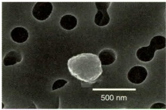

<details>
<summary>natural_image</summary>

Microscopic image of porous material with circular voids and a 500 nm scale bar (no text or symbols beyond scale indicator)
</details>

(a)

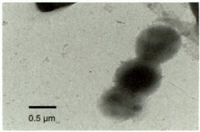

<details>
<summary>natural_image</summary>

Microscopic image showing two dark, irregularly shaped particles on a light background with a 0.5 μm scale bar (no text or symbols beyond scale indicator)
</details>

(b)

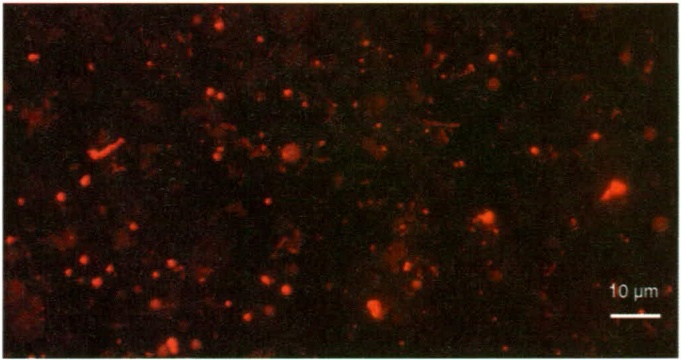

<details>
<summary>natural_image</summary>

Microscopic image showing scattered red fluorescent spots on a dark background, scale bar indicates 10 μm (no text or symbols present)
</details>

(c)

图 14-31 深古菌门中木质素降解古菌（Candidatus Baizosediminiarchaeum ligniniphilus DL1YTT001）的富集培养物的电镜照片（a，b）和荧光显微照片（c）（图片来源:上海交通大学余甜甜）

---

450

14 微生物物种多样性

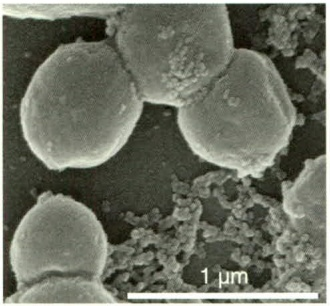

<details>
<summary>natural_image</summary>

Microscopic view of spherical particles with a 1 μm scale bar (no text or symbols beyond scale indicator)
</details>

(a)

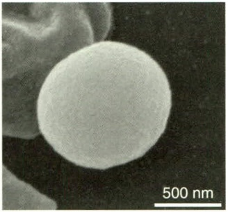

<details>
<summary>natural_image</summary>

Microscopic image of a spherical nanoparticle with 500 nm scale bar (no text or symbols on the particle itself)
</details>

(b)

图 14-32 韦斯特拉特古菌门中新型产甲烷古菌（Methano-suratincola petrocarbonis LWZ-6）的电镜照片（图片来源:农业农村部成都沼气科学研究所承磊）

境（pH < 1）。硫化叶菌属（Sulfolobus）是最早被成功培养的泉古菌，它们是从美国黄石公园的富含硫的酸性热泉中被分离出来的，现已成为研究超嗜热古菌的模式菌株。随后，更多的泉古菌陆续从高温陆地热泉和海洋环境中被分离培养。例如，超嗜热的烟栖火叶菌（Pyrolobus fumarii），该菌的最适生长温度为106℃，且能在温度高达113℃的环境下生长。此外，来自硫化叶菌属、火棒菌属（Pyrobaculum）、酸菌属（Acidianus）和热变形菌属（Thermoproteus）的许多超嗜热泉古菌在陆地高温热泉中具有较高的丰度，占据主导地位，甚至是高温环境中的主要生产者。

大多数泉古菌是厌氧菌，可以利用有机化合物（如蛋白质和糖）进行化能异养型生活。也有许多泉古菌能进行厌氧化能自养型生活，其中多数以  $H_{2}$  为电子供体，单质硫（ $S^{0}$ ）或  $NO_{3}^{-}$  为电子受体，少数能以  $Fe^{3+}$  为电子受体进行  $H_{2}$  呼吸。此外，部分泉古菌，如硫化叶菌属，为混合营养型，既可以通过氧化单质硫及硫化物进行化能无机营养型生活，亦可以通过使用硫氧化其他还原型碳化合物进行化能有机营养型生活，但是其主要营养方式仍为异养型。

## 14.2.2.2 奇古菌门

1992 年，研究人员通过对海水中古菌 16S rRNA 基因的分析，首次发现了奇古菌，但因这些古菌在系统发育树上与泉古菌门接近，且来自中温环境，故而当时被称为中温泉古菌（mesophilic or non-thermophilic Crenarchaeota），或 MG-I（Marine Group I）类群。然而，后续研究表明，这些中温泉古菌并非泉古菌演化而来，其在起源上早于泉古菌和广古菌门。因此，在 2008 年人们提出将这些中温泉古菌，包括来自开放海域的 ALOHA Group、来自热泉和热液口的 pSL12 Group、HWCGIII 和 Nitrosocaldus Group、来自酸性土壤的 MG-I.1c 以及氨氧化古菌 MG-I.1a 和 I.1b，划分为一个新的门，命名为 “Thaumarchaeota”，希腊语 “Thaumas” 指 “奇妙的”，译为 “奇古菌门”。

奇古菌不仅多样性高、数量多，且环境适应能力极强、分布非常广泛，从淡水到盐度超高的咸水环境，从 $\mathrm{pH}$ 为3.5的酸性环境到 $\mathrm{pH}$ 为8.7的碱性环境，从温度低至 $0.2^{\circ}C$ 的海洋环境到温度可高达 $97^{\circ}C$ 的热泉环境，均能发现它们的踪迹。不仅如此，奇古菌类群通常在海洋沉积物中具有较高丰度，占主导地位。例如，我国边缘海表层沉积物中奇古菌的平均丰度占总古菌的 $60\%$ ；在大西洋等不同纬度的深海表层沉积物中，奇古菌在古菌中的平均比重约为 $53\%$ ；在位于北大西洋的寡营养含氧沉积物中，奇古菌的相对丰度可达总微生物的 $80\%$ ，超过细菌成为最优势类群。2005年从西雅图水族馆海水中分离培养到第一株奇古菌——Nitrosopumilus maritimus SCM1。N.maritimus通过将氨（$\mathrm{NH}_3$）有氧氧化为亚硝酸盐（$\mathrm{NO}_2^-$）来进行化能营养生长，这也是硝化过程的第一步。这种生物与硝化细菌一样使用 $\mathrm{CO}_2$ 作为其唯一的碳源进

---

14.2 古菌多样性

451

行自养生长，但不同的是，N. maritimus 能够适应极端营养限制条件下的生活。N. maritimus 可以在硝化细菌所需  $NH_{3}$  浓度 1/100 的条件下生长，而在支持硝化细菌生长所需的较高  $NH_{3}$  浓度条件下，它们的生长实际上会受到抑制。随着研究者对奇古菌认识的加深，培养策略也不断被完善，使得更多的奇古菌门菌株相继被成功富集或分离培养。

奇古菌的主要营养类型为化能自养。奇古菌通过使用一种经过修饰的3-羟基丙酸/4-羟基丁酸（HP/HB）途径固定 $CO_{2}$ 进行自养生长。该途径是有氧条件下能量效率最高的碳固定途径，且仅在奇古菌门成员中发现。因此，奇古菌被认为是深海初级生产力的重要贡献者，并在驱动碳元素的循环中发挥重要作用。其次，奇古菌中具有的氨氧化功能也备受关注。氨氧化反应主要包括两个部分，首先是氨经氨单加氧酶（AMO）氧化为羟胺（ $NH_{2}OH$ ），其次羟胺再进一步氧化为亚硝酸盐。然而，奇古菌中不存在与细菌类似的羟胺脱氢酶（HAO），推测其可能通过完全不同的酶复合体进行羟胺的氧化，具体机制尚不清楚。尽管如此，奇古菌具有比氨氧化细菌更高的氨亲和力，是海洋中氨氧化反应的主要执行者，活跃地驱动着海洋中氮元素的循环。另外，奇古菌也被认为是海洋溶解氧最小值区（oxygen minimum zone，OMZ）区域氧化亚氮（ $N_{2}O$ ）的重要来源，并推测 $N_{2}O$ 的产生可能由中间代谢产物羟胺、亚硝酸盐和一氧化氮（NO）经非生物过程转化而来。此外，虽然氨的氧化为奇古菌门提供了重要能量来源，但研究表明许多奇古菌类群还可以利用多种有机质进行混合营养型生活。例如，奇古菌成员可直接利用氰酸盐和尿素作为能源和氮源，也可以在异养微生物的辅助下利用氨基酸和有机胺等。除参与碳氮循环外，奇古菌成员还能够合成甲基膦酸。在缺磷条件下，甲基膦酸是许多海洋微生物的重要磷源物质。同时，微生物对甲基膦酸的分解利用会产生甲烷，这可能是表层海水甲烷饱和的重要原因，具有重要的气候效应。

## 14.2.2.3 初古菌门

1996 年，研究人员通过分析从黑曜石热泉（位于美国黄石公园的一个近中性热泉，温度为 74～93℃）获得的 rRNA 基因序列，发现了其中一些序列形成了一个在系统发育上与泉古菌门和广古菌门截然不同的更深的分支，并将其定义为新的古菌门，命名为 “Candidatus Korarchaeota”。希腊语中的名词 “koros” 或 “kore”，意思是 “年轻男子” 或 “年轻女子”，因此中文译为 “初古菌”。初古菌系统发育学多样性较低，但其地理分布具有高度特异性，主要分布于陆地热泉和海洋热液喷口等高温生境中，而在其他自然环境中丰度很低。尽管目前尚未获得初古菌的纯培养物，但 2008 年首次从黑曜石热泉沉积物中获得了含初古菌的混合培养物，且能在 85℃、pH 6.5、严格厌氧的条件下长期存活。厌氧混合培养物中的初古菌细胞呈直径小于 0.2 μm 的纤丝状，长短不一，最长可达 100 μm，该菌株因此被命名为 Candidatus Korarchaeum cryptofilum OPF8，暗指其为 “神秘的细丝”。此外，2023 年，中国研究者基于宏基因组学技术在云南腾冲热泉样品中重构出 10 个初古菌基因组，它们组成了一个新目，并被命名为盘古古菌目（Panguiarchaelaes），取盘古开天辟地，

---

452

14 微生物物种多样性

克服困难，创造美丽新世界之意，旨在表达该古菌对分化出多才多艺 TACK 古菌的突出贡献。

目前对初古菌功能的研究大多基于基因组的分析，其中一些初古菌被认为营共生生长模式。例如，Ca. K. cryptofilum OPF8 由于缺乏合成嘌呤、辅酶 A 和其他多种辅助因子的基因，并依赖于一种简单的多肽发酵作用来获取碳源和能量，推测其可能是一种共生菌。类似的情况在盘古古菌 Panguiarchaeum symbiosum 中也有发现，该物种缺失细胞膜、氨基酸、维生素和嘌呤合成等基础代谢通路，主要通过降解胞外蛋白质来获取碳源、氮源和能量，维持其生长。此外，初古菌还能进行产甲烷和硫还原。例如，研究者发现在 Candidatus Methanodesulfokores Washburnensis 基因组中具有厌氧甲烷代谢和异化硫代谢所必需的基因，演化分析表明甲烷代谢起源于初古菌祖先，而异化亚硫酸盐还原的基因是从芽孢杆菌门水平转移得到的。代谢重建表明 Ca. M. washburnensis 为混合营养型古菌，能够摄取氨基酸，同化甲烷衍生的碳，或通过古菌类型的 RuBisCO 固定二氧化碳来获取核糖碳。

## 14.2.2.4 曙古菌门

2011年，研究人员从320 m深、70℃的金矿地下热水菌席中重构了一个占优势的未培养菌株基因组——Candidatus Caldiarchaeum subterraneum，提出了该菌代表了古菌域中一个新分支，命名为“Aigarchaeota”，希腊语“aigi”意为“黎明和曙光”，因此译作“曙古菌门”。由于曙古菌在系统发育学上与奇古菌很接近，因此也有部分学者认为曙古菌是隶属于奇古菌门的一个纲。曙古菌具有丰富的系统发育学多样性，相关的16S rRNA基因序列大部分存在于高温环境，包括陆地和海洋地热系统、地下含水层和矿井孔隙水等，只有少量的序列在中温或低温环境样品中被检测到。曙古菌门的16S rRNA基因的GC含量也符合嗜热菌或超嗜热菌的特征，并从中计算出类群的最佳生长温度为40.8～101.9℃。目前对曙古菌的形态特征了解有限，不过有研究已发现一种来自美国黄石公园热泉的曙古菌成员——Candidatus Calditenuis aerorheumensis，呈细丝状，直径约为0.5 μm，长度可达20 μm。

不同曙古菌的代谢类型具有明显的差异。基因组分析表明，曙古菌成员 Ca. C. subterraneum 具有潜在的氢氧化、一氧化碳氧化以及碳固定的自养代谢能力。另一个曙古菌成员 Ca. C. aerorheumensis 可以利用乙酸、脂肪酸、氨基酸、糖类和芳香烃化合物等胞外有机碳进行需氧的、化能有机异养代谢，但它们不能从头合成亚铁血红素、维生素等，可能从群落中其他微生物中获得。然而，来自中国云南腾冲热泉沉积物中的曙古菌是专性厌氧菌或兼性厌氧菌，大多数是可以氧化硫化物的化能无机营养型。此外，曙古菌基因组包含了一些有趣的真核生物基因特征，比如编码真核生物类型的泛素修饰系统，这在原核生物中尚属首次发现。

## 14.2.3 DPANN 超门

DPANN超门是2013年首次提出的古菌超门，它们在系统发育树上聚集形成了

---

14.2 古菌多样性

453

一个单独的支系，并位于古菌支系靠近根部的位置。与 TACK 超门一样，DPANN 超门也是以 5 个古菌门的首字母命名，即丙盐古菌门（Candidatus Diapherotrites）、小古菌门（Candidatus Parvarchaeota）、谜古菌门（Candidatus Aenigmarchaeota）、纳古菌门（Nanoarchaeota）和纳盐古菌门（Candidatus Nanohaloarchaeota）。DPANN 超门通常具有细胞微小、基因组小而精简、缺少部分核心代谢能力等共性特征，因此它们也被认为营共生生活方式（图 14-33）。随着测序技术与分析技术的发展，不断有新的未知古菌门类被发现和研究，DPANN 超门也由最初定名时的 5 个门增加到至少 11 个门，新增门类包括:微古菌门（Candidatus Micrarchaeota）、乌斯古菌门（Candidatus Woesearchaeota）、佩斯古菌门（Candidatus Pacearchaeota）、深地古菌门（Candidatus Altiarchaeota）、胡贝尔古菌门（Candidatus Huberarchaeota）、温蒂尼古菌门（Candidatus Undinarchaeota）。由于古菌一直被认为是与地球早期生命起源息息相关的生物，研究位于古菌系统发育树根部的 DPANN 超门古菌对于人们探究早期微生物的演化有着不可替代的重要性。

## 14.2.3.1 纳古菌门

2002 年，科学家从冰岛以北科贝恩塞海脊（Kolbeinsey）热液口分离得到了第一株纳古菌，即骑行纳古菌（Nanoarchaeum equitans）。系统发育分析表明该菌株不属于当时已知的任何一个古菌门类，因此被认为是一个全新的门类，并命名为 Nanoarchaeota，其前缀源自拉丁语 “Nanus”，意为 “矮小的”，译作 “纳古菌门”。骑行纳古菌呈球状，细胞直径约为 400 nm，属于专性共生菌，直接附着在其宿主火球菌（Ignicoccus hospitalis）细胞的表面。骑行纳古菌是极端嗜热菌，最佳生长温度约为

图 14-33 DPANN 超门古菌与其他门类古菌的基因组大小范围

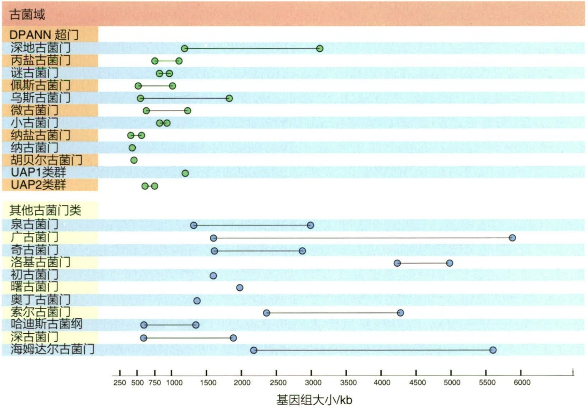

<details>
<summary>bubble</summary>

| Category | Group | Genetic Size Range (kb) |
| :--- | :--- | :--- |
| 古菌域 | 深地古菌门 | ~1000 ~3100 |
| 古菌域 | 丙盐古菌门 | ~600 ~1200 |
| 古菌域 | 谜古菌门 | ~700 ~950 |
| 古菌域 | 佩斯古菌门 | ~400 ~1000 |
| 古菌域 | 乌斯古菌门 | ~500 ~1800 |
| 古菌域 | 微古菌门 | ~600 ~1300 |
| 古菌域 | 小古菌门 | ~800 ~950 |
| 古菌域 | 纳盐古菌门 | ~400 ~600 |
| 古菌域 | 纳古菌门 | ~400 ~600 |
| 古菌域 | 胡贝尔古菌门 | ~400 ~600 |
| 古菌域 | UAP1类群 | ~1100 ~1300 |
| 古菌域 | UAP2类群 | ~600 ~800 |
| 其他古菌门类 | 泉古菌门 | ~1200 ~3000 |
| 其他古菌门类 | 广古菌门 | ~1500 ~5800 |
| 其他古菌门类 | 奇古菌门 | ~1500 ~2900 |
| 其他古菌门类 | 洛基古菌门 | ~4200 ~5000 |
| 其他古菌门类 | 初古菌门 | ~1500 ~1600 |
| 其他古菌门类 | 曙古菌门 | ~2000 ~2100 |
| 其他古菌门类 | 奥丁古菌门 | ~1200 ~1400 |
| 其他古菌门类 | 索尔古菌门 | ~2300 ~4300 |
| 其他古菌门类 | 哈迪斯古菌纲 | ~600 ~1300 |
| 其他古菌门类 | 深古菌门 | ~600 ~1900 |
| 其他古菌门类 | 海姆达尔古菌门 | ~2100 ~5600 |
</details>

---

454

14 微生物物种多样性

90℃。2016年，研究人员从美国黄石公园的酸性热泉中发现了第二株纳古菌及其共生菌的共培养物，该纳古菌被命名为酸叶小纳古菌（Candidatus Nanopusillus acidilobi），其共生菌为属于酸叶菌属（Acidilobus）的泉古菌。酸叶小纳古菌是已知最小的细胞生物，其细胞直径为100～300 nm。该菌严格厌氧、嗜酸且极端嗜热，在温度82℃、pH 3.6的条件下可观察到其最佳生长。16S rRNA基因序列调查显示，纳古菌广泛分布于陆地和海洋地热环境。

此外，纳古菌的基因组也非常小。骑行纳古菌和酸叶小纳古菌的基因组大小分别为 0.5 Mb 和 0.6 Mb。多组学分析研究表明，纳古菌具有完整的遗传信息处理机制（如 DNA 复制、转录和翻译等），但几乎没有合成氨基酸、核苷酸、脂质和辅因子等物质的能力，它们必须依赖共生菌来获得这些小分子物质。

## 14.2.3.2 小古菌门和微古菌门

2006 年，在澳大利亚里士满铁山的酸性矿山废水生物膜中发现了与纳古菌门类似的微小古菌，最初它们被统称为 “里士满矿山嗜酸性纳米古菌（ARMAN，archaeal Richmond Mine acidophilic nanoorganisms）”，随后被划分为两个单独门:小古菌门（Ca. Parvarchaeota）和微古菌门（Ca. Micrarchaeota）。与纳古菌相比，小古菌和微古菌的基因组稍大，为 0.64 \~ 1.08 Mb。有研究指出 ARMAN 古菌的 16S rRNA 和转运 RNA（tRNA）基因中具有独特的内含子，平均基因长度相对较短，这也使得早期多样性调查所使用的常见 PCR 引物通常会忽略这些类群。显微镜观察到 ARMAN 古菌与属于热原体目（Thermoplasmatales）的其他古菌有着密切的物理接触，热原体目细胞会形成较长的类似菌毛的附属结构，穿透 ARMAN 古菌的细胞壁，但这种相互作用的生态意义仍不清楚。基于 16S rRNA 基因的分析表明，与小古菌门相比，微古菌门具有更高的系统发育多样性和更广的生境分布。其中，小古菌主要分布在酸性矿山废水和热泉生境，而微古菌除了分布在这些生境外，在土壤、泥炭、盐湖和淡水等生境中也能被检测到。

通过代谢潜能分析发现，这些古菌基因组除了编码大多数 DPANN 常见的发酵途径外，还具有执行碳代谢、脂质降解和氧化磷酸化等核心代谢步骤的潜力，这表明它们既能进行有氧代谢，也能进行厌氧代谢。然而，这两个门类也都缺乏氨基酸和核苷酸的生物合成途径，这表明它们很可能利用外部或宿主“现成”的核苷酸和氨基酸进行生物合成。此外，在小古菌基因组中发现了铁氧化相关基因的同源基因，这表明它们可能在铁循环中发挥作用。

## 14.2.3.3 纳盐古菌门

2012年，在澳大利亚维多利亚州西北部的盐湖中发现了另一种微小的古菌门类——纳盐古菌门（Ca. Nanohaloarchaeota）。它们最初被认为与嗜盐古菌（Haloarchaea）互为姐妹支系而得名，而后随着古菌系统发育分析的不断完善，发现纳盐古菌应归类于DPANN超门。纳盐古菌细胞直径为100\~800 nm，并在全球范围内的高盐生态系统中广泛分布。2022年，我国科学家从中国新疆七角井盐湖盐结晶样品中重构出了三个纳盐古菌新目基因组，并将其命名为Nucleotidisoterales。曾经的研究分析

---

14.2 古菌多样性

455

认为，纳盐古菌是一种能够独立生活的微生物，但纳盐古菌菌株 Nanohaloarchaeum antarcticus 和 Nanohalobium constans LC1Nh 与其各自宿主 Halorubum lacusprofundi 和 Halomicrobium sp. LC1Hm 的共培养研究则证明这些纳盐古菌对宿主具有依赖性。

纳盐古菌具有多样的代谢，包括好氧异养型、光能异养型以及厌氧发酵型等多种生活方式。大部分纳盐古菌具有糖原降解能力，可通过分解糖原为宿主提供葡萄糖从而促进其与宿主的互利共生。然而，Nucleotidisoterales 类群缺乏多糖代谢相关基因，而其编码的完整核苷酸回收和降解途径在已知的纳盐古菌中鲜有发现，表明该类群采用全新策略与宿主形成共生。部分纳盐古菌需要从宿主处获得生存所必需的营养，但同时，也可以反向向宿主传递物质，从而促进二者之间的互利共生。例如，Nanohalobium constans LC1Nh 可将糖原和淀粉水解为葡萄糖来供给其宿主 Halomicrobium sp. LC1Hm。

## 14.2.3.4 丙盐古菌门和谜古菌门

2013年，通过单细胞基因组学技术从美国南达科他州废弃金矿的地下水中发现了许多具有超小基因组的古菌，并首次命名了丙盐古菌门（Ca. Diapherotrites）和谜古菌门（Ca. Aenigmarchaeota）两个门类。目前两个门类均未实现实验室培养。丙盐古菌具有基因组小（约 $1.24\mathrm{Mb}$）、平均基因长度短（$822\mathrm{bp}$）、仅含一个核糖体RNA操纵子、编码密度高（约 $90.4\%$）、重叠基因比例高（$27.6\%$）以及基因重复发生率低（$2.16\%$）等特征。代谢潜能分析表明，丙盐古菌的分解代谢能力有限，但理论上可以通过将核糖、聚羟基丁酸脂和几种氨基酸等狭窄范围的底物分解至乙酰辅酶A来进行自主独立生活。反之，尽管无法自主合成部分氨基酸和辅助因子，它们还是具有相对发达的合成代谢能力，且这些合成代谢基因是通过水平基因转移从细菌处获得的。其次，对谜古菌的地理分布研究，揭示了其在淡水、地下水、热泉、海洋热液口、盐湖、土壤等生境中广泛分布，且主要分布于淡水生境。比较基因组分析发现，尽管谜古菌代谢能力有限，但热环境中的谜古菌比非热环境中的谜古菌含有更多与碳水化合物代谢相关的基因。此外，针对热泉中谜古菌与其宿主关系的研究同样揭示了DPANN超门古菌与宿主间的共生关系，并表明宿主为谜古菌提供了生长必需的代谢产物，例如氨基酸、核苷酸、用于合成细胞膜的脂质及ATP等，并通过水平基因转移赋予了谜古菌抵御氧化胁迫的能力，而谜古菌则具有宿主缺失的细胞防御系统，可协助宿主抵御病毒。

## 14.2.4 阿斯加德古菌类群

自从20世纪70年代发现古菌以来，生命树的三域学说（真核生物、细菌和古菌）占据了长时间的主导地位。然而随着后续生物学研究的发展，“真核生物起源自古菌”的二域论悄然兴起，其中阿斯加德古菌的发现为二域学说提供了有力的证据支持（图14-34）。《科学》杂志将阿斯加德古菌和真核生物起源的研究列为2019年的十大科学进展之一。因此，探讨阿斯加德古菌与真核生物起源已成为当前国际生命

---

456

14 微生物物种多样性

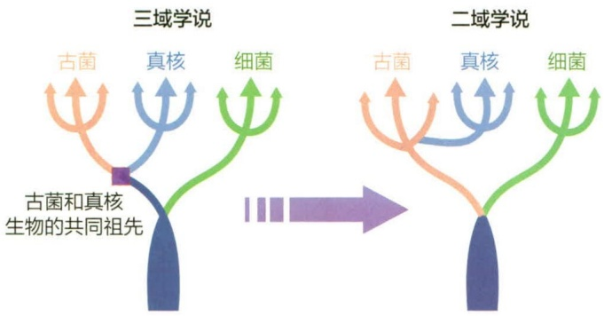

<details>
<summary>flowchart</summary>


</details>

图 14-34 “三域学说”与“二域学说”

“三域学说”主张整个生命体系分为三大域，分别为细菌域、真核生物域以及古菌域。“二域学说”则主张整个生命体系最初只有细菌和古菌，真核生物是从古菌里演化出来的

科学研究的前沿热点。阿斯加德古菌是目前发现的与真核生物亲缘关系最接近的一类古菌，其基因组拥有大量“真核生物特有蛋白”。阿斯加德（Asgard）是北欧神话中阿萨神族的居所，最初的5个阿斯加德古菌门类也均以北欧神话中的神命名，包括洛基古菌门（Ca. Lokiarchaeota）、索尔古菌门（Ca. Thorarchaeota）、奥丁古菌门（Ca. Odinarchaeota）、海姆达尔古菌门（Ca. Heimdallarchaeota）和海拉古菌门（Ca. Helarchaeota）。近年来，随着更多研究的开展，新的门类被不断发现，现今阿斯加德古菌超门已经包括了至少16个门类，新增的门类包括巴德尔古菌门（Ca. Baldrarchaeota）、包尔古菌门（Ca. Borrarchaeota）、

弗雷古菌门（Ca. Freyrarchaeota）、葛德古菌门（Ca. Gerdarchaeota）、赫尔莫德古菌门（Ca. Hermodarchaeota）、霍德尔古菌门（Ca. Hodarchaeota）、卡瑞古菌门（Ca. Kariarchaeota）、涅尔德古菌门（Ca. Njordarchaeota）、希芙古菌门（Ca. Sifarchaeota）、西格恩古菌门（Ca. Sigynarchaeota）和悟空古菌门（Ca. Wukongarchaeota）。

## 14.2.4.1 阿斯加德古菌系统发育多样性及分布

2015年，研究人员在“洛基城堡”向北约 $15\mathrm{km}$ 的海底沉积物中发现了一种新的古菌，它不属于任一已知的古菌门或超门，因此以其发现地而命名为Ca. Lokiarchaeota（洛基古菌门）。洛基城堡（Loki's Castle）是位于大西洋中部，在格陵兰岛与挪威之间的海面下方 $2352\mathrm{m}$ 处的一片海底热液区，这里分布了多处热液口，独特的地形结构也孕育着许多等待发掘的奇幻生命。除了地理位置，洛基古菌的命名灵感也有部分是来自北欧神话中洛基的形象，意指“充满矛盾和困惑”，而这正好可以用来形容真核生物和古菌之间的演化关系。此前洛基古菌门的16S rRNA基因序列被发现在深海沉积物中大量存在，被称为“深海类群B（Marine Benthic Group B, MBG-B）”或“深海古菌类群（Deep Sea Archaeal Group, DSAG）。洛基古菌门不仅是当时已知的与真核生物亲缘关系最近的类群，而且拥有许多真核生物特有的基因组特征，因此为真核生物的起源与细胞复杂性提供了独特的见解。洛基古菌门的发现重新点燃了对“真核生物细胞的起源”这一谜题的争论和研究，也导致了学界对这一新古菌谱系的热切关注。次年，研究人员从美国白栎木河的河口底泥宏基因组中重构出3个接近完整的基因组，其在系统发育位置上与洛基古菌门互为姐妹支，并被命名为“索尔古菌门”，源自北欧神话中洛基的兄弟——雷神索尔。2017年，研究人员对不同环境的沉积物进行宏基因组测序分析，发现了与洛基古菌门和索尔古菌门系统发育距离接近的新门类——“奥丁古菌门”（源自众神之王:奥丁）和“海姆达尔古菌门”（源自光之神:海姆达尔），它们分别来自热泉底泥和海洋底泥样品。同时，研究人员在此提出以北欧神话的诸神王国“阿斯加德”的名字来命名这一古菌超门。

---

14.2 古菌多样性

457

随后，阿斯加德古菌超门下的类群如雨后春笋般地涌现，包括2019年在加利福尼亚湾瓜伊马斯盆地深海热液口沉积物中发现的“海拉古菌门”（源自死亡女神:海拉）和2020年在中国红树林湿地沉积物中发现的“葛德古菌门”（源自女巨人:葛德）。其次，2021年，阿斯加德古菌类群得到了迅速扩展，包括在哥斯达黎加深海沉积物中发现了“希芙古菌门”，因其与索尔古菌有最近的系统发育距离，便以索尔的妻子希芙（土地和收获女神）命名；以及在瓜伊马斯盆地深海沉积物和中国腾冲热泉环境中发现了“西格恩古菌门”（源自胜利之神:西格恩）、“弗雷古菌门”（源自和平之神:弗雷）和“涅尔德古菌门”（源自海之神:涅尔德）。同年，中国研究者将不同环境样品的宏基因组进行整合分析，获得了162个高质量的阿斯加德古菌基因组，其中75个属于尚未报道的新基因组，从中发现了6个尚未被报道的阿斯加德古菌新门，分别命名为“赫尔莫德古菌门”（源自神使:赫尔莫德）、“霍德尔古菌门”（源自黑暗之神:霍德尔）、“卡瑞古菌门”（源自风之神:卡瑞）、“包尔古菌门”（源自奥丁之父:包尔）、“巴德尔古菌门”（源自光明之神:巴德尔）和“悟空古菌门”（源自中国古典名著《西游记》中大闹天宫的齐天大圣:孙悟空）（图14-35）。研究分析表明，悟空古菌门具备氢氧化的化能自养代谢潜能，显著区别于其他阿斯加德古菌混合营养或异养的代谢模式，这也是将其命名为中国神话人物的原因。

目前，阿斯加德古菌超门中仅有两株分离培养的菌株。2020年，日本科学家团队经过十年探索，从深海沉积物中分离培养出第一株洛基古菌——“Candidatus Prometheoarchaeum syntrophicum strain MK-D1”，该名字源自希腊神话中的神“普罗米修斯”。实验室获得的培养物并非仅含单一菌株，而是含洛基古菌Ca. P. syntrophicum strain MK-D1和产甲烷菌Methanogenium两种相互依存的菌。在电镜下，MK-D1细胞呈球状，极其微小（直径约为550 nm），表面有长短不一且分叉的突触。研究人员推测这种突触可能帮助MK-D1与细菌细胞结合。MK-D1是一种生长极其缓慢的专性共生厌氧菌，可通过与产甲烷菌协作降解氨基酸。2022年，在斯洛文尼亚皮兰海岸附近的沉积物中成功分离培养了第二株洛基古菌——Lokiarchaeum ossiferum。这是科学家

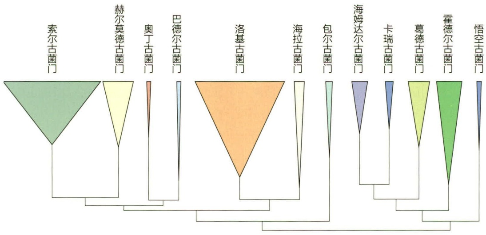

<details>
<summary>flowchart</summary>

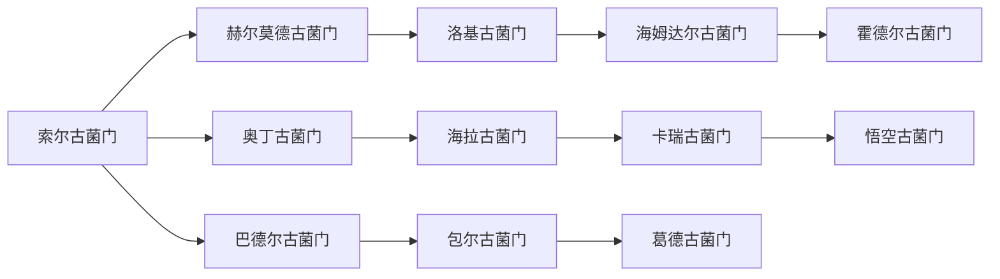
</details>

图 14-35 阿斯加德古菌的系统发育树

合并分支的面积与基因组数量成正比

---

458

14 微生物物种多样性

们首次在实验室中培养出足够数量的阿斯加德古菌，并拍摄了菌株的内部结构以详细研究。研究发现，L. ossiferum 也有突触，但其突触上有增稠物和小气泡。此外，在细胞内还发现了蛋白丝网络——这是只在复杂的真核细胞中观察到过的特征，与真核细胞中构成细胞骨架的肌动蛋白丝非常相似。这表明，在第一批真核生物出现之前，复杂的细胞骨架结构就已经出现于古菌中了，意味着阿斯加德古菌可能是真核生物重要的演化前体。

阿斯加德古菌的分布也非常广泛，目前已经被发现可存在于全球范围内的多种生态环境中，包括海洋和淡水环境、陆地土壤、陆地热泉和深海热液口等，但主要还是厌氧沉积物环境。洛基古菌在微生物群落中丰度较高，而索尔古菌、海姆达尔古菌和奥丁古菌一般属于低丰度类群。海姆达尔古菌和洛基古菌主要出现在海洋沉积物中，索尔古菌可栖息于海洋、湖泊、河口沉积物等不同环境，而奥丁古菌似乎是唯一一个只存在于高温生境的阿斯加德古菌门类。其次，通过对 SILVA 数据库中阿斯加德古菌的 16S rRNA 基因序列进行调查发现，其中，22% 有效序列来自高盐环境的洛基古菌。洛基古菌也是所有阿斯加德古菌中适应 pH 范围最广的类群（pH 为 5.0～9.0），而奥丁古菌只在中性到弱碱性（pH 为 7.5～8.5）环境中有发现。

## 14.2.4.2 阿斯加德古菌的功能多样性

目前对阿斯加德古菌功能的了解主要基于基因组预测的代谢潜能分析。洛基古菌和索尔古菌基因组编码了完整的古菌型 Wood-Ljungdahl 通路和 NiFe 氢化酶基因，因此可能是可固定  $CO_{2}$  的无机营养型，甚至还可能拥有生成氢气或消耗氢气的能力。推测索尔古菌是自养产乙酸菌和硫还原菌。希芙古菌，与索尔古菌有最近的系统发育距离，编码厌氧甲基营养型代谢通路，可利用  $C_{1}$  到  $C_{3}$  化合物（如甲醇、甲胺）来合成乙酰辅酶 A，还拥有大量碳水化合物活性酶。海拉古菌基因组则具有甲基辅酶 M 还原酶、Wood-Ljungdahl 通路和烷基辅酶 A 氧化相关的基因，与丁烷氧化古菌的基因组特征相似，研究人员推测海拉古菌基因组具有厌氧氧化短链烷烃的潜能，在深海碳氢化合物循环中发挥重要作用。海姆达尔古菌则是一个功能多样性较高的门类，可在浅水盐湖底泥中占据微氧环境的生态位，使用独特的好氧型烟酰胺腺嘌呤二核苷酸（NAD）合成途径。海姆达尔古菌基因组中还发现了一种新型质子泵视紫红质家族基因，说明该类群具有光敏性。除海姆达尔古菌外，洛基古菌和索尔古菌基因组中也被发现过视紫红质基因，说明在阿斯加德古菌的演化史中，它们曾栖息于光暴露的环境中。另外，深海沉积物中的海姆达尔古菌则是进行有机物发酵的异养代谢，一部分古菌可以使用硝酸盐或氧气作为电子受体氧化有机底物，另一部分古菌可以将铁还原蛋白的再氧化与呼吸作用中的质子还原偶联用于发酵有机底物储能。

奥丁古菌是一类独特的阿斯加德古菌，可能是该超门中唯一的嗜热类群。其代谢潜能似乎有限，基因组缺乏 Wood-Ljungdahl 通路和  $\beta$  氧化通路的关键基因，只编码三羧酸循环的部分基因，但具有将有机底物发酵成乙酸的潜力，属于嗜热的发酵异养菌。异养的涅尔德古菌可利用多肽和氨基酸，而西格恩古菌和弗雷古菌则可通过 Wood-Ljungdahl 通路固定无机碳和降解有机底物。另外，在弗雷古菌基因组中，还

---

14.2 古菌多样性

459

有细菌特有的同型产乙酸通路。值得注意的是，悟空古菌基因组编码了完整的厌氧钴胺素（维生素 $B_{12}$ ）合成途径，这是一个能量消耗较大的生物合成过程。赫尔莫德古菌可编码烷基/苯甲基琥珀酸盐合成酶，可能是严格厌氧的烷烃和芳香烃化合物降解菌，并偶联硝酸盐还原过程。

通过对不同阿斯加德古菌门类代谢潜力比较分析，发现阿斯加德古菌主要是有机异养菌，并具有可变的氢气消耗或生成的能力。在此基础上，推测出阿斯加德古菌的共同祖先（last Asgard archaeal common ancestor，LAsCA）的代谢潜能:它既可以利用 $H_{2}$ 和 $CO_{2}$ 进行无机自养，也可以利用有机底物（如脂肪酸，甚至烷烃或芳香烃化合物）进行有机异养，可能还可以通过氢化酶作用生成 $H_{2}$ 。除了基因组层面的研究外，目前对阿斯加德古菌的原位活性也有了一定的探索。通过宏转录组分析，发现了洛基古菌NiFe型氢化酶基因的转录本，以及许多阿斯加德古菌（包括洛基古菌、索尔古菌、海拉古菌、葛德古菌和海姆达尔古菌）能够降解多肽、氨基酸和脂肪酸等有机物，并在海岸沉积物的不同深度中均占有独特的生态位。其次，通过稳定性同位素探测分析，洛基古菌的不同亚群具备不同的代谢能力，在深海沉积物中占据不同的生态位，如亚群Loki-2利用蛋白质和无机碳，作为碳源和能源，参与富集培养液中细菌生物质的降解；而亚群Loki-3具有乳酸降解途径及芳香族化合物降解潜力。

## 14.2.4.3 真核特征蛋白和真核起源学说

真核生物（包括植物、动物、原生生物和真菌）的起源是生命科学的最大谜题之一。细菌和古菌的细胞学特征相对简单，真核生物的细胞学特征具有高度复杂性。大多数假设认为原核生物向真核生物转变，但很难解释真核生物的共同祖先存在内膜系统、核孔、剪接体、泛素蛋白降解系统、RNAi机制、细胞骨架结构和吞噬机制等复杂结构或机制。根据目前比较流行的内共生假说，该假说认为大约20亿年前，一种作为内共生体的α-变形菌纲细菌与一种作为宿主的古菌之间发生细胞结合，形成了最早的真核生物细胞，细菌细胞演化成为真核生物细胞中进行产能代谢的细胞器——线粒体。其中，真核细胞线粒体起源于α-变形菌的观点是基本受到学界认可的，但古菌细胞的宿主身份一直受到质疑。然而，阿斯加德古菌的发现及其独特的基因组特征为真核生物的古菌起源学说提供了重要线索。首先，系统发育分析显示阿斯加德古菌是与真核生物最亲近的类群，且真核生物所在分支位于古菌域分支中，为生命树的二域学说提供了一个令人信服的证据。其次，阿斯加德古菌拥有大量此前被认为是真核生物所特有的基因，这些基因编码的蛋白被统称为“真核特征蛋白”（eukaryotic signature protein, ESP）。

阿斯加德古菌的出现重新激起了关于真核生物起源于古菌宿主细胞的讨论。随后，出现了众多基于洛基古菌基因组信息，对其细胞复杂性、膜的组成和功能代谢进行的研究，试图解释真核生物的起源和早期演化（图 14-36）。早在 2016 年，研究人员根据洛基古菌的氢气依赖型生活方式，提出了一种真核生物宿主起源的假说——“氢假说”。该假说认为洛基古菌是一种厌氧的氢气依赖的自养生物，所以它不太可能拥有一定程度的细胞复杂性。2019 年，海姆达尔古菌被发现，由于它是当时

---

460

14 微生物物种多样性

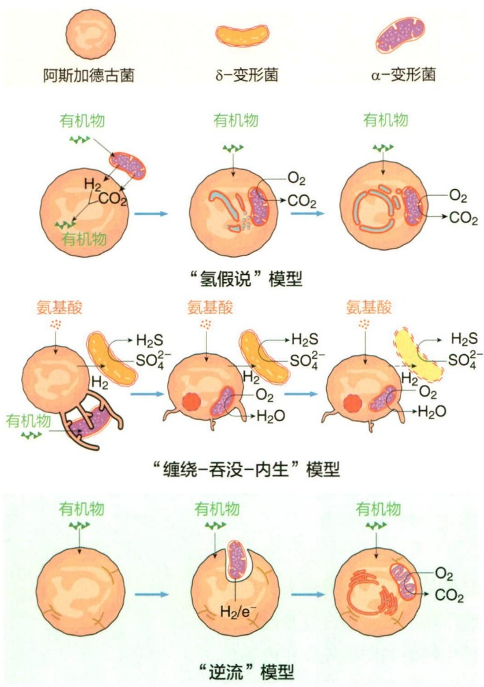

<details>
<summary>flowchart</summary>

This image illustrates three different biological models (“氢假说” model, “缠绕-吞没-内生” model, and “逆流” model) for developing bacterial organisms using various antimicrobial agents such as hydrocarbons, amyl acids, and glucose.
</details>

图 14-36 不同假说的真核细胞起源演化模型

最接近真核生物的古菌类群，且包含氧气依赖的代谢途径，因此提出了“需氧原始真核生物”模型假设，即真核生物的古菌、细菌祖先都具有氧气依赖的代谢方式。

2020 年，首个阿斯加德古菌菌株 MK-D1 被成功分离培养，依据其独特的长且分枝突触结构和基因组功能信息，提出了“缠绕—吞没—内生”的真核生物生成模型，即古菌宿主利用自身的胞外结构吞没代谢伴侣，同时形成一个与核膜拓扑结构相似的原始的包围染色体的结构。如此则引发了另一个问题，古菌细胞膜为醚类脂质膜，而现存的真核生物则是酯类脂质膜。但有研究表示，脂质可以在不影响膜完整性的情况下混合，预示着酯类脂质有可能简单地取代宿主的醚类脂质。其次，在阿斯加德古菌基因组中，发现了细菌和真核生物特有的酯类脂质的生物合成酶，支持阿斯加德古菌可能拥有醚酯混合脂质的假设。直到 2021 年，通过对阿斯加德古菌超门进行详细的比较基因组分析，发现基于阿斯加德古菌主要是有机异养菌，并具有可变的氢气消耗或生成能力的分析结果，提出了一个更新的真核生物起源共生模型——“逆流模型”，涉及从有机异养古菌宿主到共生细菌的电子或氢的流动过程。逆流模型所认为的共生作用的方向，与以往的


氢假说的共生方向相反。逆流模型认为，真核生物的古菌祖先通过发酵作用产生还原性底物，这些物质被线粒体的兼性厌氧  $\alpha-$  变形菌祖先所吸收、利用。这种反向电子流与目前所发现的阿斯加德古菌基因组特征最为匹配。

## 14.3 真核微生物的多样性

细菌与古菌的多样性演化与互作孕育了真核生物的起源。相对于人们更熟悉的动物和植物，真核微生物多样性更高，但是获得深入研究的物种却比较少。真核微生物从形态上被分为原生生物（protista）、真菌（fungi）和藻类（algae）。藻类包括除了植物之外的能进行光合作用的单细胞和多细胞真核生物。真菌包括具有几丁质细胞壁的非光合真核微生物。原生生物的范畴则一直比较模糊，1860年约翰·霍格（John Hogg）用Protoctista表示起源早于动植物的生物；1866年开始恩斯特·海克尔（Ernst Haeckel）用Protista表示以起源早于动植物的单细胞生物为主的一大类生物；如今

---

14.3 真核微生物的多样性

461

比较流行的范畴为动物、陆生植物和真菌之外的其他真核生物。真核微生物的营养型根据碳源、能源及电子供体性质的不同，可将绝大部分微生物分为光能无机自养型（photolithoautotrophy）、光能有机异养型（photoorganoheterophy）、化能无机营养型（chemolithoautotrophy）及化能有机异养型（chemoorganoheterotrophy）4种类型。

## 14.3.1 真核微生物的细胞器与系统发育

## 14.3.1.1 真核细胞和内共生

正如真核生物的定义，真核微生物有核膜包被的 DNA，即细胞核，并且还具有其他不同形状和大小的膜包被的细胞器。现存的真核生物几乎都需要叶绿体等色素体和（或）线粒体进行光合磷酸化与氧化磷酸化，这是两种效率较高的依赖电子传递链打破电化学平衡的产能方式（见第 7 章有关能量代谢的部分），有助于更好地维持真核微生物的各种代谢活动。真核生物的起源仍然是未解之谜，但是科学家一直在孜孜不倦地探索。如前文所述，基于系统发育、基因组学、细胞生物学与代谢分析等，真核生物的最近共同祖先很有可能是一种与细菌共生的阿斯加德古菌，它虽然没有能量代谢细胞器，但是可以通过与其共生细菌的代谢来获得能量。

当前认知支持的能量代谢细胞器演化模型为: $\alpha-$ 变形菌纲细菌被阿斯加德古菌内共生并逐步演化为线粒体，蓝细菌被原生生物内共生并演化为真核生物的叶绿体。这两个内共生事件都被称为初级内共生（primary endosymbiosis），因为细菌都是被受体细胞直接获取的。而且在内共生过程中，细菌与受体细胞首先建立的是一种生理上互相依赖的关系，然后逐步发生基因组的演化（如现存线粒体与叶绿体基因组很小，部分基因被转移到真核生物的核基因组），最后变得不可分离。由蓝细菌的初级内共生事件引发而演化出的光合真核生物包括绿色植物（陆生植物和绿藻，均含有叶绿体）、红藻（含有藻红体）和灰藻（含有灰质体），它们也被称为原始色素体生物（archaeplastida）。其中绿藻和红藻又分别被不同的原生生物内共生，原生生物形成新的能够进行光合作用的真核生物——由于这个过程涉及一个已经发生过初级内共生的受体细胞生物获得第二个内共生体，所以被称为次级内共生（secondary endosymbiosis）。随着演化的推进，除了叶绿体或藻红体的功能，绿藻和红藻内共生体很多其他特征都丢失了。上述基于初级内共生的次级内共生演化如图14-37所示，这些多次独立的次级内共生将光合磷酸化系统扩散到了更多的真核生物中。

基于上述的线粒体和叶绿体内共生起源假说，2018年和2022年科学家先后通过遗传改造使大肠杆菌和蓝细菌能够分泌ATP，并借助原生质体融合的方法把它们分别导入线粒体功能缺陷的酵母细胞中，形成了两种新的嵌合细胞——具备分泌ATP能力的大肠杆菌和蓝细菌分别能够替代线粒体为嵌合细胞提供能量，其中光照可以促进“酵母-蓝细菌”嵌合细胞的生长，说明光合磷酸化在发挥作用。这些开创性工作为我们最终揭示真核生物的起源与多样性演化机制提供了重要参考。

---

462

14 微生物物种多样性

图 14-37 基于初级内共生的次级内共生

具有线粒体的真核生物内共生蓝细菌并逐步演化出原始色素体生物（红藻、灰藻、绿藻、陆生植物），其中绿藻和红藻通过多次独立的次级内共生将光合磷酸化功能扩散到了更多的真核生物中

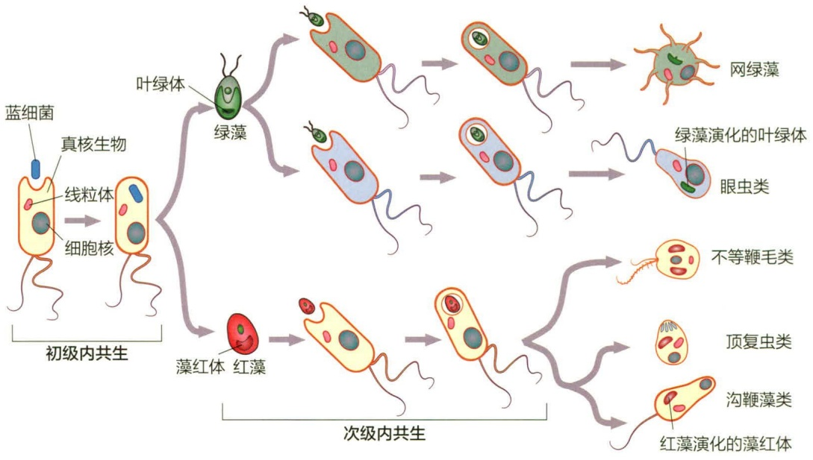

<details>
<summary>flowchart</summary>

This flowchart illustrates the biological process of cell growth, showing how blue bacteria and RNA biofilm are converted into green leaves, followed by regeneration of various stages including eye tumors, red blood cells, and neoplasms.
</details>

## 14.3.1.2 真核生物的系统发育谱系

基于系统发育学研究和一部分相关的化石证据，科学家们推测真核生物在演化的早期就发生了辐射演化（图 14-38）。从真核生物的系统发育树上可以看到这个辐射演化的时间点应该在  $\alpha-$  变形菌纲细菌初级内共生之后。这些辐射演化的分支逐步演化出现存的 5 个主要的真核生物超类群:原始色素体生物（Archaeplastida）、后鞭毛生物超类群（Opistchkonta）、SAR 超类群 [包括不等鞭毛类（Stramenopiles）、囊泡虫类（Alveolata）、有孔虫类（Rhizaria）]、古虫超类群（Exavates）和变形虫（Amoebozoa）——它们都有线粒体、与线粒体结构同源的结构或这些结构的一些遗传证据。

图 14-38 真核生物系统发育树

不同颜色表示真核生物的5个超类群。黑色细线:①α变形杆菌的初级内共生；②蓝细菌的初级内共生；③红藻和绿藻的次级内共生

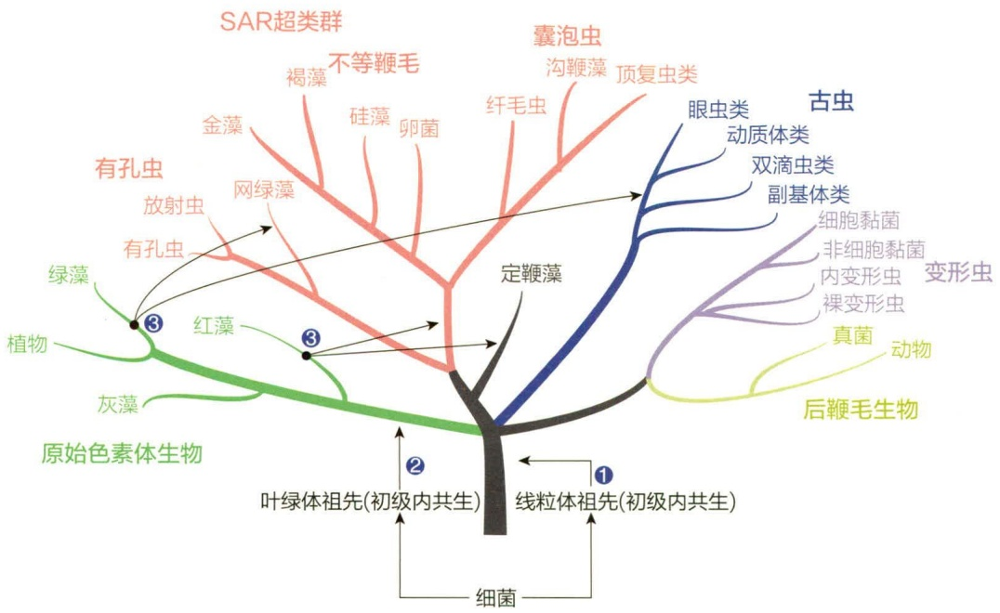

<details>
<summary>flowchart</summary>

This diagram illustrates the evolutionary relationships and bioinformatics pathways of insect species, showing how various organisms (such as SAR, infested, and plant) transition from their initial growth to their respective biological forms.
</details>

---

14.3 真核微生物的多样性

463

如代谢一章所述，氧气作为电子传递链最终电子受体的有氧呼吸所产生的能量要大于无氧呼吸和发酵（见第7章）；而伴随着地球大气中氧气浓度的上升，包含线粒体这个氧化磷酸化产能细胞器的细胞生物利用氧气的优势得到充分体现——这可能导致了辐射演化的发生。在氧气浓度上升的过程中，能进行产氧光合作用的蓝细菌可能发挥了重要作用；而当蓝细菌被一部分真核生物初级内共生并逐步演化为光合磷酸化细胞器之后，真核生物演化出的原始色素体生物（红藻、绿藻、灰藻和植物）进一步保障了生物圈越来越多地依赖氧化磷酸化生存的细胞生物对氧气的需求，促进了生物多样性的进一步发展。后鞭毛生物包括真菌和动物，均为单系群。变形虫超类群包括了很多形式的变形虫和黏菌，但是其他超类群中也有变形虫形态的物种。不等鞭毛类、囊泡虫、有孔虫组成的SAR超类群，包括化能异养和光能营养物种；其中的光能营养物种都是通过次级内共生获得光合磷酸化功能。古虫超类群包括很多厌氧的原生生物物种，也有部分物种通过次级内共生获得了光能营养的能力。这5个超类群并没有涵盖所有的真核生物，如定鞭藻（Haptophytes）等。

随着生物多样性研究的推进，可能会发现更多的真核生物物种，而且随着基因组学和相关分子生物学研究的开展，一些“困惑”也将逐步得到解决。例如，与绝大多数好氧生活的真核生物不同，梨形鞭毛虫（Giardia）、内阿米巴虫（Entamoeba）和其他一些致病真核微生物均缺少线粒体，需进行厌氧生活——但是基因组分析发现这些无线粒体（amitochondriate）真核微生物具有线粒体来源的一些基因，说明它们在演化过程中曾经具有线粒体。这些特殊的真核微生物可能在其厌氧生态位的选择压力下又丢掉了线粒体。从图14-38中可以明显地感受到植物和动物作为人类研究最多的真核生物仅占了真核生物多样性的冰山“两角”，动物与真菌具有最近共同祖先，植物与其他原始色素体生物具有最近共同祖先，真核生物更广的多样性则体现为原生生物的多样性。

## 14.3.2 原生生物

1860年由约翰·霍格（John Hogg）首次提出原生生物——它们是不同于动植物的生物。而提到原生生物，有一位科学家的名字也是不得不提的——恩斯特·海克尔（Ernst Haeckel，1834—1919），他在一系列专著中系统研究了原生生物的多样性和系统发育，被誉为原生生物学之父。当达尔文在环球航行考察的时候，海克尔在德国出生了，达尔文的《物种起源》出版后（1859）在国际上产生了巨大影响，作为达尔文的粉丝，海克尔在1866年绘制了一个描述自然界生物之间关系的生命之树，分为植物、原生生物和动物，并在《人的演化》著作中研讨了部分原生生物作为人类祖先的假说。

## 14.3.2.1 古虫类（Excavates）

古虫类超类群包括光能营养和化能异养生物，其中一部分进行厌氧生活。其中，副基体类（Parabasalids）和双滴虫类（Diplomonads）缺少线粒体和叶绿体，它们生

---

464

14 微生物物种多样性

活在缺氧的生境（如动物肠道），通过发酵获取能量。双滴虫类物种具有两个细胞核、纺锤剩体（mitosome），但缺少电子传递链蛋白与三羧酸循环酶系的线粒体。例如双滴虫类的梨形鞭毛虫属（Giardia）物种基因组约为12 Mb，内含子少，缺少三羧酸循环，进行厌氧生活；其中篮氏贾第鞭毛虫（Giardia intestinalis）能引起人类的贾第鞭毛虫病。

副基体类生物具有一个副基体——可以从结构上支撑高尔基体，它们缺少线粒体但是具有氢化酶体（hydrogenosomes）。氢化酶体起源于线粒体，通过发酵产氢气与乙酸获得ATP，是一个厌氧细胞器。多数副基体类生物的基因组缺少内含子，其中阴道毛滴虫（Trichomonas vaginalis）的基因组达160 Mb——包括很多重复序列和转座元件以及从细菌获得的基因。它们生活在动物的肠道和泌尿生殖管道，其中T. vaginalis能引起一个重要的依靠性行为传播的人类疾病——滴虫性阴道炎或尿道炎。

动质体类（Kinetoplastids）具有单个大线粒体，这个线粒体含有大量多拷贝的线粒体基因组DNA。它们的生境主要是水体，可以取食细菌，也有一些物种是动物的病原物，可以引起人类和脊椎动物的疾病。例如，锥体虫属（Trypanosoma）约20  $\mu$ m长，呈新月形状，具有一个被细胞质膜包裹的鞭毛——可以推动个体在血液等黏性液体中移动。布氏锥体虫（Trypanosoma brucei）可以被非洲的舌蝇（Glossina）传播并侵染人体，它的两个亚种布氏锥虫冈比亚亚种（T. b. gambiense）和布氏锥虫罗得西亚亚种（T. b. rhodesiense）可分别在西非-中非地区和东非-南非地区引起慢性和急性锥虫病，锥虫病也叫“昏睡病”。动质体类还包括其他人体病原物，如由吸血猎蝽虫传播的克鲁斯锥虫（Trypanosoma cruzi）能引起恰加斯病；由沙蝇传播的利什曼原虫（Leishmania）能引起利什曼病（黑热病）。

眼虫类（Euglenids）物种不致病，它们生活在淡水和海水中，多数物种在背腹各生一个鞭毛，使得它们能够在光亮和黑暗的生境之间移动，分别进行光能营养和化能营养生活。例如，眼虫属（Euglend）物种在有光线的生境利用叶绿体进行光合作用，而在黑暗条件下会因缺失叶绿体只进行化能营养。许多眼虫属物种还能够吞噬细菌细胞，细菌在吞噬体中被消化，释放营养物质。

## 14.3.2.2 囊泡虫类（Alveolata）

囊泡虫类包括纤毛虫门（Ciliates）、双鞭毛虫门（甲藻门）和顶复虫门（Apicomplexans）三个分支，会在细胞质膜下面形成特征性的囊泡。这些囊泡可能通过控制水的进出来维持细胞渗透压平衡。纤毛虫具有两种细胞核:微核（micronuclei）与大核（macronuclei）。大核也被称为滋养核，因为它包含的基因调控生长和取食等基本细胞功能，而微核的基因参与有性生殖。纤毛虫在其生活史的特定阶段会形成大量纤毛——成簇、成行或覆盖整个细胞表面。最有名的纤毛虫就是草履虫（Paramecium），它们用纤毛来运动和获取细菌等食物；食物被口槽中的纤毛运送到细胞的食管，然后通过吞噬作用被液泡包裹并被酶消化。许多草履虫是一些内共生细菌、古菌或绿藻的宿主。一些厌氧的纤毛虫也有内共生体，例如，生活在白蚁后肠的纤毛虫具有产甲烷古菌内共生菌。一些严格厌氧的纤毛虫在反刍动物的瘤胃和前胃中

---

14.3 真核微生物的多样性

465

参与消化和发酵过程。部分纤毛虫是动物的病原物，如结肠小袋纤毛虫（Balantidium coli）是驯养动物肠道病原物，可以引起类似痢疾的症状。

沟鞭藻是生活在海洋和淡水中的光能营养生物，它们具有两条长度不等的横向和纵向插入的鞭毛。一些沟鞭藻物种能够与形成珊瑚礁的动物共生，为它们提供光合作用固定的碳源。在夜晚，海边一些自由生活的沟鞭藻物种受到干扰后会发光，形成漂亮的生物发光现象。还有一些沟鞭藻物种的旺盛生长会产生有害藻华——水流动慢、水温上升，尤其是城市和工业废水排放所引起的富营养化会促进藻华的发生，藻华分泌有毒物质并导致水中氧气不足，从而导致鱼类死亡。例如，多纹膝沟藻（Gonyaulax polygramma）含有红色素，其在受到污染的海域可以引起赤潮，如果人类食用含有大量膝沟藻细胞的贻贝就有可能中毒。

顶复虫类物种不能进行光能营养，吸收可溶性营养物质，具有不能运动的成年阶段，能产生孢子体（sporozoites），孢子体一端的一个细胞器复合物可以刺入宿主细胞，顶复虫物种是严谨性病原物。例如，引起人类疟疾、弓形虫病、球虫病和隐孢子虫病的疟原虫（Plasmodium）、弓形虫（Toxoplasma）、艾美虫（Eimeria）和隐孢子虫（Cryptosporidiumn）物种。顶复虫类物种具有顶质体（Apicoplasts），这是不能进行光合作用的质体，可能由于红藻的次级内共生，逐步丧失了光合作用的能力，但是能够催化脂肪酸、类异戊二烯和血红素等生物合成。

## 14.3.2.3 不等鞭毛类（Stramenopiles）

不等鞭毛类生物包括金藻（gold algae）、褐藻（brown algae）、硅藻（diatom）和卵菌（oomycetes）等，分为化能有机营养和光能营养生物，鞭毛通常具有很多短发状分叉。

金藻物种的叶绿体含有类胡萝卜素、岩藻黄质和叶绿素c，呈金棕色；多数物种具有两条长度不等的鞭毛，是水生单细胞光能营养生物；部分物种是化能有机营养生物，可以通过吞噬作用或吸收可溶性有机物生活。

褐藻是水生多细胞生物，其叶绿体中类胡萝卜素、岩藻黄质的含量多少会决定其颜色为褐色或绿色。海洋中绝大多数海草是褐藻，例如巨藻（Macrocystis）的长度可达50 m。

硅藻为水生的单细胞光能营养真核微生物，是海洋和淡水生态系统中主要的浮游光合微生物；细胞壁具有二氧化硅组成的外骨骼及其附着的蛋白和多糖，这个特殊的结构可以保护硅藻，在细胞死亡后硅化的细胞壁会沉降并在水体沉积物中长期存在，甚至形成化石。硅藻的硅化细胞壁通常会呈现对称的外形:羽状对称或放射状对称（图 14-39）。

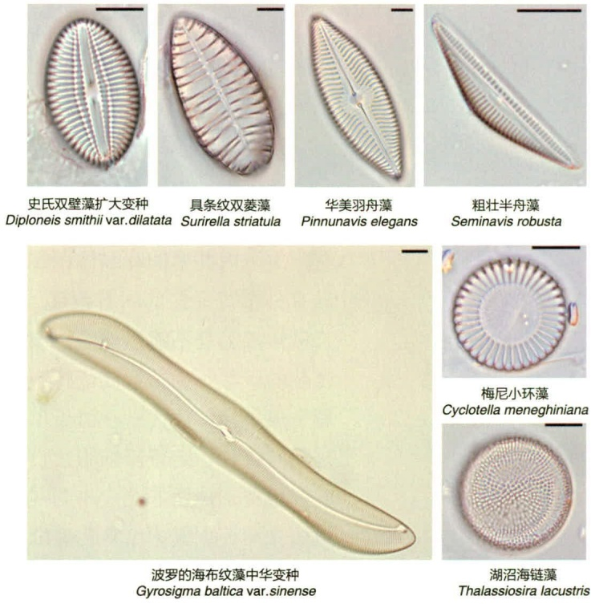

图 14-39 硅藻物种（图片来源:青岛水族馆郭嘉瑱）

标尺为 ${10\mu }\mathrm{m}$

---

466

14 微生物物种多样性

卵菌具有菌丝形态及多核菌丝，可以分解动植物残体，这些特征使得人们之前将其归为真菌，但是它们的细胞壁是纤维素而不是真菌典型的几丁质细胞壁，而且系统发育分析表明卵菌与其他不等鞭毛类原生生物亲缘关系更近。卵菌的很多物种是植物病原物，例如致病疫霉（Phytophthora infestans）能够引起马铃薯晚疫病，造成了19世纪中叶爱尔兰的大饥荒；Albugo能在多种农作物上引起白锈病。

## 14.3.2.4 有孔虫类（Rhizaria）

有孔虫类生物的一个重要特征是具有线状的细胞质突起，即伪足（pseudopodium），可以用于移动和取食，有孔虫类包括有孔虫（foraminifer）、放射虫（radiolarian），另外网绿藻（chlorarachniophyte）与有孔虫和放射虫有较近的亲缘关系（图14-38），有些学者把网绿藻纳入有孔虫类，也有学者把网绿藻单列出来。有孔虫目（Foraminiferans）生活在海洋生态系统，会形成华丽的外壳，这些外壳由有机物和碳酸钙组成；由于外壳的重量，有孔虫目的物种经常生活在水底，取食沉积物中溶解的有机质、细菌、其他原生生物，以及生物残体；由于外壳和细胞的结合并不牢固，变形细胞在取食的时候可能伸出外壳；这些外壳与硅藻的外壳类似，不易降解并能形成化石。部分有孔虫能够作为宿主和许多藻类形成共生关系，为藻类提供无机营养物来获取有机碳。放射虫类物种生活在海洋上层水体，以细菌和有机物为食，是海洋浮游的化能有机营养生物。放射虫物种不仅有辐射状对称的硅质外壳骨架，而且它们还具有大液泡能够积累脂滴，这些特征以及针状的伪足都可能有助于它们营浮游生活。不过它们死亡后，其硅质外壳还是会沉到海底。网绿藻在淡水和海水生态系统中生活，具有一个鞭毛，其叶绿体有4层膜，是典型的通过次级内共生获得光能营养能力的原生生物，在两套叶绿体膜之间存在次级内共生过程中藻类的细胞核残留——被称为类核体（nucleomorph），但是类核体的基因组相对于它的藻类祖先来说已经经历了很大程度的缩减，可能随着演化的推进会逐步从叶绿体中丢失。

## 14.3.2.5 定鞭藻（Haptophyta）

定鞭藻是真核生物辐射演化过程中出现较早的一个系统发育分支，但是并不属于那些超类群。定鞭藻类生物是水生的单细胞光能营养生物，有两个鞭毛和两个起源于红藻次级内共生的叶绿体；该类生物的生活史包括单倍体和二倍体阶段，单倍体细胞具有一个特征性的附着鞭毛（被称为 haptonema），用于附着和躲避捕食者以及取食；二倍体细胞是不能运动的，细胞表面会形成坚硬的多糖外壳板，这些外壳还可以发生复杂的碳酸钙矿化形成方解石；二倍体细胞通过二分裂产生二倍体后代，通过减数分裂生成单倍体后代——由于单倍体和二倍体细胞表型差异较大，有时会被错误地认为是不同物种。定鞭藻细胞死亡后，由于方解石外壳本身的重量较大，它们会沉降到海底并最终形成沉积岩——可见定鞭藻可以固定二氧化碳并最终把碳存在海底岩石中，从而在调控大气中二氧化碳浓度方面发挥重要作用。此外，部分定鞭藻物种是混合营养型，既能进行光合磷酸化获取能量也能取食更小的生物。

## 14.3.2.6 变形虫（Amoebozoa）

变形虫超类群包括黏菌、内变形虫（Entamoebas）、裸变形虫（Gymnamoebas），

---

14.3 真核微生物的多样性

467

它们具有叶状伪足，用于移动和取食。裸变形虫自由分布在水体和土壤生态系统中，它们利用伪足进行变形运动，通过吞噬作用取食细菌、其他原生生物和有机物。裸变形虫的变形运动依赖其紧贴细胞质膜的一层微丝，微丝介导了细胞质向细胞尖端的流动。内变形虫分布在动物口腔或肠道，并且可以通过粪便对水体和食物的污染等方式在人群中传播致病，例如痢疾变形虫（Entamoeba histolytica）能引起人类的变形虫痢疾。

黏菌主要分布在腐烂的植物组织上，以取食细菌等微生物为生；它们能够分化形成孢子实体，通过产孢子进行扩散，也可以长期维持在营养体阶段，在固体界面快速运动。黏菌分为细胞黏菌（cellular slime molds）和非细胞黏菌（plasmodial slime molds）两类，前者的营养体为单个变形虫细胞，而后者的营养体为没有固定大小和形状的原生质体。细胞黏菌主要以单个单倍体营养细胞生活，仅在特定条件下形成二倍体；例如盘基网杆菌（Dictyostelium discoideum）的单倍体营养细胞聚集在一起迁移，最终形成孢子体并分化形成孢子；在营养胁迫条件下，它们也会聚集形成伪原生质团（pseudoplasmodium）——这里细胞并没有发生融合；除了无性繁殖，细胞黏菌也可以通过两个集聚的细胞融合产生一个大细胞而发生有性繁殖，这个大细胞会产生较厚的纤维素细胞壁并维持很长时间的休眠状态，最终通过减数分裂产生单倍体细胞，后者可以再进入无性繁殖的生活史。非细胞黏菌的原生质体具有多个二倍体细胞核，并通过变形运动移动，在繁殖阶段可形成包含单倍体孢子的孢子囊；在条件合适的情况下，孢子萌发产生带鞭毛的单倍体带鞭毛运动细胞；两个这样的细胞融合可以再生一个二倍体原生质体。

## 14.3.3 真菌多样性

真菌与动物具有最近共同祖先，是不能进行光能营养的真核微生物，它们具有几丁质细胞壁，一般不能运动，主要生活在土壤里和死去的植物组织上，在生物圈有机物的分解过程中发挥着重要作用；一部分物种也能和植物建立共生关系帮助植物获取营养，也有一些物种是植物或动物的病原物。目前全世界已知的真菌种数大约为120 000种，在过去的几十年内，每年发现和描述的真菌新物种数为1 000～2 000种。根据最近对生物多样性热点地区真菌多样性更全面的调查结果，应用环境DNA或宏基因组研究所发现的真菌新谱系和新物种的比例，以及最近数十年来每年发现和描述的真菌新物种的数量和未来趋势，估测全球真菌物种总数可能在220万至380万种之间。下面根据2020年的分类系统对真菌界的主要类群进行介绍。

## 14.3.3.1 罗兹菌门（Rozellomycota）

罗兹菌门，旧称隐真菌门（Cryptomycota）。2018年，有研究者主张隐真菌与微孢子虫共同构成真菌分类的基部类群，其中微孢子虫属（Microsporidium）位于隐真菌门中一个较深的支序，因此将隐真菌门与微孢子虫门（Microspora）合并，并改称罗兹菌门。微孢子虫的分类地位也由独立的门降至罗兹菌门的一个纲。此前属于隐真

---

468

14 微生物物种多样性

菌门的类群主要以罗兹菌属（Rozella）为代表，这一类群是壶菌门（Chytridiomycota）和芽枝霉门（Blastocladiomycota）内水生游动真菌和卵菌的活体营养细胞内寄生菌。但环境样品的分子标记检测显示，在土壤、海洋、淡水沉积物以及贫氧的环境中，均存在这类真菌，并且在系统发育上具有很丰富的多样性。另一个类群微孢子菌则主要寄生于动物体内，特别是昆虫、甲壳类动物和鱼类，有些还会对人体造成机会性感染。微孢子菌是专性寄生的，只在寄主细胞内生长和繁殖；它们缺乏功能性线粒体，需要依赖寄主给它们提供能量。而寄生的特性导致一些微孢子菌的基因组很小，甚至比一些原核生物的基因组还要小。

## 14.3.3.2 芽枝霉门（Blastocladiomycota）

芽枝霉门和壶菌门中的种类一样都是产游动孢子的水生真菌，此前被归入壶菌门，后主要依据分子系统学和系统发育基因组学的研究结果将其划分为一个独立的门。芽枝霉门有些物种为病原体，会感染水熊虫、水蚤、线虫、多种水生以半水生的植物，以及孑孓等生物。芽枝霉门真菌生活在淡水、泥和土壤中，营腐生生活，分解植物和动物的残体，或是寄生于节肢动物。这个门内已描述的种不到200个。异水霉属是该门内最常见的一个属，该属广泛分布于全球，以腐生菌的形式存在于水和土壤中。

## 14.3.3.3 新美鞭菌门（Neocallimastigomycota）

新美鞭菌门是厌氧性真菌的一门，发现于食草动物的消化道中。新美鞭菌门的微生物于1975年首次在绵羊的瘤胃样品中被发现和描述，现已经从包括反刍动物、非反刍哺乳动物和食草爬行动物在内的50多种动物的消化道中分离出这类真菌。起初这些微生物被认为是鞭毛虫，后经过经典分类学的研究将其划归到了壶菌门，但后来通过分子系统学研究，又将其从壶菌门中划分出来形成了一个单独的门即新美鞭菌门。新美鞭菌门真菌通过游动孢子在动物的消化系统中繁殖，这个门的一些种产单鞭毛的游动孢子，另一些种产多鞭毛的孢子。它们产生纤维素酶和木聚糖酶，以降解宿主所食饲料纤维中的多糖物质产生单糖。基因组学研究表明，这些厌氧真菌的植物纤维降解酶基因中的许多成员是通过横向转移从草食动物消化道内的细菌中获得。因其植物纤维物质的降解能力，这类真菌的工业应用潜力受到关注。因为厌氧生活的原因，它们都缺少真正的线粒体，而含有源自线粒体的氢化酶小体。由于生活于动物体内的缘故，这类真菌具有高于其他真菌类群的最适生长温度。

## 14.3.3.4 单毛壶菌门（Monoblepharidomycota）

单毛壶菌门于 2018 年从壶菌门中划出，并被认为是壶菌门的姊妹群。但是 2022 年，Strassert 等人通过基因组系统发育学的方法证明单毛壶菌门与新美鞭菌门为姊妹群关系，同时单毛壶菌门与新美鞭菌门共同构成壶菌门的姊妹群。该类真菌多为淡水环境中的腐生菌，生活于浸水枝条和水果上，已描述了大约 30 个种。在已建立的 6 个属中，三个属的菌体是单细胞的，另三个属是丝状的。丝状单毛壶菌是在已描述的壶菌类真菌中仅有的拥有真菌丝的类群，并同时具有一些独特的细胞学特性，包括具有中心粒，但缺少顶体。单毛壶菌门的有性生殖方式也是独特的，一个不动的雌性配子囊和一个具鞭毛的游动雄配子交配，类似于受精作用。

---

14.3 真核微生物的多样性

469

## 14.3.3.5 壶菌门（Chytridiomycota）

壶菌常生活于水和潮湿的土壤中，在沟渠、小河和池塘边的土壤中最常见。也常寄生在藻类和卵菌上，少数寄生在维管植物、动物和原生动物上，是一类原始的真菌。壶菌是一类微小和难以被发现的真菌，很容易被忽视，但它们却是一个有重大生态经济意义的类群。壶菌中的植物病原菌可引起马铃薯癌肿病等，最近引起广泛关注的一种壶菌是蛙壶菌，它可感染两栖动物，在世界范围内引起两栖动物种群数量的严重下降。壶菌的营养体较简单，细胞壁多为几丁质，少数为纤维质。无性繁殖时，形成具一后生尾鞭式鞭毛的游动孢子，内含油滴，单极萌发。有两种孢子囊，一是薄壁游动孢子囊，另一是对恶劣环境条件有抗性的厚壁休眠孢子囊。只有很少的壶菌被发现可进行有性生殖，很多壶菌可能不进行有性生殖或其有性阶段尚未被认识。已报道的壶菌有性生殖是以各种不同方式来完成。在有性生殖时，经过配子配合、配子囊或菌丝体接合，形成了有性孢子即厚壁的休眠孢子。休眠孢子或休眠孢子囊萌发后，产生游动孢子。

## 14.3.3.6 球囊菌门（Glomeromycota）

球囊菌有时被称为 “VAM 真菌”（Vesicular-Arbuscular Mycorrhiza），因为其形成的菌根常被称为泡囊丛枝菌根。据估计，在植物中，70% 的球囊菌门的科可形成泡囊丛枝菌根（图 14-40）。球囊菌可与大多数具有重要农业经济意义的被子植物、一些裸子植物、部分苔藓和羊齿类植物甚至个别藻类形成菌根关系。与外生菌根不同，VAM 真菌不明显改变其伴生植物根的外部形态，也不形成外罩或哈蒂氏网。这类菌根真菌菌丝既在皮层细胞间生长，也可穿过细胞壁在细胞内生长，导致寄主细胞原生质膜向内凹入。它们产生高度分枝的吸器状结构，称为丛枝，有时菌丝末端膨大

形成泡囊。泡囊可形成于寄主细胞壁间或壁内，里面富含脂肪类物质，被认为是用来储存能量的结构，以备植物代谢物供应不足时取用。但并不是所有的种都产生泡囊，因此现在有人倾向于将这类菌根称为丛枝菌根，将所涉及的真菌简称为“AM真菌”。丛枝为高度分枝的特化菌丝，穿过细胞壁向细胞内延伸，使寄主细胞原生质膜充分内凹，但不破裂，使真菌菌丝与植物细胞原生质保持隔离。球囊霉门传统上被认为属于接合菌，但其是否可通过形成接合孢子的方式进行有性生殖尚未被证实。它们可在土壤中产生孢子、厚垣孢子等无性繁殖结构，大多数产生单生的孢子，少数形成孢子果，有些种还产生被称为拟接合孢子的结构，但其属性尚不确定。AM真菌在土壤中普遍存在，但由于它们在地表下产生的孢子或孢子果很小，而且是专性活体营养寄生菌，不能被人工培养，所以只有用特殊的技术才能检测到。常用对土样进行湿筛的方法来收集小的孢子果和自由孢子。由于这些真菌不能被培养，与其寄主一起进行盆栽是目前实践中唯一一种供养这类真菌以对其进行研究的方法。

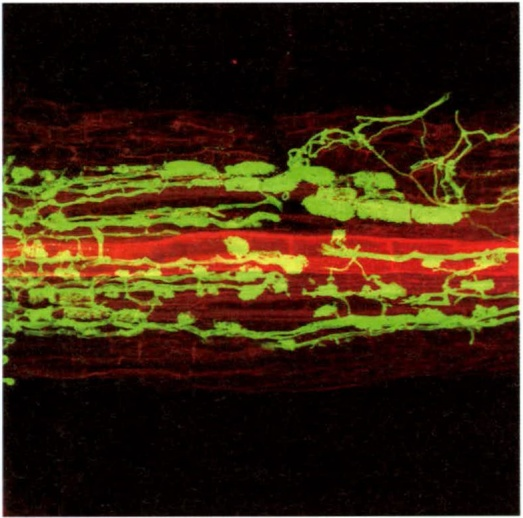

<details>
<summary>natural_image</summary>

Fluorescent microscopy image showing green-stained vascular structures against a red-stained tissue background (no text or symbols)
</details>

图 14-40 蒺藜苜蓿（Medicago truncatula）根部异形根孢囊霉（Rhizophagus irregularis）形成的丛枝菌根（图片来源:中国科学院分子植物科学卓越创新中心王二涛）

Wheat-germ agglutinin (WGA)-AlexaFluor488 染色

---

470

14 微生物物种多样性

## 14.3.3.7 虫霉门（Entomophthoromycota）

虫霉门过去属于接合菌门（Zygomycota），2007年Hibbett将其归为一个亚门，2012年被提升至一独立的门。虫霉门也与动物有关，可从动物粪便中分离出来，或者是昆虫的病原体和寄生物，许多物种具有腐生阶段。有些种类产生初生分生孢子，由其产生并强力弹射单个孢子，如果孢子落在合适的基质上，将发芽形成菌丝体，否则将反复发芽，形成次生分生孢子。在某些情况下，强力弹出的分生孢子会产生非强力弹射的具毛梗分生孢子，这些分生孢子可附着在昆虫的外表面。当昆虫被食虫动物吞噬，其上的真菌通过肠道随粪便排出体外，由此得以扩散。典型的虫霉门真菌是昆虫病原菌，它们通过孢子感染宿主，并在宿主内繁殖，形成一到两个细胞的菌丝体，菌丝体也可以成为配子囊。宿主死亡后，菌体穿透角质层节段并破裂，产生强力弹射的初生分生孢子。被感染的宿主通常会移到高的位置，这种现象被称为高峰病。这种行为可能是被病原菌诱导的，以便有利于病原菌孢子的扩散。

## 14.3.3.8 捕虫霉门（Zoopagomycota）

捕虫霉门是非鞭毛真菌中一个最早分化出的陆生真菌类群，可形成真菌丝，大多数成员是腐生的，也可寄生于后生动物、变形虫或其他真菌上。捕虫霉门中的种可捕食线虫、线虫卵或变形虫，有的种可寄生在毛霉上，因此可应用于某些害虫的生物防治。另一方面，本门中有些种类能引起食品、果品、蔬菜等的变质和霉烂，也有些种类是人畜的致病菌。其菌丝较细，为多核体（多个细胞核共处于未被分隔开的细胞质内），在其寄主上或寄主内产生吸器。通过形成分生孢子或孢囊孢子进行无性繁殖，孢囊孢子在柱孢子囊内产生，若有有性生殖阶段，则通过形成接合孢子进行。

## 14.3.3.9 梳霉门（Kickxellomycota）

梳霉门最早被归于接合菌门。2016年，根据基因组数据将接合菌门重新拆分为捕虫霉门和毛霉门，梳霉门又被划归到了捕虫霉门下。2018年梳霉门从捕虫霉门独立出来形成了一个新的门类。梳霉门的物种共有的一个特征是菌丝被形态独特的隔膜规则地分隔开，隔膜孔具有一个双凸透镜状隔膜塞。有些种生活于节肢动物水生阶段的消化道内，以前曾被归在毛菌纲内；有些种是其他真菌的寄生菌；还有些种是腐生菌，常见于土壤和粪便中。节肢动物寄生或共生类群往往具有分枝的丝状菌体，通过菌体的断裂形成节孢子进行无性繁殖；或者通过产生具有发状附属物，被称为毛孢子的无性孢子进行无性繁殖。寄生于其他真菌的种和腐生种往往产生独特的孢子囊，称为柱孢子囊。这种柱状的孢子囊常成簇地产生于一个鳞茎状的结构上，其中产生一个或多个串珠状排列的孢囊孢子。

## 14.3.3.10 毛霉门（Mucoromycota）

该门中的种具有发育良好的菌丝体，一般无隔。大部分为腐生菌，生长于粪便、土壤、腐殖质及其他有机物残体上。少数种，如瓜笄霉，是植物病原菌，侵染葫芦及许多其他重要经济植物的花和果实，导致相当严重的损失。不少种还是水果和蔬菜在储藏和运输过程中的严重致腐菌（图 14-41）。有些种可寄生在蘑菇上，还有些种，包括毛霉属、根霉属和梨头霉属等中的种，是人类的致病菌。一些毛霉菌被用于化

---

14.3 真核微生物的多样性

471

工产品和食品的生产中，许多种可生产重要的工业产品如淀粉酶、凝乳酶、有机酸和多种次生代谢产物。大多数毛霉广泛分布于世界各地，仅雅致水生被孢霉一种水生，其余均为陆生。毛霉菌因能立即用大多数简单的碳水化合物，将比较复杂的物质留给其他微生物去利用，所以有“糖菌”之称。典型的毛霉门类群如根霉属的生活史包括有性和无性繁殖；在无性阶段，菌丝会形成包含单倍体孢子的孢子囊（sporangium），孢子释放后可以萌发形成营养菌丝；在有性阶段，不同交配型的菌丝体配子（gametangia）融合产生带有两个细胞核的细胞，这种二倍体细胞进一步发育成接合孢子，接合孢子可以保持休眠从而抵抗干燥等逆境；在条件适宜的情况下，接合孢子萌发形成二倍体菌丝或者孢子囊，后者可以产生单倍体孢子并扩散（图14-42）。

## 14.3.3.11 被孢霉门（Mortierellomycota）

该门的真菌属于常见的土壤真菌，在形态和生态上与毛霉门类似。它们产生的接合孢子和孢子囊类似于毛霉门中的一些种类，

因此被认为属于典型的接合菌，曾被归入毛霉亚门。但是分子系统发育和基因组规模的系统发育分析都明确支持该类真菌代表一个独立的门。甚至更早的生化研究也发现了被孢霉类群和毛霉类群的差异，因为前者在细胞膜中含有固醇而不是麦角固醇。被孢霉门中的真菌已被证明是植物的根内生菌，但它们对宿主适应性的影响仍然未知，其中孢霉属的部分物种会造成草莓轴腐病。被孢霉也是脂肪酸，尤其是花生四烯酸的

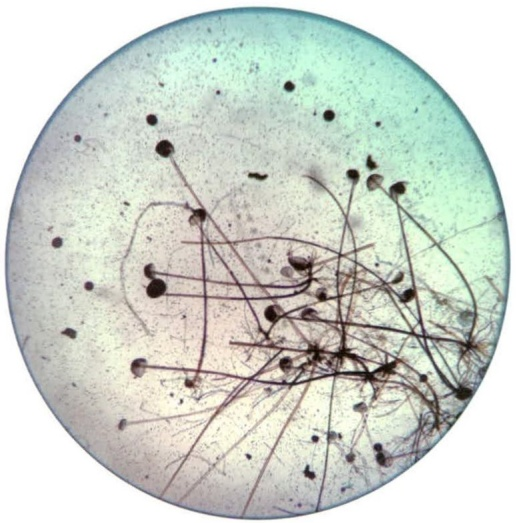

<details>
<summary>natural_image</summary>

Microscopic view of plant tissue with visible fibrous structures and scattered dark particles (no text or labels)
</details>

图 14-41 根霉（Rhizopus sp.）（图片来源:中国海洋大学王祥红）
能够看到营养菌丝、假根、孢子囊和散落的孢子

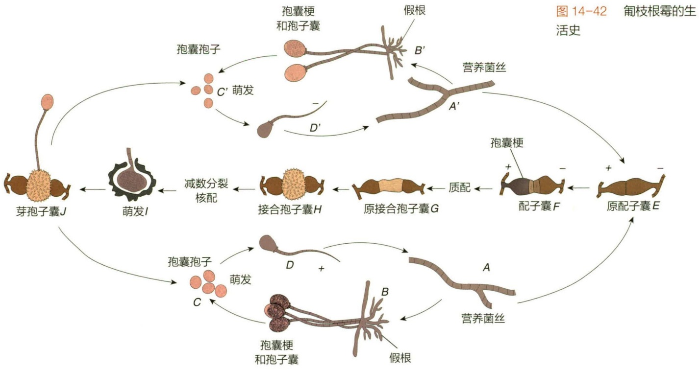

<details>
<summary>flowchart</summary>

```mermaid
graph LR
  A["芽孢子囊J"] --> B["孢囊孢子"]
  A --> C["萌发I"]
  B --> D["C' 萌发"]
  C --> E["减数分裂核配"]
  D --> F["假根"]
  F --> G["原接合孢子囊H"]
  G --> H["质配"]
  H --> I["配子囊F"]
  I --> J["原配子囊E"]
  K["孢囊梗和孢子囊"] -.-> D
  L["营养菌丝"] -.-> G
  M["A'"] -.-> G
  N["A"] -.-> I
  O["B'"] -.-> G
  P["D'"] -.-> G
  Q["D"] -.-> I
  R["A"] -.-> J
  S["B"] -.-> I
  T["假根"] -.-> J
  U["C"] -.-> K
  V["孢囊孢子"] -.-> M
  W["萌发"] -.-> U
  X["孢囊梗和孢子囊"] -.-> T
  Y["A"] -.-> X
  Z["B"] -.-> Y
  AA["假根"] -.-> Z
  AB["萌发"] -.-> A
  AC["育囊孢子"] -.-> B
  AD["原接合孢子囊G"] -.-> H
  AE["原配子囊E"] -.-> J
  AF["育囊梗"] -.-> G
  AG["原配子囊E"] -.-> J
  AH["原配子囊E"] -.-> J
  AI["原配子囊E"] -.-> J
  AJ["原配子囊E"] -.-> J
  AK["原配子囊E"] -.-> J
  AL["原配子囊E"] -.-> J
  AM["原配子囊E"] -.-> J
  AN["原配子囊E"] -.-> J
  AO["原配子囊E"] -.-> J
  AP["原配子囊E"] -.-> J
  AQ["原配子囊E"] -.-> J
  AR["原配子囊E"] -.-> J
  AS["原配子囊E"] -.-> J
  AT["原配子囊E"] -.-> J
  AU["原配子囊E"] -.-> J
  AV["原配子囊E"] -.-> J
  AW["原配子囊E"] -.-> J
  AX["原配子囊E"] -.-> J
  AY["原配子囊E"] -.-> J
  AZ["原配子囊E"] -.-> J
  BA["原配子囊E"] -.-> J
  BC["原配子囊E"] -.-> J
  BD["原配子囊E"] -.-> J
  BE["原配子囊E"] -.-> J
  BF["原配子囊E"] -.-> J
  BG["原配子囊E"] -.-> J
  BH["原配子囊E"] -.-> J
  BI["原配子囊E"] -.-> J
  BJ["原配子囊E"] -.-> J
  BK["原配子囊E"] -.-> J
  BL["原配子囊E"] -.-> J
  BM["原配子囊E"] -.-> J
  BN["原配子囊E"] -.-> J
  BO["原配子囊E"] -.-> J
  BP["原配子囊E"] -.-> J
  BR["原配子囊E"] -.-> J
  BC["原配子囊E"] -.-> J
  BD["原配子囊E"] -.-> J
  BE["原配子囊E"] -.-> J
  BF["原配子囊E"] -.-> J
  BG["原配子囊E"] -.-> J
  BH["原配子囊E"] -.-> J
  BI["原配子囊E"] -.
```
</details>

---

472

14 微生物物种多样性

高产者，并被用于花生四烯酸的工业生产。

## 14.3.3.12 根肿黑粉菌门（Entorrhizomycota）

根肿黑粉菌门原属于担子菌门（Basidiomycota）的一个亚门，2018年从担子菌门里划出为一个单独的门。它们是一类非常重要的植物病原菌，因其在染病植物器官上产生类似煤烟的黑色粉状冬孢子团而得名。另有少数黑粉菌的菌瘿可食用，如原产自墨西哥的玉米蘑菇（玉米黑粉菌）、原产自中国的茭白（菰黑粉菌）等。在自然界，几乎所有的黑粉菌都是活体营养植物寄生菌，但具有或长或短的腐生阶段。黑粉菌主要侵染显花植物的繁殖结构，导致子房或花粉囊畸变，也可侵染发育中的种胚。花药黑粉菌侵染雌雄异株的石竹科植物，如石竹和繁缕等。被感染的雄性植株花粉囊中的花粉被冬孢子所替代，并诱导形成子房，被感染的雌性植株则诱导产生不育的花粉囊。被冬孢子填充的花粉囊与包含花粉的花粉囊在外表上很相似，可吸引昆虫正常来访，借此将冬孢子传播到其他的花上。这种现象被称为诱导性雌雄同体或寄生性去雄。引发侵染的黑粉菌菌丝体多为双核体，或侵染后很快通过菌丝融合建立双核体。菌丝体生长于寄主组织的细胞间，具隔膜，有时形成锁状联合和吸器。生长于寄主组织内的菌丝体在一定部位大量增殖，最终以多种方式形成孢子堆。

## 14.3.3.13 担子菌门（Basidiomycota）

绝大多数大型真菌，如常见的蘑菇、牛肝菌、马勃、地星、鬼笔、鸟巢菌、胶质菌、多孔菌等属于担子菌，还有一些担子菌以酵母菌状态存在。担子菌的首要特征是在称为担子的专化产孢结构上产生外生的称为担孢子的有性孢子。其他特征包括规则分隔的菌丝体常具有桶孔隔膜，有时还具有锁状联合，营养菌丝体的主要阶段为双核体。细胞壁的主要成分为几丁质和葡聚糖，担子菌酵母中为几丁质和甘露聚糖。有些担子菌以单细胞的酵母状态生活，但大多数担子菌具有由分隔菌丝组成的发育完善的菌丝体，这些菌丝在基物内生长并吸收养分。担子菌的菌丝均具有规则的分隔，超微结构研究表明，在大多数已研究过的担子菌中，菌丝隔膜均具有一单个的中央穿孔。在有些种中，隔膜壁由周边向中央穿孔处逐渐变薄，而在另外一些种中，隔膜壁在中央穿孔周围增厚，形成一特征性的桶状膨大。

大多数担子菌在形态各异的子实体里产生担子，这类子实体称为担子果，担子果与子囊菌中的子囊果相对应（图 14-43）。在担子菌中，经过核配和减数分裂后在其表面形成一定数目（通常 4 个）担孢子的结构称为担子。形态较复杂的高等担子菌所产生的棍棒状担子是这种结构的典型代表。在发育中的担子内细胞核的分裂方式因种而异。在大多数担子菌中，担子内只进行一次减数分裂，产生 4 个单核的担孢子。但在有些种中，减数分裂完成后接着进行一次有丝分裂。有丝分裂的位置和所产生的细胞核的去向也有所不同。大多数的担孢子萌发形成初生菌丝体，这种方式称为直接萌发。在有的类群中，担孢子萌发形成次生担孢子或芽殖形成大量的分生孢子或小分生孢子，再由此萌发形成初生菌丝体，这种方式称间接萌发。此外担子菌还可以通过包括芽殖，菌丝断裂，产生分生孢子、节孢子或粉孢子的方式进行无性繁殖。

---

14.3 真核微生物的多样性

473

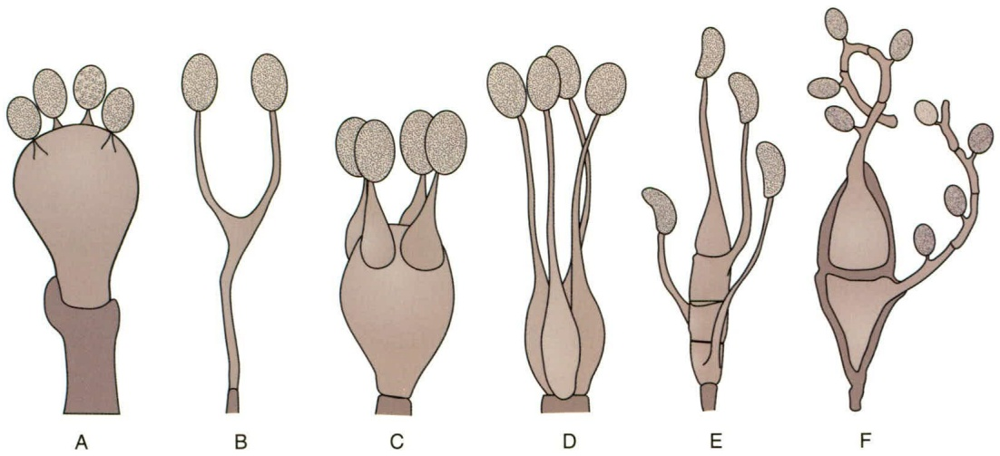

<details>
<summary>natural_image</summary>

Six labeled diagrams (A–F) showing different types of fungal hyphae, no text or symbols present.
</details>

图 14-43 不同形态的子实体产生的担子示意图

（a）典型的无隔担子；（b）花耳属（Dacrymyces）音叉状担子；（c）胶膜菌属（Tulasnella）担子；（d）银耳属（Tremellia）担子；（e）木耳属（Auricularia）担子；（f）柄锈菌属（Puccinia）担子

## 14.3.3.14 子囊菌门（Ascomycota）

子囊菌门是真菌中最大的一个类群，包括从单细胞的酵母菌到各种丝状的霉菌、白粉菌、盘菌以及美味的羊肚菌和块菌等（图 14-44）。子囊菌门与其他类群的真菌最基本的区别为有性生殖时产生子囊，子囊为袋状结构，内含子囊孢子。子囊菌在地球上具有非常广泛的分布，在一年中的大部分时间里和各种各样的生境中都可发现子囊菌。大部分为陆生，但也有相当数量的种类生长于淡水或海水中。许多种为腐生菌，多生长于植物残体或动物粪便上。寄生子囊菌可引起严重的动植物病害，此外，一些子囊菌还与植物建立长期的共生关系，包括形成菌根和内生菌等。相当多的子囊菌与绿藻或蓝绿藻建立共生复合体，形成地衣。

子囊菌与人类生活具有密切关系。可降解纤维素的子囊菌，会导致纤维织物的损坏。有些子囊菌可引起破坏性的植物病害，如栗树疫病、苹果疮痂病、白粉病、玫瑰黑斑病、榆树病、桃叶卷曲病等。一些子囊菌可直接引起人类疾病，如常见的皮肤癣

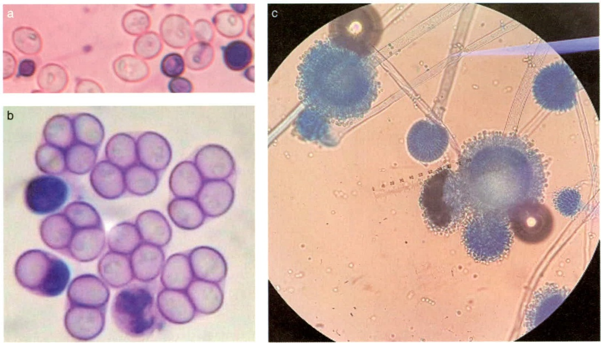

图 14-44 子囊菌门物种（图片来源:中国海洋大学王祥红）

酿酒酵母出芽（a）与子囊（b）；黑曲霉（c）的分生孢子梗

---

474

14 微生物物种多样性

病和脚气病等。子囊菌有些种可为昆虫提供食物，虫囊菌目中的有些种是昆虫的活体营养寄生菌，而有一些种在适当的环境条件下可杀死昆虫，如白僵菌、绿僵菌和镰刀菌属中的一些种，有些已被用作或正被研究用作生物杀虫剂。属于子囊菌的酵母菌的发酵能力是酿酒业和面包焙制业发展的基础，其他子囊菌也给我们提供了大量有用代谢产物，如青霉素、头孢霉素和灰黄霉素等抗生素。一些子囊菌，如酿酒酵母、粗糙脉孢霉和构巢曲霉等作为模式生物在科学研究中发挥了重要作用。

子囊菌的营养体结构形态多样，有些是单细胞酵母菌，但多数具有丝状菌丝体，还有少数种是二型性的。子囊菌的菌丝具有规则的分隔，隔膜从菌丝细胞周边向内生长而成，导致原生质膜内凹。在大多数子囊菌中，隔膜的中心留有一个孔口，邻近细胞的原生质膜和细胞质通过此隔膜孔彼此相连。隔膜孔可被存在于附近的不同类型的膜质结构所堵塞或阻碍。产生各种各样的分生孢子，是子囊菌中最常见的无性繁殖方式，对真菌在自然界的增殖和传播非常重要。相当数量的子囊菌只进行无性繁殖，一些真菌已经完全失去了有性生殖的能力。因此，我们所熟知的很多子囊菌通常只能看到它们的无性阶段。由于以前真菌的系统学研究主要以形态特征，特别是有性生殖阶段的形态特征为依据，所以，只具有无性阶段或难以发现有性阶段的子囊菌和担子菌以前被称作半知菌。子囊菌有性生殖过程中的共有特征为其有性孢子（子囊孢子）产生于一袋状子囊中。两个可亲和的细胞核通过质配进入同一个细胞中，或立即发生核配形成合子，或典型地保持密切关联并连续分裂而形成许多双核细胞，维持一定时间的双核期，然后发生核配形成合子，合子发育为子囊，其中二倍体核经过减数分裂形成4个单倍体核，单倍体核典型地再进行一次有丝分裂而形成8个单核的子囊孢子（图14-45）。

图 14-45 以烧土火丝菌 (Pyronema omphalodes) 为例图解子囊菌的有性生殖和子囊发育过程

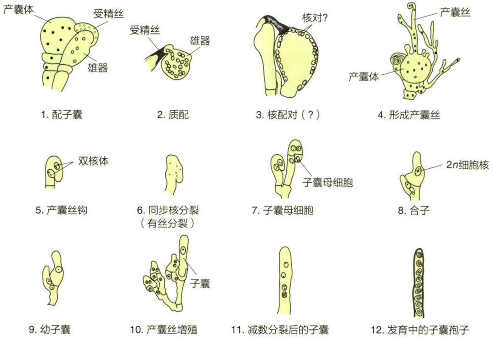

<details>
<summary>text_image</summary>

产囊体
受精丝
雄器
受精丝
雄器
1. 配子囊
2. 质配
3. 核配对（？）
4. 形成产囊丝
双核体
5. 产囊丝钩
6. 同步核分裂
（有丝分裂）
子囊母细胞
7. 子囊母细胞
8. 合子
9. 幼子囊
子囊
10. 产囊丝增殖
11. 减数分裂后的子囊
12. 发育中的子囊孢子
核对？
产囊体
产囊丝
</details>

---

14.3 真核微生物的多样性

475

## 14.3.4 原始色素体生物

原始色素体生物（Archaeplastida）包括陆生植物、红藻、绿藻和灰藻，它们的色素体由两层膜包被，可能起源于15亿年前的同一初级内共生事件。其中陆生植物和绿藻的叶绿体能够贮存淀粉；红藻和灰藻是在细胞质中合成与贮存淀粉，两者的色素体分别为藻红体和灰质体。由于红藻和绿藻的次级内共生在光合磷酸化功能的扩散演化中扮演了重要角色，下面重点介绍这两类原始色素体生物。

## 14.3.4.1 红藻（red algae）

红藻门（Rhodophyte）为单细胞或多细胞光能营养生物，含有叶绿素a和藻胆蛋白（phycobiliprotein），但缺少叶绿素b，红藻呈现红色主要是因为藻红体中的藻红蛋白（phycoerythrin）掩盖了叶绿素的绿色；它们主要生活在海洋生态系统，部分物种在淡水和陆地生态系统中也有分布；红藻可以在海面下两百多米进行光合作用，藻红蛋白合成较多，细胞更红；而在浅海生存的红藻合成的藻红蛋白较少，细胞甚至呈绿色。许多红藻物种是缺少鞭毛的多细胞生物，部分物种是琼脂的主要来源，还有部分物种是人类的重要食材，如紫菜。以多管藻（Polysiphonia）为代表的红藻具有较为复杂的生活史:二倍体多细胞个体释放单倍体雄性和雌性配子，继而分别发育为单倍体雄性和雌性多细胞个体，然后单倍体雄性个体释放单倍体精子细胞，后者与单倍体雌性个体的特化繁殖结构融合产生二倍体合子，二倍体合子发育成多细胞个体后经过减数分裂释放单倍体雄性和雌性配子，从而完成生活史。

有些红藻是单细胞光能营养生物，生活在酸性热泉中（pH 为 0.5～4.0），例如 Cyanidiales 几乎是这种极端生境中仅有的光合微生物；也许正是在这种极端环境的选择压力下，它们在细胞和基因组大小方面也比较特殊，例如 Cyanidioschyzon merolae

是仅有  $2 \mu m$  的单倍体红藻，基因组为 16.5 Mb，具有一个线粒体和一个叶绿体，缺少液泡和细胞壁。

## 14.3.4.2 绿藻（green algae）

绿藻门（Chlorophyte）是单细胞、丝状或菌落形态的光能营养生物，多数绿藻具有有性和无性繁殖阶段；它们的叶绿体含有叶绿素a和b，但是没有藻胆蛋白，所以是绿色的；它们主要生活在水体、潮湿的土壤或雪上，一部分物种能够与真菌共生形成地衣。单细胞绿藻金牛鸵球藻（Ostreococcus tauri）是一类海洋浮游光合微生物，直径约2  $\mu$ m，基因组仅有12.6 Mb；原始小球藻（Auxenochlorella protothecoides）是产油脂和蛋白的重要单细胞绿藻（图14-46）。团藻属（Volvox）物种可以形成由数百个带鞭毛细胞组成的菌落——不同细胞存在以下分工:一部分细原始小球藻 UTEX 2341 的 400 倍光学显微镜照片（a），及其 4 000 倍激光共聚焦显微镜 BODIPY 505/515 染色的照片（b）。（b）中绿色为 IBODIPY 505/515 亲脂性荧光染料特异染色的中性脂，红色为自发光的叶绿体

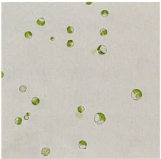

<details>
<summary>natural_image</summary>

Microscopic view of green spherical particles on a light background (no text or symbols)
</details>

(a)

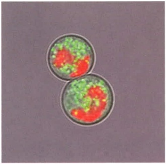

<details>
<summary>natural_image</summary>

Two petri dishes containing colorful food items, one with red and green garnish (no text or symbols visible)
</details>

(b)

图 14-46 绿藻物种原始小球藻（Auxenochlorella protothecoides）（图片来源:中国农业大学杨金水）

---

476

14 微生物物种多样性

胞能运动和进行光合作用，另一部分细胞用于繁殖；菌落中的细胞通过丝状细胞质连接，从而可以协同游动，这又呈现出整体性。一些菌落形态的绿藻如布朗葡萄藻（Botryococcus braunii）可以产生并分泌较多的胞外长链烃类物质（ $C_{30} \sim C_{36}$ ），用于生产生物质燃料。在干燥或寒冷的生境，一些绿藻能够生活在多孔岩石中靠近表面的内部位置，这里的光照和水分可以在一定时间段内满足绿藻对温度和水分的需求——在这样的生境下，绿藻与蓝细菌可以和真菌共生形成岩石内地衣，而地衣的生长会逐步风化岩石，创造适宜更多微生物定殖的生境，最后岩石分解形成原土，从而支持植物和动物的生存、生长和繁殖。

## ※ 本章小结

细胞型微生物主要分为细菌、古菌和真核微生物。细菌域含有 40 多个已实验室培养的门，物种数量最多、代谢活性最为多样，是自然界中生物量最高的微生物类群。古菌域中可培养的类群远少于细菌域，有些种类可在高温、强酸、强碱、高盐等极端环境中生长，并具有一些特殊的代谢特征。真核微生物分为原生生物、真菌和原始色素体生物，细菌与古菌的多样性演化与互作孕育了真核微生物。

## ※ 推荐阅读

1. IMACHI H, NOBU M K, NAKAHARA N, et al. Isolation of an archaeon at the prokaryote-eukaryote interface [J]. Nature, 2020, 577: 519–525.

目前被分离鉴定的微生物物种数量还不到全部微生物数量的 1%。本文用了 12 年的时间，尝试了很多种方法，成功地分离培养了介于原核生物-真核生物之间的洛基古菌。这是如何培养难培养微生物的典型案例。

2. HUG L A, BAKER B J, ANANTHARAMAN K, et al. A new view of the tree of life [J]. Nature microbiology, 2016, 1(5): 16048.

1977 年，卡尔·乌斯（Carl Woese）首次提出利用核糖体小亚基 RNA 基因序列作为分子标记，确定各种生命之间的亲缘关系，将生命分为三域，即细菌域、古菌域和真核生物域。40 年后，Hug 等利用研究团队获得的 1011 个基因组序列结合公共数据库中的基因组序列，大幅度扩展了之前的“生命之树”。

## ※ 开放性讨论题

1. 目前被分离鉴定的微生物物种数量还不到全部微生物数量的 1%。你认为是否有必要把大部分目前未培养的微生物培养出来？为什么？
2. 近些年许多微生物的分类地位在持续发生变化，比如，细菌门的名称近期发生了重大变化，已经使用了几十年的名称，突然变成了完全不同的名字；古菌门的数量有时突

---

复习思考题

477

然增加了很多，有时又发生了合并。你如何看待这些变化？

## ※ 复习思考题

1. 请列举细菌域的主要门类及其主要特征。
2. 为什么说人们对微生物的理解大部分来自于假单胞菌门细菌？请从其物种多样性、生存环境、物质和能量代谢特征、与人类疾病的关系、生态作用等方面进行描述。
3. 哪些细菌门类属于革兰氏阳性细菌？它们在 G+C 含量、表型和代谢特征、与人类的关系等方面各有什么特点？
4. 为什么产液菌门、热袍菌门和热脱硫杆菌门被认为是最古老的细菌世系？它们有什么共同的代谢特征？
5. 光合作用都存在于哪些细菌类群？其光合作用的方式有何异同？
6. 描述古菌的四大分支（Euryarchaeota、TACK、DPANN、Asgard）的主要特征，并举例说明。
7. 古菌的栖息地与细菌和真核微生物相比有什么特点？古菌的哪些特性使它们在极端环境中生存下来？
8. 古菌在地球早期生命起源中扮演了什么角色？
9. 为什么原生生物的系统分类是目前的热点研究领域？目前流行的分类方式是什么？
10. 真菌分为哪些主要类群？各有什么特点？

(张晓华 李文均 杨子文 田长富 谭莎)
