# 16 合成生物学

原始 PDF 第 548–582 页。

## 合成生物学

## 导语

分子生物学告诉我们，所有生物都具有相同的分子基础，即基因由4种碱基组成，而蛋白质主要由20种氨基酸组成。这引发了人们的一个兴趣:可以用相同的碱基创造不同的生物，其实这就是合成生物学。本章将学习合成生物学的内涵和核心技术，包括生物系统的层级结构、生物元件及遗传回路、DNA片段组装方法、基因组设计与合成等。通过学习本章内容，将了解到合成生物学的基本原理和最新进展，以及其在生物医药、工业生产、环境、信息等领域的广泛应用和潜在前景。

## 关键词

合成生物学，生物元件，遗传回路，标准化组装，聚合酶循环组装，Gibson 组装，Red/ET 重组组装，细胞内组装，合成病毒，合成细菌基因组，合成细菌，合成酿酒酵母染色体，微生物细胞工厂，活体微生物药物，物理信息存储

16

---

532

16 合成生物学

## 16.1 合成生物学概述

微生物的细胞结构具有不同分子层级，对各层级进行抽提、解耦，提取生物元件、生物模块、遗传回路，是进行合成生物学操作的前提。

## 16.1.1 生物系统的层级结构

生物是一个复杂系统，具有层级结构。对于微生物而言，组成性层级结构包括元素、无机小分子、小分子代谢产物、生物大分子、细胞器、细胞（图 16-1）。在组成性层级结构中，低一级层次的成分组合成新的高一级层次。微生物吸收小分子，在细胞内经过初级代谢生成有机酸、氨基酸、核苷酸等小分子。小分子单体聚合生成生物大分子，如氨基酸聚合生成蛋白质，核苷酸聚合生成核酸，乙酰辅酶 A 用于合成脂质等。这些大分子组装形成复合体机器，如用于翻译的核糖体、用于转录的 RNA 聚合酶装置等。核酸和蛋白质结合形成染色体，脂肪酸和磷酸组装形成磷脂和膜系统，多糖形成细胞壁。超大分子复合物和膜系统组装形成细胞器，如细胞核、叶绿体等。细胞膜、细胞质、细胞壁等组装形成细胞。

图 16-1 微生物的组成性层级结构


<details>
<summary>flowchart</summary>

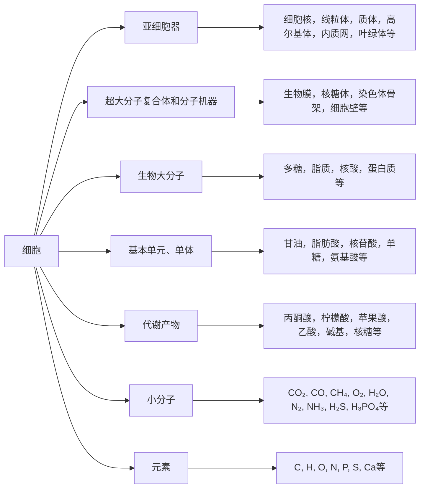
</details>

## 16.1.2 生物元件

理论上来说，基于微生物的组成性层级结构，对每个层级进行设计合成，就能构建出全新的生物。可以设计合成非细胞生物病毒，也可以设计合成具有细胞结构的细

---

16.1 合成生物学概述

533

菌、酵母。但由于人类对生物的认知不足，目前主要是在核酸的层级上进行设计和合成生物。

生物元件（biological part）是构建生物的材料，包括基因元件、RNA 元件等。由于基因是遗传材料，由核酸组成，所以研究和应用最多。根据基因的生物学功能，基因元件可以是编码生化反应、具有催化功能的酶元件，也可以是转录、翻译、代谢等的调控元件。基因元件包括复制子、功能基因、启动子、终止子、阻遏子、诱导子、核糖体结合位点等，也包括酶切位点、选择标记基因、报告基因等遗传操作元件。从工程应用角度来说，用图形显示元件非常有利于合成生物学制图（表 16-1）。

表 16-1 部分基因元件及其对应的图形

<table><tr><td>元件名称</td><td>图形</td><td>生物学功能和意义</td></tr><tr><td>复制子</td><td></td><td>DNA的自主复制</td></tr><tr><td>启动子</td><td></td><td>启动基因的转录</td></tr><tr><td>阻遏子</td><td></td><td>阻止基因的转录</td></tr><tr><td>诱导子</td><td>[ZAGZ]</td><td>诱导基因的转录</td></tr><tr><td>核糖体结合位点</td><td></td><td>启动蛋白质的翻译</td></tr><tr><td>功能基因</td><td></td><td>决定细胞行为</td></tr><tr><td>终止子</td><td></td><td>mRNA合成停止</td></tr><tr><td>酶切位点</td><td>[ZWB6]</td><td>生物元件标准化</td></tr><tr><td>选择标记基因</td><td></td><td>维持载体的稳定性</td></tr></table>

生物模块（biological module）由一系列生物元件组成，可执行特定的细胞功能。在细胞内，生物模块是具有特定功能的生化途径，如代谢途径、信号转导途径、调控途径等。

合成生物学的设计过程经常与计算机的组装进行类比（表 16-2）。生物元件类似于电子元件，由多个生物元件组成的代谢途径是功能模块。细胞的程序化过程由基因组决定，所以基因组可看作生物的“软件”，而细胞质和细胞壁等可看作生物的“硬件”。计算机的硬件和软件可以相对独立，但生物却没有这么简单，生物元件相互影响，且“软件”具有决定性作用。

表 16-2 合成生物学与计算机组装的类比

| 类型 | 元件 | 模块 | 控制 | 系统 |
| --- | --- | --- | --- | --- |
| 计算机 | 电子元件 | 功能单元 | 门控 | 软件、硬件 |
| 生物 | 生物元件 | 代谢途径 | 基因组网络 | 细胞 |

---

534

16 合成生物学

## 16.1.3 遗传回路

为了调控生物元件和模块的表达，类似于电子学中的电路，合成生物学提出了遗传回路（genetic circuit）或基因回路（gene circuit）的概念。合成生物学认为遗传回路是使合成生物正常运行的控制器，其设计与构建也出现得最早。目前已经设计和构建出了具有多种功能的遗传回路，主要包括开关回路、逻辑门回路等，设计原理一般是基于操纵子模型。

## 16.1.3.1 开关回路

开关回路（switch circuit）是化学物质或温度、光照等诱导（或缺乏）时，控制基因元件处于转录表达（或阻遏状态）的一种方式。例如在异丙基硫代半乳糖苷（isopropyl  $\beta$ -D-thiogalactoside，IPTG）诱导解阻遏的基因表达调控中，只有输入IPTG，lac启动子才能转录下游的基因元件。

双稳态开关是第一个被公开报道的具有功能的遗传回路。该开关由两条相互抑制的调控回路组成（图 16-2）。两种状态的表达产物相互抑制，由诱导物的浓度来决定回路开关的状态。其中 trc 启动子、阻遏基因 lacI 和诱导物 IPTG 组成一个阻遏系统，而 LtetO1 启动子、阻遏基因 tetR 和氧化四环素（OTC）组成另一个阻遏系统。当加入 IPTG 后，trc 启动子解阻遏，驱动 tetR 基因及其 GFP 基因转录，TetR 结合到 LtetO1 上，从而抑制 lacI 基因转录，进而 tetR 与绿色荧光蛋白（green fluorescent protein, GFP）基因持续高表达，输出信号为绿色荧光；相反，当加入脱水四环素（aTc）后，LtetO1 启动子解除阻遏，lacI 基因表达，进而抑制了 tetR 和 GFP 基因的表达，无绿色荧光输出。

## 16.1.3.2 逻辑门回路

逻辑门回路是另一类常用的遗传回路，可分为非门、与门、或门、与非门等遗传回路。


<details>
<summary>flowchart</summary>

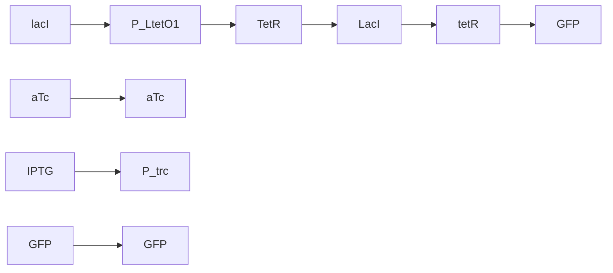
</details>

图 16-2 IPTG-aTc 调控的双稳态开关回路

## (1) 非门遗传回路

非门（NO gate）遗传回路是无信号输入时，基因元件不表达，则有输出信号；而有诱导剂输入时，基因元件表达，则无输出信号（表16-3）。如在大肠杆菌的非门遗传回路中，由lac启动子和cI基因组成一个系统，由L启动子和报告基因GFP组成另一个系统。LacI可阻遏lac启动子，CI可阻遏L启动子，形成非门逻辑（图16-3）。当不输入IPTG时，cI基因被阻遏故不表达CI蛋白，L启动子表达GFP，输出绿色荧光；输入IPTG时，cI基因被解阻遏，CI蛋白阻遏L启动子，不表达GFP基因，无绿色荧光输出。

---

16.1 合成生物学概述

535


<details>
<summary>flowchart</summary>


</details>

图 16-3 非门遗传回路示意图

表 16-3 非门遗传回路的信号转换

| 输入 | 输出 |
| --- | --- |
| 0 | 1 |
| 1 | 0 |

## (2) 与门遗传回路

与门（AND gate）遗传回路是两种信号同时输入时，才有输出信号，否则就没有输出信号（表16-4）。以图16-4为例，无IPTG或阿拉伯糖（Ara）输入时，hrpR或hrpS基因不转录，hrpL启动子不转录GFP基因，无输出绿色荧光信号；当输入IPTG或阿拉伯糖时，hrpL启动子也不转录GFP基因，无输出绿色荧光信号；当同时输入IPTG和阿拉伯糖时，hrpR和hrpS基因转录，其产物HrpR和HrpS结合到启动子上，激活hrpL启动子转录GFP基因，输出绿色荧光。

## (3) 或门遗传回路

或门（OR gate）遗传回路是只要有输入信号，就有输出信号；无信号输入，则无信号输出（表 16-5）。用阿拉伯糖（Ara）和脱水四环素（aTc）双启动子控制 GFP 基因，组成型表达 AraC 和 TetR，形成或门遗传回路（图 16-5）。当输入阿拉伯糖或脱水四环素或同时输入两种信号分子时，GFP 基因都能表达，输出绿色荧光。

## (4) 与非门遗传回路

与非门（NAND gate）遗传回路是双层逻辑，先与门逻辑，然后非门逻辑，是两个逻辑门的组合（表 16-6）。与门、非门都有信号输入时，无输出信号；否则为有输出信号。


<details>
<summary>flowchart</summary>

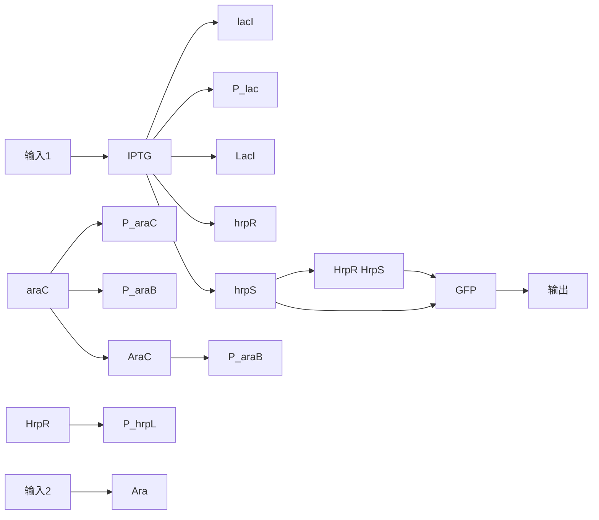
</details>

图 16-4 与门遗传回路示意图

表 16-4 与门遗传回路的信号转换

| 输入 1 | 输入 2 | 输出 |
| --- | --- | --- |
| 0 | 0 | 0 |
| 1 | 0 | 0 |
| 0 | 1 | 0 |
| 1 | 1 | 1 |

---

536

16 合成生物学


<details>
<summary>flowchart</summary>

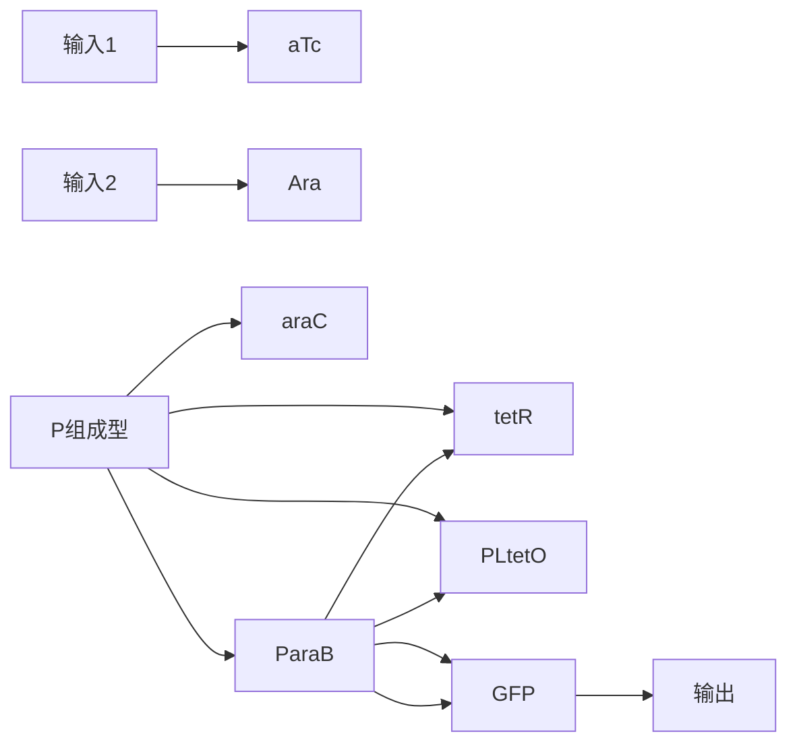
</details>

图16-5 或门遗传回路示意图

表 16-5 或门遗传回路的信号转换

| 输入1 | 输入2 | 输出 |
| --- | --- | --- |
| 0 | 0 | 0 |
| 1 | 0 | 1 |
| 0 | 1 | 1 |
| 1 | 1 | 1 |

表 16-6 与非门回路的信号转换

| 输入 1 | 输入 2 | 输出 |
| --- | --- | --- |
| 0 | 0 | 1 |
| 1 | 0 | 1 |
| 0 | 1 | 1 |
| 1 | 1 | 0 |

以图 16-6 为例，与门遗传回路由 lac 启动子 -hrpR、araB 启动子 -hrpS 组成，非门遗传回路由 hrpL 启动子 -cI、L 启动子 -GFP 组成。无 IPTG 或阿拉伯糖输入时，hrpR 和 hrpS 基因不转录，hrpL 启动子不转录 cI 基因，L 启动子转录 GFP 基因，输出绿色荧光信号；当输入

IPTG 或阿拉伯糖时，hrpL 启动子也不转录 cI 基因，L 启动子转录 GFP 基因，输出绿色荧光信号；当同时输入 IPTG 和阿拉伯糖时，hrpL 启动子转录 cI 基因，抑制 L 启动子，不转录 GFP 基因，无绿色荧光输出。

虽然遗传回路的研究模式常用荧光作为信号输出，但这些原理同样可用于生物系统、代谢途径、细胞状态等控制中。

图 16-6 与非门遗传回路示意图


<details>
<summary>flowchart</summary>

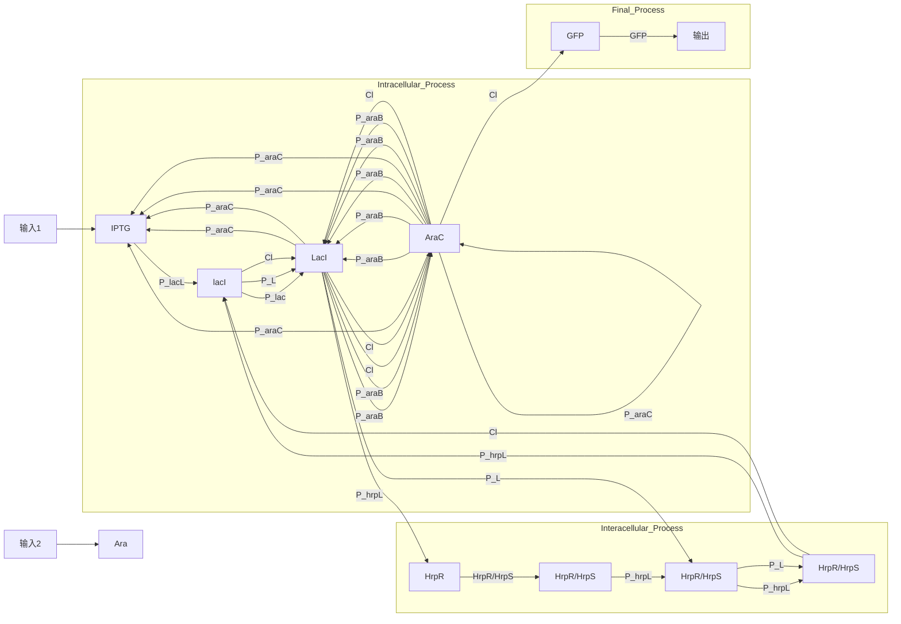
</details>

---

16.2 组装 DNA 片段

537

## 16.2 组装 DNA 片段

## 16.2.1 标准化组装

为了提高 DNA 片段的利用率和通用性，可对合成的 DNA 片段（即生物元件）进行标准化。生物元件的标准化具有很多优点:①标准化的生物元件相互之间容易连接，省去了寻找和优化限制性内切核酸酶、连接酶等 DNA 重组工具的烦琐工作，大大节省了时间，提高了效率，有效实现即插即用。②经过改造和实验检验的生物元件，在模式生物中具有很好的生物功能，减少了直接从自然生物中克隆基因所必须面对的异源表达问题。③生物元件具有标准化的动力学参数模拟、载体和宿主背景，为生物模块的功能预测提供了参考、比较和优化的平台。④基于生物元件构建的 DNA 元件文库（如 iGEM Registry），可提供标准化的描述文件和分类的方法，为使用者迅速找到理想的模块提供了便利。

## 16.2.1.1 生物元件库

国际遗传工程机器大赛（International Genetically Engineered Machine Competition, iGEM）是一项合成生物学领域的国际大学生科技竞赛，该竞赛为大学生提供了一个很好的合成生物学训练机会。该竞赛基于生物元件构建了一个DNA元件文库（如iGEM Registry），为了方便研究者查阅生物元件的功能，iGEM Registry对其中的每一个生物元件都有详细的注释，包括该片段的示意图、碱基顺序（不包括前缀和后缀）、片段的设计者对于该片段功能的阐述，以及其他使用者提供的使用经验等。每年iGEM Registry都会向全世界所有参赛队伍免费提供所有最近更新的生物元件，供参赛队伍使用。参赛队伍也可免费向iGEM Reistry上交自己队伍新创造的生物元件和规范化描述性文字。iGEM Registry已得到全世界合成生物学界的普遍支持，其他科研机构和个人也会贡献自己的力量。

## 16.2.1.2 生物元件的标准化结构

生物元件的标准化体现在每一个DNA片段的末端具有相同的前缀和后缀（图16-7）。前缀中包括EcoRI和XbaI两个酶切位点，后缀中包括SpeI和PstI两个酶切位点，且DNA片段内部序列不含有这4个酶切位点。XbaI和SpeI是一对同尾酶，其识别位点不同，但酶切之后形成的黏末端相同。整个生物元件被克隆在特定的质粒载体上，可按照设计的需要剪切和拼接，使DNA片段依次组装起来。

生物元件前缀和后缀中各片段的功能如下（图 16-7）:

片段（1）:额外的间隔碱基序列，以利于用 EcoR I（前缀）和 Pst I（后缀）酶切后进行 PCR 扩增；促进利用 Taq 聚合酶进行 PCR 时反向链末端 A 碱基的添加，从而保证 TA 克隆的高效性；

片段（2）:随机附加的间隔碱基；

片段（3）:EcoRI（前缀）和PstI（后缀）识别位点；

片段（4）:Not I 识别位点；

---

538

16 合成生物学

图 16-7 生物元件前缀和后缀的碱基序列

前缀:

| 5' | GTTTCTT | C | GAATTC | GCGGCCGC | T | TCTAGA | G | [part] | 3' |
| --- | --- | --- | --- | --- | --- | --- | --- | --- | --- |
| 3' | CAAAGAA | G | CTTAAG | CGCCGGCG | A | AGATCT | C | [part] | 5' |
|  | (1) | (2) | (3) | (4) | (5) | (6) | (7) | (8) |  |

后缀:

| 5' | [part] | T | ACTAGT | A | GCGGCCG | CTGCAG | G | AAGAAAC | 3' |
| --- | --- | --- | --- | --- | --- | --- | --- | --- | --- |
| 3' | [part] | A | TGATCA | T | CGCCGGC | GACGTC | C | TTCTTTG | 5' |
|  | (8) | (7) | (6) | (5) | (4) | (3) | (2) | (1) |  |

片段（5）:附加碱基，防止切割/重组过程中意外出现 EcoBI 或 EcoKI 甲基化位点而抑制酶切作用；

片段（6）:Xba I（前缀）和 Spe I（后缀）识别位点；

片段（7）:附加碱基；

片段（8）:大约 20 bp 的、与预构建组件 5' 端（前缀）和 3' 端（后缀）匹配的序列。

## 16.2.1.3 生物元件的连接

将需要组装的 DNA 片段分为插入片段和载体片段两部分。由于具有 4 个标准化的酶切位点，插入片段可在限制性内切核酸酶作用下从载体上切割出来；载体经限制性内切核酸酶处理后可打开一个缺口，并留下两个黏末端。假设将目的片段 A 插入到目的片段 B 的左侧时（图 16-8），首先利用 EcoR I 和 Spe I 两种酶切割含有片段 A 的质粒并将片段 A 切下来。片段 A 的序列如下:

| 5'*AATTC | GCGGCCGC | T | TCTAGA | G | 片段A | --T | A | 3' |  |
| --- | --- | --- | --- | --- | --- | --- | --- | --- | --- |
| 3' | G | CGCCGGCG | A | AGATCT | C | 片段A | --A | TGATC* | 5' |
|  | EcoR I | Not I |  | Xba I |  |  |  | Spe I |  |

然后利用 EcoR I 和 Xba I 两种酶切割含有片段 B 的质粒并去掉它们之间的序列，形成一个切口如下:

| 5'--gca | G | *CTAGA | G---3' |
| --- | --- | --- | --- |
| 3'--cgt | CTTAA* | T | C---5' |
|  | EcoR I | Xba I |  |

在连接酶的作用下，片段 A 和片段 B 上的 EcoR I 位点连接到一起，形成新的 EcoR I 酶切位点；而片段 A 上的 Spe I 和片段 B 上的 Xba I 是同尾酶切位点，因具有相同的黏末端而连在一起。插入片段可以准确嵌入载体上的切口中，且融合后的混合位点因不能被 Xba I 和 Spe I 识别而切开。此外，片段 A 又将自身的 Xba I 位点加入到片段 B 上，保证了连接后片段的前缀和后缀都保持不变，最终实现两个生物元件的成功连接，且新片段仍然可以用这 4 种酶与其他片段连接。如此循环往复，即可由简单到复杂，逐层构建更加复杂的生物系统。

类似地，也可将片段 A 插入到片段 B 的右侧，新生物元件的两端仍然具有 4 个标准酶切位点。

---

16.2 组装 DNA 片段

539


图 16-8 生物元件的连接（以片段 A 插入片段 B 的左侧为例）

## 16.2.2 聚合酶循环组装

聚合酶循环组装（polymerase cycling assembly，PCA）是一种基于聚合酶链反应（polymerase chain reaction，PCR），将可化学合成的短寡核苷酸通过无模板 PCR 组装成长 DNA 片段的 DNA 组装技术。PCA 常用于组装 10～20 条长度为 40～70 bp 的寡核苷酸。用于 PCA 的单链寡核苷酸彼此之间部分重叠。拼接时，这些部分重叠的寡核苷酸片段彼此互为引物和模板，在 DNA 聚合酶的作用下，通过退火、延伸变成较长的双链 DNA；然后再通过与其他寡核苷酸片段或延伸产物之间的变性、退火及延伸的循环，逐步实现寡核苷酸片段的拼接（图 16-9）。该方法由于 DNA 合成费用较低而得到广泛使用。

重叠延伸 PCR 技术（overlap extension polymerase chain reaction，OE-PCR）可以用于组装更长的 DNA 片段（图 16-10）。将末端具有重叠序列的 DNA 片段通过变性、退火，然后互为引物，经聚合酶延伸得到融合的 DNA。一般可以将 2～6 个 DNA 片段按比例混合作为模板，以最外侧两端的寡核苷酸作为引物，进行重叠延伸，同时要保证相邻的两个 DNA 片段之间有 20～40 bp 的同源重叠区。由于 OE-PCR 方法操作简单，省时省力，已经得到了广泛的应用。

---

540

16 合成生物学

图 16-9 PCA 示意图


<details>
<summary>flowchart</summary>

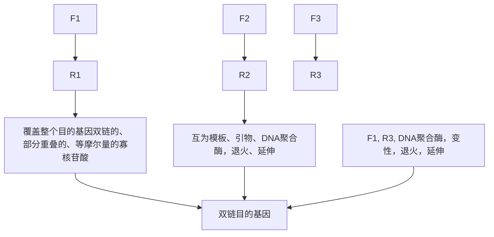
</details>

图 16-10 OE-PCR 示意图

将两个 DNA 片段分别用一对引物（F1/R1 或 F2/R2）通过 PCR 扩增，使 PCR 产物之间有同源区段，接着用 F1 和 R2 引物通过 PCR 扩增得到完整双链目的片段


<details>
<summary>flowchart</summary>

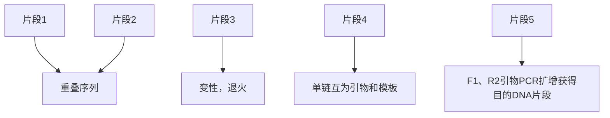
</details>

---

16.2 组装 DNA 片段

541

## 16.2.3 Gibson 组装

Gibson 组装（Gibson assembly）又称为 “Gibson 恒温一步组装法”，是美国克雷格·文特尔（J. Craig Venter）研究所的丹尼尔·吉布森（Daniel G. Gibson）和其他研究员一起创建的一种 DNA 组装方法。Gibson 组装利用 T5 核酸外切酶、DNA 聚合酶及连接酶的协同作用在体外将多个带有末端重叠序列的 DNA 片段组装起来（图 16-11）。首先通过 PCR 扩增在 DNA 片段两端加上同源序列，其长度通常为 15～40 bp，获得部分重叠的 DNA 片段。T5 核酸外切酶具有  $5'\rightarrow3'$  核酸外切酶活性，能够从  $5'$  端切割有重叠区的 DNA 片段产生  $3'$  突出末端，然后该单链 DNA 的重叠序列在  $50^{\circ}C$  特异性退火（此时 T5 核酸外切酶逐渐失活），最后 DNA 聚合酶和 Taq 连接酶修复连接而成的双链 DNA，从而形成完整的 DNA 分子，实现无缝拼接。该方法可一步完成组装，组装后的质粒可直接用于转化感受态细胞，无须限制性内切酶。随着组装 DNA 片段的增多，其效率和正确率会随之降低，且需要的重叠序列也较长，引物合成的费用也相应增加，因此该方法常用于不超过 6 个片段的组装。

## 16.2.4 Red/ET 重组组装

Red/ET 重组组装（Red/ET recombineering）是由来源于大肠杆菌的  $\lambda$  噬菌体蛋白对 Red $\alpha$ /Red $\beta$  或来源于 Rac 原噬菌体的蛋白对 RecE/RecT 所介导的基于短同源臂的同源重组技术。同源重组是两个具有同源序列的 DNA 分子间发生交换，从而使序列发生重组的过程。这种同源重组技术能对宿主 DNA 序列进行快速、高效、精确地修饰和操作。

ET 同源重组系统:大肠杆菌 Rac 原噬菌体通过表达蛋白 RecE 和 RecT 高效介导


<details>
<summary>flowchart</summary>

```mermaid
graph LR
  A["DNA Polymerase"] --> B["Taq连接酶"]
  B --> C["DNA聚合酶"]
  C --> D["T5核酸外切酶"]
  D --> E["退火"]
  E --> F["片段1"]
  F --> G["片段2"]
  G --> H["片段3"]
  H --> I["片段3"]
  I --> J["片段1"]
  J --> K["片段2"]
  K --> L["片段3"]
  L --> M["片段3"]
  M --> N["片段2"]
  N --> O["片段1"]
  O --> P["片段1"]
```
</details>

图 16-11 Gibson 组装示意图

---

542

16 合成生物学


体内同源重组的发生，其所需的单侧同源臂长度仅为  $35 \sim 50$  bp。其中 RecE 蛋白有  $5' \rightarrow 3'$  外切酶活性，能够从  $5' \rightarrow 3'$  端依次切下双链 DNA 上的碱基，形成  $3'$  黏末端；RecT 蛋白是一种单链结合蛋白，保护单链核苷酸不被降解，能在退火时指导单链入侵。

Red 同源重组系统:大肠杆菌  $\lambda$  噬菌体的 Red $\alpha$ /Red $\beta$  蛋白对与 RecE/RecT 蛋白对类似，具有介导同源重组的功能。其中 Red $\alpha$  蛋白具有  $5'\rightarrow3'$  端核酸外切酶活性，RecT 是一种单链结合蛋白。

2003 年，A. 弗朗西斯·斯图尔特（A. Francis Stewart）等将含有 Redα/Redβ 和 RecE/RecT 的重组体系合并命名为 “Red/ET 重组”。当带有同源臂的外源 DNA 分子进入到大肠杆菌中时，Redα 或 RecE 发挥其 5'→3' 端核酸外切酶功能，由 5' 端开始降解 DNA 序列，产生 3' 黏末端，这时外源 DNA 具备了与受体 DNA 发生重组的条件。产生的黏末端被 RecT 或 Redβ 结合，防止被细胞内存在的核酸酶降解。在 DNA 退火时，含有黏末端的 3' 单链攻击双链 DNA 片段并重组。发生重组的两条 DNA 链经过剪切和 DNA 聚合酶的修复后，形成重组 DNA，即外源 DNA 成功导入受体 DNA 中（图 16-12）。

## 16.2.5 细胞内组装

随着待组装片段长度的增加，DNA 在体外容易受到常规操作的影响而变得不稳定，且 DNA 大片段体外组装技术通常是烦琐和低效的。因此，大片段 DNA 的组装更

图 16-12 Red/ET 重组示意图


<details>
<summary>flowchart</summary>

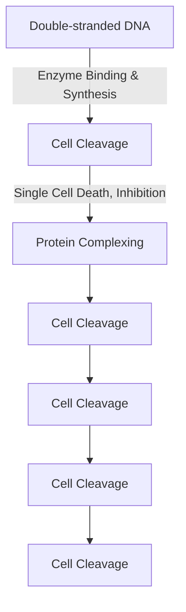
</details>

---

16.2 组装 DNA 片段

543

多依靠细胞内组装，酿酒酵母是细胞内组装的常用宿主载体。

## 16.2.5.1 酵母转化偶联重组技术

利用酿酒酵母体内高效同源重组系统开发出将多个具有末端重叠序列的DNA片段组装起来的技术称为酵母转化偶联重组技术（transformation-associated recombination，TAR）。TAR可以组装较短的寡核苷酸，也可以组装大片段DNA，甚至实现整个基因组的组装。TAR组装过程如图16-13所示。2010年美国Venter研究组通过该技术完成了1078条大小为 $1080\mathrm{bp}$ 的DNA片段的组装，最终人工合成了 $1.08\mathrm{Mb}$ 的丝状支原体（Mycoplasma mycoides）基因组；来自美、中、英、澳大利亚和新加坡的科学家共同开展的酵母基因组合成计划（synthetic yeast genome project, SC2.0），在2017年完成了酿酒酵母5条染色体的人工设计与合成，实现了合成染色体片段对野生染色体片段的替换，其中4条染色体的合成是由中国科学家领衔完成的。

## 16.2.5.2 YLC 组装

传统兆碱基（Mb）大小的DNA组装方法通常需要从宿主细胞中提取大片段DNA，在体外或大肠杆菌中富集后将它们导入宿主细胞再进一步组装。大片段DNA输入和输出到宿主细胞的低效率严重限制了组装的效率。酵母生命周期（yeast life cycle，YLC）介导的大片段DNA组装技术可以解决这一问题。YLC组装的原理是通过在酵母交配和孢子形成过程中迭代、转移细胞中的待组装DNA片段，最后在体内组装成大片段DNA。YLC通过以下步骤与酵母生命周期嵌套:交配过程使来自两个单倍体的两个DNA片段被带入一个二倍体进行组装，含有组装DNA的二倍体可以进行减数分裂以产生可用于下一轮组装的单倍体孢子。其组装过程见图16-14。据报道，使用该方法可以组装100千碱基（kb）大小的内源酵母DNA和兆碱基（Mb）大


<details>
<summary>flowchart</summary>

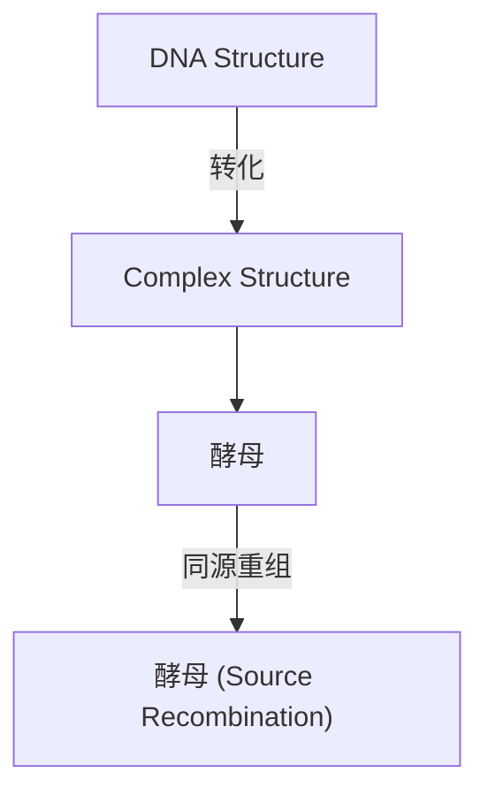
</details>

图16-13 TAR组装示意图

---

544

16 合成生物学

图16-14 YLC组装示意图

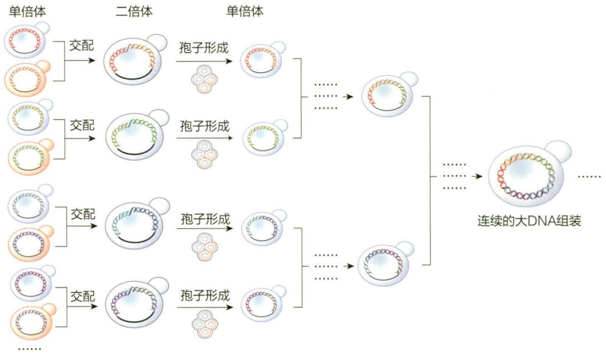

<details>
<summary>flowchart</summary>

This flowchart illustrates the DNA replication process in human cells, showing how single and double alleles are combined into single and double alleles to form a continuous large DNA assembly.
</details>

小的外源 DNA。YLC 组装降低了 Mb 大小 DNA 组装的技术难度，是大规模基因组工程和合成基因组学有潜力的工具。

## 16.3 合成噬菌体与病毒


<details>
<summary>text_image</summary>

知识拓展 16-2
枯草芽孢杆菌体内
组装
</details>

噬菌体和病毒基因组的合成技术，使得无须从感染样本中分离制备，就能快速获得噬菌体和病毒及研究样本。合成噬菌体和病毒技术不仅可用于基础研究，还可开发减活疫苗。目前已经合成了噬菌体、脊髓灰质炎病毒、鼠肝炎病毒、中东呼吸综合征病毒、SARS-CoV-2等基因组。

## 16.3.1 合成噬菌体

本小节以 T7 噬菌体为例，介绍嵌合噬菌体基因组的设计合成及噬菌体的再生。

## 16.3.1.1 合成型 T7 基因组的设计

合成基因组时一般需要遵循“基因元件序列不重叠”的设计原则，以避免合成致死性，即一个基因元件序列是唯一的且编码唯一功能，这样每个基因元件能够进行独立和准确地合成和组装。首先要对野生型T7噬菌体基因组进行注释，以确定功能基因的边界。野生型T7噬菌体的线性基因组长39 937 bp，包括57个可读框、57个核糖体结合位点（RBS）、60个蛋白、51个调控序列。对于基因之间的重叠序列，需要拆分到两个基因中。

如图 16-15 所示，野生型 T7 基因组中，基因 3 的核糖体结合区（RBS）在基因 2.8 内部。在设计 T7.1 时，把自然 RBS 和起始密码进行同义点突变（用大写字母表

---

16.3 合成噬菌体与病毒

545

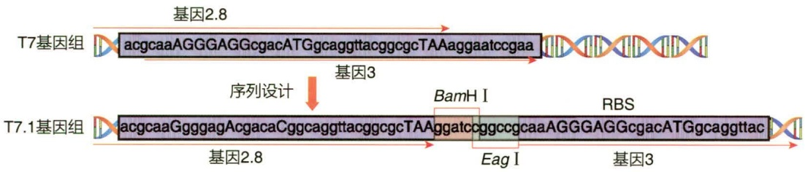

<details>
<summary>flowchart</summary>

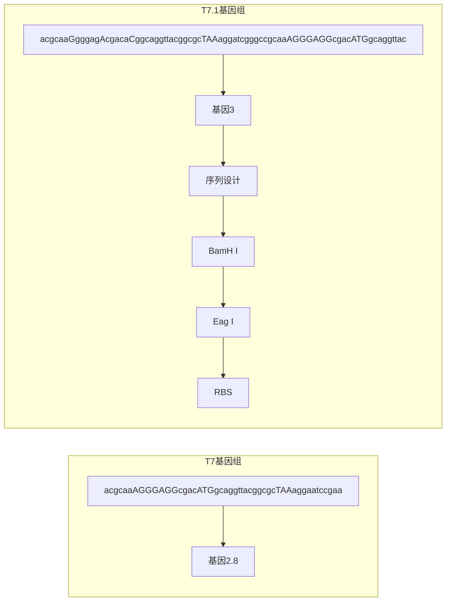
</details>

图 16-15 T7.1 基因组中基因元件设计

基因 2.8 中突变碱基用大写字母表示；TAA 是终止密码子；ATG 是起始密码子

示），这不改变基因 2.8 的氨基酸序列；把基因 3 的重叠序列整体右移，与基因 2.8 之间用限制性内切酶（BamH I 和 Eag I）分开。通过采取这类策略，解决了 T7 基因组中基因序列的重叠问题，所设计的 T7.1 基因组长度为 41326 bp。

## 16.3.1.2 T7.1 基因组的合成

将 T7.1 基因组拆分成 6 个大片段、73 个片段，每个片段包括多个基因元件。大片段之间无重叠边界，末端是核酸内切酶位点。采用替换策略，进行 T7.1 基因组的合成。用合成的 12 179 bp 取代野生型 T7 基因组左端的 11 515 bp，获得了嵌合噬菌体基因组。

## 16.3.1.3 T7.1 噬菌体包装

用嵌合体噬菌体基因组转染大肠杆菌，涂培养板测试其功能。在平板上出现了噬菌斑，则表明嵌合噬菌体基因组具有复制、转录和翻译功能，包装成活噬菌体，具有生物学活性。

虽然未见报道野生型 T7 基因组右端序列的替换工作，但研究表明自然生物基因组可进行再设计和重新合成，是合成微生物基因组的开篇工作。

## 16.3.2 合成脊髓灰质炎病毒

脊髓灰质炎病毒（poliovirus）是引起瘫痪和小儿麻痹症的病原体，脊髓灰质炎病毒基因组是一条长7440 nt的正义单链RNA。2002年杰罗尼莫·西罗（Jeronimo Cello）等以脊髓灰质炎病毒1[(poliovirus 1 Mahoney)，简称PV1（M)]基因组序列为参考，人工设计并合成了脊髓灰质炎病毒[synthetic PV1（M），简称sPV1（M)]，下面以该项工作为例来介绍病毒基因组的设计与合成。

## 16.3.2.1 脊髓灰质炎病毒基因组 cDNA 的设计

野生型脊髓灰质炎病毒基因组由 742 nt 的 5' 非翻译区（5'UTR）、1 个可读框、70 nt 的 3' 非翻译区（3'UTR）和大约 60 nt 的 poly（A）组成（图 16-16）。其只有 1 个可读框，形成一个转录本，编码病毒复制的所有蛋白，包括结构蛋白 P1、非结构蛋白 P2 和 P3。

由于 T7 RNA 聚合酶启动子能转录脊髓灰质炎病毒基因组，并产生相同长度的转录本，因此选择 T7 启动子替换天然启动子，置于整个基因组的左端，驱动整个基因组的转录。其他序列最大限度地保持与野生型完全相同。

为了有效地合成和组装，将 sPV1（M）基因组 cDNA 拆分为 F1、F2 和 F3 片

---

546

16 合成生物学

图 16-16 合成脊髓灰质炎病毒 [sPV1(M)] 基因组 cDNA 的设计

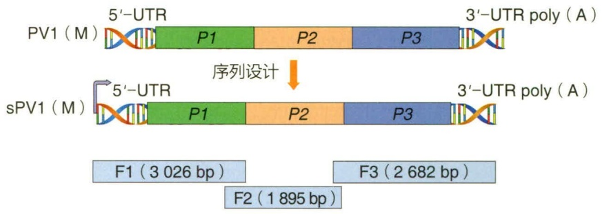

<details>
<summary>flowchart</summary>

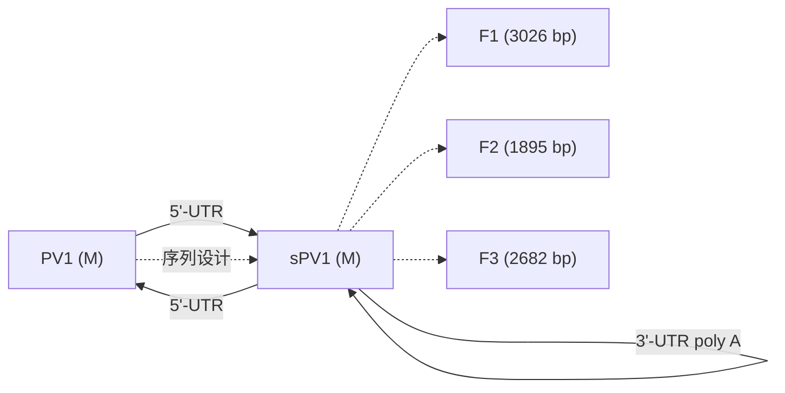
</details>

段。F1 片段长度 3 026 bp，包括 T7 RNA 聚合酶启动子（TAATACGACTCACTATAG）、5'UTR 和结构区域 P1，F1 与 F2 重叠 24 bp。F2 片段长度 1 895 bp，主要包括非结构域 P2 区域，F2 与 F3 重叠 21 bp。F3 片段长度 2 682 bp，包括 P3 区域、3'UTR 和 poly（A）尾。

为了组装和筛选鉴定合成型基因组，在 sPV1（M）基因组中设计了 13 个新酶切位点，消除 1 个原有的酶切位点，改变 20 个碱基，但所有序列改变都不能影响病毒复制。

按脊髓灰质炎病毒基因组的组织形式，将 RNA 序列转换为 cDNA 序列，进行序列设计。基于 cDNA 序列，设计成每个长度大约为 60 bp 的寡核苷酸，且每个寡核苷酸之间重叠 15～30 bp。同时引入设计的突变位点。

## 16.3.2.2 脊髓灰质炎病毒 cDNA 的合成与组装

采用酶切连接策略进行组装（图 16-17）。根据设计，由化学合成互补双链寡核苷酸，末端具有重叠序列。再通过无模板 PCR，使用高保真聚合酶，把 8～12 个寡核苷酸片段（40～93 bp）组装成 400～600 bp 的小片段。小片段经凝胶电泳纯化后，再连接到质粒载体上。

经过双向测序验证正确的小片段，进一步连接、组装成 F1、F2 和 F3 片段。如果出现错误，则需通过 PCR 进行点突变或正确序列的替换实现纠错。

利用 F1、F2 和 F3 片段内部的酶切位点和载体上位点，经过酶切和连接反应，逐步合并，组装到 pBR322 载体上，组装成 pBR-F1-2-3。

## 16.3.2.3 脊髓灰质炎病毒包装

接下来采用无细胞提取物表达病毒基因组 sPV1（M）。pBR-F1-2-3 与无细胞提取物混合孵育，T7 RNA 聚合酶转录合成的脊髓灰质炎病毒 cDNA，生成转录物 RNA，进一步翻译出病毒的蛋白，包装成病毒颗粒。有实验检测到了合成的病毒和病毒特异性蛋白质，且与野生型病毒 RNA 的产物相同，噬菌斑的表型特性也与野生型相同。sPV1（M）的 RNA 能在无细胞提取物中复制和翻译，并包装形成具有感染能力的新脊髓灰质炎病毒，实现了从头合成脊髓灰质炎病毒。

## 16.3.2.4 合成脊髓灰质炎病毒减活疫苗

脊髓灰质炎病毒 P1 区域编码病毒衣壳蛋白，在不改变 P2 和 P3 区域的前提下，使用不同密码子，同时控制密码子偏向性和 RNA 折叠自由能，对脊髓灰质炎病毒 P1

---

16.3 合成噬菌体与病毒

547

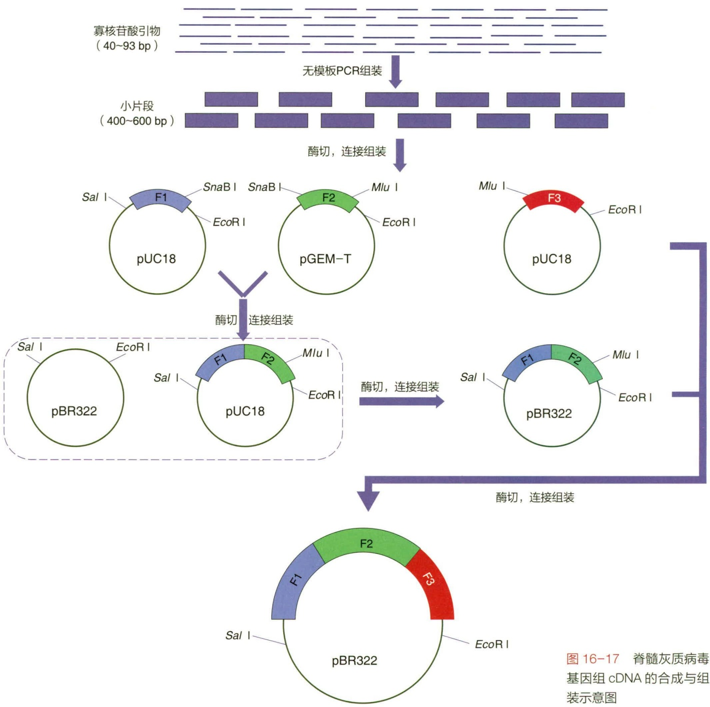

<details>
<summary>flowchart</summary>

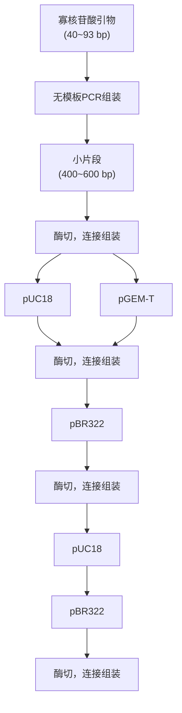
</details>

的氨基酸重新编码，可设计合成减活疫苗。例如，使用人类基因组中高丰度密码子对 P1 区编码，其中包括 566 个同义突变，它的感染性和致瘫痪率与野生型完全相同；但使用人类基因组中低丰度密码子对 P1 区编码，其中包括 631 个同义突变，因其翻译效率太低，该病毒不能存活；对 P1 区的 C 端突变设计，则感染性下降，神经毒性衰减至原来的 1/100，50% 致瘫痪浓度是野生型的 2000 倍，从而获得合成型脊髓灰质炎病毒减活疫苗。

---

548

16 合成生物学

## 16.3.3 合成新型冠状病毒

急性呼吸综合征冠状病毒 2（SARS-CoV-2）也称为新冠病毒，其基因组是正链 RNA，约 30 kb。合成新型冠状病毒的基本过程包括 3 个主要步骤，首先是合成新型冠状病毒基因组 cDNA，其次是离体转录生成基因组 RNA，最后是转化动物细胞，基因组 RNA 复制、转录和翻译，并包装形成新型冠状病毒颗粒。目前已经报道有两种合成新型冠状病毒基因组 cDNA 的策略，分别是离体组装和酵母细胞组装。

## 16.3.3.1 离体组装新型冠状病毒基因组 cDNA

第一步是基因组 cDNA 设计与片段合成。将新型冠状病毒基因组拆分成长度 3500～5700 bp 的 7 个片段，在片段末端设计 IIS 型限制性内切酶位点（图 16-18）。F1 片段左端设计 T7 RNA 聚合酶启动子，F7 片段右端设计转录终止信号 poly（A）序列（29 nt）。F1、F4、F5 和 F6 片段的末端为 BsaI（GGTCTCANNNN），F2、F3 和 F7 片段的末端为 Esp3I（CGTCTCANNNN）。F1、F4、F5 和 F6 片段克隆在载体 pUC 上，能在大肠杆菌 Top10 中稳定存在。在 pUC 上的 F2、F3 和 F7 片段，会导致大肠杆菌不能存活；故需选用能承载毒性和不稳定性片段的载体 pCC1，对 F2、F3 和 F7 片段进行克隆，并在大肠杆菌 EPI300 中保存。pCC1 是单拷贝质粒，经阿拉伯糖诱导后，拷贝数可增加到 10～20 个。

新型冠状病毒基因组片段在大肠杆菌中往往不稳定，倾向于复制突变的错误和删除。需使用大肠杆菌 Top10 或 EPI300，降低培养温度（25～30℃）、长时间（48 h）生长，以减少突变发生。

图 16-18 新型冠状病毒基因组 cDNA 的设计与离体组装示意图

两个相邻片段中，只有上游片段长度计算酶切位点的4个碱基

下一步是离体连接与组装。先提取质粒，经酶切、纯化制备高质量的 F1 至 F7 片段；采用 T4 DNA 连接酶，将 F1、F2、F3、F4 连接在一起，并分离纯化获得 F1-4 片段；另将 F5、F6 和 F7 片段连接在一起，并分离纯化获得 F5-7 片段。最后，再将 F1-4 片段和 F5-7 片段连接组装在一起，经分离纯化而获得新型冠状病毒基因组 cDNA。

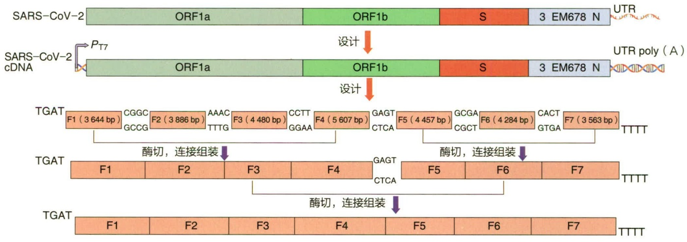

<details>
<summary>flowchart</summary>

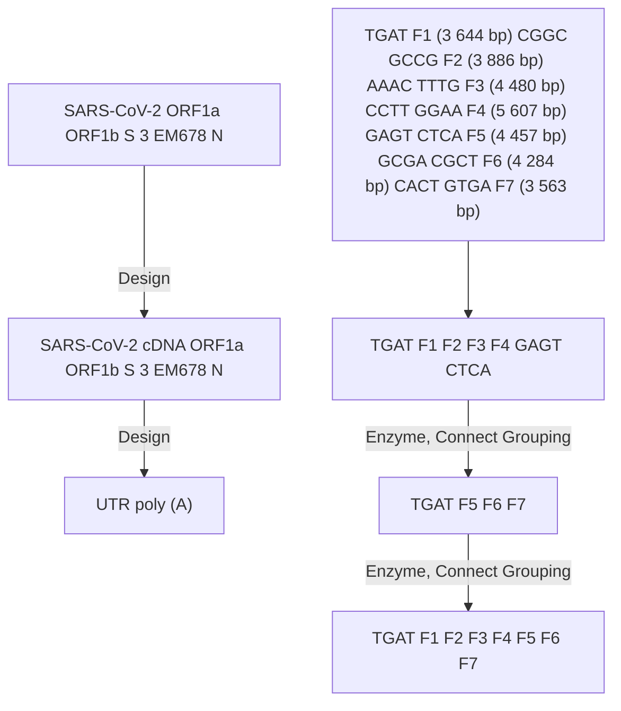
</details>

---

16.3 合成噬菌体与病毒

549

## 16.3.3.2 酵母细胞组装新型冠状病毒基因组 cDNA

冠状病毒基因组较大，而且基因组片段对大肠杆菌具有毒性，离体组装需要数微克高质量的片段，技术难度较大。而选择酵母底盘，通过同源重组原理，使用 YAC 载体进行组装，则相对较容易。

将新型冠状病毒基因组拆分为 12 个重叠 DNA 片段，每个片段之间重叠长度 45～500 bp（图 16-19），且每个片段末端设计有限制性内切酶位点，以便酶切制备大片段。在 F1 片段的左端设计 T7 启动子和载体同源臂（88 nt），F12 片段右端设计 poly（A）和载体同源臂（181 nt），用于离体转录和酵母细胞内的同源重组。用含有 45 bp 以上同源臂的引物扩增，使 pCC1BAC-His3 线性化。将 12 个片段和线性化的载体，转化酿酒酵母（Saccharomyces cerevisiae）VL6-48N，12 个片段按照顺序组装到载体上。最后经筛选、鉴定，分离纯化获得组装成功的含有新型冠状病毒基因组 cDNA 的载体。

## 16.3.3.3 新型冠状病毒基因组 cDNA 的离体转录

使用离体转录试剂盒完成离体转录。加入新型冠状病毒基因组 cDNA，由 T7 RNA 聚合酶进行转录，32℃、8 h，生成基因组 RNA。转录结束后，加入 DNase，消化降解 cDNA 模板，分离纯化、制备新型冠状病毒基因组 RNA。

## 16.3.3.4 重组新型冠状病毒的包装

由于新型冠状病毒 N 基因有利于基因组 RNA 的电转化，因此，通过 PCR 扩增 N 基因 DNA，离体转录制备 N 基因的 RNA。再将新型冠状病毒基因组 RNA 和 N 基因的 RNA 一起电转化 Vero E6 细胞，转化细胞在 5% 二氧化碳培养箱中，37℃ 下培养。转化后 40～60 h，分离、收获新型冠状病毒颗粒。使用 10%～20% 血清用于细胞增殖，2% 血清用于病毒感染和复制。

图 16-19 新型冠状病毒基因组 cDNA 的设计与酿酒酵母组装示意图（括号数字内仅显示在新型冠状病毒基因组上的顺序位置）

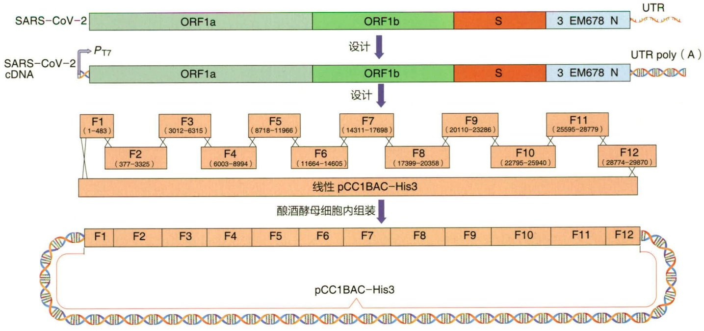

<details>
<summary>flowchart</summary>

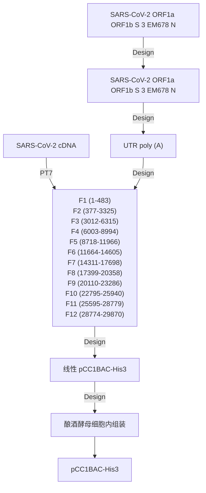
</details>

---

550

16 合成生物学

为了提高转染效率和病毒滴度，可采用细胞共培养策略。将新型冠状病毒基因组RNA和N基因的RNA一起电转化为BHK-21细胞，再与Vero E6细胞在5%二氧化碳培养箱中，37℃下共培养。转化后3\~4d，从培养液上清中分离、收获新型冠状病毒颗粒。

## 16.4 合成细菌基因组

细菌基因组的合成有三种策略，第一种是由小到大，异源逐级片段组装，最终组装出全长基因组。如离体组装和酵母中组装相结合，合成了支原体基因组。第二种是所有片段一次性组装，如将25个大片段一次性导入酵母细胞，在细胞内组装出了支原体基因组。第三种是合成型片段逐步替换野生型基因组序列，获得合成型基因型，如大肠杆菌缩减密码子的基因组。

## 16.4.1 合成支原体基因组

## 16.4.1.1 支原体基因组的拆分设计

生殖支原体（Mycoplasma genitalium）基因组长度为 580 076 bp，把原始序列按顺序等分成 101 个片段，每个片段长 5～7 kb。在不影响生存的前提下，选择性地除去非必需基因。每个片段包含一个或几个完整基因，以防止基因失活。相邻片段的末端有 80～360 bp 重叠序列，第一个片段 5' 端与最后一个片段 3' 端之间重叠，以组装形成环状基因组。

在合成基因组序列中，设计4个水印序列，插入在片段之间，以区别野生型基因组和合成型基因组。合成型生殖支原体基因组JCVI-1.0的总长度为582970 bp，包括485个蛋白质编码基因、43个rRNA、tRNA和结构RNA基因以及4个水印序列和插入序列。

## 16.4.1.2 合成型支原体基因组的组装策略

采用离体组装与酵母细胞内组装相结合的策略，分两个阶段，逐级组装基因组（图 16-20）。

第 1 个阶段，用细菌人工染色体（bacterial artificial chromosome，BAC）载体，逐级离体 Gibson 组装。由相邻 4 个片段和外切酶、聚合酶、连接酶等组成反应体系，离体组装成 A1 片段。把 A1 片段和线性 BAC 载体电转化大肠杆菌，筛选、鉴定正确的组装体 A1。这样组装得到 A 系列（A1～A25）片段，每个 A 系列长约 24 kb。用类似的方法，由 3 个 A 片段组装成 1 个 B 片段，形成 B 系列（B1～B8）片段，每个 B 片段长约 72 kb。由 2 个 B 片段组装成 1 个 C 片段，每个 C 片段长约 144 kb，形成 C 系列（C1～C4）片段。

第 2 阶段，用酵母人工染色体（YAC）为载体，在酿酒酵母细胞内同源组装。将

---

16.4 合成细菌基因组

551

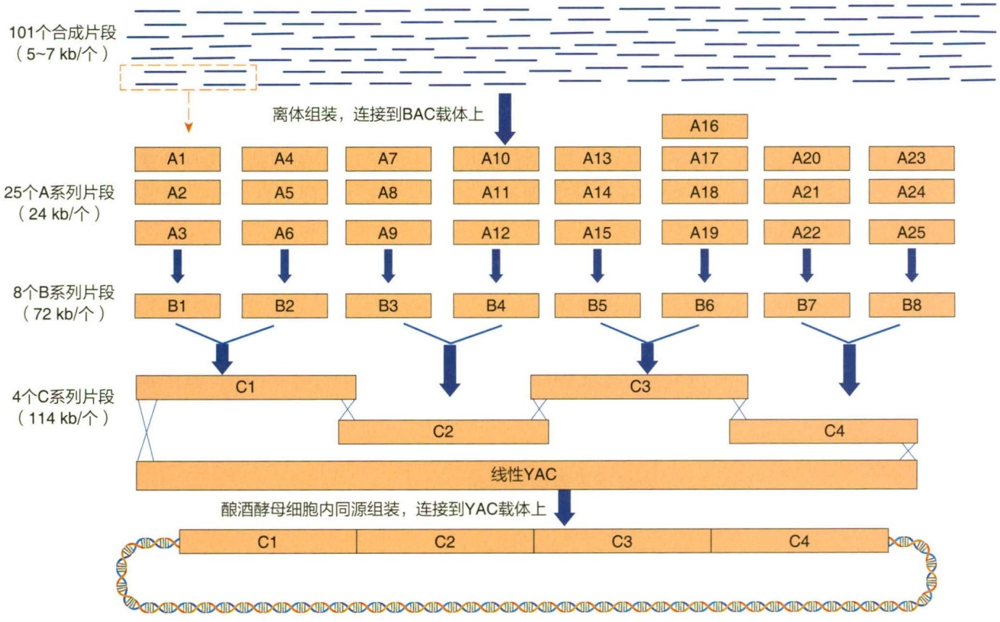

<details>
<summary>flowchart</summary>

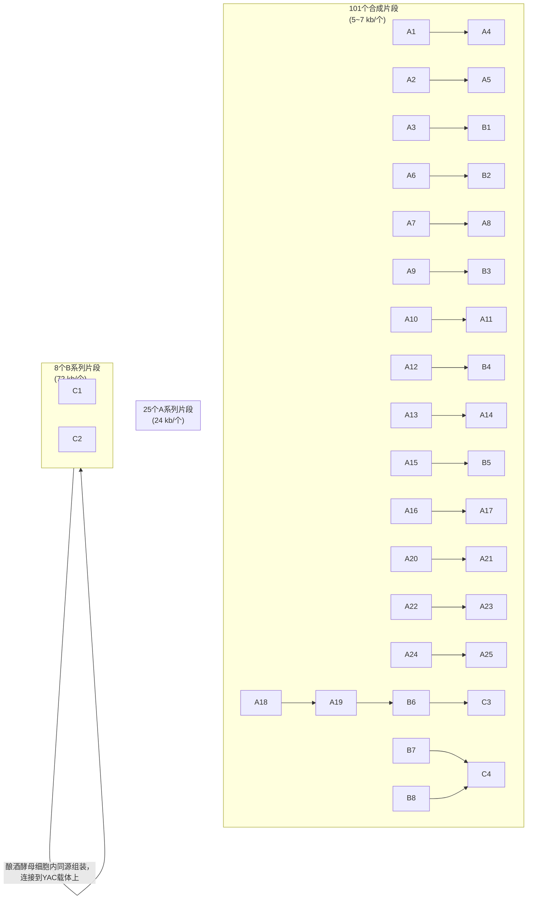
</details>

图 16-20 支原体基因组设计与组装策略

4个C序列片段（C1、C2、C3、C4）和线性化的YAC载体，导入酿酒酵母细胞内，组装出合成型支原体基因组JCVI-1.0。也可以逐级组装，将C1和C2片段与YAC转化酵母，组装成D1片段，C3和C4片段组装成D2片段。D1和D2片段与YAC转化酿酒，组装成全长基因组。经功能测试，该合成型基因组没有生物活性，但为百kb级别基因组合成提供了技术和方法。

## 16.4.2 合成支原体

在合成生殖支原体基因组和细菌基因组移植技术的基础上，美国克雷格·文特

尔研究所（J. Craig Venter Institute，JCVI）在2010年用两种生长较快的支原体，以丝状支原体［M. mycoides sp. capri（GM12）］为供体基因组，以山羊支原体［M. capricolum sp. capricolum（CK）］为受体细胞。采用酵母细胞内组装供体基因组，导入到去核受体细胞中（图16-21），创造了合成细菌JCVI-Syn 1.0，其基因组长度为1077947 bp。合成型基因组具有生物活性，开创了人工合成细菌的先河。

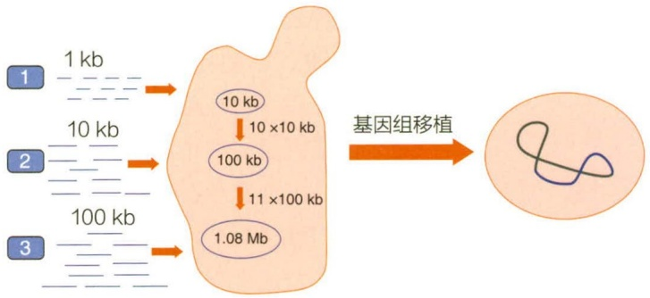

<details>
<summary>flowchart</summary>

```mermaid
graph LR
  A["1 kb"] --> B["Complex Structure"]
  C["10 kb"] --> B
  D["100 kb"] --> B
  E["100 kb"] --> B
  F["10 kb"] --> G["Gene Group移植"]
  H["100 kb"] --> G
  I["10 kb"] --> G
  J["100 kb"] --> G
  K["100 kb"] --> G
  L["100 kb"] --> G
  M["100 kb"] --> G
  N["100 kb"] --> G
  O["100 kb"] --> G
  P["100 kb"] --> G
  Q["100 kb"] --> G
  R["100 kb"] --> G
  S["100 kb"] --> G
  T["100 kb"] --> G
  U["100 kb"] --> G
  V["100 kb"] --> G
  W["100 kb"] --> G
  X["100 kb"] --> G
  Y["100 kb"] --> G
  Z["100 kb"] --> G
  AA["100 kb"] --> G
  AB["100 kb"] --> G
  AC["100 kb"] --> G
  AD["100 kb"] --> G
  AE["100 kb"] --> G
  AF["100 kb"] --> G
  AG["100 kb"] --> G
  AH["100 kb"] --> G
  AI["100 kb"] --> G
  AJ["100 kb"] --> G
  AK["100 kb"] --> G
  AL["100 kb"] --> G
  AM["100 kb"] --> G
  AN["100 kb"] --> G
  AO["100 kb"] --> G
  AP["100 kb"] --> G
  AQ["100 kb"] --> G
  AR["100 kb"] --> G
  AS["100 kb"] --> G
  AT["100 kb"] --> G
  AU["100 kb"] --> G
  AV["100 kb"] --> G
  AW["100 kb"] --> G
  AX["100 kb"] --> G
  AY["100 kb"] --> G
  AZ["100 kb"] --> G
  BA["100 kb"] --> G
  BB["100 kb"] --> G
  BC["100 kb"] --> G
  BD["100 kb"] --> G
  BE["100 kb"] --> G
  BF["100 kb"] --> G
  BG["100 kb"] --> G
  BH["100 kb"] --> G
  BI["100 kb"] --> G
  BJ["100 kb"] --> G
  BK["100 kb"] --> G
  BL["100 kb"] --> G
  BM["100 kb"] --> G
  BN["100 kb"] --> G
  BO["100 kb"] --> G
  BP["100 kb"] --> G
  BR["100 kb"] --> G
  BRN["1.08 Mb"] --> G
  BRN --> GG("基因组移植")
  BHN --> GG("基因组移植")
  BIH --> GG("基因组移植")
  BIJ --> GG("基因组移植")
  BIK --> GG("基因组移植")
  BIL --> GG("基因组移植")
  BIM --> GG("基因组移植")
  BIN --> GG("基因组移植")
  BIO --> GG("基因组移植")
  BIP --> GG("基因组移植")
  BIQ --> GG("基因组移植")
  BIR --> GG("基因组移植")
  BIU --> GG("基因组移植")
  BIV --> GG("基因组移植")
  BIW --> GG("基因组移植")
  BIX --> GG("基因组移植")
  BIY --> GG("基因组移植")
  BIZ --> GG("基因组移植")
```
</details>

图 16-21 合成细菌过程的示意图

---

552

16 合成生物学

## 16.4.2.1 合成型支原体基因组的设计

选择两株已经测序的丝状支原体供体基因组序列（CP001621的长度1 089 202 bp，CP001668的长度1 084 586 bp）为参考，设计合成型基因组序列。敲除野生型基因组中非必需序列4 kb，增加在酵母中繁殖和移植的序列，包括酵母自主复制序列、转座酶基因、选择标记基因（URA3），增加细菌中选择的氨苄青霉素抗性基因和报告基因lacZ。敲除Ⅲ型限制性内切核酸酶限制性系统，便于向受体细胞中移植。

将整个基因组等分为 1 078 个片段，每个片段长度约为 1 080 bp，相邻片段具有 80 bp 重叠序列。根据组装的需要，对 25 处的序列进行突变性设计。YAC 载体和片段的两个末端含有 Not I 酶切位点，以便组装和克隆。设计 4 个水印序列（水印 1 长度 1 246 bp，水印 2 长度 1 081 bp，水印 3 长度 1 109 bp，水印 4 长度 1 222 bp），水印序列本身和插入位点对细胞活性没有影响。同时，在水印序列末端设计有合理的酶切位点。

## 16.4.2.2 合成型支原体基因组的组装

由化学合成的寡核苷酸组装成序列盒 1 078 个，长度为 1 081 bp，测序确认序列无误。导入酵母细胞内，进行同源重组、层级组装分为以下三个阶段。

第一阶段是 10 kb 片段的组装。将 10 个约 1 kb 片段和线性载体，导入酿酒酵母原生质体，进行同源重组。筛选到重组克隆，提取重组质粒后，转化大肠杆菌进行富集，测序。分离纯化制备 10 kb 正确组装体，进入下一级组装。

第二阶段是 100 kb 片段的组装。将 10 个 10 kb 组装体和线性载体，导入酿酒酵母原生质体，进行同源重组。100 kb 以上重组质粒在大肠杆菌中不稳定，直接从酵母克隆中提取。采用多重 PCR 筛选酵母克隆，从酵母原生质体中提取重组载体。测序正确的 100 kb 组装体，进入下一级组装。

第三阶段是全长基因组的组装。分用 Not I 酶切，高度纯化和富集 100 kb 组装体。将 11 个 100 kb 的组装体，转化酵母细胞，组装成全长基因组。采用多种方法，包括多重 PCR、酶切、脉冲场电泳等进行筛选和鉴定。

## 16.4.2.3 合成型支原体基因组的移植

用琼脂块包埋技术制备合成型支原体基因组，将含有合成基因组的酿酒酵母细胞与低熔点琼脂、去壁酶混合，点样到琼脂块上。加入去壁酶、蛋白酶K，37℃下原位裂解，消化酵母细胞壁、蛋白质，洗涤除去水解物。加入限制性内切酶（AsiS I 和 Rsr II，不消化支原体基因组），消化琼脂块中的酵母线性基因组。电泳去除酵母基因组片段，合成型的环形支原体基因组仍然保留在琼脂块中。分离纯化制备合成型支原体基因组，移植到去基因组的山羊支原体受体细胞中，在37℃下用抗生素和X-gal筛选。出现蓝色，表明合成型支原体基因组是有功能的。

## 16.4.2.4 合成型支原体细菌的特征

合成型支原体的菌落形态与野生型非常相似，生长速度略快于野生型。和野生型相比，合成型支原体的细胞小、呈卵形。合成型支原体基因组中没有受体细胞的基因

---

16.4 合成细菌基因组

553

序列，组装过程中产生了个别的插入和点突变，但对整体功能没有影响。组合成型支原体和野生型几乎具有完全相同的蛋白质图谱。

技术应用16-1合成最小基因组的支原体

## 16.4.3 合成大肠杆菌

本书以合成大肠杆菌 Syn61 菌株为例，该菌株于 2019 年由朱利叶斯·弗雷登斯（Julius Fredens）人工合成。大肠杆菌（E. coli）MDS42 是 MG1655 基因组的缩减版本（表 16-7），主要敲除了转座元件、非必需和逆境基因等，提高了转化效率并增强了基因组的稳定性。

表 16-7 大肠杆菌 MDS42 基因组的特征

| 菌株 | 基因组大小 /bp | 基因数 | 敲除基因数 | 敲除 DNA 长度 /bp | 敲除基因组比例 |
| --- | --- | --- | --- | --- | --- |
| MG1655 | 4 639 675 | 4 434 | 0 | 0 | 0 |
| MDS42 | 3 976 359 | 3 730 | 704 | 663 316 | 14.3% |

## 16.4.3.1 同义密码子的替换设计

以 MDS42 为野生型，采用同义密码子替换策略，将编码基因的丝氨酸密码子 TCG 替换为 AGC，TCA 替换为 AGT，终止密码子 TAG 替换为 TAA（图 16-22），共替换了 18 214 种密码子。相当于删除了全基因组中 3 种密码子，设计了具有 61 种密码子的合成型大肠杆菌基因组。由于 64 种密码子被缩减到 61 个，该菌株被命名为 Syn61。

## 16.4.3.2 编码重叠区的序列设计

对于在基因重叠区域的同义密码子替换，需分两种情况进行（图 16-23）。第一种情况是正向重叠序列，把每个基因分开，独立编码两个基因，并替换同义密码子。第二种情况是正链和反链都编码蛋白，如果不影响变蛋白质序列，维持重叠区，直接替换密码子。如果影响了蛋白质序列，则将重叠区分开，并替换同义密码子。总共替换了79个基因的重叠区。由此设计了合成型基因组全长3978937 bp。

## 16.4.3.3 合成型基因组的拆分设计

将合成型大肠杆菌基因组分成8个大片段，每个大片段长度约为0.5 Mb，标记为A\~H片段。每个大片段分成4\~5个片段，其长度在91\~136 kb。片段的末端位于非必需基因的间隔区，不能破坏必需基因的功能。每个片段进一步拆分为9\~14个约10 kb的小片段，片段之间具有同源序列（图16-24）。

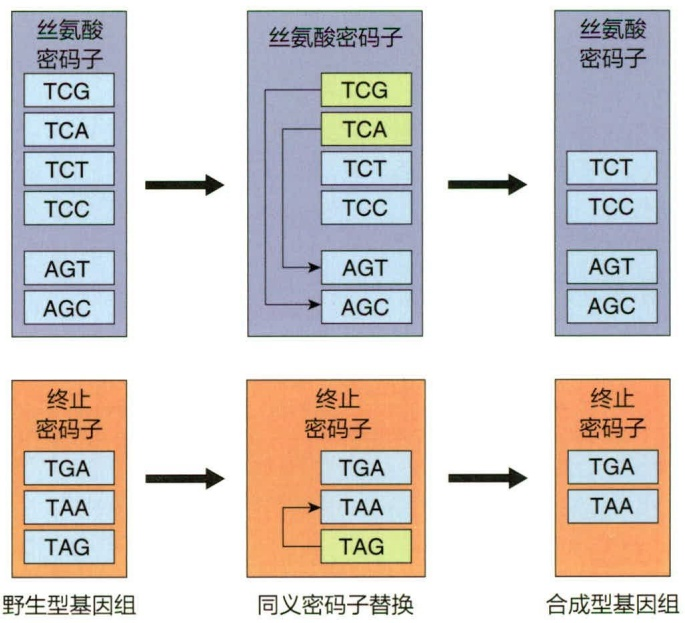

<details>
<summary>flowchart</summary>

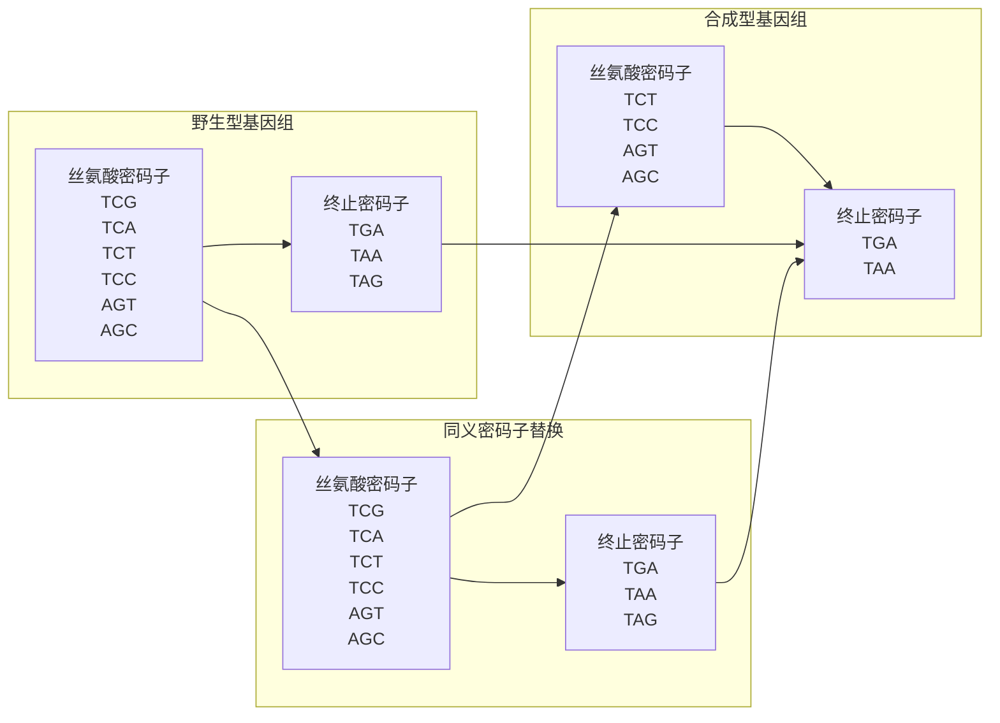
</details>

图 16-22 合成型大肠杆菌基因组密码子的缩减设计

---

554

16 合成生物学

图 16-23 正向重叠区域和反向重叠区域的密码子替换设计

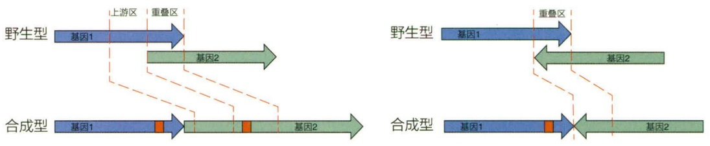

图 16-24 合成型大肠杆菌基因组的拆分设计

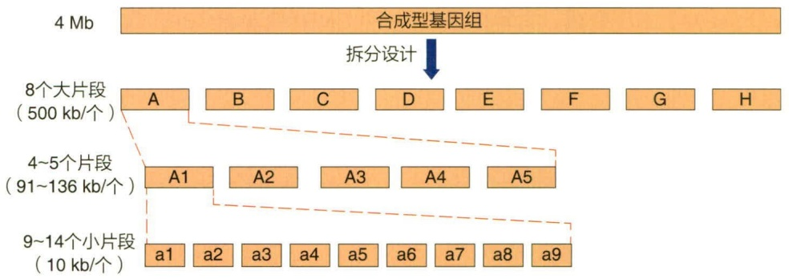

<details>
<summary>flowchart</summary>

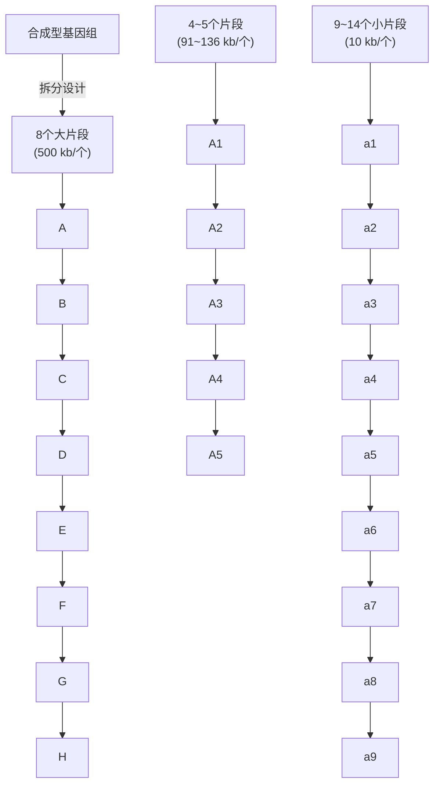
</details>

## 16.4.3.4 分步组装合成型大肠杆菌基因组

第一步是利用酿酒酵母细胞的同源重组能力，将小片段组装到细菌人工染色体（BAC）上，每个 BAC 承载大约 100 kb 的片段。

第二步是接合组装（conjugative assembly），原位替换野生型基因组片段。首先将含有 100 kb 片段的 BAC 导入受体大肠杆菌细胞内，由 Cas 酶切割 BAC，释放出合成型片段，对野生型基因组进行原位迭代替换，获得具有合成型大片段 A-B、C、D、E、F、G、H 共 7 株大肠杆菌。其次，通过两菌株的接合转移，将具有合成型片段的嵌合基因组从供体菌转移到受体菌中，汇聚式、同源重组替换。如图 16-25 所示，将含有 C 片段的嵌合基因组导入含有 A-B 片段基因组的细胞内，通过正、负双筛选，获得含有合成型 A-B-C 片段的基因组。例如，D 片段和 E 片段组装成 D-E 片段，并

图 16-25 大肠杆菌 Syn61 基因组的接合组装过程

彩色为合成型片段，白色为野生型片段

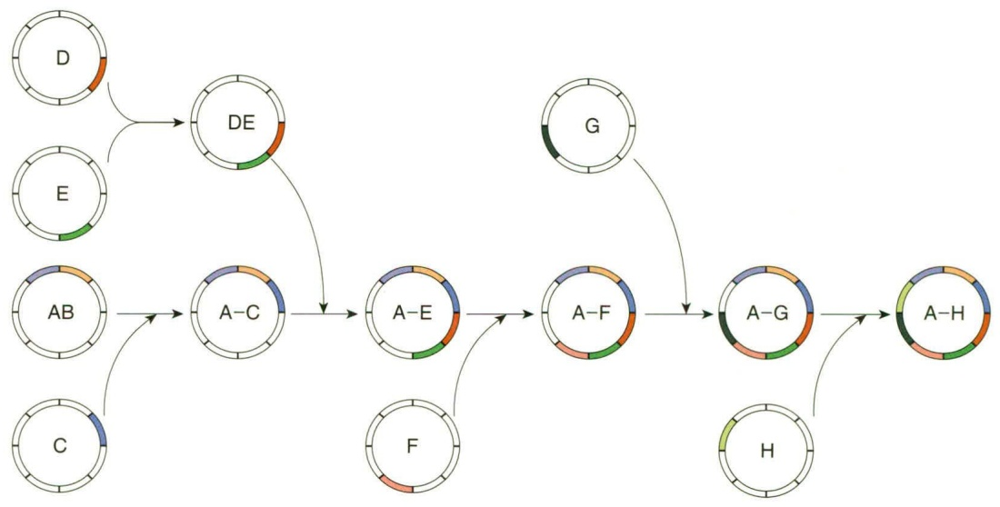

<details>
<summary>flowchart</summary>

```mermaid
graph LR
  A["D"] --> D["DE"]
  B["E"] --> D
  C["AB"] --> A_C["A-C"]
  D --> A_E["A-E"]
  E["C"] --> A_C
  F["F"] --> A_E
  G["G"] --> A_F["A-F"]
  A_C --> A_E
  A_E --> A_F
  A_F --> A_G["A-G"]
  G --> A_G
  A_H["H"] --> A_G
  A_G --> A_H
```
</details>

---

16.5 合成酿酒酵母基因组

555

替换了野生型片段。D-E 片段与 A-B-C 片段组装成 A-B-C-D-E 片段，再依次与 F 片段、G 片段、H 片段组装，获得合成型基因组。

合成型大肠杆菌基因组 Syn61 中引入了 8 个随机碱基突变，来源于百 kb 片段组装和基因组组装过程中，但不影响基因组功能。该研究表明，生物的密码子可缩减，具有重要应用潜力和新用途。一方面，释放出的密码子可赋予工业大肠杆菌对噬菌体的抗性，用于防治发酵污染。另一方面，可编码非天然氨基酸，制造非天然蛋白质，包括抗体、重组蛋白质等。

## 16.5 合成酿酒酵母基因组

在合成噬菌体、病毒和细菌基因组的基础上，人类迈向了真核生物基因组的合成。2012年，由中国、美国、英国等科学家发起了全球性合成酿酒酵母基因组计划。本节主要内容是酿酒酵母基因组设计、染色体的合成与转移、染色体的融合等。

## 16.5.1 合成酵母基因组计划

合成酵母基因组计划（synthetic yeast genome project）简称 Sc 2.0 计划，目的是定制化合成酿酒酵母基因组，为系统研究真核生物染色体提供平台，拓展人类合成生物的能力和边界。截至 2025 年 1 月，中国、美国、英国、澳大利亚、新加坡等国科学家已经报道了 16 条酿酒酵母染色体的设计合成（表 16-8）。

表 16-8 合成酵母基因组计划

| 染色体编号 | 野生型 /bp | 合成型 /bp | 承担单位 | 完成时间 |
| --- | --- | --- | --- | --- |
| I | 230 208 | 180 554 | 美国约翰霍普金斯大学 | 2023 |
| II | 813 184 | 770.035 | 华大基因研究院和英国爱丁堡大学 | 2017 |
| III | 316 617 | 272 871 | 美国约翰霍普金斯大学 | 2014 |
| IV | 1 531 933 | 1 454 621 | 美国纽约大学 | 2023 |
| V | 576 874 | 536 024 | 天津大学 | 2017 |
| VI | 270 148 | 242 745 | 美国约翰霍普金斯大学 | 2017 |
| VII | 1 090 940 | 1 028 952 | 英国爱丁堡大学 | 2023 |
| VIII | 562 643 | 504 827 | 美国纽约大学 | 2023 |
| IX | 439 885 | 404 963 | 美国纽约大学 | 2023 |
| X | 745 751 | 707 459 | 天津大学 | 2017 |
| XI | 666 816 | 659 617 | 英国帝国理工学院 | 2023 |
| XII | 1 078 177 | 976 067 | 清华大学 | 2017 |

---

556

16 合成生物学

续表

| 染色体编号 | 野生型 /bp | 合成型 /bp | 承担单位 | 完成时间 |
| --- | --- | --- | --- | --- |
| XIII | 924 431 | 883 749 | 深圳大学 | 2024 |
| XIV | 784 333 | 753 096 | 澳大利亚麦考瑞大学 | 2023 |
| XV | 1 091 291 | 1 048 343 | 新加坡国立大学 | 2023 |
| XVI | 948 066 | 902 994 | 澳大利亚麦考瑞大学 | 2025 |
| 新染色体 |  | 186 602 | 英国曼彻斯特大学 | 2023 |
| 合计 | 1 2071 297 | 11 516 473 |  |  |

## 16.5.2 合成型酿酒酵母基因组的设计

作为第一版本的合成型基因组，基本原则是要尽量保持野生基因型，使柔性元件的引入及所致的基因组不稳定性达到平衡。设计上，基本不改变染色体上编码基因的原有顺序和非编码区域，防止基因功能变化和未注释元件被破坏。删除逆转录转座子、非必需基因、重复元件及部分内含子，保留非编码小RNA的内含子。用终止密码子TAA替换TAG，采用同义突变，引入或消除酶切位点，便于组装。275个核tRNA基因只编码42个tRNA，删除冗余tRNA基因，其余tRNA基因定位到一条新染色体（neochromosome）上。

在编码区内设计 PCR tag 序列，便于筛选和鉴定，与野生型序列区分。在非必需基因 3'UTR 插入对称的 loxPsym（symmetrical loxP）位点，以便对合成型染色体进行诱导演化研究。酵母染色体有两种类型亚端粒重复序列，Y' 和 X 元件。Y' 元件功能未知，X 元件序列差异大，以单拷贝存在，在端粒沉默和染色体分配时起作用。删除所有的 Y' 元件，X 元件由保守核心序列取代。以酿酒酵母 S288C 为参考，16 条染色体，长度 12 Mb。

合成型染色体的设计是在计算机辅助和酵母知识指导下完成的，在已合成的16条染色体中，只有合成型V号染色体（简称SnyV）序列与设计序列完全相同，其设计流程如图16-26所示。

## 16.5.3 合成型酵母染色体的合成与组装

酵母染色体合成与组装策略和细菌基因组构建基本相同，采用模块化合成和组装，逐级原位替换野生型染色体片段。主要包括化学合成寡核苷酸，组装出750 bp的构建块（building block）、2\~4 kb片段、10 kb片段、30\~60 kb片段，然后用kb级合成片段原位替换野生型染色体序列，获得合成型染色体（图16-27）。

构建块的合成。设计约 70 bp 的寡核苷酸，相邻末端具有 50 bp 重叠序列。第一个寡核苷酸和最后一个寡核苷酸的一端与载体有相同酶切位点。用 16 条正反向寡核

---

16.5 合成酿酒酵母基因组

557

| 版本 | 设计内容 |
| --- | --- |
| 5_0_00 | 野生型 |
| 5_1_00 | 增加PCRTags |
| 5_2_00 | TAA替换TAG |
| 5_3_00 | 插入loxP位点 |
| 5_3_01-5_3_38 | 中间体编写 |
| 5_3_39 | 染色体的片段化分割 |
| 5_3_40-53_43 | 中间体序列,注释矫正 |
| 5_9_01-5_9_21 | SynV与设计序列比较,纠错 |
| 5_9_22 | 终版SynV与设计序列完全相同 |

图 16-26 合成型酿酒酵母 V 号染色体的设计流程

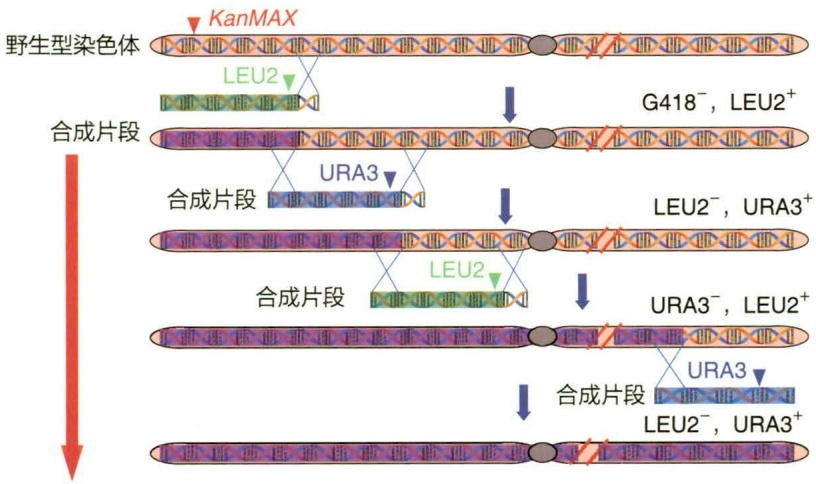

<details>
<summary>flowchart</summary>

```mermaid
graph LR
  A["野生型染色体"] --> B["GAN"]
  B --> C["G418-, LEU2+"]
  D["合成片段"] --> E["LEU2"]
  E --> F["URA3"]
  G["合成片段"] --> H["LEU2- , URA3+"]
  I["合成片段"] --> J["URA3- , LEU2+"]
  K["合成片段"] --> L["URA3"]
  M["合成片段"] --> N["LEU2- , URA3+"]
```
</details>

图 16-27 合成型酵母染色体的组装

苷酸，建立无模板 PCR 体系。将 PCR 产物和载体用相同酶切、连接，转化大肠杆菌。筛选鉴定，获得约 750 bp 的构建块。

片段的组装。有多种组装策略可供选择，如离体 Gibson 组装、重叠延伸 PCR 和酵母细胞内同源组装等。对于同源重组，把 4～8 个构建块与线性载体共转化酵母细胞。筛选鉴定，获得 2～4 kb 的大片段。类似的，3～5 个 2～4 kb 片段组装成 10 kb 片段，3～6 个 10 kb 片段组装成 30～60 kb 片段。

野生型酵母染色体的逐段替换。野生型染色体上插入卡那霉素抗性基因，把 kb 级片段导入酵母细胞，发生同源重组。第一轮导入含有亮氨酸（LEU2）标签的合成片段，与野生型染色体同源重组，卡那霉素抗性（KanMAX）丢失，获得亮氨酸营养标签，筛选和鉴定嵌合染色体。第二轮导入含有尿嘧啶（URA3）标签的合成片段，与嵌合染色体同源重组，亮氨酸标签丢失，获得尿嘧啶标签，筛选和鉴定嵌合染色体。由此，逐步替换野生型全部染色体序列，获得合成染色体（图 16-27）。

对于 Syn II，用 3 kb 片段组装成 10 kb，从染色体的两端开始，进行野生型染色体左臂和右臂的逐级替换。最后，通过交配和拆孢，将合成型左臂和合成型右臂合并

---

558

16 合成生物学

成一条全合成型染色体。

对于 XⅡ 染色体，移除 1.5 Mb 的 rDNA 序列。用 1.6 kb 片段组装成 26～39 kb，进行野生型染色体替换，获得 6 株半合成染色体菌株（每条大约含有 170 kb 合成型片段）。通过多轮交配和拆孢，将 6 个合成型染色体片段集成一条全合成染色体。

携带单条合成染色体的酿酒酵母细胞与野生酵母几乎一样，正常生长和出芽分裂。删除线性染色体的两个端粒，连接在一起，形成环形 V 号染色体。无论是野生型还是合成型环形 V 号染色体，都能稳定遗传，但在二倍体中，孢子的育性大幅度下降。合成型环形 V 号染色体，可作为人类环形染色体疾病的研究模型。具有功能的全合成酵母染色体是人工合成生物的一大进步，将加快合成酵母菌株的培育，并在医药、食品、能源、化工、材料等产品的制造中发挥重要作用，具有重大意义和应用价值。

## 16.5.4 合成型酵母染色体的转移

将合成型单染色体酿酒酵母菌株交配，生成二倍体。通过有性生殖，拆分单孢子，生长成单倍体。筛选野生型染色体丢失的菌种，鉴定出含有多条合成型染色体的单倍体酵母菌株。目前已报道了含有 SynⅢ 和 SynⅥ、含有 Syn V 和 Syn X 以及含有 6 条合成型染色体的菌株。

## 16.5.5 酵母染色体的融合

通过同源重组，可将两条染色体融合为一条染色体。如将Ⅳ和XII融合为一条长度3.2 Mb染色体，将VII-V-XV-IV融合为4.3 Mb染色体，12条染色体的单倍体酵母对适应性没有影响。采用CRISPR/Cas对染色体进行编辑，可加速了染色体融合。2018年中国科学家和美国科学家对酿酒酵母的16条染色体进行融合，两种不同融合顺序和策略，融合染色体的结局不同，分别是具有1条和2条染色体的非自然酿酒酵母。

## 16.5.5.1 酿酒酵母染色体融合原理

染色体融合的设计原理是保留一个着丝粒和两个端粒，确保染色体融合稳定；删除着丝粒和端粒，不能影响邻近的基因；在不同染色体上存在端粒相关长重复序列（2 kb

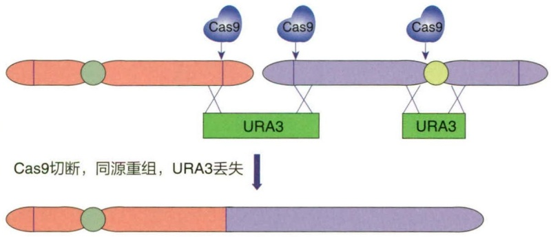

<details>
<summary>flowchart</summary>

```mermaid
graph LR
  A["Cas9"] --> B["URA3"]
  C["Cas9"] --> D["URA3"]
  E["Cas9"] --> F["URA3"]
  B --> G["Cas9切断，同源重组，URA3丢失"]
  D --> G
  F --> G
```
</details>

图 16-28 酵母染色体融合原理示意图

以上）的冗余拷贝，需要删除，以避免在融合过程中发生错误位点的同源重组；单着丝粒始终在融合染色体的中间，以维持两臂的长度平衡；染色体间的融合顺序是随机的。

采用 CRISPR/Cas9 技术与同源重组技术相结合，在 gRNA 引导下，Cas9 切割端粒和着丝粒，与同源片段（含有 URA3 筛选标记的正向重复序列 hisG-URA3-hisG）发生重组，使两条染色体之间融合为一条染色体（图 16-28）。

---

16.6 合成生物学的应用

559

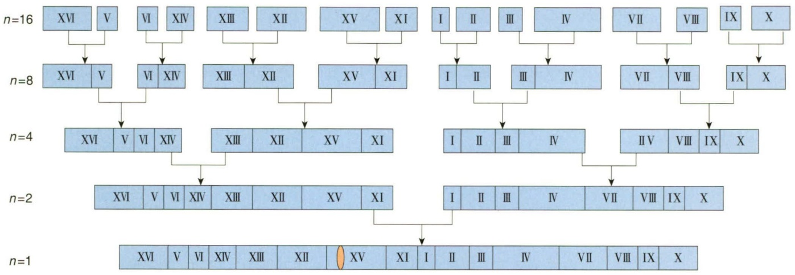

<details>
<summary>flowchart</summary>

```mermaid
graph TD
  subgraph n_16["n=16"]
  A["XVI"] --> B["XVI"]
  A --> C["V"]
  A --> D["VI"]
  A --> E["XIV"]
  A --> F["XIII"]
  A --> G["XII"]
  A --> H["XV"]
  A --> I["XI"]
  J["I"] --> K["I"]
  J --> L["II"]
  J --> M["III"]
  J --> N["IV"]
  O["VII"] --> P["VII"]
  O --> Q["VIII"]
  O --> R["IX"]
  O --> S["X"]
  end

  subgraph n_8["n=8"]
  T["XVI"] --> U["XVI"]
  T --> V["V"]
  U --> W["XVI"]
  V --> X["XIV"]
  W --> Y["XIII"]
  X --> Z["XII"]
  Y --> AA["XV"]
  Z --> AB["XI"]
  AA --> AC["XV"]
  AB --> AD["XI"]
  end

  subgraph n_4["n=4"]
  AE["XVI"] --> AF["XVI"]
  AE --> AG["V"]
  AE --> AH["VI"]
  AE --> AI["XIV"]
  AE --> AJ["XIII"]
  AE --> AK["XII"]
  AE --> AL["XV"]
  AE --> AM["XI"]
  end

  subgraph n_2["n=2"]
  AN["XVI"] --> AO["XVI"]
  AO --> AP["V"]
  AO --> AQ["VI"]
  AO --> AR["XIV"]
  AO --> AS["XIII"]
  AO --> AT["XII"]
  AO --> AU["XV"]
  AO --> AV["XI"]
  end

  subgraph n_1["n=1"]
  AW["XVI"] --> AX["XVI"]
  AX --> AY["V"]
  AX --> AZ["VI"]
  AX --> BA["XIV"]
  AX --> BC["XIII"]
  AX --> BD["XII"]
  AX --> CB["XV"]
  AX --> CD["XI"]
  AX --> ED["I"]
  AX --> AF
  AX --> AG
  AX --> AH
  AX --> AI
  AX --> AJ
  AX --> AK
  AX --> AL
  AX --> AM
  AX --> AN
  end

  subgraph n_20["n=20"]
  AN --> AO
  AO --> AP
  AO --> AQ
  AO --> AR
  AO --> AS
  AO --> AT
  AO --> AU
  AO --> AV
  AO --> AW
  AO --> AX
  AO --> AY
  AO --> AG
  AO --> AH
  AO --> AI
  AO --> AJ
  AO --> AK
  AO --> AL
  AO --> AM
  end

  subgraph n_30["n=30"]
  AN --> ANF["I"]
  ANF --> AJF["II"]
  ANF --> AKF["III"]
  ANF --> ALF["IV"]
  ANF --> AMF["VII"]
  end

  subgraph n_40["n=40"]
  ANF --> ANG["I"]
  ANG --> ANH["II"]
  ANF --> ANO["III"]
  ANF --> ANP["IV"]
  ANF --> ANQ["VIII"]
  end

  subgraph n_50["n=50"]
  ANF --> ANP["I"]
  ANP --> ANO["II"]
  ANF --> ANP
  ANF --> ANO
  ANF --> ANP
  end

  subgraph n_60["n=60"]
  ANF --> ANM["I"]
  ANM --> ANN["II"]
  ANM --> ANO["III"]
  ANM --> ANP
  end

  subgraph n_70["n=70"]
  ANF --> ANP
  ANP --> ANO
  end
```
</details>

图 16-29 酿酒酵母单染色体的融合过程示意图

用 5-氟尿嘧啶（5-FOA）反向筛选，无痕删除 URA3 筛选标记后，获得无标签的融合染色体，进入下一轮融合。

## 16.5.5.2 酿酒酵母染色体的融合过程

采用汇聚式融合，第一轮是两条染色体之间融合，获得 n=8 菌株。第二轮融合，获得 n=4 菌株。第三轮融合，获得 n=2 菌株。第四轮融合，获得 n=1 菌株 SY14（图 16-29）。总共删除了 15 个着丝粒和 30 个端粒，单染色体长度 11.4 Mb。酿酒酵母的着丝粒 125 bp，具有强大的承载能力，可承载 12 Mb 的染色体。

同样采用汇聚式融合，从最小染色体之间融合开始，逐渐增加染色体臂的长度。经过四轮融合，获得双染色体的酿酒酵母，每条染色体约6 Mb。

酿酒酵母染色体融合研究表明，染色体之间的相互作用弱。与野生型相比，单染色体酵母的转录和生长几乎没有影响。单染色体二倍体酵母，具有多倍体化的趋势，表明单染色体的分配功能有缺陷，产孢率大幅度下降80%，单孢子的活性下降10%左右，可能引起配子和减数分裂的活性下降。

单染色体和双染色体酿酒酵母，为染色体结构和功能（端粒、着丝粒、减数分裂）的演化研究提供了宝贵的遗传材料。


技术应用 16-2

酿酒酵母双染色体融合过程

## 16.6 合成生物学的应用

## 16.6.1 微生物细胞工厂

基于合成生物技术构建微生物细胞工厂，将促进医药、能源、材料、化学品生产、食品和环境等领域的发展，为解决许多人类重大全球性问题提供崭新工具。

## 16.6.1.1 医药领域应用

通过微生物细胞工厂生产基因工程药物是合成生物学的重要应用领域，包括生产多肽类药物和疫苗等。例如，生产具有抗肿瘤和抗病毒功能的干扰素；用于预防

---

560

16 合成生物学

传染病的乙型肝炎疫苗；用于治疗心血管系统疾病的尿激酶原以及用于人体生理调节的胰岛素等。

合成微生物细胞在疾病治疗方面的应用也备受合成生物学家关注，可为疾病治疗提供新的思路和解决方案，包括糖尿病和肿瘤等。

例如，可通过在细胞中构建人工合成基因回路，将生物传感系统用于糖尿病的治疗。目前已有两种调控回路被开发出来，包括光调控基因回路和微波调控基因回路。将含有光调控系统的合成细胞移植至患病小鼠体内，此合成细胞基因回路由光感受器视黑素与效应器两部分构成。视黑素为一类 G 蛋白偶联受体，效应器则由响应活化 T 细胞核因子的启动子及胰高血糖素样肽 -1（glucagon-like peptide 1，GLP-1）基因构成。在蓝光刺激下，视黑素构象改变，GLP-1 基因表达启动，刺激胰岛 β 细胞增殖分化，从而促进胰岛素合成并分泌，起到降血糖的效果。患者只需照射蓝光就能得到降血糖的治疗结果。与化学诱导物比较，蓝光具有诱导速度快、毒性低等特点，能够克服吃药、打针等传统治疗方法的局限性，有效减轻治疗过程中的痛苦。微波调控基因回路体系所利用的感知元件是一种热敏感型离子通道蛋白（thermosensitive lon channel protein，TRPV1）。在低频微波辐射作用下，与之结合的铁蛋白聚合物可发生磁热效应释放热能，使细胞局部温度升高，激活 TRPV1 离子通道，使钙离子内流而激活 NFAT 信号通路，从而启动基因回路中胰岛素原的表达，调节血糖稳态。

合成生物学还可用于治疗肿瘤。经过合成生物技术改造而成的人工细菌，有望实现对癌症患者生理状态的监测、诊断以及治疗。例如，利用群体感应的基因回路设计工程化裂解细菌，当肿瘤环境内生长的工程细菌数量达到一定浓度阈值后自动裂解，并释放出抗肿瘤药物。由于体内始终维持较低的细菌数量，从而可以减轻其对周围组织的毒副作用。与人工细菌作用原理相似，人工改造的溶瘤病毒在肿瘤细胞中，特异性复制并杀伤肿瘤细胞，但不伤害健康组织，同时还会克服肿瘤免疫抑制，促进机体免疫修复。

## 16.6.1.2 能源和材料领域应用

利用合成生物学技术开发新型生物能源是解决能源危机的重要途径之一。例如，经过合成生物技术改造大肠杆菌的非发酵代谢途径，构建用于合成1-丁醇的细胞工厂，生产的1-丁醇燃料接近汽油的能量密度，且不易挥发。氢气是未来很有前景的绿色清洁能源。在细胞中将多种酶进行适配，实现把生物质原料转化为氢气分子，其生产的氢气易存储、安全性高且环境友好。

未来先进材料的合成和制备需要朝着绿色可持续、低耗高产出、精细可调控、高效多功能的方向发展。微生物细胞工厂将为制造和设计生物材料注入新的思路和活力，推进对新材料的探索。例如，利用细胞工厂合成高分子生物材料、制备无机纳米材料和活体功能材料等；利用噬菌体展示和蛋白定向演化战略筛选和优化分子材料；开发活体功能材料等。

## 16.6.1.3 化学品生产领域应用

传统工业发酵菌种大都经过长期的诱变或重组育种，生产性能很难再有大幅度

---

16.6 合成生物学的应用

561

提升。基于合成生物技术，设计高效代谢通路和酶，构建微生物细胞工厂可以打破这一困境，实现不同化学物品的高效安全生产。如，上海交通大学邓子新院士用合成生物技术合成维生素E，生产工艺从7个步骤减少为3个，极大降低资金投入和生产成本，填补了中国长期没有维生素E完整产业链的空白；加州大学伯克利分校杰·基斯林（Jay Keasling）团队成功在酵母细胞中生产出青蒿素前体青蒿素酸；斯坦福大学克里斯蒂娜·斯默克（Christina Smolke）团队在酵母菌中完全合成阿片类药物（Opioids）。此外，微生物细胞工厂在生产各种工业化学品如生物塑料、乙醇、有机酸和生物燃料等领域已有大量成功的例子。

## 16.6.1.4 食品领域应用

合成生物技术可以增加食物的产量、改进食物的品质、减少对环境的污染等。如利用合成细胞的发酵过程将非食用生物质转化为具有高营养价值的蛋白质和氨基酸。常见应用包括:利用微生物细胞工厂合成工业用途的食品成分；通过合成细胞产生特定的蛋白质；利用合成生物技术促进作物生长提高植物产量，如通过将有益的微生物转化到植物体内，使得植物获得提升养分吸收、抵御病原体和提升产量的能力；转固氮、结瘤、分解纤维素或木质素等相关酶的编码基因，构建转基因新品种等。

## 16.6.1.5 环境领域应用

在环境保护领域，合成生物技术可以有效实现有毒污染物的降解、脱毒，以及废弃物质的高值转化。以具有烃类降解能力的工程菌株人工合成为例。自然界未分离出能够好氧利用1,2,3-三氯丙烷的天然菌株，可通过在大肠杆菌中组装分解代谢途径并构建合成细胞，以实现将1,2,3-三氯丙烷转化为无害甘油。把芳烃、萜烃和多环芳烃等降解途径整合到一株具有烃降解能力的假单胞菌中，获得可以同时降解4种烃类的超级“合成细胞”，可以把原油中2/3的烃分解掉。据报道，利用这种超级“合成细胞”只需几个小时就可以分解大部分海洋石油污染，而利用自然菌种则需要一年以上的时间。除难降解有毒污染物的降解外，通过构建合成细胞，还可以将木质纤维素等物质转化为中间化合物乳酸，再代谢为乙酸、丁酸等，实现废物利用、变废为宝。可见，这种合成微生物细胞在保护环境、污染修复方面具有很大潜力。

目前新兴污染物种类繁多，而微生物自然演化出降解元件的过程十分漫长和困难，因此现有降解菌难以满足环境中复杂和新兴污染物生物降解和修复的需求。通过分析现有降解菌的代谢通路信息及催化元件，利用合成生物技术定向设计、改造并组合降解元件，构建能够降解一种或多种污染物、具有全新代谢网络的合成细胞，实现污染物从未可（或低效）降解到高效降解。

## 16.6.2 活体微生物药物

活体生物药（live biotherapeutic product，LBP）被越来越多地应用于预防、诊断与治疗疾病。2016年美国食品药品监督管理局生物制品评价与研究中心发布了全球第一部明确将LBPs作为药物使用的指南，明确了活体生物药的定义:①包含活的生物体，

---

562

16 合成生物学

如细菌；②能够预防、治疗或治愈某种疾病；③不是疫苗。值得注意的是，LBPs 不是可过滤的病毒、溶瘤细菌或用作基因治疗剂的产品。

合成生物技术的出现极大提高了活体微生物药物在改善健康状况、治疗疾病等方面的应用潜力。例如，采用合成生物学手段在微生物细胞中设计、构建精准可控的基因通路，获得非致病性、具有疾病微环境感知和响应能力并按需释放治疗药物的活体工程菌，已成为实施活体微生物疗法的新思路和新方法。噬菌体药物和肠道菌药物是目前常见的活体微生物药物。

## 16.6.2.1 噬菌体药物

噬菌体对宿主具有极高的特异性，在诊断和治疗细菌感染方面具有巨大潜力。合成生物技术将极大促进噬菌体药物在疾病治疗领域的应用。通过合成生物技术改造噬菌体可以提高噬菌体的杀菌效率；增加噬菌体作为靶向药物载体的杀菌方式多样性等。在预防与治疗细菌感染方面，目前已有不少噬菌体药物治疗成功的案例，包括治疗位于口腔、肺部、生殖道、肠道、心脏和皮肤等感染。例如2017年，对感染了多重耐药菌鲍曼不动杆菌（Acinetobacter baumannii）并发展为坏死性胰腺炎的患者进行噬菌体治疗（腔内和静脉注射），患者在5个月后痊愈；2019年，美国匹兹堡大学和美国科罗拉多大学的研究团队首次成功使用经过工程改造的噬菌体治疗了一例人类分枝杆菌感染。该团队通过基因工程和正向遗传学的方法，开发出了高效裂解感染性脓肿分枝杆菌的噬菌体衍生物，能够有效地杀灭脓肿分枝杆菌（Mycobacterium abscessus）感染株，成功治疗1例15岁囊性纤维化伴播散性脓肿分枝杆菌感染的患者。

## 16.6.2.2 肠道菌药物

肠道微生物被称为人体的“第二基因组”，与人类健康有着密切关联，因此，肠道菌不仅可作为疾病治疗效果的标志物，还可作为治疗疾病或辅助治疗药物。例如，肠道微生物作为肿瘤免疫中新的干预方式，已成为肿瘤治疗领域研究的一个新热点。肠道菌可通过其代谢产物、表面蛋白等，直接或间接抑制肿瘤的生长或诱发细胞凋亡，从而发挥抗肿瘤作用。基于合成生物技术改造的肠道工程菌具有潜在优势，因为肠道工程菌可以赋予内源性肠道微生物群不表达的功能。例如，大肠杆菌 Nissle 1917（Escherichia coil Nissle 1917，EcN）是一株应用于益生菌领域超过 100 年历史的特殊菌株。基于合成生物技术改造后的 EcN 菌株已经被用于多种不同疾病的临床试验。改造 EcN 的主要思路包括消耗免疫抑制物、分泌细胞因子和分泌潜在免疫激动剂。研究人员将厌氧诱导型二核苷酸环化酶基因 dcaA 导入 EcN，得到的合成菌株（SYNB1891）可以感知肿瘤微环境中的厌氧条件，进而表达生成干扰素基因刺激因子激动剂环二腺苷酸。环二腺苷酸则进一步激活 IFN-β 的表达以达到抗肿瘤的目的。据报道，SYNB1891 可诱导产生剂量依赖型肿瘤免疫和肿瘤退化，且已有两例使用了 SYNB1891 治疗的患者病情得到改善。总之，利用合成生物技术改造微生物为疾病的治疗提供了新思路，在疾病治疗领域有无限可能。

## 知识拓展 16-3

噬菌体治疗囊性纤维
化合并难治性肺部
感染

---

16.6 合成生物学的应用

563

## 16.6.3 物理信息存储

DNA 具有可编程性、持久性、易于复制、高存储密度和高保真等特性，可作为信息数据存储的介质。DNA 存储技术是新型的信息存储技术，是指用人工合成的脱氧核苷酸链对文档、图片、音频和视频等信息进行存储并完整读取的技术。DNA 信息存储的基本过程包括（图 16-30）:①信息编码，通过将数据编码成二进制的数字串，然后用 A、T、C、G 4 种碱基编码二进制相对应的数字，将数字信息转换为 DNA 序列；② DNA 合成，将编码信息的 DNA 序列进行合成；③信息存储，将合成的 DNA 进行体外或体内的长期存储，以便随时检索和选择性地访问（数据储存）；④读取数据，通过测序将 DNA 序列转换为数字数据（解码）。

DNA 信息存储可以分为体外和体内存储两种方式。早在 1960 年，Mikhail Neiman（1905—1975）就提出了使用 DNA 进行数字信息存储的概念。2015 年，Robert Grass 通过硅石封装以及纠错码保护数据，可以实现数据长达数千年的存储，并使用纠错码设计了第一个稳定的 DNA 数据存储方案。随后，James Bornholt 等利用 DNA 文库存储了 4 个文件，并展示了随机存取在 DNA 信息存储中的应用。2017 年，Yaniv Erlich 等开发了一种称为 “DNA 喷泉” 的高密度存储机制，并利用 DNA 文库存储了约 2.11 Mb 的文件，其中包括一部电影和其他文件。这些研究已经证实 DNA 作为存储介质的可行性与价值。据报道，目前体外 DNA 信息存储体系的存储能力已经得到了很大的扩展，可以存储高达 200 Mb 的数字信息。与体外 DNA 储存不同，体内 DNA 信息存储是将编码数字信息的 DNA 片段整合到不同生物体的基因组中，例如大肠杆菌、枯草芽孢杆菌和酵母。其优势在于数据可以在微生物体内复制和遗传，无须额外的维护费用；信息以 DNA 双链形式进行存储，具有更高的稳定性和更长的贮藏期；可以携带更长的 DNA 片段，信息容量大。

DNA 作为新型的信息存储载体，具有以下优点:①长期稳定性。DNA 能保证生命准确无误地繁衍遗传，上万年的样本仍可被恢复为完整的 DNA 片段。②高密度性。DNA 序列的每个碱基对可以存储 1 字节（两个比特）的信息，使 DNA 能够在极小空间中存储大量信息。③环境友好。与传统的物理存储介质（如硬盘、光盘等）不同，DNA 是生物体内天然存在的生物大分子，其制备和处理过程对环境的影响很小。


知识拓展 16-4

DNA 喷泉

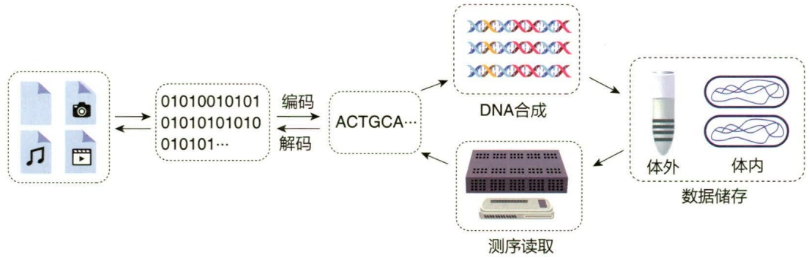

<details>
<summary>flowchart</summary>

```mermaid
graph LR
  A["File Format (Image)"] --> B["01010010101\n01010101010\n010101..."]
  B -->|"编码"| C["ACTGCA...\nDNA合成"]
  C --> D["测序读取\n体外"]
  C --> E["体内"]
  D --> F["数据储存"]
```
</details>

图 16-30 DNA 存储技术示意图

---

564

16 合成生物学

## ※ 本章小结

设计合成生物的过程，可与计算机类比。由生物元件、模块、遗传回路构成细胞代谢及控制模式，使生物系统按照设计的程序运行。组装 DNA 片段是合成微生物学的底层技术，常用技术包括标准化组装、聚合酶循环组装、等温组装、Red/ET 重组组装和酿酒酵母细胞内组装等。

微生物基因组设计合成的基本思路是解耦基因组功能、抽提编码序列、拆分设计、片段合成、基因组组装、功能检验。以寡核苷酸为原料，采用逐级组装策略，目前已经设计合成了噬菌体、DNA病毒、RNA病毒等基因组，也设计合成了支原体基因组、最小基因组以及61个密码子的大肠杆菌基因组。酿酒酵母基因组比细菌基因组复杂，在精细设计的基础上，用合成片段逐级原位替换野生型染色体，目前合成了15条染色体。通过染色体之间的融合，构建了单染色体酿酒酵母和双染色体酿酒酵母。

合成生物学的主要应用领域是微生物细胞工厂、活体生物药物、物理信息的存储等。微生物细胞工厂是目前最活跃的领域，可用于生产药品、食品、能源、材料、化学品等。肠道菌药物、噬菌体药物等活体生物药是新兴应用领域。将文档、图片、音频和视频等信息转化为 DNA 序列，是未来物理信息存储和读取的重要方式。

随着合成生物学的不断深入研究，将为人类解决健康、农业、工业、环境、气候、信息、安全等重大全球性问题提供崭新工具。

## ※ 推荐阅读

- 1. TAN Y, SHEN J, SI T, et al. Engineered live biotherapeutics: progress and challenges [J]. Biotechnology journal, 2020, 15 (10): e2000155.
- 该综述全面介绍了合成生物学在活体生物药领域的进展与挑战。通过合成生物学的方法，科学家能够设计和工程化活体微生物，包括工程化共生菌、合成微生物群落和噬菌体等，以治疗各种人类疾病，如病原体感染、代谢紊乱和结肠癌。该文突出了合成生物学在活体生物药开发中的潜力，并提出了未来发展中的挑战，为该领域的研究和应用提供了重要参考。
- 2. BENCUROVA E, AKASH A, DOBSON R C J, et al. DNA storage—from natural biology to synthetic biology [J]. Computational and structural biotechnology journal, 2023, 21: 1227–1235.
- 该文论述了 DNA 存储的基本概念和最新进展，探讨了从自然生物学到合成生物学的转变。着重介绍了受自然启发的高效 DNA 存储方法，并展望了 DNA 存储技术在未来替代传统信息存储方法的潜力。这对于合成生物学和生物技术领域的发展具有重要意义。
- 3. NELSON M D, FITCH D H. Overlap extension PCR: an efficient method for transgene construction [J]. Methods in molecular biology. 2011, 772: 459-470.
- 这篇经典文章介绍了一种名为 OE-PCR 的新型 DNA 组装技术。该技术快速、高效、

---

复习思考题

565

成本低、易操作，且适用于构建较大的杂交 DNA 片段 (>20 kb)。

4. GIBSON D G, YOUNG L, CHUANG R Y, et al. Enzymatic assembly of DNA molecules up to several hundred kilobases [J]. Nature methods, 2009, 6: 343-345.

这篇经典文章报道了 Gibson 组装的原理与方法，Gibson 组装通过 5' 核酸外切酶、DNA 聚合酶和 DNA 连接酶的协同作用组装多个重叠的 DNA 分子。这种方法不仅可以用于构建合成基因和天然基因，还可以用于构建遗传途径和整个基因组。因此，Gibson 组装技术具有广泛的应用前景，可能成为一种重要的分子工程工具。

5. 丁明珠，李炳志，王颖，等. 合成生物学重要研究方向进展 [J]. 合成生物学，2020, 1(1): 7-28.

该文对过去 20 年的合成生物学研究进展进行了系统评述，包括基因回路、人工基因组和人工细胞工厂等主要方向的设计原理和构建技术，也包括 DNA 信息存储、非天然密码子、无细胞合成生物学等新兴交叉方向，并指出了合成生物学的未来趋势和对策。这是一篇全面了解和掌握合成生物学及其应用的重要文献。

## ※ 开放性讨论题

1. DNA 组装技术未来如何发展和演变？
2. 设计合成真核微生物基因组的挑战是什么？
3. 微生物体内信息存储的安全性如何？与传统电子存储相比，存储在微生物体内的信息是否会带来新的隐私问题？我们应该如何平衡数据的安全性与便利性？

## ※ 复习思考题

1. 在合成生物学中，生物元件、模块、遗传回路的功能及其关系是什么？
2. 聚合酶循环组装（PCA）和 Gibson 组装两种方法的主要区别是什么？
3. 对比标准化组装和细胞内组装两种 DNA 组装方法的优缺点。
4. 在构建大片段 DNA 时，为什么会选择细胞内组装而不是体外组装？
5. 负链 RNA 病毒和正链 RNA 病毒的设计合成有什么区别？
6. 合成细菌基因组和合成酿酒酵母基因组的技术异同是什么？
7. 合成微生物学有哪些新兴的应用领域？
8. 什么是活体微生物药物，目前常见的活体微生物药物有哪些？

(赵广荣 蒋建东)
