# 17 农业微生物学

原始 PDF 第 583–616 页。

## 17

# 农业微生物学

## 导语

农业生产过程中的典型场景，如植物根际、养殖动物肠道、污染生境，其间的微生物群落扮演着极为重要的角色。多学科交叉技术的应用，极大提升了人们对上述场景中典型微生物群落结构与功能的认识，为理性调控绿色农业生产过程提供了全新、有力的理论与技术支撑。农田植物微生物群落的成员包括有益微生物、中性微生物和致病微生物，其中有益微生物可以通过抑制植物病原体、固氮、解磷、产生植物生长调节剂等机制，提高植物生长、抗病及抗逆能力。动物的肠道微生物构成了复杂的微生物群落，其中有益微生物具有调节肠道内环境稳态、激活宿主免疫应答、促进饲料消化和营养吸收、参与物质与能量代谢等功能。这些有益微生物在微生物肥料、微生物农药、微生物饲料添加剂及土壤污染修复等领域展现出广泛的应用前景。

## 关键词

微生物群落，根际微生物，绿色农业，微生物肥料，微生物农药，微生物饲料，微生态制剂，土壤污染修复

---

17.1 农业微生物群落结构与功能

567

## 17.1 农业微生物群落结构与功能

微生物与农业生产密切相关。除农业领域数量较少的病原微生物外，大多数的农业微生物通常在各种特征的生境中形成特定有益的微生物群落，从而影响农田植物与养殖动物产量，以及农田污染修复效率。相关微生物有望成为应对农业可持续性挑战的生物资源。农业微生物对生态系统健康的重要性是无可争议的，它们不仅与宿主形成特殊的共生关系，而且负责驱动碳、氮、磷、硫等重要元素的地球循环。数十年来，研究者们通过多组学研究，探索了对农业生态系统健康至关重要的微生物群落，并力求揭示塑造微生物群落结构和功能的力量。

农业生态系统（涵盖耕地及其周边自然区域的交互体系）是微生物学与生态学研究的热点，其核心方向在于利用微生物群落的有益功能，以促进作物生长及养殖动物健康。在整个农业历史上，人类一直采用种植策略来避免土壤传播病原体的积累，并有意利用微生物来对抗农业害虫。近年来，多学科交叉极大提升了人们对植物根际、动物肠道、污染生境等典型农业微生物群落结构与功能的认识，为理性调控绿色农业生产提供了有力的理论与技术支撑。

## 17.1.1 农田植物微生物群落

根际是植物、土壤和微生物相互作用的复杂空间。1904年，德国科学家洛伦茨·希尔特纳（Lorenz Hiltner，1867—1936）最早提出:根际是受植物生长影响的土壤隔层。这一隔层很大程度上是由植物释放的有机物，如植物代谢物和植物碎片构成的。这些有机物含碳量占到植物光合固碳量的20%\~40%。因此，虽然大多数裸露土壤被认为是寡营养环境，但根际土壤通常为中营养环境，有利于细菌、古菌、病毒和真菌的生长。例如，植物根际高丰度分布一类持续稳定地定殖于植物根际、受植物根系生命活动影响的细菌，称为根际细菌（rhizobacteria），这类细菌的种群密度比非根际土壤细菌高出100倍以上，并且具有丰富的遗传和功能多样性。根际微生物显著影响植物健康和根际生态功能，是碳循环的一部分，可直接参与碳循环，也可作为其他微生物或更大生物体（如变形虫、线虫）的营养源。根际系统可以通过工程化手段而被理性设计与调控，从而促进农业可持续发展，这一技术体系称为根际工程（图17-1）。例如，土壤理化性质的改变能够影响互作系统的功能；植物可以通过工程设计来优化微生物群落结构；微生物群落则可以通过理性设计来促进植物的生长。

不同的健康植物根际存在结构各异的微生物群落，植物为细菌、真菌、原生动物、病毒等各类微生物的生长和增殖提供大量的生态位。微生物在各种植物组织中定殖，进而发挥各种复杂作用，包括促进作物生长、提升营养吸收效率、增强抗逆性等。

---

568

17 农业微生物学

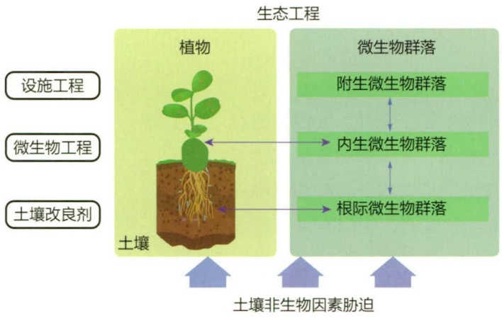

flowchart

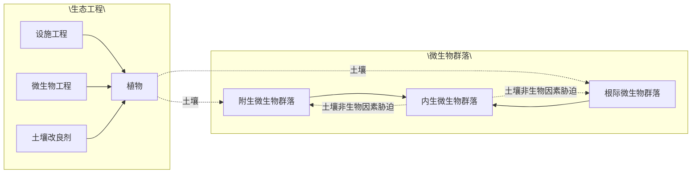

图 17-1 根际工程对植物和土壤健康的改善作用

在植物非生物因素（如干旱或森林砍伐导致的高盐浓度或高金属浓度）及生物因素（如病原体）的胁迫下，设施工程、微生物工程和土壤改良剂都可以重塑根际微生物群落，从而维持植物及土壤健康

## 17.1.1.1 群落结构

农田植物微生物群落的成员包括有益微生物、中性微生物和致病微生物，其中有益微生物对于维持植物健康至关重要。如假单胞菌（Pseudomonas spp.）可以通过产生抗生素、生长竞争等方式，抑制植物致病微生物的定殖。然而，植物健康的维持受到多种因素的影响，包括微生物组成的多样性、病原体种群动态、土壤理化条件等。

微生物给宿主植物带来的益处可以是直接的，包括:转化和转移土壤中必需的营养物质，使其为植物所利用（例如固氮、解磷、解钾）；通过竞争、产生抗生素和水解酶等机制，减轻环境压力及病原体对植物的侵害。微生物的益处也可以是间接的，如通过增强植物的抗性反应而发挥作用。合理设计

和应用具有广泛、持久促进植物生长能力的合成微生物群落，将为绿色农业发展提供新的思路。

1978年，美国科学家约瑟夫·W·克洛普尔（Joseph W. Klopper）首次提出了植物根际促生细菌（plant growth promoting rhizobacteria，PGPR）的概念，专指一群定殖于植物根际，与植物根系密切相关的根际细菌，将其接种于植物种子、根系、块根、块茎或根际土壤时，可表现出促进植物生长的功能。PGPR在微生物肥料领域具有广泛的应用前景。已报道的PGPR种类很多，包括醋杆菌（Acetobacter spp.）、巴西固氮螺菌（Azospirillum brasilense）、枯草芽孢杆菌（Bacillus subtilis）、气单胞菌（Aeromonas spp.）、柠檬节杆菌（Arthrobacter citreus）、巨大普里斯特氏菌（Priestia megterium）、固氮菌（Azotobacter spp.）、荧光假单胞菌（Pseudomonas fluorescens）、多黏类芽孢杆菌（Paenibacillus polymyxa）、恶臭假单胞菌（Pseudomonas putida）、沙雷氏菌（Serratia spp.）、根癌土壤杆菌（Agrobacterium tumefaciens）、豌豆根瘤菌（Rhizobium leguminosarum）、三叶草根瘤菌（Rhizobium trifolii）、苜蓿中华根瘤菌（Sinorhizobium meliloti）等。

植物微生物群落的形成并不是随机事件，而是遵循群落组合的一般规则，并具有明显的系统发育特征。群落的组装受微生物、植物宿主和环境之间复杂相互作用的支配。对这些相互作用的新认识将有助于增进对群落形成、演化和生态过程的理解，并将指导合成微生物群落的构建与重塑，以提高植物适应性和生产力。为获得更为全面的认识，人们首先需要阐明驱动根际微生物群落组装的机制。其次，需要确定宿主-微生物相互作用的生化和遗传特征。此外，微生物菌剂、信号分子和其他制剂的开发也将增强微生物群落在农业环境中的调节功能。

微生物群落组成在植物根际、根内生区、叶内生区及叶际之间存在显著差异。在植物内生微生物群落中，假单胞菌门（Pseudomonadota）和芽孢杆菌门（Bacillota）相对丰

## 知识拓展17-1

PGPR 的促生长及生
防机制

---

17.1 农业微生物群落结构与功能

569

度显著偏高，达到根际微生物群落中的两倍或更高，而酸杆菌门（Acidobacteria）、芽单胞菌门（Gemmatimonadetes）等类群的微生物相对丰度约为根际的25%或更低。这种特定细菌类群的富集即使在其他类群占主导地位的土壤中也是一致的。叶内微生物群落主要由假单胞菌门、拟杆菌门（Bacteroidetes）和放线菌门（Actinomycetota）组成，其中假单胞菌门的成员占群落组成的50%左右。植物相关的真菌种类繁多，主要属于子囊菌门和担子菌门。尽管丛枝菌根真菌（球囊菌门）和外生菌根真菌已经进行了大量研究，但这些类群在根系的真菌群落中多样性较低。病毒在土壤中细菌群落的聚集和周转中起着重要作用。在土壤中，病毒既影响微生物群落结构，也影响群落的生态功能。同样，原生生物和线虫对微生物群落多样性有很大贡献，它们与其他微生物一起影响土壤-植物互作过程和生态系统功能。原生生物通过调节不同营养水平上的捕食者-食饵关系来控制细菌和真菌群落的演替。

## 17.1.1.2 群落功能

## (1) 营养调节

植物根际微生物在改善植物营养方面具有极为重要的作用。植物与丛枝菌根真菌（AMF）和根瘤菌共生，从而协同获取养分。此外，非共生植物促生菌可以提高不溶性矿物质的生物有效性，增强根系对水分和矿物质的吸收能力。例如，根际微生物可通过矿化、载体增溶或产酸作用，调动植物不容易获得的营养物质，如无机磷和矿物钾。某些植物根际促生细菌可产生铁载体（siderophore）。铁载体是一种对铁具有高亲和力的低分子量铁螯合蛋白，可与土壤中的  $Fe^{3+}$  螯合形成  $Fe^{3+}-$  铁载体复合物，供植物吸收利用。在石灰性土壤中，细菌铁载体复合物对于植物铁利用过程至关重要。此外，根际微生物还可通过硝化作用提高氮的生物有效性，延缓作物开花时间。

## (2) 激素调控

许多 PGPR 能够产生不同类型的植物激素，调控植物的生长代谢过程（表 17-1）。例如，维罗纳气单胞菌（Aeromonas veronii）、根癌土壤杆菌（Agrobacterium tumefaciens）、豌豆根瘤菌（Rhizobium leguminosarum）、阴沟肠杆菌（Enterobacter cloacae）等可产生植物生长激素吲哚-3-乙酸（indole-3-acetic acid，IAA），促进根系生长，增加根长度及表面积。多黏类芽孢杆菌（Paenibacillus polymyxa）、荧光假单胞菌（Pseudomonas fluorescens）和豌豆根瘤菌（Rhizobium leguminosarum）可产生细胞分裂素，促进根细胞分裂及增大，增加根表面积。某些芽孢杆菌（Bacillus spp.），如短小芽孢杆菌、地衣芽孢杆菌等产生赤霉素。产碱杆菌（Alkaligenes spp.）、短小芽孢杆菌（Bacillus pumilus）、阴沟肠杆菌（Enterobacter cloacae）、洋葱假单胞菌（Pseudomonas cepacia）、恶臭假单胞菌（Pseudomonas putida）等可产生 ACC 脱氨酶（1-氨基环丙烷-1-羧酸脱氨酶），提高植物抗逆性，促进植物生长。

## (3) 抗病

以天然微生物为基础的植物防御对于抑制土传病害至关重要。植物根系分泌物可刺激、丰富和支持根际微生物生长，根际微生物则可形成抵御土传病原体的第一道防线。根际细菌产生抗真菌代谢物和挥发物是其抑制土传真菌病害的共性机制。如果病

---

570

17 农业微生物学

表 17-1 植物根际促生细菌（PGPR）产生的主要植物激素

| 序号 | PGPR | 植物激素 | 植物 |
| --- | --- | --- | --- |
| 1 | Pseudomanas putida | ACC 脱氨酶 | 番茄 |
| 2 | Bacillus circulans | ACC 脱氨酶 | 芥菜 |
| 3 | Achromobacter xylosoxidans, Enterobacter cloacae | ACC 脱氨酶, IAA | 玉米 |
| 4 | Bacillus spp. | ACC 脱氨酶, IAA | 水稻 |
| 5 | Pseudomonas putida | IAA | 油菜 |
| 6 | Herbaspirillum seropedicae | IAA | 圣罗勒 |
| 7 | Bacillus amyloliquefaciens QST713 | IAA | 苜蓿 |
| 8 | Azospirillum spp. | 细胞因子 | 含羞草 |
| 9 | Bacillus spp. | 细胞因子 | 黄瓜 |
| 10 | Pseudomonas BA-8 | 细胞因子 | 草莓 |
| 11 | Acinetobacter ALEB16 | ABA | 苍术 |
| 12 | Bacillus spp. | 赤霉素 | 赤杨 |
| 13 | Sphingomonas spp. | 赤霉素 | 番茄 |
| 14 | Bacillus spp. | 赤霉素 | 辣椒 |

原体突破根际微生物形成的第一道防线，内生微生物组可以选择性富集有益微生物，后者通过产生针对病原体的酶和次级代谢物，为植物提供额外保护。作物轮作、施加有机肥等管理措施可以通过影响土壤有机碳含量，驱动功能微生物群落的重塑，进而抑制土传病害。

某些 PGPR 菌株与植物根系相互作用，促使植物产生对病原细菌、真菌和病毒的抗性，这种抗性称为诱导系统抗性（induced systemic resistance，ISR）。例如，许多细菌代谢物及其组分，如脂多糖、水杨酸、铁载体、环脂肽、2,4-二乙酰基间苯三酚、酰基同型高丝氨酸内酯、某些挥发性物质、鞭毛蛋白等，能够诱导植物产生 ISR。具有该种模式的生防细菌不需要具备根际竞争优势，也不需要在根系广泛定殖。PGPR 菌株的生防机制还包括信号干扰、竞争营养和生态位、竞争铁离子、解毒、捕食和寄生、干扰病原菌活性、抑制病原菌孢子形成和萌发等。

许多 PGPR 菌株可分泌水解酶，破坏病原真菌的细胞壁，表现出生防特性。如多种链霉菌（Streptomyces spp.）可产生几丁质酶，抑制番茄灰霉病菌（Botrytis cinerea）孢子萌发及芽管延伸；黏质沙雷氏菌（Serratia marcescens）产生的几丁质酶是抑制齐整小核菌（Sclerotium rolfsii）生长的关键。施氏假单胞菌（Pseudomonas stutzeri）产生的几丁质酶和昆布多糖酶可裂解枯萎病菌的菌丝，达到拮抗枯萎病的目的。

## (4) 抗逆

植物根际微生物可以通过多种途径调节植物对环境胁迫的抗性。植物通常在非生物或生物胁迫条件下，选择性募集提高抗逆性的根际微生物类群。在逆境尤其是干旱条件下的植物性状与相关微生物类群丰度的变化紧密相关。微生物可通过上调植物乙

---

17.1 农业微生物群落结构与功能

571

烯信号通路，增强植物抗逆性。

## 17.1.2 养殖动物肠道微生物群落

动物肠道是由宿主细胞、肠道微生物群落、可利用营养物质组成的复杂生态系统。肠道微生物群落可以通过调节肠道内环境稳态，调控营养物质代谢，预防动物肠道疾病的发生。肠道内环境稳态与肠道病原体入侵抑制密切相关，在保护宿主免受病原体感染中发挥着重要作用。

## 17.1.2.1 群落结构

养殖动物的肠道微生物组成复杂多样，包括真细菌、古菌、病毒、真菌和原生动物，已鉴定的微生物种类多达500种以上。肠道菌群可分为有益菌、条件致病菌和致病菌。有益菌在肠道菌群中占比最大，可辅助消化食物，保护肠道。条件致病菌群在肠道菌群中占比较少，若有益菌群被破坏，条件致病菌群将引发肠道疾病。大多数条件致病菌是肠球菌和肠杆菌。致病菌通过饮食等进入肠道，产生致癌物，干扰免疫系统功能，引发多种疾病，如沙门菌属（Salmonella）、致病性大肠埃希菌（pathogenic Escherichia coli）等。

鸡肠道各部位均有特定的细菌类群。例如，盲肠段的微生物菌群以链球菌属（Streptococcus）、埃希氏菌属（Escherichia）、拟杆菌属（Bacteroides）和乳杆菌属（Lactobacillus）为主。肠道菌群的结构和组成除与物种有关外，还与地域、饮食、营养等因素有密切关系。

## 17.1.2.2 群落功能

养殖动物胃肠道中微生物多样性极为丰富，其中有益菌在维持肠道稳态中发挥着重要作用。肠道微生物群落对宿主的肠道发育、黏膜免疫、饲料消化、营养吸收具有重要意义。在畜禽养殖中，可通过优化肠道微生态菌群结构，调节肠道微生物生态系统，从而保障畜禽健康。近年来，肠道有益菌常被开发为益生菌制剂，被认为是最有前途的抗生素替代品。受致病菌感染的畜禽肠道菌群平衡容易被破坏，引起肠道菌群失调，减弱畜禽的免疫功能，导致动物患病甚至死亡。益生菌可抑制条件致病菌及致病菌的定殖或增殖，提高有益菌数量。

畜禽养殖过程中肠道微生物群落的主要生物学功能包括:

## (1) 促进养殖动物肠道发育

肠道有益菌与宿主存在共生关系，可在肠道内发酵多糖，产生短链脂肪酸（short chain fatty acids, SCFAs），如乙酸、丙酸和丁酸等。短链脂肪酸刺激肠上皮细胞增殖、分化并促进肠绒毛生长，从而增加肠道的吸收表面积。

## （2）调节肠道免疫系统功能

肠道微生物可以调节免疫系统的平衡，促进免疫细胞的发育，协助免疫组织成熟，抑制病原微生物定殖与组织入侵。在生理条件下，肠道微生物群落不断刺激免疫系统，是一种快速有效的病原体防御机制。肠道微生物群落构成肠黏膜屏障，对机

---

572

17 农业微生物学

体的免疫活性产生根本性影响。例如，乳杆菌可促进肠道蠕动，增强细胞间的紧密连接，维持肠道屏障功能。

## （3）促进饲料消化和营养吸收

肠道微生物群落可以降解复杂的碳水化合物、蛋白质和脂肪，使其更易于消化和吸收。例如，拟杆菌（Bacteroides spp.）主要利用单糖和低聚糖，促进仔猪对碳水化合物的消化吸收；普雷沃氏菌（Prevotella spp.）能够降解植物性饲料中的半纤维素，可以利用包括抗性淀粉和纤维素在内的不可消化的多糖。相关研究表明，鸡缺乏促进多糖酵解的水解酶、多糖裂解酶和碳水化合物酯酶等，而肠道微生物可产生降解多糖的酶，促进宿主的营养吸收。

## （4）抑制肠道病原菌定殖

肠道中的有益菌可通过多种方式直接或间接抑制肠道病原菌定殖（图 17-2）。例如，拟杆菌产生丙酸等短链脂肪酸，可抑制鼠伤寒沙门菌（Salmonella enterica）的定殖。芽孢杆菌通过分泌抗菌肽，干扰金黄色葡萄球菌的群体感应并抑制其定殖。

## 17.1.3 农田污染生境微生物群落结构与功能

图 17-2 肠道益生菌抑制病原菌定殖与侵染的模式图

土壤微生物是土壤生态系统的重要组成部分，通过参与元素地球化学循环来调节土壤生态系统。农田土壤污染是全世界共同面临的威胁环境和人类健康的严重问题。

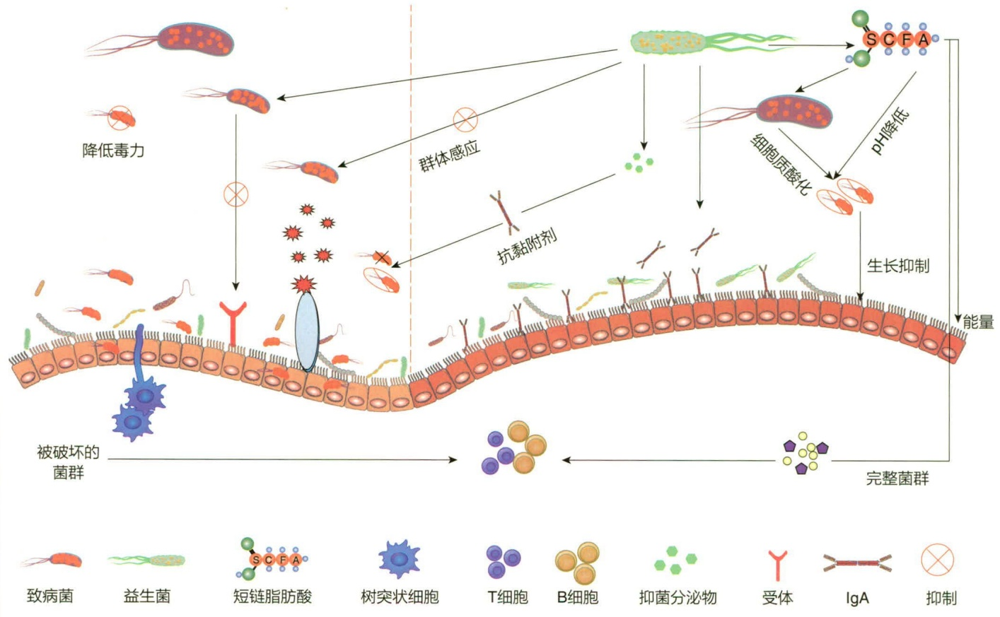

flowchart

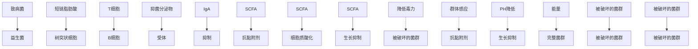

---

17.2 微生物肥料

573

重金属污染浓度和 pH 对微生物群落结构有显著影响。例如，与其他细菌类群相比，酸杆菌、金藻菌等对低 pH（pH < 6.5）和高浓度重金属污染具有较强的抗性，这些细菌在高水平重金属污染的土壤样品中大量存在。而在碱性土壤（pH > 7.5）中，变形菌、放线菌和拟杆菌的数量较多。

一般来说，土壤细菌群落对重金属胁迫高度敏感，因为重金属可引起细菌蛋白变性和细胞膜破裂。重金属污染会影响土壤中的细菌多样性和结构。例如，镉污染与细菌多样性呈显著负相关。当受到重金属污染胁迫时，一些耐重金属细菌存活下来，并形成一个新的微生物群落。除此以外，农田土壤中的化学农药、多环芳烃、微塑料等有机污染物也对土壤微生物群落结构产生重要影响。

土壤微生物的群落抗性与生态系统功能稳定性密切相关。农田污染生境微生物群落对环境胁迫具有一定抵抗力，可以参与有机物分解、养分供应和植物病原体控制等过程，从而维持生态系统功能。

## 17.2 微生物肥料

微生物肥料作为一类农业产品，含有特定的活体微生物，通过微生物的生命活动（如固氮、解磷、解钾、分泌促生长物质等），进而改善农作物营养或促进其生长。与传统化学肥料不同，微生物肥料的核心作用依赖于其活菌的功能，而非直接提供矿质养分。

## 17.2.1 固氮菌肥料

氮在大气中含量丰富，但经常是植物最受限制的营养元素。植物本身无法直接利用大气中的氮气，其生长依赖于外源合成氮肥的施加，以及从根际及受根系影响的非根际区域获取的固定态氮。虽然大量合成氮肥的施用显著提高了作物产量，支撑了全球人口的持续增长，但这些肥料使人类付出了沉重的环境成本。

固氮微生物通过自身生命活动，把空气中的游离氮气直接转换成含氮化合物，这一过程被称为生物固氮（biological nitrogen fixation）。固氮菌（nitrogen fixing bacteria）一般分为自生固氮菌、共生固氮菌及联合固氮菌三类。在自生固氮过程中，固氮菌在微氧或厌氧条件下，将氮气转变为氨，以供自身利用或释放到环境中。在共生固氮中，根瘤等植物器官中的固氮微生物利用宿主的光合产物作为能量来源，固定氮素以支持宿主生长。在联合固氮中，固氮螺菌属（Azospirillum）、固氮弧菌属（Azoarcus）和草螺菌属（Herbaspirillum）等固氮菌，生活在植物宿主的表面或根际区间，利用植物光合产物作为能源及碳源来固定氮气。

固氮菌在农田氮循环过程中扮演重要角色，因而被开发成固氮菌肥料。这类微生物肥料在农业生产过程中可提升土壤肥力、提高作物产量。根据肥料所引入微生物是

---

574

17 农业微生物学

否在宿主植物根部形成根瘤，将固氮菌肥料分为根瘤菌肥料和其他固氮菌肥料。

## 17.2.1.1 根瘤菌肥料

根瘤菌肥料，又称根瘤菌剂。根瘤菌是土壤中的一类特殊细菌，能与豆科植物的根系或茎形成根瘤或茎瘤共生体，其独特之处是与宿主植物共生固氮，将大气中的  $N_{2}$  转化为  $NH_{3}$ ，供植物生长所需。据估计，豆科植物与根瘤菌的共生固氮量占全球年生物固氮总量的 65% 左右。

根瘤菌为小杆状，大小为（0.5～0.9）μm×（1.2～3.0）μm，有鞭毛，不产芽孢，可在酵母提取物甘露醇琼脂（yeast extract mannitol agar，YMA）上形成荚膜。培养3～5天后，根瘤菌细胞内大多形成聚β-羟基丁酸颗粒，折光性较强，使细胞染色不均匀而呈环节状。

根瘤菌是化能有机营养型好氧细菌，最适生长 pH 为 7.2～7.4，最适生长温度为 25～28℃。可利用多种碳水化合物和有机酸作为碳源和能源物质。在 YMA 培养基上，根瘤菌菌落呈圆形，表面光滑、有凸起，颜色多为乳白色。最初根据在 YMA 上生长速度的不同，将根瘤菌分为快生型（fast growing）和慢生型（slow growing）两类，后来发现还有中慢型，如中慢生根瘤菌属（Mesorhizobium）。快生型根瘤菌代时为 2～4 h，慢生型为 6～8 h，在 YMA 培养基上，具有快生型根瘤菌产酸、慢生型根瘤菌产碱的特性。

大多数根瘤菌能够以硝酸盐和铵盐作为氮源，少数可利用蛋白胨等动物性氮源。根瘤菌对矿质元素含量如 Fe、Mn、Mo 等较为敏感，环境中缺乏这些矿物元素，会影响根瘤菌结瘤效率和固氮能力，因而配制根瘤菌肥料时通常需要添加适量微量元素。

根瘤菌具有宿主专一性，不同的根瘤菌具有不同的豆科植物宿主范围，表现出丰富的生物多样性和遗传多样性。早期的根瘤菌分类主要依据豆科植物与根瘤菌间的对应关系，如大豆根瘤菌、蚕豆根瘤菌、菜豆根瘤菌等。随着分子生物学技术的发展，根瘤菌系统分类体系代替了传统的宿主对应体系。随着大量根瘤菌新种群被发现，目前已报道的根瘤菌包括15个属、200多个种。

豆科作物接种高效根瘤菌可有效提高其共生固氮能力，有助于根系发育，减少氮肥用量，促进作物生长，因而接种根瘤菌是生态农业发展的重要内容。筛选高效根瘤菌时，菌株的结瘤能力、固氮能力和竞争能力是基本要素，菌株的地理区域适应性、与宿主植物的共生有效性和匹配性是基本原则。接种优良根瘤菌菌株后，豆科作物产量可明显增加。大豆和花生根瘤菌剂是许多国家（如巴西、阿根廷和美国等）普遍研究和推广应用的主要根瘤菌剂。

根瘤菌剂的田间应用有两种方法:拌种法和土壤混菌法。拌种法是最常用的方法，播种前将种子与少量根瘤菌液体菌剂混匀，使种子表面充分吸附一定数量的根瘤菌即可，具有操作简单、菌剂用量少的优点。土壤混菌法是将根瘤菌剂混合到植物根际的主要部位。在土著根瘤菌数量多的情况下，土壤混菌法比拌菌法更能提高接种菌的固氮效率，其缺点是菌剂用量多，大面积耕作时混菌不方便。

根瘤菌与豆科植物共生固氮体系受土壤环境中化合态氮浓度的影响。若土壤中的

---

17.2 微生物肥料

575

氮肥含量过高，会影响根瘤形成和增大，降低根瘤菌固氮酶活性。在田间条件下，土壤中含有的少量化合态氮对豆科作物共生固氮有较好的促进作用，但浓度过高会产生抑制作用，表现出“氮阻遏”现象。在农业生产中通过配施磷、钾肥和微量元素肥料等措施，可提高豆科作物-根瘤菌共生体的固氮效率。施用磷肥能够促进结瘤，并且显著增加土壤中根瘤菌的数量。此外，采用禾本科作物与豆科植物间套作耕作制度，可有效降低“氮阻遏”现象。

根瘤菌剂最早于 1896 年前后在欧洲开始应用，20 世纪 40 年代，我国引进和选育了优良大豆和花生根瘤菌，并在东北和华北推广应用。20 世纪 60 至 70 年代，我国根瘤菌肥料应用快速发展，应用范围从大豆扩展到紫云英、苕子、豌豆、三叶草和田菁等多种豆科植物，有效缓解化肥短缺的难题，成为我国根瘤菌推广应用的黄金时期。20 世纪 80 年代，我国大面积推广应用豆科牧草接种根瘤菌菌剂，充分利用豆科牧草的共生固氮作用，提高草原土壤的肥力和牧草产量，促进了我国的牧草飞播工作，对退化草场的改良起到关键性作用。

## 17.2.1.2 其他固氮菌肥料

自然界中广泛存在自生固氮和联合固氮现象，目前已知约14个科200多个种的细菌具有固氮活性。固氮菌剂是指用自生固氮菌或联合固氮菌作为菌种生产的微生物制剂。目前已知8个属的菌种可用于生产固氮菌剂（表17-2）。

表 17-2 常见的生产固氮菌剂的细菌种类

| 属 | 种 |
| --- | --- |
| 固氮菌属(Azotobacter) | 贝氏固氮菌(A. beijerinckii),圆褐固氮菌(A. chroococcum),雀稗固氮菌(A. paspali),棕色固氮菌(A. vinelandii) |
| 氮单胞菌属(Azomonas) | 标记氮单胞菌(A. insignis) |
| 贝氏固氮菌属(Beijerinckia) | 印度贝氏固氮菌(B. indica),德氏贝氏固氮菌(B. derxii) |
| 芽孢杆菌属(Bacillus) | 多黏类芽孢杆菌(P. polymyxa) |
| 克雷伯氏菌属(Klebsiella) | 肺炎克雷伯氏菌(K. pneumonia),产气克雷伯氏菌(K. aerogenes),产酸克雷伯氏菌(K. oxytoca) |
| 肠杆菌属(Enterobacter) | 阴沟肠杆菌(E. cloacae) |
| 欧文氏菌属(Erwinia) | 草生欧文氏菌(E. herbicola) |
| 固氮螺菌属(Azospirillum) | 生脂固氮螺菌(A. lipoferum),巴西固氮螺菌(A. brasilense) |

自生固氮和联合固氮的效率远远低于根瘤菌与豆科植物共生体的固氮效率。例如，水稻根际细菌固氮66\~72天后，固氮量仅为0.200\~0.395 kg/亩（1亩≈667 m²）。尽管自生固氮菌的固氮效率较低，但因其分布广、适应性强，加之既具有固氮作用，又能在生长繁殖过程中产生多种代谢产物，包括激素类物质（如吲哚-3-乙酸、赤霉素、激动素等）、维生素、氨基酸和多糖等，促进植物生长，因而被广泛应用于生产实践。

固氮菌剂生产大多采用液体培养方式。目前，国内的产品有瓶装的液体剂型和用

---

576

17 农业微生物学

载体吸附的固体剂型。液体菌剂是发酵罐发酵结束后分装而成，由于发酵结束后培养液内的营养基本耗尽，同时分装后条件发生改变，因而保存时间较短，当温度较高时细菌数量快速下降。固体菌剂多用载体吸附菌体，载体由富含有机质、透气性良好的物质组成，吸附的固氮菌初期会死亡一部分，但条件适宜时，可继续繁殖，从而使数量增加。液体菌剂生产和使用方便，但运输距离较近；固体菌剂贮存方便，适合远距离运输。

固氮菌冻干制剂是将发酵完成的菌液浓缩或不浓缩，加适量保护剂，低温真空干燥（冻干）而成，每小瓶含活菌 $200\sim 1000\times 10^{8}\mathrm{CFU}$ 。这种剂型体积小，方便运输和保存，保质期较长，使用方便，使用前用适量水溶解即可，但成本较高。

## 17.2.2 解磷菌肥料

磷是植物发育和生长所必需的基本元素之一，约占植物干重的0.2%。当土壤中的速效磷含量不能满足作物生长需求时，施用磷肥和提高土壤中磷的可给性，是一项重要的农业措施。土壤中含有大量难溶性磷，不能直接被植物吸收利用。土壤中存在许多具有分解有机磷和无机磷化合物能力的微生物类群，称为解磷微生物，可将难溶性磷转化为有效态磷供植物利用。

解磷微生物在土壤磷循环中发挥特殊作用，占土壤微生物种群的1%\~50%。使用解磷微生物作为生物肥料是一种改善土壤缺磷的环保方法，因而成为农田作物产量提升的重点方向之一。

解磷微生物根据底物不同可分为解无机磷微生物和解有机磷微生物；按解磷微生物类群分为解磷细菌（phosphate-solubilizing bacteria）、解磷真菌（phosphate-solubilizing fungi）和解磷放线菌（phosphate-solubilizing actinomycetes）三类。

## 17.2.2.1 解磷微生物种群

已报道的解磷细菌种群很多，包括假单胞菌属（Pseudomonas）、芽孢杆菌属（Bacillus）、类芽孢杆菌属（Paenibacillus）、土壤杆菌属（Agrobacterium）、欧文氏菌属（Erwinia）、肠杆菌属（Enterobacter）、黄杆菌属（Flavobacterium）、微球菌属（Micrococcus）、慢生根瘤菌属（Bradyrhizobium）、固氮螺菌属（Azotobacter）、伯克霍尔德菌属（Burkholderia）、硫杆菌属（Thiobacillus）、红球菌属（Rhodococcus）、沙雷氏菌属（Serratia）等。

解磷真菌包括曲霉属（Aspergillus）、青霉属（Penicillium）、根霉属（Rhizopus）、链格孢属（Alternaria）、酵母属（Saccharomyces）、小核菌属（Sclerotium）、镰刀菌属（Fusarium）、木霉属（Trichoderma）、拟青霉属（Paecilomyces）、芽枝霉属（Cladosporium）等类群。土壤真菌比细菌更容易在土壤中长距离传播，更有利于土壤中无机磷的溶解，这是因为解磷真菌通常比细菌产生和分泌更多的有机酸，如葡萄糖酸、柠檬酸、乳酸、草酸、酒石酸和乙酸等。

放线菌能够产生丰富的次级代谢产物，其中一些产物与解磷活性有关。解磷

---

17.2 微生物肥料

577

放线菌包括放线菌属（Actinomyces）、小单孢菌属（Micromonospora）、链霉菌属（Streptomyces）等。

## 17.2.2.2 解磷微生物的解磷机制

## (1) 酸解作用

解磷细菌的解磷机制与细菌产生的有机酸有关。解磷细菌生长过程中产生多种有机酸，如乳酸、氨基酸、琥珀酸、延胡索酸和柠檬酸等，可分解难溶性磷酸盐，释放可溶性磷，即“酸解作用”。这些有机酸不仅能降低土壤环境的 pH，还能与钙、铁、镁和铝等金属离子络合，从而阻止土壤中有效态磷转化成难溶态磷酸盐。酸解作用的强弱既与分泌酸的数量和种类有关，又与磷酸根离子螯合的金属离子多少有关。

## (2) 矿化作用

土壤中有机磷以有机磷酸的形式存在，一般占土壤全磷的 $20\% \sim 50\%$ ，有的甚至高达 $90\%$ 。矿化作用是这类有机磷降解的主要途径。解有机磷细菌产生核酸酶、植酸酶和磷酸酶等多种酶，将有机磷酸酯等有机磷转化为可溶性无机磷，供植物利用。

## 17.2.2.3 解磷微生物辅助植物营养吸收机制

解磷微生物可以通过增加可溶性磷含量来调节植物代谢。可溶性磷的增加会导致植物生长和新陈代谢的变化，如光合作用速率增加，根系发育改善，干旱或疾病耐受性增强。解磷微生物还可上调植物吸水、抗氧化和热激反应相关基因表达，帮助植物更好应对非生物胁迫。一些解磷细菌能够合成吲哚-3-乙酸、细胞分裂素（cytokinin，CTK）、赤霉素（gibberellin，GA）、铁载体等物质，表现出PGPR的重要功能。此外，解磷细菌还可以促进作物根系对土壤中钙、锌、铜等微量元素的吸收（图17-3）。

## 17.2.2.4 解磷微生物肥料的使用

解磷细菌肥料的施用多为拌种法，对于移栽作物可采用蘸根法，也可以用有机肥作为基质生产解磷细菌生物有机肥。接种解磷细菌肥料与适量配施化学磷肥相结合，可提高磷肥利用率，但应注意不能与杀菌剂和农药同时施用。

## 17.2.3 解钾菌肥料

钾是植物必需的营养元素，也是所有活细胞的主要成分之一。土壤中钾的含量丰富，但大多数钾不能被植物直接吸收。解钾菌能溶解硅酸盐矿物，通过产生有机酸、无机酸、络合物等机制来释放矿物钾，从而提高土壤钾的利用率。

## 17.2.3.1 解钾细菌的种类

许多细菌能够将难溶性的矿物钾溶解到土壤溶液中，这些细菌被称为解钾细菌（potassium bacterias，KSB）。已报道的解钾细菌种群很多，如芽孢杆菌、类芽孢杆菌、假单胞菌、伯克霍尔德氏菌、氧化亚铁硫杆菌（Thiobacillus ferrooxidans）等。解钾细菌可产生多种有机酸，如草酸、酒石酸、葡萄糖酸、2-酮葡萄糖酸、柠檬酸、苹果酸、琥珀酸、乳酸、丙酸、乙醇酸、丙二酸、富马酸等，参与土壤不溶性钾的释

---

578

17 农业微生物学

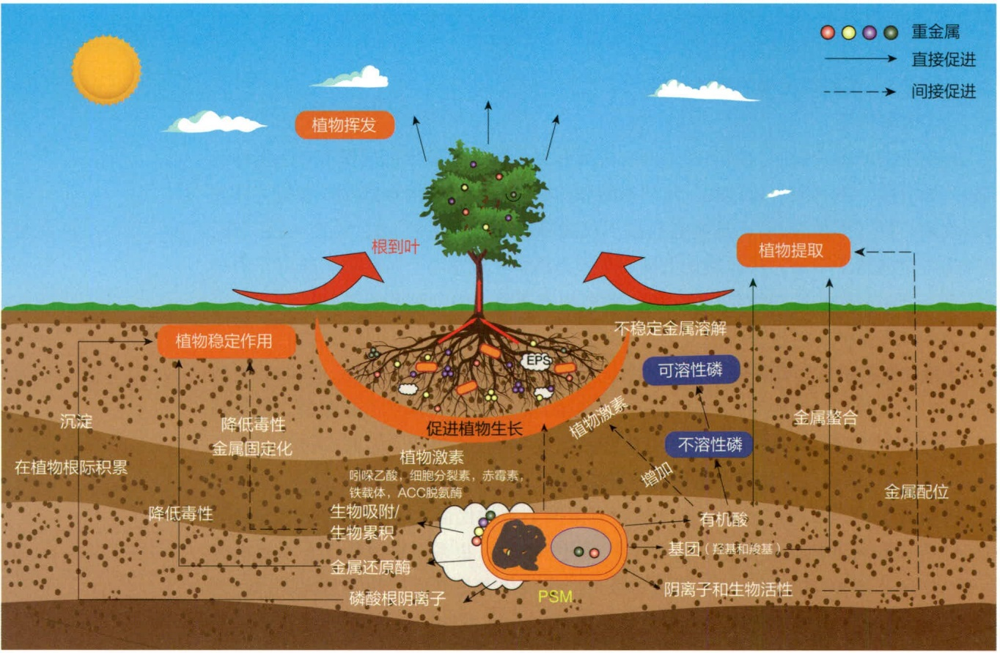

flowchart

This diagram illustrates the ecological process of plant growth and regeneration, showing how plants emerge from root to leaf, affect nutrient levels (EPS), and then recover through various treatments like phosphorus extraction and metal mixing.

图 17-3 解磷微生物辅助植物营养吸收和土壤修复的机制

放。除了降低土壤 pH 外，有机酸还可与含钾矿物中的  $Si^{4+}$ 、 $Al^{3+}$ 、 $Fe^{2+}$  和  $Ca^{2+}$  等形成络合物，促进钾释放。

## 17.2.3.2 解钾菌肥料的使用

解钾菌肥料是一种有效的化肥替代品。随着高产作物品种的推广和农业的逐步集约化，土壤钾存量正在以更快的速度耗尽。在温室和田间条件下，解钾菌肥料可提高矿物钾利用效率，一定程度上缓解钾存量危机，并且显著提高不同植物的种子发芽率、幼苗活力及作物产量。此外，某些解钾细菌还具有 PGPR 的功能，可产生吲哚-3-乙酸等植物生长调节剂。

## 17.2.4 菌根菌肥料

菌根（mycorrhiza）是指一些真菌与植物根形成的具有特定形态结构和功能的共生体，是植物和真菌经过长期演化而形成的特殊结构。自然界中大部分植物都具有菌根，与之共生的真菌称为菌根真菌，包括担子菌、子囊菌和藻状菌。菌根真菌位于植物根与土壤之间的界面上，在土壤有机质动态变化中发挥着独特作用。

菌根真菌及其根外菌丝对于许多植物的营养生长至关重要。其功能主要包括:

---

17.2 微生物肥料

579

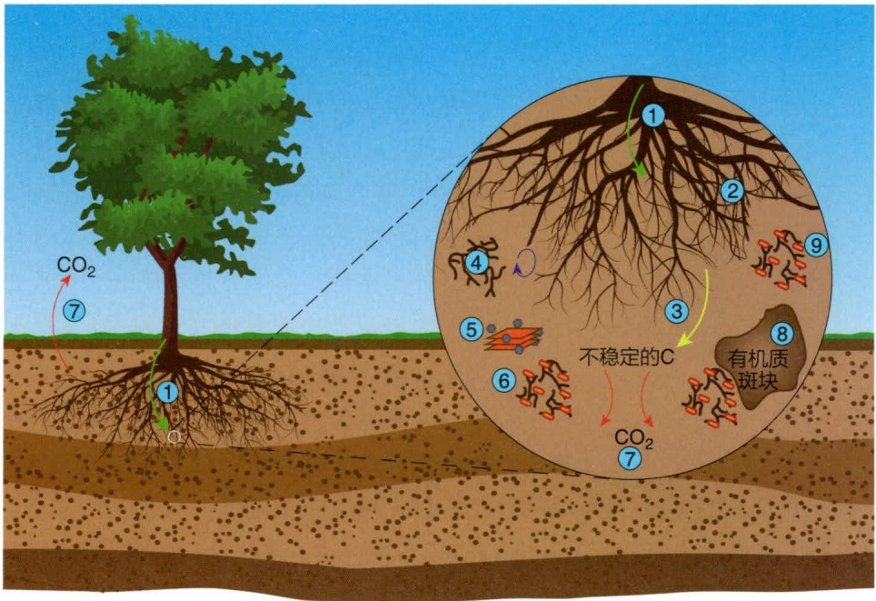

text_image

CO₂
⑦
①
②
③
④
⑤
⑥
⑦
不稳定的C
有机质斑块
⑧

图 17-4 菌根真菌对植物生长的重要性

①作为光合产物向根部运输的管道；②提高土壤真菌生物量；③释放活性有机碳；④贡献死亡微生物组分；⑤与矿物质共同构成土壤稳定成分；⑥增强腐生菌生长代谢活性；⑦通过异养型呼吸作用释放  $CO_{2}$ ；⑧通过酶促或非生物氧化反应促进土壤有机质降解；⑨竞争性抑制病原微生物（图 17-4）。

根据菌根的形态结构和菌根真菌共生时的性状，菌根可分为外生菌根和内生菌根两大类（表 17-3）。

## 17.2.4.1 外生菌根

外生菌根（ectomycorrhiza）的主要特征是在根外形成菌套，在根的皮层细胞间形

表 17-3 菌根的类型

<table><tr><td>主要类型</td><td>亚型</td><td>特殊结构</td><td>真菌类别</td><td>宿主植物</td></tr><tr><td>外生菌根</td><td></td><td>有菌套和哈蒂氏网</td><td>担子菌、子囊菌、藻状菌</td><td>裸子植物、被子植物的乔木和灌木</td></tr><tr><td rowspan="6">内生菌根</td><td>内外生菌根</td><td>可形成菌套,但不一定形成哈蒂氏网,根细胞内有菌丝圈</td><td>担子菌、子囊菌</td><td>裸子植物、被子植物的乔木和灌木</td></tr><tr><td>浆果鹃菌根</td><td>有菌套、哈蒂氏网,细胞中有菌丝圈</td><td>担子菌</td><td>仅杜鹃花目</td></tr><tr><td>水晶兰菌根</td><td>有菌套、哈蒂氏网,细胞中有菌丝圈</td><td>担子菌</td><td>仅水晶兰科</td></tr><tr><td>杜鹃菌根</td><td>有菌套、哈蒂氏网,细胞中有菌丝圈</td><td>担子菌、子囊菌</td><td>仅杜鹃花目</td></tr><tr><td>兰科菌根</td><td>有菌套、哈蒂氏网,细胞中有菌丝圈</td><td>担子菌</td><td>仅兰科</td></tr><tr><td>丛枝菌根</td><td>无菌套、哈蒂氏网,细胞中有菌丝圈和细小分支的丛枝</td><td>内囊霉科</td><td>裸子植物、被子植物的乔木、灌木和草本植物,苔藓植物和蕨类植物</td></tr></table>

---

580

17 农业微生物学

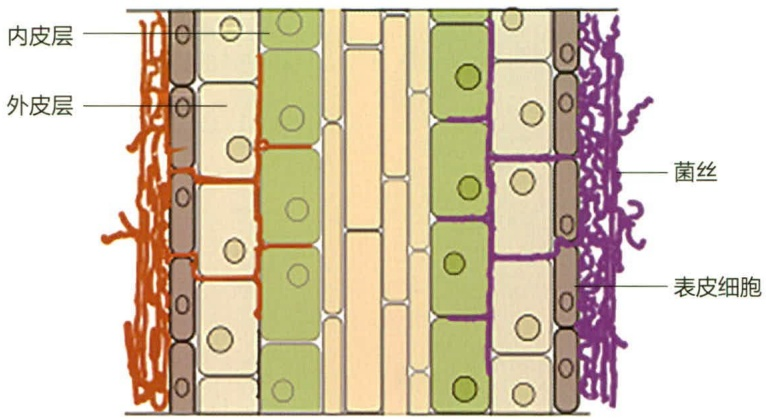

text_image

内皮层
外皮层
菌丝
表皮细胞

图 17-5 外生菌根侵染

成哈蒂氏网（Hartig net）。菌根真菌的菌丝在植物营养根的表面生长繁殖，交织成套状结构包裹在根外，使营养根变得粗壮，前端膨大，代替了根毛的地位和作用（图 17-5）。外生菌根存在于30多科植物中，主要为乔木和灌木，其中松科植物若未形成菌根就无法生长或生长不良。外生菌根真菌主要是担子菌，其次是子囊菌，极少数为接合菌和半知菌。大多数为广谱性寄生菌，少数为专性寄生菌。

自然界的树木从幼苗阶段就受土壤中的外生菌根真菌侵染而形成外生菌根。对树木的幼

苗人工接种外生菌根真菌，两周后即形成菌根。土壤条件显著影响菌根的形成，通常有机质含量丰富、通气状况良好的土壤有利于菌根形成。外生菌根的主要功能有:①扩大宿主植物根系吸收面积，有利于植物根系吸收水分和矿质养分，促进植物生长，增强抗逆能力。②产生植物生长素类物质，刺激植物生长。③形成的菌套和哈蒂氏网起到机械屏障的作用，具有防御病菌侵袭的功能。④诱导宿主细胞产生抑制病原菌的物质。当外生菌根真菌进入植物根部时，根部细胞会产生抑菌物质，可抑制病原菌。

## 17.2.4.2 内生菌根

内生菌根（endomycorrhiza）的主要特征是可侵入植物根系皮层中，其中丛枝菌根是分布最广的内生菌根。丛枝菌根（arbuscular mycorrhiza，AM）也称泡囊-丛枝菌根（VA菌根），是由内囊霉科（Endogonaceae）的部分真菌与植物根系形成的共生体系。在自然界中有200科20万种以上的植物形成丛枝菌根。小麦、玉米、棉花、烟草、大豆、菜豆、马铃薯、番茄、苹果、葡萄、草莓、柑橘等作物根系都具有丛枝菌根，最常见的为豆科和禾本科植物。丛枝菌根的主要特征是在植物根皮层内有丛枝和无隔菌丝，有的产生泡囊，此外还可形成比较松散的根外生菌丝（即附着枝，hyphopode，HP），但不形成菌套，外生菌丝的顶端常形成厚垣孢子（图17-6）。

在丛枝菌根共生体系中，植物为菌根真菌提供生长及代谢所需的碳源和能量。丛枝菌根菌丝体的作用包括:扩大植物根系范围，增大植物水分吸收面积，提高植物抗旱能力；促进植物对磷的吸收；从土壤中吸收有效态的锌、铜、硼、铂、铁、锰等元素输送给宿主植物，促进植物对微量元素的吸收；促进植物根系某些氨基酸（如精氨酸、苯丙氨酸、丝氨酸）、类异黄酮（如植保素）、儿茶酚、还原糖和酶（如几丁质酶）的产生，这些物质可抑制病原菌，从而表现出防病效果，尤其对土传病害效果更为明显。

## 17.2.4.3 菌根菌的应用

无论是外生菌根菌，还是丛枝菌根菌，都广泛地应用于农业和林业生产中。林业上，菌根菌已在育苗造林引种等方面得到大量的应用研究。以彩色豆马勃（Pisolithus tinctorius）为代表的菌根真菌，具有寄生范围广、抗逆性强、易分离和培养等特点，

---

17.2 微生物肥料

581

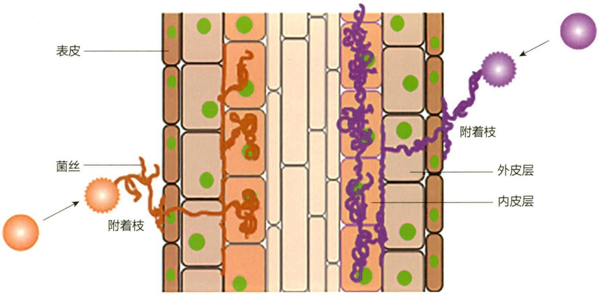

text_image

表皮
菌丝
附着枝
附着枝
外皮层
内皮层

图 17-6 丛枝菌根侵染

在美国已作为商品制剂广泛应用于林业生产，在林木育苗中展示出很好的应用前景。

菌根菌的人工纯培养技术仍然需要突破。目前国内外研究者主要采用扩大培养方法，将丛枝菌根菌接种到植物根系，再用被丛枝菌根菌侵染的植物根段和含有大量孢子的根际土为接种剂接种作物，从而获得较好的增产效果。丛枝菌根接种剂已在大田作物、名贵花卉、苗木、药材、经济作物的种植过程中得到应用。

## 17.2.5 铁载体产生菌肥料

铁是植物的另一种必需元素，参与固氮、光合及呼吸作用等诸多生理过程。它通常以  $Fe^{3+}$  和  $Fe^{2+}$  的形式存在。土壤中的铁多来自不溶性氧化物和氢氧化物，使其难以被植物吸收。 $Fe^{2+}$  虽然更易溶解，但在环境中极易被氧化，形成三价形式的沉淀。为了在缺铁环境生存，很多微生物都演化出包括铁载体在内的三价铁吸收机制。

肠杆菌、假单胞菌、固氮菌、芽孢杆菌、沙雷氏菌和根瘤菌可产生水溶性铁载体，在缺铁条件下从矿物或有机分子中溶解铁。铁载体可在微生物细胞膜上与三价铁形成复合物，三价铁随后被还原为二价，并被细胞摄入。在这一过程中，植物通过多种机制从铁载体中吸收铁，包括螯合和释放铁、直接吸收铁载体-铁复合物，以及配体交换。

## 17.2.5.1 铁载体吸收铁的机制

铁在细菌膜上的主动转运始于革兰氏阴性菌和革兰氏阳性菌的特定膜受体对铁-铁载体复合物的识别。铁-铁载体复合物与相应的内膜受体蛋白结合后，利用特定的内膜蛋白能量转导系统通过受体通道进入周质，最终利用ATP水解的能量转运到细胞质。在细胞质中，复合物内的铁通过铁还原酶催化释放。

铁载体根据其参与铁螯合的化学作用分为 3 类:羟肟酸、苯酚 / 邻苯二酚和羟基羧酸。迄今为止，已鉴定出 500 多种铁载体，其中 270 余种的化学构型已被鉴定。然而，PGPR 产生铁载体的能力有待进一步探索。

---

582

17 农业微生物学

## 17.2.5.2 铁载体产生菌对植物的影响

铁载体为植物生长，尤其是在缺铁环境下的生长提供必需条件。同时，铁载体还是微生物控制植物病原体的一种机制。根际区域的大部分铁离子被铁载体结合。这种缺铁环境可进一步抑制病原细菌和真菌生长。例如，生防假单胞菌产生的铁载体可以抑制多种植物病原体，如曲霉属、镰刀菌属和腐霉属。

## 17.3 微生物农药

化学农药在农业生产的广泛应用，对防治植物病虫害、确保农业稳产高产具有巨大作用，但同时也带来农药残留、生态破坏等一系列问题。随着现代农业的发展，生物防治技术应运而生。广义的生物防治（biological control）是指一切利用生物学手段来防治病虫害的方法，而狭义的生物防治是指通过引入、增强或保护天敌（包括昆虫、螨类、线虫、有益微生物等），降低有害生物种群（如植物病害等）的技术。本节重点讨论微生物农药有关的生物防治技术。

在我国农业生产中，水稻、小麦、玉米等农作物常受不良环境影响或其他生物侵染发生植物病害，如水稻稻瘟病、小麦条锈病等，严重影响农作物的产量。植物病害生物防治是利用有益微生物和微生物代谢产物对农作物病害进行有效防治的技术与方法。生物防治的主要机制包括:①与病原菌竞争生态位和营养物质；②分泌抗菌物质；③寄生于病原菌；④多种生防机制对病原菌的协同拮抗作用；⑤诱导宿主植物产生对病原菌的系统抗性（ISR）；⑥促进植物生长，提高植物健康水平，增强其对病害的抵御能力；⑦调节宿主植物的微生态系统。

微生物农药是利用微生物活体或其代谢产物对有害生物进行防治的一类制剂，具有对人畜和天敌安全、选择性强、不易产生抗药性、易分解和不污染环境等优点，是生物防治的主要手段之一。广义的微生物农药是指利用微生物或其代谢产物来防治危害农作物的病、虫、草、鼠害，包括促进作物生长的活体微生物农药和农用抗生素。狭义的微生物农药专指活体微生物农药，包括细菌、真菌、病毒等微生物体。根据用途和防治对象的不同，微生物农药可分为杀虫剂、杀菌剂和除草剂3类。

## 17.3.1 农业常见病害与病原体

植物在生长发育、贮藏和运输过程中，受到各种致病因素（生物或非生物因素）的侵袭，整个植株、器官、组织和局部细胞的正常生理生化功能发生紊乱、解剖结构遭到破坏、形态特征改变，以致植物生长不良、品质变坏、产量下降或死亡，这种现象称为植物病害。

植物受生物或非生物病原侵染后其外表形态的不正常表现（寄主和病原），称为症状（symptom）。症状是由病状和病征组成，病状包括变色、坏死、腐烂、枯萎或萎

---

17.3 微生物农药

583

蔫、畸形等外部感病特征。病原体在寄主病部的各种结构特征，称病征。

植物病害分为真菌性病害、细菌性病害以及病毒性病害。

植物病原真菌是指那些可以寄生在植物上并引起植物病害的真菌。植物病害研究最早的是马铃薯晚疫病，它是由疫霉引起的病害。据不完全统计，在各类栽培植物的病害中，有70%\~80%植物病害是由真菌引起的，且其中不少病害种类破坏性极大。例如，常见的稻瘟病、小麦锈病、棉花枯萎病、玉米大小斑病、油菜菌核病、花生叶斑病、苹果腐烂病、柑橘炭疽病、黄瓜霜霉病、茶饼病、桑白粉病等，都是威胁当前农业生产的重要真菌性病害。真菌所致的病害常在宿主被害部位的表面长出霉状物、粉状物、颗粒状物等，这些病征是判断真菌病害的重要标志。

鞭毛菌亚门的一些菌，例如绵霉、腐霉、疫霉菌等，产生游动孢子，它们是水生性的，常生活在水中或潮湿的土壤中，可导致植物根部或茎基部腐烂。这类菌在湿度大的情况下，常在患病部位生出白色毛状物。霜霉菌等比较高等的鞭毛菌接近陆生，多危害植物的地上部，导致叶斑或花、穗变形。

子囊菌和半知菌所引起的病害，除少数菌如白粉菌之外，一般都形成明显的病斑，并有明显的颜色较深的边缘。在病斑上产生各种颜色的霉状物或小黑点。这些菌的无性繁殖都产生分生孢子，在田间可通过气流远距离传播。植物病原性子囊菌通过有性繁殖产生子囊果，可在原生环境中抵御不良影响，成为下一季度生长季节的侵染源。

担子菌中的黑粉菌和锈菌可形成黑色或锈色的粉状物。这两类真菌虽然有些可以人工培养，但在自然界是活体营养生物，不存在田间腐生问题。黑粉菌多以冬孢子附着在种子表面，少数以休眠菌丝在土壤或粪肥中存活，个别种类（如小麦散黑粉菌）的冬孢子可在种子内部越冬。有不少病害可以通过药剂处理种子得到防治。宿主植物品种间抗病性的差异明显，较容易获得高度抗病的品种，但抗病的品种也容易因病菌发生变异而变得易感，这是防治该类病害的难点。

真菌病害在宿主病部表面生出各种霉状物和粉状物，在诊断时，可用湿润的解剖刀把它们刮下来，或撕下病部表皮，在显微镜下观察，可以清楚地看到真菌的各种形态。如果患病部位还未长出真菌的繁殖体，可用湿纱布或保湿器保湿 24 h，霉状物就可以长出来，此时再做检查和鉴定。

细菌病害的病株表现主要有坏死、萎蔫、腐烂和畸形等病状类型，褪色或变色的较少；有的还有脓状物溢出等病征类型。

坏死类型症状是植物细菌病害最常见的一类。以叶部、果实上出现的斑点、枯斑为多。萎蔫症状是细菌侵害维管束系统导致，与真菌性病害造成的萎蔫症状相似，青枯病、马铃薯环腐病是常见的代表类型，可通过观察茎横切面是否出现菌脓与真菌性萎蔫病进行区分。细菌病害引起植物组织的腐烂也较为常见。瓜果等贮藏器官的软腐型腐烂多由软腐细菌侵害所致，虽然瓜果腐霉等真菌也能导致植物组织腐烂，但真菌病害受害处常有霉状物而易于区分。有些细菌可以造成宿主组织的畸形，如桃发根病，苹果、葡萄的根癌病等。

---

584

17 农业微生物学

植物细菌病害往往表现为患病部位产生菌脓。植物病毒病只有明显的病状而无病征。最常见的病毒病症状有花叶、斑驳、黄化、丛枝、矮化，畸形及坏死斑等。有些病毒病可形成内部症状，即在宿主叶毛或表皮细胞内产生X-体、结晶体等，上述症状可作为诊断病毒病的依据。有些植物感染病毒后，不表现症状，生长发育和产量也未受到显著影响，称“带毒现象”，被寄生的植物称为“带毒者”。

## 17.3.2 微生物杀虫剂

## 17.3.2.1 细菌杀虫剂

某些细菌对昆虫有致病或致死作用，利用这一特点将细菌及其所含有的活性成分制成杀虫制剂即为细菌杀虫剂，其作用机制为胃毒作用，昆虫摄入制剂后，通过肠道细胞吸收，进入体腔和血液，使之得败血症或中毒死亡。

目前已知的昆虫病原细菌达100多种，其中被开发成产品并投入应用的主要有4种，即苏云金芽孢杆菌（Bacillus thuringiensis）、日本金龟子芽孢杆菌（Bacillus popilliae）、球形芽孢杆菌（Bacillus sphaericus）和缓病芽孢杆菌（Bacillus lentimorbus）。

苏云金芽孢杆菌杀虫剂是目前世界上应用最广、产量最大的细菌杀虫剂，其产量占微生物杀虫剂总量的 95% 以上。

苏云金芽孢杆菌对鳞翅目、双翅目、膜翅目、鞘翅目、直翅目和毛翅目等600余种昆虫具有不同程度的致病性。苏云金芽孢杆菌从口器感染昆虫，通过自身生长繁殖、产生毒素等机制杀灭昆虫。该细菌可产生多种杀虫毒素，如δ-内毒素、α-外毒素、β-外毒素、γ-外毒素、溶血素、肠毒素，还可产生几丁质酶、营养期杀虫蛋白等杀虫活性成分，以及不具有直接杀虫活性的双效菌素、辅助蛋白和自身诱导物抑制蛋白等成分（表17-4）。苏云金芽孢杆菌不同亚种的菌株产生的毒素种类和性质不同，其杀虫谱也不同。

苏云金芽孢杆菌产生的毒素中， $\delta-$ 内毒素是最主要的杀虫毒素，它伴随着芽孢

表 17-4 苏云金芽孢杆菌的活性成分

<table><tr><td colspan="2">分类</td><td>活性成分</td></tr><tr><td rowspan="4">胞外活性成分</td><td>蛋白质类</td><td>营养期杀虫蛋白(vegetative insecticidal protein, VIP)</td></tr><tr><td>酶类</td><td>几丁质酶(chitinase)、磷脂酶C(phospholipase C)、溶血素(hemolysin)</td></tr><tr><td>核苷类</td><td>苏云金素(thuringiensin)</td></tr><tr><td>多元醇类</td><td>双效菌素(zwittermicin, ZwA)</td></tr><tr><td rowspan="2">胞内活性成分</td><td>蛋白质类</td><td>杀虫晶体蛋白(insecticidal crystal protein, ICP),免疫抑制因子A(immune inhibitor A, InA),肠毒素(enterotoxin),辅助蛋白(help protein),自身诱导物抑制蛋白(autoinducer inhibitor, Aii)</td></tr><tr><td>芽孢</td><td>活芽孢、死芽孢、芽孢衣</td></tr></table>

## 知识拓展 17-2

苏云金芽孢杆菌杀虫剂研发应用的中国贡献

---

17.3 微生物农药

585

的形成而产生，也称为伴孢晶体，是一种由蛋白质构成的晶体结构，其形状分为菱形和非菱形两类。菱形伴孢晶体的大小为（0.71～1.75）μm×（0.44～1.00）μm；非菱形伴孢晶体的形状为方形、球形、近圆形、近六角形等，其大小为（0.79～1.24）μm×（0.63～0.99）μm。完整的伴孢晶体并不具毒性，只有被昆虫肠道消化或碱溶后才释放出有毒成分，其对人、畜无毒性。

苏云金芽孢杆菌制剂（Bt 制剂）分为悬乳剂、粉剂和颗粒剂等，是在人工条件下大量培养苏云金杆菌的基础上，获取杀虫有效成分——芽孢及伴孢晶体后调制而成的不同 Bt 剂型。Bt 制剂生产方法有液体深层通气发酵法和固体发酵法，以液体深层通气发酵法为主。苏云金芽孢杆菌 YBT-020 是国际上第一个被测定的带杀虫基因全序列的苏云金芽孢杆菌菌株。迄今为止，已有超过 1 000 个苏云金芽孢杆菌菌株的全基因组完成测序分析，为进一步解析其杀虫机制、开发新的杀虫蛋白基因奠定了基础。

日本金龟子芽孢杆菌是多种金龟子幼虫的专性病原菌，主要通过芽孢感染和传播。芽孢经幼虫的口摄入到虫体内，进入消化管萌发成杆状的营养细胞，营养细胞能够侵染中肠细胞，穿透肠壁进入体腔内；侵入体液的芽孢经由萌发期、营养繁殖期、芽孢形成期和芽孢成熟期4个时期进行增殖，最终导致幼虫感染A型乳化病（type A milky disease），虫体呈现乳白色而死亡。

最初金龟子芽孢杆菌在人工培养基中不生长或生长缓慢，因而当时采用幼虫活体培养的方法制备菌剂。20世纪60年代以后，科研工作者对该种菌的生长条件和营养需求等进行了系统的研究，获得了重大进展。现普遍采用液态培养基两阶段发酵培养法生产，培养基组分包括可溶性淀粉、海藻糖、磷酸氢二钾、碳酸钙、酵母膏等，金龟子芽孢杆菌的芽孢生成率可达到80%以上。目前，美国开发出的日本金龟子芽孢杆菌制剂Doom已在美国、加拿大、新西兰等日本金龟子泛滥的国家大面积使用，取得了很好的防治效果。

## 17.3.2.2 杀虫抗生素

阿维菌素（avermectin）是由阿维链霉菌（Streptomyces avermitilis）产生的一类结构相似的大环内酯类杀虫抗生素，由8种结构相近的同系物组成，主要成分为A、B两种物质，该组化合物统称为阿维菌素（图17-7）。Ala、A2a、Bla、B2a是主要组分，含量占 $80\%$ 以上；Alb、A2b、Blb、B2b是次要组分，含量在 $20\%$ 以下。阿维菌素B杀虫活性最强，但毒性较大，将其22,23-C之间双链加氢还原为22,23-C双氢阿维菌素B后，其毒性降低一半，称为伊维菌素（ivermectin）。阿维菌素和伊维菌素都具有杀灭体内外寄生虫的活性。

阿维菌素类药物对蔬菜、果树、棉花和花卉等农作物的多种害虫有杀虫活性，包括鳞翅目、鞘翅目、半翅目、双翅目和膜翅目的害虫；对绝大多数与农业有关的线虫和节肢动物具有毒性，尤其对螨类毒杀作用强，毒杀效果是其他商用杀螨剂的50～200倍；对柑橘红蜘蛛、棉花害虫、柑橘锈蜗、叶蜗、小叶蛾、害蜗和黏虫等均有很好的防治效果，特别能有效防治多种对常用药剂不敏感或具有抗性的植食蜗类和害虫。阿维菌素现已广泛应用于兽医临床治疗，可预防马、绵羊、牛、猪、犬、兔

---

586

17 农业微生物学

图 17-7 阿维菌素的化学结构式

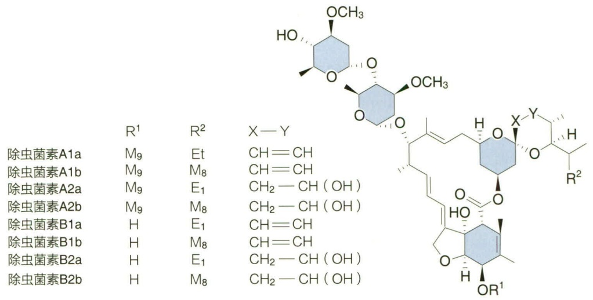

chemical

Chemical structures of various insecticide compounds with substituent variations (R¹, R², X-Y)

等动物的体内外寄生虫和螨虫，可减轻消化道线虫、牛寄生虫、狂蝇蛆、羊虱、羊痒螨、仰口线虫、牛痒螨、毛首线虫等寄生虫感染。

## 17.3.2.3 真菌杀虫剂

昆虫病原真菌是昆虫病原微生物中的一个主要类群，共约750种，宿主范围广泛，达5个目24个科的200余种昆虫。在真菌杀虫剂中，研究最多的是白僵菌和绿僵菌，另外蛤生轮枝菌和汤普生多毛菌也有商品化制剂。

白僵菌属（Beauveria）包括2个种:球孢白僵菌（Beauveria bassiana），球形孢子占50%；卵孢白僵菌（B. tenella），卵形孢子占98%。这两种白僵菌在培养基上可存活1\~2年，低温干燥条件下存活5年，在虫体上存活6个月，但遇阳光直射则很快失去活性。白僵菌以分生孢子形式侵染昆虫，当分生孢子附着在昆虫宿主体壁后，在湿度较高的环境条件下，孢子萌发长出芽管，穿透体壁进入血腔，利用宿主营养而进行生长繁殖，而后在血腔中以芽殖的方式产生大量芽生孢子导致宿主死亡，白僵菌菌丝则从昆虫尸体表面长出，产生分生孢子，完成侵染循环周期。白僵菌也可通过取食作用进入昆虫肠道，随后经肠壁感染宿主。

白僵菌的宿主范围广泛，常见的宿主有鞘翅目、鳞翅目、膜翅目、同翅目和半翅目的昆虫。白僵菌菌剂主要用于防治松毛虫和玉米蝮，尤其在防治松毛虫方面效果突出，施用白僵菌菌剂后，其孢子进入环境中，可持续数年控制病害的发生。

白僵菌易于培养，以麦麸、黄豆饼粉或玉米粉为主要原料进行固体发酵，形成分生孢子后，将培养原料干燥粉碎制成白僵菌粉剂。白僵菌剂也可采用双相法生产，该法充分结合液体培养与固体培养的优点，先将白僵菌移入发酵罐中进行好氧发酵，当菌丝生物量达到最高时，转接到固体培养基质上，菌丝体快速繁殖形成大量的分生孢子。双相法操作简单方便、生产速度快，但成本较高、技术性较强，液体深层发酵阶段必须严格无菌操作，控制通气量、pH、温度和泡沫等条件。

金龟子绿僵菌（Metarhizium anisopliae）对鞘翅目和鳞翅目害虫有较好的防治作用，是一种有效的昆虫病原真菌，通过侵染昆虫表皮和血液寄生。

---

17.3 微生物农药

587

绿僵菌属于核菌纲（Pyrenomycetes）、球壳菌目（Sphaeriales）、麦角菌科（Clavicipitaceae）。现已发现了42个种和变种。金龟子绿僵菌包括小孢变种（M. anisopliae var. anisopliae）和大孢变种（M. anisopliae var. majus）:小孢变种的分生孢子小，寄生分布范围广，真菌杀虫剂商品已经研发成功；大孢变种的分生孢子则较大，在自然界中相对较少见，且寄生范围也很窄。

制备绿僵菌菌剂的培养料中，常见碳源主要有蔗糖、马铃薯淀粉、葡萄糖、麦芽糖和D-果糖等，常用氮源主要以花生饼粉、豆饼粉、酵母膏、蛋白胨、麦麸等为最佳。绿僵菌生长阶段，空气湿度控制在98%\~100%为最佳，生长温度为15\~35℃，以25\~30℃生长速度最快，产孢量最大。

## 17.3.2.4 病毒杀虫剂

目前已知的昆虫病毒有 1 600 多种，分布广、专性强。常见的昆虫病毒有核多角体病毒（nuclear polyhedrosis virus，NPV）、质多角体病毒、颗粒体病毒和无包涵体病毒。核多角体病毒属于杆状病毒科、核多角体病毒属，是最主要的昆虫病毒。在我国发现的 290 多种昆虫病毒中，核多角体病毒有 212 种，占 71.3%；对农林害虫具有 85% 以上杀虫效果的 67 种杆状病毒中，核多角体病毒占 50 种。目前，从鳞翅目、膜翅目、双翅目等昆虫中分离并记载的昆虫杆状病毒已超过 700 种。

国内外已有多种商品化的核多角体病毒杀虫剂，用于防治农作物害虫、森林害虫和棉铃虫。昆虫病毒杀虫剂应用中存在的问题主要是菌剂制备方式单一，只能靠侵染昆虫繁殖获得，因而国内外已开发出的多种用于农林害虫控制的杆状病毒产品，大多数采用在人工饲料饲养的昆虫体内扩繁；同时昆虫病毒杀虫剂存在杀虫谱窄、对昆虫致死时间较长等不足。利用杆状病毒控制害虫最成功的案例是巴西利用黎豆夜蛾（Anticarsia gemmatalis）杆状病毒杀虫剂，控制黎豆夜蛾对大豆的危害。

## 17.3.3 微生物杀菌剂

## 17.3.3.1 植物细菌病害的生物防治

植物细菌病害生物防治的最成功范例是冠瘿病生物防治。冠瘿病（crown-gall disease）是一种世界性分布的细菌性土传病害，病原菌是土壤杆菌（Agrobacterium spp.），严重危害我国北方桃树和葡萄等植物。从植物病理学角度，细菌性冠瘿病被认为是一种特殊类型的病害，冠瘿（肿瘤）的发生是由病原细菌细胞内肿瘤诱发质粒（Ti 质粒）DNA 的一个片段转移到植物中引起的。病菌与植物受伤组织的细胞接触后，Ti 质粒的 DNA 转移到宿主细胞，并随植物细胞 DNA 复制而不断复制，引起组织膨大。

防治这一病害的成功案例是采用放射土壤杆菌 K84 菌株进行的生物防治。K84 菌株对植物不致瘤，但具有拮抗根癌土壤杆菌的能力，最初认为 K84 的防治机制是竞争侵染位点，但其防治作用主要是活细胞的作用，且无论在接种病菌前后使用都有一定效果，并在培养基平板上产生抑菌圈，说明 K84 的生物防治机制有细菌素的作用。

---

588

17 农业微生物学

K84 菌株已在多个国家和地区使用，无论采用浸种、蘸根或浸种加蘸根，其防治效果均很显著。尽管如此，其防治效果仍受到使用地区、地点、宿主植物、土壤中病菌的密度以及其他农业措施和农药施用方式等因素的影响，如 K84 对葡萄的病原菌是无效的。

## 17.3.3.2 植物真菌病害的生物防治

细菌、真菌和病毒都可用来防治植物的真菌病害，不同拮抗菌与不同病原菌之间，其作用机制各不相同，放线菌主要通过产生抗生素抑制病害，细菌和真菌则通过产生抗菌物质或与病原菌营养竞争而抑制病害发生，病毒以侵染方式抑制病害。

## (1) 井冈霉素

井冈霉素又称有效霉素（validamycin），是由我国科技人员1972年从江西省井冈山地区土壤中分离筛选的吸水链霉菌（Streptomyces tygroscopicus）井冈变种产生的葡萄糖苷类水溶性抗生素。

井冈霉素为白色粉末，易溶于水，可溶于甲醇、二甲基甲酰胺，微溶于乙醇，不溶于丙酮、氯仿、苯、石油醚等溶剂。但井冈霉素的吸湿性强，在pH 4\~5的水溶液中较稳定，能被多种微生物分解而失去活性。某些子囊菌和毛霉菌的活性较弱。井冈霉素A\~H对立枯丝核菌的最小抑菌浓度为0.01\~25  $\mu$ g/mL，其中井冈霉素A、E、F的最小抑菌浓度接近0.01  $\mu$ g/mL，防治水稻纹枯病、稻曲病、小麦纹枯病、玉米纹枯病和棉花立枯病等病害的效果显著。井冈霉素具有很强的内吸作用，当水稻纹枯病病菌的菌丝接触到井冈霉素后，菌丝体细胞很快被吸收，井冈霉素发挥作用，干扰和抑制菌丝体正常生长发育，使其失去致病性而起到防治作用。施用井冈霉素后，水稻体内的过氧化物酶、苯丙氨酸解氨酶、内切几丁质酶、 $\beta-1,3-$ 葡聚糖酶等活性显著提高，表明井冈霉素的作用机制可能与诱导水稻植株的抗病性有关，也可能是井冈霉素抑制了水稻植株体内的海藻糖酶，导致海藻糖积累，后者进一步引发系列生防反应。

按照我国农药毒性分组标准，井冈霉素属于低毒农药，常用剂型为水剂和粉剂。与其他农药相比，井冈霉素具有以下优点:

① 药效高，每亩施药折合有效成分为  $3 \sim 5 \, g$ ，防治效果可达 90% 以上，仅为化学农药用量的 10%。
② 耐雨水冲刷，喷药不受阴雨天气影响。
③ 使用安全，对作物不造成任何危害。
④ 增产效果明显，大面积试验证明，对水稻平均每亩可增产 35 kg。
⑤ 药效周期长，一次用药能保持14\~28天，防治效果是普通化学农药的数倍。

井冈霉素作为防治水稻纹枯病的首选农药品种，是我国目前农业上推广应用效果最好、使用面积最大的农用抗生素，其年产量、施用量和施用面积逐年扩大，产值超过4亿元。

## (2) 木霉制剂

木霉属（Trichoderma）广泛存在于土壤、植物根、茎、叶和种子等生境，是一种具有重要应用价值的有益真菌，主要用于植物病害的生物防治。木霉在大多数环境或

---

17.3 微生物农药

589

基质上生长迅速，易于分离和培养，可产生多种拮抗物质，生防机制多样，在植物病害生物防治中具有明显优势。早在20世纪30年代人们就发现木霉对植物病原菌的拮抗作用。随着现代生物技术的不断发展，研究者们从生化、代谢和基因分子水平上对木霉的生防机制开展了深入研究。

① 重寄生作用。这是木霉抑制病原菌的最有效机制。木霉可寄生在丝核菌属（Rhizoctonia）、小核菌属（Sclerotium）、疫霉属（Phytophthora）、腐霉属（Pythium）和根霉属（Rhizopus）等18个属的29种植物病原真菌，抑制这些病原真菌的生长。
② 产生抗生素。木霉菌可产生多种抗菌物质，其抗真菌代谢产物有70种以上，主要包括戊酮、辛酮、类萜、多肽和氨基酸衍生物等。许多木霉菌产生不止一种类型的抗菌物质。
③ 竞争作用。木霉环境适应能力强、生长迅速，在与病原菌竞争营养或空间的过程中，可充分有效利用植物表面或侵入点附近的低浓度营养物质而快速生长，占领病原菌的侵入位点，从而减少病原菌侵染，这在木霉菌制剂抑制植物根际土壤及叶片表面病原菌时效果明显。
④ 溶菌作用。木霉可分泌  $\beta-1,3-$  葡聚糖苷酶、几丁质酶和纤维素酶等具有分解真菌细胞壁功能的酶类，引起病原菌解体。
⑤ 诱导抗性。木霉可产生木聚糖酶等多种诱导因子，诱导宿主植物的防御反应基因表达，产生诱导抗性。当拮抗木霉菌的菌丝穿过黄瓜根部的表皮皮层时，可诱导黄瓜植株产生一系列抗病相关蛋白，包括许多水解酶，其抑制效果与施用化学诱变剂2,6-二氯苯氧乙酸处理植物后的结果相似。
⑥ 协同拮抗作用。木霉对病原菌的拮抗机制常常是综合性的，如木霉菌对腐霉菌的拮抗包括重寄生和抗生两种。木霉菌代谢胞外酶单独存在时抗菌性能较差，当与抗生素同时应用时表现出了很强的抗菌作用；木霉菌分泌的不同细胞壁降解酶之间也存在协同作用。
⑦ 其他生防机制。在干旱、养分胁迫等逆境条件下，木霉菌通过加强根系和植株发育提高耐性；诱导植物对病原菌的抗性；提高土壤中养分的有效性，促进植物吸收；钝化病原菌的酶；与植物根系形成共生体等。如哈茨木霉通过螯合或降解作用溶解土壤中的金属氧化物，将难溶态矿质元素转化为有效态养分，从而促进植物对矿质元素的吸收；康宁木霉对棉花和菜豆具有显著的促生作用。

欧洲最早于 20 世纪 80 年代已开始木霉菌制剂的商品化生产。木霉制剂商品化生产一般采用液体或半固体发酵生产方法，以得到大量厚垣孢子或分生孢子。多数木霉制剂用于植物土传病害的防治。

## 17.3.4 微生物除草剂

杂草微生物防治是指利用宿主范围较为专一的植物病原微生物或其代谢产物，控

---

590

17 农业微生物学

制杂草种群的危害。与杂草的天敌——昆虫防治杂草现状相比，利用微生物开发除草剂的研究和应用较少，主要集中在两个方面:直接利用病原微生物作为除草剂；利用微生物产生的对杂草具有毒性的次级代谢产物防除杂草。任何类型的植物病原体，包括细菌、真菌或病毒，都可用于杂草的生物防治，尤其以真菌作为杂草生防因子的研究居多。用作生物除草剂的病原体必备的条件包括:能在人工条件下发酵产生大量活性微生物细胞；对目标杂草具有较强的专一性；遗传稳定性好；适应环境能力强，可在多种环境条件下侵染和杀死杂草。

## 17.3.4.1 微生物除草剂的类型

## (1) 活体微生物除草剂

该类除草剂是从杂草病原菌中筛选，大量繁殖培养后制成的标准化制剂，在杂草苗前或苗后施用，使杂草病害流行，从而控制杂草。该方法可短时间内有效地控制草害，适用于防除农田、草坪及公园中的杂草。

## (2) 微生物源除草剂

这类除草剂是利用微生物产生的毒素或抗生物质等代谢产物防除杂草，分为真菌源、细菌源和链霉菌源三类，活性成分包括多肽类、萜类、大环脂质和酚醛树脂质等。

双丙氨膦（biolaphos）是第一个开发成商品除草剂的微生物源除草剂，生产菌株为产绿色链霉菌（Streptomyces viridochromogenes）。双丙氨膦是一种可杀单子叶和双子叶植物的非选择性除草剂，常用于非耕地和果园一年生或多年生杂草的防除。

## 17.3.4.2 微生物除草剂的局限

尽管微生物除草剂具有效果好、无二次污染的优点，但存在部分制剂使用范围较窄、杂草季节性生长、分布区域分散，导致市场过小，生产厂家少、生产规模小且成本高，以及产品制剂单一、应用技术不完善等问题，严重地制约了微生物除草剂产品的大面积推广应用，尚需在菌种选育、除草剂生产应用等方面创新思路。

## 17.4 微生物饲料

充足的饲料保障是畜牧业健康发展的基础，微生物饲料是养殖业的重要饲料来源。利用微生物种群及代谢多样性丰富的特点，可将许多工农业副产物转化为优质的蛋白质饲料。我国是农业大国，农作物秸秆年产量为8亿\~9亿t，通过微生物发酵，以青贮或微贮（黄贮）等方式处理秸秆，为养殖业提供所需的优质秸秆饲料，可有效缓解养殖业饲料短缺的现状。含有微生物菌体或其代谢产物的饲料称为微生物饲料，主要类型如下。

## 17.4.1 单细胞蛋白饲料

解决养殖业发展亟须的饲料蛋白质来源问题，除推广种植高蛋白牧草如紫花

---

17.4 微生物饲料

591

苜蓿、大豆和花生等豆科植物外，还可以通过生产不同微生物来源的单细胞蛋白（single cell protein，SCP）来增加蛋白质饲料含量，以弥补养殖业蛋白质饲料不足，提供动物养殖所需的饲料。各国政府极为重视并积极发展单细胞蛋白产业。据统计，目前单细胞蛋白产量已超过全世界所产蛋白质总量的3%。

## 17.4.1.1 单细胞蛋白饲料的概念和优点

单细胞蛋白饲料（SCP feed）是由单细胞生物个体组成的、蛋白质含量较高的饲料。单细胞蛋白饲料的优点包括:①微生物细胞富含蛋白质、氨基酸、脂肪和维生素等畜禽所必需的营养物质。②微生物细胞生长繁殖快、代谢类型多，在适宜环境条件下，可将多种工、农业副产品或者其他有机废弃物迅速转化为菌体细胞。③微生物培养条件易控制，生产过程不污染环境，可实现周年化、工厂化生产。④易实现遗传改造，从而得到目的蛋白。⑤易筛选出产量高、质量好的生产菌株。由于微生物代时短，每几十分钟到几小时即可繁殖一代，合成蛋白质的速度比植物快500倍，比动物快200倍，在解决畜禽养殖所需蛋白饲料方面优势明显。

## 17.4.1.2 单细胞蛋白饲料的生产原料

在单细胞蛋白饲料的生产过程中，既可将非蛋白氮转变成蛋白质，提高饲料基质中蛋白质含量，又可利用微生物将废液、废渣等工农业副产物转化为微生物细胞及发酵制品，达到变废为宝的目的。通常，单细胞蛋白生产原料主要有以下5类:

① 糖类原料。例如，淀粉或纤维素的酸水解液、亚硫酸纸浆废液、糖蜜等。
② 石油原料。例如，柴油、正烷烃、天然气等。
③ 石油化工产物。例如，乙酸、甲醇、乙醇等。
④ 无机气体类。例如，氢气、二氧化碳、一氧化碳等。
⑤ 有机工业废水。例如，含糖废水，含有机、无机质废水等。

在已有的单细胞蛋白饲料大规模生产工艺中，原料大多为石油及其制品，但由于石油资源有限，人们逐渐将目光转向可再生资源，尤其是利用发酵工业副产物，如淀粉厂废水、豆制品厂废水、乙醇蒸馏废液、味精废液等发酵生产单细胞蛋白饲料。

## 17.4.1.3 单细胞蛋白微生物

可用于生产单细胞蛋白饲料的微生物种类很多，有酵母、细菌、单细胞藻类、霉菌以及担子菌等。目前生产单细胞蛋白饲料主要采用酵母、担子菌以及螺旋藻等单细胞藻类。螺旋藻营养丰富，其蛋白质含量高达67%\~72%，总脂含量为6%\~7%。

## 17.4.1.4 单细胞蛋白饲料的生产方式

目前，单细胞蛋白的生产菌株主要为酵母菌。单细胞蛋白生产方式有两种，一种采用深层液体通气培养，待酵母菌体达到最大生物量，通过离心、过滤、沉淀等方法收集纯酵母菌体，作为饲料或饲料添加剂；另一种采用固态法培养，接种霉菌、酵母，利用菌株产生的酶将培养基原料降解为小分子物质，同时菌体迅速繁殖，最终将培养基质和微生物菌体一起粉碎后作为饲料或饲料添加剂。现以白地霉为例介绍单细胞蛋白生产过程。白地霉是一种好氧性真菌，生长繁殖快，培养方法简单，生理适应性强。生产原料有粉坊废水、白薯干浸泡水、豆腐黄浆水和废糖蜜等。白地霉饲料营

---

592

17 农业微生物学

养价值高，可与传统的食用酵母和饲料酵母相媲美。用豆腐黄浆水可生产白地霉饲料，生产菌株为 A82.498。生产流程为:发酵料液 pH 调整为 5.5～6.0，灭菌后无菌接种生产种子菌，控制料温至 28～32℃，振荡培养、浅层培养或通气深层培养，使菌株能生长良好，7～8 h 后即可收集菌体，正常生长的白地霉为丝状，采用滤布压滤收菌，收集的菌丝体于 60～70℃烘干，磨碎，即为成品。

## 17.4.2 青贮饲料

青贮饲料是将玉米秆、根茎类、栽培牧草等新鲜青饲料，经切碎后填入青贮窖或青贮塔，压实密封，在厌氧条件下经微生物发酵调制成的饲料。其调制方法称为青贮。青贮饲料具有以下优点:可保持饲料的新鲜状态；酸味芳香，柔软多汁，适口性好；营养保存好；耐贮藏、可全年使用等。

## 17.4.2.1 青贮微生物

青贮饲料主要利用植物原料表面附生的乳酸菌、酵母等微生物，通过发酵作用快速降低原料 pH，抑制肠杆菌、丁酸梭菌、霉菌和其他微生物的大量繁殖，保持原料品质。

乳酸菌是制作优良青贮饲料的主要微生物。乳酸菌种类和形态多样，有杆状和球状，有单个，成对和链状排列，生化特性存在差异。乳酸菌不具备蛋白质水解酶，不能分解蛋白质，以青贮原料的氨基酸为氮源。乳酸菌厌氧或微需氧生长，通过同型和异型乳酸发酵，将青贮原料中的碳水化合物转化成乳酸等有机酸类，青贮料得以较好地保存。

在青贮饲料中，除醭酵母（Mycoderma）外，还有其他多种酵母参与。在青贮饲料发酵过程中，厌氧条件下酵母菌的乙醇发酵使青贮饲料具有较好的香味。但若青贮原料的糖分含量低，酵母菌可能与乳酸菌争夺养分，影响乳酸菌生长。同时，若青贮饲料装填不紧实，有氧条件下酵母分解多种有机酸，包括乳酸，造成乳酸积累受影响，青贮饲料 pH 升高，影响青贮效果。通常，酵母只在最初几天繁殖，随着乳酸菌数量增加，青贮饲料乳酸积累，氧气耗尽，酵母菌生长受抑制。

## 17.4.2.2 青贮原理及过程

青贮原理主要包括:利用青贮原料附生的乳酸菌等微生物的生命活动造成厌氧环境；利用青贮原料中的糖类进行乳酸发酵，产生乳酸等有机酸，降低原料 pH，抑制丁酸菌等有害细菌和霉菌生长；发酵产生的乳酸、乙醇等使青贮饲料具有芳香酸甜的味道，增强青贮饲料的适口性。

## 17.4.2.3 青贮饲料调制

根据原料含水量，青贮饲料可分为高水分青贮、低水分青贮和外加剂青贮。

## (1) 高水分青贮

高水分青贮也称全水分青贮。青贮时原料处于新鲜状态，水分含量高达70%以上，不进行预干处理，不添加其他成分，单一或几种原料混合直接青贮。调制高水分

---

17.4 微生物饲料

593

青贮饲料时，必须使用有排水口的青贮窖，若原料水分含量超过85%，需在原料中添加5%米糠、麸皮、干草粉等辅料。高水分青贮的优点是省时省力，生产成本低；缺点是青贮料干物质少、酸度大、口感差、流汁损失降低营养。我国许多养殖场多采用高水分青贮法调制青贮饲料，青贮料质量差，亟待改进发酵工艺。

## (2) 低水分青贮

低水分青贮也称半干贮，是新鲜原料经晾晒失去部分水分后再青贮的技术，被欧美地区及日本等国普遍采用。我国广泛采用的玉米秸秆青贮或黄贮均属低水分青贮，原料含水量40%\~55%，在密闭式青贮窖进行青贮。低水分青贮料具有含水量低、干物质含量高、青贮量大、生产成本低、经济效益高等优点。青贮饲料呈淡绿色、不酸或微酸、相对湿润、果香味浓郁、适口性强。

## (3) 外加剂青贮

也称添加剂青贮，主要是在制作青贮饲料时，向青贮原料中加入一些促进发酵剂、保存剂、营养物质补充剂。外加剂的作用包括:添加各种可溶性碳水化合物，可促进乳酸菌发酵，迅速产生乳酸，使青贮料 pH 快速降至 3.8～4.2；添加甲酸等抑菌剂，可抑制不良发酵，阻止其他腐败微生物生长；添加尿素、氨等氮源物质，调整青贮原料碳氮比，有利于青贮细菌生长。

由于添加剂数量少，要注意与青贮饲料充分混合均匀，否则会影响青贮质量。装填青贮原料时，按比例均匀地加入添加剂，也可分层撒入，混合均匀。

## 17.4.2.4 青贮饲料的使用和管理

青贮原料经过 40～50 天完成青贮发酵处理，即可开窖使用。根据养殖需求，青贮饲料也可保存数年而质量不变。青贮饲料使用期间，青贮窖一旦打开，应及时饲喂，若间歇性饲喂，应注意间隔期间封好青贮窖，以免青贮料变质。现已开发有青贮饲料专用袋，分袋青贮，便于青贮饲料发酵、运输和保藏。

## 17.4.3 其他发酵饲料

发酵饲料是指通过微生物的发酵作用，将各种青、粗饲料制成酸甜软熟香、有效营养高、适口性好、利于保存的饲料。发酵饲料制作方法主要有种曲发酵法和无曲发酵法两种。种曲发酵是通过接种人工培养的曲种，转化饲料中的物质，例如纤维素酶解饲料。无曲发酵法是不接种“曲子”，适当控制好条件，促使饲料中有益微生物大量生长繁殖，达到饲料发酵的目的，如青贮饲料。

除青贮饲料外，发酵饲料还包括纤维素酶解饲料、人工瘤胃发酵饲料（亦称瘤胃液接种发酵饲料）和担子菌发酵饲料。参与这几种饲料发酵的微生物有霉菌、担子菌、细菌等。霉菌中分解纤维素能力强的有黑曲霉（Aspergillus niger）、烟曲霉（A. fumigatus）、绿色木霉（Trichoderma viride）、里氏木霉（T. reesei）、康氏木霉（T. koningii）等。担子菌中分解粗纤维、合成菌体蛋白能力强的有柳生小皮伞（Marasmius salicicola），以及多种食用菌菌株。发酵细菌包括产琥珀酸拟杆

---

594

17 农业微生物学

菌（Bacteroides succinogenes）、溶纤维丁酸弧菌（Butyrivibrio fibrisolvens）、梭菌属（Clostridium）、瘤胃球菌属（Ruminococcus）等。

## 17.4.4 动物肠道微生态制剂

微生态制剂（microecological agent）是基于微生态学原理，利用益生菌或促进益生菌生长的物质，经特殊工艺制成的制剂。目前微生态制剂被广泛应用于饲料、种植、医药和食品等各个领域。微生态制剂作为遵循生态环境自然循环法则的无公害制剂，是添加剂行业的一种发展趋势。

## 17.4.4.1 肠道微生态制剂分类

动物肠道微生态制剂具有绿色、无毒、无药、安全、高效等特点。不同微生物组成的微生态制剂在发挥各自优势的同时，还可弥补单一菌株的不足。肠道微生态制剂根据组成成分及作用方式，可分为益生菌、益生元和合生元三类。益生菌（probiotic）是指有益于动物健康的活体微生物。益生元（prebiotic）是为益生菌提供营养并促进其生长的基质。合生元（synbiotic）是益生菌和益生元的组合体。

## 17.4.4.2 肠道微生态制剂原理

## （1）调节动物肠道菌群平衡

微生态制剂可释放有益于益生菌生长的物质，促进益生菌大量繁殖，抑制有害菌生长，从而达到调节肠道菌群，促进机体健康的目的。

## （2）产生有益物质，促进肠道对营养物质的吸收

微生态制剂中的有益微生物进入肠道后不仅能产生营养物质，还能将肠道中大分子物质降解为小分子，从而可被肠道直接吸收。

## (3) 提高动物免疫力

肠道微生态制剂能够激活白介素、干扰素等细胞因子的表达，增强机体免疫活性。

## 17.5 农田污染治理微生物制剂

农田土壤污染是一个日益严重的全球性问题。人们正在努力减少污染物向农田转移，并开发有效的生物修复技术。植物修复是一种重要的生物修复策略，但其效率取决于污染物种类、土壤特性和植物生长速度。近年来，微生物制剂已被成功应用于提高植物耐受性、增强污染物降解或去除效率等方面。

土壤固有微生物或者后添加微生物都可起到降解土壤中有机污染物的作用，使土壤的性能得到恢复。比如，在农业生产中使用农药会造成土壤农药残留。为治理这类污染，可使用特定的农药降解菌株，如黄杆菌属、芽孢杆菌属、假单胞菌属等细菌，以人工添加的方式加到土壤中，发挥其降解农药的功能。此外，微生物还可用于土壤

---

17.5 农田污染治理微生物制剂

595

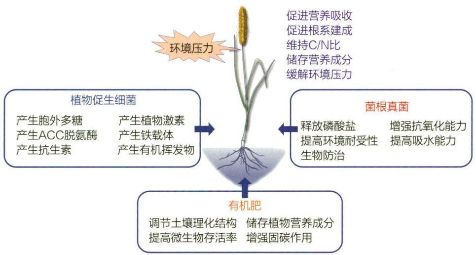

flowchart

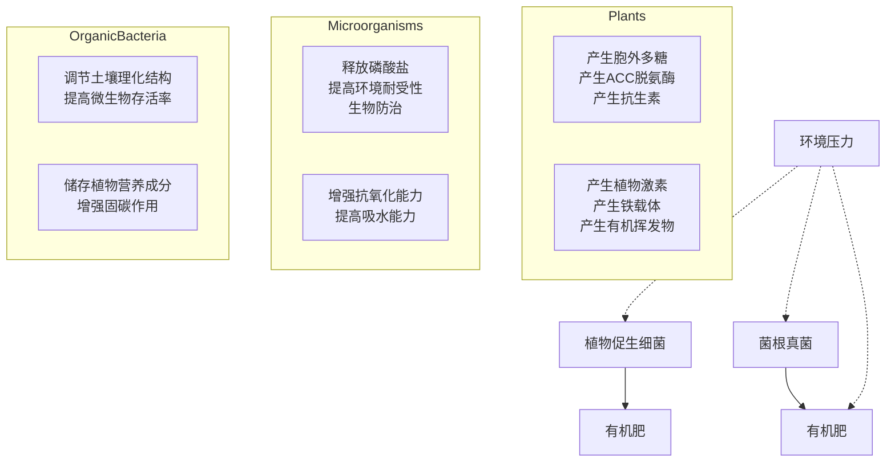

图 17-8 微生物制剂与有机肥在农业和土壤管理中的作用

石油烃及芳香族类污染物的降解。我国微生物降解技术的研究热点之一，是采用合成生物技术，构建降解农药、石油烃、芳香烃等污染物的高效菌株。

在农业和土壤管理中广泛应用的微生物制剂有植物促生细菌、菌根真菌等，它们通过产生胞外多糖、植物激素、铁载体，释放磷酸盐，增强环境耐受性等方式，促进植物营养吸收，缓解环境压力。这些微生物制剂通常与有机肥联用，后者能够调节土壤理化结构，提高土壤肥力（图 17-8）。

## 17.5.1 农田重金属污染治理

农田重金属污染主要是指具有生物毒性的重金属（如汞、镉、铅、铬等）在农田土壤中沉积，导致浓度超过背景值的污染状态。重金属是不可生物降解的，通过生物放大，它们的浓度可以增加数千倍，对人体健康有重大影响。近年来，工业活动和采矿业排放的大量重金属，最终沉积在土壤中，导致农田重金属浓度增加。农药和化肥的广泛使用也可能导致农田重金属浓度增加。

传统的农田重金属污染治理依赖于高成本的化学和物理过程，这些过程易造成其他有毒废物的污染。与之相反，微生物修复是一种成本低廉、绿色环保、前景广阔的修复方法，因而备受关注。

## 17.5.1.1 农田土壤重金属的来源

重金属进入土壤有两个主要来源，即自然和人为来源。污染场地中的重金属可能来自母土本身，称为岩石源。除此之外，一些特定的环境条件，如火山喷发、风载土壤颗粒、海盐喷雾、森林火灾、岩石风化均可能增加重金属浓度。人为来源主要包括采矿、冶金、商品日常制造、农业生产、机械操作、废水或垃圾排放等。一般来说，由于化学废水废物，工业城市地区周围土壤通常受到高含量重金属的污染，如铅、铜、镉、铬、镍、锌等。

农业土壤重金属污染近年来呈上升趋势，这归因于人为活动的增加，例如过度工

## 知识拓展 17- 3

农田重金属污染治理的非生物学方法及存在问题

---

596

17 农业微生物学

业化、化学制剂大量使用和机械化等。由于重金属的生物半衰期长，不可生物降解，在食物链中逐级积累，农业土壤重金属污染已成为一个严重的环境问题，对农业生产构成威胁。无机肥料、灌溉、污水污泥和石灰是农业土壤中重金属的主要来源。此外，杀菌剂及农药的使用，易将镉、铅、铬和镍等重金属带到土壤中，加剧重金属污染。

## 17.5.1.2 微生物制剂的作用机制

重金属生物修复是一种通过藻类、细菌、真菌或植物活动，从污染水体及土壤环境中去除和回收重金属的技术。该过程可以自发发生，也可以在电子、营养物质或其他分子的帮助下发生。微生物在重金属污染环境中发挥作用的主要机制是微生物钝化，包括生物吸附、生物积累、生物转化和生物矿化等过程。大多数重金属钝化微生物表面都有一系列官能团，例如-SH，-OH 和 -COOH，用于捕获重金属离子。金属硫蛋白、液泡和线粒体能够改变体内重金属离子的分布，使重金属毒性和可利用性下降。

在植物-微生物联合修复过程中，微生物可通过重金属形态或价态转化、离子捕获与转运、根际微生物群落重塑、增强植物抗逆性等机制，提高植物对重金属的耐受性和富集能力，从而增强植物去除土壤重金属的能力。

## 17.5.1.3 研究现状与前景

复合微生物制剂通常表现出比单菌制剂更高的重金属钝化效率。毛霉、羊肚菌及放线菌能有效降低重金属活性，显著缩短修复周期，改善尾矿的不良生境。此外，微生物多样性和群落结构对生物修复过程有敏感反应，因此微生物群落的变化还可用于实时监测生物修复过程。近年来，新兴的合成生物技术为人工微生物的研发开辟了新的途径，可大幅提高重金属修复效率（图 17-9）。

## 17.5.2 农田有机污染物治理

微生物在好氧和厌氧的条件下均能降解有机污染物，其降解机制主要分为两种:一是通过酶促反应直接降解有机污染物，主要的降解酶包括加氧酶、脱氯化氢酶、还原酶、脱氢酶、羟化酶等；二是通过矿化、累积、共代谢作用去除土壤中的有机污染物。

## 17.5.2.1 有机污染物的来源

农业土壤有机污染物主要来源于人类活动，常见的有机污染物包括多环芳烃（polycyclic aromatic hydrocarbons，PAHs）、有机卤代物等。工业废水、生活污水、工业废气和毒气的排放，以及农业生产中不合理施加化肥和农药，都会对土壤造成严重的有机物污染。

## 17.5.2.2 研究现状与前景

近年来，科学家们致力于筛选高效的有机污染物降解菌，并取得丰硕成果。常见的有机污染物降解菌株包括青霉、毛霉、曲霉、犁头霉等真菌，以及鞘氨醇单胞菌、假单胞菌、黄杆菌、产碱菌、枯草芽孢杆菌、无色杆菌等细菌。然而，由于降解菌株在新环境中的存活率较低，单一菌株难以进行原位土壤修复。多数情况下，菌群对有

---

17.5 农田污染治理微生物制剂

597

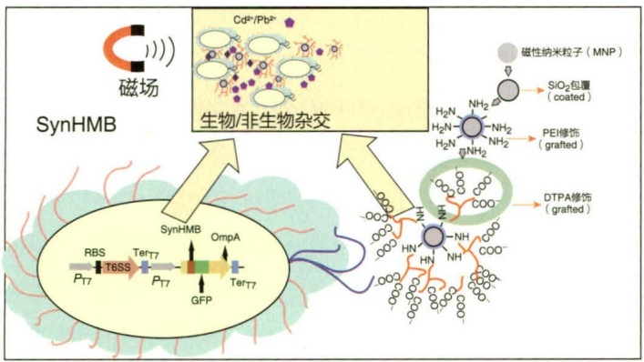

flowchart

(a)

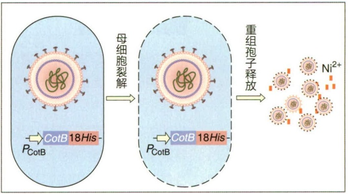

flowchart

(b)

机污染物的降解效果显著优于单一菌株（表 17-5），因为菌群中一个菌株降解途径的毒性中间体可能会被具有合适分解代谢途径的其他菌株进一步降解。

根际修复（rhizosphere remediation）是一种由植物-微生物联合去除污染物的策略，既包括植物本身对污染物的吸收、降解，又包括根际微生物对污染物的吸附、矿化。在根际修复过程中，植物与根际微生物协同共生，部分根际微生物对植物有促生作用，如提供植物关键营养素螯合剂、防治病原体侵入植物、降低污染物对植物的负面影响等。植物为根系微生物提供碳源，并提供营养丰富且稳定的环境生态位。除根际修复外，内生菌同样能够协同植物将污染物由土壤迁移到植物体内，并在植物体内富集、降解，达到去除土壤中有机污染物的目标。

生物修复固然是一项公认的环境友好型农业土壤有机污染修复技术，但仍存在修复时间长、污染物去除效率低等局限性。为此，研究者们不遗余力地探索强化生物修复的技术，如采用表面活性剂、含碳吸附剂、电化学、生物刺激等强化手段。

图 17-9 基于人工微生物的重金属污染修复方法（a）人工合成大肠杆菌-磁性纳米粒子共组装对  $Ca^{2+}$  及  $Pb^{2+}$  的捕获作用；（b）人工合成枯草芽孢杆菌裂解释放的重组芽孢对  $Ni^{2+}$  的捕获作用

表 17-5 微生物菌群对农业土壤有机污染物的降解

| 菌群名 | 污染物 | 去除率/% |
| --- | --- | --- |
| 假单胞菌(Pseudomonas)、无色杆菌(Achromobacter)、芽孢杆菌(Bacillus)、微单胞菌(Micromonospora) | 总石油烃 | 82~91 |
| 动胶杆菌(Zoogloea)、黄杆菌(Flavobacterium)、芽孢杆菌(Bacillus)、黑曲霉(Aspergillus niger)、产黄青霉(Penicillium chrysogenum)、交链孢霉(Alternaria alternata)、黄孢原毛平革菌(Phanerochaete chrysosporium)、小克银汉霉(Cunninghamella) | PAHs | 41 |
| 慢生根瘤菌(Mesorhizobium)、产碱菌(Alcaligenes)、芽孢杆菌(Bacillus) | PAHs | 20~35 |
| 血红银耳(Tremella sanguinea)、凤尾菇(Pleurotus sajorcaju) | 多氯联苯 | 90 |
| 鞘氨醇杆菌(Sphingobacterium)、蜡样芽孢杆菌(Bacillus cereus)、无色杆菌(Achromobacter) | 菲(多环芳烃类) | 25~100 |

---

598

17 农业微生物学

## ※ 本章小结

农田根际微生物群落通过营养强化、产生植物激素、提高植物抗病性及抗逆能力等机制，实现农田土壤改良与作物增产。养殖动物肠道功能微生物能够促进动物肠道发育，调节宿主免疫系统，促进饲料消化和营养吸收，参与宿主物质与能量代谢过程。植物根际促生细菌是一群定殖于植物根际，与植物根密切相关的根际细菌，将其接种于植物种子、根系、块根、块茎或根际土壤时，可促进植物生长。单细胞蛋白饲料是由单细胞生物个体组成的蛋白质含量较高的饲料。发酵饲料是通过微生物的作用，由各种青、粗饲料制成的酸甜软熟香、有效营养高、适口性好、利于保存的饲料。微生态制剂是基于微生态学原理，利用益生菌或促进益生菌生长的物质，经特殊工艺制成的制剂。根际修复是一种由“植物-微生物”联合去除污染物的策略，既包括植物本身对污染物的吸收、降解，又包括根际微生物对污染物的吸附、矿化。

## ※ 推荐阅读

1. TRIVEDI P, LEACH J E, TRINGE S G, et al. Plant-microbiome interactions: from community assembly to plant health [J]. Nature reviews microbiology, 2020, 18(11): 607-621.
植物相关的微生物群落对于植物宿主健康至关重要，可促进宿主植物生长与营养吸收，提高植物抗逆性和对病原菌的抵抗力。这篇文章全面探讨了植物与根际微生物群落如何相互作用进而调节其有益性状，如养分获取和植物健康等。
2. FREY S D. Mycorrhizal fungi as mediators of soil organic matter dynamics [J]. Annual review of ecology evolution and systematics, 2019, 50: 237-259.
菌根真菌位于植物根与土壤之间的界面上，在土壤有机质（SOM）动态变化中发挥着独特但未被充分认识的作用。这篇论文系统介绍了菌根真菌及其根外菌丝潜在影响土壤有机质形成、稳定和失稳的机制，以及其在生态系统尺度上对土壤有机质动态变化所带来的不同影响。
3. SHAHWAR D, MUSHTAQ Z, MUSHTAQ H, et al. Role of microbial inoculants as bio fertilizers for improving crop productivity: a review [J]. Heliyon, 2023, 9: e16134.
生物肥料是由植物促生菌制成的活性制剂，是一种环境友好且经济的生物肥料，可通过直接或间接促进植物发育来提高作物生产力。这篇论文全面概述了微生物菌剂作为生物肥料的现有知识，包括其类型、作用机制、对作物生产力的影响、微生物菌剂使用相关的挑战等。
4. SUPREETH M. Enhanced remediation of pollutants by microorganisms—plant combination [J]. International journal of environmental science and technology, 2022, 19: 4587–4598.

---

复习思考题

599

人类活动产生的污染物在整个环境中无处不在，微生物修复和植物修复是去除污染物最经济的方法，但它们的移除过程缓慢是一大缺点。这篇论文概述了微生物-植物组合系统在增强污染物修复方面的最新进展，包括组合系统对污染物的降解、植物生长代谢调控、污染物吸收以及微生物对植物抗逆性的增强作用，强调了该研究领域的挑战和未来前景。

## ※ 开放性讨论题

1. 根际微生物群落在农田土壤改良、作物增产抗逆等方面发挥重要作用，试论根际微生物群落调控的策略及其应用方向。
2. 化学肥料、化学农药等制剂的大量使用，给农田生态系统带来了巨大的负面影响，试论微生物资源在农田生态系统保护领域中的应用前景。

## ※ 复习思考题

1. 试述农田作物根际微生物群落的功能。
2. 简述养殖动物肠道微生物的生物学功能。
3. 简述微生物肥料的主要种类及其作用机制。
4. 简述植物根际促生细菌的概念及其主要功能。
5. 简述生物防治微生物的主要作用机制。
6. 简述单细胞蛋白饲料的概念和优点。
7. 简述微生物治理农田重金属污染土壤的机制。

(喻其林)
