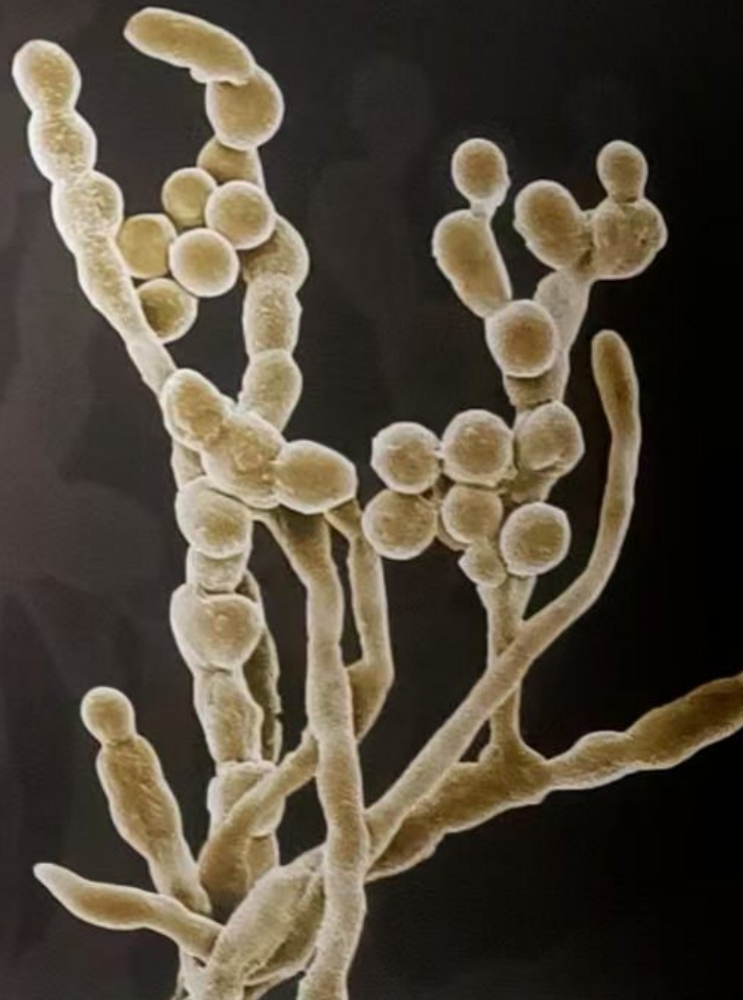

# 微生物学

MICROBIOLOGY

主编 邓子新 陈峰 陈向东

无法识别

无法识别

natural_image

Microscopic view of a fungal hypha with multiple spores and branching structures (no text or labels)

## 微生物学

## MICROBIOLOGY

# 微生物学

MICROBIOLOGY

主编 邓子新 陈峰 陈向东

编 委 （以姓氏拼音为序）

陈 峰 陈雯莉 陈向东 邓子新

东秀珠 董磊 方卫国 何晓青

胡玮 蒋建东 李凡 李文均

李雨庆 林雁冰 沈锡辉 孙群

陶 亮 田长富 魏 磊 吴卫辉

肖 敏 谢尚县 徐 俊 徐 磊

喻其林 苑 琳 张美玲 张晓华

张作明 赵广荣 赵明文 钟 江

## 内容简介

本书是生物科学“101计划”系列教材之一，在循序渐进地讲述微生物学的基本知识和基本理论的同时，注重融入本领域的前沿发展。本书内容分为19章，包括绪论、微生物的显微观察与纯培养、原核生物的结构与功能、真核微生物的结构与功能、病毒、微生物的营养与培养基、微生物的代谢、微生物的生长繁殖及其控制、微生物的遗传与育种、微生物基因表达调控、微生物与基因工程、微生物的系统发育与分类鉴定、微生物的生态、微生物物种多样性、感染与免疫、合成生物学、农业微生物学、食品微生物学、工业微生物学。本书主要作为生物科学、生物技术专业本科生教材，也可用于生物工程、生物制药、合成生物学、生物信息学等专业的本科教学。

网上数字资源围绕纸质教材知识体系设计，充分体现学科知识的广度和深度，是纸质教材的有力拓展和补充。数字资源主要包括知识拓展、教学课件、参考文献等，内容丰富、形式多样，可供教师教学和学生参考。

## 使用方法

1. 电脑或移动设备访问新形态教材网。

abooks.hep.com.cn/65016

2. 注册并登录后，进入“个人中心”。

3. 刮开图书封底防伪码涂层，通过扫描二维码或手动输入 20 位密码，完成防伪码绑定。

4. 绑定成功后，即可开始学习。
如有使用问题,请点击页面下方的“疑问”按钮。

## 图书在版编目（CIP）数据

微生物学/邓子新，陈峰，陈向东主编.--北京:高等教育出版社，2025.5.--ISBN 978-7-04-065016-7

I. Q93

中国国家版本馆CIP数据核字第2025VG0442号

WEISHENGWUXUE

| 策划编辑 | 单冉东 赵君怡 | 开本 | 889mm×1194mm 1/16 |
| --- | --- | --- | --- |
| 责任编辑 | 赵君怡 单冉东 | 印张 | 44.25 |
| 封面设计 | 姜磊 贺雅馨 | 字数 | 1210千字 |
| 版式设计 | 王凌波 赵阳 | 购书热线 | 010-58581118 |
| 责任绘图 | 邓超 | 咨询电话 | 400-810-0598 |
| 责任校对 | 王巍 | 网址 | http://www.hep.edu.cn |
| 责任印制 | 存怡 |  | http://www.hep.com.cn |
|  |  | 网上订购 | http://www.hepmall.com.cn |
|  |  |  | http://www.hepmall.com |
| 出版发行 | 高等教育出版社 |  | http://www.hepmall.cn |
| 社址 | 北京市西城区德外大街4号 | 版次 | 2025年5月第1版 |
| 邮政编码 | 100120 | 印次 | 2025年5月第1次印刷 |
| 印刷 | 北京华联印刷有限公司 | 定价 | 220.00元 |

<table><tr><td colspan="2">本书如有缺页、倒页、脱页等质量问题,请到所购图书销售部门联系调换</td></tr><tr><td>版权所有</td><td>侵权必究</td></tr><tr><td>物料号</td><td>65016-00</td></tr></table>

## 序

# 博大精深的生命科学

地球 46 亿年演化至今，生物可以说是最为复杂多样的存在，并在过去半个世纪成为科学世界最被广泛关注的研究对象。2005 年，《科学》周刊根据全球科学家的反馈，提出的 125 个悬而未决的基本科学问题中有一多半与生命科学直接相关，其中遴选出的 25 个特别关注里有 15 个是生物学问题。近 20 年过去了，新的知识、理论和技术不断涌现，给生物科学领域带来了深刻变革和巨大进步，然而之前提出的那些基本问题没有一个获得最终答案，很多甚至依旧在原地踏步。

与物理、化学等学科相比，生物学有其鲜明的特点。目前阶段，生物学仍主要通过观察现象去理解机理，以实验科学和数据分析为主，还没有发展到从基本理论出发、推导结论的程度。可能也正因为如此，生物学是进入21世纪以来最活跃的研究领域，新问题、新突破层出不穷，也是学科交叉的汇聚焦点。面对新的机遇和挑战，如何培养能够引领未来、创造未来的拔尖人才？教育部2023年启动的基础学科系列“101计划”就是为解决这一问题而实施的高校教育教学综合改革方案。

生物科学 “101 计划” 的专家委员会通过分析近年来生物科学各领域的深刻变革，以及社会发展对生命科学人才培养的新要求，提出了 11 门课程作为生物科学专业核心课程:普通生物学、生物化学、细胞与分子生物学、遗传学和发育生物学、生理学、微生物学、神经生物学、生物物理学、生物信息学、生态学、免疫生物学，并编写了一套具有鲜明特点的理论和实验教材。教材主编和参编者均为活跃在教学和科研第一线的学者，他们不仅在各自领域取得了出色的研究成果，而且积累了丰富的教学经验，从而保证了教材内容的准确性和教学适用性。本套教材有以下几个特点:

一是注重系统性和前沿性。全面梳理了生物学科知识模块，重构了核心知识框架；注重经典和前沿的融合，关注国际学术前沿和国家战略发展需求，突出学科交叉，更新迭代新知识、新内容。

二是注重深入浅出，启蒙创新思维。不仅清晰介绍知识点，更注重讲述科学发现背后的逻辑，力求能够激发学生的创新火花，培养科学思维、批判性思维和定量思维。

三是体现中国特色。紧密关注国家战略发展需求，充分反映国内生物学领域高水平学术成果，生动展现我国科技事业发展取得的长足进步。

四是呈现形态多元。采用纸质教材加数字资源的新形态教材出版形式，二者一体化设计、有机融合。纸质教材确保可读性和趣味性，数字资源充分展示学科知识的广度与深度，实现信息技术与教材的深度融合。

生物学是一门极富生命力的学科，问题层出不穷，发展日新月异，“授之以鱼不如授之以渔”。我们在期待这套教材能够让读者朋友们系统掌握生物科学知识体系的同时，更希望激发大家对生命科学领域的好奇心、想象力、探知欲，掌握基本的方法论，成为未来创新的主力军。

在这里，要特别感谢生物科学“101计划”专家委员会成员、主编团队以及一起奋斗的400余位编委、撰稿人，没有大家的辛勤付出，不可能短时间内高质量完成这套教材的编写工作；更要感谢几十所高校的资深专家、一线老师和同学在教材编写、审读、试讲试用中提供的宝贵建议。当然，第一版教材肯定会有很多不足之处，恳请读者朋友们带着批判的态度，反馈宝贵的改进意见，我们将继续努力，力争把这套教材打造成为经典，真正走向世界。

尺寸教材，悠悠国事。衷心希望这套教材为有志于在生命科学领域有所作为的青年人带来一点启发，也助力中国科研教育工作者在全社会的持续支持下为探索未知、培养人才做出更大的贡献。

text_image

张凡

施一公

2025 年 3 月于西湖大学

## 前言

微生物是所有个体微小、肉眼难以看清的单细胞，或个体结构较为简单的多细胞，甚至没有细胞结构的生命形式的总称，通常需要借助显微镜才能观察。微生物是地球上最古老的生命形式，是地球生物圈得以持续维持存在的底层支撑，它们在生物圈中无处不在，占地球生物质总量的60%以上。所有地球生态系统都受到微生物活动的极大影响，微生物的代谢活动可以在化学层面和物理层面改变其生境，这些变化也会影响其他生物。微生物与生物圈中的生物与非生物因子广泛互作，形成了丰富多样的时空分布和代谢生态特征，进而维持着生物圈能量流动和物质循环。

微生物在人类的生活和生产中扮演着重要角色，对健康、医药、农业与工业等多个领域产生着深远的影响。自人类从20世纪中期进入抗生素时代、分子生物学时代以来，微生物为生物科学、生物技术和生物工程的发展发挥了重要作用。21世纪以来，高通量测序、宏基因组学等新兴生物技术的不断创新，以及生物信息处理技术的蓬勃发展，为我们深入了解微生物的生态、演化和生物化学特性提供了前所未有的机会。基因编辑及合成生物学技术赋予了科学家设计和创造生命的能力，推动了药物、化学品等微生物产品生产效率的提升。微生物感知技术的出现将实现对环境变化和污染的实时监测，推动环境监测和生态系统管理的进一步改进。总体而言，微生物学将在农业、食品、工业发酵、医药健康等多个领域发挥关键作用，为相关领域带来新的可能性和解决方案，为人类带来可持续、更加健康和创新的未来，是解决21世纪人类社会从能源、传染病到农业等领域面临的许多难题的关键钥匙之一。

本教材汇集了生物科学“101计划”近30所参与高校的微生物学科研与教学一线的老师，经统一规划、集中编写而成。教材以“世界水平、中国特色”为目标，将微生物学的前沿发展融入基础理论的讲述之中，遵循由浅入深、循序渐进的教学原则，注重以问题为导向的教学法则，力求在文字简洁精练与内容翔实之间达到平衡，实现基础性与创新性结合、简洁性与系统性结合、内容深度与广度的有机统一。

微生物学是生物科学类、生物工程类本科专业学生的必修专业基础课程，本教材主要面向生物科学、生物技术专业本科生，同时也可用于生物工程、生物制药、合成生物学、生物信息学等专业的本科教学。

书中难免存在不尽妥善和疏漏之处，恳请专家、老师、学生与广大读者给予批评指正，以使本教材获得进一步的改进和完善。

邓子新 陈峰 陈向东

2025年1月

## 目录

## 1 绪论 001

## 1.1 微生物与微生物学 002

1.1.1 微生物是地球上最具影响力的
“小巨人” 002
1.1.2 地球生命简史 003
1.1.3 微生物的特点 003
1.1.4 微生物亦敌亦友 005

## 1.2 微生物学的发展历程 008

1.2.1 微生物学及其研究内容 008
1.2.2 微生物的发现 008
1.2.3 巴斯德与微生物学奠基 009
1.2.4 科赫与微生物学奠基 012
1.2.5 20 世纪微生物学的快速发展 014

## 1.3 微生物学的未来 016

1.3.1 微生物多样性与微生物组学研究 016
1.3.2 基因工程菌的构建与应用 018
1.3.3 合成生物学的发展与未来 018
1.3.4 利用微生物治理环境污染 019
1.3.5 新型传染病的防治 020

## 2 微生物的显微观察与纯培养 024

## 2.1 显微镜和显微技术 025

2.1.1 光学显微镜的工作原理及样本制备 025
2.1.2 电子显微镜的工作原理及样本制备 033

## 2.2 微生物的分离培养与保藏 038

2.2.1 无菌技术 038
2.2.2 微生物的分离培养 039
2.2.3 微生物的保藏 043

## 3 原核生物的结构与功能 047

## 3.1 原核生物的细胞结构概述 048

3.1.1 原核生物的显微形态 048
3.1.2 原核细胞的功能 051
3.1.3 原核细胞的基本结构 052

## 3.2 细胞壁 053

3.2.1 细菌细胞壁的结构 053
3.2.2 古菌细胞壁的结构 058
3.2.3 缺壁的细菌与古菌 058

## 3.3 细胞膜 059

3.3.1 细菌细胞膜的结构 059
3.3.2 古菌细胞膜的结构 060
3.3.3 细胞膜的功能 061

## 3.4 拟核与质粒 062

3.4.1 拟核 062
3.4.2 质粒 063

## 3.5 细胞表面结构 064

3.5.1 鞭毛 064
3.5.2 菌毛与性菌毛 068

3.5.3 糖被结构 069
3.5.4 菌鞘 069
3.5.5 菌柄 070

## 3.6 细胞质与内含物 070

3.6.1 核糖体 070
3.6.2 内生芽孢 071
3.6.3 颗粒状内含物 073
3.6.4 气泡 075
3.6.5 羧酶体 075

## 4 真核微生物的结构与功能 079

## 4.1 真核微生物细胞的结构与功能 080

4.1.1 细胞壁 080
4.1.2 细胞膜 082
4.1.3 细胞核 082
4.1.4 细胞质和细胞器 083
4.1.5 细胞表面附属物 089

## 4.2 真核微生物的分化 089

4.2.1 真菌的营养体和繁殖体 089
4.2.2 其他真核微生物 093

## 4.3 真核微生物的起源与分类 094

4.3.1 真核微生物的起源 094
4.3.2 真核微生物的主要类群 096

## 5 病毒 102

## 5.1 病毒与病毒粒 103

5.1.1 病毒的特性 103
5.1.2 病毒粒的结构 103
5.1.3 病毒粒的化学组成 107
5.1.4 病毒的分类与命名 108

## 5.2 病毒的复制 109

5.2.1 病毒的复制周期 109
5.2.2 病毒入侵细胞 110
5.2.3 病毒大分子合成 112

5.2.4 病毒组装、成熟和释放 114

## 5.3 病毒感染 115

5.3.1 病毒感染类型 116
5.3.2 病毒与宿主的相互作用 117
5.3.3 病毒与肿瘤 119

## 5.4 亚病毒因子 119

5.4.1 卫星病毒 120
5.4.2 卫星核酸 120
5.4.3 类病毒 121
5.4.4 胱病毒 122

## 5.5 病毒举例 124

5.5.1 噬菌体和古菌病毒 124
5.5.2 植物病毒 126
5.5.3 昆虫病毒 127
5.5.4 动物与医学病毒 128

## 5.6 病毒学研究方法 130

5.6.1 病毒的培养与纯化 130
5.6.2 病毒的定量 133
5.6.3 病毒的检测 135
5.6.4 病毒的分离 135

## 6 微生物的营养与培养基 139

## 6.1 微生物细胞的化学组成 140

## 6.2 微生物的营养物质 142

6.2.1 碳源 142
6.2.2 氮源 144
6.2.3 能源 145
6.2.4 无机盐 146
6.2.5 生长因子 147
6.2.6 水 148

## 6.3 微生物的营养类型 149

6.3.1 自养型 150
6.3.2 异养型 150

## 6.4 营养物质进入细胞的方式 152

6.4.1 单纯扩散 152
6.4.2 促进扩散 153
6.4.3 主动运输 154
6.4.4 基团转位 159
6.4.5 膜泡运输 160

## 6.5 培养基 161

6.5.1 培养基的配制原则与方法 161
6.5.2 培养基的类型 163
6.5.3 未培养微生物的研究 166

## 7 微生物的代谢 171

## 7.1 微生物代谢概论 172

7.1.1 基本代谢类型 172
7.1.2 生物能学基本原理 172
7.1.3 氧化还原反应的电子供体与受体 173
7.1.4 电子载体与电子传递链 175
7.1.5 催化与酶 175
7.1.6 酶活力调节机制 176

## 7.2 微生物的能量代谢 178

7.2.1 能量转化方式 178
7.2.2 化能有机营养 181
7.2.3 化能无机营养 185
7.2.4 光能营养 189

## 7.3 微生物的合成代谢 191

7.3.1 同化  $CO_{2}/CO_{2}$  固定途径 192
7.3.2 糖异生和多糖合成 193
7.3.3 生物固氮 194
7.3.4 氨基酸合成 194
7.3.5 核苷酸合成 195
7.3.6 脂肪酸和脂肪合成 196

## 7.4 初级代谢 197

7.4.1 乙醇发酵 197
7.4.2 乳酸发酵 198
7.4.3 醋酸发酵 199

7.4.4 柠檬酸发酵 199

## 7.5 次级代谢 199

7.5.1 次级代谢的特点 200
7.5.2 次级代谢产物的种类 200
7.5.3 次级代谢的意义 200
7.5.4 次级代谢的调节 201

## 8 微生物的生长繁殖及其控制 204

## 8.1 微生物的个体生长与繁殖 205

8.1.1 原核微生物的生长与繁殖 205
8.1.2 酵母菌的个体生长与繁殖 212
8.1.3 丝状真菌的个体生长与繁殖 214

## 8.2 微生物生长的测定 218

8.2.1 微生物计数 218
8.2.2 微生物细胞质量测定 222
8.2.3 微生物生理指标测定 222

## 8.3 微生物的群体生长 222

8.3.1 同步生长与同步培养技术 223
8.3.2 微生物分批培养的生长曲线 224
8.3.3 连续培养与连续发酵 226

## 8.4 理化因素对微生物生长的影响 227

8.4.1 营养物质 227
8.4.2 水活度 228
8.4.3 温度 228
8.4.4 酸碱度（pH） 229
8.4.5 氧气 230

## 8.5 微生物生长繁殖的控制 231

8.5.1 控制微生物生长繁殖的物理方法 232
8.5.2 控制微生物生长繁殖的化学方法 234

## 9 微生物的遗传与育种 239

## 9.1 微生物的遗传物质与基因组 240

9.1.1 遗传物质的鉴定 240
9.1.2 细菌基因组 242

9.1.3 古菌基因组 243
9.1.4 真核微生物基因组 244
9.1.5 泛基因组 245
9.1.6 宏基因组 245

## 9.2 突变及修复 246

9.2.1 突变的类型 247
9.2.2 表型变化及分离 247
9.2.3 突变的机制 249
9.2.4 突变的回复 251
9.2.5 DNA 损伤修复 252

## 9.3 质粒 255

9.3.1 质粒的结构 255
9.3.2 质粒的复制 256
9.3.3 质粒的性质 256
9.3.4 质粒的主要类型 257

## 9.4 转座因子 259

9.4.1 转座因子的结构与类型 259
9.4.2 转座的方式 259
9.4.3 转座的效应 260

## 9.5 原核微生物的基因水平转移与重组 260

9.5.1 转化 261
9.5.2 接合作用 262
9.5.3 转导 263

## 9.6 微生物遗传育种 264

9.6.1 诱变育种 264
9.6.2 基因重组育种 265
9.6.3 代谢工程育种 267

## 10 微生物基因表达调控 271

## 10.1 原核基因表达调控总论 272

10.1.1 原核基因表达调控分类 272
10.1.2 原核基因表达调控的主要特点 274
10.1.3 操纵子学说 275

## 10.2 乳糖操纵子的基因表达调控 276

10.2.1 lac 操纵子的结构及其调节因子 276
10.2.2 lac 操纵子上的调控区 276
10.2.3 乳糖操纵子的负控诱导调节 277
10.2.4 乳糖操纵子的正控激活调节 277
10.2.5 lac 操纵子与基因克隆 278

## 10.3 负控阻遏系统 279

10.3.1 trp 操纵子的阻遏系统 279
10.3.2 前导肽与 trp 操纵子的弱化作用 279

## 10.4 细菌的其他操纵子 280

10.4.1 双启动子结构与半乳糖操纵子 280
10.4.2 AraC 与阿拉伯糖操纵子的正负调控作用 281
10.4.3 阻遏蛋白 LexA 与细菌的 SOS
反应 283
10.4.4 核糖体 RNA 及核糖体蛋白的多启动子调控 283

## 10.5 转录水平上的其他调控方式 284

10.5.1 通过替换 $\sigma$ 因子进行的调控 284
10.5.2 H-NS 蛋白的调节作用 286
10.5.3 特异性转录调控因子的作用 287
10.5.4 转录终止层面的调控 288
10.5.5 信号转导、双组分系统和第二信使 290

## 10.6 转录后水平的基因表达调控 292

10.6.1 核糖开关控制的基因表达 292
10.6.2 CsrAB 调节系统与 mRNA 稳定性 293
10.6.3 反义 RNA 的调节作用 295
10.6.4 ppGpp 等警报素对翻译的影响 296

## 10.7 噬菌体基因表达调控 297

10.7.1 λ噬菌体溶原化和裂解途径的基因表达调控 297
10.7.2 λ 阻遏蛋白 298
10.7.3 Cro 蛋白 300
10.7.4 激活因子 C II 的调控作用 300
10.7.5 λ噬菌体转录的抗终止作用 301

## 10.8 群体感应:细胞密度依赖的基因表达

调控 301

10.8.1 群体感应信号分子 302

10.8.2 酰基高丝氨酸内酯 AHL 介导的群体感应调节 304

10.8.3 AIP 介导的群体感应调节 304

10.8.4 AI-2 介导的群体感应调节 306

## 11 微生物与基因工程 310

## 11.1 基因工程概述 311

11.1.1 基因工程的定义 311

11.1.2 微生物与基因工程 314

## 11.2 微生物的基因工程技术 316

11.2.1 基因敲除技术 316

11.2.2 基因敲减技术 318

11.2.3 基因编辑技术 319

11.2.4 基因过表达技术 323

## 11.3 从天然微生物到工程菌株 324

11.3.1 微生物表达系统的主要类别与特点 324

11.3.2 目的基因的获取 326

11.3.3 外源基因导入宿主细胞 328

11.3.4 目标菌株的筛选与鉴定 330

## 11.4 组学在基因工程中的应用 332

11.4.1 基因组学 333

11.4.2 转录组学 334

11.4.3 蛋白质组学 335

11.4.4 代谢组学 335

## 11.5 基因工程技术在微生物改造中的作用 336

11.5.1 新兴微生物基因工程技术的发展 336

11.5.2 基因工程改造细菌的应用 338

11.5.3 基因工程改造真菌的应用 339

11.5.4 微生物病原体的基因工程应用 340

## 11.6 微生物基因工程涉及的伦理问题 341

## 12 微生物的系统发育与分类鉴定 344

## 12.1 通用的生物分类单元 345

12.1.1 分类单元及等级 345

12.1.2 生物种的概念 346

12.1.3 分类单元的命名 346

## 12.2 微生物的系统发育学 348

12.2.1 演化计时器的选择 349

12.2.2 核糖体 RNA 基因作为生物演化的计时器 349

12.2.3 系统发育分析 350

12.2.4 生物的界级分类学说 351

12.2.5 三域理论及其发展 351

## 12.3 原核生物的分类 353

12.3.1 原核生物分类的主要依据 354

12.3.2 原核生物分类系统和伯杰氏手册 355

## 12.4 真菌的分类 359

12.4.1 真菌分类的主要依据 359

12.4.2 真菌主要分类系统 361

## 12.5 微生物系统学的研究内容与方法 363

12.5.1 形态学特征 363

12.5.2 生理生化特征 364

12.5.3 细胞化学特征 365

12.5.4 分子生物学特征 368

12.5.5 基因组相似性分析 370

## 12.6 微生物的快速鉴定与分析技术 372

12.6.1 生理生化鉴定系统 373

12.6.2 快速、自动化的微生物检测仪器与设备 373

12.6.3 生物信息学在微生物系统学中的应用 376

## 13 微生物的生态 380

## 13.1 微生物生态学基础 381

13.1.1 微生物生态学范畴 381

13.1.2 微生物生态的演化学基础 382
13.1.3 生态位理论 382
13.1.4 互作 383
13.1.5 生境的斑块化与扩散 384
13.1.6 空间分布与多样性 384

## 13.2 不同生境中的微生物 385

13.2.1 陆地环境中的微生物 385
13.2.2 海洋环境中的微生物 388
13.2.3 淡水中的微生物 390
13.2.4 大气中的微生物 391
13.2.5 极端环境下的微生物 392
13.2.6 与其他生物互作的微生物 394

## 13.3 微生物与生物地球化学循环 398

13.3.1 碳循环 399
13.3.2 氮循环 400
13.3.3 硫循环 402
13.3.4 磷循环 404
13.3.5 铁循环 404
13.3.6 其他元素的循环 405

## 13.4 环境污染物的微生物降解与修复 405

13.4.1 难降解有机污染物的生物降解 406
13.4.2 污水生物处理 407
13.4.3 污染环境的生物修复 408

## 13.5 微生物生态学研究方法 409

13.5.1 微生物群系学 409
13.5.2 培养组学 411
13.5.3 自然界微生物活动的检测 412

## 14 微生物物种多样性 415

## 14.1 细菌多样性 416

14.1.1 假单胞菌门 417
14.1.2 芽孢杆菌门、支原体门和放线菌门 428
14.1.3 拟杆菌门 435
14.1.4 衣原体门、浮霉菌门和疣微菌门 437

14.1.5 热袍菌门、热脱硫杆菌门和产液菌门 440
14.1.6 奇异球菌门、酸杆菌门和硝化螺菌门 442
14.1.7 梭杆菌门、丝状杆菌门和互养菌门 444
14.1.8 脱铁杆菌门和产金菌门 445

## 14.2 古菌多样性 446

14.2.1 广古菌门 446
14.2.2 TACK 超门 449
14.2.3 DPANN 超门 452
14.2.4 阿斯加德古菌类群 455

## 14.3 真核微生物的多样性 460

14.3.1 真核微生物的细胞器与系统发育 461
14.3.2 原生生物 463
14.3.3 真菌多样性 467
14.3.4 原始色素体生物 475

## 15 感染与免疫 478

## 15.1 感染的一般概念 479

15.1.1 人体的正常微生物组与病原微生物 479
15.1.2 感染性疾病的病因学 480
15.1.3 感染性疾病的分类 481
15.1.4 感染性疾病的疾病模式 482
15.1.5 感染性疾病的传播与传染 483

## 15.2 微生物的致病性和感染特征 486

15.2.1 病原微生物感染的入侵门户 486
15.2.2 细菌的毒力因子和致病特性 487
15.2.3 病毒的致病特性 489
15.2.4 真菌和原生生物的感染特性 491

## 15.3 天然免疫:宿主的非特异性防御机制 492

15.3.1 生理屏障 492
15.3.2 炎症 493
15.3.3 体液中的抗微生物物质 494

15.3.4 参与天然免疫的细胞 496

15.3.5 模式识别受体 498

15.3.6 吞噬作用对胞外入侵者的清除 498

15.3.7 胞内病原体的清除 498

## 15.4 适应性免疫:宿主的特异性防御机制 500

15.4.1 适应性免疫依赖于对抗原的识别与记忆 500

15.4.2 T 细胞介导的免疫 502

15.4.3 B 细胞介导的体液免疫 504

## 15.5 免疫学的应用 508

15.5.1 疫苗 508

15.5.2 免疫治疗 510

15.5.3 免疫学技术的其他应用 511

## 15.6 人类疾病相关的病原微生物 511

15.6.1 感染神经系统的病原微生物 511

15.6.2 感染呼吸系统的病原微生物 515

15.6.3 感染循环系统的病原微生物 517

15.6.4 感染消化系统的病原微生物 519

15.6.5 感染泌尿和生殖系统的病原微生物 520

15.6.6 病原微生物感染的临床检测 521

## 15.7 抗微生物药物 522

15.7.1 抗微生物药物的发展历史 522

15.7.2 抗微生物药物的主要作用机制 523

15.7.3 微生物耐药性的产生机制 527

## 16 合成生物学 531

## 16.1 合成生物学概述 532

16.1.1 生物系统的层级结构 532

16.1.2 生物元件 532

16.1.3 遗传回路 534

## 16.2 组装 DNA 片段 537

16.2.1 标准化组装 537

16.2.2 聚合酶循环组装 539

16.2.3 Gibson 组装 541

16.2.4 Red/ET 重组组装 541

16.2.5 细胞内组装 542

## 16.3 合成噬菌体与病毒 544

16.3.1 合成噬菌体 544

16.3.2 合成脊髓灰质炎病毒 545

16.3.3 合成新型冠状病毒 548

## 16.4 合成细菌基因组 550

16.4.1 合成支原体基因组 550

16.4.2 合成支原体 551

16.4.3 合成大肠杆菌 553

## 16.5 合成酿酒酵母基因组 555

16.5.1 合成酵母基因组计划 555

16.5.2 合成型酿酒酵母基因组的设计 556

16.5.3 合成型酵母染色体的合成与组装 556

16.5.4 合成型酵母染色体的转移 558

16.5.5 酵母染色体的融合 558

## 16.6 合成生物学的应用 559

16.6.1 微生物细胞工厂 559

16.6.2 活体微生物药物 561

16.6.3 物理信息存储 563

## 17 农业微生物学 566

## 17.1 农业微生物群落结构与功能 567

17.1.1 农田植物微生物群落 567

17.1.2 养殖动物肠道微生物群落 571

17.1.3 农田污染生境微生物群落结构与功能 572

## 17.2 微生物肥料 573

17.2.1 固氮菌肥料 573

17.2.2 解磷菌肥料 576

17.2.3 解钾菌肥料 577

17.2.4 菌根菌肥料 578

17.2.5 铁载体产生菌肥料 581

## 17.3 微生物农药 582