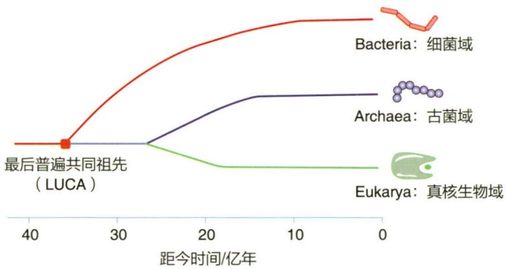
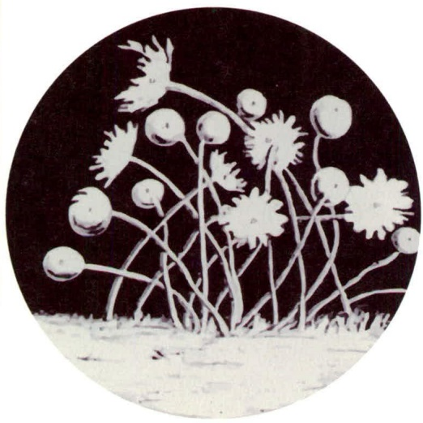
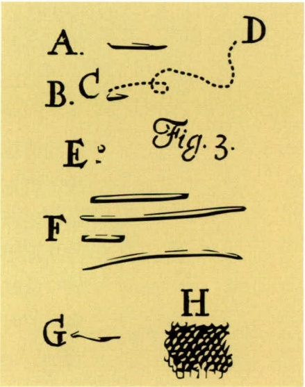
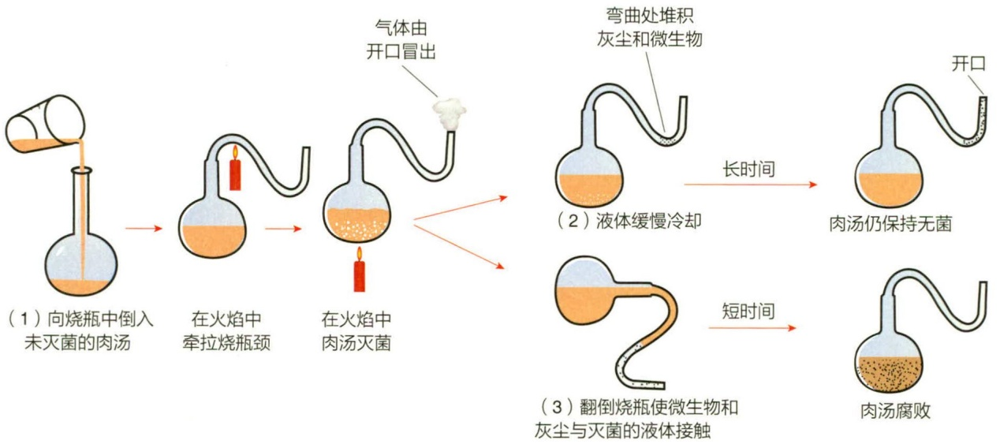
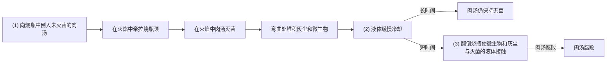
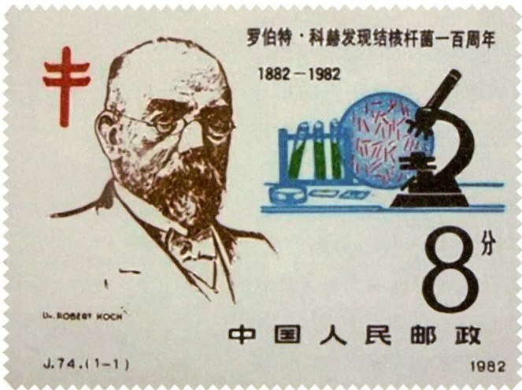

17.3.1 农业常见病害与病原体 582
17.3.2 微生物杀虫剂 584
17.3.3 微生物杀菌剂 587
17.3.4 微生物除草剂 589

17.4 微生物饲料 590

17.4.1 单细胞蛋白饲料 590
17.4.2 青贮饲料 592
17.4.3 其他发酵饲料 593
17.4.4 动物肠道微生态制剂 594

17.5 农田污染治理微生物制剂 594

17.5.1 农田重金属污染治理 595
17.5.2 农田有机污染物治理 596

18 食品微生物学 600

18.1 微生物与食品制造 601

18.1.1 食品微生物的分类与作用 601
18.1.2 传统发酵食品及其生产工艺 603
18.1.3 食用菌及其生产 607
18.1.4 益生菌食品 609
18.1.5 微生物酶制剂在食品中的应用 610
18.1.6 新型食品的微生物制造 611

18.2 微生物与食品腐败 614

18.2.1 食品中常见的微生物污染 614
18.2.2 食品微生物腐败特征 615
18.2.3 细菌性食物中毒 617
18.2.4 真菌毒素中毒 618
18.2.5 病毒性食物中毒 621

18.3 食品腐败控制与保藏 622

18.3.1 影响微生物生长的食品内外因素 622
18.3.2 微生物与食品保藏原理 623
18.3.3 基于微生物防控的食品保藏方法 625
18.3.4 食品保藏新技术 629
18.3.5 新型食品的微生物控制 630
18.3.6 栅栏理论在食品防腐保鲜上的应用 631

18.3.7 预测食品微生物学 632

18.4 食源性致病微生物的检测与追溯 633

18.4.1 食品安全的微生物指标与指示菌 633
18.4.2 食源性致病微生物的常规检测项目 633
18.4.3 食源性致病微生物的快速检测方法 635
18.4.4 食品安全 HACCP 体系与微生物防控 638
18.4.5 基于多组学的食源性微生物溯源与风险评估 639

19 工业微生物学 644

19.1 工业微生物学概述 645

19.1.1 工业微生物学的发展 645
19.1.2 工业微生物的常见种类 645

19.2 工业发酵 647

19.2.1 生物反应过程与发酵工程 647
19.2.2 发酵方法分类 648
19.2.3 发酵过程的主要单元操作 649
19.2.4 生物反应器 654

19.3 微生物与现代发酵工业 658

19.3.1 微生物生产有机酸 659
19.3.2 微生物生产氨基酸 659
19.3.3 微生物生产酶制剂 659

19.4 微生物与医药 660

19.4.1 微生物生产抗生素 660
19.4.2 微生物生产甾体类药物 660

19.5 微生物与生物能源 661

19.5.1 燃料乙醇 661
19.5.2 生物制氢 661
19.5.3 沼气发酵 661
19.5.4 微生物燃料电池 662

名词索引 665

微生物中文名索引 681

微生物学名索引 686

## 绪论

## 导语

微生物的世界是一个充满神奇与奥秘的领域。虽然微生物看似微小，却在生物圈中无处不在，并对人类的生活和生产产生着巨大的影响。随着对微生物学的深入了解，人们意识到它们不仅在生活中扮演着重要角色，而且对健康、医药、农业与工业等多个领域产生着深远的影响。人们对微生物世界的认识高度依赖于技术的发展。在17世纪，列文虎克首次使用自制显微镜观察到微生物，开启了微生物学的先河。19世纪，巴斯德和科赫等科学家建立了微生物的分离、培养、接种和灭菌等技术，这些技术的发展将微生物的研究从形态描述推进到生理学研究阶段，为现代微生物学的发展奠定了坚实的基础。20世纪微生物学的应用取得了巨大进展，抗生素和微生物酶制剂等广泛应用，而基因工程技术成为现代生物技术的重要组成部分。21世纪以来，随着高通量测序、宏基因组和合成生物学等新兴生物技术的蓬勃发展，微生物学研究进入了一个飞速发展的全新阶段。这些新技术的出现为深入了解微生物的生态、演化和生物化学特性提供了前所未有的机会。

## 关键词

微生物，生物技术，巴斯德，科赫法则，微生物组，合成生物学

## 1.1 微生物与微生物学

## 1.1.1 微生物是地球上最具影响力的“小巨人”

微生物（microorganism）是所有体形微小、肉眼难以看清的单细胞、个体结构较为简单的多细胞，甚至没有细胞结构的生命形式的通称，通常需要借助显微镜才能观察。它们包括病毒、细菌、古菌、真菌、单细胞藻类和原生动物等。这些微生物的形态和行为特征各不相同，它们栖息在地球上所有能够支持生命存在的环境中，占地球生物质总量的60%以上。许多微生物是没有分化的单细胞生物，但有些形成了较为复杂的结构，有些甚至是多细胞的。微生物可以简单划分为非细胞生物（病毒、亚病毒或类病毒等）、原核生物（古菌以及包括支原体、立克次氏体、衣原体、放线菌、蓝细菌在内的细菌）和真核生物（真菌、单细胞藻类和原生动物）。微生物是地球上许多有机和无机反应发生的“场所”。微生物是地球生命演化的起点，所有现存生命体都可以追溯到一个共同的远古单细胞生命祖先。在地球生命演化过程中，微生物的内共生、病毒介导的基因水平转移等，是地球生命形式发生关键变化（无氧到有氧，原核到真核，单细胞到多细胞等）的主要原因。微生物通常生活在复杂的微生物群落中，它们的行为受到彼此之间、与环境之间以及与其他生物体之间相互作用的调节，因此在地球物质循环中发挥着关键作用，是地球环境的重要塑造者，也是地质历史上许多次气候变化的主要影响因素之一。微生物与人类关系密切，许多疾病是由病毒、细菌、真菌或原生动物感染引起的，同时人体内正常菌群对健康的维持也至关重要。

在植物和动物出现之前，微生物在海洋和陆地中存在了数十亿年，它们的多样性令人震惊。微生物占地球生物量的很大一部分，并且无处不在，它们的活动对维持地球生态至关重要。地球大气中的氧气大部分是微生物活动的结果。植物和动物都生活在遍布微生物的世界里，它们的演化和生存受到微生物活动、微生物共生和病原体的直接影响。微生物是人类生活的关键组成部分，从传染病到人类的食物、饮用水、农田的肥力、家畜的健康，甚至是日常使用的燃料都离不开微生物的活动。虽然不同的地球生物都受到来自微生物的强烈影响，但由于微生物体积小、肉眼难以觉察，它们的贡献往往被忽视。例如，在人体内，共生有数倍于自体细胞数量的微生物细胞，同时还有超百倍于自体基因的微生物基因的存在。这些共生微生物对人类健康至关重要。人体内与体表的全部微生物组成了人体的微生物组，人体微生物组与人类健康息息相关。以人体肠道微生物组为例，其组成及变化与饮食、基因、健康状况、服用的药物密切相关，然而人们对这些肠道微生物的了解，从某种程度上来讲才刚刚开始。

所有地球生态系统都受到微生物活动的极大影响。微生物的代谢活动可以在化学层面和物理层面改变其生境，这些变化也将会影响其他生物。例如，许多人类活动将过量的营养物质释放到海洋沿岸区域中，从而刺激了微生物的过度生长，这可能导致这些水域出现巨大的缺氧区。这些“死亡区”导致沿海地区的海洋鱼类和贝类由于缺氧而大量死亡。通过了解微生物和深入学习微生物学，才有可能更加精准地预测并尽量减少人类活动对整个生物圈的不利影响。

## 1.1.2 地球生命简史

微生物是地球上最古老的生命形式，是地球生物圈得以持续维持的“底层”支撑。地球大约有46亿年的历史，微生物细胞最早出现在43亿到38亿年前。在地球形成的最初20亿年里，它的大气是缺氧的（$\mathrm{O}_2$ 含量较低），只有氮气（$\mathrm{N}_2$）、二氧化碳（$\mathrm{CO}_2$）和其他一些气体存在。在这样的条件下，只有能够进行厌氧代谢（即不需要氧气的代谢）的微生物才能够存活。

光能营养微生物（从阳光中获取能量的生物体）出现在地球形成后的10亿年左右。第一批光养微生物是不产氧的，与现在存在的紫色硫细菌和绿色硫细菌类似。蓝细菌（产氧光合细菌）在地球生命出现约10亿年之后得以演化形成，并开始缓慢地向地球大气“充氧”。这些早期的光能营养型微生物，生活在被称为微生物垫（microbial mat）的结构中，这种结构在现今仍然存在。在地球大气氧含量显著增加之后，多细胞生命形式最终演化出来，逐渐形成了今天的植物和动物。但是植物和动物在大约5亿年前才出现，地球生命的演化时间轴显示80%的生命历史完全属于微生物。即使是现在，无论是从种类、数量还是总质量来看，地球上的微生物仍然占据着绝对优势。因此，地球依然可以被认为是一个属于微生物的行星。

随着演化事件的展开，微生物细胞的三个主要谱系——细菌、古菌和真核生物（图 1-1），被区分开来。这三个主要的细胞谱系被称为域（domain），所有已知的细胞生物都属于这三个域中的一个。所有细胞生物也共享某些特征和基因。例如，在所有域的细胞中普遍存在大约60个基因，对这些基因的研究表明，这三个域都起源于一个共同的祖先，即最后普遍共同祖先（last universal common ancestor，LUCA）。在漫长的时间尺度上，来自这三个域的微生物逐渐演化，占据了地球上的各种适应性环境。

## 1.1.3 微生物的特点

微生物是个体微小、构造简单的细胞生物，大多数为单细胞，少数为多细胞，还包括一些没有细胞结构的生命类型。微生物的特点包括体积小、比表面大，吸收多、转化快，生长旺、繁殖快，适应强、变异频，种类多、分布广等。

## 1.1.3.1 体积小，比表面大

微生物个体大小差异大，大多数细菌细胞的直径在  $0.2 \sim 2 \mu m$ ，而真菌直径多在  $2 \sim 10 \mu m$ ，病毒多在  $0.01 \sim 0.25 \mu m$ ，原生动物为  $2 \sim 1000 \mu m$ 。

line

| Distance (Year) | Bacteria (Bacteria) | Archaea (Archaea) | Eukarya (Eukarya) |
| --- | --- | --- | --- |
| 40 | — | — | — |
| ~35 | LUCA | — | — |
| ~25 | — | — | — |
| ~15 | — | — | — |
| 10 | — | — | — |
| 0 | — | — | — |

图1-1 细胞生物（细菌、古菌和真核生物）的三个域

例如，一个大肠杆菌（Escherichia coli，又称大肠埃希菌）大约为  $1 \mu m \times 2 \mu m$ ，这是原核生物较为常见的尺寸。1 500 个大肠杆菌首尾相连才约等于一粒芝麻的长度。一个大肠杆菌的质量大约是  $10^{-12} g$ ，约 10 亿个大肠杆菌才有 1 mg。

比表面（specific surface）也称比表面积，是指细胞的表面积与体积的比值。随着细胞体积的减小，细胞的比表面相应增大。细胞内外的物质交换必须通过细胞的表面进行，所以细胞的生长速率与细胞内外的物质交换速率呈正相关，体积小的细胞更易完成快速的物质交换，进而实现旺盛生长和快速繁殖。

## 1.1.3.2 吸收多，转化快

微生物吸收和转化物质的能力极为惊人。在适宜的环境条件下，E. coli 可以在 1 h 内分解其自重 1 000～10 000 倍的乳糖，这种代谢速率是任何高等动植物都无法比拟的。微生物具有快速吸收和转化物质的能力，为其快速生长繁殖和合成大量代谢产物提供了充分的物质基础。人类可以利用微生物的生物化学转化能力，因此微生物被誉为人类的“活的化工厂”，为人类生产和生活提供了多种生物化学产品。同时，微生物在环境污染治理和修复方面的作用也日益显著。

## 1.1.3.3 生长旺，繁殖快

微生物因体积小而具有更大的比表面，有利于细胞的营养物质吸收、代谢废物排泄、能量和环境信息交换。快速的物质与能量交换意味着快速地生长与繁殖。与大型真核生物相比，微生物繁殖迅速。以1个大肠杆菌（仅 $10^{-12}$ g）为例，在适宜的培养条件下，它可以每20 min分裂一代，20 min后有2个细胞（ $2^{1}$ 个），再20 min后有4个细胞（ $2^{2}$ 个）……1天之后（24 h，共72个20 min）将有 $4.7 \times 10^{21}$ 个细胞（ $2^{72}$ 个），总质量达到 $4.7 \times 10^{6}$ kg；2天之后（48 h，共144个20 min）将有 $2.2 \times 10^{43}$ 个细胞（ $2^{144}$ 个），总质量达到 $2.2 \times 10^{28}$ kg，相当于4000个地球的质量。然而实际上，即使在最适宜的培养基中，由于营养物质和空间的限制以及代谢废物的累积，这种繁殖速度只能维持数小时，随后出现生长拐点到达平台期。

## 1.1.3.4 适应强，变异频

微生物极强的适应性是动植物无法比拟的，即使在对于其他形式的生命来说极其严酷的栖息地中也有着大量微生物存在，比如火山温泉、冰川和冰覆盖地区、高盐环境、极酸性或极碱性的栖息地，以及在极高压力下的海洋深处或地球深处。大多数细菌能耐-196\~0℃的低温，甚至在-253℃（液态氢）下仍能存活；超级噬热微生物的生存温度上限约为122℃（由古菌Methanopyrus kandteri Strain 116在高压环境下实现）；某些细菌可在1400个大气压下生长。适合生活在极端环境中的微生物被称为极端微生物。细菌芽孢和真菌孢子可在干燥条件下保存数十年，甚至数百数千年，目前已知的世界上最古老的活细菌（芽孢）存活了2.5亿年。极端微生物和芽孢的抗逆特性代表了生命的极限适应能力。

微生物繁殖快，遗传物质在复制过程中存在自发突变，自发突变所带来的多数表型效应是不利的，但当微生物生存环境发生改变时，突变中的极少部分可能带来生存优势。例如，处于有青霉素的环境中，无抗性的亲本无法生存，而具有耐药性的突变株就成为可以存活并适应新环境的优势菌株。

尽管自发突变发生的频率只有  $10^{-10} \sim 10^{-5}$ ，但由于微生物繁殖速度快，可在短时间内产生大量变异的后代。因此科学家常利用微生物的易变异特征来改造菌种，如青霉素生产菌的发酵水平由 20 U/mL 提升到超过了 200 000 U/mL。由于微生物易于变异，原核生物的 DNA 序列差异很大，即使是同一个种（Species）的不同菌株，其基因组 DNA 序列的差异也可能达到 30%。

## 1.1.3.5 种类多，分布广

微生物种类繁多，迄今为止，人类已知的微生物约20万种。据估算，地球上微生物的总数可能在50万\~600万种，甚至更多。

微生物是地球上分布最广泛的一类生物，科学家估算地球上存活着约 $1.2 \times 10^{30}$ 个细菌和古菌细胞。细菌和古菌的“五大”栖息地为深海地下（$4 \times 10^{29}$）、海洋沉积物（$5 \times 10^{28}$）、大陆深层（$3 \times 10^{29}$）、土壤（$3 \times 10^{29}$）和海洋（$1 \times 10^{29}$）；其余的栖息地含量不到 $10^{27}$ 个，包括地下水、大气层、海洋微表层、人类、动物和植物等。人们无时不生活在“微生物的海洋”中，数十千米的高空、数千米的地下、常年封冻的冰川等，人类可到之处乃至人迹罕至之处，都有大量微生物的存在。

微生物构成了全球生物量的主要部分，是生命所必需的营养物质的主要储存库。存在于所有微生物细胞中的碳总量占地球生物量的很大一部分。此外，微生物细胞内氮和磷（生命必需的营养物质）的总量几乎是所有动植物细胞总和的4倍。微生物也占生物圈总DNA的很大比例（约31%），其遗传多样性远远超过植物和动物。

## 1.1.4 微生物亦敌亦友

除了作为疾病的媒介（病原体）引起各种疾病，微生物在食品和农业中都发挥了重要作用。人体内的正常菌群对于人的健康至关重要，是人体健康的基本保障，它们帮助人体进行消化，提供必要的营养物质，并组成了人体的生理屏障。此外，人类社会在许多方面受益于微生物，它们是生产面包、奶酪、啤酒、抗生素、疫苗、维生素、酶和许多其他重要产品所必需的。事实上，现代生物技术是建立在微生物学基础之上的，基因工程等现代生物技术也需要以微生物为基本的实验工具。微生物是地球生态系统中不可缺少的组成部分，它们使陆地和水生系统中的碳、氧、氮和硫的循环成为可能，它们也是所有食物链和生态网络的基础营养来源。

虽然病原体和传染病仍然是人类健康的主要威胁，防治这些有害生物是微生物学的重点，但大多数微生物对人类无害。事实上，大多数微生物都是有益的，在许多情况下，它们甚至对人类福祉和生态系统的运转至关重要。

## 1.1.4.1 作为病原的微生物

在过去的几千年里，细菌和病毒等病原体引起的传染病多次导致人类大规模死亡，并对人类社会进程产生深远影响。例如，罗马帝国的衰落和征服新大陆等历史事件。1347年开始，鼠疫（黑死病）残酷地袭击了欧洲，数年之后（1351年），导致

## 知识拓展 1-1 埃博拉病毒

30%\~60%的欧洲人口死亡（约2500万人）。在接下来的80年里，这种疾病一次又一次地袭击欧洲，最终使欧洲75%的人口灭绝。一些历史学家认为，这场灾难对欧洲社会影响巨大，为文艺复兴创造了条件。即使是现在，人类仍受着微生物病原体带来的疾病的威胁，如新型冠状病毒肺炎感染（COVID-19）再次给人类敲响警钟。即使在今天，微生物学家和其他人员与艾滋病、疟疾等“杀手”的斗争仍在继续。

与此同时，微生物学家在发现微生物活动规律方面取得了巨大的进步，这些知识的应用极大地促进了人类健康和福祉的发展。传染病的控制是一系列进步的结果，包括人们对疾病过程的深入了解、卫生实践的改善、疫苗的普及以及抗生素等抗菌剂的广泛使用。微生物学作为一门学科的发展可以追溯到对传染病的开创性研究。

## 1.1.4.2 微生物与医药

虽然微生物作为病原体给人类健康带来了极大的危害，但微生物也给人类带来治疗疾病的希望。随着微生物学的发展，微生物在医药领域越来越重要，是现代生命科学的研究热点。微生物来源的药物在抗感染、抗肿瘤、免疫抑制和代谢调节等疾病领域发挥着重要作用。基于微生物的研究，免疫疗法的发明与应用、化学治疗剂如磺胺等的普及、抗生素的大规模生产与推广，以及近年来利用生物工程菌生产多胺类药物等，这些科学发现和应对措施，使得原本肆虐的传染病得到了有效控制。由真菌、细菌等微生物产生的抗生素，帮助人类获得对抗致病菌的能力。自弗莱明发现青霉素以来，人类已经发现了上万种抗生素，并有百余种应用于临床。此外，医学上使用的许多生化药品也是由微生物发酵后提取而来，如辅酶A、核黄素、维生素C、生物素等。用微生物制成的疫苗，也广泛用于疾病的预防，如预防结核杆菌感染的卡介苗和预防脊髓灰质炎病毒感染（小儿麻痹症）的“糖丸”等。烈性传染病天花已被彻底消灭，小儿麻痹症基本消除，乙型脑炎等流行病正在逐步控制和消灭。

## 1.1.4.3 微生物与农业和人类营养

微生物对关键植物养分的循环具有重要作用。例如，豆类是一个多样化的植物家族，包括大豆、豌豆和扁豆等主要作物物种。豆科植物与细菌密切相关，这些细菌在其根上形成称为根瘤（root nodule）的结构。在根瘤中，这些细菌通过固氮过程将大气中的氮气（ $N_{2}$ ）转化为氨。氨是肥料中的主要营养物质，是植物生长的氮源。豆科植物在细菌的辅助下制造肥料，从而减少了对化学肥料的需要。细菌调节养分循环，如氮循环和硫循环，转化和循环养分，构成土壤肥力的基础。

反刍动物（包括农业饲养的牛、羊，以及野生的野牛、山羊、鹿、长颈鹿、骆驼等）瘤胃中的微生物具有重要作用。瘤胃是一个微生物生态系统，微生物群落在其中消化和发酵植物细胞壁的主要成分纤维素。如果没有这些共生微生物，反刍动物就无法利用富含纤维素（但其他方面营养贫乏）的食物（如草和干草）生长。

人类的胃肠道没有瘤胃，但复杂的碳水化合物（占食物能量的 10%\~30%）被肠道微生物消化，每克结肠内容物含有约  $10^{11}$  个微生物细胞。微生物细胞数量在极酸性胃中（pH 2）较低（约  $10^{4}$  个 /g），但在小肠末端（pH 5）增加至约  $10^{8}$  个 /g，然后在结肠中（pH 7）达到最大数量。结肠中含有多种微生物，它们有助于消化复杂的碳水化合物，并合成维生素和其他对宿主营养至关重要的营养素。肠道菌群（gut microbiota）从婴儿出生开始发育，其结构随时间而改变。肠道微生物组（intestinal microbiome）的组成对消化道功能和人体健康有极为重要的影响。

## 1.1.4.4 微生物与食品工业

微生物与人类的食物密切相关。食物中的微生物生长可导致食物变质和食源性疾病。人类收获和储存食物的方式（例如罐装、冷藏、干燥、腌制等），烹饪食物的方式，甚至使用的香料，都受到了微生物的影响——重要目的是尽量抑制微生物的生长，消除有害微生物。食品安全和预防食品腐败是食品工业关注的焦点，微生物也是造成经济损失的主要原因之一。

虽然有些微生物会引起食源性疾病和食物变质，但并非食物中所有的微生物都有害。数千年来，有益微生物一直被用于提高食品安全和保存食品。例如，酸奶和乳酪都是由微生物发酵生产的乳制品，发酵过程中产生的酸可以抑制食源性病原体的生长，延长保质期。这种微生物发酵被用来生产各种各样的食物，包括酸菜、泡菜和某些香肠，甚至巧克力和咖啡的生产也依赖于微生物发酵。此外，烘焙食品和含乙醇饮料依赖于酵母的发酵活动，酵母产生  $CO_{2}$  来发酵面团。发酵产物影响食品的风味和口感，可以防止变质以及有害生物的生长。

## 1.1.4.5 微生物的其他应用

在工业微生物学范畴内，微生物展现出了巨大的商业应用价值。其中，自然存在的微生物能够实现大规模培养，进而以较低成本生产诸如抗生素、有机酸、酶类及特定化学品等大宗产品。与之相对，生物技术领域则侧重于运用基因工程改造后的微生物来合成高附加值产品，例如胰岛素或其他人类蛋白。此类生产往往规模较小，不过其产品在医疗等领域具有不可替代的重要作用。这些不同的微生物应用模式共同体现了微生物在商业产品生产中的关键作用。

微生物也可以用来生产生物燃料。例如，一组古菌——产甲烷菌（methanogen），可以通过厌氧代谢产生天然气（主要成分为甲烷， $CH_{4}$ ）。工业上，还可以利用微生物的发酵，将多种生物质（如甘蔗、玉米或速生草等富碳原料）转化为乙醇（一种重要的燃料补充物，可以单独或与汽油混合配制成乙醇汽油）。微生物甚至可以将废物，如生活垃圾、动物粪便和纤维素，转化为乙醇和甲烷。

微生物也可以用来清理工业污染，它们通过降解有机物和转化无机物的代谢活动，有效地促进废水的生物降解，加速有毒污染物的去除过程。这些例子表明，微生物对人类的影响是巨大的，它们的活动对地球的运转至关重要。

## 1.2 微生物学的发展历程

## 1.2.1 微生物学及其研究内容

微生物学（microbiology）是研究微生物的形态、生命活动规律及其防治和应用的科学，主要关注微生物是什么，它们是如何生存和活动的，它们的主要行为及其影响，以及如何利用微生物发展新技术等。

微生物学是研究各类微小生物体，如细菌、古菌、真菌、原生生物、病毒等的生物学分支学科，是生命科学的关键领域。微生物学主要研究微生物的形态、结构、生理生化、生命活动规律及其与人类和自然界的相互关系。以微生物为模型，人们可以深入了解生命现象的本质与规律。微生物学对生物学的其他领域和人类科技发展都有巨大的影响。

微生物学与医学、农业、环境保护以及发酵工业等领域有着紧密的联系，并在这些领域发挥着广泛的作用。微生物学的研究不仅揭示了微生物本身的奥秘，也为人类提供了许多重要的应用。

## 1.2.2 微生物的发现

显微镜的发展是微生物学发展的关键。从历史上看，随着新工具的开发和旧工具的改进，微生物学的发展取得了巨大的飞跃。显微镜是微生物学家研究微生物的最古老和最基本的工具。在显微镜发明之前，作为一门学科的微生物学并不存在。

几个世纪以前，虽然曾有人怀疑存在一些小到肉眼无法看到的生物，但是直到显微镜发明后才发现了它们。英国科学家和自然历史学家罗伯特·胡克（Robert Hooke, 1635—1703）是一位优秀的显微镜学家。他的著作 Micrographia（《显微图片》）

（1665年出版）是第一本致力于显微观察的书，书中胡克绘制了许多显微图像，包括霉菌孢子头的结构（图1-2），这是人类第一幅关于微生物的显微观察图片记录。

natural_image

Black-and-white circular illustration of white flowers and buds on a textured surface (no text or symbols)

图 1-2 胡克绘制的霉菌显微图片

第一次在显微镜下观察到细菌并加以记录的学者是荷兰人安东尼·范·列文虎克（Antony van Leeuwenhoek，1632—1723）。列文虎克早期以卖布为生，但他大部分的业余时间都用于制作简单的显微镜。这种显微镜由夹在两块银板之间的双凸透镜组成。列文虎克一生磨制了400多个透镜，其中一架简单的透镜放大率达到270倍。虽然这些显微镜比较粗糙，但是通过仔细的操作和聚焦，列文虎克能够看到细菌。1676年，他在观察辣椒水时发现了细菌，并将他的观察结果以一系列信件的方式报告给了伦敦的英国皇家学会。1684年，该学会在其《皇家学会哲学学报》上首次发表了列文虎克的相关发现。图1-3显示了被列文虎克称为“小动物”的微生物。

然而，由于观察和研究方法的局限，在接下来的200年里，微生物学的发展相对缓慢。这种情况一直持续到研究者拥有了成熟的实验室分离和培养微生物技术。在此期间，科学家们努力解决关于自然发生说有关的冲突，这种冲突以及随后对微生物在致病过程中所起作用的研究使得微生物学快速发展。在这一过程中，巴斯德和科赫成为了现代微生物学的奠基人。

## 1.2.3 巴斯德与微生物学奠基

路易·巴斯德（Louis Pasteur，1822—1895）是法国化学家，现代微生物学的开创者。他把人类对微生物的研究从对微生物形态描述的阶段提升到了对微生物生理研究的阶段，从而奠定了工业微生物学和医学微

text_image

A. — D
B.C —
E: Fig.3.
F —
G ~ H

图 1-3 列文虎克观察细菌的记录

生物学的基础，并开创了微生物生理学。1854年法国教育部委任巴斯德为里尔工学院院长兼化学系主任，1862年巴斯德当选为法兰西科学院院士。

## 1.2.3.1 发酵的微生物基础

在巴斯德职业生涯的早期，他研究了乙醇生产过程中形成的晶体。通过显微镜观察葡萄酒中酒石酸晶体的形成，他看到了两种具有镜像结构的晶体，将它们分开后，观察到每种类型的晶体都能使一束偏振光向不同的方向弯曲。通过这种方式，他发现化学上相同的物质可以有旋光异构体，它们具有不同的分子结构，从而影响它们的性质。巴斯德紧接着发现了微生物可以区分旋光异构体，例如，霉菌只利用 D- 酒石酸盐，而不利用其旋光异构体 L- 酒石酸盐。微生物能够区分光学异构体的事实使巴斯德怀疑，许多被认为是纯化学性质的反应实际上是由特定的微生物催化的。

巴斯德花了多年时间研究产生乙醇的发酵过程，这种发酵过程用于葡萄酒和其他乙醇饮料的生产。19世纪中期，一些化学家认为乙醇的生产完全是一个化学过程，糖的化学不稳定性导致它们分解为乙醇。而巴斯德不同意他们的观点，他认为发酵是由活的有机体完成的。1856年，巴斯德遇到了当地一位用甜菜汁生产乙醇的商人，这位商人因为他的许多大桶生产出的不是乙醇，而是一种闻起来像酸奶的物质而亏了钱，巴斯德确定这种物质是乳酸。他用显微镜观察到，产乙醇的大桶里充满了酵母，但产乳酸的大桶里却充满了杆状的细菌。他猜测是活的有机体的生长产生了乙醇或乳酸。

为了证明他的假说，巴斯德培养了这些有机体。他准备了一种酵母细胞的提取物，推断其中含有酵母生长所需的所有营养物质。然后，他使用陶瓷过滤器从酵母提取物营养培养基中去除所有细胞使其无菌。他将活酵母重新引入无菌酵母提取液中，可以看到酵母的生长并且有乙醇产生，但如果引入杆状的细菌，就会有乳酸的产生。加热这些培养物会消除它们的生长并且不会有乙醇或乳酸的产生。通过这种方式，巴斯德证明了发酵是由微生物进行的，不同的微生物进行不同的发酵反应。

在他的发酵研究中，巴斯德观察到经常会有其他有机体在他的酵母提取物培养基中生长，他推断这些有机体是从空气中引入的。巴斯德在发酵方面的工作为他一系列否定“自然发生说”的经典实验做了准备。

## 1.2.3.2 自然发生说的否定

“自然发生”的概念已经存在了数千年，它的基本原理很容易理解，如果将食物或其他易腐烂的物质放置一段时间，它们就会腐烂。在显微镜下观察，腐烂的物质充满了微生物。这些有机体是从哪里产生的？起初，人们相信生命是可以自然产生的，是可以直接从无机物质转变成有机生命体的。例如，埃及的尼罗河泛滥之后，许多青蛙从泥土中爬出来，所以人们相信“青蛙来自营养丰富的泥土”；一块肉在空气中放置一段时间，从里面就会爬出一些蝇蛆，蝇蛆再变成苍蝇飞走了，所以说“苍蝇来自腐烂的肉”。这种假说就是自然发生说（spontaneous generation），听起来比较符合人们“眼见为实”的生活经验，也比较符合“神创世界”“上帝造人”的宗教观点。

关于 “自然发生说” 的争论不断，意大利医生弗朗西斯科·雷迪（Francesco Redi，1626—1697）对腐烂的肉进行了一系列实验，通过用有盖和无盖的容器盛放肉，证明了腐肉上的蛆是由于蝇卵的存在而产生的，而不是由肉自发产生的。其他的一些实验也削弱了自然发生理论在大型生物体上的可信度。然而，列文虎克关于微生物的论述再次引发了争议。一些人提出微生物是自然发生的，而较大的有机体不是。英国牧师约翰·尼达姆（John Needham，1713—1781）在短暂煮沸肉汤混合物后密封烧瓶，几天后，发现肉汤变浑浊了并且观察到了微生物，因此他认为这些微生物是自然发生的。意大利科学家拉扎罗·斯帕兰扎尼（Lazzaro Spallanzani，1729—1799）对尼达姆的实验提出了质疑，他认为短时间的煮沸很可能没有杀灭全部微生物。他将肉汤密封在玻璃烧瓶中，然后将烧瓶放在沸水中煮更长的时间（约 45 min），发现密封的烧瓶中没有微生物生长。他提出空气携带细菌到培养基中才导致了肉汤的腐败。“自然发生说”的支持者认为在密封的烧瓶中加热空气会破坏空气维持生命的能力，因此并没有怀疑“自然发生说”。正在人们就“生物是否可以自然发生”争辩的时候，达尔文的《物种起源》发表了，从理论角度否定了“上帝造人说”，进而否定了“自然发生说”，但当时尚无强有力的实验来直接否定“自然发生说”。

巴斯德是“自然发生说”的强烈反对者。他预测，腐烂材料中的微生物是从空气中进入的细胞或最初存在于腐烂材料中的细胞后代。他认为，如果食品的处理方式能杀死所有存在的生物体，也就是说，如果食品被灭菌，并保持无菌状态，它就不会腐败。巴斯德用加热的方法来杀死微生物，他发现对营养液进行大范围的加热，然后再密封可以防止它腐烂。“自然发生说”的支持者批判这些实验，宣称新鲜空气是这种现象发生的必要条件。1864年，巴斯德通过一个实验巧妙地反驳了“自然发生说”。他将肉汤放入曲颈瓶中，用火加热杀菌，结果放在曲颈瓶里煮过的肉汤由于无法和空气中的细菌接触（带有细菌的空气尘埃均落在曲颈弯口了），经过4年也没有腐败；而将这些肉汤和曲颈弯口处的尘埃接触，其中的肉汤则很快就腐败变质了（图1-4）。这个“曲颈瓶实验”说明生物不会自然发生，彻底解决了有关“自然发生说”的争论。

flowchart

图 1-4 巴斯德的曲颈瓶实验

巴斯德在否定自然发生方面的工作证明了灭菌的重要性，促进了有效灭菌程序的发展，这些程序最终被标准化并广泛应用于微生物学、医学和工业生产。例如，英国医生约瑟夫·李斯特（Joseph Lister，1827—1912）根据巴斯德的发现推断手术感染是由微生物引起的，他实施了一系列旨在杀死微生物和防止手术患者微生物感染的技术。例如，通过使用化学物质石炭酸（苯酚）进行消毒，患者的术后感染率大幅度下降。李斯特创立的无菌外科手术技术被全世界采用，使术后死亡率在10年内从45%降到15%，挽救了无数人的生命。食品工业也得益于巴斯德的工作，因为它的原理很快被用于热处理保存牛奶和许多其他食品，人们把这种采用不太高的温度加热杀死致病菌和腐败微生物的方法称为“巴氏灭菌法”（又称“巴氏消毒法”）。直到现在，鲜牛奶和啤酒等还常用巴氏灭菌法来保存。

## 1.2.3.3 巴斯德与疫苗

巴斯德在微生物学和医学方面也取得了许多成就，他研制出鸡霍乱疫苗、炭疽疫苗和狂犬疫苗等多种疫苗，为动物与人类疫病的防治提供了理论指引与实际方法，是免疫学学科的开创者。巴斯德在狂犬病方面的研究是最著名的。众所周知，人感染狂犬病后，一旦发病死亡率近于100%。在巴斯德找到对付狂犬病的方法之前，人类对狂犬病没有任何真正有效的治疗或预防方法。巴斯德通过研究推断，发病动物的狂犬病病原体应该集中于神经系统。他发现，从病死动物身上取出的新鲜脊髓组织，研磨后和蒸馏水混合并注入健康犬便会染上狂犬病；但若将脊髓干燥后和蒸馏水混合并注入健康犬却并没有染病。经过反复接种实验，这些接种过“疫苗”的狗，即使再被注入新鲜的病犬脊髓组织，也不会发病。

令巴斯德的狂犬病疫苗变得家喻户晓的事件发生在1885年。当时一位母亲带着被疯狗咬伤的9岁小男孩约瑟夫·迈斯特（Joseph Meister）找到巴斯德，哀求巴斯德救救她的孩子。巴斯德决定为约瑟夫做人类第一例狂犬病免疫试验，结果试验相当成功，约瑟夫健康地回到了家乡。不久之后，巴斯德又用同样的方法救下了另一个孩子。消息很快传遍法国，一年内有数千名被疯狗咬伤的人蜂拥而至，通过巴斯德的狂犬病疫苗得到救治。

## 1.2.3.4 巴斯德的其他贡献

巴斯德一生当中获得了无数科学成就，不仅对科学发展产生了深远影响，也对社会经济（如法国的葡萄酒业、啤酒业、桑蚕业）等各方面产生了重大影响。他找到了导致当时法国每年损失1亿法郎的“蚕病”的病因，挽救了法国的蚕丝业。1888年，法国政府在巴黎建立巴斯德研究所，该研究所最初是治疗狂犬病和其他传染病的临床中心，现在是主要的生物医学研究中心，专注于抗血清和疫苗的研究与生产。巴斯德70岁生日时，他所任教的巴黎索邦大学举行了盛大的庆祝会。巴斯德在法国总统搀扶下，接受了一枚纪念章，上面刻着:“纪念巴斯德70岁生日，法兰西感谢你，人类感谢你。”

## 1.2.4 科赫与微生物学奠基

罗伯特·科赫（Robert Koch，1843—1910）是一名德国医生，他和同时代的巴斯德通过各自的工作与成就，奠定了现代微生物学的基础。

证明某些微生物能引起疾病为微生物学作为一门独立的生物学科的发展提供了动力。早在16世纪，人们就怀疑某种病原体能从患者身上传染给健康人。在微生物被发现后，许多人提出它们会引起传染病，但缺乏确切的证据。早在1847年，匈牙利医生伊格纳兹·塞麦尔维斯（Ignaz Semmelweis，1818—1865）就提倡通过术前洗手来预防感染的方法，他的方法挽救了许多产妇的生命，但他不能证明为什么这些方法有效，他的建议遭到了很多医学界人士的嘲笑。巴斯德和李斯特的工作提供了强有力的证据，证明微生物是导致传染病的原因，但直到德国医生罗伯特·科赫的工作，传染病的细菌理论才有了直接的实验支持。

## 1.2.4.1 疾病的病原说和科赫法则

炭疽是由炭疽杆菌（Bacillus anthracis）引起的人兽共患性传染病。在科赫早期对炭疽的研究工作中，通过显微镜观察和染色，科赫确定这种细菌总是在死于这种疾病的动物血液中存在，于是他用炭疽和实验动物来研究细菌与疾病的关系，这项研究的结果形成了此后传染病研究的标准。

科赫用老鼠作为实验动物，他发现将感染炭疽的老鼠的一小滴血注射到健康的老鼠身上时，后者很快就患上了炭疽。他从第二只动物身上取血，注射到另一只健康的小鼠身上，再次观察到了特有的疾病症状。科赫还发现炭疽杆菌可以在宿主体外的营养培养基中生长，即使在实验室培养中经过多次转移，当接种到健康动物体内时，这种细菌仍然会引起疾病。科赫通过对炭疽病的研究工作，首次以毫无争议的结果证实微生物（细菌）是导致传染性疾病的病因，即今天所说的病原体，从而建立了疾病的病原说（Germ theory of disease）。在这些实验和其他关于结核病病原体实验的基础上，科赫制定了一套严格的标准用来确定侵染性疾病病原体的操作程序，即著名的科赫法则（Koch's postulates）。科赫法则的详情参见本书 15.1.2.1 内容。

科赫法则强调了实验室培养假定的传染性病原体的重要性，随后将可疑的病原体引入原始健康的动物，并从患病或死亡的动物中分离回收病原体。在该法则的指导下，科赫和他的学生还发现了人类和家畜中多种重要传染病的病原体，这些发现促进了许多疾病的预防和治疗方法的发展。

虽然科赫法则被广泛使用，但有时并不可行。例如，麻风病的病原体麻风分枝杆菌（Mycobacterium leprae）必须在宿主细胞内生存，不能利用纯培养技术分离出来。健康者体内并不总是不存在病原体，如新型冠状病毒感染流行期间发现的大量无症状感染者。还有一些人类疾病缺乏适当的动物模型，所以这些假设不能被完全满足。为了克服这些困难，微生物学家有时会使用分子生物学和遗传学的方法来确定传染性疾病的病原体。例如，使用分子方法来检测身体组织中微生物的核酸，而不是将其分离出来。与致病微生物（病原体）的毒力相关的基因可能会发生突变，突变生物体引起疾病的能力降低，可以通过将正常基因导入突变体来恢复病原体的毒力。

## 1.2.4.2 微生物的纯培养

科赫法则的第二条指出，必须在实验室培养中把可疑的病原体分离，使其生长远离其他微生物，即得到纯培养物。为了实现这一重要目标，科赫和他的同事们开发了数种在纯培养（pure cultivation）中获得和培养细菌的简单而巧妙的方法，其中许多方法至今仍在使用。

科赫最开始使用天然表面（如土豆片）来培养细菌，但他很快开发出更可靠的生长培养基，使用明胶固化的液体营养液，大大提高了培养的效率。然而，许多细菌有降解明胶的能力，营养明胶平板常常被细菌降解得一塌糊涂，此外，明胶的熔点较低，自身容易液化，在一定程度上限制了其使用。后来在科赫一位助手的妻子 Fran Heese 的建议下，尝试使用琼脂代替明胶来制备营养平板，从而发明了使用至今的琼脂固体培养基。科赫和他的同事观察到，当固体表面在空气中培养时，大量微生物细胞会生长出来，它们被称为“菌落”，每个菌落都有独特的形状和颜色。他推断，每个菌落都是由单个细菌细胞生长产生大量的细胞形成的集群。科赫推断，每个菌落都含有纯培养物（pure culture）（由单一个体生长繁殖所获得的微生物群体），他很快意识到固体培养基提供了一种获得纯培养物的简单方法。1887 年，科赫的另一位同事理查德·佩特里（Richard Petri，1852—1921）发明了透明的双面“佩特里皿（Petridish）”（即培养皿），这很快成为获得纯培养物的标准工具。

科赫创立的微生物学基本操作技术与方法沿用至今，奠定了微生物学作为生命科学中一门重要的独立分支学科的基础。这方面的成果主要有:设计了多种培养基，实现了在实验室内对不同微生物的培养；建立流动蒸汽灭菌技术，确保了无菌培养基的制备，直到后来高压蒸汽灭菌技术的出现；建立染色观察和显微摄影技术，使科学家能够清晰地看到显微状态的细菌并拍摄下来。

## 1.2.4.3 科赫和结核病

科赫另一个伟大的科学成就是发现了肺结核的病原体。在他开始这项工作的时候

知识拓展1-3

COVID-19

text_image

罗伯特·科赫发现结核杆菌一百周年
1882-1982
8分
中国人民邮政
J.74.(1-1)
1982

图 1-5 中国发行的纪念科赫发现结核杆菌 100 周年邮票

(1881年)，所有报告的人类死亡中有1/7是由结核病引起的。人们怀疑结核病是一种传染性疾病，但无论是在患病组织中还是在培养物中，都从未见过这种可疑的病原体。在成功地研究炭疽之后，科赫着手证明结核病的原因，他汇集了以前在炭疽研究中开发的所有方法:显微镜、染色、纯培养分离和动物模型系统。

引起结核病的结核分枝杆菌（Mycobacterium tuberculosis）很难染色，因为结核分枝杆菌的细胞壁中含有大量蜡样脂质。尽管如此，科赫还是为肺组织中的结核分枝杆菌设计了一种染色方法。利用这种方法，他在结核组织中观察到蓝色杆状的结核分枝杆菌，而在健康组织中没有观察到。获得结核分枝杆菌培养物并不容易，但最终科赫成功地在含有血清的固体培养

基上培养出了这种微生物菌落。1882年，科赫宣布他发现了肺结核的病因，并因此获得1905年诺贝尔生理学或医学奖。1982年，我国发行了一枚纪念邮票，纪念科赫发现结核杆菌100周年（图1-5）。在不断发展的传染病领域，科赫还有许多其他的成就，包括发现霍乱的病原体霍乱弧菌（Vibrio cholerae）和开发诊断结核分枝杆菌感染的方法（结核菌素皮肤试验）。

巴斯德和科赫所生活的19世纪，堪称微生物学的奠基世纪。除了这两位巨匠之外，其他学者也在同一时期做了大量开创性的工作。1884年丹麦人汉斯·克里斯蒂安·革兰（Hans Christian Gram，1853—1938）创立了革兰氏染色法，将所有细菌区分为革兰氏阳性菌和革兰氏阴性菌两大类，这是细菌分类学的重要方法之一。1897年德国人爱德华·布赫纳（Eduard Buchner，1860—1917）使用酵母的无细胞体系发酵乙醇成功，开创了现代酶学。

## 1.2.5 20世纪微生物学的快速发展

20 世纪以来，微生物学发展迅速，除了得益于显微技术、化学分析技术等技术手段的革命与改进，还有一个典型的特点:微生物学与其他科学的深入结合与交叉，特别是与生物化学、遗传学的紧密结合，形成了微生物生理学与微生物遗传学。20 世纪 50 年代之后，微生物学研究进入分子水平。由于微生物的遗传信息量相对较小，分子改造相对容易，分子生物学一度使微生物学成为生命科学中发展迅速、影响显著的前沿科学之一。20 世纪 70 年代首例基因工程菌构建成功，使人工控制生物性状成为可能，用微生物来生产蛋白质类药物和各种特殊发酵产品成为可能，从而开创了基因工程新时代。微生物学与生态学的结合形成了微生物生态学，然而由于微生物生态环境的复杂性、复杂环境中微生物的多样性与易变性，使得微生物生态学一直难以成为微生物学研究的主流。随着高通量测序技术和计算机信息处理技术的高速发展，分子微生态学也由此进入快速发展的黄金时期。

包括微生物学在内，生命科学百年来的部分重要代表性成就如下:

1928年，英国人格里菲斯（Griffith）发现肺炎链球菌的转化现象；1944年，洛克菲勒大学三位科学家奥斯瓦尔德·艾弗里（Oswald Avery）、科林·麦克劳德（Colin Macleod）和马克林·麦卡蒂（Maclyn McCarty）进一步证实转化现象中的遗传物质是DNA而非蛋白质；进而1953年詹姆斯·沃森（James Watson）与弗朗西斯·克里克（Francis Crick）提出DNA的双螺旋模型及半保留复制理论；1958年克里克提出遗传信息传递的“中心法则”。1961—1966年，罗伯特·霍利（Robert Holley）、马歇尔·尼伦伯格（Marshall Nirenberg）和哈尔·葛宾·科拉纳（Har Gobind Khorana）破译了遗传密码。科学家们的“接力”工作，将传统生物学带入了全新的分子生物学阶段。沃森和克里克与另一位学者莫里斯·威尔金斯（Maurice Wilkins）共同分享了1962年诺贝尔生理学或医学奖。霍利、尼伦伯格和科拉纳共同分享了1968年诺贝尔生理学或医学奖。

1909 年，德国科学家保罗·埃尔利希（Paul Ehrlich）发现了化合物砷凡纳明可用于治疗梅毒，拉开了人类寻找抗菌药物的序幕。1929 年，英国人亚历山大·弗莱明（Alexander Fleming）首次发现了青霉素。1941 年前后英国病理学家霍华德·沃尔特·弗洛里（Howard Walter Florey）与生物化学家恩斯特·伯利斯·钱恩（Ernst Boris Chain）完成了青霉素的分离与纯化。1943 年，青霉素开始工业化生产并用于治疗二战盟军伤病员；同年，生于乌克兰的美国科学家赛尔曼·亚伯拉罕·瓦克斯曼（Selman Abraham Waksman）分离得到链霉素产生菌。青霉素发现“三人组”弗莱明、弗洛里和钱恩，共获 1945 年诺贝尔生理学或医学奖；瓦克斯曼则获得了 1952 年诺贝尔生理学或医学奖。从此，人类进入到“抗生素时代”。

1935 年美国人温德尔·梅瑞狄斯·斯坦利（Wendell Meredith Stanley）获得了烟草花叶病毒的结晶；1939 年德国人古斯塔夫·考舍（Gustav Kausch）等人首次在电子显微镜下看到了烟草花叶病毒粒子的结构。他们的工作使人类对病毒的认识进入新的阶段，为病毒性疾病的治疗提供了理论依据，也为探索生命的本质提供了线索。斯坦利因为在病毒蛋白酶研究上的贡献，与另两位学者共享了 1946 年诺贝尔化学奖。

1946—1947年，美国人约书亚·莱德伯格（Joshua Lederberg）和爱德华·塔特姆（Edward Tatum）发现了细菌的接合现象；1961年，法国人弗朗索瓦·雅各布（Francois Jacob）和雅克·莫诺（Jacques Monod）提出了基因调节的操纵子模型；1973年美国人赫伯特·书恩·伯耶（Herbert Wayne Boyer）与斯坦利·诺曼·科恩（Stanley Norman Cohen）将外源基因拼接到质粒中，制成重组质粒，并在大肠杆菌中成功表达，揭开基因工程的序幕。

1975 年阿根廷与英国双重国籍的生物化学家色萨·米尔斯坦（Cesar Milstein）等人建立了单克隆抗体技术，这是免疫学的一次革命性进步。米尔斯坦与尼尔斯·杰尼（Niels K. Jerne）及乔治斯·克勒（Georges J. F. Koler）共同获得 1984 年诺贝尔生理学或医学奖，以表彰他们在抗体研究方面取得的杰出成绩。

