1977 年，美国人卡尔·乌斯（Carl Woese）根据细胞生物的 16S rRNA（真核生物为 18S rRNA）序列相似性提出了“三域学说”，将所有细胞生物划分为细菌域、古菌域和真核生物域。这是生物分类学和生命演化研究的划时代事件。

1982 年，美国人斯坦利·普鲁西纳（Stanley Benjamin Prusiner）发现了全新的蛋白致病因子朊病毒（Prion），对生命的定义再次提出了挑战。他因此获 1997 年诺贝尔生理学或医学奖。

1976 年，科学家从水生栖热菌中分离出具有热稳定性的 Taq DNA 聚合酶。1984 年，凯利·穆利斯（Kary Mullis）发现了高效复制 DNA 片段的聚合酶链反应（PCR）方法，开启了现代分子生物学的大门。

1995 年，人类完成流感嗜血杆菌的全基因组测序工作；1997 年人类完成酿酒酵母的全基因组测序工作。这些测序工作和人类基因组、黑猩猩基因组、水稻基因组……共同见证了测序技术特别是高通量测序技术对生命科学研究的革命性影响。

## 1.3 微生物学的未来

随着科学技术的不断进步和研究的深入，微生物学领域迎来了巨大创新。高通量、超高通量测序技术的横空出世，生物信息学的蓬勃发展，使微生物的潜力得到广泛挖掘。基因编辑及合成生物学技术赋予了科学家设计和创造生命的能力，推动药物、化学品等微生物产品生产效率的提升；对微生物组学的深入研究不仅改变人类对环境生态系统的理解，也为微生物作为医学领域中新型治疗方法的发展提供了理论基础；微生物感知技术的出现帮助实现对环境变化和污染的实时监测，推动环境监测和生态系统管理的进步。总体而言，微生物学将在医疗、环保和工业等多个领域发挥关键作用，为各个领域的进一步发展带来新的可能性和解决方案，为人类带来更加可持续、健康和创新的未来。

## 1.3.1 微生物多样性与微生物组学研究

微生物多样性是指生态系统中存在的微生物种类数量和种类组成的多样性。微生物广泛分布于地球上的各种环境中，包括土壤、水体、大气、动植物体表与体内。微生物多样性对维持生态平衡、生态系统功能和人类健康都具有重要意义。

## 1.3.1.1 微生物多样性的发现

20 世纪初微生物学从最初关注基本原理、方法和医学方面的研究逐渐扩展到对土壤和水中的微生物多样性以及微生物在这些栖息地中进行的代谢过程的研究。这一时期的主要贡献者包括荷兰人马丁努斯·贝伊林克（Martinus Beijerinck）和俄国人谢尔盖·维诺格拉茨基（Sergei Winogradsky）。在此之前，巴斯德和科赫使用的养分丰富的培养基能够支持多种微生物的生长，但并不选择特定类型的微生物。而在富集培养中，贝伊林克通过使用选择性培养基和有利于特定代谢群体的培养条件，将特定微生物分离出来。通过富集培养，贝伊林克首次纯化了多种土壤和水生微生物，包括具有硫酸盐还原和硫氧化功能的细菌、乳酸菌、绿藻，以及多种厌氧细菌。与贝伊林克一样，维诺格拉茨基对土壤和水体的细菌多样性产生兴趣，并从自然样本中成功分离出几种具有显著特征的细菌。他通过模拟贝氏硫细菌所生存的环境，设计了特定的富集培养基。他证明这些细菌在自然界中能够催化特定的化学转化，并提出了化能无机营养（chemolithotrophy）的重要概念，即对无机化合物进行氧化以产生能量的营养类型。除此之外，维诺格拉茨基分离了多种代谢类型的细菌。他使用一种缺乏氮的富集培养基，分离出厌氧固氮细菌巴氏梭菌（Clostridium pasteurianum），成为第一个证明细菌固氮过程的研究者。不久之后，贝伊林克也使用类似的技术，分离出第一个好氧固氮细菌——自生固氮菌属（Azotobacter）。维诺格拉茨基还通过使用含有铵盐和 $\mathrm{CO}_{2}$ 的富集培养基，首次分离了硝化细菌。无菌技术的发展以及对细菌进行富集、分离和培养方法的创立，促进了微生物发现种类的爆炸性增长。

## 1.3.1.2 微生物组学研究

虽然人工培养技术使被发现和命名的微生物数量呈现井喷式增长，但目前已被定名的原核生物数量仅占其实际数量的不到1%，绝大多数的微生物仍然未被人类认识、研究和利用。人工培养技术的局限性限制了复杂生境中大部分微生物的实验室分离培养，然而，大规模、高通量测序等新兴技术的出现，使得研究复杂生境中微生物多样性成为可能，微生物组学（microbiomics）就是因此而诞生的一门新的分支学科。

微生物组（microbiome）也称为宏基因组（metagenome）或微生物环境基因组（microbial environmental genome），是指特定时间特定空间（生境）中微生物群所包含的基因序列信息的总和。微生物组学旨在通过功能基因筛选、测序分析等方法手段，研究特定环境中全部微生物多样性、种群结构、演化关系、功能、相互协作关系及与环境的动态变化相关性。利用先进的DNA测序技术，科学家们能够更全面地了解和分析微生物的遗传信息，揭示微生物群落中各个成员的身份、相互作用以及对不同环境条件的响应。微生物组学的发展使人们能够深入了解微生物在生态系统中的角色，以及它们对环境、健康和生物过程的影响。

自微生物学诞生以来，科学家对微生物的研究和利用主要针对单个菌种。但在自然界中，大部分微生物都是以不同种类聚居在一起形成的微生物群落存在，群落能够帮助微生物更好地适应环境变化，参与物质和能量循环。因此，研究特定环境中的微生物组已经成为微生物学研究中的热点。通过扩增子测序、宏基因组测序、转录组测序等技术，微生物组学揭示了微生物在地球各个生态系统中的惊人多样性。这些研究为人们提供了了解微生物及其影响所处环境的方法，为生态学、环境科学、医学和农业等领域提供了重要的参考。微生物组学的不断发展为人们认识微观世界提供了强大的工具，推动着微生物学的发展。

## 1.3.2 基因工程菌的构建与应用

基因工程菌的构建和应用是现代生物技术领域的一个重要方面。基因工程菌是通过改变其遗传信息，使其具有特定的功能或性质的微生物。这一领域的先驱性工作始于20世纪70年代和80年代，美国人赫伯特·韦恩·伯耶（Herbert Wayne Boyer）与斯坦利·诺曼·科恩（Stanley Norman Cohen）于1973年成功构建首例基因工程菌，这是科学家们首次通过DNA重组技术成功修改微生物的基因。

构建基因工程菌的第一步是选择易于培养和操作的细菌，如大肠杆菌（Escherichia coli）或酿酒酵母（Saccharomyces cerevisiae）。接下来，通过基因克隆技术将外源基因插入微生物的染色体中，使其获得新的性状或功能，包括生产特定的蛋白质、代谢产物或执行其他特定任务。构建成功的基因工程菌可以在小规模的科学研究或大规模的工业应用中发挥作用。在工业微生物学中，这些基因工程菌被用于生产各种有用的化合物，如酶、药物、生物燃料和其他生物技术产品，目前已经能够利用基因工程菌产业化生产维生素C、人胰岛素、乙肝疫苗、人干扰素、头孢霉素C和苏氨酸等生物技术产品。大规模应用涉及将基因工程菌培养在发酵罐或生物反应器中，以产生大量目标产物。这些应用通常需要优化培养条件，确保微生物以最有效的方式执行工作。此外，基因工程菌在医学、农业和环境保护等领域也有广泛应用。这一领域的不断发展为各种产业提供了创新的解决方案，推动了现代生物技术的进步。

如何利用基因工程菌生产生物能源也是一个新兴研究方向，如生物乙醇、生物柴油、生物制氢、丙烷等均是潜在的可广泛使用的生物能源。目前全球生物能源的消费量只占全部能源消耗的约0.5%，生物能源的开发与利用任重道远。因此，在生物能源开发领域，大力发展以科技创新为主导，具有高科技、高效能、高质量特征的新质生产力任重道远。

## 1.3.3 合成生物学的发展与未来

合成生物学（synthetic biology）是指利用基因工程从现有的生物部件中构建或创建新型生物系统的科学及其技术方法，这些生物部件通常来自多个不同的生物体。这些生物部件（启动子、增强子、操作子、核糖开关、调节蛋白、酶结构域、信号接收器等）被称为生物砖（biobricks），也称为生物积木或生物组件。合成生物学将这些生物砖以各种组合方式连接在一起，形成能够产生复杂行为的生物系统。迄今为止，合成生物学的一个主要焦点是构建或修改代谢途径。合成生物学家通过构建人工途径，使用各种酶和调节器的生物砖，将廉价丰富的底物转化为高价值的产品。这些产品通常从原始来源纯化成本昂贵，且产量稀少。微生物学家发现，一种名为CRISPR/Cas9的系统可以识别和切割其他细胞中的特定DNA序列，外源DNA可以插入切割位点。CRISPR/Cas9基因编辑技术的优化使之成为迄今为止在活体细胞中精准改变真核基因序列的最强大和精确的工具，彻底改变了生物技术。法国生物化学家埃玛纽埃尔·沙尔庞捷（Emmanuelle Charpentier）和美国生物化学家珍妮弗·道德纳（Jennifer A. Doudna）由于对CRISPR/Cas9基因编辑技术的开创性贡献，共同获得了2020年诺贝尔化学奖。

合成生物学涵盖了生物学、工程学、计算机科学和化学等多个领域，旨在通过设计、构建和改造生物系统，使其具有新的功能，以利于工程化实现。合成生物学将工程学和计算机科学的原理应用于生物学，以实现具有特定功能生物系统的构建，包括对新基因的创建或对现有基因的修改，以及对生物部件如蛋白质、酶和代谢途径的设计和组装等。

合成生物学作为生物学中的新兴领域，在近几十年里，经历了快速的发展和演变。随着 CRISPR/Cas9 等基因编辑技术兴起，合成生物学发生了革命性的改变。高效的基因编辑工具使科学家能够更容易地编辑和修改生物体的基因，从而扩大了合成生物学的应用范围。如今，合成生物学在多个领域有着广泛的应用。

① 定制医疗。通过使用合成生物学的原理设计定制治疗方法，包括基因疗法、定制药物和组织工程，推动个性化医疗发展。
② 活体微生物药物。利用合成生物学促进噬菌体药物、肠道菌群药物等开发及量产。
③ 生物制造和可持续发展。合成生物学推动生物燃料、生物塑料和生物材料等领域快速发展，有助于减少对有限资源的依赖，降低对环境的影响。
④ 精准农业。利用合成生物学改进植物抗病性、耐旱性和产量，提高农业生产效率，减少对农药和化肥的依赖。
⑤ 生态修复。合成生物学有望用于生态系统的恢复和环境修复，包括清除污染、恢复植被和生物多样性的保护。
⑥ 生物计算和存储。合成生物学还可以用于生物计算和数据存储，将生物体用作信息处理和存储的平台。

总之，合成生物学将继续在医疗、环境、农业、能源和其他领域发挥关键作用。随着技术的不断进步和社会对可持续发展和生物创新的需求，合成生物学有望成为解决一系列全球性挑战的重要工具之一。但同时，合成生物学所涉及的伦理、法规和安全问题也需要得到广泛重视。

## 1.3.4 利用微生物治理环境污染

利用微生物代谢快、繁殖迅速、降解效率高等特点来吸附、降解或转化污染物质，从而改善受到污染的环境，是治理环境污染的重要手段。自然环境中污水的自净化能力即来自天然水体中的微生物群落，废水处理厂的生化曝气池的功能也源自活性污泥中复杂的微生物群落。废水处理主要依赖于微生物处理被人类废物污染的水，以便可以安全地再利用或回归环境。例如，某些细菌和真菌可以分解烃类等有机化合物

## 知识拓展 1-6

人造基因控制的细菌细胞

和其他化工废物，将它们转化为对环境较为友好的产物。此外，微生物也被应用于生物吸附和沉淀，帮助去除水中的重金属离子等有害物质。另外，若在没有适当的废水处理的情况下，霍乱和伤寒等水传播疾病可能会蔓延。这一方法被广泛应用于水、土壤和空气等环境中，为减轻环境污染和保护生态系统作出了积极贡献。

微生物还可以用于清理环境中的工业污染，这个过程被称为生物修复（bioremediation）。在生物修复中，微生物被用于转化泄漏的石油、溶剂、杀虫剂、重金属和其他对环境有毒的污染物。生物修复通过在被污染的环境中添加特殊微生物或添加刺激本土微生物降解污染物的营养物质来加速清理过程。引入或促进具有降解能力的微生物，可以加速土壤中污染物的分解和去除，还可以改善土壤结构和提高土壤的生态功能。空气中的有害气体也可以通过微生物的参与而得到治理。例如，某些微生物能够吸收和分解空气中的有机气体、氨气等，从而提高空气质量。

人口问题及经济发展阶段等因素导致当今全球的环境污染日益严重，白色垃圾、石油泄漏等污染早已超出天然微生物的降解能力，因而寻找或构建具有更高效降解能力的微生物，对于环境修复至关重要。总而言之，利用微生物治理环境污染是一种可持续、生态友好的方法，为人类应对不同环境挑战提供了创新的解决途径。这一领域的不断研究和应用有望为全球环境保护事业带来积极的影响。

## 1.3.5 新型传染病的防治

随着经济、科技的发展，传染性疾病的威胁逐渐下降。然而，伴随着旧的传染病被攻克，新型传染性疾病也在不断地出现，给人类带来健康威胁。近年来，全球出现了一系列新型传染病，其中最为突出的是严重急性呼吸系统综合征冠状病毒2（SARS-CoV-2）引发的新型冠状病毒肺炎感染（COVID-19）对全球公共卫生、经济和社会产生了严重影响。此外，还有一些其他新型传染病，如埃博拉出血热、寨卡病毒病等，虽然规模相对较小，但同样引起了全球关注。影响传染性疾病暴发的因素主要有人口分布与社会行为方式的变化、技术与工业发展、经济发展与土地使用方式的变化、国际旅行与商业发展规模的扩大、微生物的适应性与变异等。新型传染病的防治是当今全球卫生领域的一项重要任务，在面对突发疫情时显得尤为迫切。有效的防治策略需要综合运用多个方面的手段，包括疫苗研发、临床治疗、公共卫生措施以及国际协同合作。

除了新型传染病之外，耐药性菌株及超级致病菌带来的问题也日益严重，这是人类必须面对但尚未作好应对准备的全球公共健康问题。耐药性菌株（drug-resistant strain）是指对常规抗生素产生抗性的细菌，这使得原本可以有效治疗的感染变得更难治疗。这一问题的主要原因之一是抗生素的滥用。另外，超级致病菌泛指那些对多种抗生素具有耐药性的细菌，即多重耐药菌（multi-drug resistant organisms，MDRO），因其对多种抗生素的耐药性，增加了医院治疗的难度，可能导致更为严重的感染。针对耐药性菌株及超级致病菌带来的威胁，一方面要推动抗生素的合理使用，减缓耐药性的发展，确保仅在医学上必要的情况下使用，避免滥用和自行中断治疗。另一方面，用于对抗耐药性菌株和超级致病菌的新型抗生素开发迫在眉睫，这包括寻找新的药物目标、利用抗生素组合疗法等，还包括寻找新的治疗方法，如噬菌体疗法、免疫疗法等。综合采取这些策略，全球社会可以更好地应对耐药性菌株和超级致病菌的威胁，确保有效的感染控制和治疗手段。

对于一些主要通过性接触传播的传染性疾病（如人乳头瘤病毒 HPV 感染、艾滋病、梅毒、淋病、生殖器疱疹等）的防治也应当得到足够的重视。首先，了解这些疾病的性质、症状、危害性对于其预防和治疗非常重要。其次，应加强公民自我保护意识，以防护为主，避免感染此类疾病。若产生了高危行为，也应当通过及时的检测，规避传染风险，切莫讳疾忌医，导致更严重的后果。

“X 疾病（disease X）”是世界卫生组织（WHO）于 2018 年起采用的一个术语，它并不代表某一种具体的疾病，而是指由未知病原体引发并可能导致全球大流行的某种新型传染病。由于人类对其不了解，“X 疾病”有机会在任何时间、任何地点、由多种因素触发，并可能夺去数百万人的生命。由于受全球气候加速变化、人类活动范围扩大、病原体跨物种传播频繁发生等因素影响，由“X 疾病”引发全球大流行的风险在持续增加。WHO 总干事谭德塞在 2024 年 1 月曾就“X 疾病”发出警告，称新的病原体和流行病“并非是否会发生的问题，而是什么时候发生的问题”。作为生物类专业学生应该认识到，虽然“X 疾病”的病原体无法预知，发生也很难避免，但人类可以通过提前开展科学严谨的研究和准备工作，应对未知疾病的不确定性。

总体而言，新型传染病的防治需要多方合作，科学创新，以及对卫生系统的整体提升。通过有力而协调的努力，更好地保护全球公众的健康和安全。

## ※ 本章小结

在本章中，通过深入探讨微生物的定义和分类，关注微生物学的发展史，了解为微生物学做出杰出贡献的科学先驱们，探讨微生物与人类的关系，并重新认识它们对人类生活的重要性和影响。

本章介绍了微生物学的发展历程。从最初列文虎克利用显微镜观察到微生物细胞，再经过巴斯德、科赫等科学家们的努力，微生物的分离培养技术不断进步，灭菌技术的发展以及疫苗的研发等，这些科学发现和技术发展使得人类能够更好地理解微生物，从而应对疾病和其他健康问题。

本章还介绍了微生物学未来发展的新兴领域。随着高通量测序、宏基因组和合成生物学等新技术的不断涌现，微生物学研究将迎来更广阔的发展空间。这些新技术的应用将进一步加深人们对微生物世界的理解，为解决医学、农业、工业等领域的重大挑战提供创新的解决方案。微生物学的未来将继续为人类社会的进步和发展做出重要贡献。

## ※ 推荐阅读

1. MADIGAN M T, BENDER K S, BUCKLEY D H, et al. Brock biology of microorganisms [M]. London: Pearson, 2020.

本书是国际上再版次数最多的微生物学教材之一，具有极高的知名度与权威性。

2. TORTORA G J, FUNKE B R, CASE C L. Microbiology: an introduction [M]. 13th ed. London: Pearson Education Limited, 2021.

这本书提供了微生物学的全面概述，内容深入浅出，适合初学者。

3. WILLEY J, SHERWOOD L, WOLVERTON C. Prescotts microbiology [M]. 9th ed. New York: McGraw-Hill, 2013.

这本书是国际上极具影响力与权威性并被广泛使用的微生物学教材之一。

4. BERCHE P. Louis Pasteur, from crystals of life to vaccination [J]. Clinical microbiology and infection, 2012, 18 (Suppl 5): 1–6.

该文对巴斯德的历史功绩进行了详细的介绍，有助于学生更深入地了解这位微生物学先驱曾经的足迹。

5. IWASAKI A, OMER S B. Why and how vaccines work [J]. Cell, 2020, 183 (2): 290–295.

疫苗可以预防诸多由病毒和细菌引起的疾病，该文讨论了疫苗科学的诞生和发展、佐剂、疫苗的类型、疫苗的进展和挑战以及疫苗的发展前景，有助于学生系统地了解疫苗的发展。

## ※ 开放性讨论题

1. 巴斯德关于 “自然发生说” 的实验为微生物学方法论、生命起源的理解和食品保存技术作出了贡献，巴斯德的实验是如何影响这些方面的？
2. 高通量测序、合成生物学和宏基因组学等新技术正在改变微生物学的面貌。探讨这些新技术对微生物学研究和应用的潜在影响，以及它们对人类社会和健康的未来意义。

## ※ 复习思考题

1. 简述微生物在环境保护和工农业生产中的应用。
2. 讨论微生物致病性的原因及其对人类的影响。
3. 巴斯德和科赫为微生物学的发展作出了哪些重要贡献？

4. 什么是纯培养？固体培养基对微生物的分离有什么好处？
5. 高通量测序技术已经带来了微生物学研究的革命性变革。你认为这项技术如何改变了人们对微生物世界的认识？它在哪些领域有着较大的潜力和应用前景？

(董磊 陈峰)

## 2

## 微生物的显微观察与纯培养

## 导语

大多数微生物因为个体微小，难以通过肉眼直接观察，掌握微生物的显微观察与纯培养技术，对于了解微生物、控制微生物以及利用微生物都具有重要意义。显微技术的发展使人类观察不同种微生物的形态特征成为可能，而不同的显微镜也具有不同的工作原理，学习显微镜的原理有助于同学们更好地理解并深入探索微观世界的奥秘。纯培养技术是微生物学研究的基础，学习微生物分离、纯化和培养的关键技术，包括无菌操作、培养基制备及灭菌、接种技术等，有助于深入研究微生物的生物学特性，也将为同学们未来的科研工作或职业生涯打下坚实的基础。

## 关键词

光学显微镜，电子显微镜，显微技术，无菌技术，分离纯化，菌种保藏

## 2.1 显微镜和显微技术

由于个体微小，大部分微生物难以用肉眼直接观察，人类经常借助显微镜观察微生物的形态结构，显微镜是微生物研究的重要辅助工具。显微镜有三个重要的参数:分辨率、放大倍数和反差。分辨率（resolution）是指显微镜区分两个相邻物体间最小距离的能力。显微镜的放大倍数（magnification）指物镜和目镜放大倍数的乘积。反差（contrast）则是指物像与背景的光强度之差。其中，显微镜的分辨率是衡量显微镜性能最重要的技术参数。

显微技术（microscopy）是利用光学系统或电子光学系统设备，观察肉眼不能分辨的微小物体形态结构及其特性的技术。除了显微镜本身性能，样品在进行显微观察时还需要进行显微标本的制备，而标本制备的质量也会影响显微观察的效果。近年来，科学家们不断尝试将显微技术与人工智能、机器学习相结合，通过提供更可靠的数据和统计分析，深入探索微生物世界。作为研究微生物结构的“前奏”，了解显微镜的工作原理及其样本的制备技术是十分必要的。

## 2.1.1 光学显微镜的工作原理及样本制备

光学显微镜主要利用光学原理来观察微生物的细胞形态及结构。微生物学研究中常用的光学显微镜包括明视野显微镜、暗视野显微镜、相差显微镜和荧光显微镜，随着技术的发展，共聚焦激光扫描显微镜及超高分辨率显微镜也被用于微生物学的研究中。

## 2.1.1.1 明视野显微镜

普通光学显微镜也被称为明视野显微镜，它是在相对明亮的背景中形成暗的物像。它主要由机械装置和光学系统两大部分组成。机械装置是显微镜的基本组成单

位，其作用是固定与调节光学镜头、固定与移动标本等。机械装置主要由镜座、镜臂、载物台、镜筒、物镜转换器与调焦装置组成（图2-1）。镜座能够支撑整个显微镜，并装有照明装置。镜臂的作用是支撑镜筒，镜臂两侧装有粗准焦螺旋和细准焦螺旋，用于调节载物台的高度，从而使物像聚焦。载物台上安装有载片夹或镜台夹以固定载玻片。镜筒位于镜臂弯曲的上部，镜筒上端安装有目镜，下端安装有物镜转换器，通过转换不同放大倍数的物镜可以选择适合观察标本的倍数。

分辨率是决定显微镜观察效果的重要指标，它与显微镜的最小可分辨距离有关。最小可分辨距离越小，显微镜的分辨率就越高，放大后的图像也就越清晰。如果显微镜的分辨率不够，即使放大倍数很大，图像也不会清晰。最小可分辨距离 d 的计算公式由德国物理学家 Ernst Abbe（1840—1905）于 1873 年提出，可表示为:

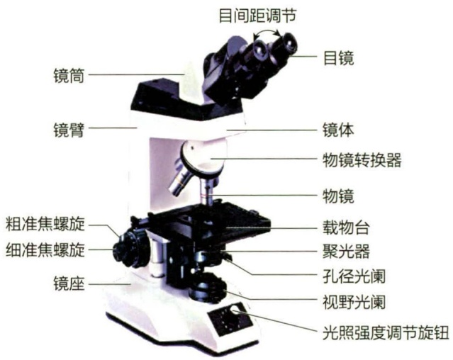

text_image

目间距调节
镜筒
镜臂
粗准焦螺旋
细准焦螺旋
镜座
目镜
镜体
物镜转换器
物镜
载物台
聚光器
孔径光阑
视野光阑
光照强度调节旋钮

图2-1 明视野显微镜

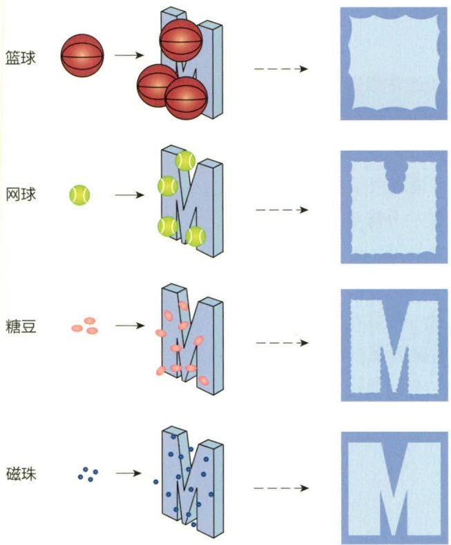

flowchart

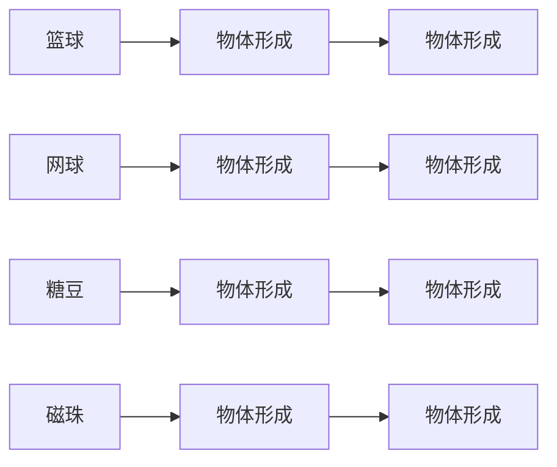

图2-2 波长对分辨率影响的类比

不同大小的球体代表不同波长的光

$$
d = \frac {0 . 5 \lambda}{n \sin \theta}
$$

式中，d 越小，显微镜的分辨率越高。 $\lambda$  为所用光源的波长，波长必须小于观察两点之间的距离，以确保光波能够穿过被检样本，呈现清晰的物像，即波长越短，所提供的分辨率越高（图 2-2）。若样本间的间距小于波长，则无法成功区分两点。较小的物体（对应较短的波长）可以更容易地在字母 M 的臂之间通过，从而产生更清晰的图像。

n 为载玻片与物镜间工作介质的折射率，不同介质的折射率不同，如空气 n=1.0、水 n=1.33、香柏油 n=1.52。显微观察时要根据物镜的不同而选择不同的工作介质，比如油镜镜头所选用的介质为香柏油。 $\theta$  为光进入镜头时最大孔径角的一半，其大小与物镜的直径和工作距离有关。孔径角与物镜焦距成反比（图 2-3）。随着焦距的减小，物镜前透镜所能收集的光量也会增加。在载物台下方安装镜台聚光器能够使锥形光束投射到载

图 2-3 显微镜的数值孔径与光锥角度工作距离间的关系

左图、中图:不同工作距离下的  $\theta$  值；右图:不同工作距离下的  $\theta_{1}$  和  $\theta_{2}$  的比较

玻片并进入物镜，从而增加数值孔径，提高显微镜的分辨率。

在可见光范围内，蓝光（450～495 nm）的波长最短，可提供的分辨率最高。 $n \sin \theta$  也被称为数值孔径（numerical aperture，NA），是决定物镜性能的重要指标。

显微镜通常配备多个物镜，其放大倍数为 4～100 之间（表 2-1）。光学显微镜的分辨率极限大约是 0.2 μm，而普通人肉眼的正常分辨能力一般为 0.25 mm，所以光学

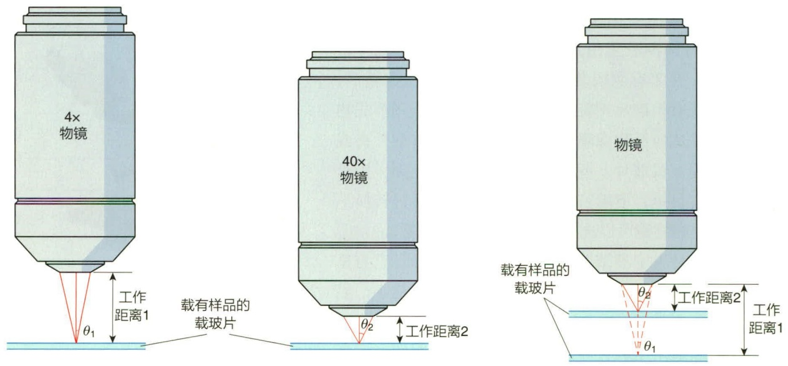

显微镜最高的放大倍数为 1 000 \~ 1 500 倍。

表 2-1 显微镜物镜的特性

<table><tr><td rowspan="2">特性</td><td colspan="4">物镜</td></tr><tr><td>搜索物镜</td><td>低倍镜</td><td>高倍镜</td><td>油镜</td></tr><tr><td>放大倍数</td><td>4×</td><td>10×</td><td>(40~45)×</td><td>(90~100)×</td></tr><tr><td>数值孔径</td><td>0.10</td><td>0.25</td><td>0.55~0.65</td><td>1.25~1.4</td></tr><tr><td>焦距/mm</td><td>40</td><td>16</td><td>4</td><td>1.8~2.0</td></tr><tr><td>工作距离/mm</td><td>17~20</td><td>4~8</td><td>0.5~0.7</td><td>0.1</td></tr><tr><td>450 nm光源的分辨率/μm</td><td>2.3</td><td>0.9</td><td>0.35</td><td>0.18</td></tr></table>

## 2.1.1.2 暗视野显微镜

明视野显微镜的光线直接进入视野，属于透射照明。如果标本未染色且本身没有颜色，明视野显微镜的观察效果并不理想。暗视野显微镜利用聚光器实现斜射照明，即光束不是直接进入物镜，而是经过样本反射或者折射后进入物镜（图2-4），这也使得明亮的物像周围形成黑色背景，所以被称为暗视野显微镜。由于样本和背景之间的颜色差增大，可以清晰地观察到明视野显微镜中不易看清的活菌体等透明的微小颗粒。暗视野显微镜可以观察到鞭毛，以了解微生物的运动性。此外，暗视野显微镜还能用于观察部分细菌（如梅毒螺旋体，Treponema pallidum），以及观察较大的真核微生物的内部构造。

## 2.1.1.3 相差显微镜

用明视野显微镜观察无色的活细胞时，由于细胞和介质之间没有反差，在未经染色的情况下，观察者很难分辨标本的形态和内部结构。实际上，当光线通过未染色且本身没有颜色的标本时，由于标本内部各部分结构的折射率和厚度存在差异，这些差异会导致光线在通过时发生不同程度的折射和衍射。这种折射和衍射现象使得直射光和衍射光的光程发生变化，进而引起光波的相位差，这些相位差虽然不会直接产生颜色变化，但会影响光线的分布和亮度，

从而使标本的轮廓、纹理和细微结构得以显现。相差显微镜能将样本不同部位的折射率和样本密度之间的微小差异转变为肉眼可观察的光强度变化，以直接观察活细胞（图2-5）。相差显微镜技术诞生于20世纪30年代，由荷兰物理学家弗里茨·泽尼克（Frits Zernike，1888—1966）尼克发明，他也因此于1953年获得诺贝尔物理学奖。

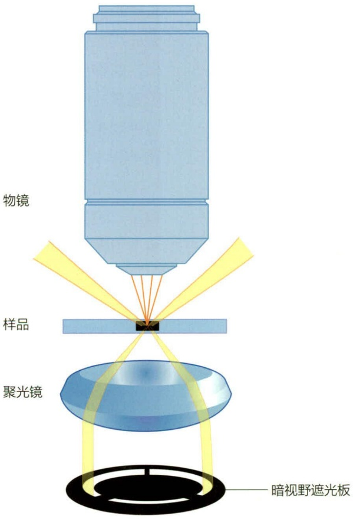

text_image

物镜
样品
聚光镜
暗视野遮光板

图 2-4 暗视野显微镜光路示意图

视频2-1 相差显微镜观察到的恶臭假单胞菌

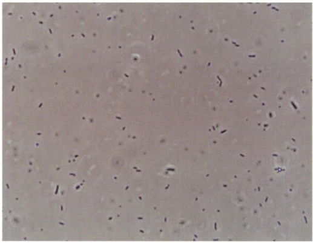

natural_image

Microscopic view of scattered dark particles on a light background (no text or symbols)

图 2-5 相差显微镜观察到的恶臭假单胞菌 (Pseudomonas putida) (放大倍数 400×)

相差显微镜主要是利用环状光阑和相差板将光的相位差转变为明暗差。环状光阑是一种特殊设计的遮光板，其核心是一个精细的透明圆环，它能够允许光线以环状形式通过，形成一个中空的圆筒状光柱。当细胞通过光柱时，由于样本自身的密度和折射率的差异，一部分光线会发生偏斜，偏斜光从相板上除相环以外的地方经过，导致1/4波长滞后。非偏斜光从相环上经过，使得1/4波长提前，因此产生相位差，使得对比度增强（图2-6）。因此，相差显微镜能够清楚地观察到未染色样本的形态及其细微结构。

## 2.1.1.4 荧光显微镜

除了借助外部光线投射到样品产生的生物像，自然界中有一些物质自身也会发光，这些物质经某种波长的入射光（通常是紫

外线或 X 射线）照射，吸收光能后进入激发态，并且立即退激发并发出比入射光的波长更长的出射光（通常波长在可见光波段），即荧光。荧光显微镜的工作原理是利用紫外线照射样品，通过滤色片选择特定波长的光波，在暗视野下，观察激发后的荧光形成的物像。在利用荧光显微镜观察样本时，样本往往需要用荧光素进行染色，不同荧光素的激发波长不一样，激发后产生的荧光颜色也可不同，所以同一样本也可以用多种荧光素进行标记（图 2-7）。还有部分样本自身含有天然荧光物质，如叶绿素，该类样本无须染色就可以自发荧光。

荧光显微镜被广泛应用于医学微生物学和微生态学领域，用于鉴定微生物种类和数量。例如，在生态学研究中，荧光素探针或荧光染料如吖啶橙和4',6-二脒基-2-苯基吲哚（4',6-diamidino-2-phenylindole，DAPI）可以用来标记样品进行观察。

## 2.1.1.5 共聚焦激光扫描显微镜

传统光学显微镜常采用混合波长的光源，因为非聚焦光线的散射和干涉会模糊物像，限制其成像的清晰度和分辨率。为解决这一问题，科学界发展了更为精密的成像技术，其中共聚焦激光扫描显微镜是重要里程碑之一。共聚焦激光扫描显微镜（confocal laser scanning microscope，CLSM）是一种高度集成的、由计算机精确控制的显微镜系统。其核心在于利用单一波长或特定波段的激光作为光源，并通过物镜逐点扫描样品表面。当激光聚焦于样品某一平面时，该平面上的荧光物质被激发并发出荧光，这些荧光信号沿原光路返回，被检测器捕捉并转换为数字信号。重要的是，共聚焦机制通过物镜上的针孔或空间滤波器，有效排除了来自非焦平面的散射光，从而显著提高了成像的分辨率和对比度。通过层层扫描和计算机三维重建，共聚焦激光扫描显微镜能够生成高分辨率的三维图像，适用于细胞内部结构、亚细胞器定位及动态过程的定量分析和研究。在样本制备上，共聚焦激光扫描显微镜允许使用多种荧光染料，以不同颜色标记不同成分，进一步增强了成像的复杂性和信息量（图2-8）。而双光子荧光显微镜（two-photon fluorescence microscope，TPM）是共聚焦激光扫描显微镜的进一步发展，双光子激发是指荧光分子同时吸收两个长波长的光子（通常为近红外光），能量叠加后跃迁至激发态，随后发出一个短波长的光子。双光子共聚焦显微镜对标本的光毒性较小，更适合用来观察活细菌和厚标本。

图 2-6 相差显微镜光路示意图

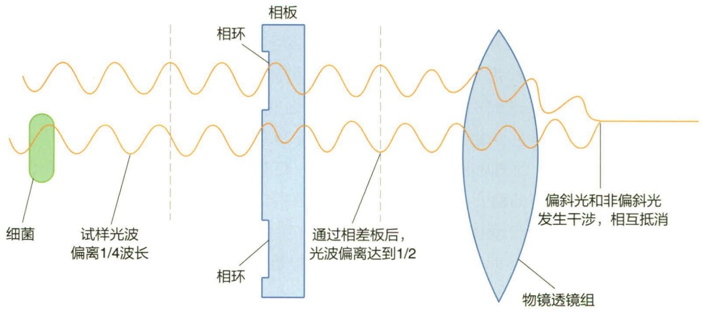

text_image

细菌
试样光波
偏离1/4波长
相环
相板
通过相差板后，
光波偏离达到1/2
相环
物镜透镜组
偏斜光和非偏斜光
发生干涉，相互抵消

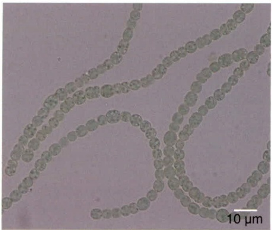

natural_image

Microscopic view of rod-shaped bacterial cells with 10 μm scale bar (no text or symbols beyond scale indicator)

图 2-7 鱼腥蓝细菌（Anabaena sp.）PCC 7120

在普通光学显微镜（左图）、荧光显微镜（中图，激发波长为 532 nm）

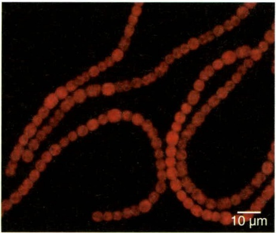

natural_image

Microscopic image of red fluorescent filamentous structures against a black background, scale bar indicates 10 μm

下观察到的菌丝形态及荧光显微镜下胞质绿色荧光蛋白的表达情况（右图，激发波长为 488 nm），物镜均为 100 × 油镜

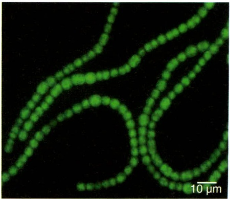

natural_image

Microscopic image showing green fluorescent filament-like structures against a black background, with a 10 μm scale bar (no text or symbols beyond scale indicator)

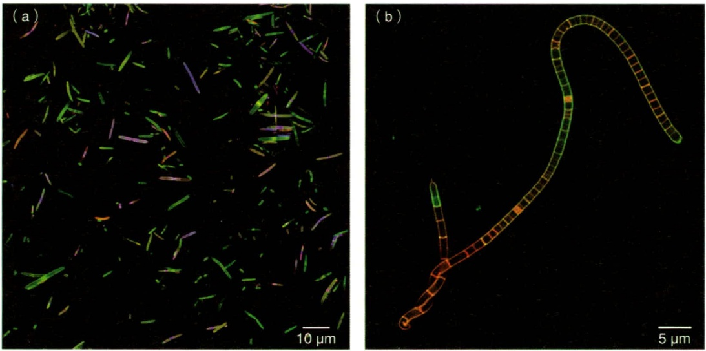

图2-8 在共聚焦荧光显微镜下观察到的微生物（图片来源:复旦大学王炜）（a）使用绿色、红色和蓝色探针依次间隔 $2 \mathrm{~h}$ 灌胃标记的小鼠肠道菌群；（b）先后使用带有绿色和红色荧光的两种D-型氨基酸探针间隔 $3 \mathrm{~h}$ 灌胃标记后的小鼠回肠中的分节丝状菌

## 2.1.1.6 超高分辨率显微镜

由于光学衍射极限的存在，传统光学显微镜的观察极限为 200～300 nm。激光共聚焦显微镜和多光子成像，虽然提高了荧光显微成像的清晰度，但是显微镜的分辨率并没有实质性提升。20 世纪 90 年代以后，超高分辨率光学显微技术开始出现并逐步完善。超高分辨率显微镜克服了光衍射的限制，能够观察到分子尺度的细节，从而了解有关细胞组成的 3D 结构，大大提高了活细胞的分辨率。目前常见的功能型超高分辨率显微镜主要包括结构光照明荧光显微术（structure illumination microscopy，SIM）、受激辐射损耗显微术（stimulated emission depletion microscopy，STED）、随机光学重建显微术（stochastic optical reconstruction microscopy，STORM）和近场扫描光学显微术（scanning near-field optical microscopy，SNOM）。

结构光照明显微术（SIM）是一种先进的成像技术，它通过巧妙地在照明光路中引入特定的结构光模式（如正弦波形的光栅图案），以周期性调制照明光的方式，实现对样品信息的编码与增强。这种调制不仅增加了图像中的高频信息，还允许通过数学算法在后续处理中恢复出超越传统光学衍射极限的分辨率。该技术不仅适用于固定样本的成像，更因其对活细胞的无损性和低光毒性，成为观察活细胞超分辨率图像的有力工具（图 2-9）。

受激辐射损耗显微术（STED）是一种基于受激辐射原理的超分辨率成像技术。该技术巧妙地利用了两束激光:一束作为激发光，用于激发样品中荧光团的荧光；另一束作为损耗光，通过特定波长和强度的激光束，在焦点周围形成一个环形区域，该

图 2-9 利用 SIM 观察到的微生物（图片来源:华东理工大学贺晓鹏）

使用4种不同发光颜色的地拉罗司衍生物（ExBT、$\mathrm{ExNMe_2}$、ExTrisT和ExDCM）分别与铜绿假单胞菌（Pseudomonas aeruginosa, $10^{6} \mathrm{CFU} \cdot \mathrm{mL}^{-1}$）孵育 $60 \mathrm{~min}$ 后的细菌多通道 SIM 成像图

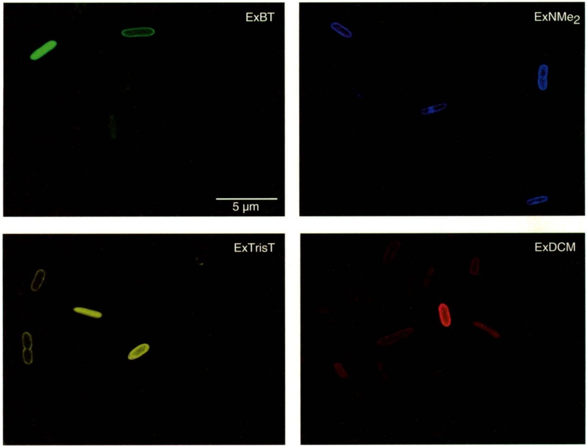

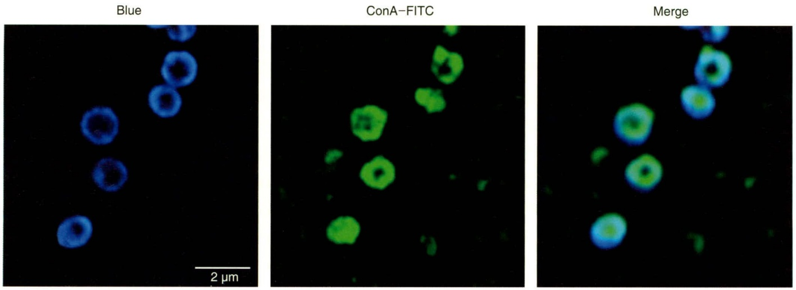

图 2-10 利用 STED 观察到的微生物（图片来源:华东理工大学贺晓鹏）

区域内的荧光团在受激辐射的作用下迅速失活，从而仅允许焦点中心极小区域内的荧光分子发出强烈荧光。通过这种方法，STED能够显著减小有效照明面积，突破传统光学显微镜的衍射极限，实现纳米级别的分辨率提升。这一特性使得STED非常适合于观察微生物的精细结构特征和复杂的生理过程（图2-10）。

随机光学重建显微术（STORM）是一种基于单分子定位的超分辨率成像技术。该技术利用具有光开关特性的荧光分子，通过精确控制光照条件，使得在任意时刻只有一小部分荧光基团处于激活状态并发出荧光。通过多次重复这一过程，并精确记录每次激活状态下荧光分子的位置，最终利用计算机算法将这些位置信息整合，重建出超高分辨率的图像（图 2-11）。STORM 不仅能在二维空间内实现高分辨率成像，还能扩展到三维成像，并支持多种颜色标记，为生物样本的复杂结构和动态过程提供了前所未有的观察能力。此外，STORM 还具备观察活细胞的能力，为细胞生物学研究开辟了新的视野。

使用荧光探针（蓝色）和商业共染磷壁酸染料ConA-FITC与耐甲氧西林金黄色葡萄球菌（MRSA，$10^{6}\mathrm{CFU} \cdot \mathrm{mL}^{-1}$）孵育 $60\mathrm{min}$ 后的细菌受激辐射损耗（STED）超分辨成像图

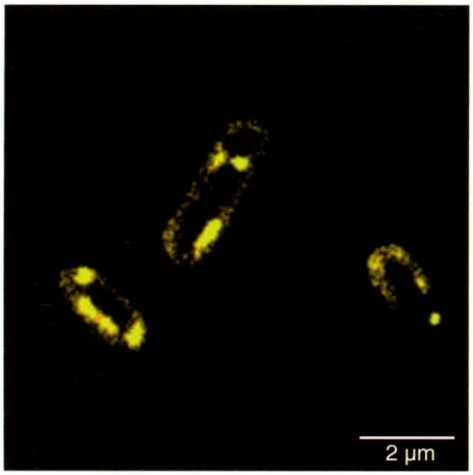

natural_image

Fluorescent microscopy image of three elongated cell-like structures with yellow fluorescence, scale bar indicates 2 μm (no text or symbols present)

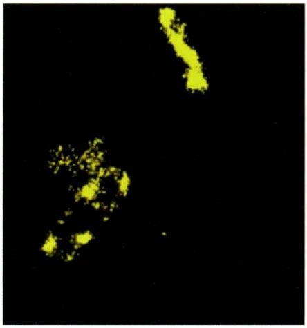

natural_image

Abstract yellow glowing shapes on black background, no text or symbols present

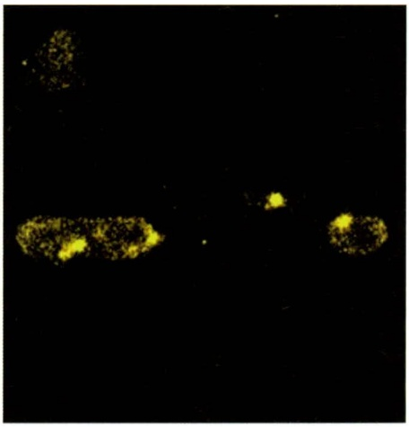

natural_image

Microscopic image showing scattered bright yellow cellular structures against a black background (no text or symbols)

图 2-11 利用 STORM 观察到的微生物（图片来源:华东理工大学贺晓鹏）

荧光探针与无抗生素处理（左），头孢他啶处理（中），左氧氟沙星

处理（右）的铜绿假单胞菌（P. aeruginosa,  $10^{6}$  CFU·mL $^{-1}$ ）孵育30 min后的细菌STORM超高分辨成像图