无论是细菌、古菌还是真核生物，所有细胞生物的细胞结构都有一些共性，如细胞膜、细胞质，以及 RNA 聚合酶、核糖体等，但不同细胞又有其各自的特征。原核生物虽小，但仍具有各种典型结构，并由特定的结构赋予了其特定的功能……

## 3.1 原核生物的细胞结构概述

地球上的生物可以分为细胞生物和非细胞生物两大类。非细胞生物包括病毒和亚病毒等，将在第5章讨论。细胞生物可分为两大类——原核生物（prokaryote）与真核生物（eukaryote）。原核生物由原核细胞组成，包括细菌和古菌。真核生物如原生生物、植物、动物、真菌等均由真核细胞组成。

原核生物的主要特点是没有成形的细胞核，且细胞的核质没有核膜包围，只有称作核区的裸露 DNA 分子，也称为拟核（nucleoid）或类核。细菌（包括蓝细菌、放线菌、支原体等）和古菌都属于原核生物。

真核细胞通常比原核细胞大，而且结构更复杂。突出特征是具有明显的由膜结构包裹的细胞核，还有一些由膜包裹的细胞器。

原核生物细胞和真核生物细胞的差别并不反映两类生物之间存在生物演化的先后关系，从系统发育学来看，原核生物中古菌的某些遗传特征甚至更接近于真核生物。细菌、古菌、真核生物都来自某原始生物（最后普遍共同祖先，简称 LUCA）。LUCA 被认为是所有细胞生命体的共同祖先，从微小的细菌到复杂的真核生物，都是从 LUCA 演化而来，然后沿着不同路线形成地球上多种多样的微生物和高等生物。

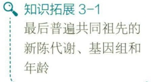

text_image

知识拓展 3-1
最后普遍共同祖先的新陈代谢、基因组和年龄

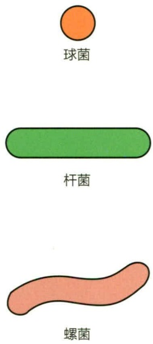

text_image

球菌
杆菌
螺菌

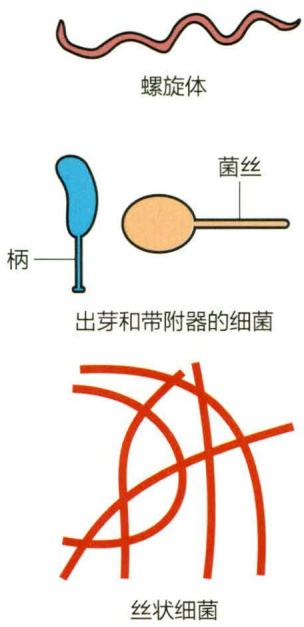

text_image

螺旋体
菌丝
柄
出芽和带附器的细菌
丝状细菌

图 3-1 原核生物的常见细胞形态

## 3.1.1 原核生物的显微形态

## 3.1.1.1 细胞形态学

微生物学中，形态学特征主要指细胞的形状与大小，以及细胞的显微结构特征。原核生物的细胞形态主要有球状、杆状、螺旋状、丝状（图 3-1），以及一些特殊形态。

球菌（coccus）呈球形或近似球形，细胞直径一般为  $0.5 \sim 1.0 \mu m$ 。球菌繁殖以后的细胞排列形态由其分裂面决定，而分裂面与物种有关，是形态分类学的典型特征之一。

① 单球菌。细胞分裂后，子细胞分散而单独存在。
② 双球菌。细胞沿一个平面分裂，子细胞常常

两两排列在一起。

③ 链球菌。细胞沿平行的平面分裂，子细胞呈链状排列。
④ 四联球菌。细胞按两个互相垂直的平面分裂，子细胞呈田字形排列。
⑤ 八叠球菌。细胞按三个互相垂直的平面进行分裂，子细胞叠在一起呈立方体排列。
⑥ 葡萄球菌。细胞分裂无定向平面，子细胞呈葡萄状排列。

杆菌（rod）的形态多数为直杆状，少数菌体微弯；菌体两端多呈钝圆形，少数两端平齐（炭疽杆菌）、尖细（梭形杆菌）或末端膨大（棒状杆菌）。杆菌的大小、长短、弯度、粗细差异较大，其排列方式一般不作为形态分类学的依据，因为它们通常无特定排列形式，分散存在居多，仅偶有成对或链状，个别可呈特殊的排列如栅栏状等。

螺旋状菌（spirillum）是指细胞呈弯曲状的细菌。根据细胞弯曲的程度，可细分为弧菌、螺旋菌和螺旋体。弧菌的细胞短，呈弧状，螺旋不满一环，如霍乱弧菌；螺旋菌的细胞呈螺旋形，有2\~6次弯曲，如小螺菌；螺旋体的细胞有6次以上弯曲，一般细胞柔软，如梅毒螺旋体。

丝状细菌是指呈长丝状的细菌，一般菌体宽度近于杆菌，约0.5\~1  $\mu$ m。最常见的丝状细菌是放线菌（Actinomycete），这是一类呈菌丝状生长和以孢子繁殖的原核生物。大多数放线菌有发达的分枝菌丝，在生长发育过程中出现不同的细胞形态，特别是其中的链霉菌属（Streptomyces），形成功能不同的基质菌丝、气生菌丝和孢子丝（图3-2）。基质菌丝（也称营养菌丝）是紧贴固体培养基表面并向培养基内部生长的菌丝，主要功能是吸收营养物质。气生菌丝则着生于基质菌丝之上，部分气生菌丝

可特化为产生分生孢子的孢子丝。不同链霉菌种类具有形态各异的孢子和孢子丝，这些都是菌种鉴定的重要指标（图 3-3）。

此外，还有一些细菌形态特殊或在细胞外带有附属结构，如柄杆菌属（Caulobacter）和浮游球衣菌（Sphaerotilus natans）等。浮游球衣菌是单细胞连接成丝状的群体，外面由鞘套包围。柄杆菌属细胞一端长有直径约  $0.15 \mu m$  、长数微米到十几微米的柄状突起，可黏附在固体或其他细胞表面（图 3-4）。有的菌体有附属物，如臂微菌属（Ancalomicrobium）。还有些细菌具有较复杂的生活史，在它们的生活周期中出现营养生长和子实体阶段，如能够滑行的黄色黏球菌（Myxococcus xanthus）就能够形成子实体（图 3-5）。当营养充足时，黄色黏球菌进行营养生长。当营养物质耗尽时，细胞外信号分子的复杂交换触发细胞聚集并形成子实体。子实体内的大多数细胞将成为静息的黏孢子，直到养分可用时才发芽。图 3-5 右图是该菌的聚集（0～12 h）和子实体（24 h）形成过程的扫描电镜照片。

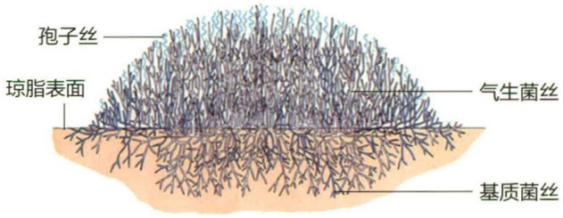

text_image

孢子丝
琼脂表面
气生菌丝
基质菌丝

图 3-2 链霉菌属的基质菌丝、气生菌丝和孢子丝示意图

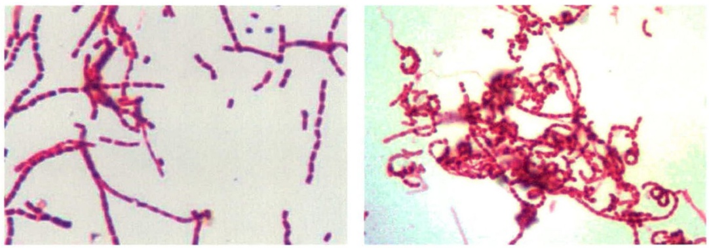

图3-3 紫色直丝链霉菌（Streptomyces viola-ceorectus）（左）和天蓝色链霉菌（Streptomyces coelicolor）的孢子丝和孢子形态（图片来源:华中农业大学陈雯莉）

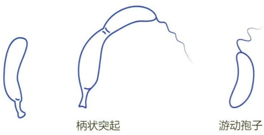

text_image

柄状突起
游动孢子

图 3-4 柄杆菌属（Caulobacter）及其产生的游动孢子示意图

图 3-5 黄色黏球菌的生命周期

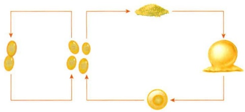

flowchart

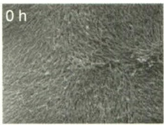

natural_image

Microscopic view of fibrous material at 0h (no text or symbols visible)

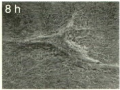

natural_image

Microscopic view of fibrous material at 8 hours (no text or symbols visible)

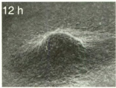

natural_image

Grayscale microscopic image showing a textured surface with a labeled time point '12 h' (no other text or symbols)

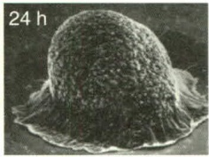

natural_image

Microscopic view of a textured spherical object with a scale bar labeled '24 h' (no other text or symbols)

古菌细胞形态与细菌类似，一般为杆状和球状，但在极端高温环境下生长的古菌形态多样，如硫化叶菌、火球菌属等（图 3-6）。而极端嗜盐古菌在培养基中生长时可见球状、弯曲膨大的杆状、棒槌状等。这可能与它们要适应极端环境条件有关。

## 3.1.1.2 细胞大小与细胞分裂的必要性

原核生物的细胞大小差异显著，2015年美国加利福尼亚大学伯克利分校和劳伦斯伯克利国家实验室首次发现于地下水样本中的“极小细菌”，体积仅有 $0.009\mu \mathrm{m}^3$ ，相当于在一个大肠杆菌中就可以容纳150个这种微小细菌。2022年人类发现了世界上已知体积最大的细菌，长度约 $2\mathrm{cm}$ 的华丽硫珍珠菌（Thiomargarita magnifica），已经是肉眼可见。人工培养的大多数杆菌一般直径为 $0.5\sim 4\mu \mathrm{m}$，长度一般小于 $15\mu \mathrm{m}$，当然也有例外。大肠杆菌大约为  $1 \mu m \times 2 \mu m$ ，这是原核生物最常见的尺寸。大型的细胞在原核生物中并不常见。相比之下，真核细胞的直径可以在  $2 \sim 600 \mu m$ 。

图 3-6 极端高温环境下的古菌

(a) 硫化叶菌；(b) 火球菌

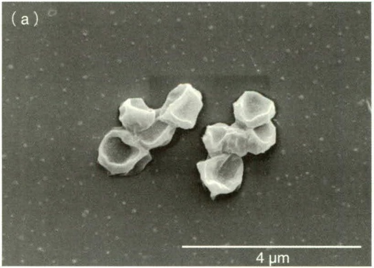

natural_image

Microscopic view of irregularly shaped particles on a surface, scale bar indicates 4 μm (no text or symbols present)

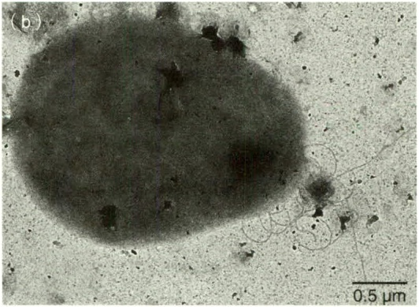

natural_image

Microscopic image of a dark granular particle on a light background, scale bar indicates 0.5 μm (no text or symbols present)

原核细胞保持较小体积对其自身而言是有利的，因为小细胞比大细胞有更大的比表面（即表面积与体积的比值）。从图3-7可以看出，随着体积的增加，细胞的比表面相应降低。由于细胞内外的物质交换必须通过细胞的表面进行，所以细胞的生长速率与细胞内外的物质交换速率呈正相关。小细胞的比表面更大，单位质量的物质可以有更高的交换速率，这也意味着更快的生长速率。

相同质量的营养资源可以用于形成更多的小细胞。每一次细胞的分裂，都伴随着染色体的复制，DNA 的复制过

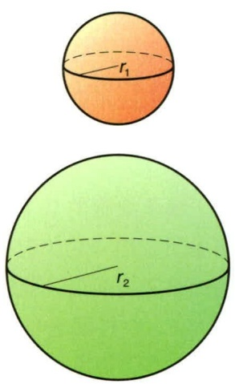

text_image

r₁
r₂

图 3-7 细胞的直径与比表面的关系

$$
\begin{array}{l} r _ {1} = 1 \mu \mathrm{m} \\ \frac {\mathrm{表面积}}{\mathrm{体积}} \approx 3 \\ r _ {2} = 2 \mu \mathrm{m} \\ \frac {\text {表面积}}{\text {体积}} \approx 1. 5 \\ \end{array}
$$

表面积（4πr²）≈12.6μm²

体积 $\left(\frac{4}{3}\pi r^{3}\right)\approx4.2\mu m^{3}$

表面积（4πr²）≈50.3μm²

体积 $\left(\frac{4}{3}\pi r^{3}\right)\approx33.5\mu m^{3}$

程又伴随着复制错误的发生。正常环境中，DNA 的自发复制错误以相对固定的频率发生。细胞分裂次数越多，DNA 复制次数就越多，自发复制错误也就越多，这些复制错误则是遗传变异的基础。DNA 的遗传变异是地球生命演化的基础，为演化提供了丰富的“原材料”。原核生物细胞通常很小，又是单倍体，DNA 的变异比双倍体和多倍体更容易表现出来，所以它们的演化速度也比双倍体的大细胞快得多。

那么，这种趋势是否会导致原核细胞变得越来越小呢？或者说，是否细胞越小就越有生长优势和演化优势呢？当然不是。作为一个可独立生活的细胞，它至少要能容纳足够的必要物质，如蛋白质、核酸、核糖体等。从地球生命数十亿年的演化历史来看，直径0.10～0.15  $\mu$ m也许是可独立生活细胞的下限了。目前在地球深处发现一些直径约0.20  $\mu$ m的细菌和古菌，比典型的细菌细胞要小得多，而许多致病菌的细胞也非常小，这些微生物的基因组测序结果显示它们缺少许多基因，这些基因的产物或功能必须由其他微生物细胞或宿主生物（例如植物和动物）提供给它们，否则就无法生存。

## 3.1.2 原核细胞的功能

如上所述，原核生物一般是能独立生活的单细胞个体。即使体积微小的细胞也有复杂的结构，能够完成生命活动所需的各种功能和代谢，表现在:①营养，细胞从外界摄取营养物质，在细胞内进行转化和合成，产生能量，排出代谢废弃物；②生长，细胞利用营养物质进行生长和分裂，一般每个细胞形成两个相等或相似的子细胞；③分化，多数微生物细胞在生活过程中发生形态和功能的变化，甚至出现明显的特殊结构，如芽孢；④信号传递，不同细胞之间，甚至与高等动植物之间，常常通过信号分子而发生关系和相互作用；⑤演化，细胞生物不断地演化，细胞的遗传变异倾向有利于适应环境的个体生存和发展。虽然许多高等生物也具备上述细胞属性，但它们个体中每个细胞只能作为整体的一部分而存在，不是独立生活的。而原核生物的每个细胞都是一个完整、独立存在的个体，在其中进行生物化学反应和能量转换，并有一套由遗传物质编码的程序，控制着性状的遗传，如果程序出现差错，则产生变异。

## 3.1.3 原核细胞的基本结构

细菌细胞的基本结构包括:①细胞壁；②细胞壁内的结构:细胞质膜，拟核，细胞质及内含物（包括核糖体及各种贮藏物颗粒）。特殊结构包括芽孢及细胞壁外的糖被和表面层，鞭毛，性菌毛和菌毛等。典型的细菌细胞结构与功能见表3-1和图3-8。原核细胞与真核细胞在结构上的区别关键在于原核细胞内没有膜包被的细胞器结构，而真核细胞有多种膜包被的细胞器，特别是有被核膜包裹的细胞核结构。表3-2比较了原核细胞和真核细胞在结构上的显著差异。

表 3-1 原核细胞的结构与功能

| 细胞结构 | 功能 |
| --- | --- |
| 细胞壁 | 赋予细胞形态,提供刚性支持 |
| 细胞膜 | 选择透过性屏障,蛋白质锚点,能量代谢场所 |
| 拟核 | 遗传物质(DNA)所在 |
| 核糖体 | 蛋白质合成场所 |
| 内含物 | 碳、氮、磷、硫及其他物质的贮存场所 |
| 气泡 | 赋予细胞在水环境中的浮力 |
| 荚膜和黏液层 | 保护作用,或使菌体易于吸附于固体表面 |
| 鞭毛 | 运动结构 |
| 菌毛 | 表面吸附作用 |
| 性菌毛 | 细菌间交配 |
| 内生芽孢 | 应对不良环境的休眠结构 |

图 3-8 原核细胞的基本结构及鞭毛、菌毛、荚膜等附属结构

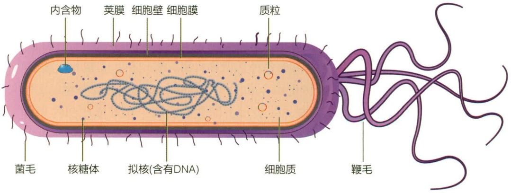

text_image

内含物
荚膜 细胞壁 细胞膜
质粒
菌毛 核糖体 拟核(含有DNA)
细胞质
鞭毛

表 3-2 原核细胞和真核细胞的结构对比

| 细胞结构 | 原核细胞 | 真核细胞 |
| --- | --- | --- |
| 细胞壁 | 由肽聚糖,其他多糖、蛋白质和糖蛋白组成 | 通常由多糖组成,包括纤维素 |
| 质膜 | 一般不含固醇 | 含固醇 |
| 细胞质 |  |  |
| 内膜系统 | 简单,仅存在于某些细菌中 | 复杂,内质网和高尔基体 |
| 核糖体 | 70S | 80S(线粒体和叶绿体中的核糖体为70S) |
| 细胞器 | 一般无 | 单位膜包裹的细胞器 |
| 呼吸系统 | 在部分质膜和内膜中 | 在线粒体中 |
| 光合色素 | 在内膜或内囊体中,无叶绿体 | 在叶绿体中 |
| 细胞核和核质 |  |  |
| 核膜 | 无 | 有 |
| 核仁 | 无 | 有 |
| 基因组 | 通常为双链环状DNA大分子,以及质粒 | 线型DNA大分子同组蛋白结合,缠绕折叠形成染色体 |
| 细胞分裂 | 无有丝分裂 | 进行有丝分裂 |
| 有性生殖 | 少数细菌具备,不进行减数分裂 | 具备,进行减数分裂 |
| 基因中的内含子 | 一般没有 | 普遍存在 |

## 3.2 细胞壁

## 3.2.1 细菌细胞壁的结构

细菌细胞壁是细菌细胞用于对抗特定范围内的渗透压波动，维持细菌固有形态的韧性构造。细菌细胞壁作为渗透屏障，允许水分及一些可溶性小分子物质自由通过，阻拦酶、蛋白等生物大分子物质进入细胞；细菌细胞壁为细菌的鞭毛运动提供必需的支撑；细菌细胞壁的成分是细菌某些特有抗原性的物质基础。

1884 年，丹麦学者汉斯·克里斯蒂安·革兰（Hans Christian Gram，1853—1938）发明了著名的革兰氏染色法（Gram stain），可将细菌分为两个类群:革兰氏阳性（ $G^{+}$ ）菌和革兰氏阴性（ $G^{-}$ ）菌。 $G^{+}$ 菌可被该法染成紫色， $G^{-}$ 菌则被染成红色或无色（图 3-9）。

$\mathrm{G}^{+}$ 菌和 $\mathrm{G}^{-}$ 菌的细胞壁结构存在显著的差异（图3-13），导致了它们在革兰氏染色过程中的不同表现。

## 3.2.1.1 肽聚糖

$\mathrm{G}^{+}$ 菌和 $\mathrm{G}^{-}$ 菌的细胞壁均含有肽聚糖。肽聚糖（peptidoglycan）的成分包括由两种糖的衍生物 $N-$ 乙酰胞壁酸（$N-$ acetylmuramic acid）和 $N-$ 乙酰葡糖胺(N-acetylglucosamine) 通过 $\beta-1,4-$ 糖苷键形成的聚糖主链，连接在 $N-$ 乙酰胞壁酸结构单元上的四肽尾部，以及链接不同聚糖主链四肽尾部的肽桥（图3-10）。

图 3-9 革兰氏染色技术

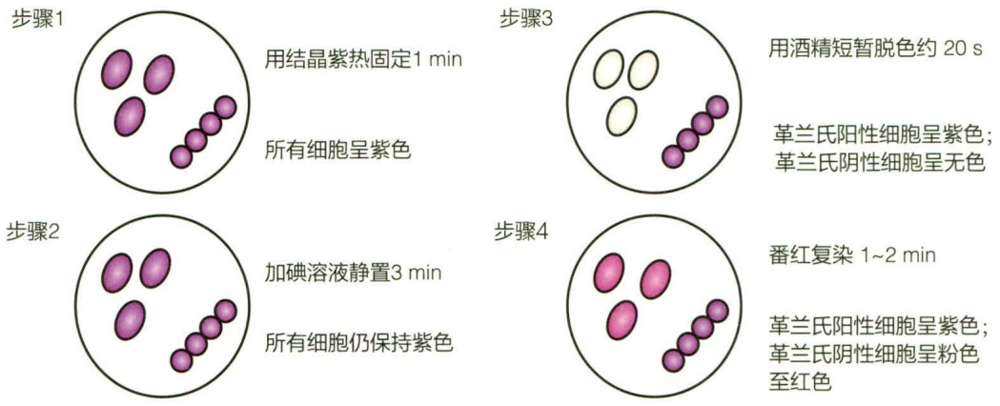

不同细菌的肽聚糖多样性主要体现在四肽尾的组成与肽聚糖的交联方式上。革兰氏阳性菌，以金黄色葡萄球菌为例，四肽尾是L-Ala～D-Glu～L-Lys～D-Ala，两条四肽尾通过一个五肽（由5个甘氨酸残基组成）的肽桥（glycine interbridge）交联在一起（图3-10）。大多数革兰氏阴性菌的肽聚糖层不具有这样的肽桥结构。以G⁻菌大肠杆菌为例，四肽尾是L-Ala～D-Glu～内消旋二氨基庚二酸（meso-DAP）～D-Ala，两条四肽尾中某一条肽链的D-Ala与另一条肽链的meso-DAP交联，这是许多G⁻菌的代表模式（图3-11）。

值得注意的是，细菌肽聚糖的四肽尾中 D-Ala、D-Glu 和内消旋二氨基庚二酸（meso-DAP）不是蛋白质的组成残基，这有助于保护肽聚糖，使之不易被大多数肽酶所降解。

图 3-10 革兰氏阳性菌（a）与革兰氏阴性菌（b）肽聚糖的交联方式

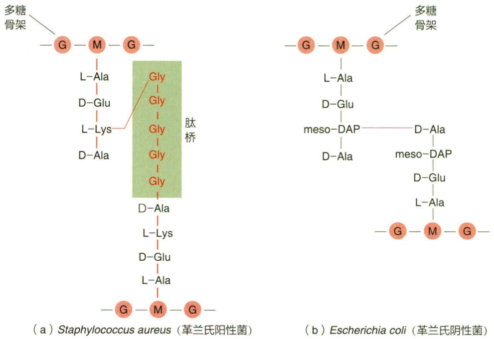

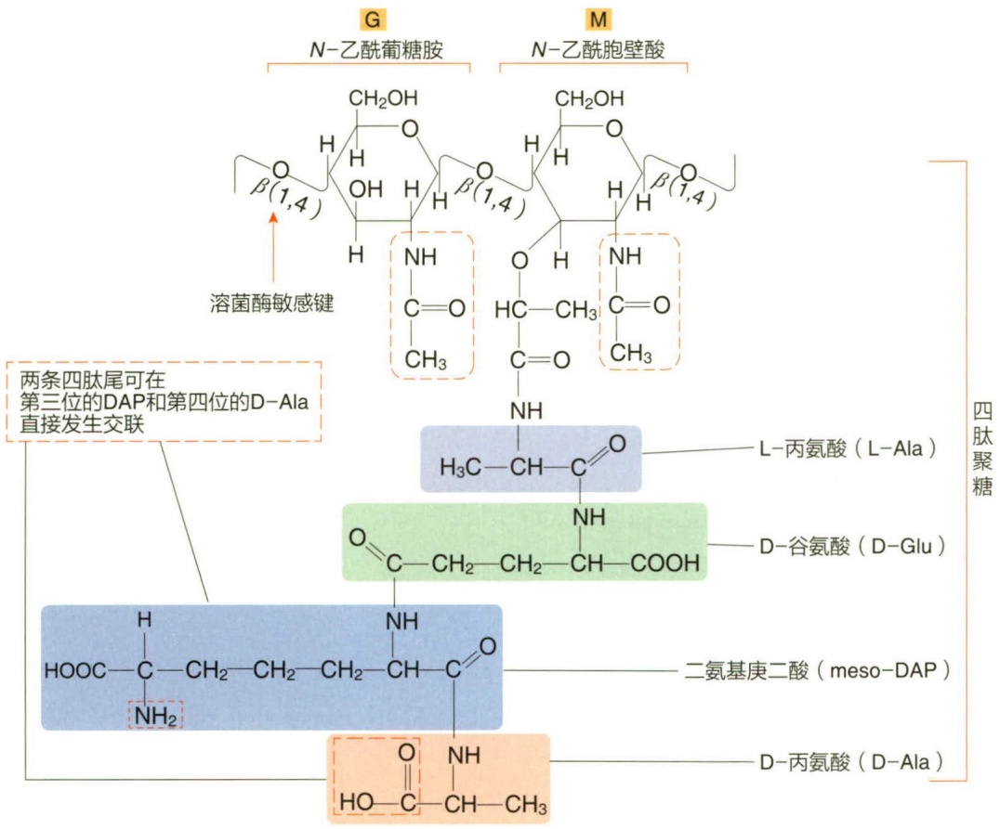

flowchart

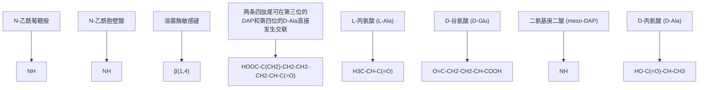

图 3-11 G $^{-}$ 菌肽聚糖的结构单位

## 3.2.1.2 革兰氏阳性菌细胞壁

$\mathrm{G}^{+}$ 菌的细胞壁结构相对简单，它由细胞膜外的厚为 $20\sim 80\mathrm{nm}$ 的肽聚糖（peptidoglycan）组成，形成厚而均一的细胞壁（图3-12）。 $\mathrm{G}^{+}$ 菌的细胞壁化学组成简单，一般有 $90\%$ 肽聚糖和 $10\%$ 磷壁酸。肽聚糖交联后形成的每个薄层厚度是 $1\sim 2\mathrm{nm}$，$\mathrm{G}^{+}$ 菌的细胞壁由 $10\sim 40$ 层肽聚糖薄层结构堆叠而成，从而形成了 $20\sim 80\mathrm{nm}$ 厚的细胞壁。

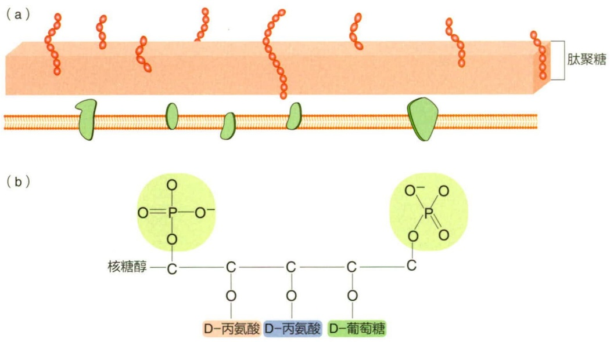

图 3-12 革兰氏阳性细菌细胞壁结构

（a）肽聚糖结构；（b）一种核糖醇磷壁酸结构示意图，磷壁酸是这里所示的重复核糖醇单元的聚合物

$\mathrm{G}^{+}$ 菌的肽聚糖层中还存在大量的磷壁酸（teichoic acid）。磷壁酸可分为核糖醇磷壁酸和甘油磷壁酸两类，即分别由核糖醇或甘油残基通过磷酸基团连接而成的弱酸性多聚物。根据其在细胞表面的固定方式，可分为壁磷壁酸（wall teichoic acid）和膜磷壁酸（membrane teichoic acid）两种。前者通过 $N-$ 乙酰胞壁酸的6个羟基以共价键与肽聚糖相连，后者又称为脂磷壁酸（lipoteichoic acid），可跨过肽聚糖层，通过磷酸键与细胞膜中糖脂的寡糖基连接。

磷壁酸可延伸至肽聚糖的表面，带有负电荷，从而使  $G^{+}$  菌表面呈负电荷。磷壁酸是  $G^{+}$  菌的重要表面抗原，其功能尚不十分明确，可能在调节离子通过细胞壁外的黏液层时起作用，也可能调节某些酶的活性，或者与某些菌吸附于寄主细胞的表面有关，并避免被白细胞吞噬。

## 3.2.1.3 革兰氏阴性菌细胞壁

与  $G^{+}$  菌相比， $G^{-}$  菌的细胞壁的化学组成较复杂，其结构可分为外膜层和薄的肽聚糖层（图 3-13）。 $G^{-}$  菌细胞壁的肽聚糖层很薄，仅有约 2 nm 的一至两层肽聚糖，位于外膜与细胞质膜中间。外膜（outer membrane）是位于肽聚糖层之外的膜结构层次，它由磷脂双分子层组成基本结构，富含脂多糖（lipopolysaccharide，LPS）和多种外膜蛋白。

脂多糖（LPS）由核心多糖（core polysaccharide）、O-特异多糖（O-specific polysaccharide）和类脂A（lipid A）三部分组成（图3-14）。以沙门菌为例，其核心多糖主要成分是酮脱氧辛糖酸（ketodeoxyoctonate）、多种七碳糖（heptoses）、葡萄糖、半乳糖和 N-乙酰葡糖胺；O-特异多糖是由包含半乳糖、葡萄糖、鼠李糖、甘露糖，以及一个或多个脱氧己糖为单元的四聚体或五聚体的形式连接而成带有分枝的多糖链。不同菌株的 O-特异多糖有明显差异，从而表现出抗原特异性。类脂 A 是连接于磷酸-N-乙酰葡糖胺基双糖单位上两个氨基上的饱和脂肪酸链。其中常见的脂肪酸有己酸、月桂酸、肉豆蔻酸、棕榈酸和硬脂酸等。类脂 A 是革兰氏阴性细菌致病物质（即内毒素）的物质基础。LPS 多糖链带有较强负电荷，可吸附  $Mg^{2+}$ 、 $Ca^{2+}$  等阳离子，这些二价阳离子分别与不同的 LPS 多糖链结合，从而增强了  $G^{-}$ 菌细胞壁外膜的强度。

图 3-13 革兰氏阳性菌（a）与革兰氏阴性菌（b）的细胞壁结构

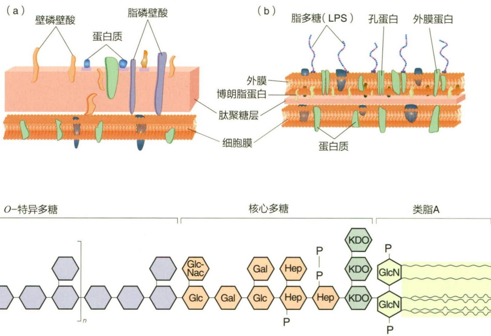

图 3-14 脂多糖的结构

LPS 是 G $^{-}$ 菌细胞壁中特有的化学成分，分子量大于 10 000，结构复杂，在不同类群，甚至不同菌株之间都有差异，这些差异决定了 G $^{-}$ 菌细胞表面抗原决定簇的多样性。例如，根据 LPS 抗原性的不同，沙门菌属（Salmonella）的抗原类型超过 2 000 种。最近研究发现，肠道菌群中某些细菌的 LPS 进入血液后，可引起人体或动物的慢性低度炎症反应，从而影响人类肥胖与糖尿病的病程发展。LPS 还具有部分选择性屏障功能，可控制某些物质进出细胞。

外膜蛋白（outer membrane protein）是嵌合在外膜上的蛋白质，多数功能尚不清楚。其中孔蛋白（porin）是一种三聚体跨膜蛋白，由三个相同亚基组成，中间有一直径约1 nm的孔道，可通过孔的开闭使物质选择性通过外膜层。非特异性孔蛋白可通过分子量小于900的亲水性分子；特异性孔蛋白则具选择透性，只允许维生素 $B_{12}$ 和核苷酸等少数相关物质通过。有一种分子量约为7 200的特殊的博朗脂蛋白（Braun lipoprotein）跨越LPS和肽聚糖层，使外膜层牢固地连接在肽聚糖层上（图3-13）。

周质空间（periplasm）是革兰氏阴性菌的外膜与细胞膜之间的狭窄空间，宽为12～15 nm，其中包含了细胞壁中的肽聚糖薄层。周质空间呈胶质状，在菌体的物质交换过程中起重要作用。周质空间富含四类蛋白质:催化物质分解的水解酶类；与物质转运有关的结合蛋白；与趋化性有关的受体蛋白；利用穿过细胞膜分泌的前体分子合成细胞外结构（如肽聚糖和外膜）。

## 3.2.1.4 革兰氏染色的原理

在革兰氏染色过程中，细菌先被结晶紫初染。结晶紫并不对肽聚糖染色，但可以进入细胞内，从而使细胞被染成紫色。第二步进行碘液媒染，碘离子进入细胞后与结晶紫结合形成大分子复合物，提高了结晶紫在细胞内的滞留性。第三步用乙醇进行脱色处理， $G^{+}$ 菌与 $G^{-}$ 菌由于细胞壁结构的不同，表现出差异性。 $G^{+}$ 菌的厚肽聚糖层因被乙醇脱水，造成壁上小孔收缩，从而使不溶性的结晶紫-碘复合物不能洗出。对 $G^{-}$ 菌而言，乙醇很容易穿透富含脂质的外膜，乙醇抽提了外膜的脂质，使孔隙增大；而其薄薄的肽聚糖层交联度不高，有较大孔隙，无法阻止结晶紫-碘复合物的通过。结果， $G^{+}$ 菌保持了紫色而 $G^{-}$ 菌变成无色。最后的番红复染不改变 $G^{+}$ 菌的紫色，但可以使无色的 $G^{-}$ 菌染成红色而易于观察。

值得注意的是，直到20世纪70年代后期，科学家才将古菌与细菌区分开来。古菌虽然也可被革兰氏染色法区分为  $G^{+}$  和  $G^{-}$ ，但它们的细胞壁与细菌细胞壁完全不同。本节所述的  $G^{+}$  菌和  $G^{-}$  菌专指细菌。

## 3.2.2 古菌细胞壁的结构

古菌是在系统发育上独立于细菌的原核生物类型，已发现的古菌包括在形态、生理和代谢方面存在巨大差异的类群。古菌的细胞壁可由多糖（假肽聚糖）、糖蛋白或蛋白质构成。

有些古菌，如甲烷杆菌属（Methanobacterium）的细胞壁的多糖骨架由N-乙酰葡糖胺和N-乙酰塔罗糖胺糖醛酸以 $\beta-1,3$ 糖苷键连接而成。此类与细菌功能相似的细胞壁结构，也可以经革兰氏染色而呈 $G^{+}$ 或 $G^{-}$，但它们的细胞壁结构与化学成分均与细菌显著不同，被称为假肽聚糖（pseudopeptidoglycan）。甲烷八叠球菌属（Methanosarcina）具有独特多糖（半乳糖胺、葡糖醛酸、葡萄糖和乙酸等单体的聚合物）组成的细胞壁；盐球菌具有硫酸化多糖组成的细胞壁，两者可染成革兰氏阳性。盐杆菌的细胞壁由糖蛋白组成；甲烷球菌和甲烷微菌、甲烷螺菌的细胞壁则由蛋白质组成。

古菌中最普遍的细胞壁类型是由单层交联的蛋白或糖蛋白形成的具有六角对称结构的类结晶态的表面层（S-layer）。在某些细菌，如新月栖杆菌（Caulobacter crescentus）中也发现在细胞壁外覆盖有S-layer。

## 3.2.3 缺壁的细菌与古菌

在细菌和古菌中都存在细胞壁天然缺失的类型，如支原体属（Mycoplasma）是天然存在的缺壁细菌，热原体属（Thermoplasma）是没有细胞壁结构的古菌。

支原体由于没有细胞壁，对渗透压变化敏感。此外，支原体的细胞膜中含有一般原核生物所没有的甾醇，该物质使细胞膜具有较高的机械强度，在缺少细胞壁的情况下维持了细胞膜的稳定性。

另外，由基因突变产生的缺壁细菌称为 L 型细菌，人工方法去除细胞壁得到的缺壁细菌称为原生质体（ $G^{+}$ 细菌）或原生质球（ $G^{-}$ 细菌）。

## 3.2.3.1 L型细菌

L 型细菌（L-form bacterium）是在某些环境条件下，自发突变而形成的遗传性稳定的细胞壁缺陷细菌，因英国李斯特研究所（Lister Institute）1935 年首先发现而得名。大肠杆菌、变形杆菌、葡萄球菌、链球菌、分枝杆菌和霍乱弧菌等 20 多种细菌中均发现有 L 型细菌菌株，从这些细菌种属发现细胞壁缺陷突变体可能是应对靶向细胞壁的抗生素的选择结果。L 型细菌由于没有完整而坚韧的细胞壁，故细胞呈多形态；一些 L 型细菌可以通过细菌滤器，故又称“滤过型细菌”；由于对渗透压敏感，它们通常只能在固体培养基上形成直径 0.1 mm 左右、呈“油煎蛋”状的小菌落。

## 3.2.3.2 原生质体与原生质球

原生质体与原生质球是在人为条件下，用溶菌酶处理或在含青霉素的等渗培养基中培养而形成的圆球形、对渗透压变化敏感的细胞。溶菌酶可以直接降解细胞壁中的肽聚糖；青霉素则可以抑制新生细胞的肽聚糖合成，使得在等渗培养基中长出的新细胞不含有完整的肽聚糖网格结构。

由  $G^{+}$  菌经上述处理得到的细胞只有一层细胞质膜包裹，称为原生质体（protoplast）。原生质体对环境条件变化敏感，低渗透压、振荡、离心甚至通气等都易引起其破裂。有些原生质体虽具有鞭毛，但因缺乏细胞壁的支撑而不能运动。

对  $G^{-}$ 菌经上述处理后而获得的残留部分细胞壁（外膜）的球形体，称为原生质球（spheroplast）。与原生质体相比，原生质球对外界环境具有一定的耐受性，可在普通培养基上生长。

## 3.3 细胞膜

## 3.3.1 细菌细胞膜的结构

细胞膜（cell membrane）是包裹细胞质和细胞内容物的一层连续的膜状结构，因此又称为质膜（plasma membrane）。细菌细胞膜的基本结构与真核细胞相似，但与古菌的膜结构不同。

细菌细胞膜非常薄，厚度仅有6\~8 nm。以常用的打印纸为例（厚度约0.1 mm），需要14 000层细胞膜才能达到这一张纸的厚度。细胞膜主要由磷脂和蛋白质组成。通过电子显微镜观察，发现细胞膜显现“暗-明-暗”的三层结构，其中明亮的是磷脂双分子层，而比较暗的为蛋白质。此类细胞膜的显微结构可描述为单位膜模型（unit membrane model）。

细胞膜中的磷脂（phospholipid）包含有亲水的头部和疏水的尾部，亲水头部由甘油和磷酸残基组成，疏水尾部由脂肪酸组成（图 3-15）。

由于磷脂分子之间没有共价键连接，因此推测这些小分子组成的双层膜结构具有流动性。1972年，辛格（J. S. Singer）和尼克森（G. L. Nicolson）提出了细胞膜的流动镶嵌模型（fluid mosaic model）理论。流动镶嵌模型有两个结构特点:一是膜的流动性，即膜蛋白和膜磷脂均可侧向移动；二是膜蛋白分布的不对称性，即有些蛋白质镶嵌在膜的内表面或外表面，有些蛋白质则嵌入或横跨磷脂双分子层。

膜蛋白（membrane protein）是组成细胞膜结构的蛋白质，它们都具有部分疏水的表面结构，使之可以与膜表面“相容”；同时也具有部分亲水的表面结构，从而使之可与细胞内或膜外亲水环境“相容”。一些膜蛋白称为整合蛋白（integral membrane protein），因其表面呈疏水性，故可“溶”于脂质双分子层的疏水性内层中。有些蛋白质则部分锚定于细胞膜，其余部分位于细胞膜外，朝向胞外环境或胞内细胞质，这些蛋白质称为脂锚定蛋白（lipid-anchored protein）。膜周边蛋白（peripheral membrane protein）不被包埋或锚定于细胞膜，它们靠离子键或其他较弱的键与膜表面的蛋白质分子或脂分子的亲水部分结合，只要改变溶液的离子强度甚至提高温度就可以从膜上分离下来。有时很难区分整合蛋白和膜周边蛋白，因为这类蛋白质可以由多个亚基构成，有的亚基为跨膜蛋白，有的则结合在膜的外部。

图 3-15 细菌细胞膜磷脂的分子结构（a）与细胞膜的结构（b）

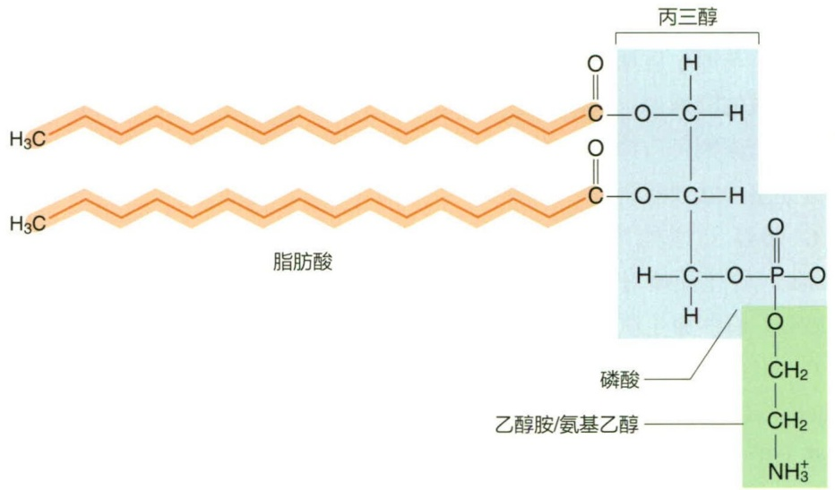

chemical

脂肪酸与丙三醇的化学结构示意图，标注了磷酸和乙醇胺/氨基乙醇的组成

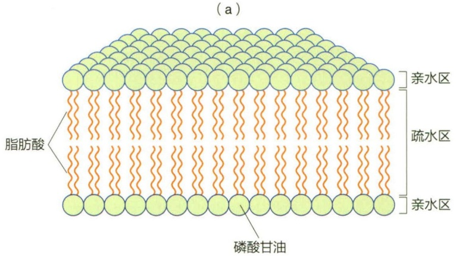

text_image

(a)
脂肪酸
亲水区
疏水区
亲水区
磷酸甘油

(b)

## 3.3.2 古菌细胞膜的结构

细菌细胞与真核生物的细胞膜结构相似，其亲水部分是与甘油连接的磷酸基团，疏水部分都是由疏水侧链（脂肪酸）与甘油通过酯键连接而成的磷脂分子。古菌细胞膜亲水部分可以是与甘油连接的磷酸基团，也可以是与甘油连接的磷酸酯基、硫酸酯基或糖基酯。古菌细胞膜的脂质则由醚键将甘油和特定的疏水侧链连接而成（图3-16）。

古菌的疏水侧链不同于细菌与真核生物的疏水脂肪酸侧链。古菌细胞膜中的非极性脂一般是由4个重复的异戊二烯（isoprene）单元组成的植烷（phytane），二个植烷与分别与甘油通过醚键连接形成古菌膜脂的两条疏水尾部。此类甘油二醚（glycerol diether）在古菌细胞膜上的作用与细菌细胞膜磷脂类似，可自发形成脂双层结构。此外，某些古菌的膜脂中两个植烷的尾部可以通过共价键连接成双植烷（biphytanyl），进而形成甘油四醚（glycerol tetraether）（图3-17）。这种情况下，古菌的细胞膜可能以脂单层结构或脂单层、双层混合结构的方式出现。脂单层结构常见于最适生长温度高于80℃的广古菌Thermococcus和Pyrococcus等极端嗜热古菌中。此外，在泉古菌（Crenarchaeota）和奇古菌（Thaumarchaeota）的细胞膜脂的植烷侧链中还存在因后期修饰而形成的环戊烷（cyclopentane）内部结构，此类膜脂被称为泉古菌醇（crenarchaeol）（图3-18）。

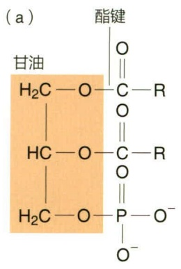

chemical

Chemical structure of a glycoside with labeled functional groups and Chinese name (甘油)

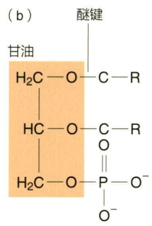

chemical

Chemical structure of glucose showing glycolic acid, hydroxyl, phosphorus, and alkene bonds with labeled components

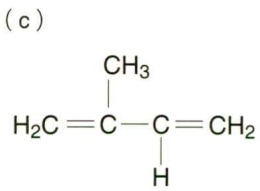

chemical

Chemical structure of a branched alkene with methyl and hydrogen substituents

图 3-16 细菌与古菌的磷脂结构

(a) 细菌与真核生物的脂质；(b) 古菌的脂质；(c) 异戊二烯

## 3.3.3 细胞膜的功能

细胞膜的功能并不仅限于作为分隔细胞内外的屏障作用，它在细胞的物质代谢与能量代谢过程中扮演了重要角色（图 3-19）。

首先，细胞有选择透性（selective permeability），即可以允许某些物质选择性地通过细胞膜。这一功能使得细胞可以吸收氧和葡萄糖等养分，也可以排出像二氧化碳之类的代谢废物（图 3-19a）。

其次，细胞膜是许多蛋白质的“锚点”，这些蛋白质在物质的运输、能量代谢以及趋化性等方面发挥着重要作用（图 3-19b）。

还有，细胞膜是重要的能量转换场所。细胞膜内外可以形成质子的浓度梯度，即质子动力势（proton motive force），可被 ATP 酶利用产生细胞所需的高能化合物 ATP，也可推动着生于细胞膜上的鞭毛基体转动，为鞭毛运动直接提供能量（图 3-19c）。

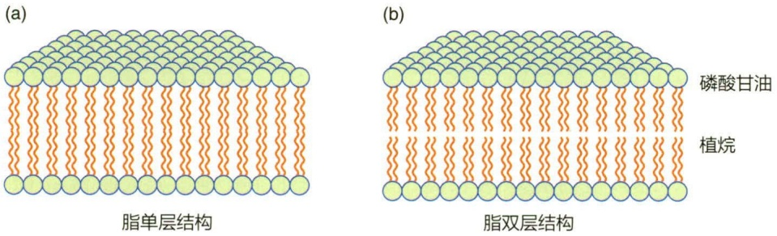

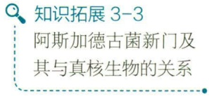

text_image

知识拓展 3-3
阿斯加德古菌新门及其与真核生物的关系

图 3-17 古菌的脂单层 (a) 与脂双层结构 (b)

图 3-18 古菌细胞膜中主要的脂质类型的分子结构图

(a) 甘油二烷基二醚（dialkyl glycerol diether, DGD），又称为古菌醇（archaeol）；(b) 甘油二烷基甘油四醚（GDGT）；(c) 带有五元环和六元环的 GDGT 的膜脂——泉古菌醇

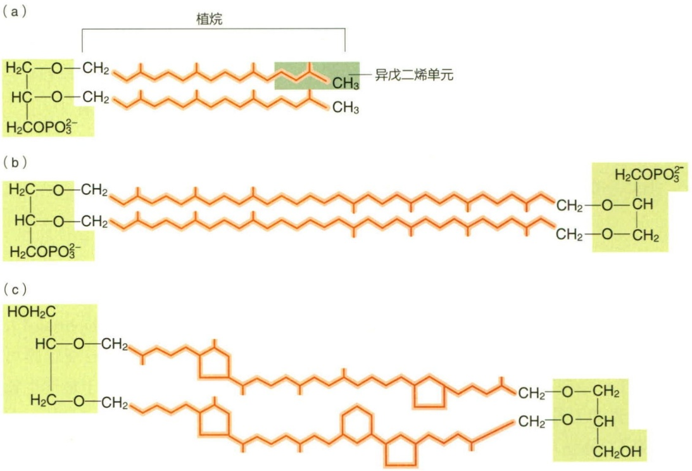

图 3-19 细胞膜的主要功能

（a）渗透屏障:防止渗漏，并作为营养物质进入细胞和废物排出细胞的通道；（b）蛋白质锚点:参与转运、生物能量学和趋化作用的蛋白质位点；（c）能量转换:质子动力势产生和消散的场所

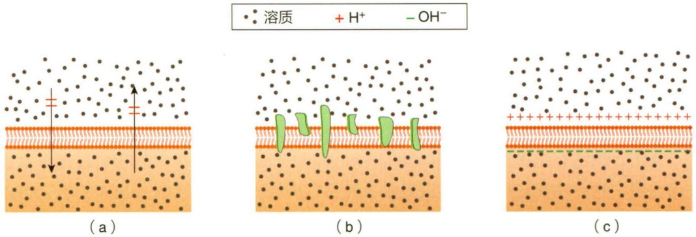

## 3.4 拟核与质粒

## 3.4.1 拟核

拟核（nucleoid）是原核生物中的无核膜结构、无固定形态的原始细胞核，用富尔根（Feulgen）染色法观察原核生物中遗传物质呈现为紫色的核区。大多数情况下，原核生物的染色体是一个大型的环状双链DNA分子，而链霉菌属（Streptomyces）、伯氏疏螺旋体（Borrelia burgdorferi）等微生物的染色体是一条线性的双链DNA分子。与真核生物一样，原核生物的DNA长度也远长于其细胞长度，如大肠杆菌（E. coli）基因组大小约4600 kb，DNA总长约1.56 mm，而其菌体大小只有（0.4\~0.7）μm× (1\~3) $\mu m$ 。如此之长的 DNA 如何被包裹在一个小小的细胞中呢？答案是超螺旋（supercoiling）。超螺旋是 DNA 双链结构的进一步螺旋，可分为负超螺旋与正超螺旋。在细胞中最常见的是负超螺旋（negative supercoil），即 DNA 沿着轴以右手螺旋的相反方向形成螺旋。

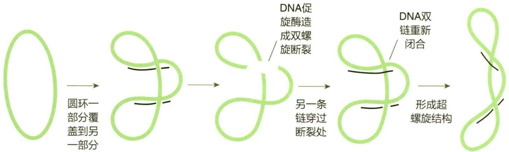

flowchart

图 3-20 DNA 促旋酶的功能

细菌与大多数古菌的DNA超螺旋结构均由DNA促旋酶（DNA gyrase）催化产生。DNA促旋酶又称为拓扑异构酶Ⅱ（topoisomerase Ⅱ），可以打开并重新封闭DNA双链（图3-20）。拓扑异构酶I（topoisomerase I）（DNA解旋酶）则可以打开DNA的一条单链，从而解开DNA超螺旋。细菌DNA并非形成一个大的单一超螺旋，而是形成多个超螺旋域（supercoiled domain），如大肠杆菌的染色体包含了50个以上超螺旋域，每个超螺旋域由特定蛋白质来维持（图3-21）。

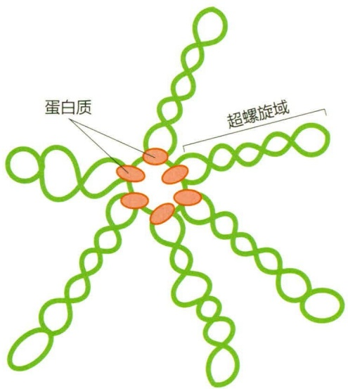

text_image

蛋白质
超螺旋域

图 3-21 细菌染色体的 DNA 超螺旋域

## 3.4.2 质粒

质粒（plasmid）是细菌细胞中存在的染色体（拟核）以外的遗传因子，一般为环状 DNA 分子，也有线性质粒。每个菌体可以有 1 个、多个甚至数十个质粒，每个质粒可以有多个甚至数十个基因。质粒可以在细胞内自主复制，并随细胞的分裂繁殖而遗传到下一代子细胞中，但也可能在细胞生长过程中丢失或转移到其他细胞中。

质粒通常编码细菌生命所非必需的生物学性状，如性菌毛、毒素、抗药性和降解有毒物质等。质粒可按其具有的各种特定的表型而划分为不同的类型，如具有抗药性的质粒称为抗性质粒（resistance plasmid）；如有降解有毒物质或生物大分子能力的质粒称为降解质粒（degradative plasmid）等；也存在不能通过表型观察发现，而只能通过如核酸电泳等方法才能检测到质粒DNA存在的情况，这类质粒被称为隐秘质粒（cryptic plasmid）。