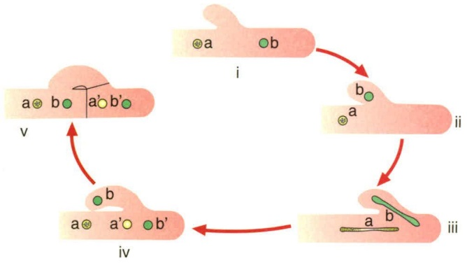
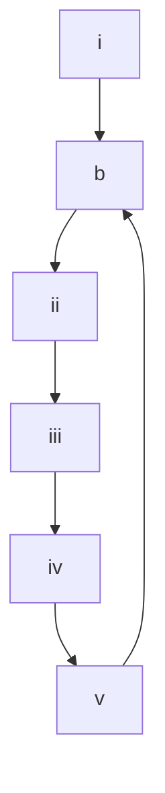

叶绿体。由于长期的共生互利，需氧细菌和蓝细菌将不少基因转移到宿主细胞核中，形成了线粒体和叶绿体的半自主性。

原核细胞在功能上与线粒体相当的结构是细胞膜和由细胞膜内褶形成的结构，但这些结构没有独立的基因组和合成系统。原核生物中的蓝细菌具有与绿色植物和藻类高度相似的产氧光合系统，也说明它们之间具有相同的起源。

## 4.3.1.3 真菌的起源

真菌是一类有真正细胞核，营养体简单，无根茎叶的分化，无维管束组织，不含有叶绿素且无法进行光合作用的生物。

真菌在地球上存在了多长时间至今尚不清楚，对真菌的起源也没有定论。目前主要有两种观点:起源多元论和鞭毛生物起源论。起源多元论根据性器官的形态及交配方式，认为真菌来自藻类，如壶菌自原藻演化而来，毛霉演化自接合藻，子囊菌和担子菌由红藻演化而来。这些藻类因丧失色素故而从自养变成异养，生理的变化引起了形态的改变。鞭毛生物起源论认为绝大多数真菌是起源于一种原始水生生物——鞭毛生物。鞭毛生物为单细胞，具一至数根鞭毛，有的有叶绿素和其他色素，有的无色素；具色素的演化为藻类，无色素的演化为真菌。该假说认为真菌和藻类都起源于鞭毛生物。

真菌的演化由水生到陆生，由腐生到兼性寄生再到专性寄生。其结构由简单到复杂，再由复杂退化而失去特殊的结构，使结构简单化。

## 4.3.2 真核微生物的主要类群

真核微生物包括真菌、单细胞藻类和原生动物等。据估计，全世界有220万\~380万种真菌。其中，已知的真菌约15.5万种，至今全球每年还以发现约2000个新种而不断地递增着。真核微生物在个体和群体形态、代谢类型与产物、遗传特性和生态分布等方面，呈现丰富的多样性。

真核细胞具有核仁和核膜分化的真核，还含有许多由膜包围的细胞器，而原核细胞只有一个核区，没有核膜包围，也无核仁的分化，称为拟核。真菌不含有叶绿素，不能进行光合作用；一般具有发达的菌丝体；细胞壁多数含几丁质；营养方式为异养吸收型；以产生大量无性和（或）有性孢子的方式进行繁殖；以及陆生性较强。

真菌的分类以形态特征和有性生殖结构作为分类依据，将其分为壶菌门（产生卵孢子）、接合菌门（以接合孢子为特征）、子囊菌门（以子囊和子囊孢子为特征）、担子菌门（以担子和担孢子为特征）。

## 4.3.2.1 单细胞真菌——酵母菌

酵母菌（yeast）是一群单细胞的真核微生物。酵母菌是个通俗名称，是以芽殖或裂殖来进行无性繁殖的单细胞真菌的统称，以与丝状真菌区分开。酵母菌主要分布在含糖质较高的偏酸性环境中，如各种水果的表皮、发酵的果汁、蔬菜、花蜜、植物叶面、菜园、果园及糖厂附近的土壤和酒曲中。它们多为腐生菌，少数为寄生菌，能引起人和植物的病害。

酵母菌与人类的关系密切，是工业上最重要以及应用较为广泛的一类微生物，在酿造、食品、医药工业等方面占有重要地位。它可用来制面包；发酵生产乙醇与含乙醇的饮料，如啤酒、葡萄酒和白酒；生产食品工业的酶，如蔗糖酶、半乳糖苷酶；也可用来提取核苷酸、麦角甾醇、辅酶A、细胞色素c、凝血质和维生素等生化药物；酵母菌细胞蛋白质含量高达细胞干重的50%，并含有人体必需的氨基酸，因此酵母菌可用于生产饲用、食用和药物的单细胞蛋白（single cell protein，SCP）。有的酵母菌还具有氧化石蜡与降低石油凝固点的作用，或者以烃类为原料发酵制取柠檬酸、反丁烯二酸、脂肪酸、甘油、甘露醇、乙醇等。酵母菌属单细胞真核生物，与高等动物、高等植物的单个细胞相比，具有基本相同的细胞结构。但由于酵母菌具有世代时间短，可在简单的培养基上生长，单个细胞能完成全部生命活动的特点，所以该菌的细胞学研究比多细胞真核生物相对容易，使其在分子生物学、分子遗传学等重要理论研究中具有特殊的研究价值。至今已研究清楚了许多酵母菌株的细胞核及细胞质基因，并已建立了用于生物学基础研究的相关模型，在生理学、生物化学和遗传学的研究方面取得了较大进展。

但是有些酵母菌也常给人类带来危害。腐生型酵母菌能使食物、纺织品及其他原料腐败变质；少数嗜高渗透压的酵母菌，如鲁氏酵母（Saccharomyces rouxii）、蜂蜜酵母（Saccharomyces mellis）可使蜂蜜、果酱败坏；工业发酵中的污染菌消耗乙醇，降低产品产量或产生不良气味，影响产品质量；还有些酵母菌能引起植物的病害，甚至能寄生在人、畜和昆虫体上，例如，白假丝酵母（Candida albicans）又称白色念珠菌，可引起人类皮肤、黏膜、呼吸道以及泌尿系统的多种疾病；新型隐球酵母（Cryptococcus neoformans）可导致慢性脑膜炎、肺炎等。

## 4.3.2.2 丝状真菌——霉菌

霉菌（mold）意即“会引起物品霉变的真菌”，通常指那些菌丝体较发达又不产生大型子实体结构的真菌。在潮湿的气候下，它们往往在有机物上大量生长繁殖，从而引起食物、工农业产品的霉变或植物的真菌病害。

## (1) 丝状真菌的菌落特征

丝状真菌的菌落由分支状菌丝体组成，形状各异，由于菌丝较粗长，形成的菌落比较疏松，常呈现绒毛状、棉絮状、毯状、绳索状、皮革状或蜘蛛网状等。由于丝状真菌的分生孢子五颜六色，因此菌落表面及背面也呈现各种颜色，有的产生水溶性色素可分泌到培养基中，使培养基的颜色发生改变。有些丝状真菌，如根霉、毛霉、链孢霉的菌丝生长很快，在固体培养基表面蔓延，直至充满整个容器；有的则有一定的局限性，直径1\~2 cm或更小，如青霉和曲霉。因此，菌落特征是丝状真菌鉴定的主要依据之一。

## (2) 丝状真菌与人类的关系

丝状真菌与人类的生活息息相关，在工农业生产、医疗实践、环境保护和生物学基本理论研究等方面起着重要的作用。它们是人类的帮手，可用于生产奶酪、甜酒、腐乳和其他发酵食品。在发酵工业上，丝状真菌被广泛地用于生产有机酸（如柠檬酸、葡萄糖酸）、酶制剂（如蛋白酶、淀粉酶、纤维素酶）等。在农业上用于饲料发酵、生产植物生长素（如赤霉素）、杀虫农药（白僵菌剂、绿僵菌剂）、除草剂等，部分丝状真菌还能生产抗生素（青霉素、灰黄霉素）作为药物。腐生型的丝状真菌具有分解各种复杂有机物的能力，成为自然界有机物矿化和农业生产中堆肥腐熟的强大动力。丝状真菌在理论与应用研究中也具有很高的价值，如丝状真菌作为基因工程受体菌有着与细菌、酵母菌不同的独特优点，因为丝状真菌具有很高的蛋白质分泌能力，能进行各种翻译后加工，且结构相对简单，便于进行研究。关于安全问题，某些曲霉等已被确认为安全菌株，并有成熟的发酵和后处理工艺，现有不少种类已成为基因工程技术中的受体菌。

丝状真菌有时也对人类生活造成很大的危害，例如，会造成农作物和植物病害；引起农产品、纺织品、食品和其他工业产品的发霉变质，造成严重的经济损失；有些种类的真菌能产生毒素，使人、畜中毒，如黄曲霉（Aspergillus flavus）产生的黄曲霉毒素（aflatoxin）具有极强的致癌作用，以及镰孢菌毒素可能与克山病有关。也有一些真菌是病原菌，可引起人类和动物的许多病害，给人类带来危害甚至灾难，如烟曲霉（Aspergillus fumigatus）。

## 4.3.2.3 产大型子实体的真菌——蕈菌

蕈菌是一个通俗名称，通常是指那些能形成大型肉质子实体的真菌，即蘑菇（mushroom），包括大多数担子菌类和极少数的子囊菌类。从外表来看，蕈菌不像微生物，因此过去一直是植物学的研究对象，但从其演化历史、细胞构造、早期发育特点、各种生物学特性和研究方法等多方面来考察，都可证明它们与其他典型的微生物是完全一致的。

## (1) 蕈菌的繁殖

在蕈菌的发育过程中，其菌丝的分化可明显地分成5个阶段。①形成初生菌丝:担孢子（basidiospore）萌发，形成由许多单核细胞构成的菌丝，称初生菌丝。②形成次生菌丝:不同性别的初生菌丝发生接合后，通过质配形成了由双核细胞构成的次生菌丝，它通过独特的“锁状联合”（clamp connection）使得每个细胞都含有遗传型不同的细胞核。当双核细胞分裂时，菌丝细胞在两个核之间侧生一个钩状短枝，一个核进入短枝内，另一个仍留在菌丝内。两个核同时进行一次有丝分裂，成为4个核，分裂后短枝中的其中一个核留在钩中，另一个则进入菌丝细胞尖端。之后钩状短枝向下弯曲生长直至接触原来的菌丝壁，成为拱桥形。菌丝中分裂开的两个核，一个核趋向前端，同时在拱桥下方两个核之间产生一个横隔，与短枝尖端接触地方细胞壁溶解，而另一个核回到菌丝中生长尖后面的一个细胞内，并生出另一横隔将这个菌丝细胞与短枝隔开。当菌丝尖端继续向前伸长，又开始了新的锁状联合过程（图4-10）。③形成三生菌丝:待条件合适时，大量的次生菌丝分化为多种菌丝束，即为三生菌丝。④形成子实体:菌丝束在适宜条件下会形成菌蕾，然后再分化、膨大成大型子实体。⑤产生担孢子:子实体成熟后，双核菌丝的顶端膨大，担子内2个不同性别的核配合后形成1个二倍体的细胞核，经减数分裂后形成4个单倍体的核，同时在担子的顶端长出4个小梗，小梗顶端稍微膨大，最后4个核分别进入了小梗的膨大部分，形成4个外生的单倍体的担孢子。

## (2) 蕈菌和人类的关系

蕈菌广泛分布于地球各处，在森林落叶地带更为丰富，为人类提供了大量味道鲜美、营养丰富的健康食品。全球可供食用的种类大约有2000种，我国可食用种类超1000种，如常见的木耳、银耳、香菇、平菇、草菇、杏鲍菇、茶树菇、金针菇和竹荪等；新品种有红菇、柳松菇、阿魏菇、榆黄蘑、真姬菇、白灵菇、大球盖菇（赤松茸）、松露（块菌）、黑皮鸡枞和牛肝菌等；药用类约700种，例如灵芝、云芝、马勃、茯苓和猴

flowchart

图 4-10 担子菌锁状联合过程示意图

i. 双核 a、b 之间产生突起——锁状联合；ii. 一核 b 进入锁状联合；iii. 二核同时分裂；iv. 锁状联合弯曲成桥形；v. 在与细胞接触处溶解，将另一核 b 输入，确保每细胞中分别含有两个性质不同的核

头等；目前全球商业化栽培的食用菌约100种。食用菌产业已被认为是“五不争”的产业（不与人争粮，不与粮争地，不与地争肥，不与农争时，不与其他行业争资源），是我国继粮、棉、油、果、菜后的第六大农产品，我国也是食用菌生产和出口的全球第一大国。根据我国食用菌协会及相关行业报告的统计数字显示，2010—2023年间，食用菌总产值从1413.22亿元增长到4102.70亿元，成为我国增长率最高的经济作物之一，2023年中央一号文件明确提出“培育壮大食用菌产业”，农业农村部也推动标准化生产和深加工发展，在稳定经济增长、促进社会发展方面发挥着重要作用。

有些蕈菌具有毒性，全世界毒蕈约400种，据中国科学院微生物研究所发布的《中国毒蘑菇名录》（2020版）记载，中国有毒蕈类186种，其中极毒种类30～40种。如有“四大剧毒蘑菇”之称的致命白毒伞、龙花纹鹅膏、黄盖鹅膏（白色变种）和毒鹅膏，以及红网牛肝、凤梨小牛肝、柠檬黄伞、黄褐丝盖伞、死帽菇和毒蝇蕈等。概括地说，世界上毒性较强的蕈菌主要分布在3个属中，即鹅膏属（Amanita）、盔孢伞属（Galerina）和环柄菇属（Lepiota）。

此外，一些侵染木质植物残体的担子菌在分解纤维素和木质素中发挥着重要的作用，它们是森林生态系统中不可或缺的组成成分。这类真菌还被用来生产造纸业的生物制浆及漂白制剂，也可被应用于环境中毒物的净化。有的担子菌与树木的根系共生形成菌根菌，在天然和人工林生态系统中起着重要作用。有的担子菌是植物寄生菌，如黑粉菌和锈菌，可引起严重的植物病害，每年都会给农林业生产带来相当大的损失。一些担子菌如蜜环菌属（Armillaria）的某些种，可引起森林和行道树木的病害。许多担子菌可直接损害多种木质产品。

知识拓展 4- 2

蕈菌

## ※ 本章小结

真菌营养体分为单细胞酵母和多细胞菌丝两类，同时包含这两类营养体的称为双相真菌。菌丝分为有隔菌丝和无隔菌丝两大类，菌丝以极性生长的方式伸长并分枝形成复杂的网状结构（菌丝体）；菌丝可以有各种分化形式及特化组织，如可分化形成一些特殊结构以获取营养物质、抗逆或繁殖。真菌能进行无性繁殖和有性繁殖，其中子囊菌门和担子菌门真菌因存在双核阶段而被称为双核真菌。单细胞真菌（酵母）通过出芽和裂殖两种方式进行无性繁殖，也可通过子囊和子囊孢子的方式进行有性繁殖。丝状真菌（霉菌）的无性繁殖包括菌丝断裂和无性孢子繁殖，有性繁殖靠产生有性孢子进行。真菌的分类以形态特征和有性生殖结构作为分类依据，可分为壶菌门（产生卵孢子）、接合菌门（以接合孢子为特征）、子囊菌门（以子囊和子囊孢子为特征）和担子菌门（以担子和担孢子为特征）和半知菌类。

## ※ 推荐阅读

1. 潘丽娜，曹承俊，魏羽佳，等.白念珠菌形态转换及其调控机制的研究进展[J].中国细胞生物学学报，2016，38（9）:1049-1059.

很多哺乳动物、昆虫和植物病原真菌是双相真菌，它们的形态转换与致病力和有性繁殖等关键生命活动密切相关。这篇由我国学者发表的综述详细介绍了人类病原真菌白念珠菌形态转换的特点和控制形态转换的分子机制。

2. YADAV V, SUN S, HEITMAN J. On the evolution of variation in sexual reproduction through the prism of eukaryotic microbes [J]. PNAS, 2023, 120 (10): e2219120120.

动植物性别一般由性染色体决定，而真菌则由交配型位点（MAT locus）决定。一些真菌只有两个交配型（与动物的雌雄类似），而有些真菌含有高达2万个交配型。这篇论文系统介绍了真菌性别决定系统及其对动物性别演化研究的贡献。

3. RIQUELME M, AGUIRRE J, BARTNICKI-GARCÍA S, et al. Fungal morphogenesis, from the polarized growth of hyphae to complex reproduction and infection structures [J]. Microbiology and molecular biology reviews, 2018, 82 (2): e00068-17.

极性生长使得丝状真菌能入侵土壤和寄主组织从而探索更广阔的生存环境。这篇综述论文详细介绍了菌丝极性生长的特点，以及细胞生物学和分子生物学机制。

4. HUMPENODER F, BODIRSKY B L, WEINDL I, et al. Projected environmental benefits of replacing beef with microbial protein [J]. Nature, 2022, 605: 90–96.

反刍动物为人类提供了宝贵的蛋白质，但畜牧业生产对环境有许多负面影响，特别是在森林砍伐、温室气体排放和水体富营养化方面。为了寻找动物肉的替代品，人类开发了植物性肉、养殖肉和发酵衍生的微生物蛋白。该研究针对微生物蛋白在2050年的全球土地利用情景进行了前瞻性分析。通过环境效益模型的搭建，预计到2050年，微生物蛋白能取代全球人均反刍动物肉类消费量的20%，能代替未来全球牧场面积的增加，并将每年的森林砍伐和相关 $CO_{2}$ 排放量减少至大约一半，同时会降低甲烷排放量。

## ※ 开放性讨论题

1. 单细胞酵母和多细胞菌丝两种营养体是真菌长期趋同演化的结果，试论这两种营养体与真菌在环境中广泛存在这一现象的相关性。
2. 很多真菌还未发现有性繁殖方式，它们分布在不同的真菌分类单元中，试论这个现象的生物学和生态学意义。

## ※ 复习思考题

1. 试述双核真菌有性繁殖过程及与其他真菌的差异。
2. 试述真菌菌丝的类型和生长方式。
3. 试述酵母菌无性繁殖的方式及特点。
4. 简述真菌菌丝分化的生物学意义。
5. 丝状真菌孢子与细菌芽孢的区别有哪些？
6. 简述大型真菌子实体的分化。
7. 阐述真菌在农业、工业、医药、环境保护和生物学研究方面的重要性。

(赵明文 喻其林 方卫国)

## 5

## 病毒

## 导语

病毒是一种特殊的生命形态，属专性寄生物，完全依赖宿主细胞进行生命活动。病毒粒为非细胞构造，由蛋白质和核酸等少数物质按一定对称规则组成，组成成分较为简单，缺少独立进行能量代谢、大分子合成所需的构造和酶系。病毒的繁殖方式与细胞生物完全不同，它通过合成大量病毒蛋白和基因组核酸，将它们“装配”成完整病毒粒的方式产生大量子代病毒粒。病毒种类众多，多样性丰富。几乎所有细胞生物都会被多种病毒感染，如感染人类的病毒种类数以百计。此外，病毒的多样性还表现在病毒核酸类型、复制方式和病毒-宿主关系的多样性等方面。由于病毒粒微小，大多数病毒尚不为人类所知。近年来，借助高通量基因测序技术，人们从自然界不同环境和生物的样品中发现了大量病毒特征性基因序列，其中有许多是以前从未报道的。病毒对维持生物圈和食物链的平衡稳定、介导基因在生物个体和物种之间的流动、推动生物演化等方面发挥了独特的重要作用。病毒也与人类健康及生产生活的各个方面有密切的关系。

## 关键词

病毒，病毒粒，病毒复制周期，巴尔的摩分类法，噬菌体，植物病毒，昆虫病毒，动物病毒，亚病毒因子

## 5.1 病毒与病毒粒

## 5.1.1 病毒的特性

病毒是一类非细胞构造的特殊遗传因子，它具有生命的部分特征，同时又与典型的细胞生物明显不同。归纳起来，病毒有如下特性:

① 成分简单，非细胞构造。病毒不同于细胞生物，它没有细胞构造。在细胞外，病毒以病毒粒（virion）的形式存在。病毒粒又称病毒体或病毒颗粒，是结构完整、具有感染和复制能力的病毒基本感染单位。病毒粒的结构和化学组分比细胞简单得多，许多病毒的病毒粒仅由核酸和一种或少数几种蛋白质构成，有些病毒还有脂质包膜等成分。
② 专性细胞内寄生。病毒依赖宿主细胞进行增殖。病毒没有自己的物质代谢和能量代谢的酶，也没有自己的核糖体，因此无法独立进行物质和能量代谢，也无法独立进行蛋白质和核酸的合成，完全依赖宿主细胞完成这些过程。近期发现的巨型病毒（giant virus）编码了一些代谢和蛋白质合成相关的基因，引起了高度的关注。尽管如此，这些病毒同样不能独立进行代谢和蛋白质合成。
③ 病毒粒仅含有一种核酸。病毒同样以核酸作为携带和传递遗传信息的物质，但病毒的遗传物质不仅可以是 DNA，也可以是 RNA。病毒粒仅含有 DNA 或 RNA 中的一种，一般不同时含有 DNA 和 RNA，即以 DNA 为遗传物质的病毒一般不带有 RNA，反之亦然。但这一特性也非绝对，随着检测技术提升，人们在一些以 DNA 为遗传物质的病毒粒中检测到有病毒和细胞的 mRNA。
④ 以 “合成-组装” 的方式复制。细胞生物都以细胞分裂的方式进行繁殖，但病毒并不如此。病毒侵入细胞后，利用宿主细胞合成大量病毒核酸和蛋白质等组分，再通过组装形成子代病毒粒。这种独特的复制方式是病毒区分于细胞生物的重要特征之一。
⑤ 有感染态和非感染态两种存在状态。病毒粒是病毒的非感染态，是病毒进入宿主细胞前的状态。病毒粒侵入宿主细胞后，病毒就进入感染态，此时病毒粒通常会解体，启动大分子合成。有些病毒的感染态很短暂，而有些病毒可以长期处于感染态。如人类免疫缺陷病毒1型（human immunodeficiency virus type 1，HIV-1）感染宿主细胞 $\mathrm{CD4^{+}T}$ 细胞后，病毒的基因组会整合到细胞染色体上，并长期存在于细胞中。

## 5.1.2 病毒粒的结构

## 5.1.2.1 病毒粒及其大小

作为病毒在宿主细胞外的存在形式和结构单位，病毒粒具有稳定的结构，有利于其在环境中保护所携带的遗传物质。有的病毒在病毒粒中带有一些病毒复制起始所必需的酶和其他因子。

知识拓展 5- 1

病毒的发现

## 知识拓展 5-2 巨型病毒

不同病毒的病毒粒大小和形态差异很大。常见病毒的病毒粒的大小在 30～300 nm 范围内，如细小病毒（parvovirus）直径在 20～30 nm，痘病毒（poxvirus）长约 300 nm。与它们的宿主细胞相比，病毒的体积往往只有细胞的数千分之一到数百万分之一。但近年也发现了一些病毒粒较大的病毒，被称为巨型病毒，如感染阿米巴原虫的拟菌病毒（mimivirus）、阔口罐病毒（pithovirus）等。目前已知体积最大的病毒——阔口罐病毒大小约  $1.5 \mu m \times 0.5 \mu m$ ，相当于较小的细菌的大小。

由于大多数病毒粒远小于  $1 \mu m$ ，无法用普通光学显微镜进行观察，需要借助电子显微镜。有些病毒感染细胞后，会形成一些光学显微镜下可见的颗粒结构，它们并不是病毒粒本身，而是病毒粒或病毒复制产物的聚集体，如昆虫核型多角体病毒感染后会在细胞核中形成高折光性的“多角体”颗粒；狂犬病毒感染后也会在细胞质中形成内基氏小体（Negri bodies）。

## 5.1.2.2 病毒粒的模式结构

从形态上，病毒粒可以分为球形、丝杆形、椭球（砖块）形、复合形等类型。图 5-1 显示了病毒粒的结构模式。在病毒粒的中央部位是病毒的核酸，它与核酸结合蛋白紧密结合、高度聚集，有利于在病毒粒内部有限空间中装入尽可能多的遗传物质。核酸和核酸结合蛋白一起构成病毒的核心。

在病毒的核心外，是病毒的衣壳（capsid），它由一层或数层蛋白质构成，是病毒粒的特征结构。衣壳是由衣壳蛋白构成的衣壳粒（capsomere）按照一定的对称形式（symmetry）排列形成的，这种对称性是病毒粒结构稳定性的基础。衣壳和核心一起构成核衣壳（nucleocapsid）。对于许多病毒而言，核衣壳就是病毒粒，而且一些构造简单的病毒，如烟草花叶病毒（tobacco mosaic virus，TMV）中，衣壳蛋白同时也是核酸结合蛋白。

还有许多病毒，特别是许多感染动物的病毒，在核衣壳外还有一层包膜（envelope）。包膜又称囊膜、被膜，具有与细胞膜相同的双层脂膜结构。大多数情况下，包膜来自细胞膜或细胞内膜系统。根据病毒粒是否具有包膜，可以把病毒分为包膜病毒（enveloped virus）和裸露病毒（naked virus）两大类，后者也称为无包膜病毒（nonenveloped virus）。在包膜和核衣壳之间，还分布有以蛋白质为主要成分的间质（tegument）。

图 5-1 病毒粒的模式结构

text_image

间质
衣壳粒
衣壳
核酸
核酸结合蛋白
核心
核衣壳
包膜
突起（包膜子粒）

在病毒粒的表面常会有一些凸出结构，称为突起（spike），在包膜病毒中，它们也被称为包膜子粒（peplomer）。突起主要由蛋白质构成，可以是衣壳上的一些凸起或延伸结构，如腺病毒（adenovirus）核衣壳顶端的丝状蛋白凸起；也可以是分布在包膜上的一些蛋白质，如冠状病毒（coronavirus）的突起蛋白（spike 蛋白，S 蛋白）。

## 5.1.2.3 病毒衣壳的对称形式

病毒粒中衣壳的对称形式是病毒的一个重要特征，也是区分不同病毒的一个重要指标。衣壳的基本对称形式有两种:螺旋对称和二十面体对称，也有些病毒是复合对称结构，即由上述两种对称形式组合而成。

## (1) 螺旋对称

螺旋对称（helical symmetry）是衣壳蛋白沿对称轴螺旋排列，形成杆状或丝状结构。在这种结构中，衣壳蛋白直接和核酸结合，构成核衣壳。许多单链 RNA 病毒和一些单链 DNA 病毒具有这种对称体制，它的经典代表是烟草花叶病毒（TMV）（图 5-2）。

螺旋对称的主要参数有:①每个蛋白亚基沿中轴上升的距离 p；②每  $360^{\circ}$  包含蛋白亚基的个数  $\mu$ ；③形成的杆状结构的直径  $\Phi$ 。对于 TMV 的病毒粒，p = 0.14 nm， $\mu = 16.3$ ， $\Phi = 18 \, nm$ （图 5-2b）。TMV 的基因组是单链 RNA，总长约 6400 个碱基，每个衣壳蛋白亚基结合 3 个核苷酸，衣壳总长度约 300 nm。可见在这种对称形式中，病毒粒的长度与病毒基因组长度直接相关。

螺旋对称也可以发生一些变形，TMV等病毒的病毒粒是刚性杆状的，也有一些植物病毒、噬菌体的病毒粒是可弯曲丝状，或柔性的。一些动物 RNA 病毒的柔性螺旋对称结构甚至可以折叠并覆盖包膜，形成较为复杂的结构。

图 5-2 螺旋对称病毒粒的结构

（a）烟草花叶病毒的病毒粒结构；（b）烟草花叶病毒螺旋对称结构的主要参数

text_image

突起
五邻体
六邻体
棱
面
顶点

图 5-3 腺病毒的二十面体衣壳

## (2) 二十面体对称

二十面体对称（icosahedral symmetry）衣壳有20个正三角形面，12个顶点和30条棱（图5-3）。这种衣壳对称性好，同时又接近球体，可以容纳较多的病毒遗传物质。二十面体衣壳同样存在于动物病毒、植物病毒、噬菌体等各类病毒中。

不同病毒二十面体衣壳的大小有很大差别，反映在构成衣壳的蛋白亚基数量上。如最简单的二十面体衣壳之一——噬菌体  $\varphi X174$ ，它的衣壳仅由 60 个衣壳粒构成（每个衣壳粒含噬菌体蛋白 F、G、J 各一个），

衣壳直径约 30 nm；而感染海洋鞭毛虫（Cafeteria roenbergensis）的巨型病毒 CroV 的二十面体衣壳由 14940 个蛋白分子构成，直径达 300 nm。

以腺病毒为例（图5-3），它的衣壳直径约80 nm，内部可容纳约30 kb的双链DNA基因组。它的衣壳由两种衣壳粒构成:由5个蛋白亚基构成的五邻体（pentamer），和由6个蛋白亚基构成的六邻体（hexamer）。每个衣壳有12个五邻体，位于12个顶点；还有240个六邻体，其中每个三角形面上有6个（不计棱上），每条棱上有4个。整个衣壳共有蛋白亚基1500个。除了壳体以外，腺病毒的病毒粒在顶点处还有细长的蛋白突起。

大部分二十面体对称衣壳为单层蛋白衣壳，但某些病毒有双层甚至三层二十面体衣壳。感染动植物的呼肠孤病毒（reovirus）、感染植物的花椰菜花叶

text_image

头部
颈部
尾部
尾丝
基板

图 5-4 大肠杆菌 T4 噬菌体粒的复合对称结构

病毒（caulimovirus）和感染阿米巴的浮士德病毒（faustovirus）的病毒粒都有多层衣壳。不少感染动物的二十面体对称衣壳外还有包膜。

## (3) 复合对称

有些病毒的病毒粒具有更复杂的对称结构。如不少噬菌体头部为二十面体（或加长的二十面体）衣壳，尾部为螺旋对称，此外还有颈部、基板、尾丝等附属结构（图5-4）。其头部容纳了病毒的基因组核酸，尾部和尾丝等起到帮助病毒吸附到宿主细胞并将遗传物质注入宿主细胞的作用。这种对称形式称为复合对称（complex symmetry）。属巨型病毒的雷神病毒（Tupanvirus），除了二十面体的头部外，还有很长尾部结构，使病毒粒总长超过2  $\mu$ m。

痘病毒（poxvirus）是一类感染多种动物和人的重要病毒，包括了天花病毒等重要病原体。它们的病毒粒较大，结构复杂。科学家用冷冻电镜逐层成像技术对它们进行了研究，揭示了其中一些细节。其病毒粒呈椭球形或砖块形，有包膜，内部是哑铃状的核心，表面另有一层脂质膜，结合了众多蛋白质，上面还有孔状结构，可能可以让核心内外发生一定的物质交流。在核心和包膜之间有称为侧体的构造，其具体结构和功能还不清楚。

## 5.1.3 病毒粒的化学组成

病毒粒的化学成分相对简单，对于裸露病毒，蛋白质和核酸几乎就是病毒粒的所有成分。对于包膜病毒，病毒粒中还有部分脂质。以结构较为复杂，有内外两层脂膜的痘病毒为例，病毒粒中蛋白质占干重的90%，DNA占5%，脂质占3.2%。

## 5.1.3.1 核酸

病毒粒中的核酸是病毒的遗传物质。与仅以双链 DNA（dsDNA）作为遗传物质的细胞生物不同，病毒的遗传物质可以有多种化学形式，包括双链或单链 DNA，双链或单链 RNA。核酸分子既有线形的也有环形的，还有些是分段基因组。不少感染植物的分段基因组病毒把不同基因组片段包装成独立的颗粒，需要多个病毒颗粒同时侵入细胞才能完成感染，这种病毒称为多分体病毒。感染动物的分段基因组病毒一般把各片段包装在同一病毒粒中，但也有个别多分体的报道。表 5-1 列出了不同核酸类型病毒的代表。

与细胞中有许多功能性 RNA 分子（mRNA、rRNA）不同，病毒粒中的 RNA 都是作为遗传物质存在的。虽然用高灵敏度检测技术从某些病毒粒样品中检测到微量的 mRNA 或 rRNA 等，但一般认为它们对于病毒的作用是可以忽略的。对于基因组为单链 RNA（ssRNA）的病毒，其 RNA 又可分作正链和负链，分别指序列与 mRNA 相同和与mRNA 互补的链。植物病毒的基因组以 ssRNA 为主，而噬菌体以 dsDNA 最为常见。

表 5-1 病毒核酸的性质

<table><tr><td rowspan="2">基因组性质</td><td rowspan="2">单/双链</td><td rowspan="2">线/环状</td><td rowspan="2">正/负链</td><td colspan="2">病毒举例</td></tr><tr><td>分段</td><td>不分段</td></tr><tr><td rowspan="5">DNA</td><td rowspan="2">单链</td><td>线状</td><td>-</td><td>-</td><td>细小病毒,核盘菌病毒SsHADV-1</td></tr><tr><td>环状</td><td>-</td><td>双生病毒(部分)</td><td>M13噬菌体,φX174噬菌体,圆环病毒</td></tr><tr><td rowspan="3">双链</td><td>线状</td><td>-</td><td>-</td><td>腺病毒,痘病毒,疱疹病毒,λ噬菌体</td></tr><tr><td rowspan="2">环状</td><td rowspan="2">-</td><td rowspan="2">-</td><td>闭合:杆状病毒,乳头瘤病毒,假单胞菌噬菌体PM2</td></tr><tr><td>带缺口:乙肝病毒,花椰菜花叶病毒</td></tr><tr><td rowspan="4">RNA</td><td rowspan="3">单链</td><td rowspan="2">线状</td><td>正链</td><td>雀麦花叶病毒</td><td>脊髓灰质炎病毒,冠状病毒,人类免疫缺陷病毒1型,烟草花叶病毒</td></tr><tr><td>负链</td><td>流感病毒</td><td>麻疹病毒,埃博拉病毒</td></tr><tr><td>环状</td><td>正链</td><td>-</td><td>丁肝病毒,类病毒(亚病毒因子)</td></tr><tr><td>双链</td><td>线状</td><td>-</td><td>呼肠孤病毒,质型多角体病毒</td><td>-</td></tr></table>

病毒的核酸往往有一些特殊的结构。某些病毒核酸的末端通过共价键结合了末端蛋白，如腺病毒 dsDNA 两条链的 5' 端，脊髓灰质炎病毒 ssRNA 的 5' 端等。TMV 基因组 RNA 的 3' 端有 tRNA 样结构，并能被细胞的氨基酰 tRNA 合成酶加上一个组氨酸。痘病毒的线形 dsDNA 也与一般的 dsDNA 分子不同，缺少单链末端游离的 5' 磷酸和 3' 羟基，因为一侧末端的 5' 磷酸基团和 3' 羟基之间发生共价连接，形成封闭的结构。另外，许多线形 DNA 末端带有重复序列和回文结构。以上这些特征往往和病毒的复制有关。

## 5.1.3.2 蛋白质

蛋白质是病毒粒最主要的成分。病毒粒中的蛋白质包括核酸结合蛋白、衣壳蛋白、功能蛋白、膜蛋白等。核酸结合蛋白一般分子量较小，呈碱性，与核酸结合后可以促进核酸聚集压缩，被包装到病毒粒中。衣壳蛋白构成病毒粒的衣壳，往往数量最多，且具有保守的三维结构，有助于形成衣壳。多数病毒粒由多种衣壳蛋白共同构成衣壳。功能蛋白指病毒携带的一些酶和调控细胞的因子，它们对某些病毒复制的起始非常重要。如 HIV-1 携带的逆转录酶、整合酶等对于病毒的感染必不可少。病毒膜蛋白是包膜病毒的表面蛋白，它们往往被糖基化修饰，具有识别并结合细胞受体，从而介导病毒入侵细胞的作用。对于裸露病毒，其衣壳蛋白也具有与细胞受体结合，介导病毒入侵细胞的作用。

## 5.1.3.3 脂质

病毒粒中的脂质主要以膜的形式存在，主要是病毒粒的包膜。病毒包膜在成分和结构上与细胞质膜一致，主要成分是磷脂和固醇。有些大型病毒除了表面的包膜外，内部还有一层膜结构，如痘病毒，其哑铃形的核心结构也有脂膜包围。

## 5.1.3.4 糖类

病毒粒中的糖类主要以糖蛋白的糖基侧链形式存在，占比不高，往往不被作为单独的化学成分。但在一些巨型病毒中，病毒粒的外层包裹着一层多糖物质，类似细菌的糖被，形成纤维状结构。这类病毒还编码自己的糖代谢相关基因。这些多糖类物质对于病毒的意义尚不清楚。

## 5.1.4 病毒的分类与命名

由于病毒粒大多结构微小、构造简单、需采用专门技术手段才能开展研究，因此对于病毒的分类命名长期缺少统一明确的规则，往往不同类型的病毒采用不同的分类命名体系。随着研究深入，特别是基因测序技术进步，获得病毒全基因组序列已经变得容易，病毒分类和命名的系统也逐渐成熟和统一。

病毒的分类命名由国际病毒分类委员会（International Committee on Taxonomy of Viruses，ICTV）统一确定，定期在其官方网页发布。病毒分类的主要依据包括:核酸性质、病毒粒结构特征、生物学特点（如宿主范围、感染组织类型、病症等）、基因组序列等。

近年，国际病毒分类委员会决定采用和细胞生物相似的方法对病毒进行分类和命名。根据最新的分类系统，病毒最基本的分类单位是“种”，向上主分类阶元有“属”“科”“目”“纲”“门”“界”“域”等。“域”（Realm）是病毒分类的最高阶元，现有6个病毒域，正式记录的病毒已经超过10 000种。

在病毒命名方面，病毒的正式名称采用双名法，即“属名+种名”。病毒的名称应该是有一定意义的单词或缩写。例如，甲型流感病毒的传统名称为 Influenza A virus，根据新的规则，其正式名称为:Alphainfluenzavirus influenzae。命名法还规定，描述抽象的病毒物种时名称应该用斜体，而当指具体病毒（分离株）时不用斜体。目前，由传统命名向新双名法命名的转换过程还在进行中。

## 5.2 病毒的复制

## 5.2.1 病毒的复制周期

病毒与细胞生物最主要的不同之一，就是它的繁殖方式。细菌等单细胞生物通过吸收、代谢和大分子合成，积累生物质，然后通过细胞分裂增加细胞数量，实现繁殖。多细胞生物同样通过细胞生长和细胞分裂从单个细胞（合子）发育成为个体。但病毒没有独立进行吸收和代谢的能力，病毒粒也不通过分裂增加数量。病毒复制周期（viral replication cycle）可以分成“入侵-合成-组装”三个阶段（图5-5）。对病毒的这种特殊复制模式的认识最早来自于对噬菌体的定量研究（见5.5.1）。正是因为病毒的这种特殊繁殖方式，加之病毒被认为是“分子生物”，病毒的繁殖一般被称为“复制”（replication）。

flowchart

This flowchart illustrates the biological process of a virus infection model, showing how an Infection Virus (INV) is transferred into a virus, followed by replication and cell division, with further steps like cell restructuring, assembly, and release.

图 5-5 病毒的复制周期概览

## 5.2.2 病毒入侵细胞

病毒粒首先需要进入合适的细胞才能开始复制。无法进入细胞，或进入错误的细胞对于病毒粒来说都是“灾难性”的。入侵过程可以分为吸附、进入和脱壳3个步骤。

## 5.2.2.1 吸附

处于细胞外的病毒粒本身并没有运动能力，也无法产生能量，它只能被动和随机地进行“布朗运动”。这种运动是液体中分子相互撞击的结果，没有方向性。当病毒由于随机运动靠近细胞时，病毒粒与细胞间的局部静电作用可能会促进病毒粒进一步向细胞靠拢。病毒粒能否吸附到细胞表面，并进入细胞内，很大程度上取决于病毒粒及细胞表面特定分子之间的相互作用，即病毒吸附蛋白（viral attachment protein）和细胞受体（receptor）之间的相互作用。一些噬菌体的尾丝、包膜病毒的表面糖蛋白、裸露病毒的衣壳蛋白等，都有可能作为病毒吸附蛋白。吸附蛋白有助于病毒选择合适的宿主细胞并高效地侵入。

受体是病毒吸附蛋白最初结合的细胞表面分子，以蛋白质最为常见，但也可能是糖蛋白上的糖基侧链，或者脂质分子。这些细胞分子具有自身的生理功能，同时被某种病毒利用作为进入细胞的“门户”。例如，HIV-1的吸附蛋白是GP120蛋白，它的特异性结合对象，即细胞受体是CD4分子（图5-6）。CD4是一类重要的免疫细胞——辅助T细胞表面的功能蛋白分子，参与辅助T细胞识别抗原和被激活。HIV-1通过与CD4结合感染这类细胞，造成被感染者免疫功能缺陷。

吸附蛋白和细胞受体的互作往往可以影响病毒的宿主范围和致病性。例如，有多种动物病毒以细胞表面糖蛋白上的糖基分子——唾液酸作为受体，如流感病毒、轮状病毒、腮腺炎病毒、冠状病毒 OC43 等等。由于唾液酸在动物各种细胞表面几乎都有分布，且不同动物之间在分子构造上差异微小，因此以唾液酸为受体的病毒一般有较广的宿主范围，容易发生跨种感染，造成人兽共患病。人感染禽流感病毒就是这种情况。选择什么样的分子作为它的受体，是病毒长期演化和适应的结果。经常可以看到这样的情况，一些分类上距离很远的病毒利用同一个受体，而分类上相近的病毒，受体却差异很大。有些病毒可以利用多种蛋白作为受体。

flowchart

图 5-6 HIV-1 入侵细胞示意图

病毒吸附蛋白GP120与细胞受体CD4及辅助受体CCR5先后结合，发生构象变化，暴露出病毒融合蛋白GP41。后者插入细胞膜，介导病毒包膜和细胞膜融合

除了细胞受体以外，病毒感染有时还需要其他细胞表面蛋白参与。例如，HIV-1感染时，除了需要受体分子CD4外，还需要细胞表面的CXCR4或CCR5等蛋白参与，这些分子被称为辅助受体（co-receptor）（图5-6）。GP120与辅助受体结合后构象发生变化，暴露出融合蛋白GP41。引起新型冠状病毒感染的SARS-CoV-2在感染人体细胞时，除了需要细胞表面有受体蛋白ACE-2（血管紧张素转换酶-2）外，还需要由宿主的蛋白酶将病毒吸附蛋白S进行定点切割，才能顺利侵入细胞。

需要指出的是，一般植物病毒并不通过吸附蛋白-受体互作模式进行感染。植物细胞有坚实的细胞壁，给病毒进入和离开细胞带来困难。植物病毒一般借助昆虫等的媒介生物的作用，或扦插、机械损伤等造成的细胞破损进行感染（见5.5.2）。在植株内，病毒可以通过相邻细胞间的通道——胞间连丝在细胞之间传递，避免进出细胞的困难。

## 5.2.2.2 进入

完成吸附后，病毒粒还留在细胞表面，但有效的吸附会诱导吸附蛋白和受体构象的变化，或激活细胞信号转导，最终导致病毒进入细胞。病毒进入细胞的过程一般需要细胞提供能量，借助细胞的某些生理过程才能完成。病毒进入细胞的机制也有多种。

## (1) 膜融合

不少包膜病毒会在病毒融合蛋白的帮助下发生病毒包膜和细胞膜的融合。膜融合完成后，病毒包膜成为细胞质膜的一部分，而病毒核衣壳进入细胞内。HIV-1 表面的 GP41 蛋白就是一种融合蛋白。GP41 和 GP120 是病毒蛋白 GP160 经蛋白酶定点切割的产物，病毒粒表面的突起由 3 个 GP41 和 3 个 GP120 共同构成，GP120 位于顶端，GP41 位于基部。GP120 与细胞受体及辅助受体结合后，GP41 就会发挥介导病毒包膜和细胞膜之间融合的作用，导致病毒核衣壳进入细胞（图 5-6）。

## (2) 内吞

有不少病毒吸附到细胞表面后，会激活细胞的内吞或胞饮活性，导致细胞将病毒粒吞入，病毒粒进入内吞体。细胞有不同的内吞机制，具体哪种机制起作用，主要和受体有关。这时，位于内吞体的病毒粒或病毒核衣壳仍未真正进入细胞质，需要通过膜融合，或破坏内吞体膜等方式离开内吞体，进入细胞质。

## (3) 其他

许多噬菌体吸附到细菌表面后，可以将基因组 DNA 注射到细菌内。有些小型裸露病毒可能通过细胞表面的通道蛋白等直接进入细胞质。一些肠道 RNA 病毒与细胞表面受体结合后，二十面体衣壳会发生结构变化，直接将病毒 RNA 释放到细胞内，这与噬菌体感染有相似之处。