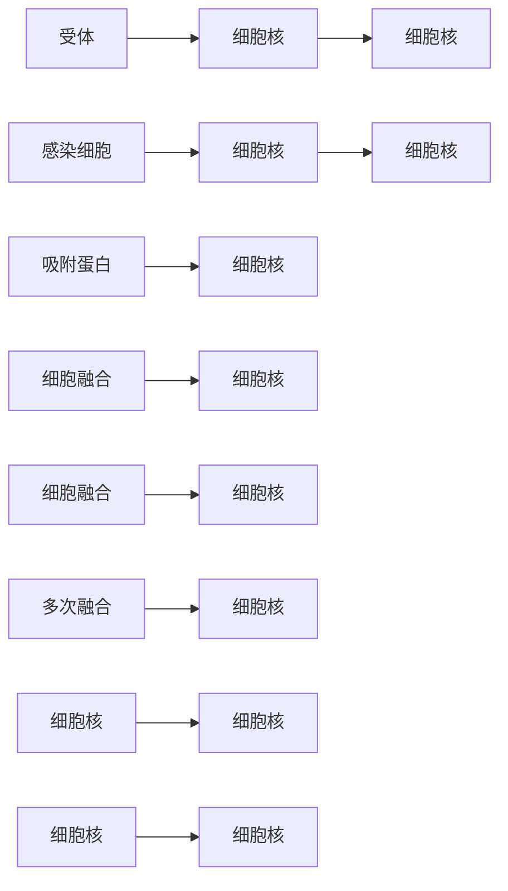
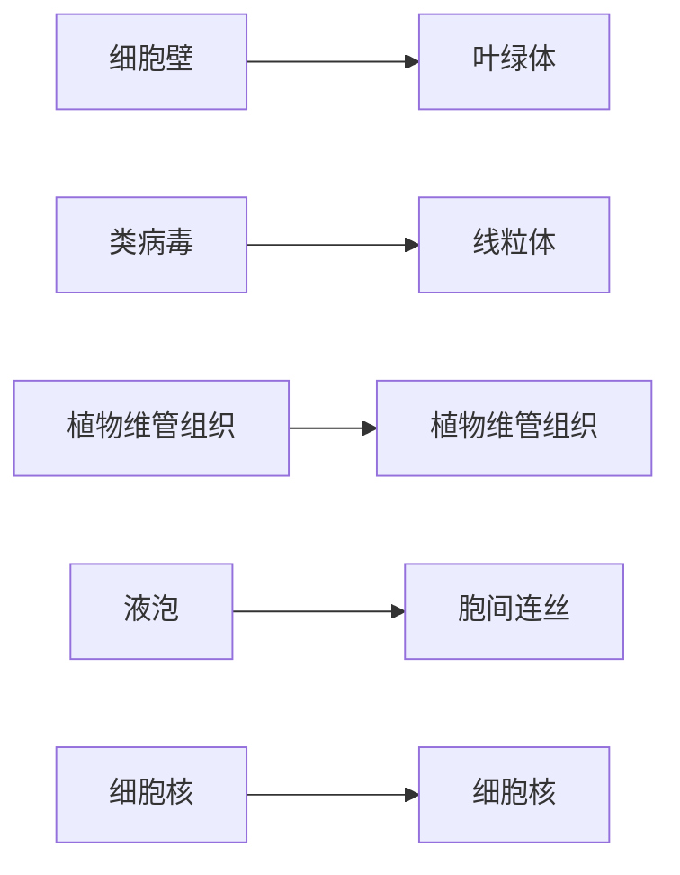
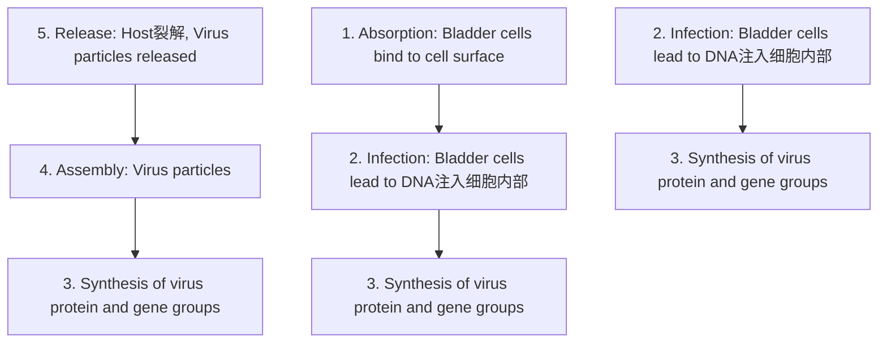
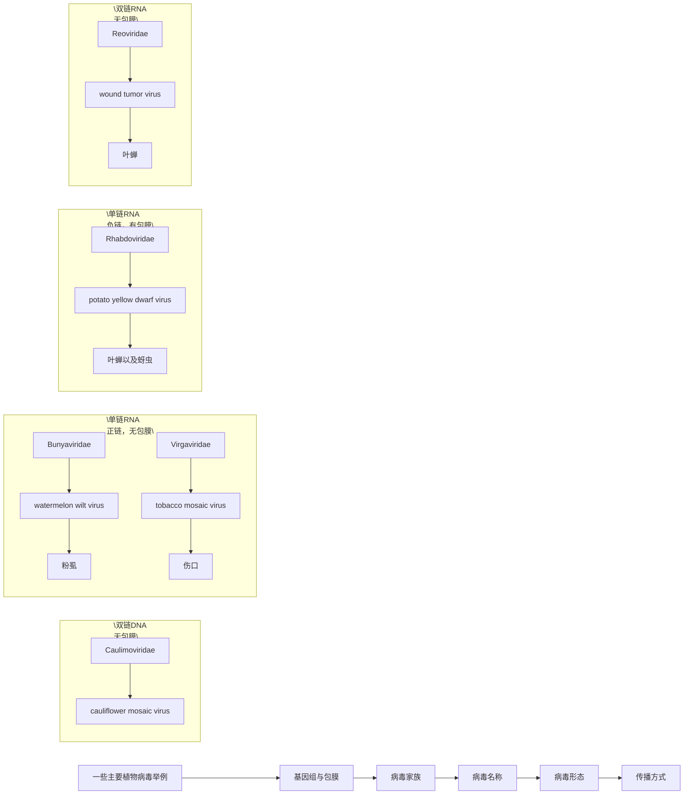

## 5.2.2.3 脱壳

病毒粒进入细胞往往并不意味着侵入过程的完成。在细胞中，紧密包裹的病毒粒还需要进行不同程度的解体，释放遗传物质，这个过程称为脱壳（uncoating）。例如，腺病毒是一种无包膜的DNA病毒，它通过细胞内吞方式进入细胞，在内吞体中，病毒蛋白破坏内吞体膜，使核衣壳从内吞体逃逸并解体。在细胞质中，病毒核心被运送到核孔，基因组DNA穿过核孔进入细胞核，开始复制。呼肠孤病毒的病毒粒由双层二十面体衣壳构成，侵入细胞后会脱去一层衣壳，但仍然保留内层衣壳，其RNA合成在内壳中完成，这称为部分脱壳。

## 5.2.3 病毒大分子合成

病毒复制需要合成大量的病毒蛋白和基因组核酸，高度依赖细胞提供能量、材料（氨基酸、核苷酸）和酶等。同时，不少病毒编码自己的核酸合成相关的酶，可以用于催化核酸合成、进行基因转录和基因组核酸的复制。但病毒蛋白质合成几乎都依靠细胞的蛋白质翻译机器进行。

如上所述，病毒的遗传物质具有多样性。在病毒大分子合成阶段，不同核酸类型的病毒有不同的基因组复制和基因表达路径。1971年，诺贝尔奖获得者 David Baltimore 提出根据病毒核酸类型及基因表达、复制方式将病毒分为 6 组；后人又根据新的发现，将分组增加到 7 组，这就是著名的巴尔的摩分类法（Baltimore classification）。这 7 个组的基因组复制和基因表达路径见图 5-7 和图 5-8。

## 5.2.3.1 双链和单链 DNA 病毒

这两类病毒分属巴尔的摩分组系统的第Ⅰ和Ⅱ组。第Ⅰ组 dsDNA 病毒的复制和基因表达路径和宿主细胞基因组 DNA 的复制和基因表达路径完全一致，也就是经典的分子生物学中心法则的路径，即 DNA 自我复制，并通过转录形成 mRNA，mRNA

flowchart

This diagram illustrates the transcriptional pathway of mRNA into various RNA-RT groups, including dsDNA, ssDNA, and dsRNA, with directional arrows indicating the process of converting to mRNA.

图 5-7 巴尔的摩分类法中 7 组病毒 mRNA 的产生路径

再指导蛋白质翻译（图 5-8a）。对于第Ⅱ组单链 DNA（ssDNA）病毒，ssDNA 作为模板先合成互补链，成为 dsDNA，然后再以与 dsDNA 类似的方式进行复制和基因表达（图 5-8a），dsDNA 复制产生子代 ssDNA。

虽然细胞中已有进行 DNA 复制和转录的酶，病毒仍然会编码一些自己的 DNA 复制和转录相关的酶，以确保病毒大分子合成的高效进行。一些大型 dsDNA 病毒的基因表达有分期现象，病毒的基因分成极早期、早期和晚期基因。极早期基因在感染后立即表达，主要是一些转录激活因子，用于激活早期基因的表达。早期基因则主要编码复制相关的酶和调节因子，包括 DNA 复制相关的酶。这些基因表达后，病毒 DNA 的复制启动，导致细胞内病毒基因组拷贝数大大增加。在此基础上，晚期基因的表达水平也就大大提升，产生大量的病毒结构蛋白，为组装作好准备。

ssDNA 病毒的基因组一般很小，编码的基因数有限，往往高度依赖于细胞的核酸复制酶和转录相关因子，复制周期也相对简单。

## 5.3.3.2 双链 RNA 病毒

第Ⅲ组双链 RNA（dsRNA）病毒种类不多，常见类群是呼肠孤病毒。这类病毒大分子合成流程见图 5-8b。dsRNA 一般会被细胞视作外来有害物入侵的信号，无论动物或植物细胞都能感知它并作出强烈反应，因此病毒 dsRNA 一般不直接进入细胞质。同时，细胞中也缺少 dsRNA 合成有关的酶。病毒粒自带 dsRNA 复制酶，进入细胞并完成部分脱壳后，复制酶在核心衣壳内以 dsRNA 为模板合成 mRNA。mRNA 通过二十面体衣壳的顶点进入细胞质中，进行蛋白质的合成。新合成的病毒蛋白随即组装成新的病毒颗粒，将病毒 mRNA 包裹在其中，并以 mRNA 为模板合成第二条 RNA 链，形成子代 dsRNA。dsRNA 的这种合成方式和 dsDNA 的半保留复制方式完全不同，属于“全保留复制”。

## 5.2.3.3 单链 RNA 病毒

巴尔的摩分类法将 ssRNA 病毒分成第Ⅳ组正链 ssRNA（+ssRNA）病毒和第 V 组负链 ssRNA（-ssRNA）病毒。+ssRNA 病毒的基因组 RNA 与 mRNA 一致，可以直接用来翻译成蛋白质，而 -ssRNA 需要首先拷贝成正链，才能指导蛋白质合成（图 5-7,

图 5-8 巴尔的摩病毒分类法各组病毒的基因表达和基因组复制过程

（a）第Ⅰ组和第Ⅱ组；（b）第Ⅲ组；（c）第Ⅳ组和第V组；（d）第Ⅵ组和第Ⅶ组

图 5-8c)

之所以 +/-RNA 的差异被如此看重，是因为细胞中缺乏以 RNA 为模板合成 RNA 的酶（依赖于 RNA 的 RNA 聚合酶，RNA-dependent RNA polymerase，RdRp），所有 RNA 病毒都需要自身编码这种 RNA 复制酶。+ssRNA 病毒可以在侵入细胞后，由基因组 RNA 直接翻译产生这个酶，继而开始复制；但 -ssRNA 病毒则无法直接翻译，而是需要先拷贝成 mRNA 才能翻译产生这个酶。因此 -ssRNA 病毒的病毒粒中必须携带 RNA 复制酶来保证产生病毒 mRNA。第 IV 组和第 V 组病毒之间明显的差别就是病毒基因组 RNA 是否能单独启动病毒复制过程。肠道病毒、冠状病毒等 +ssRNA 病毒只需要完整的基因组 RNA 就可以开始复制，但流感病毒、副黏病毒等 -ssRNA 病毒必须有完整的病毒粒感染，或额外提供病毒 RNA 复制酶，才能开始复制。

ssRNA 病毒的基因表达也有几种不同的方式。-ssRNA 病毒会产生多个 mRNA，每个 mRNA 翻译形成一个病毒蛋白。而不少 +ssRNA 病毒则会编码产生一个大的多聚蛋白，由蛋白酶将其切割成成熟蛋白。例如，冠状病毒编码的复制酶蛋白最初就是一个多聚蛋白，长达 7000 个氨基酸，须由病毒编码的 3CL 蛋白酶等将其切割成 16 个成熟蛋白，才能进行病毒的复制，因此 3CL 蛋白酶是抗病毒药物设计的理想靶标。

## 5.2.3.4 有逆转录的病毒

这类病毒包括巴尔的摩分类法的第Ⅵ组逆转录 RNA 病毒（RNA-RT）和第Ⅶ组逆转录 DNA 病毒（DNA-RT）（图 5-7，5-8d）。

第Ⅵ组逆转录 RNA 病毒以 HIV-1 为代表，基因组是 +ssRNA，感染后首先由病毒粒携带的逆转录酶将 RNA 拷贝成 dsDNA 并运送到细胞核。在核内，dsDNA 在病毒粒携带的整合酶等细胞和病毒因子的作用下整合到细胞染色体 DNA。整合的病毒基因组（称为原病毒，provirus）作为细胞基因组的一部分随细胞繁殖得到扩增，并可以从染色体上转录产生病毒 mRNA。该 mRNA 既可以作为子代病毒的基因组，也可以指导病毒蛋白质的合成。

第Ⅶ组逆转录 DNA 病毒的代表是乙型肝炎病毒（hepatitis B virus，HBV）。这类病毒的基因组是不完整的环状 dsDNA。病毒进入细胞后，DNA 先修复成完整环状 dsDNA。由宿主细胞转录酶（RNA 聚合酶Ⅱ）催化转录形成若干病毒 mRNA，指导病毒蛋白合成。在这些病毒 mRNA 中最长的一种 mRNA 被翻译成具有逆转录酶活性的聚合酶，该酶直接和编码它的 mRNA 结合，以其为模板进行逆转录反应，合成 DNA，最后形成不完整的环状 dsDNA 分子，完成病毒核酸复制。

## 5.2.4 病毒组装、成熟和释放

病毒大分子合成完成后，就开始了病毒的组装、成熟和释放过程。

## 5.2.4.1 组装

组装（assembly）包括核衣壳形成、病毒核酸包装、包膜获得等步骤。不同病毒的组装部位有所不同，有的在细胞核，也有的在细胞质。病毒蛋白质和核酸会被聚集到组装位置，开始装配子代病毒。

对病毒组装研究最早的是植物病毒烟草花叶病毒，这种病毒的病毒粒由一种衣壳蛋白和一条 RNA 链构成。在试管中加入这两种成分，在合适的 pH 和离子强度下它们就会自发组装成有感染力的病毒粒，不需要额外的细胞或病毒蛋白质参与。人乳头瘤病毒的结构蛋白 L1 即使在没有病毒核酸的情况下，也会组装成病毒样颗粒（virus-like particle，VLP）。这种颗粒具有病毒粒形态和抗原成分，却没有病毒基因组核酸，是疫苗的理想材料。但许多病毒衣壳的组装需要多种病毒和细胞蛋白的参与和协助。对于构造复杂的复合对称噬菌体，病毒粒的组装会分部进行，头部、颈部、尾部等分别聚集成型后，再组装到一起。

对于二十面体对称衣壳，如何把病毒核酸装入衣壳内极为关键。一般在初步成型的二十面体衣壳的一个顶点处有开口，有病毒蛋白识别病毒基因组核酸上的包装信号序列后，将其装载到衣壳内部。在装载口会有 ATP 水解酶提供这个过程需要的能量。

对于包膜病毒，获得包膜的过程是病毒组装的重要环节。这类病毒一般在细胞内膜系统或细胞膜内侧进行组装，随后直接通过出芽方式离开细胞并获得病毒包膜。也有的病毒先进入内质网或高尔基体等内膜囊泡，然后通过胞吐方式将带包膜的病毒粒释放到细胞外。有少数病毒在细胞核内就获得了病毒包膜，如昆虫杆状病毒中的包涵病毒（见 5.5.3）。

## 5.2.4.2 成熟

有些包装成型的病毒粒还需要经过成熟的过程，其中包括病毒核心的进一步浓缩、蛋白质的结构和位置变化、蛋白质切割等。如肠道病毒包装完成后，会发生 P4 蛋白的内部化和核蛋白浓缩；HIV-1 初步包装完成的核衣壳会发生衣壳蛋白的蛋白酶解和衣壳的“塌陷”，形成最终的楔形结构。

## 5.2.4.3 释放

病毒复制的最后环节是子代病毒粒被释放（release）到细胞外，以感染其他细胞。大多数包膜病毒通过出芽或胞吐被释放到细胞外，裸露病毒则一般通过将细胞裂解离开细胞。一些裸露病毒编码毒性蛋白，会导致细胞膜破损，帮助子代病毒粒离开。许多烈性噬菌体都编码能降解细胞壁的溶菌酶或裂解肽等，在烈性噬菌体复制的后期将细菌裂解，释放子代噬菌体。

## 5.3 病毒感染

病毒必须通过感染宿主进行复制。在自然界，每种病毒都有它可以感染并完成复制的宿主范围（host range）。有的病毒宿主范围较广，例如甲型流感病毒既可以感染鸟类，也可以感染多种哺乳动物和人。一些由节肢动物传播的病毒，如登革病毒、寨卡病毒，既可以在节肢动物（如蚊子）的细胞内复制，也能在人细胞内复制，宿主范围横跨了无脊椎动物和脊椎动物。另一些病毒的宿主范围却很窄，如天花病毒只能感染人，这也是人类能够通过普及有效疫苗彻底消灭这个病毒的重要前提。

除了物种层面的宿主范围，病毒往往还有明显组织趋性（tissue tropism），即只感染宿主体内的部分组织的细胞。这种组织趋性主要由受体分子在体内不同组织的分布所决定。以 HIV-1 为例，病毒依赖受体 CD4 和辅助受体 CCR5 或 CXCR4 等侵入细胞，因此只能感染同时带有这些表面蛋白的 CD4 $^{+}$ T 细胞和单核 / 巨噬细胞等细胞种类。

病毒感染在宿主的细胞和机体层面都会产生一定的效应，包括造成损伤和引发系列变化。而宿主也会对病毒的感染作出防御反应，以抑制病毒、保护自身。病毒又会设法逃避宿主的防御反应，使复制能顺利地进行。因此，病毒感染过程是病毒与宿主相互作用的过程。

## 5.3.1 病毒感染类型

根据病毒感染造成的结果，可以把感染分为以下类型。

## 5.3.1.1 生产性感染

生产性感染（productive infection）指有子代病毒产生并释放到细胞外的感染。如果病毒感染导致细胞裂解死亡，又称为裂解性感染（lytic infection），以一些烈性噬菌体感染较为典型。噬菌体复制消耗大量细胞资源，同时还产生一些溶菌酶、裂解肽等细胞毒性物质，最终导致细菌细胞裂解，子代噬菌体被释放到细胞外，继续感染其他细菌。这类噬菌体感染可导致菌液变清、形成肉眼可见的“噬菌斑”。感染人类细胞的腺病毒、细小RNA病毒等也都可以导致细胞裂解。腺病毒编码细胞毒蛋白ADP（adenovirus death protein）等，可以导致细胞膜破裂。

有些生产性感染并不立即造成细胞死亡，而是持续释放子代病毒，同时细胞能维持基本正常的状态，这类感染称为持续性感染（persistent infection）或慢性生产性感染。这种情况往往是病毒与宿主防御、免疫系统之间达成了一定的平衡。例如，HIV-1感染细胞后，原病毒DNA成为细胞染色体的一部分，和其他细胞基因一样进行基因转录合成病毒mRNA、产生子代病毒。这时的细胞会源源不断产生子代病毒，但对细胞影响较小，细胞往往仍能保持正常状态。

## 5.3.1.2 潜伏性感染

潜伏性感染（latent infection）又称隐性感染（occult infection），指病毒的基因组在细胞内潜伏存在，但并不产生子代病毒。 $\lambda$  噬菌体感染宿主大肠杆菌后建立溶原状态就是一种潜伏感染（见 5.5.1）。这种状态下， $\lambda$  噬菌体的基因组插入细菌染色体，几乎所有噬菌体基因的表达都被关闭。在人体中，多种类型的疱疹病毒可以在宿主细胞内长期潜伏。例如，Epstein Barr 病毒（EBV）是人群中携带率最高的病毒之一，据估计 90% 的成年人都带有这一病毒。EBV 主要潜伏于人 B 细胞中，其 dsDNA 基因环化后以染色体外小体的方式存在于细胞核中，随细胞生长繁殖得到有限扩增。在潜伏期间，病毒的大部分基因都处于关闭状态，仅有若干与基因组 DNA 复制和维持密切相关的基因或非编码 RNA 得到表达，因此可以有效躲避人体的免疫识别。

潜伏感染在一定条件下可以转化为生产性感染。溶原性  $\lambda$  噬菌体在营养缺乏、紫外线照射等刺激下可以活化，进入裂解性复制周期。潜伏感染的 EBV 也可以在 B 细胞活化时进行生产性感染，产生子代病毒，与许多疾病甚至肿瘤有关。

## 5.3.1.3 流产性感染

流产性感染（abortive infection）是指病毒侵入细胞后，由于某些原因未能完成复制，不产生子代病毒，基因组也从细胞中被清除的情形。一些病毒感染后因为细胞中缺少复制必需的因子，或由于细胞防御机制的作用，未真正完成复制。这种“流产”可以发生在复制的不同阶段，如病毒未能成功地从细胞内吞体逃逸，细胞缺乏病毒复制必需的酶等等。例如，流感病毒感染T细胞后，由于细胞产生的干扰素等抗病毒因子的作用，病毒无法完成复制。也有些被病毒感染的细胞会通过细胞凋亡或自裂解与病毒“同归于尽”，造成流产性感染。由于流产性感染往往对细胞没有明显影响，且最后的结果是病毒消失，因此一般不易被发现或检测到。

## 5.3.1.4 细胞转化

细胞转化（cell transformation）是指病毒感染细胞后导致细胞生长特性发生改变，出现生长旺盛、对生长因子依赖性降低、失去接触抑制等特性。细胞转化并不是一种独立的感染类型，它可以伴随生产性、潜伏性，或者是流产性感染发生，也可以是病毒感染已经结束，病毒被细胞清除，但细胞带有了部分病毒基因，或者病毒感染导致细胞基因组突变或基因表达变化，引起的细胞生长特性的改变。例如，逆转录病毒在复制过程中会产生一些带有细胞癌基因同时缺失部分病毒基因的突变病毒，这些突变病毒感染细胞后，能和野生型病毒一样完成逆转录并将病毒基因组整合到细胞染色体，但由于它缺失了部分病毒基因而无法继续完成复制，不产生子代病毒，但突变病毒携带癌基因，可以改变细胞生长特性，导致细胞转化。

## 5.3.2 病毒与宿主的相互作用

## 5.3.2.1 病毒对细胞的影响

病毒感染会在多方面对细胞造成不同程度的影响，被统称为病毒的细胞病理效应（cytopathic effect，CPE）。最常见的细胞病理效应是细胞形态变化，如由成纤维细胞变成圆形，失去贴壁性，其中往往涉及细胞骨架的改变和内膜系统的变化。有些包膜病毒感染后会导致细胞发生融合，是由于被感染的细胞中表达了病毒的吸附蛋白，这些吸附蛋白会被转运定位到细胞表面，和周围细胞上的受体结合，介导细胞融合（图 5-9）。细胞融合形成有多个细胞核的合胞体（syncytium）。仙台病毒、呼吸道合胞病毒、HIV-1 等都有介导细胞融合的能力。这种由病毒感染所形成的合胞体一般不稳定，常会发生凋亡。

一些病毒感染可以导致细胞中宿主蛋白质合成的降低，将更多的资源用于合成病毒蛋白质。例如，肠道病毒编码的2A蛋白酶可以降解宿主细胞的翻译起始因子eIF4G，导致宿主细胞中从mRNA 5'帽式结构开始的蛋白质合成受阻。但病毒的蛋白质合成并不受影响，因为病毒 mRNA 缺少 5' 帽式结构，但编码一段 “核糖体内部进入序列”（internal ribosome entry sequence, IRES），可以直接与核糖体结合，开始翻译。在另一些病毒感染的细胞中，病毒 RNA 大量转录，从数量上与细胞 mRNA 竞争，从而抑制细胞的蛋白质合成。

图 5-9 病毒感染介导细胞融合形成合胞体

flowchart

病毒感染的最强烈的效应自然是细胞裂解死亡。除前述病毒会产生裂解细胞的毒性蛋白，有时病毒感染会导致程序性细胞死亡（见 5.3.2.2）。

## 5.3.2.2 细胞的抗病毒感染作用

细胞有一系列机制可以感知病毒的入侵和复制，并做出相应的反应以对抗病毒的感染。细胞主要通过模式识别受体，包括各种 Toll 样受体分子（TLRs），胞内 MDA5、RIG-I 等识别病毒复制过程中形成的 dsRNA、特殊的 RNA 分子结构、细胞质中的未甲基化 DNA 分子等病毒成分，启动细胞信号转导，最终激活各种抗病毒基因的表达，产生干扰素（interferon）等抗病毒因子，使细胞进入“抗感染状态”，抑制病毒的复制。这些抗病毒因子也会分泌到细胞外，激活机体的免疫应答，更有效地抗病毒。

RNA 病毒在复制过程中会产生一些 dsRNA 区域。较长的 dsRNA 能诱导动物细胞产生干扰素，对病毒复制产生强烈的抑制作用。短的 dsRNA 虽然不诱导产生干扰素，但在一些宿主中会激活细胞的 RNA 干扰（RNA interference，RNAi）机制。这些 dsRNA 被切割成 20 nt 左右的长度，并被装载到 RISC（RNA-induced silencing complex，RNA 诱导的沉默复合物）上。RISC 对胞内 RNA 进行识别，降解能与它携带的 RNA 配对的 RNA。在低等动物和植物中，RNA 干扰具有一定的抗病毒作用。在基因组编辑中具有广泛应用的 CRISPR/Cas9 系统，本质上也是一种基于 RNA 的抗噬菌体机制。

一些病毒感染会诱发程序性细胞死亡（programmed cell death），包括凋亡、坏死等。这一现象既可以看作是病毒的细胞病理效应，也可以看作是细胞的抗病毒反应，因为如果细胞死亡发生在子代病毒产生以前，就可以起到清除病毒、阻止病毒在体内扩散的作用。这种程序性细胞死亡一般是病毒复制影响了正常的细胞周期调控，激活细胞相关信号通路导致，或病毒感染激活模式识别受体后诱导的。

## 5.3.2.3 病毒与机体的互作

机体的抗病毒感染作用主要通过表面屏障、固有免疫应答和获得性免疫应答进行。其中干扰素、抗体、细胞毒性 T 细胞等都可以在抗病毒感染中发挥重要作用。干扰素可以抑制病毒的复制；抗体可以起到中和病毒、阻断其感染的作用；细胞毒性 T 细胞及抗体介导的细胞免疫作用则在清除被感染的细胞方面具有重要的作用。相关内容见第 15 章。

同时，病毒作为一种演化实体，也产生了许多机制来应对细胞和机体对它的抑制作用。例如，许多病毒会通过突变迅速改变表面蛋白的抗原性，逃避抗体的作用。SARS-CoV-2流行期间出现了很多变异株，主要都是病毒表面蛋白S的变异，它们可以逃避已有抗体的作用。又如，流感病毒的非结构蛋白NS1具有多重抑制细胞防御功能的作用，可以抑制细胞对病毒的识别、抑制相关信号通路的激活、抑制干扰素的抗病毒作用等。有部分病毒具有抑制细胞凋亡的活性，如腺病毒E1B蛋白可以直接和细胞P53蛋白互作，抑制它的控制细胞周期、激活细胞凋亡等功能；非洲猪瘟病毒编码了一种与细胞中负调控细胞凋亡的Bcl-2蛋白类似的蛋白，抑制细胞凋亡的发生。

## 5.3.3 病毒与肿瘤

肿瘤是人类健康的大敌。根据世界卫生组织（WHO）和国际癌症研究机构（IARC）的数据，全球大约15.4%的肿瘤与感染（包括病毒、细菌和寄生虫）相关，其中约9.9%的肿瘤与各种病毒感染有关。目前明确感染后有可能引发人类恶性肿瘤的病毒主要有:人乳头瘤病毒（HPV，子宫颈癌）、EB病毒（EBV，鼻咽癌、淋巴瘤等）、乙型肝炎病毒（HBV，肝癌）、人8型疱疹病毒（HHV-8，卡波西氏肉瘤）、梅克尔细胞病毒（MCV，皮肤癌）等。这些病毒的特点是编码了一些可导致细胞转化的蛋白，如HPV编码E6、E7蛋白，可以分别和细胞中控制细胞生长的蛋白RB和P53互作，促进细胞的生长。HPV复制过程中，这些基因会偶发性地整合到细胞染色体上，进行持续表达，可能导致细胞生长失控和发生恶变。

值得指出的是，肿瘤的发生涉及众多因素，包括个体的遗传背景、生理状态、环境因素等。肿瘤相关病毒的感染者中仅有个别会最终罹患肿瘤。尽管如此，防控病毒感染可以切实降低这些病毒相关肿瘤的发生率。

## 5.4 亚病毒因子

亚病毒因子（subviral agent）是一类比病毒更为简单的病原体。它们可能仅由核酸组成而不包含蛋白质衣壳，也可能仅由感染性的蛋白质组成而不包含核酸，还有可能既包含了核酸也包含了蛋白质然而其自身无法实现单独感染，需要在其他辅助病毒的帮助下才能实现感染传播。亚病毒因子包括卫星病毒、卫星核酸、类病毒以及朊病毒。亚病毒因子的发现拓展了病毒学的边界以及视野，为传统的病毒学思维注入了新的理念。

## 5.4.1 卫星病毒

卫星病毒（satellite virus）的基因组缺乏其感染复制的必需基因（比如病毒基因组复制酶基因），然而这些必需基因可以被一些辅助病毒编码，所以卫星病毒必须依赖辅助病毒实现感染传播。卫星病毒首先在植物中被发现。已知的植物卫星病毒包括卫星烟草坏死病毒（satellite tobacco necrosis virus，STNV）以及卫星烟草花叶病毒（satellite tobacco mosaic virus，STMV）等。这些卫星病毒自身不编码复制酶，所以必须依赖辅助病毒编码的复制酶进行复制。这些卫星病毒对于辅助病毒的专一性极高，比如STNV仅能依靠烟草坏死病毒（tobacco necrosis virus，TNN）进行复制。

动物中也存在卫星病毒。例如，腺相关病毒（adeno-associated virus，AAV）是一种 ssDNA 卫星病毒，基因组长度大约 4.8 kb。它自身无法复制其基因组，需要与腺病毒或者疱疹病毒同时感染，在它们的辅助下完成复制过程。AAV 编码了自己的衣壳蛋白，其病毒粒直径大约 20 nm，其中包裹的遗传物质为一条 ssDNA，正链以及负链都可以被包裹（病毒粒包裹的正链和负链大约各占一半）。AAV 可以感染人类，然而基本不导致疾病。不同类型的 AAV 有不同类型的衣壳蛋白，它们偏好侵染不同类型的宿主细胞，所以 AAV 也被广泛用于将外源基因递送进入不同类型的组织细胞中。

## 5.4.2 卫星核酸

卫星核酸包含了卫星 RNA 以及卫星 DNA，是一类自身不编码衣壳及包膜蛋白，需要借助辅助病毒编码的衣壳或包膜蛋白来组装的小分子 RNA 或 DNA 因子。它们跟卫星病毒的不同点在于卫星病毒需要辅助病毒提供复制酶而卫星核酸需要辅助病毒提供衣壳或者包膜蛋白。以卫星 RNA 为例，按照大小可以分为两类，较大的一类包括番茄黑环病毒（tomato black ring virus，TBRV）的卫星 RNA，长约 1370 个核苷酸；较小的一类含有大约 300 个核苷酸，包括烟草环斑病毒（tobacco ring spot virus，TRSV）的卫星 RNA 等。较长的卫星 RNA 具有编码功能，而较短的似乎不编码蛋白质。

感染人类的丁型肝炎病毒（hepatitis delta virus，HDV）也是卫星RNA的一类。它的基因组是长约1700个核苷酸的环形ssRNA，编码了δ抗原，但是没有编码包膜蛋白，无法包装生成感染性的病毒颗粒。HDV的辅助病毒是HBV，当HDV同HBV共感染的时候，HBV编码的包膜蛋白可以将HDV的基因组包装成病毒颗粒从而实现HDV的传播。HDV的复制机制跟类病毒极为相似（见5.4.3），其RNA基因组折叠形成的结构可以被宿主DNA依赖型RNA聚合酶识别并且通过滚环（rolling-circle）机制复制，产生多聚体基因组RNA，然后被切割和连接生成新的环形ssRNA。与类病毒（见5.4.3）不同的是，HDV的基因组的复制不仅仅依赖宿主因子同时还依赖病毒因子，HDV 基因组编码的  $\delta$  抗原也是上述 HDV 复制过程中的必需因子。HBV 是唯一公认的 HDV 的辅助病毒，然而最新的研究表明除了 HBV，其他的病毒编码的包膜蛋白比如丙型肝炎病毒以及寨卡病毒的包膜蛋白也可以在体外培养的细胞中辅助 HDV 的包装，这个研究表明 HBV 可能不是 HDV 唯一的辅助病毒。然而这个可能性还没有在感染了 HDV 的患者群体中得到验证。

## 5.4.3 类病毒

类病毒（viroid）是一种主要在植物中存在的非编码、单链、环状 RNA 分子病原体。类病毒的长度为 220～400 个核苷酸，可折叠成不同形状的二级结构，比如棒状（图 5-10）。它们不编码任何蛋白质，也没有衣壳蛋白，所以没有包装在病毒颗粒中。类病毒极小，可以通过胞间连丝以及植物维管组织在细胞组织间传播（图 5-11）。

类病毒最早是由美国科学家于1971年在研究马铃薯纺锤形块茎疾病时发现。他们发现这种病原与传统的病毒不同，不包含蛋白质组分，仅由RNA分子组成，类病毒的概念由此形成。根据是否含有中央保守区以及核酶（ribozyme）结构，类病毒可以分为两个家族，分别是马铃薯纺锤形块茎类病毒科［Pospiviroidae，以马铃薯纺锤形块茎类病毒（PSTVd）为代表］和鳄梨日斑类病毒科［Avsunviroidae，以鳄梨日斑类病毒（ASBVd）以及桃潜隐花叶类病毒（PLMVd）为代表］（图5-10）。前者含有中央保守区，但不含核酶保守序列；后者没有中央保守区域，但含有核酶保守序列，

知识拓展 5-3
类病毒的发现图 5-11 植物类病毒可导致植株矮小疾病

text_image

左端(TL)
致病区
中央保守区
可变区
右端(TR)
(a)
50
CAGACUU
GUCUGAG
290
(b)

图 5-10 类病毒的二级结构

(a) PSTVd（马铃薯纺锤形块茎类病毒）最稳定的热力学二级结构。5个结构/功能区域依次为左端（terminal left， $T_{L}$ ）、致病区（pathogenesis）、中央保守区域（central conserved region）、可变区（variable）和右端（terminal right， $T_{R}$ ）；(b) PLMVd（桃潜隐花叶类病毒）最稳定的热力学二级结构。G-U配对由黑点表示，核酶酶切位点由红色箭头表示

（a）左植株为健康植株，右为感染植株；（b）类病毒可以通过胞间连丝以及植物维管组织在细胞组织间传播

natural_image

Two potted green plant varieties in black pots, one large and elongated, the other smaller and flatter (no text or symbols visible)

(a)

flowchart

(b)

能够自我切割。

所有类病毒都利用宿主细胞的 RNA 合成酶通过滚环（rolling-circle）机制复制，产生多聚体基因组 RNA，然后通过切割和连接生成新的环状 ssRNA。以 PSTVd 为例，宿主内的 DNA 依赖型 RNA 聚合酶Ⅱ被 PSTVd 的棒状折叠结构欺骗，识别 PSTVd RNA 基因组作为底物，从而转录复制成新的类病毒分子。值得注意的是 RNA 的二级结构会影响其功能，类病毒的 RNA 二级结构不是单一的折叠状态，相同的序列会在复制周期的不同阶段折叠成不同的亚稳态结构（metastable structures），并且在复制过程中行使不同的功能。

## 5.4.4 朊病毒

朊病毒（prion）是只由蛋白质组成的传染性因子，于1982年被发现。这些病原体与一些病程进展缓慢但致命的哺乳动物疾病相关，包括人的克-雅病（Creutzfeldt-Jakob disease，CJD）、库鲁病（Kuru disease）、致死性家族型失眠症（fatal familial insomnia，FFI），以及发生于动物中的羊瘙痒病（scrapie）、牛海绵状脑病（bovine spongiform encephalopathy，BSE）等。在这些疾病中，朊病毒蛋白质在神经组织中沉积，通过尚不清楚的机制导致神经元死亡，脑功能逐渐恶化，组织中出现特征性的海绵状空洞。

羊瘙痒病是朊病毒的主要研究模型。高温、紫外线、辐射、蛋白酶等能使病毒灭活的因子无法使羊瘙痒病致病因子失活。核酸酶也无法破坏其感染性，然而 SDS、尿素、苯酚等蛋白质变性剂可以破坏其感染性。由于迄今为止尚未发现其含有核酸，所以主流观点认为羊瘙痒病致病因子为蛋白质。

从实验感染的仓鼠脑组织中分离得到的羊瘙痒病致病因子蛋白的分子量

## 知识拓展 5-4

## 真菌中的朊病毒

是 27 000 \~ 30 000，其感染性可以被中和抗体中和，这种蛋白质被称为朊病毒蛋白（prion protein，PrP）。由于该致病蛋白来源于羊瘙痒病（scrapie），所以用 PrP$^{Sc}$（prion protein，scrapie）表示。根据 PrP$^{Sc}$ 的氨基末端序列合成寡核苷酸探针进行检测发现，宿主细胞有编码 PrP 的基因，其编码的基因产物为一种细胞膜糖蛋白 PrP$^{C}$（Prion protein，cellular）。PrP$^{C}$ 与 PrP$^{Sc}$ 是同分异构体，蛋白质初级序列一致，然而二级结构不同，PrP$^{C}$ 含有 43% 的 α 螺旋以及 3% 的 β 折叠，PrP$^{Sc}$ 含有 34% 的 α 螺旋以及 43% 的 β 折叠，从而使得 PrP$^{Sc}$ 的溶解性降低，很难被蛋白酶降解，易于沉积（图 5-12a）。

针对  $PrP^{Sc}$  在体内的复制传播过程，科学家提出了杂二聚机制假说: $PrP^{Sc}$  单体感染物接触细胞之后同  $PrP^{C}$  结合，形成  $PrP^{C}-PrP^{Sc}$  杂二聚物，可诱导  $PrP^{C}$  转变成为  $PrP^{Sc}$，成为  $PrP^{Sc}-PrP^{Sc}$  二聚物。该二聚物解离后同其他的  $PrP^{C}$  结合，并诱导其构象改变，从而不断地将自己的蛋白构象复制下去（图 5-12b）。最终过量的  $PrP^{Sc}$  二聚物朊病毒分子在脑部细胞中堆积形成淀粉样沉淀，造成细胞坏死，使得脑组织呈现海绵状变化。

flowchart

(a)

图 5-12 胱病毒的构象变化及其复制

（a）朊病毒蛋白PrP $^{Sc}$ 跟正常的蛋白质PrP $^{C}$ 相比含有很多的β折叠使其易于聚集沉淀；（b）朊病毒复制的杂二聚机制假说

flowchart

## 5.5 病毒举例

病毒可以感染所有已知的生物类型。细菌、古菌、动物以及植物，无一能够摆脱病毒的纠缠（图 5-13）。病毒对整个自然界以及人类社会影响重大。一方面，病毒感染的致病性会危害人类健康，对畜牧业、种植业以及微生物发酵工业产生负面的影响。另一方面，海洋中的病毒感染每天会导致大量的海洋微生物死亡，将这些生物转化为颗粒物质，成为海洋底层食物链中的浮游植物所需的基本营养物质。同时病毒可以被用于研究生命科学基本规律，以及作为基因工程中的载体，对现代生命科学以及生物工程技术的发展有着极其重要的作用。所以，随着人类对病毒的理解越来越深入，病毒仅是疾病的使者这一观点也逐渐地被模糊化了。

## 5.5.1 噬菌体和古菌病毒

感染细菌和古菌的病毒分别称为噬菌体（bacteriophage）和古菌病毒（archaeal virus）。全球海洋中存在超过 $10^{30}$ 个噬菌体颗粒。噬菌体的形态有球状、丝状、蝌蚪状以及复合结构等类型，绝大多数的噬菌体中的遗传物质是dsDNA。噬菌体是病毒学研究最早的和最简洁的模式系统之一，病毒学中的多数基本概念以及研究方法都是率先使用噬菌体阐释或建立，最终拓展应用到其他病毒中去的。同时研究噬菌体也有重要的应用意义，它既是发酵工业的大敌，又可以被开发用来控制耐药性病原菌的危害。

## 5.5.1.1 噬菌体的增殖

以研究较为广泛的 T4 噬菌体为例介绍噬菌体的复制增殖过程。T4 噬菌体的宿主是常见的肠道细菌大肠杆菌，T4噬菌体为复合结构，具有头部、颈部和尾部构成的外壳，dsDNA包装在二十面体的头部。图5-14展示了T4噬菌体的感染和复制过程。

图 5-13 感染不同物种的病毒举例

## (1) 吸附

T4 噬菌体不是毫无选择性地吸附到宿主细胞的表面，其尾丝尖端的特定蛋白因子（gp37）特异性地与宿主细胞上的特定受体（LPS，OmpC）结合，这种相互作用触发尾丝展开，从而暴露刺突以及基板，使其附着于宿主细胞的细胞壁表面。虽然包括T4在内的许多噬菌体附着于细胞壁，但也有其他噬菌体可以吸附在鞭毛或菌毛上。

## (2) 侵入

噬菌体尾部存在的溶菌酶会削弱细菌细胞壁。当噬菌体吸附在细胞壁以后尾鞘收缩成原长的一半，将中空的尾管推入被溶菌酶削弱的细菌细胞壁，并与细菌细胞膜接触。然后，病毒 DNA 从头部经过管道被注射进入细菌细胞，噬菌体外壳仍然位于细菌细胞外部。T4 噬菌体从吸附到侵入的全过程仅需数分钟。

## (3) 合成

噬菌体基因组容量有限，无法包含噬菌体复制及组装所需的所有遗传信息，必须利用宿主细胞的生物合成机制来合成噬菌体蛋白质以及基因组。一旦噬菌体DNA进入宿主细胞，其基因就会控制宿主细胞的代谢过程，启动噬菌体蛋白质以及基因组的合成。这一过程具备很强的时序性，主要表现是噬菌体基因组的转录是分期进行的。发生于噬菌体核酸复制以前的转录为早期转录，其转录的基因称为早期基因，主要编码参与病毒核酸复制，调节病毒基因组表达，以及控制宿主细胞中大分子合成的病毒蛋白质。早期基因表达之后，细菌DNA会被降解形成核苷酸，用作复制新噬菌体遗传物质的原料。在噬菌体核酸复制开始之后进行的转录称为中晚期转录，所转录的基因称为中晚期基因，主要编码噬菌体组装以及释放所需要的蛋白质。

图 5-14 T4 噬菌体感染复制的全过程示意图

flowchart

## (4) 组装

T4 噬菌体的组装是极其复杂的自发装配的过程，整个过程包含了 4 个亚装配途径:①不含尾丝的颈部、尾部组装，②头部的组装，③颈部、尾部同头部的自发结合，④尾丝同已装配好的部分连接。噬菌体尾部由新形成的基板、尾管、尾鞘和颈环组装而成，头部由新合成的衣壳蛋白组装而成。然后，单个病毒 dsDNA 分子被分子装配马达填装进头部，这个过程需要消耗 ATP。当头部与 DNA 正确装填后，每个头部就与一个不含尾丝的尾部连接在一起。只有在头部和尾部连接后，尾丝才会被添加进来，形成成熟的、有传染性的噬菌体。

## (5) 释放

当宿主细胞内大量子代噬菌体成功组装以后，噬菌体基因组编码合成的水解细胞壁的溶菌酶以及水解细胞膜的脂肪酶将宿主细胞裂解，噬菌体得以释放。对于T4等噬菌体，一个被感染的细菌可能释放出50～200个新的噬菌体，从而感染更多的易感细菌。从吸附到释放的时间被称为暴发时间，对于不同的噬菌体一般在20～40min。

## 5.5.1.2 温和噬菌体

噬菌体 T4 感染一旦开始，它总是会裂解并杀死宿主细胞，这样的噬菌体又被称为烈性噬菌体。然而，有一些噬菌体在宿主细菌中会呈现两种不同的状态，可以裂解并杀死宿主，也可以将其基因组整合到宿主的基因组中或者以游离质粒的形式存在，同宿主的基因组一同复制而不直接裂解杀死宿主。这第二种状态被称为溶原状态（lysogeny），可以进入溶原状态的噬菌体被称为温和噬菌体。溶原状态同裂解状态可以在不同的条件下相互转换。

处于溶原状态的噬菌体基因组以整合或者游离质粒形式存在于细菌中，被称为前噬菌体（prophage）。这种溶原状态即潜伏性感染状态，噬菌体基因组中的大多数基因不会转录，而是与宿主染色体同步复制，并在细胞分裂时传递给子细胞，不产生子代噬菌体。溶原状态的细菌经外界因子诱导刺激后，噬菌体基因会活化，进入积极复制、合成和组装的裂解性感染状态，造成细胞裂解，进而释放出子代噬菌体。有很多其他的病毒也具备温和噬菌体的两种状态转换的特征，如导致艾滋病的人类免疫缺陷病毒。

## 5.5.2 植物病毒

已知的植物病毒的种类远远超过所有感染脊椎动物病毒的总和。植物病毒中的烟草花叶病毒（TMV）是第一个被发现的病毒，也是整个病毒学领域的起点。大多数的植物病毒属于ssRNA病毒，多为杆状、丝状或球状，多数无包膜（图5-15）。植物病毒对宿主的专一性通常不强，比如烟草花叶病毒可以侵染数百种的草本以及木本植物，其主要原因可能是植物病毒的入侵一般不依赖于细胞表面受体。

flowchart

图 5-15 一些植物病毒举例

植物病毒的感染过程同一般的病毒感染复制过程类似，主要包含了入侵宿主细胞、合成增殖、病毒颗粒组装，以及传播扩散。植物病毒也有以下特点:①由于植物有坚韧的表皮和坚硬的细胞壁，病毒难以直接进入细胞，而是需要通过机械力损伤表皮形成微创后进入细胞，比如昆虫等动物进食所导致的创口。所以大多数的植物病毒是虫媒病毒；②植物病毒感染宿主细胞后的过程也具备时序性，一般在感染的初期表达基因组复制蛋白因子，而在感染的后期表达病毒装配的因子。由于大多数植物病毒是RNA病毒，这种转录表达时序性的建立有很多种不同于DNA病毒的机制，其中比较常见的一种是将涉及装配的病毒蛋白编码在亚基因组RNA（subgenomic RNA）上，而这些亚基因组RNA的转录依赖病毒RNA复制酶的表达，因此只能在感染的晚期复制酶表达完成以后才能启动，从而建立时序性；③植物病毒可以通过胞间连丝在植物细胞间传播；④植物依赖韧皮组织来传输养分，植物病毒要实现远端扩散需要能够在韧皮组织细胞间流动。这可能是植物病毒比大多数动物病毒更小且更简单的原因。大多数植物病毒基因组小于10 kb；⑤植物拥有比较发达的基于RNA干扰（RNAi）的免疫系统，因此，几乎所有植物病毒都编码了抑制RNAi的病毒因子。

## 5.5.3 昆虫病毒

世界上有 600 万 \~ 1 000 万种不同的昆虫，它们代表了地球上最多样化的生物类群之一。感染昆虫的病毒也具有极高的多样性。这些病毒可能与昆虫本身一样存在已久，同宿主一起演化了超过 1 亿年的时间。某些昆虫病毒同时也是感染脊椎动物，包括人类的病原体。因此，昆虫病毒的研究长期以来一直是人类医学、农业等领域关注的对象。