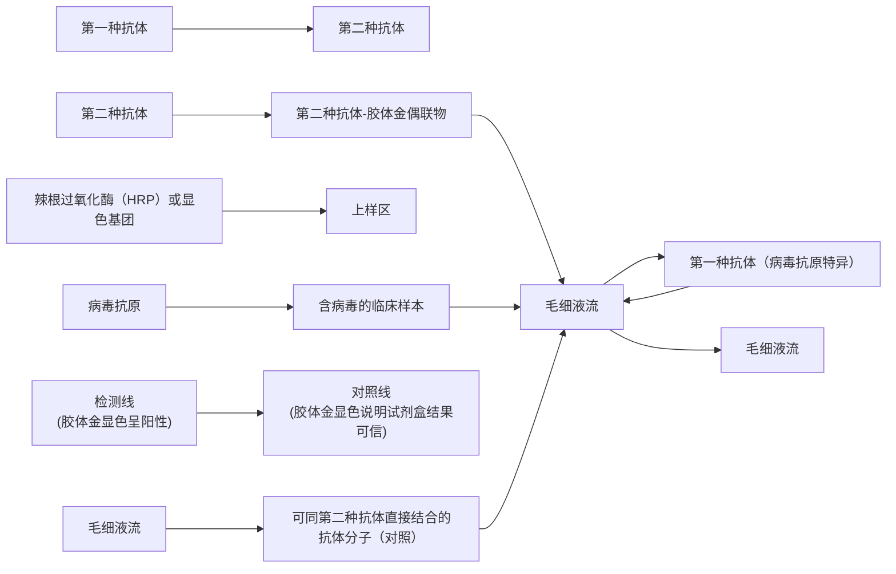

text_image

NC
E
P
C

包涵病毒

出芽病毒

图 5-16 包涵病毒与出芽病毒的形态

E: envelop, 包膜; NC: nucleocapsid, 核衣壳; P: polyhedrin protein, 多面体蛋白质基质; C: Calyx, 蛋白质 - 碳水化合物外壳

目前已知的昆虫病毒包含至少7个病毒科:杆状病毒科、虹彩病毒科、痘病毒科、呼肠孤病毒科、细小病毒科、小RNA病毒科、弹状病毒科。杆状病毒是研究最多的昆虫病毒，杆状病毒家族成员拥有一个大的、环状dsDNA基因组，该基因组被包装在一个具有包膜的杆状病毒颗粒中。这些病毒的特点是它们具有两种不同形态的传染性颗粒（图5-16）:①包涵病毒（occluded virus，OV），许多含有包膜的病毒粒被包裹在由蛋白质构成的晶体状结构（多角体或颗粒体）里，这些晶体状结构可以保护病毒使它们在外界环境中更加稳定。②出芽病毒（budded virus，BV），单一的含有包膜的病毒颗粒。杆状病毒家族包括4个属，其中α杆状病毒和β杆状病毒感染鳞翅目昆

虫（蛾和蝴蝶），而  $\gamma$  杆状病毒和  $\delta$  杆状病毒分别感染膜翅目昆虫（黄蜂和锯蜂）和双翅目昆虫（蚊子）。 $\alpha$  和  $\beta$  杆状病毒分别包括核多角体病毒（nuclear polyhedrosis virus, NPV）和颗粒病毒（granulosis virus, GV），这两个病毒群是杆状病毒家族中被研究得最为深入的。

杆状病毒感染昆虫有两个感染阶段，初级感染由包涵病毒介导，而出芽病毒介导次级感染。昆虫幼虫是最容易受到杆状病毒感染的发育阶段。在幼虫摄食过程中，包涵病毒蛋白质基质在幼虫中肠碱性pH条件下解体，释放出病毒粒，感染中肠上皮细胞。病毒在中肠上皮细胞中经过合成、增殖、组装，首先在不裂解宿主细胞的情况下通过出芽的方式释放出芽病毒，病毒进入体腔以及循环系统，感染血细胞、脂肪体细胞、气管上皮细胞、真皮细胞以及神经节细胞等，进而在这些细胞中大量增殖，造成大面积继发感染。在病毒感染细胞的极晚期，产生大量的包涵病毒，通过裂解细胞的形式释放出来，造成宿主组织破坏，最终导致死亡。同噬菌体感染细菌相似，杆状病毒感染昆虫细胞后的过程具有高度的时序性，且主要体现在病毒基因组的转录层次上。在复制的早期主要表达促进病毒基因组复制的病毒因子，在晚期表达组装以及出芽释放出芽病毒的因子，在极晚期，表达释放包涵病毒的因子，从而使得整个感染过程高效有序地进行。

## 5.5.4 动物与医学病毒

动物病毒指寄生于各类脊椎动物细胞中的病毒，主要包括哺乳类、禽类、爬行类、两栖类以及鱼类病毒。动物病毒严重危害人类和动物的健康。已知的感染人类并导致疾病的医学病毒有300余种，导致其他脊椎动物疾病的病毒达900余种。

动物病毒一般具有种属特异性以及组织特异性，主要因为动物病毒首先同特定的细胞受体相结合。不同的病毒一般使用不同的表面受体，比如 HIV 以 T 细胞表面的 CD4 作为特异受体，而乙型肝炎病毒则利用肝细胞表面特异的胆汁酸转运蛋白 NTCP 作为入侵细胞的受体。一旦动物病毒与受体结合，它们通常通过与细胞质膜融合或通过内吞作用进入宿主细胞。进入细胞后，包裹动物病毒基因组的核衣壳解体，将其遗传物质释放到细胞核或者细胞质中。多数情况下，DNA 基因组进入细胞核，而 RNA 基因组则在细胞质中。在基因组复制以及合成增殖过程中，多数病毒也表现出转录水平上的时序性，并在病毒基因组复制后进行病毒的组装和释放。

70% 以上的人类传染病是病毒引起的。病毒感染有裂解性感染、持续性感染、潜伏性感染和细胞转化（transformation）等多种情形，引发多种急性和慢性疾病。其中对于慢性病毒感染，迄今为止仅有丙型肝炎病毒（hepatitis C virus，HCV）能够被药物治愈，对于所有其他的慢性病毒感染仍然缺乏有效治愈的手段。同时在全球一体化以及人类社会同自然界的边界不断模糊化的进程中，越来越多的新型病毒开始威胁人类健康。有很多新发现的威胁人类健康的病毒属于人兽共患病病毒以及虫媒病毒。由于这些病毒可以在多种不同的宿主群体中循环存在，增加了防治的难度。长期困扰人类的流感病毒、多次出现大流行的冠状病毒都属于人兽共患病病毒；登革病毒和寨卡病毒则是虫媒病毒的代表。

最近的一次全球病毒传染病大流行是由冠状病毒 SARS-CoV-2 引起的。SARS-CoV-2 是一种 +ssRNA 病毒，基因组接近 30 kb，也是感染人类的基因组最大的 RNA 病毒之一。SARS-CoV-2 是一种包膜病毒，包膜上含有刺突蛋白，在电子显微镜下呈现皇冠状。刺突蛋白可以同呼吸道的上皮细胞表面的血管紧张素转化酶 2（ACE2）结合，然后通过直接膜融合或者内吞作用来入侵细胞，并且释放 SARS-CoV-2 基因组。其 +ssRNA 基因组可以直接用来翻译合成复制病毒基因组必需的 RNA 复制酶，从而形成新的子代病毒基因组。该 RNA 复制酶同时可以将 mRNA 基因组转录产生一系列亚基因组 RNA，编码参与病毒装配以及释放的蛋白因子。最终子代病毒通过出芽的方式释放。RNA 病毒的一个典型的特征是变异率很高，主要是因为 RNA 基因组复制酶催化 RNA 复制时的出错率一般较高，从而使得子代病毒更加容易逃逸免疫系统，造成反复感染。

乙型肝炎病毒（hepatitis B virus，HBV）则是一种长期存在并危害人类健康、导致慢性疾病的病毒。全世界有20亿的人曾经被HBV感染，将近3亿人为无法完全治愈的慢性感染者，其中近三分之一的感染者在中国。不加控制的HBV感染会导致严重肝病，包括肝炎、肝纤维化、肝硬化以及肝癌。有近80%的原发性肝癌同HBV的感染相关。HBV疫苗可以有效预防新发感染，但对已经感染了病毒的人群没有治疗作用。如何治愈HBV感染一直是病毒学领域的难题。HBV属于嗜肝DNA病毒科。病毒粒有包膜，包膜表面带有HBV表面抗原糖蛋白。该糖蛋白可以同肝细胞表面受体NTCP结合，从而介导入侵。侵入细胞后，病毒脱去衣壳，将基因组释放进入细胞核中。病毒颗粒中的病毒基因组为松弛环状双链DNA（relax circular DNA，rcDNA），该基因组的特点是DNA两条链长度不一致，并且存在4种基因缺陷，使得该DNA无法直接作为模板转录形成全套的病毒mRNA，需要首先被宿主肝细胞中的修复因子修复形成能够稳定存在的共价闭合环状DNA（covalently closed circular DNA，cccDNA）。cccDNA可以作为模板来转录生成全套的病毒mRNA，进而产生各种病毒蛋白因子来驱动病毒复制、组装以及释放。HBV 通过出芽的方式释放，一般不直接杀死肝细胞，会导致慢性感染。要彻底治愈病毒的感染就必须清除宿主细胞中的病毒基因组，而 HBV 感染治愈的难点在于缺乏能有效抑制以及清除 cccDNA 的方法，这也是 HBV 治疗以及未来研究的核心。

## 5.6 病毒学研究方法

同所有学科的发展一样，病毒学的进展离不开研究方法以及技术手段的突破以及完善。与细菌和真核微生物不同，所有的病毒都必须在宿主细胞中增殖，并且几乎所有的病毒都无法直接用普通光学显微镜观测，所以病毒有一套独特的分离、培养、检测和定量的技术方法。

## 5.6.1 病毒的培养与纯化

病毒培养的主要目的是分离鉴定样本中的病毒，用于制备病毒疫苗，研究病毒的结构、复制周期以及感染宿主细胞后所产生的影响等。由于病毒在活细胞以外无法增殖，所以病毒培养都需要在易感细胞、组织或者活体动物中进行。细菌、动物以及植物病毒培养的具体方法各不相同。

## 5.6.1.1 噬菌体的培养

裂解性噬菌体可以在含有易感细菌的液体培养基或者琼脂固体培养基上生长增殖。液体培养一般用于病毒的扩增从而制备大量的病毒，而固体培养一般用于病毒的分离纯化。当少量的噬菌体接种到含有大量易感细菌的液体培养基中时，噬菌体侵染一部分细胞，复制增殖，将细胞裂解并且释放子代噬菌体。随着培养时间的延长，越来越多的细菌被子代噬菌体感染并发生裂解，噬菌体得到大量的扩增最终使得浑浊的细菌培养物变得澄清。

如图 5-17 所示，在固态培养基上培养病毒的时候，将含有少量的噬菌体样本以及易感细菌的培养基加入 45～50℃ 的熔融低浓度琼脂培养基中，混合均匀后，迅速倾倒入含有固体琼脂的平板中。低浓度琼脂凝固以后会形成含有细菌的固态薄层。在培养箱培养的过程中，薄层中的细菌将增长繁殖成一层不透明的菌苔。与此同时噬菌体先感染裂解少量细菌，释放子代噬菌体，由于低浓度琼脂限制了子代噬菌体的扩散范围，使之仅能感染并裂解周围邻近的细菌。这个感染-裂解周期重复几次之后，在不透明的菌苔的衬托下，这些被噬菌体裂解的区域就会形成一个个圆形透明的空洞，又称为噬菌斑（plaque）（图5-17）。单个的噬菌斑一般仅含有基因组均一的噬菌体，可以被挑出来放入含有易感细菌的液体培养基进行进一步地培养扩增。

图 5-17 噬菌体在固体培养基中感染细菌的实验步骤

flowchart

## 5.6.1.2 动物病毒的培养

动物病毒的培养主要包括细胞、鸡胚及实验动物培养等形式。细胞培养是培养动物病毒最简便的方式，包括原代细胞以及永生化细胞系的培养。原代细胞是将动物的组织进行酶解处理成均一的单个细胞之后，加入到含有营养物质、生长因子等组分的液体培养基中以贴壁或者是悬浮的形式培养。这些细胞仅能分裂很有限的代数，绝大部分细胞在培养一段时间后会停止分裂并且死亡，但极少数的细胞会积累突变转化为可以无限分裂传代的细胞，从而形成永生化细胞系。在含有单层易感原代细胞或者永生化细胞的液体培养基中加入少量病毒，它们将吸附在细胞表面并且侵入细胞，复制产生的子代病毒将感染新的细胞，经过多个感染周期之后，病毒得到扩增。

同噬菌体培养类似，动物病毒的培养也可以在含有琼脂糖或者甲基纤维素等成分的固态培养基中进行，这样子代病毒仅能扩散感染周围的细胞，最终在单层细胞中造成局部细胞受损以及死亡并形成类似噬菌斑的圆形区域，称为噬斑（plaque）。与噬菌斑的观测不同的是，单层菌苔不透明，噬菌斑显而易见，而单层动物细胞半透明，噬斑很难直接观测到，一般需要用结晶紫（crystal violet）或者中性红（neutral red）对细胞进行染色，噬斑区域由于细胞死亡形成不着色区域，从而被观测到。病毒感染可能会造成细胞死亡以及细胞生长缓慢等细胞病变现象。有的病毒感染并不对细胞造成任何表观上的伤害，这种类型的病毒称为非细胞毒性病毒（non-cytopathic virus）。非细胞毒性病毒的感染不会产生噬斑现象。

鸡胚中含有迅速生长分化的不同类型的细胞，可以满足不同病毒培养繁殖的需求。外壳的保护给鸡胚的生长提供了无菌的条件，使得鸡胚成为了病毒培养极佳的体系。每年都有数以亿计的鸡胚被用于培育流感病毒以生产疫苗。根据培养病毒的不同，病毒的接种需要注射进入不同的胚胎组织中（图 5-18）。

活体实验动物培养也是病毒培养的重要方式。常用的动物有小鼠、大鼠、仓鼠和兔子等。由于很多病毒具有种属以及器官特异性，不同的病毒需要接种到不同的动物，甚至是不同的器官中进行增殖。

## 5.6.1.3 植物病毒的培养

植物病毒的培养有三种不同的方式:植物组织培养、分离细胞培养，以及原生质体（去除了细胞壁的细胞）培养。进行植物组织培养时，可使用病毒同磨砂剂（如金刚砂）的混合物对植物的叶片组织进行摩擦接种，当植物的叶片组织中的细胞壁受到破坏后，病毒可与细胞质膜接触并且感染暴露的宿主细胞。有些植物病毒的传播需要将病变的组织嫁接到健康的植物上。植物被感染后，被感染部位经常会出现局部坏死

知识拓展 5-6

HeLa 细胞

图 5-18 病毒在鸡胚中的接种与培养

鸡胚切面图展示不同类型病毒接种到不同的位置进行病毒培养

或者是其他的病症，比如叶片颜色或者叶片形状的变化。

## 5.6.1.4 病毒的纯化

在培养得到大量病毒之后，很多时候需要进一步除去杂质，纯化得到均一的病毒。目前主要的纯化方法包括:病毒沉淀和密度梯度离心。在病毒培养液中加入适当浓度的聚乙二醇可以使病毒发生物理聚沉，但不会使病毒发生不可逆变性。弃去含有杂质的上清之后收集病毒沉淀，用缓冲液悬浮病毒即可获得初步纯化浓缩的病毒悬液，此时的病毒浓缩液中还含有少量杂质，比如蛋白质等，进一步的分离纯化可以通过蔗糖或氯化铯密度梯度离心进行。以蔗糖密度梯度离心为例，将不同浓度的蔗糖溶液缓慢分层注入离心管，其浓度自管顶到管底呈线性上升。将聚乙二醇初步纯化浓缩的病毒悬液平铺于蔗糖梯度的最上层进行离心，在离心力的作用下，物质颗粒会沉降到与它们各自等密度的蔗糖梯度中，由于病毒的密度同蛋白质以及核酸等杂质的密度不同，它们可以被分离开来（图 5-19）。

图 5-19 通过蔗糖密度梯度离心分离提纯病毒颗粒

将含有杂质的病毒样品平铺于蔗糖密度梯度溶液最上层，在超速离心的过程中，所有成分到达与其等密度的蔗糖溶液层，最终达到平衡

flowchart

## 5.6.2 病毒的定量

## 5.6.2.1 直接计数法

病毒的定量和计数是病毒研究中的重要环节，分为直接计数法以及间接计数法。直接计数法包括电镜以及荧光显微镜观测计数。在电镜计数中，可以将病毒样品跟已知浓度的乳胶颗粒混合均匀，然后在电镜下观测并且对病毒颗粒以及乳胶颗粒进行计数，病毒的浓度可以通过病毒颗粒与乳胶颗粒的比值以及乳胶颗粒的浓度计算得到。虽然病毒颗粒太小，在普通光学显微镜下无法直接看到，然而使用荧光染料对病毒的核酸进行染色以后，病毒的核酸可以在落射荧光显微镜（epifluorescence microscope）下直接观测到，这种方法常用在水生环境中病毒的直接观测与计数（图 5-20）。

## 5.6.2.2 间接计数法

病毒的间接定量方法是对病毒的某些属性（血细胞凝集效价、感染单位，或者病毒基因组核酸的拷贝数）进行定量，而不是计算病毒颗粒的绝对数量。间接定量包括

血红细胞凝集试验（hemagglutination assay），噬菌斑/噬斑测定实验，以及荧光定量聚合酶链反应等。一些病毒（如流感病毒）可以结合到红细胞的表面，当病毒跟红细胞的比例达到一定的数值以后，病毒跟相互结合的红细胞会凝集形成一个网状结构，并阻止红细胞的聚沉（图5-21）。具体的操作是将固定数量的红细胞和一系列逐级稀释的病毒样本混合均匀并观测红细胞的凝集情况，引起血细胞凝集（不聚沉）的最高稀释倍数即为病毒的凝集效价（图5-21）。

第二个常用的间接计数法是噬菌斑 / 噬斑测定实验（plaque assay），用于定量病毒的感染单位数，又称病毒效价（virus titer）。以细菌病毒噬菌体为例，噬菌斑测定实验所用的方法同噬菌体在固体培养基上的培养方法相似（见5.6.1），不同的是待测定的病毒悬液需要逐级稀释，然后分别同含有易感细菌的培养基以及熔融的低浓度琼脂培养基混合均匀，最终倾倒于普通固体培养基上（图5-22）。经过一段时间的培养，计算每一种病毒稀释浓度下的噬菌斑的数量。当每个培养皿上噬菌斑的数量为10～100的时候，基本上每一个噬菌斑是由一个初始病毒感染之后经历反复的子代病毒生成以及再感染的过程形成的，即一个噬菌斑代表着一个感染单位。如果在稀释了 $10^{6}$ 倍之后，0.1 mL病毒悬液产生了17个噬菌斑，那么原始未稀释样本中的感染单位数为:

text_image

病毒颗粒
原核生物细胞
藻类细胞

图 5-20 海水样本经 SYBR Green I 染料染色后在落射荧光显微镜下的图像

根据荧光光点的大小及荧光强弱可以大致区分病毒颗粒及细胞

flowchart

(a)

text_image

逐级稀释的病毒样品同固定数量的血红细胞混合
不含病毒样品 A(对照)
1:4 1:8 1:16 1:32 1:64 1:128 1:256 1:512 1:1024 1:2048 1:4096 1:8192
含病毒样品 B

(b)

图 5-21 病毒红细胞凝集效价测定

（a）病毒血红细胞凝集效应示意图；（b）同不含有病毒的对照样品相比，含病毒样品可以使得血红细胞凝集而不聚沉，图中能使血红细胞不聚沉的最高稀释倍数是1024，即为其凝集效价

病毒感染单位数  $=17 \times 10^{6}/0.1 = 1.7 \times 10^{8} PFU/mL$ 。

PFU: plaque forming unit, 噬菌斑 / 空斑形成单位。

当噬菌斑的数量过多的时候，可能出现同一个细胞被多个病毒感染，或者噬菌斑交叠无法准确计数的问题，从而无法准确估算感染单位。值得注意的是，感染单位反映的是溶液中含有的病毒可以造成感染的次数，不是病毒颗粒数量的绝对值。

动物病毒的噬斑测试实验同噬菌体的测试十分相似，但是只有当病毒感染可以造成细胞毒性效应以及细胞死亡的情况下噬斑才能形成。当病毒感染不产生任何细胞毒性效应时，可以使用抗体染色的方法来确定感染单位。实验操作同噬斑实验，不同是需要使用识别病毒蛋白的抗体来标记感染的细胞，最终使用荧光显微镜来观察荧光斑点，计数得到荧光斑点形成单位，与感染单位等价。

植物病毒的定量测定也可以通过类似噬斑的方法。植物的组织就相当于固体培养基，用一定量的植物病毒悬液感染植物的茎叶等组织时，会形成坏死斑（lesion），可以通过类似噬斑的方法来计算出感染单位。

随着科学技术的发展，有更多的方法可以用于定量病毒，比较常用的方法之一是

图 5-22 通过噬菌斑实验进行噬菌体感染单位的定量

病毒样品经过10倍逐级稀释的方法获得稀释液，取0.1 mL的稀释液检测生成噬菌斑的量。选取噬菌斑数量为10\~100的平板进行噬菌斑计数，根据稀释倍数及稀释液的体积即可计算出原病毒样品中感染单位的量

flowchart

This flowchart illustrates the experimental workflow for detecting bacteriophages, showing how different concentrations of a sample are processed through dilution and addition to a petri dish.

感染单位: $1.7 \times 10^{8}$ PFU/mL

荧光定量聚合酶链反应（quantitative PCR，qPCR），该反应可以将病毒样本中的，以及一系列已知浓度的标准品中的核酸分子进行扩增。经过扩增的 DNA 可以结合荧光染料并且发出荧光，样品的荧光强度可以准确地测量并且同样品中的 DNA 的数量成正比。这样通过比较病毒样本以及一系列已知浓度的标准品经过扩增后的荧光强度即可计算出病毒样本中的病毒核酸数量。由于链式聚合反应适用于 DNA 分子，所以 RNA 病毒样本提取出的核酸需要先逆转录形成 DNA，然后通过荧光定量聚合酶链反应来定量。该检测方法定量样本中病毒基因组的数量，不能区分该基因组是来自于具有感染性的病毒还是已经失活的病毒。

## 5.6.3 病毒的检测

不同的病毒一般会在物理形态、基因组，以及蛋白组成上存在区别。所以病毒的检测主要分为直接观测、核酸检测，以及病毒抗原检测这3种模式。不同种属的病毒在形态上会存在很大的差异，在电镜下可以根据病毒颗粒的大小、形状等信息大致估计病毒的类型，比如狂犬病毒特异性的弹状结构、埃博拉病毒的丝状结构等（图5-13）。基因组的检测可以设计特异引物通过聚合酶链反应进行，也可以通过DNA阵列（DNA microarray），或者高通量测序技术进行。病毒颗粒中包含多种病毒蛋白，病毒感染宿主细胞以后也会利用宿主合成其复制包装所必需的病毒蛋白，检测这些病毒特异蛋白质也是检测以及鉴定病毒的重要方法，常用的方法有酶联免疫吸附分析（ELISA）。其具体过程是:将一种可以特异识别病毒蛋白的抗体固定在玻璃或者塑料载体表面，加入含有该病毒蛋白的样本后，病毒蛋白就会被载体表面的特异抗体结合，然后使用第二种可以特异性结合病毒抗原的抗体-酶偶联物来进一步标记抗原，最后加入酶的底物，底物被第二种抗体上偶联的酶转化为发光或显色产物，从而放大病毒蛋白的信号并且被检测到（图5-23）。第二种抗体上的酶也可以用有色或者发光基团取代，比如胶体金，许多常用的病毒检测试剂盒就是使用这种原理的（图5-23b）。

## 5.6.4 病毒的分离

病毒的分离是将可能含有病毒的样本（污水、微生物培养液、患者体液等）经过特殊的处理后接种于易感宿主细胞并进行培养扩增，然后进行检测与纯化。

在采集病毒样本时，须根据病毒的生物学性质、病毒感染的特征、传播途径、流行病学规律以及机体的免疫保护机制，合理地选择采集标本的种类、采集的时间、标本处理的方法以及合理的防护措施。标本一般需通过加入抗菌剂、离心或者过滤的物理方法除菌。为了使细胞内的病毒充分释放，需要使用超声等方法破碎细胞。大部分的病毒对热敏感，所以样本需要低温保存，可以4℃冷藏保存数小时，或者在-20\~-80℃长期冷冻保存。

## 知识拓展 5-7

CRISPR 在病毒核酸检测中的应用

flowchart

图 5-23 酶联免疫吸附分析检测病毒抗原

（a）同病毒蛋白结合的第一种抗体固定于载体表面，可以从待检测样品中富集病毒蛋白，然后使用可以结合病毒蛋白的第二种抗体来标记病毒抗原。第二种抗体上可以使用特异性酶来放大信号检测微量病毒抗原，或者用有色基团来显示阳性信号；（b）抗原快速检测试剂盒的工作原理，第二种抗体用有色基团（胶体金）偶联标记

从收集的样本中分离病毒需要在易感细胞或宿主中进行，同时应考虑操作简便、易于培养、结果容易判断等因素。分离培养的过程如同5.6.1中的病毒培养一节所述，噬菌体的分离可以通过含有易感细菌的液体或者固体培养基进行。液体培养基可以扩增样本中的噬菌体，而进一步通过固体培养基产生的单个噬菌斑可以分离得到单个的具有相同基因型的噬菌体单克隆。而动物病毒则可以通过接种易感原代或者永生细胞系、鸡胚，或者易感实验动物（小鼠、兔子等）进行进一步的扩增，也可以进一步通过噬斑实验来获得基因型均一的病毒克隆。植物病毒则一般接种于植物的茎叶组织、细胞或者原生质体等进行扩增。

## ※ 本章小结

病毒具有特殊的形态结构、多样化的基因组核酸类型以及特别的增殖方式。作为一种专性寄生物，病毒和宿主之间存在复杂的相互作用关系。它可以引起宿主各种疾病，也会推动宿主的适应和演化，在自然界生物圈中发挥独特的重要作用。亚病毒因子是比病毒更简单的感染物。培养、分离、定量，以及研究病毒有赖于一系列专门的技术方法。

## ※ 推荐阅读

1. BALTIMORE D. Expression of animal virus genomes [J]. Bacteriological reviews, 1971, 35: 235-241.

David Baltimore 是逆转录病毒的发现者之一，他因此获得 1975 年诺贝尔生理学或医学奖。在这篇文章中，他提出根据病毒基因表达的路径对病毒进行分类，可以更好地反映病毒之间的系统关系。这篇文章对病毒学的发展产生深远影响。

2. TUMPEY T M, BASLER C F, AGUILAR P V, et al. Characterization of the reconstructed 1918 Spanish influenza pandemic virus [J]. Science, 2005, 310: 77–80.
1918 年暴发了一场全球性大流感（西班牙流感）。当时人们对病毒所知甚少，更谈不上分离毒株。80 多年后，研究者用分子生物学技术获得了 1918 年流感病毒的基因组序列信息。这篇文章利用这些信息重构了 1918 病毒株并开展研究，为认识流感病毒高致病性的机制提供了可能。
3. LI W, MOORE M J, VASILIEVA N, et al. Angiotensin-converting enzyme 2 is a functional receptor for the SARS coronavirus [J]. Nature, 2003, 426: 450-454.

2003 年，SARS 席卷全球多国。当年 4 月研究者确定病原体是一种新的冠状病毒 (SARS-CoV)。这篇于当年 11 月发表的文章成功地鉴定了该病毒的受体 ACE2，为认识病毒的感染致病机制提供了重要的信息。
4. SHI M, LIN X-D, TIAN J H, et al. Redefining the invertebrate RNA virosphere [J]. Nature, 2016, 540 (7634): 539–543.

对于病毒的传统认知高度依赖病毒的分离培养，基因测序技术为打破这种限制提供了可能。中国科学家的这篇文章通过对野生无脊椎动物样本进行大规模高通量 RNA 测序，获得了大量病毒基因组信息，从中发现许多前所未知的病毒，很大程度上改变了人们对地球 “RNA 病毒圈” 的认知。

## ※ 开放性讨论题

1. 有人认为病毒可以感染细胞和进行增殖，所以是有生命力的；也有人认为病毒粒就是核酸和蛋白质等构成的化学颗粒，离开细胞没有活力，因此没有生命力。你怎么看？为什么？
2. 病毒在自然界广泛分布，可以感染各种生物。请讨论病毒对自然界生态平衡和生物多样性可能会有什么样的影响。

## ※ 复习思考题

1. 病毒粒有哪几种基本结构？形成病毒粒对病毒有什么意义？
2. 可以用哪些方法对病毒粒进行定量？它们各有什么优缺点？
3. 什么是巴尔的摩（Baltimore）病毒分类？它和病毒系统分类法有什么关系？

4. 比较病毒、类病毒、卫星病毒以及朊病毒，说明各自的特点及相互之间的差异。
5. 病毒感染有哪些主要类型？举例说明不同感染类型的病毒与人类疾病的关系。
6. 病毒入侵动物细胞和植物细胞的方式有何区别？为什么？

(钟江 魏磊)

# 微生物的营养与培养基

## 导语

营养是生物体从外部环境中摄取对其生命活动必需的能量和物质，以满足正常生长和繁殖需要的一种生理过程。微生物种类繁多，代谢能力多样，对营养物质的需求也不同。微生物细胞的化学组成与微生物营养物质的类别和生理作用密切相关；根据能源、碳源和电子供体的差异，可将微生物划分为五大营养类型；受营养物质的理化性质、细胞膜（包括细胞壁）结构以及细胞内外环境差异等因素影响，微生物细胞摄取营养物质存在着被动运输和主动运输的多种方式；依据培养基的配制原则与方法，可人工设计和配制多类型培养基，以实现微生物培养和应用；未培养微生物具有丰富的多样性和功能，是自然界中重要的微生物资源，亟须开发新的技术和方法来获得其纯培养物。

## 关键词

生命元素，营养物质，营养类型，营养物质摄取，培养基，未培养微生物

## 6.1 微生物细胞的化学组成

构成微生物细胞的化学元素称为生命元素（bioelement），包括碳、氧、氢、氮和其他十余种矿质元素。根据微生物生长时对各类化学元素需求量的大小，将其分为主要元素（macroelement）和微量元素（microelement），前者被称为常量元素，后者也称为痕量元素（trace element）。主要元素中，碳、氮、氧、氢、磷和硫这6种元素可占微生物细胞干重的97%，构成了细胞中的糖类、脂质、核酸和蛋白质；镁和钾通常作为酶的辅助因子（co-factor），而钙通常作为调节信号分子，在细菌芽孢耐热性方面也起到重要作用。微量元素是指那些在微生物生长过程中起重要作用，而机体对这些元素的需求量微小的元素，主要包括锌、锰、氯、钼、硒、钴、铜、钨、镍和硼等，有些微量元素还可作为酶或辅助因子的组分辅助催化反应，维持蛋白质结构的稳定，例如 $Zn^{2+}$ 是一些酶活动中心的组成部分， $Mo^{2+}$ 是生物固氮作用所必需的离子。

各种微生物细胞的化学组成基本相似，但组成微生物细胞的各类化学元素的比例会因微生物的种类、菌龄和生长条件的不同而在一定范围内发生变化。如碳、氮、氧、氢、磷、硫这6种常量营养元素约占微生物细胞干重的97%，但在细菌、酵母菌和霉菌中的比例具有差异（表6-1）。某些细菌，如硫细菌、铁细菌和海洋细菌，其细胞中分别含有较多的硫、铁、钠和氯。处于不同菌龄的微生物细胞，其化学元素的含量和相互比例也会发生变化，细菌在对数生长期往往具有较高的氧含量，而在稳定期氧和碳元素之间的比值较低；大肠杆菌在对数生长期时具有较高的氮碳比，而需钠弧菌（Vibrio natriegens）在对数生长期和稳定期的氮碳比没有明显区别。培养基的组成也能影响微生物细胞化学元素的含量，如生长在富含氮源培养基中的细胞相对于生长在贫氮培养基中的细胞具有更高的氮含量。

表 6-1 微生物细胞中几种常量营养元素的含量（干重百分比 /%）

| 元素 | 细菌 | 酵母菌 | 霉菌 |
| --- | --- | --- | --- |
| 碳 | 50~53 | 45~50 | 40~63 |
| 氮 | 12~15 | 7~12 | 7~10 |
| 氧 | ~20 | ~30 | ~40 |
| 氢 | ~8 | ~7 | ~7 |
| 磷 | ~3 | - | - |
| 硫 | ~1 | - | - |

微生物细胞中的各种元素主要以水、有机物、无机物形式存在。水通常占细胞湿重的 $70\% \sim 90\%$ ，有机物主要包括蛋白质、糖类、脂质、核酸、维生素以及它们的降解产物和一些代谢产物等物质，无机物是指与有机物相结合或游离存在于细胞中的无机盐等物质。

生命化学以水为基础，水是微生物细胞中含量最高的成分。细胞的含水量为细胞湿重（wet weight）与干重（dry weight）之差，常以百分率表示:（湿重-干重）/湿重×100%。将细胞表面残留水分尽量除去后所得的质量即为湿重，以每升培养液中所含有的细胞质量（g/L）表示。由于细胞在收集过程中会聚集成团，细胞表面以及细胞与细胞之间的水分除去程度不同，从而对测定结果带来误差，一般未完全去除水分占湿重的10%。将一定质量的鲜细胞，在105℃高温下，或在低温（60℃）真空下干燥，或红外线快速干燥至恒重，测出细胞干重，通常以g/L或mg/mL表示。高温干燥法易导致细胞物质分解，故一般采用后两种方法。微生物细胞含水量因微生物种类和生长期以及所处环境有所不同，通常细菌的含水量为细胞湿重的75%\~85%，酵母菌为70%\~85%，丝状真菌为85%\~90%，而休眠细胞的含水量通常低于正在生长的营养细胞，细菌芽孢含水量约为40%，霉菌孢子含水量约为38%，某些曲霉的分生孢子的含水量可低至20%。有文献报道，酵母菌在20℃生长时，细胞含水量可达91%，在43℃生长时细胞含水量则为74%。此外，大肠杆菌在适合的培养条件下，每升培养液可产生25\~30 g干细胞，酵母菌可产生40 g以上干细胞。近年来，采用高密度培养技术，可达到120 g/L干酵母的产量。细胞内的水可分为两种类型:一种是游离水（自由水），具有正常水的性质；另一种是结合水，其性质发生了某些变化，如不易挥发，不具流动性、不能作为溶剂等。

细胞有机物的组成随着微生物的种类（表6-2）、生长阶段的不同而发生变化。根据有机物在微生物细胞中的作用可将其分为三类:一是结构物质，包括高分子的蛋白质、多糖、核酸和脂质等，它们是细胞壁、细胞核、细胞质和细胞器等的主要组成成分；二是贮藏物质，包括存在于细胞内的多糖和脂质，如淀粉、糖原、脂肪等；三是代谢底物和产物，包括存在于细胞内的糖、氨基酸、核苷酸、有机酸和维生素等低分子量化合物，它们既是细胞内同化成高分子化合物的前体，也是进一步分解代谢的中间产物，有些还能以次级代谢产物的形式积累于细胞内或分泌到环境中。有机物成分分析一般采用化学法直接抽提细胞内的各种有机成分，然后进行定性和定量分析；也可对细胞破碎后获得的亚显微结构进行化学成分的分析。无机物成分分析一般是将恒重的干燥细胞进一步在高温炉（550℃）中焚烧，所得到的灰分物质是各种无机元素的氧化物，称为灰分（ash constituent）。采用无机化学分析的方法可定性和定量分析各种元素在灰分中的含量。通常，在灰分物质中，磷的含量最高（表6-3），大部分微生物的磷氧化物含量可达总灰分的50%，其次为K、Mg、Ca、S、Na、Fe等。此外，还有极微量的Cu、Mn、Zn、B、Mo、Si等元素。

表 6-2 微生物细胞主要有机成分含量（干重百分比 /%）

| 成分 | 细菌 | 酵母菌 | 霉菌 |
| --- | --- | --- | --- |
| 蛋白质 | 50~80 | 32~75 | 14~52 |
| 核酸 | 10~20 | 6~8 | 1~2 |
| 糖类 | 12~28 | 27~63 | 7~40 |
| 脂质 | 5~20 | 2~15 | 4~40 |

表 6-3 微生物细胞物质中灰分元素含量的百分比 /%

| 灰分物质 | 固氮菌 | 乙酸细菌 | 酵母菌 | 霉菌 |
| --- | --- | --- | --- | --- |
| $P_{2}O_{5}$ | 4.95 | 2.71 | 3.54 | 4.85 |
| $SO_{3}$ | 0.29 | - | 0.04 | 0.11 |
| $K_{2}O$ | 2.41 | 1.28 | 2.34 | 2.81 |
| $Na_{2}O$ | 0.07 | 0.16 | - | 1.12 |
| MgO | 0.82 | 0.48 | 0.43 | 0.38 |
| CaO | 0.89 | 0.64 | 0.38 | 0.19 |
| $Fe_{2}O_{3}$ | 0.08 | 0.62 | 0.04 | 0.16 |
| $SiO_{2}$ | - | 0.04 | 0.09 | 0.04 |
| CuO | - | 0.10 | - | - |

## 6.2 微生物的营养物质

营养（nutrition）是指生物体从外部环境中摄取对其生命活动必需的能量和物质，以满足正常生长和繁殖需要的一种最基本的生理功能。生物必须从外界摄取营养物质，以获取能量及合成自身细胞组分。营养物质（nutrient substance）是指环境中存在的能满足微生物生长、繁殖和进行各种生理活动所需的物质，是微生物生命活动的物质基础。构成微生物细胞的各种化学元素都来源于微生物所生存的环境，它们存在的形式分为无机物和有机物，存在的状态可以是固体、溶解于水的离子和有机物、气态分子。根据营养物质在机体中的主要生理作用，将其分为六大类:碳源（carbon source）、氮源（nitrogen source）、能源（energy source）、无机盐（mineral salt）、生长因子（growth factor）和水。

## 6.2.1 碳源

地球上已知的生物都是碳基生物，碳元素可占微生物细胞干重的 50%，是最重要的营养元素。凡是能为微生物生长提供所需碳元素的营养物质都称为碳源（carbon source）。碳源物质通过微生物的分解利用，不仅为菌体本身的生物合成提供碳架来源，还可为生命活动提供能量，因此，碳源往往也可作能源。微生物细胞物质及其代谢产物几乎都含有碳，所以碳是微生物细胞需要量最大的元素，又称大量营养物质（macronutrient）。

微生物可利用的碳源范围称作碳源谱（spectrum of carbon sources）。微生物的碳源谱极其广泛，从简单的无机碳化合物（CO、$\mathrm{CO}_{2}$、$\mathrm{NaHCO}_{3}$、$\mathrm{CaCO}_{3}$）到复杂的天然有机含碳化合物，可利用的有机含碳化合物约有700万种（表6-4）。碳源可分为无机碳和有机碳两大类。由于碳源在微生物生长中所处的重要地位，根据微生物所需碳源的类型，将微生物的营养类型分为自养型（autotroph）和异养型（heterotroph）。自养型微生物能以无机碳作为唯一或主要碳源，并利用从光能或无机物的氧化获得的能量，将无机碳还原为糖类，进而转化为复杂的多糖、类脂、蛋白质和核酸等细胞物质；异养型微生物必须利用有机碳源，通过代谢作用为机体提供碳素来源。此外，大多数有机碳源物质还能为机体生长提供能量来源，因此这些有机碳源也被称为双功能营养物（difunctional nutrient）。

表 6-4 微生物的碳源谱

<table><tr><td>类型</td><td>构成元素</td><td>化合物</td><td>培养基原料</td></tr><tr><td rowspan="2">无机碳</td><td>C、O</td><td>CO、 $CO_{2}$ </td><td>CO、 $CO_{2}$ </td></tr><tr><td>C、O、 $X^{*}$ </td><td> $NaHCO_{3}$ 、 $CaCO_{3}$ 等</td><td> $NaHCO_{3}$ 、 $CaCO_{3}$ 、白垩等</td></tr><tr><td rowspan="4">有机碳</td><td>C、H</td><td>碳氢化合物</td><td>烃类、苯、天然气、石油、石蜡等</td></tr><tr><td>C、H、O</td><td>糖、有机酸、醇类、脂质等</td><td>葡萄糖、蔗糖、淀粉、糖蜜、纤维素、甘油、有机酸、脂肪酸等</td></tr><tr><td>C、H、O、N</td><td>多数氨基酸、简单蛋白质等</td><td>一般氨基酸、明胶等</td></tr><tr><td>C、H、O、N、X</td><td>复杂蛋白质、核酸等</td><td>牛肉膏、蛋白胨、花生饼粉、豆粕等</td></tr></table>

\*X: 指除 C、H、O、N 的任何其他一种或多种元素。

根据元素组成，最简单的碳源是单质碳，然而自然界还没有发现能够直接利用单质碳的微生物。无机碳中的  $CO_{2}$ 、 $NaHCO_{3}$ 、 $CaCO_{3}$  等，碳原子已经被完全氧化，在自养型微生物中被用作电子受体。CO 可继续被氧化为  $CO_{2}$ ，为硫酸盐还原菌（sulphate-reducing bacteria）等提供能量。最简单的有机碳类化合物是碳氢化合物，包括烷烃、烯烃、炔烃、苯、天然气、石油和石蜡等。能利用此类化合物的微生物被称为烃类降解菌（hydrocarbon-degrading bacteria），主要分布于假单胞菌属（Pseudomonas）、芽孢杆菌属（Bacillus）、棒状杆菌属（Corynebacterium）、葡萄球菌属（Staphylococcus）、链球菌属（Streptococcus）、志贺菌属（Shigella）、产碱杆菌属（Alcaligenes）等 10 个菌属，芽孢杆菌是最有效的碳氢化合物降解菌。

对于异养型微生物而言，最适作为碳源的是含 C、H、O 原子的有机碳，其中糖类是最被广泛利用的碳源，其次为醇类、有机酸和脂质。在糖类中，单糖优于双糖和多糖，己糖优于戊糖，葡萄糖、果糖优于甘露糖和半乳糖，淀粉明显优于纤维素和几丁质等同多糖，同多糖明显优于琼脂和木质素等杂多糖。实验室中常用的碳源有:葡萄糖、果糖、蔗糖、淀粉、甘露糖、甘油、有机酸等。微生物工业发酵所利用的主要碳源有:糖蜜（制糖工业副产品）、淀粉（山芋粉、玉米粉、面粉、麸皮、米糠、野生植物淀粉）等。氨基酸、牛肉膏、蛋白胨等虽然也能为微生物提供碳元素，但用作碳源不够经济，一般将其作为氮源使用。

不同微生物的碳源谱有很大的区别。某些微生物碳源谱很广，例如，假单胞菌属的某些种可以利用90余种不同类型的有机化合物作为碳源。而某些微生物则非常挑剔，只能利用少数含碳化合物。甲基营养型细菌只能利用甲醇和甲烷等一碳化合物作