为碳源，产甲烷菌仅能利用  $CO_{2}$  和少数一碳或二碳化合物。虽然糖类物质通常是许多微生物最容易利用的碳源与能源物质，但是微生物对不同糖类物质的利用也有差别，例如，在葡萄糖和乳糖并存的培养基中，大肠杆菌优先利用葡萄糖（称为速效碳源），然后利用乳糖（称为迟效碳源），呈现二次生长现象。

## 6.2.2 氮源

凡是为微生物生长繁殖提供氮元素的营养物质称为氮源（nitrogen source）。氮元素在微生物细胞中的含量仅次于碳和氧元素，是构成蛋白质和核酸等物质的主要成分，氮占细菌干重的 $12\% \sim 15\%$ ，故与碳源相似，氮源也是微生物的主要营养元素。

微生物可利用的氮源范围称作氮源谱（spectrum of nitrogen source）。微生物的氮源谱也非常广泛，分为无机氮和有机氮两类（表6-5）。在自然界中，氮元素呈现多种价态，从+5价氧化态的硝酸盐到-3价还原态的铵。处于各价态的氮都可作为微生物的氮源，所以，微生物在地球的氮素循环中处于重要地位。一部分微生物是不需要利用氨基酸作氮源的，它们能把尿素、铵盐、硝酸盐甚至氮气等简单氮源自行合成所需要的一切氨基酸，因而可称为氨基酸自养型生物（amino acid autotroph）；反之，凡需要从外界吸收氨基酸作氮源的微生物，称为氨基酸异养型生物（amino acid heterotroph）。

表 6-5 微生物的氮源谱

<table><tr><td>类型</td><td>构成元素</td><td>化合物</td><td>培养基原料</td></tr><tr><td rowspan="3">无机氮</td><td>N</td><td> $N_{2}$ </td><td>空气</td></tr><tr><td>N、O</td><td>硝酸盐等</td><td> $KNO_{3}$ 等</td></tr><tr><td>N、H</td><td> $NH_{3}$ 、铵盐等</td><td> $(NH_{4})_{2}SO_{4}$ 、氨水等</td></tr><tr><td rowspan="2">有机氮</td><td>N、C、H、O</td><td>尿素、一般氨基酸等</td><td>尿素、蛋白质、明胶等</td></tr><tr><td>N、C、H、O、 $X^{*}$ </td><td>复杂蛋白质、核酸等</td><td>牛肉膏、酵母膏、花生饼粉、豆粕等</td></tr></table>

$X^{*}$ :指除 C、H、O、N 的任何其他一种或多种元素。

最简单的氮素化合物为  $N_{2}$ ，固氮微生物（nitrogen-fixing organism，diazotroph）通过其固氮酶系统将空气中的氮分子还原为  $NH_{3}$ ，再进一步合成各种有机氮化合物。固氮微生物广泛分布于细菌和古菌，包括能够独立生活的脱硫弧菌属（Desulfovibrio）、产甲烷球菌属（Methanococcus）、梭菌属（Clostridium）、克雷伯菌属（Klebsiella）、固氮菌属（Azotobacter）、红杆菌属（Rhodobacter）、蓝细菌（cyanobacteria）等，以及与豆科植物共生的根瘤菌属（Rhizobium）。由于固氮酶系能被氧分子不可逆失活，同时受铵的可逆抑制［铵开关（ammonium switch）］，所以微生物的固氮反应需要在无氧或低氧分压环境中进行，同时环境中应缺乏铵（盐）分子。自然界中处于氧化态的无机氮源主要是硝酸盐，如  $KNO_{3}$  等，可被细菌、霉菌等吸收，还原为  $NH_{4}^{+}$ 后用于生物合成。生物体在能量代谢中将其他形式的无机氮转化为  $NH_{4}^{+}$  的过程称为反硝化作用（denitrification），反之则是硝化作用（nitrification）。以硝酸盐为氮源培养微生物时， $NO_{3}^{-}$  被吸收导致培养基 pH 升高，因而称为生理碱性盐（physiologically alkaline salt）。还原态的无机氮源主要是铵盐，如  $(\mathrm{NH}_{4})_{2}\mathrm{SO}_{4}$ ，其  $NH_{4}^{+}$  被细胞吸收后直接利用，因而  $(\mathrm{NH}_{4})_{2}\mathrm{SO}_{4}$  等铵盐一般被称为速效氮源。以  $(\mathrm{NH}_{4})_{2}\mathrm{SO}_{4}$  为氮源培养微生物时， $NH_{4}^{+}$  被吸收导致培养基 pH 降低，因而称为生理酸性盐（physiologically acid salt）。为避免培养基 pH 变化对微生物生长造成的不利影响，需要在培养基中加入缓冲物质，或者添加酸或碱，使 pH 维持在恒定的范围内。

尿素是最简单的有机氮源，可被固氮微生物以及一些细菌、真菌用作氮源，但是对某些植物和人类病原菌，如新型隐球菌（Cryptococcus neoformans）、粗球孢子菌（Coccidioides immitis）、幽门螺杆菌（Helicobacter pylori）、奇异变形杆菌（Proteus mirabilis），则是一种毒力因子。其他有机氮源主要是动植物及微生物来源的蛋白质和核酸及其不同程度的加工物和降解产物（牛肉膏、酵母膏、玉米浆、蛋白胨、氨基酸等有机氮化合物）。这些有机氮源需要被降解为基本结构单元（氨基酸、核苷酸）才能被微生物利用。玉米浆中的有机氮主要以降解产物——氨基酸的形式存在，可被微生物快速吸收利用，作用速度快，因此是速效氮源。而花生饼粉、豆粕等中的有机氮以大分子形式存在，需要降解为肽和氨基酸才能被微生物吸收利用，作用速度慢，因此是迟效氮源。速效氮源和迟效氮源分别在菌体生长和代谢产物的形成中发挥了不同的作用，两种氮源的配制比例对工业微生物具有重要影响。

## 6.2.3 能源

为微生物生命活动提供最初能量来源的物质称为能源（energy source），可分为两类:光能和化学能。以光能为能量来源的微生物称为光能营养型生物（phototroph），如藻类、蓝细菌、绿硫细菌、红螺菌等。这些微生物细胞中含有叶绿素或菌绿素（bacteriochlorophyll），能够捕捉光能，将其转化为化学能供细胞代谢。需要指出的是，叶绿素和菌绿素的最大吸收波长不同，不同光合细菌的菌绿素分子结构也有差异，从而导致最大吸收波长不同，这种结构多样性使不同光合细菌可共存于同一生态环境。紫色的嗜盐古菌属（Halobacterium）在厌氧光照条件下能够产生一种对光线敏感的膜蛋白——菌视紫红质（bacteriorhodopsin），与视网膜中的视紫红色素相似。菌视紫红质能够捕捉光能，将细胞内的质子泵出胞外，胞外高浓度的质子扩散进入胞内的过程中驱动ATP合酶（ATP synthase）合成ATP。菌视紫红质的吸收波长为500～650 nm，最大吸收波长为568 nm。

绝大多数微生物的能量来源是化学能，能提供化学能的化合物包括无机物和有机物。处于还原态的无机物，如  $NH_{3}$ 、 $NH_{4}^{+}$ 、 $NO_{2}^{-}$ 、S、 $H_{2}S$ 、 $H_{2}$ 、 $Fe^{2+}$  等，在氧化过程中释放能量。能够利用这些无机物氧化所释放的能量的微生物都是细菌和古菌，称为化能无机营养型生物（chemolithotroph），如亚硝酸细菌、硫化细菌、硫细菌、氢细菌、铁细菌等。利用有机物氧化作为能量来源的生物称为化能有机营养型生物（chemoorganotroph），为微生物提供能量的有机物主要是糖类，在生物氧化过程中为微生物提供能量。虽然含氮类有机物，如蛋白质、核酸也能为微生物提供能量，但是在微生物培养中一般不作为能量物质使用。

## 6.2.4 无机盐

无机盐（inorganic salt）是除碳源、氮源、能源外，微生物生长繁殖提供必不可少的矿物营养元素。无机盐在细胞中的主要生理功能有:构成酶的组成成分、维持生物大分子和细胞结构的稳定性、调节并维持细胞的渗透平衡、控制细胞的氧化还原电位和作为某些微生物的能源物质等。依据微生物生长繁殖对无机盐需求量的大小，可分为常量营养元素和微量营养元素两类。常量营养元素所需浓度为  $10^{-4} \sim 10^{-3}$  mol/L，如 P、S、K、Ca、Mg 等；微量营养元素所需浓度在  $10^{-8} \sim 10^{-6}$  mol/L 范围，如 Cu、Zn、Mn、Co 等。当然，这是为了工作方便而人为划分的，不同种微生物所需要无机元素浓度有时差别很大，例如， $G^{-}$ 细菌所需 Mg 就比  $G^{+}$ 细菌约高 10 倍。

① 磷（P）。磷是细胞合成核酸、磷脂、重要辅酶、ATP的基本原料，任何微生物的生长都不能离开磷元素。微生物可利用的磷营养物为各种无机磷酸盐以及含磷有机物。磷酸盐在培养基中还起到了缓冲剂的作用。培养基配制中常用 $K_{2}HPO_{4}$ 和 $KH_{2}PO_{4}$ 作为微生物的磷源，并起到了调节培养基pH的作用。
② 硫（S）。硫是某些氨基酸（甲硫氨酸、半胱氨酸）、维生素（维生素 $B_{1}$ 、生物素、硫辛酸）、辅酶A的组成成分，在某些微生物基因组中修饰DNA。还原态硫化合物是某些化能营养型微生物的能源物质（电子供体），氧化态硫化合物则是硫酸盐还原菌的电子受体。硫元素在自然界中以多种价态存在，如单质硫、还原态的金属硫化物和硫化氢、氧化态的亚硫酸盐和硫酸盐及含硫有机物。各价态的含硫化合物都能被不同微生物所吸收利用，多数微生物细胞以无机硫化合物为硫源，如硫酸盐和硫化物。
③ 钾（K）。所有生物都需要钾离子。钾在蛋白质合成中发挥重要作用，是一些酶的激活剂；可影响细胞膜的透性，进而影响物质的跨膜运输；钾离子还在维持细胞内外的电位差和渗透压中发挥了重要作用。自然界中的钾一般以离子形式存在于矿物和海水中，培养基中以各种钾盐形式添加。
④ 钙（Ca）。钙在维持微生物细胞壁的稳定性和芽孢的热稳定性方面起到了重要作用，是某些原生动物（如孔虫目、放射虫）外壳的组分（ $CaCO_{3}$  形式），是某些胞外酶和蛋白酶的激活剂。但是，对于很多微生物的生长来说，钙不是必需营养物，培养基配制中以钙盐方式添加。
⑤ 镁（Mg）。镁对核糖体、细胞膜和核酸起到了稳定作用，是一些酶的辅助因子、激活剂或调节剂，比如己糖磷酸化酶、异柠檬酸脱氢酶、核酸聚合酶等的活性中心组分。通常以镁盐，如  $MgCl_{2}$ 、 $MgSO_{4}$  的形式加入培养基。
⑥ 钠（Na）。钠离子主要与膜的活性有关，参与了某些类型的运输作用，另外与维持细胞内渗透压有关。并不是所有微生物的生长都需要钠离子，通常海洋微生物的生长需要较高浓度的钠离子。钠离子的存在方式和培养基添加方式与钾离子相似。

⑦ 铁（Fe）。铁是细胞色素（cytochrome）以及电子传递中的铁硫蛋白（iron-sulfur protein）的组分，因而在细胞呼吸中具有重要作用。另外，铁还是某些铁细菌的能源物质。自然界中，在无氧条件下，铁通常以 +2 价可溶状态存在；而在有氧条件下，铁通常以 +3 价不溶性的矿物形式存在。在培养基中通常根据培养菌种的需要添加 FeCl₃、FeSO₄，或者铁离子螯合物。

微量元素主要是一些金属元素，它们在微生物的生长过程中需求量极其微小，但是所起到的作用非常重要，通常是酶的组成成分或者作为辅因子使酶活化（表6-6）。如果缺乏微量元素，常常导致微生物的生长停止或生理活性降低。微生物的种类不同，对微量元素需求的种类和需求量也不相同。许多微量元素是重金属，过量会对机体产生毒害作用。在天然有机物、水、培养器皿和化学试剂中往往含有足够满足微生物生长所需的微量元素，一般没有特殊原因，配制培养基时没有必要加入。

除了常量元素和微量元素外，一些具有特殊形态结构和在特殊环境下生长的微生物具有特殊的矿质元素要求。例如，硅藻需要硅酸（ $H_{2}SiO_{3}$ ）来合成其富含二氧化硅（ $SiO_{2}$ ）的细胞壁；一些生活在盐湖和海洋中的嗜盐菌则需要在高浓度钠离子（ $Na^{+}$ ）存在的情况下正常生存。

表 6-6 微生物所需微量元素及其主要生理功能

| 元素 | 生理功能 |
| --- | --- |
| 铜(Cu) | 是一些酶的辅因子,还存在于电子传递系统中的铜蛋白、一些超氧化物歧化酶 |
| 锌(Zn) | 存在于碳酸酐酶、乙醇脱氢酶、RNA和DNA聚合酶和一些DNA结合蛋白 |
| 锰(Mn) | 是一些酶的激活剂,存在于特定超氧化物歧化酶、水裂解酶(蓝细菌) |
| 钴(Co) | 存在于维生素$B_{12}$、转羧基酶(丙酸杆菌) |
| 钼(Mo) | 存在于固氮酶、硝酸盐还原酶、亚硝酸盐氧化酶、含核黄素的酶以及一些甲酸脱氢酶 |
| 镍(Ni) | 存在于氢化酶(氢细菌)、辅酶$F_{340}$(产甲烷菌)、一氧化碳脱氢酶(产甲烷菌,红螺菌等)、脲酶 |
| 硒(Se) | 存在于甲酸脱氢酶、硒代半胱氨酸和一些氢化酶 |
| 钨(W) | 存在于一些甲酸脱氢酶、氧转移酶(超嗜热微生物) |
| 钒(V) | 存在于钒固氮酶、溴代过氧化物酶 |

## 6.2.5 生长因子

生长因子（growth factor）是某些微生物生长所必需，但其自身又不能合成或合成量不足，需外界提供的微量有机化合物。根据其化学结构和在机体中的生理功能分为维生素、氨基酸、嘌呤和嘧啶3大类。维生素是微生物生长最常需要的生长因子，其主要功能是作为酶的辅基或辅酶成分。主要维生素的功能见表6-7，其中许多微生物生长都需要维生素 $B_{1}$ 、 $B_{6}$ 、 $B_{12}$ 和生物素（biotin）。不同微生物合成氨基酸的能力差别很大。有些细菌，如大肠杆菌自身能合成全部氨基酸，不需补充；有些细菌，如伤寒沙门菌能合成所需的大部分氨基酸，只需补充色氨酸；但也有些细菌合成氨基酸能力极弱，如肠膜明串珠菌（Leuconostoc mesenteroides）需外界提供17种氨基酸和多种维生素才能生长。嘌呤和嘧啶主要用于合成核酸和构成辅酶成分，所以处于旺盛生长阶段的微生物需要较高浓度的嘌呤和嘧啶。此外，某些小分子有机物，如脂肪酸、卟啉、甾醇、胆碱等，是某些微生物生长需要而自身不能合成的物质，这些小分子有机物可被认为是广义的生长因子。

表 6-7 主要维生素的生理功能

| 维生素 | 生理功能 |
| --- | --- |
| 维生素$B_1$(thiamine) | 脱羧酶、转酮酶、转醛酶的辅基,参与氧化脱羧和酮基转移 |
| 维生素$B_6$(pyridoxine) | 氨基酸消旋酶、脱羧酶、转氨酶的辅基 |
| 维生素$B_{12}$(cobalamin) | 钴酰胺辅酶,与甲硫氨酸和胸腺嘧啶核苷酸的合成和异构化有关 |
| 生物素(biotin) | 羧化酶辅基,与脂肪酸合成、脱羧、某些$CO_2$固定有关 |
| 叶酸(folic acid) | 辅酶F(四氢叶酸),与核酸合成有关 |
| 硫辛酸(lipoic acid) | 辅酶,在丙酮酸和$\alpha$-酮戊二酸脱羧中参与酰基转移 |
| 烟酸(nicotinic acid) | $NAD^+$前体,氧化还原反应中转移电子 |
| 泛酸(pantothenic acid) | 辅酶A前体,活化酰基及酰基衍生物 |
| 核黄素(riboflavin) | FMN前体,与黄素蛋白的电子转移有关 |

按微生物对生长因子的需要，可将微生物分为三种类型:①生长因子自养型微生物（auxoautotroph），指能自行合成生长因子，不需从外界补充生长因子的微生物。②生长因子异养型微生物（auxoheterotroph），指自身缺乏合成一种或多种生长因子的能力，需外源提供所需生长因子才能生长的微生物。③生长因子过量合成型微生物，指在代谢活动中向细胞外分泌大量的维生素等生长因子，可用于生产维生素的一类微生物。能提供丰富生长因子的天然物质有:酵母膏、牛肉膏、麦芽汁、玉米浆、新鲜动植物组织或细胞浸液和微生物生长环境的浸提液等。

## 6.2.6 水

除蓝细菌等少数光能自养型微生物能利用水中的氢来还原  $CO_{2}$  合成糖类外，其他微生物并非真正把水当作营养物质。即使如此，由于水在微生物代谢活动中的不可缺少性，故仍应作为营养要素来考虑。

水是生命活动不可缺少的物质，在微生物细胞中通常占湿重的 70%\~90%。水的主要生理功能为:

① 水是良好的溶剂，原生质溶胶状态的保持、营养物质的吸收、代谢产物的分

泌、大多数生化反应的进行都必须以水为介质。

② 水的比热高，是良好的热导体，能有效地吸收代谢过程释放的热量，控制细胞内的温度变化。
③ 保持 DNA、蛋白质以及细胞器结构的稳定性。
④ 维持细胞的正常形态。

水以结合水和游离水两种状态存在，微生物细胞内游离水与结合水的比例大约为4:1，两者的生理功能有所不同。结合水是水与溶质或其他分子形成的水合物，不能被微生物利用。游离水是可被微生物利用的水，一般用水活度（water activity， $\alpha_{w}$ ）来表示（见6.5.1）。

## 6.3 微生物的营养类型

微生物种类繁多，其营养需求复杂。根据微生物的营养需求不同，特别是其能源、碳源和电子供体的差异，可将微生物分成不同的营养类型。微生物将能源通过产能代谢形成一系列含有高能磷酸键（酸酐键）或硫酯键的化合物，如 ATP、ADP、乙酰-CoA、磷酸烯醇式丙酮酸、乙酰磷酸等，这些高能化合物作为自由能捕获器在产能代谢中保存了能量，其水解即可释放能量。ATP 是细胞中的通用能源，是一种动态高能分子，它不断被利用以满足各种生命活动，并通过产能代谢继续合成。根据微生物利用的能源种类不同，可将微生物的营养类型分为光能营养型（phototroph）和化能营养型（chemotroph）（图 6-1）。光能营养型以光能为能源，通过光合磷酸化作用将光能转变为化学能 ATP 等。化能营养型以化学能为能源，利用化合物的氧化还原反应形成 ATP 等。

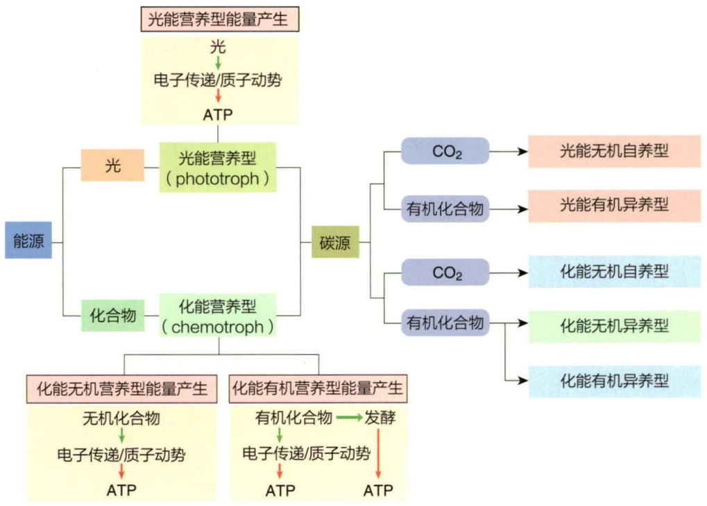

flowchart

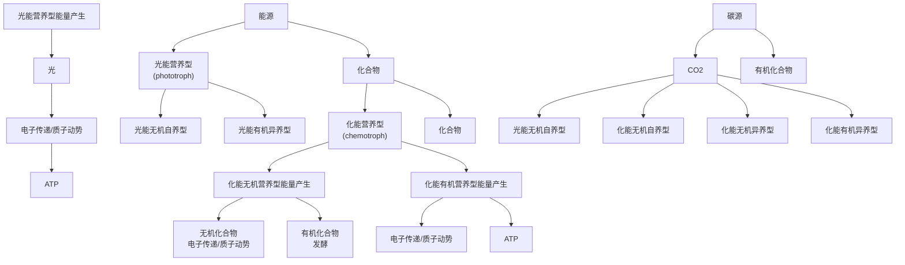

图 6-1 微生物营养类型的多样性

无论是光能营养型还是化能营养型，所有微生物的生长都需要大量的碳源。根据微生物所需要的碳源种类不同，可将微生物的营养类型分为自养型（autotroph）和异养型（heterotroph）。

## 6.3.1 自养型

自养型使用无机碳（如  $CO_{2}$ ）为唯一碳源，结合其所需的能源种类又可分为光能无机自养型和化能无机自养型（图 6-1）。

① 光能无机自养型，利用光能产生 ATP，并将  $CO_{2}$  还原为细胞物质。 $CO_{2}$  固定需要的还原力 NADH（或 NADPH）等需要使用环境中的无机物为电子供体，如藻类和蓝细菌的产氧光合作用（oxygenic photosynthesis）使用  $H_{2}O$  为电子供体，细菌和古菌的不产氧光合作用（anoxygenic photosynthesis）使用  $H_{2}$ 、 $H_{2}S$ 、S、 $Fe^{2+}$  或 FeS 等为电子供体。

② 化能无机自养型，利用无机化合物如  $H_{2}$ 、 $H_{2}S$ 、 $NH_{3}/NH_{4}^{+}$ 、 $NO_{2}^{-}$ 或  $Fe^{2+}$  等的氧化产能，通过电子传递形成的质子动势驱动 ATP 合酶合成 ATP，并将  $CO_{2}$  还原为细胞物质。

## 6.3.2 异养型

异养型使用有机化合物为碳源（不能以  $CO_{2}$  作为主要或唯一碳源），结合其所需的能源种类又可分为光能有机异养型（photoorganoheterotroph）、化能有机异养型（chemoorganoheterotroph）和化能无机异养型（chemolithoheterotroph）（图 6-1）。

① 光能有机异养型，以光能为能源和以有机化合物为碳源。例如，紫色非硫细菌（purple nonsulfur bacteria）通常以光为能量来源，通过不产氧光合磷酸化作用产生ATP，并能利用广泛的有机化合物为碳源，包括有机酸、氨基酸、醇、糖，甚至苯甲酸或甲苯等芳香化合物；阳光杆菌（Heliobacteria）是具有FeS型光合系统并产生独特色素菌绿素g（bacteriochlorophyll g）的不产氧光能营养的严格厌氧菌，能够使用多种有机化合物为碳源，包括丙酮酸、乳酸、乙酸或丁酸；某些蓝细菌在光照条件下，也可利用一些简单的有机化合物如葡萄糖、乙酸等为碳源。

② 化能有机异养型，以有机化合物为能源和碳源，通过发酵或呼吸产能方式形成 ATP 等，并利用有机化合物的分解代谢产生的能量、还原力和小分子化合物进行细胞物质的合成。绝大多数自然界中存在的和实验室培养的真菌、细菌和古菌等均为化能有机异养型。

③ 化能无机异养型也称为混合营养型（mixotroph），利用无机化合物的氧化产生能量，但缺乏自养生长的能力，需要利用有机化合物为碳源。例如，硫氧化细菌贝日阿托氏菌属（Beggiatoa）的大多数种可以从无机硫化合物的氧化中获得能量，但由于缺乏卡尔文循环的酶，因此需要有机化合物作为碳源；某些非寄生的弓形菌（Arcobacter）可氧化无机硫化合物并偶联硝酸盐还原反应或反硝化作用，但并不固定 $CO_{2}$ ，而是同化乙酸生长，从而将异养生长与硫化物氧化和反硝化作用结合起来。无机物氧化产生的能量增强了化能无机异养型微生物的异养生长，增加了其比摩尔生长产量，从而使细胞更有效地吸收有机化合物中的碳以积累生物质或形成产物，对于生态系统中的物质循环和环境中的污染物降解等具有重要的意义。

综上所述，根据微生物对能源、碳源和电子供体的需求，可将微生物的营养类型分为光能无机自养型（photolithoautotroph）、光能有机异养型（photoorganoheterotroph）、化能无机自养型（chemolithoautotroph）、化能有机异养型（chemoorganoheterotroph）和化能无机异养型/混合营养型（chemolithoheterotroph/mixotroph）（表6-8）。

需要明确的是，微生物的营养类型的界限并非绝对。例如，绿色非硫细菌（green nonsulfur bacteria）在光能异养时生长得最好，此时它们利用简单有机化合物同时作为碳源和光合作用的电子供体，它们也可利用 $\mathrm{H}_{2}$ 或 $\mathrm{H}_{2} \mathrm{~S}$ 为电子供体进行光合作用，并固定 $\mathrm{CO}_{2}$ 进行光能自养生长，它们中的大多数也可通过多种有机碳源的有氧呼吸在黑暗中良好生长；阳光杆菌能够以光为能源，并使用多种有机化合物（包括丙酮酸、乳酸、乙酸或丁酸）为碳源进行光能异养生长，但它们也可以通过丙酮酸发酵在黑暗中化能异养生长；有些蓝细菌在黑暗中也可以利用葡萄糖和蔗糖为能源和碳源进行化能有机异养生长；大多数氢氧化细菌是化能无机营养型，通过氢的氧化和卡尔文循环固定 $\mathrm{CO}_{2}$ 进行生长，但当环境中存在易于使用的有机化合物如葡萄糖等时，它们细胞内的卡尔文循环合成途径和氧化 $\mathrm{H}_{2}$ 产生能量的氢酶（hydrogenases）会被抑制，它们即转为化能有机营养型；化能无机营养型的好氧硝化细菌，可通过氧化亚硝酸产生能量，并利用卡尔文循环固定 $\mathrm{CO}_{2}$ 自养生长，该类菌在固定 $\mathrm{CO}_{2}$ 时需要消耗ATP和还原力NADH，而NADH是通过消耗能量的反向电子流产生的，这给已经是相对较低效率的亚硝酸氧化产能系统带来了额外的负担，因此，这种尤其严重的能量限制可能导致了大多数硝化细菌都具有替代的能量产生机制，即它们能够利用葡萄糖和其他一些有机化合物进行化能有机营养生长。微生物在不同环境条件下的营养类型的变化，充分体现了微生物代谢途径的多样性、营养类型的灵活多变性和重要的生态价值。

表 6-8 微生物的营养类型及其特点

| 营养类型 | 能源 | 碳源 | 电子供体 | 代表菌 |
| --- | --- | --- | --- | --- |
| 光能无机自养型( photolithoautotroph ) | 光能 | $CO_{2}$ | $H_{2}$、$H_{2}S$、$S$、$Fe^{2+}$、$FeS$、$H_{2}O$ | 蓝细菌,紫硫细菌,藻类 |
| 光能有机异养型( photoorganoheterotroph ) | 光能 | 有机物 | 有机物 | 紫色非硫细菌,阳光杆菌,蓝细菌 |
| 化能无机自养型( chemolithoautotroph ) | 化学能( 无机物的氧化 ) | $CO_{2}$ | $H_{2}$、$H_{2}S$、$NH_{3}$、$NH_{4}^{+}$、$NO_{2}^{-}$、$Fe^{2+}$ | 氢细菌,硫杆菌,硫化细菌,硝化细菌,铁细菌 |
| 化能有机异养型( chemoorganoheterotroph ) | 化学能( 有机物的氧化 ) | 有机物 | 有机物 | 原生动物,真菌,大多数非光合细菌和古菌 |
| 化能无机异养型( chemolithoheterotroph ) | 化学能( 无机物的氧化 ) | 有机物 | $S_{2}O_{3}^{2-}$、$H_{2}S$、$S$ | 贝日阿托氏菌(Beggiatoa),弓形菌(Arcobacter ) |

## 6.4 营养物质进入细胞的方式

微生物细胞是一个由细胞膜（外层一般有细胞壁）包裹的相对封闭的、内含细胞质和各种细胞器（真核微生物）的整体。在微生物生长过程中，需要不断从外界吸收营养物质供给细胞内新陈代谢系统，才能保障微生物的正常生长与繁殖。营养物质进入微生物细胞的过程中需要跨过细胞与外界“隔离”的屏障——细胞膜（包括细胞壁）。影响物质跨越屏障可归结为以下3个因素。

① 营养物质自身的物理化学性质。那些分子量小的、极性小的、脂溶性大的营养物质容易透过细胞膜，一般电中性的营养物质容易被机体吸收。

② 屏障的性质。包括细胞壁的结构和化学组成，细胞壁外的荚膜、黏液层，细胞膜及膜上与物质运输相关的功能元件等。微生物种类不同，其细胞壁的组成和结构有较大差异，对物质的跨越也有不同的影响。对许多革兰氏阳性细菌来说，分子量超过10 000的葡聚糖不能透过其细胞壁，而酿酒酵母（Saccharomyces cerevisiae）的细胞壁只允许分子量低于4 500的物质透过。细胞膜是脂质双分子层的半透膜（某些古菌具有独特的单分子层膜），允许水分子自由通过；细胞膜上由非特异性孔蛋白（porin）形成的通道可以允许一些低分子量可溶性营养物质通过，而细胞膜上由特异性孔蛋白构成的通道以及镶嵌在膜上的载体蛋白又赋予膜对物质运输的选择性功能。

③ 细胞内外环境差异。包括细胞内外的水活度、溶质类型及浓度、pH等物理化学因素的差异。pH和离子强度影响了营养物质的电离程度和荷电性质，从而影响了营养物质进入细胞。

不同营养物质进入细胞的过程中，在能量消耗、载体帮助、化学变化等方面存在差异。根据营养物质进入细胞过程的特点，可将营养物质进入细胞的方式分为单纯扩散、促进扩散、主动运输、基团转位和膜泡运输。单纯扩散和促进扩散是被动运输（passive transport）方式，不需要消耗细胞的能量，其他的进入方式则需要消耗细胞的能量。

## 6.4.1 单纯扩散

单纯扩散（simple diffusion）又称为扩散，是一种简单的物理过程，即分子通过随机的热运动，沿着浓度梯度，从高浓度向低浓度转移的过程。在溶液中，扩散是随机非特异性的物理过程，而由于有细胞膜的存在，营养物质进入细胞却不是随机的。细胞膜主要由磷脂双分子层和蛋白质组成，膜内外表面为极性表面，内部为疏水层，某些蛋白质可组装成为跨膜的含水膜孔。因此，能否跨膜扩散主要取决于分子本身的性质，分子量小、脂溶性、极性小的分子易通过扩散进入细胞。水是扩散进出细胞的主要分子，某些气体分子（ $O_{2}$ 、 $CO_{2}$ ）、尿素、甘油、乙醇和某些氨基酸在一定程度上也可以通过扩散进出细胞。扩散的过程中，分子不与细胞膜上的分子发生反应，跨膜前后其自身结构也不发生变化。影响跨膜扩散速度的主要因素有分子在膜内外的浓度差、pH和温度等。浓度差越大，分子由膜的高浓度一侧向低浓度一侧扩散的速度也越快，直至细胞内外的浓度达到一致。

水分子的扩散取决于渗透压（osmotic pressure）。当微生物细胞处于等渗（isotonic）溶液中时，水分子扩散进入细胞和透出细胞的速度相等，细胞保持正常形态；处于低渗（hypotonic）溶液中时，水分子扩散进入细胞，造成细胞质膨胀，推动细胞膜紧贴在细胞壁上，依靠细胞壁的机械强度维持细胞的形态；处于高渗（hypertonic）溶液中时，水分子扩散出细胞，细胞质体积缩小，使细胞膜离开细胞壁，即产生质壁分离（plasmolysis）现象（图6-2）。质壁分离会对微生物细胞造成损害，甚至杀死微生物。在食品加工中，采用盐或糖制造高渗环境，可以防止食品腐败，延长保质期。为应对低渗或高渗的不利生长环境，微生物演化出多种机制。如生长在淡水中的无细胞壁的变形虫，其细胞内具有空泡（vacuole）。空泡能吸收多余的水分变得膨大，被运输到细胞边缘后，与细胞膜融合破裂，空泡内的水分被排出细胞外。生长在盐水湖中的嗜盐菌（halobacteria），依靠主动地吸收盐分，使细胞内外处于等渗状态。

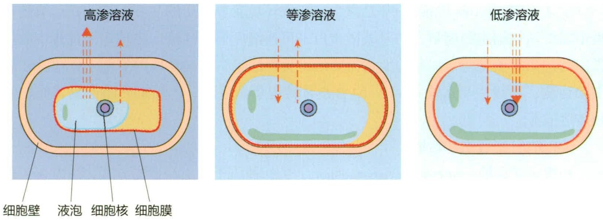

图 6-2 微生物细胞在不同渗透压溶液中水分子扩散方向和细胞形态的变化

## 6.4.2 促进扩散

促进扩散（facilitated diffusion）是营养物质借助载体（carrier）的帮助跨膜进入细胞的运输方式。在运输过程中，营养物质本身的分子结构不发生变化，不需要消耗细胞的能量，只能沿着浓度梯度运输。载体是位于细胞膜上的蛋白，当与营养物质结合后，其构象发生变化，促进了营养物质的跨膜运输，也称为透过酶（permease）。一旦营养物质进入细胞，载体蛋白就恢复原始构象。载体蛋白的构象变化，造成载体与营养物质之间的亲和力发生变化，在膜外的亲和力要高于膜内的亲和力（图6-3）。绝大多数载体与被运输物质之间的相互作用是特异性的，即一种载体仅能结合和运输一类分子，如运输钠离子的载体不能与葡萄糖结合。一种营养物质可被多种载体结合运输，如鼠伤寒沙门菌（Salmonella typhimurium）有4种载体蛋白运输组氨酸，酿酒酵母（Saccharomyces cerevisiae）有3种载体负责运输葡萄糖。另外，某些载体可结合运输几种营养物质，如大肠杆菌可通过一种载体蛋白运输亮氨酸、异亮氨酸和缬氨酸。载体大多是诱导表达的，即微生物生长环境中存在该种营养物质时，与之对应的载体才会被表达合成。促进扩散的速率主要与细胞内外被运输物质的浓度差和载体的数量有关，浓度差越大，载体数量越多，运输速率就越快，当被运输物质的浓度过高而使载体饱和时，运输速率就不再增加。通过促进扩散进入细胞的营养物质主要有氨基酸、单糖、维生素和无机盐等。促进扩散的运输方式对真核微生物更重要。

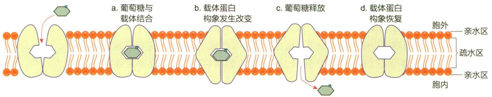

flowchart

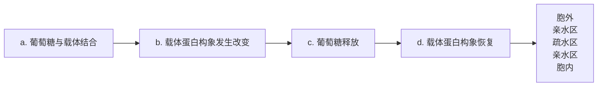

图 6-3 葡萄糖经促进扩散进入细胞过程的示意图

## 6.4.3 主动运输

主动运输（active transport）是微生物摄取环境营养物质的主要方式，在运输的过程中需要消耗细胞的能量，需要载体蛋白，可逆浓度梯度运输。主动运输过程中载体蛋白的构象发生变化，构象的变化需要细胞提供能量。主动运输的类型主要包括初级主动运输、次级主动运输、ATP-结合盒式转运蛋白系统、P型ATP酶运输系统、铁载体运输等。

## 6.4.3.1 初级主动运输

初级主动运输（primary active transport）是一种质子的主动运输方式，由电子传递系统、ATP 酶或菌视紫红质将细胞内质子（或其他离子）逆浓度梯度排出到胞外，导致细胞膜内外的质子浓度产生差异，即电势差。细胞膜内外的电势差使膜处于充能状态，能够为次级主动运输、ATP 的合成、鞭毛运动等提供能量。初级主动运输的方式与不同微生物的能量代谢相关。好氧及兼性厌氧微生物以氧气为电子受体时，电子在原生质膜的电子传递链上传递的过程中伴随了质子的外排；厌氧微生物中的 ATP 被位于原生质膜上的 ATP 酶水解过程中伴随着质子的外排；最早发现于嗜盐古菌紫膜中的菌视紫红质（bacteriorhodopsin）以及细菌中的类古菌视紫红质具有光驱动的质子泵的作用，接受光能后能导致质子的外排。

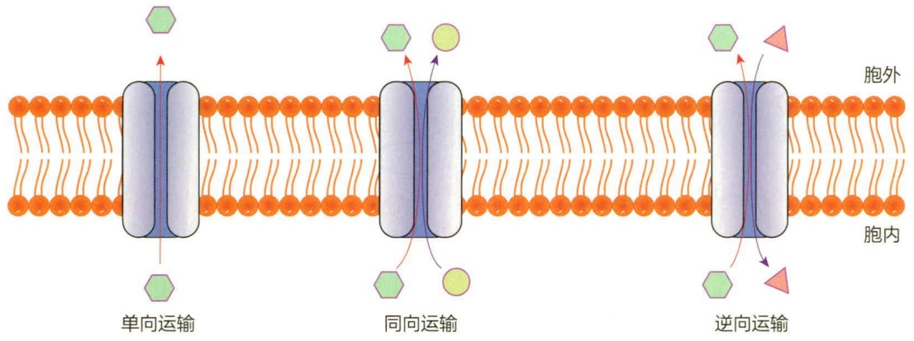

flowchart

This diagram illustrates the three distinct types of cell transport (single, parallel, and reverse) in a biological process involving cells moving from the nucleus through the membrane.

图 6-4 次级主动运输的三种方式

## 6.4.3.2 次级主动运输

次级主动运输（secondary active transport）是以初级主动运输建立的细胞膜内外的质子浓度差（电势差）为驱动力，运输其他物质的运输方式，是一种电势差驱动的主动运输方式。次级主动运输的方式有三种:同向运输、逆向运输和单向运输（图6-4）。同向运输（symport）是一种协同转运（co-transport）的模式，载体包含质子（或钠离子）和另一种物质的结合位点，在质子被转至胞内的同时，结合的另一种物质也同时被转运到胞内，其中质子是由高浓度向低浓度运输，而另一种物质则是逆浓度梯度运输。大肠杆菌中，同向运输的物质有糖类（半乳糖、岩藻糖、蜜二糖、阿拉伯糖、乳糖、葡萄糖醛酸）、氨基酸（丙氨酸、丝氨酸、甘氨酸、谷氨酸）和某些阴离子（$\mathrm{HPO_4^{2-}}$、$\mathrm{HSO_4^-}$）等。逆向运输（antiport）是一种载体将两种物质同时向相反方向运输的方式，如大肠杆菌的 $\mathrm{Na^+ - Ca^{2+}}$ 逆向运输和 $\mathrm{Na^+ - H^+}$ 逆向运输。单向运输（uniport）是一种通过载体使带电荷或者不带电荷的物质跨膜运输的方式，导致该物质在细胞膜单侧方向的积累（如钾离子）或者阴离子浓度的降低。

## 6.4.3.3 ATP- 结合盒式转运蛋白系统

ATP-结合盒式转运蛋白系统（ATP-binding cassette transport system）简称为 ABC 转运系统，广泛存在于细菌、古菌和真核生物中，负责营养物质、代谢产物、脂质、药物等跨膜运输，消耗的能量直接来源于 ATP 的水解。ABC 转运系统主要由 ATP-结合盒式转运蛋白（ABC 转运蛋白）组成，对于运输营养物质进入细胞的系统来说，还包括能特异性结合营养物质的结合蛋白。革兰氏阴性菌的结合蛋白位于周质空间，革兰氏阳性菌的结合蛋白位于质膜外表面膜上。ABC 转运蛋白包含跨膜结构域（transmembrane domain，TMD）和核苷酸结合结构域（nucleotide-binding domain，NBD）两个部分（图 6-5）。两个 TMD 在膜上形成一个小孔，NBD 能够结合 ATP。

ATP-结合盒式转运蛋白系统的工作机制可以用交替通路模型（alternating-access model）进行解释。在这个模型中，转运蛋白具有两种构象:内向（inward-facing）构象和外向（outward-facing）构象。构象的交替转换需要消耗细胞的能量，这些能量来源于ATP与NBD的结合以及ATP的水解，即ATP开关（ATP-switch model）。转运蛋白的构象不同，其与物质的亲和力也不同，通过这种构象的转换完成了物质的跨膜运

知识拓展6-1

微生物的耐药泵

知识拓展6-2

革兰氏阴性菌多糖的分泌

图 6-5 ABC 转运系统的工作模式

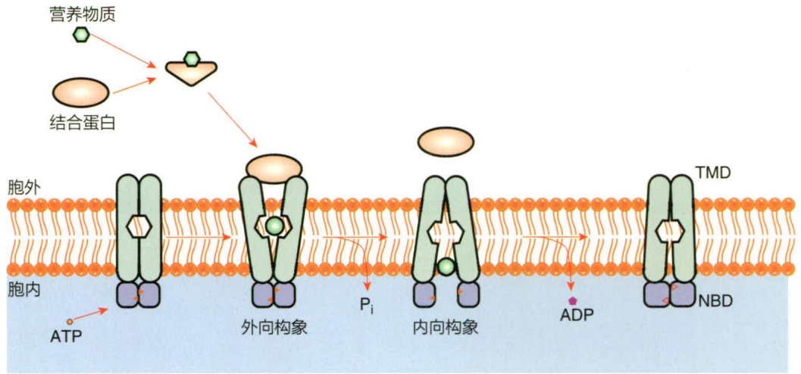

flowchart

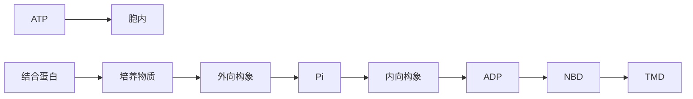

## 知识拓展 6-3

蛋白质（酶）的胞外运输

输。大肠杆菌利用这种方式转运糖类（阿拉伯糖、麦芽糖、半乳糖及核糖）、氨基酸（谷氨酸、组氨酸及亮氨酸）和维生素 $B_{12}$ 等营养物质。

## 6.4.3.4 P型ATP酶运输系统

P型ATP酶（P-type ATPases）运输系统可以跨膜主动运输质子、金属离子和磷脂等营养物质，使用ATP的水解作为能量来源，由于在运输过程中形成磷酸化的中间体，因而称为P型ATP酶。P型ATP酶广泛分布于整个生命三域，在产生膜电位、移除有毒离子、抗逆、转移脂质及脂质双层膜不对称性的维持等方面发挥了重要作用。P型ATP酶是多结构域的膜蛋白，分子量为70 000～150 000。根据序列的相似性，P型ATP酶分为5种类型，含有10种亚型，各亚型对底物具有专一性:I型ATP酶是最简单和原始的离子泵，主要来自原核生物，包括两个亚型:IA亚型主要运输 $H^{+}$ 、 $Na^{+}$ 、 $K^{+}$ 、 $Ca^{2+}$ 和 $Mg^{2+}$ 等阳离子，如来自大肠杆菌的Kdp $K^{+}$ 泵；IB亚型主要向细胞外排放 $Cu^{2+}$ 、 $Ag^{+}$ 、 $Zn^{2+}$ 、 $Cd^{2+}$ 和 $Pb^{2+}$ 等有毒离子。酵母菌、植物和动物中也有IB亚型离子泵，若这些泵发生突变，会发生铜代谢障碍相关遗传性疾病。II型和III型ATP酶主要来自动植物，包含多种亚型，被研究得最为深入，如 $SR\ Ca^{2+}-ATP$ 酶（IIA）、质膜钙泵（IIB）、 $Na^{+}/K^{+}-ATP$ 酶（IIC）、 $H^{+}/K^{+}-ATP$ 酶（IIC）、 $H^{+}$ 泵（IIIA，来自植物与真菌）、 $Mg^{2+}$ 泵（IIIB，来自细菌）。IV型ATP酶来自真核生物，如酿酒酵母的脂质翻转酶。V型ATP酶也来自真核生物，但是还不清楚其底物选择性和生物学功能。其中IIC亚型的 $Na^{+}/K^{+}-ATP$ 酶是位于细胞膜上一种特殊蛋白，能够利用水解ATP产生的能量逆浓度梯度向细胞外排出 $Na^{+}$，并将 $K^{+}$ 运输到细胞内，又被称为 $Na^{+}/K^{+}-$ 泵。 $Na^{+}/K^{+}-ATP$ 酶于1957年由丹麦学者斯克（J.C.Skou）在原生质膜上发现，并因此在1997年获得诺贝尔化学奖。 $Na^{+}/K^{+}-ATP$ 酶维持了细胞内外 $Na^{+}$ 和 $K^{+}$ 的浓度梯度，对动植物和微生物都具有重要作用。

P型ATP酶包含4个主要结构域:P结构域是ATP酶的催化核心，含有DKTGTLT的特征序列，其中的天冬氨酸被可逆磷酸化；N是核苷酸结合结构域，含有ATP结合位点；A是ATP酶中最小的结构域，含高度保守的TGE基序，起到调节作用；M 是膜结构域，由约 10 个跨膜螺旋组成，包含离子结合位点。P 型 ATP 酶的离子运输过程如图 6-6 所示，构象发生多次转变。由 E2 向 E1 转变的过程中，通向胞内的离子通道打开，细胞内的离子 X$^{+}$ 与位于 M 结构域中高亲和力位点结合并且置换出 Y$^{+}$ 离子，使 ATP 酶进入 E1 构象。Mg$^{2+}$-ATP 与 N 结构域结合使其构象转变，Mg$^{2+}$-ATP 被传递到磷酸化位点，Asp 被可逆磷酸化，ATP 酶由 E1 构象转到 E1-P 状态。E1-P 到 E2-P 的构象转换是限速步骤，膜结构域中的 M1 和 M2 发生剪式运动，使 A 结构域产生旋转，TGE 基序靠近磷酸化位点保护磷酸基团免受水解，使 ADP 解离。M1 和 M2 的运动关闭了通向细胞内的离子通道，P 结构域运动带动了与之连接的螺旋 M4-M6 的变化，打开了离子结合位点与细胞外的通道，破坏了 X$^{+}$ 与结合位点的作用，X$^{+}$ 被释放到胞外，而胞外的离子 Y$^{+}$ 结合到离子结合位点。磷酸化的 Asp 水解释放 Mg$^{2+}$ 和无机磷酸盐，P 型 ATP 酶转入 E2 状态，开启另一个循环。

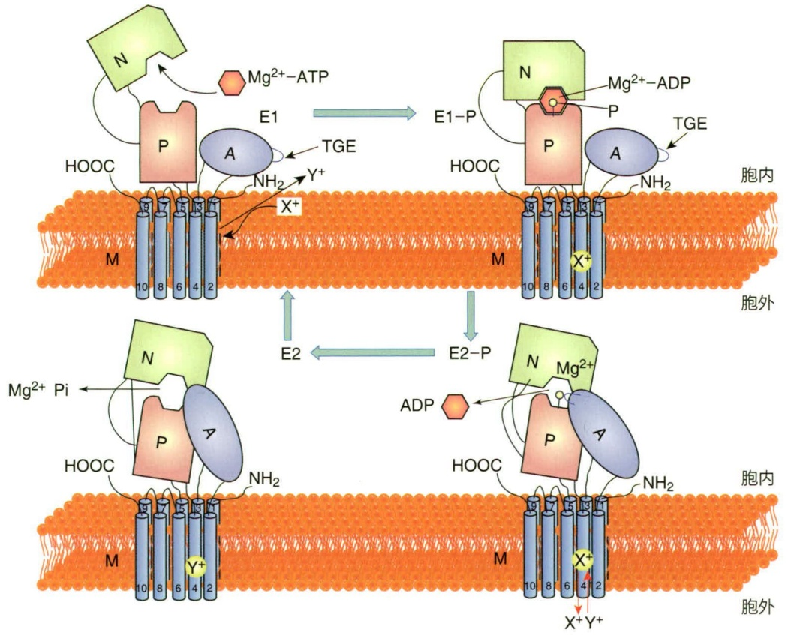

flowchart

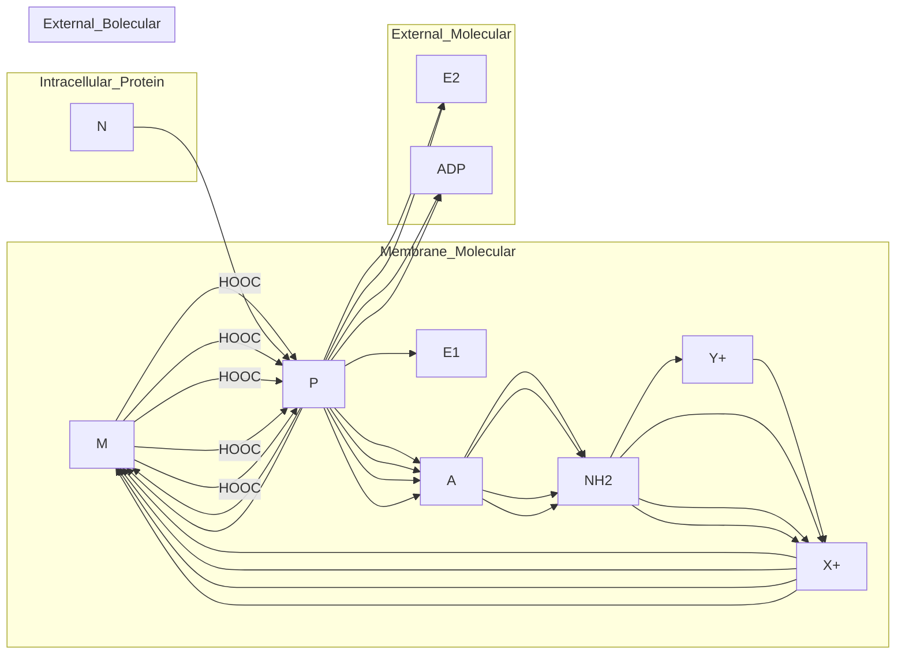

图 6-6 P 型 ATP 酶的主要结构域及催化循环示意图

## 6.4.3.5 铁载体运输

铁是微生物的必需营养因子。铁作为许多酶的辅助因子、细胞色素和铁硫蛋白的氧化还原中心，在微生物的光合作用、固氮、呼吸、三羧酸循环、氧的传递、基因调控与DNA合成中扮演了重要角色。自然界中的铁具有两个价态，氧化态（正铁，$\mathrm{Fe}^{3+}$）和还原态（亚铁，$\mathrm{Fe}^{2+}$）。微生物具有多种铁运输途径，主要取决于微生物的种类和所运输铁的价态。

有氧和中性条件下，自然界中的铁以不溶性的氧化态（ $Fe^{3+}$ ）形式存在。细菌和真菌能够向胞外分泌一种低分子量的铁载体（siderophore），通过铁载体与氧化态铁的结合，增加铁的溶解性，并将铁运送至胞内。根据与铁结合的配基不同，铁载体分为500余种类型，最早被鉴定的铁载体是来自细菌的分枝菌素（mycobactin）、粪生素（coprogen）和来自真菌的铁色素（ferrichrome）。典型的细菌铁载体是肠杆菌素（enterobactin），它是与氧化态铁亲和力最强的铁载体，每三个肠杆菌素围绕一个 $Fe^{3+}$ 形成铁-铁载体复合物。

革兰氏阴性菌转运铁的基本过程为:铁-铁载体复合物与细胞壁外膜上的特异受体（如Fep、IroN、PfeA）结合并被转至周质空间。该跨膜过程是由电势差驱动的主动运输，能量由能量转换蛋白复合体TonB-ExbB-ExbD提供。位于周质空间的周质结合蛋白（FepB）将铁-铁载体复合物运送到内膜上的ABC通透酶复合体（ABC permease complex）。ABC通透酶复合体由FepD、FepG和FepC组成。FepC分解ATP产生能量，驱动FepD和FepG将铁-铁载体复合物运送到胞内。最后，酯酶Fes和IroD将铁从载体上解离下来并被细胞所利用（图6-7a）。

革兰氏阳性菌铁载体转运与革兰氏阴性菌类似。以金黄色葡萄球菌（Staphylococcus aureus）为例，它分泌两种铁载体:staphyloferrin A 和 staphyloferrin B，结合铁后分别通过 HtsABC 和 SirABC 转运至胞内（图 6-7b）。

真菌的铁色素有20种衍生物，如烟曲霉（Aspergillus fumigatus）产生多种铁载体，包括镰孢氨酸C（fusarinine，FsC）、三乙酰镰孢氨酸C（triacetylfusarinine C，TAFC）和铁菌素（ferricrocin）。FsC和TAFC等铁载体在转运蛋白MirB等的作用下被运输到细胞内，然后在酯酶EstB的作用下，铁被释放出来（图6-7c）。有趣的是，有些真菌不生产铁载体。致病酵母菌中的白色念珠菌（Candida albicans）和新型隐球菌（Cryptococcus neoformans）细胞膜上的铁载体转运蛋白Sit1能够吸收其他微生物产生的铁载体。

图6-7 革兰氏阴性菌（a）、革兰氏阳性菌（b）和真菌（c）的铁转运过程

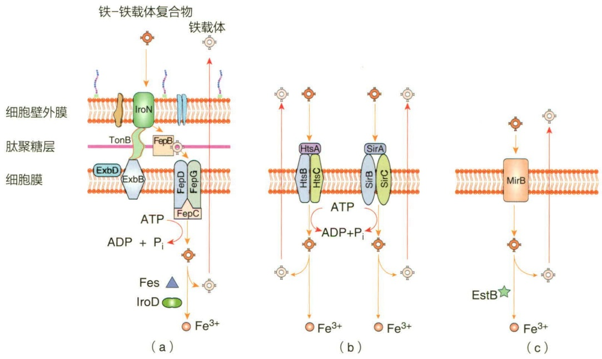

动物体内的铁主要储存于铁蛋白复合物中，如血红素蛋白（haemprotein）复合体、转铁蛋白/乳铁蛋白（transferrin/lactoferrin）复合体等。致病性微生物有多种运输机制从这些复合物中获得铁，这些过程往往与微生物的致病性有关，如新型隐球菌通过铁通透酶Ftr1和还原酶Fre10从铁蛋白复合物中获得铁，而Ftr1是一种毒力因子。

在酸性、还原性环境以及细胞内还原酶的作用下，还原态的铁（$\mathrm{Fe}^{2+}$）能够以可溶的状态存在。$\mathrm{Fe}^{2+}$ 能够穿过革兰氏阴性菌的外膜，然后通过 $\mathrm{Fe}^{2+}$ 转运系统被运至胞内。

大肠杆菌、枯草芽孢杆菌和一些真菌还存在其他铁转运系统，这些系统除了包含铁通透酶外，还包含氧化还原酶，可将  $Fe^{3+}$  还原或将  $Fe^{2+}$  氧化后再运送至胞内。此类系统的存在有助于微生物吸收多种价态的铁元素。

知识拓展 6-4

铁载体偶联药物

## 6.4.4 基团转位

基团转位（group translocation）由复杂的运输系统构成，所运输的物质在跨膜前后发生化学结构的变化。

基团转位主要用于糖类的运输，脂肪酸、核酸和碱基等也通过这种方式运输，其中研究比较透彻的是磷酸烯醇式丙酮酸:糖磷酸转移酶系统（phosphoenolpyruvate: sugar phosphotransferase system, PTS）（图6-8）。PTS系统是一个复杂的蛋白（酶）系统，糖类在PTS的运输过程中被同步磷酸化。PTS系统至少由三部分蛋白组成，分别是酶I（EI）、含组氨酸的磷酸载体蛋白［histidine-containing phosphocarrier（HPr）protein］和酶Ⅱ（EⅡ）。其中EI和HPr是PTS通用蛋白，是可溶性的细胞质蛋

图 6-8 磷酸烯醇式丙酮酸:糖磷酸转移酶系统的工作模式

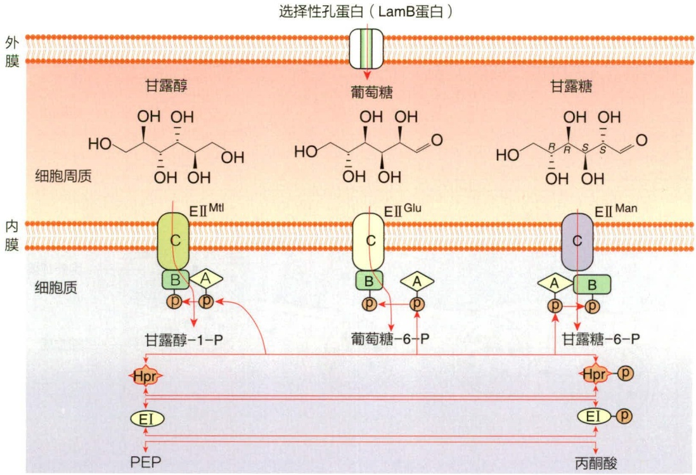

flowchart

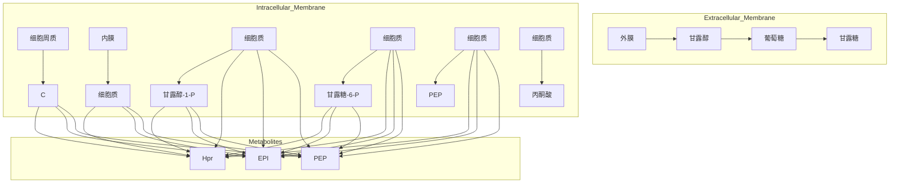

