图 7-24 微生物的各种细胞物质合成代谢简图


<details>
<summary>flowchart</summary>

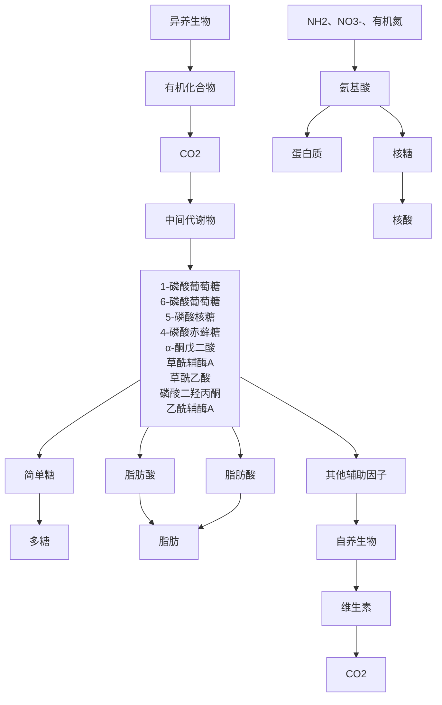
</details>

小分子单体的合成代谢或以无机物（如  $CO_{2}$  和  $N_{2}$ ），或以分解代谢的中间产物（如丙酮酸、乙酰辅酶 A、草酰乙酸和 3-磷酸甘油醛等）为底物（图 7-24）。合成代谢是化合物还原的过程，由分解代谢产生的还原力驱动，同时需要能量 ATP 的投入，是耗能代谢。

## 7.3.1 同化 $\mathrm{CO}_{2} / \mathrm{CO}_{2}$ 固定途径

$CO_{2}$ 是自养微生物的唯一或主要碳源，也是一些异养型微生物的辅助碳源。将大气中 $CO_{2}$ 同化或还原为细胞物质的过程称为 $CO_{2}$ 固定，该过程也是地球早期生命将无机碳转化为有机碳的过程，在许多细菌和古菌中存在。自养型微生物将摄入细胞的 $CO_{2}$ 先固定在特异的 $CO_{2}$ 受体上，再经多个化学反应步骤合成单糖，多数是葡萄糖。而异养型微生物往往将 $CO_{2}$ 与有机酸结合，因此同化 $CO_{2}$ 只是补救代谢。

目前在不同的微生物中发现了7条  $CO_{2}$  固定途径，分别是卡尔文循环、还原性乙酰 CoA 途径、还原性柠檬酸循环、3-羟基丙酸 /4-羟基丁酸循环、双羧酸 /羟基丁酸循环、3-羟基丙酸双循环和还原性甘氨酸途径。除植物也利用卡尔文循环固定  $CO_{2}$  外，其余6条  $CO_{2}$  固定途径只存在于微生物中。本章只介绍三条代表性的  $CO_{2}$  固定途径。

## 7.3.1.1 卡尔文循环

20 世纪美国生物化学家 Calvin 发现藻类和植物利用光能固定  $CO_{2}$  并放出氧气，之后进一步发现这些生物通过还原的戊糖磷酸途径固定  $CO_{2}$ ，因此该  $CO_{2}$  固定途径被称为卡尔文循环（Calvin cycle）。许多自养微生物，包括蓝细菌和光合细菌等也利用卡尔文循环固定  $CO_{2}$ 。

卡尔文循环需要  $CO_{2}$  受体 1,5-二磷酸核酮糖、NADPH、ATP 和两个关键酶:二磷酸核酮糖羧化酶（ribulose-1,5-bisphosphate carboxylase/oxygenase，RuBisCO）和磷酸核酮糖激酶（phosphoribulokinase）。该循环主要包括三个过程:①  $CO_{2}$  结合到 1,5-二磷酸核酮糖（ribulose-1,5-P，RuBP）上合成六碳化合物；② 六碳化合物裂解并还原成 3-磷酸丙糖、并经一系列反应合成葡萄糖；③ 1,5-二磷酸核酮糖再生。

每个循环可将 6 分子  $CO_{2}$  同化为 1 分子葡萄糖，并需要 12 个 NADPH 和 18 个 ATP。总反应式为:

$$
6 \mathrm{CO} _ {2} + 1 8 \mathrm{ATP} + 1 2 \mathrm{NAD(P)} \mathrm{H} \rightarrow \mathrm{C} _ {6} \mathrm{H} _ {1 2} \mathrm{O} _ {6} + 1 8 \mathrm{ADP} + 1 8 \mathrm{Pi} + 1 2 \mathrm{NAD(P)} ^ {+} + 6 \mathrm{H} _ {2} \mathrm{O}
$$

## 7.3.1.2 还原性乙酰辅酶A途径

还原性乙酰辅酶 A 途径（reductive acetyl-CoA pathway）广泛存在于各种厌氧微生物中，是由 Wood，Ljungdahl 和 Thauer 及其他实验室首先在厌氧的产乙酸细菌中发现的、将  $CO_{2}$  合成乙酰辅酶 A 的途径，因此也被称为 Wood-Ljungdahl（WL）途径。

反应式: $4H_{2}+2HCO_{3}^{-}+H^{+}\rightarrow CH_{3}CO-S\sim CoA+4H_{2}O$

还原性乙酰辅酶 A 途径的关键酶是一氧化碳脱氢酶（CODH）/乙酰辅酶 A 合成酶（ACS），以还原的铁氧化蛋白（ $FdH_{2}$ ）和  $F_{420}H_{2}$ （甲烷古菌）为还原当量，并需要多种金属离子（Ni，Mo/W，Co，Fe）辅助氧化还原反应。该途径将 1 分子  $CO_{2}$  还原为甲基并结合到四氢生物蝶呤上，而将另 1 分子  $CO_{2}$  还原为一氧化碳，然后甲基与一氧化碳及辅酶 A 合成乙酰辅酶 A。合成的乙酰辅酶 A 通过糖异生途径合成细胞碳，并可转化成磷酸乙酰合成 ATP。

还原性乙酰辅酶 A 固碳途径只需 2 分子的  $CO_{2}$  即可起始细胞碳的合成，而且固定 1 分子  $CO_{2}$  只需要 1 个 ATP，因此推测是地球初期生命采用的有机物合成方式。

## 7.3.1.3 还原性三羧酸循环

还原性三羧酸循环（reductive citric acid cycle，rTCA）又称为逆向三羧酸循环（reverse citric acid cycle）（图7-25），首先在光合绿硫细菌的绿菌属（Chlorobium）中发现。rTCA每个循环固定4分子 $CO_{2}$ ，合成1分子草酰乙酸，同时消耗3分子ATP、2分子NAD（P）H和1分子 $FADH_{2}$ 。

## 7.3.2 糖异生和多糖合成

微生物细胞中的糖多以多糖形式存在，很少有游离的单糖。多糖构成细胞的结构，如肽聚糖、几丁质及纤维素是细菌和真菌细胞壁的组分。细胞也常将碳和能量以多糖形式储存，如胞外多糖和荚膜多糖。


<details>
<summary>flowchart</summary>

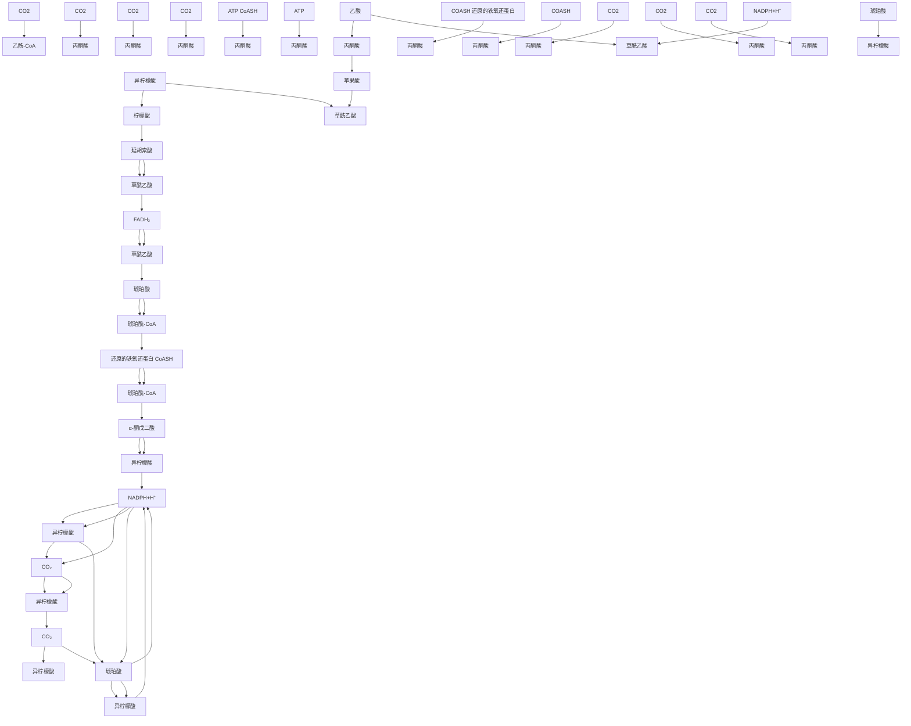
</details>

图 7-25 绿硫细菌还原的三羧酸循环途径

图 7-26 糖异生途径示意图


<details>
<summary>flowchart</summary>

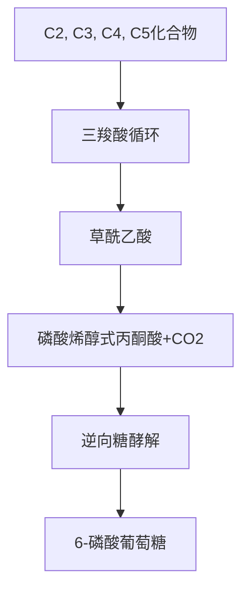
</details>

当微生物生长于葡萄糖时，可直接将葡萄糖用于多糖合成；但生长于其他碳化合物时，则须通过部分 EMP 途径逆行合成 6-磷酸葡萄糖，这个过程称作糖异生（gluconeogenesis）（图 7-26），然后再转化为其他糖类。

糖异生以磷酸烯醇式丙酮酸为起始物质，经逆向的糖酵解途径合成葡萄糖。磷酸烯醇式丙酮酸可从三羧酸循环的中间产物——草酰乙酸合成（图 7-26）。卡尔文循环的

中间产物 3-磷酸甘油醛经 TCA 循环逆向反应生成草酰乙酸或乙酰辅酶 A、再转化成磷酸烯醇式丙酮酸；糖酵解途径、有机酸发酵产生的丙酮酸、乙醛酸循环产生的草酰乙酸均可转化成磷酸烯醇式丙酮酸，然后进行糖异生合成葡萄糖。

多糖（纤维素、肽聚糖等）以活化的核苷葡萄糖、尿嘧啶二磷酸葡萄糖（UDPG）或腺苷二磷酸葡萄糖（ADPG）为底物合成。核苷葡萄糖由6-磷酸葡萄糖转化产生。尿嘧啶二磷酸葡萄糖是合成细胞结构多糖的前体，包括肽聚糖、革兰氏阴性细菌外膜脂多糖中的N-乙酰葡萄糖胺和N-乙酰胞壁酸。腺苷二磷酸葡萄糖是合成糖原的前体物质。利用核苷糖的高能磷酸键水解产生的能量，催化在核苷单糖上连接另一个核苷糖、逐步合成多糖链。

## 7.3.3 生物固氮

氮是合成蛋白质、核酸和其他有机物的元素，因此是生命的必需元素。氮分子（ $N_{2}$ ）是合成含氮物质的源头，一些原核微生物能将 $N_{2}$ 还原成生物可利用的氨（ $NH_{3}$ ）或铵盐（ $NH_{4}^{+}$ ），该过程称为生物固氮。

固氮酶复合体催化生物固氮反应，该复合体由固氮酶和固氮酶还原酶组成。两种酶均含铁离子，固氮酶以铁-钼离子为辅酶。氧气不可逆地失活固氮酶还原酶，因此固氮反应只在无氧环境中发生，如豆科植物的根瘤和蓝细菌的异形胞中。

由于  $N_{2}$  分子的 3 个共价键十分稳定，需要能量输入才能激活，并需要 6 个电子将  $N_{2}$  还原为  $NH_{3}$ 。还原 1 分子  $N_{2}$  产生 2 分子  $NH_{3}$ ，需要 16 分子的 ATP。

## 7.3.4 氨基酸合成

氨基酸是构成蛋白质的基本单位，蛋白质通常由20种氨基酸以不同排列方式组成。对于无法从环境中获取的氨基酸，生物需从头合成。一个氨基酸由碳骨架和氨基两种基本组分构成，碳骨架均来源于糖酵解或三羧酸循环的中间产物有机酸，而氨基来源于生物固氮产物 $NH_{4}^{+}$ 和其他氨基酸，以及细胞内分解的含氮物质或硝酸盐还原产物。


<details>
<summary>flowchart</summary>

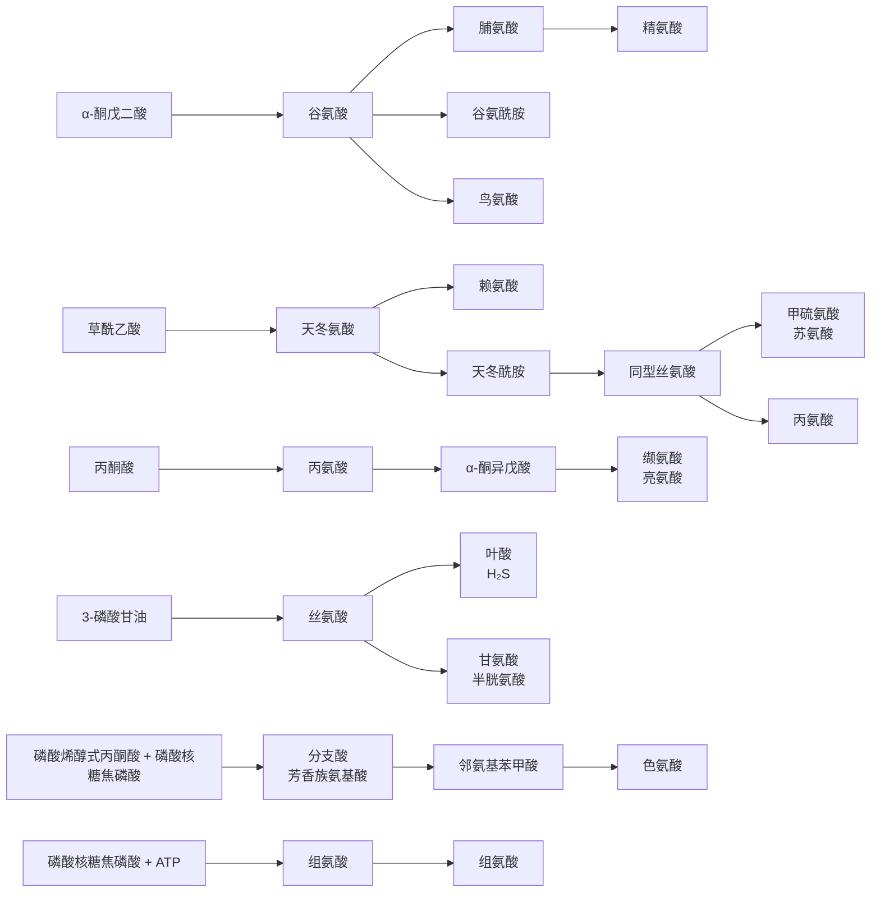
</details>

图 7-27 不同家族氨基酸的合成途径

可将20种氨基酸分为5个家族。碳骨架来自糖酵解途径中间产物的有3个家族，丙氨酸家族的来自丙酮酸、丝氨酸家族的来自3-磷酸甘油酸、芳香族的来自分支酸。碳骨架来自三羧酸循环中间产物的有2个家族，谷氨酸家族的来自 $\alpha-$ 酮戊二酸，天冬氨酸家族的来自草酰乙酸。只有组氨酸从磷酸核糖焦磷酸经组氨醇合成（图7-27）。

氨基酸的生物合成主要通过3种方式:①氨基化:酮酸（α-酮戊二酸和丙酮酸）与 $NH_{3}$ 反应合成氨基酸，这是微生物同化 $NH_{3}$ 的主要途径。 $NH_{3}$ 主要用于合成谷氨酸或谷氨酰胺，分别由谷氨酸脱氢酶和谷氨酰胺合成酶催化合成。②转氨基:转氨酶催化一种氨基酸上的氨基转给酮酸形成新的氨基酸；如谷氨酸的氨基可转给草酰乙酸合成天冬氨酸，而谷氨酸脱氨形成α-酮戊二酸。③糖代谢中间产物转化:赤藓糖-4-磷酸，3-磷酸核糖焦磷酸转化合成组氨酸。图7-25展示不同家族氨基酸的合成途径。

## 7.3.5 核苷酸合成

核苷酸是核酸的基本结构单位，由核糖、碱基和磷酸组成。核糖和碱基构成核

苷。核苷分为嘌呤核苷和嘧啶核苷。

细胞内核苷酸的合成有两条主要途径:①从头合成途径:利用磷酸核糖、氨基酸、一碳化合物及  $CO_{2}$  等简单物质为原料合成核苷酸，这是核苷酸合成的主要途径；②重新利用（或补救合成）途径:利用体内游离的碱基或核苷，经简单化学反应合成核苷酸。

尿嘧啶核苷酸是合成嘧啶核苷酸的首个化合物，由天冬氨酸和氨甲酰磷酸缩合生成氨甲酰天冬氨酸，再经乳清酸逐步合成尿嘧啶核苷酸与胞嘧啶核苷酸，然后转化为其他嘧啶核苷酸（图 7-28）。

嘌呤核苷酸合成途径更复杂。首先由各种小分子化合物合成次黄嘌呤核苷酸（hypoxanthine nucleotide，IMP），再转化成其他嘌呤核苷酸。嘌呤核苷的碳原子来自  $CO_{2}$  和甲酸，而氮原子来自谷氨酰胺、天冬氨酸和甘氨酸。从次黄嘌呤核苷酸与核糖磷酸经多个反应步骤转化合成肌苷酸，然后再分别合成腺嘌呤核苷酸（AMP）与鸟嘌呤核苷酸（GMP）（图 7-29）。

## 7.3.6 脂肪酸和脂肪合成

脂肪酸组成的磷脂是除古菌外所有细胞生物的细胞膜脂主要成分，以及革兰氏阴性细菌的外膜成分。古菌细胞膜脂由异戊二烯为基本单位构成，不含脂肪酸。脂肪还可作为碳和能量的储存物。

图 7-28 尿嘧啶核苷酸合成途径

脂肪酸的合成以酰基载体蛋白（ACP）为载体。首先由乙酰-ACP与丙二


<details>
<summary>flowchart</summary>

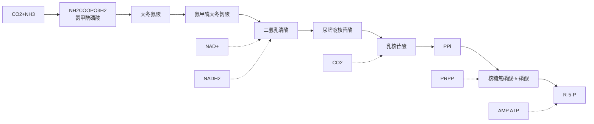
</details>


<details>
<summary>flowchart</summary>

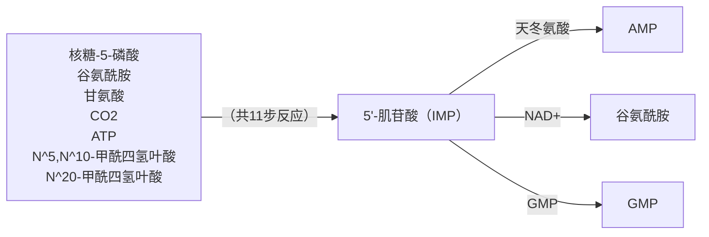
</details>

图 7-29 嘌呤核苷酸合成途径

酰-ACP缩合成四碳烷基物质乙酰乙酰-辅酶A，然后每次加一个二碳单位，直到合成所需长度的脂肪酸链后释放出ACP（图7-30）。

不同生物膜脂的脂肪酸组成不同，同一种生物在不同条件下生长时，脂肪酸的组成也可能不同。常见脂肪（三酰甘油）的脂肪酸链长为12个碳至20个碳原子，低温下更易合成短链脂肪酸。除了饱和、偶数碳的脂肪酸，也有不饱和，或奇数碳脂肪酸及其分枝脂肪酸的脂肪。饱和脂肪酸经去饱和酶转化产生不饱和脂肪酸。脂肪合成时先将一个脂肪酸加到甘油分子上，当三个甘油碳均被脂肪酸酯化后即合成脂肪。

## 7.4 初级代谢

初级代谢（primary metabolism）指维持生命活动所必需的代谢，包括分解代谢和合成代谢。初级代谢产物（primary metabolite）指微生物代谢产生的自身生长和繁殖所必需的物质，包括氨基酸、核苷酸、糖类、脂质、维生素等。


<details>
<summary>flowchart</summary>

```mermaid
graph TD
  A["H3C-C(=O)-ACP"] -->|"乙酰-ACP"| B["丙二酰-ACP"]
  C["HOOC-CH2-C(=O)-ACP"] -->|"丙二酰-ACP"| D["ACP"]
  D -->|"CO2"| E["H3C-C(=O)-CH2-C(=O)-ACP"]
  E -->|"2 NADPH"| F["H2O"]
  F -->|"2 NADP+""| G["H3C-CH2-CH2-C(=O)-ACP"]
  G -->|"每次加一个来自3C物质丙二酰-ACP的乙酰基"| H["4 C"]
  H -->|"6 C"| I["6 C"]
  I -->|"3 C"| J["3 C"]
  J -->|"3 C"| K["3 C"]
  K -->|"8 C"| L["8 C"]
  L -->|"10 C"| M["10 C"]
  M -->|"12 C"| N["12 C"]
  N -->|"14 C"| O["14 C"]
  O -->|"3 C"| P["3 C"]
  P -->|"3 C"| Q["3 C"]
  Q -->|"3 C"| R["3 C"]
  R -->|"3 C"| S["3 C"]
  S -->|"3 C"| T["3 C"]
  T -->|"3 C"| U["3 C"]
  U -->|"3 C"| V["3 C"]
  V -->|"3 C"| W["3 C"]
  W -->|"3 C"| X["3 C"]
  X -->|"3 C"| Y["3 C"]
  Y -->|"3 C"| Z["3 C"]
  Z -->|"3 C"| AA["4 C"]
  AA -->|"4 C"| AB["4 C"]
```
</details>

图 7-30 脂肪酸合成途径

不同类型的微生物具有丰富多样的初级代谢类型，在适宜条件下，它们通过不同类型的发酵过程可产生多种初级代谢产物。下面介绍一些发酵工业生产利用的微生物发酵途径和发酵产物。

## 7.4.1 乙醇发酵

乙醇发酵是酿酒工业的基础，包括白酒、果酒、啤酒酿造，以及乙醇生产。酵酒酵母（Saccharomyces cerevisiae）是常用的乙醇发酵菌种；某些细菌如运动发酵单胞菌（Zymononas mobilis）、嗜糖假单胞菌（Pseudomonas saccharophila）、解淀粉欧文氏菌（Erwinia amylovora）和某些霉菌也用于乙醇发酵。

无氧条件下，酵母菌可将葡萄糖经 EMP 途径转化为 2 分子丙酮酸，然后在丙酮酸脱羧酶的作用下脱羧生成乙醛和  $CO_{2}$ ，最后乙醛被还原为乙醇。总反应式如下:

$$
\mathrm{C} _ {6} \mathrm{H} _ {1 2} \mathrm{O} _ {6} + 2 \mathrm{ADP} + 2 \mathrm{Pi} \rightarrow 2 \mathrm{CH} _ {3} \mathrm{CH} _ {2} \mathrm{OH} + 2 \mathrm{CO} _ {2} + 2 \mathrm{ATP}
$$

## 7.4.2 乳酸发酵

乳酸是最常见的细菌发酵产物之一，也将发酵糖产生大量乳酸的细菌称为乳酸细菌（lactic acid bacteria，LAB）。发酵产物中乳酸含量>85%的称为同型乳酸发酵（homolactic fermentation）；而发酵产物中除乳酸外，还有乙醇、乙酸及 $CO_{2}$ 等称为异型乳酸发酵（heterolactic fermentation）。

## (1) 同型乳酸发酵

进行同型乳酸发酵的细菌主要有链球菌属（Streptococcus）和乳酸杆菌属（Lactobacillus）的一些种，以及凝结芽孢杆菌（Bacillus coagulans）。用于乳酸发酵工业的常用菌种是凝结芽孢杆菌和德氏乳杆菌（L. delhruckii）、保加利亚乳杆菌（L. bulgaricus）和干酪乳杆菌（L. casei）等。

葡萄糖是同型乳酸发酵的主要底物。葡萄糖经 EMP 途径产生丙酮酸，然后在乳酸脱氢酶的作用下还原为乳酸。反应式如下:

$$
\mathrm{C} _ {6} \mathrm{H} _ {1 2} \mathrm{O} _ {6} + 2 \mathrm{ADP} + 2 \mathrm{Pi} \rightarrow 2 \mathrm{CH} _ {3} \mathrm{CHOHCOOH} + 2 \mathrm{ATP}
$$

## (2) 异型乳酸发酵

异型乳酸发酵通常经磷酸解酮酶途径进行。异型乳酸发酵的细菌有肠膜明串球菌（Leuconostos mesentewides）葡萄糖明串球菌（Leuconostoc dextranicum）、短乳杆菌（Lactabacillus brevis）和番茄乳酸杆菌（Lactobacillus lycopersici）等。葡萄糖经戊糖解酮酶途径发酵生成1分子乳酸、1分子乙醇和1分子 $CO_{2}$ ，并且只产生1分子ATP。反应式如下:

$$
\mathrm{C} _ {6} \mathrm{H} _ {1 2} \mathrm{O} _ {6} + \mathrm{ADP} + \mathrm{Pi} \rightarrow \mathrm{CH} _ {3} \mathrm{CHOHCOOH} + \mathrm{CH} _ {3} \mathrm{CH} _ {2} \mathrm{OH} + \mathrm{CO} _ {2} + \mathrm{ATP}
$$

但双歧乳杆菌（Lactobacillus bifidus）和两歧双歧杆菌（Bifidobacterium bifidus）等通过己糖磷酸解酮酶途径，将2分子葡萄糖发酵为2分子乳酸和3分子乙酸，并产生5分子ATP，总反应式为:

$$
2 \mathrm{C} _ {6} \mathrm{H} _ {1 2} \mathrm{O} _ {6} + 5 \mathrm{ADP} + 5 \mathrm{Pi} \rightarrow 2 \mathrm{CH} _ {3} \mathrm{CHOHCOOH} + 3 \mathrm{CH} _ {3} \mathrm{COOH} + 5 \mathrm{ATP}
$$

乳酸发酵被广泛应用于泡菜、酸菜、酸牛奶、乳酪及青贮饲料生产。乳酸发酵积累的乳酸可抑制其他腐败微生物，使食品和饲料得以保存。乳酸还可用于生产生物可降解塑料——聚乳酸。目前的乳酸生产多以淀粉为原料，淀粉经糖化后再接种乳酸细菌进行乳酸发酵生产纯乳酸，也有利用秸秆等木质纤维素生产乳酸的发酵工艺。

## 7.4.3 醋酸发酵

发酵糖产生醋酸（乙酸）的微生物主要是细菌，称为醋酸细菌。醋酸细菌既有好氧菌，如醋化醋杆菌、氧化醋酸杆菌（A. oxydans）、巴氏醋酸杆菌（A. pasteurianus）、胶醋酸杆菌（A. xylinum）和氧化醋酸单胞菌（Acetomonas oxydans）等；也有厌氧菌，如嗜热嗜酸梭菌（Clostridium thermoacidophilus）。

好氧醋酸发酵利用氧气将糖发酵产生的乙醇氧化为醋酸，并释放能量。反应式为:

$$
\mathrm{CH} _ {3} \mathrm{CH} _ {2} \mathrm{OH} + \mathrm{O} _ {2} \rightarrow \mathrm{CH} _ {3} \mathrm{COOH} + \mathrm{H} _ {2} \mathrm{O} + 1 5. 5 \mathrm{ATP}
$$

厌氧醋酸发酵通过 EMP 途径将葡萄糖发酵成醋酸。如嗜热醋酸梭菌的丙酮酸脱羧酶将 2 分子的丙酮酸脱羧产生 2 分子乙酸和 2 分子  $CO_{2}$ ，然后 2 个  $CO_{2}$  通过还原性乙酰辅酶 A 途径合成 1 个乙酸，因此 1 个葡萄糖最终产生 3 个乙酸，总反应式为:

$$
\mathrm{C_6H_{12}O_6 + 4ADP + 4Pi\rightarrow 3CH_3COOH + 4ATP}
$$

好氧醋酸发酵被广泛用于制醋工业，在制醋原料中接种醋酸细菌，即可发酵生成食用醋酸，还可从醋酸发酵液提纯制成冰醋酸。而厌氧醋酸发酵主要用于糖醋酿造生产。

## 7.4.4 柠檬酸发酵

目前的柠檬酸发酵由葡萄糖经 EMP 途径产生丙酮酸，2 分子丙酮酸之间通过羧基转移形成草酰乙酸和乙酰 CoA，然后草酰乙酸和乙酰 CoA 再缩合成柠檬酸。

发酵柠檬酸的微生物以真菌为主，包括曲霉属（Aspergillus）、青霉属（Penicillium）和桔霉属（Citromyces）的物种，其中黑曲霉（Aspergillus niger）、米曲霉（Aspergillus oryzae）、灰绿青霉（Penicillium glaucum）、淡黄青霉（Penicillium luteum）和光桔霉（Citromyces glaber）发酵的柠檬酸产量较高。柠檬酸发酵被广泛用于制造柠檬酸盐、香精、饮料、糖果、发泡缓冲剂等，在食品工业中有重要作用。

## 7.5 次级代谢

微生物在一定的生长时期（通常为对数生长后期或稳定期），以初级代谢产物为前体，合成对生命活动没有明确功能物质的过程即次级代谢（secondary metabolism）。次级代谢途径即使被阻断也不会影响菌的生长繁殖。与初级代谢相比，微生物次级代谢要复杂得多。

## 7.5.1 次级代谢的特点

① 以初级代谢为产物前体，并受初级代谢的调节。

② 通常在生长后期发生，如对数生长后期或稳定期。

③ 次级代谢的酶专一性低。

④ 具有菌株特异性，即一个种内的不同菌株可能具有不同类型的次级代谢，或不具有。

⑤ 次级代谢途径多数由染色体外遗传因子编码。

## 7.5.2 次级代谢产物的种类

微生物的次级代谢产物种类繁多，主要是抗生素（数万种）和生理活性物质（数千种）。这些物质不是细胞的组成成分，也不是酶的活性基团，多数分泌到胞外。根据次级代谢产物的功能，分为维生素、抗生素、生长激素、生物碱、毒素、色素等。

① 维生素。微生物的一些物种，在一定条件下合成作为辅酶等的维生素，并在超出自身需要量时分泌到胞外。临床上使用的维生素主要由微生物发酵产生。
② 抗生素。微生物在一定条件下产生的抑制其他生物的次级代谢产物。临床上使用的抗生素主要由放线菌产生。
③ 生长激素。微生物和植物产生的激发生物生长的生理活性物质，如吲哚乙酸。真菌产生的赤霉素是广泛应用的植物生长激素。
④ 毒素。微生物产生的对动植物有毒的物质。细菌产生的毒素多数是蛋白质，如苏云金芽孢杆菌产生的伴孢晶体（ $\delta-$  毒素）对许多鳞翅目和鞘翅目昆虫有毒杀作用。对人有毒的真菌毒素也有数百种，黄曲霉毒素  $B_{1}$  是目前已知致癌性最强的天然代谢产物。
⑤ 色素。许多微生物能合成不同颜色的代谢产物，只有水溶性色素分泌到胞外。真菌和放线菌产生的色素种类更多。微生物色素是天然色素的重要来源。

微生物的次级代谢产物大多是分子结构复杂的化合物，种类丰富，尽管产量不高，但具有广阔的应用前景和商业重要性。

## 7.5.3 次级代谢的意义

尽管次级代谢不是微生物生命过程所必需，但具有生理重要性。通常认为次级代谢具有如下功能。

① 维持初级代谢的平衡。初级代谢的某些中间产物是次级代谢的前体，次级代谢是在生长后期某些物质积累时发生。因此，次级代谢可消除过量积累的物质，保持初级代谢的平衡；

② 次级代谢产物作为储藏物质。如脯氨酸、组氨酸、精氨酸等促进链霉素产生。链霉素分子中氮含量较高，因此认为链霉素是过剩氮的储存形式；
③ 提高产生菌的生存竞争优势。抗生素抑制或杀死某些其他微生物，但对产生菌无害，因此提高了产生菌在自然环境中的竞争优势；
④ 与细胞分化有关。抗生素是细胞分化不可缺少的物质，如链霉菌的菌丝产孢子与抗生素产生同步发生。

## 7.5.4 次级代谢的调节

## (1) 次级代谢受初级代谢的调节

次级代谢以初级代谢的中间产物为底物，因此初级代谢可调控次级代谢产物的合成。如  $\alpha-$  氨基己二酸是合成青霉素（次级代谢产物）和赖氨酸（初级代谢产物）的共同前体，当  $\alpha-$  氨基己二酸更多流向赖氨酸合成时，青霉素合成则减少。初级代谢的中间产物又是次级代谢的底物，因此适当调控初级代谢才可能合成更多次级代谢产物。

## (2) 次级代谢受碳、氮代谢物调节

次级代谢多发生在初级代谢完成后，前期营养物质被更多用于初级代谢。如谷氨酰胺合成酶是抗生素合成所需的酶，铵盐降低该酶活，而硝酸盐却有利于抗生素合成。

## (3) 产物反馈抑制

与初级代谢相似，次级代谢产物也会通过反馈抑制合成途径的酶，表7-4列举了一些次级代谢合成中产物抑制代谢酶的例子。

表 7-4 次级代谢产物的反馈抑制

| 产物 | 调节作用 |
| --- | --- |
| 氯霉素 | 阻遏第一个酶:芳香胺合成酶 |
| 卡那霉素 | 阻遏乙酰基转移酶 |
| 氯酚酸 | 抑制合成途径最后一步转甲基酶 |
| 嘌呤霉素 | 抑制O-去甲基嘌呤霉素甲基转移酶 |
| 制菌霉素 | 抑制制菌霉素诱导因子的产生 |

## ※ 本章小结

本章介绍了微生物具有的多种代谢方式，着重介绍了能量代谢的能量学基本原理和微生物特有的厌氧呼吸代谢；介绍了与能量代谢偶联的物质分解代谢，主要的细胞物质合成代谢，包括氨基酸、核苷酸、多糖及脂肪酸的合成代谢途径和微生物特有的次级代谢；最后介绍了微生物的代谢调控模式。通过本章的学习，读者可掌握以下知识:①微生物代谢的理论基础；②微生物的能量储存方式及能量来源类型；③微生物合成代谢的主要类型；④微生物代谢的调控方式。

## ※ 推荐阅读

1. BERG I A, KOCKELKORN D, BUCKEL W, et al. A 3-hydroxypropionate/4-hydroxybutyrate autotrophic carbon dioxide assimilation pathway in Archaea [J]. Science, 2007, 318 (5857): 1782-1786.

将  $CO_{2}$  同化为有机物是最重要的生物合成过程。目前已发现微生物携带的 7 条自养  $CO_{2}$  同化途径，本文报道的是在属于泉古菌门的嗜热金属球菌（Metallosphaera sedula）中发现的 3-羟基丙酸 /4-羟基丁酸循环  $CO_{2}$  同化途径。乙酰-CoA /丙酰-CoA 羧化酶是该途径固定  $CO_{2}$  的关键羧化酶。

2. SAPRA R, BAGRAMYAN K, ADAMS M W. et al. A simple energy-conserving system: proton reduction coupled to proton translocation [J]. PNAS, 2003, 100: 7545-7550.

氧化磷酸化需要质子动力势偶联的 ATP 合成，而质子动力势通过一系列膜结合的电子传递复合体产生，电子最终用于还原外源的末端电子受体。但极端嗜热古菌激烈火球菌（Pyrococcus furiosus）的厌氧呼吸系统只是单一的酶，即膜结合的氢酶。该系统不需额外的电子受体去还原质子，而是用来自胞质的氧还蛋白——铁氧还蛋白的电子将质子还原成氢气，因此是最简单的呼吸链。

3. BEJA O, ARAVIND L, KOONIN E V, et al. Bacterial rhodopsin: evidence for a new type of phototrophy in the sea [J]. Science, 2000, 289: 1902–1906.

1973 年科学家首次在嗜盐古菌中发现了基于视紫红质蛋白的光能激发化学渗透现象:低氧条件下，光照诱导该菌的紫膜合成量增加，膜外 pH 降低。2000 年 Beja 等从海洋细菌中发现了与古菌视紫红质蛋白类似的蛋白质，将其在大肠杆菌中异源表达后，在视黄醛存在的情况下，光照能引起含有视紫红质蛋白的大肠杆菌悬浮液 pH 的降低，说明发生了质子的转移。这是不依赖电子传递链的打破电化学平衡的方式。

## ※ 开放性讨论题

1. 目前已经发现了 7 条微生物的自养固碳途径及其关键酶，人们是否可能及如何发现自然界中新的固碳途径？

2. 根据已知的化学反应的热力学常数（氧化还原电势），是否可能在微生物中发现新的能量代谢方式？

## ※ 复习思考题

1. 糖酵解途径用于分解葡萄糖产丙酮酸, 三羧酸循环则氧化丙酮酸产 $\mathrm{CO}_{2}$ 并释放电子, 电子流向电子传递链, 并产生生物合成所需的中间产物; 乙醛酸循环对于二碳电子供体如乙酸的代谢是必需的。但为何只有糖酵解和三羧酸循环不足以支撑生命过程?

2. 电子传递链由膜偶联的氧还蛋白以 $E_{0}^{\prime}$ 值渐增排列组成, 其功能是以协同方式将电子从初始的电子供体传递到末端电子受体, 如好氧呼吸的 $\mathrm{O}_{2}$ 。那么电子传递链中只传递电子与既传递电子又传递质子的组分间的 $E_{0}^{\prime}$ 值是多少?
3. 如何理解铁氧还蛋白（Fd）和ATP在细胞生物能量代谢演化历史中的重要作用？
4. 卡尔文循环是大多数光能营养型和化能无机营养型细菌实现自养生长的基础，其中 RuBisCO 酶发挥关键功能；将  $N_{2}$  还原成  $NH_{3}$  称为固氮，由固氮酶催化完成。固碳和固氮能力如何赋予细菌的环境竞争力？为何这些细菌生长慢而且生物量低？
5. 多糖是重要的细胞成分，它们从相应的活化的单糖合成。而糖异生过程的葡萄糖是从非糖前体物质产生。那么核糖核苷酸还原酶在糖代谢中的重要性是什么？“自由”糖与“活化的”糖的差异是什么？

(东秀珠 田长富)

## 8

# 微生物的生长繁殖及其控制

## 导语

生长是生物的基本属性之一。在合适的环境条件下，微生物不断地吸收营养物质，按其自身方式代谢，导致细胞物质增加、体积扩大的生物学过程，是微生物的个体生长。在微生物生长到一定阶段时，由于细胞结构的复制与重建并通过特定方式产生新的生命个体，导致个体数量增加的生物学过程，称为微生物的繁殖。众多的微生物个体构成了微生物的群体，而群体中微生物个体生长和繁殖所导致的群体质量、体积和浓度的增加，称为微生物的群体生长。由于微生物形态和结构的特殊性，研究微生物生长时，通常是指微生物的群体生长。

微生物的生长繁殖是其在内外各种环境因素相互作用下的综合反映，除了营养条件外，水活度、温度、酸碱度和氧气等多种理化条件对微生物的生长产生重要的影响。因此，有关生长繁殖的数据就可作为研究微生物生理、生化和遗传问题的重要指标；微生物在工农业生产实践上的各种应用与它们的生长繁殖及控制密切相关；同时，部分有害微生物可以引起腐败变质、传染性疾病等严重危害，必须采取有效的措施来抑制或消除这些微生物。这就是研究微生物生长繁殖与控制的重要意义。

## 关键词

个体生长，群体生长，无性繁殖，有性繁殖，二均分裂，孢子，生长测定，生长曲线，连续培养

## 8.1 微生物的个体生长与繁殖

微生物尽管个体极为微小，但与其他生物一样，在适宜的条件下，其细胞有一个“从小到大”的生长过程，即微生物的个体生长（individual growth）。在个体生长过程中，微生物细胞内发生着复杂的生物化学反应，表现出明显的细胞学变化。当生长到一定阶段时，微生物可以通过繁殖过程实现个体数量的增加。

## 8.1.1 原核微生物的生长与繁殖

## 8.1.1.1 细菌的二均分裂

细菌细胞的生长有赖于营养物质的吸收、细胞物质的合成和能量的产生，其中最为关键的是生物大分子合成。细胞中新合成的生物大分子组成新的细胞壁、细胞膜、核糖体、酶蛋白等细胞结构和组分，使得菌体体积增加。在以大肠杆菌（Escherichia coli）为代表的杆状细菌中，菌体体积的增加主要表现在菌体长度的显著增加，如在个体生长的末期长度可达到初始长度的两倍。伴随着细胞的生长，细胞达到临界大小，最终细胞由一个分裂为两个相同的子代细胞（daughter cell）。这种繁殖形式可以被称为二均分裂（binary fission），被多数细菌和古菌所采用（图8-1）。

## 8.1.1.2 染色体 DNA 的复制和分离

细胞分裂后形成的每个子细胞含有一个染色体拷贝。因此，细菌在细胞生长期间必须进行染色体的复制，并在分裂过程中将其平均分配到两个子细胞中。这要求细菌在染色体复制、分离和细胞分裂之间进行相互协调，并受到多种细胞调控因子和环境因子的控制。

在适宜的生长条件下，大肠杆菌完整的染色体复制过程需要 40 min，染色体的分离和细胞分裂需要 20 min。因此，如果染色体复制、分离和细胞分裂是严格按顺序进行的，则大肠杆菌细胞周期最短应为 60 min。事实上，适宜条件下的大肠杆菌细胞分裂繁殖一代所需的时间约为 20 min，这一现象称为细菌的快速生长（rapid growth）。在快速生长的细菌细胞中，DNA 复制完成之前，新的 DNA 复制即已启动，前一次细胞分裂尚未完成时，子细胞中的 DNA 已经开始新一轮的复制了（图 8-2）。许多细菌的生长速率比大肠杆菌要慢得多，适宜条件下细胞分裂繁殖一代所需时间需要以小时或天为单位计量。一般情况下，微生物在自然界中的生长速率可能比它们在实验室中所观察到的最高速率慢得多。这是因为在实验室中细菌生长所需的最佳条件和资源往往并不存在于自然栖息地，并且不同于在实验室纯培养物中的生长，自然界中微生物多与群落中的其他微生物共存，这必然引起资源和空间的竞争而限制其生长。

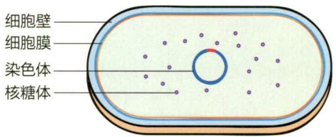

<details>
<summary>text_image</summary>

细胞壁
细胞膜
染色体
核糖体
</details>

(a) 处于分裂周期初始期的年轻细胞

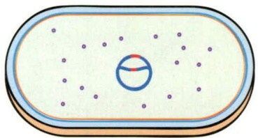

<details>
<summary>natural_image</summary>

Diagram of a cell with nucleus and surrounding particles inside an oval boundary (no text or labels)
</details>

（b）母细胞为分裂做准备:合成新的细胞壁和细胞膜；细胞总体积增大；起始染色体DNA的复制

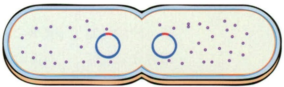

<details>
<summary>natural_image</summary>

Diagram of a cell undergoing division, showing two distinct circular structures with scattered particles (no text or labels)
</details>

(c) 伴随两条染色体完成分离并分别向细胞两端移动，隔结构（septum）开始向内形成

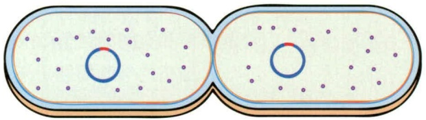

<details>
<summary>natural_image</summary>

Illustration of two oval-shaped objects with internal circular patterns and scattered dots (no text or symbols)
</details>

(d) 在分裂细胞的中部, 形成完整的隔结构, 从而将母细胞分割成了两个独立的细胞室 (子细胞)

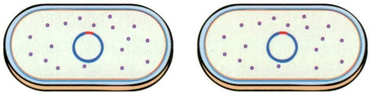

<details>
<summary>natural_image</summary>

Two oval-shaped diagrams showing internal structures with dots and a central blue circle (no text or symbols)
</details>

（e）在多数情况下，两个子细胞相互脱离，独立存在（如本图所示）；在一些特定类群中，分裂后的子细胞可以保持相互连接状态，从而形成链状或其他排列形式

图 8-1 杆状细菌的二均分裂

图 8-2 慢速生长和快速生长的细菌中 DNA 复制与细胞分裂的协调

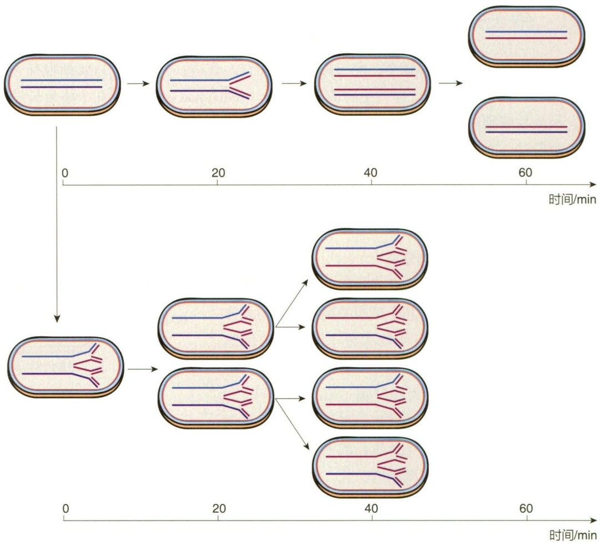

<details>
<summary>flowchart</summary>


</details>

细菌的细胞周期（cell cycle）是一个新生的细菌从细胞生长直至分裂为两个子细胞的全部过程。研究细胞周期具有重要的科学意义和实际价值，例如，细菌细胞周期中肽聚糖的合成过程是抗生素用于治疗细菌感染的重要靶标。基于对大肠杆菌、枯草芽孢杆菌（Bacillus subtilis）和水生细菌新月柄杆菌（Caulobacter crescentus）的研究，细菌的细胞周期可以分为三个时期:子细胞形成后的生长时期，这类似于真核细胞周期的G1期；染色体复制和分离时期，在功能上对应着真核细胞周期的S期以及M期的有丝分裂事件；胞质分裂期，在这个时期形成分裂隔结构（septum）和子细胞（图8-3）。在真核细胞周期中，S期与M期之间通过G2期分开，并且在G2期中染色体复制完成后经过一段时间再分离。在细菌中，染色体复制和分离是同时发生的，并且胞质分离在染色体复制和分配完成之前就已发生。一些快速分裂的细菌能够在上一轮复制和细胞质分裂完成之前就开始下一轮的复制过程。

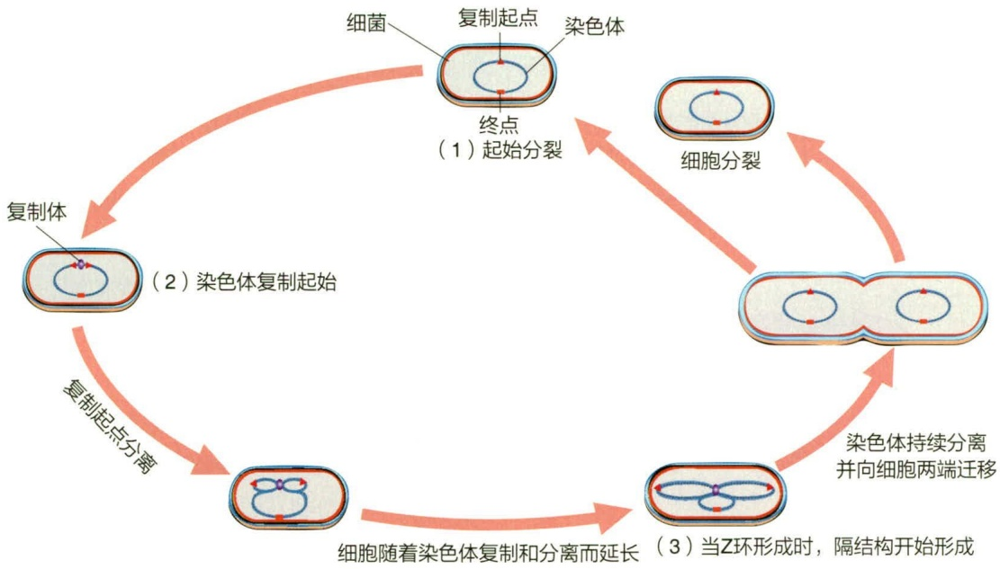

<details>
<summary>flowchart</summary>

This diagram illustrates the biological process of chromosome separation and cell division, showing how initial replication leads to either complete division or Z-loop formation.
</details>

图 8-3 大肠杆菌的细胞周期

用于起始 DNA 复制的 DnaA 蛋白的积累开启了细菌的细胞周期。当细胞为 DNA 复制作好准备时，复制的起点迁移到细胞的中心，相关的蛋白质聚集在一起形成复制体（replisome）结构。在图 8-3 中，在细胞分裂之前完成了一轮的 DNA 复制过程；在快速生长的细菌中，细胞分裂完成之前就会开始第二轮和第三轮的 DNA 复制过程。

相比细菌来说，对于古菌细胞周期的理解仍然较为落后，目前主要研究成果来自模式菌硫化叶菌（Sulfolobusspp.）。硫化叶菌属于泉古菌门（Crenarchaeota），最佳生长条件为高温低 $\mathrm{pH}$ 的极端环境，其细胞周期与真核生物较为类似。在经历一段时期的生长之后（类似于真核细胞周期的G1期），硫化叶菌的DNA通过与真核生物类似的机制从三个起点进行复制，在开始复制后的一段时间内，子代染色体保持不分离的状态（类似于真核细胞周期的G2期），这一过程占据了整个细胞周期的 $50\%$ 以上，随后发生染色体分离和细胞质分裂过程。

## 8.1.1.3 细胞壁扩增

细胞壁是细菌的一种“硬”性结构。在生长过程中，细胞体积的扩大必定伴随着细胞壁的扩增。在不同形态的细菌中，细胞壁的扩增位点呈现出显著差异:杆状细菌生长过程中新合成的肽聚糖在原有细胞壁的多个位点发生插入，使细胞壁中的新老肽聚糖呈间隔分布；而球状细菌在生长过程中，新合成的肽聚糖是固定在赤道板附近插入，导致新老细胞壁能明显地分开，原来的细胞壁则被推向两端（图8-4）。

细胞壁的扩增需要打开原来的肽聚糖结构，同时插入新合成的肽聚糖前体，并进行重新交联。细菌能够产生多种肽聚糖水解酶，在特定条件下活化后打断肽聚糖分子内的糖苷键或酰胺键，进而水解肽聚糖并导致细胞自溶，因此这些酶被称为自溶素（autolysin）。如图8-5所示，在自溶素的作用下，原有肽聚糖骨架的特定位点被精准切割，形成新合成的肽聚糖的插入缺口（gap）。在细菌烯醇（bactoprenol）载体的


## 知识拓展 8-1

细菌染色体复制与分离的分子机制