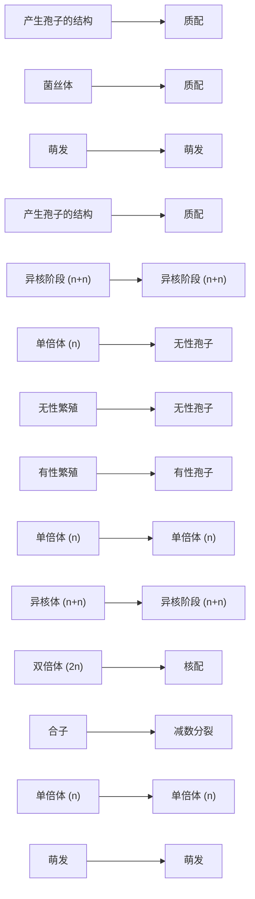
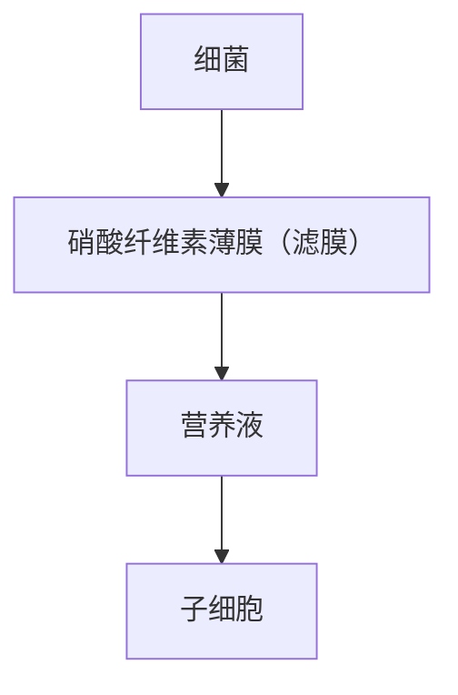

text_image

FtsZ
细胞壁
细胞膜
MreB
细胞壁合成位点
(a)
FtsZ环
壁带
(wall bands)
新生细胞壁
(b)

图 8-4 细菌细胞壁的扩增位点

（a）在杆状细菌中，细胞骨架蛋白 MreB 沿杆状细胞的长轴缠绕，多个位置与细胞膜接触（红色虚线圆圈），这些位置是新细胞壁合成的部位；（b）在革兰氏阳性球菌中，细胞分裂期间细胞壁合成的位置以绿色显示

协助下，细胞质中新合成的肽聚糖前体被转运穿过细胞质膜进入周质空间，通过转运载体的协助和转糖苷酶（transglycosylase）的催化，前体插入细胞壁的生长点并与原有肽聚糖形成新的糖苷键。最后，在转肽酶（transpeptidase）的催化下，相邻的肽侧链通过肽桥或者肽键相互交联。新合成的肽聚糖单体就和原有的肽聚糖形成一个完整的整体，细胞壁实现扩增，细胞得以生长和分裂。

## 8.1.1.4 细菌的分裂与调节

当细菌的各种结构复制完成之后就进入分裂时期。细胞伸长，DNA 复制后随膜的延长被分开，同时细胞膜在细菌的中间位置内陷，膜内陷伴随新合成的肽聚糖插入，导致横隔壁向中心生长，最后在中心会合，细胞质被横隔壁分为两部分，细胞完成一次分裂，一个细菌分裂成两个大小相等的子代（图 8-1）。

flowchart

This diagram illustrates the molecular mechanism of a cell membrane, showing how glucose and D-Ala are converted into DPA-D-Glu-DPA-D-Ala complexes via transglucosin (转糖苷酶催化), followed by self-soluble water splitting and subsequent polymerization.

图 8-5 细菌肽聚糖的扩增过程

细菌的分裂过程受到以 Fts（filamentous temperature sensitive）类蛋白为代表的多种蛋白质的严格控制，其中的 FtsZ 是细胞分裂时主要的骨架蛋白。FtsZ 是一种具有 GTPase 活性的 GTP 结合蛋白，在原核生物中高度保守，不仅存在于细菌和古菌中，也存在于线粒体和叶绿体中，并与真核生物的微管蛋白具有同源性。杆状细菌分裂时，FtsZ 蛋白最早在细胞的中部聚合成环状骨架 Z 环（Z ring），其他相关蛋白再与之结合，Z 环收缩促进细胞的分裂。Z 环的形成晚于 DNA 的复制，它在两个拟核之间形成。细胞分裂产生的位置与 FtsZ 蛋白的定位有关，而 FtsZ 蛋白的定位则受控于 Min 系统。在大肠杆菌中，通过 MinC、MinD 和 MinE 蛋白的精确调控作用，Z 环准确定位于细胞中部，最终使细菌二均分裂时能形成两个大小相同的子细胞。

## 8.1.1.5 原核生物的其他繁殖方式

## (1) 出芽繁殖

除了大多数细菌和古菌繁殖采用二均分裂方式外，一些细菌还可以通过出芽繁殖（budding division）方式完成细胞分裂。相比二均分裂得到两个相同的子代细胞，出芽繁殖基于细胞的不均等生长而发生分裂，从而形成了一个全新的子代细胞，并且其母细胞保留原本的形态（图8-6）。除了简单的出芽繁殖，柄杆菌属（Caulobacter）和生丝微菌属（Hyphomicrobium）的芽生细菌通过细胞质延伸形成柄状或菌丝状突起，并在突起部位形成子代芽体细胞。

在二均分裂过程中，新生细胞壁的合成位点遍布整个细胞，但在出芽繁殖时，新生细胞壁从母细胞上单一位点形成，也就是所谓的极性生长（polar growth），这成为了二者最为本质的区别。极性生长所带来的一个重要后果是，以内膜复合体（internal membrane complexes）为代表的大型细胞质结构在细胞分裂过程中不会被直接复制和

## I. 二均分裂:多数细菌类群

flowchart

图 8-6 细菌的典型二均分裂与非等分的二分分裂

## II. 非等分的二分分裂

1. 简单出芽:小梨形菌属、芽生杆菌属

flowchart

2. 菌丝出芽:生丝微菌属、红微菌属

flowchart

3. 柄状细胞的分裂:柄杆菌属

flowchart

4. 子代细胞大小一致的极性生长:红假单胞菌属、硝化杆菌属、甲基弯曲菌属分割，而是必须在新生芽体细胞中重新形成。对于一些光合细菌和化能自养细菌来说，细胞的内膜系统可以有序容纳多种酶蛋白并行使其特殊代谢功能，在芽殖过程中，内膜结构无须进行分配，而是从头合成，这为维持内膜的复杂结构和执行功能提供了保证。

chemical

Diagram showing a sequential process of molecular rearrangement or transformation with green and purple spheres representing different states or components.

## (2) 链霉菌的繁殖

链霉菌（streptomyces）是土壤中最常见的放线菌，营养体为多核菌丝，在繁殖过程中，菌丝最终分裂形成单核的孢子（spore），从而具备了一定的抗逆特征并且易于扩散（图8-7）。在孢子成熟时，往往会产生土臭素和2-甲基异茨醇等挥发性化合物吸引昆虫前来食用链霉菌，从而间接帮助了孢子的扩散。在适宜的环境条件下，孢子能够萌发形成新的菌丝细胞。

## 8.1.1.6 生物被膜

在自然条件下，无论是二分分裂还是出芽繁殖，微生物细胞能够在液体中悬浮生长或者是附着在物体表面生长。单个、独立、自由漂浮的生活方式被称为浮游生长（planktonic growth），是自然界中许多水栖细菌的主要生长方式。与此同时，微生物能够附着在生物或非生物表面形成高度结构化的生物（被）膜（biofilm）结构，一般由微生物细胞及其产生的胞外多聚物（extracellular polymeric substance，EPS），也被称为胞外基质（extracellular matrix，ECM），构成。其中，微生物细胞可以是单一种群也可以是由多个物种组成的复杂群落；胞外基质作为维持生物被膜结构和功能的物质基础，则主要由胞外多糖（exopolysaccharide）、蛋白质、胞外DNA（extracellular DNA, eDNA）、脂质及其他由细胞中释放出来的分子组成。在自然界中，细菌、古菌、真菌甚至部分原生动物（变形虫和鞭毛虫）和藻类（硅藻和单细胞藻类）都可以形成单一或者混合的生物被膜，本节主要以细菌的生物被膜为例进行相关介绍。

图 8-7 天蓝色链霉菌 (Streptomyces coelicolor) 的孢子形成

flowchart

This diagram illustrates the biological process of plant growth, showing how microbial culture (fibrous and spore) interacts with germination, fertilization, and regeneration stages.

text_image

浮游细胞
物体表面
EPS
细胞簇
微菌落
可逆附着 不可逆附着 成熟I期 成熟II期 分散

图 8-8 铜绿假单胞菌的生物被膜形成过程

细菌从浮游状态向生物被膜的生长转变是一个复杂且高度受调控的过程。以铜绿假单胞菌（Pseudomonas aeruginosa）形成典型的蘑菇状生物被膜结构为例，整个过程是以5个特定阶段逐步进行的循环（图8-8），包括可逆附着、不可逆附着、聚集体形成（成熟I期）、微菌落形成（成熟II期）以及最后的分散。生物被膜的形成在单个浮游细胞接触物体表面后启动，在可逆附着（reversible attachment）阶段，细菌通过细胞一端或鞭毛吸附在表面上，随后进行纵向附着；通过降低鞭毛反转率、降低鞭毛基因表达水平以及产生胞外多聚物，细胞进入不可逆附着（irreversible attachment）阶段；在成熟I期，由少量细胞聚集而成的细胞簇（cell cluster）包埋在基质中形成聚集体（aggregate）；在成熟II期，蘑菇状的微菌落（microcolony）的形成标志着生物被膜的完全成熟；最后，少量的单个运动细胞或者微小聚集体可以从生物被膜中游离出来恢复浮游状态，这一阶段被称为生物被膜的分散（dispersion）。在特定情况下，生物被膜也可以由于胞外多聚物的大量降解而发生崩解。在细菌生物被膜的形成过程中，通过群体感应（quorum sensing, QS）、第二信使3,5-环二聚鸟苷单磷酸（cyclic dimeric guanosine monophosphate, c-di-GMP）、双组分系统（two-component system, TCS）、毒素-抗毒素（toxin-antitoxin）、小RNAs等多种信号系统以及相关蛋白，每一个步骤都受到了严格而有序的调控。

由多种细胞外聚合物构成的生物被膜基质可以被视作一个封闭的微生物细胞的共享空间，并且在空间和时间上都是动态变化的，其各种成分以复杂的方式相互作用，履行多种生物学功能。胞外多聚物在介导生物被膜中细胞与表面以及细胞之间的吸附和聚集过程中发挥了关键作用，确保浮游细胞能够在表面发生初步定殖以及后续生物被膜的长期附着、促进细胞之间的桥接、固定并形成高密度的微生物类群。胞外多聚物是构建生物被膜稳定的空间结构并维持其异质性（heterogeneity）的核心组分，使得生物被膜中不同位置细胞所面对的营养、氧气和代谢废物等生长影响因素的浓度和种类不尽相同。胞外多聚物可以形成对生物被膜内部细胞的保护屏障，使其免受外部毒害因子的损伤，例如，助力病原微生物在感染过程中对宿主防御产生抗性，并对各种抗微生物制剂产生耐受性，从而增强其致病力和耐药性。与此同时，通过对 eDNA 的

## 知识拓展 8-2

群体感应与细菌的生物被膜

保护作用，胞外多聚物能够促进生物被膜细胞间的水平基因转移；通过亲水性组分，胞外多聚物可以维持细胞周围高度水合的微环境，提高其在缺水环境中的耐受性；通过与胞外酶的结合，多聚物基质成为了生物被膜有效的外部消化系统；胞外多聚物还在生物被膜获取外界营养以及储存过程中发挥了重要作用。

生物被膜无处不在，并在自然和人工环境中发挥着关键作用。据估算，约有40%\~80%的原核生物以生物被膜的形式生活在自然环境中。生物被膜对于生态系统的功能至关重要，驱动了生物地球化学过程（biogeochemical process）、营养循环和生物修复过程（bioremediation）。作为应对不利因素（例如捕食者、营养匮乏、缺氧、干旱、高温和抗生素作用等）而演化出的一种自我保护式生存策略，生物被膜不仅对于微生物在自然条件下的存活至关重要，同时还对人类生活产生了广泛的影响。例如，临床上约有80%的细菌感染与生物被膜有关，并常常引发抗生素耐药性而极大地增加了治疗难度；食品加工及储存过程中的微生物污染多由生物被膜引发；工业生产中的微生物诱导腐蚀、管道堵塞和生物淤积等问题很多都起源于难以根除的生物被膜；与此同时，在废水处理、生物修复、电力生产和生物过滤等过程中，生物被膜又发挥了不可替代的作用。

## 8.1.2 酵母菌的个体生长与繁殖

以细菌为代表的原核微生物主要依赖于无性繁殖（asexual reproduction）实现个体数量的增加，在酵母和丝状真菌等真核微生物中，则出现了有性繁殖（sexual reproduction）过程。无性繁殖是指不经过两性细胞的接合而直接形成同种新个体的繁殖过程，理论上子代的基因型与母体相同，或者变异较小。有性繁殖则必须依赖两个性细胞结合而产生新的个体，并且需要经过减数分裂（meiosis）阶段。有性繁殖的子代理论上存在更大的遗传变异可能性，从而有助于个体更好地适应环境的变化。

大多数酵母菌以单细胞形式存在，少数也可形成假菌丝。酵母细胞呈圆形或卵圆形，其细胞直径常是细菌的10倍左右。酵母菌的繁殖方式多种多样，既能够通过出芽、分裂和产生无性孢子等方式进行无性繁殖，也能够产生子囊孢子进行有性繁殖。

## 8.1.2.1 酵母菌的无性繁殖

## (1) 出芽繁殖

大多数酵母菌通过出芽方式进行无性繁殖。在适宜条件下，酿酒酵母（Saccharomyces cerevisiae）细胞生长到一定大小时，细胞表面向外凸起，形成一个芽体，新合成的细胞壁组分被不断插入到芽体表面，使细胞壁得以扩增，芽体不断长大。同时，复制后的细胞核和其他细胞器被运输到芽体内。当芽体生长到体积接近母细胞的2/3时，芽体与母细胞之间会形成隔膜，完成细胞质分裂。隔膜完全形成后，隔壁物质在隔膜处逐渐沉积并加厚。最后，芽体一侧的隔壁物质发生部分降解，进而使得芽体与母细胞分离，产生一个新的酵母菌细胞。在扫描电镜下，可观察到芽体与母细胞脱离后，母细胞表面留下一个环形凸起，直径略大于1  $\mu$ m，该结构被称为芽痕（bud scar），相应地，在芽体表面也会留下一个环形凸起，称为蒂痕（birth scar），芽痕与蒂痕的位置就是母细胞与芽体曾经相连的地方。根据酵母菌出芽的部位，一般可将芽殖分为双极出芽和单极出芽。双极出芽（bipolar budding）是指在蒂痕的远端（细胞上蒂痕的对侧方向）和近端（蒂痕附近）均能形成芽体。单极出芽（unipolar budding）是指只能在蒂痕的远端或只能在其近端形成芽体。多数情况下，无论是双极出芽还是单极出芽，母细胞每出芽一次，都会换一个新的位置再出芽，因而芽痕不会出现重叠。利用电镜观察等方法，可以通过细胞表面芽痕的数量估算其菌龄。

## (2) 分裂繁殖

裂殖酵母属如粟酒裂殖酵母（Schizosaccharomyces pombe）和八孢裂殖酵母（Schizosaccharomyces octosporus）的主要繁殖方式是裂殖（fission）。裂殖是指母细胞经过分裂形成子代细胞的过程，即在分裂开始前母细胞的一端和两端先后进行伸长，细胞核分裂，随后在细胞中间部位形成一个隔膜，细胞被一分为二，产生两个大小相同的子细胞。这种无性繁殖简单快速，适应性强，在适宜的温度、营养条件下，裂殖酵母能够快速繁殖，形成大量子代。

## (3) 形成无性孢子

还有少数酵母菌产生无性孢子进行繁殖，如掷孢酵母（Sporobolomyces pararoseus）产生肾形或豆形的掷孢子。掷孢子是由营养细胞生出的小型突起形成，然后由一种突发机制（special droplet mechanism）弹射出去，在培养皿盖上形成模糊的菌落镜像（mirror image），与担子菌的担孢子弹射机制相似。

## 8.1.2.2 酵母菌的有性繁殖

不论是芽殖、裂殖还是无性孢子繁殖，细胞核都没有经过减数分裂，属于无性繁殖。在营养充足的条件下，酵母菌以无性繁殖的方式为主；而在营养缺乏的情况下，则采取依赖于子囊孢子的有性繁殖方式，以加快自身基因的重组并产生新变异适应逐渐变化的环境。具体来讲，当酵母菌发育到一定阶段，两个形态相同但接合型（性别）不同的单倍体细胞相互接近，各生成一个小凸起而互相接触，接触面的细胞壁溶解并形成细胞通道，使两个细胞的细胞质互相融合，完成质配（plasmogamy）过程。在这一过程中，两个核暂不融合，每个核的染色体数目都是单倍的，从而形成一个双核细胞，可用 $n+n$ 表示。随后，进入核配（karyogamy）阶段，两个细胞核相互融合为一个二倍体接合子核，形成二倍体细胞，用2n表示。很多酵母菌的单倍体和二倍体细胞都可以独立存在，并且二倍体细胞都可以进行正常的营养生长和多代无性繁殖（如出芽繁殖）。在适宜条件下，二倍体细胞进行减数分裂形成子囊孢子，每个子囊（来源于最初的二倍体细胞）中含有4个或8个单倍体的子囊孢子，每个子囊孢子释放后都可以萌发形成新的单倍体细胞。可见，酵母菌的有性繁殖特指细胞经质配、核配，最后融合形成一个二倍体细胞，然后经过减数分裂形成子囊孢子的过程。以子囊孢子进行有性生殖的酵母菌和霉菌在分类上均归属于子囊菌门（Ascomycota）。

## 8.1.2.3 酵母菌的生活史

单细胞的酵母菌和丝状真菌一样也具有无性繁殖和有性繁殖两个阶段的生活史。

图 8-9 酿酒酵母的生活史

```mermaid
graph LR
  subgraph Left_Process
  A["Single Cell Cells (n)"] --> B["α & αA"]
  B --> C["α & αA"]
  C --> D["Out芽生殖"]
  end

  subgraph Middle_Process
    E["α & αB Cell"]
    F["α & αB Cell"]
    G["α & αB Cell"]
    H["α & αB Cell"]
    I["α & αB Cell"]
    J["α & αB Cell"]
    K["α & αB Cell"]
    L["α & αB Cell"]
    M["α & αB Cell"]
    N["α & αB Cell"]
    O["α & αB Cell"]
    P["α & αB Cell"]
    Q["α & αB Cell"]
    R["α & αB Cell"]
    S["α & αB Cell"]
    T["α & αB Cell"]
    U["α & αB Cell"]
    V["α & αB Cell"]
    W["α & αB Cell"]
    X["α & αB Cell"]
    Y["α & αB Cell"]
    Z["α & αB Cell"]
  end

  subgraph Right_Process
    AA["Double Cell Cells (2n)"]
    AB["Cytokine Release"]
    AC["Inhibition of Growth"]
    AD["Inhibition of Growth"]
    AE["Inhibition of Growth"]
    AF["Inhibition of Growth"]
    AG["Inhibition of Growth"]
    AH["Inhibition of Growth"]
    AI["Inhibition of Growth"]
    AJ["Inhibition of Growth"]
    AK["Inhibition of Growth"]
    AL["Inhibition of Growth"]
    AM["Inhibition of Growth"]
    AN["Inhibition of Growth"]
    AO["Inhibition of Growth"]
    AP["Inhibition of Growth"]
    AQ["Inhibition of Growth"]
    AR["Inhibition of Growth"]
    AS["Inhibition of Growth"]
    AT["Inhibition of Growth"]
    AU["Inhibition of Growth"]
    AV["Inhibition of Growth"]
    AW["Inhibition of Growth"]
    AX["Inhibition of Growth"]
    AY["Inhibition of Growth"]
  end

  D --> E
  E --> F
  F --> G
  G --> H
  H --> I
  I --> J
  J --> K
  K --> L
  L --> M
  M --> N
  N --> O
  O --> P
  P --> Q
  Q --> R
  R --> S
  S --> T
  T --> U
  U --> V
  V --> W
  W --> X
  X --> Y
  Y --> Z
  Z --> AA
  AA --> AB
  AB --> AC
  AC --> AD
  AD --> AE
  AE --> AF
  AF --> AG
  AG --> AH
  AH --> AI
  AI --> AJ
  AJ --> AK
  AK --> AL
  AL --> AM
  AM --> AN
  AN --> AO
  AO --> AP
  AP --> AQ
```

flowchart

不同的酵母菌具有不同类型的生活史:酿酒酵母的营养细胞既能以单倍体又能以二倍体形式存在，八孢裂殖酵母（Schizosaccharomyces octosporus）的营养细胞只能以单倍体存在，而路德类酵母（Saccharomycodes ludwigii）的营养细胞只能以二倍体存在。其中，最具代表性的为酿酒酵母的生活史。如图8-9所示，二倍体细胞在营养缺乏时可以通过减数分裂产生4个单倍体的子囊孢子，其接合型分别为a型和 $\alpha$ 型，子囊孢子通过萌发各自转变为a细胞和 $\alpha$ 细胞。a细胞和 $\alpha$ 细胞可以分别产生和分泌短肽类的a因子和 $\alpha$ 因子，被称为外激素（pheromone）。两种单倍体的营养细胞可独自进行生长繁殖。在营养等条件适宜时，a细胞与 $\alpha$ 细胞在相互识别后发生趋化性生长，经细胞接触、质配和核配，最后融合成一个二倍体的营养细胞，二倍体营养细胞可以通过芽殖的方式继续生长繁殖。

## 8.1.3 丝状真菌的个体生长与繁殖

丝状真菌（filamentous fungus）也称为霉菌（mold），其生长与繁殖的能力很强，并且方式多种多样，既可以通过菌丝断片和无性孢子进行无性繁殖，也可以借助形成有性孢子进行有性繁殖过程。在自然条件下，丝状真菌主要靠形成各种无性和（或）有性孢子进行传播、繁殖以应对营养缺乏的逆境。

## 8.1.3.1 丝状真菌的个体生长

丝状真菌通常以顶端生长的方式进行菌丝的延伸。菌丝的整体有极性之分，位于前端的为幼龄菌丝，位于后面的为老龄菌丝。菌丝的幼龄端会形成生长点，通过顶端生长使菌丝延长，并且可以产生分枝菌丝。一般来说，在菌丝顶端1\~2  $\mu$ m的区域内，含有大量的泡囊，泡囊在位于菌丝细胞亚顶端的内质网中形成，然后由内质网转移至同样位于亚顶端的高尔基体，在高尔基体内进行浓缩加工，把泡囊的类内质网膜转化为类原生质膜。在缺少高尔基体的真菌中，泡囊则直接在内质网的特定区域加工成熟。成熟的泡囊内含有细胞壁和原生质膜的前体物、细胞壁裂解酶和合成酶。泡囊通过细胞质的流动由菌丝亚顶端转移至顶端，与原生质膜融合，使原生质膜面积增加。泡囊内含物进入细胞壁，其中的水解酶使菌丝细胞壁出现局部的裂解，在细胞膨压的作用下细胞壁延伸。内含物中不定形的细胞壁前体物在细胞壁合成酶的作用下并入菌丝细胞壁中，形成新的细胞壁，从而使菌丝不断地向前延伸。菌丝在固体培养基或液体培养基中静止培养时形成菌落，在液体培养基中振荡培养时则形成菌丝球。

高等的丝状真菌，如子囊菌、担子菌，其菌丝的生长伴随着隔膜的形成。隔膜上有孔，并被内质网膜覆盖，以限制大的细胞器如细胞核从一个细胞游动到另一个细胞。这种有孔的隔膜使多细胞的有隔菌丝在生理上成为一个整体。低等的丝状真菌不形成隔膜，只是在菌丝体形成繁殖结构时才出现无孔的隔膜。

## 8.1.3.2 丝状真菌的无性繁殖

丝状真菌的无性繁殖是指通过营养菌丝的片段化或者无性孢子形成同种新个体的过程。在菌丝断片被接种到新鲜培养基培养过程中，在菌丝断片的幼龄端会重新形成新的生长点，通过顶端生长使菌丝延长。在生长过程中，这条菌丝可以形成分支菌丝，并且不断重复这一过程从而产生更多的分支。菌丝生长到一定阶段则产生孢子，并进行新一轮的生长与繁殖。

一般来讲，丝状真菌的菌丝生长到一定阶段后，可以产生分生孢子、孢囊孢子、厚垣孢子、芽生孢子和节孢子等无性孢子（图8-10），进行无性繁殖。孢囊孢子（sporangiospore）是在菌丝分化形成的孢子囊（sporangium）内产生。壶菌门（Chytridiomycota）的孢囊孢子呈圆形，洋梨形或肾形，其成熟后从孢子囊特生的孔口释放，或孢子囊破裂释放，这类孢子一般有1\~2根鞭毛，并在鞭毛的驱动下在水中游动，因此又称为游动孢子（zoospore）。接合菌门（Zygomycota）的孢囊孢子多呈球形、卵圆形和圆柱形，有的还有纵纹，无鞭毛，无运动能力，因此又称为静孢子（aplanospore）。分生孢子（conidium, 复数 conidia）是由子囊菌产生的无性孢子，一般不具运动能力，但质量很轻，表面含大量疏水蛋白（hydrophobin）而使其具疏水性，这使得分生孢子易于在环境中扩散。分生孢子壁一般有色素，使得产孢完成的菌丝体呈现不同的颜色，如青霉菌呈现绿色。不同种真菌产孢结构差异较大，是真菌分类的一个指标。厚垣孢子（chlamydospore）是在一些丝状真菌菌丝或酵母假菌丝的中间或顶端，多个细胞相连形成细胞壁加厚、颜色加深、表面光滑的大球形孢子。厚垣孢子是一类休眠孢子，可度过干燥和高温等逆境。芽生孢子（blastospore）是在酵母通过二态转变形成多细胞的假菌丝后，假菌丝通过出芽产生芽生孢子。此外，球囊菌门（Glomeromycota）的一些菌根真菌，也会产生多细胞的芽生孢子。节孢子（arthrospore）是在菌丝没有明显的分化时通过细胞壁加厚而形成，链状的节孢子可进一步相互分离而扩散。节孢子也是为度过逆境而产生的休眠孢子。地霉属（Geotrichum）真菌和导致毛内癣的病原真菌奥杜盎氏小孢子菌（Microsporum audouinii）常常会形成节孢子。由无性孢子开始的生长包括孢子肿胀、萌发管形成和菌丝生长三个阶段。孢子肿胀是孢子在适宜条件下，通过吸水和代谢等过程使孢子体积扩大，但仍呈球形。在这一时期，新合成的细胞壁物质不是固定在一个部位，而是均匀地在孢子壁的多个部位插入，是一个非极性的生长过程。接着，孢子继续吸收营养物质和合成新的细胞壁物质，细胞壁物质插入孢子壁的一个固定位置，通过极性生长过程形成萌发管，从而进入萌发期。最后，萌发管继续生长，最后发育成新的菌丝。

图 8-10 丝状真菌主要无性孢子类型

## 8.1.3.3 丝状真菌的有性繁殖

在特定条件下，丝状真菌的生长后期，其菌丝体上可以形成有性繁殖结构，产生有性孢子，进行有性繁殖。丝状真菌的有性繁殖复杂而多样，但与酵母菌类似，一

图 8-11 滨海水霉和下弯绵霉的卵孢子  
(a) 顶生藏卵器；(b) 间生藏卵器

般也可以分为三个阶段:第一阶段是质配，两个性细胞接触后发生细胞质融合，但两个核暂不融合，形成双核细胞；第二阶段为核配，质配后两个核融合，产生二倍体接合子核。在低等真菌中，质配后立即核配，而在高等真菌中，质配后并不立即核配，常有双核阶段，在此期间，双核在细胞中甚至又可同时分裂；第三阶段为减数分裂，大多数真菌核配后立即进行减数分裂，核中的染色体数目又恢复到单倍体数目。

有性繁殖方式因物种不同而不同。有些丝状真菌两条营养菌丝就可以直接接合，如毛霉目中的一些种，但多数丝状真菌则由菌丝分化形成特殊的性细胞（器官），如配子囊（图8-11，图8-12），它们经交配形成有性孢子。丝状真菌主要有性孢子的特征见表8-1，这些特征常被作为丝状真菌分类的依据。

flowchart

(a)

natural_image

Illustration of various plant structures with no text or symbols

(b)

图 8-12 根霉的接合孢子（a）异宗配合；（b）同宗配合

表 8-1 一些丝状真菌的有性孢子及其特征

| 有性孢子 | 染色体倍数 | 有性繁殖结构及特征 | 数量 | 外/内生 | 代表菌种 |
| --- | --- | --- | --- | --- | --- |
| 卵孢子 | 2n | 由菌丝分化形成雄器和藏卵器,雄器中的细胞核通过授精管进入藏卵器内与卵球结合,卵球生出外壁,产生卵孢子 | 大于等于1个 | 内 | 同丝水霉德氏腐霉 |
| 接合孢子 | 2n | 由两个配子囊各自向对方伸出特殊菌丝进而接触并融合形成。两个配子囊来自同一个菌丝体称为同宗配合(homothallism),来自不同质菌系的菌丝体(常用“+”或“-”代表)称为异宗配合(heterothallism) | 1个 | 内 | 葡枝根霉高大毛霉性殖根霉 |
| 子囊孢子 | n | 在子囊中形成。子囊可以通过两个营养细胞结合直接形成或在子囊果中形成 | 2~8个 | 内 | 马氏单囊霉麦类白粉菌粗糙脉胞菌牛粪盘菌酿酒酵母 |
| 担孢子 | n | 不同性别的单核菌丝结合产生双核菌丝,双核菌丝顶端细胞膨大为担子。担子内两性细胞核核配后经过两次分裂形成4个单倍体的子核,它们进入担子顶端长出4个小梗的膨大部位,发育形成4个担孢子 | 4个 | 外 | 蘑菇多孔菌木耳银耳香菇 |

## 8.1.3.4 丝状真菌的生活史

丝状真菌从孢子开始，经过一段时间的生长繁殖，其中包括无性繁殖和有性繁殖两个阶段，最后又产生同一种孢子，这一循环称为丝状真菌的生活史（图 8-13）。真菌的生活史多种多样，差异较大。较典型的是丝状真菌的菌丝体（营养细胞）在适宜条件下产生无性孢子，无性孢子萌发形成新的菌丝体，如此重复多次，这是其生活史中的无性繁殖阶段。当菌丝生长繁殖一定时间后，在一定条件下，开始有性繁殖，即从菌丝体上分化出特殊的性细胞（器官），或两条异性营养菌丝进行接合，经过质配、核配，形成双倍体细胞核，最后经过减数分裂形成单倍体孢子，这类孢子萌发再形成新的菌丝体。这就是一般丝状真菌生活史的一个循环周期。

图 8-13 丝状真菌的生活史

flowchart

## 8.2 微生物生长的测定

评估微生物的生长可以提供其培养和群落状态的定量信息，也可以用于评价各种环境条件、激活或抑制物质对微生物生长的影响规律，在理论上和实践上有着重要的意义。许多方法可以测定微生物的生长速率和繁殖频率，包括微生物计数、质量测定和生理指标测定等，主要通过测定单位时间里微生物数量——生物量（biomass）的变化来评价其生长情况。

## 8.2.1 微生物计数

计数法用于测定样品中所含微生物细胞的数量，可分为直接计数和间接计数两类。计数法只适用于测定处于单细胞状态的细菌和酵母菌，对于放线菌和霉菌等丝状生长的微生物而言，则只能用于测定其孢子的数量。

## 8.2.1.1 直接计数法

直接计数法是指直接对样品中微生物细胞数量进行计数。

(1) 显微镜直接计数法 (microscopic counting)

利用血细胞计数板或细菌计数板，在显微镜下直接测定一定体积液体样品中微生物的个数。计数板是一块特制的载玻片，其上有一个面积  $1 \, mm^{2}$  、高 0.1 mm 的计数室（体积为  $0.1 \, mm^{3}$ ）， $1 \, mm^{2}$  的面积又被划分为 25 个（或 16 个）中方格，每个中方格进一步划分为 16 个（或 25 个）小方格，因此计数室由  $25(16) \times 16(25)$  共 400 个小方格组成。将待测样品滴在计数板上，盖上盖玻片，在显微镜下计数 4～5 个中方格中的微生物细胞数（图 8-14）。根据计数结果，计算每个小格所含细胞的平均数，再按下面公式计算出每毫升样品所含的细胞数:

text_image

盖玻片
滴加样液

图8-14 微生物显微镜直接计数

每毫升原始样液中细胞数 = 每小格平均细胞数 × 400 × 10$^{4}$ × 稀释倍数

显微镜直接计数法方便、快捷，因此在微生物研究中应用广泛。但该方法也存在一些不足，在测定不同样品时需要进行特定的改进。个体很小的微生物细胞在显微镜视野中观察不到，样品中的碎片也很容易被误认为是细胞，使计数的准确性下降，这就需要使用特定的染色技术提高细胞在显微镜下的辨识度，例如，荧光染料DAPI（4',6-二脒基-2-苯基吲哚）可以与细胞中的DNA结合发光，从而将样品中的所有细胞染成亮蓝色。对水、空气等微生物细胞数量低的样品进行测定时，在显微镜视野中几乎无法观察到细胞，除非能够使用特定方法对细胞预先进行浓缩。此时可以使用膜过滤法（membrane filter method），将一定体积的样品通过膜过滤器，然后将滤膜干燥、染色，并经处理使膜透明，再在显微镜下计数膜上的微生物数量。在对具备运动能力的微生物细胞进行计数时，必须使用甲醛等试剂提前处理样品，杀死运动细胞并进行固定。此外，标准的显微镜直接计数为总菌计数法，不能直接区分样品中的死菌与活菌细胞。这时候，可以使用特定的荧光染色法检测微生物细胞的细胞膜是否完整，进而区分样品中的活/死细胞并进行分类计数，例如活死细胞染色（live-dead cell staining）技术。与此同时，使用荧光原位杂交（fluorescence in situ hybridization, FISH）等技术，结合显微镜直接计数可以对含有多个微生物种群复杂样品之中的特定类群进行分析和测定。

## （2）使用流式细胞仪进行直接计数

流式细胞术（flow cytometry）是指使用流式细胞仪对液流中排成单列的细胞或其他生物微粒（如微球、小型模式生物等）逐个进行快速定量分析和分选的技术。广泛应用于基础和临床医学研究，并被越来越多地用于直接计数微生物数量，获得微生物细胞的详细信息。流式细胞仪可产生非常窄的细胞流，使单个细胞通过激光束。当每个细胞穿过光束时，光被散射。对每个光散射事件进行独立检测，光散射事件的数量即代表了样品中的细胞数量。使用荧光染料或荧光标记抗体，还可以对不同大小、特征不同的细胞进行计数，从而提供有关细胞群体特征的有价值的信息。

## 8.2.1.2 间接计数法

间接计数法不直接计数微生物细胞，而是计数由单个细胞形成的菌落（单菌落），并推算出样品中的微生物细胞数量。

## (1) 平板计数法 (plate colony counting)

将待测样品梯度稀释，取一定体积的稀释菌液与适合的固体培养基混合倾倒平板，或涂布于已凝固的培养基平板上，保温培养，平板上每个细胞会生长成为一个菌落，称为菌落形成单位（colony forming unit，CFU）。计数平板上的 CFU，乘上菌液的稀释度，即可计算出原菌液的含菌数（表示为单位体积菌液中 CFU 数量）。在常用的 90 mm 培养平板上，以形成 30～300 CFU 为宜（图 8-15）。由于死细胞不能在平板生长形成菌落，因此该方法也称为活菌计数法（viable counting method）。

平板计数法是教学、科研和生产上常用的微生物计数方法，广泛应用于食品、医疗、自然环境中活菌数量的测定。该方法的操作环节较多，过程较为复杂，有较高的技术要求。有许多原因可使平板计数法产生误差:例如，液体样品与培养基混合不均匀可以导致菌落重叠生长；部分微生物培养时形成微型菌落，难以进行准确计数；菌落培养时，固体培养基的选择和培养时间也会显著影响检测结果。

## (2) 比浊法 (turbidimetry)

细胞可以散射光线，所以菌悬液中的细胞越多，被散射的光就越多，悬液就越混浊。在一定浓度范围内，菌悬液中细胞浓度与其浊度成正线性关系，因而可以据此测定菌悬液的细胞浓度。如图8-16所示，菌悬液的浊度可使用分光光度计进行测量:分光光度计通过衍射光栅或棱镜产生固定波长的入射光，穿过菌悬液后，测量未发生散射的透射光的强度，并计算光密度（optical density，OD，也称吸光度）值来衡量菌液的浊度。例如，使用 $540\mathrm{nm}$ 入射光测得的光密度值被称为 $\mathrm{OD}_{540}$ 。采用比浊法测定时，一定要控制菌液浓度处于与光密度成正线性关系的范围内，否则结果不准确。在高细胞密度下，细胞数和浊度之间的对应关系偏离线性，因此需要对待检测的菌悬液

图8-15 微生物平板计数

flowchart

This flowchart illustrates the experimental workflow for measuring bacterial colony-forming units (CFU) using a 9 mL culture base, showing sequential dilution steps and corresponding microbial counts.

text_image

光源
棱镜
入射光，I₀
滤光片
细胞悬浮液
透射光，I
光电管（测定光强度）
Wavelength: OD
-540 -0.32
数据显示与记录系统
光密度（OD）=lg I₀/l
OD₅₄₀ 0 0.18 0.45 0.68
细胞数量/mL
（平板计数） 0 1.3×10⁸ 3.3×10⁸ 5×10⁸

(a) 分光光度计的基本原理

line

| 时间/h | 细菌A (光密度) | 细菌B (光密度) |
| --- | --- | --- |
| 0 | ~0.04 | ~0.02 |
| 2 | ~0.05 | ~0.03 |
| 5 | ~0.07 | ~0.04 |
| 8 | ~0.13 | ~0.06 |
| 11 | ~0.22 | ~0.08 |
| 13 | ~0.35 | ~0.10 |
| 15 | ~0.49 | ~0.12 |
| 17 | ~0.64 | ~0.15 |
| 20 | ~0.71 | ~0.18 |
| 23 | ~0.75 | ~0.24 |
| 25 | ~0.79 | ~0.34 |
| 27 | ~0.80 | ~0.39 |
| 30 | ~0.80 | ~0.41 |
| 35 | ~0.80 | ~0.42 |

(c) 两种不同生长速率细菌的典型生长曲线

(b) 不同细胞浓度大肠杆菌比浊法检测结果

line

| 细胞数量或生物量 (千重) | 理论值 (光密度) | 实测值 (光密度) |
| --- | --- | --- |
| 0 | 0 | — |
| ~0.2 | ~0.2 | — |
| ~0.4 | ~0.4 | — |
| ~0.5 | 0.5 | 0.5 |
| ~0.6 | ~0.6 | ~0.6 |
| ~0.8 | ~0.8 | ~0.8 |

(d) 比浊法测定时细胞浓度与光密度的关系

图 8-16 比浊法测定细菌细胞生长

进行适度稀释后进行测定。

## (3) 试纸法

这是在平板计数法基础上发展的一种快速计数用商品化产品，其形式有小型厚滤纸片、琼脂片等。在滤纸和琼脂片中吸附有培养基，其中加入活菌指示剂2,3,5-三苯基氯化四氮唑（TTC，无色），蘸取测试菌液置于密封包装袋中培养。短期培养后在滤纸或琼脂片上出现一定密度的玫瑰色微小菌落，将其与标准纸色板上图谱比较即可估算出样品的含菌量。试纸法计数简便快捷，避免了平板计数法的人为操作误差。

## 8.2.2 微生物细胞质量测定

微生物的个体生长和繁殖均意味着原生质含量的增加，因此可以通过测定其全细胞或者特定组分质量的变化，评估生长繁殖过程。

## (1) 称量法

反映物质质量最直接的方法。称量法（称重法）适用于各类微生物生长的测定。取一定体积的微生物培养液，通过离心或过滤方法将菌体分离出来，经洗涤，直接称量，可得到微生物培养物的湿重；或将菌体置于已知质量的平皿或烧杯内，105℃烘干至恒重，得到培养物的干重。如果要测定固体培养基上生长的放线菌或丝状真菌，可先加热至50℃，使琼脂熔化，过滤得到菌丝体，用50℃的生理盐水洗涤菌丝，然后按上述方法测定菌丝体的湿重或干重。

## (2) 测定蛋白质和核酸含量

除了干重、湿重反映细胞物质质量外，还可以通过测定微生物样品中蛋白质或DNA的含量反映其细胞物质的量。蛋白质是细胞的主要成分，含量比较稳定。氮是蛋白质的重要组成元素，测定样品中的总氮量（凯氏定氮法），按下式可计算蛋白质含量:

$$
\mathrm{蛋白质含量} = \mathrm{总氮量} \times 6. 2 5
$$

DNA 是微生物的重要遗传物质，每个细菌细胞中 DNA 含量相当恒定，平均为  $8.4 \times 10^{-5}$  ng。从样品中提取 DNA，测得 DNA 含量，可用于表示微生物的生物量。

## 8.2.3 微生物生理指标测定

除了计数和测定质量外，微生物生物量还可以用生理指标测定法进行测定。常用的生理指标包括微生物的呼吸强度、耗氧量、酶活性等。这些生理指标与微生物数量密切相关，因此，可以通过对上述生理指标进行测定，间接反映样品中微生物的生物量。

## 8.3 微生物的群体生长

当微生物的个体生长达到一定程度后，细胞开始分裂（繁殖），从而引起个体数目的增加，构成了微生物群体。在一个微生物群体中，个体的生长以及繁殖将导致群体的质量、体积、浓度的增加，这一现象称为微生物的群体生长（population growth）。因此，群体生长是群体中个体生长和繁殖的结果。在微生物学研究中，除了特定目的以外，只有群体的生长才有实际意义，因此，在微生物学中提到的“生长”，通常指群体生长，这一点与研究大生物时有所不同。本节将以细菌和酵母菌为代表介绍微生

物群体生长的特点与一般规律。

## 8.3.1 同步生长与同步培养技术

在微生物个体的生长过程中，细胞内部发生了复杂的细胞学和生物化学变化。为了研究相关变化，除了在单个细胞水平上进行直接表征之外，在群体水平上，需要使用同步培养（synchronous culture）技术使群体中的所有个体细胞尽可能都处于同样的细胞生长和分裂周期中，然后通过分析群体在各阶段的特性变化来间接了解单个细胞的相应变化规律。这种通过同步培养的手段而使细胞群体中各个体处于分裂步调一致的生长状态，称为同步生长（synchronous growth）。处于同步生长的细胞群体被称为同步细胞或同步培养物，常被用来研究在单细胞水平上难以表征的微生物生理与遗传特性或作为工业发酵的种子细胞，是一种理想的实验材料。

获得微生物同步生长的方法主要有两类:一是机械筛选法，包括离心法、过滤分离法和硝酸纤维素滤膜法；二是环境条件控制技术，即通过控制温度、培养基成分和其他培养条件（如光照和黑暗交替培养），制备同步培养物。其中，硝酸纤维素滤膜法是最经典的获得同步生长的方法（图 8-17a）。该方法利用滤膜与微生物细胞电荷相反的原理，在菌悬液流经滤膜时，细胞在膜表面发生吸附，然后将滤膜翻转并置于滤器中，再以新鲜培养液缓慢流过滤膜。未直接吸附在滤膜上的细胞被培养液冲洗掉，吸附在膜上的细胞经过一段时间后开始分裂，形成的两个子细胞中，一个仍吸附在滤膜上，另一个则被培养液洗脱。若滤膜面积足够大，只要收集刚刚洗脱的子细胞培养液即可获得同步细胞。由于细胞的个体差异，同步生长往往只能维持 2\~3 个世代，随后又逐渐转变为随机生长（图 8-17b）。

flowchart

(a) 硝酸纤维素滤膜法

line

| 时间 | 绿色直线 (Ig细胞数量) | 红色曲线 (Ig细胞数量) |
| --- | --- | --- |
| 0 | 0 | 0 |
| ~1 | ~1 | ~1 |
| ~2 | ~2 | ~2 |
| ~3 | ~3 | ~3 |
| ~4 | ~4 | ~4 |
| ~5 | ~5 | ~5 |
| ~6 | ~6 | ~6 |
| ~7 | ~7 | ~7 |
| ~8 | ~8 | ~8 |
| ~9 | ~9 | ~9 |
| 10 | 10 | 10 |

(b) 细菌的同步生长与非同步生长

图 8-17 细菌的同步生长及其获取方法