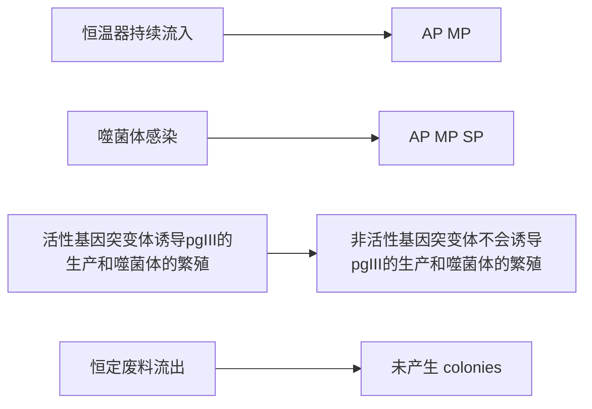
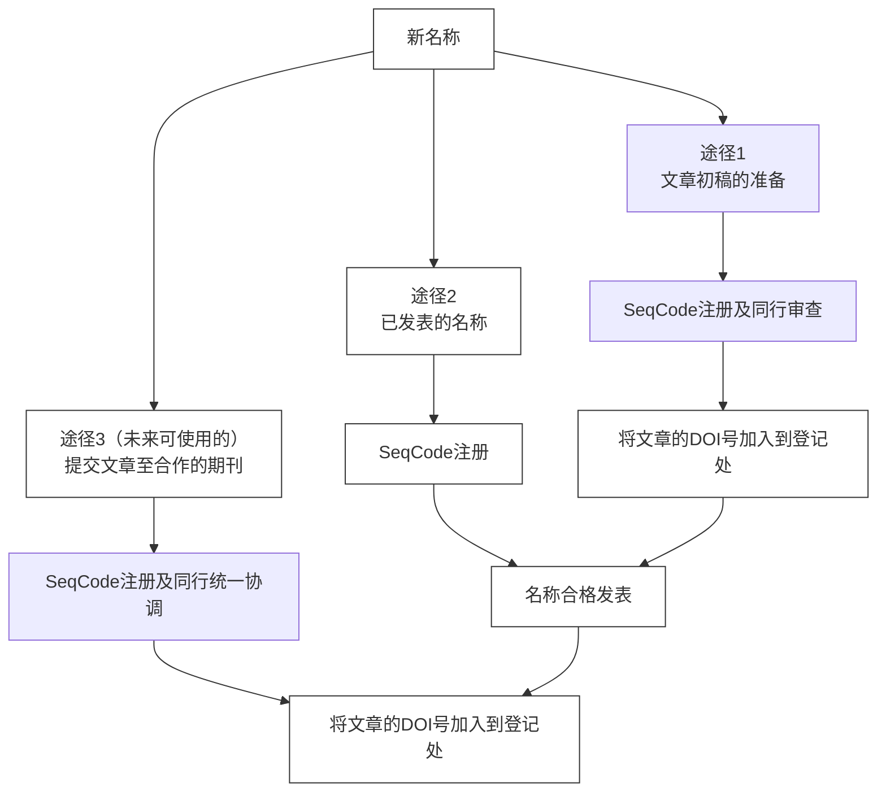

## 11.5 基因工程技术在微生物改造中的作用

## 11.5.1 新兴微生物基因工程技术的发展

## 11.5.1.1 高通量筛选平台

高通量筛选技术包括营养缺陷筛选、流式细胞分选、微流控液滴技术等，可快速从大型变异库中筛选理想菌株。营养缺陷筛选是一种经典的高通量筛选方法，随着微生物遗传学的发展，20世纪中期该方法广泛应用于微生物酶工程和代谢功能研究。为了满足日益增加的多参数分析和高通量分析需求，更高通量的微生物筛选技术应运而生。流式细胞分选（fluorescence-activated cell sorting，FACS）是20世纪六七十年代发展起来的可以对流式细胞（或微粒）的物理、生理、生化、免疫、遗传等性状及功能状态等进行定性或定量检测的现代细胞分析技术。流式细胞分选可根据发射光的荧光强度和波长将细胞亚群分开，并实现单克隆分选。它能将复杂样本中的细胞进行鉴定、分类、定量和分离，单次可同时对其中一种至多种特定细胞进行超高速分选纯化、高通量单克隆分选或细胞芯片制备。分选后的细胞能直接用于培养、移植、核酸提取、单细胞PCR扩增或原位杂交等，进一步进行细胞基因、蛋白、功能水平的研究和不同细胞之间的差异化研究。除此之外，微流控技术、拉曼单细胞分选技术等新兴高通量筛选技术也逐步成熟，极大地提高了微生物基因工程目标菌株的筛选通量和效率。

## 11.5.1.2 合成生物电路和逻辑门

生物电路（biological circuit）是由生物分子（如 DNA、RNA、蛋白质等）和细胞内的其他分子元件组成的控制系统。利用调节基因表达的调节元件（启动子、终止子、核糖体结合位点）和特定功能结构元件（如天然产物合成途径中编码酶的基因）等生物元件，设计构建基因开关、振荡器、放大器、逻辑门、计数器等合成器件，实现对生命系统的重新编程并执行特定的生物功能，如基因表达的调控、信号转导、代谢途径的控制等。近年来，随着对启动子序列和上游激活序列核心成分的理解不断加深，人工杂合启动子的开发和应用正在迅速发展。通过将不同来源的启动子元件（如 -35 区、-10 区、UP 元件等）进行组合，可以构建出具有新颖特性的杂合启动子。与天然启动子相比，人工杂合启动子可以实现更精确、更灵活的表达调控。未来有望获得序列更短、性能更强的启动子，这有助于更有效地调节模式菌中所引入的复杂通路。不同来源和不同功能的生物元件，可以通过复杂设计与其他元件或模块进行组装，形成更大规模的具有特定生物学功能的生物回路、装置和系统。为了促进生物元件的共享和组装，科学家们提出了多种标准化方法，如 BioBrick、BglBrick 等。这些标准化方法为生物元件的模块化设计提供了基础，使得不同研究者构建的元件和模块可以方便地进行组合和集成。因此，生物元件的搜寻与标准化是设计与组装更复杂的功能模块和生命系统的基础，也为微生物基因工程提供了更丰富的分子元件和工具。

## 11.5.1.3 定向演化

定向演化（directed evolution）是指通过模拟自然界的演化过程，来提高基因或生物大分子的演化速度的技术。体内定向演化系统已经成为一个高速发展且备受关注的研究领域。通过设计和构建新的遗传系统，有望在细胞内选择性地对目的基因进行高效的定向演化。

## (1) PACE 系统

PACE 系统的全称为噬菌体辅助连续演化系统（phage-assisted continuous evolution），它是一个突破性平台，由美籍华裔科学家刘如谦（David R. Liu）实验室在 2011 年首次报道。如图 11-9 所示，该系统利用噬菌体和其宿主细菌（大肠杆菌）的连续共培养机制来促进蛋白质定向演化。在此系统中，所构建的工程化噬菌体基因组缺失其必需基因 gⅢ，该基因改由宿主细胞进行表达，并使其表达水平受目标蛋白活性的控制。由于 gⅢ 基因所编码的蛋白 pgⅢ 是噬菌体能否被正确包装和发挥侵染活性的关键蛋白，其表达水平决定了噬菌体。因此，只有符合预期演化方向的突变体才能在连续复制的过程中被保留并积累。通过这种方式，PACE 能够在短短一天内完成数十轮的定向演化，极大地加快了演化速度。PAGE 系统应用于多种重要酶类（包括 RNA 聚合酶、Cas9、碱基编辑器、TALEN 等）的演化。2018 年，刘如谦团队利用 PACE 系统筛选到了 SpCas9 的变体 xCas9，显著提高了其识别特异性。

## (2) EvolvR 系统

EvolvR 系统是基于 CRISPR/Cas9 的一种体内定向突变方法。该系统主要由两个部分组成:一个表达携 nCas9 和易错 DNA 聚合酶 PolI3M 的诱变质粒 pEvolvR，以及一个携带含目标基因的靶质粒 pTarget。EvolvR 系统通过将易出错的 PolI3M 与 nicking Cas9（nCas9）融合。利用易错的聚合酶引入基因突变，同时 nCas9 确保 PolI3M 能够精确地靶向靶质粒中特定基因的特定区域进行定点突变。该系统不仅具有靶向性，还能实现所有碱基类型的突变，为在细菌中产生新的遗传突变体提供了一种新的途径。然而，该系统也存在一定的局限性，例如突变区域狭窄（只有几十个碱基对），且突

flowchart

图 11-9 PACE 系统的基本作用机制

AP:含有 $g\mathrm{III}$ 基因的辅助质粒；MP:诱变质粒；SP:选择噬菌体质粒

变率还有待提高。

## 11.5.2 基因工程改造细菌的应用

细菌作为生物界重要组成部分，其种类繁多、分布广泛，被广泛应用于农业、工业和医学等研究中，在细菌中开发和建立遗传操作工具可加快对细菌的研究和应用。常用的原核细胞有大肠杆菌、芽孢杆菌、棒状杆菌、链霉菌等。

## 11.5.2.1 基因工程大肠杆菌

作为一种成熟的基因克隆表达受体，大肠杆菌广泛应用于重组异源蛋白的生产与高效表达，具有重要的经济意义。1978年人胰岛素基因在大肠杆菌中获得成功表达，1982年重组人胰岛素获FDA批准用于胰岛素治疗，此后，在大肠杆菌中合成的重组蛋白药物如激素、干扰素、酶和抗体等获批用于人类疾病治疗。2012年10月27日在我国正式上市的益可宁（Hecolin）是国际上第一个批准的针对戊型肝炎病毒（hepatitis E virus，HEV）的重组疫苗，包含HEV可读框368\~606aa片段，可以有效预防HEV感染，这标志着我国大肠杆菌表达系统在商业化疫苗生产方面的一次重大突破。此外，针对人乳头瘤病毒（human papilloma virus，HPV）的疫苗研发也利用了大肠杆菌表达系统。通过对编码HPVL1的基因进行优化，使其在大肠杆菌中高效表达并在体外组装成病毒样颗粒，在临床试验中也表现出良好的安全性和有效性。此外，大肠杆菌也被广泛应用于生产生物丁醇等各种化学品的生物合成。

## 11.5.2.2 基因工程芽孢杆菌

随着微生物分子遗传学研究的不断深入，大肠杆菌以外的其他细菌也被作为底盘菌株广泛应用于基因工程。其中芽孢杆菌的分泌系统为功能基因的表达提供了良好条件，弥补了大肠杆菌在外源基因表达过程中的缺陷。在生产生活中，利用芽孢杆菌的高效分泌特性，构建耐热性酶制剂的工程菌具有极高的经济价值。利用基因工程构建的短小芽孢杆菌工程菌能高效表达并分泌热硫梭菌 $\beta-$ 淀粉酶，极大提高酶的生产规模和效率。除此之外，构建枯草芽孢杆菌工程菌在酸性条件下有效合成D-阿洛酮糖还能有效解决单糖制备的生产过程中的非酶褐变问题，避免副产物的产生，降低分离和提取的难度。

## 11.5.2.3 基因工程棒状杆菌

小分子生化物质代谢途径的基因工程改造已成为科研领域的一个热点，尤其是改良抗生素和氨基酸的生产菌的产量和效率方面具有显著经济价值。在这一领域，棒状杆菌属（Corynebacterium）是首选的底盘菌株。L-赖氨酸的产业化规模较大，利用基因工程提升L-赖氨酸生物合成的末端途径、确保前体物质草酰乙酸的充足供应、强化辅酶NADPH的持续合成、阻断所有无关合成代谢途径的流量来构建的谷氨酸棒杆菌（Corynebacterium glutamicum）工程菌LYS12，间歇式发酵生产L-赖氨酸是基因工程构建氨基酸发酵生产菌的成功案例之一，其产率已达120 g/L，每克葡萄糖能产0.55 g产物。

## 11.5.2.4 基因工程链霉菌

变铅青链霉菌（Streptomyces lividans）是最为理想、应用也最为广泛的分子克隆受体菌，它不含内源性质粒，遗传背景清楚，易于质粒的转化操作，而且对外源DNA无明显的限制修饰作用。变铅青链霉菌不但能识别绝大多数链霉菌的启动子和终止子，而且能高效表达来自众多革兰氏阳性和阴性菌的基因。此外与大肠杆菌相比，变铅青链霉菌作为外源基因克隆表达受体的一个显著优点是拥有高效率的异源蛋白分泌系统，但其内源或外源蛋白酶的合成效率却远小于枯草芽孢杆菌。

在链霉菌中，与抗生素生物合成相关的基因往往连锁在一起，形成典型的基因簇，这一特性为抗生素生物合成基因的克隆表达鉴定以及利用基因工程技术改良抗生素生产菌提供了可能性。在抗生素生产中，利用基因工程强化表达生物合成途径中的关键酶基因、定向突变关键酶的编码基因、基因簇的最小化与异源表达、随机重组相似的抗生素生物合成途径等策略，能够显著提高抗生素产量和品质。

## 11.5.3 基因工程改造真菌的应用

真菌种类繁多，是仅次于昆虫的第二大生物类群，与人们的生活息息相关。很多大型子实体真菌可以食用，某些还可以入药，是极为丰富的自然资源。随着基因工程技术的成熟，人们将目光转向这一丰富的自然资源，越来越多真菌基因组测序的完成，为从分子水平揭示基因的功能提供了条件。真菌遗传转化系统的建立和完善为特定基因的功能以及代谢及调控研究提供了技术支持，也为真菌菌株的定向遗传改造提供了条件。研究人员可以通过简单插入/删除/敲低等策略来确定一个基因的功能，从而研究目标基因相关的调控与互作机制，并按照生产实践的需求对工程菌株进行定向改造和优化，使真菌更好地为人所用。一般可采用以下三种基因工程技术手段对真菌进行基因改造。

## 11.5.3.1 增加限速酶的基因拷贝数

通过增加限速酶基因的表达，提高代谢流，可以提高次级代谢产物的产量。例如异青霉素 N 合成酶是产黄青霉（Penicillium chrysogenum）产生青霉素的限速酶，通过额外导入异青霉素 N 合成酶基因片段以增加其拷贝数，可使 P. chrysogenu 的青霉素产量提高 40%。头孢菌素 C 的工业发酵生产中存在中间产物青霉素 N 积累过剩的问题，通过增加青霉素 N 的扩环酶、羟化酶基因拷贝数解除限速步骤，可将头孢菌素 C 的产量提高 25%\~50%。

## 11.5.3.2 控制正负调节基因

正调节基因可以促进基因的转录，负调节基因阻遏结构基因的转录。可以通过增加正调节基因以增强转录功能，使生物合成基因得到高水平表达，提高代谢产物的产量；或通过去除负调节基因，解除阻遏作用，提高代谢产物产量。例如，在酿酒酵母中，通过过表达糖酵解途径中的关键酶基因（如 pfk 和 pyk）和乙醇生成途径中的关键酶基因（如 pdc 和 adh），同时抑制副产物生成途径中的关键酶基因（如 ack 和

ldh)，显著提高了乙醇的产量。

## 11.5.3.3 增加抗性基因的拷贝数

抗性基因的产物可以避免发酵菌株被自身产生的抗生素杀灭，因此提高菌种耐受抗生素的能力是取得高产抗生素产物的前提。将胞内的抗生素排出胞外，还可以解除高浓度代谢产物对其生物合成的反馈调节，使产物大量合成。还可增加抗性基因的拷贝数，使最终次级代谢产物的产量得以提高。例如，通过增加编码氨基糖苷磷酸转移酶的抗性基因 aadA 的拷贝数，显著提高链霉菌对链霉素的耐受性，最终实现链霉素产量的显著增加。

随着真菌基因组学研究的进一步深入，真菌的分子遗传学特点的描述和功能分析将成为社会学、环境学、医学、工学和农学等领域的重要基石。例如，在药物研发领域，从真菌中获得的多糖、多肽、生物碱和其他天然产物等高效能的小分子化合物为疾病的治疗提供了铺垫，真菌基因组的研究进展将为新药筛选和制备提供有力的支持。在生态学领域，部分真菌可以在一系列极端环境中生存，其代谢途径和适应性模式的研究为生态学的研究提供了重要的线索。

## 11.5.4 微生物病原体的基因工程应用

由于 CRISPR/Cas 系统具有特异性结合和高效切割靶向序列这一特性，基于 CRISPR/Cas 系统的核酸检测方法不断涌现，并显示出极高敏感性和特异性，在肿瘤、重大传染病诊断和治疗方面显示出巨大的应用潜力，为发展快速、准确的传染病诊断工具提供了新思路。目前基于 CRISPR/Cas 系统的检测方法包括 RNA 引导的靶向识别系统（Cas9），以及靶向识别触发的附带裂解系统（Cas12 和 Cas13）。

Keith Pardee 等在 2016 年率先将 CRISPR/Cas 系统与 SBA 技术相结合用于寨卡病毒的检测，其检测限达到了 1 fmol 并能区分具有单碱基差异的不同病毒亚型以及与寨卡病毒临床症状相似的登革热病毒感染样本。其优点在于将检测体系冻干在试纸上，经济、便携并能长期保存，适用于现场和资源匮乏地区检测，但检测时间过长（180 min）是阻碍其大规模应用的主要原因。Hajime Shinoda 等利用 CRISPR/Cas13a 和微流控装置开发出自动免扩增的数字 RNA 检测平台，该平台可在 9 min 内完成 RNA 定量检测，检测灵敏度达 RT-PCR 标准且能对 SARS-CoV-2 突变体进行区分，准确率达 98%，可作为快速、便捷的诊断平台来识别不同病毒感染。

CRISPR/Cas13a 系统在细菌检测方面也得到了广泛研究与应用。科学家将 CRISPR/Cas13a 系统与 PCR 技术相结合，成功实现了对沙门菌的检测方法，灵敏度在 2 h 内达 10 aM，且与其他常见食源性细菌无交叉反应，显示出高灵敏度和特异性。随着新的蛋白不断被发现，基于 CRISPR/Cas 系统的检测技术有望在分子水平上实现对病原体或突变癌基因准确诊断，但尚需开展更深入、系统的研究。

## 11.6 微生物基因工程涉及的伦理问题

基因技术研究的快速发展及其初步显现出来的广阔应用前景，使得许多科学家认为21世纪将是以基因技术为基础的生物经济时代。基因工程技术最为突出的特征就是它与人类生命健康密切相关，这种联系是其他技术无法比拟的。然而，它也如同一把双刃剑:一方面，它可以为人类创造巨大的经济利益和社会效益，解决人类面临的人口、粮食、健康等难题；但另一方面，它也面临伦理道德问题。

基因工程的负面影响主要包括:基因资源获取问题、基因隐私问题、基因歧视问题、生命价值冲突、转基因技术对人体安全性问题和环境安全性的担忧等。其中，有些问题是源自基因工程本身，有些则源于基因工程现有的价值观与道德体系的冲击而产生的负面影响。基因工程的两面性在众多科技领域中尤为突出。因此，在推进基因工程等生物技术快速发展的同时，也必须高度重视相关伦理法规的制定，加强公众教育，努力实现科技发展与社会伦理的协调统一，最大限度发挥生物技术的正面作用，规避和减少其潜在的负面影响。

另外，如何通过知识产权法规范和促进基因技术的发展，同时又有效地避免其不利影响，已经成为一个亟待解决的现实课题。基因技术知识产权保护问题已成为了继数字技术之后各国所面临的又一个焦点问题。如何既能保护研究者的成果，又能不损害他人的利益，仍需进一步探讨。

## ※ 本章小结

本章深入探讨了微生物基因工程的基本概念、技术方法及其广泛应用，并进一步讨论了相关的伦理问题。基因工程的出现使得生物体的精准改造成为可能。微生物因其繁殖迅速、遗传背景清晰且操作简便，被视为基因工程的理想模型。微生物基因工程在工业生产、环境治理和生物医药等多个领域展现出巨大潜力。

我们首先介绍了微生物的基因工程技术，主要包括基因敲除、基因敲减、基因编辑和基因过表达技术。基因敲除技术通过敲除特定基因来研究其功能，常用方法包括同源重组和CRISPR/Cas9系统；基因敲减技术通过RNA干扰等手段抑制特定基因的表达，用于研究基因功能和调控机制；基因编辑技术如CRISPR/Cas9使得基因组修饰更加精确和高效，广泛应用于基因功能研究和生物体改造；基因过表达技术通过增强特定基因的表达，实现对基因功能的研究或提高目标产物的产量。这些技术使科学家能够精确地操控基因，从而实现生物功能的改造和优化。

随着分子生物学和基因克隆表达研究技术的深入发展，利用大肠杆菌表达系统等进行外源基因表达成为生产商用蛋白的重要途径。从天然微生物到工程菌株的改造过程包括目的基因的获取、外源基因导入宿主细胞、目标菌株的筛选与鉴定等步骤。

微生物组学为微生物基因工程提供了丰富的数据支持。微生物组学包括基因组学、转录组学、蛋白质组学和代谢组学等技术，用于全面解析微生物的遗传和代谢特性。基因组学主要从 DNA 序列层面研究微生物的全部基因组成；转录组学从 RNA 表达谱层面分析基因转录和表达模式；蛋白质组学从蛋白质层面研究酶及代谢通路中关键蛋白的表达；而代谢组学技术则从细胞内所有小分子代谢物的层面研究微生物的代谢能力。基因组学为基因工程提供基础数据，转录组学、蛋白质组学和代谢组学则为基因功能研究和代谢路径优化提供了更全面的解析手段。通过多组学技术，可以精确定位基因功能、优化代谢途径，进而提高微生物的产物产量和代谢效率。

为了满足不断增长的多参数和高通量分析需求，流式细胞分选、微流控液滴技术等更高通量的微生物筛选技术应运而生。同时，生物元件被不断开发，以实现特定的生物功能以及对生命系统的重新编程。PACE 系统、EvolvR 系统等体内定向演化系统也在不断开发和完善中。进一步探讨了基因工程在细菌和真菌改造中的实例。大肠杆菌和芽孢杆菌是细菌基因工程改造的典型对象，通过基因工程技术，可以优化其在工业生产中的应用。真菌基因工程的发展和应用也展示了基因工程在生物医药和工业生产中的巨大潜力。

随着基因工程技术的快速发展，人们也必须面对其中的伦理和风险问题，如基因隐私问题、生命价值冲突和安全性等。呼吁采取有效的监管措施和风险评估手段以保证在技术应用中的伦理道德。此外，微生物基因工程对人类健康的影响和潜在风险也需要谨慎评估，合理规避。

通过本章的学习，读者不仅能够全面了解微生物基因工程的基本原理、技术方法和实际应用，还能提升对潜在的伦理问题和风险的认识，为未来的研究和应用提供了坚实的知识储备。

## ※ 推荐阅读

1. LANDER E S. The heroes of CRISPR [J]. Cell, 2016, 164 (1-2): 18-28.

CRISPR 技术因其在活细胞中展现出的精确且高效的基因组编辑能力而备受科学界的瞩目。本文深入回顾并梳理了 CRISPR 技术的起源和发展脉络，有助于学生全面了解这一技术的演进历程，并从中学习科研思维与方法的精髓。

2. HUG J J, KRU G D, MÜLLER R. Bacteria as genetically programmable producers of bioactive natural products [J]. Nature reviews chemistry, 2020, 4(4): 172–193.

这篇文章强调近期理念和技术发展对微生物改造和应用的影响，以细菌工程化生物合成天然产物的进展为例，阐述了经过改造和重新编程的细菌可促进难获得生物分子的生产，介绍基因工程在细菌改造中的发展，展示了基因工程的巨大的应用前景。

3. LING C, PEABODY G L, SALVACHÚA D, et al. Muconic acid production from glucose and xylose in Pseudomonas putida via evolution and metabolic engineering[J]. Nature communications, 2022, 13 (1): 4925.

这项研究将 Pseudomonas putida KT2440 设计为将木质纤维素水解物中的葡萄糖和木糖转化为黏康酸的模型菌株。通过适应性实验室演化和代谢工程的方法，获得高效转化菌株，对菌株的改变进行探究，并证实其演化所获得高效能力的来源。该研究通过设计与改造微生物获得高效的工程菌株，展示了基因工程技术在工业生产中的巨大潜力。

## ※ 开放性讨论题

1. 基因工程的主要研究内容有哪些？论述该学科在生物学研究中的意义。

2. 你认为基因工程存在哪些优势和风险？如何定义这些优势和风险？如何有效避免基因工程的负面影响？

3. 请查阅相关文献，讨论基因工程在环境保护方面有哪些应用。

## ※ 复习思考题

1. 基因工程表达体系分为哪几类，分别有什么特点？

2. 基因工程的定义与特征是什么？

3. 基因工程的基本流程是什么？为什么需要将目的基因与载体连接？

4. 以大肠杆菌表达系统为例，讨论提高目的基因表达效率的策略。

5. 讨论基因编辑技术的原理、进展及应用。

6. 请列举由 RecBCD 催化的不同的酶促反应，并描述每个反应在同源重组（通过双链断裂修复通路）各个步骤中的意义。

7. 简述目前的基因编辑技术及其特点。

8. CRISPR/Cas 技术如何实现靶点基因编辑?

9. 外源基因异源表达的策略有哪些?

10. 基因克隆是如何使得含有单个基因的目的片段得到纯化的？

(谢尚县)

## 12

## 微生物的系统发育与分类鉴定

## 导语

微生物的系统发育分析是根据生物间的差异和相似性来推断生命演化过程的方法，常用分支图或树的形式来描述生物相互之间的亲缘关系。对微生物的系统发育进行研究，能为探索早期生命起源，还原地球环境变迁历史提供线索。微生物的分类鉴定是微生物分类学（microbial taxonomy）的内容。现代的微生物分类学，已从原有的按微生物表型进行分类的经典分类发展到按它们的亲缘关系和演化规律进行分类。通过微生物的分类鉴定，可以建立各种微生物的信息库，以便人们查证、认识各种微生物，从而更有效地开发利用微生物资源及有效地控制有害类群；而微生物的系统发育分析，可揭示各物种的演变本质，丰富生物多样性研究的内容。因此微生物的系统发育分析与分类鉴定是微生物研究中的重要内容。

## 关键词

微生物分类学，分类单元，系统发育，多相分类，鉴定系统

## 12.1 通用的生物分类单元

分类是人类认识客观事物的基础。微生物的分类是根据微生物相互间的相似性和亲缘关系将其划归为合适的类群，并将各个类群排列成不同的等级，且对不同的分类等级的特征进行描述，以便对后续获得的菌种进行鉴定。原核生物的分类与其他微生物有许多相同之处，本节内容以原核生物为基础介绍分类过程中常用的一些概念，并对微生物的命名规则进行简单概括。

## 12.1.1 分类单元及等级

分类单元（taxon）又称分类单位，是指在分类系统中的任何一级分类群。在原核生物的分类体系中，最常使用的分类单元自上而下可依次分成8级，分别是域（Domain）、界（Kingdom）、门（Phylum）、纲（Class）、目（Order）、科（Family）、属（Genus）和种（Species）。除此之外，还可在不同的分类等级之间增加“亚”“超”或“族”等辅助分类单元。“超”和“族”辅助分类单元现已不常见，而在“亚级”辅助分类单元中，只有“亚种”最为常用。每个分类单元的等级只是分类单元水平的概括，它并不代表具体的分类单元，且每个分类等级的微生物类群的命名都有其相似的结尾或后缀（表12-1）。

在免培养分析中，分类操作单元（OTU）是常用的分类单元，常用于不依赖于培养的微生物多样性研究中，它根据 DNA 序列的相似性来区分样品中的微生物的分类地位。OTU 是人为给某一个分类单元（如品系、种、属或分组等）设置的同一标志。在微生物多样性分析中，根据不同的相似度水平，对所有序列进行 OTU 划分，一般情况下，如果序列之间的相似性高于 97%（种水平）就可以把它定义为一个 OTU，每个 OTU 代表一个物种。

表 12-1 原核生物分类单元的等级及分类单元的学名

| 中文名称 | 英文名称 | 学名词尾 | 举例 |
| --- | --- | --- | --- |
| 域 | Domain | - | Bacteria |
| 界 | Kingdom | ati | Bacillati |
| 门 | Phylum | ota | Actinomycetota |
| 纲 | Class | ia | Actinomycetia |
| 目 | Order | ales | Actinomycetales |
| 科 | Family | aceae | Actinomycetaceae |
| 属 | Genus | - | Actinomyces |
| 种 | Species | - | Actinomyces bovis |

## 12.1.2 生物种的概念

在高等生物中，种的概念非常清晰，即该群体的个体之间可以在自然条件下交配，产生可繁殖的后代，并且和其他群体的生物在生殖上相互隔离。然而原核生物一般是单倍体，且缺乏严格意义的有性繁殖，大多数原核生物细胞形态过于简单，在高等生物中可用于区分物种的条件在微生物中并不适用。因此，很长一段时间以来，对原核生物而言，没有一个公认的、明确的种的定义。

随着分子生物学技术在微生物分类学中的应用，以及微生物基因组学的飞速发展，以遗传物质为基础的原核生物的种的概念逐渐形成。以核糖体小亚基16S rRNA基因序列为基础，与指定的基因数据库中相应信息进行比对，如果16S rRNA基因列相似性低于98.65%，将检测菌株定为“潜在新种”是可信的，如果其相似性等于或高于98.65%，则情况较为复杂。据统计，即使相似性大于99%，仍有20%\~30%可能性是新的微生物种。同时，随着测序技术的发展，我们获得了越来越多的微生物基因组信息，可计算出微生物之间的数字化DNA-DNA杂交值（digital DNA-DNA hybridization，dDDH）和平均核苷酸一致性（average nucleotide identity，ANI）。通常70%的dDDH和95%\~96%的ANI值是微生物种的划分标准。由此可见，微生物的遗传物质信息对界定微生物的种起着重要的作用。

现今普遍认为，微生物的种（species）是基本的分类单元，它是一群表型特征高度相似、亲缘关系极其接近、与同属内的其他物种有着明显差异的菌株的总称。在实际操作中，需从形态学特征、生理生化特征、细胞化学特征及分子生物学特征等多方面开展多相分类鉴定来确定微生物的种。在微生物中，一个种只能用该种内的一个模式菌株（type strain）当作它的具体代表。例如，在牛型放线菌（Actinomyces bovis）的大量菌株中，只有ATCC 13683菌株才是模式菌株。

## 12.1.3 分类单元的命名

## 12.1.3.1 纯培养微生物的命名

每一种微生物都有自己的名称。名称分两类，一是地区性的俗名，具有大众化和简明化等优点，但往往含义不够确切，易于重复，不便于国际学术交流，如“结核杆菌”是Mycobacterium tuberculosis（结核分枝杆菌）的俗名，“红色面包霉”是Neurospora crassa（粗糙脉孢菌）的俗名等。二是学名，它是某一菌种的科学名称，是按“国际命名法规”进行命名并受国际学术界公认的通用正式名称。微生物的学名采用双名法，由属名和种名两部分组成。这是瑞典著名的植物学家卡尔·林奈（Carolus Linnaeus，1707—1778）于1768年在《自然系统》中提出的生物命名法则。双名法的第一个词为属名，词首需大写；第二个词为种名（包括由人名、地名或其他名词衍生的名词），词首需小写。一个完整的学名还需要加上最早给这个物种命名的作者名，即第三个词是命名人，命名人名字用正体表示，一般可省去。例如，牛型放线菌 Actinomyces bovis Harz，其中 Actinomyces 是属名，表示放线菌属；bovis 是种名后缀，表示牛的意思；Harz 则表示命名人的名字。

物种的学名是用拉丁词或拉丁化的词组成的。在一般的出版物中，学名应排斜体字，在书写材料中应在学名之下画一横线，以表示它应是斜体字母。当表示一个属内的某个种或多个种时，可在属名后加 sp. 或 spp. 表示。如 Actinomyces sp. 表示一种放线菌，Streptomyces spp. 表示多种链霉菌。当前后有两个或更多的学名连排在一起时，若它们的属名相同，则后面的一个或几个属名可缩写成一个，两个或三个字母，并在其后加上一个点。例如 Bacillus（芽孢杆菌属）可缩写成 “B.” 或 “Bac.”，Streptomyces（链霉菌属）可缩写成 “S.” 或 “St.” 等。属级以上的分类单元，通常是将典型属的名字进行些许改变，加上规定的词尾后形成的，它们的名字需斜体，且首字母均需大写。

根据《国际原核生物命名法规》（ICNP）的规定，在 IJSEM（International Journal of Systematic and Evolutionary Microbiology）以外公开发行的刊物上发表的原核生物新名称为有效发表（effective publication）。原作者将有关文献发送至 IJSEM 编辑部，由裁决委员会审核后，在 IJSEM 的 Validation List 中公布该新名称及相关信息后，该新名称才得以合格发表（valid publication）并被国际确认。如果分类单元直接在 IJSEM 表为合格发表（valid publication），无需合格化就被国际确认。

## 12.1.3.2 未培养微生物的命名

ICNP 的相关规定只适用于获得了纯培养的菌株，该菌株必须保存于至少两个不同国家的菌种保藏中心且获得了保藏号。然而，目前大多数原核生物还不能通过纯培养获得，因此无法根据 ICNP 的规则和建议对这些微生物进行命名。为解决这一问题，

研究人员提出了基于微生物的 DNA 序列对未培养原核生物进行命名的规则，该规则被称为 SeqCode（Code of Nomenclature of Prokaryotes Described from Sequence Data）（图 12-1）。该规则允许基于纯培养菌株基因组、宏基因组组装基因组或单细胞基因组序列的原核生物名称的有效发表，因此对未培养微生物的命名通常可以使用 SeqCode 的方式进行。

SeqCode 的大部分命名规则与 ICNP 相似，在 SeqCode 下验证的分类名称将通过 SeqCode Registry 运行。需要注意的是，根据 ICNP 命名的典型菌株通常用上标的字母 T 来标识，如 Actinomyces bovis ATCC 13683 $^{T}$ 。而根据 SeqCode 来命名的微生物通常用上标的 “TS” 或者 “Ts” 来标识，如 Wolframiraptor gerlachensis $^{Ts}$ 。

flowchart

图 12-1 SeqCode 注册和名称验证机制

## 12.2 微生物的系统发育学

微生物系统分类学是一门与相关研究技术和方法学共同发展的学科。从早期的形态学研究（依赖物理学方法如显微镜观察）、化学特征分析（化学方法的确立）和分子系统鉴定（测序技术的发展）到当今基因组系统学，微生物系统分类学逐渐发展成以系统发育关系和物种多相分类为手段，研究微生物个体和个体间关系的学科。目前，微生物分类学主要研究内容是依靠现有微生物种系关系、分类、鉴定和命名的相关原理和方法，对微生物类群间的系统发育关系进行研究，并采用多相分类手段对物种进行区分和归类。从哲学的角度来讲，微生物系统学是从客体出发，重在认识类群之间的关系，是理论创新的源泉；分类学则是从主体出发，重在对于微生物个体的认知，是理论创新的结果。微生物系统分类学最终解决的科学问题是“它是谁”和“它们的关系是什么”。微生物分类学的研究具有实际的理论或应用价值。当前主要从两个方面进行微生物分类学的研究，一是为了实用的需要，建立各种微生物的信息库，以便人们查证、认识各种微生物，从而更有效地开发利用微生物资源及有效地控制有害类群；二是为了探讨微生物的系统发育，建立反映微生物演化关系的自然分类系统，以揭示各物种的本质特征和相互关系，丰富生物多样性研究的内容。

历经多年持续发展，微生物分类学从最初的形态、生理特征等表型观察的经验科学，逐步发展成为利用基因组和分子生物学“由表及里”展开研究的微生物系统科学（图 12-2）。随着研究技术的不断迭代更新，对于微生物新类群的认知不断深入，拓宽对于微生物物种多样性和生态功能的全面认知，深入了解不同微生物类群的演化历程，促使研究者剥茧抽丝地更加接近揭开“终极谜题”——生命起源的哲学问题。

## 知识拓展 12-1 生命起源的探索之路

图 12-2 寻找生命之树的新分支

flowchart

This flowchart illustrates the historical progression of a scientific study from 1676 to present, covering stages such as pre-fGene generation, RNA-based analysis, and new gene detection.

## 12.2.1 演化计时器的选择

分子钟（molecular clock）是一个隐喻术语，指的是利用生物分子的突变率来估计两种或多种史前生命形式何时出现分歧的技术。逻辑上来说，如果能找到一种生物体内普遍存在的分子，而且这种分子的变化十分缓慢且遵循一种时序性的变化规则（类似时钟），就有可能用于分析所有生物类群的演化关系，即描绘出系统演化之树。

1962年，埃米尔·扎克坎德（Emile Zuckerkandl，1922—2013）和莱纳斯·卡尔·鲍林（Linus C. Pauling，1901—1994）通过比较不同生物世系的血红蛋白（hemoglobin）分子的氨基酸排列顺序发现，氨基酸随着时间的推移大致以一定的比例被置换，即氨基酸在单位时间以同样的速度进行置换。他们将这样的观察数据化之后，提出分子钟假说，即基因或蛋白质的序列随时间的推移以相对恒定的速率变化，而且同一基因或蛋白的变化速率在不同世系的有机体中大约一致。1963年，伊曼纽尔·马戈利亚什（Emanuel Margolish，1920—2008）比较分析了不同生物的细胞色素c的氨基酸组成差异数据，表明不同生物的细胞色素c的氨基酸组成也存在着差别。显然，细胞色素c亲缘关系近的物种之间遗传距离小，而亲缘关系疏远的物种间的遗传距离大（表12-2）。

分子钟假说的核心原理是:在一定时间范围内，特定生物大分子的序列在不同类群间的差异与其分化后经历的时间呈近似正线性关系。分子钟分子的选择一般为普适性存在且完全不受达尔文选择影响，必须拥有足够的复杂性，容纳相当大的时序性变异等特点。分子钟为演化生物学者提供了将微观证据和宏观演化历史结合起来的、全新的重要方法论。然而，更多研究表明分子钟不是匀速的，为此，建立了一系列针对可变速率进行测年的宽松分子钟方法，如，相对速率检验法、局域分子钟、补偿性似然速率修匀法、贝叶斯计算法等。此类计算中使用的生物分子数据通常是DNA、RNA碱基序列和蛋白质氨基酸序列。确定突变率的基准通常是化石或考古年龄。

## 12.2.2 核糖体 RNA 基因作为生物演化的计时器

20世纪70年代，美国著名的微生物学家卡尔·乌斯（Carl Woese，1928—2012）找到了一个适合作为衡量演化速率的神奇分子——16S rRNA 基因（在真核生物中为 18S rRNA 基因）。乌斯和乔治·福克斯（George Fox）在 1977 年通过距离矩阵法，计算出不同序列之间的演化距离（还揭示出一些特征序列）（表 12-3），最后构建出一般的系统发育树，勾画出了现代生物类群的相对演化路线与位置。

表 12-2 细胞色素 c 的演化

| 物种比较 | 残基变化数目 | 分化时间线(百万年) |
| --- | --- | --- |
| 人——马 | 12 | 130 |
| 猪——马 | 3 | 33 |
| 马——鸡 | 12 |  |
| 猪——鸡 | 10 | 108~150 |
| 兔——鸡 | 11 |  |
| 人——鸡 | 14 |  |
| 马——金枪鱼 | 19 |  |
| 猪——金枪鱼 | 17 |  |
| 兔——金枪鱼 | 19 | 184~228 |
| 人——金枪鱼 | 21 |  |
| 鸡——金枪鱼 | 18 |  |
| 马——酵母菌 | 44 |  |
| 猪——酵母菌 | 43 |  |
| 兔——酵母菌 | 45 | 465~520 |
| 人——酵母菌 | 43 |  |
| 鸡——酵母菌 | 43 |  |
| 金枪鱼——酵母菌 | 48 |  |

表 12-3 三域代表性物种的关联性系数

|  | 1 | 2 | 3 | 4 | 5 | 6 | 7 | 8 | 9 | 10 | 11 | 12 | 13 |
| --- | --- | --- | --- | --- | --- | --- | --- | --- | --- | --- | --- | --- | --- |
| 1. Saccharomyces cerevisiae, 18S | — | 0.29 | 0.33 | 0.05 | 0.06 | 0.08 | 0.09 | 0.11 | 0.08 | 0.11 | 0.11 | 0.08 | 0.08 |
| 2. Lemna minor, 18S | 0.29 | — | 0.36 | 0.10 | 0.05 | 0.06 | 0.10 | 0.09 | 0.11 | 0.10 | 0.10 | 0.13 | 0.07 |
| 3. L cell, 18S | 0.33 | 0.36 | — | 0.06 | 0.06 | 0.07 | 0.07 | 0.09 | 0.06 | 0.10 | 0.10 | 0.09 | 0.07 |
| 4. Escherichia coli | 0.05 | 0.10 | 0.06 | — | 0.24 | 0.25 | 0.28 | 0.26 | 0.21 | 0.11 | 0.12 | 0.07 | 0.12 |
| 5. Chlorobium vibrioforme | 0.06 | 0.05 | 0.06 | 0.24 | — | 0.22 | 0.22 | 0.20 | 0.19 | 0.06 | 0.07 | 0.06 | 0.09 |
| 6. Bacillus firmus | 0.08 | 0.06 | 0.07 | 0.25 | 0.22 | — | 0.34 | 0.26 | 0.20 | 0.11 | 0.13 | 0.06 | 0.12 |
| 7. Corynebacterium diphtheriae | 0.09 | 0.10 | 0.07 | 0.28 | 0.22 | 0.34 | — | 0.23 | 0.21 | 0.12 | 0.12 | 0.09 | 0.10 |
| 8. Aphanocapsa 6714 | 0.11 | 0.09 | 0.09 | 0.26 | 0.20 | 0.26 | 0.23 | — | 0.31 | 0.11 | 0.11 | 0.10 | 0.10 |
| 9. Chloroplast (Lemna) | 0.08 | 0.11 | 0.06 | 0.21 | 0.19 | 0.20 | 0.21 | 0.31 | — | 0.14 | 0.12 | 0.10 | 0.12 |
| 10. Methanobacterium thermoautotrophicum | 0.11 | 0.10 | 0.10 | 0.11 | 0.06 | 0.11 | 0.12 | 0.11 | 0.14 | — | 0.51 | 0.25 | 0.30 |
| 11. M. ruminantium strain M-1 | 0.11 | 0.10 | 0.10 | 0.12 | 0.07 | 0.13 | 0.12 | 0.11 | 0.12 | 0.51 | — | 0.25 | 0.24 |
| 12. Methanobacterium sp. Cariacoisolate JR-1 | 0.08 | 0.13 | 0.09 | 0.07 | 0.06 | 0.06 | 0.09 | 0.10 | 0.10 | 0.25 | 0.25 | — | 0.32 |
| 13. Methanosarcina barkeri | 0.08 | 0.07 | 0.07 | 0.12 | 0.09 | 0.12 | 0.10 | 0.10 | 0.12 | 0.30 | 0.24 | 0.32 | — |

## 12.2.3 系统发育分析

系统发育（phylogeny）研究生物演化的历史，目标是获得生命演化的谱系。系统分类学（systematics）是按照生物系统发育的相关性来进行分类，阐明的是不同生物个体和类群间的亲缘关系。伴随着分子遗传学和分子生态学等近代生命科学的发展，在系统发育分析研究中大量使用核酸和蛋白质这两类生物大分子中的信息作为度量生命演化的标尺。

原核生物的核糖体小亚基中的 16S rRNA 基因被普遍认为是微生物演化谱系分析的 “分子钟”，主要的原因在于:16S rRNA 基因普遍存在于原核生物中（真核生物中为 18S rRNA），具有重要且恒定的生理功能；在 16S rRNA 基因分子中，既含有高度保守序列的区域，又有中度保守序列和高度变化序列的区域，因而它适用于演化距离不同的各类生物亲缘关系的研究；16S rRNA 基因在细胞中含量大（约占细胞中 RNA 的 90%），易于提取，分子量大小适中，便于序列测定分析。

近年来，由多个国际著名的微生物系统发育学研究机构提出了“全种属的活的系统发育树”（The All-Species Living Tree Project）。该系统发育树基于现有的所有可培养的细菌和古菌模式菌株的 16S rRNA 和 23S rRNA 基因序列信息而构建，并将及时添加国际系统细菌学委员会定期发布的、有效发表的微生物新种的核糖体 RNA 序列信息，在互联网对该系统发育树进行持续更新。

## 12.2.4 生物的界级分类学说

1735 年，瑞典科学家林奈以二界系统作为生物的分类系统，依据肉眼可见的特征及习性功能分类，将生物分为植物界和动物界。1859 年，查尔斯·达尔文（Charles R. Darwin，1809—1882）发表了《物种起源》，进行了生物化石和现存生物体之间的形态对比观察，一定程度上推动了动、植物演化的研究。因而早期的分类学将生物分为动物界和植物界。1866 年，德国生物学家恩斯特·海克尔（Ernst Haeckel）对所有生物的共同演化历史做出了尝试，将单细胞生物命名为原生生物界（Monera），并将其作为动、植物和原生生物的祖先，并形成三界分类系统。

20 世纪中，生物的分类学迅速发展，并逐渐形成现代分类系统的雏形。1956 年，美国科学家提出四界分类系统，形成了原核生物界、原生生物界、植物界和动物界。1969 年，美国生物学家罗伯特·魏泰克（Robert Whittaker，1924—1980）进一步在此前的工作上进行修改，将黏菌和真菌重新归类，形成真菌界（Fungi），并提出了五界分类系统（图 12-3）。1971 年，林恩·马古利斯（Lynn Margulis，1938—2011）对魏泰克的五界分类系统进行修订（将黏菌归为原生生物界），建立新的五界分类系统，即原核生物界、原生生物界、真菌界、植物界和动物界。但是这个系统只分离出了真菌界，而大多数微生物的演化历史并没有得到很好的解释。因此，五界分类系统并没有显著提高科学界对微生物演化的认识。

## 12.2.5 三域理论及其发展

从 20 世纪 70 年代美国科学家乌斯提出使用核糖体小亚基 RNA（small subunit ribosomal RNA，SSU rRNA）作为微生物系统发育分析的分子标尺以来，基于 SSU rRNA 的系统发育树已被科学家们普遍接受。乌斯依据 16S rRNA 编码基因的脱氧核糖核苷酸分析的结果，发现原核生物中有一大类群与其他原核生物的演化谱系明显不同，更令人吃惊的是这类原核生物的演化关系甚至更接近于真核生物类群。基于此，乌斯提出了细胞生物的三域学说（three domains theory）（图 12-4）。

三域学说指出，所有细胞生物可以分为细菌域、古菌域和真核生物域三个域。这三个域在地球生命的早期有一个共同的起源，该起源点在演化树的根部，称为细胞生物

flowchart

This diagram illustrates the classification of microbial organisms into four main classes: Plant, Toxin, Animal, and Primary Biobiological, showing their respective subtypes and functional groups.

图12-3 五界生命假说