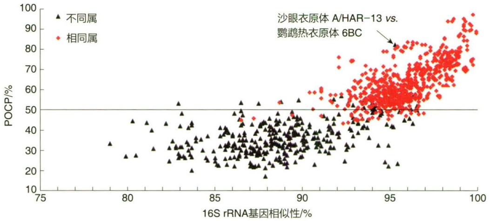
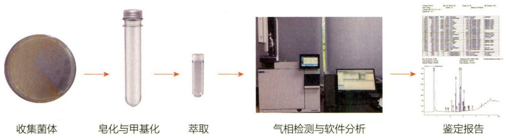
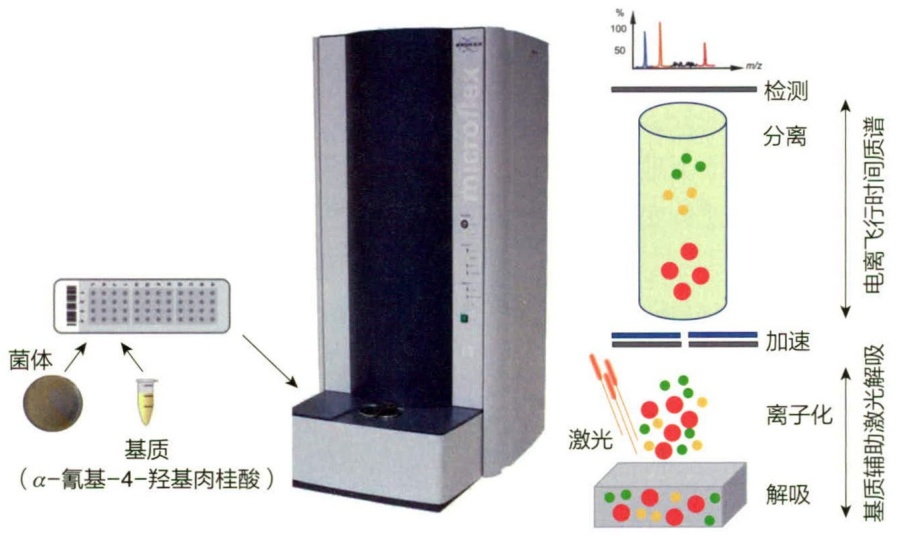
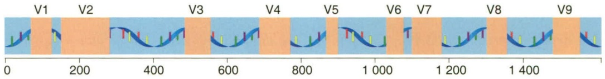
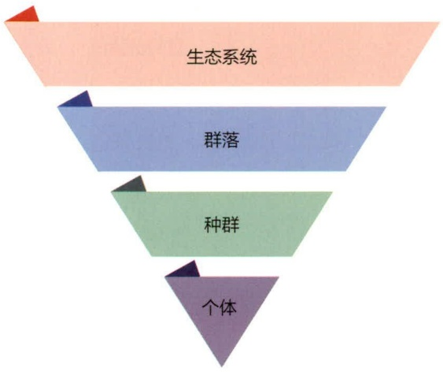
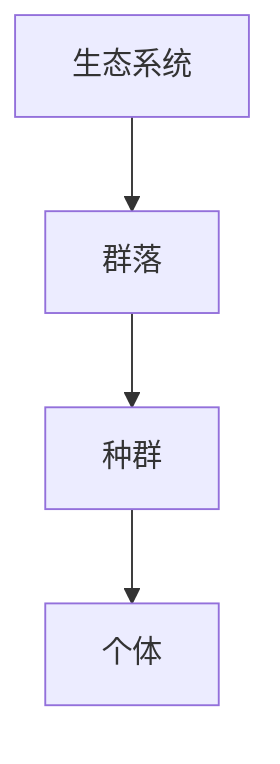
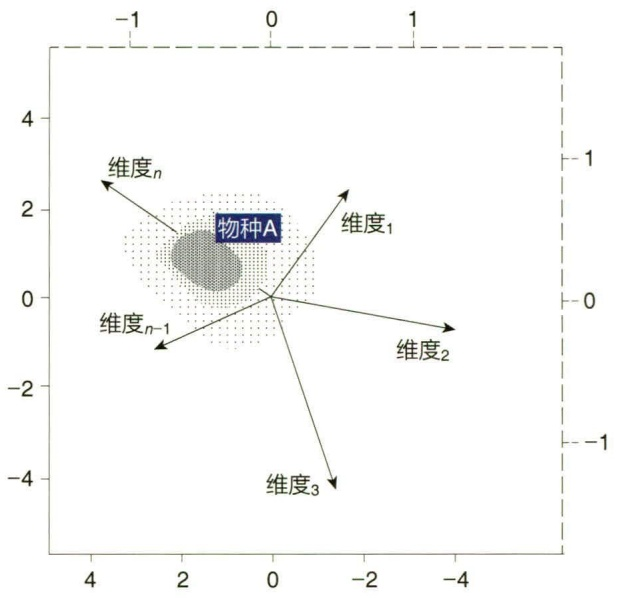

相似的聚异戊二烯侧链。根据异戊二烯的单位长度和侧链中被氢饱和的双键个数，甲基萘醌和泛醌分别被命名为 MK-n（Hx）和 UQ-n（Hx）。此外，甲基萘醌存在于革兰氏阳性菌和个别革兰氏阴性菌中，而泛醌的存在局限于  $\alpha-$ 、 $\beta-$  和  $\gamma-$  变形菌纲（Alphaproteobacteria、Betaproteobacteria 和 Gammaproteobacteria）的细菌中。值得注意的是，很多微生物除了含有一类主要醌型外，也含有少量其他醌类。一般用高效液相色谱法（HPLC）及标准品的图谱来检测分析各种醌型。

## 12.5.3.6 枝菌酸的分析

枝菌酸（mycolic acid），也称为分枝菌酸，是一类 $\alpha-$ 烷基- $\beta-$ 羟基高分子脂肪酸，最早在结核分枝杆菌（Mycobacterium tuberculosis）中发现。枝菌酸与索状因子（cord factor）相结合，和肽聚糖层共同构成了分枝杆菌及相关类群的细胞壁结构，对细菌的致病性和抗逆能力发挥重要作用。由于部分分枝杆菌的枝菌酸在常温下为蜡状，被酸性复红染色后，不能再被盐酸乙醇脱色，因此也被称为抗酸细菌。在抗酸细菌的细胞壁中含有约 $60\%$ 的类脂（包括枝菌酸和索状因子等），肽聚糖含量则很少，从其类脂外壁层和肽聚糖内壁层的结构来看，与革兰氏阴性菌的细胞壁更为相似。目前发现，含有枝菌酸的细菌基本都分布在分枝杆菌目（Mycobacteriales），因此，枝菌酸的有无和分子特性（长度）是分枝杆菌、诺卡氏菌等分类必不可少的化学指征。根据分子中所含碳原子数目的多少，早期人们将枝菌酸分作4类:约含80个碳原子的分枝杆菌枝菌酸（mycobcteomycolic acid）；约含60个碳原子的诺卡氏枝菌酸（nocardomycolic acid）；约40个碳原子的红球菌枝菌酸（rhodomycolic acid）；约含30个碳原子的棒状杆菌枝菌酸（corynomycolic acid）。但随着新的相关细菌类群被分离培养，枝菌酸的碳链长度在不同种属之间可呈现一种连续变化的趋势。目前，枝菌酸的分析主要借助薄层层析法。

## 12.5.3.7 多胺

多胺（polyamine）是广泛存在于生物体内的一种含有多个氨基和（或）亚氨基的多聚阳离子脂肪族化合物，对生物的增殖与分化均有重要的作用。多胺带有正电荷，可以与体内带负电荷的大分子发生作用。最普遍的多胺是腐胺（putrescine, 1,4-丁二胺）、尸胺（cadaverine, 1,5-戊二胺）、亚精胺（spermidine）和精胺（spermine）等，还有一些比较少见的如对称篙精脒（sym-homospermidine）、去甲精脒（norspermidine）和热精胺（thermospermine）。在研究细菌多胺组分时发现不同种属细菌其多胺组分在种类与含量上有特征性差异，因此多胺已成为用于判断某些细菌属及属以上关系的依据之一。

多胺既没有特征性荧光，没有紫外吸收特点，也无电化学活性，所以通常要将它进行衍生处理之后再行高效液相色谱（HPLC）检测。

## 12.5.4 分子生物学特征

随着科学技术的快速发展，尤其是分子生物学、细胞化学、分子遗传学、分子生态学及生物信息学的发展，微生物分类学研究也从传统的表观水平跨越到分子水平。根据获得的基因型信息对生物个体进行分类，被称为基因型分类（genotypic taxonomy）。此外，直接以 DNA 和蛋白质的序列差异为基础建立的分型方法包括核酸分型、多位点序列分型技术、细菌基因组重复序列 PCR 技术及全细胞蛋白 SDS-PAGE（sodium dodecyl sulfate polyacrylamide gel electrophoresis）指纹图谱分析等。常见的分子分类指标如下:

## 12.5.4.1 DNA 碱基组成分析

DNA 碱基组成比例（G+C 含量）在不同生物中是比较恒定的，其不受生长菌龄和外界因素的影响，是分类学重要的指标之一，对于种、属甚至科的分类单元的鉴定具有重要的指导意义。一般认为 G+C 含量差异在种内不超过 5%，在属内不超过 10%，相差低于 2% 时没有分类学意义。测定 DNA 的 G+C 含量的方法主要有熔点法（也叫热变性法或 Tm 值法）、浮力密度法、高效液相色谱法等，高效液相色谱法因其准确性高，重复性好和节约时间等优势已成为 DNA 中 G+C 含量测定的常用方法。而现今，可直接根据基因组数据获得微生物的 G+C 含量的理论值。

## 12.5.4.2 DNA-DNA 杂交（DDH）

DNA-DNA 杂交是基于 DNA 双链分子解链的可逆性和碱基互补配对的专一性，将不同生物样品的基因组 DNA 变成单链 DNA 后在一定条件下按照碱基互补配对原则再进行复性并测定其复性值，复性值也称杂交值。两条单链 DNA 分子互补配对的程度取决于它们 DNA 分子的相似性，即它们的亲缘关系。DNA 的杂交值可反映出两基因组间序列的相似性，统计结果显示，当两株菌的 DNA-DNA 杂交值≥70% 时，这两个菌株可界定为同一个种的菌株。传统的 DNA-DNA 分子杂交的方法可分为固相滤膜法、液相羟基磷灰石法、液相复性速率法、S1 核酸酶法等，但这些方法费时费力、重现性较差，难以形成在不同实验室之间可比较的数据。2005 年，Stefan R. Henz 等人提出了一种反映原核生物基因组水平遗传距离的算法，称为 GBDP（genome blast distance phylogeny）。随后，2013 年 Jan P. Meier-Kolthoff 将 GBDP 的遗传距离应用于推算数字化的 DDH（digital DDH，dDDH），并开发了在线工具 GGDC（genome-to-genome distance calculator）用于计算 dDDH。这一在线计算工具替代了传统的 DNA-DNA 杂交方法，能更快地得到更可靠的结果，因此是进入基因组时代后，鉴定种的一个重要指标。

## 12.5.4.3 16S rRNA 基因序列的分析

16S rRNA 基因既高度保守，同时又在某些区域变异幅度较大，其位于原核细胞核糖体小亚基上的 16S rRNA 基因长约 1500 bp，结构和碱基排列复杂度适中，较易于进行序列测定和分析比较，因此被广泛用作鉴定原核生物的依据。Lane 等首先用逆转录酶和测序引物对 16S rRNA 基因进行测序，一般能获得 90% 的序列，现在则采用 PCR 技术和合适的引物对其测序。根据返回的 16S rRNA 基因序列峰图，选取测序结果好的序列，利用 EzBioCloud 进行相似性分析。如果 16S rRNA 基因列相似性低于 98.65%，将检测菌株定为“潜在新分类单元”，并选取同源性较高的典型菌株的 16S rRNA 基因序列作为参比对象，通过 MEGA 软件进行 16S rRNA 基因系统发育演化树的构建，最终再结合其他指标，给予微生物准确的分类地位。

## 12.5.4.4 多位点序列分型技术

16S rRNA 基因序列分析在进行菌株的区分（小尺度的区分）时往往不能提供足够多的信息。多位点序列分型技术的出现弥补了 16S rRNA 的不足。多位点序列分型技术（multilocus sequence typing，MLST）是由 Maiden 等人在研究脑膜炎奈瑟球菌（Neisseria meningitidis）的自然变异过程中首次提出。该方法选用多个看家基因进行序列分析，通过核苷酸序列的差异反映不同菌株之间的演化关系。MLST 技术所选择的位点序列通常位于看家基因的内部，长度通常为 500 bp。由于看家基因普遍存在于待测菌株中，具有一定的保守性，而且不同菌株中有足够的变异度存在，所以选择分散在基因组内的多个位点进行分析，可大大增加其分辨率。MLST 具有高分辨率、可重复性及可比性等优点，已经成功地应用在细菌分型鉴定技术中，但看家基因在微生物系统发育分析中的缺点也同时存在，高度的变异性直接导致了 PCR 引物通用性的降低，进而导致各类看家基因在不同类群中的可操作性降低。

## 12.5.4.5 细菌基因组重复序列 PCR 技术

细菌基因组重复序列（repetitive sequence），是广泛存在于细菌基因组中且在菌株、种、属水平上分布有差异及演化过程有相对保守性的DNA序列，包括REP（repetitive extragenic palindromic sequences，基因外重复回文因子），ERIC（enterobacterial repetitive intergenic consensus，肠杆菌基因间重复一致序列）和BOX重复序列（interspersed repetitive elements）等。细菌基因组重复序列PCR技术（rep-PCR）是针对重复序列设计引物来扩增细菌基因组中广泛分布的短重复序列，通过电泳条带比较分析，揭示基因组间的差异。研究发现，BOX-PCR、REP-PCR和ERIC-PCR基因指纹分析具有可重复性并且通过简单的方法就能将相似的菌株鉴别出来，它能有效区分细菌种、属及菌株间的差异，并能对新发现的菌株和已知菌株做进一步分析，在研究细菌分类、细菌亲缘关系和分子微生物生态学方面应用很广泛，具有分辨率高、稳定、重现性好和简便易行等特点，能反映出种和菌株水平的基因型、系统发育和分类学关系，特别适合对大量菌株进行分析。

## 12.5.5 基因组相似性分析

基因组系统发育分析是指通过基因组学的方法，研究不同物种之间的演化关系和演化历史，它结合了基因组学和系统发育学两个领域，旨在通过比较不同物种的基因组序列，揭示它们之间的演化关系和演化历史。基因组系统发育分析通常包括如下几个方面的内容。

## 12.5.5.1 平均核苷酸一致性（ANI）分析

平均核苷酸一致性（average nucleotide identity，ANI）最早由美国 James M. Tiedje 教授等人在 2005 年提出，并尝试用于从基因组序列水平对原核生物不同种进行区分。

根据对 70 个近缘种编码基因核酸序列的分析，他们认为传统划分不同种的 DNA-DNA 杂交阈值 70% 对应的 ANI 值大致为 94%。2009 年 Richter Michael 等人开发了 Jspecies 软件，并对种内、种间的 ANI 值进行系统分析，提出划分不同种的 ANI 阈值为 95%\~96%，该标准一直沿用至今。不同于早期基于基因序列的 ANI 值计算方法，Jspecies 软件提供两种方法，均使用包含编码区和非编码区的所有基因组序列:一种是将一个基因组的序列切割为 1020 bp 的小片段，然后使用局部序列比对软件 blast 分别与另一个基因组进行分析，然后计算一致性结果的平均值；另一种是使用全局序列比对软件 MUMmer 计算所有检索到的长片段同源序列的一致性结果，然后计算平均值。近些年，出现了许多新的计算 ANI 的软件，但是基本原理与 Jspecies 大同小异，主要在于计算效率、准确度和结果呈现方面有所优化。

## 12.5.5.2 平均氨基酸一致性（AAI）分析

平均氨基酸一致性（average amino acid identity，AAI）在亲缘关系较远的类群之间更能准确反映彼此之间的基因组水平的差异。DNA 序列由于自身的特性决定了当序列差异较大时，比对后不同序列在同一位点是否同源的可能性会降低。因此，ANI 分析软件在计算平均值时一般默认将一致性低于 70% 的结果排除掉。于是我们发现，随着种间差异变大，ANI 值逐渐降低到 70%\~80% 之间，然后便保持平稳。这时如果查看 JSpecies 等软件给出的 coverage 值时，会发现 ANI 的值虽然趋于平稳，但是 coverage 值却在不断下降。这意味着当亲缘关系远到一定程度后，根据核酸序列找到菌株之间的同源序列其实在变少。但是当我们使用编码基因的氨基酸序列进行类似的分析时，便可以在远缘的菌株间找到更多的同源序列。比如，在原核生物之间，两条氨基酸序列一致性在 30% 左右时，仍然有很大可能是同源序列。基于这些事实，计算菌株之间的 AAI 值也具有重要意义。且 AAI 在限定属的界限方面得到了很好的应用。

## 12.5.5.3 保守蛋白百分比（POCP）分析

DNA 序列中的核苷酸取代通常引起非同义氨基酸取代，其既不改变蛋白质功能也不改变菌株表型。因此，保守蛋白百分比（POCP）值适合评估两株菌的演化距离和表型差异。POCP 的计算公式为  $\mathrm{POCP} = \left[\left(C_{1} + C_{2}\right) / \left(T_{1} + T_{2}\right)\right] \times 100\%$ ,  $C_{1}$  和  $C_{2}$  分别为被比较的两个菌株中保守蛋白的数量， $T_{1}$  和  $T_{2}$  分别为被比较的两个菌株中蛋白的总数，理论上来讲，POCP 的变化为  $0\% \sim 100\%$ 。POCP 的计算显示来自不同属的两个菌株的 POCP 值均匀地分布在很宽的区域，并且可以清楚地彼此分离（图 12-11）。另一方面，相比于 ANI 的结果，重叠的部分也少了许多，这说明 POCP 是比 ANI 更好的属水平上的分类方法。因此 POCP 是一个基于基因组分析的细菌属水平上的分类方法。界定原核生物属的 POCP 标准可概括为三条:① 将 50% 的 POCP 值作为属边界提出；② 如果菌株属于特定属，则该菌株与同一属的任何其他物种之间的 POCP 值应该高于该菌株与来自其他不同属的任何物种之间的 POCP 值；③ 从基因组的角度来看，原核属可以定义为所有成对 POCP 值高于 50% 的一组物种。

## 12.5.5.4 基因组树构建

众所周知，可以通过构建同源保守基因的分子演化树来进行系统发育分析。但是，基因分子长度和功能上的限制会导致变异位点数量上的限制，基因的演化历史也不能够完全反映物种本身的演化历史。由于高通量测序技术的巨大进步，在 GenBank 中收录的微生物基因组数据呈现爆炸性增加的趋势，使得从基因组中获取系统发育标记来进行系统发育分析成为可能。在构建基因组树时，首先需要获取物种的基因组序列，随后通过 CheckM 软件对上述所有基因组序列进行完整度和污染度的评估，选取中高质量基因组为待分析基因组。采用 GTDB-Tk 预测的保守基因，并根据该软件的多序列比对结果，通过 IQ-Tree 进行系统发育树的构建，最后用 iTol 在线工具进行美化。除了选用 GTDB-Tk 预测的保守基因外，还常选用 31 个保守基因及 16 个核糖体蛋白进行基因组的构建。

图 12-11 POCP 值与 16S rRNA 基因相似性之间的关系

scatter

| Series | 16S rRNA基因相似性/% (range) | POCP/% (range) |
| --- | --- | --- |
| 不同属 | 79~98 | 20~55 |
| 相同属 | 87~100 | 45~98 |

## 12.6 微生物的快速鉴定与分析技术

生物标志物（biomarker）是微生物中含有的一些化学物质，如不饱和脂肪酸、蛋白质、核酸、类脂、磷脂、多糖、吡啶二羧酸、分枝酸和醌类等，其含量或结构具有种属特征或与其分类位置密切相关，能够标志某一类或某种特定微生物的存在。微生物系统学发展初期，这些具有分类学意义的化学物质的种类和含量被视为微生物分类学的重要指标。随着仪器设备分析技术的提升和计算机的广泛应用，微生物菌种鉴定已由传统的形态学观察和生理生化实验鉴定进入了基于仪器自动化分析的鉴定系统阶段。近20年来，一系列商品化自动鉴定系统相继推出，如Vitek系统、MIDI系统、Biolog系统、SENSITITRE系统、AUTOSCEPTOR系统以及MICROSCAN系统等，其中脂肪酸分析的MIDI系统、碳源利用分析的Biolog系统与基于16S rRNA基因序列分析的演化发育系统已然成为目前国际上细菌多相分类鉴定常用的技术手段。而分子生物学与测序技术的迅速发展和普及，使得微生物学鉴定得以摆脱传统生化鉴定方法的局限，跨入新的历史进程。PCR、特异性核酸探针杂交、基因芯片、生物传感器、免疫学技术等广泛地应用于微生物的鉴定中。

## 12.6.1 生理生化鉴定系统

## 12.6.1.1 Biolog 系统

Biolog 微生物自动分析系统是一套微生物鉴定系统，发展到现在已能鉴定包括细菌、酵母、丝状真菌在内的近 2 000 种微生物，几乎涵盖了所有的人类、动物、植物病原菌及食品和环境微生物。Biolog 微生物自动分析系统能利用计算机进行数据分析，自动化和标准化程度高，具有数据库广、鉴定范围大、鉴定快速等优点，目前已成为国际上细菌多项分类鉴定常用的参考数据。

Biolog 系统利用微生物对不同碳源代谢率的差异，针对每一类微生物筛选 95 种不同碳源，配合四唑类显色物质（如 TTC、TV），固定于 96 孔板上（A1 孔为阴性对照），接种菌悬液后培养一定时间，通过检测微生物细胞利用不同碳源进行新陈代谢过程中产生的氧化还原酶与显色物质发生反应而导致的颜色变化（光密度）以及由于微生物生长造成的浊度差异（浊度），与标准菌株数据库进行比对，即可得出最终鉴定结果。微生物利用碳源进行呼吸时会将四唑类氧化还原染色剂从无色还原成紫色，从而在微生物鉴定板上形成该微生物特征性的反应模式或“指纹”，通过纤维光学读取设备——读数仪来读取颜色变化，并将该反应模式或“指纹图谱”与数据库相比就可在瞬间得到鉴定结果，其中酵母和霉菌还须通过读数仪读取同化的变化（也就是浊度的变化）进行鉴定。Biolog 的分析结果可以快速地确定测试菌株的代谢特征，为后期微生物菌株的功能验证提供基础。

## 12.6.1.2 SENSITITRE 系统

SENSITITRE 全自动 AST 系统是一套全自动的快速微生物药敏及鉴定分析系统，主要由联机孵育、电脑软件管理控制、内置条形码扫描器、自动读数装置组成。孵育系统具有 64 块板条的大容量，使得最大鉴定标本量达到 192 个。孵育架定时旋转，确保板条处于恒温状态中。孵育温度可有多种选项（10℃、30℃、35℃、37℃）。内置条形码扫描器，能自动识别不同种类的检测板条，从而针对各类板条设置不同的孵育时间。用户可以随时从仪器中取出板条，也可以随时在仪器中任何空位置放入板条。微生物筛选菌库达 1274 种，抗生素库涵盖几乎所有最新及常用抗生素，并提供 1\~4 点及 4\~12 点药敏 MIC 值分析，药敏板完全符合临床实验室标准化协会（CLSI）标准。技术先进的药敏板条和鉴定板条，选板简单，只需革兰氏染色，无需更多附加实验，无需任何添加试剂，最大限度避免板条选错导致的试验失败，能够快速地帮助医生或实验人员对最佳抗生素的选择，还为流行病学的调查和院内感染的管理提供最大的帮助。

## 12.6.2 快速、自动化的微生物检测仪器与设备

## 12.6.2.1 SHERLOCK全自动微生物鉴定系统

SHERLOCK® Microbial Identification System 为美国 MIDI 公司依据自 20 世纪 60 年代以来对微生物细胞脂肪酸的研究经验，开发了一套根据微生物中特定短链脂肪酸（$\mathrm{C}_{9} \sim \mathrm{C}_{20}$）的种类和含量进行鉴定和分析的软件，结合气相色谱，通过对气相色谱获得的短链脂肪酸的种类和含量的图谱进行比对分析（图12-12）。该系统主要根据不同种类微生物细胞膜中磷脂脂肪酸的类型和含量具有种的特异性、指标性和遗传稳定性等特殊性能对微生物进行全自动鉴定和分析，菌体脂肪酸组成相对稳定，不受生化反应的变异及质粒丢失等因素的影响。此外，磷脂脂肪酸可以代表微生物群落中“存活”的那部分群体。脂肪酸分型一般可通过单次试验比较准确地将微生物鉴定到种。该系统配备有图谱识别软件和迄今为止微生物鉴定系统中最大的数据库资源，包括嗜氧菌1100余种，厌氧菌800余种，酵母菌和放线菌约300种，共计超过2200种。随着试验数据的不断积累，又推出Sherlock PLFA群落分析软件，成为微生物菌落结构分析方法之一。该方法主要针对作为微生物生物标志物的磷脂脂肪酸（PLFA）进行比对分析。该系统由全自动微生物系统的气相分析和PLFA数据库构成，通过与独家设计的PLFA标准品对系统进行校正，从而实现166种磷脂脂肪酸的准确定性和定量。目前，磷脂脂肪酸分析（PLFA）广泛用于微生物的量化和微生物群落结构。

图 12-12 MIDI 系统脂肪酸鉴定流程

flowchart

## 12.6.2.2 VITEK® 2 COMPACT 全自动微生物分析系统

VITEK $^{®}$ 2 COMPACT 系统是由生物梅里埃公司出品的全自动微生物鉴定 / 药敏分析系统，是目前国内使用比较广泛的一种全自动细菌鉴定系统，其主要特点是自动化程度高、软件功能强大、细菌鉴定速度快，因而被广泛地应用于医疗行业的快速检验。VITEK 已被许多国家定为细菌最终鉴定设备，并获美国药品食品管理局（FDA）认可。该系统有高度的特异性、敏感性和可重复性，还具有操作简便、检测速度快的特点，绝大多数细菌的鉴定在 2～18 h 内可得出结果。

该系统对细菌的鉴定是以每种细菌的微量生化反应为基础，不同种类的 VITEK 试卡（检测卡）含有多种的生化反应孔，可达 64 种。将手工分离的待检菌的纯菌落制成符合一定浊度要求的菌悬液，经充填机将菌悬液注入试卡内，封口后放入读数器 / 恒温培养箱，根据试卡各生化反应孔中的生长变化情况，由读数器按光学扫描原理，定时测定各生化介质中指示剂的显色情况。目前 VITEK 系统的检测卡有 14 种，微生物常用的有 7 种，即:革兰氏阳性菌鉴定卡（GPI）、革兰氏阴性菌卡（GNI+）、非发酵菌卡（NFC）、酵母菌卡（YBC）、厌氧菌卡（ANI）、芽孢杆菌卡（BAC）、奈瑟氏菌嗜血杆菌卡（NHI），以及药敏检测卡等。其中:GPI 卡可鉴定凝固酶阳性和阴性的葡萄球菌（Staphylococcus）、肠球菌（Enterococcus）、链球菌(Streptococcus)、棒状杆菌属（Corynebacterium）、李斯特菌属（Listeria）和丹毒丝菌（Erysipelothrix）等51种；GNI+卡可鉴定肠杆菌科（Enterobacteriaceae）、弧菌科（Vibrionaceae）和非发酵菌等116种；NFC卡可鉴定不动杆菌（Acinetobacter）、气单胞菌（Aeromonas）、产碱杆菌（Alcaligenes）、假单胞菌（Pseudomonas）、弧菌（Vibrio）等42种；YBC卡可鉴定假丝酵母（Candida）、隐球菌（Cryptococcus）、地霉（Geotrichum）、丝孢酵母（Trichosporon）、红酵母（Rhodotorula）等34种；ANI卡可鉴定放线菌（Actinomyces）、拟杆菌（Bacteroides）、梭杆菌（Fusobacterium）、乳杆菌（Lactobacillus）、真杆菌（Eubacterium）、梭菌（Clostridium）、消化链球菌（Peptostreptococcus）等94种；BAC卡可鉴定芽孢杆菌21种；NHI卡可鉴定奈瑟氏菌（Neisseria）、嗜血杆菌（Haemophilus）、金氏菌（Kingella）、摩拉氏菌（Moraxella）、布兰汉氏菌（Branhamella）等47种。

## 12.6.2.3 MALDI-TOF MS 微生物鉴定系统

基质辅助激光解吸电离飞行时间质谱技术（matrix-assisted laser desorption/ionization time-of-flight mass spectrometry，MALDI-TOF MS）技术具有操作简单、鉴定快速、通量高、灵敏度好、准确度高的优点，已被越来越多的临床微生物实验室所采用。微生物具有自身独特的蛋白质，因而拥有独特的蛋白质指纹图谱，MALDI-TOF MS可通过检测微生物的蛋白质指纹图谱来鉴定微生物。鉴定微生物的基础是构建丰富而完整的蛋白质指纹图谱数据库。MALDI-TOF MS在鉴定微生物时主要依据菌株的核糖体蛋白，其工作原理和流程是将待测微生物样品与基质分别点加在样品靶板上，溶剂挥发后形成样品与基质的共结晶；检测时质谱仪利用激光作为能量来源轰击结晶体，基质从激光中吸收能量使样品解吸，基质与样品之间发生电荷转移使得样品分子电离，经过飞行时间检测器，采集数据并获得特异性蛋白质指纹图谱；通过相应的数据库软件，自动匹配待测菌株的图谱至数据库中的已知菌株图谱，根据比对分值的高低，鉴定待测微生物的属、种及株（图12-13）。

text_image

菌体
基质
(α-氰基-4-羟基肉桂酸)
电离飞行时间质谱
检测
分离
加速
激光
离子化
解吸
基质辅助激光解吸

图 12-13 MALDI-TOF MS 微生物鉴定系统原理

图 12-14 16S rRNA 基因结构示意图

line

| Waveform | X-axis Range |
| --- | --- |
| V1 | 0~200 |
| V2 | 200~400 |
| V3 | 400~600 |
| V4 | 600~800 |
| V5 | 800~1000 |
| V6 | 1000~1200 |
| V7 | 1200~1400 |
| V8 | 1400~1600 |
| V9 | >1600 |

## 12.6.2.4 MicroSEQ 自动微生物基因分型鉴定系统

较 20 世纪已经出现的生化鉴定法，基于分子生物学技术的微生物鉴定系统的优越性主要表现为:可鉴定的种属范围均大大扩展；可靠性和灵敏度显著提升；整体检测时间降低。MicroSEQ 自动微生物基因分型鉴定系统对 16S rRNA 基因区域（细菌）或 LSU D2 区域（真菌）的比较测序，是快速、准确、可靠的微生物鉴定方法。针对细菌而言，16S rRNA 普遍存在，系统可以选择对 16S rRNA 基因的前 500 bp 或完整的 1 500 bp 长度测序。前 500 bp 涵盖 16S rRNA 基因 9 个高变区中的 3 个。在某些情况下，类群演化关系较为邻近的类群，则需要信息量更大的全长基因（图 12-14）。

在 16S rRNA 基因测序完成后，MicroSEQ 系统自动将测序结果与 MicroSEQ 微生物数据库中经过验证的序列进行比较。该结果根据参考序列与样本间的遗传距离排列并以遗传系统发生树的方式显示。这一系统包含广泛验证的细菌和真菌数据库。细菌序列数据库包含有超过 2300 个条目，其中涵盖了葡萄球菌（Staphylococcus）、芽孢杆菌（Bacillus）、棒状杆菌（Corynebacterium）、分枝杆菌（Mycobacterium）以及非发酵型革兰氏阴性菌等。真菌数据库涵盖了超过 1100 个条目。MicroSEQ 数据库只包含正确识别的微生物和来自典型培养物收集菌株的可靠序列。这些数据库还支持序列多态性。

## 12.6.3 生物信息学在微生物系统学中的应用

生物信息学是结合生物学、计算机科学、统计学和数学来分析和解释生物数据的跨学科新兴领域。它涉及计算方法、算法和工具的开发和应用，用于组织、存储、检索和分析大量生物信息，特别是与DNA、RNA和蛋白质序列相关的信息。生物信息学在基因组学、蛋白质组学、转录组学等领域具有广泛的应用，可以帮助科学家深入了解生物分子的结构、功能和演化，以及生物系统内复杂的相互作用和网络，进而更为全面阐释生物体内的分子机制以及它们之间的相互作用。通过整合和分析大量生物数据，生物信息学有助于理解各种生物现象，例如基因表达、蛋白质-蛋白质相互作用以及与疾病相关的遗传变异。生物信息学与微生物系统学的结合，可以在以下方面发挥作用。

① 微生物基因组分析。生物信息学工具可以帮助研究人员分析微生物基因组的序列，揭示微生物的基因组结构、功能基因以及可能的生态适应性。
② 微生物组学。生物信息学可以应用于微生物组学研究，通过分析微生物群落的组成和功能，揭示微生物在生态系统中的角色，以及与宿主的相互关系。
③ 功能注释和代谢途径分析。生物信息学方法可以帮助识别微生物基因的功能，

预测蛋白质的功能，并推断微生物可能参与的代谢途径。

④ 微生物与宿主相互作用。生物信息学可以用于研究微生物与宿主之间的相互作用，包括共生关系、致病机制等。
⑤ 抗生素和药物研发。生物信息学可以用于挖掘微生物中潜在的抗生素产生基因簇，从而有助于新药物的发现。
⑥ 环境微生物学。生物信息学在研究微生物在不同环境中的分布、适应性和生态功能等方面也有应用。
⑦ 演化研究。生物信息学可以通过基因序列比较和系统发育分析揭示微生物的演化关系，从而更好地了解微生物的起源和演化。

总之，生物信息学与微生物系统学的结合为深入了解微生物世界以及微生物与生态系统之间的相互作用提供了强大的工具和方法。

## ※ 本章小结

在原核生物的分类体系中，最常使用的分类单元自上而下可依次分成8级，分别是域（Domain）、界（Kingdom）、门（Phylum）、纲（Class）、目（Order）、科（Family）、属（Genus）、种（Species），其中，种（Species）是一个基本分类单元，它是一群表型特征高度相似、亲缘关系极其接近、与同属内的其他物种有着明显差异的菌株的总称。每个种都有自己公认的学名，微生物的学名采用双名法，由属名和种名两部分组成。自人类发现并逐步研究微生物以来，生物的分类界级先后经历了二界、三界、四界、五界甚至六界的不同阶段，直至20世纪70年代末，学术界已倾向于更科学的三域学说理论。然而，近年来随着阿斯加德古菌的分离培养获得新突破，二域假说获得更多有力的科学支持，并形成了新的地球生命之树，但古菌与真核生物之间的确切关系仍有待进一步研究。

微生物系统分类学是一门与相关研究技术和方法学共同发展的学科，现今微生物系统分类学逐渐发展成了以形态特征、生态特征、血清学特征、细胞化学特征及分子生物学特征为依据的多相分类为手段，研究微生物个体之间关系的学科。在微生物分类鉴定的实际工作中，主要使用的还是一些经典方法，但随着仪器设备分析技术的提升和计算机的广泛应用，为了提高工作效率，经典的分类鉴定方法被简便化、快速化和微量化，至此微生物分类鉴定进入了基于仪器自动化分析的鉴定系统阶段。一系列商品化自动鉴定系统相继推出，其中脂肪酸分析的 MIDI Sherlock 系统、碳源利用分析的 Biolog 系统与基于 16S rRNA 基因序列分析的演化发育系统已然成为目前国际上原核生物多相分类鉴定常用的技术手段。

## ※ 推荐阅读

1. HEDLUND B P, MARIA C, HUGENHOLTZ P K, et al. SeqCode: a nomenclatural code for prokaryotes described from sequence data [J]. Nature microbiology, 2022,

7(10): 1702-1708.

目前，仍然存在多数的原核生物不能通过纯培养获得，无法通过国际原核生物命名法规（ICNP）的规则和建议命名，严重阻碍了微生物学科的交流。为此，美国内华达大学研究人员在 Nature Microbiology 发表最新研究，他们开发了 SeqCode，通过 SeqCode Registry，可根据原核生物基因组序列进行命名。SeqCode 可对纯培养菌株的基因组、宏基因组组装基因组或单扩增基因组序列对原核生物命名，在名称组成和优先规则方面与 ICNP 相似。虽然 SeqCode 可满足更广泛的研究团体的利益，但作者也强调该命名法目的不是要阻碍培养，并且没有提供关于分类群划分的规则或建议。未来，仍需要进一步优化该命名法，以期改善整个微生物学科的交流。

2. LIU Y, MAKAROVA K S, HUANG W C, et al. Expanded diversity of Asgard archaea and their relationships with eukaryotes [J]. Nature, 2021, 593(7860): 553–557.

研究团队对阿斯加德古菌的 162 个完整或几乎完整的基因组进行了比较分析，其中包括 75 个之前未报道的由宏基因组组装的基因组，大大扩展了阿斯加德古菌的系统发育多样性。基于这些分析，研究团队将阿斯加德古菌从原有的 6 个门增加到 12 个门，并将其中一个门命名为悟空古菌（Wukongarchaeota）。该项研究从发现 6 个阿斯加德古菌新门并建立首个阿斯加德古菌功能基因库（AsCOG），深入分析了阿斯加德古菌的基因组和代谢潜能，重构了由原核生物（细菌、古菌）和真核生物组成的生命之树，从系统发育演化关系、真核特征蛋白功能演化及生理代谢的互作等方面详细阐释了阿斯加德古菌与真核生物的关系，为认识真核生物起源这一未解的生命科学之谜提供了新见解。

3. HUG L A, BAKER B J, ANANTHARAMAN K, et al. A new view of the tree of life [J]. Nature microbiology, 2016, 1(5): 16048.

随着宏基因组学的发展，越来越多鲜为人知的生物的新基因组数据被发现和公布，这使得我们对生命多样性的理解发生了巨大变化。在本研究中，加州大学伯克利分校的吉利安·班菲尔德（Jillian F. Banfield）研究团队从浅含水层、沙漠结皮、土壤和海豚口腔中获得了1011个基因组序列，结合公共数据库中已有的基因组序列，基于16个核糖体蛋白重构了演化树。结果显示，这棵演化树包含了92个细菌门，26个古菌门及部分真核生物，扩展了之前的“生命之树”；与古菌与真核生物相比，细菌的多样性更丰富，并强调了未培养微生物的重要性；该演化树最明显的特征，是由一个被描述为“候选门级辐射类群”（candidate phyla radiation）的类群形成的重要分支，这是一个刚被人类所知、只由营共生生活的细菌构成的类群，它们贡献了细菌一半的多样性。虽然古细菌和真核生物之间的关系还不明朗，这一研究仍然带来了看待生命史的新视野。这一发现不仅惠及微生物生态学家，对于寻找新基因的生物化学家，以及演化和地球历史的研究者来说都极为有用。

## ※ 开放性讨论题

1. ICNP 和 SeqCode 的命名规则如何做到相互兼容？

2. 如何提高原核生物分类鉴定的效率？

## ※ 复习思考题

1. 微生物系统学与微生物分类学之间的区别及联系是什么？
2. 什么是微生物的种？阐述微生物的种、株及克隆之间的区别。
3. 微生物的命名方法有哪些？
4. 16S rRNA 基因被普遍公认为是微生物演化谱系分析的“分子钟”的原因是什么？
5. 何谓三域学说，目前存在哪些挑战？
6. 简述《伯杰氏系统细菌学手册》的发展史。
7. 微生物分类鉴定的依据是什么？
8. 如何看待微生物的快速鉴定与分析技术？

(李文均 徐俊 刘兰 房保柱 杨子文)

## 13

# 微生物的生态

## 导语

地球上出现最早的生物属于微生物。伴随着地质化学和气候的不断变化，微生物与生物圈中的生物与非生物因子广泛互作，经历了几十亿年的遗传演化，已形成丰富多样的时空分布和多度特征，维持着生物圈能量流动和物质循环。原核微生物之间及其与环境因子的动态互作驱动了真核生物线粒体和叶绿体的形成与演化。微生物通过与动植物的互利、偏利、致病性互作等，在塑造动植物的生物地理分布与多度动态变化中也发挥了重要作用。描述和解释微生物生态学现象不仅是理解生物圈运行与演化的必要科研活动，也有助于人类对特定微生物生态学过程动态变化的预测与控制，保障人类社会与其他生物在生物圈的和谐共存与可持续发展。

## 关键词

生态位，适应，自然选择，竞争，扩散，生物被膜，生物地球化学循环，生物修复，微生物群系（微生物组）

## 13.1 微生物生态学基础

生态学（ecology）一词由Haeckel于1866年首次使用，源于希腊语oikos，意为家（home），所以生态学的朴素含义可以理解为生物的家庭生活。1972年Krebs将生态学定义为决定生物分布和多度的相互作用的科学研究。在目前国际上广泛使用的生态学教科书Ecology: from individuals to ecosystems中，生态学被定义为:研究生物的分布（distribution）和多度（abundance）以及决定其分布和多度的相互作用的科学。

早在 19 世纪末，Beijerinck 和 Winogradsky 等微生物学家就开始意识到微生物在自然环境中的重要作用。1896 年，Winogradsky 在一个题为 “On the role of microbes in general circulation of life” 的讲座中特别强调了微生物在地球元素循环中的重要作用并讨论了不同微生物在该过程中的可能分工。进入 20 世纪，特别是第二次世界大战之后，微生物分离与鉴定方法得到不断改进，各种染色方法和荧光抗体技术也被引入微生物的原位观测研究中。研究方法和技术的进步使得科学家对土壤、水体、食品保藏与发酵、医学领域相关生态系统中微生物重要作用的理解不断深入，微生物生态学（microbial ecology）逐步形成一门独立学科并得到快速发展。其中具有标志性意义的是 1966 年 Brock 发表的 Principle of Microbial Ecology，1971 年成立的国际微生物生态学委员会，1972 年在英国桑德兰大学举办的首次国际微生物生态学研讨会，1973 年 Rosswall 发表的 Modern Methods in the Study of Microbial Ecology，1974 年创刊的 Microbial Ecology，1998 年成立的国际微生物生态学学会，于 2007 年和 2013 年先后创刊的国际微生物生态学学会会刊 ISME J 和微生物群系杂志 Microbiome（2023 年之前，microbiome 一词被翻译为 “微生物组”）。

## 13.1.1 微生物生态学范畴

微生物生态学的研究范畴一般涉及个体（individuals）、种群（population）、群落

(community) 和生态系统（ecosystem）4个层级（图13-1）。我们可以在个体水平研究微生物如何被环境所影响以及它们如何影响环境——这也是生态学与生物学研究交叉最紧密的层级，个体水平呈现的生态学现象最终需要深入到生理学、分子生物学和遗传学规律的解析——例如微生物对高温或高盐等环境因子的适应机制。微生物种群是由栖息在同一区域中同种微生物个体组成的复合体；在该层级，主要研究微生物种群大小在时间和空间上的变动规律和决定机制——种群密度、出生率、死亡率、迁入和迁出等。群落是特定时间内聚集在同一区域的各种种群的集合，包括动物、植物和微生物的各个物种的种群；在该层级，主要研究微生物群落与动植物及非生物环境因子的相互关系。生态系统是在一定空间中共同生活的所有生物与其环境之间由于不断进行的物质循环和能量流动过程而形成的统一整体；在该层级主要研究非生命元素与生命元素间的物质与能量流动通路，重点解析微生物在这些通路中的作用机制。生态系统的范围和大小并没有严格限制，小至土壤颗粒，大至江河、湖泊、海洋、冰川、森林、草原、农田、城市等。当我们对不同群落进行比较研究时，会涉及更高层级的一个名词——生物群系（biome），即一个区域内所有群落的总和。微生物群系（microbiome，早期文献也使用 microbiota 一词）即包括一个区域内所有微生物群落的总和。与微生物群系同层级的有植物区系（flora）和动物区系（fauna）。

flowchart

图 13-1 微生物生态学的范畴

## 13.1.2 微生物生态的演化学基础

微生物生态学的核心问题是微生物与环境之间的相互关系，这从根本上看是一种演化关系。一种嗜盐微生物能够在高盐条件下生存，是由于其遗传物质有别于非嗜盐微生物，即嗜盐微生物对高盐条件的适应（adaptation）。微生物并不是为了适应现在的特定环境所设计的，而是经历过去的类似生境后被塑造的结果——自然选择的结果。达尔文等人提出的自然选择演化理论也是一个生态学理论:①构成某一物种种群的所有个体并不是完全相同的；②这些差异中，至少有一部分是可遗传的；③所有的种群均有占据整个地球的潜力，但事实上没有任何种群能做到这一点；④不同祖先会留下不同数量的后代；⑤某一个体后代的存活数量虽不是完全却主要取决于个体特征与其生存环境之间的相互作用。种群中适合度（fitness）最高的个体是那些留下更多后代的个体——通常不适用于单一个体，而是指具有某种特征的个体。例如一种病原微生物能够引起特定作物病害的发生，往往是由于该种微生物具有相应的关键致病基因，而该致病基因的多态性（polymorphism）与作物相应抗病基因的多态性会决定该病原微生物的不同菌株与作物品种之间的互作效率，使得不同基因型的病原微生物菌株在分布和多度特征上产生分化。故而，生态学现象的最终解释需要解析背后的演化规律。这也是为什么在微生物生态学研究中用生态型（ecotype）、生物型（biovar）、遗传多态性等名词来表述与局域环境或不同宿主匹配的同一微生物物种不同种群间的遗传差异。

## 13.1.3 生态位理论

生态位理论是研究生物与环境相互关系的核心理论之一。生态位（niche）经常被错误地与生境（habitat）混淆。生境是指生物生活的物理场所。生态位不是生物生活的地方，而是生物对生境条件（conditions）的耐受性以及对生境资源（resources）的需求的总和。资源是生物进行生命活动需要的物质，包括水和各种营养元素等，其数量会由于生命活动而减少。根据对微生物生长的影响，资源可以分为以下4种类型:①必需资源，不能被其他资源替代；②可被其他资源完全替代的资源；③互补资源，多种资源同时摄取时的需求量少于分别吸收一种资源；④拮抗资源，多种资源同时摄取时的需求量多于分别吸收一种资源。条件是指影响生物功能的非生物环境因子，包括温度、相对湿度、pH、盐度及污染物的浓度等；条件可以被改变，但不能被生物消耗或用竭。生态位具有多维性，包括影响生物分布和多度的不同条件与资源变量。在研究过程中通常需要采用排序分析（ordination analysis）等将多维信息压缩到一个可展示的低维度图中，这使得我们可以呈现多种条件与资源变量共同确定的 n 维生态位空间，以及不同物种在该空间中的分布和多度信息（图 13-2）。从各条件和资源变量（维度 $_{1}$ \~维度 $_{n}$ ）的箭头方向与长度等统计信息，可以评价特定物种的分布与多度和这些变量的关系。

scatter

| Feature | Description |
| --- | --- |
| Data Point | 物种A |
| Vector 1 | 维度_1 |
| Vector 2 | 维度_2 |
| Vector 3 | 维度_3 |
| Vector n | 维度_n |
| Vector n-1 | 维度_{n-1} |

图 13-2 物种 A 在 n 维生态位空间的分布与多度示意图

## 13.1.4 互作

生态位的多维性从根本上决定了生态位的多样性属性。理论上，为物种生存、生长和繁殖提供适宜条件和资源的最大生态位空间称为基础生态位（fundamental niche）。在竞争者、捕食者和寄生生物存在的情况下，能够允许物种延续的更为有限的条件和资源所确定的生态位空间称为实际生态位（realized niche）。物种内不同个体或不同物种之间都可能产生复杂的相互作用，影响实际生态位。从资源利用的角度看，不同个体间直接发生相互作用，一个个体阻止另一个体对部分生境资源的利用，称为干扰性竞争（interference competition），例如不同土壤微生物在植物根表空间的竞争性定殖。另一方面，利用性竞争（exploitation competition）则描述了不直接互作的竞争模式——在相关资源的有限供应下，每个个体受资源的影响程度都取决于其他个体利用后剩余的资源量。在微生物纯培养过程中，常见的S型细胞数量动态变化曲线就和种群密度依赖的竞争密切相关。针对特定微生物物种的捕食者或噬菌体都能直接影响该物种的种群大小，从而引起该物种分布和多度特征的时空变化。除了这些负面相互作用，生态系统中也存在互利（mutualism）和偏利（commensalism）的正面促进作用（facilitation）。互利通常指两个物种都从相互作用中获利，例如有些不可纯培养的单细胞固氮蓝细菌（被称为UCYN-A）可以和某些真核单细胞微藻进行表面接触，UCYN-A可以为微藻提供氮素营养而后者为其提供光合作用产物。偏利则指一个物种从互作中获利，另一个物种不受影响，例如与动植物互作的微生物群系中有很多微生物仅从宿主分泌物获益但并不对宿主的生存、生长和繁殖产生显著的影响。微生物与生物环境相互作用的更多类型见13.2.6.1。