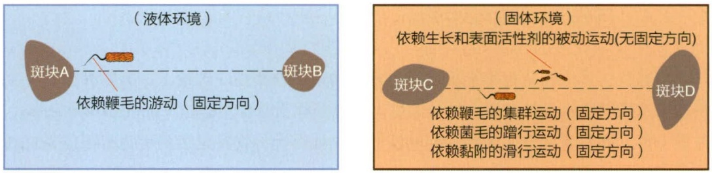
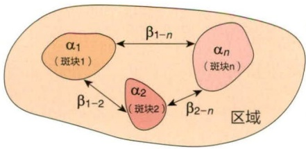
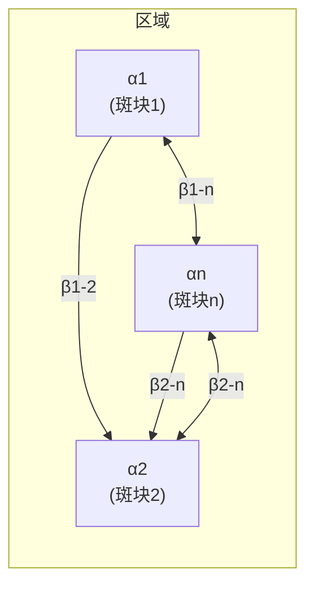
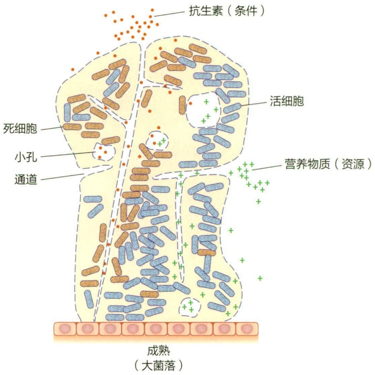
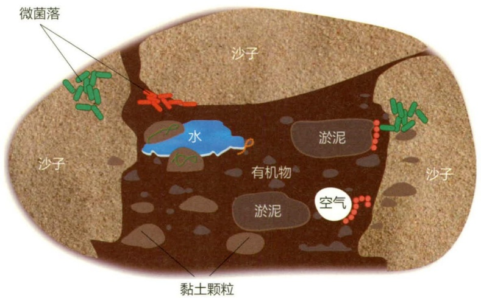
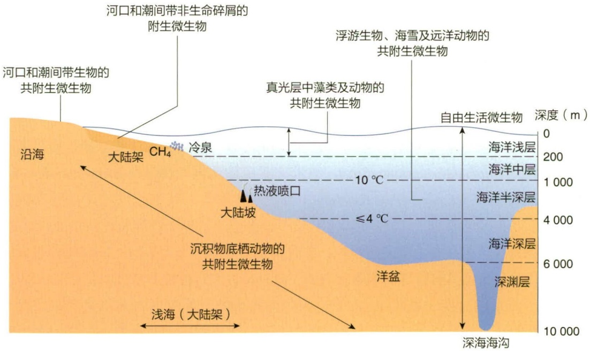
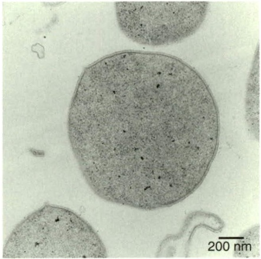
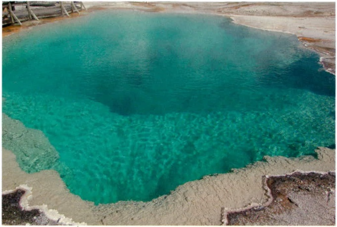
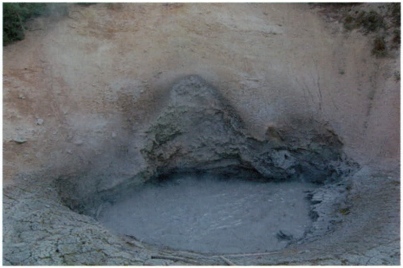
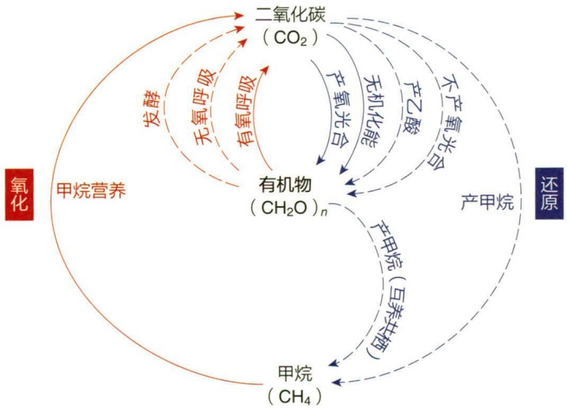

## 13.1.5 生境的斑块化与扩散

地球上的条件和资源分布是斑块化的（patchiness），这决定了不同生境的异质性属性。具有鞭毛的微生物，如很多细菌物种可以在液体环境中从营养物质匮乏或耗竭的斑块游动（swimming）到另一个斑块，也可以在固体表面通过鞭毛依赖的集群运动（swarming）在不同斑块间定向运动（图13-3）。此外，还存在不依赖鞭毛的固体表面运动方式（surface motility）:依赖菌毛扩张和收缩的单细胞定向蹭行运动（twitching）、依赖黏附作用（adhesion）的定向运动（gliding）、依赖生长和表面活性剂的不定向扩散运动（sliding）。不同微生物的运动能力存在显著差异，运动能力强的物种X可以在一个区域内的不同斑块间频繁运动，而运动能力弱的物种Y很少在不同斑块间运动——那么，同一个区域对于物种X和Y分别是细纹理（fine-grained）和粗纹理（coarse-grained）生境。

图 13-3 微生物在不同生境斑块间的典型运动方式

## 13.1.6 空间分布与多样性

在自然和人工生态系统中，生物在斑块间的主动或被动运动往往会影响它们在大环境（macroenvironment）和微环境（microenvironment）的空间分布特征——呈现出随机（random）、规律（regular）和聚集（aggregated）三种模式或它们的中间过渡模式。大环境指区域或地球环境，而微环境或微生境（microhabitat）是指对生物生存、生长和繁殖有直接影响的邻接环境。大环境中每个生境斑块的物种丰富度（species richness）、物种多度（species abundance）和物种均匀度（species evenness）被称为  $\alpha$  多样性；不同生境斑块群落之间物种组成的差异为  $\beta$  多样性； $\alpha$  和  $\beta$  多样性的总和为

flowchart

图 13-4 不同空间尺度的微生物多样性

γ 多样性（整个区域的多样性）
$\alpha$ 多样性（斑块内多样性）
β 多样性（斑块间多样性）
ζ多样性（斑块间共享的物种数量）

整个区域的  $\gamma$  多样性；不同斑块间共享的物种数目被称为  $\zeta$  多样性（图 13-4）。物种丰富度指一定空间范围内物种的数量；物种多度指每个物种个体数目或种群密度；物种均匀度指全部物种个体数目分配的均匀程度。在绝大多数自然和人工生态系统的微生境中，微生物很少以单细胞形式存在，不同物种或同一物种的细胞聚集在一起形成微生物聚集体（microbial aggregates），它们相互作用并与聚集体之外的生物和非生物因子互作，与整个生物圈共同演化。

生物被膜（biofilm）是一种典型的微生物聚集体，是微生物在固体表面附着、增殖形成的微生物和多种胞外有机物组成的复合层。生物被膜的形成参见8.1.1.6生物被膜。微生物的生物被膜在生物圈广泛分布，如岩石、管壁、船底等惰性的无机表面，腐败食物等有机物表面，以及植物根表、叶面、牙齿和置入性医疗器械的表面等潮湿或浸没在水中的固体表面。我们可以把生物被膜看作微生物在这些微生境的“家”，它能减少抗生素、干旱、营养物质波动等生态位变量的不利变化对微生物生存、生长和繁殖的影响程度。生物被膜不是完全封闭的系统，具有一定的持水能力并可以吸附流经固体表面的有机物、离子和抗

text_image

抗生素（条件）
活细胞
死细胞
小孔
通道
营养物质（资源）
成熟
（大菌落）

图 13-5 生物被膜中的生态位分化

生素等；生物被膜小孔和通道的分布会进一步影响这些资源与条件变量在生物被膜内部的时空变化（图 13-5）。例如，部分细胞可能面临较高浓度的抗生素而死亡，其他一些细胞则免受抗生素的干扰而存活下来；也有证据表明生物被膜可以为一些固氮微生物创造低氧分压条件，避免氧气对固氮酶活性的破坏。生物被膜内部条件与资源的异质性为不同微生物物种或同一种群不同个体之间产生分工创造了机会，也为基因水平转移提供了场所。在营养缺乏时，生物被膜的各种多聚物又可以为细胞提供 C、N、P 等营养元素，为微生物的生存、生长和繁殖提供支持。

## 13.2 不同生境中的微生物

微生物广泛分布于陆地环境、海洋环境、淡水环境、大气环境、极端环境及生物体内外，其种群多样性、群落多样性和生态多样性丰富。

## 13.2.1 陆地环境中的微生物

地球陆地环境范围从干到湿、冷到热、酸到碱、无氧到有氧、营养贫瘠到营养丰富，变化很大。这些环境特征决定了栖息于陆地环境中的微生物的物种和代谢活性多样性。陆地环境中微生物的主要栖息地为土壤和深部地层，尤其是表层土壤。

土壤（soil）是指覆盖在地球陆地表面的、具有生命力和生产力的、疏松而不均匀的聚集层，其理化性质与其深部地层完全不同。土壤的生物多样性极为丰富，物质循环和能量交换活跃，不仅为植物和微生物的生长繁殖提供了必要的营养、水分和其他条件，也是环境污染物吸附和降解的重要场所。土壤微生物在生物地球化学循环和环境污染物降解转化中发挥关键作用。

text_image

微菌落
沙子
水
有机物
淤泥
淤泥
空气
沙子
黏土颗粒

图 13-6 土壤微生物栖息地

## 13.2.1.1 土壤的结构和性质

土壤由固体、液体和气体三相物质组成，像“皮肤”一样覆盖在地球表面。土壤固相物质包括无机矿物质和土壤有机物。在土壤固相物质之间存在大量大小和形状不同

的空隙，空隙中充满了土壤溶液和空气（图 13-6）。这三相物质之间相互作用而达成平衡态，形成相对稳定的环境。

无机矿物质是土壤固相物质的主体，约占土壤总体积的 45%，是岩石风化后的产物。依据风化颗粒的大小可将其分为三类:沙子、粉沙和黏土。三者在土壤中的比例和分布决定了土质。含有沙子较多的土壤中空隙空间大而数目少，土质粗糙；而黏土含量较多的土壤孔隙空间小而数目多，土质细腻。

土壤有机物占土壤总体积的 5% 左右，不仅包括死亡生物的残体及其降解转化产物，也包括微生物和植物根系等活的生物体。腐殖质（humus）是死亡生物质经由土壤微生物的一系列生物化学作用后，形成的含苯环、蛋白质和多糖的黄色至棕黑色高分子聚合物，占土壤有机物含量的 60%\~80%。腐殖质是土壤中最复杂、最稳定的有机化合物，每年降解率在 2%\~5%，为土壤微生物提供了长期稳定的营养源。腐殖质结构复杂，不同土壤中腐殖质的物理化学性质差异很大，但总体上是同时包含疏水性和亲水性基团的三维海绵结构，具有良好的透水性和蓄水性，可以吸附土壤中无机矿物质、营养元素和微生物，提高土壤肥力。

土壤溶液是一种由无机和有机溶质组成的不断变化的基质，其溶质组成反映了土壤的化学性质，如土壤的酸碱性等。土壤化学性质影响营养物质的形态和生物可利用性。对于大多数土壤微生物，土壤溶液 pH 为 6.0～6.5 时较适宜。微生物对土壤中水的利用取决于水与土壤颗粒表面吸附力的强度，通常富含水而又不完全被水饱和的土壤环境更适合好氧微生物生长。

土壤空气的组成与大气基本相同，但通气不佳时，微生物活动会影响土壤颗粒内部微环境的氧含量。如在黏土含量过多的土壤中， $O_{2}$  被好氧微生物所消耗， $CO_{2}$  含量上升，改变了微环境中的氧化还原电位，进而影响好氧和厌氧微生物电子受体的可利用性。

## 13.2.1.2 土壤微生物的多样性

由于土壤具备了各种微生物生长繁殖所需要的营养物质、水分、空气、酸碱度、渗透压和温度等条件，所以成为微生物生活的良好环境。可以说，土壤是微生物生长的“天然培养基”，也是它们的“大本营”，拥有丰富的菌种资源。

土壤微生物的主要类群包括细菌、古菌、真菌、藻类、原生动物和病毒。微生物的数量取决于环境因素，尤其是土壤湿度和温度。一般来说，在每克农田土壤中，各种微生物含量之比大体有一个10倍系列的递减规律:

病毒（$\sim 10^{9}$）>细菌（$\sim 10^{8}$）>霉菌（$\sim 10^{6}$，孢子）>酵母菌（$\sim 10^{5}$）>藻类（$\sim 10^{4}$）>原生动物（$\sim 10^{3}$）

由此可见，土壤中所含的微生物数量很多。通过这些微生物旺盛的代谢活动，可明显改善土壤的物理结构并提高它的肥力。细菌是除病毒以外土壤中最丰富的类群，占土壤细胞型微生物总量的70%\~80%。表层土壤中微生物的数量最多，随深度的增加微生物的数量迅速减少，且微生物的丰度和多样性与环境条件密切相关。

大部分细菌位于土壤颗粒表面，或分布在土壤孔隙内表面。在浅层土壤中，好氧菌的数量比厌氧菌高几个数量级，厌氧菌数量随着土壤深度的增加而增加。土壤细菌的代谢多样性极为丰富，一些在生物圈物质循环和能量代谢中发挥重要作用的细菌都出现在土壤中，如氨氧化细菌、硝化细菌、反硝化细菌、厌氧氨氧化菌、硫氧化菌、硫酸盐还原菌、固氮菌、光合细菌、甲基营养菌等。放线菌属于高 G+C 含量的革兰氏阳性菌，一般为杆状或丝状，也是土壤微生物的重要组分。放线菌可产生孢子，耐干旱，适合在碱性或中性条件下生长，可以分解土壤中的纤维素、木质素、几丁质等复杂有机物，也是抗生素的主要来源。土壤中还含有氨氧化古菌、产甲烷菌等古菌类群。

尽管土壤真菌在数量上少于细菌，但生物量要多于细菌。每克土壤中真菌菌丝体长度可达数百米。除酵母外，土壤真菌多为好氧菌，具有较高的耐酸性，大多在土壤表层生存，数量随着土壤深度增加迅速减少，在30 cm以下很少有真菌生存。酵母菌可在厌氧条件下发酵，数量少于好氧的丝状真菌。真菌是土壤中营养物质循环的重要驱动力，对有机物的分解比细菌更加彻底，是纤维素、半纤维素和木质素等植物大分子降解和腐殖质产生过程的关键角色。一些丝状真菌与植物形成菌根共生体，作为植物根系的延伸，在植物营养物质获取中发挥关键作用。

藻类是典型的光能自养型微生物，在土壤表层阳光可以穿透的区域营光合作用。通常在土壤表层 $10\mathrm{cm}$ 区域内藻类数量最多，有时在地下 $1\mathrm{m}$ 左右的黑暗区域内也能发现藻类，主要是兼性异养型的藻类，如绿藻门和硅藻门的某些种类，在光照不足或完全黑暗的环境中能利用有机物作为唯一碳源和能源生长。土壤中的原生动物主要包括鞭毛虫、根足虫和纤毛虫等单细胞、能运动的种类。大多数原生动物是捕食性的，以细菌、真菌和藻类为食。少数原生动物体内含有叶绿素，能营光合作用，如鞭毛虫的某些种类。土壤中还含有大量的病毒，可侵染细菌、古菌、真菌、藻类和原生动物，其数量大约是细菌数量的10倍。

还应该重视的是，随着人类活动的加剧，包括人和动物的迁移，以及人类贸易和排污等，使土壤产生污染、退化、“过劳”，对生态系统和人类生存构成严重威胁，亟待人类采取有效措施保护土壤资源，确保可持续发展。

## 13.2.1.3 深部地层及其微生物

尽管陆地环境中微生物的栖息地主要为表层土壤，但深层土壤和深部地层也存在着微生物。深部地层的研究通常需要钻探设施来实现。比如在江苏连云港市郊有一个钻探直径为 $20\mathrm{cm}$ 、深 $5158\mathrm{m}$ 的“亚洲第一井”。在其 $500\mathrm{m}$ 以下的泥浆和岩石中，通过分子生物学技术和微生物培养后，均发现含有大量的微生物，每克泥浆中的微生物数量为 $10^{8} \sim 10^{9}$ 个。类似的情况在世界各地都有发现，如在 $400\mathrm{m}$ 深的岩石中，可分离出以 $\mathrm{H}_{2}$ 为能源，以 $\mathrm{CO}_{2}$ 为碳源的化能自养菌——产乙酸细菌，每克岩石含 $10^{6} \sim 10^{7}$ 个。这类深部地层的微生物，都是人类未来潜在可利用的微生物种质资源。

## 13.2.2 海洋环境中的微生物

海洋是地球上最大的生态系统，大约覆盖地球表面积的 71%。海洋是一个非常复杂的系统，由海水、海雪颗粒、海底沉积物、海洋生物等组成。海水约占地球总水量的 97%，含盐量约 3%，海洋的平均水深是 3800 m。

## 13.2.2.1 海洋生境及主要生态区

海洋生境包括大洋、边缘海、海湾和河口等。地球上有四大洋，面积最大的太平洋占地球表面积的35.3%左右，大于陆地面积占比（约29%）。大西洋是第二大洋，位于非洲、欧洲、南极洲及美洲之间。印度洋位于非洲、南极洲、亚洲和澳大利亚之间。北冰洋，位于北极圈以北，是最小的大洋。陆地与大洋连接海域称为边缘海，多以海域所处的地理位置而命名，如中国南海、地中海、加勒比海、波罗的海、白令海等。海湾是指海岸线明显的凹进部分，有被陆地环抱的水域。世界的大小海湾甚多，比较著名的有北大西洋的墨西哥湾、印度洋的孟加拉湾、中国南海的北部湾等。河口是指河流注入海洋的地方，其中的海水被陆域来水所冲淡。

根据水深、海底坡度等不同，海洋可分成4种地形区域:大陆架、大陆坡、洋盆和海沟（图13-7）。从海岸起，海底向海洋缓倾，到一定深度后海底坡度显著增大，这个坡度较大的区域称为大陆坡，从海岸到大陆坡之间的区域称为大陆架。大陆架水深一般在200 m以内，而大陆坡水深一般为200～2500 m。洋盆是海洋的主要部分，深度为2500～6000 m。在洋盆中，深度超过6000 m的区域称为海沟，其中最深的是马里亚纳海沟，最深处的“挑战者深渊”约为11000 m。根据海水深度，海洋水体可以分为海洋浅层（epipelagic zone；0～200 m，又称真光层）、海洋中层（mesopelagic zone；200～1000 m）、海洋半深层（bathypelagic zone；1000～4000 m）、海洋深层（abyssopelagic zone；4000～6000 m）和深渊层（hadal zone；>6000 m）（图13-7）。

海洋中还存在一些非常特殊的生态环境，如热液喷口和冷泉。热液喷口广泛分布于海底扩张中心，喷口处的流体温度高达350℃以上。伴随着热液喷口出现的“黑烟囱”（black smoker），是由高温、低密度、富含金属硫化物的热液流上升遇冷后形成的沉淀产生的。冷泉是指富含甲烷、硫化氢等气体的流体从海底沉积物表面渗漏或者喷发形成的地质构造，多分布于大陆架和板块交界处。在热液喷口和冷泉附近生长着大量包括巨型管虫、蠕虫、蛤类、贻贝类、化能自养细菌在内的特殊生物群落，形成了一个独特的生命绿洲。

text_image

河口和潮间带生物的
共附生微生物
河口和潮间带非生命碎屑的
附生微生物
真光层中藻类及动物的
共附生微生物
浮游生物、海雪及远洋动物的
共附生微生物
自由生活微生物
0
深度 (m)
200
10 °C
1 000
海洋浅层
海洋中层
海洋半深层
热液喷口
大陆坡
大陆架
CH₄
冷泉
≤4 °C
4 000
6 000
深海海沟
洋盆
深渊层
海洋深层
深海海沟
浅海（大陆架）
沉积物底栖动物的
共附生微生物
沿海

图 13-7 海洋的主要生态区和海洋微生物的栖息地示意图

## 13.2.2.2 海洋微生物的多样性

海洋是一个高度多样的环境，在盐度、深度、温度、压力和营养水平等方面表现出极大的差异，形成多样的微生物群落。从海洋表面至11 034 m深的海沟以及海洋沉积物中都有微生物生活着，估计微生物种类有50万\~600万种，甚至可能超过1 000万种。数量庞大、种类繁多的海洋微生物，是海洋生态系统的主体，也是海洋生物量和生产力的主要贡献者。它们主宰着整个海洋中碳、氮、硫等元素的生物地球化学循环，对调节气候变化具有重要作用。海洋微生物与陆生类群有许多共性，比如目前细菌域可培养细菌共分为42个门，多数门的主要分支都能在海洋环境中发现。然而，特殊且复杂多变的海洋环境使海洋微生物产生许多不同的特性，尤其是海洋细菌，具有极强的适应性和极高的多样性。图13-8是我国微生物海洋学家肖湘教授团队发现的一株

超嗜热古菌 Thermococcus eurythermalis A501。

多数海洋原核细胞的尺寸要比陆生原核细胞小得多。比如海洋水体中最丰富的细菌 SAR11 类群，在海水中的数量可高达  $2.4 \times 10^{28}$  个细胞，约占海洋中浮游微生物数量的 25%。其可培养的种类，遍在远洋杆菌（Ca. Pelagibacter ubique）（Ca. = candidatus，指尚未纯培养的微生物，暂定种名，后同；遍在远洋杆菌虽然可以纯培养，但尚未达到国际菌种保藏标准，故保留 Ca），长  $0.4 \sim 0.9 \mu m$ ，直径 0.1 \~ 0.2 μm，细胞体积仅有 0.01 μm³（不及大肠杆菌的 1/100），其细胞呈月牙形。SAR11 是一类寡营养异养细菌，可有效利用极低浓度的、低分子量活性溶解有机物（dissolved organic matter，DOM），如氨基酸、有机酸、膦酸酯、多胺类、相容性介质、挥发性有机物等进行生存。此外，SAR11 既可产生温室气体如 CH₄、CO₂、甲硫醇等，又可产生“冷室气体”二甲基硫（dimethyl sulfide，DMS），在全球生物地球化学循环和气候变化中发挥重要作用。然而，目前已知的单体体积最大的三种原核生物，华丽硫珍珠菌（Thiomargarita magnifica）、纳米比亚硫珍珠菌（Thiomargarita namibiensis）和费氏刺骨鱼菌（Epulopiscium fishelsoni）都发现于海洋，其细胞尺寸比一些真核细胞还大。华丽硫珍珠菌于 2022 年由《科学》杂志报道，单个细胞长度可达 2 cm。纳米比亚硫珍珠菌中具有大量的硫颗粒，并且细胞中含有一个大液泡，使表面积明显增加。费氏刺骨鱼菌具有特殊的细胞膜表面，其以某种方式折叠，使表面积显著增加。

natural_image

Microscopic view of a circular cellular structure with a 200 nm scale bar (no text or symbols beyond scale indicator)

图13-8 超嗜热古菌 Thermococcus eurythermalis A501 的显微照片（图片来源:上海交通大学赵维殳）

由于海水的盐度一般在 3% 左右，因此海水中的土著微生物必须生活在盐度为 2%\~4% 的环境中，以 3.3%\~3.5% 为最适盐度。这是海洋土著微生物与陆生微生物最显著的区别。海水中的多数微生物细胞要比陆生细菌小得多，可能与海水的寡营养环境有关。此外，陆生细菌的最适生长温度一般在 20\~40℃，而大多数海洋细菌具有热敏感性，不适于在 30℃以上的环境下生长。大洋细菌的最适生长温度通常为 18\~22℃，海洋生物的病原菌多适于在 25\~28℃的温度生长。许多海洋细菌能够在 0\~4℃条件下缓慢生长，甚至在 -5℃以下也有细菌能够生长。然而，在海洋中也发现一些超高温原核生物，比如发现在海底热液喷口处 120℃的海水中仍有细菌或古菌能正常生存。

虽然发光现象并非海洋细菌的普遍性生理特性，但是已知的发光菌绝大部分分离自海洋生物的体表或海水中。常见的海洋发光细菌包括印度发光杆菌（Photobacterium indicum）、鰕发光杆菌（P. leiognathi）、明亮发光杆菌（P. phosphoreum）、磷光发光杆菌（P. phosphorescens）、坎氏弧菌（Vibrio campbellii）、哈维氏弧菌（V. harveyi）、费氏另类弧菌（Aliivibrio fischeri；又称费氏弧菌 V. fischeri）等。

海洋微生物几乎都具有附着特性，胞外多具有一层自身分泌的黏多糖，利于其附着于固体表面。有鞭毛的细菌种类还能借助鞭毛进行附着生活。海洋细菌附着于非生物表面后，还可吸引藻类、真菌、原生动物等共同附着，通过形成生物被膜而互利共存。海洋细菌也可以附着在生物体表，多为互利共栖。例如，一些海鱼（如大西洋鲆）为适应环境变化而引起体表变色，但引起变色的色素是由在其体表附着生长的细菌所产生的。

## 13.2.3 淡水中的微生物

水是生命赖以生存的重要环境。淡水仅占地球总水量的约 2.53%，其中绝大部分（约 90%）的淡水都以雪山、冰原或深层地下水等人类难以利用的形式存在，少部分分布于湖泊、池塘、河流和泉溪。

## 13.2.3.1 淡水生境的一般特征

典型的淡水生境包括湖泊、池塘、河流和泉溪。其中湖泊与池塘属于静水，河流和泉溪属于流水。微生物在水体中的丰度和种类与其接触的土壤有密切关系，而且受到氧气、光线、温度、营养物质等众多环境因子的影响。

在较深的湖泊或水库等淡水生境中，因光线、溶解氧和温度等的差异，微生物呈明显的垂直分布。在浅水区，由于光线充足且溶解氧浓度高，适合蓝细菌、真核微藻、好氧微生物等生长。在深水区，因光线微弱、溶解氧浓度低、硫化氢含量较高等，适合紫硫细菌、绿硫细菌等厌氧光合细菌以及许多兼性厌氧细菌的生长。在湖底沉积物中，因缺乏氧气，只有脱硫弧菌属（Desulfovibrio）、梭菌属（Clostridium）、产甲烷菌等专性厌氧菌才能生长。

## 13.2.3.2 水体的自净作用

在自然水体，尤其是快速流动、氧气充足的水体中，存在着水体对有机或无机污染物的自我净化作用。水体自净作用的最重要原因是好氧菌对有机物的降解作用。此外，原生动物对细菌的吞噬作用、病毒对宿主的裂解作用、藻类对无机盐的吸收利用，以及浮游动物和后生动物通过食物链对有机物的摄取也对水体自净发挥着重要作用。

## 13.2.3.3 饮用水的微生物学标准

我国对饮用水的微生物种类和数量都有严格的规定。检验饮用水的微生物种类主要为恒温动物肠道中的正常菌群——大肠菌群数，以此可灵敏地推断该水源是否曾与动物粪便接触以及污染程度如何。中华人民共和国国家卫生健康委员会（以下简称“国家卫健委”）规定的饮用水标准是:自来水中细菌总数应＜100个/mL（37℃，培养24 h），总大肠菌群数应＜3个/L（37℃，培养48 h）。此外，国家卫健委还规定，饮水中可引起人体肝损伤和肝癌的微囊蓝细菌毒素（microcystin）含量应＜1 μg/L。靠近城市或城市下游水中的微生物数量很多，并且有很多对健康不利的细菌，因此不宜作为饮用水源。严重污染的水会通过食物链的生物放大作用危害人类健康。

## 13.2.4 大气中的微生物

空气环境缺乏水分且营养不足，并不能作为微生物生长繁殖的栖息地。但空气是微生物传播输送的重要途径，因此在空气中仍可以分离出许多细菌、真菌、原生动物等。这些微生物来源于土壤、水体等微生物生境，以生物气溶胶（bioaerosol）的形式进入空气，在空气中可以停留短暂时间。空气中的干燥、阳光、射线等因子会对微生物的生命活动产生负面影响。因此，能长期存活在空气中的微生物常具有较强抵抗力。一般而言，空气中的微生物数量取决于空气中灰尘数量、植被、海拔、纬度、通风、湿度、温度、紫外线强度等因素。例如，低温、高纬度或通风、灰尘少的野外微生物数量少，北极空气中微生物数量甚至为0。

## 13.2.5 极端环境下的微生物

地球上一些生境具有大多数生物无法生存的极端环境条件，如高温、低温、干旱、强酸、强碱、高盐度、低营养、高辐射等，仅有某些特殊微生物能在其中生长繁殖，这类微生物称为极端环境微生物（extremophilic microorganism）。表13-1汇总了极端环境微生物的主要类型。已发现的极端生境包括陆地热泉、深海热泉、极地海冰、干旱土壤、碳酸盐湖、酸矿排水、深海等。一些极端生境往往兼具几种极端环境条件，如热泉既是高温又是强酸环境。极端环境微生物在这些极端环境条件胁迫的选择压力下演化出独特的生理适应能力。对极端环境微生物的研究不仅有利于开发新型微生物资源，而且为生命起源与演化研究提供了新材料。

## 13.2.5.1 极端温度环境中的微生物

低温会导致细胞膜“冻结”、生化反应速率下降，冰冻产生的冰晶会刺穿生物膜使内溶物流失；而高温会引起细胞膜、蛋白质、核酸和某些细胞器的失活和变性，如叶绿素在75℃以上降解，高温时微生物所必需的氧气和二氧化碳在水中的溶解度也会下降。

热泉（hot spring）是由地下热液喷发产生的温度接近沸点的温泉，它是最典型的嗜热菌和极端嗜热菌生境。美国黄石公园是陆地热泉的集中区（图 13-9），用于 PCR 技术的耐高温 Taq 聚合酶就源于黄石公园热泉分离的水生栖热菌（Thermus aquaticus）。热泉中的嗜热菌包括真菌、细菌和古菌。通常真菌的生长温度低于细菌和古菌。嗜热真核藻类的生长温度极限是 65℃，超过 65℃时只有原核生物可以生存，如古菌中的火球菌、热球菌、热原体、嗜热产甲烷菌等，以及细菌中产水菌目（Aquificales）的某些种。目前发现最嗜热的极端嗜热古菌是延胡索酸火叶菌（Pyrolobus fumarii），属于泉古菌门的一种硝酸盐还原菌，最适生长温度高达113℃。在陆地热泉中，光合作用受到高温的限制，因此光能营养型微生物生长温度通常低于非光能营养型微生物。嗜热化能无机自养型微生物是陆地热泉中主要的初级生产者。从地下喷发出的泉水中富含溶解性气体和还原性矿物质，为嗜热化能无机自养型微生物提供了充足的电子供体，如氢气和还原性硫化物，初级生产力来源于这些物质的氧化。而在海底热泉生境，厌氧和好氧的嗜热化能无机自养型微生物则是海底热泉生态系统的基础，这些嗜热菌利用热泉中的无机能量固定 $CO_{2}$ ，为海底动物提供有机物。

表 13-1 极端环境微生物的类别

<table><tr><td>环境因子</td><td>类型</td><td>定义</td><td>代表菌株</td><td>主要生境</td></tr><tr><td rowspan="3">温度</td><td>极端嗜热菌</td><td>&gt;80°C</td><td>延胡索酸火叶菌(Pyrolobus fumarii)</td><td>热泉、深海热泉</td></tr><tr><td>嗜热菌</td><td>45~80°C</td><td>深蓝聚球藻(Synechococcus lividus)</td><td></td></tr><tr><td>嗜冷菌</td><td>&lt;15°C</td><td>嗜冷杆菌属(Psychrobacter)</td><td>极地海冰、冰川</td></tr><tr><td>压力</td><td>嗜压菌</td><td>高压</td><td>深栖假单胞菌(Pseudomonas bathycetes)</td><td>深海</td></tr><tr><td>盐度</td><td>极端嗜盐菌</td><td>高盐(2.5~5.2 mol/L NaCl)</td><td>盐杆菌(Halobacteriaceae)杜氏藻(Dunaliella salina)</td><td>盐田、盐湖</td></tr><tr><td rowspan="2">pH</td><td>嗜酸菌</td><td>pH&lt;3~4</td><td>嗜酸热硫化叶菌(Sulfolobus acidocaldarius)铁原体属(Ferroplasma)星明氏嗜酸菌(Picrophilus oshimae)</td><td>酸矿水、热泉、酸性土壤</td></tr><tr><td>嗜碱菌</td><td>pH&gt;9</td><td>嗜盐碱杆菌(Natrono bacterium)坚强芽孢杆菌(Bacillus firmus)</td><td>碳酸盐湖、碳酸盐荒漠</td></tr></table>

natural_image

Aerial view of a turquoise glacial pool surrounded by sandy terrain, with no visible text or symbols.

图 13-9 美国黄石公园的热泉（照片来源:上海交通大学陈峰）

地球海洋表面平均温度为 $5^{\circ}$ C，深海的温度

甚至更低，一些高纬度地区也长期处于寒冷状态，因此广泛分布着最适生长温度在  $15^{\circ}$ C 以下的嗜冷菌。在高海拔地区常看到粉红色的积雪，就是由嗜冷极地雪藻（Chlamydomonas nivalis）的红色孢子造成的。极地常年处于零下几十度的冰冻状态，但仍有嗜冷菌生长，这些微生物在冰冻物质空穴的液体水中生长，微环境温度在零度以上，以化能无机自养型微生物为基础，形成了独特的极地微生物生态系统。

## 13.2.5.2 极端 pH 环境中的微生物

酸矿水、热泉或酸性土壤等极端酸性生境分布着极端嗜酸菌，包括硫杆菌属及古菌中的硫化叶菌属、热原体属和铁原体属等。从火山喷发形成的极端酸性土壤中分离得到的星明氏嗜酸菌（Picrophilus oshimae）是已知最嗜酸的原核微生物，最适生长pH为0.7，pH高于4的时候细胞就会裂解。有的热泉同时具有极端酸性环境（图13-10），是嗜热嗜酸菌的主要栖息地，嗜酸热硫化叶菌（Sulfolobus acidocaldarius）是其中常见的古菌，生长温度在85\~90℃、pH为3时生长最佳，可营自养生活。

碳酸盐湖、碳酸盐荒漠等极端碱性生境的微生物以嗜碱菌为主。碳酸盐湖是自然

条件下碱性最强的生境，如肯尼亚的玛格达湖、美国的苏打湖等，pH 高达 10.5～11.0，湖水中的碱性主要来源于碳酸盐或石灰。许多嗜碱性原核生物属于芽孢杆菌属，如坚强芽孢杆菌（Bacillus firmus）。许多嗜酸菌或嗜碱菌的栖息地除了具有极端的 pH，还具有高盐、高温等环境条件，因此嗜酸菌和嗜碱菌大多是嗜多极微生物（polyextremophile）。例如一些嗜碱菌也是嗜盐菌，称为嗜盐嗜碱菌，包括外硫红螺菌、甲烷嗜盐菌、嗜盐碱杆菌等。

## 13.2.5.3 高盐环境中的微生物

咸水湖是极端嗜盐菌的主要自然生境。如中国青海的查卡盐湖和美国的大盐湖等。嗜盐古菌在一些盐湖的微生物群落中占据优势，是盐湖中主要的初级生产者，如盐杆菌因含有菌红素，使盐湖多呈现红色。此外，一些嗜盐的绿藻和嗜盐蓝细菌也是盐湖中的初级生产者。盐湖微生物群落还包括嗜盐细菌、硅藻和原生动物，参与营养物质循环。盐湖的有机质上经常生长着一些嗜盐真菌，如德巴利酵母属，其盐耐受浓度高达26%。

natural_image

Exterior view of a concrete pit with visible erosion and sedimentary layers (no signage or text)

图 13-10 美国黄石公园的酸性热泉（照片来源:上海交通大学陈峰）

## 13.2.5.4 高压环境中的微生物

最适生长压力在 40 MPa 以上的微生物称为嗜压菌（piezophile）。而最适生长压力为常压，但可以耐受高压的微生物称为耐压菌（piezotolerant）。嗜压菌广泛分布于地球的深海环境。深海大多数区域是极寒的，平均温度 2～3℃，而少数深海热泉区域又是极热的。因此深海中的微生物通常是嗜热嗜压菌或嗜冷嗜压菌。在深度大于 10 000 m 的马里亚纳群岛海沟中发现的极端嗜压菌（Moritella）最高可以在 100 MPa 下生长，最适生长温度为 2℃。

## 13.2.6 与其他生物互作的微生物

微生物不仅栖息于自然环境，也栖息于植物、动物等生物的体表或体内。通常将微生物栖息的生物称为宿主（host）。在长期共演化（coevolution）过程中，微生物与所栖息的生物环境之间形成了相互作用、相互依存的复杂关系。

## 13.2.6.1 微生物与生物环境的相互作用

从农业生产、食品发酵、环境保护到直接影响人体健康，微生物在人类的生产生活中始终扮演重要角色。在所有这些应用场景下，微生物都不是独立存在的，它们以一个社会（微生物群落或微生物群系）的形式发挥作用。通过改造甚至从头构建微生物群落，有可能使其更好地执行所期望的功能，例如发酵产生更美味的食物、更好地保护环境、促进作物更好地生长、协助治疗疾病甚至强健体魄。利用微生物群落构建原理改造微生物社会，是目前的研究热点，称作“微生物群系工程（microbiome engineering）”。

种间关系（interspecific interaction）是指不同物种之间的相互作用。微生物可以多种方式与共享同一生境的其他微生物发生相互作用，也可与作为微生物生境的宿主发生相互作用。这种作用可能有利也可能有害，或没有特殊影响，可能对作用双方的生存是必需或非必需的。根据 A、B 两个物种相互作用的结果是受益（+）、受害（-）还是没有影响（0），表 13-2 将种间关系划分为 8 种基础类型。

表 13-2 种间关系分类

| 类型 | 特点 | 种群A | 种群B |
| --- | --- | --- | --- |
| 中性作用(neutralism) | A、B彼此不受影响 | 0 | 0 |
| 捕食(predation) | A摄食B个体的全部或部分 | + | - |
| 竞争(competition) | A、B互相抑制而受害 | - | - |
| 偏害共生(amensalism) | A受害,B无影响 | - | 0 |
| 协作(synergism) | 相互作用对A、B都有利,但不是必需的 | + | + |
| 偏利共生(commensalism) | A受益,B无影响 | + | 0 |
| 互利共生(mutualism) | 相互作用对A、B都有利,且是必需的 | + | + |
| 寄生(parasitism) | A寄居B个体体内,A获益,B受害 | + | - |

① 中性作用（neutralism）是指两种群在一起彼此没有影响或仅存无关紧要的影响。然而在自然界中，微生物总是趋向于和其他微生物集合在一起形成微生物聚集体，因此很难观察到微生物之间的中性作用。
② 捕食（predation）是指一个种群生物以摄食方式从另一种群生物身体获取营养，这种关系通常发生在捕食性原生动物与微生物之间。
③ 竞争（competition）是指两个种群因需要相同的生长基质或环境因子，致使双方生长都受到抑制的相互作用。在自然生境中，为争夺有限的营养，微生物之间的竞争普遍存在。
④ 偏害共生（amensalism）是指一个种群因另一个种群的生命活动而受害，而另一个种群没有得益或受害。微生物之间的偏害共生又称为拮抗（antagonism），是指一种微生物所产生的代谢产物可抑制成杀死其他微生物的一种相互关系。最常见的拮抗作用是抗生素对微生物生长的抑制作用，抗生素产生菌可以通过抑制周围微生物的生长间接获取更多营养资源。
⑤ 协作（synergism）是指两个可以单独生活的种群生活在一起时，对于双方的生命活动都有利，两者之间是一种非专性的松散联合。在土壤中的纤维素分解菌和自生固氮菌构成的协作关系中，纤维素分解菌分解多糖产生的有机酸可以作为固氮菌的碳源，而固氮菌固定的有机氮可满足前者对氮源的需求。
⑥ 偏利共生（commensalism）是指两个可以单独生活的种群生活在一起时，一个种群因另一种群的生命活动而得益，而另一种群没有得益或受害，一旦分开，得益的一方不能很好生活或不能完成特定的生命活动，而另一方不受影响。例如废水厌氧处理过程中，产酸细菌发酵有机物生成乙酸，再由产甲烷菌转化为甲烷，单独的产甲烷菌无法直接发酵有机物生成甲烷，但产酸细菌在这一关系中并没有得益或受害。
⑦ 互利共生（mutualism）是指两个生活在一起的种群对双方生命活动都有利，两者形成一种专性的紧密结合，分离后不能独立生活或失去共生时特有的代谢功能。互利共生是协作关系高度发展的结果，有时简称共生，是狭义的共生概念。如地衣是由真菌和藻类或蓝细菌构成的共生体，常生活在贫瘠的干旱地表。藻类通过光合作用为真菌提供营养，而真菌为藻类生长提供一个牢固的基质，免受风雨侵蚀，同时吸收藻类生长所需的无机盐，并促进水的吸收防止藻类干枯，两者共生时具有固氮作用。真菌和藻类在协同演化过程中形成高度专一性，分离后无法在原有生境独立生活，失去固氮功能。微生物与大型生物之间的共生现象也广泛存在。如白蚁消化木质纤维素的能力依赖于它们肠道中的微生物菌群。对于白蚁来说，这种关系是必需的，否则它们就会饿死，而栖息在它们体内的肠道微生物菌群，获得了一个安全稳定的生存环境。此外还有植物根系和菌根真菌、豆科植物和根瘤菌、反刍动物和瘤胃微生物等形成的共生关系。

⑧ 寄生（parasitism）是指一个种群对另一种群的直接侵入，寄生者从宿主生活细胞或组织中获取营养而受益，同时对宿主产生不利影响。噬菌体、立克次氏体是以单细胞为宿主的寄生。当宿主为大型生物时，寄生微生物即为病原物。

协作、偏利共生、互利共生和寄生是微生物与生物环境之间的重要种间相互作用关系，统称为共生（symbiosis），这是广义共生的概念，即两种生活在一起生物的相互作用关系。在长期演化过程中，生物环境中的微生物都与所栖居的大型生物形成一定共生关系。这种共生关系是大型生物生存的基本条件。表 13-3 列出了一些生物环境中微生物与宿主之间的相互关系。下面将重点介绍菌根、共生固氮和瘤胃共生三种典型共生关系。

表 13-3 微生物与植物和动物的相互关系

<table><tr><td></td><td>宿主</td><td>微生物</td><td>功能</td></tr><tr><td rowspan="8">植物</td><td>满江红</td><td>鱼腥藻</td><td>互利共生,共生固氮</td></tr><tr><td>豆科植物</td><td>根瘤菌</td><td>互利共生,共生固氮</td></tr><tr><td>杨梅、沙棘等非豆科植物</td><td>弗兰克氏菌</td><td>互利共生,共生固氮</td></tr><tr><td>禾本科植物</td><td>红螺菌、固氮螺菌等</td><td>协作,联合固氮</td></tr><tr><td>植物</td><td>叶际微生物</td><td>协作或偏利共生,吸收营养</td></tr><tr><td>植物</td><td>根际微生物</td><td>协作或偏利共生,吸收营养</td></tr><tr><td>陆生植物</td><td>菌根真菌</td><td>互利共生,吸收营养</td></tr><tr><td>植物</td><td>植物病原菌</td><td>寄生,致病</td></tr><tr><td rowspan="6">动物</td><td>夏威夷短尾乌贼</td><td>发光细菌</td><td>互利共生,发光</td></tr><tr><td>医用蛭</td><td>肠道细菌</td><td>互利共生,消化血</td></tr><tr><td>蚜虫</td><td>细菌</td><td>互利共生,合成氨基酸</td></tr><tr><td>白蚁</td><td>肠道微生物菌群</td><td>互利共生,消化纤维素</td></tr><tr><td>反刍动物</td><td>瘤胃微生物菌群</td><td>互利共生,消化纤维素</td></tr><tr><td>动物</td><td>动物病原菌</td><td>寄生,致病</td></tr></table>

## 13.2.6.2 菌根

菌根（mycorrhiza）是指土壤真菌与活体植物根系以互利共生关系形成的共生体。菌根是世界上最古老的微生物-植物共生体，在4.6亿年前的化石中就发现植物根中有子囊菌门真菌细胞。大约80%的陆生植物都形成菌根。在这种互利共生关系中，植物给真菌提供其生长所必需的碳水化合物，如冷杉林中外生菌根真菌吸收的碳占总净初级生产量的15%；而菌根真菌则从土壤中吸收磷、锌、铜、氮等矿物质和水分转运给植物，某些直根系植物 80% 磷素营养由菌根提供。某些菌根真菌只有在与植物共生时才能完成其生活史，如松茸、红菇等珍稀食药用菌，至今无法人工栽培获得子实体。传统理论认为，糖类是植物为菌根真菌提供碳源营养的主要形式，然而多年来研究人员一直没有找到相关的糖转运蛋白。近年研究表明，在丛枝菌根真菌与植物的共生过程中，脂肪酸是植物传递给菌根真菌的主要碳源形式，推翻了百年来教科书中的“糖”理论。

菌根可以分为外生菌根和内生菌根两大类。外生菌根（ectomycorrhiza）侵入植物根系后，很少进入植物根系皮层细胞，真菌菌丝紧密围绕植物根系形成致密的鞘套。温带大多数木本植物具有外生菌根，形成外生菌根的真菌多为担子菌，包括一些可以产生大型子实体的食药用菌，如牛肝菌属、鹅膏属、口蘑属，也有少数属于子囊菌的块菌目。内生菌根（endomycorrhiza）侵入植物根系皮层中，其中丛枝菌根是分布最广的内生菌根类型，大约80%植物根系上都有丛枝菌根。值得注意的是，很多病原菌，如稻瘟病菌也属于真菌，近年来针对水稻与真菌互作机制的系统研究表明:水稻能够识别真菌细胞壁中几丁质多糖的聚合长度从而区分病原菌与有益菌。

## 13.2.6.3 共生固氮

豆科植物与根瘤菌共生体的共生固氮作用是生物圈氮素的主要来源。根瘤菌（rhizobia）是一大类有鞭毛、能运动的好氧革兰氏阴性杆菌，绝大多数根瘤菌通过识别来自宿主植物的类黄酮等共生信号分子表达结瘤基因并合成分泌结瘤因子，结瘤因子被宿主特异性受体所识别并起始侵染和根瘤（root nodule）形态建成。在这个过程中豆科植物干细胞关键基因 SCR 在皮层细胞表达，另一个干细胞关键转录因子 SHR 在维管束表达后移动到皮层细胞——该干细胞分子模块赋予豆科植物皮层细胞分裂能力，使豆科植物的皮层与非豆科植物不同。大豆根瘤菌等具备三型分泌系统，可以向宿主细胞分泌不同的效应蛋白干扰宿主免疫反应从而调控共生匹配性；依赖三型分泌系统的共生匹配能力，可以在宿主选择压力下发生快速演化。不是所有生理期的根瘤菌都可以固氮，绝大多数根瘤菌只有侵入根瘤细胞内并分化为类菌体（bacteroid）时才能固氮。类菌体被来自宿主细胞的膜包裹，形成共生体（symbiosome）。固氮作用需要固氮酶（nitrogenase）的催化，这是一种由铁蛋白和钼铁蛋白构成的固氮酶复合物。尽管根瘤菌是专性好氧菌，但氧可使固氮酶不可逆失活，固氮作用在好氧条件下被抑制。根瘤细胞中的豆血红蛋白与氧分子的亲和力极强，使根瘤细胞氧浓度处在较低的水平，同时能够将氧气快速传递给根瘤菌，保障根瘤菌的微氧呼吸。在这种互利共生关系中，植物为根瘤菌提供营养和固氮微环境，细菌为植物提供可利用的氮源。共生体中的根瘤菌每年可固定氮 150～200 kg/hm²。共生体的固氮作用使豆科植物能生长在贫瘠土壤中，并且增加土壤中化合态氮的含量，有利于其他植物生长。我国古代很早就采用豆科植物与谷物轮作的方式提高地力。

## 13.2.6.4 瘤胃中的微生物

反刍动物（ruminant）是地球上演化最成功、多样性最丰富的草食性动物，包括牛、鹿、骆驼、羊等。植物纤维素是草食性动物的食物来源，但几乎所有食草性动

## 知识拓展 13-1

真菌更喜欢从植物根部“揩油”，而非“吃糖”

## 知识拓展 13- 2

抗病又共生，它是怎么做到的？

## 知识拓展 13- 3

根瘤“奠基细胞”的命运推手

物都缺乏分解纤维素的酶。反刍动物具有一个被称为瘤胃（rumen）的特殊消化器官，在瘤胃中，纤维素等植物多糖在微生物的作用下被消化。瘤胃类似一个厌氧生物反应器，温度恒定在  $39^{\circ}$ C，pH 为 6.5，缺氧，为纤维素厌氧发酵微生物群落提供了一个适宜生境。在菌群作用下，吞入瘤胃的食物发酵时间为  $9 \sim 12$  h，纤维素分解为纤维二糖和葡萄糖，进而发酵为乙酸、丙酸、丁酸等有机酸和脂肪酸。瘤胃消化后的食物反刍回吐口中，再次咀嚼吞咽经过真正的酸性胃（皱胃）消化。

瘤胃中微生物浓度极高，种类繁多，达到  $10^{12}$  个/mL，主要是厌氧微生物。各种微生物的生化反应通过食物链彼此偶联，实现纤维素的降解和转化。瘤胃中纤维素的水解依靠厌氧纤维素降解细菌的作用，这些细菌或直接附着在纤维素纤丝上，利用周质纤维素酶降解纤维素；或分泌胞外纤维素酶水解纤维素。水解产物葡萄糖和纤维二糖可以在发酵细菌作用下转化为有机酸。瘤胃中的厌氧真菌在半纤维素、果胶和木质素的降解中起主要作用。还有一些专性厌氧的原生动物，可以捕食细菌控制种群密度，也能水解纤维素发酵有机酸。产甲烷菌能以动物所需的有机酸为底物发酵产生甲烷和二氧化碳，同时为反刍动物提供必需的维生素。

## 13.2.6.5 人体中的微生物

生活在人身体各种腔体内的微小生物的合集我们称之为人体微生物，包含数目庞大的细菌、古菌、病毒和真菌。其中有很多为共生微生物。一个人的所有肠道微生物基因的集合代表了一个遗传库，该库的基因数目比人类基因组多一个数量级。大部分的微生物居住在人类的肠道内，并受到分娩方式、喂养方式、生活方式、药物和宿主遗传的影响。肠道微生物群系在提高宿主免疫力、食物消化、肠道内分泌功能和神经信号调节、药物功能和代谢、内毒素清除和影响宿主代谢相关物质的产生等方面扮演重要角色。

在长期的共同演化过程中，人类和肠道微生物已经形成了紧密的共生关系。人类为微生物提供适合的栖息环境和生存资源，肠道微生物也为人类宿主提供维持正常生理功能的活性分子，并介导了饮食和环境暴露对人体健康的影响。作为人体的“第二套基因组”，肠道微生物也成为了宿主的动态基因池，并与宿主在遗传上形成偶联关系。肠道微生物与宿主健康的关联也同时受到宿主遗传背景的调控，同时也为个体化的靶向菌群干预提供了重要参考。

## 13.3 微生物与生物地球化学循环

如前所述，生物圈中存在一些动植物不能生存的生境，但是很多微生物却具备在这些极端生境中存活、生长和繁殖的能力。即这些微生物演化出了对类似生境条件和资源的适应性遗传物质，能够耐受人类看起来比较极端的条件或是利用特定惰性物质作为资源。尽管绝大多数微生物并不能为肉眼所见，但是它们往往具有不同于动植物的生态位空间，在维持生态系统能量和物质的流动中发挥重要作用。我们已经在第 7 章学习了微生物多样化的能量代谢途径。本节将重点从生物地球化学循环（biogeochemical cycling；生物圈各种化学元素从环境流向生物体，再由生物体返回环境的循环过程）的角度介绍特定微生物如何通过同化无机物和矿化有机物等方式实现碳、氮、硫、磷、铁、锰、钙、硅、汞等多种元素的氧化还原及其在非生物库和生物库之间的流动。尽管在分析和理解生物地球化学循环的过程中，我们会把不同元素循环分开介绍，但是任何一种生物都不是由单一元素构成的，所以不同元素循环之间存在不同程度的偶联。

## 13.3.1 碳循环

在生物圈中，大气、陆地、海洋、淡水、沉积物和岩石，以及生物体之间主要的碳流动形式是二氧化碳（$\mathrm{CO}_{2}$）。地球上最大的碳库是沉积物和岩石（占比 $99.5\%$），它们的自然分解及 $\mathrm{CO}_{2}$ 的释放速率低，不足以在短时间内对生态系统产生显著影响。化石燃料仅占全球碳库的 $0.006\%$，但人类燃烧化石燃料产生的 $\mathrm{CO}_{2}$ 大量排放已经引起了全球气候变暖和海水酸化等环境问题——这一现象的本质是人类活动对地球碳循环的干扰。

通常将  $CO_{2}$  固定为有机物作为碳循环的起始步骤（图 13-11）。这一还原步骤主要由光能自养（phototroph）和化能无机营养（chemolithotrophy）生物完成。光合作用是生物圈最主要的碳固定途径，其中植物和产氧光合微生物分别主导了陆地生态系统和水生生态系统的光合作用。不产氧光合与化能无机自养微生物也能将  $CO_{2}$  固定为有机物，但是贡献程度小于产氧光能自养生物。这是由于产氧光能自养生物固定  $CO_{2}$  的还原力来自  $H_{2}O$，后者在生物圈的供应往往是比较充分的。另一方面光能自养与化能无机自养生物也会通过呼吸或发酵作用以  $CO_{2}$  的形式释放部分碳素——其中微生物有

氧呼吸和无氧呼吸来源的  $CO_{2}$  占比最高——剩余的储存在有机物中的碳素则可以被碳源异养生物利用。储存在有机物的碳素可以被生活在同一生境的产甲烷菌和发酵细菌在营养互栖的互作过程中还原为甲烷（ $CH_{4}$ ）。在无氧环境中，产甲烷菌可以利用氢气还原  $CO_{2}$ ，或将乙酸分解为  $CH_{4}$  和  $CO_{2}$ 。在极地冻土和海底沉积物深层的高压与低温条件下，微生物活动产生的  $CH_{4}$  达到一定量之后会形成甲烷水合物（methane hydrate），即“可燃冰”。据估计，可燃冰可能是地球上最大的甲烷库。可燃冰可以为厌氧甲烷氧化古菌等提供  $CH_{4}$ ——  $CH_{4}$  氧化过程通常和硫酸盐、硝酸盐、铁锰氧化物的还原过程偶联，这些微生物活动会在一定程度上减少  $CH_{4}$  的释放。 $CH_{4}$  释放到有氧环境后也可以被甲烷营养菌氧

flowchart

This flowchart illustrates the metabolic pathways of methanol production and purification, showing how oxidation leads to fermentation, oxygen absorption, and subsequent production of various alcohols.

图 13-11 微生物参与的碳循环

点线:厌氧；实线:好氧