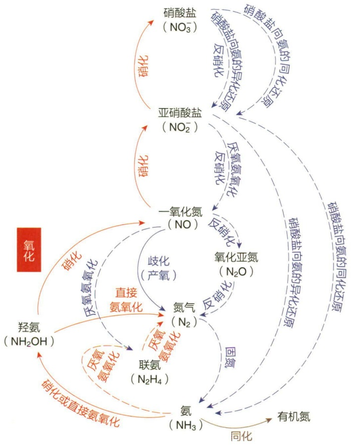
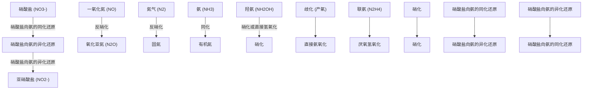
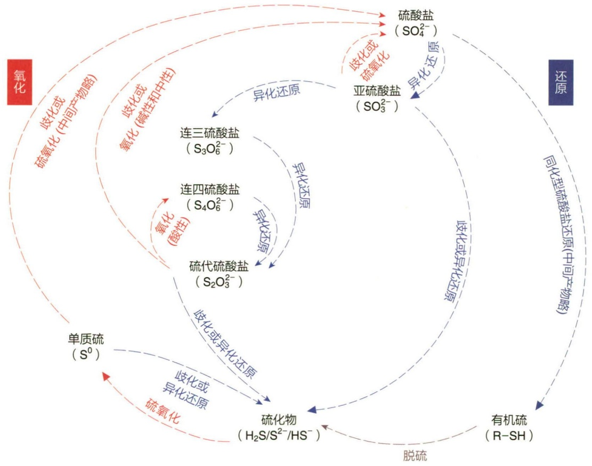
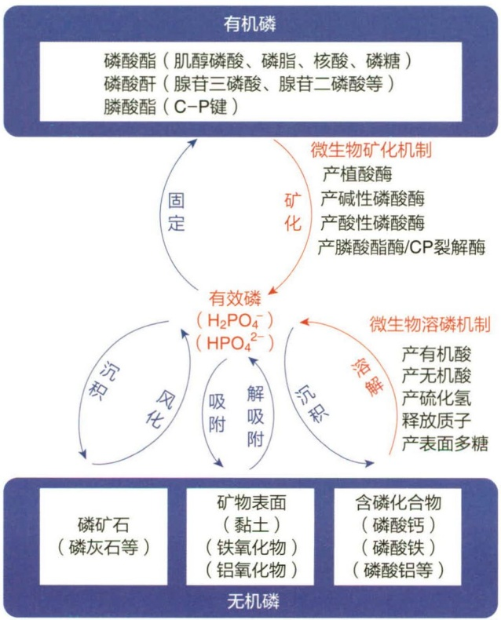
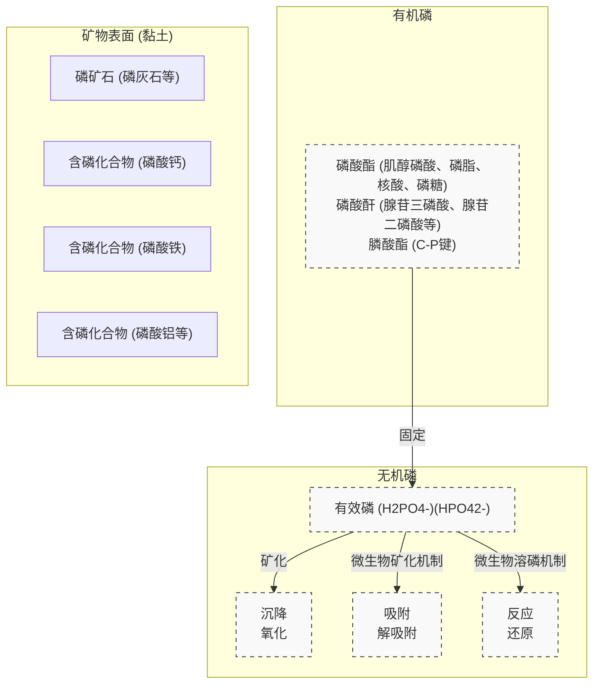
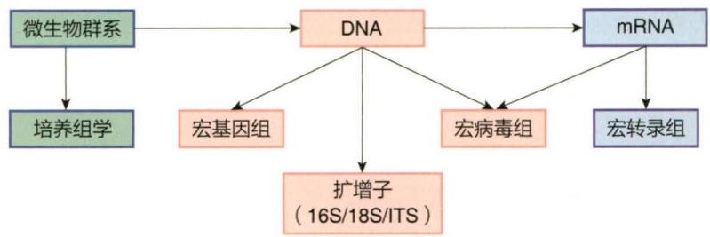
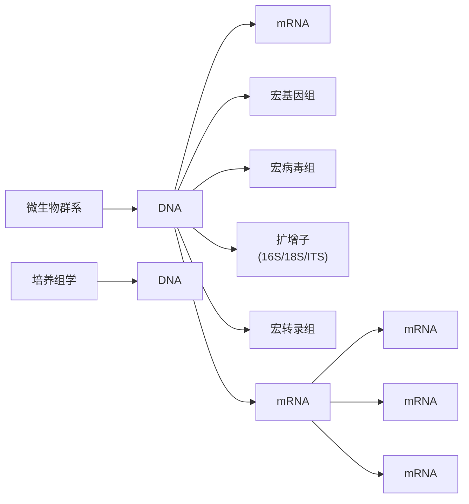

化为  $CO_{2}$ 。尽管  $CH_{4}$  在大气中的比例低于  $CO_{2}$ ，但是它引起的温室效应是  $CO_{2}$  的 20 倍以上。

微生物参与的碳循环与人类社会的可持续发展息息相关，例如，利用作物秸秆还田提升土壤地力的农业措施就依赖一系列木质素、纤维素和半纤维素降解微生物的多酶协同作用。在垃圾填埋场，有机物的微生物分解过程释放了大量温室气体  $CH_{4}$  和  $CO_{2}$ ——对  $CH_{4}$  的高效收集和利用则可以变废为宝，用来取暖或发电；依据同样的碳循环规律，利用沼气发酵产生甲烷可以部分解决能源问题。

## 13.3.2 氮循环

氮素是动植物细胞的大量营养元素（排在氧、碳、氢之后）。尽管大气中氮气含量达到约78%，但是并不能被动植物直接吸收利用，那么氮素是如何在生物圈中流动循环的呢（图13-12）？

在常温常压下，原核微生物的固氮酶（nitrogenase）能将大气中的分子态氮（ $N_{2}$ ）还原为氨（ $NH_{3}$ ），这个过程被称为生物固氮（biological nitrogen fixation）。据估计，生物固氮每年固定的纯氮是工业固氮的2倍以上。已知的固氮酶包括钼铁固氮酶、铁

flowchart

图13-12 微生物参与的氮循环

铁固氮酶和钒铁固氮酶，它们具有类似的蛋白序列、结构和功能特征——即一个传递电子的铁蛋白（NifH/VnfH/AnfH）和一个催化 $N_{2}$ 还原为氨的组分。理想条件下，三种固氮酶的催化中心的金属辅因子分别为钼、铁和钒，每还原一分子 $N_{2}$ ，消耗的MgATP分子数量分别为16、24和40。有些微生物（如棕色固氮菌）拥有全部三种固氮酶，根据生境中三种金属辅因子的供给情况，优先表达钼铁固氮酶，然后是钒铁固氮酶，最后是铁铁固氮酶。目前在细菌的13个门和古菌的1个门发现了核心的固氮酶编码基因，从这些微生物的生理特征看，包括能够进行好氧（aerobic）、兼性厌氧（facultatively anaerobic）或厌氧（anaerobic）生活的异养微生物（heterotroph），不产氧（anoxygenic）和产氧（oxygenic）的光能自养生物，以及化能无机自养生物（chemolithotroph）等。从这些固氮微生物的生境来看，可以分为自生（free-living）、联合（associative）、内生（endophytic）和共生（symbiosis）固氮菌。

自生固氮菌不依赖其他生物而独立进行固氮；共生固氮菌与其他生物生活在一起，构成特殊的共生体结构（根瘤、茎瘤等）或特殊的生物（如地衣）；内生固氮菌在植物根皮层、中柱、细胞间隙和木质部导管等生活；联合固氮菌定殖在植物根表，尤其是根毛、伸长区、侧根形成过程中出现的裂缝区。有些文献把内生固氮菌合并到了联合固氮菌，因为它们都没有和宿主形成新的共生器官或特殊共生细胞；只要条件与资源满足，部分固氮菌在自生、联合、内生甚至共生生境中都能表达固氮酶进行固氮作用——有时称某个固氮微生物为联合固氮菌或共生固氮菌等往往是由于其主要在该互作模式下对氮循环有更大的贡献。所有已知固氮酶遇到氧气会不可逆地失去活性，上述固氮微生物或其互作宿主，演化出了一系列防氧保护机制，如好氧棕色固氮菌铁硫蛋白Ⅱ对固氮酶的构象保护作用、部分固氮蓝细菌的异形胞、部分放线菌的厚壁球形囊泡或其宿主植物木质化的皮层细胞、与联合固氮菌互作的大刍草等植物分泌的多糖黏液、豆科植物根瘤的豆血红蛋白和根瘤菌适应微氧呼吸的末端氧化酶等。

固氮酶生成的氨进一步以  $NH_{4}^{+}$  的形式被细胞生物同化为有机物中的组分，这个途径为铵盐同化作用（assimilation of ammonium）。在生物体死亡后，含氮有机物又可以被好氧和厌氧微生物降解并释放出氨，即氨化作用（ammonification）。氮循环中的氨也可以通过硝化作用（nitrification）被氧化为硝酸盐  $\left(\mathrm{NO}_{3}^{-}\right)$ ；通过厌氧氨氧化（anaerobic ammonium oxidation）或由我国科学家发现的直接氨氧化途径（direct ammonium oxidation）氧化为氮气  $\left(\mathrm{N}_{2}\right)$ 。在有氧条件下，部分化能无机自养细菌和古菌利用氨单加氧酶、羟氨氧化还原酶、亚硝酸氧化还原酶等将氨氧化为羟氨  $\left(\mathrm{NH}_{2}\mathrm{OH}\right)$ 、一氧化氮（NO）、亚硝酸盐  $\left(\mathrm{NO}_{2}^{-}\right)$ 、硝酸盐  $\left(\mathrm{NO}_{3}^{-}\right)$ ，即硝化途径。完整的硝化途径可以由亚硝化螺菌属（Nitrospira）的部分菌种单独完成，也可以由氨氧化细菌和古菌先完成氨到亚硝酸盐的氧化，再由其他细菌完成亚硝酸盐的氧化。厌氧条件下，浮霉菌门（Planctomycetes）的一些化能自养细菌以氨为电子供体，亚硝酸盐为电子受体，通过亚硝酸还原酶、联氨合酶和联氨脱氢酶的催化产生氮气  $\left(\mathrm{N}_{2}\right)$ ；厌氧氨氧化反应在浮霉菌门细菌的厌氧氨氧化体（anammoxosome）完成。在有氧条件下，产碱杆菌属（Alcaligenes）等异养细菌利用 DnfABC 等将氨先后氧化为羟氨  $\left(\mathrm{NH}_{2}\mathrm{OH}\right)$  和氮气  $\left(\mathrm{N}_{2}\right)$ ——dnfABC 分别编码 N 加氧酶、铁氧还蛋白还原酶和谷氨酰胺-酰胺转移酶。

除了厌氧氨氧化或有氧条件下的直接氨氧化途径，氮气（$\mathrm{N}_{2}$）还可以通过一氧化氮歧化（nitric oxide dismutation）或反硝化作用（denitrification）这两个还原途径产生。在富营养化水体等低氧环境下，未培养细菌 $C.$ Methylomirabilis oxyfera 等利用一氧化氮歧化酶催化两分子一氧化氮（NO）歧化为一分子氧气（$\mathrm{O}_{2}$）和一分子氮气（$\mathrm{N}_{2}$）。很多古菌和细菌在低氧或无氧条件下可以进行反硝化作用，即以硝酸盐（$\mathrm{NO}_{3}^{-}$）为电子受体的无氧呼吸作用，中间产物包括亚硝酸盐（$\mathrm{NO}_{2}^{-}$）、一氧化氮（NO）和氧化亚氮（$\mathrm{N}_{2}\mathrm{O}$），完整还原过程的终产物为氮气（$\mathrm{N}_{2}$）——该过程涉及硝酸盐还原酶、亚硝酸盐还原酶、一氧化氮还原酶和氧化亚氮还原酶。

氮循环中还存在硝酸盐向氨的异化还原（dissimilatory nitrate reduction to ammonium）和同化还原（assimilatory nitrate reduction to ammonium）途径。前者是以硝酸盐（ $NO_{3}^{-}$ ）为电子受体的无氧呼吸作用，完整还原过程的产物为氨（ $NH_{3}$ ），涉及硝酸盐还原酶和亚硝酸盐还原酶ccNir等——其中ccNir催化亚硝酸盐（ $NO_{2}^{-}$ ）经由一氧化氮（NO）、羟氨（ $NH_{2}OH$ ）到氨（ $NH_{3}$ ）的多步还原，最后释放 $NH_{4}^{+}$ 。该途径可以为厌氧氨氧化反应提供氨（ $NH_{3}$ ），往往在电子供体和碳源相对于硝酸盐（ $NO_{3}^{-}$ ）过量时发挥作用。在有氧或无氧条件下，硝酸盐（ $NO_{3}^{-}$ ）都能被同化型硝酸盐还原酶还原为亚硝酸盐（ $NO_{2}^{-}$ ），进而被同化型亚硝酸盐还原酶还原为氨（ $NH_{3}$ ），后者被进一步同化，参与到氨基酸的合成。

硝酸盐同化还原途径和铵盐同化作用是无机氮转化为有机氮的主要方式，但是过量施用化学氮肥会直接导致土壤质量下降和水体面源污染等环境问题。种植业和养殖业释放的氨（$\mathrm{NH}_{3}$）会加剧空气中可入肺颗粒物PM2.5（particulate matter）的形成。不完全反硝化途径所释放的氧化亚氮（$\mathrm{N}_{2} \mathrm{O}$）引起的温室效应是$\mathrm{CO}_{2}$的300倍。合理利用氮循环的不同途径则可以促进人类社会的可持续发展，例如在农业上充分利用根瘤菌-豆科作物共生固氮、固氮菌-非豆科植物联合固氮等生物固氮作用，可以从源头上减少化学氮肥的投入；硝化-反硝化、厌氧氨氧化、直接氨氧化可用于富氨（$\mathrm{NH}_{3}$）污水治理。

## 13.3.3 硫循环

硫循环的复杂程度要高于碳氮循环——因为硫的氧化状态更多，而且存在不依赖生物的转化方式。地球上的硫库存在形式以硫酸盐（sulfate）和硫化物（sulfide）为主，如沉积物和岩石中的硫酸钙（$\mathrm{CaSO_4}$）、黄铁矿中的 $\mathrm{FeS}_2$、海洋中的硫酸盐（$\mathrm{SO}_4^{2-}$）。硫作为细胞生物的重要营养元素，不仅参与维生素和蛋白质等物质代谢，还参与能量代谢。生物地球化学循环中微生物参与的硫循环也包括氧化和还原两大类途径（图13-13）。

在大多数微生物中，硫酸盐（$\mathrm{SO}_4^{2-}$）在ATP硫酸化酶、腺苷-5'-磷酸硫酸激酶、3'-磷酸腺苷-5'-磷酸硫酸还原酶、同化型亚硫酸盐还原酶的催化下经由腺苷-5'-磷酸硫酸（APS）、3'-磷酸腺苷-5'-磷酸硫酸（PAPS）、亚硫酸盐（$\mathrm{SO}_3^{2-}$）生成硫化氢（$\mathrm{H}_2\mathrm{S}$）；随后硫化氢被用于合成半胱氨酸、甲硫氨酸等有机硫化物。这个过程被称为硫酸盐同化还原（assimilatory sulfur reduction）。生物体的有机硫化物可以在微生物的作用下转化为硫化氢等无机硫化物，即脱硫作用（desulfuration）。自然界丰度最高的有机硫化物是$(\mathrm{CH}_3)_2\mathrm{S}$，二甲基硫醚（dimethyl sulfide，DMS）——主要来自海藻二甲基巯基丙酸（dimethylsulfoniopropionate，DMSP）的微生物降解过程，在空气中DMS经光氧化转化为硫酸盐；在无氧生境，DMS可以通过产甲烷作用转化为硫化氢（$\mathrm{H}_2\mathrm{S}$），通过紫色光合细菌的固碳作用或化能有机营养菌与化能无机营养菌的能量代谢被氧化为二甲基亚砜（DMSO）。DMSO也可以作为无氧呼吸的电子受体被还原，生成DMS。

生物圈中一类被统称为硫酸盐还原细菌（sulfate-reducing bacteria）的微生物可以利用硫酸盐（$\mathrm{SO}_4^{2-}$）为能量代谢的电子受体，产生并向环境释放 $\mathrm{H}_2\mathrm{S}$。在这种硫酸盐（$\mathrm{SO}_4^{2-}$）的异化还原途径中（dissimilative sulfate reduction），ATP 硫酸化酶催化硫酸盐（$\mathrm{SO}_4^{2-}$）与 ATP 反应生成腺苷 -5′- 磷酸硫酸（APS），APS 的硫酸盐（$\mathrm{SO}_4^{2-}$）被 APS 还原酶直接还原为亚硫酸盐（$\mathrm{SO}_3^{2-}$），后者的 S 进一步在异化型亚硫酸盐还原酶 DsrAB 的催化下与 DsrC 蛋白形成异二硫化物，最后异二硫化物还原酶（heterodisulfide reductase）作用于该异二硫化物，产生硫化氢（$\mathrm{H}_2\mathrm{S}$）。此外，亚硫酸盐（$\mathrm{SO}_3^{2-}$）还可以在连三硫酸盐形成酶、连三硫酸盐还原酶和硫代硫酸盐还原酶的作用下经由连三硫酸盐（$\mathrm{S}_3\mathrm{O}_6^{2-}$）和硫代硫酸盐（$\mathrm{S}_2\mathrm{O}_3^{2-}$）被还原为硫化氢（$\mathrm{H}_2\mathrm{S}$）。一些硫酸盐还原细菌可以通过亚硫酸盐（$\mathrm{SO}_3^{2-}$）、硫代硫酸盐（$\mathrm{S}_2\mathrm{O}_3^{2-}$）和单质硫（$\mathrm{S}^0$）的歧化反应（disproportionation），生成硫酸盐（$\mathrm{SO}_4^{2-}$）和硫化氢（$\mathrm{H}_2\mathrm{S}$）。硫酸盐还原细菌释放的大量硫化氢（$\mathrm{H}_2\mathrm{S}$）可以被空气氧化，为其他生物所利用或与金属离子反应生成金属硫化物。

flowchart

This flowchart illustrates the chemical cycle of sulfuric acid (SO4) production and purification, showing how various organic compounds like sulfates, sulfides, and organic hydrocarbons are converted into or recycled through intermediate steps such as oxidation, oxidation, neutralization, and purification.

图 13-13 微生物参与的硫循环

硫化氢（$\mathrm{H}_2\mathrm{S}$）、单质硫（$\mathrm{S}^0$）、硫代硫酸盐（$\mathrm{S}_2\mathrm{O}_3^{2-}$）和亚硫酸盐（$\mathrm{SO}_3^{2-}$）等可以作为电子供体，经过多种硫氧化途径生成硫酸盐（$\mathrm{SO}_4^{2-}$）（图13-13）。其中研究最为深入的是在周质空间发挥作用的SOX系统（Sulfate oxidation system）:SoxXA催化硫化氢（$\mathrm{H}_2\mathrm{S}$）、单质硫（$\mathrm{S}^0$）或硫代硫酸盐（$\mathrm{S}_2\mathrm{O}_3^{2-}$）与载体蛋白SoxYZ形成异二硫化物；在SoxCD和SoxB的接力作用下将异二硫化物中的S氧化并释放硫酸盐和质子，该过程产生的质子会对环境产生酸化作用。在很多硫氧化细菌中，硫代硫酸盐 $\left(\mathrm{S}_{2}\mathrm{O}_{3}^{2-}\right)$ 还可以被硫代硫酸盐脱氢酶TsdA氧化为连四硫酸盐 $\left(\mathrm{S}_{4}\mathrm{O}_{6}^{2-}\right)$ 。某些硫氧化细菌如Beggiatoa可以在细胞内积累硫化氢第一步氧化步骤的产物单质硫 $\left(\mathrm{S}^{0}\right)$ ，即硫颗粒（sulfur granules）——作为还原力的贮存物质，当环境里的硫化物供给不足时，硫颗粒可以被进一步氧化。当环境中存在单质硫时，硫氧化细菌如Thiobacillus和Acidithiobacillus可以将其氧化为 $H_{2}SO_{4}$ 。此外，由硫化氢 $\left(\mathrm{H}_{2}\mathrm{S}\right)$ 和单质硫 $\left(\mathrm{S}^{0}\right)$ 等氧化而来的或从环境吸收的亚硫酸盐 $\left(\mathrm{SO}_{3}^{2-}\right)$ 可以在亚硫酸盐氧化酶的催化下生成硫酸盐 $\left(\mathrm{SO}_{4}^{2-}\right)$ ，也可以经APS还原酶和ADP硫酸化酶的接力作用下氧化为硫酸盐 $\left(\mathrm{SO}_{4}^{2-}\right)$ ——这两个途径分别被称为亚硫酸盐氧化途径和APS氧化途径。这些还原性硫化物氧化途径所释放的电子进入能量代谢的电子传递链，最终传递给氧气或硝酸盐等电子受体，产生质子动力势，驱动ATP合酶生成ATP。

## 13.3.4 磷循环

地球的磷元素以无机磷和有机磷的形式存在（图 13-14），但是细胞生物能够直接利用的有效磷主要是  $H_{2}PO_{4}^{-}$  和  $HPO_{4}^{2-}$ ，它们进入细胞后被固定为磷酸酯（肌醇磷酸、磷脂、核酸、磷糖）、磷酸酐（腺苷三磷酸、腺苷二磷酸等）、膦酸酯（C-P 键）。有机体死亡后释放的有机磷可以在微生物的矿化作用下再转化为有效磷，这个过程涉及多种酶，如植酸酶、碱性磷酸酶、酸性磷酸酶、膦酸酯酶 /CP 裂解酶等。有效磷通过沉积作用可以转化为磷灰石、磷酸钙、磷酸铁、磷酸铝等，也可以被吸附在黏

flowchart

图13-14 微生物参与的磷循环

土、铁氧化物和铝氧化物等矿物表面。一方面磷矿石的风化、矿物表面无机磷的解吸附会释放有效磷；另一方面微生物可以通过产有机酸、无机酸、硫化氢、铁载体、表面多糖、或释放质子等多种方式溶解含磷化合物，生成有效磷。

磷是细胞生物的大量元素，每kg土壤约含磷50\~3 000 mg，但是只有约千分之一的总磷可以被植物吸收利用；但是随着化学磷肥的过量施用，人们担心的已不是磷匮乏而是过量磷肥引起的水体富营养化等面源污染问题。充分利用具有矿化磷和溶磷功能的细菌和真菌，是从源头上减少化学磷肥施用量的重要措施。

## 13.3.5 铁循环

铁是地球上最为丰富的元素之一，主要在  $Fe^{2+}$  和  $Fe^{3+}$  之间发生氧化还原。 $Fe^{2+}$  可以通过微生物的化能无机营养代谢过程或化学过程被氧化。在 pH<4 的酸性条件下， $Fe^{2+}$  比较稳定，但是可以被嗜酸的化能无机营养微生物氧化——基于这个特性，相关微生物已在生物冶金中有所应用，如将黄铁矿（$\mathrm{FeS}_2$）或低等级铜矿中的金属溶解而浸出。在接近中性 $\mathrm{pH}$ 的条件下，$\mathrm{Fe}^{2+}$ 可以被氧气快速氧化。$\mathrm{Fe(OH)}_3$、$\mathrm{FeOOH}$、$\mathrm{Fe}_2\mathrm{O}_3$ 等氧化产物是不溶于水的，构成了海洋和淡水沉积物的重要组分。$\mathrm{Fe}^{3+}$ 可以通过化学过程或作为微生物无氧呼吸过程的电子受体被还原——有些微生物利用芳香烃类有机污染物为电子供体还原 $\mathrm{Fe}^{3+}$，对污染环境的生物修复具有重要意义。在细胞生物的电子传递链中，铁原子参与电子载体血红素或其他类似卟啉环的组成，也是 $\mathrm{Fe}_2\mathrm{S}_2$、$\mathrm{Fe}_4\mathrm{S}_4$、$\mathrm{Fe}_3\mathrm{S}_4$ 等不同类型铁氧还蛋白的主要元素之一。在 $\mathrm{Fe}^{2+}$ 供给受限的情况下，很多微生物可以通过分泌铁载体螯合环境里的 $\mathrm{Fe}^{3+}$，再将该可溶性复合物吸收入体内，满足细胞对铁元素的需求。在水环境和沉积环境中广泛分布的趋磁细菌能够主动吸收铁元素并合成膜包被的纳米级铁磁性颗粒（主要成分为 $\mathrm{Fe}_3\mathrm{O}_4$ 或 $\mathrm{Fe}_3\mathrm{S}_4$），称为磁小体。磁小体在生物传感、食品安全检测、医学诊断、药物靶向递送、有机污染物监测、废水处理、有害辐射或雷达波吸收等领域有广泛应用前景。

## 13.3.6 其他元素的循环

在近地表环境中，锰的丰度是铁的 $1 / 10\sim 1 / 5$ ，可以在微生物的作用下发生 $\mathrm{Mn}^{2+}$ 和 $\mathrm{Mn}^{4+}$ 之间的氧化还原反应。能够氧化 $\mathrm{Mn}^{2+}$ 的微生物广泛分布在淡水、海水和土壤中；因为 $\mathrm{Mn}^{2+}$ 和 $\mathrm{Mn}^{4+}$ 组成的氧化还原电对还原电势很高，接近氧气和水组成的氧化还原电对，所以 $\mathrm{Mn}^{2+}$ 的氧化需要以氧气为电子受体—— $\mathrm{Mn}^{2+}$ 的氧化由一部分好氧细菌完成。$\mathrm{Mn}^{2+}$ 是可溶的，但氧化后形成的 $\mathrm{MnO}_2$ 会在水中形成沉淀，后者进一步作为沉积物中微生物厌氧呼吸的电子受体被还原为 $\mathrm{Mn}^{2+}$，从而完成循环。

钙以碳酸钙（$\mathrm{CaCO_3}$）或可溶的 $\mathrm{Ca^{2+}}$ 形式存在。海水中的可溶性 $\mathrm{Ca^{2+}}$ 浓度约为 $10 \mathrm{mM}$，可以被某些光养微生物吸收转化为钙质外壳，如赫氏圆石藻。随着 $\mathrm{CaCO_3}$ 沉积为钙质外壳，海水中可溶性 $\mathrm{CO_2}$ 和 $\mathrm{HCO_3^-}$ 的浓度分别增加和减少，从而减弱了大气 $\mathrm{CO_2}$ 向表面海水的流入，维持了海水弱碱性的特征。但是，人类活动排放过多的 $\mathrm{CO_2}$ 会引起海水酸化，降低上述钙质外壳的形成速率，引起一系列生态学问题。

海洋中还有一些浮游的单细胞真核微生物，如硅藻和硅鞭藻等，可以吸收硅酸 $\left(\mathrm{H}_{4}\mathrm{SiO}_{4}\right)$ 并形成二氧化硅外壳。这些浮游微生物死亡后，有硅化外壳的细胞更容易沉积到海底，从而将上层海水的有机物带入海底。而海水的上涌则可以把海底的硅酸再输送到上层海水，完成循环。

## 13.4 环境污染物的微生物降解与修复

随着全球人口的急速增长和工农业生产的高速发展，不可避免地产生了各种污染物，使人类赖以生存的地球环境发生严重恶化。从生态系统物质循环的角度可以将污染物分为两类:一类是易降解污染物，在自然界中作为碳、氮源等营养物质被生物所利用，这类物质是天然生态系统物质循环的一部分，通常可以通过生物地球化学循环实现降解和转化。然而，这类污染物的过量排放会使某些元素在生态系统中积累过多，破坏生态平衡，使生态系统失去原有的生态功能和使用价值。例如，污水直接排放会引起氮、磷富营养化问题；另一类是难降解有机污染物。这类污染物通常是自然界中不存在的、人工合成的化学物质，称为异生物质（xenobiotics）。这类物质很难被生物利用，对生物具有毒害作用。微生物在这两类污染物的降解中都具有不可替代的作用。微生物降解技术是当前环境污染处理的核心，广泛应用于工农业废水和生活污水处理、难降解有机污染物的生物降解、生物修复等各个方面。

## 13.4.1 难降解有机污染物的生物降解

生物降解（biodegradation）是指生物（主要是微生物）对环境中有机物的分解作用。生物降解可使有机物分子发生三种类型的变化:①有机化合物的功能基团仅发生轻微的改变，主要结构依然完整，比如卤族被羟基取代；②有机化合物发生断裂形成有机物片段，原来的分子可以发生重构；③有机物完全降解形成无机物，通常需要许多种微生物的参与，而且需要添加其他的碳源。

从生物地球化学循环角度讲，自然界天然存在的有机物都可以在微生物作用下降解转化，保持地球有机碳平衡。然而，当前工农业生产中广泛使用的约十万种化合物中，大部分是具有新颖结构的异生物质。有些异生物质结构上与某些天然有机物类似，可被已经存在的具有相应降解酶的微生物所降解；但很多异生物质的结构与任何天然有机物都有很大差异，微生物还未演化出分解该物质的代谢机制。这类有机物通常对生物降解具有很强抗性，进入环境后降解缓慢甚至无法降解，在生态系统中不断积累而对人体健康和环境产生严重危害，因此称为难降解有机污染物。

难降解有机污染物包括农药、染料、有机氯化物（如三氯乙烯、四氯乙烯等）、有机磷化物、多氯联苯、高分子聚合物以及杂环有机化合物等。这些污染物大部分基于脂肪烃、环烷烃和芳香烃三种基本结构，在其基础上进行加成反应获得各种复杂分子。难降解有机污染物主要来源于化工、焦化、印染、纺织、制药等工业废水和含有除草剂、杀虫剂等农田农药废水排放。这些污染物进入土壤和水体后，不易分解，长时间残留在生态系统中，且大多具有致畸、致癌和致突变作用。一些难降解污染物具有生物累积性，通过食物链不断富集，最终在大型动物或人体中蓄积，其浓度远高于在周围环境中的浓度。还有一些污染物通过大气气流或海洋环流进行远距离传输，造成全球性污染。

导致某些污染物难降解的常见原因是缺乏合适的特异性生物降解酶。微生物对污染物的降解作用依赖于微生物分泌的一系列特定降解酶，而微生物的酶通常是针对自然界已有的天然有机物演化而成。对于自然界中罕见的污染物，现存的酶通常无法识别，所以很难被降解。即使是与天然有机物结构相似的污染物，其微小的结构变化亦可影响生物降解速率。

微生物具有种类多、分布广、适应性强和代谢多样性丰富等特点，为环境污染物的降解提供了一个庞大的生物资源库。人们可以针对不同的污染物，筛选出高效降解菌株。在自然界，有些微生物对许多有机物具有降解能力，例如从假单胞菌属（Pseudomonas）中筛选出来的高效降解菌株，对除草剂、杀虫剂、杀菌剂、多环芳烃、氰化物、有机溶剂等污染物均表现出强降解能力，再如洋葱假单胞菌（Pseudomonas cepacia）能降解90种以上的有机物。

复杂化合物的降解需要多个阶段，通常需要不同类型的微生物进行降解，这个过程往往先将最初的污染物转化更容易降解的低毒性化合物。处理有机氯农药、烷基溶剂、芳基卤化物等许多污染物的第一步是还原性脱卤作用，即脱掉卤素（如氯、溴、氟等）取代基。可进行该过程的主要微生物类群包括脱亚硫酸杆菌属（Desulfitobacterium）、脱卤微螺菌属（Dehalospirillum）和脱硫念珠菌属（Desulfomonile）。

## 13.4.2 污水生物处理

污水（sewage）是指来自家庭生活或工农业生产，含有大量有机物、重金属、营养盐和颗粒物质的排出水。当前世界各国的大城市、河流和湖泊等的污染程度极其严重。以工业有毒污水为例，其所含的农药、多氯联苯、多环芳烃、酚、氰、丙烯腈和重金属离子等都属于剧毒物质，若不加处理，则后果极其严重。在各种污水处理方法中，最有效的方法就是微生物处理法。微生物法处理污水的基本原理是利用不同生理生化特征的微生物构建出一个小型人工生态系统，适宜于碳、氮、硫、磷等元素的转化，并辅以一定的物理化学方法，实现污水中有机物和其他污染物的高效去除。

污水处理工业对污水的处理过程至少包括三个在空间上分离的步骤:初级处理、次级处理和三级处理。初级处理是用物理的方法将大部分的固体物质去除；次级处理主要依靠微生物的生长将DOM转化为微生物生物量和 $\mathrm{CO}_{2}$，该步骤可使DOM减少$90\% \sim 95\%$；三级处理是采用生物和化学的方法进一步去除氮磷无机营养盐、重金属、可降解的有机物和包括病毒在内的微生物。废水经多级处理后，会进一步加氯消毒或用臭氧处理，然后释放进入环境。

污水的次级处理主要依赖于微生物的作用，常用的处理技术包括好氧生物处理、厌氧生物处理和生物脱氮除磷技术。

好氧生物处理（aerobic biological treatment）分为活性污泥法和生物被膜法。活性污泥法是利用生物处理池中悬浮流动的活性污泥降解污染物并实现污水净化的过程。活性污泥（activated sludge）是指由活细菌、原生动物和其他微生物群落与污水中的固体悬浮物混凝交织在一起形成的絮状体，具有吸附、降解有机物的能力，还具有一定的沉降性，在静水中可以自然沉降并与水分离。由细菌聚集而成的菌胶团（zoogloea）是活性污泥的结构和功能中心。生物被膜法是利用生长在人工多孔性固体介质表面的生物被膜（biofilm）降解有机物实现污水净化的过程。在特定的生物被膜反应器（池）中，固体介质表面的生物被膜构成一个多样性丰富的微生物群落，以生物被膜为中心，其他细菌、真菌、藻类、原生动物和微型后生动物在生物被膜反应器内构成一个微生物生态系统。当污水流经生物被膜时，水中的有机物被生物被膜吸附，并在不同类型微生物的共同作用下降解转化。

厌氧生物处理（anaerobic biological treatment）又称厌氧消化法，指厌氧微生物或兼性厌氧微生物在无氧条件下降解有机物产生  $CH_{4}$  和  $CO_{2}$  的过程。在厌氧生物处理过程中，有机物的降解和转化需要经过 4 个阶段:①水解阶段，污水中的蛋白质、多糖、脂质等生物大分子在微生物胞外酶作用下水解成氨基酸、单糖、长链脂肪酸等小分子物质；②产酸阶段，细菌通过发酵或厌氧呼吸作用氧化水解产物，使其转化为各种可溶性物质，如挥发性脂肪酸、乙酸、丙酸、丁酸、乳酸、乙醇等，以及  $H_{2}$  和  $CO_{2}$ ；③产乙酸阶段，产酸阶段生成的有机酸和醇在产氢产乙酸菌的作用下进一步转化为乙酸、 $H_{2}$  和  $CO_{2}$ ；④产甲烷阶段，产甲烷菌将前两个阶段中所产生的乙酸和  $H_{2}$ 、 $CO_{2}$  转化为甲烷。

生物脱氮除磷技术可以降低污水中富集的氮磷含量。生物脱氮工艺首先通过好氧池经硝化作用将废水中的氨转化为硝酸盐，再利用缺氧池经反硝化作用，将硝酸盐还原成氮气，溢出水面释放到大气，从而去除污水中的含氮物质。生物除磷工艺首先使污水进入厌氧池，聚磷菌在厌氧条件下释放磷，然后污水进入好氧池，在有氧条件下聚磷菌生长繁殖并充分地吸收磷，通过排放污泥，就可以达到从废水中去除磷的目的。

污水中有机污染物含量的监控贯穿全部处理过程，通常利用污水中有机物能被氧化的共性，测定有机物在氧化过程中消耗的氧，间接表征其含量。传统上以化学需氧量（chemical oxygen demand，COD）和生化需氧量（biochemical oxygen demand，BOD）表征污水的污染程度，即污水水质。污水的 BOD 和 COD 越大，表示废水中有机物越多，污水水质越差。

## 13.4.3 污染环境的生物修复

生物修复（bioremediation）是指利用微生物的代谢活性，催化降解有机污染物，从而清除环境中污染物的一个受控或自发进行的过程。生物修复的基础是生态系统在受到外界干扰时的自我调节机制。自我调节是一个达到稳态的生态系统的基本功能。当土壤、水生生态系统接纳一定负荷的有机污染物后，可以利用各种物理、化学和生物过程分解污染物实现自我调节，使系统恢复到污染之前的水平。通常将这种自我调节过程称为自净，如水体自净、土壤自净。自净是自然生境在微生物作用下的一种自我修复过程，但微生物作用常受到环境条件的限制，如溶氧不足、营养贫瘠、微生物数量或活性低、污染物的生物可利用性差和毒性大等，因此生物修复过程非常缓慢。此外，天然自净有一定的自净容量，一旦所接纳污染物的负荷超过限度，生态系统的自我调节功能就会受到损害，引起失衡或系统的破坏。生物修复的实质是通过一定技术手段，强化天然自净能力，使环境中污染物降低到安全浓度之下，恢复生态系统的生态功能。

生物修复技术可以分为原位（in situ）和异位（ex situ）两类。原位生物修复无须移动污染土壤或水体，在污染现场进行处理，操作简便、费用低，但过程较难控制；异位生物修复是将污染介质转移到污染现场附近或之外再进行处理，费用高，但过程易控制，对富含有毒化合物、挥发性污染物或污染物浓度较高的污染场地处理，通常只能用异位修复。

## 13.5 微生物生态学研究方法

## 13.5.1 微生物群系学

高通量测序技术的发展衍生出一系列微生物群系研究技术，如扩增子测序（amplicon sequencing）、宏基因组学（metagenomics）、宏转录组学（metatranscriptomics）等，快速推动了微生物群系领域的发展（图13-15）。研究表明，微生物群系在人类和动植物的营养吸收、疾病抵抗和环境适应中起重要作用。基因组测序技术、复杂的宏基因组学及系统发育学的进步极大地改变了人们对微生物生命多样性的理解。

近年来第二代测序（next generation sequencing，NGS）技术的发展使得基于非培养方法研究微生物群系成为可能，并推动了微生物群系研究进入了黄金发展时期。目前对微生物群系样本的研究主要集中在3个层面:①微生物培养层面:培养组学（culturomics）是该层面最重要的研究手段。通过在固体培养皿挑单菌落或使用96孔板液体高通量培养的方式获得微生物群落中可培养的菌落，随后结合标记基因（marker gene）测序、分离纯化等方法进行菌种鉴定和保藏。目前该方法已在人类、拟南芥（Arabidopsis thaliana）、水稻（Oryza sativa）等物种中应用和报道。②DNA层面:针对DNA易于提取和保存的特点，研究者相继发展出扩增子、宏基因组和宏病毒组（metavirome）等测序研究手段。扩增子测序常用的标记基因主要包括原核生物的16S rRNA基因、真核生物的18S rRNA基因以及转录间隔区（internal transcribed spacers，ITS）等。由于扩增子测序仅能获得研究对象的物种组成信息，要想进一步研究物种所携带的其他功能基因，就需要开展宏基因组测序和分析。③mRNA层面:通过对微生物群系样本提取RNA进行宏转录组测序（metatranscriptomic sequencing），可以根据微生物群系样本中的基因表达谱进一步揭示微生物群落原位功能。病毒包括DNA和RNA病毒两大类，想要全面开展宏病毒组学研究需要宏基因组结合宏转录组测序。

近年来，微生物群系研究在概念、技术和实践上取得了重大进展。起初微生物群系的研究重点为物种组成和多样性的描述，并确定微生物和宿主表型之间的相关性。目前该领域已逐渐开始关注微生物群系功能解析，探索微生物群系的作用机制，及研究其与宿主的协同演化。这些工作将进一步加深人们理解微生物群系对宿主多个方面的影响。

flowchart

(a)

flowchart

(b)

flowchart

(c)

图13-15 微生物群系研究方法概述

（a）微生物群系常用的研究层面和对应方法。微生物群系按研究层面主要分为微生物培养、DNA 和 mRNA 等 3 个层面；按研究技术主要包括培养组学、扩增子、宏基因组、宏病毒组和宏转录组等测序技术。（b）微生物群系研究的基本步骤。基于测序技术为基础的微生物群系

研究，主要分为样本制备、测序、数据处理和统计分析4个阶段。（c）微生物群系数据分析的基本步骤、常用环境和思想。组学数据分析主要分3步，图中箭头上描述了实现分析的常用语言环境Shell和/或R；图中箭头下展示各步分析的目的，即通过降维和可视化的基本思想，实现将大数据转化为可读图表

根据近年来大量的研究，我们知道了人体微生物对身体健康的重要性。相比而言，我们对土壤、植物和动物的微生物群系及其影响还缺乏足够的了解。随着利用越来越复杂的工具探测农业微生物群系，有望在未来十年实现突破性进展，建立农业微生物数据库，更好地理解分子水平土壤、植物和动物微生物群系之间的相互作用，并通过改善土壤结构、提高饲料效率和养分利用率以及提高作物对环境和疾病的抵抗力等增强农业生产力和恢复力。其中，土壤和植物微生物群系之间的相互作用表征至关重要。土壤微生物群系与气候变化中的碳、氮和诸多其他元素的循环息息相关，并通过一些尚未被人类认知的过程影响着全球关键生态系统服务功能。加深对微生物群系基本组成部分的理解以及强化它们在养分循环中的作用对确保全球可持续农业生产至关重要。

未来微生物群系学家将会关注微生物群落的“暗物质”（microbial dark matter），例如真菌、病毒、古菌和原生动物等，这些微生物目前仍很少被关注，但它们在环境中的广泛分布，表明其可能具有与细菌同等重要的作用。技术方面，会引入更多先进的测序技术，如长读长测序、单细胞测序等技术，这也将允许在物种或菌株层面上对微生物群系开展深入研究。同时，云平台和 R 软件包的发展亦将极大地促进微生物群系研究中数据处理和挖掘方面的工作。

## 13.5.2 培养组学

尽管近年来微生物基因组数据激增，但通过基于培养的实验对于证实细胞生物学、生态作用和微生物演化的推论仍然十分重要。目前，绝大多数古菌和细菌仍难以培养且对其特性了解不够充分，因此研究者们对高效的培养学方法愈加重视，这也加快了许多方法学和技术的发展。虽然现代宏基因组学技术能够一次性对群落中所有微生物的DNA进行测序，从而展示不同环境下的微生物组成，对地球上微生物生命的多样性有了广泛的了解，但是这种技术依然无法帮助研究人员解答关于微生物的基本问题，比如，它们摄取什么？它们会产生哪些代谢物？它们在环境中如何与其他微生物相互作用？想要找到这些问题的答案，微生物学家们必须在实验室中先分离培养这些生物。微生物的分离和培养对于直接研究它们并确定它们的代谢和生理功能以及生态作用仍然至关重要。然而，大多数环境微生物尚未被培养，因此，将这些稀有或特征不佳的群体引入培养是进一步了解微生物群系功能的首要任务。此外，培养的菌株可以在一系列应用中找到用途，例如新的益生菌、生物防治剂和工业加工剂。

作为微生物学中培养技术的一部分，培养组是一种利用多重分离培养条件结合16S rRNA基因测序和/或其他技术（如MALDI-TOF）的微生物群系研究方法，是在培养和鉴定居住在人体肠道中的未知细菌的过程中发展起来的。这种由多种培养条件和快速鉴定细菌组成的培养组学方法使得数百种与人类相关的新微生物得以培养，为研究宿主-细菌关系提供了令人兴奋的新视角。近年来培养组学的快速发展，使得可培养的人体细菌增加了数百种，拓展了人们对宿主-细菌关系的认知。人体肠道中存在约80%的未知细菌，近年来培养组学的应用不仅使可培养的人体细菌增加，还用于临床的致病菌分离鉴定，发现新的分类单元，减少了宏基因组分析中的未表征OTU（operational taxonomy unit）；用培养组学获得的菌株可用于体外和动物实验，对于肠道菌群相关疾病的研究必不可少；培养组学还能用于分离潜在的益生菌，是研发细菌疗法的基础。

2015 年，作为病原体或共生菌，只有 2 172 种不同的原核种类被报告至少从人体中分离出一次。2018 年，从人体分离的相关物种总数达到 2 776 种，数量增加了 28%。其中，依赖培养组方法分离了 400 种（其中 288 种是新种），为更新这一数据做出了 66.2% 的贡献。这表明需要继续发展培养组学技术，这对于破译巨大的微生物暗物质至关重要，可加速微生物生态学的发展和生物资源的开发利用。

限制微生物可培养的因素有很多，主要包括底物及生长条件、休眠复苏、共生的相互依赖、物理接触或空间接近、环境理化条件、低丰度和竞争等。目前，提高目标微生物分离率的方法大多遵循两种策略:一种是依靠扩大细胞分离的数量来增加分离感兴趣物种的机会（高通量分离和培养）；另一种是，旨在有选择地分离具有特定功能特征或属于特定分类组的生物（目标隔离）。

有研究者以挖掘沙漠土壤微生物暗物质为例，提出了一种多组学策略——基于培养组的宏基因组学（culturomics-based Metagenomics，CBM），其整合了大规模分离培养，以及基于全长16SrRNA基因和鸟枪法的宏基因组测序。基于培养组的宏基因组学，为深入认识和挖掘微生物群系样本中的暗物质资源提供了一个新的视角，尤其是那些来自极端或特殊生境的样本。

## 13.5.3 自然界微生物活动的检测

微生物群落通过单个微生物的协同活动来表现它们的存在，这些活动共同推动主要的生物地球化学过程。一套强大的同位素和遗传方法与高分辨率显微镜和传感器技术相结合，使微生物生态学家能够将这些过程的研究从单个细胞的水平上升到整个环境系统。

## 13.5.3.1 化学测定、放射性同位素方法、微传感器和纳米传感器

在许多研究中，微生物反应的直接化学测量足以评估环境中的微生物活性。例如，可以跟踪沉积物样品中硫酸盐还原细菌氧化乳酸的过程。如果硫酸盐还原细菌存在于沉积物样品中并具有活性，则添加到沉积物中的乳酸将被消耗， $SO_{4}^{2-}$  将被还原为硫化氢（ $H_{2}S$ ）。由于乳酸、 $SO_{4}^{2-}$  和  $H_{2}S$  都可以通过化学测定以高灵敏度进行特异性测量，因此可以跟踪这些物质在样品中彼此之间的转化。然而，当需要非常高的灵敏度或需要确定周转率时，放射性同位素比常规化学测定更有用。

另一种灵敏测量某些微生物过程速率的方法利用了对过程特异性酶的选择性化学抑制。例如，乙炔可以作为化学抑制剂抑制硝化作用，或作为固氮酶的反应底物。不同类型的微传感器和纳米传感器可以通过量化特定化学物质在时间和空间中的浓度变化来测量活性微生物过程。

## 13.5.3.2 稳定同位素及其探测

许多化学元素具有不止一种同位素，它们的中子数量不同。某些同位素不稳定，会因放射性衰变而分解。其他称为稳定同位素的同位素没有放射性，但被微生物代谢时有差异，可用于研究自然界中的微生物转化。稳定同位素可以通过两种方法产生有关微生物活动的信息:同位素分馏和稳定同位素探测。

## 13.5.3.3 将功能与特定生物联系起来

迄今为止，描述的同位素方法使用含有大量细胞的样品来推断特定代谢发生在群落内或群落内的特定物种。这些方法概述了群落活动，但没有揭示单个细胞的贡献。为此，已经开发了可以测量单细胞活性以及元素和同位素组成的新方法。这些是将特定微生物种群的细胞与特定活动或生态位连接起来的强大方法，但在大多数情况下，必须了解感兴趣的生物的系统发育才能开发必要的荧光原位杂交（fluorescence in situ hybridization，FISH）探针。单细胞方法对于研究微生物之间的代谢物交换特别重要，例如涉及互营关系的交换，其中紧密的物理结合对于有效交换至关重要。

## ※ 本章小结

本章基于生态学基础框架，重点介绍了微生物如何与其生境中的条件和资源变量发生互作。通过本章的学习，可以掌握以下知识:①微生物生态学的理论基础；②不同生境中微生物的典型特征；③微生物在生物地球化学循环中的重要作用；④环境污染物的微生物降解与修复；⑤微生物生态学的一般研究方法。

## ※ 推荐阅读

1. BEGON M, TOWNSEND C R. Ecology: from individuals to ecosystems [M]. 5th ed. New Jersey: Wiley, 2021.

该书为生态学的经典教材，从个体、种群、群落和生态系统 4 个层级介绍了生态学的基础理论，并提供了丰富的应用案例。可以为微生物生态学的学习和研究提供基础理论和方法论的支撑。

2. 赵立平. 从 “微生物组” 到 “微生物群系”: microbiome 译名变化背后应是研究思路与手段的彻底变革 [J]. 中国科学: 生命科学, 2023, 53(5): 746-750.

在该文章中，作者通过介绍其亲身经历将 microbiome 领域的学科发展及译名的变化进行了专业且客观的介绍。同学们可以深切地感受到科学家群体对一个前沿学科的认知是一个不断演化的过程。

3. 刘永鑫，秦媛，郭晓璇，等.微生物组数据分析方法与应用[J].遗传，2019，41(9):845-862.

该文由我国从事微生物群系研究的一线科研工作者撰写，系统整理了常用的微生物群系数据分析软件。同学们可以在该文基础上进一步跟踪文献学习相关方法的原理以及更新的微生物群系数据分析方法。

## ※ 开放性讨论题

通过测定和分析不同生境斑块之间微生物群落的结构差异，以及条件与资源变量的差异，能否获悉造成微生物群落结构差异的原因？

## ※ 复习思考题

1. 请尝试以肠道微生物中的某个致病性大肠杆菌种群为对象，列出可能影响其生存和繁殖的各种条件与资源。

2. 请结合生态位理论探讨生物被膜中病原菌的综合消杀策略。

3. 请结合生态位理论探讨如何利用生物被膜增加有益微生物的生存与繁殖能力。

4. 请尝试利用参与碳、氮、磷、硫等元素循环的微生物构建不同版本的“微缩版生物圈”，并将其用于污染物降解和微生物肥料等。

5. 请利用种间互作原理设计实验挖掘微生物群系中的“暗物质”。

(田长富 张晓华 何晓青)

## 微生物物种多样性

## 导语

微生物是地球上生物多样性最为丰富的生命形式。一般认为，地球上的微生物物种数量为50万～600万种，甚至更高，但目前被分离鉴定并有效发表的微生物物种数量仅约20万种，绝大多数微生物类群还未能被分离培养。对微生物的物种多样性进行研究，能为早期生命起源的探索、微生物资源的开发利用，以及微生物生态作用的理解提供基础资料。本章主要介绍了细菌（Bacteria）、古菌（Archaea）和真核微生物（Eukaryotic microorganisms）中目前被分离鉴定的类群，按照微生物系统学的降序，即域、界、门、纲、目、科、属、种，对其中的重要类群进行了描述。

## 关键词

物种多样性，细菌，古菌，真核微生物，16S rRNA 基因，可培养微生物，未培养微生物