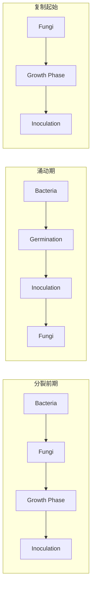
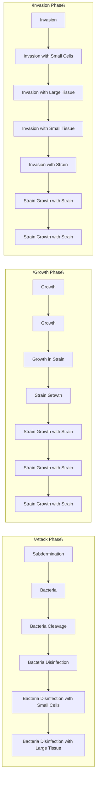

## 14.1 细菌多样性

细菌的多样性比古菌和真核微生物的多样性更加丰富。按照环境样品的宏基因组组装基因组的序列，细菌域含有150多个门。然而，目前仅有其中42个门获得了实验室培养，并进行了描述。近几年，部分细菌门的名称已发生变化，International Journal of Systematic and Evolutionary Microbiology（IJSEM）期刊最新发布的原核生物42个门（其中细菌40个门，古菌2个门）的新命名建议见表14-1。

表 14-1 IJSEM 最新发布的原核生物 42 个门的新命名建议

| 编号 | 原命名(中文译名) | 新命名(中文译名) |
| --- | --- | --- |
| 1 | Acidobacteria(酸杆菌门) | Acidobacteriota(酸杆菌门) |
| 2 | Actinobacteria(放线菌门) | Actinomycetota(放线菌门) |
| 3 | Aquificae(产水菌门) | Aquificota(产水菌门) |
| 4 | Armatimonadetes(装甲菌门) | Armatimonadota(装甲菌门) |
| 5 | — | Atribacterota(暗黑菌门) |
| 6 | Firmicutes(厚壁菌门) | Bacillota(芽孢杆菌门) |
| 7 | Bacteroidetes(拟杆菌门) | Bacteroidota(拟杆菌门) |
| 8 | Balneolaeota(巴纽尔斯菌门) | Balneolota(巴纽尔斯菌门) |
| 9 | — | Bdellovibrionota(蛭弧菌门) |
| 10 | Caldiserica(暖丝菌门) | Caldisericota(暖丝菌门) |
| 11 | Calditrichaeota(暖发菌门) | Calditrichota(暖发菌门) |
| 12 | Epsilonbacteraeota(埃普西隆杆菌门) | Campylobacterota(弯曲菌门) |
| 13 | Chlamydiae(衣原体门) | Chlamydiota(衣原体门) |
| 14 | Chlorobi(绿菌门) | Chlorobiota(绿菌门) |
| 15 | Chloroflexi(绿弯菌门) | Chloroflexota(绿弯菌门) |
| 16 | Chrysiogenetes(产金菌门) | Chrysiogenota(产金菌门) |
| 17 | — | Coprothermobacterota(粪热杆菌门) |
| 18 | Deferribacteres(脱铁杆菌门) | Deferribacterota(脱铁杆菌门) |
| 19 | Deinococcus-Thermus(异常球菌-栖热菌门) | Deinococcota(异常球菌门) |
| 20 | Dictyoglomi(网团菌门) | Dictyoglomota(网团菌门) |
| 21 | Elusimicrobia(迷踪菌门) | Elusimicrobiota(迷踪菌门) |
| 22 | Fibrobacteres(纤维杆菌门) | Fibrobacterota(纤维杆菌门) |
| 23 | Fusobacteria(梭杆菌门) | Fusobacteriota(梭杆菌门) |
| 24 | Gemmatimonadetes(芽单胞菌门) | Gemmatimonadota(芽单胞菌门) |
| 25 | Ignavibacteriae(惰杆菌门) | Ignavibacteriota(惰杆菌门) |
| 26 | Kiritimatiellaeota(圣诞岛菌门) | Kiritimatiellota(圣诞岛菌门) |
| 27 | Lentisphaerae(黏胶球形菌门) | Lentisphaerota(黏胶球形菌门) |
| 28 | Tenericutes(软壁菌门) | Mycoplasmatota(支原体门) |
| 29 | — | Myxococcota(黏球菌门) |
| 30 | Thaumarchaeota(奇古菌门)* | Nitrososphaerota(亚硝化球菌门) |
| 31 | Nitrospinae(硝化刺菌门) | Nitrospinota(硝化刺菌门) |
| 32 | Nitrospirae(硝化螺菌门) | Nitrospirota(硝化螺菌门) |
| 33 | Planctomycetes(浮霉菌门) | Planctomycetota(浮霉菌门) |
| 34 | Proteobacteria(变形菌门) | Pseudomonadota(假单胞菌门) |
| 35 | Rhodothermaeota(红嗜热菌门) | Rhodothermota(红嗜热菌门) |
| 36 | Spirochaetes(螺旋体门) | Spirochaetota(螺旋体门) |
| 37 | Synergistetes(互养菌门) | Synergistota(互养菌门) |
| 38 | Thermodesulfobacteria(热脱硫杆菌门) | Thermodesulfobacteriota(热脱硫杆菌门) |
| 39 | Thermomicrobia(热微菌门) | Thermomicrobiota(热微菌门) |
| 40 | Crenarchaeota(泉古菌门)* | Thermoproteota(热变形菌门) |
| 41 | Thermotogae(热袍菌门) | Thermotogota(热袍菌门) |
| 42 | Verrucomicrobia(疣微菌门) | Verrucomicrobiota(疣微菌门) |

注:“—”代表之前无相应命名；“\*”标注为古菌门，其余为细菌门。

值得注意的是，细菌域中90%以上的属和种隶属于4个门:假单胞菌门[Pseudomonadota，原名为变形菌门（Proteobacteria)]、放线菌门（Actinomycetota）、芽孢杆菌门[Bacillota，原名为厚壁菌门（Firmicutes）]和拟杆菌门（Bacteroidota）(图14-1)。

目前细菌域中已有 24 000 多个物种被描述，本节仅对其中含有可培养种类较多的 20 个门进行介绍。我们会根据微生物系统学的降序，即域（Domain）、界（Kingdom）、门（Phylum）、纲（Class）、目（Order）、科（Family）、属（Genus）、种（Species），对重要类群进行描述。

## 14.1.1 假单胞菌门

假单胞菌门是细菌域中已知物种数量最多、代谢类型最为多样的门。细菌域中三分之一以上已培养的种类属于假单胞菌门（图 14-1），且假单胞菌门中含有绝大多数已知的医学、工业和农业上的重要细菌。

所有的假单胞菌门细菌均为革兰氏阴性细菌，具有多种细胞形态，包括直的或弯曲的杆状、球状、螺旋状和丝状，还有出芽和具菌柄的种类。它们的能量产生机制亦具有广泛多样性，包括化能无机营养型（chemolithotrophic）、化能有机营养型（chemoorganotrophic）和光能营养型（phototrophic）种类。仅有少量的代

图 14-1 基于 16S rRNA 基因的可培养细菌主要门类的演化树

楔块的面积与每个类群中可培养细菌的数量成正比

radar

| Category | Relative Value |
| --- | --- |
| 拟杆菌门 | ~0.8 |
| 绿菌门 | ~0.4 |
| 纤维杆菌门 | ~0.3 |
| 芽单胞菌门 | ~0.2 |
| 硝化螺菌门 | ~0.2 |
| 酸杆菌门 | ~0.15 |
| 产金菌门 | ~0.15 |
| 梭杆菌门 | ~0.15 |
| 假单胞菌门 | ~0.9 |
| 放线菌门 | ~0.7 |
| 良原体门 | ~0.6 |
| 芽孢杆菌门 | ~0.5 |
| 绿弯菌门 | ~0.3 |
| 异常球菌门 | ~0.2 |
| 网团球菌门 | ~0.2 |
| 热脱硫杆菌门 | ~0.15 |
| 热袍菌门 | ~0.15 |
| 产水菌门 | ~0.15 |
| 衣结球形菌门 | ~0.15 |
| 迷踪菌门 | ~0.15 |
| 头养菌门 | ~0.15 |
| 螺旋体门 | ~0.15 |
| 蓝细菌门 | ~0.15 |
| 装甲菌门 | ~0.15 |
| 浮霉菌门 | ~0.15 |
| 衣原体门 | ~0.15 |

谢类型不存在于假单胞菌门中，如无氧产甲烷作用（methanogenesis）只存在于古菌，产氧光能营养型仅存在于蓝细菌，厌氧氨氧化（anammox）仅存在于浮霉菌门（Planctomycetota），全程氨氧化作用（comammox；将 $NH_{4}^{+}$ 完全氧化为 $NO_{3}^{-}$ ）仅存在于硝化螺旋菌门（Nitrospirota），厌氧甲烷氧化（anaerobic methanotrophy，ANME）仅存在于古菌。假单胞菌门与 $O_{2}$ 的关系同样有很高的多样性，有厌氧、微好氧和兼性好氧的种类。

基于16S rRNA基因序列，假单胞菌门可以分为6个纲，依次为α-变形菌纲（Alphaproteobacteria）、β-变形菌纲（Betaproteobacteria）、γ-变形菌纲（Gammaproteobacteria）、δ-变形菌纲（Deltaproteobacteria）、ε-变形菌纲（Epsilonproteobacteria）和ζ-变形菌纲（Zetaproteobacteria）（图14-2）。前5纲均包含很多属，但ζ-变形菌纲目前的种类较少，最先发现的是铁氧化深海菌（Mariprofundus ferrooxydans）（见14.1.1.6）。

尽管假单胞菌门在系统发育上跨度很大，但在不同纲的种类经常具有相似的代谢活性。比如，光营养细菌和甲烷营养菌分布在假单胞菌门的3个纲，而硝化细菌则分布于4个纲。这说明水平基因流（horizontal gene flow）在塑造假单胞菌门代谢多样性方面发挥着主要作用。假单胞菌门不同纲之间代谢特征的共享，也提醒我们表型和系统发育型经常为原核生物的多样性提供不同的视角。

```mermaid
graph LR
  subgraph Phylum_1["γ-变形菌纲"]
  A["亚硝化球菌属"] --> B["热着色菌属"]
  B --> C["酸硫杆状菌属"]
  C --> D["贝日阿托氏菌属"]
  D --> E["假单胞菌属"]
  E --> F["弧菌属"]
  F --> G["埃希氏菌属"]
  G --> H["甲基杆状菌属"]
  end

  subgraph Phylum_2["β-变形菌纲"]
  I["亚硝化单胞菌属"] --> J["嘉利翁氏菌属"]
  J --> K["嗜甲基菌属"]
  K --> L["德克斯氏菌属"]
  L --> M["罗尔斯通氏菌属"]
  M --> N["螺菌属"]
  N --> O["红环菌属"]
  O --> P["硫杆菌属"]
  P --> Q["奈瑟氏球菌属"]
  end

  subgraph Phylum_3["α-变形菌纲"]
  R["甲基杆菌属"] --> S["硝化杆菌属"]
  S --> T["红假单胞菌属"]
  T --> U["拜叶林克氏菌属"]
  U --> V["副球菌属"]
  V --> W["固氮菌属"]
  W --> X["立克次氏体属"]
  X --> Y["醋杆菌属"]
  end

  subgraph Phylum_4["ε-变形菌纲"]
  Z["深海菌属"] --> AA["弯曲杆菌属"]
  AA --> AB["氧化硫单胞菌属"]
  AB --> AC["硫卵形菌属"]
  AC --> AD["沃林氏菌属"]
  end

  subgraph Phylum_5["δ-变形菌纲"]
  AE["脱硫八叠球菌属"] --> AF["脱硫弧菌属"]
  AF --> AG["黏球菌属"]
  AG --> AH["硝化刺菌属"]
  end
```

flowchart

图 14-2 假单胞菌门的6个纲及其代表属的系统发育树

## 14.1.1.1 $\alpha-$ 变形菌纲

α-变形菌纲是假单胞菌门的第二大纲，有大约1 000个被描述的种。α-变形菌纲具有广泛的功能多样性。多数种类是严格好氧菌或兼性好氧菌，许多种类是寡营养的（oligotrophic），偏爱生活于低营养浓度的环境中，如SAR11类群。

α-变形菌纲中有10个详细描述的目，但绝大多数种类隶属根瘤菌目（Rhizobiales）、立克次氏体目（Rickettsiales）、红杆菌目（Rhodobacterales）、红螺菌目（Rhodospirillales）、柄杆菌目（Caulobacterales）和鞘脂单胞菌目（Sphingomonadales）。

## (1) 根瘤菌目

代表属:巴尔通氏菌属（Bartonella）、甲基杆菌属（Methylobacterium）、远洋杆菌属（Pelagibacter）、根瘤菌属（Rhizobium）、土壤杆菌属（Agrobacterium）。

根瘤菌目是  $\alpha-$  变形菌纲中最大且代谢类型最为多样的目，含有光合细菌如红假单胞菌属（Rhodopseudomonas）、化能无机营养菌如硝化杆菌属（Nitrobacter）、共生菌如根瘤菌属、自由生活的固氮细菌如拜叶林克氏菌属（Beijerinckia）、一些动植物病原菌，以及各种各样的化能有机营养菌。该目的名称来源于根瘤菌（rhizobia），由不同的属组成，可与豆科植物共生形成根瘤进行固氮。

根瘤菌目中有9个属可以形成根瘤，即慢生根瘤菌属（Bradyrhizobium）、苍白杆菌属（Ochrobactrum）、固氮根瘤菌属（Azorhizobium）、德沃斯氏菌属（Devosia）、甲基杆菌属（Methylobacterium）、中慢生根瘤菌属（Mesorhizobium）、叶杆菌属（Phyllobacterium）、中华根瘤菌属（Sinorhizobium）和根瘤菌属。这些菌是典型的化能有机营养菌和严格好氧菌，这些属中的结瘤基因通过水平转移的方式获得。结瘤基因发现于这些属的大质粒成共生岛中，并可在细胞间转移。根瘤菌的每个属都可定殖于不同范围的植物宿主。将根瘤压碎并将其涂布到营养丰富的固体培养基上就可分离根瘤菌，菌落通常产生大量的胞外多糖黏液（图 14-3）。

natural_image

Petri dish with bacterial colonies showing spores and flagella (no text or labels visible)

图 14-3 费氏中华根瘤菌（Sinorhizobium fredii）的菌落（照片来源:中国农业科学院烟草研究所郑艳芬）

菌株分离自野生大豆根瘤部位

根癌土壤杆菌（Agrobacterium tumefaciens）与根瘤菌属的亲缘关系很近，但它可引起植物根癌病。根癌土壤杆菌不能形成根瘤，其质粒上携带的根癌编码基因与根瘤菌的结瘤基因无关。

甲基杆菌属是根瘤菌目中最大的属之一，其菌落呈粉红色，且在甲醇上生长良好，因此被称为“粉红色兼性甲基营养菌”。该属常见于植物表面、土壤和淡水系统中，也经常出现于厕所和浴室中，可形成粉红色的生物被膜。

巴尔通氏菌属（Bartonella）是根瘤菌目中另一个著名的属。该属曾被归为立克次氏体目，是人类的胞内病原菌。该属的种类可引起人类和其他脊椎动物的各种疾病。五日热巴尔通氏菌（Bartonella quintana）是战壕热（trench fever，又称五日热）的病原菌，其在第一次世界大战的残酷战壕战中杀死了大量的士兵，因此得名。巴尔通氏菌属的其他物种可引起巴尔通氏菌病（bartonellosis）、猫抓病和各种炎症性疾病。这些疾病通过跳蚤和

虱子等节肢动物介导。巴尔通氏菌属的种类很难分离培养，通常需要使用血琼脂平板才能获得。巴尔通氏菌在组织培养中生长时，其细胞生长在真核宿主细胞的表面，而非细胞质或细胞核中。

隶属 SAR11 类群的远洋杆菌属（Pelagibacter）也属于根瘤菌目。遍在远洋杆菌（Pelagibacter ubique）是一种寡营养、专性好氧的化能异养细菌，生活在海洋有光区。该菌可占到表层海洋总细菌的 25%，在温带海域的夏季其数量可达总细菌的 50%，因此遍在远洋杆菌可能是地球上丰度最高的细菌种类。

## (2) 立克次氏体目

代表属:立克次氏体属（Rickettsia）、沃尔巴克氏体属（Wolbachia）

立克次氏体目细菌一般呈球状或杆状，都是动物的专性胞内寄生菌或互利共生菌（mutualist）。该目的细菌在缺乏宿主细胞时尚未获得培养，必须在鸡胚或宿主细胞中才能生长。

立克次氏体属的多个物种都是人类病原菌，包括引起斑疹伤寒的普氏立克次体（Rickettsia prowazekii）和引起落基山斑点热的立氏立克次氏体。这些病原菌可通过蜱虫、跳蚤、虱子和螨虫等节肢动物传播。大多数立克次氏体的代谢作用发生特化，只能氧化谷氨酸或谷氨酰胺，而不能氧化葡萄糖或有机酸。它们不能合成某些代谢物，而必须从宿主细胞中获得。立克次氏体在宿主外存活时间很短，可以节肢动物为媒介在动物之间传播。

立克次氏体具有典型的原核生物形态，含有细胞壁。立克次氏体细胞穿透宿主细胞是一个主动过程，需要两者都具有代谢活性。立克次氏体进入宿主细胞后，主要在其细胞质内繁殖。宿主细胞破裂后，立克次氏体从宿主细胞释放出来。

## (3) 红细菌目和红螺菌目

代表属:红细菌属（Rhodobacter）、红螺菌属（Rhodospirillum）、玫瑰杆菌属（Roseobacter）。

红细菌目和红螺菌目含有代谢类型多样的种类，包括紫色非硫细菌如红细菌属和红螺菌属、好氧不产氧光合细菌如玫瑰杆菌属、固氮细菌如固氮螺菌属（Azospirillum）、反硝化细菌（如副球菌属，Paracoccus）、趋磁细菌（magnetotactic bacteria）（如磁螺菌属，Magnetospirillum）等。

玫瑰杆菌类群（Roseobacter clade），与 SAR11 类群类似，也是全球表层海水中分布最广、数量最多的浮游细菌类群之一，在海洋有机硫循环中扮演重要的角色，在合成或降解有机硫化合物——二甲基巯基丙酸（dimethylsulfoniopropionate，DMSP）和二甲基硫醚（dimethyl sulfide，DMS）中发挥重要作用。

磁螺菌属细菌可以产生由细胞内膜包裹的由  $Fe_{3}O_{4}$  组成的磁性颗粒，即磁小体（magnetosome）（图 14-4），使细菌能够沿着磁力线运动。磁螺菌广泛分布于淡水泥浆中，可在微氧条件下生长。在富铁环境下可产生磁小体链，在缺铁环境下不产生磁小体链。

natural_image

Microscopic image of a rod-shaped bacterial cell with 1.0 μm scale bar (no text or symbols beyond scale indicator)

(a)

natural_image

Microscopic image of a rod-shaped bacterial cell with a 500 μm scale bar (no text or symbols beyond scale indicator)

(b)

图 14-4 格瑞菲斯瓦尔德磁螺菌（Magnetospirillum gryphiswaldense）MSR-1 的透射电镜照片（图片来源:中国农业大学田杰生）
(a) 0.3% 乙酸双氧铀染色，拍照时聚焦于细胞表面和鞭毛；(b) 不采用乙酸双氧铀染色，拍照时聚焦于磁小体

## (4) 柄杆菌目

代表属:柄杆菌属（Caulobacter）。

柄杆菌目是典型的寡营养型和严格好氧的化能异养细菌。该目细菌通常形成菌柄，使细菌牢固地附着在水环境中的藻类、石头或其他物体表面上。许多种类具有不对称的细胞分裂形式。新月柄杆菌（Caulobacter crescentus）已被作为细胞分化的模式细菌开展了大量的研究，其细胞周期受到调控蛋白的控制，相当精确地支配细胞周期事件中基因表达的偶联（图 14-5）。

## (5) 鞘氨醇单胞菌目

代表属:鞘氨醇单胞菌属（Sphingomonas）。

鞘氨醇单胞菌目包括各种好氧和兼性好氧的化能异养菌、好氧不产氧光合细菌如（红杆菌属）和一些专性厌氧细菌。鞘氨醇单胞菌属广泛分布于水生和陆地环境中，可代谢多种有机化合物，如芳香族化合物（甲苯、壬基酚、萘和蒽）等常见的环境污染物。鞘氨醇单胞菌属作为潜在生物修复剂已被广泛研究。这些细菌很容易在各种复杂的培养基上生长。

flowchart

图 14-5 新月柄杆菌（Caulobacter crescentus）的二态细胞周期

## 14.1.1.2 $\beta-$ 变形菌纲

β-变形菌纲是假单胞菌门的第三大纲，有大约500个已被描述的种。β-变形菌纲类群的功能多样性极为丰富（图14-2）。该纲有6个目，包括伯克霍尔德氏菌目（Burkholderiales）、红环菌目（Rhodocyclales）、奈瑟氏球菌目（Neisseriales）、嗜氢菌目（Hydrogenophilales）、嗜甲基菌目（Methylophilales）和亚硝化单胞菌目（Nitrosomonadales）。

## (1) 伯克霍尔德氏菌目

代表属:伯克霍尔德氏菌属（Burkholderia）、马赛菌属（Massilia）。

伯克霍尔德氏菌目包含具有广泛代谢和生态特征的种类，包括严格好氧、兼性好氧和专性厌氧的化能异养菌、不产氧光合细菌、专性和兼性化能自养菌、自由生活的固氮菌以及人类和动植物的病原菌。

伯克霍尔德氏菌属是伯克霍尔德氏菌目的模式属。该属包括各种具有专性呼吸代谢的化能异养菌。所有种类均可在有氧条件下生长，一些种类也可以硝酸盐为电子受体厌氧生长，许多菌株有固氮作用。该属对有机化合物，尤其是芳香族化合物具有代谢多样性，使之可应用于生物修复。该属的某些菌株可促进植物生长。然而，许多种类是动植物的潜在致病菌，其中最著名的致病种是洋葱伯克霍尔德氏菌（Burkholderia cepacia）。

natural_image

Microscopic image of a rod-shaped bacterial cell with a 0.5 μm scale bar, showing internal organelles (no text or symbols beyond scale indicator)

图 14-6 田地马赛菌（Massilia arvi）A6-12

(图片来源: 武汉大学彭方)

分离自土壤环境

洋葱伯克霍尔德氏菌主要生活于土壤，是一种条件致病菌。该菌通常存在于植物的根际，可产生抗真菌和抗线虫化合物，因此其在植物根部的定殖可以预防病害发生并促进植物生长。然而，在某些情况下，该菌会成为植物病原菌，是洋葱软腐病的主要病因。洋葱伯克霍尔德氏菌也会成为住院患者的条件致病菌，该菌在免疫功能低下或肺炎患者中可形成继发性肺部感染，其在肺中可形成生物被膜并对许多抗生素具耐药性，使之对肺炎患者特别危险。

马赛菌属包含 40 余个有效种，在土壤中广泛分布，从人类临床样本、植物、水、冰芯、空气和岩石等生境中也可分离到。菌落多为黄色，少数为白色、粉色或紫黑色，细胞形态多为杆状，绝大多数种类具有鞭毛（图 14-6），能运动。马赛菌不仅能够合成多种次级代谢产物和酶，而且具有溶磷、降解菲和耐受重金属等多种功能。

## (2) 红环菌目

代表属:红环菌属（Rhodocyclus）、动胶菌属（Zoogloea）。

与伯克霍尔德氏菌目类似，红环菌目也包含了具有不同代谢和生态特征的物种。红环菌目的代表属是红环菌属，一类紫色非硫细菌。红环菌属在光能异养条件下生长最好，但大多数种类也可以  $H_{2}$  为电子供体营光能自养生长。这些种类也可在黑暗条件下通过呼吸作用生长，但其通常发现于光照缺氧且存在有机物的环境中。

动胶菌属是红环菌目的另一个重要属。动胶菌属是一种好氧化能异养菌，其独特之处是产生厚厚的胶状荚膜，将细胞黏合在一起形成复杂的基质，具有分支的指状突起。这种凝胶状基质可以引起絮凝现象，在溶液中形成颗粒沉淀。该菌在有氧废水处理中尤为重要，可降解废水中的大部分有机物，并促进絮凝和沉降，这是水净化的关键步骤。

## (3) 奈瑟氏球菌目

代表属:色杆菌属（Chromobacterium）、奈瑟球菌属（Neisseria）。

奈瑟氏球菌目至少包含29个属，均为化能异养菌。最典型的属是奈瑟氏球菌属和色杆菌属。奈瑟氏球菌属的种类通常分离自动物，某些种类具有致病性。奈瑟氏菌通常为球形，某些种类是自由生活的腐生细菌，存在于口腔和动物体的其他潮湿部位。还有部分种类是严重的病原菌，如脑膜炎奈瑟氏球菌（Neisseria meningitidis），可导致脑膜炎。

色杆菌属中最著名的种类是紫色色杆菌（Chromobacterium violaceum），菌落呈紫色，存在于水和土壤中，偶尔也发现于人类和其他动物的化脓伤口中。紫色色杆菌可产生紫色色素（简称紫色素），是一种具有抗菌和抗氧化特性的非水溶性色素。色杆菌属是兼性好氧菌，可发酵糖类生长，并可在多种碳源上进行有氧生长。

## (4) 嗜氢菌目、嗜甲基菌目和亚硝化单胞菌目

代表属:嗜氢菌属（Hydrogenophilus）、硫杆菌属（Thiobacillus）、嗜甲基菌属（Methylophilus）、亚硝化单胞菌属（Nitrosomonas）。

这三个目的种类具有相当特殊的代谢能力，包括化能自养菌和甲基营养菌。大多数种类是专性好氧菌，许多种类是自养菌。热叶绿体嗜氢菌（Hydrogenophilus thermoluteolus）是一种专性好氧菌，可以 $H_{2}$ 为呼吸作用的电子供体并通过卡尔文循环固定 $CO_{2}$ ，进行化能自养生长。该菌也可以利用简单碳源进行化能异养生长。硫杆菌属是嗜氢菌目的另一个重要属。硫杆菌属的种类有化能异养型，也有化能自养型。硫杆菌属中的化能自养种类是硫细菌，可以还原性硫化物为电子供体进行氧化作用，通过有氧呼吸或反硝化作用进行生长。硫杆菌属的种类也可以通过卡尔文循环固定 $CO_{2}$ ，通常存在于土壤、硫泉、海洋环境和其他含有还原性硫化物的环境。

嗜甲基菌目是专性和兼性甲基营养菌，可利用甲醇和其他一碳（ $C_{1}$ ）化合物，但不能利用甲烷。兼性的种类可以化能异养生长，利用单糖进行有氧呼吸。亚硝化单胞菌目含有专性化能自养氨氧化细菌，关键属是亚硝化单胞菌属和亚硝化螺菌属（Nitrosospira）。

## 14.1.1.3 $\gamma-$ 变形菌纲

γ-变形菌纲是假单胞菌门中最大和多样性最高的纲，包含了该门中近一半已描述的种类。该纲包含超过 1 500 个已描述的种和至少 15 个已描述的目。其物种具有多样的代谢和生态特征（图 14-2），包括许多众所周知的人类病原菌。该纲细菌可以进行光能营养（包括紫硫细菌）、化能异养、化能自养。该纲成员通常在实验室培养基中迅速生长，并可从广泛多样的栖息地中分离出来。

## (1) 肠杆菌目

代表属:肠杆菌属（Enterobacter）、埃希氏菌属（Escherichia）、克雷伯菌属（Klebsiella）、变形菌属（Proteus）、沙门菌属（Salmonella）、沙雷氏菌属（Serratia）、志贺菌属（Shigella）。

肠杆菌目（Enterobacterales）是  $\gamma-$  变形菌纲中最大和最著名的目之一，通常被称为肠道细菌，是  $\gamma-$  变形菌纲中的一个相对同质的系统发育群，是兼性好氧、不产芽孢的杆状细菌，不运动或以周生鞭毛运动。氧化酶阴性和过氧化氢酶阳性。它们可发酵葡萄糖产酸，还可还原硝酸盐，但只产生亚硝酸盐。肠道细菌的营养需求相对简单，可将糖发酵成多种终产物。

在肠道细菌中，有许多种类是人类或动植物的病原菌，还有一些种类在工业上有重要应用。大肠杆菌是典型的肠道细菌，目前已鉴定了许多属和种。

然而，由于肠道细菌在遗传上密切相关，其鉴别往往比较困难。在临床实验室中，肠道细菌的鉴定通常采用快速诊断试剂盒、免疫学和基因组学进行综合分析，以确定特定种类的特征蛋白或基因。

## (2) 假单胞菌目

代表属:假单胞菌属（Pseudomonas）。

假单胞菌目（Pseudomonadales）细菌全部为行呼吸代谢的化能异养菌。所有种类均可好氧生长，通常为氧化酶和过氧化氢酶阳性，但一些种类亦可以硝酸盐为电子受体进行厌氧呼吸。大多数种类可利用多种有机化合物作为碳源和能源进行生长。该目细菌广泛分布于土壤和水生生态系统，许多种类可导致人类或动植物发病。该目的典型属是假单胞菌属。

假单胞菌属的多个种类具有致病性。其中，铜绿假单胞菌（Pseudomonas aeruginosa）可引起人类的尿道和呼吸道感染。该菌不是专性病原菌，仅在免疫系统薄弱的个体中引发感染。铜绿假单胞菌还是研究生物被膜发生机制的模式生物。由于该菌很容易在物体表面定殖，它是接受气管切开术、腰椎穿刺、严重烧伤治疗等患者医院获得性感染的常见原因。除了局部感染外，铜绿假单胞菌也可引起全身感染，通常发生在经历过大面积皮肤损伤的个体中。

铜绿假单胞菌对许多广泛使用的抗生素具有天然耐药性，因此治疗感染往往很困难。耐药性通常是由抗性质粒（R质粒）转移引起，其基因编码的蛋白质可以解毒不同抗生素或将其泵出细胞。生物被膜的形成进一步增强了其对抗生素的耐药性。多黏菌素是一种具有毒性的抗生素，通常不用于人类治疗，但对铜绿假单胞菌有效，仅用于严重的病例。

“软腐病”病原菌丁香假单胞菌（Pseudomonas syringae），可感染植物的茎和芽，

但很少感染叶片。

施氏假单胞菌（Pseudomonas stutzeri；图 14-7）具有很高的表型和基因型多样性，可以解磷和解钾，在环境生物修复方面发挥重要作用。

## (3) 弧菌目

代表属:另类弧菌属（Aliivibrio）、弧菌属（Vibrio）、发光杆菌属（Photobacterium）。

弧菌目（Vibrionales）含有兼性好氧的杆状或弯曲杆状菌，可发酵代谢。弧菌和肠道细菌之间的一个关键区别是，弧菌氧

natural_image

Microscopic image of a single dark-stained cell with a wavy line, scale bar indicates 2.0 μm (no text or symbols present)

图 14-7 施氏假单胞菌的电镜图（图片来源:中国科学院海洋研究所孙超岷）

化酶呈阳性，而肠道细菌氧化酶呈阴性。虽然假单胞菌目也是氧化酶阳性，但它们不能发酵代谢，因此与弧菌目明显不同。弧菌目中最著名的属是弧菌属、另类弧菌属和发光杆菌属，其中多个种类具有生物发光特性（图 14-8）。

大多数弧菌发现于海洋、半咸水或淡水栖息地。霍乱弧菌（Vibrio cholerae）可引起人类霍乱病，但该菌一般不会引起其他宿主发病。霍乱病是发展中国家最常见的人类传染病之一，几乎全部通过水传播。

副溶血弧菌（Vibrio parahaemolyticus）生活于海洋环境中。在日本，由于生鱼被广泛食用，是引发胃肠炎的主要原因，该菌还与其他国家的肠胃炎暴发有关。副溶血弧菌可从海水、贝类或甲壳类动物中分离出来，其主要宿主可能是海洋动物，人类是偶然宿主。

## (4) 硫发菌目

代表属:辫硫菌属（Thioploca）、硫发菌属（Thiothrix）、硫珍珠菌属（Thiomargarita）。

硫发菌目（Thiotrichales）多为丝状化能自养硫氧化菌。辫硫菌属是多细胞丝状细菌，通常以束状形式存在，外包共同的鞘，鞘中含有硫颗粒。纳米比亚硫珍珠菌(Thiomargarita namibiensis) 于 1999 年被发现, 是目前已知的单体体积最大的原核生物之一。其球形细胞的直径通常为 $100 \sim 300 \mu \mathrm{m}$, 有的甚至高达 $750 \mu \mathrm{m}$ 。纳米比亚硫珍珠菌在纳米比亚的沿海沉积物中含量很高, 以丝状形式存在, 外包共同的黏液鞘。在显微镜下硫颗粒发出闪烁的白色, 如一串闪亮的珍珠链, 因此取名为硫珍珠菌。纳米比亚海岸的水文地理条件使得大量的营养物质聚集于水表面, 大量浮游植物的生长导致有机物沉积到海底, 被细菌降解产生大量的 $\mathrm{H}_{2} \mathrm{~S}$ 。纳米比亚硫珍珠菌利用 $\mathrm{NO}_{3}^{-}$氧化硫化物。和辫硫菌一样, 纳米比亚硫珍珠菌细胞内含有一个大的液泡, $\mathrm{NO}_{3}^{-}$储存于液泡中, 硫元素则储存于细胞周质中作为营养物质储备, 这样细菌就可在无外界营养物质的条件下生长数个月。

natural_image

Petri dish with bacterial colonies on agar medium (no visible text or labels)

(a)

natural_image

Microscopic view of a petri dish with bacterial colonies (no text or labels visible)

(b)

图 14-8 哈维氏弧菌（Vibrio haveyi）的发光现象（图片来源:中国海洋大学张晓华）

（a）在有光条件下拍照；  
（b）在黑暗条件下拍照，可见哈维氏弧菌VIB391的发光现象

2022 年，根据《科学》杂志报道，一种肉眼可见的细菌被发现，被命名为华丽硫珍珠菌（Ca. Thiomargarita magnifica），它来自加勒比海格兰德特雷岛的红树林，是目前已发现的最大的细菌，单个细菌最大长度为 2 cm。

## 14.1.1.4 δ-变形菌纲

代表属:蛭弧菌属（Bdellovibrio）、黏球菌属（Myxococcus）、脱硫弧菌属（Desulfovibrio）、地杆菌属（Geobacter）、互营杆菌属（Syntrophobacter）。

与  $\alpha-$ 、 $\beta-$  和  $\gamma-$  变形菌纲相比， $\delta-$  变形菌纲的种类较少，功能多样性较低（图14-2）。 $\delta-$  变形菌纲主要是硫酸盐和硫还原细菌、异化铁还原细菌和捕食细菌（如黏细菌）。在  $\delta-$  变形菌纲中有8个目被进行了详细研究。

黏球菌目（Myxococcales）和蛭弧菌目（Bdellovibrionales）含有大量的捕食细菌。蛭弧菌附着于宿主细胞表面，钻穿宿主细胞壁并在周质空间繁殖，最终引起宿主细胞裂解，并释放出多达30个子代个体（图14-9）。

相比之下，脱硫单胞菌目（Desulfuromonadales）含有多个金属和硫还原属，如地杆菌属。与脱硫单胞菌目类似，δ-变形菌纲的许多属都与硫化物的还原有关。含有硫酸盐还原菌的最大和最常见的目是脱硫弧菌目（Desulfovibrionales）。该目细菌很容易从含有硫酸盐的海洋沉积物和营养丰富的缺氧环境中分离出来。脱硫弧菌目细菌是典型的不完全氧化菌，都能利用硫酸盐作为末端电子受体，并需要乳酸等小分子有机物作为碳源和能源生长。脱硫杆菌目（Desulfobacterales）和脱硫弧菌目（Desulfarculales）的物种也是硫酸盐还原菌，但与脱硫弧菌目相比，这些物种可以是完全或不完全的醋酸氧化菌。除了还原硫酸盐，这三个目的一些种类还能还原亚硫酸盐、硫代硫酸盐或硝酸盐，有些种类还具有一定的发酵能力。

图 14-9 蛭弧菌的生活周期示意图

flowchart

含有硫酸盐还原菌的最后一个目是互营杆菌目（Syntrophobacterales），该目的某些种类也能还原硫酸盐。在自然界中，互营杆菌目细菌主要与  $H_{2}$  利用菌具有互养共栖作用。例如，互养物种沃氏互营杆菌（Syntrophobacter wolinii）能氧化丙酸，产生乙酸盐、 $CO_{2}$  和  $H_{2}$ ，然而这种作用只有在  $H_{2}$  利用菌存在时才能实现。

## 14.1.1.5 $\varepsilon-$ 变形菌纲

代表属:弯曲杆菌属（Campylobacter）、螺杆菌属（Helicobacter）。

与  $\delta-$  变形菌纲类似， $\varepsilon-$  变形菌纲的种类也较少，且功能多样性较低。 $\varepsilon-$  变形菌纲含有许多能将硫化氢氧化为硫或硫酸盐的种类。有好多种类是化能自养细菌，某些种类如弯曲杆菌属（Campylobacter）和螺杆菌属（Helicobacter）的种类是人类病原菌，而另一些种类可与宿主共生。

## (1) 弯曲杆菌属和螺杆菌属

这两个属有许多共同特征，均为螺旋状、可运动、氧化酶和过氧化氢酶阳性，大多数物种对人类或其他动物具有致病性。它们属于微好氧微生物，必须在低  $O_{2}$  （3%～15%）和高  $CO_{2}$  （3%～10%）条件下从临床标本中分离培养。

弯曲杆菌属已有十余种被描述，它们会引起急性胃肠炎，通常导致出血性腹泻。其发病机制与多个因素有关，包括一种与霍乱毒素相关的肠毒素。幽门螺杆菌（Helicobacter pylori）也是人类病原菌，可引起急性或慢性胃炎，最终导致胃溃疡甚至胃癌。

## (2) 代谢硫的  $\varepsilon-$  变形菌纲物种

通过环境样品测序和基于培养的研究，发现  $\varepsilon-$  变形菌纲物种在海洋和陆地环境中广泛存在。这些微生物在硫循环活跃的环境中特别丰富，尤其是在深海热液喷口和海洋沉积物中，那里混有丰富的硫化物和有氧水体。该纲有许多嗜热菌，有助于其在热液系统中生长。化能自养细菌（通过反向三羧酸循环固定  $CO_{2}$ ）也广泛存在于  $\varepsilon-$  变形菌纲中。许多种类能够有氧或厌氧（利用氧化态氮化物或硫化合物作为电子受体）生长，同时利用还原态硫化物或  $H_{2}$  等无机物作为电子供体。在富硫环境中， $\varepsilon-$  变形菌纲细菌会大量附着在有氧-无氧界面，在自然界硫化物氧化中起着重要作用。

ε- 变形菌纲细菌固定  $CO_{2}$  的能力对生活在富硫环境中的动物尤为重要，该纲细菌在热液喷口烟囱上的微生物生物量占比可高达 85%。此外，ε- 变形菌纲细菌可作为许多动物（如寡毛类和多毛类蠕虫、蜗牛、虾等）的外共生和内共生微生物生长。这些共生微生物可对宿主发挥两种作用，既可提供营养物质，又可解毒对宿主有害的  $H_{2}S$ 。

## 14.1.1.6 $\zeta^{\prime}$ -变形菌纲

$\zeta-$ 变形菌纲细菌是典型的微好氧、嗜中性的化能自养型铁氧化菌，常栖息于有氧与无氧交界处的富铁含水环境。铁氧化深海菌是该纲第一株被纯培养的菌株，于1996年分离自夏威夷罗希海山的富铁低温热液喷口，以二价铁离子作为能量来源。该菌与固体表面接触时，可生长出由铁氧化物包裹的螺旋状菌柄。此外，该菌细胞内还含有多聚磷酸物，可为细胞提供能量和磷酸盐。此后陆续从淡水和海洋环境中分离出其他菌株。

依托中国大洋 72 航次（2022 年 4 月 28 日启动的一次重要海洋科学考察），深海菌（Mariprofundus sp.）S2-6 分离自天休热液区沉积物，为该属的潜在新种，是一株严格化能自养的嗜中性铁氧化菌，细胞比同属的其他菌株更长（图 14-10）。

图 14-10 深海菌（Mari-profundus sp.）S2-6 的透射电镜照片（图片来源:自然资源部第三海洋研究所邵宗泽）

在添加氢气、二价铁和氧气的条件下对菌株进行培养，（a）和（b）为不同的视野

natural_image

Microscopic image of a filamentous structure with scale bar indicating 1.0 μm (no text or symbols present)

(a)

natural_image

Microscopic image of a curved, elongated biological structure with a 1.0 μm scale bar (no text or symbols beyond scale indicator)

(b)

## 14.1.2 芽孢杆菌门、支原体门和放线菌门

芽孢杆菌门（Bacillota）和放线菌门（Actinomycetota）细菌为革兰氏阳性细菌，许多类群的特征已被详细描述。支原体门（Mycoplasmatota），原名软壁菌门（Tenericutes）包括支原体属（Mycoplasma）等已失去产生肽聚糖和任何类型细胞壁能力的物种。这三个门（图14-11）的细菌包含了近一半已被描述的细菌种类。

放线菌门的种类很多，主要为丝状土壤细菌，其基因组 DNA 通常具有高频率的 GC 碱基对，因此它们也被称为高 G+C 革兰氏阳性细菌。支原体门包括许多缺乏细胞壁的细菌，而芽孢杆菌门包括芽孢形成细菌、乳酸菌和其他一些类群。与放线菌门相比，芽孢杆菌门基因组中 GC 含量通常较低，因此它们也被称为低 G+C 革兰氏阳性细菌。

## 14.1.2.1 芽孢杆菌门

## （1）产芽孢的芽孢杆菌目和梭菌目

代表属:芽孢杆菌属（Bacillus）、梭菌属（Clostridium）、芽孢八叠球菌属（Sporosarcina）。

所有芽孢产生菌都属于芽孢杆菌目（Bacillales）和梭菌目（Clostridiales）。形成芽孢的能力仅在芽孢杆菌目、梭菌目和乳杆菌目的共同祖先中演化过一次。然而，许多芽孢杆菌目和梭菌目以及全部乳杆菌目细菌都无法形成芽孢。芽孢产生需要许多基因参与，且并非通过水平基因转移获得。有许多细菌的芽孢产生能力在演化过程中丧失了。

text_image

放线菌门
放线菌目
双歧杆菌目
红蝽菌目
支原体门
虫原体目
支原体目
芽孢杆菌门
梭菌目
乳杆菌目
芽孢杆菌目
微球菌属
节杆菌属
丙酸杆菌属
棒杆菌属
诺卡氏菌属
分枝杆菌属
放线菌属
链霉菌属
双歧杆菌属
红蝽菌属
螺原体属
支原体属
消化球菌属
消化链球菌属
梭菌属
八叠球菌属
乳杆菌属
明串珠菌属
类芽孢杆菌属
芽孢八叠球菌属
李斯特氏菌属
葡萄球菌属
芽孢杆菌属

图 14-11 革兰氏阳性菌的主要目及其近缘类群以放线菌门、芽孢杆菌门和支原体门代表性属的 16S rRNA 基因序列构建了系统发育树

芽孢产生菌可根据其细胞形态、芽孢形状和在细胞中的位置、与氧气的关系以及能量代谢来区分。最著名的芽孢产生菌是芽孢杆菌属和梭菌属，其中前者为好氧或兼性好氧细菌，而后者为专性厌氧菌和发酵菌。在自然界中，产芽孢菌主要存在于土壤中。即便是对人类或其他动物具致病性的产芽孢菌，也主要是土壤腐生细菌，只是偶尔感染动物。由于土壤的营养水平、温度和水活度高度多变，产生芽孢能力对土壤微生物是有利的。

芽孢杆菌属和类芽孢杆菌属（Paenibacillus）在含有多种碳源的合成培养基上均

能生长良好。许多芽孢杆菌能产生胞外水解酶，分解多糖、核酸和脂质等复杂的聚合物，用作碳源和电子供体。许多芽孢杆菌能产生杆菌肽、多黏菌素、酪氨酸、短杆菌肽和环菌素等抗生素。这些抗生素一般在培养物进入稳定期并开始形成芽孢时释放出来。

有一些芽孢杆菌，如弧丽金龟类芽孢杆菌（Paenibacillus popilliae）和苏云金芽孢杆菌（Bacillus thuringiensis），能产生有毒的杀虫蛋白。弧丽金龟类芽孢杆菌会使甲虫的幼虫患上致命的乳状病（milky disease）。苏云金芽孢杆菌可使许多种类的昆虫死亡。这两种昆虫病原菌伴随芽孢的形成，产生一种晶体蛋白质，称为伴孢晶体（parasporal body）（图 14-12）。

苏云金芽孢杆菌的伴孢晶体是一种毒素前体（protoxin），在昆虫肠道中转化为毒素。该毒素可与某些昆虫的肠道上皮细胞特定受体结合，并诱导形成孔隙，导致宿主细胞质泄漏，继而裂解。苏云金芽孢杆菌的不同菌株可产生不同类型的毒素，对不同种类的昆虫具有特异性。芽孢杆菌的伴孢晶体，可作为生物杀虫剂在市场上销售。

natural_image

Microscopic image of a rod-shaped bacterial cell with a 2 μm scale bar, showing internal structure and a labeled feature (no text or symbols beyond scale indicator)

图 14-12 苏云金芽孢杆菌（Bacillus thuringiensis）的透射电镜照片（图片来源:武汉大学彭方）

箭头所指为释放到细胞外的伴孢晶体

目前，已从多个苏云金芽孢杆菌中鉴定出编码伴孢晶体蛋白（也称为“Bt 毒素”）的 cry 基因，并被转化到玉米、大豆和棉花等转基因作物中，以增强植物的抗虫性。这些转基因“Bt 农作物”在世界各地被广泛种植。

与芽孢杆菌不同，梭菌属缺乏呼吸链，因此它们通过底物磷酸化获得 ATP。梭菌属细菌中有多种厌氧产能机制，该属主要根据这些特性及所利用的发酵底物来划分亚群。许多梭菌可发酵糖类，其主要终产物是丁酸。巴氏梭菌（Clostridium pasteurianum）等种类还能产生丙酮和丁醇，该菌还具活跃的固氮作用。

芽孢八叠球菌属细菌并不是常见的产芽孢菌，其细胞是球状而不是杆状。该菌由严格需氧的球形至椭圆形细胞组成，这些细胞在两个或三个垂直断面上分裂，形成四分体或由8个或更多细胞组成的细胞包裹。主要种类是脲芽孢八叠球菌（Sporosarcina ureae）。

## (2) 不产芽孢的芽孢杆菌目和梭菌目

代表属:李斯特菌属（Listeria）、葡萄球菌属（Staphylococcus）、八叠球菌属（Sarcina）。

能产芽孢的芽孢杆菌门细菌属于芽孢杆菌目和梭菌目。然而，这两个目的许多种类不产芽孢，以下介绍一些不产芽孢的种类。

芽孢杆菌目通常包括好氧和兼性好氧的化能异养菌，其成员分布广泛，在土壤中尤为常见。例如，李斯特氏菌属广泛存在于土壤中，是一种条件致病菌，也是食源性疾病常见的常见病因。李斯特氏菌属是革兰氏阳性、过氧化氢酶阳性、杆状、兼性好氧的化能异养菌。单核增生李斯特菌（Listeria monocytogenes）是该属中最著名的种类，可引起重要的食源性疾病——李斯特氏菌病（listeriosis），该病原菌可通过奶酪、香肠等受污染的即食食品传播，可引起轻微疾病或致命的脑膜炎。该属细菌通常在低温下生长良好，可在冷藏食品中生长。

芽孢杆菌目的葡萄球菌属是一种兼性好氧菌，具典型的呼吸代谢，但也能发酵生长。细胞通常成簇生长，并通过好氧和厌氧两种方式代谢葡萄糖产酸。葡萄球菌的过氧化氢酶呈阳性，使之有别于链球菌属和一些其他属的乳酸菌。葡萄球菌属对干燥和高盐环境有很好的耐受性。许多种类具有色素。

葡萄球菌是人类和动物常见的附生菌和寄生菌，偶尔会引起严重感染。表皮葡萄球菌（Staphylococcus epidermidis）和金黄色葡萄球菌（Staphylococcus aureus）存在于人类皮肤或黏膜上。表皮葡萄球菌是一种不产色素的非致病菌，而金黄色葡萄球菌则是一种产黄色色素的致病菌，最常见的病症包括疖子、丘疹、肺炎、骨髓炎、脑膜炎和关节炎。有些金黄色葡萄球菌菌株对多种抗生素具有耐药性（即所谓的MRSA菌株），可造成广泛的组织损伤。

梭菌目的八叠球菌属包含过氧化氢酶阴性的专性厌氧菌。八叠球菌属还具有极强的耐酸性，能够发酵糖类并在 pH 低至 2 的环境中生长。胃八叠球菌（Sarcina ventriculi）的细胞壁周围具有一层厚厚的纤维素层，相邻细胞的纤维素层会粘连在一起，起到黏合剂的作用，将胃八叠球菌细胞包裹固定在一起。

胃八叠球菌耐酸性极强，是仅有的几种能在人类和其他单胃动物胃中栖息的细菌之一。在某些胃肠道疾病（如幽门溃疡）患者的胃中可观察到胃八叠球菌的快速生长，会阻碍食物流向肠道。

## (3) 乳杆菌目

代表属:乳杆菌属（Lactobacillus）、链球菌属（Streptococcus）。

乳杆菌目（Lactobacillales）是一类以乳酸为主要发酵终产物的乳酸菌，不产芽孢。这些细菌被广泛应用于食品生产和保藏。乳酸菌为氧化酶和过氧化氢酶阴性的棒状或球状菌，专性发酵代谢。所有的乳酸菌都以乳酸为主要或唯一的发酵产物。这类细菌缺乏卟啉和细胞色素，不能通过氧化磷酸化获得能量，只能通过底物水平磷酸化而获得。不同于许多厌氧细菌，大多数乳酸菌对  $O_{2}$  不敏感，可在有氧情况下生长，因此被称为耐氧厌氧菌。

大多数乳酸菌只能从糖代谢中获得能量，因此其通常局限于含糖的栖息地。它们的生物合成能力有限，具有对氨基酸、维生素、嘌呤和嘧啶等复杂营养物质需求。乳酸菌亚群之间的一个重要区别在于糖发酵产物的类型。其中一类被称为同型乳酸发酵菌，产生单一的发酵产物乳酸，另一类被称为异型乳酸发酵菌，除了发酵产乳酸以外，还产生乙醇和二氧化碳。

乳杆菌属（Lactobacillus）是典型的杆菌，链状生长，细胞呈细长或短杆状，大多数为同型乳酸发酵。乳杆菌在乳制品中非常常见，一些菌株可用于制备发酵乳制品。例如，嗜酸乳杆菌（Lactobacillus acidophilus）和德氏乳杆菌（Lactobacillus delbrueckii）可用于酸奶类产品的生产，有些种类可用于泡菜的生产。

乳杆菌属通常比其他乳酸菌更耐酸，在 pH 低至 4 的条件下也能很好地生长。乳杆菌的耐酸性使其可在自然乳酸发酵过程中 pH 下降到其他乳酸菌无法生长时，也能持续生长，因此乳杆菌通常负责乳酸发酵的最后阶段。

乳球菌属（Lactococcus）和链球菌属（Streptococcus）包含同型乳酸发酵的球状乳酸菌。有些种类对人类和动物具有致病性。链球菌的细胞排列特征是链状或四联球状，因此很容易与杆状的乳杆菌区分开来。链球菌的某些种类在龋齿的形成中也扮演着重要角色。

## 14.1.2.2 支原体门

代表属:支原体属（Mycoplasma）、螺原体属（Spiroplasma）。

支原体门包含唯一的纲，即柔膜体纲（Mollicutes），缺乏细胞壁，是已知体积最小的生物之一。该门的代表属是支原体属，因此这类细菌通常被称为支原体，有些种类是人类病原菌。

虽然支原体并非革兰氏染色阳性（因为它们没有细胞壁），但在系统发育上与芽孢杆菌门亲缘关系很近。支原体通常寄生在动物和植物体内，其基因组很小（0.6～2.2 Mbp），这是专性共生体和胞内寄生菌的共同特征。