## (1) 支原体的特性

电镜和化学分析证实，支原体没有细胞壁。支原体与原生质体（经人工去除细胞壁的细菌）相似，但它们对渗透裂解的抵抗力更强，能够在原生质体裂解的条件下存活。支原体的细胞质膜含有固醇，使其比其他细菌的细胞质膜更加稳定。有些支原体的生长培养基中需要添加固醇，对固醇需求情况是支原体分类的依据之一。

除固醇外，某些支原体的细胞质膜中还嵌入了脂多糖。支原体的脂多糖与革兰氏阴性细菌外膜中的脂多糖在某些方面相似，但缺乏脂质 A 骨架。脂多糖的功能是帮助稳定细胞质膜，并可促进支原体附着于动物细胞的表面受体。

## (2) 支原体的生长

支原体可在实验室中培养，是一种小型多形性细胞（图 14-13a）。单个培养物可表现出小的球状细胞、较大的肿胀细胞和丝状细胞（通常高度分枝）。小的球状细胞（0.2～0.3 μm）是最小的自由生活细胞。支原体在液体和固体培养基中的生长方式不同。在固体培养基上，支原体会嵌入培养基中生长，菌落呈现出特殊的“油煎蛋”形（图 14-13c），包括一个向下渗透到琼脂中的致密中心核，周围是颜色较浅的圆形扩散区。与其他缺乏细胞壁的细胞相同，抑制细胞壁合成的抗生素不会抑制支原体的生长。然而，支原体与大多数细菌相同，对作用于细胞壁以外的抗生素非常敏感。

培养支原体的培养基通常相当复杂，需添加新鲜血清或腹腔液来提供不饱和脂肪酸和固醇。不过，有些支原体可以在相对简单的培养基上培养。大多数支原体利用糖类作为碳源和能源，并须添加维生素、氨基酸、嘌呤和嘧啶作为生长因子。

图 14-13 感染 Vero 细胞（非洲绿猴肾细胞）的肺炎支原体（Mycoplasma pneumoniae）细胞和菌落（图片来源:武汉大学沈超）（a）和（b）为荧光显微照片，分别为感染了支原体（a）和未感染支原体（b）的 Vero 细胞；（c）为支原体菌落；（d）为无支原体菌落的对照组

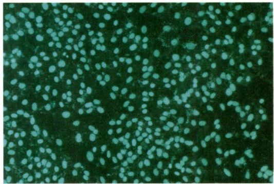

natural_image

Microscopic view of scattered green fluorescent cells on a dark background (no text or symbols)

(a)

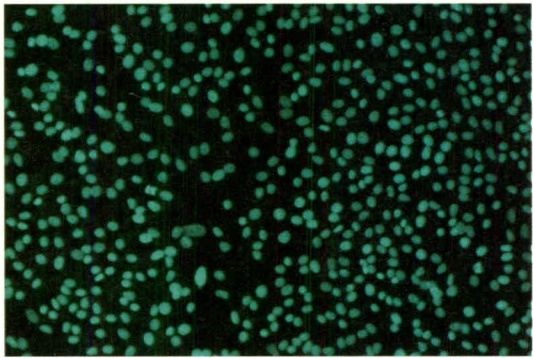

natural_image

Microscopic view of green fluorescent cells against a dark background (no text or symbols)

(b)

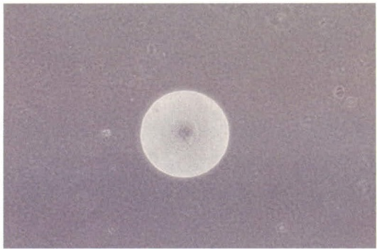

natural_image

A bright circular object with a dark center, set against a dark background with faint speckles (no text or symbols visible)

(c)

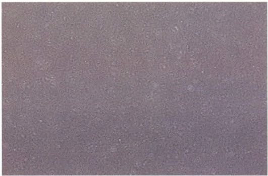

natural_image

Uniform gray textured surface with no visible text, symbols, or distinct features

(d)

## (3) 螺原体属

螺原体属由螺旋形的支原体组成。虽然螺原体属缺乏细胞壁和鞭毛，但它们却能通过旋转或缓慢起伏来运动，胞内纤维在运动中发挥了重要作用。柑橘僵化螺原体（Spiroplasma citri）是从柑橘植物叶片中分离出来的，它可引起柑橘顽固病，也可从患有玉米矮缩病的玉米植株中分离出来。

## 14.1.2.3 放线菌门

革兰氏阳性细菌的另一大类是放线菌门。放线菌门包含杆状及丝状细菌，主要为好氧细菌，常见于土壤中。大多数放线菌是无害的，但结核分枝杆菌（Mycobacterium tuberculosis）等分枝杆菌例外。某些放线菌在生产抗生素或某些发酵乳制品方面具有很高的经济价值。绝大多数物种属于放线菌目（Actinomycetales）。

## (1) 链霉菌及近缘菌

代表属:链霉菌属（Streptomyces）、放线菌属（Actinomyces）、诺卡氏菌属（Nocardia）。

链霉菌属是放线菌中最重要的属，有600余个已知种。链霉菌的菌丝直径通常为0.5\~1.0  $\mu$ m，长度不固定，在营养菌丝阶段通常缺乏横壁。营养菌丝由复杂、紧密编

织的基质组成，形成紧密、卷曲的菌丝体和随后的菌落。随着菌落的老化，会形成特征性气生菌丝，称为孢子囊，这些菌丝会突出菌落表面并产生孢子。

链霉菌属的孢子称为分生孢子（conidium），与芽孢杆菌属和梭菌属的芽孢截然不同。芽孢的形成需要经过复杂的细胞分化，而分生孢子则在多核孢子囊中形成交叉壁，然后单个细胞直接分离成孢子。不同种类的链霉菌气生菌丝和孢子着生结构的形状和排列差异是其分类依据之一。分生孢子和孢子囊通常带有色素，为成熟菌落带来特有的颜色。链霉菌在琼脂平板上的成熟菌落具有粉尘状形态，且比较紧凑，菌落有色素，使其很容易与其他细菌菌落区分开来（图 14-14）。

链霉菌属细菌主要存在于土壤中，土壤中特有的泥土气味就是由链霉菌产生的一系列复杂代谢物（即地黄素）引起的。链霉菌最显著的生理特性是其可以产生抗生素。在分离链霉菌使用的琼脂平板上经常可以看到其相邻细菌菌落出现抑菌区。约有50%的链霉菌种类可以产生抗生素，链霉菌产生的抗生素达500余种，还有更多的抗生素有待发现。

## (2) 棒状细菌和丙酸细菌

代表属:节杆菌属（Arthrobacter）、棒状杆菌属（Corynebacterium）、丙酸杆菌属（Propionibacterium）。

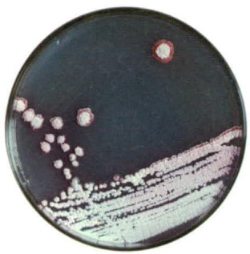

natural_image

Petri dish with bacterial colonies on agar medium (no text or labels visible)

(a)

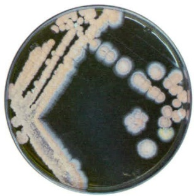

natural_image

Petri dish with bacterial colonies on agar medium (no visible text or labels)

(b)

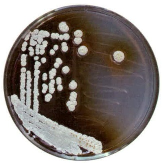

natural_image

Petri dish with bacterial colonies on agar medium (no text or labels visible)

(c)

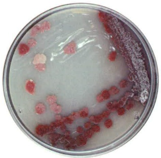

natural_image

Petri dish containing bacterial colonies with red and white colonies, no visible text or labels

(d)

图 14-14 产生不同色素的链霉菌菌落形态（图片来源:中国科学院微生物研究所刘庆）

（a）紫色链霉菌（Streptomyces violaceus）CGMCC 4.75；（b）广岛链霉菌（Streptomyces hiroshimensis）CGMCC 4.947；（c）圈卷产色链霉菌（Streptomyces ansochromogenes）CGMCC 4.321；

(d) 三色链霉菌（Streptomyces tricolor）CGMCC 4.1092

图 14-15 节杆菌细胞分裂的透射电镜图（图片来源:武汉大学彭方）

节杆菌（Arthrobacter sp.）24S4-2分离自南极冰川沉积物。（a）细胞分裂处（箭头）；（b）形成V形细胞

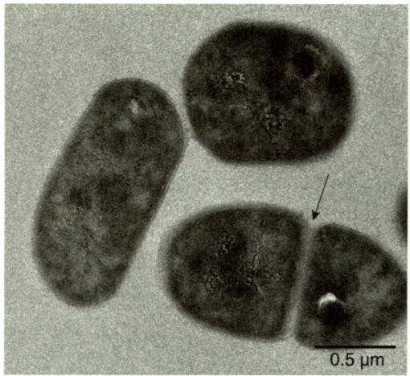

natural_image

Microscopic view of three rod-shaped bacterial cells with a 0.5 μm scale bar, showing internal structures and a marked region (no text or symbols beyond scale indicator)

(a)

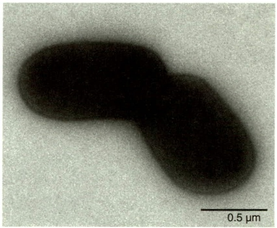

natural_image

Microscopic image of a dark, elongated biological structure with a 0.5 μm scale bar (no text or symbols beyond scale indicator)

(b)

棒状细菌是革兰氏阳性、好氧、不运动的棒状细菌，在生长过程中会形成不规则形、棍棒形或 V 形细胞排列。V 形细胞是由于细胞分裂后突然发生运动而形成的，这一过程被称为 “断裂分裂”（snapping division）。由于细胞壁由两层组成，只有内层参与横壁的形成，因此横壁形成后两个子细胞仍由细胞壁外层连接，当细胞一侧的外层局部破裂后，两个细胞会向远离破裂侧弯曲，从而形成 V 形（图 14-15）。

棒状细菌的主要属是棒状杆菌属和节杆菌属。棒状杆菌属由种类繁多的细菌组成，包括动植物病原菌和腐生菌。某些种类，如白喉棒状杆菌（Corynebacterium diphtheriae），可引起白喉病。节杆菌属主要由土壤微生物组成，其发育周期与棒状杆菌有差别，前者的细胞形态会在杆状和球状之间发生变化。棒状杆菌的细胞末端经常发生膨胀，其外观呈棒状，该外观在节杆菌中不常见。

丙酸杆菌属最早是在瑞士奶酪中发现的，其发酵过程中产生的  $CO_{2}$  会产生特征性小孔，该菌产生的丙酸也是奶酪风味独特的原因之一。这类细菌是厌氧菌，可发酵乳酸、糖类和多羟基醇，主要产物为丙酸、乙酸和  $CO_{2}$ 。

乳酸是许多细菌的发酵产物。瑞士奶酪生产中的起始培养物由同型发酵的链球菌和乳酸杆菌，以及丙酸细菌混合组成。在凝乳（蛋白质和脂肪）形成过程中，同型发酵菌将乳糖初步发酵为乳酸；凝乳沥干后，丙酸细菌迅速生长，产生的  $CO_{2}$  在凝乳中扩散并聚集在薄弱点，形成瑞士奶酪特征性“眼睛”（或小孔）。因此，丙酸细菌可从其他细菌发酵产物中无氧获取能量，这种新陈代谢策略被称为二次发酵。

## (3) 分枝杆菌

代表属:分枝杆菌属（Mycobacterium）。

分枝杆菌在土壤中很常见，大多数对人体无害，但有数个种是人类病原菌，其中最主要的是结核分枝杆菌（Mycobacterium tuberculosis），它是结核病的病原菌。分枝杆菌呈杆状，在其生长周期的某些阶段具有独特的染色特性，称为耐酸性（acid-fastness），主要是由于该菌细胞表面存在一种独特的脂质物质，称为分枝菌酸（mycolic acid），该物质仅存在于分枝杆菌属细菌。分枝菌酸是一组复杂的支链羟基脂质，可与细胞壁中的肽聚糖共价结合，该复合物使细胞表面具有蜡状疏水性。

由于分枝杆菌表面呈蜡状，因此无法用革兰氏染色法染色。耐酸染色法使用碱性紫红素和苯酚的混合物进行染色。通过缓慢加热可使染色剂进入细胞，苯酚的作用是增强染料对脂质的渗透。样品经蒸馏水冲洗后，用酸性乙醇脱色，并用亚甲基蓝复染。耐酸菌细胞染成红色，而背景和非耐酸菌则呈蓝色。

分枝杆菌具有多形性，可能会出现分枝甚至丝状生长。不过，与常见的放线菌菌丝不同，分枝杆菌不会形成真正的菌丝。分枝杆菌可分为两大类，即结核分枝杆菌、鸟分枝杆菌（M. avium）、牛分枝杆菌（M. bovis）、戈登分枝杆菌（M. gordonae）等生长缓慢的种类，以及耻垢分枝杆菌（M. smegmatis）、草分枝杆菌（M. phlei）、龟分枝杆菌（M. chelonae）、副偶发分枝杆菌（M. parafortuitum）等生长迅速的种类。结核分枝杆菌是一种典型的生长缓慢的分枝杆菌，接种后需要经过数天至数周的培养才能形成肉眼可见的菌落。在固体培养基上生长时，有的分枝杆菌会形成紧密、起皱的菌落，有的则形成黏稠、隆起的菌落（图 14-16）。这种菌落形态可能由细胞表面的高脂质含量和疏水性引起，有利于细胞黏合在一起。

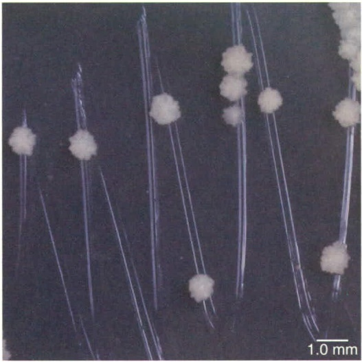

natural_image

Microscopic view of rod-shaped bacterial cells with visible colonies, scale bar indicates 1.0 mm (no text or symbols present)

(a)

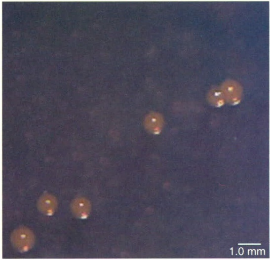

natural_image

Microscopic view of spherical particles or cells against a dark background, scale bar indicates 1.0 mm (no text or symbols present)

(b)

图 14-16 分枝杆菌的菌落形态（图片来源:中国科学院微生物研究所刘庆；自然资源部第三海洋研究所邵宗泽）

（a）耻垢分枝杆菌（Mycobacterium smegmatis）
CGMCC1.2621，菌落紧密、皱褶；（b）多孔分枝杆菌（Mycobacterium poriferae）
MCCC 1A16626 的菌落，菌落黏稠、隆起

## 14.1.3 拟杆菌门

拟杆菌门（Bacteroidota）包含1 000余个已描述的种类，主要分布在拟杆菌目（Bacteroidales）、噬纤维菌目（Cytophagales）、黄杆菌目（Flavobacteriales）和鞘氨醇杆菌目（Sphingobacteriales）4个目中。该门为革兰氏阴性、不产芽孢的杆菌，该门细菌通常具有蔗糖降解能力，具有严格好氧、兼性好氧和严格厌氧的类群。该门细菌普遍存在滑行运动，少数种类通过鞭毛运动，也有许多种类不能运动。该门细菌在自然界分布广泛，是陆地和水生环境中常见的微生物。由于拟杆菌属是人类肠道微生物的主要组分，因此已得到非常深入的研究。

## 14.1.3.1 拟杆菌目

代表属:拟杆菌属（Bacteroides）。

拟杆菌目中主要包含严格厌氧的发酵种类。标准属为拟杆菌属，该属细菌可发酵蔗糖、其他糖类或蛋白质（取决于物种），以乙酸和丁酸作为主要发酵产物。拟杆菌属细菌通常为共生菌，存在于人类和其他动物肠道，是人类大肠中数量最多的细菌。然而，有些拟杆菌属细菌偶尔也可成为病原菌，是人类菌血症等感染病相关的最重要的厌氧细菌。

多形拟杆菌（Bacteroides thetaiotaomicron）是人类大肠中数量最多的拟杆菌属细菌之一，专门分解复杂多糖，其基因组的大部分基因用于编码多糖分解酶，基因组中糖类代谢基因的多样性和数量远远超过任何其他细菌类群。多形拟杆菌产生许多人类基因组不编码的酶，极大地增加了其在人体消化道中分解植物聚合物的多样性。

拟杆菌属细菌是少见的可合成神经酰胺脂质的细菌类群之一，该类脂质用长链氨基醇神经酰胺取代脂质骨架中的甘油。鞘磷脂、脑苷脂和神经苷脂等神经酰胺脂质，在哺乳动物大脑和其他神经组织中广泛存在，但在细菌中很罕见。拟杆菌门的许多其他属，如弯杆菌属（Flectobacillus）、普雷沃氏菌属（Prevotella）、卟啉单胞菌属（Porphyromonas）和鞘氨醇杆菌属（Sphingobacterium）也可产生鞘脂质。

## 14.1.3.2 噬纤维菌目

代表属:噬纤维菌属（Cytophaga）。

噬纤维菌目细菌几乎全部为严格好氧菌，仅有部分种类具发酵能力。该目细菌通常为细长杆状，常具尖端，进行滑行运动。噬纤维菌专门分解复杂多糖，在土壤和淡水中广泛分布，在纤维素消化细菌中占了很大比例。

噬纤维菌有两种纤维素降解机制。第一种机制是分泌胞外纤维素酶，在细胞外分解不溶性纤维素。菌株可分泌内切纤维素酶（切割内部的  $\beta-1,4-$  糖苷键）和外切纤维素酶（切割末端的  $\beta-1,4$  糖苷键）的复杂混合物，释放纤维二糖。这些胞外酶将不溶性纤维素分解为容易被细胞吸收的可溶性多糖和二糖。哈氏噬纤维菌（Cytophaga hutchinsonii）不产生胞外纤维素酶，需要纤维素与细胞壁表面的纤维素酶进行物理接触，才能进行纤维素降解。

噬纤维菌属细菌不仅可降解纤维素，还可降解琼脂和几丁质。噬纤维菌可在含有纤维素的琼脂上培养。生孢噬纤维菌属（Sporocytophaga）与噬纤维菌属在形态和生理上类似，但细胞可形成休眠球形结构——微囊，与黏细菌的子实体结构类似。

有一些噬纤维菌是鱼类病原菌，在养殖渔业可引起严重问题。比如，柱状噬纤维菌（Cytophaga columnaris）可引起柱状菌病（columnaris disease），而嗜冷黄杆菌（Flavobacterium psychrophilum）可引起冷水病（cold-water disease）。这些疾病主要发生在受环境胁迫的鱼类，如水产养殖鱼类。感染的鱼类在鳃附近会出现组织破坏，可能是由噬纤维菌分泌的蛋白酶引起的。

## 14.1.3.3 黄杆菌目

代表属:黄杆菌属（Flavobacterium）、海水菌属（Aquimarina）。

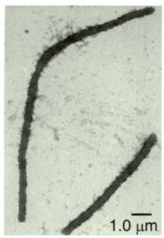

natural_image

Microscopic view of two elongated, curved dark structures on a light background with a 1.0 μm scale bar (no text or symbols beyond scale indicator)

(a)

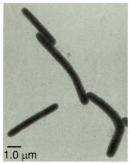

natural_image

Microscopic image of rod-shaped bacterial cells with 1.0 μm scale bar (no text or symbols beyond scale indicator)

(b)

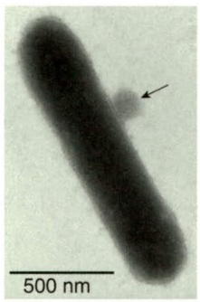

natural_image

Microscopic image of a rod-shaped bacterial cell with 500 nm scale bar, showing internal structure and an arrow indicating a specific region (no text or symbols beyond scale and label)

(c)

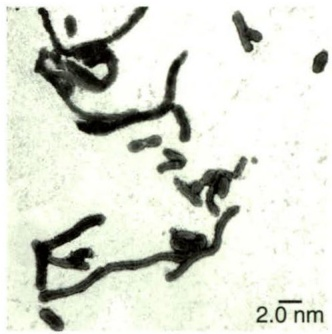

natural_image

Microscopic image of rod-shaped bacterial cells with 2.0 nm scale bar (no text or symbols beyond scale indicator)

(d)

黄杆菌目通常包含好氧和兼性好氧的化能异养菌，广泛分布于土壤和水生环境。多数物种可进行滑行运动，可降解多种复杂多糖。黄杆菌目细菌在海洋水体中特别丰富。该目许多细菌呈长杆状，有些种类呈多形性，有些种类细胞表面有附属物（图 14-17）。

黄杆菌属大多数种类是专性好氧菌，但有一些种类可进行厌氧呼吸，还原硝酸盐。黄杆菌通常产生黄色色素、嗜糖，大多数种类也可以降解淀粉和蛋白质。黄杆菌很少具有致病性，但脑膜炎脓毒性黄杆菌（Flavobacterium meningosepticum）曾引起婴儿脑膜炎，有的种类还可引起鱼类疾病。

有一些黄杆菌目细菌具有嗜冷性或耐冷性，如极地杆菌属（Polaribacter）和冷弯曲菌属（Psychroflexus）。这些细菌通常分离自寒冷环境，如极地水域和海冰。许多相关属可在20℃以下生长良好，可能造成食品变质。该目未发现病原菌。

## 14.1.3.4 鞘氨醇杆菌目

代表属:屈挠杆菌属（Flexibacter）。

鞘氨醇杆菌目细菌的表型特征与许多黄杆菌目相似。与黄杆菌目相比，鞘氨醇杆菌目细菌对复杂多糖的降解谱更广，与噬纤维菌目细菌的降解谱更为接近。屈挠杆菌属是鞘氨醇杆菌目的典型属，通常需要复杂的培养基才能良好生长，且不能降解纤维素。某些屈挠杆菌的细胞形态也会从长而滑动的纤维状细胞（缺乏交叉壁）转变为短而不可滑动的杆状细胞。许多屈挠杆菌因其细胞质膜中的类胡萝卜素或细胞外膜中的黄色素（flexirubins）而呈现颜色。屈挠杆菌在土壤和淡水中普遍存在，可降解多糖，目前尚未发现其致病性。

## 14.1.4 衣原体门、浮霉菌门和疣微菌门

衣原体门（Chlamydiota）和浮霉菌门（Planctomycetes）缺乏关键的细胞分裂蛋白FtsZ，产生异常的细胞结构。衣原体门包括细胞内寄生菌，而浮霉菌门和疣微菌门（Verrucomicrobiota）在土壤和水生系统中广泛分布。

衣原体门、浮霉菌门和疣微菌门具有共同祖先，它们之间的亲缘关系比其他门更近（图 14-18）。这三个门的细菌分布于土壤、水生系统等各种生境中，有的寄生于

图 14-17 黄杆菌目细菌的细胞形态（图片来源:中国海洋大学张晓华）

(a) 狭长海水菌（Aquimari-na longa），细胞呈长杆状；(b) 海南海水菌（Aquimari-na hainanensis）；(c) 橙色具柄菌（Muricauda lutea），细胞表面有附属物（箭头所指）；(d) 巨大鱼肠杆菌（Ichthyenterobacterium magnum），细胞呈多形性

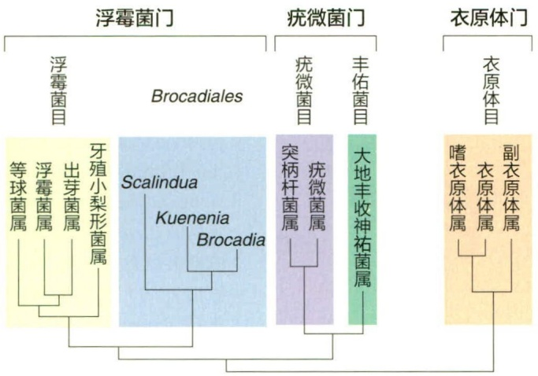

flowchart

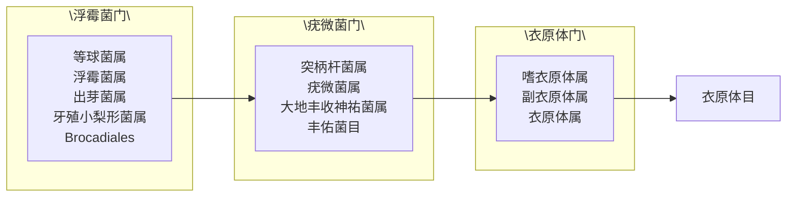

图 14-18 衣原体门、浮霉菌门和疣微菌门的主要目

以衣原体门、浮霉菌门和疣微菌门代表性属的 16S rRNA 基因序列构建的系统发育树

真核宿主。不同于一般细菌，衣原体门和浮霉菌门缺少编码细胞分裂蛋白 FtsZ 的基因，FtsZ 是细胞分裂中形成隔膜的关键蛋白质。FtsZ 对大多数细菌的细胞分裂是必不可少的，因此人们对衣原体门和浮霉菌门细菌在没有 FtsZ 时是如何分裂的很感兴趣。

## 14.1.4.1 衣原体门

代表属:衣原体属（Chlamydia）、嗜衣原体属（Chlamydophila）、副衣原体属（Parachlamydia）。

衣原体门只包含一个目，即衣原体目（Chlamydiales）。整个门由真核生物特别是人类的专性胞内寄生菌组成。衣原体的基因组很小，约1 Mbp，是生化特征最受限制的已知细菌之一。衣原体无法合成生长所需的许多维生素和生长因子，必须从宿主细胞质中获得

这些分子。

衣原体除了缺乏细胞分裂关键蛋白 FtsZ 外，许多种类还缺乏细胞壁。衣原体最大限度地减少了自身的肽聚糖，以避免被宿主免疫系统发现。尽管衣原体缺乏细胞壁，但其仍然需要形成环状肽聚糖结构，以促进细胞分裂期间隔膜的形成。

衣原体作为人类病原菌，其特征已得到详细描述，但该门还包含寄生于其他真核生物的种类。衣原体细胞通常呈很小的球状，直径约  $0.5 \mu m$ ，并具有独特的生命周期。

## (1) 衣原体的生命周期

衣原体门物种的生命周期中有两种类型的细胞:①原体（elementary body），是小而致密的细胞，耐干燥，利于传播；②网状体（reticulate body），是较大而密度小的细胞，是营养体，可通过二分裂增殖。

原体是非增殖细胞，专门用于传染性传播，而网状体为非感染性形式，其功能为在宿主细胞内繁殖。与立克次氏体不同，衣原体不通过节肢动物传播，而主要通过空气传播进入呼吸系统，因此原体的抗干燥性具有重要意义。经过多次细胞分裂后，转化为原体。当宿主细胞解体时，原体被释放出来，然后感染附近的其他宿主细胞。网状体的代时为2\~3 h，比立克次氏体的代时短得多。

## (2) 衣原体的重要属

不同种类的衣原体感染不同的真核宿主。棘阿米巴副衣原体（Parachlamydia acanthamoeba）可感染自由生活的变形虫，特别是棘阿米巴属（Acanthamoeba）的变形虫，在感染变形虫过程中表现出典型的衣原体生命周期。棘阿米巴副衣原体还会感染人体，其致病性比衣原体小得多。

研究最多的衣原体是感染人类的衣原体属和嗜衣原体属。这两个属中公认的种类有鹦鹉热衣原体（Chlamydophila psittaci；鹦鹉热病的病原菌）、沙眼衣原体（Chlamydia trachomatis；沙眼的病原菌）和肺炎衣原体（Chlamydophila pneumoniae；

某些呼吸系统综合征的病原菌）。鹦鹉热是一种鸟类流行病，偶尔会传播给人类，并导致肺炎样症状。沙眼是一种以角膜血管化和瘢痕形成为特征的眼睛疾病，是人类失明的主要原因。中国科学家汤飞凡于1956年从沙眼中首次分离出沙眼衣原体。沙眼衣原体还可感染泌尿生殖道，是目前主要的性传播疾病之一。

## 14.1.4.2 浮霉菌门

代表属:浮霉菌属（Planctomyces）、牙殖小梨型菌属（Blastopirellula）、出芽菌属（Gemmata）、Brocadia。

浮霉菌门包括许多形态独特的细菌类群，主要分布在两个目，即浮霉菌目（Planctomycetales）和 Brocadiales。浮霉菌门是革兰氏阴性细菌，通常具有柄或附属物，许多种类可形成玫瑰花结（细胞极端附着在一起形成细胞簇）。该门广泛分布于土壤和水生环境中，很少有致病性。浮霉菌门具有一系列不寻常的细胞特征。

浮霉菌缺乏细胞分裂蛋白 FtsZ，它们通过类似于酵母菌的出芽方式分裂。长期以来，浮霉菌被认为缺乏肽聚糖，透射电镜观察到某些种类存在“核被膜”或其他囊泡样细胞器（图 14-19）。浮霉菌中原核和真核细胞特征的独特结合，多年来被认为是细胞演化中缺失的一环。然而，肽聚糖的缺失和囊泡样细胞器的性质之谜最终将随着微生物学技术的进步而解开。

浮霉菌门的有些类群（如 Brocadiales）可在缺氧条件下通过氧化  $NH_{4}^{+}$ 、还原  $NO_{2}^{-}$  生成  $N_{2}$ ，这些类群被称为厌氧氨氧化细菌（anammox bacteria），在氮循环中发挥重要作用。厌氧氨氧化细菌具有特殊的膜间隔区域，即厌氧氨氧化体（anammoxosome）（图 14-20），是厌氧氨氧化作用发生的场所，其膜上有由环丁烷组成的梯形醚状脂质。这种致密的醚状脂质对细菌自身有保护作用，使其免受厌氧氨氧

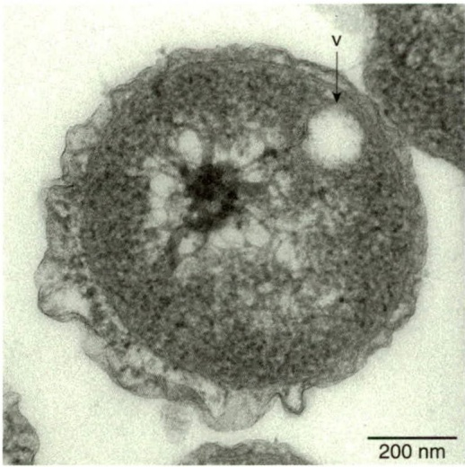

natural_image

Microscopic image of a circular cellular structure with a 200 nm scale bar, showing internal organelles and a labeled feature (v), no readable text or symbols beyond labels.

图 14-19 浮霉菌门细菌的囊泡样细胞器（图片来源:中国科学院海洋研究所孙超岷）

分离自南海冷泉沉积物的异养海绵球菌（Poriferisphaera heterotrophicis）ZRK32，其细胞电镜切片中可见囊泡样细胞器（V）

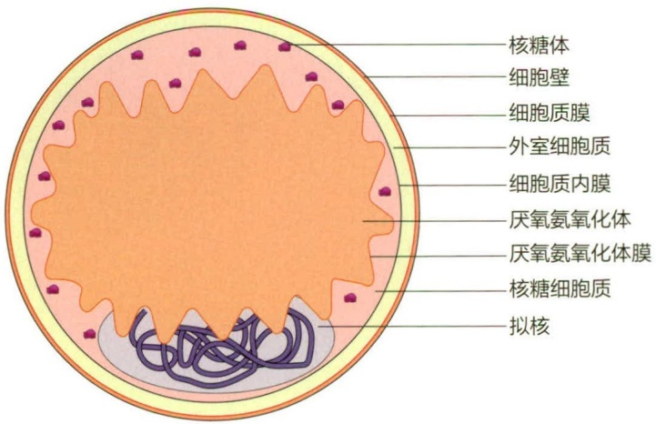

text_image

核糖体
细胞壁
细胞质膜
外室细胞质
细胞质内膜
厌氧氨氧化体
厌氧氨氧化体膜
核糖细胞质
拟核

图 14-20 厌氧氨氧化细菌的细胞模型

化作用生成的有毒中间产物肼所造成的伤害。细胞最外层为蛋白质亚基晶体排列组成的S层。厌氧氨氧化细菌生长缓慢（14～21 d/代），难以分离纯化，迄今仍未获得纯培养菌株。

## 14.1.4.3 疣微菌门

代表属:疣微菌属（Verrucomicrobium）、突柄杆菌属（Prosthecobacter）。

疣微菌门至少有 4 个已描述的目，但大多数种类属于疣微菌目。疣微菌门是好氧或兼性好氧菌，能发酵糖类。嗜甲酸菌属（Methylacidiphilum）比较特殊，含有好氧甲烷氧化菌。疣微菌门广泛分布于自然界，栖息在淡水、海洋、森林和土壤环境。与浮霉菌门类似，疣微菌门也具有膜包围的细胞内结构。疣微菌门通常由胞质突出形成菌柄或形成其他皱褶（图 14-21）。疣微菌门细胞壁中含有肽聚糖，与浮霉菌门有着明显区别。

疣微菌属和突柄杆菌属细菌的每个细胞会产生2至数个菌柄。与包含单个菌柄的柄杆菌属细胞不同，疣微菌属和突柄杆菌属是对称分裂的，母细胞和子细胞在细胞分裂时都具有菌柄。

突柄杆菌属细菌具有与真核细胞微管蛋白编码基因高度同源的两个基因。微管蛋白是构成真核细胞骨架的关键蛋白质。虽然细胞分裂蛋白 FtsZ 也是微管蛋白同源物，但突柄杆菌属的微管同源蛋白在结构上比 FtsZ 更接近真核微管蛋白。由于在这些生物中尚未发现真核类细胞骨架，所以其微管同源蛋白在突柄杆菌中的作用尚不清楚。

图14-21 分离自深海冷泉的疣微菌门细菌 (Verrucomicrobiota sp.) ZRK36 的电镜照片（图片来源:中国科学院海洋研究所孙超岷）

（a）透射电镜复染照片，可见疣状突起；（b）细胞切片的透射电镜照片，可见细胞表面不均匀的突起

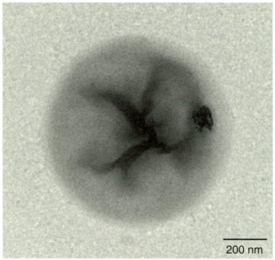

natural_image

Microscopic image showing a circular structure with a dark central region and a 200 nm scale bar (no text or symbols beyond scale indicator)

(a)

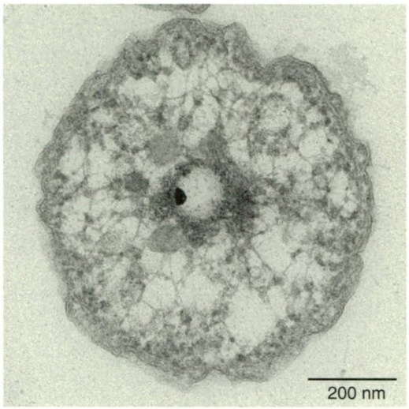

natural_image

Microscopic image of a biological cell or microorganism with visible internal structures and a 200 nm scale bar (no text or symbols beyond scale indicator)

(b)

## 14.1.5 热袍菌门、热脱硫杆菌门和产液菌门

超级嗜热的细菌门类在细菌系统发育树的根部附近，支持地球上最早的细菌细胞嗜热的观点。超嗜热细菌的三个门，即热袍菌门（Thermotogota）、热脱硫杆菌门（Thermodesulfobacteriota）和产液菌门（Aquificota），集中在细菌系统发育树的根部附近(图 14-1)。每个门中有 1\~2 个主要属，多数种类的主要生理特征是嗜高温，最适生长温度在  $80^{\circ}$ C 以上。

## 14.1.5.1 热袍菌门

代表属:热袍菌属（Thermotoga）、广袍菌属（Kosmotoga）。

热袍菌门细菌主要生长在低盐火山岩或高温环境中，包括大约12个已培养属。这些种类都是化能异养、厌氧细菌，许多种类是嗜热菌或超嗜热菌，也有少量嗜中温菌。代表属热袍菌属和广袍菌属物种是杆状或球杆状超嗜热细菌，形成鞘状的包膜，称为袍（toga）（图14-22）。其肽聚糖的氨基酸成分不同于其他细菌，脂质中还含有特殊的长链脂肪酸。它们均为发酵性厌氧菌，分解糖或淀粉，以乳酸、乙酸、 $CO_{2}$ 和 $H_{2}$ 为发酵产物。这些细菌也可

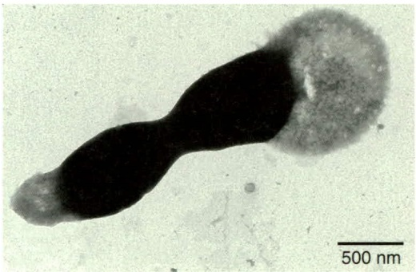

natural_image

Microscopic image of a sperm cell with dark nucleus and surrounding cytoplasm, scale bar indicates 500 nm (no text or symbols present)

图 14-22 太平洋广袍菌（Kosmotoga pacifica）

(图片来源: 自然资源部第三海洋研究所邵宗泽)

可见从细胞两端延伸出疏松的鞘

以利用  $H_{2}$  为电子供体，铁为电子受体，进行无氧呼吸。这些属的种类可从陆地热泉和海洋热液喷口中分离出来。

尽管热袍菌属是细菌，但其基因组含有许多与超嗜热古菌具高同源性的基因。20%以上的热袍菌属基因可能是通过水平基因转移从古菌演化而来。尽管在其他细菌基因组中也存在少数与古菌类似的基因（反之亦然），但只在热袍菌属中发现如此多的域间水平基因转移。

## 14.1.5.2 热脱硫杆菌门

代表属:热脱硫杆菌属（Thermodesulfobacterium）、假脱硫弧菌属（Pseudodesulfovibrio）。

热脱硫杆菌门是一类嗜热硫酸盐还原细菌，在系统发育树上位于热袍菌门和产液菌门之后。热脱硫杆菌属是一类严格厌氧菌，利用乳酸盐、丙酮酸盐和乙醇（但不使用乙酸盐）等化合物作为电子供体，将  $SO_{4}^{2-}$  还原为  $H_{2}S$ ，与  $\delta-$  变形菌纲的脱硫弧菌属的作用类似（见 14.1.1.4）。

热脱硫杆菌属的一个特殊生化特征是产生醚脂（ether-linked lipids）。醚脂是古菌的生物标志物，在古菌中，聚类异戊二烯  $C_{20}$  烃（植烷基）取代脂肪酸作为脂质侧链。然而，在热脱硫杆菌属中，醚连接的脂质非常特殊，甘油侧链不是古菌中的植烷基，

而是由独特的  $C_{17}$  烃和一些脂肪酸组成。因此，热脱硫杆菌门既有很深的系统发育谱系（图 14-1），又有结合了古菌和细菌特征的脂质谱系。目前在其他一些细菌中也发现了醚脂，因此在细菌中醚脂可能比以前认为的更常见。

假脱硫弧菌属是热脱硫杆菌门的另一代表属，多分离自海洋沉积物。其中蛇假脱硫弧菌（Pseudodesulfovibrio serpens）DSM 11384T 分离自南海冷泉，严格厌氧、极生单鞭毛、菌体呈 S 形（图 14-23），可进行硫酸盐还原作用。

## 14.1.5.3 产液菌门

代表属:产液菌属（Aquifex）、热发状菌属（Thermocrinis）。

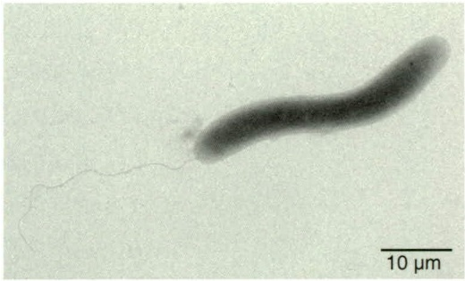

natural_image

Microscopic image of a rod-shaped bacterial cell with 10 μm scale bar (no text or symbols beyond scale indicator)

图 14-23 蛇假脱硫弧菌（Pseudodesulfovibrio serpens）（图片来源:中国科学院海洋研究所孙超岷）

产液菌属是专性化能自养超级嗜热菌，是所有细菌中最嗜热的类群。产液菌属细菌可利用  $H_{2}$ 、 $S^{0}$  或  $S_{2}O_{3}^{2-}$  作为电子供体， $O_{2}$  或  $NO_{3}^{-}$  作为电子受体，在高达  $95^{\circ}C$  的温度下生长。产液菌属细菌只能耐受很低的  $O_{2}$  浓度（微好氧），且不能利用有机物。氢杆菌属（Hydrogenobacter）是产液菌属的近亲，大部分特性与产液菌属相同，但是专性好氧菌。

## (1) 产液菌属和自养作用

产液菌属的自养作用通过反向柠檬酸循环（reverse citric acid cycle）进行，此前仅在绿硫细菌中发现该途径。嗜火产液菌（Aquifex pyrophilus）和风产液菌（A. aeolicus）的DNA均具有高G+C含量，使其适宜高温度生长，最高可达95℃。它们的基因组序列揭示了完全化能自养的生活方式，由仅约1.55 Mbp的基因组编码。古菌和细菌中如此多的极端嗜热种类，均为 $H_{2}$ 化能自养菌，而且它们在各自的系统发育树上均为早期谱系，表明 $H_{2}$ 是地球早期原始生命能量代谢的关键电子供体，且最早的细胞可能是嗜热生物。

## (2) 热发状菌属

热发状菌属是产液菌属和产氢菌属的近亲。该菌的最适生长温度为 $80^{\circ}\mathrm{C}$ 以下，化能自养，以 $\mathrm{H}_{2}$ 、 $\mathrm{S}_2\mathrm{O}_3^{2-}$ 或 $\mathrm{S}^0$ 为电子供体， $\mathrm{O}_2$ 为电子受体。该属唯一物种为红色热发状菌（Thermocrinis ruber），生长在美国黄石公园某些温泉的流出口，形成粉色“飘带”，由附着在硅质沉积物上的丝状细胞组成。在静态培养中，红色热发状菌以单个杆状细胞生长。然而，当在流动系统中培养时，其细胞形态与在自然栖息地中类似。

## 14.1.6 奇异球菌门、酸杆菌门和硝化螺菌门

本部分主要介绍在环境中丰度很高且分布广泛，但较难培养的奇异球菌门（Deinococcota）、酸杆菌门（Acidobacteriota）和硝化螺菌门（Nitrospirota）。目前对它们的了解大多基于宏基因组学研究，尤其是酸杆菌门在土壤中的多样性和丰度非常高。

## 14.1.6.1 奇异球菌门

代表属:奇异球菌属（Deinococcus）、栖热菌属（Thermus）。

奇异球菌门是一群对环境具有高度抗逆性的球状细菌，包括三个目，即奇异球菌目（Deinococcales）、特吕珀菌目（Trueperales）和栖热菌目（Thermales），包含少数几个已描述的属。该门细菌通常为好氧化能异养菌，可代谢糖类、氨基酸和有机酸或各种复杂的混合物。虽然该门成员革兰氏染色阳性，但其具有革兰氏阴性菌的细胞壁结构，具革兰氏阴性细菌特有的外膜。然而，该门细菌的外膜缺乏脂质A，还含有一种特别的肽聚糖，在N-乙酰胞壁酸交联中以鸟氨酸取代了二氨基庚二酸。

栖热菌目（Thermales）细菌通常是嗜热菌或超嗜热菌，模式属是栖热菌属（Thermus）。20世纪60年代中期，Thomas Brock在美国黄石公园的一个温泉中发现了水生栖热菌（Thermus aquaticus），随后人们又从热水器等高温系统中分离出水生栖热菌，从中发现了 Taq DNA 聚合酶。由于 Taq 聚合酶的热稳定性很高，因此扩增 DNA 的聚合酶链反应（PCR）技术能够完全自动化，促进了整个生物学的快速发展。

## (1) 奇异球菌的抗辐射能力

奇异球菌目（Deinococcales）细菌具有极强的抗辐射能力，而耐辐射奇异球菌（Deinococcus radiodurans）是该方面研究最深入的种类。由于含有类胡萝卜素，大多数奇异球菌呈红色或粉红色，而且许多奇异球菌对辐射和干燥都有很强的抵抗力。例如，耐辐射奇异球菌细胞在15 000戈瑞（Gy）的电离辐射（1 Gy = 100 拉德）下仍能存活，该条件足以将生物染色体粉碎成数百个碎片。分离自极地土壤环境的耐冷奇异球菌（Deinococcus psychrotolerans）

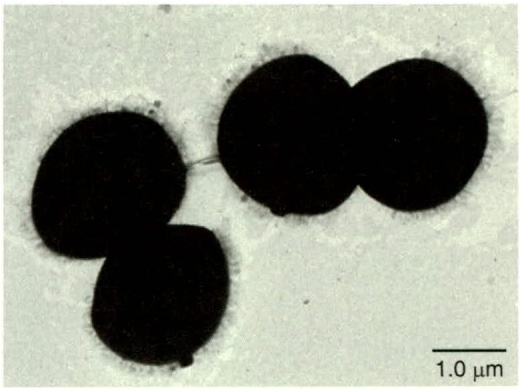

natural_image

Microscopic image of three dark circular structures on a light background, scale bar indicates 1.0 μm (no text or symbols present)

图 14-24 具有抗辐射能力的耐冷奇异球菌（Deinococcus psychrotolerans）的透射电镜图（图片来源:武汉大学彭方）

（图 14-24）的抗辐射能力较耐辐射奇异球菌稍弱。相比之下，一些芽孢在低水平辐射下就会死亡，而人在不到  $10 \, Gy$  的辐射下就会死亡。

除了抗辐射能力外，耐辐射奇异球菌还能抵抗许多诱变剂的作用。唯一对耐辐射奇异球菌起作用的化学诱变剂是亚硝基胍等物质，能诱导 DNA 缺失。

## (2) 奇异球菌的 DNA 修复

耐辐射奇异球菌对受损 DNA 的修复效率很高。该菌存在几种不同的 DNA 修复酶，除了 RecA 之外，还存在几种不依赖于 RecA 的 DNA 修复系统，可修复单链或双链 DNA 的断裂、切除错误的碱基。该菌的修复过程非常有效，甚至可以把染色体从碎片状态重新组合起来。

耐辐射奇异球菌细胞中 DNA 的独特排列方式可能在抗辐射中发挥了重要作用。该菌细胞以成对或四分体的形式存在，其 DNA 并不像典型的类核那样分散在细胞内，而是有序地排列成环状（卷曲或堆叠的环）结构。环状结构为同源重组提供了平台，相邻隔室的拟核融合后可促进 DNA 修复。在这种广泛的 DNA 重组过程中，会产生一条修复后的染色体，含有这条染色体的细胞可以生长和分裂。

## 14.1.6.2 酸杆菌门

代表属:酸杆菌属（Acidobacterium）。

16S rRNA 基因分析表明，酸杆菌门细菌在环境中广泛存在。酸杆菌常见于土壤中，尤其是在酸性土壤（pH < 6.0）中，通常占土壤微生物群落的大部分。酸杆菌门还栖息于淡水、热泉微生物席、污水处理反应器和污泥中。然而，尽管酸杆菌在环境中广泛分布，但只有少数属被分离培养出来。

大多数已描述的酸杆菌都是革兰氏阴性、耐酸、好氧化能异养菌。荚膜酸杆菌（Acidobacterium capsulatum）分离自酸性矿井废水中，是一种专性好氧的荚膜细菌，可利用各种糖和有机酸生长。多态酸八叠球菌（Acidisarcina polymorpha）分离自森林的酸性土壤中，生长在由6\~8个细胞组成的立方体包囊中，也是耐酸菌。该菌好氧，能降解土壤中常见的纤维素和几丁质等聚合物。

## 14.1.6.3 硝化螺菌门

代表属:硝化螺菌属（Nitrospira）、钩端螺菌属（Leptospirillum）、磁杆菌属（Magnetobacterium）和热脱硫弧菌属（Thermodesulfovibrio）。

硝化螺菌门的基本特征为革兰氏阴性，弯曲、弧形或螺旋形细胞。其代谢方式多样，大部分为好氧、化能自养菌，包括亚硝酸盐氧化细菌（nitrite oxidizing bacteria, NOB）、异化硫酸盐还原细菌和趋磁细菌等类群。

硝化螺菌属是硝化螺菌门的代表属，其细胞呈松散螺旋状至弧状，周质空间的厚度是其他革兰氏阴性菌的2倍。与假单胞菌门的硝化杆菌属细菌一样，硝化螺菌属也是能把亚硝酸盐氧化为硝酸盐的化能自养菌。硝化螺菌属与硝化杆菌属的生存环境相似。然而，环境调查发现，自然界中硝化螺菌属比硝化杆菌属丰富得多，因此硝化螺菌属被认为是自然环境中亚硝酸盐氧化的主要驱动力，在废水处理厂和富氨土壤等富氮环境中，大多数亚硝酸盐可能被硝化螺菌所氧化。此外，近年来发现的全程硝化细菌（comammox），能够把氨直接氧化为硝酸盐，也被暂时归类于硝化螺菌属。钩端螺旋属（Leptospirillum）是一类好氧、嗜酸、铁氧化的化能自养菌，常见于开采煤和铁的酸性矿井废水中。

## 14.1.7 梭杆菌门、丝状杆菌门和互养菌门

梭杆菌门（Fusobacteriota）、丝状杆菌门（Fibrobacterota）和互养菌门（Synergistota）被描述的种类相对较少，它们通常具有发酵代谢。

## 14.1.7.1 梭杆菌门

代表属:梭杆菌属（Fusobacterium）。

梭杆菌门是一类革兰氏阴性、不产芽孢的杆菌，存在于沉积物、动物的胃肠系统（图 14-25）和口腔中。梭杆菌门细菌是专性厌氧菌，能发酵糖类、多肽和氨基酸。梭杆菌属细菌是人类微生物组的常见组分。梭杆菌具有黏附素，使之能牢固地

黏附于其他细菌或动物细胞。在口腔牙菌斑的形成上，梭杆菌的粘连发挥着重要的支撑作用。梭杆菌很难培养，在基于 DNA 的微生物群落研究技术发展起来后，才认识到其在人类微生物组中的重要作用。

虽然梭杆菌在健康个体的微生物组中很常见，但它们也与几种人类疾病和综合征有关。特别是在各种口腔疾病的患者中，梭杆菌的丰度增加。牙龈组织炎症和血管撕裂使梭杆菌和其他口腔细菌进入血液中。这些细菌可在动脉斑块中发现，甚至可能在心脏病中发挥作用。此外，血液中的梭杆菌也会对妊娠造成危害，而肠道中的梭杆菌可附着、定殖结肠癌细胞并促进其生长。使用抗生素甲硝唑治疗患有结肠癌的小鼠，既能降低肿瘤中梭杆菌的数量，又能减缓肿瘤的生长。

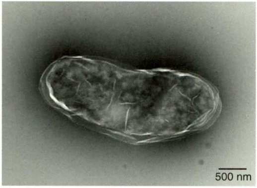

natural_image

Microscopic image of a nanoscale particle with 500 nm scale bar (no text or symbols on the particle itself)

图 14-25 分离自北海狮肠道的坏疽梭杆菌 (Fusobacterium necrogenes) SYSU M8D902 的透射电镜照片（图片来源:中山大学李文均）

## 14.1.7.2 丝状杆菌门

代表属:丝状杆菌属（Fibrobacter）。

虽然丝状杆菌门细菌的 16S rRNA 基因分布于多种栖息地，但唯一被描述的种类来自动物瘤胃。丝状杆菌门含有革兰氏阴性、具发酵能力的严格厌氧菌。然而，与大多数梭杆菌门和互养菌门细菌不同，丝状杆菌门细菌不能发酵蛋白质或氨基酸，而是专门发酵糖类，包括纤维素。在瘤胃中，纤维素是主要的能量来源，在该环境中，纤维素不仅是纤维杆菌门等纤维素分解细菌的能量来源，也是许多能利用纤维素降解产物葡萄糖的、非纤维素分解的厌氧细菌的能量来源。

## 14.1.7.3 互养菌门

代表属:联合菌属（Synergistes）。

互养菌门细菌是在陆地和海洋系统的动物和缺氧环境中发现的革兰氏阴性、不产芽孢的杆菌。已描述的物种通常是能够降解蛋白质并发酵氨基酸的专性厌氧菌。在动物中，它们最常见于胃肠道，如约氏联合菌（Synergistes jonesii）栖息于瘤胃中。在人类中，互养菌门细菌与某些软组织伤口和脓肿、牙菌斑和牙周病有关。

## 14.1.8 脱铁杆菌门和产金菌门

脱铁杆菌门（Deferribacterota）和产金菌门（Chrysiogenota）含有厌氧化能异养菌。大多数种类可通过厌氧呼吸将硝酸盐转化为亚硝酸盐或铵而生长。

## 14.1.8.1 脱铁杆菌门

代表属:脱铁杆菌属（Deferribacter）。

脱铁杆菌门细菌通常呈棒状或弧状，嗜中温或高温，是一类通过专性或兼性厌氧代谢获得能量的细菌，可利用多种电子受体，如 Fe（Ⅲ）、Mn（Ⅳ）、S$^{0}$、Co（Ⅲ）和硝酸盐，部分还可进行发酵代谢。该门细菌多生长于含有还原氢离子、高温、高盐、富含硫化物的环境中。脱铁杆菌属是脱铁杆菌门的代表属，是嗜热异化铁还原细菌，也能还原硝酸盐和金属氧化物。其中深海脱铁杆菌（D. abyssi）是分离自大西洋中脊深海热液喷口的嗜热厌氧化能自养菌，它的生存依赖于热液喷口的高温及特殊的化学生境，通过利用 Fe（Ⅲ）和 S$^{0}$ 氧化 H$_{2}$ 获取能量。为了防止被热液冲离，该属细菌会以微生物席的方式黏附于岩石上，或者通过鞭毛感知温度和化学信号，向适宜的生境移动。

## 14.1.8.2 产金菌门

代表属:产金菌属（Chrysiogenes）。

产金菌门的砷酸产金菌（Chrysiogenes arsenatis）及其近缘细菌，可氧化乙酸盐和其他有机化合物，并与作为末端电子受体的砷酸盐的还原相偶联，将砷酸盐还原为亚砷酸盐。除了还原砷酸盐之外，产金菌门的许多种类在厌氧呼吸中还可还原硒酸盐、亚硝酸盐、硝酸盐、硫代硫酸盐和元素硫。

## 14.2 古菌多样性

古菌是一类形态大小与细菌相似，但细胞表面结构及遗传机制等与细菌有本质区别的原核生物。古菌的英文名称“Archaea”，源自古希腊语，意为“古老的东西”。1977年，美国科学家卡尔·乌斯通过比较不同生物的核糖体小亚基RNA序列，建立了泛生命树（universal tree of life），并发现了古菌这一种新的生命形式。到1990年，卡尔·乌斯提出三域学说，将生物分为三个域（domain）:细菌域、古菌域和真核生物域。近年来，在高通量测序技术的快速发展下，古菌的多样性被进一步挖掘，许多新的门被发现，古菌域的生命之树也得到了极大的扩展。目前，古菌域中已报道超过30个门，它们至少组成了4个超群（supergroup），即广古菌门（Euryarchaeota）、TACK古菌超门、DPANN古菌超门和阿斯加德（Asgard）古菌类群（图14-26）。古菌分布广泛，无论是在高温、高寒、强酸、强碱以及高盐等极端环境，如酸性热泉、海底沉积物、深海热液口、盐碱湖、污水池等，还是在相对温和的环境，如普通土壤、沼泽地、动物（包括人）皮肤及消化道，都能检测到古菌的存在，这也凸显了古菌在地球生态系统中的重要地位。本节将对4个古菌超群中的重要门类进行物种和功能多样性的概述。

## 14.2.1 广古菌门

广古菌门（Euryarchaeota），前缀“eury”源自希腊语“euryos”，意为“宽广的，广泛的”。广古菌门是古菌域中早期被描述的门类之一，其覆盖的类群在生理、形态和地理分布方面具有高度的多样性，包含严格厌氧的产甲烷菌、严格好氧的嗜盐菌以及极端嗜热、嗜酸的好氧和厌氧菌。目前，广古菌门共有13个纲（Class），且每个纲都表现出独特的代谢特征和生活方式。

图 14-26 古菌域中 4 个超群及其门 / 纲类的系统发育树

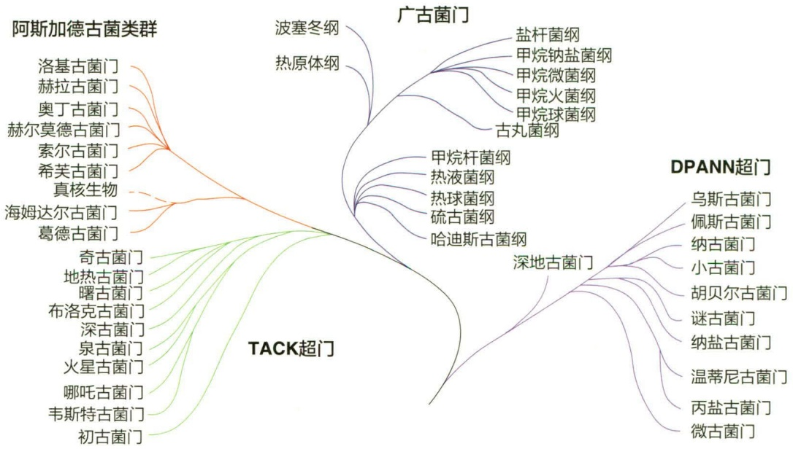

flowchart

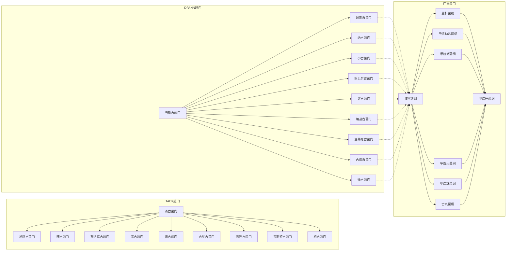

鳕八迭球菌（Sarcina morrhuae），是最早被描述的广古菌，后来更名为鳕盐球菌（Halococcus morrhuae），并被归为盐杆菌纲（Halobacteria）。目前，广古菌门中拥有最多数量和种类的已培养古菌菌株，其中大多数为产甲烷菌。这些产甲烷菌为专性厌氧菌，可以利用氢、甲酸、乙酸、甲醇或甲基化胺作为电子供体来还原二氧化碳产生甲烷。产甲烷菌在广古菌门中主要分布于5个纲，包括甲烷微菌纲（Methanomicrobia）（图14-27）、甲烷火菌纲（Methanopyri）、甲烷杆菌纲（Methanobacteria）、甲烷球菌纲（Methanococci）和甲烷钠盐菌纲（Methanonatronarchaeia）。

除了产甲烷菌外，盐杆菌纲（Halobacteria）、热原体纲（Thermoplasmata）、古丸菌纲（Archaeoglobi）以及热球菌纲（Thermococci）也已被成功培养。其中，盐杆菌纲中包含了许多嗜盐古菌类群，它们能够利用特殊的胞外及胞内酶，如水解酶和酯酶等，参与到碳和氮元素的生物地球化学循环中，在高盐环境中具有重要的生态功能（图14-28）。值得一提的是，我国科学家在盐湖样品中发现了一种新的具有形态发育过程的极端嗜盐古菌（Actinoarchaeum halophilum YIM 93972），它在形态上与放线菌相似，能够形成类似放线菌的菌丝体和孢子。古丸菌纲、热球菌纲和热原体纲则包含许多嗜热和超嗜热的化能自养或异养菌。热原体纲除嗜热外还具有嗜酸的特性，而且其中来自热原体属（Thermoplasma）和铁原体属（Ferroplasma）的成员具有明显的形态特征——缺少细胞壁。

这些成功培养的极端微生物不仅促进了人们对广古菌生理特征的认知，也加深了对极端环境下生物适应性的理解。例如，坎

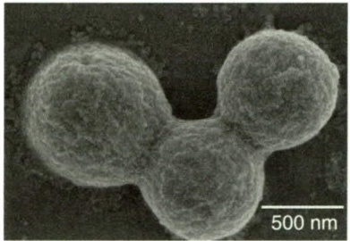

natural_image

Microscopic image of three spherical particles with a 500 nm scale bar (no text or symbols on the particles themselves)

(a)

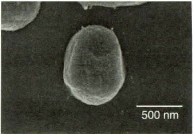

natural_image

Microscopic image of a spherical nanoparticle with 500 nm scale bar (no text or symbols beyond scale indicator)

(b)

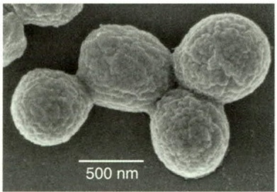

natural_image

Microscopic image of spherical nanoparticles with 500 nm scale bar (no text or symbols on particles)

(c)

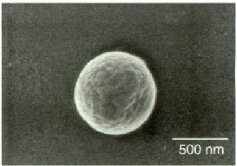

natural_image

Microscopic image of a spherical particle with textured surface, scale bar indicates 500 nm (no text or symbols present)

(d)

图 14-27 甲烷微菌纲中两种产甲烷古菌的电镜照片（图片来源:深圳大学李猛）

（a）和（b）沉积甲烷叶菌（Methanolobus sediminis FTZ6 $^{T}$ ）；（c）和（d）红树林甲烷叶菌（Methanolobus mangrovi FTZ2 $^{T}$ ）

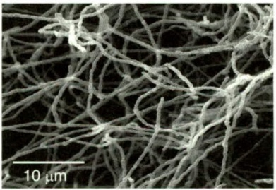

natural_image

Microscopic view of fibrous network structure with 10 μm scale bar (no text or symbols)

(a)

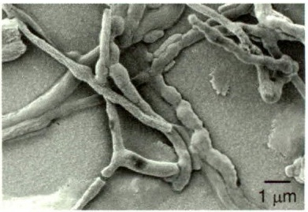

natural_image

Microscopic view of rod-shaped bacterial or fungal structures with 1 μm scale bar (no text or symbols)

(b)

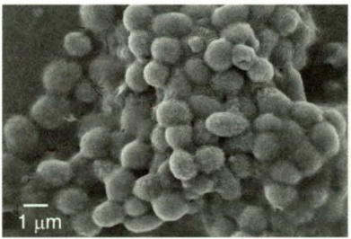

natural_image

Microscopic view of spherical particles with a 1 μm scale bar (no text or symbols beyond scale indicator)

(c)

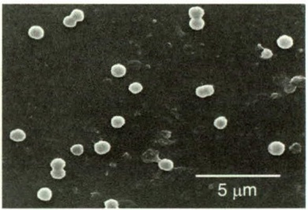

natural_image

Microscopic view of spherical particles on a dark background, scale bar indicates 5 μm (no text or symbols present)

(d)

图 14-28 多种嗜盐古菌的电镜照片（图片来源:南阳理工学院刘冰冰）
（a）嗜盐放线古菌（Actinoarchaeum halophilum YIM 93972）；（b）嗜盐丝状古菌（Halocatena salina NG A267-1）；（c）钠线菌（Natrinema sp. NG A387）；
（d）土生嗜盐古菌（Saliphagus infecundisoli YIM A93745 $^{T}$ ）