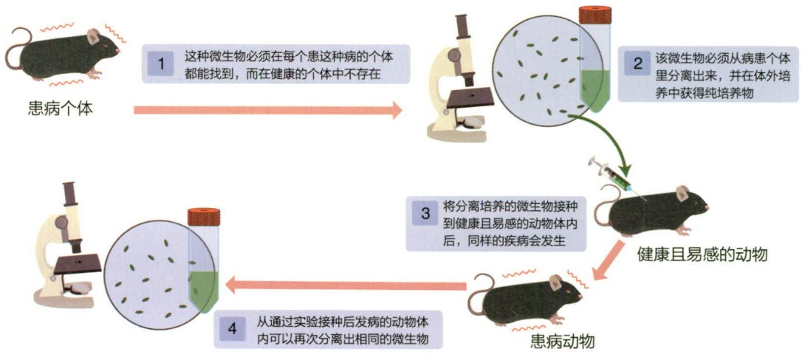
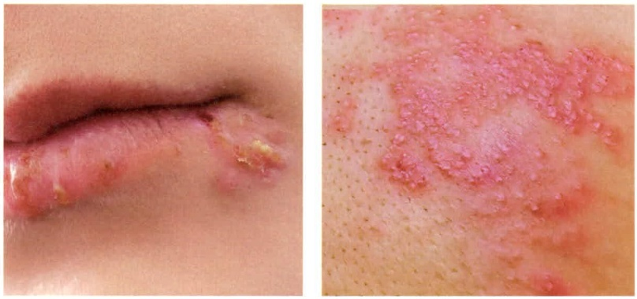
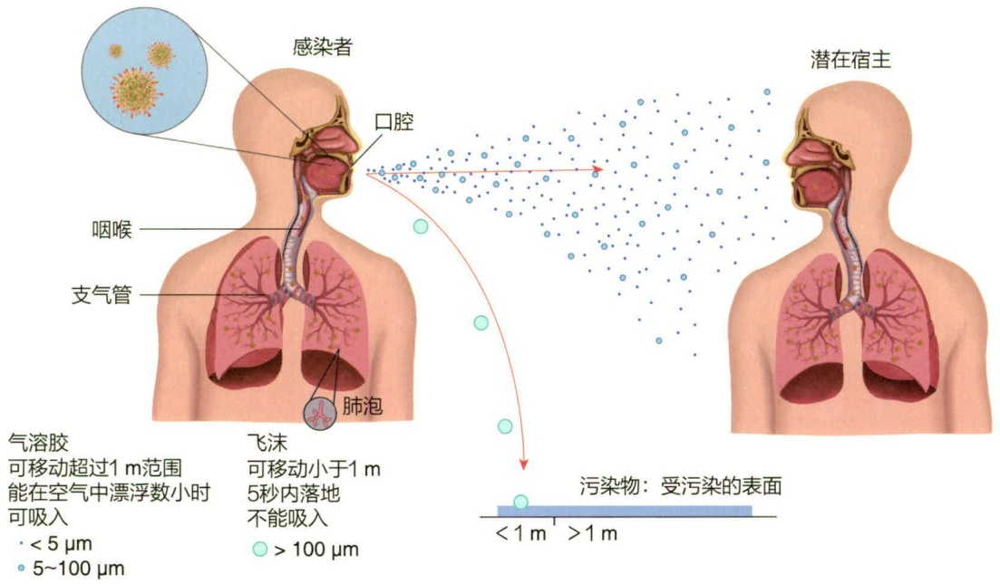
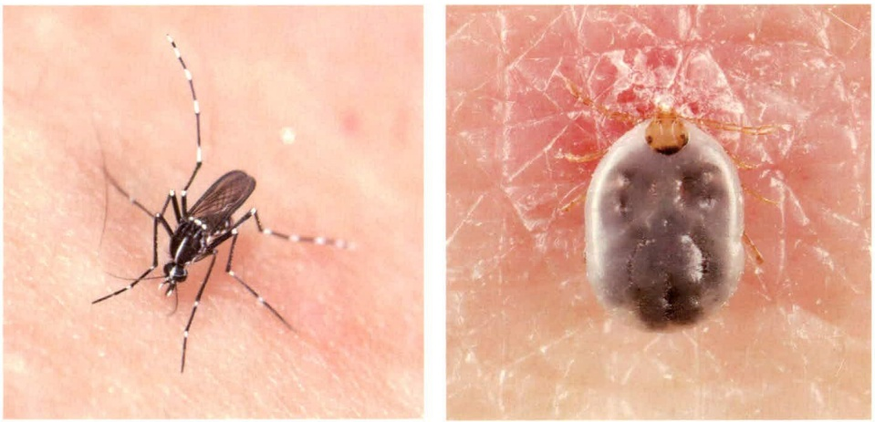
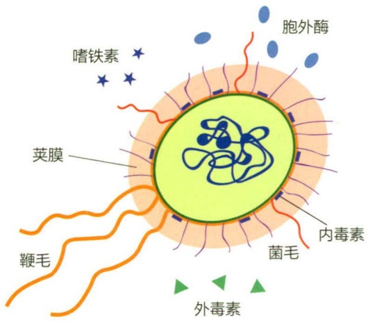
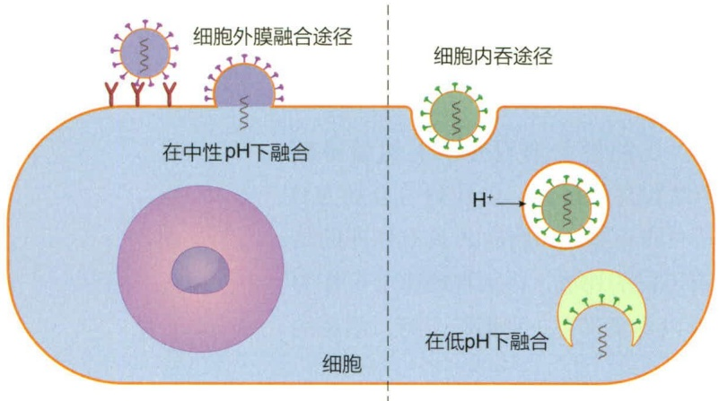
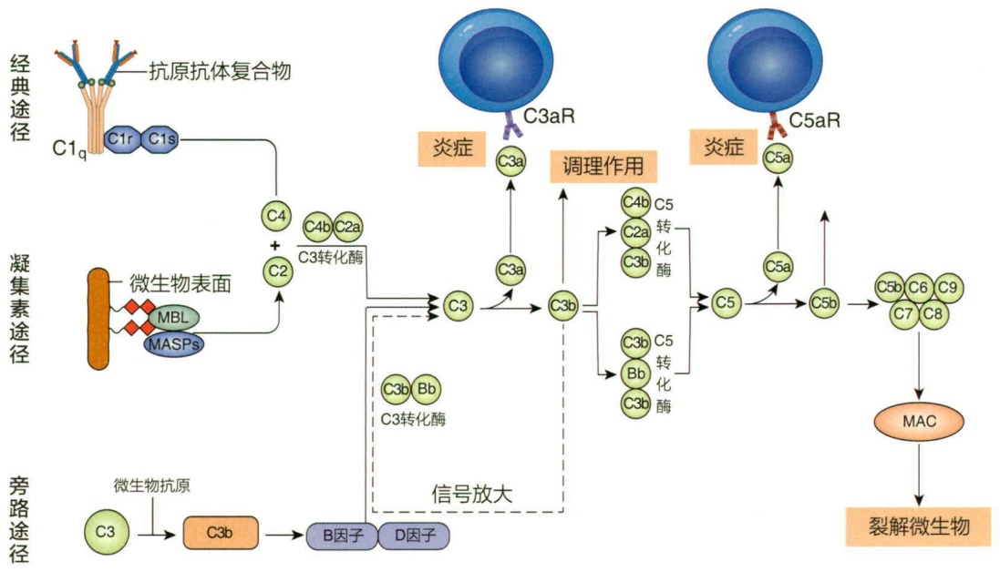

## 15.1.2 感染性疾病的病因学

病因学（etiology）是研究疾病发生的原因与条件的科学。感染性疾病（infectious disease）病因学的核心在于寻找和鉴定导致感染发生的病原体和感染条件。

## 15.1.2.1 科赫法则

科赫在微生物学发展中最重要的一个贡献是开创并奠定了微生物病因学的基础。1876年，科赫在德国布雷斯劳以公开表演实验的方式首次证明了炭疽芽孢杆菌（Bacillus anthracis）是炭疽病发病的原因，揭开了对感染性疾病病因学研究的序幕。在这项实验中，科赫首先锁定了一种仅存在于炭疽病发病而非健康动物的血液中的细菌（后来被命名为炭疽杆菌）。当然，他明白仅凭这一点还不足以证明该细菌是炭疽病的成因。于是，接下来他将血液从炭疽病动物的身上抽出，然后注射到了另一只健康的动物体内，很快原本健康的第二只动物患上了炭疽病。这一过程重复了许多次，每次都能得到相同的结果。之后，他从患病动物体液中分离了这种细菌并进行了体外培养，这种体外培养的细菌注射到健康动物体内后同样会导致炭疽病的发生。

科赫的实验首次证明了某一特定微生物（炭疽杆菌）可以导致一种特定的感染性疾病（炭疽病）的发生。之后，他用相同的方法又证实了结核分枝杆菌和霍乱弧菌分别是结核病和霍乱病的病因。科赫的这套研究方法奠定了感染性疾病病因学的基石和框架。今天，人们将这套基于实验学流程来鉴定感染性疾病病原体的准则称为科赫法则，其依然是当代生物和医学工作者判定造成感染的病原体的金标准。科赫法则的核心可以归结为4项核心内容（经典4法则）（图15-1）:

① 在每个患病个体中，都要能找到相同的病原体，而该病原体在健康个体中不存在。
② 需要从患病的宿主体内分离出这种病原体，并在体外得到纯培养物。
③ 用以体外培养的病原体接种到健康而敏感的宿主体内后，宿主应出现与原疾病相同的症状。

图 15-1 科赫法则的 4 项核心内容

flowchart

This flowchart illustrates the process of isolating and separating microbial organisms in a mouse, starting from identifying the disease individual and progressing through to developing and testing.

④ 从通过实验接种后发病的宿主体内再次分离培养出相同的病原体。

## 15.1.2.2 科赫法则的例外

尽管科赫法则在鉴定感染性疾病的未知病原体中展现出了强大的威力，然而有时候也会出现各种例外。这些例外可能是由于当前技术和认知的限制造成的，因此需要在实际应用中理性和科学地进行分析和探讨。

最常见的一类情况是病原体无法在人工培养基上进行体外的分离培养。以麻风病（leprosy）的病原体麻风分枝杆菌（Mycobacterium leprae）为例，至今人们还无法在人工培养基上对这种细菌进行体外培养，目前实验室的麻风杆菌主要是在小鼠足垫部位的神经上进行体内培养的。此外，病毒和类病毒也无法实现在人工培养基上的培养，它们依赖于细胞、组织或实验动物进行培养。

另一个时常遇到的情况是多种病原体引起的疾病表征是相似的，也就是说有时通过病症来判定感染性疾病时会产生边界模糊。这对一些症状特征清晰的疾病来说并非问题，例如白喉和破伤风。然而对于另一些疾病来说，比如肺炎和脑膜炎，多种不同的病原体都可以引起相同的病症，就难以建立一一对应的关系。在极端的情况下，多重感染（multi-infection）可能协同作用引起罕见的病症，而其中的任一病原体可能都无法单独重现该疾病症状。

此外，同一种病原体也可能引发多种不同的疾病。典型的例子如水痘-疱疹病毒（varicella-zoster virus，VZV）。该病毒在儿童初次感染时造成的疾病是水痘（chickenpox），部分患者愈后此病毒会潜伏在神经元中，若成年后在免疫低下时可能复发，此时疾病则表现为带状疱疹（shingles）。水痘和带状疱疹的病原体都是水痘-疱疹病毒，只是由于发病条件和人群不同而产生了两种不同的病症显现（图15-2）。

图 15-2 水痘 - 疱疹病毒发病时可以造成两种不同症状

左边为儿童感染发病时表现为水痘，右边为成人发病表现为带状疱疹

## 15.1.3 感染性疾病的分类

为了更好地描述和研究不同类别的感染性疾病，人们基于以下四方面对其进行了分类。

第一种常用的分类方式是基于感染性疾病在宿主中的传输行为，分为可传染的(communicable) 疾病即传染性（contagious）疾病，以及不可传染的（noncommunicable）疾病两大类别。传染性疾病基于不同的宿主和传输方向，又大致可划分为特定动物种群内传染的疾病、人和其他动物相互传染的疾病、其他动物向人单向传染的疾病、人群内部传染的疾病等四类。比如结核病（tuberculosis）是一种严格在人群内部传染的疾病，部分种类的流感可在人和其他动物之间相互传染，而破伤风（tetanus）则属于不可传染的感染性疾病。关于感染性疾病的传播见 15.1.5。

第二种常用的分类方式是基于感染性疾病发生的频次，可分为偶发性（sporadic）、地区性（endemic）、流行性（epidemic）和大流行（pandemic）4个级别。偶发性疾病指仅偶尔发生的疾病类型，比如食源性肉毒症等。地区性疾病通常指在某一地域或人群中低频次地持续存在的疾病，如主要发生于北美的莱姆病（Lyme）和中南美洲的恰加斯病（Chagas）都是这类疾病的代表。流行性疾病指在某一地域范围内，一定时期内同时出现了较多数量的病例，如季节性流感是流行性疾病之一。大流行疾病则指在全球范围内出现的流行性疾病，比如1918年的西班牙大流感。需要注意的是，这种分类方式具有很强的时空性和一定的主观性，同一种疾病在不同时期和地区可能会被描述为不同的类型。如由严重急性呼吸系统综合征冠状病毒2型（SARS-CoV-2）造成的新型冠状病毒肺炎感染（COVID-19），从2019年到2023年间，就经历了从偶发性到全球大流行，后逐渐又转为流行性疾病的过程。

第三种常用的分类方式是基于感染性疾病的严重程度和持续时间，大致可分为急性（acute）、慢性（chronic）、亚急性（subacute）、潜伏性（latent）这四类。急性感染疾病病程发展迅速，比如流感。慢性感染疾病病程发展慢、持续时间长，比如乙肝。亚急性疾病指病程发展介于急性和慢性之间的一些疾病。潜伏性感染指病原体已经侵入体内，但处于不活跃的状态，也没有显现的病症，例如潜伏状态的结核病。潜伏性感染的病原体在一定条件下会被激活，从而疾病从潜伏性疾病转为急性或慢性感染疾病。

第四种常用的分类方式是基于感染发生时在宿主体内涉及的范围和程度不同。当感染局限于宿主的某一区域称为局部感染（local infection），当感染随血液或淋巴系统扩散到身体的各个部位时称全身性或系统性感染（systemic infection）。还有一类情况是病原微生物从原发感染部位进入血液或淋巴系统并未扩散至全身，而是被限制在身体部分区域发生感染，这类感染称为继发感染或病灶感染（focal infection）。

## 15.1.4 感染性疾病的疾病模式

和其他疾病一样，感染性疾病的病程发展也呈现出明显的阶段性特征。无论是急性还是慢性，感染性疾病的发生始于病原微生物突破宿主防御侵入体内，之后会经历包括潜育期、发病期、消退期、康复期在内的4个主要阶段。

潜育期（incubation period）是指宿主个体从暴露于病原体发生首次感染到出现症状的时间间隔。潜育期的时间长短和病原微生物的种类、感染途径、感染的病原体数量、宿主的免疫状况和个体差异等因素相关。不同病原体的潜育期差别很大，有些仅几个小时，而另一些可能长达数周或数年。在某些情况下，比如病原微生物本身致病性较弱，感染剂量小，且宿主的免疫功能强大，感染会止步于潜育期，不会进入下一个阶段。至于病原微生物是被直接清除，还是长期存在于宿主体内（即病原体携带者，见 15.1.5），取决于与宿主免疫系统之间的斗争结果。

发病期（period of illness）是指患者从开始出现症状到症状发展到最严重化的阶段。这一时期内，病原微生物增殖迅速，数量快速上升。同时伴随着明显的免疫指征变化，如白细胞计数水平的改变。该阶段是宿主最为脆弱的时期，继发感染也往往出现在该阶段，如果机体无法克服这一阶段，则会导致死亡。

消退期（period of decline）是感染性疾病在医疗干预或自身免疫系统应对下，病情得到缓解，症状开始消退的阶段。该阶段中患者体内病原微生物数量得到控制，开始回落。但该阶段患者还十分脆弱，病情可能反复，且依然易发生继发感染。

康复期（period of convalescence）是指患者的疾病症状已经完全消失，但身体的生理功能尚未恢复到感染发生前状态的阶段。需要注意的是部分情况下，该阶段患者体内依然有少量病原微生物的存在。因此康复期的患者有时也具有传染性，可能造成感染性疾病的传播。

## 15.1.5 感染性疾病的传播与传染

在我们了解了感染性疾病的病因、分类和疾病模式后，接下来我们将学习感染性疾病的传播（transmission）和传染（contagion）。传播是指病原体在空间和宿主个体之间的传输过程。传染是指病原微生物从一个被感染宿主传播到其他宿主，导致后者被感染并患病的过程。并非所有的感染性疾病都具有传染性，具有传染能力的感染性疾病称为传染病。

## 15.1.5.1 感染源

一种感染性疾病如果能在演化中延续下来，必然存在着可以持续导致感染发生的病原体的来源。这种可以使病原体持续存在、繁殖和传播的场所称为感染源或感染库（reservoirs of infection）。感染源可以是人类、动物或者环境（如水源、土壤等）。了解感染源对于预防和控制感染性疾病非常重要。识别和控制感染源可以帮助降低疾病的传播风险，采取相应的措施来隔离、治疗或消除感染源。对于某些疾病，成功控制感染源可以消除或根除疾病。

对于大多数人类传染病而言，人群本身就是最重要的感染源。疾病在人群中持续存在，患者群体构成了稳定的传染源。通常来说，传染病患者在处于发病期和消退期是主要的传染源，不过处于潜育期和康复期的患者同样具有潜在的传染性。在一些特殊人群中，感染的病原微生物与人体的免疫系统达到了相对平衡，既不会被清除，又不足以引发疾病病症。这类人群被称为病原体的携带者（carrier），携带者在人类传染病的传播中起到了重要的作用。

知识拓展 15-2

伤寒玛丽的故事

野生和家养的动物也是重要的感染源。根据世界卫生组织（World Health Organization，WHO）的定义，能够从脊椎动物自然传播给人类的任何感染性疾病称为人兽（畜）共患病（zoonosis）。人兽共患病在全球的传染病中占据了重要的地位。据估计，目前已知的人兽共患病有约150种，包括狂犬病、鼠疫、布鲁氏病、疟疾等（表15-1）。

表 15-1 典型的人兽共患病

| 疾病 | 病原体 | 动物感染库 |
| --- | --- | --- |
| 流感 | 流感病毒 | 鸟类、猪 |
| 狂犬病 | 狂犬病毒 | 蝙蝠、狗、狼、浣熊 |
| 汉坦病毒心肺综合征 | 汉坦病毒 | 啮齿动物 |
| 鼠疫 | 鼠疫耶尔森菌 | 鼠类 |
| 布鲁氏菌病 | 布鲁氏菌属 | 家畜 |
| 炭疽 | 炭疽杆菌 | 家畜 |
| 莱姆病 | 伯氏疏螺旋体 | 田鼠、野鼠 |
| 鹦鹉热 | 鹦鹉热衣原体 | 鸟类(尤其是鹦鹉) |
| 沙门菌病 | 肠道沙门菌 | 家禽、爬行动物 |
| 疟疾 | 疟原虫 | 猴 |
| 弓形虫病 | 刚地弓形虫 | 猫科动物 |

非生命形式的场所也可以是感染源，土壤和水体是最主要的两大非生命的感染源。土壤中包含多种病原微生物，包括破伤风梭菌、产气荚膜梭菌、致病性真菌等。水体中的病原菌多来自患者和其他动物的污染，比如沙门杆菌、霍乱弧菌、致病性大肠杆菌、创伤弧菌等。其他常见的非生命感染源还包括被污染的食物、生活垃圾、医疗废弃物等。

## 15.1.5.2 传播途径

病原微生物从感染源向敏感宿主传播的主要途径有三种:接触传播（contact transmission）、载体传播（vehicle transmission）和介体传播（vector transmission）。

接触传播指病原体从生物感染源向易感宿主传输的方式，分为直接接触传播（direct contact transmission）、母婴传播（congenital transmission）、间接接触传播（indirect contact transmission）和飞沫传播（droplet transmission）。

直接接触传播是经过物理接触的方式将病原体从感染源传输向易感宿主，例如皮肤触碰、接吻、性行为等。母婴传播即垂直传播（vertical transmission），指病原体通过母体的胎盘或产道传给子代的方式。间接接触传播是易感者接触被生物感染源污染的物品，比如患者使用过的毛巾、餐具、门把手、床铺；此外，吸毒者共用针管导致的艾滋病或乙肝感染也属于间接接触传播。最后一类接触传播是飞沫传播，是呼吸道传染病最主要的传播方式。世界卫生组织将感染源经咳嗽、喷嚏、说话等释放的含病原体的黏液飞沫经过小于1 m距离后感染易感宿主的方式定为飞沫传播，距离超过

text_image

感染者
口腔
咽喉
支气管
肺泡
潜在宿主
气溶胶
可移动超过1 m范围
能在空气中漂浮数小时
可吸入
• < 5 µm
• 5~100 µm
飞沫
可移动小于1 m
5秒内落地
不能吸入
• > 100 µm
污染物：受污染的表面
< 1 m > 1 m

图 15-3 飞沫传播和空气传播

1 m 则归为空气传播（air-borne transmission）（图 15-3）。

载体传播是从非生物感染源向易感宿主传输的方式。根据承载病原体的基质不同，可分为空气传播、水体传播（water-borne transmission）、食源传播（food-borne transmission）等。粪口传播（fecal-oral transmission）是一类经典的复合传播模式，在该循环中，病原体随患者或携带者的粪便排出后污染水源、食物或餐具，而易感者由于进食被感染，其排出的粪便又成为新的感染源。

介体传播是病原体通过生物中间体从感染源向易感宿主传输的方式。其中以昆虫为代表的节肢动物是最重要的一大类介体，病原体通过昆虫进行传播的方式称为虫媒传播，如通过蚊子传播的登革热（dengue）和黄热病（yellow fever）、通过跳蚤传播的鼠疫，以及通过蜱虫传播的莱姆病都是典型的虫媒传播传染病（图 15-4）。

## 15.1.5.3 医疗保健相关性感染

医疗保健（healthcare）涵盖了各种维护和改善人体健康相关的服务行业，在现代

图 15-4 伊蚊（左）和硬蜱（右）是常见的传播病原体的介体（图片来源:苏圣博、南京林业大学余文博）

知识拓展15-3
流行病学的基本概念

知识拓展15-4疾病控制和预防中心

社会中有着重要的意义，它包括了医院、诊所、药房、疗养院以及其他与医疗相关的机构场所以及医生、护士、护工在内的技术人员。由于医疗保健这类服务的特殊性，其本身又成为了感染性疾病传播的易发地和集散地。因为接受或从事医疗保健活动受到的感染称为医疗保健相关性感染（healthcare-associated infections）。

构成医疗保健相关性感染的三大因素是医疗场所特殊的微生物环境、相对大量和集中的易感染病患，以及传播链（chain of transmission）的存在。医疗场所比如医院存在有大量的感染源，包括各类感染患者、医疗废弃物等，因此对医疗环境内病原微生物的消杀和检测尤其重要。易感病患是机体防御力下降导致对病原微生物感染的抗性降低的一类人群，在医疗场所尤其是医院中密集存在。易感病患的形成可能是由于其他疾病的发病，也可能是由于诊疗实施本身带来的机体抵抗感染的防御功能被破坏，比如外科手术造成的创面、用药造成的免疫抑制或黏膜损伤等。

传播链是指病原体（或潜在病原体）在有生命的个体（包括人和动物）和/或无生命的物品或场所间传播的路径。由于医疗保健活动的特殊性，特别容易产生传播链，而多个传播链出现时就可能造成感染性疾病的暴发。在医疗场所中持续检测并及时切断传播链是防止出现规模性感染暴发的重要措施。

## 15.2 微生物的致病性和感染特征

前一节介绍过致病性是指病原体引起感染性疾病的能力，其程度或强弱一般用毒力（virulence）来描述，而疾病发生和发展的基本过程和原理称为致病机制（pathogenesis）。致病机制涉及了病原微生物与宿主之间的相互作用，包括病原微生物对宿主的侵入、定殖、破坏和免疫逃逸等，以及宿主对病原微生物的识别、免疫反应和损伤修复等两个方向。

广义概念上讲，病原微生物中所有参与和调控疾病发生和发展的因子都可以称为毒力因子（virulence factor）。病原微生物本身的生理学特征、毒力因子种类，以及入侵途径等共同构成了其感染特征，其中毒力因子的数量和性质是病原微生物致病性强弱的决定性因素。

## 15.2.1 病原微生物感染的入侵门户

病原微生物感染人体的基本入侵门户（portals of entry）可分三种，即皮肤、黏膜和穿透途径。穿透途径泛指皮肤或黏膜因各种理化原因（如针刺、割伤、咬伤、手术创面等）发生破损后，微生物直接进入体内的途径。

不同的病原微生物对入侵门户具有选择性，如流感病毒主要从呼吸道黏膜侵入、破伤风梭菌主要从深度伤口进行感染。一些病原微生物可以从多个门户进行入侵，比如肺炎克雷伯菌既可以从呼吸道黏膜侵入，也可以从伤口由穿透途径侵入。病原微生物对门户的选择与其生活环境、宿主表面的黏附、受体的特异性识别和免疫逃逸机制等因素相关。

感染是否发生除了病原体的种类和宿主免疫情况外，还与入侵门户和入侵的病原体数量密切相关。一般来说引起疾病发生所需的入侵病原体数量越少，毒力越强，反之则毒力越弱。病原体毒力的强弱可以进行定量化描述，常用的指标包括半数感染剂量（median infectious dose， $ID_{50}$ ）、半数致死剂量（lethal dose 50%， $LD_{50}$ ）等。 $ID_{50}$ 是指在一定条件下，造成某一样本群体50%的个体发生感染的病原体数量。 $LD_{50}$ 是指在一定条件下，造成某一样本群体50%的个体发生感染后死亡的病原体数量。

## 15.2.2 细菌的毒力因子和致病特性

细菌具有种类丰富的毒力因子，其功能主要包含以下几类:在宿主中黏附和定殖、细胞的侵入和逸出、直接破坏宿主的组织和细胞、争夺宿主营养、免疫逃逸、对其他毒力因子起直接调控作用等。影响细菌致病性的重要毒力因子包括:荚膜、胞外酶、细胞膜/壁组分、鞭毛和菌毛、外毒素、内毒素、分泌系统和效应分子、嗜铁素和生物被膜等（图 15-5）。

## 15.2.2.1 荚膜

荚膜（capsule）是部分细菌细胞壁外一层主要由糖蛋白组成的包裹结构（详见第3章）。荚膜可以抵御宿主细胞的吞噬作用，从而起到免疫逃逸的作用。即使同种细菌的荚膜糖蛋白对血清反应也会有差异，临床检验上利用这一特性（即K抗原）可以对病原细菌进行分型。

## 15.2.2.2 胞外酶

许多细菌能产生各种各样的酶并分泌到菌体外，这些胞外酶可以用于改变周边环境，从而为细菌提供营养物质或有利的生存空间。这一特性也可以用于应对宿主体内的环境，通过催化改变宿主的组织或细胞组分，为病原菌提供有利因素，同时造成宿

主机体的损伤。常见的与细菌致病性相关的胞外酶类型有:凝固酶（coagulase）、激酶（kinase）、蛋白酶（protease）、脂酶（lipase）、透明质酸酶（hyaluronidase）和胶原酶（collagenase）等。

## 15.2.2.3 细胞膜 / 壁组分

细胞膜/壁组分包含了各种类型细胞外膜和细胞壁上的结合蛋白、糖脂、肽聚糖等组分。其中最著名的是革兰氏阴性菌外膜上包含的脂多糖（lipopolysaccharide，LPS），即内毒素（endotoxin）。另一个著名的例子是结核分枝杆菌细胞壁外层特有的一层分枝菌酸（mycolic acid），这层蜡样的脂质结构赋予了结核分枝杆菌强大的抗吞噬能力，因此结核分枝杆菌甚至能在吞噬细胞内部进行生长和增殖。

text_image

嗜铁素
胞外酶
荚膜
内毒素
菌毛
鞭毛
外毒素

图 15-5 细菌拥有众多种类的毒力因子

## 15.2.2.4 鞭毛和菌毛

部分细菌具有鞭毛（flagellum），它是细菌的主要运动器官（见第3章）。具有鞭毛的细菌有较强的移动能力，从而帮助细菌在宿主体内转移和躲避吞噬。此外，一些细菌鞭毛上存在有黏附素甚至酶组分，对于细菌在宿主中的黏附和定殖方面起了重要的作用。

菌毛（fimbrium）是部分细菌表面附着的丝状结构，菌毛较细短且柔软，单个细胞上存在数量较多，主要帮助细菌附着在其他物体表面，对细菌在宿主体内的黏附和定殖起重要作用。

## 15.2.2.5 外毒素

毒素（toxin）一词最早由德国有机化学家路德维希·贝格尔（Ludwig Brieger，1849-1919）提出使用，指从活细胞或生物体的合成代谢活动中产生的有毒性有机物质。与毒素相关的还有两个常用的生物学概念，一个是抗毒素（antitoxin），另一个是类毒素（toxoid）。抗毒素是指机体产生的对毒素具有中和作用的特异性抗体或免疫分子，或者含有这种抗体的血清和生物制剂。类毒素是一些经化学或物理方法处理后失去毒性，但仍保留免疫原性的分子，类毒素是制备疫苗的重要手段之一。

细菌毒素分为外毒素（exotoxin）和内毒素（endotoxin）两个类别，绝大多数细菌毒素都属于外毒素，外毒素可以是小分子、寡肽、单链蛋白质，或者蛋白复合物。蛋白类的外毒素基于其结构和功能主要分为三类:AB 毒素（AB toxin）、膜破坏毒素（membrane-disrupting toxin）和超抗原（superantigen）。

AB 毒素中都含有 A 和 B 这两个基本单元，A（取自 “active” 的首字母）是具有酶活性的单元，负责进入细胞内部后靶向胞内分子进行各种催化反应；B（取自 “binding” 的首字母）是受体结合单元，负责特异性结合到宿主细胞表面。AB 毒素的本质是酶，AB 毒素的这种工作方式使其具有极高的效价，世界上毒性最强的毒素几乎都属于 AB 毒素，例如肉毒梭菌毒素、破伤风毒素、艰难梭菌毒素、志贺毒素和白喉毒素等。

膜破坏毒素的基本机制有两种，一种是穿孔毒素（pore-forming toxin），可以在宿主细胞表面形成横跨细胞膜的通道，造成膜通透，比如金黄色葡萄球菌的  $\alpha$  溶血素；另一种是磷脂酶（phospholipase），可以催化降解磷脂分子破坏细胞膜，比如产气荚膜梭菌的  $\alpha$  毒素。

超抗原可以以极高的亲和力结合到免疫细胞的重要受体上，从而强烈地激活或者阻断信号传导，产生过度的免疫反应（超敏反应）。比如金黄色葡萄球菌的中毒休克综合征毒素1型（toxic shock syndrome toxin-1）可以非特异性地交联T细胞受体和主要组织相容性复合物Ⅱ（major histocom patibility，MHC-Ⅱ），使T细胞持续且强烈地被激活。

## 15.2.2.6 内毒素

1892—1895年，德国细菌学家理查德·菲佛（Richard Pfeiffer，1858—1945）在研究霍乱弧菌时发现它有两类性质不同的毒性物质:一类可以通过过滤从培养液上清中获得，热不稳定，是蛋白质毒素（霍乱毒素）；另一类存在于细菌“内”部，需要将细菌裂解后才会释放出来，具有热稳定的性质。他把后者命名为内毒素，对应前者的外毒素。

后续的研究发现，内毒素其实是存在于革兰氏阴性菌细胞外膜上的脂多糖（lipopolysaccharide，LPS）的成分。脂多糖由三个结构部分组成，由外到内分别为O多糖（O抗原）、核心寡糖和脂质A（lipid A）。其中核心寡糖和脂质A具有保守的结构。O多糖变化很大，同种属下不同菌株都可能有不同的构成，因而在临床上可作为抗原标志对菌株进行分类。外毒素有很多种类，而内毒素只有一种即脂多糖，细菌的脂多糖就是内毒素（表15-2）。

表 15-2 内毒素和外毒素的比较

| 性质 | 外毒素 | 内毒素 |
| --- | --- | --- |
| 化学组分 | 主要是蛋白质 | 脂多糖 |
| 来源 | 各种细菌 | 革兰氏阴性菌 |
| 热稳定性 | 热不稳定 | 热稳定 |
| 毒性 | 强 | 弱 |
| 抗原性 | 强 | 弱 |

## 15.2.2.7 分泌系统和效应分子

分泌系统（secretion system）是细菌具有的一大类可以特异性地把胞内的物质，包括小分子、蛋白和核酸，分泌到细胞外部的大分子机器。分泌系统的分类是基于其结构和向外分泌分子的方式，分别命名为“X”型分泌系统（type X secretion system, TXSS），例如三型分泌系统的缩写为T3SS。分泌系统向胞外分泌的分子可以对宿主或周边微生物的细胞产生破坏作用，这些被分泌的分子称效应分子（effector）。近年来有研究报道细菌分泌系统至少有7种类型，与细菌致病性关系密切。

## 15.2.2.8 嗜铁素

铁是绝大多数细菌生长必不可少的微量元素之一，然而宿主体内的铁主要存在于各种载铁蛋白中，几乎没有游离态的存在，如何从宿主环境中摄取铁元素对于病原细菌来说是一个重要的问题。一些细菌可以合成并向外分泌嗜铁素（siderophore）分子，嗜铁素以极高的亲和力从宿主载铁蛋白和环境中抢夺铁，然后通过嗜铁素受体和转运系统把结合了铁的嗜铁素运回细菌细胞内。

## 15.2.3 病毒的致病特性

病毒的合成和复制完全依赖宿主细胞，只有在宿主细胞内病毒才是“活跃”的。病毒通过劫持细胞功能利用宿主物质来合成病毒自身组分，组装、并释放出去，在该过程中对宿主细胞产生伤害甚至使其死亡。病毒致病性的关键在于成功识别并侵入宿

text_image

细胞外膜融合途径
细胞内吞途径
在中性pH下融合
细胞
H+
在低pH下融合

图 15-6 病毒入侵细胞的两种主要途径

主细胞和躲避宿主的免疫防御。

## 15.2.3.1 病毒对宿主细胞的识别和入侵

病毒的宿主识别是通过其具有受体结合功能的结构蛋白与宿主细胞的受体结合来进行的，因此病毒具有很高的宿主和细胞选择性。一些病毒具有多个受体，以此来提高与宿主细胞的结合能力或扩大细胞选择范围。比如人类免疫缺陷病毒（HIV）识别T细胞上的CD4蛋白作为受体，同时结合CCR5或CXCR4作为共受体。

当病毒与宿主细胞表面受体结合后，病

毒还需要设法将遗传和辅助物质注入细胞内部。病毒侵入动物细胞主要有两种方式，第一种是细胞内吞途径（endocytic pathway），第二种是细胞外膜融合途径（surface membrane fusion pathway）。两者都需要依赖受体结合及病毒囊膜和细胞的膜结构的融合，区别在于前者需要酸性条件触发发生于内吞体中，后者在中性条件下发生于细胞膜表面（图 15-6）。

## 15.2.3.2 病毒的细胞病变作用

病毒进入细胞后会劫持宿主细胞功能，抑制细胞本身的 DNA、RNA 和蛋白合成，并自我复制形成大量病毒颗粒。这一过程会造成可见的细胞内形态和结构变化，即病毒感染造成的细胞病变效应（cytopathic effect）。一些病毒感染引起的细胞损伤会进一步导致细胞死亡效应（cytocidal effect），另一些则不会。细胞病变和细胞死亡效应是用于诊断病毒感染发生及其类型的重要标志。

病毒感染引起的典型细胞病变效应包括以下几种。

① 大分子合成（DNA、RNA、蛋白）受强烈抑制，导致细胞分裂被阻断和生长停滞。典型的如单纯疱疹病毒感染后的细胞。

② 胞内溶酶体和内吞体破裂，细胞内环境受损并最终导致细胞死亡。

③ 包涵体（inclusion body）在细胞质和细胞核中聚集，形成颗粒状结构，可以用酸性或碱性染料染色观察到。麻疹病毒、狂犬病毒、牛痘病毒、疱疹病毒感染常形成包涵体。

④ 形成合胞体（syncytium）。合胞体是由多个相邻的被感染细胞融合在一起后形成的巨大的多细胞核的细胞结构。腮腺炎病毒、流感病毒、严重急性呼吸综合征病毒（SARS-CoV）等感染细胞后都会产生典型的合胞体结构。

⑤ 细胞表面抗原、细胞因子和表面标志物变化，可以用免疫方法进行检测。

⑥ 细胞核内结构和染色体的变化，常常是病毒造成染色体破损导致，部分情况下可能会导致向肿瘤细胞的转变。

⑦ 细胞发生癌变（cancer transform），包括形态和生长的改变。一些被感染细胞形态会变得不正常或不规则，细胞不再识别接触边界并不停地生长分裂。

## 15.2.3.3 病毒对宿主免疫防御的躲避

病毒对宿主免疫防御的躲避或逃逸是在多个层面上进行的。①病毒侵入细胞内部后，可以躲过大多数作用于胞外的免疫防御系统。②病毒可以劫持细胞的功能和信号通路，从而阻止细胞行使天然免疫功能，比如自噬和凋亡。③病毒可以通过一些组分来抑制或异常表达宿主细胞抗病毒相关的细胞因子（如干扰素）和表面标志物。④部分病毒（如HIV）可以整合到宿主的基因组上并随宿主细胞的复制进行扩增。⑤病毒具有极高的变异频率使其可以在较短时期内逃逸宿主的适应性免疫系统。

## 15.2.4 真菌和原生生物的感染特性

除细菌和病毒外，一些真菌、原生动物和蠕虫也会造成人体感染。在本小节我们将简述这些病原体感染的致病特性。

## 15.2.4.1 真菌感染

真菌感染在生活中十分普遍，但由于其危害程度相对细菌和病毒较弱，人们对其关注度较低。导致疾病的真菌大部分是条件致病菌，这些真菌平时就存在于人体表面或日常生活环境中，当人体免疫低下或是出现损伤性创口（即穿透途径）时可造成感染。多数真菌感染发生在相对表层的部位，如皮肤、口腔、消化道和生殖道等，少数情况下也可以造成深层感染，如脑膜炎、心内膜炎等。

真菌感染的一大特征是难根除，这主要是与其产生孢子的特性相关。随着目前对真菌感染认识的加深，这类感染在临床上也越来越得到重视。

许多真菌没有明确鉴定的毒力因子，一些真菌可以产生真菌毒素，它们通常是真菌的各种次级代谢产物。如黄曲霉毒素（aflatoxin）和麦角毒素（ergotoxin），前者具有致癌作用，后者有神经毒性，摄入这些真菌毒素会造成严重的疾病。一些真菌会分泌蛋白酶来帮助其在宿主中的定殖，比如常造成皮肤感染的毛癣菌属（Trichophyton）和白色念珠菌（Candida albicans），其中白色念珠菌是目前造成临床感染问题最为严重的病原真菌。

## 15.2.4.2 原生动物感染

原生动物感染后致病的主要原因是其对宿主的物质和营养的夺取，以及其释放的有害物质。一些原生动物可以侵入宿主的细胞内部，从而逃逸宿主免疫。相对来说，原生动物感染在经济发达的国家和地区发病极少，但在卫生和医疗水平相对落后的地方依然问题严重。

原生动物感染疾病中最著名的例子是疟疾（malaria），在我国也曾有广泛病例分布，全球每年约有数十万人死于疟疾。疟疾的病原体是一种名为疟原虫（Plasmodium）的原生动物，它寄生于高等脊椎动物的红细胞中，靠吞食红细胞的细胞质获取营养，释放出的代谢物质会引起患者寒战并继发高热，发病后如得不到治疗致死率较高。

## 15.2.4.3 蠕虫感染

从个体大小定义，蠕虫已经不属于微生物的一般范畴。蠕虫感染致病原因主要是由于其吞食组织细胞造成破坏，夺取宿主营养，以及释放废物等引发过敏反应。主要感染人体的蠕虫有钩虫、绦虫、线虫、血吸虫等。

## 15.3 天然免疫:宿主的非特异性防御机制

免疫（immunity）是指生命体自身抵御异物入侵或疾病的机制和过程。免疫学（immunology）是一门研究生命体如何通过免疫反应来保护自己的科学。免疫根据其功能特点可人为划分为两类，一类是天然免疫（innate immunity），又称固有免疫或先天免疫；另一类是适应性免疫（adaptive immunity），又称获得性免疫（acquired immunity）。天然免疫是指机体与生俱来的抵御异物入侵或疾病的能力，其特点为:同物种的个体中都共同具备，能快速对异物入侵或疾病产生响应，特异性低，没有记忆功能。

天然免疫是已知所有的生命体包括细菌、植物、动物体内都存在的免疫机制，本章节中的免疫主要针对高等动物特别是人如何抵抗病原微生物的入侵进行讲解和讨论。

## 15.3.1 生理屏障

生理屏障是抵抗异物入侵的第一道防线，通过阻止外来异物侵入生物体内部从而起到保护作用。高等动物的生理屏障包括皮肤、黏膜及其附属成分等。从解剖学结构上看，生理屏障包括了多种组织和构造，如体表屏障、血脑屏障、肠屏障、血胎屏障等。生理屏障的工作方式大致有物理作用、化学作用、生物作用三大类。

## 15.3.1.1 物理作用

物理作用是生理屏障最基本的作用方式，包括物理阻挡异物的侵入和将异物从机体表面移除。

皮肤是人体内质量最大的生理器官，主要通过物理阻挡的方式来行使屏障功能。人的皮肤分为表皮（epidermis）、真皮（dermis）和皮下组织。其中表皮层由数层紧密接合的上皮细胞构成，外层的上皮细胞还产生有大量不可溶的角蛋白（keratin），可以起到很好的保护作用。黏膜的物理阻挡则是由紧密接合的上皮细胞和其上覆盖的黏液（主要组分是糖蛋白）来完成的。

除了阻挡的方式，生理屏障还可以通过机械作用的方式将异物从表面移除。典型的例子如利用眼泪冲刷掉眼球表面的异物，以及鼻黏膜微纤维通过运动作用移除吸附了灰尘和病原微生物的黏液。咳嗽、喷嚏、呕吐、腹泻也可以看作是通过机械作用清除生理屏障表面异物的机体防御手段。

## 15.3.1.2 化学作用

化学作用是生理屏障抵御外来异物入侵的重要组成部分，特别是在抗微生物方面作用尤其明显。比如人类胃液具有较低的 pH（pH 1.5～3.5），同时含有大量的蛋白酶，可以有效破坏大多数的细菌和蛋白类毒素。唾液、眼泪、鼻腔黏液等中含有大量的溶菌酶（lysozyme）和抗菌肽（antimicrobial peptide）等物质，对抑制微生物有着重要的作用。

## 15.3.1.3 生物作用

生理屏障上方附着的共生微生物群体（即正常微生物组），也对保护宿主起到了重要的作用，这种作用方式被称为生物作用。人体主要的共生微生物群落包括肠道微生物组、皮肤微生物组、口腔微生物组、鼻腔微生物组等，它们主要通过三种方式对宿主起保护作用。

① 占据生理屏障上的生态位，通过生存空间和营养等方面的竞争，阻碍病原微生物在生理屏障上的附着和定殖。比如艰难梭菌（Clostridioides difficile）很难在拥有正常肠道菌群的健康人体内定殖，但在肠道菌群被破坏的特殊人群（如长期服用抗生素的住院患者）中则很容易发生艰难梭菌的感染。
② 产生具有抗微生物作用的物质，从而抑制或杀死病原微生物。例如乳杆菌属（Lactobacillus）是女性阴道微生物组的主要组分，其产生的乳酸可以使阴道内保持中度酸性（pH 3.8～4.5），从而抑制其他微生物的生长。
③ 通过与生理屏障的相互作用刺激免疫系统的发育和维持。最近的研究发现，正常微生物组与宿主生理屏障（主要是各类黏膜）的相互作用对于免疫系统的发育和维持起了重要的作用。

## 15.3.2 炎症

炎症是机体应对感染或组织损伤触发的一系列防御性的生理和病理性的综合应答反应。当病原微生物突破第一道防线生理屏障后，天然免疫系统的响应往往伴随着炎症的发生。炎症通常是局部性的，严重时也可能向全身扩散。炎症的典型临床症状是红（redness）、肿（swelling）、热（heat）、痛（pain）和不能活动（immobility）。

① 红。主要是因为更多的血液流入炎症部位。
② 肿。主要是血管和屏障通透性增加导致的局部积液和水肿。
③ 热。部分是由于血液快速流过带来的热量，另一部分是因为神经或激素调控造成的产热增加，炎症严重时会引起发热（fever）。
④ 痛。主要是包括细胞因子等在内的大量化学分子的释放，造成对局部神经的刺激和损伤作用。
⑤ 不能活动。是细胞因子和其他物质的刺激导致局部细胞和组织的功能受限，导致无法活动。

炎症的生理学意义在于:将效应细胞和相关分子加速输送到感染或损伤部位，增强一线的防御和抵抗力；提供一个局部的保护屏障，将感染或损伤限制在一个有限的范围内；加快病原体和损伤物质的转移和清除，从而帮助修复组织。从本质上讲，炎症的发生是机体自我保护的一种机制，但过度的炎症也会给机体造成损伤并产生不利的后果。

## 15.3.3 体液中的抗微生物物质

体液是人体内环境中液体的总称，包括血液、淋巴液、脑脊液、组织液等。体液中含有许多不同的抗微生物物质，如溶菌酶（lysozyme）、抗菌肽、补体（complement）、抗体、细胞因子（cytokine）、急性期蛋白（acute-phase protein）等，它们在抵抗感染和调控免疫的过程中发挥着各种不同作用。

## 15.3.3.1 溶菌酶

溶菌酶又称胞壁质酶（muramidase），是一种不耐热的碱性蛋白质。溶菌酶广泛存在于各种人体的体液中，黏膜和腺体分泌的体液如唾液、泪液、鼻液中含有大量的溶菌酶。溶菌酶可以水解细胞壁主要成分肽聚糖中 N-乙酰胞壁酸和 N-乙酰氨基葡萄糖之间的 1,4- $\beta$  糖苷键，使细菌细胞壁受损，从而起到抗菌作用。

## 15.3.3.2 抗菌肽

一些多肽展现出广谱的抗微生物活性，这类具有抗微生物活性的多肽通称抗菌肽或抗微生物肽。抗菌肽分布广泛，除高等动物外，昆虫、植物、真菌、细菌也合成和释放许多抗菌肽，因此其被认为是一种演化上古老的防御手段。抗菌肽由于稳定性强、毒副作用弱等特点，在医药、食品工业、农业和环保领域都有一定的应用和潜在开发价值。

## 15.3.3.3 补体

补体是一类在脊椎动物和无脊椎动物中普遍存在的天然免疫系统，在生物演化上出现较早，其本质是一种级联酶反应系统。

人类的补体系统已知是由 30 多种不耐热的蛋白质所组成的多功能体系，包括固有成分、调节蛋白、补体受体这三类主要组分。固有成分包括 C1 到 C9 等多个补体成分，是补体系统的核心功能蛋白；调节蛋白负责调控补体固有成分的活性，包括补体的激活和活性抑制，以确保其在合适的时间和地点起作用；补体受体位于细胞膜上，能够识别被激活的补体后介导细胞信号传导和调节免疫反应。

补体系统可以通过三条相互独立又存在交叉的通路来激活，即经典途径、旁路途径和凝集素途径（图 15-7）。经典途径的激活物始于抗体与抗原形成的免疫复合物，免疫复合物会激活 C1 补体分子，接下来依次激活 C4、C2 和 C3。旁路途径的激活物是微生物表面具有重复特征的分子，例如糖脂和脂多糖，在该途径中 C3 可以直接结合此类分子后被活化。凝集素途径始于凝集素与糖脂或糖蛋白的结合，典型的例子是甘露糖结合蛋白（mannose-binding protein，MBP）识别细菌表面的聚糖中的甘露糖残基结构后，募集甘露糖结合凝集素相关丝氨酸蛋白酶（MBL-associated serine protease，

flowchart

图 15-7 补体系统的激活途径和效应方式

MASP), MASP 可以切割活化 C4, 进而活化 C2 和 C3。

所有的三条激活途径都依赖于 C3 的活化来进入后续的级联反应，激活的补体系统可以产生三种抗感染的效应，分别为:①通过激发炎症反应来募集和活化白细胞。②通过调理作用（opsonization）促进吞噬细胞的吞噬作用；调理作用是指通过抗体、补体或 / 和其他分子与吞噬细胞表面结合，促进吞噬细胞吞噬病原微生物或异物颗粒的作用。在该过程中发挥调理作用的分子，比如抗体和补体，称为调理素（opsonin）。③形成膜攻击复合物（membrane attack complex，MAC）直接攻击入侵微生物的细胞膜，使其发生裂解。

## 15.3.3.4 抗体

抗体是由成熟的 B 细胞（即浆细胞）产生的一类能与对应抗原在体内外发生特异性结合的糖蛋白，是适应性免疫的重要组成部分。关于抗体，将在 15.4 和 15.5 的章节中进行详细讲解。

## 15.3.3.5 细胞因子

细胞因子是一类具有免疫调节和效应功能的低分子量蛋白质或小分子多肽，它们可以看作是细胞间的语言，负责在细胞间传递信息，起到了调节炎症和免疫应答、促进细胞生长、增殖、凋亡和分化等作用。细胞因子可以由体内众多类型的细胞产生和感知。它们与激素（hormone）的主要区别在于，激素通常会通过血液或组织液循环输送到身体各个部位，而细胞因子一般仅在组织局部短距离地发挥作用。常见的细胞因子种类包括白细胞介素（interleukin，IL）、干扰素（interferon，IFN）、肿瘤坏死因子（tumor necrosis factor，TNF）、集落刺激因子（colony stimulating factor，CSF）、生长因子（growth factor）和趋化因子（chemokine）等。众多的细胞因子在体内发挥作用，具有多效性、重叠性、协同性和拮抗性等多重特点，形成十分复杂的调控网络，参与了人体许多重要的生理功能。