经系统（central nervous system，CNS）和外周神经系统（peripheral nervous system，PNS）。中枢神经系统包括脑和脊髓，外周神经系统包括所有从脑和脊髓延伸出来的神经分支。

脑和脊髓都被连续的膜结构所包裹保护，该膜结构即脑膜（meninge）。脑膜分为三层，从外到内分别为硬脑膜（dura mater）、蛛网膜（arachnoid mater）和软脑膜（pia mater）。在蛛网膜和软脑膜之间有一个空腔称为蛛网膜下腔（subarachnoid space），内部充满了脑脊液（cerebrospinal fluid，CSF）。一个普通成年人有100～160 mL的脑脊液。由于脑脊液中的抗体、补体以及免疫吞噬细胞很少，微生物很容易在里面增殖，因此通常以检测脑脊液中微生物来判断是否发生中枢神经系统感染。

早在 19 世纪，人们发现当往血管中注入染料后，其他组织和器官都可以被染上颜色，只有脑部除外，这一发现揭示了血脑屏障（blood-brain barrier，BBB）这一构造的存在。血脑屏障是由脑毛细血管内皮细胞、基底膜和星形胶质细胞（astrocyte）构成的紧密结构。该结构使得脑血管与脑组织之间具有高度的渗透选择性，可以有效阻止绝大多数病原体和其他有害物质进入脑组织。然而血脑屏障不仅可以阻碍有害物质，也能限制其他物质比如药物的进入，给脑部疾病的药物治疗带来了一定的挑战。

在脑膜发生的炎症称脑膜炎（meningitis），发生在脑实质的炎症称脑炎（encephalitis）。临床上脑膜炎较脑炎发生的频率要高。幼龄儿童患脑膜炎的比例较成人要高许多，症状也更严重。

## 15.6.1.2 细菌性脑膜炎

临床上常见感染脑膜造成脑膜炎的病原细菌包括脑膜炎奈瑟球菌（Neisseria meningitis）、流感嗜血杆菌（Haemophilus influenza）、肺炎链球菌（Streptococcus pneumoniae）和单核细胞增生李斯特菌（Listeria monocytogenes）。

脑膜炎奈瑟菌和流感嗜血杆菌是革兰氏阴性菌，属假单胞菌门，肺炎链球菌和单核细胞增生李斯特菌是革兰氏阳性菌，属芽孢杆菌门（Bacillota）。前三者都是胞外菌，在健康人的鼻腔、口咽部、皮肤中也有一定比例的检出，这些人群中的携带者是潜在的感染源。脑膜炎奈瑟菌、流感嗜血杆菌和肺炎链球菌通过血脑屏障的具体机制还不明确，一般认为这些细菌的荚膜类型和感染者免疫低下与疾病的发生密切相关。

单核细胞增生李斯特菌一般简称李斯特菌，是一种胞内菌，它被细胞吞噬后，能够裂解吞噬体，进而逃逸到细胞质中进行生长和增殖（图 15-18）。李斯特菌感染成人时症状一般较轻，但有时也会发生脑膜炎。一个常见的是母婴感染，该细菌对孕妇和幼童危害很大，孕妇感染后，新生儿有极高比例也会被感染，大概率发生脑膜炎，致死率极高。另一个常见的李斯特菌感染造成脑膜炎的途径是食源性感染，因此李斯特菌是食品工业中需严格检测的细菌种类之一。

## 15.6.1.3 破伤风和肉毒中毒

造成破伤风（tetanus）和肉毒中毒（botulism）的病原微生物分别是破伤风梭菌（Clostridium tetani）和肉毒梭菌（Clostridium botulinum），两者都是产芽孢、严格厌氧的革兰氏阳性菌，可存在于土壤、水底沉淀物等环境中。

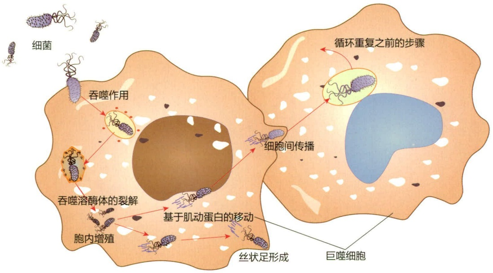

flowchart

图 15-18 李斯特菌入侵细胞的过程

破伤风梭菌主要通过深层创伤途径感染人体，梭菌芽孢可在组织深层萌发生长并释放破伤风毒素。破伤风发病的表型为痉挛性麻痹（spastic paralysis），特征非常明显。据统计，每年约有一百万破伤风病例发生，绝大多数在发展中国家和地区。注射破伤风疫苗可以有效防止破伤风发病。肉毒梭菌感染的病例罕见，其主要中毒途径是摄入含有肉毒梭菌及其分泌毒素的食物，临床发病的表型为松弛性麻痹（flaccid paralysis），致死率极高。

确切来说，导致破伤风和肉毒中毒的直接病原体是细菌产生的外毒素，即破伤风毒素（tetanus toxin）和肉毒素（botulinum toxin）。破伤风毒素和肉毒素是具有相似结构的单链蛋白神经毒素，分子量约为150 000。两者均可以极高特异性地识别神经突触上的受体，进入神经后通过切割SNARE复合体的组成蛋白（突触小泡缔合性膜蛋白、突触融合蛋白和突触关联蛋白）从而阻断神经递质的释放，使神经失活（图15-19）。破伤风毒素和肉毒素都是从外周神经系统的神经末梢处进入神经细胞，区别在于肉毒素主要作用于运动神经元，阻断其对肌肉的信号控制，因此表现为松弛性麻痹。而破伤风毒素则可以逆向传递到上一级的抑制性神经，阻断抑制性神经对下级运动神经的抑制作用，因此表现为痉挛性麻痹。

## 15.6.1.4 麻风分枝杆菌

麻风分枝杆菌（Mycobacterium leprae）是极少数可以在外周神经元中生长的细菌，它的最适生长温度为  $30^{\circ}$ C，因此偏好在身体外周侧温度较低的地方生长。麻风分枝杆菌感染可能出现斑疹、斑块、结节、局部皮肤变形麻痹、体温升高、疲劳、肌肉酸痛和运动障碍等。麻风分枝杆菌生长速度极为缓慢，其生长周期长达 12 天左右。迄今为止，人们还无法在体外培养基上培养麻风分枝杆菌，实验室里依赖在小鼠体内培养获得麻风分枝杆菌。

图 15-19 肉毒素阻断神经递质释放的机制

①肉毒素分子识别神经突触上的特异性受体（突触泡蛋白、突触结合蛋白以及神经节苷脂）；②肉毒素分子进入内吞体中；③吞噬体酸化后，肉毒素分子发生变构并把其酶活区释放到胞质中；④肉毒素的酶活区识别并切割特定底物（突触融合蛋白、突触关联蛋白或突触小泡缔合性膜蛋白）

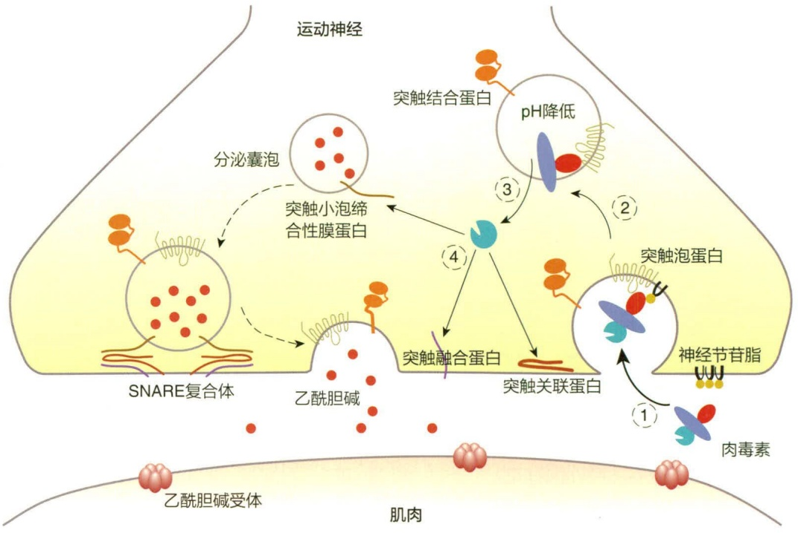

flowchart

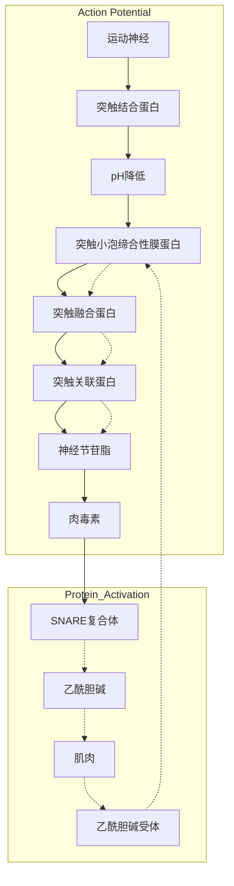

## 15.6.1.5 狂犬病毒

狂犬病毒（rabies virus）是造成狂犬病的病原体。狂犬病毒是一种单链 RNA 病毒，属弹状病毒科丽沙病毒属（Lyssavirus），电镜下观察有着子弹一般的外形。狂犬病毒在自然界中的天然宿主广泛，包括狐、狼、獾、狗、蝙蝠和其他肉食类野兽等，在城镇中本病的主要传染源为携带病毒的狗和猫。狂犬病毒感染人的方式主要是被带毒的动物（尤其是犬类）咬伤、抓伤或经黏膜感染。病毒进入人体后首先会侵入外周神经系统并增殖，同时会随神经轴逆行至中枢神经系统引起致命的脑和脊髓炎症。狂犬病毒早期感染外周神经系统时仅有轻微症状如局部异样、刺痛、颤痛、灼痛，甚至没有明显症状。一旦病毒到达中枢神经系统，患者将表现出亢进、躁动、静息麻痹、或狂躁与静息交替等症状，许多患者会表现出怕水（即恐水征）、怕风、吞咽和呼吸困难，进入这一发病状态的患者死亡率几乎是 100%。在发病的最后阶段，病毒将扩散至全身各器官，此时患者的体液如唾液、组织液里均含有病毒。

狂犬病毒感染后的潜伏期很长，平均为1\~2个月，有极端病例报道潜伏期长达6年之久，这可能与感染病毒的剂量、感染部位及个体免疫差异有关。狂犬病一旦发病目前无特效药物，狂犬疫苗依然是防治狂犬病毒感染的唯一有效手段，在发生疑似感染的情况下应及时接种狂犬疫苗进行预防。此外，被动物（尤其是疑似携带病毒的狗和猫）抓、咬伤后的早期处理非常重要，应以肥皂水或其他有效的消毒剂充分清洗伤口，并不断擦拭，伤口较深者可进行灌注清洗，如有免疫血清可注入伤口底部和四周。尽可能捕获肇事动物进行隔离观察和样本检查，以确定其是否携带病毒。

## 15.6.2 感染呼吸系统的病原微生物

呼吸系统感染是临床常见的感染类型，尤其是儿童发病率更高，呼吸系统感染根据感染部位不同可分为上呼吸道感染和下呼吸道感染。上呼吸道感染指主要发生在鼻、咽、喉，甚至中耳等部位的感染，其中绝大部分症状较轻且可以自愈。下呼吸道感染指发生在气管、支气管、肺等部位的感染，通常症状较上呼吸道感染要严重。可以导致呼吸系统感染的病原微生物种类众多，大多数是病毒或细菌，真菌感染情况相对较少，极少数情况为寄生虫。

## 15.6.2.1 造成普通感冒的病原微生物

普通感冒（common cold），又称为伤风，是临床最常见的呼吸道感染疾病。无季节性规律，发病后一般在10天内可以自愈。普通感冒其实是一大类上呼吸道感染引发急性炎症的总称，并不是由一种病原微生物感染引发的单一疾病。造成普通感冒的病原微生物有很多种，其中最常见的是鼻病毒，约占总发病率的50%。除此之外，冠状病毒、腺病毒、呼吸道合胞病毒、副流感病毒、柯萨奇病毒、肠病毒也是常见造成普通感冒的病原体。

## 15.6.2.2 流感病毒

流感病毒是一类单链负链 RNA 病毒，属于正黏液病毒科。流感病毒的基因组由 8 个片段组成。流感病毒的基因组除了发生突变和重组（recombination）外，还可以发生基因重配（reassortment），因此其具有极高的变异率。重配是指基因组分节段的病毒通过基因组节段交换形成重组体。流感病毒表面主要有两种抗原蛋白，即血细胞凝集素（hemagglutinin，H）和神经氨酸酶（neuraminidase，N），这两种蛋白的变异种类决定了流感病毒的亚型和血清型。流感病毒可分为 A、B、C、D 4 个亚型，其中 A、B 和 C 可以感染人类。不过 C 型流感病毒的病症非常轻微，造成季节性暴发的流感主要是 A 和 B 型，分别对应甲型流感和乙型流感。

流感是一种典型的人兽共患病，目前观点认为，野生鸟类是 A 型流感病毒的原始天然宿主，因为几乎大部分的血细胞凝集素和神经氨酸酶种类都可以在鸟类身上分离的流感病毒中找到（图 15-20）。目前在人群中传播的 A 型流感病毒主要是 H1N1 和 H3N2 两种，历史上还曾有过 H2N2 型的流感暴发。暴发性流感主要高发于冬季，当前的对抗流感的手段还是以接种疫苗为主。

## 15.6.2.3 冠状病毒

冠状病毒于 1937 年首先在鸡身上分离出来，1965 年分离出第一株人的冠状病毒。冠状病毒在电子显微镜下可以被观察到外膜上有明显的棒状突起，其形态看上去像中世纪欧洲的王冠而得名。冠状病毒为单一链的正链 RNA 病毒，基因组为 27～31 kb。冠状病毒具有呼吸道、胃肠道和神经系统的嗜性，患者感染后可出现咳嗽、流涕、咽喉痛、呼吸困难、发热、肺炎、肌肉酸痛及胃肠道症状等。

冠状病毒属于冠状病毒科、冠状病毒属，下属4个群: $\alpha$ 、β、γ、δ，目前已知可以感染人的冠状病毒至少有7种，包括HCoV-229E、HCoV-OC43、HCoV-NL63、HCoV-HKU1、严重急性呼吸综合征冠状病毒（SARS-CoV）、中东呼吸综合征冠状病毒（MERS-CoV）和SARS-CoV2。其中前4种会引起轻或中度上呼吸道感染如感冒等，症状较轻可在数天内自愈。SARS-CoV首次出现在2002年，主要在亚洲流传，全球共感染超过8000人，死亡774人，致死率约9.6%。最后一例SARS-CoV感染发生于2004年，之后再没有人感染的病例报道。MERS-CoV于2012年首次在沙特阿拉伯被发现，致死率高达30%\~40%，相对来说传播力较弱，主要为零散发病。SARS-CoV2是近期发现的感染人的冠状病毒种类，首次发现于2019年，之后引发了被称为COVID-19的全球大流行。SARS-CoV2与SARS-CoV近缘，与SARS-CoV相比，致死率较低但传播力更强。

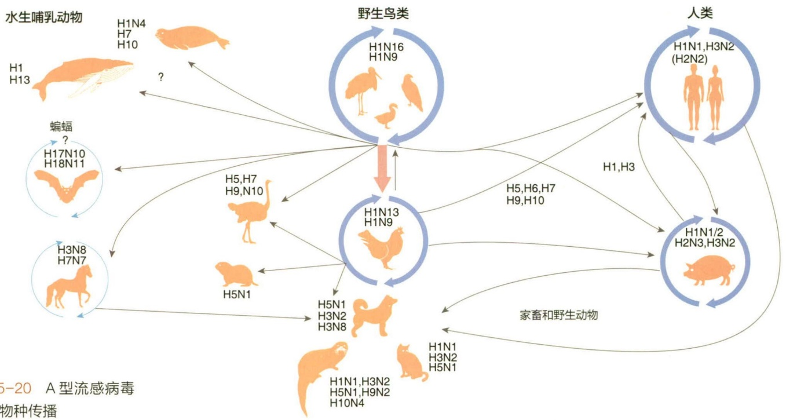

flowchart

This diagram illustrates the genetic transmission pathways of A-type流感病毒 (5-20) to various animal species, showing how different animals and human populations interact with a central path.

图 15-20 A 型流感病毒的跨物种传播

## 15.6.2.4 细菌性肺炎

细菌性肺炎是临床最常见的下呼吸道感染类型，尤其是在婴幼儿、老年和免疫缺陷人群中发病率很高。由于呼吸道和肺泡日常暴露于各类环境空气中的微生物下，一旦免疫功能低下，很容易引起各类细菌感染。常见引发细菌性感染的病原体种类繁多，包括肺炎链球菌（Streptococcus pneumoniae）、流感嗜血杆菌（Haemophilus influenzae）、肺炎支原体（Mycoplasma pneumoniae）、肺炎克雷伯菌（K. pneumoniae）、金黄色葡萄球菌（Staphylococcus aureus）、嗜肺军团菌（Legionella pneumophila）、铜绿假单胞菌（Pseudomonas aeruginosa）、肺炎衣原体（Chlamydophila pneumoniae）等。其中肺炎链球菌最为常见，约占到临床病例的50%。

## 15.6.2.5 结核分枝杆菌

结核病（tuberculosis）是全球最致病的传染病之一，每年可导致上百万人死亡。结核分枝杆菌（Mycobacterium tuberculosis）在1882年由德国细菌学家罗伯特·科赫发现并证明其为结核病的病原体。考古学和古基因组研究发现结核病是最古老的人类细菌性感染疾病之一，中国古代《黄帝内经》中就有对“痨病”即结核病的描述。18到20世纪上半叶是结核病全球流行的高峰期，据估计部分地区感染肺结核的人数高达总人口的70%\~90%。

结核分枝杆菌属于放线菌门分枝杆菌属，生长速度缓慢。结核分枝杆菌细胞壁外层有一层蜡样的分枝菌酸，因此该细菌一般不适用于革兰氏染色，临床上主要用抗酸染色法鉴定。

结核分枝杆菌感染具有明显的阶段性特征，即分为潜伏期（latent）和活跃期（active）两个阶段。处于结核病潜伏期的感染者并没有临床症状，该阶段人体的免疫系统可以控制结核分枝杆菌。潜伏期长度因人而异，部分感染者甚至可以终身不发病。值得注意的是，生活质量，尤其是营养和卫生状况对于结核病的发病率和病死率

影响很大。结核病进入活跃期后，结核分枝杆菌使肺部受损，会形成一种名为结核性肉芽肿（tuberculous granuloma）的病变，结核性肉芽肿是结核分枝杆菌损伤肺部组织后，免疫细胞和其他细胞包裹结核分枝杆菌对损伤部位进行修复抑制的产物。结核性肉芽肿缓慢长大时临床病症一般不严重，还表现出慢性疾病的特征，肉芽肿长大到一定阶段会发生破溃，细菌在体内大规模扩散，此时患者病症严重，传染性很强。结核性肉芽肿本身对结核分枝杆菌起到一定的抑制作用（图15-21），有些情况下肉芽肿中的结核杆菌会转入静息状态，肉芽肿不再生长，即结核病重新进入潜伏期。

知识拓展 15-10

卡介苗

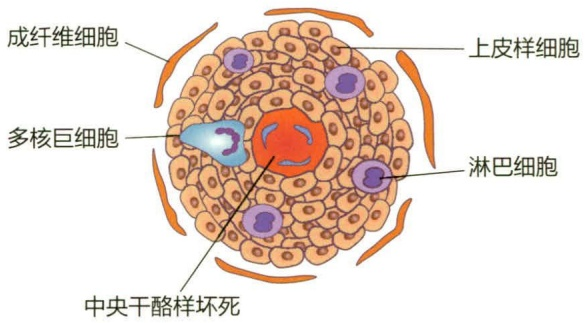

text_image

成纤维细胞
多核巨细胞
上皮样细胞
淋巴细胞
中央干酪样坏死

图 15-21 结核性肉芽肿示意图

## 15.6.3 感染循环系统的病原微生物

循环系统是遍布于全身的连续封闭的管道系统，包括心血管系统和淋巴系统，其中充满了在全身上下循环的体液（血液和淋巴液）和血细胞。循环系统感染的一大特征是全身性，病原体将随着体液流动迅速扩散到身体的每个角落。循环系统感染致病可分为两类情况，一类是当微生物大量存在于循环系统的体液中造成发病，许多微生物都可以成为病原体；另一类则是被特定攻击血细胞的病原体感染，这些病原微生物具有很强的靶向特异性，比如人类免疫缺陷病毒（human immunodeficiency virus, HIV）和疟原虫。此外，循环系统由于连通着全身各组织器官，病原微生物侵入循环系统后可以随体液循环至全身各处，进而造成不同器官的继发感染。

## 15.6.3.1 脓毒症

血液和淋巴液中一般认为是无菌的，然而如果血液或淋巴液中出现大量微生物存在或增殖，几乎都会造成严重的疾病。这种情况下往往会发展为脓毒症（sepsis），即病原微生物及其物质，特别是细菌和其毒素，通过循环系统扩散至全身后引发的毒性炎症反应综合征。脓毒症发生后的病程发展迅猛，致死率极高。目前临床上造成脓毒症的主要是各种细菌，如金黄色葡萄球菌、肺炎克雷伯菌、鲍曼不动杆菌、大肠埃希菌、肠球菌、化脓性链球菌、各种梭菌、铜绿假单胞菌等，真菌也在脓毒症中占一定的比例，如白色念珠菌、曲霉菌、新型隐球菌等。

除了脓毒症，还有几个相关的概念:脓毒血症（septicemia）是特指病原微生物进入血液并在其中增殖，之后引起的毒性炎症反应综合征；菌血症（bacteremia），指血液中存在有细菌的情况；毒血症（toxemia），指血液中存在有毒素的情况；病毒血症（viremia），指血液中存在有致病性病毒的情况。脓毒症、脓毒血症、和毒血症存在一定的概念交叉重叠，但应注意它们之间的区别。

## 15.6.3.2 人类免疫缺陷病毒

部分病原微生物尤其是病毒，专性地以循环系统中的血细胞进行靶向感染。其中最著名的代表为人类免疫缺陷病毒（human immunodeficiency virus，HIV），又称艾滋病病毒。

HIV 作为获得性免疫缺陷综合征（acquired immune deficiency syndrome，AIDS，通称艾滋病）的病原体于 1983 年在美国首次发现，由两个研究小组分别独立报道。HIV 是一种逆转录病毒，成熟的病毒颗粒呈球形，直径约 120 nm，内部包含有两条单股正链 RNA。HIV 通过其囊膜上的 gp120 分子识别受体 CD4 分子，因此 CD4 $^{+}$ T 细胞是其最主要的靶细胞。此外，HIV 的细胞入侵还需要与共受体的结合，HIV 最重要的共受体是 CCR5 或 CXCR4。一旦侵入靶细胞，HIV 的 RNA 会逆转录合成反义 DNA，然后合成正义 DNA。HIV 的 DNA 接下来会整合到宿主的基因组 DNA 中，这也是 HIV 病毒几乎无法被清除的重要原因之一。整合到宿主基因组的病毒 DNA 可能进入休眠状态，即 HIV 感染进入潜伏期。一定条件下整合的病毒 DNA 会活化，开始进行病毒的复制，即进入活跃期。该阶段会合成 HIV 病毒的基因组 RNA（gRNA）和信使 RNA（mRNA），后续合成各种酶以及组分蛋白。组装完成的病毒核心颗粒会迁移至细胞膜

的内侧，以出芽的方式被细胞膜包裹形成囊膜，最终释放到细胞外（图 15-22）。

由 HIV 引起的 AIDS 会导致人体的免疫功能缺失，标志为疾病后期患者体内 CD4 $^{+}$ T 细胞水平极低。HIV 目前无特效药或疫苗，感染后的治愈率几乎是 0%，在没有药物干预的情况下感染后的平均期望寿命为 11 年。不过近年来出现有个别 HIV 感染患者治愈的报道。HIV 感染主要通过血液和体液传播，高危性行为、被污染的针头和输血，以及母婴垂直传播也是艾滋病的主要传播途径。HIV 感染的早期药物阻断是有效的，尤其在疑似感染后的 2 h 内，72 h 内用药阻断也有较高的成功率。

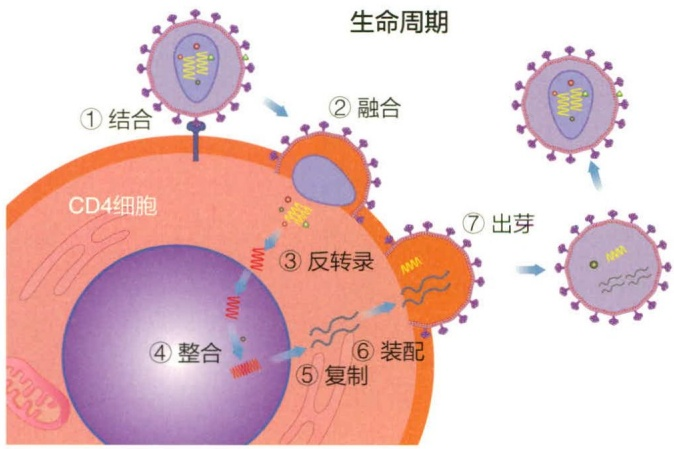

flowchart

图 15-22 HIV 的复制周期

## 15.6.4 感染消化系统的病原微生物

人的消化系统器官包括口、咽喉、食道、胃、小肠、肝、胆、胰、大肠等（图 15-23）。病原微生物主要通过食物和饮水进入消化系统引发感染，其中经典的粪口传播途径占主要比例。

消化系统中的口、咽喉、食道、胃、小肠和大肠组成了消化道。消化道黏膜属于生理屏障的一部分（见15.3.1），对微生物侵袭有着较强的抵御能力，尤其是在口腔和肠道中本身就定殖有大量的微生物形成各自的微生物组（见15.1.1）。感染消化道的病原微生物为突破黏膜屏障通常依赖毒力因子，如强效外毒素及辅助释放的分泌系统。临床重要的消化道感染病原微生物有沙门菌、霍乱弧菌、大肠杆菌、艰难梭菌、产气荚膜梭菌、空肠弯曲杆菌、幽门螺旋杆菌、诺如病毒、轮状病毒等。

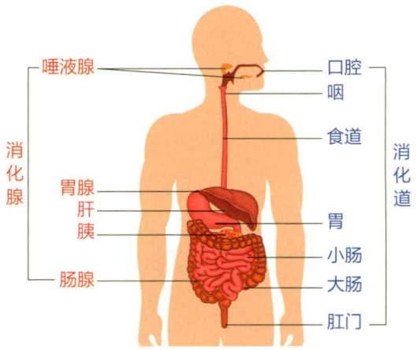

text_image

唾液腺
消化腺
胃腺
肝
胰
肠腺
口腔
咽
食道
胃
小肠
大肠
肛门
消化道

图15-23 人的消化系统

## 15.6.4.1 霍乱弧菌

霍乱弧菌（Vibrio cholerae）是革兰氏阴性菌，属于假单胞菌门弧菌属，它是造成霍乱（cholera）的病原体。霍乱是一种烈性肠道传染病，典型的症状是水样腹泻，如不及时治疗，患者可能在几小时内因脱水和电解质失衡造成休克甚至死亡。霍乱是人类历史上最致命的传染病之一，全球曾暴发过数次世界性霍乱大流行，致死数千万人。目前每年有300万～500万人感染霍乱，死亡10万～20万人。

霍乱弧菌菌体形态短小弯曲呈弧状，有单鞭毛和菌毛。霍乱弧菌表达一种被称为霍乱毒素（Cholera toxin）的外毒素，霍乱毒素是霍乱弧菌致病的决定性因子，不表达霍乱毒素的霍乱弧菌不会造成霍乱。霍乱毒素是一种 AB 毒素，其酶活亚单位进入肠黏膜细胞后会催化三磷酸腺苷（ATP）转化为环磷酸腺苷（cAMP）。肠黏膜细胞内的高 cAMP 浓度会持续激活一类名为 CFTR 的门控氯离子通道，导致大量细胞液和电解质进入肠腔，引发腹泻和脱水。

## 15.6.4.2 艰难梭菌

艰难梭菌（Clostridioides difficile）是一种专性厌氧的革兰氏阳性细菌，形状多为杆状、棒状、梭状，可产生芽孢。该菌最早于1935年在健康婴儿的肠道中分离得到，因其在实验室条件下分离培养非常困难而得名“艰难”。艰难梭菌在发现后的数十年内一直被认为是正常肠道细菌，直到20世纪70年代才被证明与伪膜性结肠炎的发生直接相关。

自 20 世纪末以来，艰难梭菌感染相关疾病病例数量急剧增加，在医疗水平发达地区尤为严重。通常认为这与工业化国家大量使用抗生素有关，艰难梭菌对多种抗生素，包括氨基糖苷类抗生素、林可霉素、四环素、红霉素、克林霉素、青霉素、头孢菌素、喹诺酮类抗生素等广泛具备较高的耐药性，此外其芽孢能够抵御高温、干燥、消毒剂等各种极端条件，在自然环境中长期存活。艰难梭菌感染是一种典型的新发感染性疾病，最常见于医院和社区的外源性感染和交叉感染，是抗生素相关性腹泻的主要病原体之一。美国疾病预防控制中心近十年来一直将艰难梭菌列为最高级别的紧急威胁耐药病菌。

艰难梭菌已知有三种外毒素，即毒素 A（TcdA）、毒素 B（TcdB）和二元毒素 CDT。艰难梭菌利用这些毒素来破坏人体的肠道上皮层，引发坏死和炎症。艰难梭菌的致病能力完全依赖于其表达的外毒素，尤其是 TcdB。事实上，临床分离到的致病菌株几乎都包含 TcdB。

## 15.6.4.3 幽门螺旋杆菌

幽门螺杆菌（Helicobacter pylori）是一种革兰氏阴性菌，属于假单胞菌门螺杆菌属。菌体呈弧形、S形或螺旋形，有鞭毛，运动能力较强。幽门螺旋杆菌是极少数可以在胃的强酸性（胃液pH为1.5\~3）环境中生存的微生物之一。两位澳大利亚的医生罗宾·沃伦（Robin Warren，1937—2024）和巴里·马歇尔（Barry Marshall，1951—）证明了幽门螺旋杆菌与胃炎、胃溃疡和胃癌等胃部疾病密切相关，两人也因此获得了2005年的诺贝尔生理学或医学奖。

幽门螺旋杆菌的致病机制还没有完全明了，幽门螺旋杆菌已知具有多个毒力因子，目前研究认为 CagA 和 VacA 是其最重要的致病因子。前者是可以通过四型分泌系统注入靶细胞的效应蛋白，后者是一种外毒素。

## 15.6.4.4 胃肠道病毒

病毒性肠胃炎临床上非常常见，其中大部分由轮状病毒或诺如病毒引起。病毒性肠胃炎的典型症状包括低热、腹泻和呕吐，病程约在1周内，绝大多数都可自愈。致死率不高，据估计有0.001%\~5%。婴幼儿是其主要易感人群，成人症状较轻。对于病毒性肠胃炎，目前主要的预防手段是接种对应的疫苗。

## 15.6.5 感染泌尿和生殖系统的病原微生物

由于不同性别的泌尿和生殖系统在生理学和解剖学上存在显著差异，感染泌尿和生殖系统的病原微生物以及其导致的疾病病症也有明显的不同。

尿路感染的主要病原微生物是尿路致病性大肠杆菌，此外一些葡萄球菌、假单胞菌、克雷伯菌和棒状杆菌也会引发尿路感染。女性的尿路感染发病率要明显高于男性，这可能是由于女性的生理结构特点，如尿道较短较宽且尿道口与阴道口相邻，使得细菌更容易侵入尿路。

淋病（gonorrhea）和梅毒（syphilis）是最知名的生殖系统感染疾病，前者由淋病奈瑟氏菌（Neisseria gonorrhoeae）引发，后者的病原体为梅毒密螺旋体（Treponema pallidum）。淋病和梅毒曾经在世界范围内广泛流行，后来随着抗生素的发明得到了有效的控制，然而近些年来淋病和梅毒的发病率又有所回升。

## 15.6.6 病原微生物感染的临床检测

诊断微生物学（diagnostic microbiology）属于临床微生物学范畴。它与临床医学密切结合，主要研究感染性疾病快速、准确诊断病原微生物的策略和方法，为临床提供依据。病原微生物的检测主要有传统培养方法、血清学检测以及基于各类分子生物学的非培养检测方法。

## 15.6.6.1 分离培养与生化反应

临床标本（例如血液、痰、粪便等）在体外培养基上分离培养以获得目标病原微生物。由于病原微生物的增殖需要一定时间，所以检测周期较长。而医学领域不断进行革新，采用了自动化的培养和鉴定的仪器，对传统的培养方式进行了改善，提高了检测的灵敏感度和准确度。

## 15.6.6.2 样本染色镜检

通过一些特殊的染色方法，例如革兰氏染色、抗酸染色、墨汁染色、六胺银染色以及荧光染色等，将样本染色后经显微镜观察其颜色、形态、排列等。该方法简便快速，对一些具有特殊形态和染色的病原微生物感染具有较高的诊断价值，例如淋球菌感染、结核分枝杆菌、耶氏肺孢子菌感染等的早期初步诊断。由于不需要对样品进行培养，该方法可以较快获得检验结果。此外，该方法不依赖特殊的仪器和设备，在基层实验室仍然是比较重要的病原微生物检测手段。

## 15.6.6.3 血清学检测

通过已知的抗体或抗原来检测病原微生物的抗原或抗体从而对病原微生物进行快速鉴定的技术，常用的方法包括血清凝集技术、乳胶凝集实验、荧光抗体检测技术、协同凝集试验、酶联免疫测试技术等。该技术方法简便快速，同时兼具一定的灵敏度和准确度。

## 15.6.6.4 核酸检测

通过特定探针对病原微生物的标志性核酸序列进行检测，聚合酶链反应（PCR）是最常用的核酸检测手段，同时该方法可以进一步偶联荧光或染料等其他技术，来实现定量化或操作的简便化。核酸检测方法一般需要依赖一定的仪器设备，与血清学检测相比，具有更高的灵敏度和准确度，但时效性较差。

## 15.6.6.5 其他新兴的微生物检测手段

随着科学技术的进步，许多新兴的技术手段也被应用到临床微生物的检测中。其中有代表性的包括:

① 高通量基因测序。二代测序技术允许被用于对病原微生物的全基因组进行快速测序。这种方法对于未知病原体的检测和识别非常有用，因为它不依赖于先验知识。NGS 技术还可以用于检测部分病原微生物的耐药基因和毒力基因。但是该技术通常需要报告解读者既掌握临床微生物知识又具备生物信息学知识。

② 质谱分析。质谱技术可被用于分析微生物样本中的蛋白质和代谢产物，从而

确定感染的类型和特性。质谱分析还可用于快速鉴别不同细菌株之间的同源性差异。

③ 纳米孔测序。纳米孔测序技术使用微小的孔道来逐个测量 DNA 分子，从而实现高速的 DNA 测序。这种方法可以快速检测病原微生物，同时还能检测到变异株。

④ 电化学生物传感器。电化学生物传感器使用生物分子与电极之间的交互作用来检测微生物。这些传感器可以快速、高效地识别病原微生物，并且在便携式设备中应用广泛。

⑤ 免疫传感器。免疫传感器使用抗体或抗原与目标微生物结合的原理来进行检测。这些传感器可以用于检测细菌、病毒、真菌和寄生虫，具有高度特异性。

⑥ 微生物组学。微生物组学研究微生物在人体内的生态系统，有助于理解微生物感染的机制和病原微生物与宿主之间的相互作用。通过分析微生物组成，可以预测疾病风险并研究新的治疗策略。

⑦ 机器学习和人工智能。机器学习和人工智能可以用于分析大规模的临床和生物信息数据，从中提取有关病原微生物的信息。这些技术可以缩短诊断和疾病监测过程。

⑧ CRISPR 技术。CRISPR 技术不仅用于基因编辑，还可以用于检测病原微生物。CRISPR/Cas 系统可以被设计用于特异性地识别并绑定目标 DNA 或 RNA，从而实现高度敏感的检测。

## 15.7 抗微生物药物

抗微生物药物指能够抑制或杀伤微生物，从而使其生长、繁殖受到阻碍的药物，主要包括消毒防腐药及临床治疗用抗微生物药物，本节将重点对后者进行介绍。这些抗微生物药物的发现不仅降低了医院临床治疗中术后感染的风险，还使微生物感染疾病的防治由医院扩展至家庭，显著延长了人类的寿命。

## 15.7.1 抗微生物药物的发展历史

德国医生保罗·埃尔利希（Paul Ehrlich，1854—1915）是现代化学疗法用于治疗微生物感染疾病的先驱。他痴迷于各种能与微生物细胞特异性结合的染料，并认为这些化学物质可以具备选择性消灭病原体而不损伤人类细胞的潜力。1904年，埃尔利希发现了可杀灭椎体虫的染料台盼红（trypan red），并将其用于治疗椎体虫引发的非洲昏睡病。随后，他和日本科学家秦佐八郎（Sahachiro Hata，1873—1938）利用感染梅毒的兔子测试了多种含砷化合物，发现了砷凡纳明（arsphenamine）对梅毒螺旋体的抑制活性，并于1910年将药品成功上市。

1927 年，格哈德·多马克（Gerhard Domagk，1895—1964）在众多化合物中发现了一种用于皮革染色的红色染料百浪多息（Prontosil），可以保护小鼠免受致病性链球菌和葡萄球菌的感染，进一步实验证明，该染料在体内被代谢为具备抑菌活性的磺胺分子而发挥作用。百浪多息是世界上第一种商品化的合成抗菌药和磺胺类抗菌药，开启了合成药物化学发展的新时代，而多马克也获得了1939年诺贝尔生理学或医学奖。

青霉素的发现激励了对其他抗生素的研究。1943年，罗格斯大学的赛尔曼·瓦克斯曼（Selman Waksman，1888—1973）和其同事对大约1万株土壤细菌和真菌仔细筛选，发现了一种新的抗生素——由灰色链霉菌产生的链霉素，即第一种成功治疗结核病的药物。瓦克斯曼于1952年获得诺贝尔奖，他的成功导致了全球范围内对其他产抗生素土壤微生物的广泛研究。随后的几年里，发现新抗生素的报道平均每年100～200个，其中不少被用于临床，开创了一个抗生素发展的黄金时代（图15-24）。

## 发现之路 15- 2

青霉素的发现和生产

图 15-24 抗微生物药物发现的时间轴

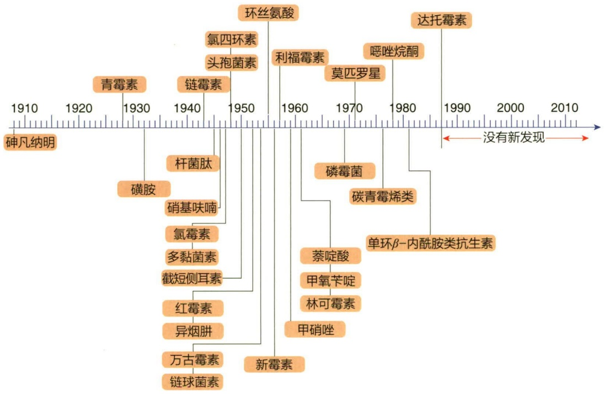

state_timeline

| Compound | Start Year | End Year |
| --- | --- | --- |
| 砷凡纳明 | ~1905 | ~1915 |
| 青霉素 | ~1925 | ~1930 |
| 磺胺 | ~1930 | ~1940 |
| 链霉素 | ~1940 | ~1945 |
| 氯四环素 | ~1945 | ~1950 |
| 头孢菌素 | ~1950 | ~1955 |
| 杆菌肽 | ~1945 | ~1958 |
| 硝基呋喃 | ~1948 | ~1958 |
| 氯霉素 | ~1948 | ~1958 |
| 多黏菌素 | ~1948 | ~1958 |
| 截短侧耳素 | ~1948 | ~1958 |
| 红霉素 | ~1948 | ~1960 |
| 异烟肼 | ~1948 | ~1960 |
| 万古霉素 | ~1948 | ~1960 |
| 链球菌素 | ~1948 | ~1960 |
| 环丝氨酸 | ~1955 | ~1960 |
| 新霉素 | ~1955 | ~1960 |
| 利福霉素 | ~1960 | ~1965 |
| 萘啶酸 | ~1960 | ~1970 |
| 甲氧苄啶 | ~1960 | ~1970 |
| 林可霉素 | ~1960 | ~1970 |
| 甲硝唑 | ~1960 | ~1970 |
| 莫匹罗星 | ~1970 | ~1975 |
| 磷霉菌 | ~1970 | ~1975 |
| 噁唑烷酮 | ~1975 | ~1980 |
| 碳青霉烯类 | ~1975 | ~1980 |
| \(单环\beta-内酰胺类抗生素\) | ~1980 | ~1985 |
| 达托霉素 | ~1985 | ~2000 |

## 15.7.2 抗微生物药物的主要作用机制

根据作用对象的不同，抗微生物药物可分为抗细菌药物、抗真菌药物、抗病毒药物和抗原生动物药物。

## 15.7.2.1 抗细菌药物

抗生素是优良的抗细菌药物（见 8.5.2.2）。自从 20 世纪 20 年代发现青霉素以来，至今已有 9 000 多种新的抗生素被发现，合成了 70 000 多种半合成抗生素，然而临床上常用的抗生素只有数十种。抗细菌药物的作用机制大约可以分为抑制细胞壁合成、抑制蛋白质合成、阻碍细菌代谢、抑制核酸合成这几大类（图 15-25）。

## (1) 抑制细胞壁的合成

由于细菌细胞壁结构成分的独特性和功能的重要性，作用于细胞壁合成的抗生素具有很高的选择性和很好的治疗效果，依据其活性结构可以分为  $\beta-$  内酰胺类抗生素（ $\beta-$ lactam antibiotic）和糖肽类抗生素（glycopeptide antibiotic）两大类群（图 15-26）。

图 15-25 抗细菌药物的主要作用机制和代表性药物

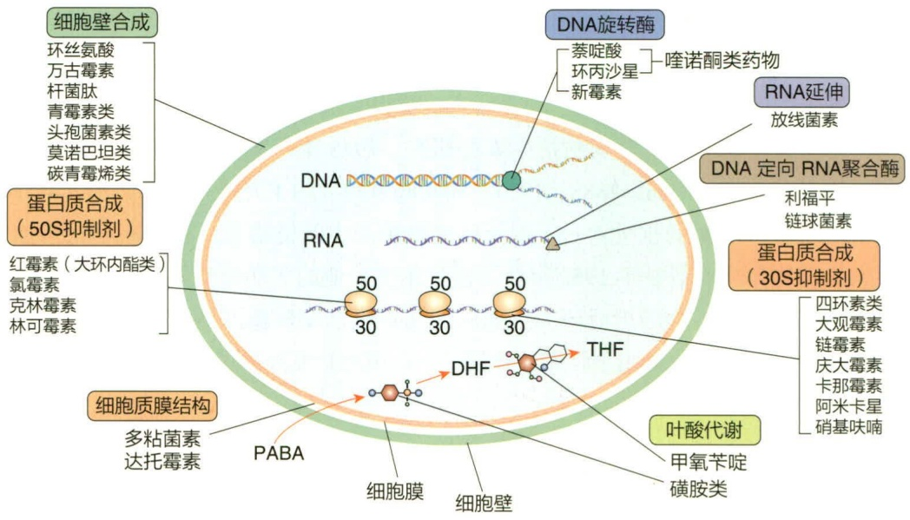

flowchart

This diagram illustrates the molecular mechanism of a biological process involving DNA and RNA synthesis, showing how specific proteins (e.g., beta-actin, beta-sulfurate) interact with DNA to form downstream components like cell membrane formation and ATPase production.

青霉素（penicillin）和头孢霉素（cephalosporin）类抗生素的典型特征是含有β-内酰胺环，该结构类似于肽聚糖亚基上的D-丙酰-D-丙氨酸，阻断了催化肽聚糖交联反应的转肽酶（即青霉素结合蛋白，penicillin binding proteins）活性，从而抑制细胞壁肽聚糖的合成致使细胞渗透性裂解。该类抗生素多为广谱药物，对革兰氏阳性和阴性细菌都有良好的杀菌效果，对细胞壁合成需求高的活跃病原菌更加有效。近年来，有关青霉素的其他杀菌机制也被相继报道。青霉素可通过激活细菌自身的自溶素（autolysin）来破坏细胞壁的完整性，也可以刺激细菌空泡素（bacterial holins）类蛋白的产生并在质膜上形成空洞或损伤，直接导致膜渗漏和细胞死亡。

万古霉素（vancomycin）和替考拉宁（teicoplanin）属于糖肽类抗生素，其杀菌机制与 $\beta-$ 内酰胺类抗生素不同，不相互竞争结合位点，而是与肽聚糖亚基上的D-丙酰-D-丙氨酸形成复合物，抑制肽聚糖交联反应和细胞壁的合成。该类抗生素多

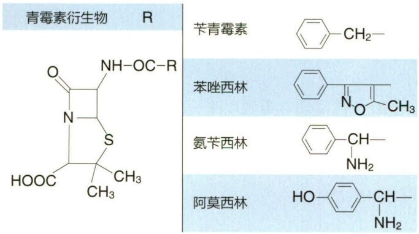

chemical

Chemical structures of quinolinium derivatives including phenyl, benzyl, and aryl groups with substituents R and CH3

图 15-26 β-内酰胺类的化学结构

用于治疗耐药革兰氏阳性菌的严重感染，或用于治疗对青霉素类过敏患者的革兰氏阳性菌感染，其中，万古霉素被认为是对抗药革兰氏阳性菌感染的“最后防线”。

## (2) 抑制蛋白质的合成

由于细菌核糖体和真核核糖体具有结构性差异，许多抗生素能够特异性作用于细菌核糖体抑制其蛋白质合成的不同步骤，实现其抑菌/杀菌活性。

氨基糖苷类抗生素（aminoglycoside antibiotic）主要包括链霉素（streptomycin）、卡那霉素（kanamycin）、新霉素（neomycin）、妥布霉素（tobramycin）和庆大霉素（gentamicin）等，其在结构上都含有一个氨基环醇和一个或多个氨基糖分子，主要作用机制是在翻译过程中破坏肽链的延伸。该类抗生素因与细菌30S核糖体亚基的核糖体RNA结合，干扰mRNA的读取并导致肽链合成的早期终止而具备杀菌活性，是治疗需氧革兰氏阴性杆菌感染的重要药物。氨基糖苷类抗生素往往具有一定的毒性，可引发宿主听力和肾损伤、平衡能力下降、恶心和过敏反应等副作用。

四环素类抗生素（tetracycline antibiotic）包括金霉素（chlortetracycline）、土霉素（oxytetracycline）、四环素（tetracycline）及半合成衍生物甲烯土霉素（methacycline）、多西环素（doxycycline）等，其结构均含有并四苯基骨架（图15-27）。这些抗生素与氨基糖苷类似，它们可以与30S核糖体亚基结合，抑制蛋白质合成。四环素是一类广谱抗生素，只有抑菌活性而非杀菌活性，可作用于大多数细菌，以及细胞内病原体（如立克次氏体、衣原体和支原体）。

大环内酯类抗生素（macrolide antibiotic）包括红霉素（erythromycin）和阿奇霉素（azithromycin）等，其结构中含有一个由12到22个碳组成的环状结构（图15-28），通过阻断50S核糖体中肽酰转移酶的活性来抑制细菌蛋白质合成，属于快速抑菌剂。红霉素是一种相对广谱的抗生素，对革兰氏阳性菌、支原体和少数革兰氏阴性菌有效。目前阿奇霉素的使用已经超过红霉素，它对包括性传播的沙眼衣原体等病原细菌有效。研究表明，大环内酯类抗生素除了抗菌作用外，还具有其他广泛的药理作用。

氯霉素（chloramphenicol）也是一种抑菌性抗生素，与红霉素类似，通过可逆地与50S核糖体亚基结合，抑制转肽酰酶的作用，干扰带有氨基酸的氨基酰-tRNA终端与50S亚基结合，从而使新生肽链合成受阻，抑制细菌蛋白质的合成。氯霉素对革兰阳性、阴性细菌均有抑制作用，且对后者的作用较强。由于氯霉素还可与人体线粒体的70S核糖体结合，因而相对毒性较大。

## (3) 抑制微生物代谢

抗代谢药物多在结构上与关键酶的底物相似，并与代谢物竞争这些酶的结合位点而抑制酶活，通过拮抗或阻断细菌的关键代谢途径，展现广谱的抑菌活性。

磺胺类（sulfonamides）药物是人工合成的抗菌药，是一类以对氨基苯磺酰胺（简称磺胺）为基本结构的衍生物，该结构是对氨基苯甲酸（para-aminobenzoic acid,

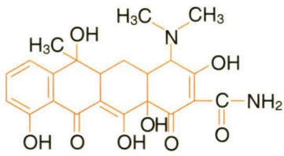

chemical

Chemical structure of a flavonoid compound with multiple hydroxyl and amine functional groups

图15-27 四环素的分子结构

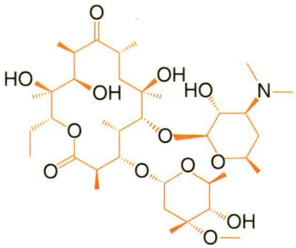

chemical

Complex organic molecule structure with multiple hydroxyl and carbonyl functional groups

图 15-28 红霉素的分子结构

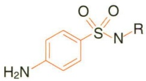

图 15-29 磺胺类的分子结构

PABA）的类似物（图 15-29）。PABA 是许多酶的辅因子，为叶酸合成所必需。当磺胺类药物进入细菌细胞时，它与 PABA 竞争叶酸合成酶的活性位点，导致叶酸浓度下降，最终因嘌呤和嘧啶含量的减少导致蛋白质合成和 DNA 复制的终止。由于许多细菌和原生动物必须自身合成叶酸，人类所需的叶酸是从食物中获取而非自身合成，因此，磺胺类药物对细菌和原生动物有选择毒性，并具有很高的治疗指数（治疗指数:指药物的最小有效剂量与引起中毒的最大剂量之间的比值）。

甲氧苄啶（trimethoprim）也是一种人工合成抗生素，通过与二氢叶酸还原酶结合，抑制四氢叶酸的合成。甲氧苄啶是一种广谱抗生素，它通常与磺胺类药物联合使用，通过阻断叶酸合成途径中的两个关键步骤来提高治疗效果。抑制单个生化途径中两个连续步骤意味着每种药物联合使用时所需的剂量比单独使用时少，这被称为药物协同相互作用。

## （4）抑制核酸合成

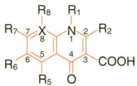

chemical

Chemical structure of a substituted pyrimidine derivative with R groups and carboxylic acid group

图 15-30 喹诺酮类的分子结构

由于细菌和真核生物在核酸合成方面十分相似，核酸合成抑制类药物不像其他抗生素那样具有选择毒性。这类药物中最常用的是喹诺酮类（quinolones）药物（图 15-30）。

喹诺酮类含有 4-喹诺酮环，包括环丙沙星（ciprofloxacin），诺氟沙星（norfloxacin）和氧氟沙星（ofloxacin）等。该类药物通过抑制 DNA 解旋酶（gyrase）和拓扑异构酶Ⅱ（topoisomerase Ⅱ），破坏细菌 DNA 的复制和修复，达到抗菌效果。其对大肠杆菌和肺炎克雷伯菌等肠道细菌非常有效，也可用于嗜血杆菌、奈瑟菌、铜绿假单胞菌和其他革兰氏阴性病原体感染。该类药物对革兰氏阳性细菌如金黄色葡萄球菌、化脓性链球菌等也具杀菌活性，是广谱性抗菌药物。

## 15.7.2.2 抗真菌药物

真菌感染的治疗通常不如细菌感染理想，很大程度上是因为真菌细胞比细菌细胞更类似于人类细胞。因此许多抑制或杀死真菌的药物对人类毒性很大，治疗指数较低。此外，大多数真菌具有解毒系统，可改变许多抗真菌药物，限制药物有效性。

因真菌细胞膜含有独特的麦角甾醇（ergosterol）类分子，而人类细胞膜中没有，因此成为很好的抗真菌药物靶点。抗真菌药物分为多烯类（polyene）和唑类（azole）两种，多烯类药物可以直接与麦角甾醇结合，而唑类药物阻断了麦角甾醇生物合成的最后一步，因此，这两种药物都能阻止真菌细胞膜正常功能的履行。

真菌感染通常被细分为浅表性真菌病、皮下真菌病和系统性真菌病。这些疾病的治疗方法各不相同。三种唑类药物，咪康唑、酮康唑和克霉唑，可用于治疗脚癣、口腔和阴道念珠菌病等浅表真菌感染。制霉菌素是一种来自链霉菌的多烯类抗生素，用于控制皮肤、阴道或消化道的念珠菌感染，由于毒性太大不能全身服用。灰黄霉素是一种由青霉菌合成的抗真菌药物，用于口服治疗慢性浅表真菌病，它被认为破坏有丝分裂纺锤体并抑制细胞分裂、还可能抑制蛋白质和核酸的合成。全身性真菌感染通常是致命的，很难控制。用于治疗全身性真菌病的药物包括两性霉素 B、5-氟胞嘧啶和唑类药物（如氟康唑、伊曲康唑）等。皮下真菌病通常是用治疗浅表和全身真菌病的药物联合治疗。这种联合治疗的目标是在较长时间内提供毒性较小的药物，而在较短时间内接触毒性较大的药物。通过这种方式，抗真菌药物持续靶向皮下真菌，使患者从毒性更大的药物的副作用中得到喘息。

## 15.7.2.3 抗病毒药物

抗病毒感染的途径很多，如直接抑制或杀灭病毒、干扰病毒吸附、阻止病毒进入细胞、抑制病毒生物合成、抑制病毒释放或增强宿主抗病毒能力等。抗病毒药物的作用主要是通过影响病毒复制周期的某个环节而实现的。

病毒寄生于宿主细胞内，依赖宿主细胞代谢系统进行增殖复制。病毒复制过程如下:病毒识别并吸附到宿主细胞的表面；通过宿主细胞膜进入易感细胞；脱壳；合成早期的调控蛋白及核酸多聚酶；病毒基因组（DNA 或 RNA）复制；合成后期的结构蛋白；子代病毒的组装；感染细胞释放子代病毒。抗病毒药物可以靶向病毒复制的任何一个步骤，发挥抗病毒作用。根据抗病毒药物的作用机制，可将目前的抗病毒药物分为以下几类:

① 进入和脱壳抑制剂:金刚烷胺、金刚乙胺、恩夫韦地、马拉韦罗。
② DNA 多聚酶抑制剂:阿昔洛韦、更昔洛韦、伐昔洛韦、泛昔洛韦、膦甲酸钠。
③ 逆转录酶抑制剂:

核苷类:拉米夫定、齐多夫定、恩曲他滨、替诺福韦、阿德福韦酯。

非核苷类:依法韦仑、奈韦拉平。

④ 蛋白酶抑制剂:沙奎那韦。
⑤ 神经氨酸酶抑制剂:奥司他韦、扎那米韦。
⑥ 广谱抗病毒药:利巴韦林、干扰素。

## 15.7.2.4 抗原生动物药物

与其他抗微生物药物一样，抗原生动物药物的有效性首先要确定其结合的独特靶点，从而阻断微生物重要的生理功能。然而，原生动物是真核生物，因此药物作用于宿主细胞的可能性较大，大多数治疗原生动物感染的药物具有明显的副作用。抗原生动物药物的数量相对较少，并且大多数药物的作用机制尚不完全清楚，可能对原生动物的核酸合成或代谢过程起抑制作用。

## 15.7.3 微生物耐药性的产生机制

抗微生物药物的发现为人类健康作出了巨大的贡献，然而，药物的过度使用甚至滥用导致微生物耐药性的广泛发生和传播，成为了21世纪人类健康的新型挑战。耐药性（drug resistance）又称抗药性，指微生物、寄生虫以及肿瘤细胞等对于化疗药物作用的耐受性，耐药性一旦产生，药物的化疗作用就明显下降。微生物在对抗药物的过程中，为了免遭伤害，形成了多种防卫机制，由此而产生的耐药菌得以存活和繁殖，符合“适者生存”的生物演化规律。

大多数微生物对某种抗菌药物或对多种抗菌药物的抗性具有多种耐药机制

知识拓展 15- 11

抗疟疾药物