图 15-31 抗生素耐药的机制概况

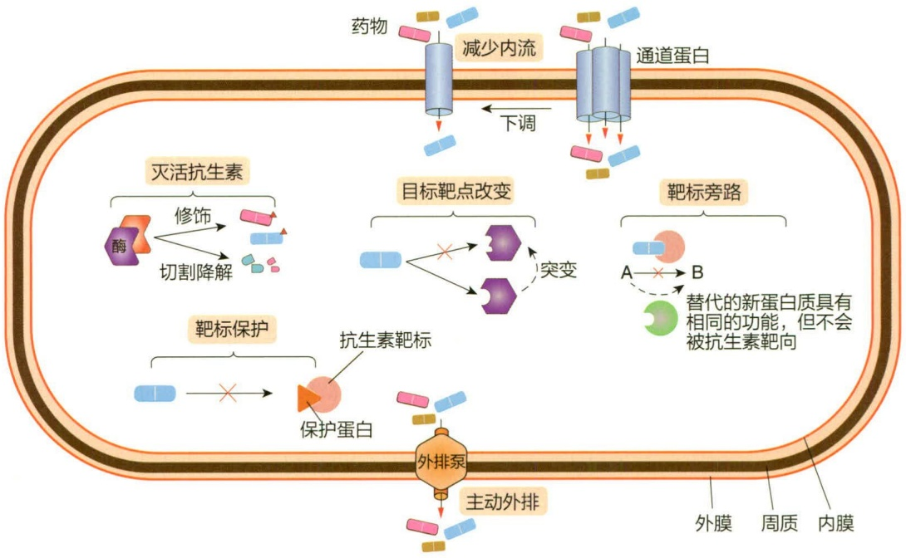

flowchart

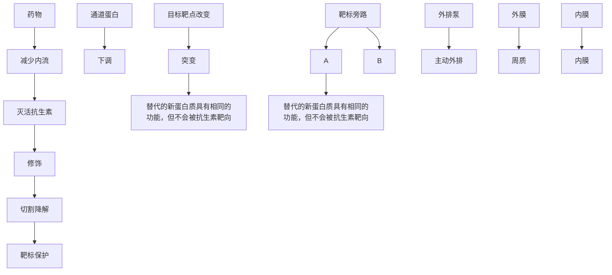

(图 15-31)。因为产生钝化酶的耐药机制和靶位改变产生的耐药机制往往具有特异性，而由于细胞膜通透性改变、膜上外排泵系统的增强或生物被膜形成所产生的耐药机制一般是非特异性的。

## 15.7.3.1 微生物的特异性耐药机制

## (1) 产生特异性钝化酶

有些病原菌可以产生特定的钝化酶，通过水解或者修饰抗菌药物使其丧失杀灭或抑制病原菌的活性。例如，许多耐青霉素细菌可以产生 $\beta-$ 内酰胺酶，能够使 $\beta-$ 内酰胺环水解开环从而不再与青霉素结合蛋白（penicillin-binding protein，PBP）PBP结合并发挥干扰细菌细胞壁合成的功能。对氨基糖苷类抗生素产生耐药的细菌往往是通过细菌产生的酰基转移酶（acyltransferase，AAC）、腺苷转移酶（adenyltransferase，ANT）和磷酸转移酶（phosphotransferase，APH）对进入胞内的活性分子进行修饰使之失生物活性。

## (2) 药物作用靶点发生改变

细胞的靶位发生改变，导致抗菌药物不能与病原菌相应的部位结合，从而影响抗菌药物的活性。例如，耐万古霉素的金黄色葡萄球菌可以产生特定的抗性因子，导致肽聚糖末端 D-丙氨酸被 D-乳酸或 D-丝氨酸残基取代，进而产生耐药性。

## 15.7.3.2 微生物的非特异性耐药机制

## (1) 改变细胞外膜通透性

虽然革兰氏阳性细菌的细胞膜被一层厚厚的肽聚糖细胞壁所包裹，但由于其内部结构比较简单而几乎不影响抗菌药物这样的小分子物质扩散至胞内。相反，革兰阴性细菌的外膜层和其中的脂多糖（LPS）成分则对很多小分子药物起着有效的屏障作用。与此同时，以分枝杆菌为代表的一类细菌由于其所具有的特殊细胞壁结构，形成了一道渗透性很低的有效屏障，从而对多数抗菌药物表现出耐药性。

同时，在革兰阴性菌的外膜上存在多种不同的外膜孔蛋白（outer membrane porin）作为小分子亲水性化合物进入细菌的通道。存在于外膜的孔蛋白一旦缺失或减少，可明显地导致产生对相关的抗生素产生耐药性。例如，铜绿假单胞菌可以通过减少或者关闭特殊的孔蛋白通道 OprD 的表达获得对非典型  $\beta-$  内酰胺抗生素亚胺培南（imipenem）的抗性。

## (2) 主动药物外排机制

细菌可以通过过量表达和激活主动药物外排（active drug efflux）或称外排泵系统（efflux pump system）导致多重耐药。细菌主动药物外排系统根据其超分子结构、机制和序列的同源性等可以将其分为 MF 家族（major facilitator），RND 家族（resistance-nodulation-division），SMR 家族（small multidrug resistance），ABC 转运器（ATP-binding cassette）和 MATE 家族（multidrug and toxic compound extrusion）等。

## (3) 生物被膜相关耐药机制

当微生物以生物被膜形式存在时，其耐药性往往明显增强，有时抗生素不仅无法有效清除生物被膜，还可诱导其耐药性产生。相关研究表明，生物被膜可以通过多种机制参与耐药性形成，不同机制间还存在着协同作用。

## ※ 本章小结

本章重点介绍了微生物与宿主（尤其是人）之间发生互作并导致疾病发生的基本原则、方式和规律。通过本章的学习，可以掌握以下知识:①感染的病因学和流行病学；②影响微生物感染宿主的因素；③病原微生物的主要毒力因子和致病机制；④免疫系统的组成和功能；⑤非特异性和特异性免疫的特征和区别；⑥免疫学技术的应用；⑦重要的人类病原微生物及其致病机制；⑧抗微生物药物的种类和作用机制。

## ※ 推荐阅读

1. WILSON M R, JIANG Y, VILLALTA P W, et al. The human gut bacterial genotoxin colibactin alkylates DNA [J]. Science, 2019, 363 (6428): eaar7785.

本研究揭示了一类被称为 colibactin 的肠道毒素破坏宿主细胞双链 DNA 的机制，可能是其诱导肠炎和结肠癌发生的原因。

2. SHI J, ZHAO Y, WANG Y, et al. Inflammatory caspases are innate immune receptors for intracellular LPS [J]. Nature, 2014, 514: 187–192.

LPS（内毒素）是革兰氏阴性菌重要的毒力因子，可造成严重的败血症和内毒素性休克。20世纪90年代鉴定出Toll样受体4为LPS的细胞膜上受体，本文研究首次鉴定发现炎症性Caspase-4/5/11为细胞内LPS的受体，直接结合LPS发生寡聚化而被激活，导致细胞炎症性坏死。

3. STOKES J M, YANG K, SWANSON K, et al. A deep learning approach to antibiotic discovery [J]. Cell, 2020, 181: 475-483.

病原菌对抗生素的耐药性是目前人类社会面临的一个巨大危机，在过去的数十年里几乎没有新类型抗生素被引入临床。本文研究首次使用机器学习的方法从超过1亿个分子中筛选出了一种新型抗生素，为抗生素研发提供了一条新的途径。

## ※ 开放性讨论题

1. 病原微生物与宿主之间是否存在共演化关系，如果存在是如何进行的？以一到两种病原微生物为例进行讨论。
2. 免疫是生命体自身抵御异物入侵或疾病的过程，而过度免疫又会对机体产生伤害，讨论在正常情况下机体是如何来平衡这两种关系的。
3. 从病原微生物致病机制和耐药机制的角度出发，讨论当今人类抗微生物感染的策略和方法，比较它们的优缺点，并展望未来的发展方向。

## ※ 复习思考题

1. 病原微生物的传播与哪些因素有关？是否致病能力越强传播能力也越强？
2. 病原细菌参与破坏宿主生理屏障的毒力因子有哪些？它们都是如何作用的？
3. 胞内菌感染的自体清除和药物治疗相对来说比较困难，为什么？
4. 为何 HIV 感染几乎无法被治愈？从该病毒感染的机制入手进行阐述。
5. T 细胞胸腺选择的意义是什么？如果胸腺选择功能部分缺失，会产生什么后果？
6. 人体如何通过有限的基因产生100亿以上的不同抗体？
7. 感染消化道系统的常见病原微生物有哪些？它们一般具有什么特点？并请举例说明。
8. 抗微生物药物结合在哪些靶点理论上不容易产生耐药性？从机制上阐述原因。

(陶亮 胡玮)

## 合成生物学

## 导语

分子生物学告诉我们，所有生物都具有相同的分子基础，即基因由4种碱基组成，而蛋白质主要由20种氨基酸组成。这引发了人们的一个兴趣:可以用相同的碱基创造不同的生物，其实这就是合成生物学。本章将学习合成生物学的内涵和核心技术，包括生物系统的层级结构、生物元件及遗传回路、DNA片段组装方法、基因组设计与合成等。通过学习本章内容，将了解到合成生物学的基本原理和最新进展，以及其在生物医药、工业生产、环境、信息等领域的广泛应用和潜在前景。

## 关键词

合成生物学，生物元件，遗传回路，标准化组装，聚合酶循环组装，Gibson 组装，Red/ET 重组组装，细胞内组装，合成病毒，合成细菌基因组，合成细菌，合成酿酒酵母染色体，微生物细胞工厂，活体微生物药物，物理信息存储

## 16.1 合成生物学概述

微生物的细胞结构具有不同分子层级，对各层级进行抽提、解耦，提取生物元件、生物模块、遗传回路，是进行合成生物学操作的前提。

## 16.1.1 生物系统的层级结构

生物是一个复杂系统，具有层级结构。对于微生物而言，组成性层级结构包括元素、无机小分子、小分子代谢产物、生物大分子、细胞器、细胞（图 16-1）。在组成性层级结构中，低一级层次的成分组合成新的高一级层次。微生物吸收小分子，在细胞内经过初级代谢生成有机酸、氨基酸、核苷酸等小分子。小分子单体聚合生成生物大分子，如氨基酸聚合生成蛋白质，核苷酸聚合生成核酸，乙酰辅酶 A 用于合成脂质等。这些大分子组装形成复合体机器，如用于翻译的核糖体、用于转录的 RNA 聚合酶装置等。核酸和蛋白质结合形成染色体，脂肪酸和磷酸组装形成磷脂和膜系统，多糖形成细胞壁。超大分子复合物和膜系统组装形成细胞器，如细胞核、叶绿体等。细胞膜、细胞质、细胞壁等组装形成细胞。

图 16-1 微生物的组成性层级结构

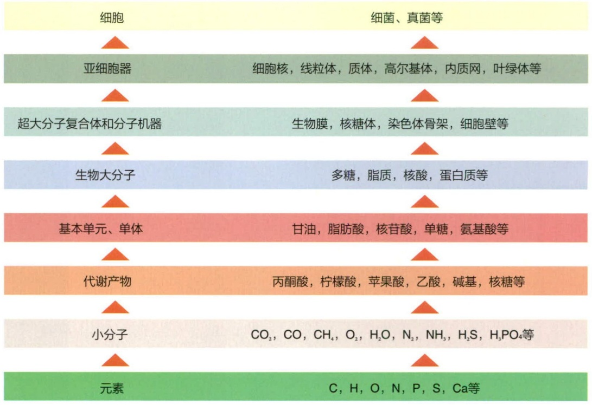

flowchart

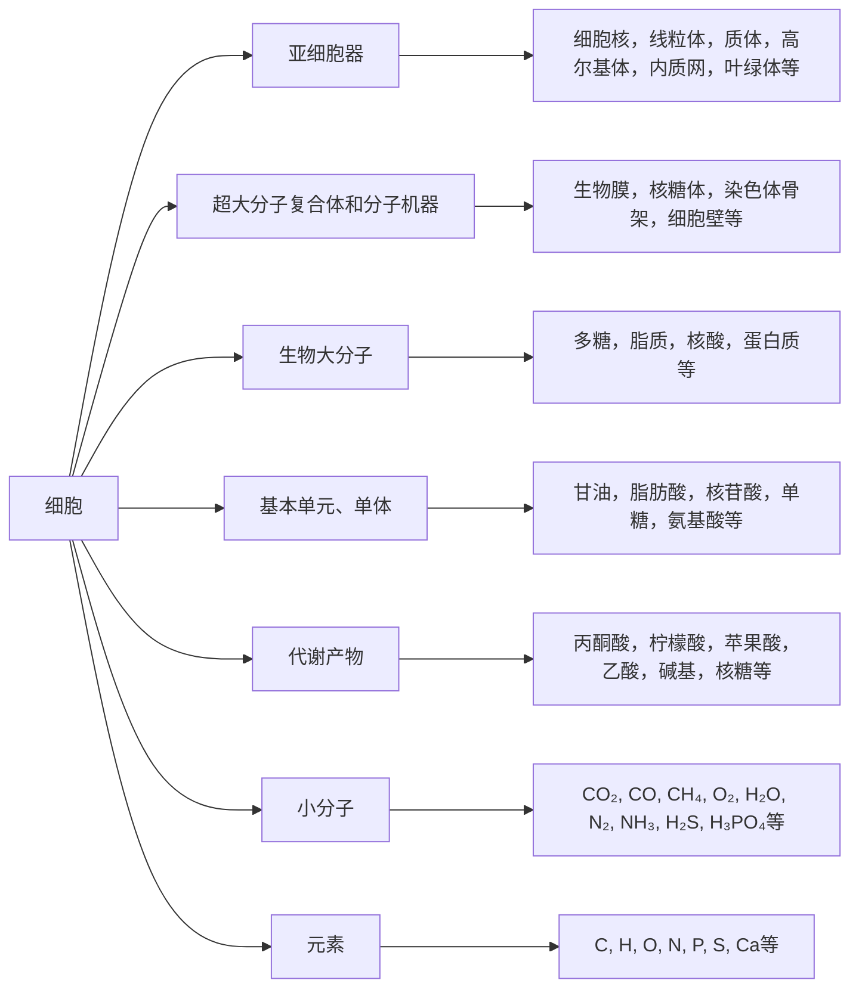

## 16.1.2 生物元件

理论上来说，基于微生物的组成性层级结构，对每个层级进行设计合成，就能构建出全新的生物。可以设计合成非细胞生物病毒，也可以设计合成具有细胞结构的细菌、酵母。但由于人类对生物的认知不足，目前主要是在核酸的层级上进行设计和合成生物。

生物元件（biological part）是构建生物的材料，包括基因元件、RNA 元件等。由于基因是遗传材料，由核酸组成，所以研究和应用最多。根据基因的生物学功能，基因元件可以是编码生化反应、具有催化功能的酶元件，也可以是转录、翻译、代谢等的调控元件。基因元件包括复制子、功能基因、启动子、终止子、阻遏子、诱导子、核糖体结合位点等，也包括酶切位点、选择标记基因、报告基因等遗传操作元件。从工程应用角度来说，用图形显示元件非常有利于合成生物学制图（表 16-1）。

表 16-1 部分基因元件及其对应的图形

<table><tr><td>元件名称</td><td>图形</td><td>生物学功能和意义</td></tr><tr><td>复制子</td><td>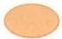</td><td>DNA的自主复制</td></tr><tr><td>启动子</td><td></td><td>启动基因的转录</td></tr><tr><td>阻遏子</td><td></td><td>阻止基因的转录</td></tr><tr><td>诱导子</td><td>[ZAGZ]</td><td>诱导基因的转录</td></tr><tr><td>核糖体结合位点</td><td></td><td>启动蛋白质的翻译</td></tr><tr><td>功能基因</td><td>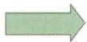</td><td>决定细胞行为</td></tr><tr><td>终止子</td><td></td><td>mRNA合成停止</td></tr><tr><td>酶切位点</td><td>[ZWB6]</td><td>生物元件标准化</td></tr><tr><td>选择标记基因</td><td>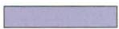</td><td>维持载体的稳定性</td></tr></table>

生物模块（biological module）由一系列生物元件组成，可执行特定的细胞功能。在细胞内，生物模块是具有特定功能的生化途径，如代谢途径、信号转导途径、调控途径等。

合成生物学的设计过程经常与计算机的组装进行类比（表 16-2）。生物元件类似于电子元件，由多个生物元件组成的代谢途径是功能模块。细胞的程序化过程由基因组决定，所以基因组可看作生物的“软件”，而细胞质和细胞壁等可看作生物的“硬件”。计算机的硬件和软件可以相对独立，但生物却没有这么简单，生物元件相互影响，且“软件”具有决定性作用。

表 16-2 合成生物学与计算机组装的类比

| 类型 | 元件 | 模块 | 控制 | 系统 |
| --- | --- | --- | --- | --- |
| 计算机 | 电子元件 | 功能单元 | 门控 | 软件、硬件 |
| 生物 | 生物元件 | 代谢途径 | 基因组网络 | 细胞 |

## 16.1.3 遗传回路

为了调控生物元件和模块的表达，类似于电子学中的电路，合成生物学提出了遗传回路（genetic circuit）或基因回路（gene circuit）的概念。合成生物学认为遗传回路是使合成生物正常运行的控制器，其设计与构建也出现得最早。目前已经设计和构建出了具有多种功能的遗传回路，主要包括开关回路、逻辑门回路等，设计原理一般是基于操纵子模型。

## 16.1.3.1 开关回路

开关回路（switch circuit）是化学物质或温度、光照等诱导（或缺乏）时，控制基因元件处于转录表达（或阻遏状态）的一种方式。例如在异丙基硫代半乳糖苷（isopropyl  $\beta$ -D-thiogalactoside，IPTG）诱导解阻遏的基因表达调控中，只有输入IPTG，lac启动子才能转录下游的基因元件。

双稳态开关是第一个被公开报道的具有功能的遗传回路。该开关由两条相互抑制的调控回路组成（图 16-2）。两种状态的表达产物相互抑制，由诱导物的浓度来决定回路开关的状态。其中 trc 启动子、阻遏基因 lacI 和诱导物 IPTG 组成一个阻遏系统，而 LtetO1 启动子、阻遏基因 tetR 和氧化四环素（OTC）组成另一个阻遏系统。当加入 IPTG 后，trc 启动子解阻遏，驱动 tetR 基因及其 GFP 基因转录，TetR 结合到 LtetO1 上，从而抑制 lacI 基因转录，进而 tetR 与绿色荧光蛋白（green fluorescent protein, GFP）基因持续高表达，输出信号为绿色荧光；相反，当加入脱水四环素（aTc）后，LtetO1 启动子解除阻遏，lacI 基因表达，进而抑制了 tetR 和 GFP 基因的表达，无绿色荧光输出。

## 16.1.3.2 逻辑门回路

逻辑门回路是另一类常用的遗传回路，可分为非门、与门、或门、与非门等遗传回路。

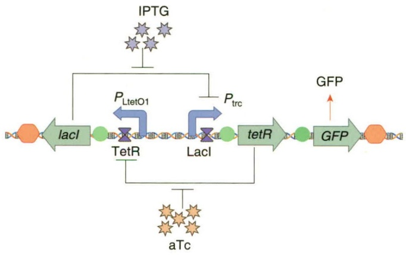

flowchart

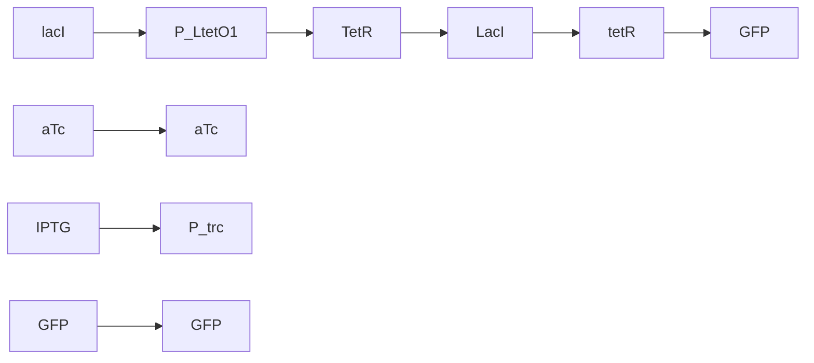

图 16-2 IPTG-aTc 调控的双稳态开关回路

## (1) 非门遗传回路

非门（NO gate）遗传回路是无信号输入时，基因元件不表达，则有输出信号；而有诱导剂输入时，基因元件表达，则无输出信号（表16-3）。如在大肠杆菌的非门遗传回路中，由lac启动子和cI基因组成一个系统，由L启动子和报告基因GFP组成另一个系统。LacI可阻遏lac启动子，CI可阻遏L启动子，形成非门逻辑（图16-3）。当不输入IPTG时，cI基因被阻遏故不表达CI蛋白，L启动子表达GFP，输出绿色荧光；输入IPTG时，cI基因被解阻遏，CI蛋白阻遏L启动子，不表达GFP基因，无绿色荧光输出。

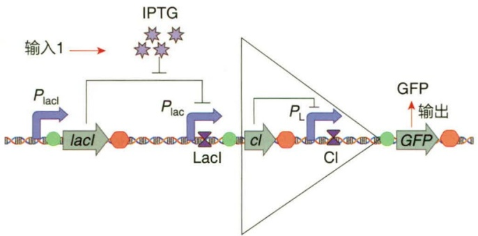

flowchart

图 16-3 非门遗传回路示意图

表 16-3 非门遗传回路的信号转换

| 输入 | 输出 |
| --- | --- |
| 0 | 1 |
| 1 | 0 |

## (2) 与门遗传回路

与门（AND gate）遗传回路是两种信号同时输入时，才有输出信号，否则就没有输出信号（表16-4）。以图16-4为例，无IPTG或阿拉伯糖（Ara）输入时，hrpR或hrpS基因不转录，hrpL启动子不转录GFP基因，无输出绿色荧光信号；当输入IPTG或阿拉伯糖时，hrpL启动子也不转录GFP基因，无输出绿色荧光信号；当同时输入IPTG和阿拉伯糖时，hrpR和hrpS基因转录，其产物HrpR和HrpS结合到启动子上，激活hrpL启动子转录GFP基因，输出绿色荧光。

## (3) 或门遗传回路

或门（OR gate）遗传回路是只要有输入信号，就有输出信号；无信号输入，则无信号输出（表 16-5）。用阿拉伯糖（Ara）和脱水四环素（aTc）双启动子控制 GFP 基因，组成型表达 AraC 和 TetR，形成或门遗传回路（图 16-5）。当输入阿拉伯糖或脱水四环素或同时输入两种信号分子时，GFP 基因都能表达，输出绿色荧光。

## (4) 与非门遗传回路

与非门（NAND gate）遗传回路是双层逻辑，先与门逻辑，然后非门逻辑，是两个逻辑门的组合（表 16-6）。与门、非门都有信号输入时，无输出信号；否则为有输出信号。

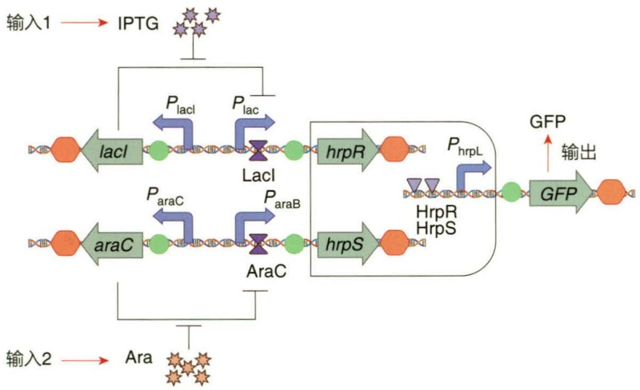

flowchart

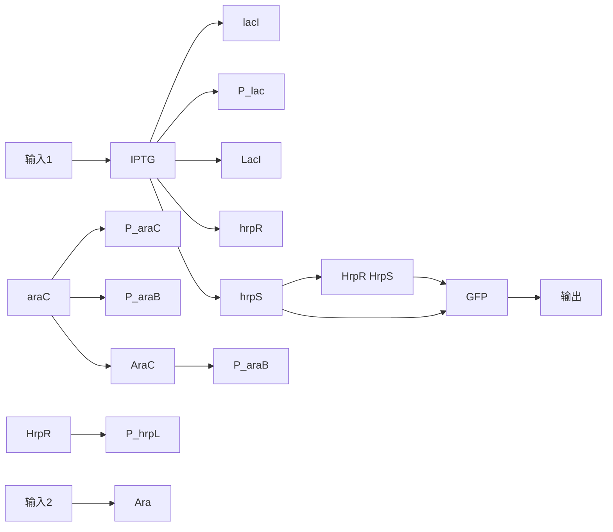

图 16-4 与门遗传回路示意图

表 16-4 与门遗传回路的信号转换

| 输入 1 | 输入 2 | 输出 |
| --- | --- | --- |
| 0 | 0 | 0 |
| 1 | 0 | 0 |
| 0 | 1 | 0 |
| 1 | 1 | 1 |

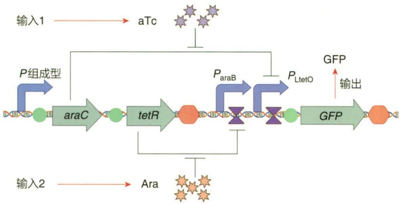

flowchart

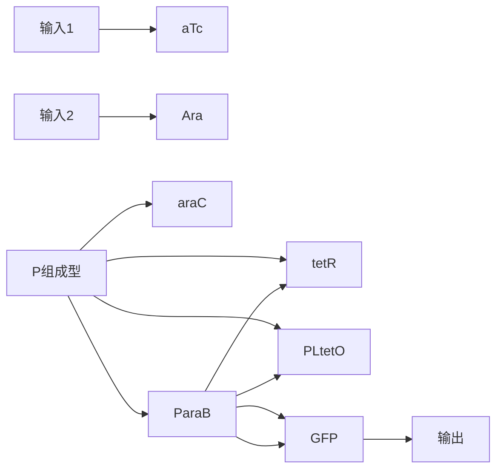

图16-5 或门遗传回路示意图

表 16-5 或门遗传回路的信号转换

| 输入1 | 输入2 | 输出 |
| --- | --- | --- |
| 0 | 0 | 0 |
| 1 | 0 | 1 |
| 0 | 1 | 1 |
| 1 | 1 | 1 |

表 16-6 与非门回路的信号转换

| 输入 1 | 输入 2 | 输出 |
| --- | --- | --- |
| 0 | 0 | 1 |
| 1 | 0 | 1 |
| 0 | 1 | 1 |
| 1 | 1 | 0 |

以图 16-6 为例，与门遗传回路由 lac 启动子 -hrpR、araB 启动子 -hrpS 组成，非门遗传回路由 hrpL 启动子 -cI、L 启动子 -GFP 组成。无 IPTG 或阿拉伯糖输入时，hrpR 和 hrpS 基因不转录，hrpL 启动子不转录 cI 基因，L 启动子转录 GFP 基因，输出绿色荧光信号；当输入

IPTG 或阿拉伯糖时，hrpL 启动子也不转录 cI 基因，L 启动子转录 GFP 基因，输出绿色荧光信号；当同时输入 IPTG 和阿拉伯糖时，hrpL 启动子转录 cI 基因，抑制 L 启动子，不转录 GFP 基因，无绿色荧光输出。

虽然遗传回路的研究模式常用荧光作为信号输出，但这些原理同样可用于生物系统、代谢途径、细胞状态等控制中。

图 16-6 与非门遗传回路示意图

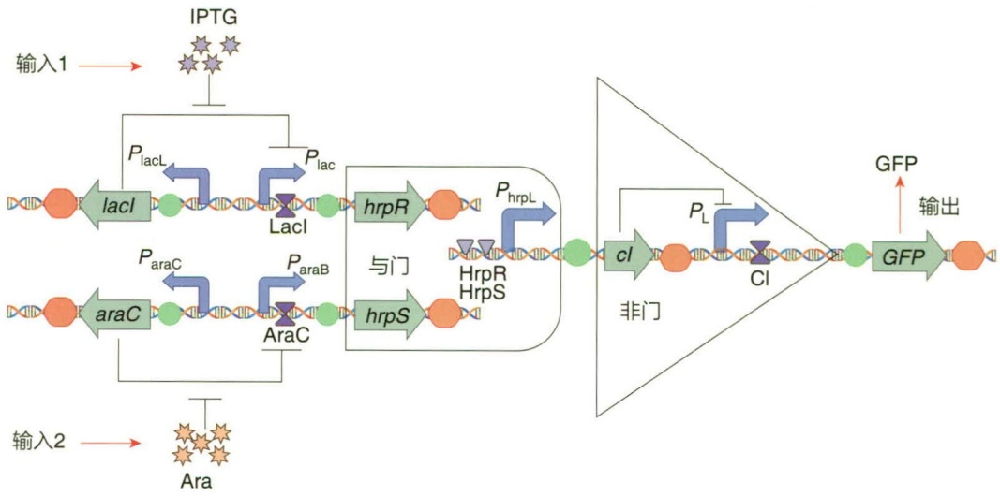

flowchart

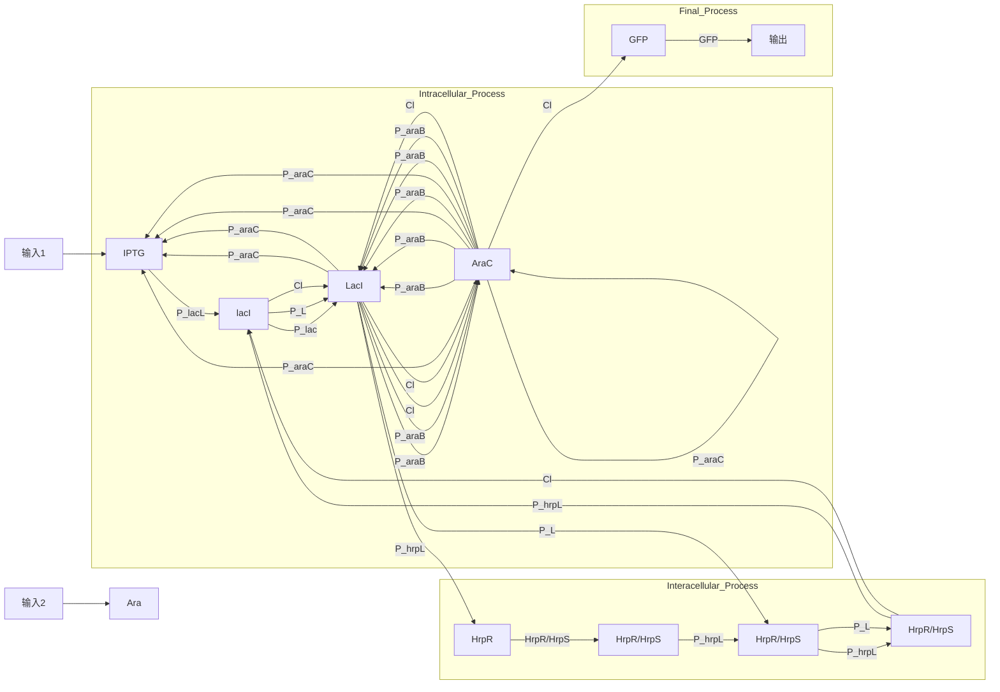

## 16.2 组装 DNA 片段

## 16.2.1 标准化组装

为了提高 DNA 片段的利用率和通用性，可对合成的 DNA 片段（即生物元件）进行标准化。生物元件的标准化具有很多优点:①标准化的生物元件相互之间容易连接，省去了寻找和优化限制性内切核酸酶、连接酶等 DNA 重组工具的烦琐工作，大大节省了时间，提高了效率，有效实现即插即用。②经过改造和实验检验的生物元件，在模式生物中具有很好的生物功能，减少了直接从自然生物中克隆基因所必须面对的异源表达问题。③生物元件具有标准化的动力学参数模拟、载体和宿主背景，为生物模块的功能预测提供了参考、比较和优化的平台。④基于生物元件构建的 DNA 元件文库（如 iGEM Registry），可提供标准化的描述文件和分类的方法，为使用者迅速找到理想的模块提供了便利。

## 16.2.1.1 生物元件库

国际遗传工程机器大赛（International Genetically Engineered Machine Competition, iGEM）是一项合成生物学领域的国际大学生科技竞赛，该竞赛为大学生提供了一个很好的合成生物学训练机会。该竞赛基于生物元件构建了一个DNA元件文库（如iGEM Registry），为了方便研究者查阅生物元件的功能，iGEM Registry对其中的每一个生物元件都有详细的注释，包括该片段的示意图、碱基顺序（不包括前缀和后缀）、片段的设计者对于该片段功能的阐述，以及其他使用者提供的使用经验等。每年iGEM Registry都会向全世界所有参赛队伍免费提供所有最近更新的生物元件，供参赛队伍使用。参赛队伍也可免费向iGEM Reistry上交自己队伍新创造的生物元件和规范化描述性文字。iGEM Registry已得到全世界合成生物学界的普遍支持，其他科研机构和个人也会贡献自己的力量。

## 16.2.1.2 生物元件的标准化结构

生物元件的标准化体现在每一个DNA片段的末端具有相同的前缀和后缀（图16-7）。前缀中包括EcoRI和XbaI两个酶切位点，后缀中包括SpeI和PstI两个酶切位点，且DNA片段内部序列不含有这4个酶切位点。XbaI和SpeI是一对同尾酶，其识别位点不同，但酶切之后形成的黏末端相同。整个生物元件被克隆在特定的质粒载体上，可按照设计的需要剪切和拼接，使DNA片段依次组装起来。

生物元件前缀和后缀中各片段的功能如下（图 16-7）:

片段（1）:额外的间隔碱基序列，以利于用 EcoR I（前缀）和 Pst I（后缀）酶切后进行 PCR 扩增；促进利用 Taq 聚合酶进行 PCR 时反向链末端 A 碱基的添加，从而保证 TA 克隆的高效性；

片段（2）:随机附加的间隔碱基；

片段（3）:EcoRI（前缀）和PstI（后缀）识别位点；

片段（4）:Not I 识别位点；

图 16-7 生物元件前缀和后缀的碱基序列

前缀:

| 5' | GTTTCTT | C | GAATTC | GCGGCCGC | T | TCTAGA | G | [part] | 3' |
| --- | --- | --- | --- | --- | --- | --- | --- | --- | --- |
| 3' | CAAAGAA | G | CTTAAG | CGCCGGCG | A | AGATCT | C | [part] | 5' |
|  | (1) | (2) | (3) | (4) | (5) | (6) | (7) | (8) |  |

后缀:

| 5' | [part] | T | ACTAGT | A | GCGGCCG | CTGCAG | G | AAGAAAC | 3' |
| --- | --- | --- | --- | --- | --- | --- | --- | --- | --- |
| 3' | [part] | A | TGATCA | T | CGCCGGC | GACGTC | C | TTCTTTG | 5' |
|  | (8) | (7) | (6) | (5) | (4) | (3) | (2) | (1) |  |

片段（5）:附加碱基，防止切割/重组过程中意外出现 EcoBI 或 EcoKI 甲基化位点而抑制酶切作用；

片段（6）:Xba I（前缀）和 Spe I（后缀）识别位点；

片段（7）:附加碱基；

片段（8）:大约 20 bp 的、与预构建组件 5' 端（前缀）和 3' 端（后缀）匹配的序列。

## 16.2.1.3 生物元件的连接

将需要组装的 DNA 片段分为插入片段和载体片段两部分。由于具有 4 个标准化的酶切位点，插入片段可在限制性内切核酸酶作用下从载体上切割出来；载体经限制性内切核酸酶处理后可打开一个缺口，并留下两个黏末端。假设将目的片段 A 插入到目的片段 B 的左侧时（图 16-8），首先利用 EcoR I 和 Spe I 两种酶切割含有片段 A 的质粒并将片段 A 切下来。片段 A 的序列如下:

| 5'*AATTC | GCGGCCGC | T | TCTAGA | G | 片段A | --T | A | 3' |  |
| --- | --- | --- | --- | --- | --- | --- | --- | --- | --- |
| 3' | G | CGCCGGCG | A | AGATCT | C | 片段A | --A | TGATC* | 5' |
|  | EcoR I | Not I |  | Xba I |  |  |  | Spe I |  |

然后利用 EcoR I 和 Xba I 两种酶切割含有片段 B 的质粒并去掉它们之间的序列，形成一个切口如下:

| 5'--gca | G | *CTAGA | G---3' |
| --- | --- | --- | --- |
| 3'--cgt | CTTAA* | T | C---5' |
|  | EcoR I | Xba I |  |

在连接酶的作用下，片段 A 和片段 B 上的 EcoR I 位点连接到一起，形成新的 EcoR I 酶切位点；而片段 A 上的 Spe I 和片段 B 上的 Xba I 是同尾酶切位点，因具有相同的黏末端而连在一起。插入片段可以准确嵌入载体上的切口中，且融合后的混合位点因不能被 Xba I 和 Spe I 识别而切开。此外，片段 A 又将自身的 Xba I 位点加入到片段 B 上，保证了连接后片段的前缀和后缀都保持不变，最终实现两个生物元件的成功连接，且新片段仍然可以用这 4 种酶与其他片段连接。如此循环往复，即可由简单到复杂，逐层构建更加复杂的生物系统。

类似地，也可将片段 A 插入到片段 B 的右侧，新生物元件的两端仍然具有 4 个标准酶切位点。

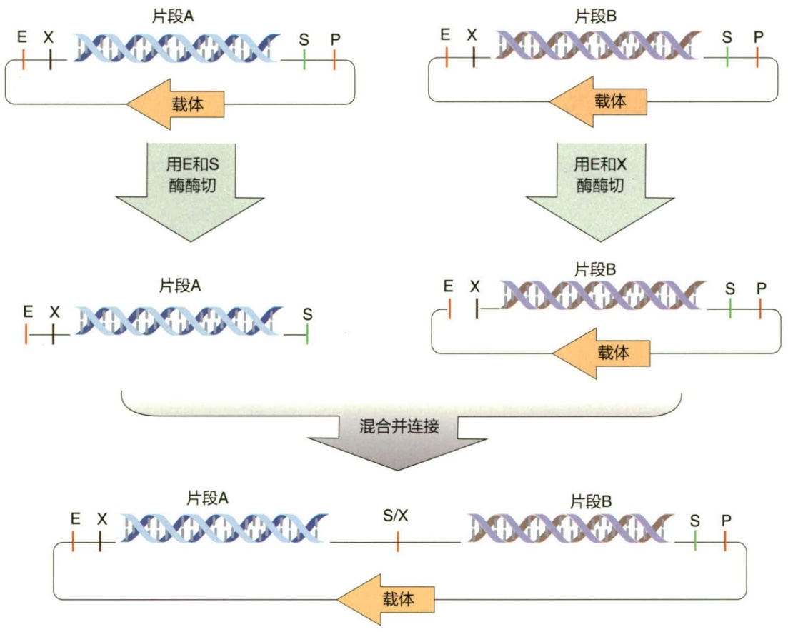

图 16-8 生物元件的连接（以片段 A 插入片段 B 的左侧为例）

## 16.2.2 聚合酶循环组装

聚合酶循环组装（polymerase cycling assembly，PCA）是一种基于聚合酶链反应（polymerase chain reaction，PCR），将可化学合成的短寡核苷酸通过无模板 PCR 组装成长 DNA 片段的 DNA 组装技术。PCA 常用于组装 10～20 条长度为 40～70 bp 的寡核苷酸。用于 PCA 的单链寡核苷酸彼此之间部分重叠。拼接时，这些部分重叠的寡核苷酸片段彼此互为引物和模板，在 DNA 聚合酶的作用下，通过退火、延伸变成较长的双链 DNA；然后再通过与其他寡核苷酸片段或延伸产物之间的变性、退火及延伸的循环，逐步实现寡核苷酸片段的拼接（图 16-9）。该方法由于 DNA 合成费用较低而得到广泛使用。

重叠延伸 PCR 技术（overlap extension polymerase chain reaction，OE-PCR）可以用于组装更长的 DNA 片段（图 16-10）。将末端具有重叠序列的 DNA 片段通过变性、退火，然后互为引物，经聚合酶延伸得到融合的 DNA。一般可以将 2～6 个 DNA 片段按比例混合作为模板，以最外侧两端的寡核苷酸作为引物，进行重叠延伸，同时要保证相邻的两个 DNA 片段之间有 20～40 bp 的同源重叠区。由于 OE-PCR 方法操作简单，省时省力，已经得到了广泛的应用。

图 16-9 PCA 示意图

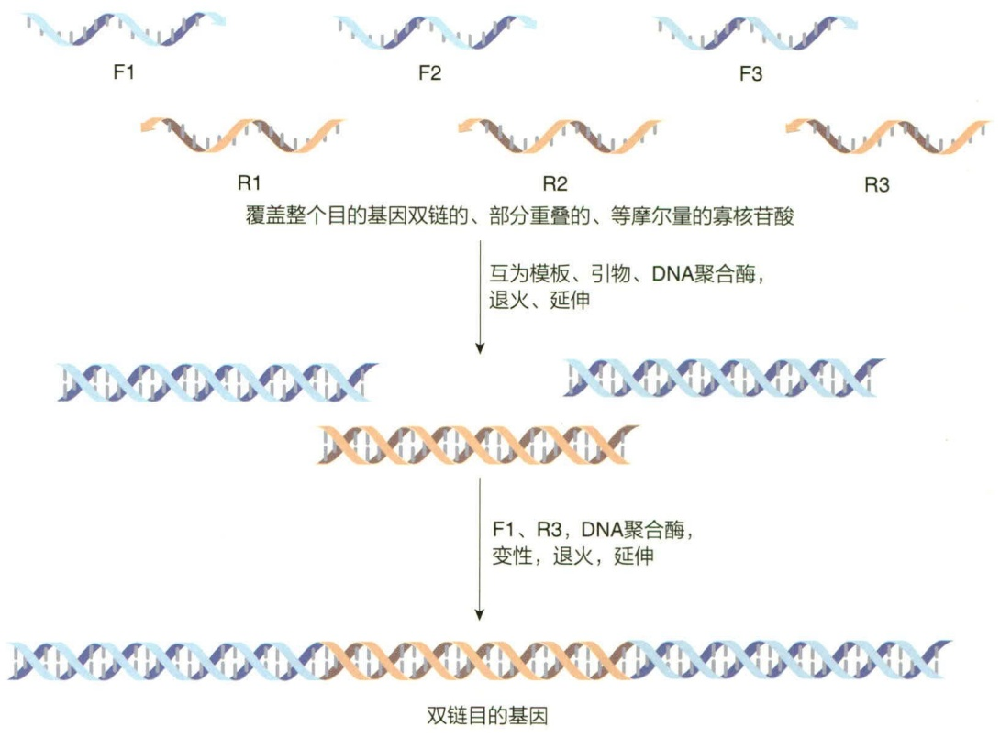

flowchart

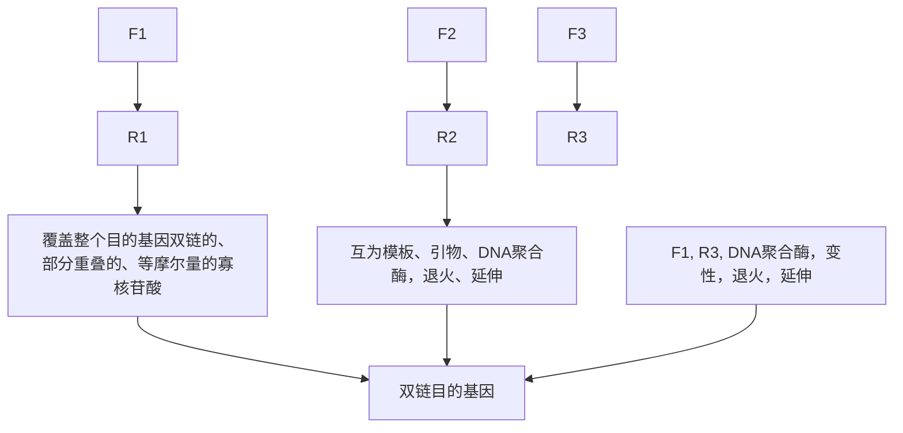

图 16-10 OE-PCR 示意图

将两个 DNA 片段分别用一对引物（F1/R1 或 F2/R2）通过 PCR 扩增，使 PCR 产物之间有同源区段，接着用 F1 和 R2 引物通过 PCR 扩增得到完整双链目的片段

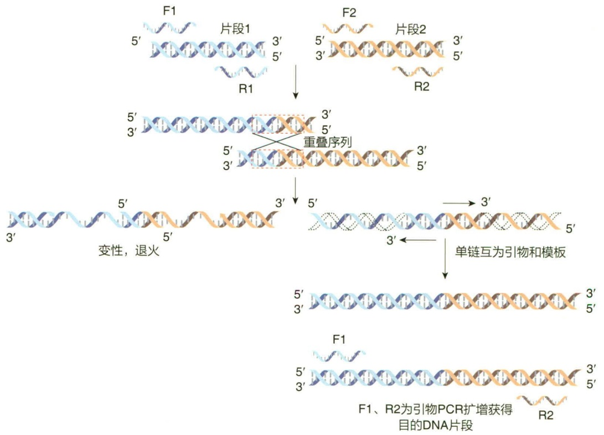

flowchart

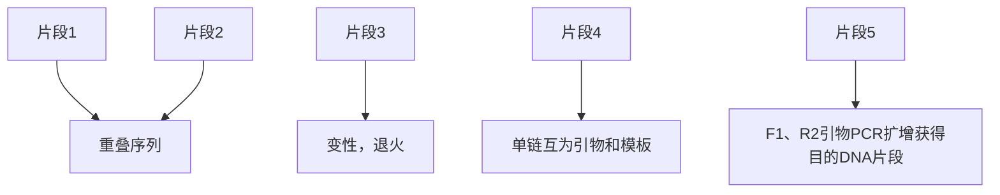

## 16.2.3 Gibson 组装

Gibson 组装（Gibson assembly）又称为 “Gibson 恒温一步组装法”，是美国克雷格·文特尔（J. Craig Venter）研究所的丹尼尔·吉布森（Daniel G. Gibson）和其他研究员一起创建的一种 DNA 组装方法。Gibson 组装利用 T5 核酸外切酶、DNA 聚合酶及连接酶的协同作用在体外将多个带有末端重叠序列的 DNA 片段组装起来（图 16-11）。首先通过 PCR 扩增在 DNA 片段两端加上同源序列，其长度通常为 15～40 bp，获得部分重叠的 DNA 片段。T5 核酸外切酶具有  $5'\rightarrow3'$  核酸外切酶活性，能够从  $5'$  端切割有重叠区的 DNA 片段产生  $3'$  突出末端，然后该单链 DNA 的重叠序列在  $50^{\circ}C$  特异性退火（此时 T5 核酸外切酶逐渐失活），最后 DNA 聚合酶和 Taq 连接酶修复连接而成的双链 DNA，从而形成完整的 DNA 分子，实现无缝拼接。该方法可一步完成组装，组装后的质粒可直接用于转化感受态细胞，无须限制性内切酶。随着组装 DNA 片段的增多，其效率和正确率会随之降低，且需要的重叠序列也较长，引物合成的费用也相应增加，因此该方法常用于不超过 6 个片段的组装。

## 16.2.4 Red/ET 重组组装

Red/ET 重组组装（Red/ET recombineering）是由来源于大肠杆菌的  $\lambda$  噬菌体蛋白对 Red $\alpha$ /Red $\beta$  或来源于 Rac 原噬菌体的蛋白对 RecE/RecT 所介导的基于短同源臂的同源重组技术。同源重组是两个具有同源序列的 DNA 分子间发生交换，从而使序列发生重组的过程。这种同源重组技术能对宿主 DNA 序列进行快速、高效、精确地修饰和操作。

ET 同源重组系统:大肠杆菌 Rac 原噬菌体通过表达蛋白 RecE 和 RecT 高效介导体内同源重组的发生，其所需的单侧同源臂长度仅为  $35 \sim 50$  bp。其中 RecE 蛋白有  $5' \rightarrow 3'$  外切酶活性，能够从  $5' \rightarrow 3'$  端依次切下双链 DNA 上的碱基，形成  $3'$  黏末端；RecT 蛋白是一种单链结合蛋白，保护单链核苷酸不被降解，能在退火时指导单链入侵。

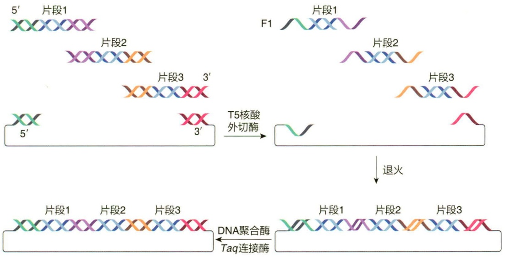

flowchart

```mermaid
graph LR
  A["DNA Polymerase"] --> B["Taq连接酶"]
  B --> C["DNA聚合酶"]
  C --> D["T5核酸外切酶"]
  D --> E["退火"]
  E --> F["片段1"]
  F --> G["片段2"]
  G --> H["片段3"]
  H --> I["片段3"]
  I --> J["片段1"]
  J --> K["片段2"]
  K --> L["片段3"]
  L --> M["片段3"]
  M --> N["片段2"]
  N --> O["片段1"]
  O --> P["片段1"]
```

图 16-11 Gibson 组装示意图

Red 同源重组系统:大肠杆菌  $\lambda$  噬菌体的 Red $\alpha$ /Red $\beta$  蛋白对与 RecE/RecT 蛋白对类似，具有介导同源重组的功能。其中 Red $\alpha$  蛋白具有  $5'\rightarrow3'$  端核酸外切酶活性，RecT 是一种单链结合蛋白。

2003 年，A. 弗朗西斯·斯图尔特（A. Francis Stewart）等将含有 Redα/Redβ 和 RecE/RecT 的重组体系合并命名为 “Red/ET 重组”。当带有同源臂的外源 DNA 分子进入到大肠杆菌中时，Redα 或 RecE 发挥其 5'→3' 端核酸外切酶功能，由 5' 端开始降解 DNA 序列，产生 3' 黏末端，这时外源 DNA 具备了与受体 DNA 发生重组的条件。产生的黏末端被 RecT 或 Redβ 结合，防止被细胞内存在的核酸酶降解。在 DNA 退火时，含有黏末端的 3' 单链攻击双链 DNA 片段并重组。发生重组的两条 DNA 链经过剪切和 DNA 聚合酶的修复后，形成重组 DNA，即外源 DNA 成功导入受体 DNA 中（图 16-12）。

## 16.2.5 细胞内组装

随着待组装片段长度的增加，DNA 在体外容易受到常规操作的影响而变得不稳定，且 DNA 大片段体外组装技术通常是烦琐和低效的。因此，大片段 DNA 的组装更多依靠细胞内组装，酿酒酵母是细胞内组装的常用宿主载体。

图 16-12 Red/ET 重组示意图

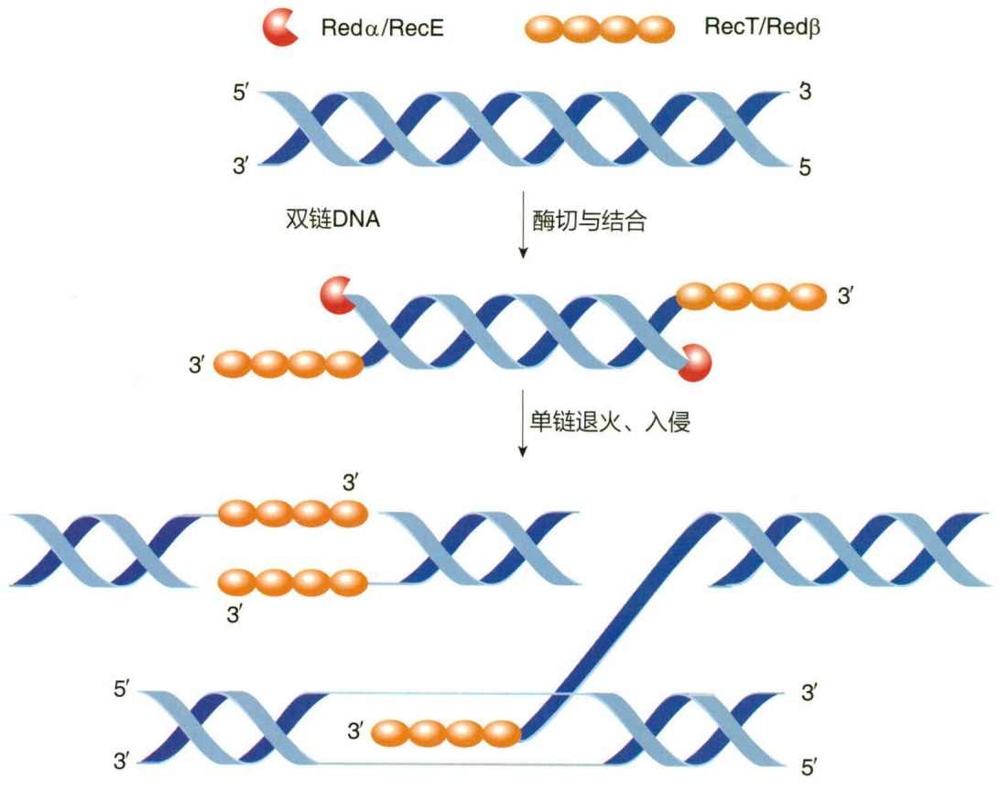

flowchart

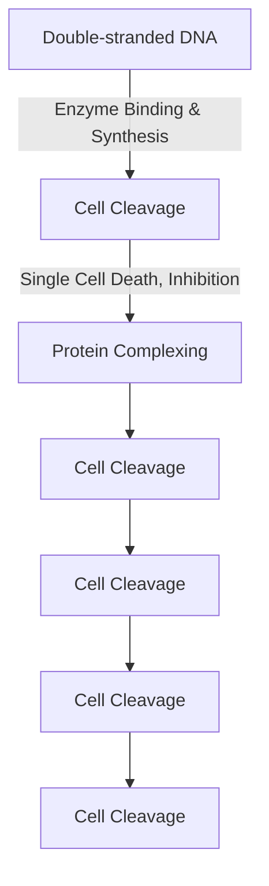

## 16.2.5.1 酵母转化偶联重组技术

利用酿酒酵母体内高效同源重组系统开发出将多个具有末端重叠序列的DNA片段组装起来的技术称为酵母转化偶联重组技术（transformation-associated recombination，TAR）。TAR可以组装较短的寡核苷酸，也可以组装大片段DNA，甚至实现整个基因组的组装。TAR组装过程如图16-13所示。2010年美国Venter研究组通过该技术完成了1078条大小为 $1080\mathrm{bp}$ 的DNA片段的组装，最终人工合成了 $1.08\mathrm{Mb}$ 的丝状支原体（Mycoplasma mycoides）基因组；来自美、中、英、澳大利亚和新加坡的科学家共同开展的酵母基因组合成计划（synthetic yeast genome project, SC2.0），在2017年完成了酿酒酵母5条染色体的人工设计与合成，实现了合成染色体片段对野生染色体片段的替换，其中4条染色体的合成是由中国科学家领衔完成的。

## 16.2.5.2 YLC 组装

传统兆碱基（Mb）大小的DNA组装方法通常需要从宿主细胞中提取大片段DNA，在体外或大肠杆菌中富集后将它们导入宿主细胞再进一步组装。大片段DNA输入和输出到宿主细胞的低效率严重限制了组装的效率。酵母生命周期（yeast life cycle，YLC）介导的大片段DNA组装技术可以解决这一问题。YLC组装的原理是通过在酵母交配和孢子形成过程中迭代、转移细胞中的待组装DNA片段，最后在体内组装成大片段DNA。YLC通过以下步骤与酵母生命周期嵌套:交配过程使来自两个单倍体的两个DNA片段被带入一个二倍体进行组装，含有组装DNA的二倍体可以进行减数分裂以产生可用于下一轮组装的单倍体孢子。其组装过程见图16-14。据报道，使用该方法可以组装100千碱基（kb）大小的内源酵母DNA和兆碱基（Mb）大

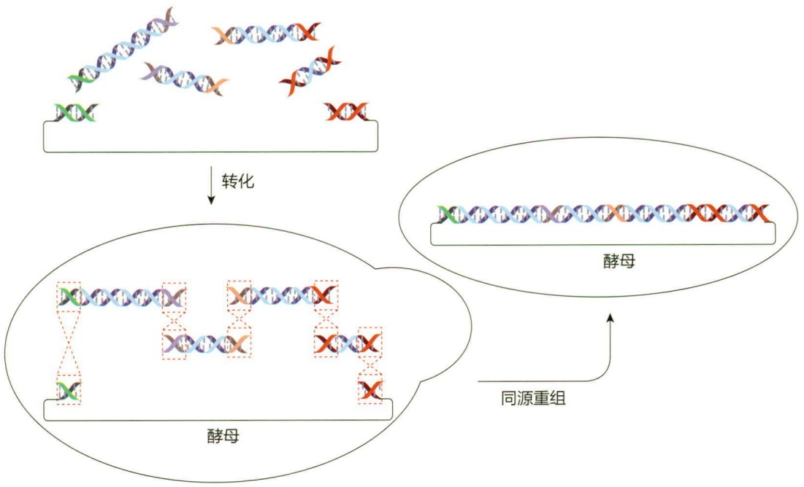

flowchart

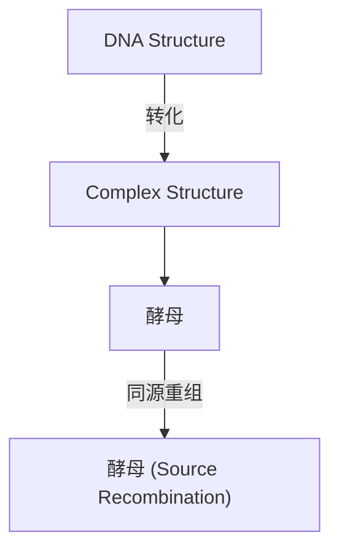

图16-13 TAR组装示意图