图16-14 YLC组装示意图

flowchart

This flowchart illustrates the DNA replication process in human cells, showing how single and double alleles are combined into single and double alleles to form a continuous large DNA assembly.

小的外源 DNA。YLC 组装降低了 Mb 大小 DNA 组装的技术难度，是大规模基因组工程和合成基因组学有潜力的工具。

## 16.3 合成噬菌体与病毒

text_image

知识拓展 16-2
枯草芽孢杆菌体内
组装

噬菌体和病毒基因组的合成技术，使得无须从感染样本中分离制备，就能快速获得噬菌体和病毒及研究样本。合成噬菌体和病毒技术不仅可用于基础研究，还可开发减活疫苗。目前已经合成了噬菌体、脊髓灰质炎病毒、鼠肝炎病毒、中东呼吸综合征病毒、SARS-CoV-2等基因组。

## 16.3.1 合成噬菌体

本小节以 T7 噬菌体为例，介绍嵌合噬菌体基因组的设计合成及噬菌体的再生。

## 16.3.1.1 合成型 T7 基因组的设计

合成基因组时一般需要遵循“基因元件序列不重叠”的设计原则，以避免合成致死性，即一个基因元件序列是唯一的且编码唯一功能，这样每个基因元件能够进行独立和准确地合成和组装。首先要对野生型T7噬菌体基因组进行注释，以确定功能基因的边界。野生型T7噬菌体的线性基因组长39 937 bp，包括57个可读框、57个核糖体结合位点（RBS）、60个蛋白、51个调控序列。对于基因之间的重叠序列，需要拆分到两个基因中。

如图 16-15 所示，野生型 T7 基因组中，基因 3 的核糖体结合区（RBS）在基因 2.8 内部。在设计 T7.1 时，把自然 RBS 和起始密码进行同义点突变（用大写字母表示），这不改变基因 2.8 的氨基酸序列；把基因 3 的重叠序列整体右移，与基因 2.8 之间用限制性内切酶（BamH I 和 Eag I）分开。通过采取这类策略，解决了 T7 基因组中基因序列的重叠问题，所设计的 T7.1 基因组长度为 41326 bp。

flowchart

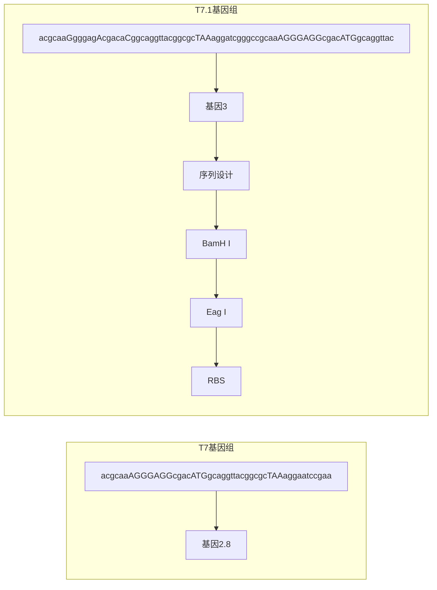

图 16-15 T7.1 基因组中基因元件设计

基因 2.8 中突变碱基用大写字母表示；TAA 是终止密码子；ATG 是起始密码子

## 16.3.1.2 T7.1 基因组的合成

将 T7.1 基因组拆分成 6 个大片段、73 个片段，每个片段包括多个基因元件。大片段之间无重叠边界，末端是核酸内切酶位点。采用替换策略，进行 T7.1 基因组的合成。用合成的 12 179 bp 取代野生型 T7 基因组左端的 11 515 bp，获得了嵌合噬菌体基因组。

## 16.3.1.3 T7.1 噬菌体包装

用嵌合体噬菌体基因组转染大肠杆菌，涂培养板测试其功能。在平板上出现了噬菌斑，则表明嵌合噬菌体基因组具有复制、转录和翻译功能，包装成活噬菌体，具有生物学活性。

虽然未见报道野生型 T7 基因组右端序列的替换工作，但研究表明自然生物基因组可进行再设计和重新合成，是合成微生物基因组的开篇工作。

## 16.3.2 合成脊髓灰质炎病毒

脊髓灰质炎病毒（poliovirus）是引起瘫痪和小儿麻痹症的病原体，脊髓灰质炎病毒基因组是一条长7440 nt的正义单链RNA。2002年杰罗尼莫·西罗（Jeronimo Cello）等以脊髓灰质炎病毒1[(poliovirus 1 Mahoney)，简称PV1（M)]基因组序列为参考，人工设计并合成了脊髓灰质炎病毒[synthetic PV1（M），简称sPV1（M)]，下面以该项工作为例来介绍病毒基因组的设计与合成。

## 16.3.2.1 脊髓灰质炎病毒基因组 cDNA 的设计

野生型脊髓灰质炎病毒基因组由 742 nt 的 5' 非翻译区（5'UTR）、1 个可读框、70 nt 的 3' 非翻译区（3'UTR）和大约 60 nt 的 poly（A）组成（图 16-16）。其只有 1 个可读框，形成一个转录本，编码病毒复制的所有蛋白，包括结构蛋白 P1、非结构蛋白 P2 和 P3。

由于 T7 RNA 聚合酶启动子能转录脊髓灰质炎病毒基因组，并产生相同长度的转录本，因此选择 T7 启动子替换天然启动子，置于整个基因组的左端，驱动整个基因组的转录。其他序列最大限度地保持与野生型完全相同。

为了有效地合成和组装，将 sPV1（M）基因组 cDNA 拆分为 F1、F2 和 F3 片段。F1 片段长度 3 026 bp，包括 T7 RNA 聚合酶启动子（TAATACGACTCACTATAG）、5'UTR 和结构区域 P1，F1 与 F2 重叠 24 bp。F2 片段长度 1 895 bp，主要包括非结构域 P2 区域，F2 与 F3 重叠 21 bp。F3 片段长度 2 682 bp，包括 P3 区域、3'UTR 和 poly（A）尾。

图 16-16 合成脊髓灰质炎病毒 [sPV1(M)] 基因组 cDNA 的设计

flowchart

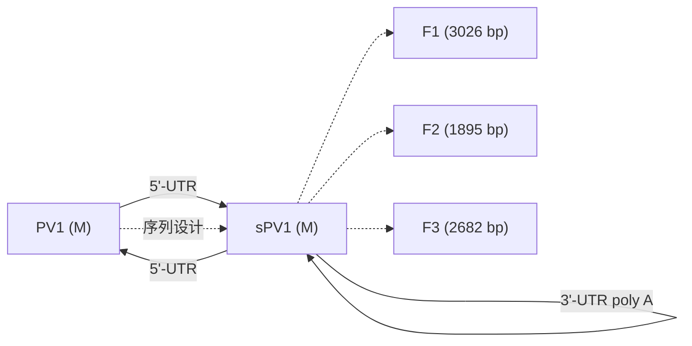

为了组装和筛选鉴定合成型基因组，在 sPV1（M）基因组中设计了 13 个新酶切位点，消除 1 个原有的酶切位点，改变 20 个碱基，但所有序列改变都不能影响病毒复制。

按脊髓灰质炎病毒基因组的组织形式，将 RNA 序列转换为 cDNA 序列，进行序列设计。基于 cDNA 序列，设计成每个长度大约为 60 bp 的寡核苷酸，且每个寡核苷酸之间重叠 15～30 bp。同时引入设计的突变位点。

## 16.3.2.2 脊髓灰质炎病毒 cDNA 的合成与组装

采用酶切连接策略进行组装（图 16-17）。根据设计，由化学合成互补双链寡核苷酸，末端具有重叠序列。再通过无模板 PCR，使用高保真聚合酶，把 8～12 个寡核苷酸片段（40～93 bp）组装成 400～600 bp 的小片段。小片段经凝胶电泳纯化后，再连接到质粒载体上。

经过双向测序验证正确的小片段，进一步连接、组装成 F1、F2 和 F3 片段。如果出现错误，则需通过 PCR 进行点突变或正确序列的替换实现纠错。

利用 F1、F2 和 F3 片段内部的酶切位点和载体上位点，经过酶切和连接反应，逐步合并，组装到 pBR322 载体上，组装成 pBR-F1-2-3。

## 16.3.2.3 脊髓灰质炎病毒包装

接下来采用无细胞提取物表达病毒基因组 sPV1（M）。pBR-F1-2-3 与无细胞提取物混合孵育，T7 RNA 聚合酶转录合成的脊髓灰质炎病毒 cDNA，生成转录物 RNA，进一步翻译出病毒的蛋白，包装成病毒颗粒。有实验检测到了合成的病毒和病毒特异性蛋白质，且与野生型病毒 RNA 的产物相同，噬菌斑的表型特性也与野生型相同。sPV1（M）的 RNA 能在无细胞提取物中复制和翻译，并包装形成具有感染能力的新脊髓灰质炎病毒，实现了从头合成脊髓灰质炎病毒。

## 16.3.2.4 合成脊髓灰质炎病毒减活疫苗

脊髓灰质炎病毒 P1 区域编码病毒衣壳蛋白，在不改变 P2 和 P3 区域的前提下，使用不同密码子，同时控制密码子偏向性和 RNA 折叠自由能，对脊髓灰质炎病毒 P1的氨基酸重新编码，可设计合成减活疫苗。例如，使用人类基因组中高丰度密码子对 P1 区编码，其中包括 566 个同义突变，它的感染性和致瘫痪率与野生型完全相同；但使用人类基因组中低丰度密码子对 P1 区编码，其中包括 631 个同义突变，因其翻译效率太低，该病毒不能存活；对 P1 区的 C 端突变设计，则感染性下降，神经毒性衰减至原来的 1/100，50% 致瘫痪浓度是野生型的 2000 倍，从而获得合成型脊髓灰质炎病毒减活疫苗。

flowchart

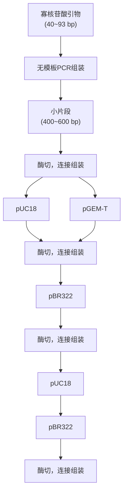

## 16.3.3 合成新型冠状病毒

急性呼吸综合征冠状病毒 2（SARS-CoV-2）也称为新冠病毒，其基因组是正链 RNA，约 30 kb。合成新型冠状病毒的基本过程包括 3 个主要步骤，首先是合成新型冠状病毒基因组 cDNA，其次是离体转录生成基因组 RNA，最后是转化动物细胞，基因组 RNA 复制、转录和翻译，并包装形成新型冠状病毒颗粒。目前已经报道有两种合成新型冠状病毒基因组 cDNA 的策略，分别是离体组装和酵母细胞组装。

## 16.3.3.1 离体组装新型冠状病毒基因组 cDNA

第一步是基因组 cDNA 设计与片段合成。将新型冠状病毒基因组拆分成长度 3500～5700 bp 的 7 个片段，在片段末端设计 IIS 型限制性内切酶位点（图 16-18）。F1 片段左端设计 T7 RNA 聚合酶启动子，F7 片段右端设计转录终止信号 poly（A）序列（29 nt）。F1、F4、F5 和 F6 片段的末端为 BsaI（GGTCTCANNNN），F2、F3 和 F7 片段的末端为 Esp3I（CGTCTCANNNN）。F1、F4、F5 和 F6 片段克隆在载体 pUC 上，能在大肠杆菌 Top10 中稳定存在。在 pUC 上的 F2、F3 和 F7 片段，会导致大肠杆菌不能存活；故需选用能承载毒性和不稳定性片段的载体 pCC1，对 F2、F3 和 F7 片段进行克隆，并在大肠杆菌 EPI300 中保存。pCC1 是单拷贝质粒，经阿拉伯糖诱导后，拷贝数可增加到 10～20 个。

新型冠状病毒基因组片段在大肠杆菌中往往不稳定，倾向于复制突变的错误和删除。需使用大肠杆菌 Top10 或 EPI300，降低培养温度（25～30℃）、长时间（48 h）生长，以减少突变发生。

图 16-18 新型冠状病毒基因组 cDNA 的设计与离体组装示意图

两个相邻片段中，只有上游片段长度计算酶切位点的4个碱基

下一步是离体连接与组装。先提取质粒，经酶切、纯化制备高质量的 F1 至 F7 片段；采用 T4 DNA 连接酶，将 F1、F2、F3、F4 连接在一起，并分离纯化获得 F1-4 片段；另将 F5、F6 和 F7 片段连接在一起，并分离纯化获得 F5-7 片段。最后，再将 F1-4 片段和 F5-7 片段连接组装在一起，经分离纯化而获得新型冠状病毒基因组 cDNA。

flowchart

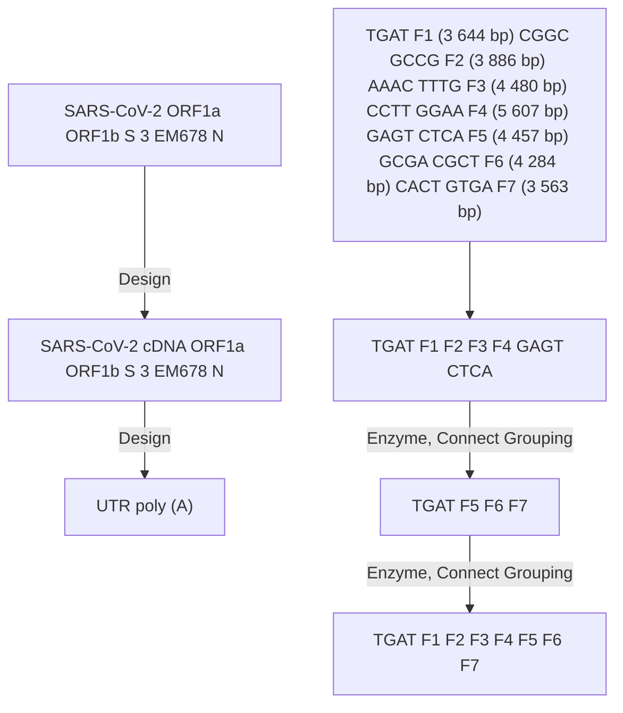

## 16.3.3.2 酵母细胞组装新型冠状病毒基因组 cDNA

冠状病毒基因组较大，而且基因组片段对大肠杆菌具有毒性，离体组装需要数微克高质量的片段，技术难度较大。而选择酵母底盘，通过同源重组原理，使用 YAC 载体进行组装，则相对较容易。

将新型冠状病毒基因组拆分为 12 个重叠 DNA 片段，每个片段之间重叠长度 45～500 bp（图 16-19），且每个片段末端设计有限制性内切酶位点，以便酶切制备大片段。在 F1 片段的左端设计 T7 启动子和载体同源臂（88 nt），F12 片段右端设计 poly（A）和载体同源臂（181 nt），用于离体转录和酵母细胞内的同源重组。用含有 45 bp 以上同源臂的引物扩增，使 pCC1BAC-His3 线性化。将 12 个片段和线性化的载体，转化酿酒酵母（Saccharomyces cerevisiae）VL6-48N，12 个片段按照顺序组装到载体上。最后经筛选、鉴定，分离纯化获得组装成功的含有新型冠状病毒基因组 cDNA 的载体。

## 16.3.3.3 新型冠状病毒基因组 cDNA 的离体转录

使用离体转录试剂盒完成离体转录。加入新型冠状病毒基因组 cDNA，由 T7 RNA 聚合酶进行转录，32℃、8 h，生成基因组 RNA。转录结束后，加入 DNase，消化降解 cDNA 模板，分离纯化、制备新型冠状病毒基因组 RNA。

## 16.3.3.4 重组新型冠状病毒的包装

由于新型冠状病毒 N 基因有利于基因组 RNA 的电转化，因此，通过 PCR 扩增 N 基因 DNA，离体转录制备 N 基因的 RNA。再将新型冠状病毒基因组 RNA 和 N 基因的 RNA 一起电转化 Vero E6 细胞，转化细胞在 5% 二氧化碳培养箱中，37℃ 下培养。转化后 40～60 h，分离、收获新型冠状病毒颗粒。使用 10%～20% 血清用于细胞增殖，2% 血清用于病毒感染和复制。

图 16-19 新型冠状病毒基因组 cDNA 的设计与酿酒酵母组装示意图（括号数字内仅显示在新型冠状病毒基因组上的顺序位置）

flowchart

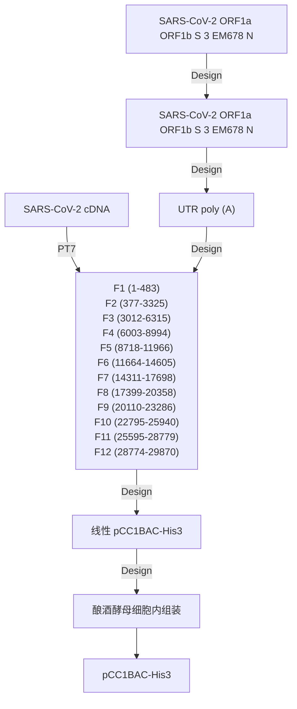

为了提高转染效率和病毒滴度，可采用细胞共培养策略。将新型冠状病毒基因组RNA和N基因的RNA一起电转化为BHK-21细胞，再与Vero E6细胞在5%二氧化碳培养箱中，37℃下共培养。转化后3\~4d，从培养液上清中分离、收获新型冠状病毒颗粒。

## 16.4 合成细菌基因组

细菌基因组的合成有三种策略，第一种是由小到大，异源逐级片段组装，最终组装出全长基因组。如离体组装和酵母中组装相结合，合成了支原体基因组。第二种是所有片段一次性组装，如将25个大片段一次性导入酵母细胞，在细胞内组装出了支原体基因组。第三种是合成型片段逐步替换野生型基因组序列，获得合成型基因型，如大肠杆菌缩减密码子的基因组。

## 16.4.1 合成支原体基因组

## 16.4.1.1 支原体基因组的拆分设计

生殖支原体（Mycoplasma genitalium）基因组长度为 580 076 bp，把原始序列按顺序等分成 101 个片段，每个片段长 5～7 kb。在不影响生存的前提下，选择性地除去非必需基因。每个片段包含一个或几个完整基因，以防止基因失活。相邻片段的末端有 80～360 bp 重叠序列，第一个片段 5' 端与最后一个片段 3' 端之间重叠，以组装形成环状基因组。

在合成基因组序列中，设计4个水印序列，插入在片段之间，以区别野生型基因组和合成型基因组。合成型生殖支原体基因组JCVI-1.0的总长度为582970 bp，包括485个蛋白质编码基因、43个rRNA、tRNA和结构RNA基因以及4个水印序列和插入序列。

## 16.4.1.2 合成型支原体基因组的组装策略

采用离体组装与酵母细胞内组装相结合的策略，分两个阶段，逐级组装基因组（图 16-20）。

第 1 个阶段，用细菌人工染色体（bacterial artificial chromosome，BAC）载体，逐级离体 Gibson 组装。由相邻 4 个片段和外切酶、聚合酶、连接酶等组成反应体系，离体组装成 A1 片段。把 A1 片段和线性 BAC 载体电转化大肠杆菌，筛选、鉴定正确的组装体 A1。这样组装得到 A 系列（A1～A25）片段，每个 A 系列长约 24 kb。用类似的方法，由 3 个 A 片段组装成 1 个 B 片段，形成 B 系列（B1～B8）片段，每个 B 片段长约 72 kb。由 2 个 B 片段组装成 1 个 C 片段，每个 C 片段长约 144 kb，形成 C 系列（C1～C4）片段。

第 2 阶段，用酵母人工染色体（YAC）为载体，在酿酒酵母细胞内同源组装。将

flowchart

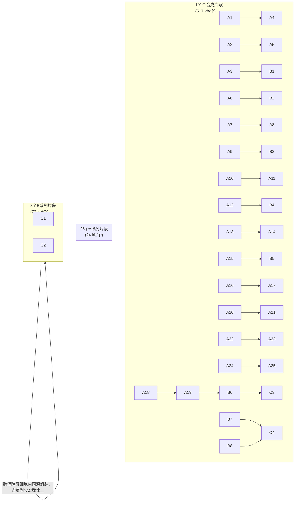

图 16-20 支原体基因组设计与组装策略

4个C序列片段（C1、C2、C3、C4）和线性化的YAC载体，导入酿酒酵母细胞内，组装出合成型支原体基因组JCVI-1.0。也可以逐级组装，将C1和C2片段与YAC转化酵母，组装成D1片段，C3和C4片段组装成D2片段。D1和D2片段与YAC转化酿酒，组装成全长基因组。经功能测试，该合成型基因组没有生物活性，但为百kb级别基因组合成提供了技术和方法。

## 16.4.2 合成支原体

在合成生殖支原体基因组和细菌基因组移植技术的基础上，美国克雷格·文特

尔研究所（J. Craig Venter Institute，JCVI）在2010年用两种生长较快的支原体，以丝状支原体［M. mycoides sp. capri（GM12）］为供体基因组，以山羊支原体［M. capricolum sp. capricolum（CK）］为受体细胞。采用酵母细胞内组装供体基因组，导入到去核受体细胞中（图16-21），创造了合成细菌JCVI-Syn 1.0，其基因组长度为1077947 bp。合成型基因组具有生物活性，开创了人工合成细菌的先河。

flowchart

```mermaid
graph LR
  A["1 kb"] --> B["Complex Structure"]
  C["10 kb"] --> B
  D["100 kb"] --> B
  E["100 kb"] --> B
  F["10 kb"] --> G["Gene Group移植"]
  H["100 kb"] --> G
  I["10 kb"] --> G
  J["100 kb"] --> G
  K["100 kb"] --> G
  L["100 kb"] --> G
  M["100 kb"] --> G
  N["100 kb"] --> G
  O["100 kb"] --> G
  P["100 kb"] --> G
  Q["100 kb"] --> G
  R["100 kb"] --> G
  S["100 kb"] --> G
  T["100 kb"] --> G
  U["100 kb"] --> G
  V["100 kb"] --> G
  W["100 kb"] --> G
  X["100 kb"] --> G
  Y["100 kb"] --> G
  Z["100 kb"] --> G
  AA["100 kb"] --> G
  AB["100 kb"] --> G
  AC["100 kb"] --> G
  AD["100 kb"] --> G
  AE["100 kb"] --> G
  AF["100 kb"] --> G
  AG["100 kb"] --> G
  AH["100 kb"] --> G
  AI["100 kb"] --> G
  AJ["100 kb"] --> G
  AK["100 kb"] --> G
  AL["100 kb"] --> G
  AM["100 kb"] --> G
  AN["100 kb"] --> G
  AO["100 kb"] --> G
  AP["100 kb"] --> G
  AQ["100 kb"] --> G
  AR["100 kb"] --> G
  AS["100 kb"] --> G
  AT["100 kb"] --> G
  AU["100 kb"] --> G
  AV["100 kb"] --> G
  AW["100 kb"] --> G
  AX["100 kb"] --> G
  AY["100 kb"] --> G
  AZ["100 kb"] --> G
  BA["100 kb"] --> G
  BB["100 kb"] --> G
  BC["100 kb"] --> G
  BD["100 kb"] --> G
  BE["100 kb"] --> G
  BF["100 kb"] --> G
  BG["100 kb"] --> G
  BH["100 kb"] --> G
  BI["100 kb"] --> G
  BJ["100 kb"] --> G
  BK["100 kb"] --> G
  BL["100 kb"] --> G
  BM["100 kb"] --> G
  BN["100 kb"] --> G
  BO["100 kb"] --> G
  BP["100 kb"] --> G
  BR["100 kb"] --> G
  BRN["1.08 Mb"] --> G
  BRN --> GG("基因组移植")
  BHN --> GG("基因组移植")
  BIH --> GG("基因组移植")
  BIJ --> GG("基因组移植")
  BIK --> GG("基因组移植")
  BIL --> GG("基因组移植")
  BIM --> GG("基因组移植")
  BIN --> GG("基因组移植")
  BIO --> GG("基因组移植")
  BIP --> GG("基因组移植")
  BIQ --> GG("基因组移植")
  BIR --> GG("基因组移植")
  BIU --> GG("基因组移植")
  BIV --> GG("基因组移植")
  BIW --> GG("基因组移植")
  BIX --> GG("基因组移植")
  BIY --> GG("基因组移植")
  BIZ --> GG("基因组移植")
```

图 16-21 合成细菌过程的示意图

## 16.4.2.1 合成型支原体基因组的设计

选择两株已经测序的丝状支原体供体基因组序列（CP001621的长度1 089 202 bp，CP001668的长度1 084 586 bp）为参考，设计合成型基因组序列。敲除野生型基因组中非必需序列4 kb，增加在酵母中繁殖和移植的序列，包括酵母自主复制序列、转座酶基因、选择标记基因（URA3），增加细菌中选择的氨苄青霉素抗性基因和报告基因lacZ。敲除Ⅲ型限制性内切核酸酶限制性系统，便于向受体细胞中移植。

将整个基因组等分为 1 078 个片段，每个片段长度约为 1 080 bp，相邻片段具有 80 bp 重叠序列。根据组装的需要，对 25 处的序列进行突变性设计。YAC 载体和片段的两个末端含有 Not I 酶切位点，以便组装和克隆。设计 4 个水印序列（水印 1 长度 1 246 bp，水印 2 长度 1 081 bp，水印 3 长度 1 109 bp，水印 4 长度 1 222 bp），水印序列本身和插入位点对细胞活性没有影响。同时，在水印序列末端设计有合理的酶切位点。

## 16.4.2.2 合成型支原体基因组的组装

由化学合成的寡核苷酸组装成序列盒 1 078 个，长度为 1 081 bp，测序确认序列无误。导入酵母细胞内，进行同源重组、层级组装分为以下三个阶段。

第一阶段是 10 kb 片段的组装。将 10 个约 1 kb 片段和线性载体，导入酿酒酵母原生质体，进行同源重组。筛选到重组克隆，提取重组质粒后，转化大肠杆菌进行富集，测序。分离纯化制备 10 kb 正确组装体，进入下一级组装。

第二阶段是 100 kb 片段的组装。将 10 个 10 kb 组装体和线性载体，导入酿酒酵母原生质体，进行同源重组。100 kb 以上重组质粒在大肠杆菌中不稳定，直接从酵母克隆中提取。采用多重 PCR 筛选酵母克隆，从酵母原生质体中提取重组载体。测序正确的 100 kb 组装体，进入下一级组装。

第三阶段是全长基因组的组装。分用 Not I 酶切，高度纯化和富集 100 kb 组装体。将 11 个 100 kb 的组装体，转化酵母细胞，组装成全长基因组。采用多种方法，包括多重 PCR、酶切、脉冲场电泳等进行筛选和鉴定。

## 16.4.2.3 合成型支原体基因组的移植

用琼脂块包埋技术制备合成型支原体基因组，将含有合成基因组的酿酒酵母细胞与低熔点琼脂、去壁酶混合，点样到琼脂块上。加入去壁酶、蛋白酶K，37℃下原位裂解，消化酵母细胞壁、蛋白质，洗涤除去水解物。加入限制性内切酶（AsiS I 和 Rsr II，不消化支原体基因组），消化琼脂块中的酵母线性基因组。电泳去除酵母基因组片段，合成型的环形支原体基因组仍然保留在琼脂块中。分离纯化制备合成型支原体基因组，移植到去基因组的山羊支原体受体细胞中，在37℃下用抗生素和X-gal筛选。出现蓝色，表明合成型支原体基因组是有功能的。

## 16.4.2.4 合成型支原体细菌的特征

合成型支原体的菌落形态与野生型非常相似，生长速度略快于野生型。和野生型相比，合成型支原体的细胞小、呈卵形。合成型支原体基因组中没有受体细胞的基因序列，组装过程中产生了个别的插入和点突变，但对整体功能没有影响。组合成型支原体和野生型几乎具有完全相同的蛋白质图谱。

技术应用16-1合成最小基因组的支原体

## 16.4.3 合成大肠杆菌

本书以合成大肠杆菌 Syn61 菌株为例，该菌株于 2019 年由朱利叶斯·弗雷登斯（Julius Fredens）人工合成。大肠杆菌（E. coli）MDS42 是 MG1655 基因组的缩减版本（表 16-7），主要敲除了转座元件、非必需和逆境基因等，提高了转化效率并增强了基因组的稳定性。

表 16-7 大肠杆菌 MDS42 基因组的特征

| 菌株 | 基因组大小 /bp | 基因数 | 敲除基因数 | 敲除 DNA 长度 /bp | 敲除基因组比例 |
| --- | --- | --- | --- | --- | --- |
| MG1655 | 4 639 675 | 4 434 | 0 | 0 | 0 |
| MDS42 | 3 976 359 | 3 730 | 704 | 663 316 | 14.3% |

## 16.4.3.1 同义密码子的替换设计

以 MDS42 为野生型，采用同义密码子替换策略，将编码基因的丝氨酸密码子 TCG 替换为 AGC，TCA 替换为 AGT，终止密码子 TAG 替换为 TAA（图 16-22），共替换了 18 214 种密码子。相当于删除了全基因组中 3 种密码子，设计了具有 61 种密码子的合成型大肠杆菌基因组。由于 64 种密码子被缩减到 61 个，该菌株被命名为 Syn61。

## 16.4.3.2 编码重叠区的序列设计

对于在基因重叠区域的同义密码子替换，需分两种情况进行（图 16-23）。第一种情况是正向重叠序列，把每个基因分开，独立编码两个基因，并替换同义密码子。第二种情况是正链和反链都编码蛋白，如果不影响变蛋白质序列，维持重叠区，直接替换密码子。如果影响了蛋白质序列，则将重叠区分开，并替换同义密码子。总共替换了79个基因的重叠区。由此设计了合成型基因组全长3978937 bp。

## 16.4.3.3 合成型基因组的拆分设计

将合成型大肠杆菌基因组分成8个大片段，每个大片段长度约为0.5 Mb，标记为A\~H片段。每个大片段分成4\~5个片段，其长度在91\~136 kb。片段的末端位于非必需基因的间隔区，不能破坏必需基因的功能。每个片段进一步拆分为9\~14个约10 kb的小片段，片段之间具有同源序列（图16-24）。

flowchart

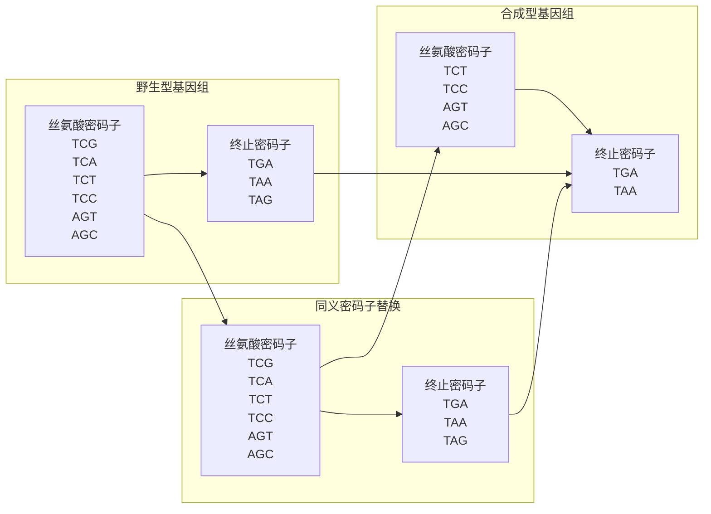

图 16-22 合成型大肠杆菌基因组密码子的缩减设计

图 16-23 正向重叠区域和反向重叠区域的密码子替换设计

图 16-24 合成型大肠杆菌基因组的拆分设计

flowchart

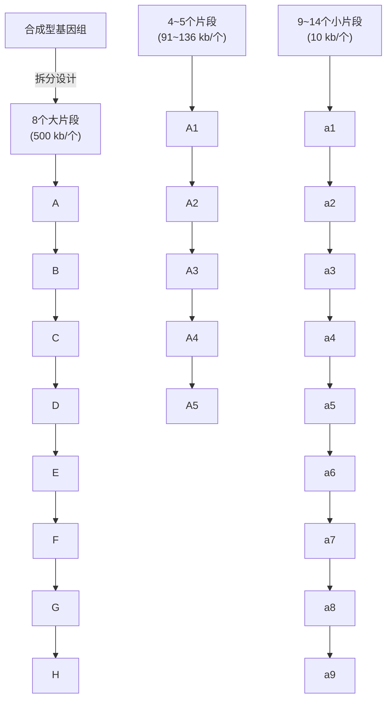

## 16.4.3.4 分步组装合成型大肠杆菌基因组

第一步是利用酿酒酵母细胞的同源重组能力，将小片段组装到细菌人工染色体（BAC）上，每个 BAC 承载大约 100 kb 的片段。

第二步是接合组装（conjugative assembly），原位替换野生型基因组片段。首先将含有 100 kb 片段的 BAC 导入受体大肠杆菌细胞内，由 Cas 酶切割 BAC，释放出合成型片段，对野生型基因组进行原位迭代替换，获得具有合成型大片段 A-B、C、D、E、F、G、H 共 7 株大肠杆菌。其次，通过两菌株的接合转移，将具有合成型片段的嵌合基因组从供体菌转移到受体菌中，汇聚式、同源重组替换。如图 16-25 所示，将含有 C 片段的嵌合基因组导入含有 A-B 片段基因组的细胞内，通过正、负双筛选，获得含有合成型 A-B-C 片段的基因组。例如，D 片段和 E 片段组装成 D-E 片段，并替换了野生型片段。D-E 片段与 A-B-C 片段组装成 A-B-C-D-E 片段，再依次与 F 片段、G 片段、H 片段组装，获得合成型基因组。

图 16-25 大肠杆菌 Syn61 基因组的接合组装过程

彩色为合成型片段，白色为野生型片段

flowchart

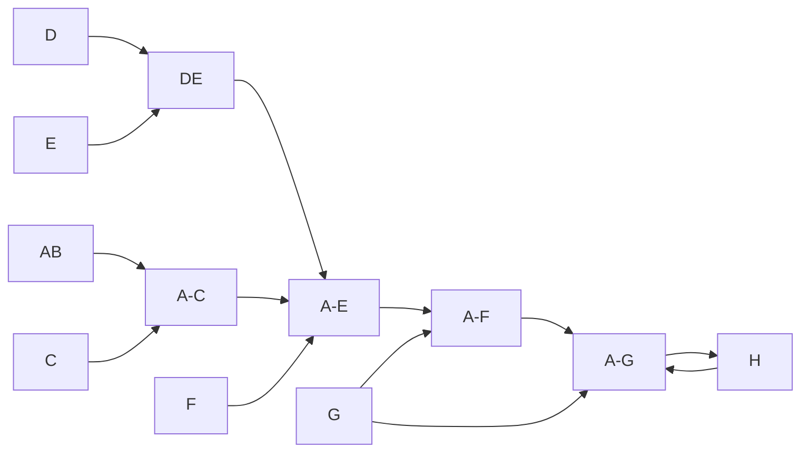

合成型大肠杆菌基因组 Syn61 中引入了 8 个随机碱基突变，来源于百 kb 片段组装和基因组组装过程中，但不影响基因组功能。该研究表明，生物的密码子可缩减，具有重要应用潜力和新用途。一方面，释放出的密码子可赋予工业大肠杆菌对噬菌体的抗性，用于防治发酵污染。另一方面，可编码非天然氨基酸，制造非天然蛋白质，包括抗体、重组蛋白质等。

## 16.5 合成酿酒酵母基因组

在合成噬菌体、病毒和细菌基因组的基础上，人类迈向了真核生物基因组的合成。2012年，由中国、美国、英国等科学家发起了全球性合成酿酒酵母基因组计划。本节主要内容是酿酒酵母基因组设计、染色体的合成与转移、染色体的融合等。

## 16.5.1 合成酵母基因组计划

合成酵母基因组计划（synthetic yeast genome project）简称 Sc 2.0 计划，目的是定制化合成酿酒酵母基因组，为系统研究真核生物染色体提供平台，拓展人类合成生物的能力和边界。截至 2025 年 1 月，中国、美国、英国、澳大利亚、新加坡等国科学家已经报道了 16 条酿酒酵母染色体的设计合成（表 16-8）。

表 16-8 合成酵母基因组计划

| 染色体编号 | 野生型 /bp | 合成型 /bp | 承担单位 | 完成时间 |
| --- | --- | --- | --- | --- |
| I | 230 208 | 180 554 | 美国约翰霍普金斯大学 | 2023 |
| II | 813 184 | 770.035 | 华大基因研究院和英国爱丁堡大学 | 2017 |
| III | 316 617 | 272 871 | 美国约翰霍普金斯大学 | 2014 |
| IV | 1 531 933 | 1 454 621 | 美国纽约大学 | 2023 |
| V | 576 874 | 536 024 | 天津大学 | 2017 |
| VI | 270 148 | 242 745 | 美国约翰霍普金斯大学 | 2017 |
| VII | 1 090 940 | 1 028 952 | 英国爱丁堡大学 | 2023 |
| VIII | 562 643 | 504 827 | 美国纽约大学 | 2023 |
| IX | 439 885 | 404 963 | 美国纽约大学 | 2023 |
| X | 745 751 | 707 459 | 天津大学 | 2017 |
| XI | 666 816 | 659 617 | 英国帝国理工学院 | 2023 |
| XII | 1 078 177 | 976 067 | 清华大学 | 2017 |
| XIII | 924 431 | 883 749 | 深圳大学 | 2024 |
| XIV | 784 333 | 753 096 | 澳大利亚麦考瑞大学 | 2023 |
| XV | 1 091 291 | 1 048 343 | 新加坡国立大学 | 2023 |
| XVI | 948 066 | 902 994 | 澳大利亚麦考瑞大学 | 2025 |
| 新染色体 |  | 186 602 | 英国曼彻斯特大学 | 2023 |
| 合计 | 1 2071 297 | 11 516 473 |  |  |

## 16.5.2 合成型酿酒酵母基因组的设计

作为第一版本的合成型基因组，基本原则是要尽量保持野生基因型，使柔性元件的引入及所致的基因组不稳定性达到平衡。设计上，基本不改变染色体上编码基因的原有顺序和非编码区域，防止基因功能变化和未注释元件被破坏。删除逆转录转座子、非必需基因、重复元件及部分内含子，保留非编码小RNA的内含子。用终止密码子TAA替换TAG，采用同义突变，引入或消除酶切位点，便于组装。275个核tRNA基因只编码42个tRNA，删除冗余tRNA基因，其余tRNA基因定位到一条新染色体（neochromosome）上。

在编码区内设计 PCR tag 序列，便于筛选和鉴定，与野生型序列区分。在非必需基因 3'UTR 插入对称的 loxPsym（symmetrical loxP）位点，以便对合成型染色体进行诱导演化研究。酵母染色体有两种类型亚端粒重复序列，Y' 和 X 元件。Y' 元件功能未知，X 元件序列差异大，以单拷贝存在，在端粒沉默和染色体分配时起作用。删除所有的 Y' 元件，X 元件由保守核心序列取代。以酿酒酵母 S288C 为参考，16 条染色体，长度 12 Mb。

合成型染色体的设计是在计算机辅助和酵母知识指导下完成的，在已合成的16条染色体中，只有合成型V号染色体（简称SnyV）序列与设计序列完全相同，其设计流程如图16-26所示。

## 16.5.3 合成型酵母染色体的合成与组装

酵母染色体合成与组装策略和细菌基因组构建基本相同，采用模块化合成和组装，逐级原位替换野生型染色体片段。主要包括化学合成寡核苷酸，组装出750 bp的构建块（building block）、2\~4 kb片段、10 kb片段、30\~60 kb片段，然后用kb级合成片段原位替换野生型染色体序列，获得合成型染色体（图16-27）。

构建块的合成。设计约 70 bp 的寡核苷酸，相邻末端具有 50 bp 重叠序列。第一个寡核苷酸和最后一个寡核苷酸的一端与载体有相同酶切位点。用 16 条正反向寡核苷酸，建立无模板 PCR 体系。将 PCR 产物和载体用相同酶切、连接，转化大肠杆菌。筛选鉴定，获得约 750 bp 的构建块。

| 版本 | 设计内容 |
| --- | --- |
| 5_0_00 | 野生型 |
| 5_1_00 | 增加PCRTags |
| 5_2_00 | TAA替换TAG |
| 5_3_00 | 插入loxP位点 |
| 5_3_01-5_3_38 | 中间体编写 |
| 5_3_39 | 染色体的片段化分割 |
| 5_3_40-53_43 | 中间体序列,注释矫正 |
| 5_9_01-5_9_21 | SynV与设计序列比较,纠错 |
| 5_9_22 | 终版SynV与设计序列完全相同 |

图 16-26 合成型酿酒酵母 V 号染色体的设计流程

flowchart

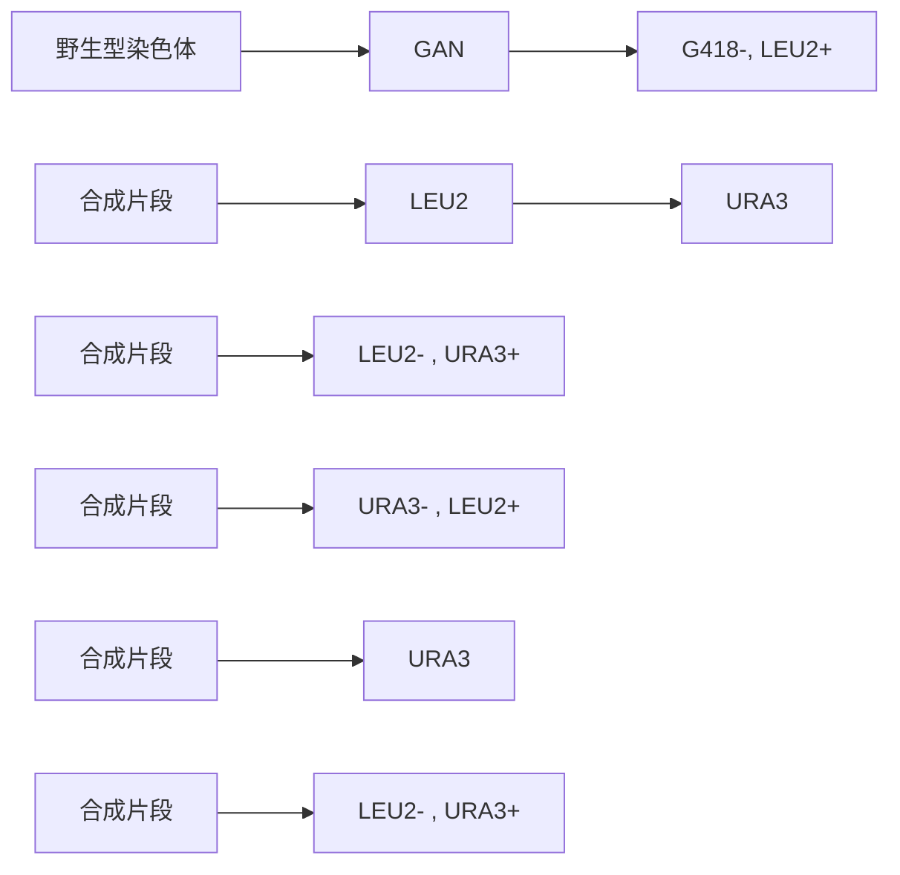

图 16-27 合成型酵母染色体的组装

片段的组装。有多种组装策略可供选择，如离体 Gibson 组装、重叠延伸 PCR 和酵母细胞内同源组装等。对于同源重组，把 4～8 个构建块与线性载体共转化酵母细胞。筛选鉴定，获得 2～4 kb 的大片段。类似的，3～5 个 2～4 kb 片段组装成 10 kb 片段，3～6 个 10 kb 片段组装成 30～60 kb 片段。

野生型酵母染色体的逐段替换。野生型染色体上插入卡那霉素抗性基因，把 kb 级片段导入酵母细胞，发生同源重组。第一轮导入含有亮氨酸（LEU2）标签的合成片段，与野生型染色体同源重组，卡那霉素抗性（KanMAX）丢失，获得亮氨酸营养标签，筛选和鉴定嵌合染色体。第二轮导入含有尿嘧啶（URA3）标签的合成片段，与嵌合染色体同源重组，亮氨酸标签丢失，获得尿嘧啶标签，筛选和鉴定嵌合染色体。由此，逐步替换野生型全部染色体序列，获得合成染色体（图 16-27）。

对于 Syn II，用 3 kb 片段组装成 10 kb，从染色体的两端开始，进行野生型染色体左臂和右臂的逐级替换。最后，通过交配和拆孢，将合成型左臂和合成型右臂合并成一条全合成型染色体。

对于 XⅡ 染色体，移除 1.5 Mb 的 rDNA 序列。用 1.6 kb 片段组装成 26～39 kb，进行野生型染色体替换，获得 6 株半合成染色体菌株（每条大约含有 170 kb 合成型片段）。通过多轮交配和拆孢，将 6 个合成型染色体片段集成一条全合成染色体。

携带单条合成染色体的酿酒酵母细胞与野生酵母几乎一样，正常生长和出芽分裂。删除线性染色体的两个端粒，连接在一起，形成环形 V 号染色体。无论是野生型还是合成型环形 V 号染色体，都能稳定遗传，但在二倍体中，孢子的育性大幅度下降。合成型环形 V 号染色体，可作为人类环形染色体疾病的研究模型。具有功能的全合成酵母染色体是人工合成生物的一大进步，将加快合成酵母菌株的培育，并在医药、食品、能源、化工、材料等产品的制造中发挥重要作用，具有重大意义和应用价值。

## 16.5.4 合成型酵母染色体的转移

将合成型单染色体酿酒酵母菌株交配，生成二倍体。通过有性生殖，拆分单孢子，生长成单倍体。筛选野生型染色体丢失的菌种，鉴定出含有多条合成型染色体的单倍体酵母菌株。目前已报道了含有 SynⅢ 和 SynⅥ、含有 Syn V 和 Syn X 以及含有 6 条合成型染色体的菌株。

## 16.5.5 酵母染色体的融合

通过同源重组，可将两条染色体融合为一条染色体。如将Ⅳ和XII融合为一条长度3.2 Mb染色体，将VII-V-XV-IV融合为4.3 Mb染色体，12条染色体的单倍体酵母对适应性没有影响。采用CRISPR/Cas对染色体进行编辑，可加速了染色体融合。2018年中国科学家和美国科学家对酿酒酵母的16条染色体进行融合，两种不同融合顺序和策略，融合染色体的结局不同，分别是具有1条和2条染色体的非自然酿酒酵母。

## 16.5.5.1 酿酒酵母染色体融合原理

染色体融合的设计原理是保留一个着丝粒和两个端粒，确保染色体融合稳定；删除着丝粒和端粒，不能影响邻近的基因；在不同染色体上存在端粒相关长重复序列（2 kb

flowchart

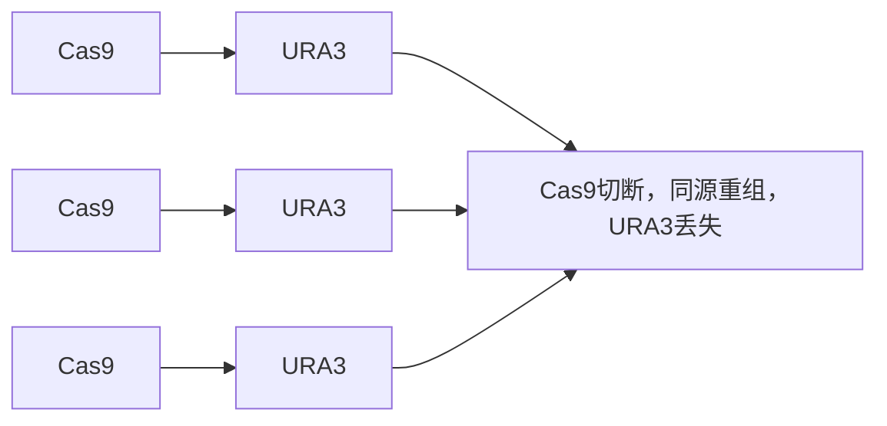

图 16-28 酵母染色体融合原理示意图

以上）的冗余拷贝，需要删除，以避免在融合过程中发生错误位点的同源重组；单着丝粒始终在融合染色体的中间，以维持两臂的长度平衡；染色体间的融合顺序是随机的。

采用 CRISPR/Cas9 技术与同源重组技术相结合，在 gRNA 引导下，Cas9 切割端粒和着丝粒，与同源片段（含有 URA3 筛选标记的正向重复序列 hisG-URA3-hisG）发生重组，使两条染色体之间融合为一条染色体（图 16-28）。

flowchart

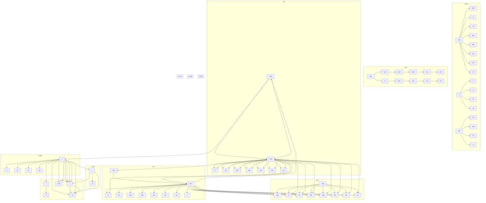

图 16-29 酿酒酵母单染色体的融合过程示意图

用 5-氟尿嘧啶（5-FOA）反向筛选，无痕删除 URA3 筛选标记后，获得无标签的融合染色体，进入下一轮融合。

## 16.5.5.2 酿酒酵母染色体的融合过程

采用汇聚式融合，第一轮是两条染色体之间融合，获得 n=8 菌株。第二轮融合，获得 n=4 菌株。第三轮融合，获得 n=2 菌株。第四轮融合，获得 n=1 菌株 SY14（图 16-29）。总共删除了 15 个着丝粒和 30 个端粒，单染色体长度 11.4 Mb。酿酒酵母的着丝粒 125 bp，具有强大的承载能力，可承载 12 Mb 的染色体。

同样采用汇聚式融合，从最小染色体之间融合开始，逐渐增加染色体臂的长度。经过四轮融合，获得双染色体的酿酒酵母，每条染色体约6 Mb。

酿酒酵母染色体融合研究表明，染色体之间的相互作用弱。与野生型相比，单染色体酵母的转录和生长几乎没有影响。单染色体二倍体酵母，具有多倍体化的趋势，表明单染色体的分配功能有缺陷，产孢率大幅度下降80%，单孢子的活性下降10%左右，可能引起配子和减数分裂的活性下降。

单染色体和双染色体酿酒酵母，为染色体结构和功能（端粒、着丝粒、减数分裂）的演化研究提供了宝贵的遗传材料。

技术应用 16-2

酿酒酵母双染色体融合过程

## 16.6 合成生物学的应用

## 16.6.1 微生物细胞工厂

基于合成生物技术构建微生物细胞工厂，将促进医药、能源、材料、化学品生产、食品和环境等领域的发展，为解决许多人类重大全球性问题提供崭新工具。

## 16.6.1.1 医药领域应用

通过微生物细胞工厂生产基因工程药物是合成生物学的重要应用领域，包括生产多肽类药物和疫苗等。例如，生产具有抗肿瘤和抗病毒功能的干扰素；用于预防