图 19-5 实验室小型生物反应器结构示意图

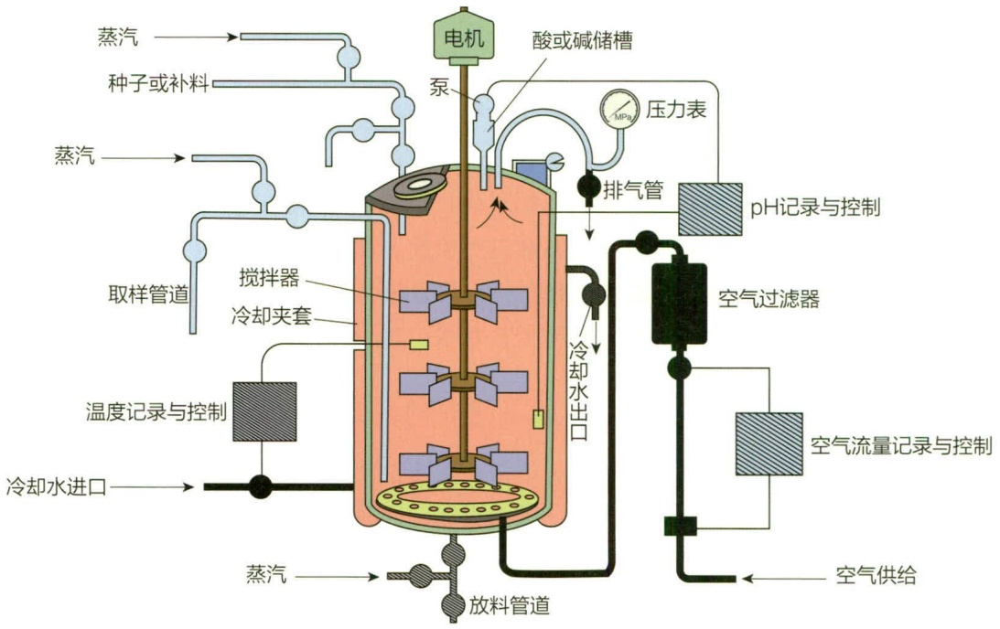

flowchart

This diagram illustrates the process flow of a chemical reactor system, showing inputs from steam and reactors flowing through mixing, cooling, and air supply to produce an internal reactor with labeled components.

改造变得更加便捷，而从众多候选菌株中筛选出优良菌株进而生产目标产品，往往需要大量的发酵实验。从物料、时间和人力成本的角度来看，使用摇瓶或体积超过1 L的生物反应器进行发酵实验已逐渐变得不现实。同时，在大数据和人工智能引领的第四次工业革命背景下，传统的摇瓶和实验室规模发酵罐在数据生成的速度和质量已无法满足机器学习和大数据分析的需求。因此，自20世纪90年代起，高通量平行生物反应器（工作体积在毫升级别，具备在线检测和闭环控制的反应器）作为新一代发酵工程技术的关键组成部分，得到了迅速发展。

目前市场上有三种具有代表性的平行生物反应器产品:第一种是以 m2p-labs BioLector® 为代表的微孔板平行生物反应器，配备微流控补料和 pH 控制的 48 孔板平行反应器，每个孔可装载 0.8～2.4 mL 培养液，并提供振荡搅拌。第二种是以 sartorius stedium ambr®15 系列为代表的微型搅拌釜反应器，能够配备 10～15 mL 平行生物反应器，每个反应器都装有独立的传感器、搅拌系统和供气系统。第三种是以 sartorius stedium ambr®250 系列为代表的迷你反应器，配备有多组 250～350 mL 罐体，具备模块化设计和控制软件支持，能够实现大规模的平行操作。

随着在线检测和微流控技术的发展，平行生物反应器不仅用于菌种筛选和培养基优化，还越来越多地应用于发酵操作条件的优化。实验设计在平行生物反应器商业化之前就已经广泛应用于发酵优化，例如培养基和发酵工艺的优化。平行生物反应器的出现，特别是其平行化和自动化操作，使得发酵工艺优化的自动化和标准化成为可能。析因设计、人工神经网络和遗传算法等实验设计方法与平行生物反应器的结合，使得通过尽可能少的实验次数，就能得出更接近实际最优值的参数优化结果。

## 19.2.4.4 工业规模大型生物反应器

工业规模的发酵罐容量通常在 $5\sim 500\mathrm{m}^3$ ，一般采用不锈钢制造，多为机械搅拌式。其结构、附属设备以及配备的仪器，与实验室小型发酵罐相似。在完成实验室小试和中试阶段研究后，可以在工厂进一步实施发酵过程的放大，以实现大规模生产。然而，实验室的研究结果并不总能顺利地放大到工业规模，这是因为大型发酵罐在通气和搅拌混合方面的效果往往不如小型发酵罐，尤其是溶解氧量很容易成为限制因素。因此，解决发酵设备和工艺放大的问题是实现发酵技术产业化的关键步骤。

## 19.2.4.5 好氧生物反应器的类型

好氧生物反应器是通过搅拌或通气等方式增加氧的溶解量，保证发酵过程中氧的供给，常用于氨基酸、抗生素和酶制剂等的生产。根据搅拌方式的不同，可以分为机械搅拌式发酵罐、气升式发酵罐、自吸式发酵罐等类型。

## （1）机械搅拌式发酵罐

这种设备配备了通气和机械搅拌装置，是工业发酵中最常见的类型。它通过空气分布器输入空气或氧气，而搅拌器则驱动液体循环并混合，确保固体物料均匀悬浮并破碎气泡，从而提高气液间的传氧速率和无菌空气的利用率。

## (2) 气升式发酵罐

包括气升环流式、鼓泡式和空气喷射式等类型。其工作原理是通过罐底的喷嘴或喷孔将无菌空气注入发酵液中，借助喷嘴和气液混合物产生的湍流效应使空气泡细化。由于气液混合物密度降低，加之无菌空气的动能，推动其向上移动，而含气量较低的发酵液向下沉降，形成循环对流。这个过程不仅促进发酵液混合，还有助于传质和传热，确保微生物获得所需的溶氧，维持正常发酵过程。气升式发酵罐的特点在于结构简单、无轴封、抗污染性好、高氧传质效率、低能耗以及安装维护方便，特别适合于耗氧量大且对搅拌剪切敏感的发酵过程。在工业应用中广泛使用的有气升内环流发酵罐、气液双喷射气升环流发酵罐和塔式气升外环流发酵罐（图 19-6）。

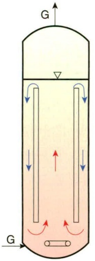

text_image

G
G

气升内
环流发酵罐

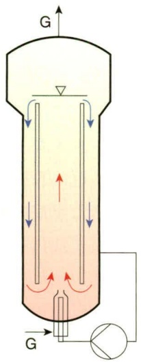

text_image

G
G

气液双喷射
气升环流发酵罐

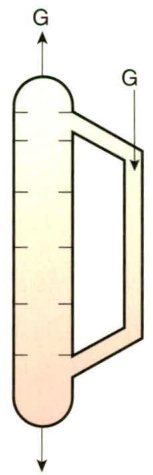

text_image

G
G

塔式气升
外环流发酵罐

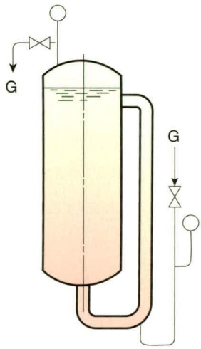

text_image

G
G

气升外环流
发酵罐

图 19-6 气升式发酵罐
G: 无菌空气

图19-7 自吸式发酵罐

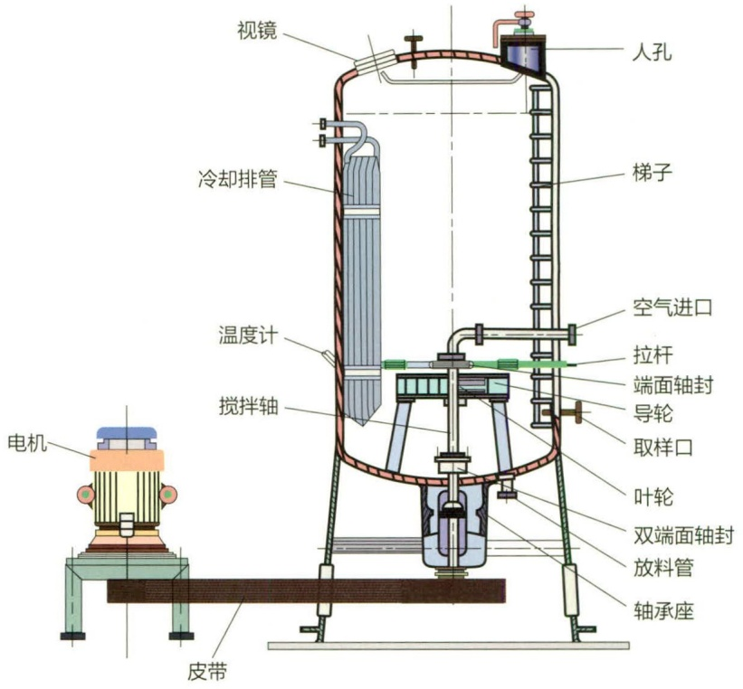

text_image

视镜
人孔
冷却排管
梯子
空气进口
拉杆
端面轴封
导轮
取样口
叶轮
双端面轴封
放料管
轴承座
电机
温度计
搅拌轴
皮带

## （3）自吸式发酵罐

这种发酵罐无需借助空压机来提供压缩空气，而是通过一个特殊设计的搅拌吸气装置来引入无菌空气，同时完成混合搅拌和氧气传递。如图 19-7 所示，其搅拌器为空心叶轮，当叶轮高速旋转时，会将周围的液体甩出，产生局部负压，从而把外部空气吸入罐内。这些空气随后与高速流动的液体密切接触，形成细小气泡并分散到液体之中。自吸式发酵罐的优点在于无需空气系统且气体分布均匀。缺点包括因进气处于负压状态而增加染菌风险，以及搅拌转速较高导致的剪切力较大。

## 19.3 微生物与现代发酵工业

几千年以前，人们就开始了微生物发酵的应用。微生物一直被用来生产面包、啤酒和葡萄酒等产品，而真正认识并了解发酵的本质是近二百年的事。第一次世界大战期间，通过丙酮-丁醇发酵过程，建立了真正的纯培养发酵技术，这标志着发酵工业发展的第一个转折点。随着抗生素的大规模生产，深层液体通气搅拌纯培养发酵技术得以建立，为现代发酵工业的理论和实践奠定了基础。生物化学、微生物生理学及遗传学的发展使得基于代谢调控理论的菌种选育和控制发酵更加深入，发酵产品扩展到柠檬酸、苹果酸等有机酸，氨基酸、核苷酸等食品添加剂，以及酶制剂、维生素和抗生素等药品。分子生物学的发展促进了基因工程和细胞工程技术在菌种选育中的应用，新型基因工程菌发酵兴起，数十种生物制药产品实现了规模化生产，如红细胞生成素、人体生长激素、干扰素等。工业微生物已成为现代发酵工业的主要参与者，也是许多国家科技竞争和产业发展的战略重点，其应用涉及工业、农业和医药等诸多领域。

## 19.3.1 微生物生产有机酸

20 世纪初，随着霉菌能合成柠檬酸的现象被发现，人们开始研究微生物发酵方法来获得有机酸，以代替从植物果实中榨取有机酸的方法。目前，大多数有机酸都可以通过发酵法生产，例如柠檬酸、乳酸、葡萄糖酸、苹果酸、酒石酸、衣康酸、富马酸和曲酸等。其中，柠檬酸是世界上产量最大的发酵产品之一，而我国是世界上最大的柠檬酸生产和出口国。

能够合成柠檬酸的微生物有很多，在工业生产上主要应用的种类包括:以糖质或淀粉质为原料的曲霉属（Aspergillus）菌株，包括黑曲霉（A. niger）、泡盛酒曲霉（A. awamori）、米曲霉（A. oryzae）、灰绿曲霉（A. glaucus）；以石油为原料的酵母菌，主要是解脂假丝酵母（Candida lipolytica）；以正链烷烃为原料的节杆菌属（Arthrobacter）菌株，如石蜡节杆菌（A. paraffineus）。

## 19.3.2 微生物生产氨基酸

氨基酸作为构成蛋白质的成分，在食品、饲料、医药及化妆品行业中均有广泛应用。氨基酸的生产方法包括化学合成法、提取法、发酵法及酶法等，其中绝大多数氨基酸是通过发酵法或酶法生产的。

由于野生型微生物细胞受到精细调控以避免过量合成特定氨基酸，因此工业发酵生产氨基酸的微生物菌种需要通过遗传改造解除反馈调节，从而使氨基酸能够大量积累。谷氨酸和其他氨基酸的产生菌几乎都是从短杆菌和棒杆菌通过诱变育种或基因工程选育而来。高产菌株选育和发酵工艺控制通常采用的策略包括:控制细胞渗透性、控制旁路代谢、降低反馈作用物的浓度、消除终产物的反馈抑制与阻遏作用、促进ATP积累以及控制发酵的环境条件。

## 19.3.3 微生物生产酶制剂

酶作为生物催化剂，在工业生物技术领域中发挥着重要作用。目前，工业上大量生产的酶有几十种，广泛应用于食品、纺织、皮革、农业、医药及分析研究等方面。

由于酶在工业条件下的稳定性和活性不理想，极大地限制了酶在工业中的应用。通过分子育种技术对酶进行改造，构建基因工程菌，有望生产出更多更适合工业用途的酶。酶基因改造策略包括:引入二硫键以提高蛋白稳定性、改变天冬酰胺以提高酶稳定性、提高酶活性、改变酶的专一性以及降低蛋白对蛋白酶的敏感性。

## 19.4 微生物与医药

微生物在医药中的应用可以追溯到远古时期。我们的祖先用豆腐上的“霉”治疗疮疖等感染，用发霉的面包治疗皮肤溃疡、创伤化脓和肠道感染等。巴斯德（Pasteur）以致病微生物本身作“原料”研制出霍乱疫苗、炭疽疫苗和狂犬疫苗，为医学科学带来革命性变化，为现代免疫学的建立奠定了基础。微生物代谢产物作为药物开发应用兴起于20世纪40年代，从青霉素问世到利用微生物成功合成青蒿素，微生物医药在传染病控制、肿瘤化疗、器官移植以及高胆固醇血症治疗等方面都发挥了重要作用。

## 19.4.1 微生物生产抗生素

应用于临床的抗生素大部分来源于放线菌，放线菌产生的抗菌药物化学类别较多，如  $\beta-$  内酰胺类药物（ $\beta-lactam$ ）、氨基糖苷类药物（aminoglycoside）、大环内酯类（Macrolide）、四环素类、紫霉素类、糖肽类、多烯类以及其他抗细菌类抗生素等。真菌是第一个临床应用抗生素——青霉素的产生菌，也是头孢菌素 C、灰黄霉素等抗生素的产生菌。放线菌以外的细菌产生的有临床应用价值的抗生素相对较少，主要为多肽类、单环  $\beta-$  内酰胺类和少数氨基糖苷类等。

## 19.4.2 微生物生产甾体类药物

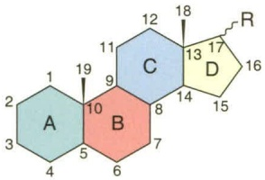

chemical

Chemical structure diagram with labeled rings A, B, C, D and numbered positions 1–19, likely representing a polycyclic aromatic compound or similar organic molecule.

图 19-8 笛体类化合物的基本骨架

甾体（steroids）化合物结构中含有环戊烷多氢菲的基本碳骨架（又称甾核，steroid nucleus），在母核上通常带有两个角甲基（C10、C13）和一个含有不同碳原子数的侧链或含氧基团如羟基、羰基等（C17）（图 19-8）。天然甾体化合物种类众多、结构多样、生物活性广泛，其中很多化合物如强心苷类、甾体皂苷类、胆固醇、性激素和维生素 D 等在生命活动中扮演着至关重要的角色。甾体类化合物在医药领域中应用也非常广泛，主要用于抗炎、抗病毒、抗过敏、抗休克等，能治疗或缓解胶原性疾病和过敏性休克，也可用于治疗阿狄森病等内分泌疾病，还是治疗乳腺癌和前列腺癌的重要辅助治疗药物。

通过生物转化或化学合成方法能够有效修饰甾体结构，使其生物活性发生改变。生物转化方法引入特征官能团或修饰化合物结构已成为药物开发的热点，具体方法包括:①羟基化反应:常由根霉、曲霉或链霉菌等完成转化；②羰基化反应:可由壳球孢菌等完成转化；③氢化反应:可采用黑曲霉、匍枝根霉和镰刀菌等完成转化；④脱氢反应:由小克银汉霉、诺卡氏菌和单端孢属完成转化；⑤拜尔-维利格（Baeyer-Villiger）氧化反应和溴化反应:采用青霉菌、白僵菌和栅列藻菌等进行生物转化。

## 19.5 微生物与生物能源

生物能源包括燃料乙醇、生物制氢、沼气和生物柴油等多种形式，与传统化石能源相比，具有可再生、清洁及污染小等优点。微生物具有强大而多样化的代谢能力，可以快速、高效地利用各种生物质原料，且生长条件和产物可根据需求调控，因此，微生物已成为生物能源发展过程中最重要的战略资源和技术源泉。

## 19.5.1 燃料乙醇

燃料乙醇作为一种清洁、可再生的能源，正成为各国研究的焦点。微生物发酵法是燃料乙醇主要的生产方法。目前世界各国生产乙醇多采用糖类或淀粉原料，但这两类原料有严重短缺趋势，且生产乙醇的能耗高于其产能，无法从根本上解决能源问题。纤维质原料来源丰富，多以农林废弃物形式广泛存在，包括秸秆、玉米芯、糖厂蔗渣、造纸厂废纸浆、城市垃圾等，这类原料经过预处理，再经过水解的方法将其转化为糖，进而发酵生产乙醇，最终提纯乙醇（图 19-9）。目前以纤维素原料生产乙醇尚难以实现大规模工业化生产，主要原因是成本过高，构建木糖发酵微生物工程菌株和选育高活性纤维素酶高产菌株对生产成本控制具有重要意义。

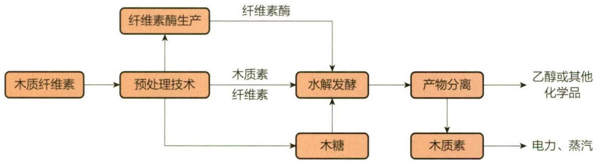

flowchart

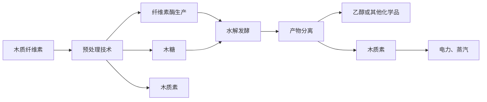

图 19-9 木质纤维素发酵生产乙醇过程

## 19.5.2 生物制氢

氢能具有可再生、燃烧热值高、清洁等优点，被认为是替代化石能源最理想的载能体之一。生物制氢以有机废水、城市垃圾或生物质作为原料，与废物回收利用过程偶联，符合可持续发展战略。迄今为止，已报道的能够产生氢的微生物包括:①光合微生物:分为光合细菌、蓝细菌和绿藻等；②非光合微生物:包括严格厌氧细菌、兼性厌氧细菌和好氧细菌等；③古菌:极端嗜热古菌，如嗜热的激烈热球菌（Pyrococcus furiosus）。

## 19.5.3 沼气发酵

沼气是由有机物（如动物粪便、秸秆、有机废水、能源作物等）经微生物发酵产生的一种优质、清洁的气体燃料，主要成分是甲烷，还含有  $CO_{2}$  和少量  $H_{2}S$ 、CO、 $H_{2}$  等气体。沼气发酵是由不产甲烷群落和产甲烷群落共同完成的代谢过程。不产甲烷群落是一类兼性厌氧菌，包括化能自养菌、化能异养菌、光能异养菌，甚至包括真菌和原生动物，具有水解和发酵大分子有机物产生酸的功能，为产甲烷微生物提供营养物质和能量。产甲烷群落通常为古菌中的产甲烷菌，具有 1\~3 种甲烷合成途径。目前，沼气发酵过程主要分为三个阶段:水解发酵阶段、产氢产乙酸阶段和产甲烷阶段（图 19-10）。

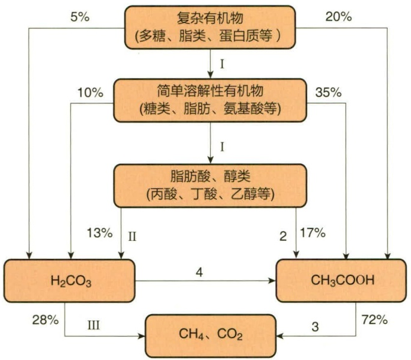

flowchart

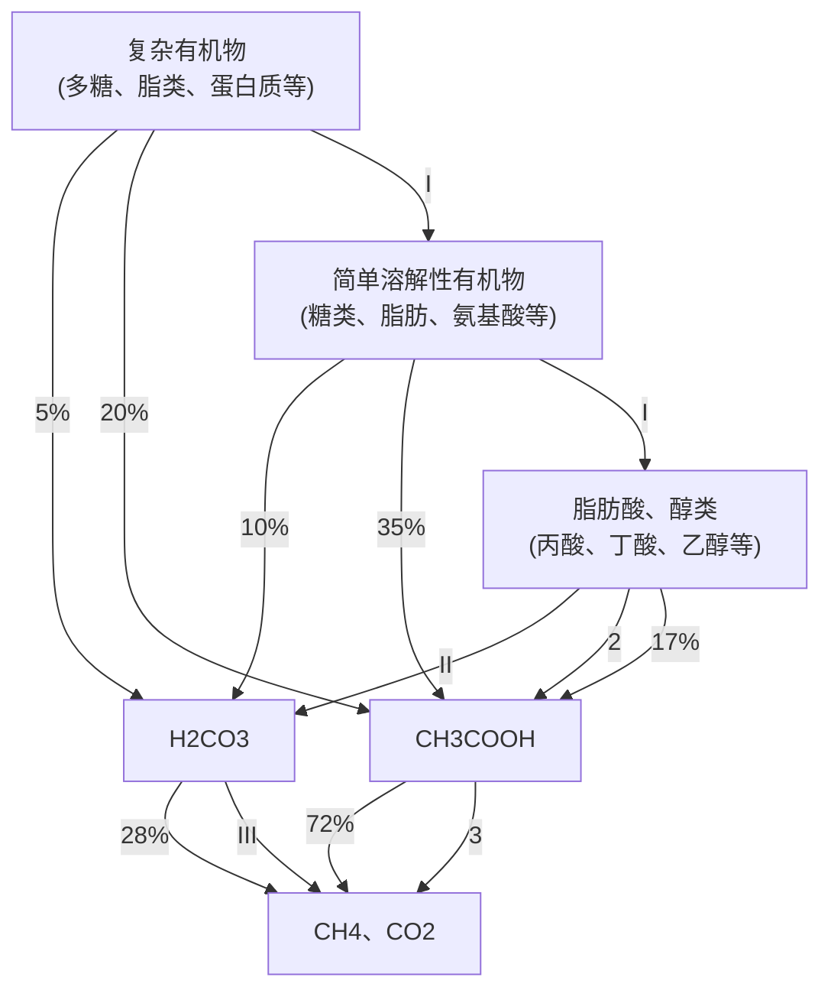

图 19-10 复杂有机物沼气发酵过程

图中左侧Ⅰ、Ⅱ、Ⅲ为三阶段理论；右侧Ⅰ、2、3、4为四阶段理论

## 19.5.4 微生物燃料电池

微生物燃料电池（microbial fuel cell，MFC）是以微生物为催化剂，将有机物中的化学能转化为电能的

生物电化学系统。传统的微生物燃料电池是含两个极室的双室电池系统，通常由阳极室、阴极室、质子交换膜和电解池构成（图 19-11）。MFC 是传质学、微生物学、电化学、材料科学和环境工程学等学科交叉融合而发展形成的一种全新的电能生产技术，在污水处理、污染物处理、生物传感器、脱盐海水淡化、制氢、含毒金属回收等方面具有巨大的应用前景。

MFC 的核心构件是阳极室，阳极表面附着的产电微生物以有机物（如葡萄糖等）为电子供体，氧化后产生电子、质子和代谢产物，氧化过程中产生的电子经由电子载体传递到阳极表面。电子载体可以是与呼吸链有关的  $NADH/H^{+}$  或色素分子，也可

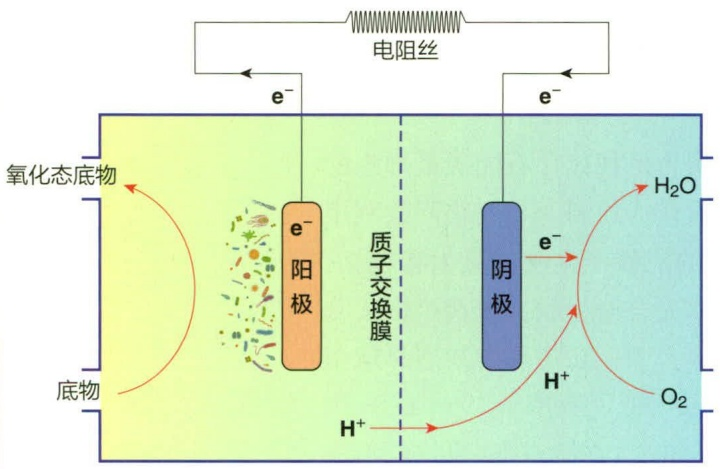

flowchart

This diagram illustrates the electrochemical process of a battery cell, showing the flow of electrons and ions through an electrolytic cell to form an oxidation state and ion exchange membrane.

图 19-11 微生物燃料电池原理示意图

以是外源的或微生物代谢产生的还原性物质，如  $S^{2-}$  和  $H_{2}$  等。由于阴极和阳极间的电势差，阳极产生的电子经由外电路传递至阴极。微生物氧化作用释放的质子透过质子交换膜扩散到阴极，在阴极表面与电子及  $O_{2}$  反应生成  $H_{2}O$  或  $H_{2}O_{2}$ 。上述过程不断循环发生，伴随着阳极有机物持续的氧化和阴极氧化物连续的还原反应，电子不断产生、传递形成电流。当外电路连接了电阻或负载时，可以获得连续的电流和功率输出。

目前已报道的产电微生物多为铁还原细菌，分属于假单胞菌门、芽孢杆菌门和酸杆菌门，电化学活性微生物分类及特征见表19-4。

表 19-4 电化学活性微生物分类及特征

<table><tr><td rowspan="2">门</td><td rowspan="2">纲</td><td rowspan="2">代表菌株</td><td rowspan="2">革兰氏染色</td><td colspan="3">需氧情况</td><td rowspan="2">铁还原性</td></tr><tr><td>严格厌氧</td><td>兼性厌氧</td><td>严格好氧</td></tr><tr><td rowspan="17">假单胞菌门(Pseudomonadota)</td><td rowspan="5">α-变形菌纲</td><td>沼泽红假单胞菌(Rhodopseudomonas palustris)</td><td>-</td><td></td><td>+</td><td></td><td></td></tr><tr><td>人苍白杆菌(Ochrobactrum anthropi)</td><td>-</td><td></td><td></td><td>+</td><td></td></tr><tr><td>类球红细菌(Rhodobacter sphaeroides)</td><td>-</td><td></td><td>+</td><td></td><td></td></tr><tr><td>隐藏嗜酸菌(Acidiphilium cryptum)</td><td>-</td><td></td><td>+</td><td></td><td>+</td></tr><tr><td>氧化葡萄糖酸杆菌(Gluconobacter oxydans)</td><td>-</td><td></td><td></td><td>+</td><td></td></tr><tr><td rowspan="2">β-变形菌纲</td><td>铁还原红育菌(Rhodoferax ferrireducens)</td><td>-</td><td></td><td>+</td><td></td><td>+</td></tr><tr><td>脱氮丛毛单胞菌(Comamonas denitrificans)</td><td>-</td><td></td><td>+</td><td></td><td></td></tr><tr><td rowspan="6">γ-变形菌纲</td><td>腐败希瓦氏菌(Shewanella putrefaciens)</td><td>-</td><td></td><td>+</td><td></td><td>+</td></tr><tr><td>奥奈达湖希瓦氏菌(Shewanella oneidensis)</td><td>-</td><td></td><td>+</td><td></td><td>+</td></tr><tr><td>嗜水气单胞菌(Aeromonas hydrophila)</td><td>-</td><td></td><td></td><td>+</td><td>+</td></tr><tr><td>大肠杆菌(Escherichia coli)</td><td>-</td><td></td><td>+</td><td></td><td></td></tr><tr><td>铜绿假单胞菌(Pseudomonas aeruginosa)</td><td>-</td><td></td><td>+</td><td></td><td>+</td></tr><tr><td>肺炎克雷伯氏菌(Klebsiella pneumoniae)</td><td>-</td><td></td><td>+</td><td></td><td>+</td></tr><tr><td rowspan="3">δ-变形菌纲</td><td>金属还原地杆菌(Geobacter metallireducens)</td><td>-</td><td>+</td><td></td><td></td><td>+</td></tr><tr><td>硫还原地杆菌(Geobacter sulfurreducens)</td><td>-</td><td>+</td><td></td><td></td><td>+</td></tr><tr><td>丙酸脱硫叶菌(Desulfobulbus propionicus)</td><td>-</td><td>+</td><td></td><td></td><td>+</td></tr><tr><td>ε-变形菌纲</td><td>布氏弓形菌(Arcobacter butzleri)</td><td>-</td><td></td><td>+</td><td></td><td></td></tr><tr><td rowspan="2" colspan="2">芽孢杆菌门(Bacillota)</td><td>丁酸梭菌(Clostridium butylicum)</td><td>+</td><td>+</td><td></td><td></td><td>+</td></tr><tr><td>拜氏梭菌(Clostridium beijerinckii)</td><td>+</td><td>+</td><td></td><td></td><td>+</td></tr><tr><td colspan="2">醋杆菌门(Acidobacteria)</td><td>发酵地发菌(Geothrix fermentans)</td><td>-</td><td>+</td><td></td><td></td><td>+</td></tr><tr><td rowspan="2" colspan="2">真菌(fungi)</td><td>酿酒酵母(Saccharomyces cerevisiae)</td><td></td><td></td><td>+</td><td></td><td></td></tr><tr><td>异常汉逊酵母(Hansenula anomala)</td><td></td><td></td><td>+</td><td></td><td></td></tr></table>

## ※ 本章小结

工业微生物学是一个跨学科领域，结合了生物学、化学、工程学和生物信息学等专业知识。它利用工业规模培养的微生物来生产特定产物或实现特定应用。发酵工程是一门古老而年轻的学科，其应用领域广泛，从传统发酵食品的生产，到抗生素的制造，再到基因工程产品的大规模产业化，涉及食品、医药、化工、农业和环境等重要行业。随着工业生物技术的兴起和发展，生物技术和发酵工程能够将可再生的生物质转化为现代社会所需的能源、精细化学品、化工原料及医药等多种产品。近年来，合成生物学的发展使得人类在未来发现或设计的许多生物活性物质，都可以通过细胞培养方法获得，并最终利用发酵过程实现产品的规模化生产。本章主要介绍了发酵工程的基础内容，包括工业微生物的常见种类、发酵方法和发酵过程的主要单元操作，以及发酵工程的主要应用领域。

## ※ 推荐阅读

1. MICHAEL W M, KATHERINE R D, et al. Artificial intelligence for natural product drug discovery [J]. Nature reviews drug discovery, 2023, 22 (11): 895–916.

文章介绍了近年来人工智能在天然产物研究中的应用及相关问题。

2. LIU Y, YASAWONG M, YU B. Metabolic engineering of Escherichia coli for biosynthesis of  $\beta$ -nicotinamide mononucleotide from nicotinamide [J]. Microbiology biotechnology, 2021, 14 (6): 2581–2591.

文章介绍了一种大肠杆菌利用廉价底物生产  $\beta-$  烟酰胺单核苷酸（NMN）的方法。

3. THIRY M, CINGOLANI D. Optimizing scale-up fermentation processes [J]. Trends in Biotechnology, 2002, 20 (3): 103–105.

文章概述了转基因微生物发酵工艺优化设计的总体思路，为生物制药领域发酵工艺优化提供参考。

## ※ 开放性讨论题

1. 通过生物发酵商业化生产角鲨烯，试分析需要考虑哪些因素来提高产品竞争力。
2. 现代发酵工程发展日新月异，请以药物发酵生产为例，分析今后的发展趋势。

## ※ 复习思考题

1. 常见发酵罐包括哪些类型？机械搅拌式发酵罐的基本结构包括什么？
2. 一般微生物都具备可被人类利用的特性，但要成为工业生产菌株应该具备哪些特点？
3. 举例说明利用微生物发酵生产一种抗生素的发酵过程。
4. 酶制剂生产菌种改造常用思路有哪些？
5. 什么是甾体化合物？常用的微生物转化方法有哪些？
6. 发酵法生产乙醇常用的原料有哪些？燃料乙醇与汽油相比有哪些优点和缺点？
7. 查阅文献，简述通过生物发酵商品化生产青蒿素的工艺。

(苑琳)

1型天然淋巴细胞（ILC1）498

2,6-吡啶二羧酸（2,6-dipicolinic acid，DPA）72

2型天然淋巴细胞（ILC2）498

3型天然淋巴细胞（ILC3）498

ABC 通透酶复合体（ABC permease complex） 158

ATP- 结合盒式转运蛋白系统（ATP-binding cassette transport system） 155

ATPase 复合物（ATPase complex） 66

ATP 开关（ATP-switch model） 155

B 细胞 504

CsrA (carbon storage regulator A) 294

DNA 促旋酶（DNA gyrase） 63

DNA 结合结构域（DNA binding domain, DBD） 286,288

DNA 阵列（DNA microarray） 135

DPANN 超门 452

Gibson 组装（Gibson assembly） 541

H-NS 蛋白（histone-like nucleoid structuring protein） 286

L型细菌（L-form bacterium）58

N-乙酰胞壁酸（N-acetylmuramic acid）53

N-乙酰葡糖胺（N-acetylglucosamine）53

O-特异多糖（O-specific polysaccharide） 56

P型 ATP 酶（P-type ATPases） 156

Red/ET 重组组装（Red/ET recombineering） 541

RNA 干扰（RNA interference，RNAi） 118,318

RNA 聚合酶（RNA polymerase，RNAP） 272

SD 序列（Shine-Dalgarno sequence） 293

SOS 反应（SOS response） 283

SOS 盒 (SOS box) 283

SOS 修复（SOS repair） 254

sRNA (small RNA) 295

TACK 超门 449

T 细胞（thymocytes） 502

V(D)J重组 506

X 疾病（disease X） 21

β-内酰胺类抗生素（β-lactam antibiotic）524

## A

阿斯加德古菌（Asgard archaea） 353,455

埃姆斯试验（Ames test） 252

癌变（cancer transform） 490

氨化作用（ammonification） 401

氨基酸异养型生物（amino acid heterotroph） 144

氨基酸自养型生物（amino acid autotroph）144

氨基糖苷类抗生素（aminoglycoside antibiotic） 524

铵开关（ammonium switch） 144

铵盐同化作用（assimilation of ammonium）401

## B

巴尔的摩分类法（Baltimore classification）112

巴氏灭菌法（Pasteurization）11,233

半固体培养基（semi-solid medium） 165

半合成培养基（semi-synthetic medium）164

半抗原（hapten） 501

半乳糖操纵子（galactose operon） 280

伴侣蛋白（chaperonin）70

包涵体（inclusion body） 490

包膜（envelope）104

包膜病毒（enveloped virus） 105

孢子（spore） 210

胞壁质酶（muramidase）494

胞裂蛋白（septin） 84

胞吐作用（exocytosis） 161

胞吞作用（phagocytosis） 160

胞外 DNA（extracellular DNA，eDNA）210

胞外壁（exoporium）71

胞外多聚物（extracellular polymeric substance，EPS） 210

胞外多糖（exopolysaccharide）210

胞外基质（extracellular matrix，ECM）210

胞饮泡（pinocytotic vesicle）85

胞饮作用（pinocytosis） 161

胞质环（C ring） 66

保守型转座子（conservative transposon）260

倍增时间（doubling time） 225

被动运输（passive transport） 152

比较基因组学（comparative genomics） 333

比浊法（turbidimetry）220

闭合的泛基因组（closed pangenome） 245

壁磷壁酸（wall teichoic acid） 56

鞭毛（flagellum） 64,488

鞭毛蛋白（flagellin） 64

鞭毛钩（hook） 64

鞭毛钩蛋白（hook protein） 66

鞭毛马达（flagellar motor） 64

鞭毛丝（filament） 64

鞭毛丝蛋白（flagellin protein）64

鞭毛旋转（flagellar rotation） 67

变性（denaturation）327

表面层（S-layer） 58

表位（epitope） 501

表型（phenotype） 246

丙型肝炎病毒（hepatitis C virus，HCV） 129

柄细菌（stalked bacteria） 70

病毒复制周期（viral replication cycle） 109

病毒粒（virion） 103

病毒吸附蛋白（viral attachment protein） 110

病毒性真核生物起源模型（viral eukaryogenesis model）95

病毒血症（viremia） 518

病毒样颗粒（virus-like particle，VLP）115,509

病因学（etiology） 480

病原体（pathogen） 479

病原微生物（pathogenic microorganism） 479

病原相关分子模式（pathogen-associated molecular pattern, PAMP）498

病灶感染（focal infection） 482

病症（symptom） 479

伯杰氏鉴定细菌学手册（Bergey's Manual of Determinative Bacteriology）357

伯杰氏系统细菌学手册（Bergey's Manual of Systematic Bacteriology）357

博朗脂蛋白（Braun lipoprotein） 57

补充基础培养基（supplementary minimal medium） 165

补料分批发酵 648

补体（complement） 494

补体激活（activation of complement） 508

补体系统（complement system） 494

捕食（predation） 395

捕食器（nematode-trapping device） 92

不产氧光合作用（anoxygenic photosynthesis） 150

不相容群（incompatible group） 257

不相容性（incompatibility）257

不依赖 Rho 因子的转录终止（Rho-independent termination） 288

## C

操纵元件（operator） 273,275

操纵子（operon） 274

插入突变（insertion mutation）247

插入序列（insertion sequence，IS） 259

产毒真菌（toxigenic fungi）619

产氧光合磷酸化（oxygenic photophosphorylation）189

产氧光合作用（oxygenic photosynthesis）150

长丝状超分子复合物（supermolecular structure）64

肠杆菌素（enterobactin） 158

超高温灭菌（ultrahigh temperature sterilization，UHTS）233

超螺旋（supercoiling）63

超螺旋域（supercoiled domain）63

超氧化物歧化酶（superoxide dismutase，SOD）231

超氧阴离子自由基（superoxid anion radical） 231

沉默基因簇（silent gene cluster） 334

程序性坏死（necroptosis） 500

程序性细胞死亡（programmed cell death） 118

持续性感染（persistent infection） 116

出芽繁殖（budding division） 209

初次抗体应答（primary antibody response） 506

初级代谢（primary metabolism） 197

初级内共生（primary endosymbiosis） 461

初级主动运输（primary active transport） 154

传播（transmission） 483

传播链（chain of transmission） 486

传感器（sensor） 290

传染（contagion） 483

垂直传播（vertical transmission） 484

纯培养（pure cultivation） 13

纯培养物（pure culture） 13,38,167

重叠延伸 PCR 技术（overlap extension polymerase chain reaction, OE-PCR） 539

重组修复（recombination repair） 254

磁小体（magnetosome）74

次级代谢（secondary metabolism） 199

次级内共生（secondary endosymbiosis） 461

次级主动运输（secondary active transport） 155

丛枝菌根（arbuscular mycorrhiza，AM） 580

促进扩散（facilitated diffusion） 153

错配修复（mismatch repair） 252

错义突变（missense mutation）247

## D

大肠菌群（coliform） 633

大环境（macroenvironment） 384

大环内酯类抗生素（macrolide antibiotic） 525

大量营养物质（macronutrient） 142

大质粒（mega plasmid） 242

代时（generation time） 224

代谢类似物（metabolite analogue） 234

代谢物激活蛋白 CAP（catabolite activator protein） 276

代谢组学（metabonomics） 335

单纯扩散（simple diffusion） 152

单端孢霉烯族毒素（trichothecene toxin）620

单核细胞（monocyte） 497

单价疫苗（univalent vaccine） 510

单位膜模型（unit membrane model） 59

单细胞蛋白（single cell protein，SCP）97,591,611

单细胞蛋白饲料（SCP feed） 591

单向运输（uniport） 155

蛋白质印迹法（Western blotting） 332,636

蛋白质组（proteome） 335

蛋白质组学（proteomics） 335

氮源（nitrogen source） 142,144

氮源谱（spectrum of nitrogen source） 144

等渗（isotonic） 153

低渗（hypotonic） 153

低温维持法（low temperature holding method，LTH）233

底物水平磷酸化（substrate-level phosphorylation）178

蒂痕（birth scar） 213

颠换（transversion） 247

电穿孔（electroporation） 329

电离辐射（ionizing radiation） 250

电子传递链（electron transport chain） 175

电子供体（electron donor） 173

电子歧化反应（electron bifurcation）180

电子受体（electron acceptor） 173

电子载体（electron carrier） 175

丁达尔灭菌（tyndallization） 232

丁型肝炎病毒（hepatitis delta virus，HDV） 120

定向演化（directed evolution） 337

定子（stator） 66

动孢子（zoospore） 93

痘病毒（poxvirus） 106

毒力（virulence） 486

毒力因子（virulence factor） 486

毒素（toxin） 488

毒血症（toxemia） 518

毒蕈中毒（mushroom poisoning） 618

对称形式（symmetry） 104

对数期（logarithmic phase） 224

多胺（polyamine） 368

多重耐药菌（multi-drug resistant organisms，MDRO）20

多核菌丝（coenocytic hyphae）90

多价疫苗（polyvalent vaccine） 510

多克隆位点（multiple cloning site，MCS） 256

多孔板技术（multiwell plate technology） 168

多联疫苗（mixed vaccine） 510

多能造血干细胞（multiple hematopoietic stem cell） 496

## E

二次生长（diauxic growth） 225

二均分裂（binary fission） 205

二鸟苷酸环化酶（diguanylate cyclase，DGC）291

二十面体对称（icosahedral symmetry）106

## F

发病期（period of illness） 483

发酵工程（fermentation engineering） 647

反差（contrast）25

反馈抑制（feedback inhibition） 176

反式编码 sRNA (trans-encoded sRNA) 295

反向重复序列（inverted repeat sequence，IR） 259

反向电子传递（reverse electron transport） 180

反向电子歧化反应（electron confurcation） 181

反向遗传学（reverse genetics） 267

反硝化作用（denitrification）145,401

反义 RNA (antisense RNA) 295

泛基因组（pan-genome or pangenome） 245

泛醌（ubiquinone） 175

防腐（antisepsis） 232

放大倍数（magnification） 25

放能反应（exergonic reaction） 173

非电离辐射（non-ionizing radiation） 250

非复制型转座子（nonreplicative transposon） 260

非化学限定培养基（chemically undefined medium） 164

非门（NO gate） 534

肥大细胞（mast cell） 497

分辨率（resolution） 25

分化簇（cluster of differentiation, CD） 503

分解代谢途径（catabolic pathway） 173

分解代谢物阻遏（catabolite repression）277

分类操作单元（OTU） 345

分类单元（taxon） 345

分离不稳定性（segregation instability） 257

分泌门通道复合物（export gate complex） 66

分泌通道（secretion channel）66

分泌系统（secretion system） 489

分泌装置（export apparatus） 66

分批发酵（batch fermentation） 648

分批培养（batch culture） 224

分散高尔基体（dictyosome）85

分枝菌素（mycobactin） 158

分子伴侣（molecular chaperone） 285

分子钟（molecular clock） 349

粪生素（coprogen） 158

呋喃酰硼酸二酯（autoinducer 2，AI-2）303

伏马菌素（fumonisin，FB）620

浮游生长（planktonic growth） 210

辅助 T（T-helper，Th）细胞 503

辅助受体（co-receptor） 111

辅阻遏物（co-repressor） 272

腐殖质（humus） 386

负超螺旋（negative supercoil） 63

负转录调控（negative transcription regulation） 273

附着胞（appressorium）92

附着枝（hyphopodium） 92

复合对称（complex symmetry） 106

复制型转座子（replicative transposon） 260

复制子（replicon）242,256

## G

干扰素（interferon） 118

干扰性竞争（interference competition） 383

干热灭菌（dry heat sterilization） 232

干重（dry weight） 141

甘露聚糖（mannan） 81

甘油二醚（glycerol diether） 60

甘油四醚（glycerol tetraether） 61

杆菌（rod） 49

感染（infection） 479

感染库（reservoirs of infection） 483

感染性疾病（infectious disease） 480

感染源（source of infection） 483

感受态（competence） 261

高尔基体（Golgi body） 85

高频重组（high frequency of recombination，Hfr） 262

高渗（hypertonic） 153

高通量培养组学（high-throughput cultureomics） 167

高温瞬时巴氏消毒法（high temperature short time pasteurization, HTST）233

高压蒸汽灭菌（autoclaving） 232

革兰氏染色法（Gram stain） 53

个体（individuals） 381

个体生长（individual growth） 205

根际细菌（rhizobacteria） 567

根瘤（root nodule） 397

工业微生物（industrial microorganisms） 645

功能基因组学（functional genomics） 333

共生（symbiosis） 396

共生体（symbiosome） 397

共营模型（syntrophic model）95

共有序列（consensus sequence） 275

固氮菌（nitrogen fixing bacteria） 573

固氮酶（nitrogenase） 400

固氮微生物（nitrogen-fixing organism, diazotroph）144

固体培养基（solid medium） 164

固有转录终止（intrinsic termination） 288

光合磷酸化（photophosphorylation） 178

光密度（optical density，OD） 220

光能无机自养型（photolithoautotroph） 150,151

光能异养型（photoheterotroph） 172

光能营养型（phototroph）145,149,172

光能有机异养型（photoorganoheterotroph） 150,151

光能自养（phototroph） 399

光修复（photoreactivation） 252

硅胶（silica gel） 164

国际病毒分类委员会（International Committee on Taxonomy of Viruses, ICTV）108

过滤除菌法（filter sterilization） 233

过氧化氢酶（catalase） 231

过氧化物酶体（peroxisome） 86

## H

哈蒂氏网（Hartig net） 580

好氧菌（aerobe） 162

好氧生物处理（aerobic biological treatment） 407

合胞体（syncytium）117,490

合成代谢途径（anabolism pathway） 173

合成酵母基因组计划（synthetic yeast genome project） 555

合成培养基（synthetic medium） 163

合成生物学（synthetic biology） 18

合生元（synbiotic） 594

核苷酸结合结构域（nucleotide-binding domain，NBD）155

核骨架（nucleoskeleton）83

核基质（nuclear matrix）83

核孔（nuclear pore） 82

核酶（ribozyme） 293

核膜（nuclear envelope）82

核配（karyogamy） 213

核仁（nucleolus） 83

核糖开关（riboswitch） 275,292

核糖体（ribosome）70,84

核糖体蛋白质（ribosomal protein） 70

核糖体结合位点（ribosome binding site，RBS）294

核小体（nucleosome）83

核心（core）72

核心多糖（core polysaccharide） 56

核衣壳（nucleocapsid） 104

核周间隙（perinuclear space）82

痕量元素（trace element） 140

恒定区（constant region，C region） 505

恒化器（chemostat）227

恒浊器（turbidostat）226

红细胞（red blood cell） 497

宏病毒组（metavirome） 409

宏代谢组学（metametabolomics） 246

宏蛋白组学（metaproteomics） 246

宏基因组学（metagenomics）17,245,246,334

宏转录组测序（metatranscriptomic sequencing） 409

宏转录组学（metatranscriptomics）246

厚植体（thallus）93

呼肠孤病毒（reovirus） 106

呼吸（respiration）182

互利共生（mutualism）383,395

花椰菜花叶病毒（caulimovirus） 106

化疗（chemotherapy） 232

化能无机异养型（chemolithoheterotroph）150

化能无机营养型生物（chemolithotroph）145,399

化能无机自养型（chemolithoautotroph）150,151

化能营养型（chemotroph）149,172

化能有机异养型（chemoorganoheterotroph）150,151

化能有机营养型生物（chemoorganotroph） 146

化学感受器（chemoreceptor）160

化学渗透（chemiosmotic coupling） 178

化学限定培养基（chemically defined medium） 164

化学需氧量（chemical oxygen demand，COD） 408

还原电势（reduction potential） 174

还原力（reducing power） 173

还原性三羧酸循环（reductive citric acid cycle, rTCA） 193

还原性乙酰辅酶 A 途径（reductive acetyl-CoA pathway） 193

环二鸟苷单磷酸（cyclic diguanosine monophosphate，c-di-GMP）291

环式光合磷酸化（cyclic photophosphorylation） 189

环戊烷（cyclopentane）61

环腺苷酸受体蛋白（cAMP receptor protein, CRP）276

黄曲霉毒素（aflatoxin，AFT）619

磺胺类（sulfonamides） 525

灰分（ash constituent） 141

挥鞭论（bending theory） 67

挥鞭运动（bending）67

回复突变（reverse mutation） 251

混合营养型（mixotroph）150,172

活菌计数法（viable counting method） 220

活体生物药（live biotherapeutic product，LBP） 561

或门（OR gate） 535

获得性免疫（acquired immunity） 492

获得性免疫缺陷综合征（acquired immune deficiency syndrome, AIDS，通称艾滋病）518

霍利迪连接体（Holiday junction） 316

霍乱（cholera） 519

霍乱毒素（cholera toxin） 519

## J

机会性病原微生物（opportunistic pathogenic microorganism）479

基础培养基（minimum medium，MM） 165

基础生态位（fundamental niche） 383

基体（basal body）64

基团转位（group translocation） 159

基因编辑（gene editing） 319

基因表达（gene expression） 272

基因表达调控（gene expression regulation） 272

基因捕获（gene trapping） 318

基因重配（reassortment） 515

基因工程（genetic engineering）311

基因过表达（gene overexpression） 323

基因回路（gene circuit） 534

基因内抑制突变（intragenic suppression mutation） 251

基因敲除（gene knockout）316,318

基因敲减（gene knock-down） 318

基因型（genotype）246

基因组学（genomics） 333

基质（stroma）87

激活（activation） 176

激活蛋白（activator） 273

激活蛋白结合位点（activator binding site，AS）273

激素（hormone） 495

极端环境微生物（extremophilic microorganism）392

极端嗜盐微生物（extreme halophile）228

极性生长（polar growth） 209

急性期蛋白（acute phase protein） 496

疾病的病原说（Germ theory of disease） 12

几丁质（chitin）80

嵴（cristae）86

记忆 T 细胞（memory T cell） 504

寄生（parasitism） 396

加富培养基（enriched medium） 165

加富性选择培养基（enriched selected medium） 166

荚膜（capsule）69,487

甲烷水合物（methane hydrate） 399

甲氧苄啶（trimethoprim） 526

假根（rhizoid）91

假菌核（pseudosclerotium）92

假菌丝（pseudohyphae）90

假肽聚糖（pseudopeptidoglycan） 58

间歇灭菌（fractional sterilization） 232

间质（tegument） 105

兼性嗜碱菌（facultative alkaliphile） 230

兼性厌氧菌（facultative anaerobe）231

减毒活疫苗（live attenuated vaccine） 509

减数分裂（meiosis） 212

碱基置换（base substitution） 247

鉴别培养基（differential medium） 166

浆细胞（plasma cell） 504

降解质粒（degradative plasmid）63

交替通路模型（alternating-access model） 155

铰链区（hinge domain） 505

酵母菌（yeast） 80,96

酵母生命周期（yeast life cycle，YLC） 543

酵母转化偶联重组技术（transformation-associated

recombination, TAR) 543

接触传播（contact transmission） 484

接合型转座子（conjugative transposon，CTn）260

接合作用（conjugation） 262

接种物（inoculum）224

节点（node） 357

拮抗（antagonism） 395

结构不稳定性（structure instability） 257

结构基因（structural gene） 273,275

结构基因组学（structural genomics） 333

结核病（tuberculosis） 517

结核性肉芽肿（tuberculous granuloma） 517

解钾细菌（potassium bacteria，KSB） 577

介体传播（vector transmission） 484

精子的鞭毛（sperm flagellum）67

警报素（alarmins） 296

竞争（competition） 395

静孢子（aplanospore） 93

局部感染（local infection） 482

局部转录因子（local transcription factor）287

巨噬细胞（macrophage） 497

巨型病毒（giant virus） 103

聚 -β- 羟基丁酸（poly-β-hydroxybutyric acid，PHB） 74

聚 -β- 羟基脂肪酸酯（poly-β-hydroxyalkanoate，PHA） 74

聚合酶链反应（polymerase chain reaction，PCR）327,539

聚合酶循环组装（polymerase cycling assembly，PCA） 539

聚集体（aggregate）211

聚磷酸（polyphosphate） 74

菌柄（prosthecae）70

菌根（mycorrhiza） 396,578

菌核（sclerotium）92