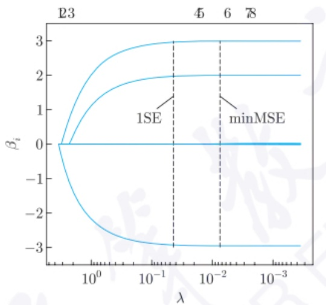
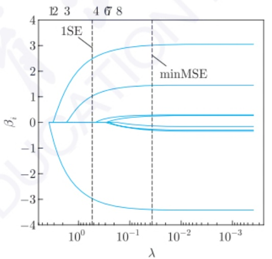
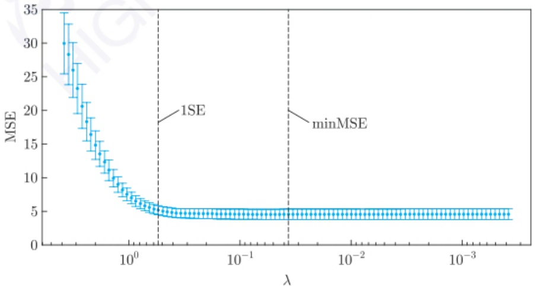
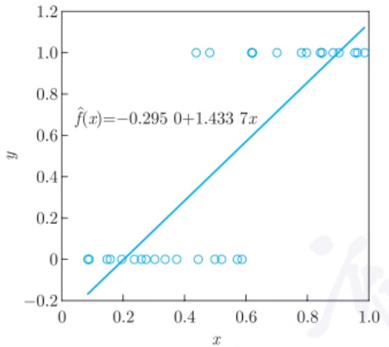
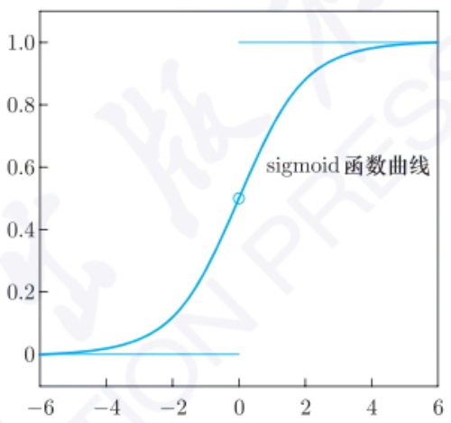

其中  $\varepsilon \sim N(0, \sigma^{2})$ ，即协变量  $x_{1}, x_{3}, x_{5}, x_{6}, x_{8}$  是不显著的。分别取  $\sigma = 0.2$  和 2，产生 100 个随机样本。应用 Lasso 回归估计，并用 10-折叠交叉验证方法。图 5.3.4(a) 给出  $\sigma = 0.2$  的情形，其横坐标  $\lambda$  取了  $\ln$  变换，图形上方的数字  $1 \sim 8$  的位置表示随着  $\lambda$  的减少，第几个变量进入模型。当随机误差方差比较小时，随着  $\lambda$  逐渐变小，对参数  $\beta$  的约束越来越小， $\beta_{2}, \beta_{4}$  和  $\beta_{7}$  逐渐往其真值靠拢，而其他不显著的变量的参数也接近 0.10-折叠交叉验证的结果显示，使预测误差最小的  $\lambda = 0.0074$ ，对应于图中 “minMSE” 处，这时选入线性模型的变量个数为 5 个，剔除了 3 个变量。若取  $\lambda$  使预测误差控制在离最小值的 1 倍标准差，即  $\lambda$  为图中 “1SE” 处，此时  $\lambda = 0.0434$ ，且恰好保留了 3 个重要变量。类似地，图 5.3.4(b) 给出  $\sigma = 2$  的情形，使预测误差最小的  $\lambda = 0.0367$ ，使预测均方误差控制在离最小值的 1 倍标准差的  $\lambda = 0.5445$ ；前者保留了全部 8 个变量，而后者保留了 3 个重要变量。此外，图 5.3.5 给出  $\sigma = 2$  时，用 10-折叠交叉验证得到不同  $\lambda$  的预测均方误差。从中可知， $\lambda$  严重影响预测效果。不过  $\lambda$  从取 “1SE” 处后，预测 MSE 变化不大。

contour

| \(\lambda\) | Curve 1 (Top) | Curve 2 (Middle) | Curve 3 (Bottom) |
| --- | --- | --- | --- |
| ~0.5 | 0 | 0 | 0 |
| ~0.2 | 3 | 2 | -3 |
| ~0.01 | 3 | 2 | -3 |
| ~0.001 | 3 | 2 | -3 |

(a) $\sigma = 0.2$

line

| \(\lambda\) | Series 1 (Top) | Series 2 | Series 3 | Series 4 | Series 5 (Bottom) |
| --- | --- | --- | --- | --- | --- |
| 10^0 | 0 | 0 | 0 | 0 | 0 |
| ~10^-0.5 | ~2.5 | ~1.1 | ~0.1 | ~-0.1 | ~-0.2 |
| ~10^-1 | ~3.0 | ~1.4 | ~0.3 | ~-0.3 | ~-0.4 |
| ~10^-2 | ~3.0 | ~1.4 | ~0.3 | ~-0.3 | ~-0.4 |
| ~10^-3 | ~3.0 | ~1.4 | ~0.3 | ~-0.3 | ~-0.4 |

(b) $\sigma = 2$

图5.3.4 例5.3.4的Lasso回归结果

error_bar

| \(\lambda\) | MSE |
| --- | --- |
| ~0.2 | ~30 |
| ~0.25 | ~28 |
| ~0.3 | ~26 |
| ~0.4 | ~23 |
| ~0.5 | ~21 |
| ~0.6 | ~19 |
| ~0.7 | ~17 |
| ~0.8 | ~15 |
| ~0.9 | ~14 |
| ~1.0 | ~12 |
| ~1.2 | ~10 |
| ~1.4 | ~9 |
| ~1.6 | ~8 |
| ~1.8 | ~7 |
| ~2.0 | ~6 |
| ~2.5 | ~5 |
| ~3.0 | ~4.5 |
| ~4.0 | ~4.5 |
| ~5.0 | ~4.5 |
| ~6.0 | ~4.5 |
| ~8.0 | ~4.5 |
| ~10.0 | ~4.5 |
| ~20.0 | ~4.5 |
| ~30.0 | ~4.5 |
| ~40.0 | ~4.5 |
| ~50.0 | ~4.5 |
| ~60.0 | ~4.5 |
| ~80.0 | ~4.5 |
| ~100.0 | ~4.5 |
| ~200.0 | ~4.5 |
| ~300.0 | ~4.5 |
| ~400.0 | ~4.5 |
| ~500.0 | ~4.5 |
| ~600.0 | ~4.5 |
| ~800.0 | ~4.5 |
| ~1000.0 | ~4.5 |
| ~2000.0 | ~4.5 |
| ~3000.0 | ~4.5 |
| ~4000.0 | ~4.5 |
| ~5000.0 | ~4.5 |
| ~6000.0 | ~4.5 |
| ~8000.0 | ~4.5 |
| ~10000.0 | ~4.5 |
| ~20000.0 | ~4.5 |
| ~30000.0 | ~4.5 |
| ~40000.0 | ~4.5 |
| ~50000.0 | ~4.5 |
| ~60000.0 | ~4.5 |
| ~80000.0 | ~4.5 |
| ~100000.0 | ~4.5 |
| ~200000.0 | ~4.5 |
| ~300000.0 | ~4.5 |
| ~400000.0 | ~4.5 |
| ~500000.0 | ~4.5 |
| ~600000.0 | ~4.5 |
| ~800000.0 | ~4.5 |
| ~1000000.0 | ~4.5 |
| ~2000000.0 | ~4.5 |
| ~3000000.0 | ~4.5 |
| ~4000000.0 | ~4.5 |
| ~5000000.0 | ~4.5 |
| ~6000000.0 | ~4.5 |
| ~8000000.0 | ~4.5 |
| ~10000000.0 | ~4.5 |
| ~20000000.0 | ~4.5 |
| ~30000000.0 | ~4.5 |
| ~40000000.0 | ~4.5 |
| ~50000000.0 | ~4.5 |
| ~60000000.0 | ~4.5 |
| ~80000000.0 | ~4.5 |
| ~10^3 | 4~35 (minMSE) |

图5.3.5 例5.3.4中 $\sigma = 2$ 时Lasso回归的预测误差

由例 5.3.4 可知, Lasso 回归估计可以起到变量选择的效果, 而参数  $\lambda$  严重影响预测效果. 一般地, Lasso 回归估计可把显著的变量选出来, 不过保留的协变量个数往往比真实的参数个数稍多, 即部分不显著的变量也被纳入回归模型. 对于变量个数达到几百、几千甚至几万的情形, 这个缺点尤为突出. 此外, 在 Lasso 回归估计的求解路径中, 对于  $n \times p$  的设计矩阵, 最多只能选出  $\min\{n, p\}$  个变量, 当 p > n 时, 最多只能选出 n 个预测变量, 因此, 对于 p > n 的情况, Lasso 回归估计方法不能很好地选出真实模型.

为此, 不同的研究人员对 (5.3.6) 式中的惩罚项  $p(\beta)$  做了其他定义, 使估计效果更好. 例如, Zou et al. (2005) 提出弹性网 (elastic net) 回归方法, 其惩罚项为岭回归估计和 Lasso 回归估计的惩罚项的加权, 即

$$
p (\boldsymbol {\beta}) = \lambda \left[ \alpha \parallel \boldsymbol {\beta} \parallel_ {1} + (1 - \alpha) \parallel \boldsymbol {\beta} \parallel^ {2} \right],
$$

其中权重 $\alpha \in [0,1]$. 当 $\alpha = 0$ 时, 弹性网回归即为岭回归; 当 $\alpha = 1$ 时, 弹性网回归即为 Lasso 回归. 因此, 弹性网回归兼有 Lasso 回归和岭回归的优点, 既能达到变量选择的目的, 又具有对重要特征选择的作用. 此外, Fan et al. (2001) 提出了 SCAD (smoothly clipped absolute deviation) 这一变量选择的新方法, 其惩罚函数为

$$
p (\boldsymbol {\beta}) = \sum_ {i = 1} ^ {p} p _ {\lambda} (| \beta_ {i} |),
$$

其中函数 $p_{\lambda}(\beta)$ 的导函数为

$$
p _ {\lambda} ^ {\prime} (\beta) = \lambda \left[ I (\beta \leqslant \lambda) + \frac {(a \lambda - \beta) _ {+}}{(a - 1) \lambda} I (\beta > \lambda) \right],
$$

且 $a > 2, \beta > 0$. 这里 $I(\cdot)$ 是示性函数,

$$
b _ {+} = \left\{ \begin{array}{l l} b, & b > 0, \\ 0, & \text {否则}. \end{array} \right.
$$

对于该惩罚函数中的两个参数 $\lambda$ 和 $a$, 可以通过交叉验证来得到. 不过该文中也给出了一个较为通用的值, $\lambda = \sqrt{2\ln(p)}$, 在 $p < 100$ 时, 可取 $a = 3.7$. 他们证明了在该惩罚函数下, 兼具变量选择一致性和与经典最小二乘估计相同的收敛速度. 前者是指不仅可以把显著的变量选出来, 而且尽量避免不显著的变量被纳入模型. 不过由于 SCAD 回归模型的形式过于复杂, 以至于迭代算法运行速度较慢, 因此比较适合于维数在一百以内的情形; 此外, 该方法在低噪声水平的情况下表现较优, 但在高噪声水平的情况下表现一般. 除了前面提到的弹性网回归和 SCAD 回归, 人们还提出自适应 Lasso (adaptive Lasso) 回归、群组 Lasso (group Lasso) 回归等变量选择方法.

在实际应用时, 没有一种变量选择算法是万能的. 对于不同的数据集, 需寻找合适的变量选择算法. 对于超高维的情形, 也有研究人员推荐把 Lasso 和 SCAD 两种方法结合起来使用, 即先用 Lasso 法在超高维的协变量中筛选出部分变量, 再用 SCAD 法筛选重要变量.

## 5.4 logistic 回归

前面讨论的回归模型中, 响应 $y$ 取值往往是连续的, 然而在实际应用中, 经常遇到 $y$ 是离散的情形, 即 $y$ 是分类数据. 最常见的是二分类问题, 即 $y$ 的取值仅为 0 和 1. 二分类的问题可以推广到多分类问题. 例如, 在疾病研究中, 经常需要分析疾病的发生与各危险因素之间的定量关系. 例如, 研究胃癌的发生与吸烟、饮酒、不良饮食习惯等危险因素的关系. 对于二分类问题, 由于响应 $y$ 为分类变量, 不满足正态分布和方差齐性等条件, 若采用多元线性回归分析, 则其预测值可能会大于 1 或小于 0, 从而无法给出合理的解释. logistic 回归模型较好地解决了上述问题. 由于该方法简单、实用、高效, 因此在医学、大数据分析等诸多领域都有十分广泛的应用. logistic 回归通常用于解决分类问题, 例如客户是否会购买某个商品, 借款人是否会违约等.

## 5.4.1 二分类

首先考虑 $y$ 取值为0和1的二分类问题. 给定数据集

$$
D = \{(\boldsymbol {x} _ {i}, y _ {i}): \boldsymbol {x} _ {i} = (x _ {i 1}, x _ {i 2}, \dots , x _ {i p}), y _ {i} \in \{0, 1 \}, i = 1, 2, \dots , n \},
$$

一个自然的做法是直接对该数据集用多元线性回归模型 (5.1.8) 式来拟合数据. 如图 5.4.1(a) 所示, 一个只有一个协变量的二分类数据, 若直接用线性回归模型来拟合, 得到的拟合模型

$$
\hat {f} (x) = - 0. 2 9 5 0 + 1. 4 3 3 7 x
$$

并不能保证其预测值落在 $[0,1]$，而且线性回归拟合的曲线似乎和数据点没有关系，从而没有意义。一种简单的处理方式是通过下面的阶跃函数:

$$
\hat {y} = \left\{ \begin{array}{l l} 1, & \hat {f} (x) > 0. 5, \\ 0, & \hat {f} (x) \leqslant 0. 5 \end{array} \right.
$$

把数据的预测值强行变为0或1. 对于该拟合数据，当 $x > 0.5545$ 时，令 $\hat{y} = 1$ ，否则 $\hat{y} = 0$ .然而，阶跃函数不是连续函数.为此，希望像线性回归的函数一样，使协变量和响应 $Y$ 之间的关系用一个单调可导的函数来描述. 常见的拟合函数为 sigmoid 函数:

$$
f (z) = \frac {1}{1 + \mathrm{e} ^ {- z}},
$$

该函数在机器学习中的神经网络中有诸多应用。该函数图形是一条S形曲线，如图5.4.1(b)所示，其有个平滑的过渡且可导。从中可见，sigmoid函数曲线将取值范围 $(-\infty ,\infty)$ 映射到(0,1).从而，sigmoid函数值更适宜表示预测的概率。

scatter

| x | y |
| --- | --- |
| ~0.1 | 0 |
| ~0.15 | 0 |
| ~0.18 | 0 |
| ~0.2 | 0 |
| ~0.25 | 0 |
| ~0.28 | 0 |
| ~0.3 | 0 |
| ~0.35 | 0 |
| ~0.45 | 0 |
| ~0.48 | 1.0 |
| ~0.5 | 1.0 |
| ~0.55 | 0 |
| ~0.58 | 0 |
| ~0.6 | 1.0 |
| ~0.7 | 1.0 |
| ~0.78 | 1.0 |
| ~0.8 | 1.0 |
| ~0.85 | 1.0 |
| ~0.9 | 1.0 |
| ~0.95 | 1.0 |
| ~0.98 | 1.0 |

(a)

line

| X | Y |
| --- | --- |
| -6 | 0 |
| -4 | ~0.02 |
| -2 | ~0.15 |
| 0 | 0.5 |
| 2 | ~0.85 |
| 4 | ~0.98 |
| 6 | 1.0 |

(b)

图 5.4.1 logistic 回归示意图

令 y 取值为 1 的概率为  $P(y=1|x)$ ，则  $P(y=0|x)=1-P(y=1|x)$ 。两者的比值称为几率 (odds)，其指该事件发生与不发生的概率比值。则对数几率为

$$
\ln (\text {odds}) = \ln \frac {P (y = 1 | \boldsymbol {x})}{1 - P (y = 1 | \boldsymbol {x})}.
$$

对于 p 维变量  $x_{1}, x_{2}, \cdots, x_{p}$ ，在不混淆的情形下，令  $\boldsymbol{x} = (x_{0}, x_{1}, \cdots, x_{p})^{\mathrm{T}}$ ，其中  $x_{0} = 1$ ， $\boldsymbol{\beta} = (\beta_{0}, \boldsymbol{\beta}_{1})^{\mathrm{T}}$ ， $\boldsymbol{\beta}_{1} = (\beta_{1}, \beta_{2}, \cdots, \beta_{p})^{\mathrm{T}}$ 。则线性回归项  $\boldsymbol{\beta}^{T}x = \beta_{0} + \beta_{1}x_{1} + \cdots + \beta_{p}x_{p}$ ，对线性回归项  $\beta^{T}x$  经过 sigmoid 函数变换后，令其为 y = 1 的概率，即

$$
P (y = 1 | \boldsymbol {x}) = \frac {1}{1 + \exp \{- \boldsymbol {\beta} ^ {\mathrm{T}} \boldsymbol {x} \}} = \frac {\exp \{\boldsymbol {\beta} ^ {\mathrm{T}} \boldsymbol {x} \}}{1 + \exp \{\boldsymbol {\beta} ^ {\mathrm{T}} \boldsymbol {x} \}}.
$$

因此，

$$
P (y = 0 | \boldsymbol {x}) = 1 - P (y = 1 | \boldsymbol {x}) = \frac {1}{1 + \exp \{\boldsymbol {\beta} ^ {\mathrm{T}} \boldsymbol {x} \}},
$$

且

$$
\ln \frac {P (y = 1 | \boldsymbol {x})}{1 - P (y = 1 | \boldsymbol {x})} = \boldsymbol {\beta} ^ {\mathrm{T}} \boldsymbol {x} = \beta_ {0} + \beta_ {1} x _ {1} + \dots + \beta_ {p} x _ {p}, \tag {5.4.1}
$$

该式即为 logistic 回归模型, 即输出 $y = 1$ 的对数几率由输入 $\pmb{x}$ 的线性函数表示. 当 (5.4.1) 式右边的取值越接近 $+\infty$ 时, $y = 1$ 的概率越接近 1. 因此 logistic 回归的思路是, 先拟合决策边界, 再建立这个边界与分类的概率联系, 从而得到二分类情况下的概率.

给定数据集 $D$ 后, 需要估计 logistic 回归模型 (5.4.1) 的参数 $\beta$. 下面考虑最大似然估计方法. 由于 $P(y = 1|\pmb{x})$ 与 $\beta$ 有关, 为方便记, 可设 $P(y = 1|\pmb{x}) = P(y = 1|\pmb{x}, \beta) = p(\pmb{x}, \beta)$, 则 $P(y = 0|\pmb{x}) = 1 - p(\pmb{x}, \beta)$, 且 $P(y|\pmb{x}, \beta) = [p(\pmb{x}, \beta)]^y [1 - p(\pmb{x}, \beta)]^{1 - y}$. 因此, 似然函数为

$$
L (\boldsymbol {\beta}) = \prod_ {i = 1} ^ {n} [ p (\boldsymbol {x} _ {i}, \boldsymbol {\beta}) ] ^ {y _ {i}} [ 1 - p (\boldsymbol {x} _ {i}, \boldsymbol {\beta}) ] ^ {1 - y _ {i}}. \tag {5.4.2}
$$

相应的对数似然函数为

$$
l (\boldsymbol {\beta}) = \ln L (\boldsymbol {\beta}) = \sum_ {i = 1} ^ {n} \{y _ {i} \ln p (\boldsymbol {x} _ {i}, \boldsymbol {\beta}) + (1 - y _ {i}) \ln [ 1 - p (\boldsymbol {x} _ {i}, \boldsymbol {\beta}) ] \}.
$$

把 $p(\pmb{x}_i,\beta)$ 的表达式代入 $l(\beta)$ 可得

$$
l (\boldsymbol {\beta}) = \sum_ {i = 1} ^ {n} \left[ y _ {i} \boldsymbol {\beta} ^ {\mathrm{T}} \boldsymbol {x} _ {i} - \ln (1 + \exp \{\boldsymbol {\beta} ^ {\mathrm{T}} \boldsymbol {x} _ {i} \}) \right].
$$

为了最大化  $l(\beta)$ ，将上式分别对  $\beta_{0}, \beta_{1}, \cdots, \beta_{p}$  求偏导并令其为 0。由于

$$
\begin{array}{l} \frac {\partial l (\boldsymbol {\beta})}{\partial \beta_ {j}} = \sum_ {i = 1} ^ {n} y _ {i} x _ {i j} - \sum_ {i = 1} ^ {n} \frac {x _ {i j} \exp \{\boldsymbol {\beta} ^ {\mathrm{T}} \boldsymbol {x} _ {i} \}}{1 + \exp \{\boldsymbol {\beta} ^ {\mathrm{T}} \boldsymbol {x} _ {i} \}} = \sum_ {i = 1} ^ {n} y _ {i} x _ {i j} - \sum_ {i = 1} ^ {n} p (\boldsymbol {x} _ {i}, \boldsymbol {\beta}) x _ {i j} \\ = \sum_ {i = 1} ^ {n} x _ {i j} [ y _ {i} - p (\boldsymbol {x} _ {i}, \boldsymbol {\beta}) ], \quad j = 0, 1, \dots , p, \\ \end{array}
$$

写成矩阵形式, 可得

$$
\frac {\partial l (\boldsymbol {\beta})}{\partial \boldsymbol {\beta}} = \sum_ {i = 1} ^ {n} \boldsymbol {x} _ {i} [ y _ {i} - p (\boldsymbol {x} _ {i}, \boldsymbol {\beta}) ],
$$

因此, 最大似然估计即为求解这  $p + 1$  个非线性方程

$$
\frac {\partial l (\boldsymbol {\beta})}{\partial \beta_ {j}} = 0, \quad j = 0, 1, \dots , p.
$$

该方程组没有显式解, 其可通过 Newton-Raphson (牛顿-拉弗森) 算法求解. 为此, 求出它的二阶导数, 即得

$$
\frac {\partial^ {2} l (\boldsymbol {\beta})}{\partial \beta_ {j} \partial \beta_ {k}} = - \sum_ {i = 1} ^ {n} \frac {(1 + \exp \{\boldsymbol {\beta} ^ {\mathrm{T}} \boldsymbol {x} _ {i} \}) \exp \{\boldsymbol {\beta} ^ {\mathrm{T}} \boldsymbol {x} _ {i} \} x _ {i j} x _ {i k} - (\exp \{\boldsymbol {\beta} ^ {\mathrm{T}} \boldsymbol {x} _ {i} \}) ^ {2} x _ {i j} x _ {i k}}{(1 + \exp \{\boldsymbol {\beta} ^ {\mathrm{T}} \boldsymbol {x} _ {i} \}) ^ {2}}
$$

$$
\begin{array}{l} = - \sum_ {i = 1} ^ {n} \left[ x _ {i j} x _ {i k} p (\boldsymbol {x} _ {i}, \boldsymbol {\beta}) - x _ {i j} x _ {i k} p (\boldsymbol {x} _ {i}, \boldsymbol {\beta}) ^ {2} \right] \\ = - \sum_ {i = 1} ^ {n} x _ {i j} x _ {i k} p (\boldsymbol {x} _ {i}, \boldsymbol {\beta}) [ 1 - p (\boldsymbol {x} _ {i}, \boldsymbol {\beta}) ]. \\ \end{array}
$$

从而其Hesse(黑塞)矩阵为

$$
\frac {\partial^ {2} l (\boldsymbol {\beta})}{\partial \boldsymbol {\beta} \partial \boldsymbol {\beta} ^ {\mathrm{T}}} = - \sum_ {i = 1} ^ {n} \boldsymbol {x} _ {i} \boldsymbol {x} _ {i} ^ {\mathrm{T}} p (\boldsymbol {x} _ {i}, \boldsymbol {\beta}) [ 1 - p (\boldsymbol {x} _ {i}, \boldsymbol {\beta}) ].
$$

从某个  $\beta^{old}$  开始, 一个 Newton-Raphson 更新如下:

$$
\boldsymbol {\beta} ^ {\mathrm{new}} = \boldsymbol {\beta} ^ {\mathrm{old}} - \left[ \frac {\partial^ {2} l (\boldsymbol {\beta})}{\partial \boldsymbol {\beta} \partial \boldsymbol {\beta} ^ {\mathrm{T}}} \right] ^ {- 1} \frac {\partial l (\boldsymbol {\beta})}{\partial \boldsymbol {\beta}},
$$

其中的导数是在 $\beta^{\mathrm{old}}$ 处计算的. 这个迭代过程可用矩阵来表示. 令 $\pmb{y}$ 为响应 $y_{i}$ 组成的列向量, $X$ 为 $n \times (p + 1)$ 系数矩阵, $\pmb{p}$ 为 $n$ 维向量且其第 $i$ 个元素为 $p(\pmb{x}_i, \beta^{\mathrm{old}})$, $W$ 为 $n \times n$ 对角矩阵且其第 $i$ 个对角元素为 $p(\pmb{x}_i, \beta^{\mathrm{old}})[1 - p(\pmb{x}_i, \beta^{\mathrm{old}})]$. 则可得

$$
\frac {\partial l (\boldsymbol {\beta})}{\partial \boldsymbol {\beta}} = X ^ {\mathrm{T}} (\boldsymbol {y} - \boldsymbol {p}),
$$

$$
\frac {\partial^ {2} l (\boldsymbol {\beta})}{\partial \boldsymbol {\beta} \partial \boldsymbol {\beta} ^ {\mathrm{T}}} = - X ^ {\mathrm{T}} W X.
$$

因此, Newton-Raphson 迭代式为

$$
\begin{array}{l} \boldsymbol {\beta} ^ {\mathrm{new}} = \boldsymbol {\beta} ^ {\mathrm{old}} + (X ^ {\mathrm{T}} W X) ^ {- 1} X ^ {\mathrm{T}} (\boldsymbol {y} - \boldsymbol {p}) \\ = (X ^ {\mathrm{T}} W X) ^ {- 1} X ^ {\mathrm{T}} W [ X \boldsymbol {\beta} ^ {\text {old}} + W ^ {- 1} (\boldsymbol {y} - \boldsymbol {p}) ] \\ = (X ^ {\mathrm{T}} W X) ^ {- 1} X ^ {\mathrm{T}} W \boldsymbol {z}, \\ \end{array}
$$

其中 $z \stackrel{\mathrm{def}}{=} X\beta^{\mathrm{old}} + W^{-1}(\pmb{y} - \pmb{p})$。因此，求解logistic回归模型参数的迭代过程如算法5.6所示。

## 算法 5.6 (logistic 回归模型参数的最大似然估计迭代算法)

步骤 1 令初始值  $\beta = 0$ .

步骤 2 计算 p, 其元素为

$$
p (\boldsymbol {x} _ {i}, \boldsymbol {\beta}) = \frac {\exp \{\boldsymbol {\beta} ^ {\mathrm{T}} \boldsymbol {x} _ {i} \}}{1 + \exp \{\boldsymbol {\beta} ^ {\mathrm{T}} \boldsymbol {x} _ {i} \}}, \quad i = 1, 2, \dots , n.
$$

步骤 3 计算对角矩阵 W, 其第 i 个对角元素为  $p(\boldsymbol{x}_{i}, \boldsymbol{\beta})[1 - p(\boldsymbol{x}_{i}, \boldsymbol{\beta})], i = 1, 2, \cdots, n.$

步骤 4 令  $z = X\beta + W^{-1}(y - p)$ .

步骤 5 更新  $\boldsymbol{\beta}=(X^{\mathrm{T}}WX)^{-1}X^{\mathrm{T}}W\boldsymbol{z}$ .

步骤 6 若满足停止准则, 则中止算法; 否则回到步骤 2.

在算法 5.6 的步骤 6 中, 停止准则可定义为更新后的  $\beta$  与更新前的没有太多变化, 即  $\left|\left|\boldsymbol{\beta}^{\mathrm{new}}-\boldsymbol{\beta}^{\mathrm{old}}\right|\right|<\varepsilon$ , 其中  $\varepsilon$  为给定的小常数. 由算法 5.6 可知, logistic 回归模型参数的最大似然估计通过 Newton-Raphson 迭代算法容易求出. 得到模型参数的估计  $\hat{\beta}$  之后, 则概率  $P(y=1|x)$  和  $P(y=0|x)$  的估计分别为

$$
p (\boldsymbol {x}, \hat {\boldsymbol {\beta}}) = \frac {\exp \{\hat {\boldsymbol {\beta}} ^ {\mathrm{T}} \boldsymbol {x} \}}{1 + \exp \{\hat {\boldsymbol {\beta}} ^ {\mathrm{T}} \boldsymbol {x} \}}, 1 - p (\boldsymbol {x}, \hat {\boldsymbol {\beta}}) = \frac {1}{1 + \exp \{\hat {\boldsymbol {\beta}} ^ {\mathrm{T}} \boldsymbol {x} \}}.
$$

显然, 给定样本 x, 当  $\beta^{T}x > 0$  时, 相应的  $\hat{y} = 1$ ; 否则  $\hat{y} = 0$ . 因此, 确定响应变量 y 属于哪一类的判别边界仍是一个线性函数.

例 5.4.1 对于某个具有两个协变量的二分类数据, 根据算法 5.6 得到  $\beta$  的估计  $\hat{\boldsymbol{\beta}} = (0.7679, -0.6816, -0.3664)^{\mathrm{T}}$ , 从而

$$
P (y = 1 | \boldsymbol {x}) = \frac {\exp \{0 . 7 6 7 9 - 0 . 6 8 1 6 x _ {1} - 0 . 3 6 6 4 x _ {2} \}}{1 + \exp \{0 . 7 6 7 9 - 0 . 6 8 1 6 x _ {1} - 0 . 3 6 6 4 x _ {2} \}},
$$

$$
P (y = 0 | \boldsymbol {x}) = \frac {1}{1 + \exp \{0 . 7 6 7 9 - 0 . 6 8 1 6 x _ {1} - 0 . 3 6 6 4 x _ {2} \}},
$$

且对数几率

$$
\ln (\text {odds}) = 0. 7 6 7 9 - 0. 6 8 1 6 x _ {1} - 0. 3 6 6 4 x _ {2}.
$$

因此, 对于给定样本 x, 其判别函数为

$$
\hat {y} = \left\{ \begin{array}{l l} 1, & 0. 7 6 7 9 - 0. 6 8 1 6 x _ {1} - 0. 3 6 6 4 x _ {2} > 0, \\ 0, & \text {否则}. \end{array} \right.
$$

由该式可知, 判别边界是一个线性函数.

由例 5.4.1 可知, logistic 回归模型可用于解决二分类的问题. 此外, 若某个协变量  $x_{i}$  是定类数据, 则可对其进行伪变量处理. logistic 回归模型中估计的参数有直观解释. 例如, 在研究肺癌与吸烟、饮酒的关系时, 设响应 y 表示是否患肺癌, 吸烟  $x_{1}$  和饮酒  $x_{2}$  为协变量. 令 y=1 表示患肺癌, y=0 表示未患肺癌;  $x_{1}=1$  表示吸烟,  $x_{1}=0$  表示不吸烟;  $x_{2}=1$  表示饮酒,  $x_{2}=0$  表示不饮酒. 实际上, 吸烟和饮酒这两个变量都是定性变量, 经  $x_{1}$  和  $x_{2}$  这样设定后变为伪变量, 可代入 logistic 回归模型中进行回归. 根据数据, 假设得到如下的 logistic 回归模型:

$$
\ln (\text {odds}) = \hat {\beta} _ {0} + \hat {\beta} _ {1} x _ {1} + \hat {\beta} _ {2} x _ {2},
$$

此时, 模型中各参数的解释如下: $\hat{\beta}_0$ 表示不吸烟且不饮酒的人患肺癌与不患肺癌概率之比的对数值; 控制饮酒因素后, 吸烟者患肺癌的概率是不吸烟者的 $\exp \{\hat{\beta}_1\}$ 倍; 控制吸烟因素后, 饮酒者患肺癌的概率是不饮酒者的 $\exp \{\hat{\beta}_2\}$ 倍. 由此可见, logistic 回归模型在医学中可以很好地解释二分类的问题, 因此得以大量应用.

进一步地, 需要检验 logistic 回归模型 (5.4.1) 是否显著. 此时, 原假设和备择假设分别如下:

$$
H _ {0}: \beta_ {1} = \beta_ {2} = \dots = \beta_ {p} = 0 \leftrightarrow H _ {1}: \text {至少存在某个} i, \beta_ {i} \neq 0.
$$

似然比检验法是检验上述问题的常用方法. 似然比检验统计量 $G$ 为

$$
G = - 2 (\ln L _ {1} - \ln L _ {0}).
$$

其中  $L_{1}$  为 (5.4.2) 式包含所有协变量  $\beta_{0}, \beta_{1}, \cdots, \beta_{p}$  的回归模型的似然函数， $L_{0}$  为仅包含常数项  $\beta_{0}$  的回归模型的似然函数。根据似然比检验理论，可知在原假设  $H_{0}$  成立时，G 统计量的极限分布服从自由度为 p 的  $\chi^{2}$  分布。从而，给定样本后，可得相应的 p 值。若 p 值小于给定的显著性水平  $\alpha$ ，则该 logistic 回归模型是显著的。当模型显著时，还需对模型中的每一个协变量的回归系数进行假设检验，以检验每个协变量是否显著，其原假设和备择假设分别如下所示:

$$
H _ {0}: \beta_ {j} = 0 \leftrightarrow H _ {1}: \beta_ {j} \neq 0.
$$

常用的假设检验方法为 Wald  $\chi^{2}$  检验, 相应的检验统计量为

$$
\chi^ {2} = (\hat {\beta} _ {j} / S _ {\hat {\beta} _ {j}}) ^ {2},
$$

其中 $S_{\hat{\beta}_j}$ 为 $\hat{\beta}_j$ 的估计标准差. 在原假设 $H_0$ 成立时, Wald $\chi^2$ 检验统计量服从自由度为1的 $\chi^2$ 分布.

## 5.4.2 多分类

在实际应用中, 经常遇到多分类的情形, 即最终的分类结果中类别数会大于 2. 例如, 新闻可以分为体育、财经、其他等三个类别, 目标是根据某一个用户的各种特征, 判断其更喜欢哪一类新闻. 这是一个典型的多分类任务.

一般地, 对于多分类问题, 设类别为  $\{1,2,\cdots,K\}$ . 对于任一点 x, 可以估计其落入每个类的概率, 从而可以定义一个判别函数 G 如下:

$$
\hat {G} (\boldsymbol {x}) = \arg \max _ {k} P (G = k | \boldsymbol {x}),
$$

即判别函数 $G$ 是依据最大概率原则来确定其分类. 由于响应 $y$ 为多类别数据, 研究协变量 $\pmb{x}$ 对 $y$ 的影响时, 通常做两两比较来得到相对信息. 对于第 $k$ 和第 $l$ 类, 其判别边界为

$$
P (G = k | \boldsymbol {x}) = P (G = l | \boldsymbol {x}).
$$

对上式两边都除以 $P(G = l|\pmb{x})$ 并取对数，可得

$$
\ln {\frac {P (G = k | \boldsymbol {x})}{P (G = l | \boldsymbol {x})}} = 0.
$$

若希望判别边界是线性的, 则类似于 (5.4.1) 式的二分类 logistic 模型, 可设

$$
\ln \frac {P (G = k | \boldsymbol {x})}{P (G = l | \boldsymbol {x})} = a _ {0} ^ {(k, l)} + \sum_ {j = 1} ^ {p} a _ {j} ^ {(k, l)} x _ {j}.
$$

显然, 给定某个样本 x, 其一定属于某个类, 因此对于不同的  $(k, l)$ ,  $a^{(k, l)}$  之间存在某些约束, 故可设

$$
\ln \frac {P (G = j | \boldsymbol {x})}{P (G = K | \boldsymbol {x})} = \boldsymbol {\beta} _ {j} ^ {\mathrm{T}} \boldsymbol {x}, \quad j = 1, 2, \dots , K - 1, \tag {5.4.3}
$$

其中  $\beta_{j}^{T}x=\beta_{j0}+\beta_{j1}x_{1}+\cdots+\beta_{jp}x_{p}$ . 称 (5.4.3) 式为多分类 logistic 模型. 从而, 对于任一对  $(k,l)$ , 有

$$
\ln \frac {P (G = k | \boldsymbol {x})}{P (G = l | \boldsymbol {x})} = (\boldsymbol {\beta} _ {k} - \boldsymbol {\beta} _ {l}) ^ {\mathrm{T}} \boldsymbol {x}.
$$

因此, 只需以第 K 类作为基准, 考虑其他 K-1 类与第 K 类的比较, 就可以得到任意对  $(k,l)$  之间的关系. 从而, 在整个模型中需要估计的参数个数为  $(K-1)(p+1)$ , 记为  $\boldsymbol{\beta}=\{\beta_{10},\beta_{11},\cdots,\beta_{1p},\beta_{20},\beta_{21},\cdots,\beta_{2p},\cdots,\beta_{(K-1)0},\beta_{(K-1)1},\cdots,\beta_{(K-1)p}\}$ . 易得

$$
P (G = k | \boldsymbol {x}) = \frac {\exp \{\boldsymbol {\beta} _ {k} ^ {\mathrm{T}} \boldsymbol {x} \}}{1 + \sum_ {l = 1} ^ {K - 1} \exp \{\boldsymbol {\beta} _ {l} ^ {\mathrm{T}} \boldsymbol {x} \}}, \quad k = 1, 2, \dots , K - 1,
$$

$$
P (G = K | \boldsymbol {x}) = \frac {1}{1 + \sum_ {l = 1} ^ {K - 1} \exp \{\boldsymbol {\beta} _ {l} ^ {\mathrm{T}} \boldsymbol {x} \}}.
$$

显然, $\sum_{k=1}^{K}P(G=k|\boldsymbol{x})=1.$

给定样本  $\{(\boldsymbol{x}_{i}, g_{i}), i = 1, 2, \cdots, N\}$ ，其中类别  $g_{i} \in \{1, 2, \cdots, K\}$ ，令  $P(G = g_{i} | \boldsymbol{x}_{i}) = P(G = g_{i} | \boldsymbol{x}_{i}, \boldsymbol{\beta}) = p_{g_{i}} (\boldsymbol{x}_{i}, \boldsymbol{\beta})$ 。则对数最大似然估计为

$$
l (\boldsymbol {\beta}) = \sum_ {i = 1} ^ {N} \ln p _ {g _ {i}} (\boldsymbol {x} _ {i}, \boldsymbol {\beta}) = \sum_ {i = 1} ^ {N} \ln \frac {\exp \{\boldsymbol {\beta} _ {g _ {i}} ^ {\mathrm{T}} \boldsymbol {x} _ {i} \}}{1 + \sum_ {l = 1} ^ {K - 1} \exp \{\boldsymbol {\beta} _ {l} ^ {\mathrm{T}} \boldsymbol {x} _ {i} \}}
$$

$$
= \sum_ {i = 1} ^ {N} \left[ \boldsymbol {\beta} _ {g _ {i}} ^ {\mathrm{T}} \boldsymbol {x} _ {i} - \ln \left(1 + \sum_ {l = 1} ^ {K - 1} \exp \{\boldsymbol {\beta} _ {l} ^ {\mathrm{T}} \boldsymbol {x} _ {i} \}\right) \right].
$$

类似于二分类的情形, 用 Newton-Raphson 算法求解. 令 $I(\cdot)$ 为示性函数, 即条件满足时取值为 1, 否则为 0. 则 $l(\beta)$ 的一阶偏导数为

$$
\begin{array}{l} \frac {\partial l (\boldsymbol {\beta})}{\partial \beta_ {k j}} = \sum_ {i = 1} ^ {N} \left[ I (g _ {i} = k) x _ {i j} - \frac {\exp \{\boldsymbol {\beta} _ {k} ^ {\mathrm{T}} \boldsymbol {x} _ {i} \} x _ {i j}}{1 + \sum_ {l = 1} ^ {K - 1} \exp \{\boldsymbol {\beta} _ {l} ^ {\mathrm{T}} \boldsymbol {x} _ {i} \}} \right] \\ = \sum_ {i = 1} ^ {N} x _ {i j} \left[ I (g _ {i} = k) - p _ {k} (\boldsymbol {x} _ {i}, \boldsymbol {\beta}) \right], \\ \end{array}
$$

而二阶偏导数为

$$
\begin{array}{l} \frac {\partial^ {2} l (\boldsymbol {\beta})}{\partial \beta_ {k j} \partial \beta_ {m n}} \\ = - \sum_ {i = 1} ^ {N} x _ {i j} \frac {1}{\left(1 + \sum_ {l = 1} ^ {K - 1} \exp \{\boldsymbol {\beta} _ {l} ^ {\mathrm{T}} \boldsymbol {x} _ {i} \}\right) ^ {2}}. \\ \left[ - \exp \{\boldsymbol {\beta} _ {k} ^ {\mathrm{T}} \boldsymbol {x} _ {i} \} I (k = m) x _ {i n} \bigg (1 + \sum_ {l = 1} ^ {K - 1} \exp \{\boldsymbol {\beta} _ {l} ^ {\mathrm{T}} \boldsymbol {x} _ {i} \} \bigg) + \exp \{\boldsymbol {\beta} _ {k} ^ {\mathrm{T}} \boldsymbol {x} _ {i} \} \exp \{\boldsymbol {\beta} _ {m} ^ {\mathrm{T}} \boldsymbol {x} _ {i} \} x _ {i n} \right] \\ = \sum_ {i = 1} ^ {N} x _ {i j} x _ {i n} \left[ - p _ {k} (\boldsymbol {x} _ {i}, \boldsymbol {\beta}) I (k = m) + p _ {k} (\boldsymbol {x} _ {i}, \boldsymbol {\beta}) p _ {m} (\boldsymbol {x} _ {i}, \boldsymbol {\beta}) \right] \\ = - \sum_ {i = 1} ^ {N} x _ {i j} x _ {i n} p _ {k} (\boldsymbol {x} _ {i}, \boldsymbol {\beta}) \left[ I (k = m) - p _ {m} (\boldsymbol {x} _ {i}, \boldsymbol {\beta}) \right]. \\ \end{array}
$$

上述式子也可以用矩阵形式表示. 令 y 是下面由示性函数构成的  $N(K-1)$  维列向量,

$$
\boldsymbol {y} = \left( \begin{array}{c} \boldsymbol {y} _ {1} \\ \boldsymbol {y} _ {2} \\ \vdots \\ \boldsymbol {y} _ {K - 1} \end{array} \right), \quad \boldsymbol {y} _ {k} = \left( \begin{array}{c} I (g _ {1} = k) \\ I (g _ {2} = k) \\ \vdots \\ I (g _ {N} = k) \end{array} \right), 1 \leqslant k \leqslant K - 1.
$$

令 p 为  $N(K-1)$  维的拟合概率

$$
\boldsymbol {p} = \left( \begin{array}{c} \boldsymbol {p} _ {1} \\ \boldsymbol {p} _ {2} \\ \vdots \\ \boldsymbol {p} _ {K - 1} \end{array} \right), \boldsymbol {p} _ {k} = \left( \begin{array}{c} p _ {k} (\boldsymbol {x} _ {1}, \boldsymbol {\beta}) \\ p _ {k} (\boldsymbol {x} _ {2}, \boldsymbol {\beta}) \\ \vdots \\ p _ {k} (\boldsymbol {x} _ {N}, \boldsymbol {\beta}) \end{array} \right), 1 \leqslant k \leqslant K - 1.
$$

记 $X$ 为 $N \times (p + 1)$ 的系数矩阵, $\tilde{\mathbf{X}}$ 为 $N(K - 1) \times (p + 1)(K - 1)$ 的块对角矩阵:

$$
\tilde {\boldsymbol {X}} = \left( \begin{array}{c c c c} X & 0 & \dots & 0 \\ 0 & X & \dots & 0 \\ \vdots & \vdots & & \vdots \\ 0 & 0 & \dots & X \end{array} \right).
$$

令 W 为  $N(K-1) \times N(K-1)$  的方阵:

$$
W = \left( \begin{array}{c c c c} W _ {1 1} & W _ {1 2} & \dots & W _ {1 (K - 1)} \\ W _ {2 1} & W _ {2 2} & \dots & W _ {2 (K - 1)} \\ \vdots & \vdots & & \vdots \\ W _ {(K - 1) 1} & W _ {(K - 1) 2} & \dots & W _ {(K - 1) (K - 1)} \end{array} \right),
$$

其中 $W_{km}, 1 \leqslant k, m \leqslant K - 1$ 为 $N \times N$ 的对角矩阵，且当 $k = m$ 时，$W_{kk}$ 的第 $i$ 个对角元素为 $p_k(\boldsymbol{x}_i, \boldsymbol{\beta}^{\mathrm{old}})[1 - p_k(\boldsymbol{x}_i, \boldsymbol{\beta}^{\mathrm{old}})]$，当 $k \neq m$ 时，$W_{km}$ 的第 $i$ 个对角元素为 $-p_k(\boldsymbol{x}_i, \boldsymbol{\beta}^{\mathrm{old}}) p_m(\boldsymbol{x}_i, \boldsymbol{\beta}^{\mathrm{old}})$. 从而，类似于二分类问题，可得

$$
\frac {\partial l (\boldsymbol {\beta})}{\partial \boldsymbol {\beta}} = \tilde {\boldsymbol {X}} ^ {\mathrm{T}} (\boldsymbol {y} - \boldsymbol {p}),
$$

$$
\frac {\partial^ {2} l (\boldsymbol {\beta})}{\partial \boldsymbol {\beta} \partial \boldsymbol {\beta} ^ {\mathrm{T}}} = - \tilde {\boldsymbol {X}} ^ {\mathrm{T}} \boldsymbol {W} \tilde {\boldsymbol {X}},
$$

则  $\beta^{new}$  的更新式子和二分类的一样, 即

$$
\boldsymbol {\beta} ^ {\mathrm{new}} = (\tilde {\boldsymbol {X}} ^ {\mathrm{T}} \boldsymbol {W} \tilde {\boldsymbol {X}}) ^ {- 1} \tilde {\boldsymbol {X}} ^ {\mathrm{T}} \boldsymbol {W} \boldsymbol {z},
$$

其中 $z \stackrel{\mathrm{def}}{=} \tilde{X} \beta^{\mathrm{old}} + W^{-1}(y - p)$, 或等价地,

$$
\boldsymbol {\beta} ^ {\mathrm{new}} = \boldsymbol {\beta} ^ {\mathrm{old}} + (\tilde {\boldsymbol {X}} ^ {\mathrm{T}} \boldsymbol {W} \tilde {\boldsymbol {X}}) ^ {- 1} \tilde {\boldsymbol {X}} ^ {\mathrm{T}} (\boldsymbol {y} - \boldsymbol {p}).
$$

由此, 可类似于算法 5.6, 得到多分类的迭代算法. 此外, 多分类 logistic 回归模型的显著性检验类似于二分类的情形.

对于多分类 logistic 回归模型 (5.4.3) 中回归参数进行物理解释时, 需要做两两比较, 即可以把第 $K$ 类作为基准, 再用类似于二分类模型的解释方法. 此外, 在实际应用中, 若响应 $y$ 的类别个数较多, 例如为 10 个, 则可对类别进行某种组合, 以减少类别数量, 从而便于后续进行分析.

## 习题五

1. 下面是 7 个地区 2000 年的人均国内生产总值 (GDP) 和人均消费水平的统计数据:

| 地区 | 北京 | 辽宁 | 上海 | 江西 | 河南 | 贵州 | 陕西 |
| --- | --- | --- | --- | --- | --- | --- | --- |
| 人均GDP/元 | 22 460 | 11 226 | 34 547 | 4 851 | 5 444 | 2 662 | 4 549 |
| 人均消费水平/元 | 7 326 | 4 490 | 11 546 | 2 396 | 2 208 | 1 608 | 2 035 |

(1) 人均 GDP 作协变量, 人均消费水平作响应, 绘制散点图, 并说明二者之间的关系形态;
(2) 计算两个变量之间的线性相关系数, 说明两个变量之间的关系强度;
(3) 求出估计的回归方程, 并解释回归系数的实际意义;
(4) 计算  $R^{2}$ ，并解释其意义；
(5) 检验回归方程线性关系的显著性 ( $\alpha = 0.05$ );
(6) 如果某地区的人均 GDP 为 5 000 元, 预测其人均消费水平;
(7) 求人均 GDP 为 5 000 元时, 人均消费水平 95% 的置信区间和预测区间.

2. 设 $H = X(X^{\mathrm{T}}X)^{-1}X^{\mathrm{T}}$ 是秩为 $k$ 的 $n \times n$ 矩阵 ($n \geqslant k$), 试证明

(1) H 是秩为 k 的投影矩阵;
(2)  $I_{n}-H$  是秩为 n-k 的投影矩阵, 其中  $I_{n}$  为 n 阶单位矩阵;
(3) $H(I_{n}-H)=0.$

3. 对于拟合模型

$$
y = \beta x ^ {2} + \varepsilon ,
$$

试根据数据  $(x_{i}, y_{i}), i = 1, 2, \cdots, n,$  估计参数  $\beta,$  并证明给出的估计为最小二乘估计.

4. 对于随机样本  $\{(x_{i}, y_{i}), i = 1, 2, \cdots, n\}$ ，对协变量进行中心化，得到一元线性回归模型

$$
y _ {i} = \alpha + (x _ {i} - \bar {x}) \beta + \varepsilon_ {i}, i = 1, 2, \dots , n.
$$

其中  $\bar{x}$  为协变量的样本均值. 求  $\alpha$  和  $\beta$  的最小二乘估计.

5. 一个试验容器靠蒸汽供应热量, 使其保持恒温, 协变量 X 表示容器周围空气单位时间的平均温度 (单位: ℃), Y 表示单位时间内消耗的蒸汽量 (单位: L). 观测了 25 个单位时间的数据如表 5.1 所示.

表 5.1 容器蒸汽量数据

| 序号 | Y | X | 序号 | Y | X | 序号 | Y | X |
| --- | --- | --- | --- | --- | --- | --- | --- | --- |
| 1 | 10.98 | 35.3 | 10 | 9.14 | 57.5 | 19 | 6.83 | 70.0 |
| 2 | 11.13 | 29.7 | 11 | 8.24 | 46.4 | 20 | 8.88 | 74.5 |
| 3 | 12.51 | 30.8 | 12 | 12.19 | 28.9 | 21 | 7.68 | 72.1 |
| 4 | 8.40 | 58.8 | 13 | 11.88 | 28.1 | 22 | 8.47 | 58.1 |
| 5 | 9.27 | 61.4 | 14 | 9.57 | 39.1 | 23 | 8.86 | 44.6 |
| 6 | 8.73 | 71.3 | 15 | 10.94 | 46.8 | 24 | 10.36 | 33.4 |
| 7 | 6.36 | 74.4 | 16 | 9.58 | 48.5 | 25 | 11.08 | 28.6 |
| 8 | 8.50 | 76.7 | 17 | 10.09 | 59.3 |  |  |  |
| 9 | 7.82 | 70.7 | 18 | 8.11 | 70.0 |  |  |  |

画出散点图, 并估计相应的一元线性回归模型.

6. 表 5.2 是教育学家测试的 21 个儿童的记录, 其中 x 是儿童的年龄 (以月为单位), y 表示某种智力指标. 通过这些数据, 建立智力随年龄变化的关系.

表 5.2 智力指标数据

| 序号 | x | y | 序号 | x | y | 序号 | x | y |
| --- | --- | --- | --- | --- | --- | --- | --- | --- |
| 1 | 15 | 95 | 8 | 11 | 100 | 15 | 11 | 102 |
| 2 | 26 | 71 | 9 | 8 | 104 | 16 | 10 | 100 |
| 3 | 10 | 83 | 10 | 10 | 94 | 17 | 12 | 105 |
| 4 | 9 | 91 | 11 | 7 | 113 | 18 | 42 | 57 |
| 5 | 15 | 102 | 12 | 9 | 96 | 19 | 17 | 121 |
| 6 | 20 | 87 | 13 | 10 | 83 | 20 | 11 | 86 |
| 7 | 18 | 93 | 14 | 11 | 84 | 21 | 10 | 100 |

7. 证明定理 5.2.6.
8. 证明残差平方和 $SS_{E} = Y^{\mathrm{T}}\left[\mathbf{1}_{n} - X(X^{\mathrm{T}}X)^{-1}X^{\mathrm{T}}\right]Y$，且 $\hat{\sigma}^2 = SS_E / (n - p - 1)$ 是 $\sigma^2$ 的无偏估计.
9. 考虑求出 k 个物体的质量  $\mu_{1}, \mu_{2}, \cdots, \mu_{k}$ . 一种方法是将每个物体称 m 次再求平均. 假定称量的误差方差都为  $\sigma^{2}$ . 用  $y_{ij}$  表示第 i 个物体第 j 次称量时得到的质量,  $i = 1, 2, \cdots, k; j = 1, 2, \cdots, m$ .

(1) 试写出相应的线性模型;
(2) 求出  $\mu_{i}$  的最小二乘估计  $\hat{\mu}_{i}$ ;
(3) 计算  $\mathrm{Var}(\hat{\mu}_{i})$ .

10. 设 $y_{1} = 2a + b + e_{1}$, $y_{2} = 2a - b + e_{2}$, $y_{3} = a + b + e_{3}$, 其中 $a, b$ 为未知参数, $e_{1}, e_{2}, e_{3}$ 相互独立, $E(e_{i}) = 0, \mathrm{Var}(e_{i}) = \sigma^{2}, i = 1, 2, 3$. 试求出 $a, b$ 的最小二乘

估计.

11. 设  $X_{1}, X_{2}, \cdots, X_{n}$  是来自  $N(\theta, \sigma^{2})$  的独立同分布样本, 求  $\theta$  的最小方差线性无偏估计  $\hat{\theta}$ , 并求  $\mathrm{Var}(\hat{\theta})$ .
12. 研究用电高峰时居民家庭每时的用电量 $y$ 与每月总用电量 $x$ 之间的关系, 收集的 53 户居民某月用电记录如表 5.3 所示.

表 5.3 用电高峰时居民家庭数据

| 序号 | x | y | 序号 | x | y | 序号 | x | y |
| --- | --- | --- | --- | --- | --- | --- | --- | --- |
| 1 | 679 | 0.79 | 19 | 1 748 | 4.88 | 37 | 745 | 0.77 |
| 2 | 292 | 0.44 | 20 | 1 381 | 3.48 | 38 | 435 | 1.39 |
| 3 | 1 012 | 0.56 | 21 | 1 428 | 7.58 | 39 | 540 | 0.56 |
| 4 | 493 | 0.79 | 22 | 1 255 | 2.63 | 40 | 874 | 1.56 |
| 5 | 582 | 2.70 | 23 | 1 777 | 4.99 | 41 | 1 543 | 5.28 |
| 6 | 1 156 | 3.64 | 24 | 370 | 0.59 | 42 | 1 029 | 0.64 |
| 7 | 997 | 4.73 | 25 | 2 316 | 8.19 | 43 | 710 | 4.00 |
| 8 | 2 189 | 9.50 | 26 | 1 130 | 4.79 | 44 | 1 434 | 0.31 |
| 9 | 1 097 | 5.34 | 27 | 463 | 4.51 | 45 | 837 | 4.20 |
| 10 | 2 078 | 6.85 | 28 | 770 | 1.74 | 46 | 468 | 0.64 |
| 11 | 1 818 | 5.84 | 29 | 724 | 4.10 | 47 | 1 114 | 1.90 |
| 12 | 1 700 | 5.21 | 30 | 808 | 3.94 | 48 | 413 | 0.51 |
| 13 | 747 | 3.25 | 31 | 790 | 0.96 | 49 | 1 787 | 8.33 |
| 14 | 2 030 | 4.43 | 32 | 783 | 3.24 | 50 | 3 560 | 14.94 |
| 15 | 1 643 | 3.16 | 33 | 406 | 0.44 | 51 | 1 495 | 5.11 |
| 16 | 414 | 0.50 | 34 | 1 242 | 3.24 | 52 | 2 221 | 3.85 |
| 17 | 354 | 0.17 | 35 | 658 | 2.14 | 53 | 1 526 | 3.93 |
| 18 | 127 4 | 1.88 | 36 | 1 746 | 5.71 |  |  |  |

试编程完成下面的统计分析:

(1) 应用最小二乘法估计回归模型;
(2) 以拟合值 $\hat{y}_i$ 为横坐标, 残差 $\hat{\varepsilon}_i$ 为纵坐标, 作残差图, 分析 Gauss-Markov 条件对本例的适用性;
(3) 考虑响应的变换 $U = y^{1/2}$，再对新变量 $U$ 和 $x$ 重复 (1) 和 (2) 的统计分析；
(4) 考虑响应 y 的 Box-Cox 变换如下:

$$
y (\lambda) = \left\{ \begin{array}{l l} \frac {y ^ {\lambda} - 1}{\lambda}, & y \neq 0, \\ \ln y, & y = 0, \end{array} \right.
$$

其中  $\lambda$  为待估参数. Box-Cox 变换引入参数  $\lambda$ , 可以一定程度上减小不可观测的误差和预测变量的相关性, 可以明显地改善数据的正态性、对称性和方差相等性. 估计参数  $\lambda$  的通常方法是假设经过转换后的响应服从正态分布, 再画出关于  $\lambda$  的似然函数, 使其最大的  $\lambda$  即为估计值. 查询 Box-Cox 变换的相关理论后编程实现, 并做讨论.

13. 对于随机样本  $\{(x_{i1}, x_{i2}, \cdots, x_{ip}, y_i), i = 1, 2, \cdots, n\}$ ，若对协变量中心化，即设  $X_j = (x_{1j}, x_{2j}, \cdots, x_{nj})^{\mathrm{T}}, \bar{x}_j = \frac{1}{n} \sum_{i=1}^{n} x_{ij}, X_c = (X_1 - \bar{x}_1 \mathbf{1}_n, X_2 - \bar{x}_2 \mathbf{1}_n, \cdots, X_p - \bar{x}_p \mathbf{1}_n)$ ，则对于中心化的线性模型

$$
Y = \alpha \mathbf {1} _ {n} + X _ {c} \boldsymbol {\beta} + \varepsilon , \tag {5.1}
$$

其中  $Y = (y_{1}, y_{2}, \cdots, y_{n})^{\mathrm{T}}, \boldsymbol{\beta} = (\beta_{1}, \beta_{2}, \cdots, \beta_{p})^{\mathrm{T}}$ ，令  $\hat{\alpha} = \bar{y} = \frac{1}{n} \sum_{i=1}^{n} y_{i}, \hat{\beta} = (X_{c}^{\mathrm{T}} X_{c})^{-1} X_{c}^{\mathrm{T}} Y$ ，证明

(1) $E(\hat{\alpha}) = \alpha, E(\hat{\beta}) = \beta;$
(2) $\mathrm{Cov}\left( \begin{array}{c}\hat{\alpha}\\ \hat{\beta} \end{array} \right) = \sigma^{2}\left( \begin{array}{cc}\frac{1}{n} & 0\\ 0 & (X_{c}^{\mathrm{T}}X_{c})^{-1} \end{array} \right);$
(3) 若进一步假设 $\varepsilon \sim N(0, \sigma^2 I_n)$, 则

$$
\hat {\alpha} \sim N \left(\alpha , \frac {\sigma^ {2}}{n}\right), \hat {\beta} \sim N (\boldsymbol {\beta}, \sigma^ {2} (X _ {c} ^ {\mathrm{T}} X _ {c}) ^ {- 1}).
$$

14. 根据经验知, 在人的身高相等的条件下, 其血压的收缩压 y 与体重  $x_{1}$ 、年龄  $x_{2}$  有关. 现收集了 13 名男子的测量数据如表 5.4 所示.

表 5.4 男子测量数据

| 序号 | $x_1$ | $x_2$ | y | 序号 | $x_1$ | $x_2$ | y |
| --- | --- | --- | --- | --- | --- | --- | --- |
| 1 | 152 | 50 | 120 | 8 | 158 | 50 | 125 |
| 2 | 183 | 20 | 141 | 9 | 170 | 40 | 132 |
| 3 | 171 | 20 | 124 | 10 | 153 | 55 | 123 |
| 4 | 165 | 30 | 126 | 11 | 164 | 40 | 132 |
| 5 | 158 | 30 | 117 | 12 | 190 | 40 | 155 |
| 6 | 161 | 50 | 125 | 13 | 185 | 20 | 147 |
| 7 | 149 | 60 | 123 |  |  |  |  |

(1) 根据线性回归模型 (5.2.2), 建立 $y$ 关于 $x_{1}, x_{2}$ 的线性回归方程. 给出相应的方差分析表, 并计算 $R^{2}$.

(2) 根据中心化线性回归模型 (5.1), 建立 y 关于  $x_{1}, x_{2}$  的线性回归方程. 给出相应的方差分析表, 计算  $R^{2}$ , 并与未中心化的线性模型做比较.

15. 对于线性回归模型 (5.2.3)，设参数  $\beta$  的最小二乘估计为  $\hat{\beta}$ ，令残差向量  $\hat{\varepsilon} = Y - \hat{Y}$ ，其中  $\hat{Y} = (X^{\mathrm{T}} X)^{-1} X^{\mathrm{T}} Y$ ，证明

(1)  $E(\hat{\varepsilon}) = \varepsilon, \operatorname{Var}(\hat{\varepsilon}) = \sigma^{2}(I_{n} - H)$ , 其中 H 为帽子矩阵;
(2) 若进一步假设 $\varepsilon \sim N(\mathbf{0}, \sigma^2 I_n)$, 则

$$
\hat {\varepsilon} \sim N (\varepsilon , \sigma^ {2} (I _ {n} - H)).
$$

16. 对于正态线性模型

$$
y = X \boldsymbol {\beta} + \varepsilon , \quad \varepsilon \sim N (\mathbf {0}, \sigma^ {2} I _ {n}),
$$

证明  $\beta$  的最小二乘估计与最大似然估计是一致的.

17. 对于回归模型 (5.2.3), 若增加约束条件

$$
H \beta = c,
$$

其中 $H$ 为 $q \times (p + 1)$ 矩阵, $\pmb{c}$ 为 $q$ 维向量, 证明

(1) $\beta$ 的最小二乘估计为

$$
\hat {\boldsymbol {\beta}} _ {H} = \hat {\boldsymbol {\beta}} + (X ^ {\mathrm{T}} X) ^ {- 1} H ^ {\mathrm{T}} [ H (X ^ {\mathrm{T}} X) ^ {- 1} H ^ {\mathrm{T}} ] ^ {- 1} (\boldsymbol {c} - H \hat {\boldsymbol {\beta}}),
$$

其中  $\hat{\beta}$  为无约束时  $\beta$  的最小二乘估计;

(2) 有约束时的残差平方和不小于无约束时的残差平方和;
(3) $\mathrm{Var}(\hat{\beta}_H) = \sigma^2 (X^{\mathrm{T}}X)^{-1}\left\{I_n - H^{\mathrm{T}}[H(X^{\mathrm{T}}X)^{-1}H^{\mathrm{T}}]^{-1}H(X^{\mathrm{T}}X)^{-1}\right\}.$

18. 研究一地区土壤内所含植物可给态磷 $y$ 的情况, 观测数据如表 5.5 所示, 其中 $x_{1}$ 是土壤内所含无机磷浓度; $x_{2}$ 是土壤内溶于 $\mathrm{K}_{2} \mathrm{CO}_{3}$ 溶液并受溴化物水解的有机磷; $x_{3}$ 是土壤内溶于 $\mathrm{K}_{2} \mathrm{CO}_{3}$ 溶液, 但不溶于溴化物的有机磷. $y$ 是在 $35^{\circ} \mathrm{C}$ 土壤内的植物可给态磷.

(1) 求 y 对  $x_{1}, x_{2}, x_{3}$  的线性回归模型, 并估计误差方差  $\sigma^{2}$ ;
(2) 给出相应的方差分析表;
(3) 检验每个协变量是否显著.

19. 对于表 5.5 的土壤数据, 考虑二次回归模型 (5.3.1),

(1) 分别应用向前法、向后法和逐步回归法得到相应的回归方程, 并通过  $R^{2}$  等准则做比较;
(2) 应用 Lasso 方法做变量选择, 得到相应的回归方程.