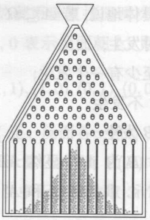
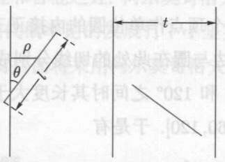
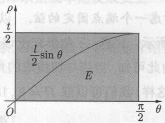
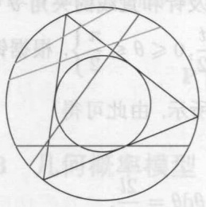
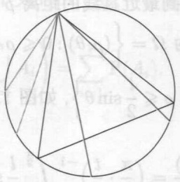
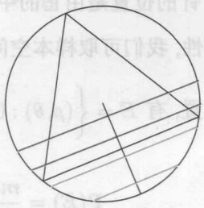
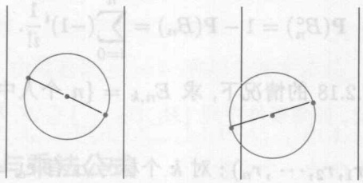

# 概率论(上册)101计划核心教材 (李增沪)

MinerU 4.0.12 Advanced；FULL 视图保留页眉、页脚、页码和边栏。

“101 计划”核心教材
数学领域

## 概率论（上册）

李增沪 张梅 何辉 编著

中国教育出版传媒集团

高等教育出版社

---

## 概率论（上册）

李增沪 张梅 何辉 编著

中国教育出版传媒集团

高等教育出版社·北京

---

## 内容提要

本书是教育部本科教育教学改革试点工作计划（“101计划”）教材，为高校数学类专业概率论课程设计，基于尽量少的预备知识，介绍该学科的基本概念、工具和方法。教材分为上、下两册:上册讲授概率论基础知识，包括概率空间、随机变量、条件分布与独立性、数学期望、特征函数、概率极限定理等；下册是关于随机过程和随机分析的引论，包括随机过程和鞅论的基本结果、更新过程、离散时间马氏链、连续时间马氏过程、随机积分和应用等。

本书读者对象为高等学校理工科大学生、研究生和科技工作者。

---

## 总序

自数学出现以来，世界上不同国家、地区的人们在生产实践中、在思考探索中以不同的节奏推动着数学的不断突破和飞跃，并使之成为一门系统的学科。尤其是进入21世纪之后，数学发展的速度、规模、抽象程度及其应用的广泛和深入都远远超过了以往任何时期。数学的发展不仅是在理论知识方面的增加和扩大，更是思维能力的转变和升级，数学深刻地改变了人类认识和改造世界的方式。对于新时代的数学研究和教育工作者而言，有责任将这些知识和能力的发展与革新及时体现到课程和教材改革等工作当中。

数学“101计划”核心教材是我国高等教育领域数学教材的大型编写工程。作为教育部基础学科系列“101计划”的一部分，数学“101计划”旨在通过深化课程、教材改革，探索培养具有国际视野的数学拔尖创新人才，教材的编写是其中一项重要工作。教材是学生理解和掌握数学的主要载体，教材质量的高低对数学教育的变革与发展意义重大。优秀的数学教材可以为青年学生打下坚实的数学基础，培养他们的逻辑思维能力和解决问题的能力，激发他们进一步探索数学的兴趣和热情。为此，数学“101计划”工作组统筹协调来自国内16所一流高校的师资力量，全面梳理知识点，强化协同创新，陆续编写完成符合数学学科“教与学”特点，体现学术前沿，具备中国特色的高质量核心教材。此次核心教材的编写者均为具有丰富教学成果和教材编写经验的数学家，他们当中很多人不仅有国际视野，还在各自的研究领域作出杰出的工作成果。在教材的内容方面，几乎是包括了分析学、代数学、几何学、微分方程、概率论、现代分析、数论基础、代数几何基础、拓扑学、微分几何、应用数学基础、统计学基础等现代数学的全部分支方向。考虑到不同层次的学生需要，编写组对个别教材设置了不同难度的版本。同时，还及时结合现代科技的最新动向，特别组织编写《人工智能的数学基础》等相关教材。

数学 “101 计划” 核心教材得以顺利完成离不开所有参与教材编写和审订的专家、学者及编辑人员的辛勤付出，在此深表感谢。希望读者们能通过数学 “101 计划” 核心教材更好地构建扎实的数学知识基础，锻炼数学思维能力，深化对数

---

ii 总序

学的理解，进一步生发出自主学习探究的能力。期盼广大青年学生受益于这套核心教材，有更多的拔尖创新人才脱颖而出！

田 刚

数学“101计划”工作组组长

中国科学院院士

北京大学讲席教授

---

## 前言

概率论研究随机现象的内在规律性并发展相应的数学理论。描述随机现象的基本概念是随机变量和随机过程。随机现象是相对于决定性现象而言的，后者是指在一定条件下必然产生某种结果的现象。随机现象则是指在基本条件不变的情况下，不能肯定最终会出现哪种结果的现象，即其结果的出现具有偶然性。随机现象的产生和对它的观察构成了概率论中所说的随机试验。虽然一次随机试验中某个事件的发生与否带有偶然性，在相同条件下大量重复的随机试验却往往呈现出明显的规律性。

如何把概率论建立在严格的数学基础之上曾经是该学科发展中的主要困难之一，对此问题的探索持续了相当长的时间。柯尔莫哥洛夫在他1933年出版的《概率论基础》一书中建立了概率论的严格的公理化体系。他的公理化方法是现代概率论的基础，使之成为严谨的数学分支，有力地推动了该学科的发展。

20 世纪初，受物理等学科的影响，人们开始深入地研究描述随机现象随时间演化的随机过程。爱因斯坦和维纳等对于布朗运动的研究推动了随机过程理论早期的发展。对该理论做出奠基性贡献的学者包括柯尔莫哥洛夫、马尔可夫、辛钦、维纳、莱维、伊藤等。目前概率论的思想和方法已经渗透到自然科学、工程技术、社会科学的各个领域。概率论已成为大学各专业开设最为广泛的数学课程之一。

本套《概率论》教材为大学数学类专业概率论课程设计，基于尽量少的预备知识，介绍该学科的基本概念、工具和方法。教材分为上、下两册；上册讲授概率论基础知识，包括概率空间、随机变量、条件分布与独立性、数学期望、特征函数、概率极限定理等；下册是关于随机过程和随机分析的引论，包括随机过程和鞅论的基本结果、更新过程、离散时间马氏链、连续时间马氏过程、随机积分和应用等。这些内容涵盖了教育部本科教育教学改革试点工作计划（“101计划”）《高等学校数学类专业人才培养战略研究报告暨核心课程体系》中所列的概率论课程知识要点。与国际上流行的同类教材相比，本教材的难度介于文献[9]和[13]之间，大致与[15]相当，但内容与上述教材有很大不同。

在内容的处理上，我们力求简明精练、深入浅出，对于概念和结论的阐述都

---

ii 前言

是严格和准确的。个别结论的证明中引入了附加条件，以便使学生既能够通过证明理解结论为什么是正确的，又不至陷入过于烦琐的技术性推演。对于数学期望，书中采用的是比较易于理解的斯蒂尔切斯积分的处理方式。为了方便师生的教和学，我们对该积分给出了较为系统的介绍，包括有界区间上的积分、全欧氏空间上的积分、极限与积分的换序等。这使我们在后面关于特征函数和各种概率极限定理等的讨论中，可以给出相对完整的一般性证明，而不必过多地引用关于抽象测度与积分的结果。

教材重视教学内容的现代化，并适当反映学科的发展情况，基本理论部分吸纳了若干新的结果和处理手法。特别地，对于随机过程讨论了左极右连实现和左极右连修正存在性的等价关系。对于柯尔莫哥洛夫强大数定律的证明，书中采用了比柯氏不等式方法更为简短的加西亚极大不等式方法。对于独立同分布随机变量序列的中心极限定理，书中分别给出了基于特征函数方法和基于斯坦方法的两种证明。结合马氏链和莱维过程的讨论，介绍了马氏耦合方法。对于连续时间马氏链，通过泊松随机测度驱动的随机方程给出了极小链的构造，这显示了随机分析方法的广泛的适用性。此外，书中通过专题讨论，例题和习题等形式介绍或提及了若干活跃的研究课题，如伊辛模型、自旋玻璃、分支结构系统等。

教材的上册通过对频率稳定性，高尔顿钉板试验等典型现象或案例的讨论导入，激发学生对于随机现象的相关问题的探索兴趣，最后又回到这些问题，用概率极限定理对其中的科学规律给出严格的分析和解释。希望学生通过对比自己对这些现象或案例理解程度的变化，认识到概率论在随机现象研究中的重要作用。作为对正文内容的扩展，在上册的附录中讨论了集合形式的单调类定理和关于抽象测度的积分，可供在需要时查阅。下册第一、二章分别介绍随机过程和鞅论的基本结果，后面各章围绕离散状态过程和连续状态过程两条主线展开，在内容的处理上有较大的独立性，以增加教学的灵活度。根据课时等实际情况，教师可以对书中的内容进行适当的选择。例如，下册可选择只讲授第一、二、四、五、六、七章，或者只讲授第一、二、四、八、九章。另外，跳过标题后带“\*”号的内容不会影响后面内容的教学。

本书的材料来源于作者的课程讲义。我们感谢多位同行朋友对书稿在内容选取，编排设计等方面给予的有益建议；感谢历届同学在学习过程中富有启发性的问题；感谢高等教育出版社非常认真的编校工作。欢迎各位同仁继续对教材中的疏漏和谬误之处给予批评和指正。

作者

2024年6月

---

## 常用记号

$\mathbb{Z}$ 整数集

$\mathbb{R}$ 实直线, 即一维欧氏空间

$R^{d}$  d 维欧氏空间

$\mathbb{R}_{+}$ 正半实直线 $[0,\infty)$

$R_{++}$  严格正半实直线  $(0,\infty)$

C 复平面

|·| 模或欧氏范数

$a\wedge b$ $\min (a,b)$

$a \vee b \quad \max(a, b)$

$\lfloor x\rfloor$  不超过 x 的最大整数

$1_{A}$ 集合 $A$ 的示性函数

$\delta_{x}$  集中于 x 处的单点概率测度

bE 关于 $\sigma$ 代数 $\mathcal{E}$ 可测的有界实函数全体

---

line

| Year | Value |
| --- | --- |
| 2018 | ~45 |
| 2019 | ~65 |
| 2020 | ~75 |
| 2021 | ~85 |
| 2022 | ~95 |
| 2023 | ~85 |

---

## 目录

## 第一章 概率空间和随机事件 1

## 1.1 随机试验和事件 2

1.1.1 随机试验 2
1.1.2 古典概率模型 4
1.1.3 几何概率模型 6
1.1.4 概率公理化体系 9

## 1.2 可测空间和概率空间 10

1.2.1 可测空间 10
1.2.2 测度及其基本性质 12
1.2.3 概率空间的概念 15
1.2.4 概率的计算 17

## 1.3 条件概率 19

1.3.1 条件概率与乘法公式 19
1.3.2 全概率公式 20
1.3.3 贝叶斯公式 22

## \*1.3.4 蒙提霍尔问题 23

## 1.4 事件的独立性 25

1.4.1 两个事件的独立性 25
1.4.2 多个事件的独立性 27
1.4.3 二维乘积概率空间 28

## \*1.4.4 多维乘积概率空间 31

---

ii 目录

## 第二章 随机变量及其分布 35

## 2.1 可测函数与随机变量 36

2.1.1 可测映射 36
2.1.2 可测函数的性质 38
2.1.3 测度的分布函数 40
2.1.4 随机变量的概念 42

## 2.2 离散型随机变量 44

2.2.1 二项分布 45
2.2.2 几何分布 46
2.2.3 帕斯卡分布 47
2.2.4 泊松分布 48
2.2.5 泊松粒子流 49

## 2.3 绝对连续型随机变量 53

2.3.1 均匀分布 54
2.3.2 指数分布 54
2.3.3 伽马分布 55
2.3.4 正态分布 56

## 2.4 概率分布函数的实现与分解 58

2.4.1 不降函数的广义逆 58
2.4.2 随机变量的构造 60
2.4.3 有限测度的构造 60
\*2.4.4 概率分布函数的分解 61

## 第三章 随机向量和独立性 63

## 3.1 随机向量与联合分布 64

3.1.1 多维分布函数 64
3.1.2 随机向量的分布 65
3.1.3 离散型随机向量 67
3.1.4 绝对连续型随机向量 69
3.1.5 二维正态随机向量 71

## 3.2 条件分布与独立性 73

3.2.1 随机变量的条件分布 73
3.2.2 两个随机变量的独立性 75
3.2.3 多个随机变量的独立性 79

---

目录 iii

\*3.2.4 伊辛模型 80

3.3 随机向量函数的分布 81

3.3.1 一维随机变量的函数 81

3.3.2 二维随机向量的函数 83

3.3.3 多维随机向量的函数 85

\*3.3.4 随机向量的向量值函数 87

第四章 积分和数学期望 8.1.6 91

4.1 斯蒂尔切斯积分 92

4.1.1 有界区间上的积分 92

4.1.2 常用积分性质 94

4.1.3 全空间上的积分 96

4.1.4 多维空间上的积分 98

4.1.5 关于积分的说明 8.6 99

4.2 随机变量的数学期望 101

4.2.1 定义和基本性质 101

4.2.2 随机变量函数的期望 104

4.2.3 随机向量函数的期望 105

4.2.4 常见分布的期望 107

4.2.5 期望和积分收敛定理 108

4.2.6 斯坦方程 110

4.3 方差、协方差和高阶矩 112

4.3.1 方差和标准差 112

4.3.2 协方差和协方差矩阵 114

4.3.3 相关系数 116

4.3.4 原点矩和中心矩 118

4.4 条件期望和预测 120

4.4.1 条件期望的定义和计算 120

4.4.2 全期望公式及应用 122

4.4.3 给定随机变量的条件期望 123

4.4.4 条件期望的平滑性质 124

\*4.4.5 条件期望的最优预测性 127

4.5 随机变量的母函数 128

4.5.1 母函数的定义 128

---

iv 目录

4.5.2 独立变量和的母函数 130

4.5.3 母函数的连续性定理 131

## 第五章 特征函数 133

## 5.1 随机变量的特征函数 134

5.1.1 预备知识 134

5.1.2 复随机变量的数学期望 135

5.1.3 特征函数的定义 136

5.1.4 基本性质 138

## 5.2 分布性质和反演公式 140

5.2.1 特征函数与原点矩 140

5.2.2 反演公式与唯一性 142

5.2.3 绝对连续性条件 145

## 5.3 多元特征函数 147

5.3.1 定义和基本性质 147

5.3.2 独立性条件 148

5.3.3 独立和的特征函数 149

\*5.3.4 拉普拉斯变换 150

## \*5.4 正态随机向量 152

5.4.1 多维正态分布 152

5.4.2 子向量的分布 154

5.4.3 线性变换 154

## 第六章 收敛性质 157

## 6.1 随机变量的收敛 158

6.1.1 几乎必然收敛 158

6.1.2 依概率收敛 161

6.1.3 平均收敛 163

## 6.2 分布函数的弱收敛 165

6.2.1 不降函数的弱收敛 165

6.2.2 依分布收敛 165

6.2.3 斯科罗霍德表示定理 168

## 6.3 弱收敛的等价条件 169

6.3.1 黑利定理 169

6.3.2 莱维连续性定理 172

---

目录 v

## 第七章 概率极限定理 175

## 7.1 大数定律 176

7.1.1 大数定律的定义 176
7.1.2 马尔可夫大数定律 176
7.1.3 辛钦大数定律 178
7.1.4 伯恩斯坦多项式 178

## 7.2 强大数定律 180

7.2.1 许-罗宾斯大数定律 180
7.2.2 柯尔莫哥洛夫 0-1 律 182
7.2.3 柯尔莫哥洛夫强大数定律 183

## 7.3 中心极限定理 184

7.3.1 定理的一般形式 184
7.3.2 特征函数方法 185
7.3.3 斯坦方法 187
7.3.4 应用的例子 191

## \*7.4 独立非同分布序列 193

7.4.1 费勒条件 193
7.4.2 林德伯格条件 196
7.4.3 林德伯格-费勒定理 197

## \*7.5 卡方独立性检验 199

7.5.1 卡方分布定理 200
7.5.2 独立性问题 202
7.5.3 检验规则 204

## 附录 209

## A.1 可测集与单调类 210

A.1.1 集代数 210
A.1.2 单调类定理 210
A.1.3 邓肯类定理 211

## A.2 抽象测度的积分 212

A.2.1 非负简单函数的积分 213
A.2.2 非负可测函数的积分 214
A.2.3 实值可测函数的积分 216

---

vi 目录

A.2.4 控制收敛定理 217

A.2.5 与斯蒂尔切斯积分的联系 218

A.2.6 概率空间上的积分 219

参考文献 随机变量的静定感大大回浓品 S.I.T 221

名词索引 6.1.1 预备知识竞赛大赛评审 8.1.5 223

外国人名索引 229

---

第一章

seal

龍鶴印

## 概率空间和随机事件

---

2

第一章 概率空间和随机事件

自然界中的有些现象, 在某些条件下必然发生, 我们称之为确定性现象. 例如, 每天太阳会从东方升起, 无支撑的重物会从高处落下, 等等. 还有很多现象, 在条件给定的情况下是否发生并不确定. 例如, 掷一枚均匀硬币, 观察落下后是正面朝上还是反面朝上, 掷之前我们不能确定将会出现哪种情况. 又如, 某处某个时刻的气温, 事先我们无法知道确切的结果, 只有到了那个时刻测量后才能够知道. 这种在给定条件下是否发生具有不确定性的现象称为随机现象.

在本章中, 我们首先对随机试验、古典概型、几何概型等做简单的介绍. 在此基础上, 引入概率空间的概念, 定义条件概率, 证明全概率公式和贝叶斯公式, 并给出事件和试验的独立性等性质的严格数学描述. 作为对上述内容的扩展, 我们还将介绍抽象测度的概念和基本性质. 这些构成后面各章的理论基础.

## 1.1 随机试验和事件

## 1.1.1 随机试验

对于随机现象的观测和分析构成随机试验, 其基本特征是可以在相同的条件下多次重复, 且所有可能发生的结果构成的集合是确定不变的. 随机试验在大量重复试验中会表现出规律性.

例 1.1.1 连续投掷一枚质地均匀的硬币, 每次的结果是不确定的, 出现正面和反面的可能性均为 1/2. 用  $S_{n}$  表示前 n 次投掷中出现正面的次数. 根据经验, 当 n 很大时, 比值  $S_{n}/n$  总是很接近于一次投掷中正面出现的可能性 1/2, 从而显现出规律性. 这个规律可以利用本课程后面将要学习的大数定律给出严格的数学解释.

例 1.1.2 英国生物统计学家高尔顿 (Galton) 设计的钉板装置是用来研究随机现象的统计规律的模型。钉板结构如图 1.1 所示, 木板上钉有多层铁钉, 每层相邻铁钉间的距离相同, 且上层每颗钉的水平位置恰好位于下层两颗钉的正中间。从入口处放进一个直径略小于两钉距离的玻璃圆球, 圆球每次碰到铁钉后以 1/2 的概率向左或向右滚下, 直到滚到底部的某个格子内为止。把大量的圆球不断从入口处放下。当球的数目很大时, 它们会在底部堆成中间高两边低的形状, 从而显现出规律性。这个规律可利用本课程后面将要证明的中心极限定理给出严格的数学解释。

为了准确地描述随机现象, 我们需要使用集合论的语言和记号. 我们知道, 集合是由一些元素构成的总体, 其元素的个数可以是有限的, 也可以是可数无限或不可数无限的. 有限集和可数无限集统称为可数集. 由一个集合 $A$ 中的部分或全部元素构成的另一个集合 $B$ 称为 $A$ 的子集. 不包含任何元素的集合称为空集, 记作 $\varnothing$. 我们规定空集是任何集合的子集.

---

1.1 随机试验和事件

3

natural_image

Diagram of a triangular structure with vertical columns and scattered dots, no text or symbols present

图 1.1 高尔顿钉板试验

本课程假定读者熟悉关于集合的基本概念, 运算和记号. 例如 $A = B$, $A \subseteq B$, $A \supseteq B$, $A \cap B$, $A \cup B$, $A \setminus B$ 等. 如果有一个明确的基本集合 $\Omega$, 对于子集 $A \subseteq \Omega$, 我们称 $\Omega \setminus A$ 为 $A$ 的补集或余集, 并将其记作 $A^c$.

某个随机试验所有可能的结果构成的 (非空) 集合称为它的样本空间, 通常用大写希腊字母 $\Omega$ 表示. 称 $\Omega$ 中的元素为样本点, 用小写希腊字母 $\omega$ 表示. 我们关心的随机事件可以用 $\Omega$ 的某些子集来表示. 某个随机事件 $A \subseteq \Omega$ 的概率是区间 $[0,1]$ 中的一个数 $\mathbf{P}(A)$, 它给出 $A$ 发生的可能性大小的描述. 我们称样本空间 $\Omega$ 为必然事件并规定 $\mathbf{P}(\Omega) = 1$, 而称空集 $\varnothing$ 为不可能事件并规定 $\mathbf{P}(\varnothing) = 0$. 事件 $A$ 的余集 $A^c$ 也称为它的对立事件, 显然 $\mathbf{P}(A) + \mathbf{P}(A^c) = 1$.

假设在一个随机试验中, 我们关心的仅仅是事件 $A \subseteq \Omega$ 是否发生, 并且已知 $\mathbf{P}(A) = p$ 和 $\mathbf{P}(A^c) = 1 - p$, 其中 $0 \leqslant p \leqslant 1$. 这样的随机试验称为伯努利 (Bernoulli) 试验. 在伯努利试验中, 事件 $A$ 发生称为成功, 事件 $A^c$ 发生称为失败. 对于伯努利试验, 为了简单我们可以将样本空间取为 $\Omega = \{1,0\}$, 其中 1 表示 $A$ 发生, 而 0 表示 $A^c$ 发生.

例 1.1.3 掷一枚硬币, 用 1 表示结果正面朝上, 用 0 表示反面朝上. 则试验的样本空间为  $\Omega = \{1, 0\}$ . 显然, 这是一种伯努利试验. 若硬币质地均匀, 则有  $\mathbf{P}(\{1\}) = \mathbf{P}(\{0\}) = 1/2$ .

例 1.1.4 投掷骰子试验的样本空间为  $\Omega = \{1, 2, 3, 4, 5, 6\}$ . 在这个随机试验中, 我们感兴趣的事件包括  $A = \{6\}, B = \{2, 4, 6\}$  等. 若骰子质地均匀, 则每个点数出现的概率均为 1/6.

例 1.1.5 记录一台电话交换机在某个时段内收到的呼唤次数。这个试验的样本空间可取为  $\Omega = \{0, 1, 2, \cdots\}$ .

例 1.1.6 射手连续向某个目标射击, 直至命中为止, 考虑射击的总次数. 这个试验的样本空间为  $\Omega = \{1, 01, 001, 0001, \cdots\}$ .

例1.1.7 观察北京夏季某日的最低气温 $x$ 和最高气温 $y$ (单位: ${}^{\circ}\mathrm{C}$). 这个试验的样本空间可取为 $\Omega = \{(x, y) : 0 < x \leqslant y < 50\}$.

考虑以 $\Omega$ 为样本空间的随机试验. 在这个随机试验中, 随机事件之间的基本关系

---

4

第一章 概率空间和随机事件

可以用集合的关系及运算描述. 具体地说, 若 $A \subseteq \Omega$ 和 $B \subseteq \Omega$ 是两个事件, 则我们有

$A \cap B$  表示 A 和 B 同时发生;

$A \cup B$  表示 A 和 B 中至少有一个发生;

$A \setminus B$  表示 A 发生但 B 不发生;

$A \subseteq B$  表示 A 发生则 B 发生.

为简单起见, 我们经常写 $A \cap B$ 为 $AB$. 显然 $AB = \varnothing$ 当且仅当 $A$ 和 $B$ 不同时发生, 此时称 $A$ 和 $B$ 互不相容或互斥. 我们称 $A$ 和 $A^c := \Omega \setminus A$ 互为对立事件. 注意, 有些教科书将对立事件 $A^c$ 写为 $\bar{A}$.

随机试验可以在相同的条件下重复多次, 多次重复试验构成联合随机试验. 假设我们进行了 $n$ 次重复伯努利试验, 用 $S_{n}$ 表示事件 $A$ 在这 $n$ 次试验中发生的次数. 对于 $0 \leqslant k \leqslant n$, 显然 “$S_{n} = k$” 或者 “事件 $A$ 发生 $k$ 次” 是上述联合随机试验中的随机事件. 所以 $S_{n}$ 的取值具有随机性. 我们称 $F_{n}(A) := S_{n}/n$ 为 $A$ 发生的频率. 不难看出, 频率有如下性质:

(1) 非负性:  $F_{n}(A) \geqslant 0;$
(2) 规范性:  $F_{n}(\Omega)=1;$
(3) 可加性: 若 $AB = \varnothing$, 则 $F_{n}(A \cup B) = F_{n}(A) + F_{n}(B)$.

根据实践经验, 当 $n$ 很大时, $F_{n}(A)$ 会稳定在事件 $A$ 发生的概率附近, 这个性质称为频率稳定性.

## 1.1.2 古典概率模型

当样本空间有限时, 我们可以自然地基于可能性假设建立一个概率模型. 这是最早研究的概率模型, 在概率论的发展中占有重要的地位. 由于这类模型比较简单, 它们非常有助于初学者理解概率论中的一些概念.

定义 1.1.1 若某个随机试验的样本空间  $\Omega$  只包含有限个样本点, 且各样本点出现的概率相等, 则称这个随机试验为古典概率模型, 简称古典概型. 分别记  $\Omega$  和其子集 A 中所包含的样本点的个数为  $n(A)$  和  $n(\Omega)$ . 则事件 A 发生的概率为

$$
\mathbf {P} (A) = \frac {n (A)}{n (\Omega)}. \tag {1.1.1}
$$

根据上述定义, 对于古典概型计算事件 $A$ 的概率, 关键是求出 $\Omega$ 中样本点的总数和 $A$ 中样本点的个数. 为此通常需要利用排列组合的工具, 而且往往有一定的技巧性. 对于整数 $n \geqslant m \geqslant 1$, 我们用 $\mathrm{A}_n^m$ 表示从 $n$ 个取 $m$ 个的所有排列数, 用 $\mathrm{C}_n^m$ 或 $\binom{n}{m}$ 表示从 $n$ 个取 $m$ 个的所有组合数, 即

$$
\mathrm{A} _ {n} ^ {m} = n (n - 1) \dots (n - m + 1), \quad \mathrm{C} _ {n} ^ {m} = \binom{n}{m} = \frac {n !}{m ! (n - m) !}.
$$

---

1.1 随机试验和事件

5

例 1.1.8 将一枚质量均匀的硬币重复投掷两次, 求出现正、反面各一次的概率.

解 用 1 表示结果正面朝上, 0 表示反面朝上. 则试验的样本空间为

$$
\Omega = \{(1, 1), (1, 0), (0, 1), (0, 0) \}.
$$

它总共有 4 个样本点. 再记事件 { 正、反面各一次 } 为 B. 则 $B = \{(1,0),(0,1)\}$, 它有 2 个样本点. 按照古典概型的概率计算公式, 有 $\mathbf{P}(B) = 2/4 = 1/2$. □

例 1.1.9 从连续整数 0 至 9 中无放回地取 3 个数依次排列, 利用古典概型计算 3 个数构成 3 位偶数的概率.

解 样本空间 $\Omega$ 可取为 0 至 9 这 10 个数中任意 3 个的所有排列, 它包含 $A_{10}^{3}$ 个样本点. 用 $B$ 表示事件 $\{3$ 个数形成 3 位偶数 $\}$. 考虑到三位偶数的百位数不能够为 0, 事件 $B$ 发生可分为如下两种情况: (i) 第 3 个数为 0 而第 1 和第 2 个数为 $\{1,2,\cdots,9\}$ 这 9 个数中任意 2 个数的排列; (ii) 第 3 个数为 $\{2,4,6,8\}$ 中的某个数 $c$, 第 1 个数为 $\{1,2,\cdots,9\} \setminus \{c\}$ 这 8 个数中的某个数 $a$, 而第 2 个数为 $\{0,1,2,\cdots,9\} \setminus \{a,c\}$ 这 8 个数中的某个数 $b$. 根据这样的考虑, 我们有

$$
\mathbf {P} (B) = \frac {\mathrm{A} _ {9} ^ {2} + 4 \times 8 \times 8}{\mathrm{A} _ {1 0} ^ {3}} = \frac {9 \times 8 + 4 \times 8 \times 8}{1 0 \times 9 \times 8} = \frac {9 + 4 \times 8}{1 0 \times 9} = \frac {4 1}{9 0}.
$$

例 1.1.10 (生日问题) 假定一年为 365 天. 利用古典概型计算  $r (1 \leqslant r \leqslant 365)$  个人生日互不相同的概率.

解 记 $B = \{r$ 个人生日互不相同}. 则

$$
\mathbf {P} (B) = \frac {\mathrm{C} _ {3 6 5} ^ {r} \cdot r !}{3 6 5 ^ {r}}.
$$

特别地, 当 $r = 55$ 时, 可算得 $\mathbf{P}(B) = 0.01$. 这个概率很小, 直观上有些意外!

例 1.1.11 袋子中有 r 个红球和 b 个黑球. 现将球依次取出, 求  $R_{k}=\{ 第 k 次取到红球 \}$  的概率.

解 (1) 同色球可辨. 将球依次取出相当于把 $r + b$ 个不同的球进行排列. 这样 $\Omega$ 中样本点的个数为 $(r + b)!$. 事件 $R_{k}$ 发生也就是第 $k$ 位放红球, 有 $r$ 种方式, 而其余 $r + b - 1$ 个球在 $r + b - 1$ 个位置随意排列, 共有 $(r + b - 1)!$ 种排法. 故有

$$
\mathbf {P} (R _ {k}) = \frac {r \cdot (r + b - 1) !}{(r + b) !} = \frac {r}{r + b}.
$$

(2) 同色球不可辨. 将球依次取出相当于在 $r + b$ 个位置中挑选 $r$ 个位置放红球. 这样 $\Omega$ 中样本点个数为 $\mathrm{C}_{r + b}^{r}$. 第 $k$ 次取到红球相当于第 $k$ 个位置必须是红球, 而在余下的 $r + b - 1$ 个位置中挑 $r - 1$ 个位置放其余的红球. 故有 $\mathrm{C}_{r + b - 1}^{r - 1}$ 种放置方法. 所以

$$
\mathbf {P} (R _ {k}) = \frac {\mathrm{C} _ {r + b - 1} ^ {r - 1}}{\mathrm{C} _ {r + b} ^ {r}} = \frac {(r + b - 1) ! \cdot r ! \cdot b !}{(r + b) ! \cdot (r - 1) ! \cdot b !} = \frac {r}{r + b}.
$$

---

6

第一章 概率空间和随机事件

上例中用两种方法算出的概率 $\mathbf{P}(R_k)$ 相同, 且这个概率与 $k$ 无关. 这说明我们平时采用的抽签方式是公平的.

例 1.1.12 袋中有 r 个红球和 b 个黑球, 从中随机取出 n 个. 求取出的球中恰有 k 个红球的概率  $(k=0,1,2,\cdots,n)$ .

解 令 $E_{k} = \{$ 摸出的球中恰有 $k$ 个红球 $\}$. 我们需要对取球的方式进行讨论.

(1) 无放回抽取. 此时

$$
\mathbf {P} (E _ {k}) = \frac {\mathrm{C} _ {r} ^ {k} \mathrm{C} _ {b} ^ {n - k}}{\mathrm{C} _ {r + b} ^ {n}}.
$$

(2) 有放回抽取. 此时

$$
\mathbf {P} (E _ {k}) = \frac {\mathrm{C} _ {n} ^ {k} r ^ {k} b ^ {n - k}}{(r + b) ^ {n}} = \mathrm{C} _ {n} ^ {k} \bigg (\frac {r}{r + b} \bigg) ^ {k} \bigg (\frac {b}{r + b} \bigg) ^ {n - k}.
$$

(请读者说明上述两种方式对应的样本空间, 并对计算的合理性作出解释.)

在古典概型中, 用 $\mathcal{F}$ 表示样本空间 $\Omega$ 的所有子集构成的集类. 则 (1.1.1) 式在 $\mathcal{F}$ 上定义了一个取值于 $[0,1]$ 的函数 $\mathbf{P}$, 它在 $A \in \mathcal{F}$ 的取值就是概率值 $\mathbf{P}(A)$. 不难看出, 该集函数具有如下基本性质:

(1) 非负性: 对于任何  $A \in F$  有  $\mathbf{P}(A) \geqslant 0;$
(2) 规范性:  $\mathbf{P}(\Omega)=1;$
(3) 有限可加性: 对任何两两不交的 $A_{1}, A_{2}, \cdots, A_{n} \in \mathcal{F}$ 有

$$
\mathbf {P} \left(\bigcup_ {i = 1} ^ {n} A _ {i}\right) = \sum_ {i = 1} ^ {n} \mathbf {P} (A _ {i}).
$$

## 1.1.3 几何概率模型

有时候, 我们需要考虑样本点的个数无限, 甚至不可数的随机试验, 其各个样本点的出现仍然具有某种 “等可能” 性. 此时我们无法像古典概型那样, 通过样本点个数的比值来定义随机事件的概率. 几何概型为我们提供了处理此类问题的常用的方法. 令 $\mathbb{R}^{d}$ 表示 $d (d \geqslant 1)$ 维欧几里得 (Euclid) 空间, 简称欧氏空间.

定义1.1.2 设随机试验的样本空间 $\Omega$ 是欧氏空间 $\mathbb{R}^d$ 的某个具有体积 $m(\Omega)$ 的子集, 且 $0 < m(\Omega) < \infty$. 若集合 $A \subseteq \Omega$ 具有体积 $m(A)$, 则规定 $A$ 的概率为

$$
\mathbf {P} (A) = \frac {m (A)}{m (\Omega)}. \tag {1.1.2}
$$

称这样的随机试验为几何概率模型, 简称几何概型.

---

1.1 随机试验和事件

7

例 1.1.13 向一个半径为 0.5 m 的圆形靶子投飞镖. 根据几何概型计算飞镖落入以靶心为中心、以 0.25 m 为半径的圆内的概率.

解 根据圆面积的计算公式, 事件 $A = \{\text{飞镖落入以靶心为中心、以 } 0.25 \mathrm{~m} \text{ 为半径的圆内}\}$ 的概率为

$$
\mathbf {P} (A) = \frac {\pi \cdot 0 . 2 5 ^ {2}}{\pi \cdot 0 . 5 ^ {2}} = \frac {1}{4}.
$$

在几何概型中, 用 $\mathcal{F}$ 表示样本空间 $\Omega$ 的所有可求体积的子集构成的集类. 则 (1.1.2) 式在集类 $\mathcal{F}$ 上定义了一个取值于 $[0,1]$ 的函数 $\mathbf{P}$, 它在 $A \in \mathcal{F}$ 的取值就是概率值 $\mathbf{P}(A)$. 直观上, 几何概率应该具有如下基本性质:

(1) 非负性: 对于任何  $A \in F$  有  $\mathbf{P}(A) \geqslant 0;$
(2) 规范性:  $\mathbf{P}(\Omega)=1;$
(3) 可数可加性: 对任何两两不交的  $A_{1}, A_{2}, \cdots, A_{n}, \cdots \in F$  有

$$
\mathbf {P} \left(\bigcup_ {i = 1} ^ {\infty} A _ {i}\right) = \sum_ {i = 1} ^ {\infty} \mathbf {P} (A _ {i}).
$$

根据实变函数论中的结论, 我们不能对欧氏空间 $\mathbb{R}^d$ 的所有子集合理地定义其体积; 参见 [22]. 所以 $\mathcal{F}$ 可能不包含 $\Omega$ 的所有子集.

例 1.1.14 设平面上布满间隔为 t 的平行线, 现向平面任意投放一根长为  $l(l < t)$  的针, 根据几何概型求事件  $E = \{ \text{针与某直线相交} \}$  的概率.

解 针的位置是由它的中点到最近直线的距离 $\rho$ 以及针和直线的夹角 $\theta$ 决定. 考虑到对称性, 我们可取样本空间为 $\Omega = \left\{(\rho, \theta): 0 \leqslant \rho \leqslant \frac{t}{2}, 0 \leqslant \theta \leqslant \frac{\pi}{2} \right\}$. 根据针与直线的几何位置, 有 $E = \left\{(\rho, \theta): 0 \leqslant \rho \leqslant \frac{l}{2} \sin \theta \right\}$, 如图1.2所示. 由此可得

$$
\mathbf {P} (E) = \frac {m (E)}{m (\varOmega)} = \left(\frac {\pi}{2} \cdot \frac {t}{2}\right) ^ {- 1} \int_ {0} ^ {\frac {\pi}{2}} \frac {l}{2} \sin \theta \mathrm{d} \theta = \frac {2 l}{\pi t}.
$$

text_image

ρ
θ
t

(a)

text_image

ρ
t/2
l/2 sin θ
E
O
π/2
θ

(b)

图1.2 布丰投针试验

上例中的随机试验称为布丰 (Buffon) 投针试验. 重复该试验 $n$ 次, 将事件 $E$ 发生

---

8

第一章 概率空间和随机事件

的次数记为 $S_{n}$ 次. 根据本课程后面证明的大数定律, 当 $n \to \infty$ 时, 在一定意义下有

$$
\frac {S _ {n}}{n} \rightarrow \mathbf {P} (E) = \frac {2 l}{\pi t}.
$$

因此, 当 $n$ 很大时, 我们有近似关系

$$
\frac {S _ {n}}{n} \approx \frac {2 l}{\pi t} \quad \text {或} \quad \pi \approx \frac {2 l n}{t S _ {n}}.
$$

上式给出了一种利用概率模型进行近似计算的方法, 这类方法称为蒙特卡罗 (Monte Carlo) 方法.

例 1.1.15 在单位圆上任作一弦, 求  $E = \{弦长大于 \sqrt{3}\}$  的概率.

解 本例题对于“任作一弦”的含义没有给出准确描述. 下面我们对其作出三种解读, 并分别给出问题的解答.

(1) 考虑由其中点确定的弦. 取单位圆的内接正三角形及该三角形的内切圆, 如图 1.3(a) 所示. 不难算出, 三角形的边长为 $2\sin (\pi / 3) = \sqrt{3}$, 而小圆的半径为 $1/2$. 当且仅当弦的中点落在小圆内时, 弦的长度大于三角形的边长 $\sqrt{3}$. 单位圆盘的面积是 $\pi$, 而小圆盘的面积是 $\pi / 2^2$. 基于这样的解读, 我们可以取 $\Omega = \{\text{单位圆盘}\}$ 和 $E = \{\text{半径为} 1/2 \text{的同心圆盘}\}$. 这样得到

$$
\mathbf {P} (E) = \frac {\pi / 2 ^ {2}}{\pi} = \frac {1}{4}.
$$

text_image

Geometric diagram showing a circle inscribed in a circle with intersecting triangles and diagonal lines, likely for a math problem or proof.

(a)

text_image

Geometric diagram of a circle with inscribed triangle and internal segments, labeled with mathematical notation

(b)

text_image

Geometric diagram of a circle with inscribed triangles and intersecting lines, likely for trigonometry or geometry problem solving.

(c)

图 1.3 贝特朗奇论

(2) 考虑一个端点固定的弦. 以该端点为一个顶点作单位圆的内接正三角形, 如图 1.3(b) 所示. 注意, 三角形交于该顶点的两条边与圆在此处的切线分别成 $60^{\circ}$ 角和 $120^{\circ}$ 角. 由此可知, 当弦与切线成的角度介于 $60^{\circ}$ 和 $120^{\circ}$ 之间时其长度大于三角形的边长 $\sqrt{3}$. 这样, 我们可以取 $\Omega = [0, 180]$ 和 $E = [60, 120]$. 于是有

$$
\mathbf {P} (E) = \frac {1 2 0 - 6 0}{1 8 0} = \frac {6 0}{1 8 0} = \frac {1}{3}.
$$

(3) 考虑与某个半径垂直的弦. 取单位圆的内接正三角形及与该三角形的一条边垂直的半径. 则该半径被三角形的边平分, 如图 1.3(c) 所示. 当且仅当弦的中点落在半径

---

1.1 随机试验和事件

9

上三角形内时, 弦的长度大于三角形的边长 $\sqrt{3}$. 这样, 我们可以取 $\Omega = \{\text{半径上的所有点}\}$ 和 $E = \{\text{半径上到圆心距离小于} 1/2\text{的点}\}$. 于是有

$$
\mathbf {P} (E) = \frac {1}{2}.
$$

在上例中, 基于 “任作一弦” 的三种解读方式, 对于同一个问题得出了三种完全不同的答案, 这是概率论发展史上一个著名的例子, 称为贝特朗 (Bertrand) 奇论. 那么, 上述哪一个答案是正确的呢? 这个例子对我们有哪些启发呢? 请读者查阅相关资料, 认真思考一下.

## 1.1.4 概率公理化体系

古典概型和几何概型对概率论早期的发展起了重要作用. 但是这两种模型都基于对样本点的“等可能”假定, 而且古典概型只适用于有限样本空间, 这使它们的应用有很大的局限性. 由于对于“等可能”假定的不同解读, 几何概型在应用中会产生像贝特朗奇论那样的问题. 事实上, 当随机试验有不可数无穷多个可能的结果时, 有时很难客观地规定“等可能”确切的含义, 这反映出几何概型的逻辑基础是不够严密的.

到 19 世纪下半叶, 概率论的发展及其在物理学等学科中的应用已经突破了概率的古典定义, 但关于概率的一般定义却始终未能明确化和严格化. 这种情况严重阻碍了概率论的进一步发展和应用. 在 1900 年的世界数学家大会上, 希尔伯特提出了建立物理学、概率论等公理化体系的问题.

进入 20 世纪后, 抽象测度和积分理论逐步发展完善. 随着研究的深入, 人们发现事件的运算与集合的运算完全类似, 而概率与测度有相同的性质. 在这种背景下, 柯尔莫哥洛夫 (Andrey N. Kolmogorov) 在 1933 年出版了《概率论基础》一书, 他在书中给出了概率的测度论式的定义和严密的公理化体系. 该公理化体系以概率空间概念为基础, 首先对事件与概率的最基本性质和关系作出规定, 在此基础上导出概率的其他性质. 这些性质从客观实际中抽象出来, 既概括了古典概率和几何概率的基本特性, 又避免了各自的局限性和含混之处. 柯尔莫哥洛夫概率公理化体系是概率论发展史上一个重要的里程碑, 为现代概率论的发展打下了坚实的基础.

本教材后面将采用柯尔莫哥洛夫的公理化体系, 在此基础上系统地介绍概率论的基本知识.

## 练习题

1. 设 $A, B$ 和 $C$ 是三个事件. 用它们给出下列事件的表示:

(1) 至少有一个事件发生;

(2) 至少有两个事件发生;

---

10

第一章 概率空间和随机事件

(3) 所有事件都不发生;
(4) 至多一个事件发生;
(5) 至多两个事件发生;
(6) 恰有两个事件发生.

2. 从 0,1,2,3,4,5 中任取 4 个数排成一行. 求恰好构成四位偶数的概率.

3. 在桥牌游戏中四人各从 52 张纸牌中分得 13 张. 求 4 张 A 集中在一个人手里的概率.
4. 信封里有 8 把钥匙, 其中只有一把能打开房门, 现取出钥匙试开. 分有放回和无放回两种情形, 求 3 次以内能打开房门的概率.
5. 袋子里有 $m$ 个白球, $n$ 个黑球 $(m, n \geqslant 1)$.

(1) 从袋中随机取两个球, 求两球同色的概率;

(2) 从袋中随机取一个球, 记录颜色后放回, 从中再取一球, 求两次取的球同色的概率;

(3) 证明 (2) 的概率始终大于 (1) 的概率.

6. 在区间 $(0,1)$ 中随机地取出三个数, 以它们作为三条线段的长度. 求这些线段能连接成一个三角形的概率.
7. 在打好方格的白纸上投掷一枚直径为 1 的硬币. 问方格的边长至少应为多少才能使硬币与方格的边不交的概率小于 $1 / 100$.

## 1.2 可测空间和概率空间

柯尔莫哥洛夫的概率论公理化体系的基础是概率空间, 它给出了我们前面提到的样本空间、随机事件、概率等概念的严格数学定义.

## 1.2.1 可测空间

定义 1.2.1 设  $\Omega$  为非空集, 而 F 为  $\Omega$  的子集构成的集类. 如果

(i) $\Omega \in \mathcal{F}$;
(ii) 若 $A \in \mathcal{F}$, 则 $A^c \in \mathcal{F}$;
(iii) 若 $A, B \in \mathcal{F}$, 则 $A \cup B \in \mathcal{F}$,

那么称 $\mathcal{F}$ 为 $\Omega$ 上的集代数.

定义 1.2.2 称非空集  $\Omega$  的子集类 F 是  $\sigma$  代数, 是指定义 1.2.1 中的 (i), (ii) 和下面的性质成立: (iii)' 若  $A_{1}, A_{2}, \cdots \in F$ , 则  $\bigcup_{k=1}^{\infty} A_{k} \in F$ . 此时称  $(\Omega, \mathcal{F})$  为可测空间, 称 F 中的集合为可测集.

---

1.2 可测空间和概率空间

11

命题 1.2.1 非空集  $\Omega$  的子集类 F 是  $\sigma$  代数的充要条件是定义 1.2.1 中的 (i), (ii) 和下面的性质成立: (iii) 若  $A_{1}, A_{2}, \cdots \in F$ , 则  $\bigcap_{k=1}^{\infty} A_{k} \in F$ .

证明 只需证明, 在性质 (i) 和 (ii) 成立的情况下, 性质 (iii)' 和 (iii)'' 等价. 设性质 (i) 和 (ii) 成立. 由 $\bigcap_{k=1}^{\infty} A_k = \left(\bigcup_{k=1}^{\infty} A_k^c\right)^c$ 知 (iii)' $\Rightarrow$ (iii)''; 而由 $\bigcup_{k=1}^{\infty} A_k = \left(\bigcap_{k=1}^{\infty} A_k^c\right)^c$ 知 (iii)" $\Rightarrow$ (iii)'.\) □

例 1.2.1 令  $\Omega$  为非空集. 则  $\Omega$  的所有子集构成的集类  $F_{\infty}$  是  $\Omega$  上的  $\sigma$  代数, 且它在  $\Omega$  的所有  $\sigma$  代数中是最大的. 特别地, 若  $\Omega$  是包含 n 个元素的有限集, 则  $F_{\infty}$  中共有  $2^{n}$  个子集.

例 1.2.2 令  $\Omega$  为非空集. 易知  $F_{0} := \{\varnothing, \Omega\}$  是  $\Omega$  上的集代数和  $\sigma$  代数, 且它在  $\Omega$  的所有集代数和  $\sigma$  代数中是最小的.

例 1.2.3 令  $\Omega$  为非空集, 而 A 为  $\Omega$  的非空真子集. 则  $F := \{\varnothing, A, A^{c}, \Omega\}$  是  $\Omega$  的集代数和  $\sigma$  代数, 且它在  $\Omega$  的所有包含 A 的集代数和  $\sigma$  代数中是最小的.

例 1.2.4 令  $\Omega=\{1,2,3\}$  和  $A=\{1,2\}$ . 定义  $F=\{\varnothing,A,A^{c},\Omega\}$ . 则单点集  $\{1\}$  不属于 F. 所以  $\Omega$  上的集代数和  $\sigma$  代数未必包含其所有子集.

例 1.2.5 设  $(\Omega, \mathcal{F})$  为可测空间. 给定非空集  $E \in F$  记  $E = \{E \cap A : A \in F\}$ . 易证 E 是 E 上的  $\sigma$  代数, 故  $(E, \mathcal{E})$  是可测空间. 注意  $E \subseteq F$ .

命题 1.2.2 设  $\{\mathcal{F}_{\alpha} : \alpha \in I\}$  是  $\Omega$  上的一族  $\sigma$  代数, 其中 I 为指标集. 则  $F := \bigcap_{\alpha \in I} F_{\alpha}$  也是  $\Omega$  上的  $\sigma$  代数.

证明 因为每个集类 $\mathcal{F}_{\alpha}$ 都满足定义1.2.1中的性质(i)，(ii)和定义1.2.2中的性质(iii)'，易证 $\mathcal{F}$ 也满足这些性质. □

给定非空集 $\Omega$ 的子集类 $\mathcal{G}$, 令

$$
\sigma (\mathcal {G}) = \cap \{\mathcal {F}: \mathcal {F} \text {为} \Omega \text {上的} \sigma \text {代数且} \mathcal {F} \supseteq \mathcal {G} \}.
$$

由命题1.2.2知 $\sigma (\mathcal{G})$ 是 $\sigma$ 代数, 我们称之为由 $\mathcal{G}$ 生成的 $\sigma$ 代数. 它是 $\Omega$ 上的包含 $\mathcal{G}$ 的最小的 $\sigma$ 代数. 特别地, 若 $\mathcal{G}$ 是 $\sigma$ 代数, 则 $\mathcal{G} = \sigma (\mathcal{G})$.

如果  $\Omega$  的可数个子集  $B_{1}, B_{2}, \cdots$  两两不交且满足  $\bigcup_{n=1}^{\infty} B_{n} = \Omega$ ，我们就称之为  $\Omega$  的一个可数划分.

例 1.2.6 设  $G := \{B_{1}, B_{2}, \cdots\}$  是  $\Omega$  的可数划分. 则  $\sigma(\mathcal{G})$  是由 G 中的集合的所有可能的并构成的集类 (规定零个集合的并为空集).

命题1.2.3 设 $\mathcal{E}$ 和 $\mathcal{G}$ 是 $\Omega$ 上的集类且 $\mathcal{E} \subseteq \mathcal{G}$. 则 $\sigma(\mathcal{E}) \subseteq \sigma(\mathcal{G})$.

证明 因为 $\mathcal{E} \subseteq \mathcal{G}$, 所以

---

12

第一章 概率空间和随机事件

$\{\mathcal{F}:\mathcal{F}$ 为 $\Omega$ 上的 $\sigma$ 代数且 $\mathcal{F}\supseteq \mathcal{E}\} \supseteq \{\mathcal{F}:\mathcal{F}$ 为 $\Omega$ 上的 $\sigma$ 代数且 $\mathcal{F}\supseteq \mathcal{G}\}$, 故知 $\sigma (\mathcal{E})\subseteq \sigma (\mathcal{G})$.

定义1.2.3 令 $\mathcal{O}^d$ 为 $d$ 维欧氏空间 $\mathbb{R}^d$ 的所有开集构成的集类。我们称 $\mathcal{B}^d := \sigma(\mathcal{O}^d)$ 为 $\mathbb{R}^d$ 的博雷尔 (Borel) $\sigma$ 代数，称 $\mathcal{B}^d$ 中的集合为博雷尔可测集，简称博雷尔集。称 $(\mathbb{R}^d, \mathcal{B}^d)$ 为欧氏可测空间或博雷尔可测空间。

命题 1.2.4 令  $S^{d}$  是  $R^{d}$  上所有形如  $(a,b]=(a_{1},b_{1}]\times(a_{2},b_{2}]\times\cdots\times(a_{d},b_{d}]$  的左开右闭区间构成的集类. 则  $\mathcal{B}^{d}=\sigma(\mathcal{S}^{d})$ .

证明 由于 $(a, b) = (a_1, b_1) \times (a_2, b_2) \times \cdots \times (a_d, b_d) \in \mathcal{O}^d \subseteq \sigma(\mathcal{O}^d) = \mathcal{B}^d$，而 $\mathcal{B}^d$ 对于可数交运算封闭，故有

$$
(a, b ] = \bigcap_ {k = 1} ^ {\infty} (a _ {1}, b _ {1} + 1 / k) \times (a _ {2}, b _ {2} + 1 / k) \times \dots \times (a _ {d}, b _ {d} + 1 / k) \in \mathcal {B} ^ {d},
$$

因而 $\mathcal{S}^d\subseteq \mathcal{B}^d$ .由命题1.2.3有 $\sigma (\mathcal{S}^d)\subseteq \sigma (\mathcal{B}^d) = \mathcal{B}^d$ .另一方面，因为 $\mathcal{O}^d$ 中的每个开集都可写为至多可数个形如 $(a,b]$ 的区间的并，而 $\sigma (\mathcal{S}^d)$ 作为 $\sigma$ 代数对于可数并运算封闭，所以 $\sigma (\mathcal{S}^d)\supseteq \mathcal{O}^d$ .再由命题1.2.3有 $\sigma (\mathcal{S}^d)\supseteq \sigma (\mathcal{O}^d) = \mathcal{B}^d$ .综上得

$$
\sigma (\mathcal {S} ^ {d}) = \mathcal {B} ^ {d}.
$$

事实上, 易证 $\mathcal{B}^d$ 也可以由 $\mathbb{R}^d$ 中的开区间, 或闭区间, 或左闭右开区间生成. 为简化记号, 我们后面将写写 $\mathcal{O} = \mathcal{O}^1$, $\mathcal{C} = \mathcal{C}^1$ 和 $\mathcal{B} = \mathcal{B}^1$.

## 1.2.2 测度及其基本性质

定义 1.2.4 设  $(\Omega, \mathcal{F})$  是可测空间, 而  $\mu$  为定义在  $\sigma$  代数 F 上取值于  $[0, \infty]$  的函数. 我们称  $\mu$  为一个测度, 是指  $\mu(\varnothing) = 0$  且下面的可数可加性或  $\sigma$  可加性成立: 对任何两两不交的集合列  $\{A_{1}, A_{2}, \cdots\} \subseteq F$  有

$$
\mu \left(\bigcup_ {k = 1} ^ {\infty} A _ {k}\right) = \sum_ {k = 1} ^ {\infty} \mu (A _ {k}).
$$

此时, 若存在两两不交的集合列 $\{\Omega_1, \Omega_2, \cdots\} \subseteq \mathcal{F}$ 使得 $\bigcup_{k=1}^{\infty} \Omega_k = \Omega$ 且对每个 $k \geqslant 1$ 有 $\mu(\Omega_k) < \infty$, 则称 $\mu$ 为 $\sigma$ 有限测度. 特别地, 若 $\mu(\Omega) < \infty$, 则称 $\mu$ 为有限测度; 而若 $\mu(\Omega) = 1$, 则称 $\mu$ 为概率测度或概率.

在可数可加性中取  $A_{n+1}=A_{n+2}=\cdots=\varnothing$ ，我们得到有限可加性:对任何两两不交的  $A_{1}, A_{2}, \cdots, A_{n} \in F$  有

$$
\mu \left(\bigcup_ {k = 1} ^ {n} A _ {k}\right) = \sum_ {k = 1} ^ {n} \mu (A _ {k}). \tag {1.2.1}
$$

---

1.2 可测空间和概率空间

13

进而容易证明测度  $\mu$  的如下性质:

- 单调性: 若 $A, B \in \mathcal{F}$ 且有 $A \subseteq B$, 则 $\mu(A) \leqslant \mu(B)$;
- 可减性: 若 $A, B \in \mathcal{F}$ 且有 $A \subseteq B$ 和 $\mu(A) < \infty$, 则 $\mu(B \setminus A) = \mu(B) - \mu(A)$.

例 1.2.7 对于  $\omega \in \Omega$  和  $A \in F$ ，当  $\omega \in A$  时令  $\delta_{\omega}(A) = 1$ ，当  $\omega \in A^{c}$  时令  $\delta_{\omega}(A) = 0$ 。显然  $\delta_{\omega}$  是  $(\Omega, \mathcal{F})$  上的概率测度。称  $\delta_{\omega}$  为集中于  $\omega \in \Omega$  的单点概率测度或狄拉克 (Dirac) 测度。

例 1.2.8 设  $\mu$  是可测空间  $(\Omega, \mathcal{F})$  上的  $\sigma$  有限测度, 而  $E \in F$  为非空集. 对于  $A \in F$  令  $\mu_{E}(A) = \mu(E \cap A)$ . 则  $\mu_{E}$  也是  $(\Omega, \mathcal{F})$  上的  $\sigma$  有限测度. 称  $\mu_{E}$  为  $\mu$  在 E 上的限制. 我们也经常将  $\mu_{E}$  视为  $(E, \mathcal{E})$  上的测度, 其中 E 如例 1.2.5 给出.

例 1.2.9 设  $(\Omega, \mathcal{F})$  和  $(E, \mathcal{E})$  如例 1.2.5 给出. 再设  $\nu$  是  $(E, \mathcal{E})$  上的  $\sigma$  有限测度. 对于  $A \in F$  令  $\mu(A) = \nu(E \cap A)$ . 则  $\mu$  是  $(\Omega, \mathcal{F})$  上的  $\sigma$  有限测度.

为简单起见, 下面假定  $\mu$  是可测空间  $(\Omega, \mathcal{F})$  上的有限测度.

定理 1.2.5（次可加性） 对任何  $A_{1}, A_{2}, \cdots \in F$  有

$$
\mu \Big (\bigcup_ {n = 1} ^ {\infty} A _ {n} \Big) \leqslant \sum_ {n = 1} ^ {\infty} \mu (A _ {n}).
$$

证明 定义 $B_{1} = A_{1}$ 和 $B_{n} = A_{1}^{c}A_{2}^{c}\dots A_{n - 1}^{c}A_{n}(n\geqslant 2)$. 易证 $B_{1},B_{2},\dots \in \mathcal{F}$ 两两不交且 $\bigcup_{n = 1}^{\infty}A_n = \bigcup_{n = 1}^{\infty}B_n$ .由可数可加性和单调性得

$$
\mu \Big (\bigcup_ {n = 1} ^ {\infty} A _ {n} \Big) = \mu \Big (\bigcup_ {n = 1} ^ {\infty} B _ {n} \Big) = \sum_ {n = 1} ^ {\infty} \mu (B _ {n}).
$$

因 $\mu(B_n) \leqslant \mu(A_n)$, 故得欲证不等式.

定理1.2.6（两集合的加法定理） 对于任何 $A, B \in \mathcal{F}$ 有

$$
\mu (A \cup B) = \mu (A) + \mu (B) - \mu (A \cap B). \tag {1.2.2}
$$

证明 注意 $A \cup B = A \cup (B \setminus A)$, 其中 $A, B \setminus A \in \mathcal{F}$ 不交. 由测度的有限可加性,

$$
\mu (A \cup B) = \mu (A \cup (B \setminus A)) = \mu (A) + \mu (B \setminus A).
$$

再由可减性得

$$
\mu (B \setminus A) = \mu (B \setminus (A \cap B)) = \mu (B) - \mu (A \cap B),
$$

从而 (1.2.2) 式成立.

定理 1.2.7 (推广的加法定理) 对于任何  $A_{1}, A_{2}, \cdots, A_{n} \in \mathcal{F} (n \geqslant 2)$ ，有

$$
\mu \Big (\bigcup_ {k = 1} ^ {n} A _ {k} \Big) = \sum_ {1 \leqslant i \leqslant n} \mu (A _ {i}) - \sum_ {1 \leqslant i <   j \leqslant n} \mu (A _ {i} A _ {j}) +
$$

---

14

第一章 概率空间和随机事件

$$
\sum_ {1 \leqslant i <   j <   k \leqslant n} \mu (A _ {i} A _ {j} A _ {k}) + \dots + (- 1) ^ {n - 1} \mu (A _ {1} A _ {2} \dots A _ {n}). \tag {1.2.3}
$$

证明 利用数学归纳法证明. 由定理1.2.6知(1.2.3)式对2个集合的情况成立. 现设该等式对 $n$ 个集合的情况成立. 由(1.2.2)式得

$$
\begin{array}{l} \mu \left(\bigcup_ {k = 1} ^ {n + 1} A _ {k}\right) = \mu \left(\bigcup_ {k = 1} ^ {n} A _ {k}\right) + \mu (A _ {n + 1}) - \mu \left(A _ {n + 1} \cap \bigcup_ {k = 1} ^ {n} A _ {k}\right) \\ = \mu \Big (\bigcup_ {k = 1} ^ {n} A _ {k} \Big) + \mu (A _ {n + 1}) - \mu \Big (\bigcup_ {k = 1} ^ {n} A _ {n + 1} A _ {k} \Big). \tag {1.2.4} \\ \end{array}
$$

利用归纳假设, 上式右端第 1 项可以表示为 (1.2.3) 式, 而第 3 项可以表示为

$$
\begin{array}{l} \mu \bigg (\bigcup_ {k = 1} ^ {n} A _ {n + 1} A _ {k} \bigg) = \sum_ {1 \leqslant i \leqslant n} \mu (A _ {n + 1} A _ {i}) - \sum_ {1 \leqslant i <   j \leqslant n} \mu (A _ {i} A _ {j} A _ {n + 1}) + \\ \sum_ {1 \leqslant i <   j <   k \leqslant n} \mu (A _ {i} A _ {j} A _ {k} A _ {n + 1}) + \dots + (- 1) ^ {n - 1} \mu (A _ {1} A _ {2} \dots A _ {n} A _ {n + 1}). \\ \end{array}
$$

将上述表示代入 (1.2.4) 式知 (1.2.3) 式对 $n + 1$ 个集合的情况成立。由此即得欲证结果。

定理 1.2.8（下连续性）。若  $\{A_{n}\} \subseteq F$  为不降集合序列，则

$$
\mu \left(\bigcup_ {n = 1} ^ {\infty} A _ {n}\right) = \lim _ {n \to \infty} \mu (A _ {n}).
$$

证明 令 $A_0 = \varnothing$ 和 $B_n = A_n \setminus A_{n-1}, n \geqslant 1$. 则 $B_1, B_2, \cdots \in \mathscr{F}$ 两两不交且 $\bigcup_{n=1}^{\infty} A_n = \bigcup_{n=1}^{\infty} B_n$. 利用可数可加性得

$$
\begin{array}{l} \mu \left(\bigcup_ {n = 1} ^ {\infty} A _ {n}\right) = \mu \left(\bigcup_ {n = 1} ^ {\infty} B _ {n}\right) = \sum_ {n = 1} ^ {\infty} \mu (B _ {n}) \\ = \sum_ {n = 1} ^ {\infty} [ \mu (A _ {n}) - \mu (A _ {n - 1}) ] \\ = \lim _ {k \to \infty} \sum_ {n = 1} ^ {k} [ \mu (A _ {n}) - \mu (A _ {n - 1}) ]. \\ \end{array}
$$

因  $\mu(A_{0})=\mu(\varnothing)=0,$  故得欲证等式.

定理 1.2.9（上连续性） 若  $\{A_{n}\} \subseteq F$  为不增集合序列，则

$$
\mu \left(\bigcap_ {n = 1} ^ {\infty} A _ {n}\right) = \lim _ {n \to \infty} \mu (A _ {n}).
$$

---

1.2 可测空间和概率空间

15

证明 注意 $A_1^c, A_2^c, \dots \in \mathscr{F}$ 且 $A_1^c \subseteq A_2^c \subseteq \dots$. 根据 $\mu$ 的下连续性及可减性有

$$
\mu \left(\bigcup_ {n = 1} ^ {\infty} A _ {n} ^ {c}\right) = \lim _ {n \to \infty} \mu (A _ {n} ^ {c}) = \mu (\varOmega) - \lim _ {n \to \infty} \mu (A _ {n}).
$$

再次利用可减性得

$$
\mu \left(\bigcap_ {n = 1} ^ {\infty} A _ {n}\right) = \mu \left(\varOmega \setminus \left(\bigcap_ {n = 1} ^ {\infty} A _ {n}\right) ^ {c}\right) = \mu (\varOmega) - \mu \left(\bigcup_ {n = 1} ^ {\infty} A _ {n} ^ {c}\right).
$$

综合以上二式即得欲证等式.

定义1.2.5 称博雷尔可测空间 $(\mathbb{R}^d, \mathcal{B}^d)$ 上的测度 $\mu$ 为博雷尔测度. 如果对于任何有界区间 $[a, b] \subseteq \mathbb{R}^d$ 都有 $\mu[a, b] = \mu([a, b]) < \infty$, 那么称该测度是局部有限的.

显然, 局部有限测度是  $\sigma$  有限的.

例 1.2.10 根据实变函数中的结论, 存在博雷尔  $\sigma$  代数  $B^{d}$  上的唯一的测度  $\lambda$ , 使得对任何区间  $(a,b]=(a_{1},b_{1}]\times(a_{2},b_{2}]\times\cdots\times(a_{d},b_{d}]\in\mathcal{S}^{d})$  有

$$
\lambda (a, b ] = (b _ {1} - a _ {1}) (b _ {2} - a _ {2}) \dots (b _ {d} - a _ {d}), \quad a _ {i} \leqslant b _ {i} \in \mathbb {R}, i = 1, 2, \dots , d.
$$

我们称 $\lambda$ 为 $\mathbb{R}^d$ 上的勒贝格 (Lebesgue) 测度. 勒贝格测度是反映欧几里得空间中子集的长度、面积或者体积的严格数学概念. 显然, 勒贝格测度是局部有限的. 对于勒贝格测度存在性的证明感兴趣的读者, 可以参考实分析方面的著作, 例如 [22] 等.

## 1.2.3 概率空间的概念

定义1.2.6 给定可测空间 $(\Omega, \mathcal{F})$ 和 $\mathcal{F}$ 上的概率测度 $\mathbf{P}$, 我们称 $(\Omega, \mathcal{F}, \mathbf{P})$ 为概率空间, 其中 $\Omega$ 称为样本空间, 而 $\mathcal{F}$ 称为事件域. 事件域 $\mathcal{F}$ 中的集合称为随机事件, 简称事件. 对于事件 $A \in \mathcal{F}$, 称 $\mathbf{P}(A)$ 为 $A$ 的概率.

概率空间 $(\Omega, \mathcal{F}, \mathbf{P})$ 是描述随机试验的数学模型。这里样本空间 $\Omega$ 表示所有可能的结果的集合。令 $A \in \mathcal{F}$ 为一个事件。假设试验的结果是某个 $\omega \in \Omega$。若 $\omega \in A$，则表示 $A$ 在试验中发生了，否则表示 $A$ 在试验中没有发生。概率测度 $\mathbf{P}$ 给出了事件域 $\mathcal{F}$ 中所有事件的概率。注意有 $\mathbf{P}(\Omega) = 1$ 和 $\mathbf{P}(\varnothing) = 0$。我们分别称 $\Omega$ 和 $\varnothing$ 为必然事件和不可能事件。

给定概率空间 $(\Omega, \mathcal{F}, \mathbf{P})$，我们称 $A \subseteq \Omega$ 为 $\mathbf{P}$ 零集，是指存在 $N \in \mathcal{F}$ 满足 $N \supseteq A$ 且 $\mathbf{P}(N) = 0$。称 $(\Omega, \mathcal{F}, \mathbf{P})$ 是完备概率空间，是指 $\mathcal{F}$ 包含一切 $\mathbf{P}$ 零集。

例 1.2.11 考虑关于事件  $A \subseteq \Omega$  的伯努利试验. 令  $F = \{\varnothing, A, A^{c}, \Omega\}$ . 设成功概率为  $\mathbf{P}(A) = p$ , 其中  $0 \leqslant p \leqslant 1$ , 故有

$$
\mathbf {P} (\varnothing) = 0, \mathbf {P} (\varOmega) = 1, \mathbf {P} (A) = p, \mathbf {P} (A ^ {c}) = 1 - p.
$$

我们称 $(\Omega, \mathcal{F}, \mathbf{P})$ 为伯努利概率空间.

---

16

第一章 概率空间和随机事件

例 1.2.12 (古典概率空间) 设  $\Omega$  为有限集. 令 F 为  $\Omega$  的所有子集构成的  $\sigma$  代数. 用  $n(A)$  表示集合  $A \in F$  中元素的个数, 并令

$$
\mathbf {P} (A) = \frac {n (A)}{n (\varOmega)}.
$$

则 $(\Omega, \mathcal{F}, \mathbf{P})$ 构成一个概率空间, 称为古典概率空间.

例 1.2.13 (可数概率空间) 设  $\Omega = \{\omega_{i} : i \in I\}$  为非空可数集, 其中 I 为其指标集. 令 F 为  $\Omega$  的所有子集构成的  $\sigma$  代数. 取非负实数  $p_{i}, i \in I$  满足  $\sum_{i \in I} p_{i} = 1$ . 对于  $A = \{\omega_{i} : i \in J\} \in F$ , 其中  $J \subseteq I$ , 令

$$
\mathbf {P} (A) = \sum_ {i \in J} p _ {i}.
$$

则 $(\Omega, \mathcal{F}, \mathbf{P})$ 为一个概率空间, 称为可数概率空间. 特别地, 若 $\Omega$ 为有限集, 则称 $(\Omega, \mathcal{F}, \mathbf{P})$ 为有限概率空间. 古典概率空间是典型的有限概率空间.

例1.2.14 设 $\Omega \in \mathcal{B}^d$ 满足 $0 < \lambda (\Omega) < \infty$. 令 $\mathcal{F} = \Omega \cap \mathcal{B}^d$. 对 $A \in \mathcal{F}$ 定义

$$
\mathbf {P} (A) = \frac {\lambda (A)}{\lambda (\varOmega)}.
$$

则 $(\Omega, \mathcal{F}, \mathbf{P})$ 构成一个概率空间, 称为几何概率空间.

将事件域定义为一个 $\sigma$ 代数为事件和概率的运算提供了很大的便利. 给定一列事件序列 $\{A_{n}\} \subseteq \mathcal{F}$, 分别称

$$
\operatorname * {l i m s u p} _ {n \to \infty} A _ {n} := \bigcap_ {n = 1} ^ {\infty} \bigcup_ {k = n} ^ {\infty} A _ {k}, \quad \operatorname * {l i m i n f} _ {n \to \infty} A _ {n} := \bigcup_ {n = 1} ^ {\infty} \bigcap_ {k = n} ^ {\infty} A _ {k} \tag {1.2.5}
$$

为  $\{A_{n}\}$  的上极限和下极限. 容易证明如下性质:

- $\omega \in \limsup_{n\to \infty}A_n$ 当且仅当有无穷多个 $k\geqslant 1$ 使得 $\omega \in A_k$;
- $\omega \in \liminf_{n\to \infty}A_n$ 当且仅当有某个 $n\geqslant 1$ 使当 $k\geqslant n$ 时有 $\omega \in A_k$.

上述性质可以解释为: 事件  $\limsup_{n\to\infty}A_n$  发生表示事件序列  $A_1, A_2, \cdots$  中有无穷多个事件发生, 而事件  $\liminf_{n\to\infty}A_n$  发生表示有某个  $n \geqslant 1$  使得事件  $A_n, A_{n+1}, A_{n+2}, \cdots$  都发生. 由此易知

$$
\operatorname * {l i m s u p} _ {n \to \infty} A _ {n} \supseteq \operatorname * {l i m i n f} _ {n \to \infty} A _ {n}.
$$

为简单起见, 若事件序列 $\{A_{n}\}$ 单调不降, 我们写 $A_{n} \uparrow \bigcup_{n} A_{n}$; 而若 $\{A_{n}\}$ 单调不增, 写 $A_{n} \downarrow \bigcap_{n} A_{n}$.

---

1.2 可测空间和概率空间

17

例1.2.15 取 $\Omega = \{\text{全体非负整数}\}$. 对 $n \geqslant 1$ 令 $A_{2n} = \{\text{全体非负偶数}\}$ 和 $A_{2n-1} = \{\text{全体非负奇数}\}$, 则有

$$
\operatorname * {l i m s u p} _ {n \to \infty} A _ {n} = \bigcap_ {k = 1} ^ {\infty} \bigcup_ {n = k} ^ {\infty} A _ {n} = \varOmega , \quad \operatorname * {l i m i n f} _ {n \to \infty} A _ {n} = \bigcup_ {k = 1} ^ {\infty} \bigcap_ {n = k} ^ {\infty} A _ {n} = \varnothing.
$$

## 1.2.4 概率的计算

在概率空间的定义中, 我们将概率视为一种具有若干特殊性质的集函数. 这体现了数学学科的整体性, 使概率论的发展可以更有效地利用其他数学分支的方法和工具. 下面给出了几个利用概率的一般性质进行概率计算的例子.

例 1.2.16 假设 n 对夫妇任意在一排 2n 个椅子上就座. 求有夫妇不相邻的概率.

解 记 $A = \{\text{有夫妇不相邻}\}$. 显然 $A^c = \{\text{所有夫妇都相邻}\}$ 的概率比较容易计算:

$$
\mathbf {P} (A ^ {c}) = \frac {n ! \cdot 2 ^ {n}}{(2 n) !} = \frac {1}{(2 n - 1) ! !}.
$$

从而 $\mathbf{P}(A) = 1 - \frac{1}{(2n - 1)!!}$.

例 1.2.17 (布丰投针试验的续) 向画满间隔为 t 的平行直线的桌面上任投一直径为 l (l < t) 的半圆形纸片 (图 1.4). 求纸片与某直线相交的概率.

解 (1) 记 $E = \{\text{半圆形纸片与某直线相交}\}$. 设想把半圆形纸片拼成一个完整的圆形纸片. 再令 $F = \{\text{新的半圆形纸片与某直线相交}\}$. 则有 $E \cup F = \{\text{直径为} l\text{的圆形与某直线相交}\}$. 因 $l < t$, 我们有

$$
\begin{array}{l} E \cap F = \{\text {两半圆分界线与某直线相交} \} \\ = \{\text {长为} l \text {的线段与某直线相交} \}. \\ \end{array}
$$

由关于布丰投针问题的结果得 $\mathbf{P}(E\cap F) = 2l / \pi t.$

text_image

1/18 (1-)(0=)
=(n8)9 - 1 = (n8)
乘法公有个 x: (n8)

图1.4 布丰投针试验

(2) 因 $E \cup F = \{\text{直径为 } l \text{ 的圆形纸片与平行线相交}\}$, 只要考虑圆心与最近平行线的距离和半径的关系. 取样本空间 $\Omega = [0, t/2]$. 则 $E \cup F = \{r \in \Omega : r \leqslant l/2\}$, 故 $\mathbf{P}(E \cup F) = l/t$.

---

18

第一章 概率空间和随机事件

(3) 根据加法公式有

$$
\mathbf {P} (E) + \mathbf {P} (F) = \mathbf {P} (E \cup F) + \mathbf {P} (E \cap F) = \frac {\pi l + 2 l}{\pi t}.
$$

因 $\mathbf{P}(E) = \mathbf{P}(F)$ 得

$$
\mathbf {P} (E) = \frac {\pi l + 2 l}{2 \pi t}.
$$

例 1.2.18 参加集会的 n 个人将帽子放在一起, 会后每个人任取一顶帽子戴上. 求  $B_{n}=\{n \text{ 个人中至少一人戴对自己的帽子}\}$  和  $B_{n}^{c}=\{n \text{ 个人中无人戴对自己的帽子}\}$  的概率.

解 将参加集会的人和帽子对应地用数  $1,2,\cdots,n$  编号. 样本空间  $\Omega$  取为这 n 个数的排列  $(r_{1},r_{2},\cdots,r_{n})$  所有可能的形式, 它共有  $n!$  个样本点. 记  $A_{i}=\{ 第 i 个人戴对自己帽子 \}=\{(r_{1},r_{2},\cdots,r_{n}):r_{i}=i\}$ . 则不难算出

$$
\mathbf {P} (A _ {i}) = \frac {(n - 1) !}{n !} = \frac {1}{n} \quad (1 \leqslant i \leqslant n),
$$

$$
\mathbf {P} (A _ {i} A _ {j}) = \frac {1}{n (n - 1)} \quad (1 \leqslant i <   j \leqslant n), \dots .
$$

注意 $B_{n} = \bigcup_{i = 1}^{n}A_{i}$ 根据加法公式，

$$
\begin{array}{l} \mathbf {P} (B _ {n}) = \sum_ {i = 1} ^ {n} \mathbf {P} (A _ {i}) - \sum_ {1 \leqslant i <   j \leqslant n} \mathbf {P} (A _ {i} A _ {j}) + \\ \sum_ {1 \leqslant i <   j <   k \leqslant n} \mathbf {P} (A _ {i} A _ {j} A _ {k}) + \dots + (- 1) ^ {n - 1} \mathbf {P} (A _ {1} A _ {2} \dots A _ {n}) \\ = \sum_ {i = 1} ^ {n} \frac {1}{n} - \sum_ {1 \leqslant i <   j \leqslant n} \frac {1}{n (n - 1)} + \dots + (- 1) ^ {n - 1} \frac {1}{n !} \\ = \frac {1}{1 !} - \frac {1}{2 !} + \dots + (- 1) ^ {n - 1} \frac {1}{n !}, \\ \end{array}
$$

因而

$$
\mathbf {P} (B _ {n} ^ {c}) = 1 - \mathbf {P} (B _ {n}) = \sum_ {i = 0} ^ {n} (- 1) ^ {i} \frac {1}{i !}.
$$

例 1.2.19 在例 1.2.18 的情况下, 求  $E_{n,k} = \{n \text{ 个人中恰有 } k \text{ 个戴对自己的帽子}\}$  的概率.

解 注意 $E_{n,k} = \{(r_1, r_2, \dots, r_n)$: 对 $k$ 个标号 $\alpha$ 有 $r_\alpha = \alpha$ 而对其余 $n - k$ 个标号 $\alpha$ 有 $r_\alpha \neq \alpha\}$. 令 $m(A)$ 为事件 $A \subseteq \Omega$ 所含的样本点的总数. 不难发现 $m(E_{n,k}) = C_n^k m(E_{n-k,0})$. 根据例 1.2.18 的结论有

$$
m (E _ {n - k, 0}) = (n - k)! \boldsymbol {P} (E _ {n - k, 0}) = (n - k)! \sum_ {i = 0} ^ {n - k} (- 1) ^ {i} \frac {1}{i !},
$$

---

1.3 条件概率

19

因而

$$
m (E _ {n, k}) = \frac {n !}{k !} \sum_ {i = 0} ^ {n - k} (- 1) ^ {i} \frac {1}{i !}.
$$

所以有

$$
\mathbf {P} (E _ {n, k}) = \frac {1}{k !} \sum_ {i = 0} ^ {n - k} (- 1) ^ {i} \frac {1}{i !}.
$$

## 练习题

1. 假设某个随机试验包含可数无穷多个不同的结果, 且每个结果出现的概率均严格大于零. 解释为何不会所有结果发生的概率都相同.
2. 设 $(\Omega, \mathcal{F})$ 为可测空间. 给定非空集 $E \subseteq \Omega$, 记 $\mathcal{E} = \{E \cap A : A \in \mathcal{F}\}$.

(1) 证明 $\mathcal{E}$ 是 $E$ 上的 $\sigma$ 代数;
(2) 是否有 $\mathcal{E} \subseteq \mathcal{F}$?

3. 设  $(\Omega_{1}, \mathcal{F}_{1}, \mu_{1}), (\Omega_{2}, \mathcal{F}_{2}, \mu_{2}), \cdots, (\Omega_{n}, \mathcal{F}_{n}, \mu_{n})$  是 n 个有限测度空间, 其中  $\Omega_{1}, \Omega_{2}, \cdots, \Omega_{n}$  两两不相交. 令  $\Omega = \bigcup_{k=1}^{n} \Omega_{k}$ .

(1) 证明 $\mathcal{F} := \{A \subseteq \Omega : A \cap \Omega_k \in \mathcal{F}_k, 1 \leqslant k \leqslant n\}$ 是 $\Omega$ 上的 $\sigma$ 代数;
(2) 对 $A \in \mathcal{F}$ 令 $\mu(A) = \sum_{k=1}^{n} \mu_k (A \cap \Omega_k)$. 证明 $\mu$ 是 $(\Omega, \mathcal{F})$ 上的有限测度.

4. 设 $(\Omega, \mathcal{F}, \mathbf{P})$ 为概率空间. 证明对 $A, B \in \mathcal{F}$ 有 $P(A \cap B) \geqslant P(A) + P(B) - 1$.
5. 设事件 $A, B$ 满足 $\mathbf{P}(A) = 3 / 4$ 和 $\mathbf{P}(B) = 1 / 3$. 证明 $1 / 12 \leqslant \mathbf{P}(A \cap B) \leqslant 1 / 3$.
6. 对于随机事件序列 $A_{1}, A_{2}, \cdots \in \mathcal{F}$, 证明: 若对一切 $k \geqslant 1$ 有 $\mathbf{P}(A_k) = 1$, 则 $\mathbf{P}\left(\bigcap_{k=1}^{\infty} A_k\right) = 1$.

## 1.3 条件概率

## 1.3.1 条件概率与乘法公式

定义1.3.1 假设 $(\Omega, \mathcal{F}, \mathbf{P})$ 为概率空间。再设 $B \in \mathcal{F}$ 满足 $\mathbf{P}(B) > 0$。对事件 $A \in \mathcal{F}$ 定义

$$
\mathbf {P} (A | B) = \frac {\mathbf {P} (A B)}{\mathbf {P} (B)}. \tag {1.3.1}
$$

---

20

第一章 概率空间和随机事件

称  $\mathbf{P}(A|B)$  为已知 B 发生的情况下 A 的条件概率.

对 $A \in \mathcal{F}$ 记 $\mathbf{P}_B(A) = \mathbf{P}(A|B)$. 利用 (1.3.1) 式易证 $\mathbf{P}_B$ 也是可测空间 $(\Omega, \mathcal{F})$ 上的概率测度. 我们称 $\mathbf{P}_B$ 为给定事件 $B$ 的条件概率测度, 而称 $(\Omega, \mathcal{F}, \mathbf{P}_B)$ 为给定事件 $B$ 的条件概率空间.

另外, 由 (1.3.1) 式易得下面的乘法公式:

$$
\mathbf {P} (A B) = \mathbf {P} (B) \mathbf {P} (A | B), \quad A, B \in \mathcal {F}. \tag {1.3.2}
$$

为了运算方便, 我们规定当  $\mathbf{P}(B)=0$  时上式右端理解为零. 这样, 对于乘法公式 (1.3.2) 可以不须假定  $\mathbf{P}(B)>0$ .

利用数学归纳法可以证明:

定理 1.3.1 (乘法定理) 对任何  $A_{1}, A_{2}, \cdots, A_{n} \in F$  有

$$
\mathbf {P} (A _ {1} A _ {2} \dots A _ {n}) = \mathbf {P} (A _ {1}) \mathbf {P} (A _ {2} | A _ {1}) \dots \mathbf {P} (A _ {n} | A _ {1} \dots A _ {n - 1}).
$$

基于乘法公式, 有时可以通过条件化和递推方法计算某些复杂的概率.

例 1.3.1 假设 n 对夫妇在 2n 个椅子上随机地就座. 求  $A_{n}=\{丈夫全坐在妻子右方\}$  的概率.

解 将夫妇用数字  $1, 2, \cdots, 2n$  编号. 记  $B_{1} = \{1 号丈夫在妻子右方\}$ ，则

$$
\mathbf {P} (B _ {1}) = \frac {\mathrm{C} _ {2 n} ^ {2} (2 n - 2) !}{(2 n) !} = \frac {1}{2}.
$$

利用乘法公式,

$$
\mathbf {P} (A _ {n}) = \mathbf {P} (A _ {n} | B _ {1}) \mathbf {P} (B _ {1}) = \frac {1}{2} \mathbf {P} (A _ {n - 1}).
$$

利用上面递推关系立得  $\mathbf{P}(A_{n})=1/2^{n}$ .

## 1.3.2 全概率公式

根据之前引入的概念, 如果事件序列  $\{B_{1}, B_{2}, \cdots\} \subseteq F$  两两不交且满足  $\bigcup_{n=1}^{\infty} B_{n} = \Omega$ , 则  $\{B_{1}, B_{2}, \cdots\}$  构成  $\Omega$  的一个可数划分.

定理 1.3.2（全概率公式） 假设  $\{B_{n}\} \subseteq F$  为  $\Omega$  的可数划分. 则对任何  $A \in F$  有

$$
\mathbf {P} (A) = \sum_ {n = 1} ^ {\infty} \mathbf {P} (B _ {n}) \mathbf {P} (A | B _ {n}).
$$

---

1.3 条件概率

21

证明 由 $\{B_n\}$ 两两不交知 $\{B_nA\}$ 两两不交. 显然 $A = \bigcup_{n=1}^{\infty} B_n A$. 由可数可加性及乘法公式有

$$
\mathbf {P} (A) = \sum_ {n = 1} ^ {\infty} \mathbf {P} (B _ {n} A) = \sum_ {n = 1} ^ {\infty} \mathbf {P} (B _ {n}) \mathbf {P} (A | B _ {n}).
$$

故得欲证等式.

全概率公式是很常用的公式. 特别地, 当事件 $A$ 的发生涉及某种因素时, 我们往往会根据该因素的不同情况, 分别计算 $A$ 的条件概率, 然后利用全概率公式求得 $\mathbf{P}(A)$. 与乘法公式的情况类似, 当 $\mathbf{P}(B_n) = 0$ 时, 我们规定 $\mathbf{P}(B_n)\mathbf{P}(A|B_n) = 0$, 因此这里不须假定 $\mathbf{P}(B_n) > 0$.

例 1.3.2 设袋中有 r 个红球和 b 个黑球. 每次从袋中任取 1 球, 查看颜色后连同 s 个同色球一起放回. 以  $R_{n}$  表示第 n 次取出红球. 证明  $\mathbf{P}(R_{n}) = r / (r + b)$ .

证明 首先, 容易看出 $\mathbf{P}(R_1) = r / (r + b)$, 即欲证结果对于 1 次摸球试验成立. 假定该结果对于 $n - 1$ 次摸球试验成立. 则

$$
\mathbf {P} (R _ {n} | R _ {1}) = \frac {r + s}{r + s + b}, \quad \mathbf {P} (R _ {n} | R _ {1} ^ {c}) = \frac {r}{r + s + b}.
$$

利用全概率公式, 有

$$
\begin{array}{l} \mathbf {P} (R _ {n}) = \mathbf {P} (R _ {1}) \mathbf {P} (R _ {n} | R _ {1}) + \mathbf {P} (R _ {1} ^ {c}) \mathbf {P} (R _ {n} | R _ {1} ^ {c}) \\ = \frac {r}{r + b} \cdot \frac {r + s}{r + s + b} + \frac {b}{r + b} \cdot \frac {r}{r + s + b} \\ = \frac {r}{r + b}. \\ \end{array}
$$

根据数学归纳法即得结论.

例 1.3.3 甲乙二人轮流掷骰子, 甲先掷, 以后谁掷出 1 点时则交给对方掷, 否则此人继续掷. 求 $A_{n} = \{\text{第 } n \text{ 次由甲掷}\}$ 的概率.

解 记 $p_n = \mathbf{P}(A_n)$. 由题意知 $p_1 = 1$. 利用全概率公式,

$$
\begin{array}{l} p _ {n} = \mathbf {P} (A _ {n - 1}) \mathbf {P} (A _ {n} | A _ {n - 1}) + \mathbf {P} (A _ {n - 1} ^ {c}) \mathbf {P} (A _ {n} | A _ {n - 1} ^ {c}) \\ = \frac {5}{6} p _ {n - 1} + \frac {1}{6} (1 - p _ {n - 1}) = \frac {2}{3} p _ {n - 1} + \frac {1}{6}. \\ \end{array}
$$

根据上面递推关系，

$$
p _ {n} = \frac {2}{3} \Big (\frac {2}{3} p _ {n - 2} + \frac {1}{6} \Big) + \frac {1}{6} = \Big (\frac {2}{3} \Big) ^ {2} p _ {n - 2} + \frac {1}{6} \times \frac {2}{3} + \frac {1}{6} = \dots
$$

---

22

第一章 概率空间和随机事件

$$
\begin{array}{l} = \left(\frac {2}{3}\right) ^ {n - 1} p _ {1} + \frac {1}{6} \sum_ {i = 1} ^ {n - 1} \left(\frac {2}{3}\right) ^ {i - 1} = \left(\frac {2}{3}\right) ^ {n - 1} + \frac {1}{6} \cdot \frac {1 - \left(\frac {2}{3}\right) ^ {n - 1}}{1 - \frac {2}{3}} \\ = \left(\frac {2}{3}\right) ^ {n - 1} + \frac {1}{2} \left[ 1 - \left(\frac {2}{3}\right) ^ {n - 1} \right] = \frac {1}{2} \left[ 1 + \left(\frac {2}{3}\right) ^ {n - 1} \right]. \\ \end{array}
$$

## 1.3.3 贝叶斯公式

首先, 我们看两个例子.

例 1.3.4 某工厂的第 1, 2, 3 车间生产同一产品, 产量比分别为 0.5, 0.25, 0.25, 而次品率分别为 0.01, 0.01, 0.02. 现从这个厂的产品中任取一件, 求取到次品的概率.

解 令 $A = \{$ 取到一件次品 $\}$ 和 $B_{i} = \{$ 取到的产品来自第 $i$ 车间 $\}$. 由题意有

$$
\begin{array}{l} \mathbf {P} (B _ {1}) = 0. 5, \quad \mathbf {P} (B _ {2}) = 0. 2 5, \quad \mathbf {P} (B _ {3}) = 0. 2 5, \\ \mathbf {P} (A | B _ {1}) = 0. 0 1, \mathbf {P} (A | B _ {2}) = 0. 0 1, \mathbf {P} (A | B _ {3}) = 0. 0 2. \\ \end{array}
$$

再根据全概率公式,

$$
\begin{array}{l} \mathbf {P} (A) = \mathbf {P} (B _ {1}) \mathbf {P} (A | B _ {1}) + \mathbf {P} (B _ {2}) \mathbf {P} (A | B _ {2}) + \mathbf {P} (B _ {3}) \mathbf {P} (A | B _ {3}) \\ = 0. 5 \times 0. 0 1 + 0. 2 5 \times 0. 0 1 + 0. 2 5 \times 0. 0 2 = 0. 0 1 2 5. \\ \end{array}
$$

例 1.3.5 在例 1.3.4 的解答中, 假定  $A = \{$  取到一件次品 \}, 则在全概率公式的基础上利用条件概率定义得到

$$
\mathbf {P} (B _ {1} | A) = \frac {\mathbf {P} (A B _ {1})}{\mathbf {P} (A)} = \frac {\mathbf {P} (B _ {1}) \mathbf {P} (A | B _ {1})}{\mathbf {P} (A)} = \frac {0 . 5 \times 0 . 0 1}{0 . 0 1 2 5} = 0. 4.
$$

由前面例子中的计算过程可以总结出一个重要的概率计算公式. 这就是下面定理给出的贝叶斯 (Bayes) 公式.

定理 1.3.3（贝叶斯公式）设  $\{B_{1}, B_{2}, \cdots\} \subseteq F$  为  $\Omega$  的一个划分，而  $A \in F$  满足  $\mathbf{P}(A) > 0$ 。则对任何  $n \geqslant 1$  有

$$
\mathbf {P} (B _ {n} | A) = \frac {\mathbf {P} (B _ {n}) \mathbf {P} (A | B _ {n})}{\mathbf {P} (A)} = \frac {\mathbf {P} (B _ {n}) \mathbf {P} (A | B _ {n})}{\sum_ {k = 1} ^ {\infty} \mathbf {P} (B _ {k}) \mathbf {P} (A | B _ {k})}.
$$

例 1.3.6 医学中的诊断错误包括完全漏诊和完全误诊: 把有病诊断为无病称为完全漏诊; 把无病诊断为有病称为完全误诊. 假设通过验血诊断某种疾病的完全误诊率和

---

1.3 条件概率

23

完全漏诊率分别仅为 $1\%$ 和 $3\%$. 也就是说, 若记

$$
A = \{\text {验血结果为阳性} \}, \quad B = \{\text {受检者患此病} \},
$$

则有 $\mathbf{P}(A|B^c) = 0.01$ 和 $\mathbf{P}(A^c |B) = 0.03$. 再设 $\mathbf{P}(B) = 0.005$. 分别求 $\mathbf{P}(B|A)$ 和 $\mathbf{P}(B|A^c)$.

解 首先, 由全概率公式,

$$
\begin{array}{l} \mathbf {P} (A) = \mathbf {P} (B) \mathbf {P} (A | B) + \mathbf {P} (B ^ {c}) \mathbf {P} (A | B ^ {c}) \\ = 0. 0 0 5 \times (1 - 0. 0 3) + (1 - 0. 0 0 5) \times 0. 0 1 \\ = 0. 0 0 4 8 5 + 0. 0 0 9 9 5 = 0. 0 1 4 8, \\ \end{array}
$$

故有 $\mathbf{P}(A^c) = 0.9852$. 再由贝叶斯公式有

$$
\mathbf {P} (B | A) = \frac {\mathbf {P} (B) \mathbf {P} (A | B)}{\mathbf {P} (A)} = \frac {0 . 0 0 5 \times (1 - 0 . 0 3)}{0 . 0 1 4 8} = \frac {0 . 0 0 4 8 5}{0 . 0 1 4 8} \approx 0. 3 2 8
$$

和

$$
\mathbf {P} (B | A ^ {c}) = \frac {\mathbf {P} (B) \mathbf {P} (A ^ {c} | B)}{\mathbf {P} (A ^ {c})} = \frac {0 . 0 0 5 \times 0 . 0 3}{0 . 9 8 5 2} = \frac {0 . 0 0 0 1 5}{0 . 9 8 5 2} \approx 0. 0 0 0 1 5 2.
$$

在上例中, 由于总患病率 $\mathbf{P}(B) = 0.005$ 很低, 化验结果为阳性时, 受检者实际患病的条件概率 $\mathbf{P}(B|A) = 0.328$ 并不很大. 同样的原因导致, 化验结果为阴性时, 受检者实际患病的条件概率 $\mathbf{P}(B|A^c) = 0.000152$ 非常小.

## \*1.3.4 蒙提霍尔问题

有个请嘉宾选择奖品的游戏, 主办方在编号为 1, 2, 3 的三个门中等可能地随机选择一个, 放入一辆跑车, 另两个门里各放一只山羊. 节目的嘉宾不知道哪个门里是跑车. 主持人请嘉宾选择一个门, 门后的奖品由他获得. 嘉宾当然希望选中跑车!

问题 假如你是嘉宾, 选择了 1 号门, 在此门打开之前, 主持人首先打开了余下的门中的一个有山羊的门, 并给你重新选择的机会. 不妨假设他打开的是 3 号门, 你是坚持选 1 号门? 还是改选 2 号门?

这个问题来源于一个著名的电视节目, 曾经引起广泛关注和讨论, 被称为蒙提霍尔 (Monty Hall) 问题. 下面用两种方法给出问题的解答.

解 解法 1 因为放跑车的门是等可能随机抽取的, 所以 1 号门里有跑车的概率为 1/3, 有山羊的概率为 2/3. 如果决策是不改选, 那么你在 1 号门里有跑车的情况下获得跑车, 你成功的概率为 1/3; 如果决策是换 2 号门, 那么你在 1 号门里有山羊的情况下获得跑车, 你成功的概率为 2/3. 所以, 你应该改变选择.

---

24

第一章 概率空间和随机事件

解法2 按照假设你已经选择了1号门. 用 $A_{1}, A_{2}, A_{3}$ 分别表示1,2,3号门里有跑车, 用 $B_{1}, B_{2}, B_{3}$ 分别表示主持人打开1,2,3号门. 因为你在选择1号门时不知道车在哪个门里, 你的选择不影响跑车在三个门里的概率, 所以

$$
\mathbf {P} (A _ {1}) = \mathbf {P} (A _ {2}) = \mathbf {P} (A _ {3}) = \frac {1}{3}. \tag {1.3.3}
$$

主持人打开 1 号门之外一个放山羊的门, 有以下几种可能的情况:

(1) 跑车在 1 号门里, 主持人有 2, 3 号门可以打开, 故  $\mathbf{P}(B_{3}|A_{1})=1/2;$
(2) 跑车在 2 号门里, 主持人只有 3 号门可以打开, 故  $\mathbf{P}(B_{3}|A_{2})=1$ ;
(3) 跑车在 3 号门里, 主持人只有 2 号门可以打开, 故  $\mathbf{P}(B_{3}|A_{3})=0$ .

利用全概率公式, 主持人打开 3 号门的概率为

$$
\mathbf {P} (B _ {3}) = \sum_ {i = 1} ^ {3} \mathbf {P} (A _ {i}) \mathbf {P} (B _ {3} | A _ {i}) = \frac {1}{3} \times \left(\frac {1}{2} + 1 + 0\right) = \frac {1}{2}.
$$

再根据贝叶斯公式, 在 3 号门打开的情况下 1 号和 2 号门里有跑车的条件概率分别为

$$
\mathbf {P} (A _ {1} | B _ {3}) = \frac {\mathbf {P} (A _ {1}) \mathbf {P} (B _ {3} | A _ {1})}{\mathbf {P} (B _ {3})} = \frac {1}{3} \tag {1.3.4}
$$

和

$$
\mathbf {P} (A _ {2} | B _ {3}) = \frac {\mathbf {P} (A _ {2}) \mathbf {P} (B _ {3} | A _ {2})}{\mathbf {P} (B _ {3})} = \frac {2}{3}. \tag {1.3.5}
$$

通过比较发现, 改选 2 号门是正确的决策.

上面利用贝叶斯公式计算条件概率的解答方法包含了重要的思想. 在统计推断中, 称 (1.3.3) 式中的概率为先验概率, 而称 (1.3.4) 式和 (1.3.5) 式中的条件概率为后验概率. 后验概率是根据主持人打开有山羊的 3 号门这个信息, 对于前面的先验概率的修正.

这种通过获得信息利用贝叶斯公式得到后验概率, 并根据后验概率改进决策的过程非常近似于人类的学习模式, 也是贝叶斯方法许多应用的关键. 正是由于这个特点, 贝叶斯方法在机器学习领域发挥了重要作用, 已经成为学习型人工智能的理论基础.

## 练习题

1. 对于事件 $A$ 和 $B$, 证明: 若 $\mathbf{P}(A|B) > \mathbf{P}(A)$, 则 $\mathbf{P}(B|A) > \mathbf{P}(B)$.

2. 假设有三个事件 A, B 和 C.

(1) 已知 $\mathbf{P}(A|C) > \mathbf{P}(B|C)$ 和 $\mathbf{P}(A|C^c) > \mathbf{P}(B|C^c)$. 问是否一定有 $\mathbf{P}(A) > \mathbf{P}(B)$? 若是, 加以证明; 否则举出反例.
(2) 已知 $\mathbf{P}(A|C) > \mathbf{P}(A|C^c)$ 和 $\mathbf{P}(B|C) > \mathbf{P}(B|C^c)$. 问是否一定有 $\mathbf{P}(A) > \mathbf{P}(B)$? 若是, 加以证明; 否则举出反例.

---

1.4 事件的独立性

25

3. 考试中的一道多选题共有 5 个选项, 某同学知道正确答案的概率为 $p$, 他在不知道答案时猜中答案的概率为 $1/5$.

(1) 求该同学做对一道多选题的概率;
(2) 设对某道题该同学选对了答案. 求他确实知道正确答案的概率.

4. 盒子里有 15 个乒乓球, 其中 9 个是新球. 第一场比赛时从中取出了 3 个用完后放回盒中. 第二场比赛时再从中取出 3 个, 求这 3 个都是新球的概率.
5. 在信号传递中发送信号 “0” 或 “1” 占比分别为 1/3 和 2/3. 由于外界干扰等原因, 接收到的信号可能出现错误. 已知出错的概率为 0.05. 设接收到的信号为 “1”, 求发送的信号确实为 “1” 的概率.
6. 盒子里有标号为  $0,1,\cdots,k$  的  $k+1$  枚不均匀的硬币. 已知投掷第 i 号硬币正面朝上的概率为 i/k. 从盒中随机取一枚硬币重复投掷. 设前 n 次投掷的结果都是正面朝上. 求第  $n+1$  次也是正面朝上的概率.

## 1.4 事件的独立性

随机事件和随机试验的独立性是非常重要的概念. 首先考虑两个随机事件的独立性.

## 1.4.1 两个事件的独立性

定义1.4.1 给定概率空间 $(\Omega, \mathcal{F}, \mathbf{P})$，称事件 $A, B \in \mathcal{F}$ 是独立的，是指它们满足

$$
\mathbf {P} (A B) = \mathbf {P} (A) \mathbf {P} (B). \tag {1.4.1}
$$

若 $\mathbf{P}(B) > 0$ ，则事件 $A,B$ 独立当且仅当 $\mathbf{P}(A|B) = \mathbf{P}(A)$ .类似地，若 $\mathbf{P}(A) > 0$ 则事件 $A,B$ 独立当且仅当 $\mathbf{P}(B|A) = \mathbf{P}(B)$ 直观上，事件 $A,B$ 相互独立意味着事件$B$ 的发生不会对 $A$ 发生的概率造成影响，而事件 $A$ 的发生不会对 $B$ 发生的概率造成影响.

独立事件与互斥事件是完全不同的概念. 事实上, 若事件 $A, B$ 独立且 $\mathbf{P}(A) > 0$, $\mathbf{P}(B) > 0$, 则有 $\mathbf{P}(AB) = \mathbf{P}(A)\mathbf{P}(B) > 0$, 故它们不可能互斥. 反之, 若事件 $A, B$ 互斥且 $\mathbf{P}(A) > 0$, $\mathbf{P}(B) > 0$, 则有 $0 = \mathbf{P}(AB) \neq \mathbf{P}(A)\mathbf{P}(B) > 0$, 故它们不可能独立.

例 1.4.1 若 $A \in \mathcal{F}$ 与自己独立, 则 $\mathbf{P}(A) = \mathbf{P}(AA) = \mathbf{P}(A)^2$, 故有 $\mathbf{P}(A) = 0$ 或 1.

例 1.4.2 袋中有 r 个红球和 b 个黑球. 现连续取球 2 次, 令  $R_{i}=\{$  第 i 次取到红球  $\}, i=1,2.$  问  $R_{1}$  与  $R_{2}$  是否独立?

---

26

第一章 概率空间和随机事件

解 (1) 有放回抽取. 此时显然有 $\mathbf{P}(R_i) = r / (r + b)$ 和

$$
\mathbf {P} (R _ {1} R _ {2}) = \frac {r ^ {2}}{(r + b) ^ {2}} = \mathbf {P} (R _ {1}) \mathbf {P} (R _ {2}),
$$

故 $R_{1}$ 与 $R_{2}$ 独立.

(2) 无放回抽取. 根据例 1.1.11 有 $\mathbf{P}(R_i) = r / (r + b)$. 所以

$$
\mathbf {P} (R _ {1} R _ {2}) = \frac {r (r - 1)}{(r + b) (r + b - 1)} \neq \frac {r ^ {2}}{(r + b) ^ {2}} = \mathbf {P} (R _ {1}) \mathbf {P} (R _ {2}),
$$

故 $R_{1}$ 与 $R_{2}$ 不独立.

容易证明下面的结论:

命题 1.4.1 下面的性质等价: 事件 A 与 B 独立; A 与  $B^{c}$  独立;  $A^{c}$  与 B 独立;  $A^{c}$  与  $B^{c}$  独立.

证明 假设事件 $A$ 与 $B$ 独立, 则 $\mathbf{P}(AB) = \mathbf{P}(A)\mathbf{P}(B)$. 因此有

$$
\begin{array}{l} \mathbf {P} (A B ^ {c}) = \mathbf {P} (A \setminus (A B)) = \mathbf {P} (A) - \mathbf {P} (A B) \\ = \mathbf {P} (A) - \mathbf {P} (A) \mathbf {P} (B) = \mathbf {P} (A) [ 1 - \mathbf {P} (B) ] \\ = \mathbf {P} (A) \mathbf {P} (B ^ {c}), \\ \end{array}
$$

故 A 与  $B^{c}$  独立. 其他蕴涵关系的证明类似.

例 1.4.3 概率为 0 或 1 的事件与任何事件独立. 事实上, 若  $\mathbf{P}(A)=0$ , 由概率的单调性知  $\mathbf{P}(AB)=0$ , 故  $\mathbf{P}(AB)=\mathbf{P}(A)\mathbf{P}(B)$ , 即 A 与 B 独立. 若  $\mathbf{P}(A)=1$ , 则  $\mathbf{P}(A^{c})=0$ , 由已证结果知  $A^{c}$  与 B 独立, 再由命题 1.4.1 知 A 与 B 也独立.

例 1.4.4 向区间  $[0,1]$  内随机地任投一粒子.

(i) 用 $A_{1}$ 表示粒子落在 $[0,1/2]$ 内, $B_{1}$ 表示粒子落在子区间 $[1/4,3/4]$ 内. 则

$$
\mathbf {P} (A _ {1}) = 1 - \frac {1}{2} = \frac {1}{2}, \quad \mathbf {P} (B _ {1}) = \frac {3}{4} - \frac {1}{4} = \frac {1}{2},
$$

$$
\mathbf {P} (A _ {1} B _ {1}) = \frac {1}{2} - \frac {1}{4} = \frac {1}{4} = \mathbf {P} (A _ {1}) \mathbf {P} (B _ {1}).
$$

所以 A, B 不互斥且独立.

(ii) 用 $A_{2}$ 表示粒子落在 $[1/5, 1/3]$ 内, $B_{2}$ 表示粒子落在子区间 $[1/4, 1]$ 内. 则

$$
\mathbf {P} (A _ {2}) = \frac {1}{3} - \frac {1}{5} = \frac {2}{1 5}, \quad \mathbf {P} (B _ {2}) = 1 - \frac {1}{4} = \frac {3}{4},
$$

$$
\mathbf {P} (A _ {2} B _ {2}) = \frac {1}{3} - \frac {1}{4} = \frac {1}{1 2} \neq \frac {1}{1 0} = \mathbf {P} (A _ {2}) \mathbf {P} (B _ {2}).
$$

所以  $A_{2}, B_{2}$  不互斥且不独立.

定义 1.4.2 称概率空间  $(\Omega, \mathcal{F}, \mathbf{P})$  上的两个事件类 A 和 C 是独立的, 是指对于任何  $A \in A$  和  $C \in C$ , 事件 A 和 C 独立.

---

1.4 事件的独立性

27

下面命题的证明用到了本书附录中介绍的邓肯类和邓肯类定理.

命题1.4.2 设 $\mathcal{F}$ 的子类 $\mathcal{A}$ 和 $\mathcal{C}$ 对交运算封闭且相互独立. 则它们生成的 $\sigma$ 代数 $\sigma(\mathcal{A})$ 和 $\sigma(\mathcal{C})$ 也相互独立.

证明 对 $A \in \mathcal{F}$ 记 $\mathcal{D}_A = \{B \in \sigma(\mathcal{F}) : \mathbf{P}(AB) = \mathbf{P}(A)\mathbf{P}(B)\}$. 易证 $\mathcal{D}_A$ 是邓肯类. 根据假设, 当 $A \in \mathcal{A}$ 有 $\mathcal{D}_A \supseteq \mathcal{C}$. 再由邓肯类定理知 $\mathcal{D}_A \supseteq d(\mathcal{C}) = \sigma(\mathcal{C})$, 即 $A \in \mathcal{A}$ 与任意的 $B \in \sigma(\mathcal{C})$ 独立. 以此为基础, 重复上面推导可知当 $C \in \sigma(\mathcal{C})$ 有 $\mathcal{D}_C \supseteq d(\mathcal{A}) = \sigma(\mathcal{A})$. 这说明任意的 $A \in \sigma(\mathcal{A})$ 和 $C \in \sigma(\mathcal{C})$ 独立. □

## 1.4.2 多个事件的独立性

定义 1.4.3 给定概率空间  $(\Omega, \mathcal{F}, \mathbf{P})$ ，称事件  $A_{1}, A_{2}, \cdots, A_{n} \in \mathcal{F} (n \geqslant 2)$  独立，是指对任何  $2 \leqslant k \leqslant n$  及  $1 \leqslant i_{1} < i_{2} < \cdots < i_{k} \leqslant n$  都有

$$
\mathbf {P} (A _ {i _ {1}} A _ {i _ {2}} \dots A _ {i _ {k}}) = \mathbf {P} (A _ {i _ {1}}) \mathbf {P} (A _ {i _ {2}}) \dots \mathbf {P} (A _ {i _ {k}}). \tag {1.4.2}
$$

显然, 当  $A_{1}, A_{2}, \cdots, A_{n}$  独立时, 其中的任意  $m (2 \leqslant m \leqslant n)$  个事件也独立. 注意 (1.4.2) 式中包括了  $2^{n} - n - 1$  个式子.

例1.4.5 考虑样本空间 $\Omega = \{1,2,3,4\}$ 的古典概型. 记 $A_{1} = \{1,2\}, A_{2} = \{1,3\}, A_{3} = \{1,4\}$. 显然

$$
\mathbf {P} (A _ {1} A _ {2}) = \mathbf {P} (\{1 \}) = \frac {1}{4} = \mathbf {P} (A _ {1}) \mathbf {P} (A _ {2}),
$$

$$
\mathbf {P} (A _ {2} A _ {3}) = \mathbf {P} (\{1 \}) = \frac {1}{4} = \mathbf {P} (A _ {2}) \mathbf {P} (A _ {3}),
$$

$$
\mathbf {P} (A _ {3} A _ {1}) = \mathbf {P} (\{1 \}) = \frac {1}{4} = \mathbf {P} (A _ {3}) \mathbf {P} (A _ {1}).
$$

所以 $A_{1}, A_{2}, A_{3}$ 两两独立. 但

$$
\mathbf {P} (A _ {1} A _ {2} A _ {3}) = \mathbf {P} (\{1 \}) = \frac {1}{4} \neq \frac {1}{8} = \mathbf {P} (A _ {1}) \mathbf {P} (A _ {2}) \mathbf {P} (A _ {3}),
$$

故 $A_{1}, A_{2}, A_{3}$ 不是相互独立的. 这说明两两独立不能推出相互独立.

例1.4.6 考虑样本空间 $\Omega = \{1,2,3,4,5,6\}$ 的古典概型. 记 $A_{1} = \{1,2,3,4\}$ 和 $A_{2} = A_{3} = \{4,5,6\}$. 则 $\mathbf{P}(A_1) = 2 / 3, \mathbf{P}(A_2) = \mathbf{P}(A_3) = 1 / 2,$ 从而

$$
\mathbf {P} (A _ {1} A _ {2} A _ {3}) = \mathbf {P} (\{4 \}) = \frac {1}{6} = \mathbf {P} (A _ {1}) \mathbf {P} (A _ {2}) \mathbf {P} (A _ {3}).
$$

但是

$$
\mathbf {P} (A _ {2} A _ {3}) = \mathbf {P} (A _ {2}) = \frac {1}{2} \neq \mathbf {P} (A _ {2}) \mathbf {P} (A _ {3}).
$$

所以 $A_{1}, A_{2}, A_{3}$ 不相互独立.

---

28

第一章 概率空间和随机事件

定理 1.4.3 事件  $A_{1}, A_{2}, \cdots, A_{n} \in F$  独立当且仅当事件  $\hat{A}_{1}, \hat{A}_{2}, \cdots, \hat{A}_{n} \in F$  独立，其中  $\hat{A}_{i} = A_{i}$  或  $A_{i}^{c}$ .

证明 与命题 1.4.1 的证明类似, 从略.

下面的定理给出了两个常用的与独立性有关的概率计算公式.

定理 1.4.4 若  $A_{1}, A_{2}, \cdots, A_{n} \in F$  独立, 则有

$$
\mathbf {P} \Big (\bigcap_ {i = 1} ^ {n} A _ {i} \Big) = \prod_ {i = 1} ^ {n} \mathbf {P} (A _ {i}), \quad \mathbf {P} \Big (\bigcup_ {i = 1} ^ {n} A _ {i} \Big) = 1 - \prod_ {i = 1} ^ {n} [ 1 - \mathbf {P} (A _ {i}) ].
$$

证明 显然, 第一个等式已经包括在定义 (1.4.2) 式中. 由定理 1.4.3 知 $A_{1}^{c}, A_{2}^{c}, \cdots, A_{n}^{c} \in \mathcal{F}$ 独立, 故

$$
\mathbf {P} \Big (\bigcup_ {i = 1} ^ {n} A _ {i} \Big) = 1 - \mathbf {P} \Big (\bigcap_ {i = 1} ^ {n} A _ {i} ^ {c} \Big) = 1 - \prod_ {i = 1} ^ {n} \mathbf {P} (A _ {i} ^ {c}),
$$

其中 $\mathbf{P}(A_i^c) = 1 - \mathbf{P}(A_i)$, 故得第二个等式.

在理论和应用中, 也经常需要考虑任意多的事件或事件类的独立性问题. 为此我们给出下面的

定义 1.4.4 设 $A_{i}, i \in I$ 是某概率空间上的一族随机事件, 其中 $I$ 是任意的非空集. 如果对任何有限子集 $\{i_{1}, i_{2}, \cdots, i_{n}\} \subseteq I$ 事件 $A_{i_{1}}, A_{i_{2}}, \cdots, A_{i_{n}}$ 都独立, 就称 $A_{i}, i \in I$ 是独立的.

定义1.4.5 设 $\mathcal{A}_i, i \in I$ 是某概率空间 $(\Omega, \mathcal{F}, \mathbf{P})$ 上的一族事件类, 其中 $I$ 是任意的非空集. 如果对于任取的 $A_i \in \mathcal{A}_i$, $i \in I$, 事件 $A_i, i \in I$ 都独立, 就称 $\mathcal{A}_i, i \in I$ 是独立的.

## 1.4.3 二维乘积概率空间

定义1.4.6 假设 $(\Omega_1, \mathcal{F}_1)$ 和 $(\Omega_2, \mathcal{F}_2)$ 是两个可测空间. 我们称乘积集

$$
\Omega_ {1} \times \Omega_ {2} := \{(\omega_ {1}, \omega_ {2}): \omega_ {1} \in \Omega_ {1}, \omega_ {2} \in \Omega_ {2} \}
$$

为 $\Omega_{1}$ 和 $\Omega_{2}$ 的乘积样本空间. 记

$$
\mathcal {C} = \{A _ {1} \times A _ {2}: A _ {1} \in \mathcal {F} _ {1}, A _ {2} \in \mathcal {F} _ {2} \}. \tag {1.4.3}
$$

称  $\mathcal{F}_{1} \times \mathcal{F}_{2} := \sigma(\mathcal{C})$  为  $F_{1}$  和  $F_{2}$  的乘积  $\sigma$  代数，称  $(\Omega_{1} \times \Omega_{2}, \mathcal{F}_{1} \times \mathcal{F}_{2})$  为  $(\Omega_{1}, \mathcal{F}_{1})$  和  $(\Omega_{2}, \mathcal{F}_{2})$  的乘积可测空间.

例 1.4.7 设  $\Omega_{1}=\Omega_{2}=\{1,2\}$ ，并令  $F_{1}=F_{2}=\{\varnothing,\{1\},\{2\},\{1,2\}\}$  为  $\{1,2\}$  的所有子集构成的  $\sigma$  代数。再令 C 由 (1.4.3) 式定义。不难发现

---

1.4 事件的独立性

29

$$
\begin{array}{l} \mathscr {C} = \{\varnothing , \{1 \} \times \{1 \}, \{1 \} \times \{2 \}, \{1 \} \times \Omega_ {2}, \\ \{2 \} \times \{1 \}, \{2 \} \times \{2 \}, \{2 \} \times \Omega_ {2}, \\ \Omega_ {1} \times \{1 \}, \Omega_ {1} \times \{2 \}, \Omega_ {1} \times \Omega_ {2} \}. \\ \end{array}
$$

该集类不是  $\sigma$  代数. 事实上,

$$
(\{1 \} \times \{1 \}) \cup (\{2 \} \times \{2 \}) = \{(1, 1) \} \cup \{(2, 2) \} = \{(1, 1), (2, 2) \} \notin \mathscr {C},
$$

故 $\mathcal{C}$ 对于并运算不封闭.

定理1.4.5 对于概率空间 $(\Omega_1, \mathcal{F}_1, \mathbf{P}_1)$ 和 $(\Omega_2, \mathcal{F}_2, \mathbf{P}_2)$, 存在乘积 $\sigma$ 代数 $\mathcal{F}_1 \times \mathcal{F}_2$ 上的唯一的概率测度 $\mathbf{Q}$ 满足性质:

$$
\mathbf {Q} (A _ {1} \times A _ {2}) = \mathbf {P} _ {1} (A _ {1}) \mathbf {P} _ {2} (A _ {2}), \quad A _ {1} \in \mathscr {F} _ {1}, A _ {2} \in \mathscr {F} _ {2}. \tag {1.4.4}
$$

证明 可数样本空间情况. 设 $\Omega_1$ 和 $\Omega_2$ 都是可数集. 不妨设 $\mathcal{F}_1$ 和 $\mathcal{F}_2$ 分别为 $\Omega_1$ 和 $\Omega_2$ 的所有子集构成的 $\sigma$ 代数. 这样 $\mathcal{F}_1 \times \mathcal{F}_2$ 是 $\Omega_1 \times \Omega_2$ 的所有子集构成的 $\sigma$ 代数. 根据 (1.4.4) 式可以唯一确定 $\mathbf{Q}$ 在 $\mathcal{F}_1 \times \mathcal{F}_2$ 中的单点集上的取值, 即

$$
\mathbf {Q} (\{(\omega_ {1}, \omega_ {2}) \}) = \mathbf {P} _ {1} (\{\omega_ {1} \}) \mathbf {P} _ {2} (\{\omega_ {2} \}), \quad \omega_ {1} \in \Omega_ {1}, \omega_ {2} \in \Omega_ {2}. \tag {1.4.5}
$$

由于任何 $A \in \mathcal{F}_1 \times \mathcal{F}_2$ 至多包含可数个点, 利用可数可加性可以唯一确定 $\mathbf{Q}(A)$ 的值. 所以具有性质 (1.4.4) 的概率测度 $\mathbf{Q}$ 存在且唯一. □

定理 1.4.5 的一般情况的证明超出了本课程的范围, 可参考测度论或高等概率论方面的著作, 如见 [19,20].

定义1.4.7 对于给定的概率空间 $(\Omega_1, \mathcal{F}_1, \mathbf{P}_1)$ 和 $(\Omega_2, \mathcal{F}_2, \mathbf{P}_2)$, 我们称乘积 $\sigma$ 代数 $\mathcal{F}_1 \times \mathcal{F}_2$ 上满足性质 (1.4.4) 的概率测度 $\mathbf{Q}$ 为 $\mathbf{P}_1$ 和 $\mathbf{P}_2$ 的乘积概率测度, 并记作 $\mathbf{P}_1 \times \mathbf{P}_2$. 称 $(\Omega_1 \times \Omega_2, \mathcal{F}_1 \times \mathcal{F}_2, \mathbf{P}_1 \times \mathbf{P}_2)$ 为 $(\Omega_1, \mathcal{F}_1, \mathbf{P}_1)$ 和 $(\Omega_2, \mathcal{F}_2, \mathbf{P}_2)$ 的乘积概率空间.

乘积概率空间 $(\Omega_1 \times \Omega_2, \mathcal{F}_1 \times \mathcal{F}_2, \mathbf{P}_1 \times \mathbf{P}_2)$ 描述了由 $(\Omega_1, \mathcal{F}_1, \mathbf{P}_1)$ 和 $(\Omega_2, \mathcal{F}_2, \mathbf{P}_2)$ 给出的两次独立试验构成的联合随机试验. 令 $A_1 \in \mathcal{F}_1$ 和 $A_2 \in \mathcal{F}_2$. 则 $A_1 \times \Omega_2 \in \mathcal{F}_1 \times \mathcal{F}_2$ 表示 {第 1 次试验中事件 $A_1$ 发生}, 而 $\Omega_1 \times A_2 \in \mathcal{F}_1 \times \mathcal{F}_2$ 表示 {第 2 次试验中事件 $A_2$ 发生}. 显然有

$$
A _ {1} \times A _ {2} = (A _ {1} \times \Omega_ {2}) \cap (\Omega_ {1} \times A _ {2}) \in \mathscr {F} _ {1} \times \mathscr {F} _ {2},
$$

它表示 { 第 1 次和第 2 次试验中分别发生了事件 $A_{1}$ 和 $A_{2}$ } . 由 (1.4.4) 式有

$$
\mathbf {Q} (A _ {1} \times A _ {2}) = \mathbf {Q} (A _ {1} \times \Omega_ {2}) \mathbf {Q} (\Omega_ {1} \times A _ {2}).
$$

所以乘积概率空间 $(\Omega_1 \times \Omega_2, \mathcal{F}_1 \times \mathcal{F}_2, \mathbf{P}_1 \times \mathbf{P}_2)$ 中的事件 $A_1 \times \Omega_2$ 和 $\Omega_1 \times A_2$ 独立.

---

30

第一章 概率空间和随机事件

例 1.4.8 设袋中有 r 个红球和 b 个黑球. 将 r 个红球用数字  $1,2,\cdots,r$  编号, b 个黑球用数字  $r+1,r+2,\cdots,r+b$  编号. 定义样本空间

$$
\Omega = \{1, \dots , r, r + 1, \dots , r + b \},
$$

并令 $(\Omega, \mathcal{F}, \mathbf{P})$ 为相应的古典概型概率空间, 即

$$
\mathbf {P} (\{k \}) = \frac {1}{r + b}, \quad k \in \Omega . \tag {1.4.6}
$$

用此概率空间就可描述一次取球的随机试验. 注意, 事件 $R = \{1, 2, \cdots, r\}$ 表示取到红球, 而事件 $B = \{r + 1, r + 2, \cdots, r + b\}$ 表示取到黑球. 根据古典概型的概率计算公式有

$$
\mathbf {P} (R) = \frac {r}{r + b}, \quad \mathbf {P} (B) = \frac {b}{r + b}.
$$

例 1.4.9 设袋中有 r 个红球和 b 个黑球. 像上例中那样, 将 r 个红球用数字 1,2, $\cdots$ , r 编号, b 个黑球用数字  $r+1, r+2, \cdots, r+b$  编号. 则有放回地两次取球的随机试验可用古典概型概率空间  $(\tilde{\Omega}, \tilde{\mathcal{F}}, \tilde{\mathbf{P}})$  描述, 其中

$$
\tilde {\Omega} = \{(i, j): 1 \leqslant i, j \leqslant r + b \}.
$$

注意对每个样本点 $(i,j)\in \tilde{\Omega}$ 有

$$
\tilde {\mathbf {P}} \big (\{(i, j) \} \big) = \frac {1}{(r + b) ^ {2}}. \tag {1.4.7}
$$

注意, 事件 { 第 1 次取到红球 } 可表示为

$$
\tilde {R} _ {1} = \{(i, j): 1 \leqslant i \leqslant r, 1 \leqslant j \leqslant r + b \},
$$

而事件 { 第 2 次取到黑球 } 可表示为

$$
\tilde {B} _ {2} = \{(i, j): 1 \leqslant i \leqslant r + b, r + 1 \leqslant j \leqslant r + b \}.
$$

根据古典概型的概率计算公式有

$$
\tilde {\mathbf {P}} (\tilde {R} _ {1}) = \frac {r (r + b)}{(r + b) ^ {2}} = \frac {r}{r + b}, \quad \tilde {\mathbf {P}} (\tilde {B} _ {2}) = \frac {(r + b) b}{(r + b) ^ {2}} = \frac {b}{r + b}.
$$

事件 { 第 1 次取到红球且第 2 次取到黑球 } 可表示为

$$
\tilde {R} _ {1} \cap \tilde {B} _ {2} = \{(i, j): 1 \leqslant i \leqslant r, r + 1 \leqslant j \leqslant r + b \}.
$$

不难看出，

$$
\tilde {\mathbf {P}} (\tilde {R} _ {1} \cap \tilde {B} _ {2}) = \frac {r b}{(r + b) ^ {2}}.
$$

---

1.4 事件的独立性

31

这说明事件 $\tilde{R}_1, \tilde{B}_2$ 独立. 若令 $(\Omega, \mathcal{F}, \mathbf{P})$ 为上例中定义的古典概型概率空间, 由 (1.4.6) 式和 (1.4.7) 式有

$$
\tilde {\mathbf {P}} \big (\{(i, j) \} \big) = \frac {1}{(r + b) ^ {2}} = \mathbf {P} (\{i \}) \mathbf {P} (\{j \}).
$$

对比上式和 (1.4.5) 式知 $(\tilde{\Omega}, \tilde{\mathcal{F}}, \tilde{\mathbf{P}})$ 实际上是 $(\Omega, \mathcal{F}, \mathbf{P})$ 与自己的乘积概率空间.

## \*1.4.4 多维乘积概率空间

与二维乘积概率空间类似, 我们可以定义有限或可数维乘积概率空间, 它给出了由有限次或可数次独立试验构成的联合随机试验的数学描述.

定义 1.4.8 设  $(\Omega_{i}, \mathcal{F}_{i}, \mathbf{P}_{i}), i = 1, 2, \cdots, n$  是 n 个概率空间. 我们称乘积集

$$
\Omega_ {1} \times \Omega_ {2} \times \dots \times \Omega_ {n} := \left\{\left(\omega_ {1}, \omega_ {2}, \dots , \omega_ {n}\right): \omega_ {i} \in \Omega_ {i}; i = 1, 2, \dots , n \right\}
$$

为  $\Omega_{i}, i=1,2,\cdots,n$  的乘积样本空间. 记

$$
\mathcal {C} = \{A _ {1} \times A _ {2} \times \dots \times A _ {n}: A _ {i} \in \mathscr {F} _ {i}; i = 1, 2, \dots , n \}. \tag {1.4.8}
$$

称  $\mathcal{F}_{1}\times\mathcal{F}_{2}\times\cdots\times\mathcal{F}_{n}:=\sigma(\mathcal{C})$  为  $F_{i}, i=1,2,\cdots,n$  的乘积  $\sigma$  代数.此时存在  $F_{1}\times F_{2}\times\cdots\times F_{n}$  上的唯一的概率测度  $Q:=P_{1}\times P_{2}\times\cdots\times P_{n}$  满足性质:

$$
\mathbf {Q} (A _ {1} \times A _ {2} \times \dots \times A _ {n}) = \mathbf {P} _ {1} (A _ {1}) \mathbf {P} _ {2} (A _ {2}) \dots \mathbf {P} _ {n} (A _ {n}), \quad A _ {i} \in \mathscr {F} _ {i}; i = 1, 2, \dots , n. \tag {1.4.9}
$$

称  $P_{1} \times P_{2} \times \cdots \times P_{n}$  为  $P_{i}, i = 1, 2, \cdots, n$  的乘积概率测度, 并称

$$
(\Omega_ {1} \times \Omega_ {2} \times \dots \times \Omega_ {n}, \mathcal {F} _ {1} \times \mathcal {F} _ {2} \times \dots \times \mathcal {F} _ {n}, \mathbf {P} _ {1} \times \mathbf {P} _ {2} \times \dots \times \mathbf {P} _ {n})
$$

为 $(\Omega_{i},\mathscr{F}_{i},\mathbf{P}_{i}), i=1,2,\cdots,n$ 的乘积概率空间.

定义 1.4.9 设  $(\Omega_{i}, \mathcal{F}_{i}, \mathbf{P}_{i}), i = 1, 2, \cdots$  是可数个概率空间. 我们称乘积集

$$
\Omega_ {1} \times \Omega_ {2} \times \dots := \{(\omega_ {1}, \omega_ {2}, \dots): \omega_ {i} \in \Omega_ {i}; i = 1, 2, \dots \}
$$

为  $\Omega_{i}, i=1,2,\cdots$  的乘积样本空间. 记

$$
\begin{array}{l} \mathscr {C} = \left\{A _ {1} \times A _ {2} \times \dots \times A _ {n} \times \Omega_ {n + 1} \times \Omega_ {n + 2} \times \dots : \right. \\ A _ {i} \in \mathscr {F} _ {i}; i = 1, 2, \dots , n; n = 1, 2, \dots \}. \tag {1.4.10} \\ \end{array}
$$

称  $\mathcal{F}_{1} \times \mathcal{F}_{2} \times \cdots := \sigma(\mathcal{C})$  为  $F_{i}, i = 1, 2, \cdots$  的乘积  $\sigma$  代数. 此时存在  $F_{1} \times F_{2} \times \cdots$  上的唯一的概率测度  $Q := P_{1} \times P_{2} \times \cdots$  满足性质: 对任意的  $A_{i} \in F_{i}; i = 1, 2, \cdots, n; n = 1, 2, \cdots$ ,

$$
\mathbf {Q} (A _ {1} \times A _ {2} \times \dots \times A _ {n} \times \Omega_ {n + 1} \times \Omega_ {n + 2} \times \dots) = \mathbf {P} _ {1} (A _ {1}) \mathbf {P} _ {2} (A _ {2}) \dots \mathbf {P} _ {n} (A _ {n}). \tag {1.4.11}
$$

---

32

第一章 概率空间和随机事件

称  $P_{1} \times P_{2} \times \cdots$  为  $P_{i}, i = 1, 2, \cdots$  的乘积概率测度，并称

$$
(\Omega_ {1} \times \Omega_ {2} \times \dots , \mathcal {F} _ {1} \times \mathcal {F} _ {2} \times \dots , \mathbf {P} _ {1} \times \mathbf {P} _ {2} \times \dots)
$$

为 $(\Omega_{i},\mathscr{F}_{i},\mathbf{P}_{i}), i=1,2,\cdots$ 的乘积概率空间.

关于乘积概率测度  $P_{1} \times P_{2} \times \cdots \times P_{n}$  和  $P_{1} \times P_{2} \times \cdots$  的存在唯一性, 可参考测度论或高等概率论的书籍. 特别地, 当  $(\Omega_{i}, \mathcal{F}_{i}, \mathbf{P}_{i}) = (\Omega, \mathcal{F}, \mathbf{P})$  与标号 i 无关时, 可将上面定义的乘积概率空间分别记作  $(\Omega^{n}, \mathcal{F}^{n}, \mathbf{P}^{n})$  和  $(\Omega^{\infty}, \mathcal{F}^{\infty}, \mathbf{P}^{\infty})$ , 并分别称之为  $(\Omega, \mathcal{F}, \mathbf{P})$  的 n 维乘积概率空间和可数无穷维乘积概率空间.

例 1.4.10 令  $(\Omega_{1},\mathcal{F}_{1},\mathbf{P}_{1})$  为关于成功事件  $A\subseteq\Omega_{1}$  的一次伯努利试验对应的概率空间, 其中  $F_{1}=\{\varnothing,A,A^{c},\Omega\}$ . 设成功概率为  $\mathbf{P}_{1}(A)=p(0<p<1)$ . 考虑其可数无穷维乘积概率空间  $(\Omega,\mathcal{F},\mathbf{P}):=(\Omega_{1}^{\infty},\mathcal{F}_{1}^{\infty},\mathbf{P}_{1}^{\infty})$ . 此概率空间所描述的随机试验为可数无穷次伯努利试验. 对  $k\geqslant1$  记

$$
B _ {k} = \Omega_ {1} ^ {k - 1} \times A \times \Omega_ {1} ^ {\infty},
$$

则有

$$
B _ {k} ^ {c} = \Omega_ {1} ^ {k - 1} \times A ^ {c} \times \Omega_ {1} ^ {\infty}.
$$

根据 (1.4.10) 式和可数无穷维乘积 $\sigma$ 代数的定义, 显然有 $B_{k} \in \mathcal{F}_{1}^{\infty}$ 和 $B_{k}^{c} \in \mathcal{F}_{1}^{\infty}$. 这两个事件分别表示第 $k$ 次试验的结果为 $A$ 和 $A^{c}$. 利用 (1.4.11) 式不难算出 $\mathbf{P}(B_k) = \mathbf{P}_1(A) = p$ 和 $\mathbf{P}(B_k^c) = \mathbf{P}_1(A^c) = 1 - p$. 另外, 易证事件 $B_1, B_2, \cdots$ 相互独立.

例 1.4.11 求在关于成功事件 A 的可数无穷次伯努利试验中事件  $E = \{A \text{ 终将发生}\}$  的概率.

解 对于 $n \geqslant 1$ 令 $F_{n} = \{\text{前 } n \text{ 次都失败}\}$. 采用上例的记号, 我们有 $F_{n} = B_{1}^{c} \cap B_{2}^{c} \cap \cdots \cap B_{n}^{c}$ 和 $\mathbf{P}(F_{n}) = (1 - p)^{n}$. 注意 $\{F_{n}\}$ 是单调下降的集序列, 且 $E^{c} = \bigcap_{n=1}^{\infty} F_{n}$. 由概率的上连续性得

$$
\mathbf {P} (E) = 1 - \mathbf {P} (E ^ {c}) = 1 - \lim _ {n \to \infty} \mathbf {P} (F _ {n}) = 1 - \lim _ {n \to \infty} (1 - p) ^ {n} = 1.
$$

这说明持续不断地将试验进行下去, 最终一定能够成功.

## 练习题

1. 证明: (1) 若事件 $A$ 与自身独立, 则 $\mathbf{P}(A) = 0$ 或 1;

(2) 若 $\mathbf{P}(A) = 0$ 或 1, 则 $A$ 与任意事件独立.

2. 对于某个家庭考察两个事件 $A = \{\text{至多有一个女孩}\}$ 和 $B = \{\text{男女孩都有}\}$. 设男女孩的出生率都是 $1/2$. 证明: 对 3 孩之家, 事件 $A$ 和 $B$ 独立; 而对 4 孩之家, 事件 $A$ 和 $B$ 不独立.

---

1.4 事件的独立性

33

3. 证明: 事件 $A_{1}, A_{2}, \cdots, A_{n}$ 独立的充要条件是下列 $2^{n}$ 个等式成立:

$$
\mathbf {P} (\hat {A} _ {1} \hat {A} _ {2} \dots \hat {A} _ {n}) = \mathbf {P} (\hat {A} _ {1}) \mathbf {P} (\hat {A} _ {2}) \dots \mathbf {P} (\hat {A} _ {n}),
$$

其中  $\hat{A}_{i}$  取  $A_{i}$  或  $A_{i}^{c}$ .

4. 独立地重复投掷两枚骰子, 并计算点数之和. 求 “和数为 5” 出现在 “和数为 7” 之前的概率.
5. 设 $E$ 和 $F$ 是某随机试验中的互不相容事件. 证明: 若独立重复地进行这样的试验, 则 $E$ 发生在 $F$ 之前的概率为 $\mathbf{P}(E)/[\mathbf{P}(E)+\mathbf{P}(F)]$.
6. 重复投掷硬币, 设第一次出现正面的概率为 $c (0 \leqslant c \leqslant 1)$, 之后每次与上次出现相同面的概率为 $p (0 < p < 1)$. 求第 $n$ 次出现正面的概率 $p_n$, 并讨论当 $n \to \infty$ 时 $p_n$ 的极限.

提示: 根据全概率公式有  $p_{n}=(1-p)+(2p-1)p_{n-1}$ ，于是有

$$
\begin{array}{l} p _ {n} = (1 - p) \big [ 1 + (2 p - 1) + \dots + (2 p - 1) ^ {n - 2} \big ] + c (2 p - 1) ^ {n - 1} \\ = 1 / 2 - (2 p - 1) ^ {n - 1} / 2 + c (2 p - 1) ^ {n - 1}. \\ \end{array}
$$

---

---

## 第二章

## 随机变量及其分布

---

36

第二章 随机变量及其分布

在随机现象中, 有很多问题与带有随机性的数量有关. 例如, 在产品检验中我们关心抽样中残次品的数量, 在电话服务中我们关心某个时间段内的呼叫和服务次数等. 有些与随机现象有关的问题初看起来与数量无关, 但与数值联系起来之后, 可以简化表示或分析. 为研究这些问题, 需要引进随机变量的概念. 在数学上, 随机变量就是定义在概率空间上的可测函数, 而随机变量的分布或分布函数给出其取值概率的定量描述.

本章讨论随机变量及分布函数的基本构造与性质, 并分别介绍离散型和绝对连续型概率分布的若干典型的例子.

## 2.1 可测函数与随机变量

在数学上, 我们将随机变量定义为概率空间上的具有可测性质的函数, 可测性保证了它在一些常见的集合中取值的概率有意义.

## 2.1.1 可测映射

设 $\xi$ 为由集合 $\Omega$ 到集合 $E$ 的映射. 特别地, 当 $E = \mathbb{R}$ 或 $= \mathbb{R}^d$ 时 $\xi$ 就是 $\Omega$ 上的函数. 集合 $B \subseteq E$ 在 $\xi$ 下的原像定义为

$$
\xi^ {- 1} (B) = \{\omega \in \Omega : \xi (\omega) \in B \}.
$$

我们有时也会把上面的集合写为 $\{\xi \in B\}$ 或 $(\xi \in B)$. 给定 $E$ 的子集类 $\mathcal{C}$, 记

$$
\xi^ {- 1} (\mathcal {C}) = \{\xi^ {- 1} (B): B \in \mathcal {C} \}.
$$

集合 $A \subseteq \Omega$ 的示性函数 $1_A$ 定义为

$$
1 _ {A} (\omega) = \left\{ \begin{array}{l l} 1, & \omega \in A, \\ 0, & \omega \in A ^ {c}. \end{array} \right.
$$

例2.1.1 对于任何 $B \subseteq \mathbb{R}$, 显然有

$$
\begin{array}{l} B \cap \{0, 1 \} = \varnothing \Rightarrow 1 _ {A} ^ {- 1} (B) = \varnothing ; \\ B \cap \{0, 1 \} = \{1 \} \Rightarrow 1 _ {A} ^ {- 1} (B) = A; \\ B \cap \{0, 1 \} = \{0 \} \Rightarrow 1 _ {A} ^ {- 1} (B) = A ^ {c}; \\ B \cap \{0, 1 \} = \{0, 1 \} \Rightarrow 1 _ {A} ^ {- 1} (B) = \Omega . \\ \end{array}
$$

下面的引理罗列了关于映射的原像的几个常用的结果, 请读者自行给出其证明.

---

2.1 可测函数与随机变量

37

引理2.1.1 对于映射 $\xi : \Omega \to E$，有如下性质成立:

(1) $\xi^{-1}(E) = \Omega, \xi^{-1}(B^c) = \xi^{-1}(B)^c;$
(2) $\xi^{-1}\left(\bigcup_{i}B_{i}\right) = \bigcup_{i}\xi^{-1}(B_{i}),\xi^{-1}\left(\bigcap_{i}B_{i}\right) = \bigcap_{i}\xi^{-1}(B_{i});$
(3) 对 $B \subseteq C \subseteq E$ 有 $\xi^{-1}(B) \subseteq \xi^{-1}(C)$;
(4) 若 $\mathcal{E}$ 是 $E$ 上的 $\sigma$ 代数, 则 $\xi^{-1}(\mathcal{E})$ 是 $\Omega$ 上的 $\sigma$ 代数.

设 $\mathcal{E}$ 是 $E$ 上的 $\sigma$ 代数. 考虑可测空间 $(E, \mathcal{E})$. 再设 $\{\xi_i : i \in I\}$ 是由 $\Omega$ 到 $E$ 的一族映射, 其中 $I$ 为指标集. 我们称 $\Omega$ 上的 $\sigma$ 代数

$$
\sigma \left(\left\{\xi_ {i}: i \in I \right\}\right) := \sigma \left(\left\{\xi_ {i} ^ {- 1} (B): B \in \mathcal {E}, i \in I \right\}\right) \tag {2.1.1}
$$

为由 $\{\xi_i : i \in I\}$ 生成的 $\sigma$ 代数. 特别地, 由引理2.1.1(4)不难看出, 由单个映射 $\xi$ 生成的 $\sigma$ 代数为

$$
\sigma (\xi) = \xi^ {- 1} (\mathscr {E}) = \{\xi^ {- 1} (B): B \in \mathscr {E} \}. \tag {2.1.2}
$$

命题2.1.2 对于 $E$ 的任何子集类 $\mathcal{C}$ 有 $\sigma (\xi^{-1}(\mathcal{C})) = \xi^{-1}(\sigma (\mathcal{C}))$.

证明 由引理2.1.1(4)知 $\xi^{-1}(\sigma(\mathcal{C}))$ 是 $\sigma$ 代数.因 $\xi^{-1}(\mathcal{C})\subseteq \xi^{-1}(\sigma (\mathcal{C}))$ ，有$\sigma (\xi^{-1}(\mathcal{C}))\subseteq \xi^{-1}(\sigma (\mathcal{C}))$ .另一方面，令

$$
\mathscr {G} = \{B \subseteq E: \xi^ {- 1} (B) \in \sigma (\xi^ {- 1} (\mathscr {C})) \}.
$$

显然

$$
\xi^ {- 1} (\mathcal {G}) = \{\xi^ {- 1} (B): B \in \mathcal {G} \} \subseteq \sigma (\xi^ {- 1} (\mathcal {C})). \tag {2.1.3}
$$

利用引理2.1.1易证 $\mathcal{G}$ 为 $E$ 上的 $\sigma$ 代数.若 $B\in \mathcal{C}$ ，则

$$
\xi^ {- 1} (B) \in \xi^ {- 1} (\mathscr {C}) \subseteq \sigma (\xi^ {- 1} (\mathscr {C})),
$$

故 $B \in \mathcal{G}$. 这说明 $\mathcal{C} \subseteq \mathcal{G}$, 故 $\sigma(\mathcal{C}) \subseteq \mathcal{G}$. 于是

$$
\xi^ {- 1} (\sigma (\mathscr {C})) \subseteq \xi^ {- 1} (\mathscr {G}) \subseteq \sigma (\xi^ {- 1} (\mathscr {C})).
$$

其中最后的包含关系是由于 $(2.1.3)$ 式.

定义 2.1.1 设  $(\Omega, \mathcal{F})$  和  $(E, \mathcal{E})$  均为可测空间. 我们称  $\xi: \Omega \rightarrow E$  为可测映射, 是指有

$$
\sigma (\xi) = \xi^ {- 1} (\mathcal {E}) \subseteq \mathcal {F},
$$

即对任何 $B \in \mathcal{E}$ 都有 $\xi^{-1}(B) = \{\xi \in B\} \in \mathcal{F}$.

下面命题的结论显然成立.

---

38

第二章 随机变量及其分布

命题 2.1.3 (1) 一族映射  $\{\xi_{i}: i \in I\}$  中的每个元素都关于  $\sigma(\{\xi_{i}: i \in I\})$  可测；

(2) 一族映射 $\{\xi_i : i \in I\}$ 中的每个元素都关于 $\mathcal{F}$ 可测当且仅当 $\sigma(\{\xi_i : i \in I\}) \subseteq \mathcal{F}$.

例 2.1.2 设  $E=\{x_{1},x_{2},\cdots\}$  是可数集, 而 E 是 E 的一切子集构成的  $\sigma$  代数. 则映射  $\xi:\Omega\to E$  可测当且仅当对每个  $k=1,2,\cdots$  有  $A_{k}:=\{\xi=x_{k}\}\in\mathcal{F}$ .

由 $(\Omega, \mathcal{F})$ 到 $(\mathbb{R}, \mathcal{B})$ 或 $(\mathbb{R}^d, \mathcal{B}^d)$ 的可测映射称为可测函数；而 $(\mathbb{R}^d, \mathcal{B}^d)$ 上的可测函数也称为博雷尔函数.

## 2.1.2 可测函数的性质

定理2.1.4 定义在可测空间 $(\Omega, \mathcal{F})$ 上的实值函数 $\xi$ 可测的充要条件是，对于任意的 $x \in \mathbb{R}$ 有 $\xi^{-1}(-\infty, x] \in \mathcal{F}$.

证明 必要性. 若 $\xi$ 可测, 对 $x \in \mathbb{R}$, 因 $(- \infty, x] \in \mathcal{B}$, 有 $\xi^{-1}(-\infty, x] \in \mathcal{F}$.

充分性. 设对任何 $x \in \mathbb{R}$ 有 $\xi^{-1}(-\infty, x] \in \mathcal{F}$. 由引理2.1.1易证 $\mathcal{E} = \{B \in \mathcal{B} : \xi^{-1}(B) \in \mathcal{F}\}$ 为 $\sigma$ 代数. 依假设有 $\mathcal{E} \supseteq \mathcal{P} := \{(-\infty, x] : x \in \mathbb{R}\}$, 故 $\mathcal{E} \supseteq \sigma(\mathcal{P}) = \mathcal{B}$, 即对任何 $B \in \mathcal{B}$ 有 $\xi^{-1}(B) \in \mathcal{F}$. 因此 $\xi$ 可测.

推论2.1.5 定义在可测空间 $(\Omega, \mathcal{F})$ 上的实值函数 $\xi$ 可测的充要条件是下列性质之一成立:

(1) 对于任意的  $x \in R$  有  $\xi^{-1}(-\infty, x) \in \mathcal{F}$ ;
(2) 对于任意的 $x \in \mathbb{R}$ 有 $\xi^{-1}(x, \infty) \in \mathcal{F}$;
(3) 对于任意的 $x \in \mathbb{R}$ 有 $\xi^{-1}[x, \infty) \in \mathcal{F}$.

推论 2.1.6 定义在 R 上的单调函数 f 是博雷尔可测的.

证明 不妨设 $f$ 不降. 则对 $x \in \mathbb{R}$, 原像 $f^{-1}(-\infty, x]$ 是形如 $(- \infty, a]$ 或 $(- \infty, a)$ 的区间. 两种情况下都有 $f^{-1}(-\infty, x] \in \mathcal{B}$. 根据定理2.1.4函数 $f$ 关于博雷尔 $\sigma$ 代数可测.

定理2.1.7 定义在 $\mathbb{R}^d$ 上的连续函数 $f$ 是博雷尔可测的.

证明 因为 $f$ 在 $\mathbb{R}^d$ 上连续, 对任何 $G \in \mathcal{O}$ 有 $f^{-1}(G) \in \mathcal{O}^d$, 故 $f^{-1}(\mathcal{O}) \subseteq \mathcal{O}^d$. 所以

$$
f ^ {- 1} (\mathcal {B}) = f ^ {- 1} (\sigma (\mathcal {O})) = \sigma (f ^ {- 1} (\mathcal {O})) \subseteq \sigma (\mathcal {O} ^ {d}) = \mathcal {B} ^ {d}.
$$

这说明 f 关于  $B^{d}$  可测.

定理2.1.8 设 $\xi$ 为 $\Omega$ 上的函数, 而 $f$ 为 $\mathbb{R}$ 上的博雷尔可测函数. 则 $\eta := f(\xi)$ 关于 $\Omega$ 上的 $\sigma$ 代数 $\sigma(\xi)$ 可测. 特别地, 若 $\xi$ 为 $(\Omega, \mathcal{F})$ 上的可测函数, 则 $\eta$ 为 $(\Omega, \mathcal{F})$ 上的可测函数.

---

2.1 可测函数与随机变量

39

证明 任取 $B \in \mathcal{B}$. 因 $f$ 为 $(\mathbb{R}, \mathcal{B})$ 上的可测函数, 有 $f^{-1}(B) \in \mathcal{B}$, 因而

$$
\eta^ {- 1} (B) = \xi^ {- 1} (f ^ {- 1} (B)) \in \sigma (\xi).
$$

这就证明了第1个结论. 第2个结论显然成立.

定理2.1.9 若 $\xi$ 和 $\eta$ 为 $(\Omega, \mathcal{F})$ 上的可测函数, 则 $\xi + \eta, \xi - \eta$ 和 $\xi \eta$ 均为 $(\Omega, \mathcal{F})$ 上的可测函数. 而且, 若还有 $\eta \neq 0$, 则 $\xi / \eta$ 也为 $(\Omega, \mathcal{F})$ 上的可测函数.

证明 对于 $x \in \mathbb{R}$ 令 $Q_x = \{(r, s): r$ 和 $s$ 均为有理数且满足 $r + s < x\}$. 则 $Q_x$ 为可数集且

$$
\{\xi + \eta <   x \} = \bigcup_ {(r, s) \in Q _ {x}} \{\xi <   r \} \cap \{\eta <   s \}. \tag {2.1.4}
$$

事实上, 若 $\omega \in \Omega$ 属于 (2.1.4) 式右边的集合, 它显然属于该式左边的集合. 反之, 设 $\omega \in \Omega$ 属于 (2.1.4) 式左边的集合. 则 $\delta := x - \xi(\omega) - \eta(\omega) > 0$. 取有理数 $r \in (\xi(\omega), \xi(\omega) + \delta/2)$ 和 $s \in (\eta(\omega), \eta(\omega) + \delta/2)$. 显然 $r + s < \xi(\omega) + \eta(\omega) + \delta = x$ 且有 $\xi(\omega) < r$ 和 $\eta(\omega) < s$, 故 $\omega$ 属于 (2.1.4) 式右边的集合. 由推论 2.1.5 和 (2.1.4) 式知 $\xi + \eta$ 为 $(\Omega, \mathcal{F})$ 上的可测函数. 其他结论的证明类似. □

定理2.1.10 若 $\xi$ 和 $\eta$ 为 $(\Omega, \mathcal{F})$ 上的可测函数，则下面的集合均可测:

$$
\{\xi <   \eta \}, \{\eta <   \xi \}, \{\xi \neq \eta \}, \{\xi = \eta \}.
$$

证明 注意有理数集 $\mathbb{Q}$ 可数且在实轴上稠密. 易知

$$
\{\xi <   \eta \} = \bigcup_ {r \in \mathbb {Q}} \{\xi <   r <   \eta \} = \bigcup_ {r \in \mathbb {Q}} \big (\{\xi <   r \} \cap \{r <   \eta \} \big),
$$

其中 $\{\xi < r\}, \{r < \eta\} \in \mathcal{F}$, 故知 $\{\xi < \eta\} \in \mathcal{F}$. 类似地有 $\{\eta < \xi\} \in \mathcal{F}$, 进而有 $\{\xi \neq \eta\} = \{\xi < \eta\} \cup \{\eta < \xi\} \in \mathcal{F}$ 和 $\{\xi = \eta\} = \{\xi \neq \eta\}^c \in \mathcal{F}$.

定理2.1.11 设 $\{\xi_n\}$ 为 $(\Omega, \mathcal{F})$ 上的可测函数列. 则下面函数 (若有限) 可测:

$$
\sup _ {n} \xi_ {n}, \quad \inf _ {n} \xi_ {n}, \quad \lim _ {n} \sup _ {n} \xi_ {n}, \quad \lim _ {n} \inf _ {n} \xi_ {n}.
$$

证明 对任意的 $x \in \mathbb{R}$, 我们有

$$
\{\sup _ {n} \xi_ {n} \leqslant x \} = \bigcap_ {n} \{\xi_ {n} \leqslant x \}
$$

和

$$
\{\inf _ {n} \xi_ {n} <   x \} = \bigcup_ {n} \{\xi_ {n} <   x \}.
$$

由推论2.1.5知 $\sup_{n}\xi_n$ 和 $\inf_{n}\xi_n$ 可测，进而 $\lim_{n}\sup_{n}\xi_n$ 和 $\lim_{n}\inf_{n}\xi_n$ 可测.

---

40

第二章 随机变量及其分布

设 $(\Omega, \mathcal{F}, \mu)$ 为测度空间. 若可测函数 $\xi$ 和 $\eta$ 满足 $\mu (\xi \neq \eta) = 0$, 则称它们相对于 $\mu$ 几乎处处相等, 记作 $\xi = \eta$ (a.e.) 或 $\xi \stackrel{\mathrm{a.e.}}{=} \eta$. 更一般地, 若存在 $N \in \mathcal{F}$ 使得 $\mu(N) = 0$ 且某个性质对于所有 $\omega \in N^c$ 成立, 我们称该性质相对于测度 $\mu$ 几乎处处 (a.e.) 成立.

例 2.1.3 设  $\Omega$  上的实函数  $\xi$  的取值范围是可数集  $E = \{x_{1}, x_{2}, \cdots\}$ . 令  $A = \{A_{k} : k = 1, 2, \cdots\}$ , 其中  $A_{k} = \{\xi = x_{k}\}$ . 则  $\sigma(\xi) = \sigma(\mathcal{A})$  是由 A 中的集合的所有可能的并构成的集类 (规定零个集合的并为空集). 注意  $\xi$  关于  $\sigma(\xi)$  可测.

例 2.1.4 在上例的情况下, 若 f 为 R 上的博雷尔可测函数, 根据定理 2.1.8 知  $X := f(\xi)$  关于  $\sigma(\xi)$  可测. 反之, 若  $\Omega$  上的函数 X 关于  $\sigma(\xi)$  可测, 则它在每个集合  $A_{k}$  上必为常数, 不妨设  $X = \sum_{k=1}^{\infty} a_{k} 1_{A_{k}}$ . 显然  $f := \sum_{k=1}^{\infty} a_{k} 1_{\{x_{k}\}}$  为 R 上的博雷尔可测函数且  $X = f(\xi)$ . 所以  $\Omega$  上的函数 X 关于  $\sigma(\xi)$  可测当且仅当存在 R 上的博雷尔可测函数 f 使得  $X = f(\xi)$ .

## 2.1.3 测度的分布函数

称 $\mathbb{R}$ 上的函数 $G$ 为分布函数, 是指存在欧氏可测空间 $(\mathbb{R}, \mathcal{B})$ 上的局部有限测度 $\mu$ 满足

$$
G (b) - G (a) = \mu (a, b ], \quad a \leqslant b \in \mathbb {R}. \tag {2.1.5}
$$

此时也称 $G$ 是 $\mu$ 的分布函数. 特别地, 若 $\mu$ 是概率测度, 则称 $G$ 为概率分布函数.

根据测度的性质, 不难证明:

命题 2.1.12 欧氏可测空间  $(\mathbb{R}, \mathcal{B})$  上的局部有限测度  $\mu$  的分布函数 G 具有性质:

(1) G 右连续且单调不降;
(2) G 有界当且仅当  $\mu$  是有限测度, 且此时有  $\mu(\mathbb{R}) = G(\infty) - G(-\infty)$ ;
(3) 若 $G$ 是 $\mu$ 的分布函数, 则 $G + c$ 也是 $\mu$ 的分布函数, 其中 $c \in \mathbb{R}$ 为常数.

例2.1.5 利用分布函数 $G$ ，可以确定相应的局部有限测度 $\mu$ 在一些典型的集合上的取值.特别地，对于任何 $a\leqslant b\in \mathbb{R}$ 有

$$
\mu (a, b ] = G (b) - G (a); \quad \mu (a, b) = G (b -) - G (a);
$$

$$
\mu [ a, b ] = G (b) - G (a -); \quad \mu [ a, b) = G (b -) - G (a -).
$$

若 $\mu$ 是有限测度, 则有

$$
\mu (- \infty , b ] = G (b) - G (- \infty); \quad \mu (- \infty , b) = G (b -) - G (- \infty);
$$

$$
\mu (a, \infty) = G (\infty) - G (a); \quad \mu [ a, \infty) = G (\infty) - G (a -).
$$

设 $(\mathbb{R},\mathcal{B})$ 上的局部有限测度 $\mu$ 有分布函数 $G$. 称 $x\in \mathbb{R}$ 为 $\mu$ 或 $G$ 的跳跃点, 是指

$$
\Delta G (x) := G (x) - G (x -) = \mu (\{x \}) > 0.
$$

---

2.1 可测函数与随机变量

41

此时称  $\Delta G(x)$  为  $\mu$  或 G 在点 x 的跳幅. 显然, 跳跃点集  $E := \{x \in \mathbb{R} : \Delta G(x) > 0\}$  至多为可数集, 且 G 在  $E^{c} = R \setminus E$  上连续. 写该集合为  $E = \{x_{1}, x_{2}, \cdots\}$ , 并记  $q(x_{i}) = \Delta G(x_{i})$ . 称  $\mu$  或 G 是离散型的, 是指有

$$
G (b) - G (a) = \sum_ {x _ {i} \in (a, b ]} q (x _ {i}), \quad a \leqslant b \in \mathbb {R}. \tag {2.1.6}
$$

此时称 $q$ 为 $\mu$ 或 $G$ 的密度函数或密度.

称 $(\mathbb{R},\mathcal{B})$ 上的局部有限测度 $\mu$ 或其分布函数 $G$ 是绝对连续型的, 是指存在 $\mathbb{R}$ 上的非负黎曼可积函数 $q$ 使得

$$
G (b) - G (a) = \int_ {a} ^ {b} q (u) \mathrm{d} u, \quad a \leqslant b \in \mathbb {R}. \tag {2.1.7}
$$

此时称 $q$ 为 $\mu$ 或 $G$ 的密度函数或密度. 显然, 绝对连续型分布函数是 $\mathbb{R}$ 上的连续函数. 另外, 根据数学分析的结果, 若函数 $G$ 连续可微, 则 (2.1.7) 式对 $q = G'$ 成立.

下面的定理说明 $(\mathbb{R},\mathcal{B})$ 上的局部有限测度由其分布函数唯一决定. 定理的证明需要用到附录中介绍的邓肯类定理.

定理2.1.13 设 $\mu$ 和 $\nu$ 是欧氏可测空间 $(\mathbb{R},\mathcal{B})$ 上的局部有限测度. 若这两个测度以同一个函数 $G$ 为分布函数, 则它们相等, 即对一切 $B \in \mathcal{B}$ 有 $\mu(B) = \nu(B)$.

证明 (1) 考虑 $G$ 为有界分布函数的情况. 令 $\mathcal{D} = \{A \in \mathcal{B} : \mu(A) = \nu(A)\}$. 显然 $\mu(\mathbb{R}) = G(\infty) - G(-\infty) = \nu(\mathbb{R})$, 故有 $\mathbb{R} \in \mathcal{D}$. 若 $A, B \in \mathcal{D}$ 且 $A \subseteq B$, 则有 $\mu(A) = \nu(A)$ 和 $\mu(B) = \nu(B)$, 进而

$$
\mu (B \setminus A) = \mu (B) - \mu (A) = \nu (B) - \nu (A) = \nu (B \setminus A),
$$

故 $B \setminus A \in \mathcal{D}$. 若 $\{A_n\} \subseteq \mathcal{D}$ 单调不降, 由测度的下连续性有

$$
\mu \Big (\bigcup_ {n = 1} ^ {\infty} A _ {n} \Big) = \lim _ {n \to \infty} \mu (A _ {n}) = \lim _ {n \to \infty} \nu (A _ {n}) = \nu \Big (\bigcup_ {n = 1} ^ {\infty} A _ {n} \Big),
$$

故 $\bigcup_{n=1}^{\infty} A_n \in \mathcal{D}$. 这就证明了 $\mathcal{D}$ 是邓肯类.

(2) 继续考虑 $G$ 为有界分布函数的情况. 令 $\mathcal{C}$ 是一切形如 $(a, b] \subseteq \mathbb{R}$ 的区间构成的集类. 显然 $\mathcal{C}$ 对于交运算封闭. 因为 $\mu(a, b] = G(b) - G(a) = \nu(a, b]$, 所以有 $\mathcal{C} \subseteq \mathcal{D}$. 根据邓肯类定理有 $\mathcal{D} \supseteq d(\mathcal{C}) = \sigma(\mathcal{C}) = \mathcal{B}$, 即对一切 $A \in \mathcal{B}$ 有 $\mu(A) = \nu(A)$.
(3) 考虑 $G$ 为一般分布函数的情况. 对于 $n \geqslant 1$ 和 $A \in \mathcal{B}$ 定义 $\mu_n(A) = \mu(A \cap (-n, n])$ 和 $\nu_n(A) = \nu(A \cap (-n, n])$. 则 $\mu_n$ 和 $\nu_n$ 都是有限测度, 且有共同的分布函数 $G_n(x) = G(x \vee (-n) \wedge n)$. 根据前两步证明的结论, 对任何 $n \geqslant 1$ 有 $\mu_n = \nu_n$, 进而易知 $\mu = \nu$.

---

42

第二章 随机变量及其分布

对应于 $(\mathbb{R},\mathcal{B})$ 上的有限测度 $\mu$ ，有唯一的分布函数 $G$ 满足 $G(-\infty) = 0$ .该分布函数由

$$
G (x) = \mu (- \infty , x ], \quad x \in \mathbb {R} \tag {2.1.8}
$$

给出. 后面当提到有限测度的分布函数时, 总是指由 (2.1.8) 式定义的函数.

## 2.1.4 随机变量的概念

定义2.1.2 设 $(\Omega, \mathcal{F}, \mathbf{P})$ 为概率空间. 称由 $(\Omega, \mathcal{F})$ 到某个可测空间 $(E, \mathcal{E})$ 的可测映射 $\xi$ 为随机变量. 特别地, 当 $(E, \mathcal{E})$ 为欧氏可测空间 $(\mathbb{R}, \mathcal{B})$ 时, 称 $\xi$ 为实值随机变量.

给定取值于 $(E, \mathcal{E})$ 的随机变量 $\xi$, 对于集合 $B \in \mathcal{E}$ 我们自然希望可以讨论 $\{\xi \in B\}$ 发生的概率, 而概率测度 $\mathbf{P}$ 是 $\mathcal{F}$ 上的集函数. 所以定义2.1.2中要求 $\{\xi \in B\} \in \mathcal{F}$ 是合理的. 若某个性质在 $\Omega$ 上相对于 $\mathbf{P}$ 几乎处处成立, 就称该性质几乎必然成立.

定理2.1.14 设 $\xi$ 为定义在概率空间 $(\Omega, \mathcal{F}, \mathbf{P})$ 上取值于可测空间 $(E, \mathcal{E})$ 的随机变量. 令

$$
\mu (B) = \mathbf {P} (\xi^ {- 1} (B)) = \mathbf {P} (\xi \in B), \quad B \in \mathscr {E}. \tag {2.1.9}
$$

则  $\mu$  为  $(E, \mathcal{E})$  上的概率测度.

证明 显然, 对任何 $B \in \mathcal{E}$ 有 $\mu(B) \geqslant 0$, 且 $\mu(E) = 1$. 现设 $\{B_n\} \subseteq \mathcal{E}$ 是两两不交的集合列. 则当 $i \neq j$ 时有

$$
\xi^ {- 1} (B _ {i}) \cap \xi^ {- 1} (B _ {j}) = \xi^ {- 1} (B _ {i} \cap B _ {j}) = \varnothing ,
$$

也即 $\{\xi^{-1}(B_n)\}$ 两两不交. 由概率 $\mathbf{P}$ 的可数可加性和引理2.1.1得

$$
\begin{array}{l} \mu \left(\bigcup_ {n = 1} ^ {\infty} B _ {n}\right) = \mathbf {P} \left(\xi^ {- 1} \left(\bigcup_ {n = 1} ^ {\infty} B _ {n}\right)\right) \\ = \mathbf {P} \left(\bigcup_ {n = 1} ^ {\infty} \xi^ {- 1} (B _ {n})\right) \\ = \sum_ {n = 1} ^ {\infty} \mathbf {P} (\xi^ {- 1} (B _ {n})) = \sum_ {n = 1} ^ {\infty} \mu (B _ {n}). \\ \end{array}
$$

所以  $\mu$  为  $(E, \mathcal{E})$  上的概率测度.

定义 2.1.3 称由 (2.1.9) 式定义的  $(E, \mathcal{E})$  上的概率测度  $\mu$  为随机变量  $\xi$  的概率分布，简称分布。特别地，当  $(E, \mathcal{E})$  为欧氏可测空间  $(\mathbb{R}, \mathcal{B})$  时，也称  $\mu$  的分布函数 F 为  $\xi$  的分布函数。后面经常将二者分别写作  $\mu_{\xi}$  和  $F_{\xi}$ ，以标明其与  $\xi$  的关系。

---

2.1 可测函数与随机变量

43

如无特别申明, 后面所说的随机变量都指实值随机变量. 对于概率空间 $(\Omega, \mathcal{F}, \mathbf{P})$ 上的随机变量 $\xi$ 和 $\eta$, 如果有 $\mathbf{P}(\xi = \eta) = 1$, 就称 $\xi$ 和 $\eta$ 几乎必然相等, 记作 $\xi = \eta$ (a.s.) 或 $\xi \stackrel{\mathrm{a.s.}}{=} \eta$. 特别地, 若有 $a \in E$ 使得 $\xi \stackrel{\mathrm{a.s.}}{=} a$, 则称 $\xi$ 是退化的. 否则称 $\xi$ 是非退化的.

将随机变量定义为概率空间上的可测函数, 其优点是具有广泛的适用性. 但由于概率空间是抽象空间, 在很多时候不便于进行分析和计算. 分布和分布函数给出了随机变量的取值概率的定量描述. 它们将很多计算转移到欧氏空间 $\mathbb{R}$, 为相关的讨论提供了方便.

若随机变量 $\xi$ 和 $\eta$ 具有相同的概率分布, 则称它们同分布, 并记作 $\xi \stackrel{\mathrm{d}}{=} \eta$. 根据前面的讨论, 某个随机变量 $\xi$ 的概率分布函数 $F$ 为 $\mathbb{R}$ 上的右连续不降函数且满足

$$
F (- \infty) = 0, \quad F (\infty) = 1.
$$

例2.1.6 设随机变量 $\xi$ 有分布函数 $F_{\xi}$. 则对任何 $a \leqslant b \in \mathbb{R}$ 有

$$
\mathbf {P} (a <   \xi \leqslant b) = F _ {\xi} (b) - F _ {\xi} (a), \quad \mathbf {P} (a <   \xi <   b) = F _ {\xi} (b -) - F _ {\xi} (a),
$$

$$
\mathbf {P} (a \leqslant \xi \leqslant b) = F _ {\xi} (b) - F _ {\xi} (a -), \quad \mathbf {P} (a \leqslant \xi <   b) = F _ {\xi} (b -) - F _ {\xi} (a -).
$$

例 2.1.7 设  $(\Omega, \mathcal{F}, \mathbf{P})$  为例 1.2.11 中定义的关于成功事件  $A \subseteq \Omega$  的伯努利概率空间, 其中  $F = \{\varnothing, A, A^{c}, \Omega\}$ , 而  $\mathbf{P}(A) = p (0 \leqslant p \leqslant 1)$ . 令  $\xi(\omega) = 1_{A}(\omega)$ . 则  $\xi$  是  $(\Omega, \mathcal{F}, \mathbf{P})$  上的随机变量. 它取值 1 或 0, 代表一次伯努利随机试验中成功的次数. 显然

$$
\mathbf {P} (\xi = 1) = \mathbf {P} (A) = p, \quad \mathbf {P} (\xi = 0) = \mathbf {P} (A ^ {c}) = 1 - p.
$$

该随机变量有分布函数

$$
F _ {\xi} (x) = (1 - p) 1 _ {\{0 \leqslant x <   1 \}} + 1 _ {\{x \geqslant 1 \}}, \quad x \in \mathbb {R}.
$$

特别地, 当 $\xi$ 是取值为 $a \in \mathbb{R}$ 的退化随机变量, 其分布 $\mu_{\xi}$ 就是狄拉克测度 $\delta_{a}$. 此时我们有

$$
\mu_ {\xi} (B) = 1 _ {B} (a), \quad B \in \mathcal {B}
$$

和

$$
F _ {\xi} (x) = 1 _ {\{x \geqslant a \}}, \quad x \in \mathbb {R}.
$$

在这种情况下, 我们分别称 $\mu$ 和 $F$ 为退化概率分布和退化分布函数.

## 练习题

1. 设 $\xi$ 为定义在非空集 $\Omega$ 上的实值函数. 证明:

---

44

第二章 随机变量及其分布

(1) $\xi^{-1}(\mathbb{R}) = \Omega, \xi^{-1}(B^c) = \xi^{-1}(B)^c;$
(2) $\xi^{-1}\left(\bigcup_{i}B_{i}\right) = \bigcup_{i}\xi^{-1}(B_{i}),\xi^{-1}\left(\bigcap_{i}B_{i}\right) = \bigcap_{i}\xi^{-1}(B_{i});$
(3) 对 $B \subseteq C \subseteq \mathbb{R}$ 有 $\xi^{-1}(B) \subseteq \xi^{-1}(C)$;
(4) 若 $\mathcal{E}$ 是 $\mathbb{R}$ 上的 $\sigma$ 代数, 则 $\xi^{-1}(\mathcal{E})$ 是 $\Omega$ 上的 $\sigma$ 代数.

2. 设 $\xi$ 为可测空间 $(\Omega, \mathcal{F})$ 上的实函数. 证明: 对于任何 $A \subseteq \Omega$ 示性函数 $1_A$ 关于 $\mathcal{F}$ 可测当且仅当 $A \in \mathcal{F}$.

3. 设 $\xi$ 和 $\eta$ 为 $(\Omega, \mathcal{F})$ 上的可测函数. 证明:

(1)  $\xi - \eta$  和  $\xi\eta$  均为  $(\Omega, \mathcal{F})$  上的可测函数;

(2) 若 $\eta \neq 0$, 则 $\xi / \eta$ 为 $(\Omega, \mathcal{F})$ 上的可测函数.

4. 给出有界区间  $(a, b) \subseteq \mathbb{R}$  上的勒贝格测度的分布函数 G.

5. 设随机变量 $\xi$ 满足 $\mathbf{P}(\xi \geqslant a) \geqslant 1 - \alpha$ 和 $\mathbf{P}(\xi \leqslant b) \geqslant 1 - \beta$, 其中 $a \leqslant b \in \mathbb{R}$, 而 $\alpha, \beta \in [0,1]$. 证明

$$
\mathbf {P} (a \leqslant \xi \leqslant b) \geqslant 1 - \alpha - \beta.
$$

## 2.2 离散型随机变量

称随机变量  $\xi$  是离散型的, 是指它具有离散型概率分布函数 F. 此时  $\xi$  的可能的取值范围是某个可数集  $E := \{x_{1}, x_{2}, \cdots\} \subseteq R$ . 令 p 为 F 的密度函数. 则有

$$
F (x) = \mathbf {P} (\xi \leqslant x) = \sum_ {x _ {i} \leqslant x} p (x _ {i}), \quad x \in \mathbb {R}, \tag {2.2.1}
$$

其中

$$
p (x _ {i}) = \mathbf {P} (\xi = x _ {i}), \quad i = 1, 2, \dots . \tag {2.2.2}
$$

注意

$$
\sum_ {i = 1} ^ {\infty} p (x _ {i}) = 1.
$$

此时也将 p 称为  $\xi$  的分布列、分布密度或密度. 利用概率测度的可数可加性得

$$
\mathbf {P} (\xi \in B) = \sum_ {x _ {i} \in B} p (x _ {i}), \quad B \in \mathcal {B}.
$$

给定可数集  $E := \{x_{1}, x_{2}, \cdots\} \subseteq R$  上的以 p 为密度函数的离散型概率测度  $\mu$ ，是否一定存在以  $\mu$  为分布的离散型随机变量呢？下面的命题回答了这个问题.

---

2.2 离散型随机变量

45

命题 2.2.1 在上述情况下, 令  $\Omega=\{1,2,\cdots\}$ , 并令 F 为  $\Omega$  的所有子集构成的  $\sigma$  代数. 对于  $A\in F$ , 令

$$
\mathbf {P} (A) = \sum_ {i \in A} p (x _ {i}). \tag {2.2.3}
$$

对任何 $i \in \Omega$ 令 $\xi(i) = x_i$. 则 $\xi$ 为概率空间 $(\Omega, \mathcal{F}, \mathbf{P})$ 上的离散型随机变量, 且有分布列 $\{p(x_1), p(x_2), \dots\}$.

证明 显然, 由 (2.2.3) 式定义的 $\mathbf{P}$ 是可测空间 $(\Omega, \mathcal{F})$ 上的概率测度. 因 $\mathcal{F}$ 包含 $\Omega$ 的所有子集, 所以 $\xi$ 可测. 由 (2.2.3) 式知 (2.2.2) 式成立. 所以 $\xi$ 为离散型随机变量, 且有分布列 $\{p(x_1), p(x_2), \cdots\}$.

例 2.2.1 令  $(\Omega_{1},\mathcal{F}_{1},\mathbf{P}_{1})$  为关于成功事件  $A \subseteq \Omega_{1}$  的伯努利概率空间, 其中  $F_{1} = \{\varnothing, A, A^{c}, \Omega\}$ . 设成功概率为  $\mathbf{P}_{1}(A) = p (0 \leqslant p \leqslant 1)$ . 考虑其可数无穷维乘积概率空间  $(\Omega, \mathcal{F}, \mathbf{P}) := (\Omega_{1}^{\infty}, \mathcal{F}_{1}^{\infty}, \mathbf{P}_{1}^{\infty})$ . 此概率空间描述可数无穷次伯努利试验. 对  $k \geqslant 1$  记  $B_{k} = \Omega_{1}^{k-1} \times A \times \Omega_{1}^{\infty}$ , 它表示第 k 次试验成功. 注意事件  $B_{1}, B_{2}, \cdots$  相互独立. 再记

$$
\xi_ {k} (\omega) = 1 _ {B _ {k}} (\omega) = 1 _ {A} (\omega_ {k}), \quad \omega = (\omega_ {1}, \omega_ {2}, \dots) \in \Omega_ {1} ^ {\infty}. \tag {2.2.4}
$$

则  $\xi_{k}$  是  $(\Omega, \mathcal{F}, \mathbf{P})$  上的随机变量. 直观上, 若第 k 次试验成功, 则  $\xi_{k}=1$ ; 否则  $\xi_{k}=0$ . 显然有  $\mathbf{P}(\xi_{k}=1)=\mathbf{P}(B_{k})=p$  和  $\mathbf{P}(\xi_{k}=0)=\mathbf{P}(B_{k}^{c})=1-p$ . 注意前 n 次试验中成功的总次数可表示为  $\xi:=\xi_{1}+\xi_{2}+\cdots+\xi_{n}$ . 由定理 2.1.9 知  $\xi$  是  $(\Omega, \mathcal{F}, \mathbf{P})$  上的随机变量.

对于离散型变量的概率问题, 一般可以借助级数和的方法处理, 这为很多计算带来了方便. 本节下面讨论伯努利试验中出现的几个离散型随机变量的分布.

## 2.2.1 二项分布

令 $(\Omega, \mathcal{F}, \mathbf{P})$ 是例2.2.1中定义的伯努利概率空间的可数无穷维乘积空间，而 $\xi$ 和 $\xi_k$ 也如那里定义。不难算出

$$
\mathbf {P} (\xi = i) = \mathrm{C} _ {n} ^ {i} p ^ {i} q ^ {n - i}, \quad i = 0, 1, \dots , n. \tag {2.2.5}
$$

上式右端给出的离散型概率分布称为二项分布, 记作 $B(n,p)$. 特别地, 称 $B(1,p)$ 为伯努利分布. 注意

$$
\sum_ {i = 0} ^ {n} \mathrm{C} _ {n} ^ {i} p ^ {i} q ^ {n - i} = (p + q) ^ {n} = 1.
$$

由(2.2.5)式得

$$
\frac {\mathbf {P} (\xi = i)}{\mathbf {P} (\xi = i - 1)} = 1 + \frac {(n + 1) p - i}{i q}.
$$

---

46

第二章 随机变量及其分布

注意当 $i < (n + 1)p$ 时, $\mathbf{P}(\xi = i) > \mathbf{P}(\xi = i - 1)$, 而当 $i > (n + 1)p$ 时, $\mathbf{P}(\xi = i) < \mathbf{P}(\xi = i - 1)$. 所以 $\mathbf{P}(\xi = i)$ 的值先随 $i$ 的增加而上升, 再随 $i$ 的增加而下降. 使 $\mathbf{P}(\xi = i)$ 取得最大值的 $i$ 称为二项分布的最可能值.

我们用 $\lfloor x\rfloor$ 表示不超过 $x\in \mathbb{R}$ 的最大整数. 显然 $i_0\coloneqq \lfloor (n + 1)p\rfloor$ 是最可能值. 若 $(n + 1)p$ 是整数, 则 $i_0$ 和 $i_0 - 1$ 同为最可能值.

例 2.2.2 掷一枚质地均匀的硬币 2n 次, 记正面朝上的次数为  $\xi$ . 则  $\xi$  服从  $B(2n, 1/2)$  分布, 其最可能值为  $\lfloor(2n+1)p\rfloor=n$ . 利用斯特林 (Stirling) 公式有  $n!\approx n^{n}e^{-n}\sqrt{2\pi n}$ , 得到

$$
\begin{array}{l} \mathbf {P} (\xi = n) = \mathrm{C} _ {2 n} ^ {n} \Big (\frac {1}{2} \Big) ^ {2 n} = \frac {(2 n) !}{(n !) ^ {2} 2 ^ {2 n}} \\ \approx \frac {2 ^ {2 n + 1} n ^ {2 n} \mathrm{e} ^ {- 2 n} \sqrt {\pi n}}{n ^ {2 n + 1} \mathrm{e} ^ {- 2 n} 2 ^ {2 n + 1} \pi} = \frac {1}{\sqrt {n \pi}} \rightarrow 0, \quad n \rightarrow \infty . \\ \end{array}
$$

## 2.2.2 几何分布

令 $(\Omega, \mathcal{F}, \mathbf{P})$ 是例 2.2.1 中定义的伯努利概率空间的可数无穷维乘积空间.对于 $\omega = (\omega_1, \omega_2, \cdots) \in \Omega$ 和 $k = 1, 2, \cdots$ 定义

$$
\eta (\omega) = k, \quad \omega_ {1} \in A ^ {c}, \dots , \omega_ {k - 1} \in A ^ {c} \text {且} \omega_ {k} \in A.
$$

则 $\eta$ 代表了首次成功时的试验次数, 称为首次成功时间. 显然

$$
\{\eta = k \} = (A ^ {c}) ^ {k - 1} \times A \times \Omega_ {1} ^ {\infty}.
$$

根据乘积概率测度的定义, 有

$$
\mathbf {P} (\eta = k) = (1 - p) ^ {k - 1} p, \quad k = 1, 2, \dots .
$$

上式右端给出的离散型概率分布称为以 $p$ 为参数的几何分布，记作 $G(p)$

定理2.2.2 取值为非负整数的随机变量 $\eta$ 服从几何分布当且仅当对任意的 $n, k \geqslant 1$ 有

$$
\mathbf {P} (\eta > k + n | \eta > n) = \mathbf {P} (\eta > k). \tag {2.2.6}
$$

证明 “$\Rightarrow$” 假设 $\eta$ 服从几何分布 $G(p)$. 则

$$
\mathbf {P} (\eta > n) = \sum_ {k = n + 1} ^ {\infty} (1 - p) ^ {k - 1} p = \frac {p (1 - p) ^ {n}}{1 - q} = (1 - p) ^ {n}.
$$

由此易得 (2.2.6) 式.

---

2.2 离散型随机变量

47

“$\Leftarrow$”令 $q_{n} = \mathbf{P}(\xi > n)$. 由 (2.2.6) 式有

$$
\frac {q _ {k + n}}{q _ {n}} = q _ {k} \quad \Rightarrow \quad q _ {k + n} = q _ {n} q _ {k}.
$$

因此 $q_{k} = q_{1}^{k}$ .取 $p = 1 - q_{1}$ 得

$$
\mathbf {P} (\eta = k) = q _ {k - 1} - q _ {k} = (1 - p) ^ {k - 1} p,
$$

即  $\eta$  服从几何分布  $G(p)$ .

由 (2.2.6) 式表达的性质称为几何分布的无记忆性, 其成立的原因是由于伯努利试验是独立重复进行的.

例 2.2.3 在一串 10 把外形相同的钥匙中, 只有一把能打开某扇房门, 现用这些钥匙尝试开门, 试对放回与不放回的情形, 分别求出  $E = \{ \text{至多试三次打开门} \}$  的概率.

解 (1) 每次取一把钥匙试开, 然后放回, 以 $\xi$ 表示首次打开门的试开次数. 则 $\xi$ 服从参数为 $p = 0.1$ 的几何分布, 故

$$
\mathbf {P} (E) = \mathbf {P} (\xi \leqslant 3) = 0. 1 + 0. 9 \times 0. 1 + 0. 9 ^ {2} \times 0. 1 = 0. 2 7 1.
$$

(2) 每次取一把钥匙试开, 不放回, 则

$$
\mathbf {P} (E) = 1 - \mathbf {P} (E ^ {c}) = 1 - \frac {\mathrm{C} _ {9} ^ {3}}{\mathrm{C} _ {1 0} ^ {3}} = 0. 3.
$$

## 2.2.3 帕斯卡分布

考虑可数重伯努利试验. 对于 $n = 1,2,\dots$ ，令 $\eta_{n}$ 为到第 $n$ 次成功时的试验次数，称为第 $n$ 次成功的时间. 则 $\{\eta_n = k\} = \{\text{前} k - 1\text{次试验中恰有} n - 1\text{次成功且第} k\text{次试验成功}\}$. 由此易得

$$
\mathbf {P} (\eta_ {n} = k) = \mathrm{C} _ {k - 1} ^ {n - 1} p ^ {n} (1 - p) ^ {k - n}, \quad k = n, n + 1, n + 2, \dots . \tag {2.2.7}
$$

上式右端给出的离散型概率分布称为以 $(n,p)$ 为参数的帕斯卡(Pascal)分布,记作 $Pa(n,p)$ .

显然, 几何分布  $G(p)$  是帕斯卡分布  $Pa(n,p)$  当 n=1 时的特例.

考虑泰勒 (Taylor) 展开式: 对  $|x| < 1$  有

$$
\begin{array}{l} (1 - x) ^ {- n} = \sum_ {k = 0} ^ {\infty} \frac {n (n + 1) \cdots (n + k - 1)}{k !} x ^ {k} \\ = \sum_ {k = 0} ^ {\infty} \mathrm{C} _ {n + k - 1} ^ {n - 1} x ^ {k} = \sum_ {k = n} ^ {\infty} \mathrm{C} _ {k - 1} ^ {n - 1} x ^ {k - n}. \\ \end{array}
$$

取 x = 1 - p 即知 (2.2.7) 式右端之和确实为 1.

---

48

第二章 随机变量及其分布

在可数重伯努利试验中, 令 $\zeta_{n} = \eta_{n} - n$ 为第 $n$ 次成功前的失败次数. 不难看出, 对 $k = 0,1,2,\dots$ 有

$$
\begin{array}{l} \mathbf {P} (\zeta_ {n} = k) = \mathrm{C} _ {k + n - 1} ^ {n - 1} p ^ {n} (1 - p) ^ {k} = \mathrm{C} _ {k + n - 1} ^ {k} p ^ {n} (1 - p) ^ {k} \\ = \frac {(k + n - 1) \cdots (n + 1) n}{k !} p ^ {n} (1 - p) ^ {k} \\ = \frac {(- n) (- n - 1) \cdots (- n - k + 1)}{k !} p ^ {n} (p - 1) ^ {k}. \\ \end{array}
$$

对组合记号作简单推广后, 可将上式表示为

$$
\mathbf {P} (\zeta_ {n} = k) = \mathrm{C} _ {- n} ^ {k} p ^ {n} (p - 1) ^ {k}, \quad k = 0, 1, 2, \dots . \tag {2.2.8}
$$

上式右端给出的离散型概率分布称为以 $(n,p)$ 为参数的负二项分布，记作 $NB(n,p)$.

例 2.2.4 口袋中有两盒火柴, 开始时每盒中都有 n 根火柴, 每次从中任取一盒并任取一根. 求此人掏出一盒发现已空而另一盒尚余 r 根的概率.

解 令 $E = \{$ 掏出甲盒已空而乙盒尚余 $r$ 根 $\}$. 我们将 $\{$ 取出甲盒 $\}$ 解释为成功, 则

$$
E = \{\text {第} n + 1 \text {次成功发生在第} n + 1 + n - r \text {次试验} \}.
$$

根据帕斯卡分布的概率表达式有

$$
\mathbf {P} (E) = \mathrm{C} _ {2 n - r} ^ {n} \Big (\frac {1}{2} \Big) ^ {2 n - r + 1},
$$

由对称性知所求概率为  $2\mathbf{P}(E)$ .

例 2.2.5 (分赌注问题) 甲、乙两人赌博水平相当, 各下赌注 d 元, 商量先胜三局者胜. 如果甲胜一局而乙尚未获胜时终止, 问赌注如何分配合理?

解 假若在目前的形势下二人继续赌博, 则甲取得赌注 $\Leftrightarrow$ 在后面 $p = 1/2$ 的可数重伯努利试验中, 第 2 次成功发生在第 3 次失败之前 $\Leftrightarrow$ 到第 2 次成功为止的试验次数小于 $5 \Leftrightarrow \eta_{2} < 5$, 这里 $\eta_{2}$ 服从帕斯卡分布 $Pa(2,1/2)$. 根据该帕斯卡分布的概率表达式有

$$
\mathbf {P} (\eta_ {2} <   5) = \left(\frac {1}{2}\right) ^ {2} + \mathrm{C} _ {2} ^ {1} \left(\frac {1}{2}\right) ^ {3} + \mathrm{C} _ {3} ^ {1} \left(\frac {1}{2}\right) ^ {4} = \frac {1 1}{1 6}.
$$

## 2.2.4 泊松分布

在伯努利试验的应用中, 我们经常会遇到成功概率很小, 且试验次数很多的情况. 在这种时候, 下面的定理给出了相应的二项分布的一种近似.

定理2.2.3 设对每个 $n \geqslant 1$ 有随机变量 $\xi_{n}$ 服从二项分布 $B(n, p_n)$ 且 $\lim_{n \to \infty} np_n = \lambda > 0$. 则

$$
\lim _ {n \to \infty} \mathbf {P} (\xi_ {n} = k) = \frac {\lambda^ {k}}{k !} \mathrm{e} ^ {- \lambda}, \quad k = 0, 1, 2, \dots . \tag {2.2.9}
$$

---

2.2 离散型随机变量

49

证明 注意

$$
\begin{array}{l} \mathbf {P} (\xi_ {n} = k) = \frac {n (n - 1) \cdots (n - k + 1)}{k !} p _ {n} ^ {k} (1 - p _ {n}) ^ {n - k} \\ = \frac {(n p _ {n}) ^ {k}}{k !} \cdot 1 \cdot \left(1 - \frac {1}{n}\right) \dots \left(1 - \frac {k - 1}{n}\right) (1 - p _ {n}) ^ {n - k}, \\ \end{array}
$$

在假设条件下有

$$
\lim _ {n \to \infty} (1 - p _ {n}) ^ {n} = \lim _ {n \to \infty} (1 - p _ {n}) ^ {(1 / p _ {n}) (n p _ {n})} = \mathrm{e} ^ {- \lambda},
$$

故得欲证结果.

等式 (2.2.9) 右端的数列构成一个离散型概率分布, 称为参数为 $\lambda$ 的泊松 (Poisson) 分布, 记作 $P(\lambda)$. 上面的定理称为泊松定理. 该定理说明, 当 $n$ 很大而 $np$ 不太大时, 二项分布 $B(n, p)$ 可用泊松分布 $P(np)$ 近似代替.

例 2.2.6 泊松分布  $P(\lambda)$  的最可能的值为  $\lfloor\lambda\rfloor$ ，即不超过  $\lambda$  的最大整数。当  $\lambda$  为整数时，最可能值有两个，即  $\lambda$  和  $\lambda-1$ 。

例 2.2.7 用  $\xi$  表示在一定时间内某种仪器发射出的粒子数, 设它服从泊松分布  $P(\lambda)$ . 再假定发射出的每个粒子被记录下来的概率为 p (0 < p < 1), 没有被记录的概率为 1 - p, 且各个粒子是否被记录相互独立. 令记录下的粒子数为  $\eta$ , 则  $\eta$  服从泊松分布  $P(\lambda p)$ .

证明 记 q = 1 - p. 利用全概率公式,

$$
\begin{array}{l} \mathbf {P} (\eta = k) = \sum_ {n = k} ^ {\infty} \mathbf {P} (\xi = n) \mathbf {P} (\eta = k | \xi = n) \\ = \sum_ {n = k} ^ {\infty} \frac {\lambda^ {n}}{n !} \mathrm{e} ^ {- \lambda} \mathrm{C} _ {n} ^ {k} p ^ {k} q ^ {n - k} \\ = \sum_ {n = k} ^ {\infty} \frac {(\lambda p) ^ {k}}{k !} \mathrm{e} ^ {- \lambda p} \frac {(q \lambda) ^ {n - k}}{(n - k) !} \mathrm{e} ^ {- \lambda (1 - p)} \\ = \frac {(\lambda p) ^ {k}}{k !} \mathrm{e} ^ {- \lambda p} \sum_ {i = 0} ^ {\infty} \frac {(q \lambda) ^ {i}}{i !} \mathrm{e} ^ {- \lambda q} \\ = \frac {(\lambda p) ^ {k}}{k !} \mathrm{e} ^ {- \lambda p}. \\ \end{array}
$$

这说明  $\eta$  服从泊松分布  $P(\lambda p)$ .

## 2.2.5 泊松粒子流

设有一个随机粒子流, 对于 $t \geqslant 0$ 在时段 $(0, t]$ 内到达的粒子个数 $N_{t}$ 有限, 特别地, $N_{0} = 0$. 这里的 $N_{t}$ 是随机变量, 而当 $\omega \in \Omega$ 固定后 $t \mapsto N_{t}(\omega)$ 是右连续不降整数值阶

---

50

第二章 随机变量及其分布

梯函数. 记

$$
P _ {k} (t) = \mathbf {P} \left(N _ {t} = k\right), \quad k = 0, 1, 2, \dots . \tag {2.2.10}
$$

从理论和应用两方面, 下面的假定都是自然的:

- 独立增量性: 对 $0 \leqslant t_1 < t_2 \leqslant t_3 < t_4$ 和 $k_1, k_2 \geqslant 0$, 随机事件 $\{N_{t_1} - N_{t_2} = k_1\}$ 与 $\{N_{t_3} - N_{t_4} = k_2\}$ 独立;
- 平稳增量性: 对任意的 $s, t \geqslant 0$ 有 $\mathbf{P}(N_{s+t} - N_s = k) = P_k(t)$;
- 普通性: 当 $t \to 0$ 时有

$$
1 - P _ {0} (t) - P _ {1} (t) = \sum_ {k = 2} ^ {\infty} P _ {k} (t) = o (t).
$$

假定上面三个条件成立. 因为 $t \mapsto N_t$ 是右连续不降整数值阶梯函数, 由全概率公式和独立平稳增量性, 对于 $n \geqslant 0$ 和 $t, s > 0$,

$$
\begin{array}{l} \mathbf {P} \left(N _ {t + s} = n\right) = \sum_ {k = 0} ^ {n} \mathbf {P} \left(N _ {s} = k\right) \mathbf {P} \left(N _ {t + s} = n \mid N _ {s} = k\right) \\ = \sum_ {k = 0} ^ {n} \mathbf {P} \left(N _ {s} = k\right) \mathbf {P} \left(N _ {t + s} - N _ {s} = n - k \mid N _ {s} = k\right) \\ = \sum_ {k = 0} ^ {n} \mathbf {P} \left(N _ {s} = k\right) \mathbf {P} \left(N _ {t + s} - N _ {s} = n - k\right) \\ = \sum_ {k = 0} ^ {n} \mathbf {P} (N _ {s} = k) \mathbf {P} (N _ {t} = n - k). \\ \end{array}
$$

因此有方程

$$
P _ {n} (t + s) = \sum_ {k = 0} ^ {n} P _ {n - k} (t) P _ {k} (s). \tag {2.2.11}
$$

基于方程 (2.2.11), 我们可以证明:

定理 2.2.4 在前面三个假定条件之下, 存在  $\lambda > 0$  使对任意 t > 0 有

$$
P _ {n} (t) = \frac {(\lambda t) ^ {n}}{n !} \mathrm{e} ^ {- \lambda t}, \quad n = 0, 1, 2, \dots . \tag {2.2.12}
$$

证明 第1步. 根据方程(2.2.11), 对 $t > 0, \delta > 0$ 有

$$
P _ {0} (t + \delta) = P _ {0} (t) P _ {0} (\delta). \tag {2.2.13}
$$

反复应用上式得 $P_0(nt) = P_0(t)^n$ ，故 $P_0(t / n) = P_0(t)^{1 / n}$ ，进而有

$$
P _ {0} (k / n) = P _ {0} (1 / n) ^ {k} = P _ {0} (1) ^ {k / n}, \quad n \geqslant 1, k \geqslant 0.
$$

---

2.2 离散型随机变量

51

由 (2.2.13) 式知 $P_0(t)$ 关于 $t \geqslant 0$ 单调减, 故得 $P_0(t) = P_0(1)^t$.

第2步. 往证 $P_0(1) > 0$. 若此结论不成立, 则对任何 $t > 0$ 有 $P_0(t) = P_0(1)^t = 0$, 故

$$
\mathbf {P} (N _ {t} \geqslant 1) = 1 - \mathbf {P} (N _ {t} = 0) = 1 - P _ {0} (t) = 1.
$$

注意

$$
\{N _ {t} \geqslant n \} \supseteq \bigcap_ {k = 1} ^ {n} \{N _ {k t / n} - N _ {(k - 1) t / n} \geqslant 1 \}.
$$

故由独立增量性和平稳增量性有

$$
\begin{array}{l} \mathbf {P} (N _ {t} \geqslant n) \geqslant \mathbf {P} \left(\bigcap_ {k = 1} ^ {n} \left\{N _ {k t / n} - N _ {(k - 1) t / n} \geqslant 1 \right\}\right) \\ = \prod_ {k = 1} ^ {n} \mathbf {P} \left(N _ {k t / n} - N _ {(k - 1) t / n} \geqslant 1\right) \\ = \prod_ {k = 1} ^ {n} \mathbf {P} \left(N _ {t / n} \geqslant 1\right) = \left[ 1 - P _ {0} (t / n) \right] ^ {n} = 1. \\ \end{array}
$$

再由概率的上连续性得 $\mathbf{P}(N_t = \infty) = \lim_{n\to \infty}\mathbf{P}(N_t\geqslant n) = 1,$ 这与 $N_{t}$ 几乎必然有限的假定矛盾.所以 $P_0(1) > 0$

第3步. 令 $\lambda = -\ln P_0(1)$. 则 $P_0(t) = \mathrm{e}^{-\lambda t}$, 即欲证等式 (2.2.12) 对于 $n = 0$ 成立. 设 (2.2.12) 式对 $n - 1$ 成立. 由普通性, 当 $\delta \to 0$ 时有

$$
\sum_ {k = 2} ^ {n} P _ {n - k} (t) P _ {k} (\delta) \leqslant \sum_ {k = 2} ^ {\infty} P _ {k} (\delta) = o (\delta),
$$

故由 (2.2.11) 式得

$$
P _ {n} (t + \delta) = P _ {n} (t) P _ {0} (\delta) + P _ {n - 1} (t) P _ {1} (\delta) + o (\delta). \tag {2.2.14}
$$

根据泰勒展开式有

$$
P _ {0} (\delta) = \mathrm{e} ^ {- \lambda \delta} = 1 - \lambda \delta + o (\delta),
$$

再次应用普通性得

$$
P _ {1} (\delta) = 1 - P _ {0} (\delta) - \sum_ {i = 2} ^ {\infty} P _ {i} (\delta) = \lambda \delta + o (\delta),
$$

回到 (2.2.14) 式得

$$
P _ {n} (t + \delta) = P _ {n} (t) [ 1 - \lambda \delta ] + P _ {n - 1} (t) \lambda \delta + o (\delta),
$$

---

52

第二章 随机变量及其分布

从而有

$$
\frac {[ P _ {n} (t + \delta) - P _ {n} (t) ]}{\delta} + \lambda P _ {n} (t) = \lambda P _ {n - 1} (t) + o (1).
$$

令 $\delta \to 0$ ，并利用归纳假设得

$$
P _ {n} ^ {\prime} (t) + \lambda P _ {n} (t) = \frac {\lambda^ {n} t ^ {n - 1}}{(n - 1) !} \mathrm{e} ^ {- \lambda t}.
$$

注意对 $n \geqslant 1$ 有 $P_{n}(0) = 0$, 求解上述微分方程得到

$$
P _ {n} (t) = \frac {(\lambda t) ^ {n}}{n !} \mathrm{e} ^ {- \lambda t}.
$$

根据数学归纳法知 (2.2.12) 式对任意 $n \geqslant 0$ 成立.

根据定理2.2.4, 对于任何 $\delta > 0$ 有 $P_0(\delta) = \mathrm{e}^{-\lambda \delta}$ 和 $P_1(\delta) = \lambda \delta \mathrm{e}^{-\lambda \delta}$, 因而对 $t > 0$ 有

$$
\mathbf {P} (N _ {t} - N _ {t - \delta} = 1 | N _ {t} - N _ {t - \delta} \geqslant 1) = \frac {\lambda \delta \mathrm{e} ^ {- \lambda \delta}}{1 - \mathrm{e} ^ {- \lambda \delta}} \rightarrow 1, \quad \delta \rightarrow 0.
$$

这说明, 若在某时刻 $t > 0$ 有粒子到达, 则到达的粒子数几乎必然为 1 个.

基于定理 2.2.4 的结论, 我们自然地给出下面的定义.

定义2.2.1 称随机变量族 $(N_{t}:t\geqslant 0)$ 是参数为 $\lambda \geqslant 0$ 的泊松过程, 是指当 $\omega \in \Omega$ 固定后 $t\mapsto N_t(\omega)$ 是右连续不降整数值阶梯函数, 且下面两个性质成立:

(i) 对任何 $s, t \geqslant 0$, 增量 $N_{s + t} - N_s$ 服从参数为 $\alpha t$ 的泊松分布, 即

$$
\mathbf {P} (N _ {s + t} - N _ {s} = k) = \frac {\lambda^ {k} t ^ {k}}{k !} \mathrm{e} ^ {- \lambda t}, \quad k = 0, 1, 2, \dots ; \tag {2.2.15}
$$

(ii) 对任何 $0 = t_0 < t_1 < \cdots < t_n$ 及 $k_1, k_2, \cdots, k_n \geqslant 0$, 随机事件 $\{N_{t_1} = k_1\}, \{N_{t_2} - N_{t_1} = k_2\}, \cdots, \{N_{t_n} - N_{t_{n-1}} = k_n\}$ 相互独立.

泊松过程由法国数学家泊松 (Siméon-Denis Poisson, 1781—1840) 提出. 该模型在应用中经常出现. 例如, 其取值 $N_{t}$ 常被视为某个服务系统在 $t \geqslant 0$ 时刻前接到的服务请求的次数, 而过程的第 $n$ 次跳跃发生的时间 $S_{n}$ 可理解为第 $n$ 次服务请求的时刻. 关于泊松过程的构造和性质, 我们将在本书下册做更详细的讨论.

## 练习题

1. 设某市不同路口的红绿灯独立工作, 每个路口的红灯、绿灯出现的时间相同. 用 X 表示一辆汽车首次遇到红灯时已经经过的路口数. 求 X 的概率分布.
2. 用 $\xi$ 表示成功概率为 $p (0 \leqslant p \leqslant 1)$ 的伯努利实验中第一个游程（即连续成功或连续失败）的长度. 求 $\xi$ 的分布.

---

2.3 绝对连续型随机变量

53

3. 连续射击某个目标, 直至第一次击中目标或者射击次数达到 5 次就停止. 假定一次射击击中目标的概率为 $p (0 \leqslant p \leqslant 1)$ 且各次射击结果独立. 用 $X$ 表示停止时的射击次数. 求 $X$ 的概率分布.

4. 某种昆虫在单位时间内产卵的个数 $\xi$ 服从泊松分布 $P(\lambda)$, 其中每个卵孵化出幼虫的概率为 $p$, 各个卵是否孵化相互独立, 并且虫子产卵的个数和产出卵是否孵化相互独立. 以 $\eta$ 表示单位时间内幼虫的个数. 求 $\eta$ 的概率分布.

5. 设随机变量 $X$ 服从泊松分布 $P(\lambda)$. 记 $p = \mathbf{P}(X$ 为奇数) 和 $q = \mathbf{P}(X$ 为偶数). 证明:

$$
p = \mathrm{e} ^ {- \lambda} \sinh \lambda = \frac {1}{2} (1 - \mathrm{e} ^ {- 2 \lambda}), \quad q = \mathrm{e} ^ {- \lambda} \cosh \lambda = \frac {1}{2} (1 + \mathrm{e} ^ {- 2 \lambda}).
$$

提示: 注意  $q + p = 1$  和  $q - p = e^{-2\lambda}$ .

## 2.3 绝对连续型随机变量

称随机变量 $\xi$ 是绝对连续型的, 是指它具有绝对连续型概率分布函数 $F$, 即 $F$ 可以表示为

$$
F (x) = \int_ {- \infty} ^ {x} p (u) \mathrm{d} u, \quad x \in \mathbb {R}, \tag {2.3.1}
$$

其中 $p$ 为 $F$ 的密度函数, 它是 $\mathbb{R}$ 上的非负可积函数且满足

$$
\int_ {- \infty} ^ {\infty} p (u) \mathrm{d} u = 1.
$$

我们也将 $p$ 称为 $\xi$ 的分布密度或密度. 注意

$$
\mathbf {P} (a \leqslant \xi \leqslant b) = \int_ {a} ^ {b} p (u) \mathrm{d} u, \quad a \leqslant b \in \mathbb {R}.
$$

显然 $\xi$ 取任何一个固定值 $a \in \mathbb{R}$ 的概率为零. 特别地, 若密度函数 $p$ 在点 $x \in \mathbb{R}$ 连续, 则当 $\delta \to 0$ 时,

$$
\mathbf {P} (x - \delta / 2 \leqslant \xi \leqslant x + \delta / 2) = \int_ {x - \delta / 2} ^ {x + \delta / 2} p (u) \mathrm{d} u = p (x) \delta + o (\delta).
$$

可见  $p(x)$  的值反映了  $\xi$  落入 x 附近的概率的大小.

若有集合 $E \in \mathcal{B}$ 使当 $x \in E^c$ 有 $p(x) = 0$, 也说 $\xi$ 是集合 $E$ 上的绝对连续型随机变量. 此时

$$
\mathbf {P} (a \leqslant \xi \leqslant b) = \int_ {[ a, b ] \cap E} p (u) \mathrm{d} u, \quad a \leqslant b \in \mathbb {R}.
$$

---

54

第二章 随机变量及其分布

对于绝对连续型随机变量的概率问题, 通常可以借助定积分的理论进行处理. 对于包括绝对连续型随机变量在内的一般随机变量的严格构造, 我们将在下节进行系统的讨论. 本节下面介绍几种常见的绝对连续型分布.

## 2.3.1 均匀分布

定义 2.3.1 给定实数 a < b, 定义

$$
p (x) = \left\{ \begin{array}{l l} { \frac {1}{b - a},} & {a <   x <   b,} \\ {0,} & {x \leqslant a \text {或} x \geqslant b.} \end{array} \right.
$$

以此函数为密度的绝对连续型分布称为区间 $(a,b)$ 上的均匀分布，记作 $U(a,b)$.

均匀分布 $U(a,b)$ 描述的就是区间 $(a,b)$ 上的几何概率模型. 由(2.3.1)式得到均匀分布 $U(a,b)$ 的分布函数为

$$
F (x) = \left\{ \begin{array}{l l} 0, & x <   a, \\ \frac {x - a}{b - a}, & a \leqslant x <   b, \\ 1, & x \geqslant b. \end{array} \right.
$$

## 2.3.2 指数分布

假设 $\{N_{t}:t\geqslant 0\}$ 是以 $\lambda >0$ 为参数的泊松过程，且有 $N_0 = 0$ ，它描述了某个随机粒子流的粒子数的变化过程.令 $\tau$ 为第一个粒子的到达时间.显然 $\tau$ 的分布函数 $F$ 满足

$$
F (x) = \mathbf {P} (\tau \leqslant x) = \mathbf {P} (N _ {x} \geqslant 1) = 1 - \mathrm{e} ^ {- \lambda x}, \quad x > 0.
$$

对上式求导得到 $\tau$ 的密度函数

$$
p (x) = \lambda \mathrm{e} ^ {- \lambda x}, \quad x > 0. \tag {2.3.2}
$$

称以 (2.3.2) 式为密度的绝对连续型分布为指数分布, 记作 $E(\lambda)$.

定理2.3.1 取值于非负实数的随机变量 $\tau$ 服从指数分布当且仅当对任意的 $t \geqslant 0, s \geqslant 0$ 有

$$
\mathbf {P} (\tau > s + t | \tau > t) = \mathbf {P} (\tau > s). \tag {2.3.3}
$$

证明 “$\Rightarrow$” 假设 $\tau$ 服从指数分布, 则对任意的 $t \geqslant 0$ 有 $\mathbf{P}(\tau > t) = \mathrm{e}^{-\lambda t}$, 故 (2.3.3) 式成立.

---

2.3 绝对连续型随机变量

55

“$\Leftarrow$”假设(2.3.3)式成立.记 $f(s) = \mathbf{P}(\tau >s)$, 则 $s\mapsto f(s)$ 单调减.根据(2.3.3)式得 $f(s + t) = f(s)f(t)$, 故有

$$
f (n s) = f (s) ^ {n}, f (s) = f (s / n) ^ {n}, f (s / n) = f (s) ^ {1 / n}.
$$

这样, 对任何非负有理数 $m / n$ 有

$$
f (m / n) = f (1 / n) ^ {m} = f (1) ^ {m / n}.
$$

再利用 $f$ 的单调性, 对任何非负实数 $s$ 有

$$
f (s) = f (1) ^ {s} = \mathrm{e} ^ {s \ln f (1)} = \mathrm{e} ^ {- \lambda s},
$$

其中  $\lambda = -\ln f(1) \geqslant 0.$

由 (2.3.3) 式表达的性质称为指数分布的无记忆性. 该分布经常被用作寿命的模型, 而无记忆性可以解释为 “永远年轻”.

## 2.3.3 伽马分布

假设 $\{N_{t}:t\geqslant 0\}$ 是泊松过程, 考虑第 $n$ 个粒子的到达时间 $S_{n}$. 显然 $S_{n}$ 的分布函数 $F$ 满足

$$
F (t) = \mathbf {P} (S _ {n} \leqslant t) = \mathbf {P} (N _ {t} \geqslant n) = \sum_ {k = n} ^ {\infty} \frac {(\lambda t) ^ {k}}{k !} \mathrm{e} ^ {- \lambda t}, \quad t > 0,
$$

求导得到

$$
F ^ {\prime} (t) = \sum_ {k = n} ^ {\infty} \frac {\lambda^ {k} t ^ {k - 1}}{(k - 1) !} \mathrm{e} ^ {- \lambda t} - \sum_ {k = n} ^ {\infty} \frac {\lambda^ {k + 1} t ^ {k}}{k !} \mathrm{e} ^ {- \lambda t}.
$$

所以上述分布有密度函数

$$
p (t) = \frac {\lambda^ {n} t ^ {n - 1}}{(n - 1) !} \mathrm{e} ^ {- \lambda t}, \quad t > 0.
$$

上面的观察导出一类重要的绝对连续型概率分布. 我们先来回忆伽马 (Gamma) 函数的定义

$$
\Gamma (r) = \int_ {0} ^ {\infty} x ^ {r - 1} \mathrm{e} ^ {- x} \mathrm{d} x, \quad r > 0.
$$

所以对任何 $\lambda > 0$ 有

$$
\frac {\lambda^ {r}}{\Gamma (r)} \int_ {0} ^ {\infty} x ^ {r - 1} \mathrm{e} ^ {- \lambda x} \mathrm{d} x = \frac {1}{\Gamma (r)} \int_ {0} ^ {\infty} y ^ {r - 1} \mathrm{e} ^ {- y} \mathrm{d} y = 1.
$$

---

56

第二章 随机变量及其分布

定义2.3.2 称一个绝对连续型概率分布为以 $\lambda, r > 0$ 为参数的伽马分布，并记作 $\Gamma(\lambda, r)$，是指它有密度函数

$$
p (x) = \frac {\lambda^ {r}}{\Gamma (r)} x ^ {r - 1} \mathrm{e} ^ {- \lambda x}, \quad x > 0. \tag {2.3.4}
$$

例2.3.1 伽马函数具有如下的基本性质:

$$
\Gamma (r + 1) = r \Gamma (r), \quad r > 0.
$$

特别地, 若 $n \geqslant 1$ 为整数, 则

$$
\Gamma (n + 1) = n \Gamma (n) = \dots = n!.
$$

另外有

$$
\Gamma \Big (\frac {1}{2} \Big) = \int_ {0} ^ {\infty} x ^ {- 1 / 2} \mathrm{e} ^ {- x} \mathrm{d} x = \sqrt {2} \int_ {0} ^ {\infty} \mathrm{e} ^ {- t ^ {2} / 2} \mathrm{d} t = \sqrt {\pi}.
$$

显然, 指数分布 $E(\lambda)$ 是伽马分布 $\Gamma(\lambda, r)$ 当 $r = 1$ 时的特例. 事实上, 指数分布与伽马分布的关系类似于几何分布与帕斯卡分布的关系.

## 2.3.4 正态分布

给定常数 $a \in \mathbb{R}$ 和 $\sigma > 0$, 我们定义函数

$$
\phi_ {a, \sigma} (x) = \frac {1}{\sigma \sqrt {2 \pi}} \mathrm{e} ^ {- \frac {(x - a) ^ {2}}{2 \sigma^ {2}}}, \quad x \in \mathbb {R}.
$$

利用广义积分的计算可以证明:

$$
\int_ {- \infty} ^ {\infty} \phi_ {a, \sigma} (x) \mathrm{d} x = 1.
$$

定义2.3.3 对于 $a \in \mathbb{R}$ 和 $\sigma > 0$, 以 $\phi_{a, \sigma}(x)$ 为密度函数的绝对连续型分布称为参数为 $(a, \sigma^2)$ 的正态分布或高斯 (Gauss) 分布, 记作 $N(a, \sigma^2)$. 称 $N(0,1)$ 为标准正态分布.

为了叙述上的方便, 人们也经常把分布函数 $F(x) \equiv 1_{\{x \geqslant a\}}$ 确定的离散型概率分布解释为对应于 $\sigma = 0$ 的正态分布, 即退化正态分布.

不难发现, 正态分布的密度函数  $\phi_{a,\sigma}(x)$  有如下性质:

- 此分布关于 $x = a$ 对称, 即有 $\phi_{a,\sigma}(a - x) = \phi_{a,\sigma}(a + x), x \in \mathbb{R}$.
- 函数 $\phi_{a,\sigma}$ 最大值在 $x = a$ 取到, 且 $\max \phi_{a,\sigma}(x) = 1 / (\sigma \sqrt{2\pi})$.
- 数 $\sigma^2$ 越大密度函数的图像越平缓; 数 $\sigma^2$ 越小密度函数的图像越陡峭.

---

2.3 绝对连续型随机变量

57

定义正态分布 $N(a,\sigma^2)$ 的分布函数

$$
\varPhi_ {a, \sigma} (x) = \int_ {- \infty} ^ {x} \phi_ {a, \sigma} (y) \mathrm{d} y, \quad x \in \mathbb {R}. \tag {2.3.5}
$$

特别地, 我们分别用 $\phi := \phi_{0,1}$ 和 $\Phi := \Phi_{0,1}$ 表示标准正态分布 $N(0,1)$ 的密度函数和分布函数. 易见正态分布函数具有如下性质:

$$
\varPhi_ {a, \sigma} (x) = \varPhi \Big (\frac {x - a}{\sigma} \Big), \quad \varPhi (x) + \varPhi (- x) = 1, \quad x \in \mathbb {R}.
$$

一般地, 受大量微小因素叠加影响的随机变量服从正态分布, 我们将在第五章给出这个说法的严格数学解释.

例 2.3.2 (3σ 原则) 设随机变量  $\xi$  服从正态分布  $N(a, \sigma^{2})$ . 由 (2.3.5) 式计算可以得到

$$
\begin{array}{l} \mathbf {P} (| \xi - a | \leqslant \sigma) = 0. 6 8 2 6, \quad \mathbf {P} (| \xi - a | \leqslant 2 \sigma) = 0. 9 5 4 4, \\ \mathbf {P} (| \xi - a | \leqslant 3 \sigma) = 0. 9 9 7 4. \\ \end{array}
$$

可见  $\xi$  的取值主要集中于 a 附近.

例2.3.3 注意标准正态分布 $N(0,1)$ 的密度函数满足 $\phi'(x) = -x\phi(x)$. 设随机变量 $\xi$ 服从分布 $N(0,1)$. 根据分部积分公式, 对任何 $x > 0$ 有

$$
\mathbf {P} (\xi \geqslant x) = \int_ {x} ^ {\infty} \phi (z) \mathrm{d} z = \frac {\phi (x)}{x} - \int_ {x} ^ {\infty} \frac {\phi (z) \mathrm{d} z}{z ^ {2}} \geqslant \frac {\phi (x)}{x} - \frac {1}{x ^ {2}} \mathbf {P} (\xi \geqslant x).
$$

所以有

$$
\mathbf {P} (\xi \geqslant x) \geqslant \frac {x \phi (x)}{1 + x ^ {2}}.
$$

此式给出了概率 $\mathbf{P}(\xi \geqslant x)$ 的一个非常有用的下界估计.

正态分布是对数学、统计学、物理及工程等领域都非常重要的一种概率分布. 该分布最早由法国裔英国籍的数学家棣莫弗 (Abraham de Moivre, 1667—1754) 在求二项分布的渐近公式中得到. 德国数学家高斯 (Carolus Fridericus Gauss, 1777—1855) 在研究测量误差时从另一个角度导出了正态分布, 并系统地讨论了它的性质.

## 练习题

1. 设 $\xi$ 为绝对连续型随机变量. 证明对任意的 $a \in \mathbb{R}$ 有 $\mathbf{P}(\xi = a) = 0$.
2. 设 $f, g$ 都是 $\mathbb{R}$ 上的概率分布密度函数, 而 $p, q \in [0,1]$ 满足 $p + q = 1$. 证明 $pf + qg$ 是 $\mathbb{R}$ 上的概率分布密度函数.

---

58

第二章 随机变量及其分布

3. 设绝对连续型随机变量 $X$ 的密度函数 $p$ 满足

$$
p (x) = \left\{ \begin{array}{l l} 2 a x, & 0 \leqslant x <   1, \\ 2 - x, & 1 \leqslant x <   2, \\ 0, & \text {其他.} \end{array} \right.
$$

求常数 $a$ 和概率 $\mathbf{P}(X < 3 / 2)$.

4. 设 $\mathbb{R}$ 上的绝对连续型随机变量 $\xi$ 有密度函数 $f(x) = \mathrm{e}^{-x - \mathrm{e}^{-x}}$. 求 $\xi$ 的分布函数 $F$ (称为极值分布).
5. 设随机变量 $\xi$ 服从标准正态分布 $N(0,1)$. 令 $X = \sigma \xi + a$, 其中 $\sigma \neq 0$ 和 $a$ 为常数. 证明 $X$ 服从正态分布 $N(a, \sigma^2)$.
6. 设随机变量  $\xi$  服从指数分布  $E(\lambda)$ . 求  $\eta = \lfloor \xi \rfloor + 1$  的分布.

## 2.4 概率分布函数的实现与分解

本节讨论概率分布函数的两个基本问题, 即可实现性和分解定理. 在命题 2.2.1 中我们给出了离散型随机变量的构造. 那么, 任给 R 上的概率分布函数 F, 是否必然存在以其为分布函数的随机变量  $\xi$  呢? 如果存在, 我们就称  $\xi$  为 F 的一个实现.

命题2.4.1 取 $\Omega = (0,1)$, 令 $\mathcal{F} = (0,1) \cap \mathcal{B} = \{(0,1) \cap B : B \in \mathcal{B}\}$, 再令 $\mathbf{P}$ 为 $(\Omega, \mathcal{F})$ 上的勒贝格测度. 对于 $\omega \in \Omega$ 令 $\eta(\omega) = \omega$. 则 $(\Omega, \mathcal{F}, \mathbf{P})$ 是概率空间, 而 $\eta$ 是服从均匀分布 $U(0,1)$ 的随机变量.

上面命题的证明很简单, 请大家自行完成.

例2.4.1 设随机变量 $\eta$ 服从均匀分布 $U(0,1)$. 对实数 $a < b$, 令 $\xi = a + (b - a)\eta$. 则 $a < \xi < b$ 且有

$$
F _ {\xi} (x) = \mathbf {P} (\xi \leqslant x) = \mathbf {P} \Big (\eta \leqslant \frac {x - a}{b - a} \Big) = \frac {x - a}{b - a}, \quad a <   x <   b.
$$

故 $\xi$ 服从均匀分布 $U(a,b)$

上例启发我们, 从服从均匀分布 $U(0,1)$ 的随机变量出发, 构造具有一般分布函数的随机变量. 为此需要用到不降函数的广义逆.

## 2.4.1 不降函数的广义逆

给定非空开区间 $(a,b)\subseteq \mathbb{R}$ 上的不降函数 $G$ ，令 $\alpha = G(a+)$ 和 $\beta = G(b-)$ .若区间

---

2.4 概率分布函数的实现与分解

59

$(\alpha,\beta)$  非空, 令

$$
G ^ {- 1} (y) = \inf \{x \in (a, b): y \leqslant G (x) \}, \quad \alpha <   y <   \beta . \tag {2.4.1}
$$

称 $G^{-1}$ 为 $G$ 的广义逆.

命题2.4.2 设 $F$ 为 $\mathbb{R}$ 上的右连续不降函数且满足 $F(-\infty) = 0$ 和 $F(\infty) = 1$. 则如下性质成立:

(1) 对任何  $y \in (0,1)$  有  $F(F^{-1}(y)) \geqslant y;$
(2) 对 $x \in \mathbb{R}$ 和 $y \in (0,1)$ 有 $F^{-1}(y) \leqslant x \Leftrightarrow y \leqslant F(x)$, 进而 $x < F^{-1}(y) \Leftrightarrow F(x) < y$;
(3) $F^{-1}$  在  $(0,1)$  上不降且左连续;
(4) 若 F 在 x 处有跳跃, 则  $F^{-1}$  在区间  $[F(x-), F(x)]$  上恒等于 x;
(5) 若 $F$ 在非空区间 $(a, b)$ 上恒等于 $y$, 则 $F^{-1}$ 在点 $y$ 处有跳幅不小于 $b - a$ 的跳跃;
(6) 若 $F^{-1}$ 在 $y$ 处连续, 则当 $F^{-1}(y) < z$ 时有 $y < F(z)$, 而当 $z < F^{-1}(y)$ 时有 $F(z) < y$.

证明 (1) 记 $x_0 = F^{-1}(y)$. 由 (2.4.1) 式可取 $x_n \downarrow x_0$ 满足 $F(x_n) \geqslant y$. 再由 $F$ 的右连续性知

$$
F (x _ {0}) = \lim _ {n \to \infty} F (x _ {n}) \geqslant y.
$$

(2) 若 $F^{-1}(y) \leqslant x$, 则 $F(F^{-1}(y)) \leqslant F(x)$. 再由 (1) 得 $y \leqslant F(x)$. 反之, 若 $y \leqslant F(x)$, 则由 (2.4.1) 式得 $F^{-1}(y) \leqslant x$.

(3) 显然 $F^{-1}$ 在 $(0,1)$ 内不降. 任取 $(0,1) \ni y_n \uparrow y$. 则 $F^{-1}(y_n) \leqslant F^{-1}(y)$ 且 $\{F^{-1}(y_n)\}$ 不降. 故存在极限 $z := \lim_{n \to \infty} F^{-1}(y_n)$. 显然 $F^{-1}(y_n) \leqslant z \leqslant F^{-1}(y)$. 因 $F$ 不降, 再利用 (2) 中所证结果有 $F(z) \geqslant F(F^{-1}(y_n)) \geqslant y_n$. 令 $n \to \infty$ 得 $F(z) \geqslant y$. 由 (2.4.1) 式有 $z \geqslant F^{-1}(y)$. 综上得 $z = F^{-1}(y)$.

(4) 和 (5) 由图 2.1 易见.

line

| X | Y |
| --- | --- |
| ~0.25 | ~0.35 |
| ~0.65 | ~0.65 |

图 2.1 函数  $F: x \mapsto y$  (黑色) 和广义逆  $F^{-1}: y \mapsto X$  (蓝色)

(6) 设 $F^{-1}$ 在 $y$ 处连续且 $F^{-1}(y) < z$. 显然有 $y \leqslant F(z)$. 假若 $y = F(z)$, 则 $F$ 在 $[F^{-1}(y), z]$ 上恒等于 $y$. 由 (5) 这与 $F^{-1}$ 在 $y$ 处连续相矛盾. 根据反证法有 $y < F(z)$. 类似地, 当 $z < F^{-1}(y)$ 时有 $F(z) < y$.

---

60

第二章 随机变量及其分布

## 2.4.2 随机变量的构造

我们前面已经严格构造了服从均匀分布的随机变量. 从服从均匀分布 $U(0,1)$ 的随机变量出发, 可以构造出具有任意给定分布函数的随机变量. 这就是下面定理的结果.

定理2.4.3 设 $F$ 为 $\mathbb{R}$ 上的右连续不降函数且满足 $F(-\infty) = 0$ 和 $F(\infty) = 1$ 而 $\eta$ 是服从均匀分布 $U(0,1)$ 的随机变量. 则 $\xi := F^{-1}(\eta)$ 是随机变量且具有分布函数 $F$, 因而 $F$ 是概率分布函数.

证明 由推论2.1.6知不降函数 $F^{-1}$ 可测，再由定理2.1.8知 $\xi = F^{-1}(\eta)$ 为随机变量.根据命题2.4.2(2)，对任何 $x\in \mathbb{R}$ 有

$$
\mathbf {P} (\xi \leqslant x) = \mathbf {P} \{F ^ {- 1} (\eta) \leqslant x \} = \mathbf {P} \{\eta \leqslant F (x) \} = F (x).
$$

所以 $\xi$ 有分布函数 $F$.

例2.4.2 指数分布 $E(1)$ 的分布函数为 $F(x) = 1 - \mathrm{e}^{-x}, x > 0$. 易知

$$
F ^ {- 1} (y) = - \ln (1 - y), \quad y \in (0, 1).
$$

设 $\eta$ 服从分布 $U(0,1)$. 则 $-\ln (1 - \eta)$ 服从分布 $E(1)$.

例 2.4.3 标准正态分布  $N(0,1)$  的分布函数  $\Phi$  严格单增, 故必有反函数  $\Phi^{-1}$ . (该反函数无显示表达, 但其取值可以通过反查正态分布表得到.) 若  $\eta$  服从分布  $U(0,1)$ , 则  $\xi := \Phi^{-1}(\eta)$  服从分布  $N(0,1)$ .

例2.4.4 定理2.4.3的结论提供了人工生成具有任意分布函数 $F$ 的随机变量的方法.这可分成下面的步骤来实现:

(1) 在  $0,1,\cdots,9$  中有放回地随机抽取 n 个数  $a_{1},a_{2},\cdots,a_{n}$ ;
(2) 构造小数  $\eta_{n}=0.a_{1}a_{2}\cdots a_{n}$ . 则  $\eta_{n}$  近似服从分布  $U(0,1)$ ，且 n 越大精度越高；
(3) 定义  $\xi_{n}=F^{-1}(\eta_{n})$ . 则  $\xi_{n}$  为分布函数近似于 F 的随机变量.

## 2.4.3 有限测度的构造

定理2.4.4 设 $G$ 为 $\mathbb{R}$ 上的有界右连续不降函数. 则存在 $(\mathbb{R},\mathcal{B})$ 上的唯一的有限测度 $\mu$ 以 $G$ 为分布函数.

证明 不妨设 $G(-\infty) = 0$。当 $G(\infty) = 0$ 时，定理的结论显然成立。下面考虑 $G(\infty) > 0$ 的情况。令 $F(x) = G(\infty)^{-1}G(x), x \in \mathbb{R}$。则 $F$ 右连续不降且满足 $F(-\infty) = 0$ 和 $F(\infty) = 1$。根据定理2.4.3，存在 $(\mathbb{R}, \mathcal{B})$ 上概率测度 $\mu$ 以 $F$ 为分布函数。显然 $\nu := G(\infty)\mu$ 是 $(\mathbb{R}, \mathcal{B})$ 上的以 $G$ 为分布函数的有限测度，其唯一性由定理2.1.13保证。

上面的定理说明 $\mathbb{R}$ 上的任何有界右连续不降函数都是某个有限测度的分布函数. 基于该定理, 可以证明 $\mathbb{R}$ 上的任何右连续不降函数都是某个局部有限测度的分布函数.

---

2.4 概率分布函数的实现与分解

61

## \*2.4.4 概率分布函数的分解

前面介绍过两种典型的概率分布函数, 即离散型和绝对连续型的分布函数. 我们称分布函数 $F$ 是奇异连续型的, 是指 $F$ 连续, $F'$ 几乎处处存在且为零 (即使 $F'(x) \neq 0$ 的所有点 $x$ 构成的集合的勒贝格测度为零). 下面的定理给出了概率分布函数的基本结构的描述.

定理 2.4.5（勒贝格分解）任何概率分布函数 F 有唯一的如下形式的分解:

$$
F (x) = C _ {1} F _ {1} (x) + C _ {2} F _ {2} (x) + C _ {3} F _ {3} (x), \quad x \in \mathbb {R}, \quad C _ {1}, C _ {2}, C _ {3} \geqslant 0 \text {且} C _ {1} + C _ {2} + C _ {3} = 1
$$

其中 $F_{1}$ 是离散型概率分布函数, $F_{2}$ 是绝对连续型概率分布函数, 而 $F_{3}$ 是奇异绝对连续型概率分布函数.

对于上面定理的证明感兴趣的读者, 可以参考实分析方面的著作, 如见 [10, pp.335-337].

例 2.4.5 如图 2.2 所示, 利用著名的康托尔 (Cantor) 集合, 可以分步构造单位区间 [0,1] 上的康托尔函数 F 如下:

$$
F (x) = \frac {1}{2}, x \in \left[ \frac {1}{3}, \frac {2}{3} \right]; F (x) = \left\{ \begin{array}{l l} \frac {1}{2 ^ {2}}, & x \in \left[ \frac {1}{3 ^ {2}}, \frac {2}{3 ^ {2}} \right], \\ \frac {1}{2} + \frac {1}{2 ^ {2}}, & x \in \left[ \frac {2}{3} + \frac {1}{3 ^ {2}}, \frac {2}{3} + \frac {2}{3 ^ {2}} \right]; \end{array} \right. \dots .
$$

可以证明, 函数 $F$ 在 $[0,1]$ 上连续不降, 且有 $F(0+) = 0$ 和 $F(1-) = 1$. 因此可以将其扩张为 $\mathbb{R}$ 上的概率分布函数.

图 2.2 康托尔函数的构造

另外, 显然满足  $\dot{F}^{\prime}(x)=0$  的点  $x\in[0,1]$  构成的集合 U 的勒贝格测度为

$$
m (U) = \frac {1}{3} + \frac {2}{3 ^ {2}} + \dots + \frac {2 ^ {n - 1}}{3 ^ {n}} + \dots = 1.
$$

所以 F 的如上扩张是奇异型的概率分布函数.

---

62

第二章 随机变量及其分布

## 练习题

1. 设随机变量  $\xi$  服从均匀分布  $U(0,1)$ . 求方程  $x^{2} + 3\xi x + 1 = 0$  有实根的概率.
2. 设 $F$ 为 $\mathbb{R}$ 上的概率分布函数. 定义

$$
\hat {F} (x) = 1 - F ((- x) -), \tilde {F} (x) = \frac {1}{2} [ F (x) + \hat {F} (x) ], \quad x \in \mathbb {R}.
$$

证明  $\hat{F}$  和  $\tilde{F}$  都是 R 上的概率分布函数.

3. 在上题的情况下, 设随机变量 $X, \hat{X}$ 和 $\tilde{X}$ 分别具有概率分布函数 $F, \hat{F}$ 和 $\tilde{F}$. 证明: 对任何 $a \in \mathbb{R}$ 有 $\mathbf{P}(X \geqslant a) = \mathbf{P}(\hat{X} \leqslant -a)$ 和 $\mathbf{P}(\tilde{X} \geqslant a) = \mathbf{P}(\tilde{X} \leqslant -a)$.
4. 设 $X$ 是取值于非空区间 $(0, a)$ 的随机变量且有连续的分布函数. 再设对任何子区间 $(b, c) \subseteq (0, a)$ 概率 $\mathbf{P}(b < X < c)$ 只和区间长度 $c - b$ 有关. 求 $X$ 的分布.
5. 设一个质点在零时刻从原点出发, 在数轴的整数点上进行随机游动, 每个单位时间移动一格, 每次向右移动的概率为 $p (0 \leqslant p \leqslant 1)$, 向左移动的概率为 $1 - p$, 且每次的移动相互独立. 用 $X_{n}$ 表示 $n$ 时刻质点所处的位置. 对 $0 \leqslant k \leqslant n$ 求概率 $\mathbf{P}(X_{n} = k)$.

---

## 第三章

## 随机向量和独立性

---

64

第三章 随机向量和独立性

在随机现象的描述中, 我们经常需要同时考虑多个随机变量. 将多个随机变量组合起来, 就得到了随机向量, 也称为多维或高维随机变量. 从抽象的角度看, 随机向量与随机变量都是可测函数, 后者的分布是多维欧氏空间上的概率测度, 有更丰富的结构和性质. 本章介绍随机向量的联合分布、边缘分布、条件分布与独立性、随机向量的函数等基本概念和性质, 并分别讨论离散型和绝对连续型随机向量的典型例子.

## 3.1 随机向量与联合分布

对于随机向量, 经常需要研究它们的联合与边缘分布. 为此我们首先对 $d$ 维欧氏空间上的有限测度及其分布函数做简单的介绍.

## 3.1.1 多维分布函数

称 $\mathbb{R}^2$ 上的函数 $G$ 为分布函数, 是指存在欧氏可测空间 $(\mathbb{R}^2, \mathcal{B}^2)$ 上的局部有限测度 $\mu$ 满足: 任何矩形 $(a, b] \times (c, d] \subseteq \mathbb{R}^2$ 有

$$
G (b, d) - G (a, d) - G (b, c) + G (a, c) = \mu ((a, b ] \times (c, d ]). \tag {3.1.1}
$$

此时也称 $G$ 是 $\mu$ 的分布函数. 不难证明下面的命题:

命题 3.1.1 二维欧氏可测空间  $(\mathbb{R}^{2}, \mathcal{B}^{2})$  上的局部有限测度  $\mu$  的分布函数 G 具有性质:

(1) $G$ 右连续且在任何矩形 $(a,b]\times (c,d]\subseteq \mathbb{R}^2$ 上有非负增量，即

$$
\Delta G ((a, b ] \times (c, d ]) := G (b, d) - G (a, d) - G (b, c) + G (a, c) \geqslant 0; \tag {3.1.2}
$$

(2) $G$ 有界当且仅当 $\mu$ 是有限测度, 且此时有

$$
\mu (\mathbb {R} ^ {2}) = G (\infty , \infty) - G (- \infty , - \infty); \tag {3.1.3}
$$

(3) 若 $G$ 是 $\mu$ 的分布函数, 则 $G + c$ 也是 $\mu$ 的分布函数, 其中 $c$ 为常数.

例3.1.1 对于 $(x,y)\in \mathbb{R}^2$ 令 $F(x,y) = 1$ 若 $x + y\geqslant 1$; $F(x,y) = 0$ 若 $x + y < 1$. 则函数 $F(x,y)$ 关于 $x$ 和 $y$ 都是不降的, 但命题3.1.1的条件(1)不满足. 因此 $F$ 不是 $\mathbb{R}^2$ 上的分布函数.

设 $(\mathbb{R}^2, \mathcal{B}^2)$ 上的局部有限测度 $\mu$ 有分布函数 $G$. 称 $(x, y) \in \mathbb{R}^2$ 为 $\mu$ 或 $G$ 的跳跃点, 是指

$$
\Delta G (x, y) := G (x, y) - G (x -, y) - G (x, y -) + G (x -, y -) > 0.
$$

---

3.1 随机向量与联合分布

65

此时称  $\Delta G(x,y)=\mu(\{(x,y)\})$  为  $\mu$  或 G 在点  $(x,y)$  的跳幅。易知，跳跃点集  $E:=\{(x,y)\in\mathbb{R}^{2}:\Delta G(x,y)>0\}$  至多为可数集。写该集合为  $E=\{(x_{1},y_{1}),(x_{2},y_{2}),\cdots\}$ ，并记  $q(x_{i},y_{i})=\Delta G(x_{i},y_{i})$ 。称  $\mu$  或 G 是离散型的，是指有

$$
\Delta G ((a, b ] \times (c, d ]) = \sum_ {x _ {i} \in (a, b ]} \sum_ {y _ {i} \in (c, d ]} q (x _ {i}, y _ {i}), \quad (a, b ] \times (c, d ] \subseteq \mathbb {R} ^ {2}. \tag {3.1.4}
$$

此时称 $q$ 为 $\mu$ 或 $G$ 的密度函数或密度. 与一维情况不同, 当 $E$ 非空时分布函数 $G$ 并不在整个集合 $E^{c} = \mathbb{R}^{2} \setminus E$ 上连续.

称 $(\mathbb{R}^2, \mathcal{B}^2)$ 上的局部有限测度 $\mu$ 或其分布函数 $G$ 是绝对连续型的, 是指存在 $\mathbb{R}^2$ 上的非负黎曼可积函数 $q$ 使得

$$
\Delta G ((a, b ] \times (c, d ]) = \int_ {a} ^ {b} \int_ {c} ^ {d} q (x, y) \mathrm{d} x \mathrm{d} y, \quad (a, b ] \times (c, d ] \subseteq \mathbb {R} ^ {2}. \tag {3.1.5}
$$

此时称 $q$ 为 $\mu$ 或 $G$ 的密度函数或密度. 显然, 绝对连续型分布函数是 $\mathbb{R}$ 上的连续函数. 另外, 根据数学分析的结果, 若函数 $G$ 二次连续可微, 则 (3.1.5) 式对 $q = G_{xy}^{\prime \prime}$ 成立.

这里的讨论可以平行地推广到多维情况. 多维空间  $(\mathbb{R}^{d}, \mathcal{B}^{d})$  上的局部有限测度也由其分布函数唯一决定. 特别地, 对应于  $(\mathbb{R}^{d}, \mathcal{B}^{d})$  上的有限测度  $\mu$ , 有唯一的分布函数 G 满足  $G(-\infty, -\infty, \cdots, -\infty) = 0$ . 该分布函数由下式给出:

$$
G (x _ {1}, x _ {2}, \dots , x _ {d}) = \mu ((- \infty , x _ {1} ] \times (- \infty , x _ {2} ] \times \dots \times (- \infty , x _ {d} ]), \tag {3.1.6}
$$

其中  $(x_{1}, x_{2}, \cdots, x_{d}) \in \mathbb{R}^{d}$ . 后面当提到  $(\mathbb{R}^{d}, \mathcal{B}^{d})$  上的有限测度  $\mu$  的分布函数时, 总是指由 (3.1.6) 式定义的函数. 此时, 对  $1 \leqslant k \leqslant d$  令

$$
\mu_ {k} (B) = \mu (\mathbb {R} \times \dots \times \mathbb {R} \times B \times \mathbb {R} \times \dots \times \mathbb {R}), \quad B \in \mathcal {B},
$$

其中等号右端乘积集中的第 $k$ 个集合取 $B$ 而其他集合均取 $\mathbb{R}$. 显然 $\mu_k$ 是 $(\mathbb{R}, \mathcal{B})$ 上的有限测度, 称为 $\mu$ 的第 $k$ 个边缘分布. 称 $\mu_k$ 的分布函数 $G_k$ 为 $\mu$ 的第 $k$ 个边缘分布函数. 易见

$$
G _ {k} (x) = G (\infty, \dots , \infty , x, \infty , \dots , \infty), \quad x \in \mathbb {R}, \tag {3.1.7}
$$

其中等号右端第 k 个分量取 x 而其他分量取  $\infty$ .

## 3.1.2 随机向量的分布

定义 3.1.1 设  $(\Omega, \mathcal{F}, \mathbf{P})$  为概率空间，而  $\xi_{1}, \xi_{2}, \cdots, \xi_{d}$  为其上的 d 个随机变量。我们称  $\xi := (\xi_{1}, \xi_{2}, \cdots, \xi_{d})$  为 d 维随机向量或 d 维随机变量。

---

66

第三章 随机向量和独立性

定理 3.1.2 设  $\xi=(\xi_{1},\xi_{2},\cdots,\xi_{d})$  为  $(\Omega,\mathcal{F},\mathbf{P})$  上的 d 维随机向量. 则对任何  $B\in B^{d}$  有

$$
\xi^ {- 1} (B) := \{\omega : \xi (\omega) \in B \} \in \mathscr {F}. \tag {3.1.8}
$$

证明 令 $\mathcal{S}^d$ 为 $\mathbb{R}^d$ 中的左开右闭区间构成的集类. 由命题1.2.4知 $\sigma(\mathcal{S}^d) = \mathcal{B}^d$. 对于任何 $(a, b] = (a_1, b_1] \times (a_2, b_2] \times \cdots \times (a_d, b_d] \in \mathcal{S}^d$, 显然有

$$
\xi^ {- 1} (a, b ] = \left\{\omega : \xi_ {i} (\omega) \in (a _ {i}, b _ {i} ], i = 1, 2, \dots , d \right\}
$$

$$
= \bigcap_ {i = 1} ^ {d} \left\{\omega : \xi_ {i} (\omega) \in (a _ {i}, b _ {i} ] \right\} \in \mathscr {F}.
$$

这说明 $\xi^{-1}(\mathcal{S}^d)\subseteq \mathcal{F}$ .再根据命题2.1.2有

$$
\xi^ {- 1} (\mathcal {B} ^ {d}) = \xi^ {- 1} (\sigma (\mathcal {S} ^ {d})) = \sigma (\xi^ {- 1} (\mathcal {S} ^ {d})) \subseteq \mathcal {F}.
$$

即 (3.1.8) 式对任何 $B \in \mathcal{B}^d$ 均成立.

与定理 2.1.8 的证明类似地, 可以得到

定理 3.1.3 设  $\xi=(\xi_{1},\xi_{2},\cdots,\xi_{d})$  为  $\Omega$  上的 d 维向量值函数, 而 f 为  $R^{d}$  上的博雷尔可测函数. 则  $\eta:=f(\xi)$  关于  $\Omega$  上的  $\sigma$  代数  $\sigma(\{\xi_{1},\xi_{2},\cdots,\xi_{d}\})$  可测. 特别地, 若  $\xi$  为  $(\Omega,\mathcal{F},\mathbf{P})$  上的 d 维随机向量, 则  $\eta$  为  $(\Omega,\mathcal{F},\mathbf{P})$  上的随机变量.

设  $\xi=(\xi_{1},\xi_{2},\cdots,\xi_{d})$  为概率空间  $(\Omega,\mathcal{F},\mathbf{P})$  上的 d 维随机向量. 对于  $A\in B^{d}$ ，令

$$
\mu (A) = \mathbf {P} (\xi^ {- 1} (A)) = \mathbf {P} (\xi \in A). \tag {3.1.9}
$$

与定理 2.1.14 类似地, 可以证明  $\mu$  为  $(\mathbb{R}^{d}, \mathcal{B}^{d})$  上的概率测度.

定义 3.1.2 我们称由 (3.1.9) 式定义的概率测度  $\mu$  为随机向量  $\xi = (\xi_{1}, \xi_{2}, \cdots, \xi_{d})$  的联合概率分布，简称联合分布。称  $\mu$  的分布函数

$$
F (x _ {1}, x _ {2}, \dots , x _ {d}) := \mathbf {P} (\xi_ {1} \leqslant x _ {1}, \xi_ {2} \leqslant x _ {2}, \dots , \xi_ {d} \leqslant x _ {d}), \quad (x _ {1}, x _ {2}, \dots , x _ {d}) \in \mathbb {R} ^ {d} \tag {3.1.10}
$$

为  $\xi$  的联合概率分布函数, 简称联合分布函数.

利用联合分布 $\mu$ 可以容易地确定出 $\xi$ 的 $d$ 个分量的分布. 事实上, 对于 $1 \leqslant k \leqslant d$ 和 $B \in \mathcal{B}$ 有

$$
\mu_ {k} (B) := \mathbf {P} (\xi_ {k} \in B) = \mu (\mathbb {R} \times \dots \times \mathbb {R} \times B \times \mathbb {R} \times \dots \times \mathbb {R}), \tag {3.1.11}
$$

其中等式右端乘积集中的第 $k$ 个集合取 $B$ 而其他集合均取 $\mathbb{R}$. 称 $\mu_{k}$ 为 $\xi_{k}$ 的边缘分布, 它也就是 $\mu$ 的第 $k$ 个边缘分布. 类似地, 对于 $1 \leqslant k \leqslant d$ 和 $x \in \mathbb{R}$ 有

$$
F _ {k} (x) := \mathbf {P} \left(\xi_ {k} \leqslant x\right) = F (\infty , \dots , \infty , x, \infty , \dots , \infty), \tag {3.1.12}
$$

---

3.1 随机向量与联合分布

67

其中等式右端第 $k$ 个分量取 $x$ 而其他分量取 $\infty$. 称 $F_{k}$ 为 $\xi_{k}$ 的边缘分布函数, 它也就是 $\mu$ 的第 $k$ 个边缘分布函数.

为简单起见, 下面重点讨论二维随机向量及其联合分布的性质, 所得到的结果容易推广到多维情况. 设  $(\xi,\eta)$  为  $(\Omega,\mathcal{F},\mathbf{P})$  上的随机向量. 其联合分布函数为

$$
F (x, y) := \mathbf {P} (\xi \leqslant x, \eta \leqslant y), \quad x, y \in \mathbb {R}. \tag {3.1.13}
$$

相应的边缘分布函数为

$$
F _ {\xi} (x) := \mathbf {P} (\xi \leqslant x), F _ {\eta} (y) := \mathbf {P} (\eta \leqslant y), x, y \in \mathbb {R}.
$$

由命题3.1.1知函数 $F(x,y)$ 关于 $x$ 和 $y$ 都是不降且右连续的，且它在任一矩形$(a,b]:=(a_{1},b_{1}]\times(a_{2},b_{2}]$ 上有非负增量，即

$$
\Delta F (a, b ] := F (b _ {1}, b _ {2}) - F (b _ {1}, a _ {2}) - F (a _ {1}, b _ {2}) + F (a _ {1}, a _ {2}) \geqslant 0.
$$

不难发现

$$
\mathbf {P} (a _ {1} <   \xi \leqslant b _ {1}, a _ {2} <   \eta \leqslant b _ {2}) = \mathbf {P} ((\xi , \eta) \in (a, b ]) = \Delta F (a, b ].
$$

## 3.1.3 离散型随机向量

设  $\xi$  和  $\eta$  是定义在概率空间  $(\Omega, \mathcal{F}, \mathbf{P})$  的离散型随机变量, 分别取值于可数集  $\{x_{i}: i = 1, 2, \cdots\}$  和  $\{y_{j}: j = 1, 2, \cdots\}$ . 此时称随机向量  $(\xi, \eta)$  为离散型的, 它取值于可数集  $E := \{(x_{i}, y_{j}): i, j = 1, 2, \cdots\}$ . 此时  $(\xi, \eta)$  的联合分布函数 F 可表示为

$$
F (x, y) = \mathbf {P} (\xi \leqslant x, \eta \leqslant y) = \sum_ {x _ {i} \leqslant x} \sum_ {y _ {j} \leqslant y} p (x _ {i}, y _ {j}), \quad (x, y) \in \mathbb {R} ^ {2}, \tag {3.1.14}
$$

其中

$$
p (x _ {i}, y _ {j}) = \mathbf {P} (\xi = x _ {i}, \eta = y _ {j}), \quad i, j = 1, 2, \dots .
$$

注意

$$
\sum_ {i, j} p (x _ {i}, y _ {j}) = 1.
$$

我们称 $p$ 为 $(\xi, \eta)$ 的联合分布列或联合分布密度. 定义

$$
p _ {\xi} (x _ {i}) = \sum_ {j = 1} ^ {\infty} p (x _ {i}, y _ {j}) = \mathbf {P} (\xi = x _ {i}), \quad i = 1, 2, \dots ,
$$

---

68

第三章 随机向量和独立性

$$
p _ {\eta} (y _ {j}) = \sum_ {i = 1} ^ {\infty} p (x _ {i}, y _ {j}) = \mathbf {P} (\eta = y _ {j}), \quad j = 1, 2, \dots .
$$

分别称 $p_{\xi}$ 和 $p_{\eta}$ 为 $\xi$ 和 $\eta$ 的边缘分布列或边缘分布密度. 此时 $\xi$ 和 $\eta$ 的边缘分布函数可以表示为

$$
F _ {\xi} (x) = \mathbf {P} (\xi \leqslant x) = \sum_ {x _ {i} \leqslant x} p _ {\xi} (x _ {i}), \quad x \in \mathbb {R},
$$

$$
F _ {\eta} (y) = \mathbf {P} (\eta \leqslant x) = \sum_ {y _ {j} \leqslant y} p _ {\eta} (y _ {j}), \quad y \in \mathbb {R}.
$$

离散型随机向量 $(\xi, \eta)$ 的分布性质由它的联合分布密度确定. 显然

$$
\mathbf {P} \{(\xi , \eta) \in B \} = \sum_ {(x _ {i}, y _ {j}) \in B} p (x _ {i}, y _ {j}), \quad B \in \mathcal {B} ^ {2}. \tag {3.1.15}
$$

例 3.1.2 设袋中有 4 个红球和 2 个黑球. 采用如下两种方式抽球: (1) 从中有放回抽取 2 次; (2) 从中无放回抽取 2 次. 分别用  $\xi$  和  $\eta$  表示第 1 次和第 2 次抽到的黑球数. 分别就两种方式求出  $(\xi, \eta)$  的联合分布列.

解 两种抽取方式所对应的随机试验都可用古典概型描述. 为此我们将 4 个红球用数字 1, 2, 3, 4 编号, 将 2 个黑球用数字 5, 6 编号. 显然 $\xi$ 和 $\eta$ 可能的取值均为 0, 1.

(1) 对于有放回抽取, 可将样本空间取为 $\Omega_1 = \{(i,j): 1 \leqslant i \leqslant 6, 1 \leqslant j \leqslant 6\}$. 令

$$
A = \{(i, j) \in \Omega_ {1}: 5 \leqslant i \leqslant 6 \}, B = \{(i, j) \in \Omega_ {1}: 5 \leqslant j \leqslant 6 \}.
$$

则

$$
A ^ {c} = \{(i, j) \in \Omega_ {1}: 1 \leqslant i \leqslant 4 \}, B ^ {c} = \{(i, j) \in \Omega_ {1}: 1 \leqslant j \leqslant 4 \}.
$$

注意

$$
\xi (\omega) = 1 _ {A} (\omega), \eta (\omega) = 1 _ {B} (\omega), \omega = (i, j) \in \Omega_ {1}.
$$

显然

$$
A ^ {c} B ^ {c} = \{(i, j) \in \Omega_ {1}: 1 \leqslant i \leqslant 4; 1 \leqslant j \leqslant 4 \},
$$

$$
A ^ {c} B = \{(i, j) \in \Omega_ {1}: 1 \leqslant i \leqslant 4; 5 \leqslant j \leqslant 6 \},
$$

故有

$$
\mathbf {P} (\xi = 0, \eta = 0) = \mathbf {P} (A ^ {c} B ^ {c}) = \frac {4 \times 4}{6 \times 6} = \frac {4}{9},
$$

$$
\mathbf {P} (\xi = 0, \eta = 1) = \mathbf {P} (A ^ {c} B) = \frac {4 \times 2}{6 \times 6} = \frac {2}{9}.
$$

---

3.1 随机向量与联合分布

69

类似地可求得

$$
\mathbf {P} (\xi = 1, \eta = 0) = \mathbf {P} (A B ^ {c}) = \frac {2 \times 4}{6 \times 6} = \frac {2}{9},
$$

$$
\mathbf {P} (\xi = 1, \eta = 1) = \mathbf {P} (A B) = \frac {2 \times 2}{6 \times 6} = \frac {1}{9}.
$$

(2) 对于无放回抽取, 样本空间可取为 $\Omega_{2} = \{(i,j):1\leqslant i\leqslant 6,1\leqslant j\leqslant 6$ 且 $i\neq j\}$. 令

$$
A = \{(i, j) \in \Omega_ {2}: 5 \leqslant i \leqslant 6 \}, B = \{(i, j) \in \Omega_ {2}: 5 \leqslant j \leqslant 6 \}.
$$

则有

$$
\xi (\omega) = 1 _ {A} (\omega), \eta (\omega) = 1 _ {B} (\omega), \omega = (i, j) \in \Omega_ {2}.
$$

与有放回情况类似地可以求得

$$
\mathbf {P} (\xi = 0, \eta = 0) = \frac {4 \times 3}{6 \times 5} = \frac {2}{5}, \quad \mathbf {P} (\xi = 0, \eta = 1) = \frac {4 \times 2}{6 \times 5} = \frac {4}{1 5},
$$

$$
\mathbf {P} (\xi = 1, \eta = 0) = \frac {2 \times 4}{6 \times 5} = \frac {4}{1 5}, \quad \mathbf {P} (\xi = 1, \eta = 1) = \frac {2 \times 1}{6 \times 5} = \frac {1}{1 5}. \quad \square
$$

例3.1.3 例3.1.2中的边缘分布为

(1) 对于有放回抽取,

$$
\mathbf {P} (\xi = 0) = \frac {2}{3}, \quad \mathbf {P} (\xi = 1) = \frac {1}{3}, \quad \mathbf {P} (\eta = 0) = \frac {2}{3}, \quad \mathbf {P} (\eta = 1) = \frac {1}{3}.
$$

注意此时 $\mathbf{P}\{\xi = i,\eta = j\} = \mathbf{P}\{\xi = i\} \mathbf{P}\{\eta = j\}$

(2) 对于无放回抽取,

$$
\mathbf {P} (\xi = 0) = \frac {2}{3}, \quad \mathbf {P} (\xi = 1) = \frac {1}{3}, \quad \mathbf {P} (\eta = 0) = \frac {2}{3}, \quad \mathbf {P} (\eta = 1) = \frac {1}{3}.
$$

此时 $\mathbf{P}(\xi = i, \eta = j) \neq \mathbf{P}(\xi = i)\mathbf{P}(\eta = j)$.

在上面的例子中, 两种假设导致不同的联合分布列, 但它们却有相同的边缘分布列. 这说明联合分布列不能由边缘分布列唯一确定.

## 3.1.4 绝对连续型随机向量

称随机向量 $(\xi, \eta)$ 为绝对连续型的, 是指它的联合分布函数 $F$ 是绝对连续型的, 即有表达式

$$
F (x, y) = \int_ {- \infty} ^ {x} \int_ {- \infty} ^ {y} p (u, v) \mathrm{d} u \mathrm{d} v, \quad (x, y) \in \mathbb {R} ^ {2},
$$

---

70

第三章 随机向量和独立性

其中 $p$ 为 $F$ 的密度函数, 它是 $\mathbb{R}^2$ 上的非负可积函数且满足

$$
\int_ {- \infty} ^ {\infty} \int_ {- \infty} ^ {\infty} p (x, y) \mathrm{d} x \mathrm{d} y = 1.
$$

我们也称 $p$ 为 $(\xi, \eta)$ 的联合分布密度. 绝对连续型随机向量 $(\xi, \eta)$ 的分布性质完全由它的联合分布密度确定. 显然

$$
\mathbf {P} \{(\xi , \eta) \in B \} = \iint_ {B} p (x, y) \mathrm{d} x \mathrm{d} y, \quad B \in \mathcal {B} ^ {2}. \tag {3.1.16}
$$

特别地, 对 $x, y \in \mathbb{R}$ 有

$$
F _ {\xi} (x) := \mathbf {P} (\xi \leqslant x) = \int_ {- \infty} ^ {x} \int_ {- \infty} ^ {\infty} p (u, v) \mathrm{d} u \mathrm{d} v = \int_ {- \infty} ^ {x} p _ {\xi} (u) \mathrm{d} u,
$$

$$
F _ {\eta} (y) := \mathbf {P} (\eta \leqslant y) = \int_ {- \infty} ^ {\infty} \int_ {- \infty} ^ {y} p (u, v) \mathrm{d} u \mathrm{d} v = \int_ {- \infty} ^ {y} p _ {\eta} (v) \mathrm{d} v,
$$

其中

$$
p _ {\xi} (x) = \int_ {- \infty} ^ {\infty} p (x, v) \mathrm{d} v, \quad p _ {\eta} (y) = \int_ {- \infty} ^ {\infty} p (u, y) \mathrm{d} u. \tag {3.1.17}
$$

可见 $\xi$ 和 $\eta$ 都是绝对连续型随机变量. 此时分别称 $p_{\xi}$ 和 $p_{\eta}$ 为 $\xi$ 和 $\eta$ 的边缘分布密度.

若有区域 $E \subseteq \mathbb{R}^2$ 使得 $p(x, y) = 0, (x, y) \in E^c$, 我们也说 $(\xi, \eta)$ 是 $E$ 上的绝对连续型随机向量. 此时, 对任何 $B \in \mathcal{B}^2$ 有

$$
\mathbf {P} \{(\xi , \eta) \in B \} = \iint_ {E \cap B} p (x, y) \mathrm{d} x \mathrm{d} y. \tag {3.1.18}
$$

例3.1.4 设集合 $E \in \mathcal{B}^2$ 满足 $0 < m(E) < \infty$, 其中 $m$ 表示 $\mathbb{R}^2$ 上的勒贝格测度. 我们称 $E$ 上的绝对连续型随机向量 $(\xi, \eta)$ 服从 $E$ 上的均匀分布, 是指其分布密度满足

$$
p (x, y) = \frac {1}{m (E)}, \quad (x, y) \in E.
$$

此时, 对任何 $B \in E \cap \mathcal{B}^2$ 有

$$
\mathbf {P} \{(\xi , \eta) \in B \} = \frac {m (B)}{m (E)}.
$$

例 3.1.5 设随机向量  $(\xi,\eta)$  服从单位圆盘  $D=\{(x,y):x^{2}+y^{2}<1\}$  上的均匀分布, 即有联合分布密度

$$
p (x, y) = \frac {1}{\pi}, \quad x ^ {2} + y ^ {2} <   1.
$$

则  $\xi,\eta$  均取值于  $(-1,1)$ ，而两个边缘分布密度分别为

$$
p _ {\xi} (x) = \int_ {- \sqrt {1 - x ^ {2}}} ^ {\sqrt {1 - x ^ {2}}} \frac {1}{\pi} \mathrm{d} y = \frac {2}{\pi} \sqrt {1 - x ^ {2}}, \quad - 1 <   x <   1
$$

---

3.1 随机向量与联合分布

71

和

$$
p _ {\eta} (y) = \int_ {- \sqrt {1 - y ^ {2}}} ^ {\sqrt {1 - y ^ {2}}} \frac {1}{\pi} \mathrm{d} x = \frac {2}{\pi} \sqrt {1 - y ^ {2}}, \quad - 1 <   y <   1.
$$

注意, 这两个边缘分布都不是一维均匀分布, 且 $p(x,y) \neq p_{\xi}(x)p_{\eta}(y)$.

令 $p_{\xi}(x)$ 和 $p_{\eta}(y)$ 由(3.1.17)式定义, 再令 $q(x,y) = p_{\xi}(x)p_{\eta}(y)$. 则 $q$ 也是 $\mathbb{R}^2$ 上的某个概率测度的密度函数, 而且它也有边缘分布密度 $p_{\xi}$ 和 $p_{\eta}$. 例3.1.5表明未必有 $p = q$. 所以由边缘分布密度不能唯一确定联合分布密度.

例3.1.6 对 $0 < x, y < 1$，令 $F(x, y) = xy(1 + xy)/2$. 因为 $F_{xy}''(x, y) = (1 + 4xy)/2$，我们有

$$
F (x, y) = \frac {1}{2} \int_ {0} ^ {x} \int_ {0} ^ {y} (1 + 4 u v) \mathrm{d} u \mathrm{d} v, \quad 0 <   x, y <   1.
$$

所以 $F$ 是矩形 $(0,1)^{2}$ 上的以 $p(x,y) = (1 + 4xy) / 2$ 为密度函数的绝对连续型概率分布函数.

例3.1.7 设 $\xi$ 服从均匀分布 $U(0,1)$. 令 $\eta = \sqrt{\xi}$. 易证 $\eta$ 也服从绝对连续型分布且有分布密度 $p_{\eta}(y) = 2y, 0 < y < 1$. 记 $E = \{(x, \sqrt{x}) : 0 < x < 1\}$. 显然有 $\mathbf{P}\{(\xi, \eta) \in E\} = 1$. 由于集合 $E$ 的二维勒贝格测度为零, 随机向量 $(\xi, \eta)$ 不是绝对连续型的. 可见, 随机向量的边缘分布是绝对连续型的并不能保证其联合分布是绝对连续型的.

## 3.1.5 二维正态随机向量

二维正态分布随机向量是绝对连续型二维随机向量的典型例子.对于给定的常数 $a_1, a_2 \in \mathbb{R}, \sigma_1, \sigma_2 > 0, -1 < r < 1$，我们定义 $\mathbb{R}^2$ 上的函数

$$
\begin{array}{l} p (x, y) = \frac {1}{2 \pi \sigma_ {1} \sigma_ {2} \sqrt {1 - r ^ {2}}} \exp \left\{- \frac {1}{2 (1 - r ^ {2})} \left[ \left(\frac {x - a _ {1}}{\sigma_ {1}}\right) ^ {2} - \right. \right. \\ \left. \frac {2 r (x - a _ {1}) (y - a _ {2})}{\sigma_ {1} \sigma_ {2}} + \left(\frac {y - a _ {2}}{\sigma_ {2}}\right) ^ {2} \right] \Bigg \}. \tag {3.1.19} \\ \end{array}
$$

命题 3.1.4 由 (3.1.19) 式定义的函数  $p(x,y)$  是一个二维密度函数, 且其边缘分布密度分别为一维正态分布密度

$$
p _ {\xi} (x) = \frac {1}{\sqrt {2 \pi} \sigma_ {1}} \exp \Big \{- \frac {(x - a _ {1}) ^ {2}}{2 \sigma_ {1} ^ {2}} \Big \},
$$

$$
p _ {\eta} (y) = \frac {1}{\sqrt {2 \pi} \sigma_ {2}} \exp \Big \{- \frac {(y - a _ {2}) ^ {2}}{2 \sigma_ {2} ^ {2}} \Big \}.
$$

---

72

第三章 随机向量和独立性

证明 显然 $p(x,y)\geqslant 0$ .作积分变量替换 $u = (x - a_1) / \sigma_1$ 和 $v = (y - a_2) / \sigma_2$ 有

$$
\begin{array}{l} p _ {\xi} (x) = \int_ {- \infty} ^ {\infty} p (x, y) \mathrm{d} y \\ = \frac {1}{2 \pi \sigma_ {1} \sqrt {1 - r ^ {2}}} \int_ {- \infty} ^ {\infty} \exp \left\{- \frac {1}{2 (1 - r ^ {2})} [ u ^ {2} - 2 r u v + v ^ {2} ] \right\} \mathrm{d} v \\ = \frac {1}{2 \pi \sigma_ {1} \sqrt {1 - r ^ {2}}} \int_ {- \infty} ^ {\infty} \exp \left\{- \frac {(v - r u) ^ {2} + (1 - r ^ {2}) u ^ {2}}{2 (1 - r ^ {2})} \right\} \mathrm{d} v \\ = \frac {1}{\sqrt {2 \pi} \sigma_ {1}} \mathrm{e} ^ {- \frac {u ^ {2}}{2}} \int_ {- \infty} ^ {\infty} \frac {1}{\sqrt {2 \pi (1 - r ^ {2})}} \exp \left\{- \frac {(v - r u) ^ {2}}{2 (1 - r ^ {2})} \right\} \mathrm{d} v \\ = \frac {1}{\sqrt {2 \pi} \sigma_ {1}} \mathrm{e} ^ {- \frac {u ^ {2}}{2}} = \frac {1}{\sqrt {2 \pi} \sigma_ {1}} \exp \Big \{- \frac {(x - a _ {1}) ^ {2}}{2 \sigma_ {1} ^ {2}} \Big \}. \\ \end{array}
$$

上式为正态分布 $N(a_{1},\sigma_{1}^{2})$ 的密度函数. 再对 $x \in \mathbb{R}$ 积分知 $p(x,y)$ 满足规范性. 因此 $p(x,y)$ 是一个二维密度函数, 且其一边缘分布密度为 $p_{\xi}(x)$. 类似地可以算出另一个边缘分布密度 $p_{\eta}(y)$ 就是正态分布 $N(a_{2},\sigma_{2}^{2})$ 的密度函数. □

定义 3.1.3 我们称以 (3.1.19) 式定义的函数  $p(x,y)$  为密度的二维绝对连续型分布为二维正态分布, 记作  $N(a_{1},a_{2};\sigma_{1}^{2},\sigma_{2}^{2};r)$ .

根据命题3.1.4, 二维正态分布 $N(a_{1}, a_{2}; \sigma_{1}^{2}, \sigma_{2}^{2}; r)$ 的两个边缘分布分别是一维正态分布 $N(a_{1}, \sigma_{1}^{2})$ 和 $N(a_{2}, \sigma_{2}^{2})$.

## 练习题

1. 从 $1,2,\cdots,n$ 中随机选取一个数记为 $\eta$, 再从 $1,2,\cdots,\eta$ 中随机选取一数记为 $\xi$. 求 $(\xi,\eta)$ 的联合分布和边缘分布.
2. 设  $(\xi, \eta)$  为绝对连续型随机向量. 证明  $\mathbf{P}(\xi = \eta) = 0$ .
3. 设 $f_{1}, f_{2}$ 是一维概率分布密度函数, 而 $g$ 为 $\mathbb{R}^{2}$ 上的黎曼可积函数. 使得 $h(x, y) := f_{1}(x)f_{2}(y) + g(x, y)$ 为二维概率分布密度函数的充要条件是什么?
4. 随机向量 $(\xi, \eta)$ 的联合分布密度为 $p(x, y) = a\mathrm{e}^{-(2x + y)}1_{\{x > 0\}}1_{\{y > 0\}}$. 求:

(1) 常数 $a$; (2) $\xi$ 的边缘密度; (3) $\mathbf{P}(\xi \leqslant 2, \eta \leqslant 1)$; (4) $\mathbf{P}(\xi + \eta \leqslant 2)$.

5. 设随机向量 $(\xi, \eta)$ 的联合分布密度为 $p(x, y) = 3(1 - x)1_{\{0 < x < y < 1\}}$. 求其边缘分布密度.

6. 函数 $F(x, y) = (1 - \mathrm{e}^{-xy})1_{\{x > 0, y > 0\}}$ 是否为二维概率分布函数？

---

3.2 条件分布与独立性

73

## 3.2 条件分布与独立性

对应于事件的条件概率, 在联合分布的基础上, 我们可以讨论随机变量的条件分布, 它们是研究随机向量的基本而重要的工具. 在此基础上, 我们可以讨论随机变量的独立性. 限于目前的知识储备, 本节主要讨论离散型和绝对连续型两种随机向量.

## 3.2.1 随机变量的条件分布

考虑概率空间 $(\Omega, \mathcal{F}, \mathbf{P})$，设事件 $B \in \mathcal{F}$ 满足 $\mathbf{P}(B) > 0$。我们知道，在事件 $B$ 发生的情况下事件 $A \in \mathcal{F}$ 的条件概率为

$$
\mathbf {P} (A | B) = \frac {\mathbf {P} (A B)}{\mathbf {P} (B)}.
$$

令  $\mathbf{P}_{B}:=\mathbf{P}(\cdot|B)$  为给定事件 B 的条件概率测度.

注意 $(\Omega, \mathcal{F}, \mathbf{P})$ 上的随机变量 $\xi$ 也是概率空间 $(\Omega, \mathcal{F}, \mathbf{P}_B)$ 上的随机变量. 在后一概率空间上, 我们当然也可以讨论 $\xi$ 的概率分布、分布函数等. 这就引出了

定义3.2.1 设 $\xi$ 为概率空间 $(\Omega, \mathcal{F}, \mathbf{P})$ 上的随机变量. 若 $B \in \mathcal{F}$ 满足 $\mathbf{P}(B) > 0$, 则称

$$
\mu_ {\xi} (A | B) := \mathbf {P} (\xi \in A | B), \quad A \in \mathscr {B}
$$

为 $B$ 发生时 $\xi$ 的条件分布. 此时在 $B$ 发生时 $\xi$ 的条件分布函数定义为

$$
F _ {\xi} (x | B) = \mathbf {P} (\xi \leqslant x | B), \quad x \in \mathbb {R}.
$$

定义 3.2.2 设离散型随机向量  $(\xi,\eta)$  为取值于  $E:=\{(x_{i},y_{j}):i,j=1,2,\cdots\}$  且有联合分布列

$$
p (x _ {i}, y _ {j}) = \mathbf {P} (\xi = x _ {i}, \eta = y _ {j}), \quad i, j = 1, 2, \dots
$$

及边缘分布列

$$
p _ {\xi} (x _ {i}) = \sum_ {j = 1} ^ {\infty} p (x _ {i}, y _ {j}) = \mathbf {P} (\xi = x _ {i}), \quad i = 1, 2, \dots ,
$$

$$
p _ {\eta} (y _ {j}) = \sum_ {i = 1} ^ {\infty} p (x _ {i}, y _ {j}) = \mathbf {P} (\eta = y _ {j}), \quad j = 1, 2, \dots .
$$

若 $p_{\eta}(y_j) > 0$ ，则称

$$
p _ {\xi} (x _ {i} | \eta = y _ {j}) := \frac {p (x _ {i} , y _ {j})}{p _ {\eta} (y _ {j})} = \mathbf {P} (\xi = x _ {i} | \eta = y _ {j}), \quad i = 1, 2, \dots
$$

---

74

第三章 随机向量和独立性

为当 $\eta = y_{j}$ 时 $\xi$ 的条件分布列或条件分布密度. 类似地, 若 $p_{\xi}(x_i) > 0$, 则称

$$
p _ {\eta} (y _ {j} | \xi = x _ {i}) := \frac {p (x _ {i} , y _ {j})}{p _ {\xi} (x _ {i})} = \mathbf {P} (\eta = y _ {j} | \xi = x _ {i}), \quad j = 1, 2, \dots
$$

为当 $\xi = x_{i}$ 时 $\eta$ 的条件分布列或条件分布密度.

定义 3.2.3 设绝对连续型随机向量  $(\xi,\eta)$  有联合分布密度 p 及边缘分布密度

$$
p _ {\xi} (x) = \int_ {- \infty} ^ {\infty} p (x, v) \mathrm{d} v, \quad p _ {\eta} (y) = \int_ {- \infty} ^ {\infty} p (u, y) \mathrm{d} u, \quad x, y \in \mathbb {R}.
$$

若 $p_{\eta}(y) > 0$ ，则称

$$
p _ {\xi} (x | \eta = y) := \frac {p (x , y)}{p _ {\eta} (y)}, \quad x \in \mathbb {R}
$$

为当 $\eta = y$ 时 $\xi$ 的条件分布密度. 类似地, 若 $p_{\xi}(x) > 0$, 则称

$$
p _ {\eta} (y | \xi = x) := \frac {p (x , y)}{p _ {\xi} (x)}, \quad y \in \mathbb {R}
$$

为当 $\xi = x$ 时 $\eta$ 的条件分布密度.

在适当的连续性条件下, 当 $\delta > 0$ 很小时有

$$
\begin{array}{l} \mathbf {P} (\eta \leqslant y | \xi \in [ x, x + \delta ]) = \frac {\mathbf {P} (\xi \in [ x , x + \delta ] , \eta \leqslant y)}{\mathbf {P} (\xi \in [ x , x + \delta ])} \\ = \frac {\int_ {- \infty} ^ {y} \mathrm{d} v \int_ {x} ^ {x + \delta} p (u , v) \mathrm{d} u}{\int_ {x} ^ {x + \delta} p _ {\xi} (u) \mathrm{d} u} \\ \approx \int_ {- \infty} ^ {y} \frac {p (x , v)}{p _ {\xi} (x)} \mathrm{d} v. \\ \end{array}
$$

这在一定程度上说明了定义 3.2.3 的合理性.

例3.2.1 设随机向量 $(\xi, \eta)$ 服从单位圆盘 $D = \{(x, y): x^2 + y^2 < 1\}$ 上的均匀分布，即其联合分布密度为

$$
p (x, y) = \frac {1}{\pi}, \quad x ^ {2} + y ^ {2} <   1.
$$

则 $\eta$ 的边缘分布密度为

$$
p _ {\eta} (y) = \frac {1}{\pi} \int_ {- \sqrt {1 - y ^ {2}}} ^ {\sqrt {1 - y ^ {2}}} \mathrm{d} x = \frac {2}{\pi} \sqrt {1 - y ^ {2}}, \quad | y | <   1.
$$

所以

$$
p _ {\xi} (x | \eta = y) = \frac {1}{2 \sqrt {1 - y ^ {2}}}, \quad | x | <   \sqrt {1 - y ^ {2}}.
$$

即当 $\eta = y$ 时 $\xi$ 的条件分布是 $\left(-\sqrt{1 - y^2},\sqrt{1 - y^2}\right)$ 上的均匀分布.

---

3.2 条件分布与独立性

75

例3.2.2 设 $(\xi, \eta)$ 服从二维正态分布 $N(a_{1}, a_{2}; \sigma_{1}^{2}, \sigma_{2}^{2}; r)$. 则当 $\eta = y$ 时 $\xi$ 的条件分布密度为

$$
\begin{array}{l} p _ {\xi} (x | \eta = y) = \frac {1}{\sigma_ {1} \sqrt {2 \pi (1 - r ^ {2})}} \exp \left\{- \frac {1}{2 (1 - r ^ {2})} \left[ \left(\frac {x - a _ {1}}{\sigma_ {1}}\right) ^ {2} - \right. \right. \\ \left. \frac {2 r (x - a _ {1}) (y - a _ {2})}{\sigma_ {1} \sigma_ {2}} + r ^ {2} \left(\frac {y - a _ {2}}{\sigma_ {2}}\right) ^ {2} \right] \Bigg \} \\ = \frac {1}{\sigma_ {1} \sqrt {2 \pi (1 - r ^ {2})}} \exp \left\{- \frac {1}{2 (1 - r ^ {2})} \left[ \frac {x - a _ {1}}{\sigma_ {1}} - \frac {r (y - a _ {2})}{\sigma_ {2}} \right] ^ {2} \right\} \\ = \frac {1}{\sigma_ {1} \sqrt {2 \pi (1 - r ^ {2})}} \exp \Big \{- \frac {1}{2 \sigma_ {1} ^ {2} (1 - r ^ {2})} \Big [ x - \Big (a _ {1} + \frac {r \sigma_ {1} (y - a _ {2})}{\sigma_ {2}} \Big) \Big ] ^ {2} \Big \}. \\ \end{array}
$$

此为一维正态分布 $N(a_{1} + r\sigma_{1}(y - a_{2}) / \sigma_{2},\sigma_{1}^{2}(1 - r^{2}))$ 的密度函数.注意当 $r = 0$ 时，这里的 $p_{\xi}(x|\eta = y) = p_{\xi}(x)$ 就是 $N(a_{1},\sigma_{1}^{2})$ 的密度函数.

例3.2.3 设 $\eta$ 服从泊松分布 $P(\lambda)$. 令 $\xi$ 是成功概率为 $p (0 < p < 1)$ 的 $\eta$ 重伯努利试验的成功次数. 于是在给定 $\eta = n$ 时 $\xi$ 的条件分布为二项分布 $B(n, p)$. 因此离散型随机向量 $(\xi, \eta)$ 有联合分布列

$$
\mathbf {P} (\xi = i, \eta = n) = \mathrm{e} ^ {- \lambda} \frac {\lambda^ {n}}{n !} \mathrm{C} _ {n} ^ {i} p ^ {i} (1 - p) ^ {n - i}, \quad n \geqslant i \geqslant 0.
$$

例3.2.4 设 $\eta$ 服从指数分布 $E(\lambda)$, 而在给定 $\eta$ 的条件下 $\xi$ 服从均匀分布 $U(0, \eta)$. 于是在给定 $\eta = y$ 时 $\xi$ 的条件分布密度为 $p_{\xi}(x|\eta = y) = y^{-1}1_{\{0 < x < y\}}$. 因此绝对连续型随机向量 $(\xi, \eta)$ 有联合分布密度

$$
p (x, y) = p _ {\eta} (y) p _ {\xi} (x | \eta = y) = \frac {\lambda}{y} \mathrm{e} ^ {- \lambda y}, \quad y > x > 0.
$$

## 3.2.2 两个随机变量的独立性

定义3.2.4 称概率空间 $(\Omega, \mathcal{F}, \mathbf{P})$ 上的随机变量 $\xi$ 和 $\eta$ 独立, 是指它们生成的 $\sigma$ 代数 $\sigma(\xi) = \xi^{-1}(\mathcal{B})$ 和 $\sigma(\eta) = \eta^{-1}(\mathcal{B})$ 独立, 即对任意的 $A, B \in \mathcal{B}$ 都有

$$
\mathbf {P} (\xi \in A, \eta \in B) = \mathbf {P} (\xi \in A) \mathbf {P} (\eta \in B). \tag {3.2.1}
$$

定理3.2.1 设随机变量 $\xi, \eta$ 相互独立. 令 $F_{\xi}$ 和 $F_{\eta}$ 为随机向量 $(\xi, \eta)$ 的两个边缘分布函数. 则对 $B \in \mathcal{B}$, 只要 $\mathbf{P}(\eta \in B) > 0$ 就有

$$
F _ {\xi} (x | \eta \in B) = F _ {\xi} (x), \quad x \in \mathbb {R};
$$

而对 $A \in \mathcal{B}$, 只要 $\mathbf{P}(\xi \in A) > 0$ 就有

$$
F _ {\eta} (y | \xi \in A) = F _ {\eta} (y), \quad y \in \mathbb {R}.
$$

---

76

第三章 随机向量和独立性

证明 在假定条件下, 由 (3.2.1) 式对任何 $x \in \mathbb{R}$ 有

$$
\mathbf {P} (\xi \leqslant x, \eta \in B) = \mathbf {P} (\xi \leqslant x) \mathbf {P} (\eta \in B).
$$

所以

$$
F _ {\xi} (x | \eta \in B) = \mathbf {P} (\xi \leqslant x | \eta \in B) = \mathbf {P} (\xi \leqslant x) = F _ {\xi} (x).
$$

故得第一个结论. 第二个结论的证明类似.

定理3.2.2 设随机向量 $(\xi, \eta)$ 有联合分布函数 $F$ 和边缘分布函数 $F_{\xi}, F_{\eta}$. 则随机变量 $\xi, \eta$ 相互独立当且仅当

$$
F (x, y) = F _ {\xi} (x) F _ {\eta} (y), \quad x, y \in \mathbb {R}. \tag {3.2.2}
$$

证明 假定 $\xi, \eta$ 相互独立. 在 (3.2.1) 式中取 $A = (-\infty, x]$ 和 $B = (-\infty, y]$ 即得 (3.2.2) 式. 反之, 假定 (3.2.2) 式成立, 下证 (3.2.1) 式成立, 从而 $\xi, \eta$ 相互独立. 该证明分为两步:

(1) 取定 $x \in \mathbb{R}$. 对于任意的 $B \in \mathcal{B}$ 定义

$$
\mu_ {x} (B) = \mathbf {P} (\xi \leqslant x, \eta \in B), \quad \nu_ {x} (B) = \mathbf {P} (\xi \leqslant x) \mathbf {P} (\eta \in B).
$$

显然 $\mu_{x}$ 和 $\nu_{x}$ 是 $(\mathbb{R},\mathcal{B})$ 上的两个有限测度. 由(3.2.2)式知对每个 $y\in \mathbb{R}$ 有 $\mu_x(-\infty ,y] =$ $\nu_{x}(-\infty ,y]$. 根据定理2.1.13有 $\mu_{x} = \nu_{x}$, 即对每个 $B\in \mathcal{B}$ 有

$$
\mathbf {P} (\xi \leqslant x, \eta \in B) = \mathbf {P} (\xi \leqslant x) \mathbf {P} (\eta \in B). \tag {3.2.3}
$$

(2) 取定 $B \in \mathcal{B}$. 对于任意的 $A \in \mathcal{B}$ 定义

$$
\mu_ {B} (A) = \mathbf {P} (\xi \in A, \eta \in B), \quad \nu_ {B} (A) = \mathbf {P} (\xi \in A) \mathbf {P} (\eta \in B).
$$

则 $\mu_B$ 和 $\nu_B$ 是 $(\mathbb{R},\mathcal{B})$ 上的两个有限测度. 由 (3.2.3) 式知对每个 $x \in \mathbb{R}$ 有 $\mu_B(-\infty, x] = \nu_B(-\infty, x]$. 再根据定理 2.1.13 有 $\mu_B = \nu_B$, 即对每个 $A \in \mathcal{B}$ 等式 (3.2.1) 式成立. □

定理 3.2.3 设离散型随机向量  $(\xi,\eta)$  取值于  $E:=\{(x_{i},y_{j}):i,j=1,2,\cdots\}$  且有联合分布密度  $p(x_{i},y_{j})=\mathbf{P}(\xi=x_{i},\eta=y_{j})$  及边缘分布密度

$$
p _ {\xi} (x _ {i}) = \mathbf {P} (\xi = x _ {i}), p _ {\eta} (y _ {j}) = \mathbf {P} (\eta = y _ {j}), i, j = 1, 2, \dots .
$$

则 $\xi, \eta$ 独立当且仅当

$$
p (x _ {i}, y _ {j}) = p _ {\xi} (x _ {i}) p _ {\eta} (y _ {j}), \quad i, j = 1, 2, \dots . \tag {3.2.4}
$$

证明 “$\Leftarrow$” 假设 (3.2.4) 式成立. 则 $(\xi, \eta)$ 的联合分布函数满足

$$
F (x, y) = \sum_ {x _ {i} \leqslant x, y _ {j} \leqslant y} p (x _ {i}, y _ {j}) = \sum_ {x _ {i} \leqslant x} \sum_ {y _ {j} \leqslant y} p _ {\xi} (x _ {i}) p _ {\eta} (y _ {j})
$$

---

3.2 条件分布与独立性

77

$$
= \sum_ {x _ {i} \leqslant x} p _ {\xi} (x _ {i}) \sum_ {y _ {j} \leqslant y} p _ {\eta} (y _ {j}) = F _ {\xi} (x) F _ {\eta} (y).
$$

由定理3.2.2知 $\xi, \eta$ 相互独立.

“$\Rightarrow$”若 $\xi, \eta$ 独立，在 (3.2.1) 式中取 $A, B$ 为单点集即得 (3.2.4) 式.

定理3.2.4 设绝对连续型随机向量 $(\xi, \eta)$ 有联合分布密度 $p(x, y)$ 及边缘分布密度 $p_{\xi}(x)$ 和 $p_{\eta}(y)$. 则 $\xi$ 与 $\eta$ 独立当且仅当相对于 $\mathbb{R}^2$ 上的勒贝格测度有

$$
p (x, y) \stackrel {\mathrm{a.e.}} {=} p _ {\xi} (x) p _ {\eta} (y). \tag {3.2.5}
$$

证明 “$\Leftarrow$” 假设 (3.2.5) 式成立. 对于任何 $x, y \in \mathbb{R}$ 有

$$
\begin{array}{l} F (x, y) = \int_ {- \infty} ^ {x} \int_ {- \infty} ^ {y} p (u, v) \mathrm{d} u \mathrm{d} v = \int_ {- \infty} ^ {x} \int_ {- \infty} ^ {y} p _ {\xi} (u) p _ {\eta} (v) \mathrm{d} u \mathrm{d} v \\ = \int_ {- \infty} ^ {x} p _ {\xi} (u) \mathrm{d} u \int_ {- \infty} ^ {y} p _ {\eta} (v) \mathrm{d} v = F _ {\xi} (x) F _ {\eta} (y). \\ \end{array}
$$

由定理3.2.2知 $\xi, \eta$ 相互独立.

“$\Rightarrow$”假设 $\xi, \eta$ 独立. 根据定理 3.2.2, 对于任何 $x, y \in \mathbb{R}$ 有 $F(x, y) = F_{\xi}(x)F_{\eta}(y)$, 即

$$
\int_ {- \infty} ^ {x} \int_ {- \infty} ^ {y} p (u, v) \mathrm{d} u \mathrm{d} v = \int_ {- \infty} ^ {x} p _ {\xi} (u) \mathrm{d} u \int_ {- \infty} ^ {y} p _ {\eta} (v) \mathrm{d} v.
$$

如果联合分布密度 $p$ 和边缘分布密度 $p_{\xi}, p_{\eta}$ 均为有界连续函数, 在上式两端求导数即得 (3.2.5) 式. 对于一般情况的证明需要用到测度论的知识, 这里从略. $\square$

根据定理3.2.3和定理3.2.4, 若 $(\xi, \eta)$ 为离散型或绝对连续型随机向量, 且 $\xi, \eta$ 相互独立, 则当 $p_{\eta}(y) > 0$ 时有 $p_{\xi}(\cdot | \eta = y) = p_{\xi}(\cdot)$; 而当 $p_{\xi}(x) > 0$ 时有 $p_{\eta}(\cdot | \xi = x) = p_{\eta}(\cdot)$.

例3.2.5 设绝对连续型随机向量 $(\xi, \eta)$ 有联合分布密度

$$
p (x, y) = \frac {1 + x y}{4}, \quad | x | <   1, | y | <   1.
$$

证明 $\xi, \eta$ 不相互独立, 但 $\xi^2, \eta^2$ 相互独立.

证明 首先算出边缘分布密度, 对 $|x| < 1, |y| < 1$ 有

$$
p _ {\xi} (x) = \int_ {- 1} ^ {1} \frac {1 + x y}{4} \mathrm{d} y = \frac {1}{2}, \quad p _ {\eta} (y) = \int_ {- 1} ^ {1} \frac {1 + x y}{4} \mathrm{d} x = \frac {1}{2}.
$$

因 (3.2.5) 式不成立, 故知 $\xi, \eta$ 不独立. 当 $x \geqslant 0, y \geqslant 0$ 时有

$$
\mathbf {P} (\xi^ {2} \leqslant x) = \mathbf {P} (| \xi | \leqslant \sqrt {x}) = \sqrt {x}, \quad \mathbf {P} (\eta^ {2} \leqslant y) = \sqrt {y}
$$

和

$$
\mathbf {P} (\xi^ {2} \leqslant x, \eta^ {2} \leqslant y) = \mathbf {P} (| \xi | \leqslant \sqrt {x}, | \eta | \leqslant \sqrt {y})
$$

---

78

第三章 随机向量和独立性

$$
= \int_ {- \sqrt {x}} ^ {\sqrt {x}} \int_ {- \sqrt {y}} ^ {\sqrt {y}} \frac {1 + u v}{4} \mathrm{d} u \mathrm{d} v = \sqrt {x} \sqrt {y},
$$

故 $F_{(\xi^2,\eta^2)}(x,y) = F_{\xi^2}(x)F_{\eta^2}(y)$. 因此 $\xi^2, \eta^2$ 相互独立.

定理3.2.5 设 $\xi_{1}$ 和 $\eta_{2}$ 分别是概率空间 $(\Omega_1, \mathcal{F}_1, \mathbf{P}_1)$ 和 $(\Omega_2, \mathcal{F}_2, \mathbf{P}_2)$ 上的随机变量. 令 $(\Omega, \mathcal{F}, \mathbf{P}) = (\Omega_1 \times \Omega_2, \mathcal{F}_1 \times \mathcal{F}_2, \mathbf{P}_1 \times \mathbf{P}_2)$. 再定义

$$
\xi (\omega) = \xi_ {1} (\omega_ {1}), \eta (\omega) = \eta_ {2} (\omega_ {2}), \quad \omega = (\omega_ {1}, \omega_ {2}) \in \Omega . \tag {3.2.6}
$$

则如下性质成立:

(1)  $\xi,\eta$  是概率空间  $(\Omega,\mathcal{F},\mathbf{P})$  上的随机变量且相互独立;
(2) $\xi$ 与 $\xi_{1}$ 有相同分布, 而 $\eta$ 与 $\eta_{2}$ 有相同分布.

证明 首先, 注意对任何 $A, B \in \mathcal{B}$, 有

$$
\{\xi_ {1} \in A \} = \xi_ {1} ^ {- 1} (A) \in \mathscr {F} _ {1}, \quad \{\eta_ {2} \in B \} = \eta_ {2} ^ {- 1} (B) \in \mathscr {F} _ {2}.
$$

由 (3.2.6) 式及乘积 $\sigma$ 代数 $\mathcal{F} = \mathcal{F}_1 \times \mathcal{F}_2$ 的定义有

$$
\{\xi \in A \} = \{\xi_ {1} \in A \} \times \Omega_ {2} \in \mathscr {F}, \{\eta \in B \} = \Omega_ {1} \times \{\eta_ {2} \in B \} \in \mathscr {F}.
$$

根据乘积概率测度的定义得

$$
\mathbf {P} (\xi \in A) = \mathbf {P} _ {1} (\xi_ {1} \in A) \mathbf {P} _ {2} (\Omega_ {2}) = \mathbf {P} _ {1} (\xi_ {1} \in A)
$$

和

$$
\mathbf {P} (\eta \in B) = \mathbf {P} _ {1} (\Omega_ {1}) \mathbf {P} _ {2} (\eta_ {2} \in B) = \mathbf {P} _ {2} (\eta_ {2} \in B).
$$

所以 $\xi$ 与 $\xi_{1}$ 同分布, 而 $\eta$ 与 $\eta_{2}$ 同分布. 注意

$$
\{\xi \in A, \eta \in B \} = \{\xi_ {1} \in A \} \times \{\eta_ {2} \in B \} \in \mathscr {F}.
$$

再由乘积概率测度的定义有

$$
\mathbf {P} (\xi \in A, \eta \in B) = \mathbf {P} _ {1} (\xi_ {1} \in A) \mathbf {P} _ {2} (\eta_ {2} \in B) = \mathbf {P} (\xi \in A) \mathbf {P} (\eta \in B).
$$

这说明 $\xi$ 和 $\eta$ 相互独立.

定理 3.2.5 与前面的定理 2.4.3 相结合, 给出了构造具有任意边缘分布的独立随机变量的方法.

---

3.2 条件分布与独立性

79

## 3.2.3 多个随机变量的独立性

定义 3.2.5 称概率空间  $(\Omega, \mathcal{F}, \mathbf{P})$  上的 n 个随机变量  $\xi_{1}, \xi_{2}, \cdots, \xi_{n}$  独立，是指它们生成的  $\sigma$  代数  $\sigma(\xi_{1}), \sigma(\xi_{2}), \cdots, \sigma(\xi_{n})$  独立，即对于任意的  $B_{1} \in B, B_{2} \in B, \cdots, B_{n} \in B$  都有

$$
\mathbf {P} (\xi_ {1} \in B _ {1}, \xi_ {2} \in B _ {2}, \dots , \xi_ {n} \in B _ {n}) = \mathbf {P} (\xi_ {1} \in B _ {1}) \mathbf {P} (\xi_ {2} \in B _ {2}) \dots \mathbf {P} (\xi_ {n} \in B _ {n}). \tag {3.2.7}
$$

由定义不难看出, 若  $\xi_{1}, \xi_{2}, \cdots, \xi_{n}$  相互独立, 则从中去掉若干随机变量后得到的随机变量组  $\xi_{n_{1}}, \xi_{n_{2}}, \cdots, \xi_{n_{k}}$  也是相互独立的. 前面证明的关于两个随机变量的独立性的结果可以容易地推广到多个随机变量的情况. 例如, 我们有

定理 3.2.6 随机变量  $\xi_{1}, \xi_{2}, \cdots, \xi_{n}$  相互独立当且仅当随机向量  $(\xi_{1}, \xi_{2}, \cdots, \xi_{n})$  的联合分布函数等于其边缘分布函数的乘积，即

$$
F (x _ {1}, x _ {2}, \dots , x _ {n}) = F _ {1} (x _ {1}) F _ {2} (x _ {2}) \dots F _ {n} (x _ {n}), \quad x _ {1}, x _ {2}, \dots , x _ {n} \in \mathbb {R}. \tag {3.2.8}
$$

独立性的概念可以容易地推广到任意多个随机变量或随机向量的情况. 例如, 我们有

定义3.2.6 称概率空间 $(\Omega, \mathcal{F}, \mathbf{P})$ 上的一族随机变量 $X_{i}, i \in I$ 独立, 是指它们生成的 $\sigma$ 代数 $\sigma(X_{i}), i \in I$ 独立.

特别地, 一随机变量列 $\xi_1, \xi_2, \cdots$ 独立当且仅当对于任意的 $n \geqslant 2$ 有限随机变量列 $\xi_1, \xi_2, \cdots, \xi_n$ 独立. 与定理3.2.5类似, 利用乘积概率空间, 可构造任意个独立随机变量.

例 3.2.6 令  $\xi_{1}, \xi_{2}, \cdots$  是例 2.2.1 中定义的可数无穷维乘积伯努利空间上的随机变量. 注意

$$
\mathbf {P} (\xi_ {k} = 1) = \mathbf {P} (B _ {k}) = p, \quad \mathbf {P} (\xi_ {k} = 0) = \mathbf {P} (B _ {k} ^ {c}) = 1 - p,
$$

其中 $0 \leqslant p \leqslant 1$. 由于事件 $B_{1}, B_{2}, \cdots$ 相互独立, 易见随机变量 $\xi_{1}, \xi_{2}, \cdots$ 相互独立.

例 3.2.7 设  $\zeta_{1}, \zeta_{2}, \cdots$  是定义在概率空间  $(\Omega, \mathcal{F}, \mathbf{P})$  上的一列独立的随机变量列且有  $\mathbf{P}(\zeta_{k}=1)=p$  和  $\mathbf{P}(\zeta_{k}=-1)=q$ ，其中 q=1-p。取定  $i\in Z$ ，并令  $S_{0}=i$  和

$$
S _ {n} = i + \zeta_ {1} + \zeta_ {2} + \dots + \zeta_ {n}, \quad n \geqslant 1.
$$

由定理3.1.3知 $S_{n}$ 是随机变量. 称 $(S_{n}: n \geqslant 0)$ 为从 $i$ 出发的（一维）简单随机游动. 给定整数 $a$, 称 $\tau_{a} := \inf \{n \geqslant 0 : S_{n} = a\}$ 为 $(S_{n}: n \geqslant 0)$ 对于 $a$ 的首达时. 显然, 对整数 $k \geqslant 0$ 有

$$
\{\tau_ {a} = k \} = \{S _ {0} \neq a \} \cap \{S _ {1} \neq a \} \cap \dots \cap \{S _ {k - 1} \neq a \} \cap \{S _ {k} = a \} \in \mathscr {F}.
$$

所以该首达时是 $(\Omega, \mathcal{F}, \mathbf{P})$ 上的随机变量. 再任取整数 $c$. 若 $c = a$, 则

$$
\{S _ {n \wedge \tau_ {a}} = c \} = \{S _ {n \wedge \tau_ {a}} = a \} = \{\tau_ {a} \leqslant n \} \in \mathscr {F},
$$

---

80

第三章 随机向量和独立性

其中 $n \wedge \tau_{a} = \min(n, \tau_{a})$. 若 $c \neq a$, 则

$$
\{S _ {n \wedge \tau_ {a}} = c \} = \{n <   \tau_ {a} \} \cap \{S _ {n} = c \} \in \mathcal {F}.
$$

所以 $X_{n}:= S_{n\wedge \tau_{a}}$ 是随机变量, 称 $(X_{n}:n\geqslant 0)$ 为具有吸收态 $a$ 的简单随机游动.

## \*3.2.4 伊辛模型

令 $S$ 为 $d$ 维整数格点空间 $\mathbb{Z}^d$ 的有限子集, 再令 $X = \{-1, 1\}^S$ 为乘积空间. 注意 $X$ 为有限集, 令 $\mathcal{F}$ 为 $X$ 的全体子集构成的 $\sigma$ 代数. 给定常数 $\beta > 0$, 可以在 $(X, \mathcal{F})$ 上定义唯一的概率测度 $G_{\beta}$ 使得

$$
G _ {\beta} (\sigma) = Z _ {\beta} ^ {- 1} \exp \left\{\sum_ {| i - j | = 1} \beta \sigma_ {i} \sigma_ {j} \right\}, \quad \sigma = (\sigma_ {i}) \in X, \tag {3.2.9}
$$

其中 $|\cdot|$ 表示欧氏距离，而

$$
Z _ {\beta} = \sum_ {\sigma \in X} \exp \left\{\sum_ {| i - j | = 1} \beta \sigma_ {i} \sigma_ {j} \right\}. \tag {3.2.10}
$$

显然 $(\sigma_{i}:i\in S)$ 是概率空间 $(X,\mathcal{F},G_{\beta})$ 上的随机向量. 物理中称概率测度 $G_{\beta}$ 为吉布斯 (Gibbs) 态, 它描述了 $S$ 代表的铁磁体达到磁平衡时的状态, 而 $(\sigma_{i}:i\in S)$ 给出了 $S$ 中的所有铁原子的磁极的方向. 常数 $\beta >0$ 为绝对温度的倒数, 称为反温度, 它决定了铁原子间的磁力相对于热运动的作用强度. 该模型称为伊辛 (Ising) 模型; 详见 [2,14].

对于伊辛模型, 人们关心的一个基本问题是当 $S$ 扩展为无穷集时, 相应的吉布斯态 $G_{\beta}$ 的合理的扩展是否唯一. 若这样的扩展唯一, 则称铁磁体 $S$ 没有相变, 否则称该铁磁体有相变. 在伊辛模型中, 将 (3.2.9) 式和 (3.2.10) 式中求和的限制条件 $|i - j| = 1$ 去掉, 改为对所有 $i, j \in S$ 求和, 就得到居里-外斯 (Curie-Weiss) 模型.

与伊辛模型类似的磁体相变模型还有自旋玻璃 (Spin Glass) 模型, 包括爱德华兹-安德森 (Edwards-Anderson) 模型和谢灵顿-柯克帕特里克 (Sherrington-Kirkpatrick) 模型, 二者的定义都要用到由独立同分布正态随机变量构成的随机矩阵, 关于这些模型仍有很多困难的理论问题需要解决; 详见 [16, 17].

## 练习题

1. 设矩形 $(0, \pi / 2)^2$ 上的随机向量 $(\xi, \eta)$ 有联合分布密度 $p(x, y) = \frac{1}{2} \sin (x + y)$. 对于 $0 < y < \pi / 2$ 求给定 $\eta = y$ 时 $\xi$ 的条件密度函数.
2. 设 $\eta$ 服从几何分布 $G(\lambda)$. 令 $\xi$ 是成功概率为 $p (0 < p < 1)$ 的 $\eta$ 重伯努利试验的成功次数. 求离散型随机向量 $(\xi, \eta)$ 的联合分布列.

---

3.3 随机向量函数的分布

81

3. 设 $\eta$ 服从指数分布 $E(\lambda)$, 而在给定 $\eta$ 的条件下 $\xi$ 服从正态分布 $N(0, \eta^2)$. 求绝对连续型随机向量 $(\xi, \eta)$ 的联合分布密度.
4. 设随机向量 $(\xi, \eta)$ 的联合分布密度为 $p(x, y) = 4xy1_{\{0 < x, y < 1\}}$. 求 $\xi$ 和 $\eta$ 的边缘分布密度, 并证明 $\xi$ 和 $\eta$ 相互独立.
5. 设随机向量 $(\xi, \eta)$ 的联合分布密度为 $p(x, y) = 8xy1_{\{0 < x < y < 1\}}$. 求 $\xi$ 和 $\eta$ 的边缘分布密度, 并说明 $\xi$ 和 $\eta$ 是否相互独立.
6. 通过独立可数重伯努利试验构造一独立同分布的随机变量列 $Z_{1}, Z_{2}, \cdots$, 使其满足 $\mathbf{P}(Z_{k} = 1) = p$ 和 $\mathbf{P}(Z_{k} = -1) = 1 - p$, 其中 $0 \leqslant p \leqslant 1$.

## 3.3 随机向量函数的分布

前面我们曾经利用均匀分布变量与广义逆的复合构造了任意概率分布函数的随机变量. 事实上, 通过随机变量与一般可测函数的复合, 可以构造出很多有用的随机变量, 从而为随机现象的描述和研究提供便利.

## 3.3.1 一维随机变量的函数

设 $\xi$ 为概率空间 $(\Omega, \mathcal{F}, \mathbf{P})$ 上的随机变量, 而 $f$ 为 $\mathbb{R}$ 上的可测函数. 由定理2.1.8知 $\zeta := f(\xi)$ 也是随机变量, 其分布函数可以通过下式确定:

$$
F _ {\zeta} (z) = \mathbf {P} (f (\xi) \leqslant z), \quad z \in \mathbb {R}. \tag {3.3.1}
$$

离散型随机变量的函数的分布可以如下确定: 设  $\xi$  是取值于  $\{x_{i}: i=1,2,\cdots\}$  的离散型随机变量且有分布列

$$
p (x _ {i}) = \mathbf {P} (\xi = x _ {i}), \quad i = 1, 2, \dots .
$$

令  $\{z_{k}:k=1,2,\cdots\}$  是去除数列  $\{f(x_{i}):i=1,2,\cdots\}$  中多余的重复元素所得的集合.
则  $\zeta := f(\xi)$  是取值于  $\{z_{k}: k = 1, 2, \cdots\}$  的离散型随机变量且有分布列

$$
q (z _ {k}) = \mathbf {P} (\zeta = z _ {k}) = \sum_ {f (x _ {i}) = z _ {k}} p (x _ {i}), \quad k = 1, 2, \dots . \tag {3.3.2}
$$

例3.3.1 设随机变量 $\eta$ 服从几何分布 $G(p)$, 其中 $0 < p < 1$. 求 $X = (-1)^{\eta}$ 的分布.

解 显然 $X$ 可能的取值为 $-1$ 和 1. 根据假定对 $k \geqslant 1$ 有 $\mathbf{P}(\eta = k) = (1 - p)^{k - 1}p$.

---

82

第三章 随机向量和独立性

所以

$$
\begin{array}{l} \mathbf {P} (X = - 1) = \sum_ {n = 0} ^ {\infty} \mathbf {P} (\eta = 2 n + 1) = \sum_ {n = 0} ^ {\infty} (1 - p) ^ {2 n} p \\ = \frac {p}{1 - (1 - p) ^ {2}} = \frac {1}{2 - p}, \\ \end{array}
$$

进而

$$
\mathbf {P} (X = 1) = \frac {1 - p}{2 - p}.
$$

例3.3.2 设 $\xi$ 服从均匀分布 $U(-\pi / 2, \pi / 2)$. 求 $\eta = \tan \xi$ 的分布.

解 因为 $\xi$ 有密度函数 $q(x) = 1 / \pi, |x| < \pi / 2$, 对于 $y \in \mathbb{R}$ 有

$$
\begin{array}{l} F _ {\eta} (y) = \mathbf {P} (\tan \xi \leqslant y) \\ = \mathbf {P} (\xi \leqslant \arctan y, | \xi | <   \pi / 2) \\ = \int_ {- \frac {\pi}{2}} ^ {\arctan y} \frac {1}{\pi} \mathrm{d} x = \left. \frac {1}{\pi} x \right| _ {- \frac {\pi}{2}} ^ {\arctan y} \\ = \frac {1}{\pi} \arctan y + \frac {1}{2} \\ \end{array}
$$

求导得 $\eta$ 的密度函数为

$$
p (y) = \frac {1}{\pi (1 + y ^ {2})}, \quad y \in \mathbb {R}.
$$

直线上的绝对连续型概率分布称为具有参数 $a \in \mathbb{R}$ 和 $\lambda > 0$ 的柯西 (Cauchy) 分布, 是指它有密度函数

$$
p (x) = \frac {1}{\pi [ \lambda^ {2} + (x - a) ^ {2} ]}, \quad x \in \mathbb {R}.
$$

所以例 3.3.2 中得到的分布是柯西分布当 a = 0,  $\lambda = 1$  时的特殊形式.

注意, 例 3.3.2 的计算中用到了函数 $y = \tan x$ 在 $(- \pi / 2, \pi / 2)$ 内的严格单增性质. 在这种情况下, 有 $\tan \xi \leqslant y$ 当且仅当 $\xi \leqslant \arctan y$, $|\xi| < \pi / 2$.

定理3.3.1 设区间 $(a, b)$ 上的绝对连续型随机变量 $\xi$ 有密度函数 $p$, 而函数 $f$ 在 $(a, b)$ 上可导且单调. 令 $\alpha = f(a) \wedge f(b)$ 和 $\beta = f(a) \vee f(b)$. 再令 $h: (\alpha, \beta) \to (a, b)$ 为 $f$ 的反函数. 则 $\eta := f(\xi)$ 为区间 $(\alpha, \beta)$ 上的绝对连续型随机变量且有密度函数

$$
p _ {\eta} (y) = p (h (y)) | h ^ {\prime} (y) |, \quad y \in (\alpha , \beta).
$$

证明 不妨设函数 $f$ 在 $(a, b)$ 上不降. 则 $\eta$ 有分布函数

$$
F _ {\eta} (y) = \mathbf {P} (f (\xi) \leqslant y) = \int_ {\{\alpha <   f (x) \leqslant y \}} p (x) \mathrm{d} x, \quad y \in (\alpha , \beta).
$$

---

3.3 随机向量函数的分布

83

注意 $\alpha = f(a)$. 令 $x = h(t)$, 利用换元法计算积分得

$$
F _ {\eta} (y) = \int_ {\alpha} ^ {y} p (h (t)) h ^ {\prime} (t) \mathrm{d} t.
$$

对上式求导即得  $\eta$  的密度函数  $p_{\eta}$  的表达式.

上面定理的证明包含了求解绝对连续型随机变量函数密度方法的基本思想. 在实际问题中, 往往需要根据具体情况灵活运用.

例3.3.3 设 $\xi$ 服从正态分布 $N(0,1)$. 求 $\eta = \xi^2$ 的分布.

解 显然, 可以认为 $\eta = \xi^2$ 以概率 1 取值于开区间 $(0, \infty)$. 对 $y > 0$ 有

$$
F (y) = \mathbf {P} (| \xi | \leqslant \sqrt {y}) = \int_ {- \sqrt {y}} ^ {\sqrt {y}} \frac {1}{\sqrt {2 \pi}} \mathrm{e} ^ {- \frac {x ^ {2}}{2}} \mathrm{d} x = \sqrt {2} \int_ {0} ^ {\sqrt {y}} \frac {1}{\sqrt {\pi}} \mathrm{e} ^ {- \frac {x ^ {2}}{2}} \mathrm{d} x.
$$

求导得 $\eta$ 的密度函数

$$
p (y) = \frac {1}{\sqrt {2 \pi y}} \mathrm{e} ^ {- \frac {y}{2}}, \quad y > 0.
$$

半直线 $(0,\infty)$ 上的绝对连续型分布称为卡方分布, 并记作 $\chi^2 (n)$, 是指它有密度函数

$$
p _ {n} (y) = \frac {1}{2 ^ {\frac {n}{2}} \Gamma \left(\frac {n}{2}\right)} y ^ {\frac {n}{2} - 1} \mathrm{e} ^ {- \frac {y}{2}}, \quad y > 0.
$$

参数 $n$ 称为 $\chi^2 (n)$ 的自由度. 注意 $\chi^2 (n)$ 就是伽马分布 $\Gamma(1 / 2, n / 2)$. 例3.3.3中得到的分布就是自由度为1的卡方分布.

定理3.3.2 设随机变量 $\xi$ 和 $\eta$ 独立. 则对任何博雷尔可测函数 $f$ 和 $g$, 随机变量 $f(\xi)$ 和 $g(\eta)$ 也相互独立.

证明 因为 $f, g$ 是博雷尔可测函数, 由定理2.1.8知 $f(\xi), g(\eta)$ 都是随机变量. 对任意的 $A, B \in \mathcal{B}$ 有 $f^{-1}(A), g^{-1}(B) \in \mathcal{B}$. 故由 $\xi$ 和 $\eta$ 的独立性,

$$
\begin{array}{l} \mathbf {P} \{f (\xi) \in A, g (\eta) \in B \} = \mathbf {P} \{\xi \in f ^ {- 1} (A), \eta \in g ^ {- 1} (B) \} \\ = \mathbf {P} \{\xi \in f ^ {- 1} (A) \} \mathbf {P} (\eta \in g ^ {- 1} (B) \} \\ = \mathbf {P} \{f (\xi) \in A \} \mathbf {P} \{g (\eta) \in B \}. \\ \end{array}
$$

所以 $f(\xi)$ 和 $g(\eta)$ 相互独立.

## 3.3.2 二维随机向量的函数

设 $(\xi, \eta)$ 为概率空间 $(\Omega, \mathcal{F}, \mathbf{P})$ 上的二维随机向量, 而 $f$ 为 $\mathbb{R}^2$ 上的可测函数. 由定理3.1.3知 $\zeta := f(\xi, \eta)$ 也是随机变量, 其分布函数可以通过下式确定:

$$
F (z) = \mathbf {P} \{f (\xi , \eta) \leqslant z \}, \quad z \in \mathbb {R}. \tag {3.3.3}
$$

---

84

第三章 随机向量和独立性

下面的定理显然成立.

定理 3.3.3（和的分布列） 若  $(\xi,\eta)$  为取非负整数值的离散型随机向量且有联合分布列

$$
p (i, j) = \mathbf {P} (\xi = i, \eta = j), \quad i, j = 0, 1, 2, \dots .
$$

则 $\zeta := \xi + \eta$ 为离散型随机变量且有分布

$$
\mathbf {P} (\zeta = k) = \sum_ {(i, j): i + j = k} p (i, j) = \sum_ {i = 0} ^ {k} p (i, k - i) = \sum_ {j = 0} ^ {k} p (k - j, j), \tag {3.3.4}
$$

其中  $k=0,1,2,\cdots$

例3.3.4 设 $\xi, \eta$ 分别服从二项分布 $B(n, p)$ 和 $B(m, p)$ 且相互独立. 根据 (3.3.4) 式有

$$
\begin{array}{l} \mathbf {P} (\xi + \eta = k) = \sum_ {i = 0} ^ {k} \mathrm{C} _ {n} ^ {i} p ^ {i} q ^ {n - i} \mathrm{C} _ {m} ^ {k - i} p ^ {k - i} q ^ {m - k + i} \\ = p ^ {k} q ^ {n + m - k} \sum_ {i = 0} ^ {k} \mathrm{C} _ {n} ^ {i} \mathrm{C} _ {m} ^ {k - i} = \mathrm{C} _ {n + m} ^ {k} p ^ {k} q ^ {n + m - k}. \\ \end{array}
$$

因此 $\xi +\eta$ 服从分布 $B(m + n,p)$ .此性质称为二项分布的再生性.

例3.3.5 设 $\xi, \eta$ 分别服从泊松分布 $P(\lambda_1), P(\lambda_2)$ 且相互独立. 利用 (3.3.4) 式有

$$
\begin{array}{l} \mathbf {P} (\xi + \eta = k) = \sum_ {i = 0} ^ {k} \frac {\lambda_ {1} ^ {i}}{i !} \mathrm{e} ^ {- \lambda_ {1}} \frac {\lambda_ {2} ^ {k - i}}{(k - i) !} \mathrm{e} ^ {- \lambda_ {2}} \\ = \mathrm{e} ^ {- \lambda_ {1} - \lambda_ {2}} \frac {1}{k !} \sum_ {i = 0} ^ {k} \frac {k !}{i ! (k - i) !} \lambda_ {1} ^ {i} \lambda_ {2} ^ {k - i} \\ = \frac {1}{k !} (\lambda_ {1} + \lambda_ {2}) ^ {k} \mathrm{e} ^ {- \lambda_ {1} - \lambda_ {2}}, \\ \end{array}
$$

故 $\xi +\eta$ 服从分布 $P(\lambda_1 + \lambda_2)$ .此性质称为泊松分布的再生性.

定理3.3.4（和的密度函数） 若 $(\xi, \eta)$ 为绝对连续型随机向量且有联合分布密度 $p(x, y)$，则 $\zeta := \xi + \eta$ 为绝对连续型随机变量且有密度函数

$$
p _ {\zeta} (z) = \int_ {- \infty} ^ {\infty} p (x, z - x) \mathrm{d} x = \int_ {- \infty} ^ {\infty} p (z - y, y) \mathrm{d} y, \quad z \in \mathbb {R}. \tag {3.3.5}
$$

证明 根据 (3.3.3) 式有

$$
\begin{array}{l} F _ {\xi + \eta} (z) = \iint_ {\{x + y \leqslant z \}} p (x, y) \mathrm{d} x \mathrm{d} y = \int_ {- \infty} ^ {\infty} \mathrm{d} x \int_ {- \infty} ^ {z - x} p (x, y) \mathrm{d} y \\ = \int_ {- \infty} ^ {\infty} \mathrm{d} x \int_ {- \infty} ^ {z} p (x, v - x) \mathrm{d} v = \int_ {- \infty} ^ {z} \mathrm{d} v \int_ {- \infty} ^ {\infty} p (x, v - x) \mathrm{d} x. \\ \end{array}
$$

对上式求导知欲证等式中的第一个等号成立, 同理可知第二个等号成立.

---

3.3 随机向量函数的分布

85

我们分别称 (3.3.4) 式和 (3.3.5) 式为离散型和绝对连续型随机向量的卷积公式.

例 3.3.6 设  $X_{1}, X_{2}, \cdots, X_{n}$  相互独立且均服从指数分布  $E(\lambda)$ . 证明  $\eta_{n} := X_{1} + X_{2} + \cdots + X_{n}$  服从伽马分布  $\Gamma(\lambda, n)$ .

证明 利用数学归纳法证明. 显然, 当 $n = 1$ 时结论成立, 即 $\eta_1 = X_1$ 有密度函数 $p_1(x) = \lambda \mathrm{e}^{-\lambda x}, x > 0$. 设 $\eta_{n-1}$ 服从伽马分布 $\Gamma(\lambda, n-1)$, 即它有密度函数

$$
p _ {n - 1} (x) = \frac {\lambda^ {n - 1}}{\Gamma (n - 1)} x ^ {n - 2} \mathrm{e} ^ {- \lambda x}, \quad x > 0.
$$

注意 $\eta_{n} = \eta_{n - 1} + X_{n}$ ，其中 $X_{n}$ 有密度函数 $p_1$ .利用卷积公式知 $\eta_{n}$ 有密度函数

$$
\begin{array}{l} p _ {n} (z) = \int_ {- \infty} ^ {\infty} p _ {n - 1} (x) p _ {1} (z - x) \mathrm{d} x \\ = \frac {\lambda^ {n}}{\Gamma (n - 1)} \int_ {0} ^ {z} x ^ {n - 2} \mathrm{e} ^ {- \lambda z} \mathrm{d} x = \frac {\lambda^ {n}}{\Gamma (n)} z ^ {n - 1} \mathrm{e} ^ {- \lambda z}, \quad z > 0 \\ \end{array}
$$

即  $\eta_{n}$  服从伽马分布  $\Gamma(\lambda, n)$ .

定理 3.3.5（积的密度函数） 若绝对连续型随机向量  $(\xi,\eta)$  有联合分布密度  $p(x,y)$ ，则  $\xi\eta$  为绝对连续型随机变量且有密度函数

$$
p _ {\xi \eta} (z) = \int_ {- \infty} ^ {\infty} | y | ^ {- 1} p (y ^ {- 1} z, y) 1 _ {\{y \neq 0 \}} \mathrm{d} y, \quad z \in \mathbb {R}.
$$

证明 在假设条件之下, 我们来计算 $\xi \eta$ 的分布函数 $F_{\xi \eta}$. 注意 $\eta$ 为绝对连续型随机变量. 故对于 $z \in \mathbb{R}$ 有

$$
\begin{array}{l} F _ {\xi \eta} (z) = \mathbf {P} (\xi \eta \leqslant z, \eta \neq 0) = \iint_ {\{x y <   z, y \neq 0 \}} p (x, y) \mathrm{d} x \mathrm{d} y \\ = \iint_ {\{x <   y ^ {- 1} z, y > 0 \}} p (x, y) \mathrm{d} x \mathrm{d} y + \iint_ {\{x > y ^ {- 1} z, y <   0 \}} p (x, y) \mathrm{d} x \mathrm{d} y \\ = \int_ {0} ^ {\infty} \mathrm{d} y \int_ {- \infty} ^ {y ^ {- 1} z} p (x, y) \mathrm{d} x + \int_ {- \infty} ^ {0} \mathrm{d} y \int_ {y ^ {- 1} z} ^ {\infty} p (x, y) \mathrm{d} x \\ = \int_ {0} ^ {\infty} \mathrm{d} y \int_ {- \infty} ^ {z} y ^ {- 1} p (y ^ {- 1} u, y) \mathrm{d} u + \int_ {- \infty} ^ {0} \mathrm{d} y \int_ {z} ^ {- \infty} y ^ {- 1} p (y ^ {- 1} u, y) \mathrm{d} u \\ = \int_ {- \infty} ^ {z} \mathrm{d} u \int_ {- \infty} ^ {\infty} | y | ^ {- 1} p (y ^ {- 1} u, y) 1 _ {\{y \neq 0 \}} \mathrm{d} y. \\ \end{array}
$$

这里应用了积分变量替换 $x = y^{-1}u$。对上式求导即得 $p_{\xi \eta}(z)$ 的表达式。

## 3.3.3 多维随机向量的函数

在应用中, 我们经常需要计算多个独立随机变量的最大或最小值的分布. 这时独立性假定可以大为化简相应的计算. 这里只讨论绝对连续型随机向量的情况. 离散型随机向量的情况可以类似地处理.

---

86

第三章 随机向量和独立性

例 3.3.7 设  $\xi_{1}, \xi_{2}, \cdots, \xi_{n}$  相互独立且均服从参数为  $\lambda > 0$  的指数分布。证明  $\eta := \xi_{1} \wedge \xi_{2} \wedge \cdots \wedge \xi_{n}$  服从参数为  $n\lambda > 0$  的指数分布。

证明 根据假设, 对任何 x > 0 有  $\mathbf{P}(\xi_{i} > x) = \mathrm{e}^{-\lambda x}$ . 再由  $\xi_{1}, \xi_{2}, \cdots, \xi_{n}$  的独立性得

$$
\begin{array}{l} \mathbf {P} (\eta > x) = \mathbf {P} (\xi_ {1} > x, \xi_ {2} > x, \dots , \xi_ {n} > x) \\ = \mathbf {P} (\xi_ {1} > x) \mathbf {P} (\xi_ {2} > x) \dots \mathbf {P} (\xi_ {n} > x) = \mathrm{e} ^ {- n \lambda x}, \\ \end{array}
$$

故

$$
F _ {\eta} (x) = \mathbf {P} (\eta \leqslant x) = 1 - \mathrm{e} ^ {- n \lambda x}.
$$

所以  $\eta$  服从参数为  $n\lambda > 0$  的指数分布.

定理 3.3.6（最大最小值的分布）设  $\xi_{1}, \xi_{2}, \cdots, \xi_{n}$  为独立随机变量，有共同的分布函数  $F(x)$  与密度函数  $p(x)$ . 令  $\eta = \xi_{1} \wedge \xi_{2} \wedge \cdots \wedge \xi_{n}$  和  $\zeta = \xi_{1} \vee \xi_{2} \vee \cdots \vee \xi_{n}$ . 则  $(\eta, \zeta)$  有联合密度

$$
p _ {(\eta , \zeta)} (x, y) = n (n - 1) [ F (y) - F (x) ] ^ {n - 2} p (x) p (y), \quad x <   y.
$$

证明 当 $x \geqslant y$ 时,

$$
F _ {(\eta , \zeta)} (x, y) = \mathbf {P} (\eta \leqslant x, \zeta \leqslant y) = \mathbf {P} (\xi_ {1} \leqslant y, \xi_ {2} \leqslant y, \dots , \xi_ {n} \leqslant y) = F (y) ^ {n}.
$$

当 x < y 时,

$$
\begin{array}{l} F _ {(\eta , \zeta)} (x, y) = \mathbf {P} (\eta \leqslant x, \zeta \leqslant y) = \mathbf {P} (\zeta \leqslant y) - \mathbf {P} (\eta > x, \zeta \leqslant y) \\ = \mathbf {P} (\xi_ {1} \leqslant y, \xi_ {2} \leqslant y, \dots , \xi_ {n} \leqslant y) - \mathbf {P} (x <   \xi_ {1} \leqslant y, x <   \xi_ {2} \leqslant y, \dots , x <   \xi_ {n} \leqslant y) \\ = F (y) ^ {n} - [ F (y) - F (x) ] ^ {n}. \\ \end{array}
$$

对 x, y 求导即得  $p_{(\eta,\zeta)}(x,y)$  的表达式.

例 3.3.8 向区间  $(0,1)$  中独立地随机投掷 n 个点. 求这些个点全分布在长为 1/2 的子区间内的概率.

解 以  $\xi_{i}$  表示第 i 个点的坐标,  $i=1,2,\cdots,n$ . 根据假设, 这些随机变量相互独立, 且每个  $\xi_{i}$  服从分布  $U(0,1)$ . 令  $\eta=\xi_{1}\wedge\xi_{2}\wedge\cdots\wedge\xi_{n}$  和  $\zeta=\xi_{1}\vee\xi_{2}\vee\cdots\vee\xi_{n}$ . 根据定理 3.3.6,

$$
\begin{array}{l} \mathbf {P} (\zeta - \eta <   1 / 2) = \iint_ {\{y - x <   1 / 2, 0 <   x <   y <   1 \}} n (n - 1) (y - x) ^ {n - 2} \mathrm{d} x \mathrm{d} y \\ = \int_ {0} ^ {1 / 2} \mathrm{d} x \int_ {x} ^ {x + 1 / 2} n (n - 1) (y - x) ^ {n - 2} \mathrm{d} y + \\ \end{array}
$$

---

3.3 随机向量函数的分布

87

$$
\begin{array}{l} \int_ {1 / 2} ^ {1} \mathrm{d} x \int_ {x} ^ {1} n (n - 1) (y - x) ^ {n - 2} \mathrm{d} y \\ = \int_ {0} ^ {1 / 2} \left[ n (y - x) ^ {n - 1} \Big | _ {y = x} ^ {y = x + 1 / 2} \right] \mathrm{d} x + \\ \int_ {1 / 2} ^ {1} \left[ n (y - x) ^ {n - 1} \Big | _ {y = x} ^ {y = 1} \right] \mathrm{d} x \\ = \int_ {0} ^ {1 / 2} \frac {n}{2 ^ {n - 1}} \mathrm{d} x + \int_ {1 / 2} ^ {1} n (1 - x) ^ {n - 1} \mathrm{d} x = \frac {n + 1}{2 ^ {n}}. \\ \end{array}
$$

此即为所求概率.

与定理 3.3.2 类似地可以证明:

定理 3.3.7 设随机向量  $\xi := (\xi_{1}, \xi_{2}, \cdots, \xi_{m})$  和  $\eta := (\eta_{1}, \eta_{2}, \cdots, \eta_{n})$  独立. 再设 f 和 g 分别为  $R^{m}$  和  $R^{n}$  上的博雷尔可测函数. 则随机变量  $f(\xi)$  和  $g(\eta)$  也相互独立.

## \*3.3.4 随机向量的向量值函数

在本小节中, 我们讨论绝对连续型随机向量的向量值函数的分布问题.

定理3.3.8 若 $(\xi, \eta)$ 为绝对连续型随机向量且有联合分布密度 $p(x, y)$，则 $(\xi, -\eta)$ 为绝对连续型随机向量且有联合分布密度 $p(x, -y)$.

证明 根据假设, 对于任何 $x, y \in \mathbb{R}$, 作积分变量替换 $v = -w$, 我们有

$$
\begin{array}{l} \mathrm{P} (\xi \leqslant x, - \eta \leqslant y) = \iint_ {\{u \leqslant x, - v \leqslant y \}} p (u, v) \mathrm{d} u \mathrm{d} v \\ = \iint_ {\{u \leqslant x, w \leqslant y \}} p (u, - w) \mathrm{d} u \mathrm{d} w. \\ \end{array}
$$

所以 $(\xi,-\eta)$ 为绝对连续型随机向量且有联合分布密度 $p(x,-y)$ .

推论 3.3.9 若  $(\xi,\eta)$  为绝对连续型随机向量且有联合分布密度  $p(x,y)$ ，则  $\zeta:=\xi-\eta$  为绝对连续型随机变量且有密度

$$
p _ {\zeta} (z) = \int_ {- \infty} ^ {\infty} p (x, x - z) \mathrm{d} x = \int_ {- \infty} ^ {\infty} p (z - y, - y) \mathrm{d} y, \quad z \in \mathbb {R}.
$$

定理3.3.10 若 $(\xi, \eta)$ 为绝对连续型随机向量且有联合分布密度 $p(x, y)$，则 $(\xi, \eta^{-1})$ 为绝对连续型随机向量且有联合分布密度 $p(x, y^{-1})y^{-2}1_{\{y \neq 0\}}$.

证明 在假设条件之下 $\eta$ 为绝对连续型随机变量, 故 $\mathbf{P}(\eta = 0) = 0$. 因此, 对任何 $x, y \in \mathbb{R}$ 有

$$
\begin{array}{l} \mathrm{P} (\xi \leqslant x, 1 / \eta \leqslant y) = \iint_ {\{u \leqslant x, 1 / v \leqslant y, v \neq 0 \}} p (u, v) \mathrm{d} v \\ = \iint_ {\{u \leqslant x, w \leqslant y, w \neq 0 \}} p (u, w ^ {- 1}) w ^ {- 2} \mathrm{d} u \mathrm{d} w. \\ \end{array}
$$

---

88

第三章 随机向量和独立性

故 $(\xi, \eta^{-1})$ 为绝对连续型随机向量且有联合分布密度 $p(x, y^{-1})y^{-2}1_{\{y \neq 0\}}$.

推论 3.3.11 (商的密度函数) 若绝对连续型随机向量  $(\xi, \eta)$  有联合分布密度  $p(x, y)$ ，则  $\xi/\eta$  为绝对连续型随机变量且有密度

$$
p _ {\xi / \eta} (z) = \int_ {- \infty} ^ {\infty} | v | p (z v, v) \mathrm{d} v, \quad z \in \mathbb {R}.
$$

证明 根据定理3.3.10知 $(\xi, \eta^{-1})$ 为绝对连续型随机向量且有联合分布密度 $q(x, y) = p(x, y^{-1})y^{-2}1_{\{y \neq 0\}}$. 再由定理3.3.5知 $\xi / \eta = \xi \eta^{-1}$ 为绝对连续型随机变量且有密度

$$
\begin{array}{l} p _ {\xi / \eta} (z) = \int_ {- \infty} ^ {\infty} | y | ^ {- 1} q (y ^ {- 1} z, y) 1 _ {\{y \neq 0 \}} \mathrm{d} y \\ = \int_ {- \infty} ^ {\infty} | y | ^ {- 1} p (y ^ {- 1} z, y ^ {- 1}) y ^ {- 2} 1 _ {\{y \neq 0 \}} \mathrm{d} y \\ = \int_ {- \infty} ^ {\infty} | v | p (v z, v) 1 _ {\{v \neq 0 \}} \mathrm{d} v. \\ \end{array}
$$

故得欲证结果.

定理 3.3.12 设  $\xi := (\xi_{1}, \xi_{2}, \cdots, \xi_{n})$  是区域  $E \subseteq R^{n}$  上的绝对连续型随机向量，且有联合密度函数 p. 再设  $f := (f_{1}, f_{2}, \cdots, f_{n})$  是 E 到区域  $F \subseteq R^{n}$  的映射，且对每一点  $y := (y_{1}, y_{2}, \cdots, y_{n}) \in F$ ，方程

$$
\left\{ \begin{array}{l} y _ {1} = f _ {1} (x _ {1}, x _ {2}, \dots , x _ {n}), \\ y _ {2} = f _ {2} (x _ {1}, x _ {2}, \dots , x _ {n}), \\ \dots \dots \\ y _ {n} = f _ {n} (x _ {1}, x _ {2}, \dots , x _ {n}) \end{array} \right. \tag {3.3.6}
$$

有唯一解  $x := (x_{1}, x_{2}, \cdots, x_{n}) \in E$ ，即

$$
\left\{ \begin{array}{l} x _ {1} = h _ {1} (y _ {1}, y _ {2}, \dots , y _ {n}), \\ x _ {2} = h _ {2} (y _ {2}, y _ {2}, \dots , y _ {n}), \\ \dots \dots \\ x _ {n} = h _ {n} (y _ {1}, y _ {2}, \dots , y _ {n}). \end{array} \right.
$$

若  $h := (h_{1}, h_{2}, \cdots, h_{n})$  连续可微，则  $\eta := (f_{1}(\xi), f_{2}(\xi), \cdots, f_{n}(\xi))$  为 F 上的绝对连续型随机向量，且有联合分布密度

$$
q (y) = p (h _ {1} (y), h _ {2} (y), \dots , h _ {n} (y)) | J (y) |, \quad y = (y _ {1}, y _ {2}, \dots , y _ {n}) \in F,
$$

其中 $J(y)$ 为坐标变换的雅可比 (Jacobi) 行列式, 即

---

3.3 随机向量函数的分布

89

$$
J (y) = \frac {\mathrm{d} (x _ {1} , x _ {2} , \cdots , x _ {n})}{\mathrm{d} (y _ {1} , y _ {2} , \cdots , y _ {n})} = \left| \begin{array}{c c c c} \frac {\mathrm{d} x _ {1}}{\mathrm{d} y _ {1}} & \frac {\mathrm{d} x _ {1}}{\mathrm{d} y _ {2}} & \dots & \frac {\mathrm{d} x _ {1}}{\mathrm{d} y _ {n}} \\ \frac {\mathrm{d} x _ {2}}{\mathrm{d} y _ {1}} & \frac {\mathrm{d} x _ {2}}{\mathrm{d} y _ {2}} & \dots & \frac {\mathrm{d} x _ {2}}{\mathrm{d} y _ {n}} \\ \vdots & \vdots & & \vdots \\ \frac {\mathrm{d} x _ {n}}{\mathrm{d} y _ {1}} & \frac {\mathrm{d} x _ {n}}{\mathrm{d} y _ {2}} & \dots & \frac {\mathrm{d} x _ {n}}{\mathrm{d} y _ {n}} \end{array} \right|.
$$

证明 记  $F_{\eta}(z_{1},z_{2},\cdots,z_{n})=\mathbf{P}\{f_{1}(\xi)\leqslant z_{1},f_{2}(\xi)\leqslant z_{2},\cdots,f_{n}(\xi)\leqslant z_{n}\}$ . 则

$$
F _ {\eta} (z _ {1}, z _ {2}, \dots , z _ {n}) = \int_ {\{f _ {1} (x) \leqslant z _ {1} \}} \dots \int_ {\{f _ {n} (x) \leqslant z _ {n} \}} p (x _ {1}, x _ {2}, \dots , x _ {n}) \mathrm{d} x _ {1} \mathrm{d} x _ {2} \dots \mathrm{d} x _ {n}.
$$

由重积分的变量替换公式,

$$
F _ {\eta} (z _ {1}, z _ {2}, \dots , z _ {n}) = \int_ {- \infty} ^ {z _ {1}} \dots \int_ {- \infty} ^ {z _ {n}} p (h _ {1} (y), h _ {2} (y), \dots , h _ {n} (y)) | J (y) | \mathrm{d} y _ {1} \mathrm{d} y _ {2} \dots \mathrm{d} y _ {n}.
$$

求导即得  $q(y_{1},y_{2},\cdots,y_{n})$  的表达式.

例3.3.9 设 $\xi, \eta$ 服从分布 $N(0,1)$ 且相互独立. 求 $(\xi, \eta)$ 的极坐标 $(\rho, \theta)$ 的分布密度.

解 为了使定理3.3.12的条件得到满足, 我们可以认为 $(\xi, \eta)$ 是区域 $E := \mathbb{R}^2 \setminus \{(x, 0) : x \geqslant 0\}$ 上的绝对连续型随机向量. 因为 $\mathbf{P}\{(\xi, \eta) \in E\} = 1$, 这样的做法是合理的. 由题意 $\xi = \rho \cos \theta$ 和 $\eta = \rho \sin \theta$, 其中随机向量 $(\rho, \theta)$ 取值于区域 $F := (0, \infty) \times (0, 2\pi)$. 定义坐标变换 $x = r \cos t$ 和 $y = r \sin t$. 则

$$
J (r, t) = \left| \begin{array}{c c} \cos t & - r \sin t \\ \sin t & r \cos t \end{array} \right| = r.
$$

注意 $(\xi, \eta)$ 的联合分布密度为

$$
p (x, y) = \frac {1}{2 \pi} \mathrm{e} ^ {- (x ^ {2} + y ^ {2}) / 2}, \quad (x, y) \in E.
$$

所以 $(\rho, \theta)$ 有联合分布密度

$$
q (r, t) = p (r \cos t, r \sin t) | J (r, t) | = \frac {r}{2 \pi} \mathrm{e} ^ {- \frac {r ^ {2}}{2}},
$$

其中 $(r,t)\in F$

显然, 上例中得到的随机向量 $(\rho, \theta)$ 相互独立. 注意 $\theta$ 服从分布 $U(0, 2\pi)$, 而 $\rho$ 服从以 $q_{1}(r) = r e^{-r^{2} / 2}, r > 0$ 为密度的绝对连续型分布. 后一分布称为瑞利 (Rayleigh) 分布.

例3.3.10 设 $(\xi, \eta)$ 有联合分布密度 $p(x, y) = 3x, 0 < y < x < 1$. 求 $\xi - \eta$ 的分布.

---

90

第三章 随机向量和独立性

解 解法1（利用公式） 定义随机变量 $\alpha = \xi -\eta ,\beta = \eta .$ 对应的坐标变换为

$$
\left\{ \begin{array}{l} u = x - y, \\ v = y. \end{array} \right. \quad \left\{ \begin{array}{l} x = u + v, \\ y = v. \end{array} \right.
$$

显然, 变换的雅可比行列式为

$$
\left| \frac {\mathrm{d} (x , y)}{\mathrm{d} (u , v)} \right| = \left| \begin{array}{c c} 1 & 1 \\ 0 & 1 \end{array} \right| = 1 > 0.
$$

显然 $0 < y < x < 1$ 当且仅当 $u, v > 0$ 且 $u + v < 1$. 由此得到 $(\alpha, \beta)$ 的密度函数为 $q(u, v) = 3(u + v)$, 其中 $u, v > 0$ 且 $u + v < 1$. 故 $\alpha$ 的边缘分布密度为

$$
q _ {\alpha} (u) = \int_ {0} ^ {1 - u} 3 (u + v) \mathrm{d} v = \frac {3}{2} (1 - u ^ {2}), \quad 0 \leqslant u <   1.
$$

解法2（直接计算）令 $\alpha = \xi -\eta$ 对于 $0\leqslant z <   1$ 有

$$
\begin{array}{l} F _ {\alpha} (z) = \iint_ {\{x - y \leqslant z, 0 <   y <   x <   1 \}} 3 x \mathrm{d} x \mathrm{d} y \\ = \int_ {0} ^ {z} \mathrm{d} x \int_ {0} ^ {x} 3 x \mathrm{d} y + \int_ {z} ^ {1} \mathrm{d} x \int_ {x - z} ^ {x} 3 x \mathrm{d} y \\ = z ^ {3} + \int_ {z} ^ {1} 3 x z \mathrm{d} x = z ^ {3} + \frac {3}{2} z (1 - z ^ {2}) \\ = \frac {3}{2} z - \frac {1}{2} z ^ {3}. \\ \end{array}
$$

求导得到分布密度

$$
q _ {\alpha} (z) = \frac {3}{2} (1 - z ^ {2}), \quad 0 \leqslant z <   1.
$$

## 练习题

1. 设随机变量 $\xi$ 和 $\eta$ 独立且都服从均匀分布 $U(0,1)$. 求 $\xi + \eta$ 的分布密度.

2. 设  $\xi$  和  $\eta$  独立且都服从标准正态分布. 求  $\eta + \xi, \eta - \xi, \eta\xi$  和  $\eta/\xi$  的分布密度.

3. 设随机变量  $\xi_{1}$  和  $\xi_{2}$  独立且分别服从泊松分布  $P(\lambda_{1})$  和  $P(\lambda_{2})$ . 求

(1) $\xi_{1} + \xi_{2}$ 的分布列；(2) 在给定 $\xi_{1} + \xi_{2} = n$ 时 $\xi_{1}$ 的条件分布列.

4. 设随机变量  $\xi_{1}$  和  $\xi_{2}$  独立且均服从指数分布  $E(\lambda)$ . 证明  $\xi_{1} + \xi_{2}$  与  $\xi_{1}/\xi_{2}$  独立.

5. 设  $\xi_{1}, \xi_{2}, \cdots, \xi_{n}$  独立且都服从标准正态分布. 求  $X_{n} = \xi_{1}^{2} + \xi_{2}^{2} + \cdots + \xi_{n}^{2}$  的分布.

6. 设随机变量  $\xi_{1}, \xi_{2}, \cdots, \xi_{n}$  独立且分别服从指数分布  $E(\lambda_{1}), E(\lambda_{2}), \cdots, E(\lambda_{n})$ . 求  $\eta_{n} = \xi_{1} \wedge \xi_{2} \wedge \cdots \wedge \xi_{n}$  的分布.

---

## 第四章

## 积分和数学期望

---

92

第四章 积分和数学期望

数学期望是概率论中最基本的概念之一. 某个随机变量的数学期望直观上是其取值按照相应概率的平均, 在数学上可以通过相对于其分布函数的斯蒂尔切斯 (Stieltjes) 积分定义. 本章首先对斯蒂尔切斯积分的定义和性质做简单的介绍, 在此基础上讨论随机变量的数学期望、方差和高阶矩、条件期望和预测等, 还介绍了非负整数值随机变量的母函数.

## 4.1 斯蒂尔切斯积分

本节讨论的斯蒂尔切斯积分是数学分析中的黎曼积分的直接推广. 由于这里的证明与黎曼积分的情况类似, 很多时候我们只给出结论, 而将证明留给读者.

## 4.1.1 有界区间上的积分

考虑有界区间 $[a, b] \subseteq \mathbb{R}$. 设 $G$ 是 $[a, b]$ 上的右连续不降函数. 根据定理 2.4.4 不难证明, 存在 $(\mathbb{R}, \mathcal{B})$ 上的有限测度 $\mu$ 使得

$$
\mu ([ a, x ]) = G (x) - G (a), \quad a \leqslant x \leqslant b.
$$

因此, 可以认为 $G$ 是 $\mu$ 的某个分布函数在 $[a, b]$ 上的限制.

定义 4.1.1 设 f 为区间  $[a, b]$  上的函数. 对整数  $k \geqslant 1$ , 取  $[a, b]$  的分割点  $a = x_{k,0} < x_{k,1} < \cdots < x_{k,n_{k}} = b$  满足

$$
\delta_ {k} := \max _ {1 \leqslant i \leqslant n _ {k}} (x _ {k, i} - x _ {k, i - 1}) \to 0, \quad k \to \infty ,
$$

并取 $t_{k,i}\in [x_{k,i - 1},x_{k,i}]$ .令

$$
\begin{array}{l} \sigma_ {k} (f, G; a, b) = \sum_ {i = 1} ^ {n _ {k}} f (t _ {k, i}) [ G (x _ {k, i}) - G (x _ {k, i - 1}) ] \\ = \sum_ {i = 1} ^ {n _ {k}} f (t _ {k, i}) \mu ((x _ {k, i - 1}, x _ {k, i} ]). \tag {4.1.1} \\ \end{array}
$$

若存在有限的极限 $\lim_{k\to \infty}\sigma_k(f,G;a,b)$ 且该极限与 $\{x_{k,i}\}$ 和 $\{t_{k,i}\}$ 的具体选取无关，则称 $f$ 在 $[a,b]$ 上相对于 $G$ 斯蒂尔切斯可积，简称 $G$ 可积.称该极限为 $f$ 在 $[a,b]$ 上相对于 $G$ 的斯蒂尔切斯积分，简称 $G$ 积分，并记作

$$
\int_ {a} ^ {b} f (x) \mathrm{d} G (x) = \lim _ {k \to \infty} \sigma_ {k} (f, G; a, b).
$$

---

4.1 斯蒂尔切斯积分

93

例 4.1.1 若在定义 4.1.1 中取  $G(x) \equiv x + c$ ，其中 c 为常数，则 f 在  $[a, b]$  上相对于 G 的斯蒂尔切斯积分就是它的黎曼积分.

对于 $k \geqslant 1$ 令 $[a, b]$ 的分割点 $\{x_{k,i}\}$ 如定义4.1.1给出，并分别用 $M_{k,i}(f)$ 和 $m_{k,i}(f)$ 表示函数 $f$ 在区间 $[x_{k,i-1}, x_{k,i}]$ 上的上确界和下确界。再记

$$
D _ {k} (f, G; a, b) = \sum_ {i = 1} ^ {n _ {k}} [ M _ {k, i} (f) - m _ {k, i} (f) ] [ G (x _ {k, i}) - G (x _ {k, i - 1}) ]. \tag {4.1.2}
$$

定理4.1.1 函数 $f$ 在区间 $[a,b]$ 上 $G$ 可积的充要条件是 $\lim_{k\to \infty}D_k(f,G;a,b) = 0.$

定理4.1.2 有界区间上的 $G$ 积分具有如下性质:

(1) 区间  $[a, b]$  上的任何有界连续函数在该区间上 G 可积;
(2) 设 $a \leqslant b \leqslant c \in \mathbb{R}$. 若 $f$ 在 $[a, c]$ 上 $G$ 可积, 则 $f$ 在 $[a, b]$ 和 $[b, c]$ 上 $G$ 可积且

$$
\int_ {a} ^ {c} f (x) \mathrm{d} G (x) = \int_ {a} ^ {b} f (x) \mathrm{d} G (x) + \int_ {b} ^ {c} f (x) \mathrm{d} G (x);
$$

(3) 设 $\alpha \geqslant 0, \beta \in \mathbb{R}$ 而 $f$ 在 $[a, b]$ 上 $G$ 可积. 则 $\beta f$ 在该区间上 $\alpha G$ 可积且

$$
\int_ {a} ^ {b} \beta f (x) \mathrm{d} (\alpha G) (x) = \beta \alpha \int_ {a} ^ {b} f (x) \mathrm{d} G (x);
$$

(4) 若 $f_{1}, f_{2}$ 均在 $[a, b]$ 上 $G$ 可积, 则 $f_{1} + f_{2}$ 在 $[a, b]$ 上 $G$ 可积且

$$
\int_ {a} ^ {b} [ f _ {1} (x) + f _ {2} (x) ] \mathrm{d} G (x) = \int_ {a} ^ {b} f _ {1} (x) \mathrm{d} G (x) + \int_ {a} ^ {b} f _ {2} (x) \mathrm{d} G (x);
$$

(5) 若 $f$ 在 $[a, b]$ 上 $G_{1}$ 可积且 $G_{2}$ 可积, 则 $f$ 在 $[a, b]$ 上 $G_{1} + G_{2}$ 可积且

$$
\int_ {a} ^ {b} f (x) \mathrm{d} (G _ {1} + G _ {2}) (x) = \int_ {a} ^ {b} f (x) \mathrm{d} G _ {1} (x) + \int_ {a} ^ {b} f (x) \mathrm{d} G _ {2} (x);
$$

(6) 若 $f_{1}, f_{2}$ 均在 $[a, b]$ 上 $G$ 可积且 $f_{1} \leqslant f_{2}$, 则

$$
\int_ {a} ^ {b} f _ {1} (x) \mathrm{d} G (x) \leqslant \int_ {a} ^ {b} f _ {2} (x) \mathrm{d} G (x).
$$

上述两个定理的证明与黎曼积分的相应结果类似, 请读者自行完成. 对于函数 $f$, 定义其正部 $f^{+} = 0 \vee f$ 和负部 $f^{-} = 0 \vee (-f)$. 注意 $f^{+}$ 和 $f^{-}$ 都是非负函数, 且有 $f = f^{+} - f^{-}$.

定理4.1.3 函数 $f$ 在 $[a,b]$ 上 $G$ 可积当且仅当 $f^{+}$ 和 $f^{-}$ 均在 $[a,b]$ 上 $G$ 可积.在这种情况下有

$$
\int_ {a} ^ {b} f (x) \mathrm{d} G (x) = \int_ {a} ^ {b} f ^ {+} (x) \mathrm{d} G (x) - \int_ {a} ^ {b} f ^ {-} (x) \mathrm{d} G (x). \tag {4.1.3}
$$

---

94

第四章 积分和数学期望

证明 假定 $f$ 在 $[a, b]$ 上 $G$ 可积. 注意 $M_{k,i}(f^{+}) - m_{k,i}(f^{+}) \leqslant M_{k,i}(f) - m_{k,i}(f)$. 由定理4.1.1不难看出 $f^{+}$ 在 $[a, b]$ 上 $G$ 可积, 类似地可知 $f^{-}$ 在 $[a, b]$ 上 $G$ 可积. 另一方面, 若 $f^{+}$ 和 $f^{-}$ 均在 $[a, b]$ 上 $G$ 可积, 由定理4.1.2知 $f = f^{+} - f^{-}$ 在 $[a, b]$ 上 $G$ 可积且(4.1.3)式成立.

## 4.1.2 常用积分性质

定理4.1.4 设 $g$ 是 $[a, b]$ 上的非负 $G$ 可积函数。固定 $F(a)$ 并定义积分上限的函数

$$
F (y) = F (a) + \int_ {a} ^ {y} g (x) \mathrm{d} G (x), \quad y \in [ a, b ]. \tag {4.1.4}
$$

则 $F$ 在 $[a, b]$ 上右连续且不降.

证明 显然 $F$ 是 $[a, b]$ 上的不降函数, 故它在每点处存在左、右极限. 下证 $F$ 在 $[a, b]$ 上右连续. 分两种情况讨论: (i) 若存在 $r \in (a, b]$ 使当 $x \in [a, r]$ 时有 $G(x) = G(a)$, 则显然对 $y \in [a, r]$ 有 $F(y) = F(a)$. (ii) 若对一切 $x \in (a, b]$ 有 $G(x) > G(a)$, 则由 $g$ 的 $G$ 可积性必有 $r \in (a, b]$ 使 $M := \sup_{a \leqslant x \leqslant r} g(x) < \infty$, 故当 $y \in [a, r]$ 有

$$
0 \leqslant F (y) - F (a) = \int_ {a} ^ {y} g (x) \mathrm{d} G (x) \leqslant M [ G (y) - G (a) ].
$$

由 $G$ 的右连续性得 $\lim_{y\to a+}F(y) = F(a)$, 故 $F$ 在 $a$ 处右连续. 再应用定理4.1.2中的性质(3)易知 $F$ 在 $[a,b]$ 上右连续. 所以定理的结论成立. □

定理4.1.5 设 $g$ 是 $[a, b]$ 上的非负 $G$ 可积函数，而 $F$ 是由(4.1.4)式定义的右连续不降函数。则有界函数 $f$ 在 $[a, b]$ 上 $F$ 可积当且仅当 $fg$ 在 $[a, b]$ 上 $G$ 可积，且在这种情况下有

$$
\int_ {a} ^ {b} f (x) \mathrm{d} F (x) = \int_ {a} ^ {b} f (x) g (x) \mathrm{d} G (x). \tag {4.1.5}
$$

证明 对于 $k \geqslant 1$ 令 $\{x_{k,i}\}$ 和 $\{t_{k,i}\}$ 如定义4.1.1给出，并分别用 $M_{k,i}(g)$ 和 $m_{k,i}(g)$ 表示函数 $g$ 在区间 $[x_{k,i-1}, x_{k,i}]$ 上的上确界和下确界. 注意

$$
\begin{array}{l} \left| \sigma_ {k} (f, F; a, b) - \sigma_ {k} (f g, G; a, b) \right| \\ = \left| \sum_ {i = 1} ^ {n _ {k}} f (t _ {k, i}) \left[ \int_ {x _ {k, i - 1}} ^ {x _ {k, i}} g (x) \mathrm{d} G (x) - g (t _ {k, i}) [ G (x _ {k, i}) - G (x _ {k, i - 1}) ] \right] \right| \\ = \left| \sum_ {i = 1} ^ {n _ {k}} f (t _ {k, i}) \int_ {x _ {k, i - 1}} ^ {x _ {k, i}} [ g (x) - g (t _ {k, i}) ] \mathrm{d} G (x) \right| \\ \leqslant \| f \| \sum_ {i = 1} ^ {n _ {k}} [ M _ {k, i} (g) - m _ {k, i} (g) ] [ G (x _ {k, i}) - G (x _ {k, i - 1}) ]. \\ \end{array}
$$

---

4.1 斯蒂尔切斯积分

95

因 $g$ 在 $[a, b]$ 上 $G$ 可积, 上式右端当 $k \to \infty$ 时趋于零, 故有欲证结论.

推论4.1.6 设 $F$ 是以 $g$ 为密度函数的绝对连续型分布函数. 则有界函数 $f$ 在 $[a, b]$ 上 $F$ 可积当且仅当 $fg$ 在 $[a, b]$ 上黎曼可积, 且在这种情况下有

$$
\int_ {a} ^ {b} f (x) \mathrm{d} F (x) = \int_ {a} ^ {b} f (x) g (x) \mathrm{d} x. \tag {4.1.6}
$$

定理 4.1.7 设 G 是离散型分布函数且在左开右闭区间  $(a, b]$  中的跳跃点集为  $S := \{y_j : j = 1, 2, \cdots\}$ . 若函数 f 在  $[a, b]$  上有界且在 S 的每点处连续（当  $b \in S$  时只要求 f 在此处左连续），则它在  $[a, b]$  上 G 可积且有

$$
\int_ {a} ^ {b} f (x) \mathrm{d} G (x) = \sum_ {j = 1} ^ {\infty} f (y _ {j}) [ G (y _ {j}) - G (y _ {j} -) ]. \tag {4.1.7}
$$

证明 对于任何 $\varepsilon > 0$, 可取充分大的 $m \geqslant 1$ 使得

$$
\sum_ {j = m + 1} ^ {\infty} \left[ G (y _ {j}) - G (y _ {j} -) \right] = \sum_ {j = m + 1} ^ {\infty} \mu (\{y _ {j} \}) <   \varepsilon .
$$

对于 $k \geqslant 1$ 令 $[a, b]$ 的分割点 $\{x_{k,i}\}$ 如定义4.1.1给出。当 $k \geqslant 1$ 充分大时，有限集 $\{y_1, y_2, \dots, y_m\}$ 中的不同的点属于 $[x_{k,i-1}, x_{k,i}]$，$i = 1, 2, \dots, n_k$ 中不同的区间。不妨设 $y_j \in [x_{k,i_j-1}, x_{k,i_j}]$，$j = 1, 2, \dots, m$。不难发现

$$
\begin{array}{l} \left| \sigma_ {k} (f, G; a, b) - \sum_ {j = 1} ^ {\infty} f (y _ {j}) [ G (y _ {j}) - G (y _ {j} -) ] \right| \\ \leqslant \left| \sum_ {i = 1} ^ {n _ {k}} f (t _ {k, i}) [ G (x _ {k, i}) - G (x _ {k, i - 1}) ] - \sum_ {j = 1} ^ {m} f (y _ {j}) [ G (y _ {j}) - G (y _ {j} -) ] \right| + \\ \sum_ {j = m + 1} ^ {\infty} | f (y _ {j}) | [ G (y _ {j}) - G (y _ {j} -) ] \\ \leqslant \left| \sum_ {j = 1} ^ {m} f (t _ {k, i _ {j}}) [ G (y _ {j}) - G (y _ {j} -) ] - \sum_ {j = 1} ^ {m} f (y _ {j}) [ G (y _ {j}) - G (y _ {j} -) ] \right| + \\ 2 \| f \| \sum_ {j = m + 1} ^ {\infty} [ G (y _ {j}) - G (y _ {j} -) ] \\ \leqslant \sum_ {j = 1} ^ {m} | f (t _ {k, i _ {j}}) - f (y _ {j}) | [ G (y _ {j}) - G (y _ {j} -) ] + 2 \| f \| \varepsilon . \\ \end{array}
$$

显然, 当 $k \to \infty$ 时有 $|t_{k,i_j} - y_j| \to 0$, 故 $|f(t_{k,i_j}) - f(y_j)| \to 0$. 在上式两端令 $k \to \infty$ 取上极限, 再由 $\varepsilon > 0$ 的任意性即知 (4.1.7) 式成立. □

---

96

第四章 积分和数学期望

定理 4.1.8 设函数  $f_{n}, n=1,2,\cdots$  在  $[a,b]$  上 G 可积且一致地  $\lim_{n\to\infty}f_{n}=f$ . 则 f 在  $[a,b]$  上 G 可积且

$$
\lim _ {n \to \infty} \int_ {a} ^ {b} f _ {n} (x) \mathrm{d} G (x) = \int_ {a} ^ {b} f (x) \mathrm{d} G (x). \tag {4.1.8}
$$

证明 对于 $k \geqslant 1$ 令 $[a, b]$ 的分割点 $\{x_{k,i}\}$ 如定义4.1.1给出. 对于任意的 $\varepsilon > 0$ 可取充分大的 $N \geqslant 1$, 使当 $n \geqslant N$ 时, 对 $x \in [a, b]$ 有 $|f_n(x) - f(x)| \leqslant \varepsilon$. 此时显然有

$$
M _ {k, i} (f) - m _ {k, i} (f) \leqslant M _ {k, i} (f _ {n}) - m _ {k, i} (f _ {n}) + 2 \varepsilon .
$$

再由 (4.1.2) 式易见

$$
D _ {k} (f, G; a, b) \leqslant D _ {k} (f _ {n}, G; a, b) + 2 \varepsilon [ G (b) - G (a) ].
$$

因 $f_{n}$ 在 $[a,b]$ 上 $G$ 可积, 根据定理4.1.1有 $\lim_{k\to \infty}D_k(f_n,G;a,b) = 0$. 在上式两端取上极限得

$$
\operatorname * {l i m s u p} _ {k \to \infty} D _ {k} (f, G; a, b) \leqslant 2 \varepsilon [ G (b) - G (a) ].
$$

由 $\varepsilon > 0$ 的任意性有 $\lim_{k \to \infty} D_k(f, G; a, b) = 0$. 再由定理4.1.1知 $f$ 在 $[a, b]$ 上 $G$ 可积. 此外, 应用定理4.1.2不难看出, 当 $n \geqslant N$ 时有

$$
\left| \int_ {a} ^ {b} f _ {n} (x) \mathrm{d} G (x) - \int_ {a} ^ {b} f (x) \mathrm{d} G (x) \right| \leqslant \int_ {a} ^ {b} | f _ {n} (x) - f (x) | \mathrm{d} G (x) \leqslant \varepsilon [ G (b) - G (a) ].
$$

在上式两端令  $n \rightarrow \infty$  取上极限, 再由  $\varepsilon > 0$  的任意性可知 (4.1.8) 式成立.

## 4.1.3 全空间上的积分

现在考虑一维欧氏空间 $\mathbb{R}$ 上的积分. 设 $G$ 是 $\mathbb{R}$ 上的分布函数, 即存在 $(\mathbb{R}, \mathcal{B})$ 上的局部有限测度 $\mu$ 使得

$$
G (b) - G (a) = \mu (a, b ], \quad a \leqslant b \in \mathbb {R}. \tag {4.1.9}
$$

定义4.1.2 设 $\mathbb{R}$ 上的函数 $f$ 在每个有界区间 $[a, b] \subseteq \mathbb{R}$ 上 $G$ 可积. 令 $f^{+} = 0 \vee f$ 和 $f^{-} = 0 \vee (-f)$ 分别是 $f$ 的正部和负部. 如果两个极限

$$
\int_ {- \infty} ^ {\infty} f ^ {\pm} (x) \mathrm{d} G (x) := \lim _ {a \to - \infty} \lim _ {b \to \infty} \int_ {a} ^ {b} f ^ {\pm} (x) \mathrm{d} G (x) \tag {4.1.10}
$$

中至少有一个有限, 就称 $f$ 在 $\mathbb{R}$ 上相对于 $G$ 的斯蒂尔切斯积分存在. 在这种情况下, 定义 $f$ 相对于 $G$ 的斯蒂尔切斯积分为

$$
\int_ {- \infty} ^ {\infty} f (x) \mathrm{d} G (x) = \int_ {- \infty} ^ {\infty} f ^ {+} (x) \mathrm{d} G (x) - \int_ {- \infty} ^ {\infty} f ^ {-} (x) \mathrm{d} G (x). \tag {4.1.11}
$$

---

4.1 斯蒂尔切斯积分

97

上式也简称为 $f$ 在 $\mathbb{R}$ 上的 $G$ 积分. 如果 (4.1.10) 式中的两个极限都有限, 就称 $f$ 在 $\mathbb{R}$ 上关于 $G$ 斯蒂尔切斯可积, 简称 $G$ 可积.

基于有界区间上斯蒂尔切斯积分的相应结论, 不难证明如下的几个定理:

定理4.1.9 一维空间 $\mathbb{R}$ 上的 $G$ 积分具有如下性质:

(1) 若 $f$ 在 $\mathbb{R}$ 上 $G$ 可积, 则它在 $[a, b] \subseteq \mathbb{R}$ 上 $G$ 可积且

$$
\int_ {a} ^ {b} f (x) \mathrm{d} G (x) = \int_ {- \infty} ^ {\infty} 1 _ {(a, b ]} (x) f (x) \mathrm{d} G (x);
$$

(2) 设 $\alpha \geqslant 0, \beta \in \mathbb{R}$ 而 $f$ 在 $\mathbb{R}$ 上 $G$ 可积. 则 $\beta f$ 在 $\mathbb{R}$ 上 $\alpha G$ 可积且

$$
\int_ {- \infty} ^ {\infty} \beta f (x) \mathrm{d} (\alpha G) (x) = \beta \alpha \int_ {- \infty} ^ {\infty} f (x) \mathrm{d} G (x);
$$

(3) 若 $f_{1}, f_{2}$ 均在 $\mathbb{R}$ 上 $G$ 可积, 则 $f_{1} + f_{2}$ 在 $\mathbb{R}$ 上 $G$ 可积且

$$
\int_ {- \infty} ^ {\infty} [ f _ {1} (x) + f _ {2} (x) ] \mathrm{d} G (x) = \int_ {- \infty} ^ {\infty} f _ {1} (x) \mathrm{d} G (x) + \int_ {- \infty} ^ {\infty} f _ {2} (x) \mathrm{d} G (x);
$$

(4) 若 $f$ 在 $\mathbb{R}$ 上 $G_{1}$ 可积且 $G_{2}$ 可积, 则 $f$ 在 $\mathbb{R}$ 上 $G_{1} + G_{2}$ 可积且

$$
\int_ {- \infty} ^ {\infty} f (x) \mathrm{d} (G _ {1} + G _ {2}) (x) = \int_ {- \infty} ^ {\infty} f (x) \mathrm{d} G _ {1} (x) + \int_ {- \infty} ^ {\infty} f (x) \mathrm{d} G _ {2} (x);
$$

(5) 若 $f_{1}, f_{2}$ 均在 $\mathbb{R}$ 上 $G$ 可积且 $f_{1} \leqslant f_{2}$, 则

$$
\int_ {- \infty} ^ {\infty} f _ {1} (x) \mathrm{d} G (x) \leqslant \int_ {- \infty} ^ {\infty} f _ {2} (x) \mathrm{d} G (x).
$$

定理4.1.10 设非负函数 $g$ 在 $\mathbb{R}$ 的每个有界闭区间上 $G$ 可积. 固定常数 $a$ 和 $F(a)$, 并定义 $\mathbb{R}$ 上的函数

$$
F (y) = F (a) - 1 _ {\{y \leqslant a \}} \int_ {y} ^ {a} g (x) \mathrm{d} G (x) + 1 _ {\{y > a \}} \int_ {a} ^ {y} g (x) \mathrm{d} G (x). \tag {4.1.12}
$$

则 F 是 R 上的分布函数.

定理4.1.11 设非负函数 $g$ 在 $\mathbb{R}$ 的每个有界闭区间上 $G$ 可积, 而 $F$ 是由(4.1.12)式定义的分布函数. 则局部有界函数 $f$ 在 $\mathbb{R}$ 上 $F$ 可积当且仅当 $fg$ 在 $\mathbb{R}$ 上 $G$ 可积, 且在这种情况下有

$$
\int_ {- \infty} ^ {\infty} f (x) \mathrm{d} F (x) = \int_ {- \infty} ^ {\infty} f (x) g (x) \mathrm{d} G (x). \tag {4.1.13}
$$

定理4.1.12 设 $F$ 是以 $g$ 为密度函数的绝对连续型分布函数, 而 $fg$ 在每个有界区间上黎曼可积. 则有

$$
\int_ {- \infty} ^ {\infty} f (x) \mathrm{d} F (x) = \int_ {- \infty} ^ {\infty} f (x) g (x) \mathrm{d} x. \tag {4.1.14}
$$

---

98

第四章 积分和数学期望

定理 4.1.13 设 G 是跳跃点集为  $E := \{x_{i} : i = 1, 2, \cdots\}$  的离散型分布函数，而 f 在 R 上局部有界且在 E 的每点处连续。则有

$$
\int_ {- \infty} ^ {\infty} f (x) \mathrm{d} G (x) = \sum_ {i = 1} ^ {\infty} f (x _ {i}) [ G (x _ {i}) - G (x _ {i} -) ]. \tag {4.1.15}
$$

定理 4.1.12 和定理 4.1.13 给出了两种典型的情况下, 全空间上斯蒂尔切斯积分的常用的计算方法. 定理中的等式的含义为: 只要等号两端有一边的积分存在则另一边的积分也存在且等式成立.

设分布函数 $F$ 和 $G$ 满足关系 (4.1.12) 式, 而 $\nu$ 和 $\mu$ 分别是 $F$ 和 $G$ 对应的 $(\mathbb{R}, \mathcal{B})$ 上的局部有限测度. 在这种情况下, 我们称 $F$ 或 $\nu$ 相对于 $G$ 或 $\mu$ 绝对连续且有密度函数 $g$, 简记作

$$
\mathrm{d} F (x) = g (x) \mathrm{d} G (x) \text {或} \nu (\mathrm{d} x) = g (x) \mu (\mathrm{d} x).
$$

这样, 此前定义的绝对连续型分布函数的概念就相当于这里 $G(x) \equiv x$ 的特例.

参考数学分析中的黎曼瑕积分的定义, 也可以讨论 $f$ 或 $G$ 在一个或多个点附近无界时的 $G$ 积分. 例如, 在定义4.1.2中将 $a \to -\infty$ 换为 $a \to 0+$ 就可以给出 $f$ 或 $G$ 在0右侧附近无界时在 $(0, \infty)$ 上的积分的定义.

## 4.1.4 多维空间上的积分

前面的讨论可以类似地拓展到多维空间的情况. 设 $G$ 是 $(\mathbb{R}^d, \mathcal{B}^d)$ 上的某个局部有限测度 $\mu$ 的分布函数, 即存在欧氏可测空间 $(\mathbb{R}^d, \mathcal{B}^d)$ 上的局部有限测度 $\mu$ 满足

$$
\mu (a, b ] = G (b) - G (a), \quad a \leqslant b \in \mathbb {R} ^ {d}. \tag {4.1.16}
$$

定义 4.1.3 令 f 为区间  $[a,b]=[a_{1},b_{1}]\times[a_{2},b_{2}]\times\cdots\times[a_{d},b_{d}]\subseteq\mathbb{R}^{d}$  上的函数. 对整数  $k\geqslant1$  和  $i=1,2,\cdots,d$ ，取区间  $[a_{i},b_{i}]$  的分割点  $a_{i}=x_{k,i,0}<x_{k,i,1}<\cdots<x_{k,i,n_{i,k}}=b_{i}$  满足

$$
\delta_ {k} := \max _ {1 \leqslant i \leqslant d} \max _ {1 \leqslant r \leqslant n _ {i, k}} (x _ {k, i, r} - x _ {k, i, r - 1}) \to 0, \quad k \to \infty ,
$$

并取 $t_{k,i,r}\in [x_{k,i,r - 1},x_{k,i,r}]$ .令

$$
\sigma_ {k} (f, G; a, b) = \sum_ {r _ {1} = 1} ^ {n _ {1, k}} \dots \sum_ {r _ {d} = 1} ^ {n _ {d, k}} f (t _ {k, 1, r _ {1}}, t _ {k, 2, r _ {2}}, \dots , t _ {k, d, r _ {d}}) \mu (\varDelta_ {k, r _ {1}, r _ {2}, \dots , r _ {d}}),
$$

其中

$$
\Delta_ {k, r _ {1}, r _ {2}, \dots , r _ {d}} = (x _ {k, 1, r _ {1} - 1}, x _ {k, 1, r _ {1}} ] \times (x _ {k, 2, r _ {2} - 1}, x _ {k, 2, r _ {2}} ] \times \dots \times (x _ {k, d, r _ {d} - 1}, x _ {k, d, r _ {d}} ].
$$

---

4.1 斯蒂尔切斯积分

99

若存在有限的极限 $\lim_{k\to \infty}\sigma_k(f,G;a,b)$ 且该极限与 $\{x_{k,i,r}\}$ 和 $\{t_{k,i,r}\}$ 的具体选取无关，则称 $f$ 在 $[a,b]$ 上相对于 $G$ 斯蒂尔切斯可积，简称 $G$ 可积.称该极限为 $f$ 在 $[a,b]$ 上相对于 $G$ 的斯蒂尔切斯积分，简称 $G$ 积分，并记作

$$
\int_ {a _ {1}} ^ {b _ {1}} \dots \int_ {a _ {d}} ^ {b _ {d}} f (x _ {1}, x _ {2}, \dots , x _ {d}) \mathrm{d} G (x _ {1}, x _ {2}, \dots , x _ {d}) = \lim _ {k \to \infty} \sigma_ {k} (f, G; a, b).
$$

定义 4.1.4 设  $R^{d}$  上的函数 f 在每个有界区间  $[a,b]=[a_{1},b_{1}]\times[a_{2},b_{2}]\times\cdots\times[a_{d},b_{d}]\subseteq\mathbb{R}^{d}$  上 G 可积. 如果极限

$$
\begin{array}{l} \int_ {- \infty} ^ {\infty} \dots \int_ {- \infty} ^ {\infty} f ^ {\pm} (x _ {1}, x _ {2}, \dots , x _ {d}) \mathrm{d} G (x _ {1}, x _ {2}, \dots , x _ {d}) \\ \begin{array}{r l} & {:= \lim _ {a _ {1}, \dots , a _ {d} \to - \infty} \lim _ {b _ {1}, \dots , b _ {d} \to \infty} \int_ {a _ {1}} ^ {b _ {1}} \dots \int_ {a _ {d}} ^ {b _ {d}} f ^ {\pm} (x _ {1}, x _ {2}, \dots , x _ {d}) \mathrm{d} G (x _ {1}, x _ {2}, \dots , x _ {d})} \end{array} \tag {4.1.17} \\ \end{array}
$$

中至少有一个有限, 我们就称 $f$ 在 $\mathbb{R}^d$ 上相对于 $G$ 的斯蒂尔切斯积分存在, 并将该积分定义为

$$
\begin{array}{l} \int_ {- \infty} ^ {\infty} \dots \int_ {- \infty} ^ {\infty} f (x _ {1}, x _ {2}, \dots , x _ {d}) \mathrm{d} G (x _ {1}, x _ {2}, \dots , x _ {d}) \\ = \int_ {- \infty} ^ {\infty} \dots \int_ {- \infty} ^ {\infty} f ^ {+} (x _ {1}, x _ {2}, \dots , x _ {d}) \mathrm{d} G (x _ {1}, x _ {2}, \dots , x _ {d}) - \\ \int_ {- \infty} ^ {\infty} \dots \int_ {- \infty} ^ {\infty} f ^ {-} (x _ {1}, x _ {2}, \dots , x _ {d}) \mathrm{d} G (x _ {1}, x _ {2}, \dots , x _ {d}). \\ \end{array}
$$

上式也简称为 $f$ 在 $\mathbb{R}^d$ 上的 $G$ 积分. 如果 (4.1.17) 式中的两个极限都有限, 就称 $f$ 在 $\mathbb{R}^d$ 上相对于 $G$ 斯蒂尔切斯可积, 简称 $G$ 可积.

特别地, 当 G 在  $R^{d}$  上有界时, 通过 (3.1.7) 式可以定义 G 的边缘分布函数  $G_{1}, G_{2}, \cdots, G_{d}$ . 此时, 若函数 f 只依赖于  $(x_{1}, x_{2}, \cdots, x_{d})$  的某个分量  $x_{i}$ , 则有

$$
\int_ {- \infty} ^ {\infty} \dots \int_ {- \infty} ^ {\infty} f (x _ {i}) \mathrm{d} G (x _ {1}, x _ {2}, \dots , x _ {d}) = \int_ {- \infty} ^ {\infty} f (x) \mathrm{d} G _ {i} (x).
$$

更一般地, 若函数 $f$ 只依赖于 $(x_{1}, x_{2}, \cdots, x_{d})$ 的某个子向量 $(x_{i_{1}}, x_{i_{2}}, \cdots, x_{i_{r}})$, 则它关于 $G$ 的积分可以转化为 $r$ 维空间上的斯蒂尔切斯积分.

前面证明的一维空间上的斯蒂尔切斯积分的性质都可以推广到多维空间.

## 4.1.5 关于积分的说明

设 $d$ 维欧氏可测空间 $(\mathbb{R}^d, \mathcal{B}^d)$ 上的局部有限测度 $\mu$ 有分布函数 $G$. 我们也称 $\mathbb{R}^d$ 上的函数 $f(x) = f(x_1, x_2, \dots, x_d)$ 关于 $G$ 的斯蒂尔切斯积分为它关于 $\mu$ 的斯蒂尔切斯

---

100

第四章 积分和数学期望

积分, 简称积分, 并将该积分写为

$$
\int_ {\mathbb {R} ^ {d}} f (x) \mathrm{d} G (x) = \int_ {\mathbb {R} ^ {d}} f (x) \mu (\mathrm{d} x).
$$

对于 $E \in \mathcal{B}^d$ 写

$$
\int_ {E} f (x) \mu (\mathrm{d} x) = \int_ {\mathbb {R} ^ {d}} f (x) 1 _ {E} (x) \mu (\mathrm{d} x).
$$

注意, 在此约定之下对 $a \leqslant b \in \mathbb{R}^d$ 有

$$
\int_ {a} ^ {b} f (x) \mathrm{d} G (x) = \int_ {(a, b ]} f (x) \mathrm{d} G (x) = \int_ {(a, b ]} f (x) \mu (\mathrm{d} x).
$$

设 $\mu_{1}$ 和 $\mu_{2}$ 是 $(\mathbb{R}^{d},\mathcal{B}^{d})$ 上的两个局部有限测度. 对于 $B\in \mathcal{B}^d$ 令 $\eta (B) = \mu_1(B) -$ $\mu_{2}(B)$ .称 $\eta$ 为符号测度，它是两个测度之差. 给定 $\mathbb{R}^d$ 上的函数 $f$ ，定义其关于 $\eta$ 的积分为

$$
\int_ {\mathbb {R} ^ {d}} f (x) \eta (\mathrm{d} x) = \int_ {\mathbb {R} ^ {d}} f (x) \mu_ {1} (\mathrm{d} x) - \int_ {\mathbb {R} ^ {d}} f (x) \mu_ {2} (\mathrm{d} x),
$$

这里要求等号右端的表达式有意义.分别用 $F_{1}, F_{2}$ 表示 $\mu_{1}, \mu_{2}$ 的分布函数.则函数 $F := F_{1} - F_{2}$ 作为两个单调函数之差在任何有界区间上有有界变差.我们也可以将上式右端解释为 $f$ 相对于 $F$ 的积分.关于有界变差函数的斯蒂尔切斯积分的更多讨论，可以参见[6].

斯蒂尔切斯积分与黎曼积分的定义方式非常相似, 因此对初学者比较容易理解. 但这种积分有个很大的缺点, 就是对于被积函数的要求太强, 以至于很多自然的函数在斯蒂尔切斯积分意义下不可积分. 例如, 在定理 4.1.7 和定理 4.1.13 中, 关于被积函数在分布函数的跳跃点的连续性就非常不自然.

本册书附录中介绍了函数对 $\sigma$ 有限测度的积分, 它大为扩展了可积分的函数类. 特别地, 在抽象测度积分的意义下, 任何有界可测函数相对于有限测度都是可积的. 在定理4.1.13的情况下, 可测函数 $f$ 相对于 $G$ 决定的局部有限测度的积分仍由(4.1.15)式给出. 由于这个原因, 后面在遇到 $\mathbb{R}$ 上的函数关于离散型分布函数的积分时, 我们并不严格要求被积函数的连续性, 而直接将积分理解为(4.1.15)式右端的级数. 对于多维空间的情况也做类似的理解.

## 练习题

1. 设 $G$ 是 $\mathbb{R}$ 上的连续分布函数. 证明: 若函数 $f$ 在有界区间 $[a, b]$ 上每点处有有限的左、右极限, 且至多在有限个点不连续, 则它在 $[a, b]$ 上 $G$ 可积.

---

4.2 随机变量的数学期望

101

2. 设 $G$ 是 $\mathbb{R}$ 上的分布函数. 证明: 若函数 $f$ 在有界区间 $[a, b]$ 上 $G$ 可积, 则它在任何子区间 $[c, d] \subseteq [a, b]$ 上 $G$ 可积.

3. 设 $G$ 是 $\mathbb{R}$ 上的分布函数, 而函数 $f$ 在 $[a, b]$ 上连续可微. 证明分部积分公式:

$$
\int_ {a} ^ {b} f (x) \mathrm{d} G (x) = f (x) G (x) \big | _ {a} ^ {b} - \int_ {a} ^ {b} f ^ {\prime} (x) G (x) \mathrm{d} x.
$$

4. 设 $G$ 是 $\mathbb{R}$ 上的分布函数. 证明:

(1) 若函数 $f_{1}, f_{2}$ 均在有界区间 $[a, b] \subseteq \mathbb{R}$ 上 $G$ 可积, 则 $f_{1} + f_{2}$ 在 $[a, b]$ 上 $G$ 可积且

$$
\int_ {a} ^ {b} [ f _ {1} (x) + f _ {2} (x) ] \mathrm{d} G (x) = \int_ {a} ^ {b} f _ {1} (x) \mathrm{d} G (x) + \int_ {a} ^ {b} f _ {2} (x) \mathrm{d} G (x).
$$

(2) 若函数 $f_{1}, f_{2}$ 均在 $\mathbb{R}$ 上 $G$ 可积, 则 $f_{1} + f_{2}$ 在 $\mathbb{R}$ 上 $G$ 可积且

$$
\int_ {- \infty} ^ {\infty} [ f _ {1} (x) + f _ {2} (x) ] \mathrm{d} G (x) = \int_ {- \infty} ^ {\infty} f _ {1} (x) \mathrm{d} G (x) + \int_ {- \infty} ^ {\infty} f _ {2} (x) \mathrm{d} G (x).
$$

## 4.2 随机变量的数学期望

数学期望是随机变量的取值对相应的概率的加权平均, 可以用相对于分布函数的斯蒂尔切斯积分表示. 特别地, 离散型随机变量的数学期望进一步可以转化为级数的求和, 而绝对连续型随机变量的数学期望的计算可用黎曼积分计算.

## 4.2.1 定义和基本性质

定义 4.2.1 设  $\xi$  是定义于概率空间  $(\Omega, \mathcal{F}, \mathbf{P})$  的随机变量, 有分布  $\mu_{\xi}$  和分布函数  $F_{\xi}$ . 如果函数  $f_{1}(x) \equiv x$  在 R 上关于分布函数  $F_{\xi}$  的斯蒂尔切斯积分存在, 就称该积分为  $\xi$  的数学期望或均值, 并记作  $E\xi$  或  $\mathbf{E}(\xi)$ , 即

$$
\mathbf {E} \xi = \int_ {- \infty} ^ {\infty} x \mathrm{d} F _ {\xi} (x). \tag {4.2.1}
$$

若函数 $f_{1}$ 在 $\mathbb{R}$ 上 $F_{\xi}$ 可积, 则称随机变量 $\xi$ 是可积的.

根据定理4.1.12和定理4.1.13有

命题 4.2.1 设  $\xi$  为绝对连续型随机变量且有分布密度 p. 若  $\xi$  的数学期望存在, 则

$$
\mathbf {E} \xi = \int_ {- \infty} ^ {\infty} x p (x) \mathrm{d} x.
$$

---

102

第四章 积分和数学期望

命题 4.2.2 设  $\xi$  为取值于可数集  $E := \{x_{1}, x_{2}, \cdots\} \subseteq R$  的离散型随机变量且有分布密度 p. 若  $\xi$  的数学期望存在, 则

$$
\mathbf {E} \xi = \sum_ {i = 1} ^ {\infty} x _ {i} p (x _ {i}).
$$

数学期望是随机变量的典型的数字特征, 它反映了该随机变量的整体性质.

例 4.2.1 根据医学数据分析, 某种流行病的患病率为 q (0 < q < 1). 现把 k (k ≥ 1) 个人分为一组, 将其血样混合后进行化验. 若结果为阴性, 则通过检验; 若结果为阳性, 则这 k 个人需要再分别化验一次. 记这 k 个人的化验次数为  $\xi$ , 则

$$
\mathbf {P} (\xi = 1) = (1 - q) ^ {k}, \quad \mathbf {P} (\xi = k + 1) = 1 - (1 - q) ^ {k}.
$$

所以

$$
\mathbf {E} \xi = (1 - q) ^ {k} + (k + 1) [ 1 - (1 - q) ^ {k} ] = k + 1 - k (1 - q) ^ {k}.
$$

通常 $q$ 的值很小, 此时可取适当的 $k$ 使 $k(1 - q)^k > 1$, 故 $\mathbf{E}\xi < k$. 也就是说, 用这样的方式可以减少化验次数, 从而降低成本.

若两个随机变量 $\xi$ 和 $\eta$ 满足 $\xi \stackrel{\mathrm{a.s.}}{=} \eta$, 则它们有相同的分布函数, 根据 (4.2.1) 式有 $\mathbf{E}\xi = \mathbf{E}\eta$.

定理4.2.3 设 $\xi$ 为非负随机变量. 则 $\mathbf{E}\xi \geqslant 0$, 且 $\mathbf{E}\xi = 0$ 当且仅当 $\xi = 0$ (a.s.).

证明 因 $\xi$ 是非负随机变量, 当 $x < 0$ 有 $F_{\xi}(x) = 0$. 根据斯蒂尔切斯积分的定义和性质易知

$$
\mathbf {E} \xi = \int_ {0} ^ {\infty} x \mathrm{d} F _ {\xi} (x) \geqslant 0.
$$

若 $\xi = 0$ (a.s.), 则 $F_{\xi}(x) = 1_{\{x \geqslant 0\}}$, 故由命题4.2.2有 $\mathbf{E}\xi = 0$. 反之, 若 $\mathbf{E}\xi = 0$, 则对任意的 $a > 0$ 有

$$
0 = \int_ {0} ^ {\infty} x \mathrm{d} F _ {\xi} (x) \geqslant \int_ {a} ^ {\infty} x \mathrm{d} F _ {\xi} (x) \geqslant a \int_ {a} ^ {\infty} \mathrm{d} F _ {\xi} (x) = a [ 1 - F _ {\xi} (a) ],
$$

故 $F_{\xi}(a) = 1$ ，再由右连续性得 $F_{\xi}(0) = 1$ ，从而 $\xi = 0$ (a.s.).

定理4.2.4 给定随机变量 $\xi$ ，令 $\xi^{+} = 0\lor \xi$ 和 $\xi^{-} = 0\lor (-\xi)$ .则有

$$
\mathbf {E} \xi^ {+} = \int_ {0} ^ {\infty} x \mathrm{d} F _ {\xi} (x) = \int_ {0} ^ {\infty} [ 1 - F _ {\xi} (t) ] \mathrm{d} t
$$

和

$$
\mathbf {E} \xi^ {-} = - \int_ {- \infty} ^ {0} x \mathrm{d} F _ {\xi} (x) = \int_ {- \infty} ^ {0} F _ {\xi} (t) \mathrm{d} t.
$$

---

4.2 随机变量的数学期望

103

证明 由于 $\xi^{+},\xi^{-}$ 都是非负随机变量, 对于 $x < 0$ 有 $F_{\xi^{+}}(x) = F_{\xi^{-}}(x) = 0$. 对任意的 $x \geqslant 0$, 显然有 $F_{\xi^{+}}(x) = F_{\xi}(x)$. 根据数学期望的定义, 并交换积分次序 (承认这是允许的) 得

$$
\begin{array}{l} \mathbf {E} \xi^ {+} = \int_ {0} ^ {\infty} x \mathrm{d} F _ {\xi} (x) = \int_ {0} ^ {\infty} \mathrm{d} F _ {\xi} (x) \int_ {0} ^ {x} \mathrm{d} t \\ = \int_ {0} ^ {\infty} \mathrm{d} t \int_ {t} ^ {\infty} \mathrm{d} F _ {\xi} (x) = \int_ {0} ^ {\infty} [ 1 - F _ {\xi} (t) ] \mathrm{d} t. \\ \end{array}
$$

所以定理中关于 $\mathbf{E}\xi^{+}$ 的表达式成立. 此外, 对 $x \geqslant 0$ 有

$$
F _ {\xi^ {-}} (x) = \mathbf {P} (\xi^ {-} \leqslant x) = \mathbf {P} (\xi \geqslant - x) = 1 - \mathbf {P} (\xi <   - x) = 1 - F _ {\xi} (- x -),
$$

注意这里 $x \mapsto -F_{\xi}(-x-)$ 是 $[0, \infty)$ 上的右连续不降函数. 在该函数的连续点集中取不降数列 $b_n \to \infty$. 根据上式有

$$
\begin{array}{l} \mathbf {E} \xi^ {-} = - \int_ {0} ^ {\infty} x \mathrm{d} F _ {\xi} (- x -) = - \lim _ {n \to \infty} \int_ {0} ^ {b _ {n}} x \mathrm{d} F _ {\xi} (- x -) \\ = - \lim _ {n \to \infty} \int_ {- b _ {n}} ^ {0} x \mathrm{d} F _ {\xi} (x) = - \int_ {- \infty} ^ {0} x \mathrm{d} F _ {\xi} (x) \\ = \int_ {- \infty} ^ {0} \mathrm{d} F _ {\xi} (x) \int_ {x} ^ {0} \mathrm{d} t = \int_ {- \infty} ^ {0} \mathrm{d} t \int_ {- \infty} ^ {t} \mathrm{d} F _ {\xi} (x) \\ = \int_ {- \infty} ^ {0} F _ {\xi} (t) \mathrm{d} t. \\ \end{array}
$$

这说明定理中关于  $E\xi^{-}$  的表达式成立.

由 (4.2.10) 和定理 4.2.4 易得

定理4.2.5 若随机变量 $\xi$ 的数学期望存在, 则有

$$
\mathbf {E} \xi = \int_ {0} ^ {\infty} \mathbf {P} (\xi > t) \mathrm{d} t - \int_ {- \infty} ^ {0} \mathbf {P} (\xi \leqslant t) \mathrm{d} t
$$

和

$$
\mathbf {E} | \xi | = \int_ {0} ^ {\infty} \mathbf {P} (\xi > t) \mathrm{d} t + \int_ {- \infty} ^ {0} \mathbf {P} (\xi \leqslant t) \mathrm{d} t.
$$

例 4.2.2 设  $\xi$  为取值于数集  $\{0,1,2,\cdots\}$  的离散型随机变量. 则

$$
\begin{array}{l} \mathbf {E} \xi = \int_ {0} ^ {\infty} \mathbf {P} (\xi > t) \mathrm{d} t = \sum_ {n = 1} ^ {\infty} \int_ {n - 1} ^ {n} \mathbf {P} (\xi > t) \mathrm{d} t \\ = \sum_ {n = 1} ^ {\infty} \int_ {n - 1} ^ {n} \mathbf {P} (\xi \geqslant n) \mathrm{d} t = \sum_ {n = 1} ^ {\infty} \mathbf {P} (\xi \geqslant n). \\ \end{array}
$$

---

104

第四章 积分和数学期望

## 4.2.2 随机变量函数的期望

假设随机变量 $\xi$ 有分布函数 $F_{\xi}$. 我们之前讨论过如何对可测函数 $f$ 求出随机变量 $f(\xi)$ 的分布函数 $F_{f(\xi)}$. 按照数学期望的定义有

$$
\mathbf {E} f (\xi) = \int_ {- \infty} ^ {\infty} x \mathrm{d} F _ {f (\xi)} (x).
$$

因此, 可以先求出 $f(\xi)$ 的分布, 再根据上式计算其数学期望 $\mathbf{E}f(\xi)$. 事实上, 我们也可以从 $\xi$ 的分布出发直接计算 $\mathbf{E}f(\xi)$.

命题 4.2.6 设  $\xi$  为取值于可数集  $E := \{x_{1}, x_{2}, \cdots\} \subseteq R$  的离散型随机变量，且有分布密度 p。再设 f 为 E 上的函数。若随机变量  $f(\xi)$  的数学期望存在，则有

$$
\mathbf {E} f (\xi) = \sum_ {i = 1} ^ {\infty} f (x _ {i}) p (x _ {i}).
$$

证明 令 $\{z_k : k = 1,2,\cdots\}$ 是去除数列 $\{f(x_i) : i = 1,2,\cdots\}$ 中多余的重复元素所得的集合. 则 $\zeta := f(\xi)$ 是取值于 $\{z_k : k = 1,2,\cdots\}$ 的离散型随机变量, 且其分布密度 $q$ 由 (3.3.2) 式给出. 再由命题 4.2.2 即知欲证结论成立. □

命题 4.2.6 中的结论可以推广到一般分布的形式. 为此注意, 根据定理 4.1.9, 对任意的  $a \leqslant b \in R$  有

$$
\int_ {- \infty} ^ {\infty} 1 _ {(a, b ]} (x) \mathrm{d} F _ {\xi} (x) = F _ {\xi} (b) - F _ {\xi} (a) = \mathbf {P} (a <   \xi \leqslant b).
$$

事实上, 对于相当一般的集合 $B \in \mathcal{B}$ 可以证明

$$
\int_ {- \infty} ^ {\infty} 1 _ {B} (x) \mathrm{d} F _ {\xi} (x) = \mathbf {P} (\xi \in B) = \mu_ {\xi} (B). \tag {4.2.2}
$$

定理4.2.7 设随机变量 $\xi$ 有分布函数 $F_{\xi}$, 而 $f$ 为 $\mathbb{R}$ 上的可测函数. 则随机变量 $f(\xi)$ 的数学期望存在当且仅当 $f$ 的 $F_{\xi}$ 积分存在, 且此时

$$
\mathbf {E} f (\xi) = \int_ {- \infty} ^ {\infty} f (x) \mathrm{d} F _ {\xi} (x). \tag {4.2.3}
$$

证明 此证明假定 (4.2.2) 式对于形如 $\{x \in \mathbb{R} : f(x) > t\}$ 和 $\{x \in \mathbb{R} : f(x) \leqslant t\}$ 的集合成立. 根据定理 4.2.5 有

$$
\begin{array}{l} \mathbf {E} f (\xi) = \int_ {0} ^ {\infty} \mathbf {P} (f (\xi) > t) \mathrm{d} t - \int_ {- \infty} ^ {0} \mathbf {P} (f (\xi) \leqslant t) \mathrm{d} t \\ = \int_ {0} ^ {\infty} \mathrm{d} t \int_ {- \infty} ^ {\infty} 1 _ {\{f (x) > t \}} \mathrm{d} F _ {\xi} (x) - \int_ {- \infty} ^ {0} \mathrm{d} t \int_ {- \infty} ^ {\infty} 1 _ {\{f (x) \leqslant t \}} \mathrm{d} F _ {\xi} (x) \\ \end{array}
$$

---

4.2 随机变量的数学期望

105

$$
\begin{array}{l} = \int_ {- \infty} ^ {\infty} \mathrm{d} F _ {\xi} (x) \int_ {0} ^ {\infty} 1 _ {\{f (x) > t \}} \mathrm{d} t - \int_ {- \infty} ^ {\infty} \mathrm{d} F _ {\xi} (x) \int_ {- \infty} ^ {0} 1 _ {\{f (x) \leqslant t \}} \mathrm{d} t \\ = \int_ {- \infty} ^ {\infty} f ^ {+} (x) \mathrm{d} F _ {\xi} (x) - \int_ {- \infty} ^ {\infty} f ^ {-} (x) \mathrm{d} F _ {\xi} (x). \\ \end{array}
$$

这里假定上面的积分换序是允许的. 因此定理结论成立.

基于上面的定理, 并利用关于斯蒂尔切斯积分的结果可得

命题 4.2.8 设  $\xi$  为绝对连续型随机变量且有分布密度 p. 再设 f 为 R 上的可测函数. 若随机变量  $f(\xi)$  的数学期望存在, 则有

$$
\mathbf {E} f (\xi) = \int_ {- \infty} ^ {\infty} f (x) p (x) \mathrm{d} x.
$$

## 4.2.3 随机向量函数的期望

前面小节中的定理可以推广到随机向量的函数的情况. 为了表述上的方便, 这里只给出若干结果的二维形式.

定理4.2.9 设二维随机向量 $(\xi, \eta)$ 有联合分布函数 $F$，而 $f$ 为 $\mathbb{R}^2$ 上的可测函数。则随机变量 $f(\xi, \eta)$ 的数学期望存在当且仅当 $f$ 的 $F$ 积分存在，且此时

$$
\mathbf {E} f (\xi , \eta) = \int_ {- \infty} ^ {\infty} \int_ {- \infty} ^ {\infty} f (x, y) \mathrm{d} F (x, y). \tag {4.2.4}
$$

推论 4.2.10 设  $\alpha, \beta$  为常数而  $\xi, \eta$  为可积随机变量. 则  $\alpha\xi + \beta\eta$  为可积随机变量且

$$
\mathbf {E} (\alpha \xi + \beta \eta) = \alpha \mathbf {E} \xi + \beta \mathbf {E} \eta .
$$

推论 4.2.11 若  $\xi, \eta$  为可积随机变量且  $\xi \leqslant \eta$  (a.s.), 则  $E\xi \leqslant E\eta$ .

证明 在假定条件下有 $\eta -\xi \geqslant 0$ (a.s.). 再由定理4.2.3和推论4.2.10知 $\mathbf{E}\eta -\mathbf{E}\xi = \mathbf{E}(\eta -\xi)\geqslant 0.$

定理4.2.12 设 $\xi, \eta$ 为可积随机变量. 则 $\xi \leqslant \eta$ (a.s.) 当且仅当对任何 $A \in \mathcal{F}$ 都有 $\mathbf{E}(1_A\xi) \leqslant \mathbf{E}(1_A\eta)$.

证明 若 $\xi \leqslant \eta$ (a.s.), 则对 $A \in \mathcal{F}$ 显然有 $1_A\xi \leqslant 1_A\eta$ (a.s.), 由推论4.2.11有 $\mathbf{E}(1_A\xi) \leqslant \mathbf{E}(1_A\eta)$. 反之, 假设对任何 $A \in \mathcal{F}$ 都有 $\mathbf{E}(1_A\xi) \leqslant \mathbf{E}(1_A\eta)$. 取 $A = \{\xi - \eta > 0\}$ 得 $\mathbf{E}[1_A(\xi - \eta)] = \mathbf{E}(1_A\xi) - \mathbf{E}(1_A\eta) \leqslant 0$. 另一方面, 因 $1_A(\xi - \eta) \geqslant 0$, 必有 $\mathbf{E}[1_A(\xi - \eta)] = 0$, 再由定理4.2.3有 $1_A(\xi - \eta) = 0$ (a.s.). 因此 $\mathbf{P}(A) = 0$, 即 $\mathbf{P}(\xi \leqslant \eta) = 1$.

推论4.2.13 设 $\xi, \eta$ 为可积随机变量. 则 $\xi = \eta$ (a.s.) 当且仅当对任何 $A \in \mathcal{F}$ 都有 $\mathbf{E}(1_A\xi) = \mathbf{E}(1_A\eta)$.

---

106

第四章 积分和数学期望

命题 4.2.14 设  $(\xi,\eta)$  为取值于可数集  $E:=\{(x_{i},y_{j}):i,j=1,2,\cdots\}$  的二维离散型随机向量且有联合分布密度 p. 再设 f 为 E 上的函数. 若随机变量  $f(\xi,\eta)$  的数学期望存在, 则有

$$
\mathbf {E} f (\xi , \eta) = \sum_ {i = 1} ^ {\infty} \sum_ {j = 1} ^ {\infty} f (x _ {i}, y _ {j}) p (x _ {i}, y _ {j}).
$$

命题 4.2.15 设  $(\xi,\eta)$  为绝对连续型二维随机向量且有联合分布密度 p. 再设 f 为  $R^{2}$  上的函数. 若随机变量  $f(\xi,\eta)$  的数学期望存在, 则有

$$
\mathbf {E} f (\xi , \eta) = \int_ {- \infty} ^ {\infty} \int_ {- \infty} ^ {\infty} f (x, y) p (x, y) \mathrm{d} x \mathrm{d} y.
$$

下面是关于两个独立随机变量积的数学期望的一个常用的结果.

定理 4.2.16 若可积随机变量  $\xi$  和  $\eta$  相互独立, 则有  $\mathbf{E}(\xi\eta)=\mathbf{E}\xi\mathbf{E}\eta$ .

证明 因为 $\xi$ 和 $\eta$ 相互独立, 随机向量 $(\xi, \eta)$ 的联合分布函数 $F$ 为两个边缘分布函数之积, 即 $F(x, y) = F_{\xi}(x)F_{\eta}(y)$. 考虑有界区间 $[a, b] \subseteq \mathbb{R}^2$. 对于 $k \geqslant 1$ 令 $\{x_{k,i}\}$ 和 $\{t_{k,r,i}\}$ 如定义4.1.3给出. 分别用 $\mu$ 和 $\mu_{\xi}, \mu_{\eta}$ 表示 $(\xi, \eta)$ 的联合分布和两个边缘分布. 令

$$
\sigma_ {k} (a, b) = \sum_ {i = 1} ^ {m _ {k}} \sum_ {j = 1} ^ {m _ {k}} t _ {k, 1, i} t _ {k, 2, j} \mu \big ((x _ {k, 1, i - 1}, x _ {k, 1, i} ] \times (x _ {k, 2, j - 1}, x _ {k, 2, j} ] \big).
$$

由定理3.2.2知

$$
\mu \big ((x _ {k, 1, i - 1}, x _ {k, 1, i} ] \times (x _ {k, 2, j - 1}, x _ {k, 2, j} ] \big) = \mu_ {\xi} \big ((x _ {k, 1, i - 1}, x _ {k, 1, i} ] \big) \mu_ {\eta} \big ((x _ {k, 2, j - 1}, x _ {k, 2, j} ] \big).
$$

因此

$$
\sigma_ {k} (a, b) = \sum_ {i = 1} ^ {m _ {k}} t _ {k, 1, i} \mu_ {\xi} \big ((x _ {k, 1, i - 1}, x _ {k, 1, i} ] \big) \sum_ {j = 1} ^ {m _ {k}} t _ {k, 2, j} \mu_ {\eta} \big ((x _ {k, 2, j - 1}, x _ {k, 2, j} ] \big).
$$

令 $k\to \infty$ 得

$$
\int_ {a _ {1}} ^ {b _ {1}} \int_ {a _ {2}} ^ {b _ {2}} x y \mathrm{d} F (x, y) = \int_ {a _ {1}} ^ {b _ {1}} x \mathrm{d} F _ {\xi} (x) \int_ {a _ {2}} ^ {b _ {2}} y \mathrm{d} F _ {\eta} (y).
$$

再令 $a_{r}\rightarrow -\infty$ 和 $b_{r}\to \infty ,r = 1,2$ 得

$$
\int_ {- \infty} ^ {\infty} x y \mathrm{d} F (x, y) = \int_ {- \infty} ^ {\infty} x \mathrm{d} F _ {\xi} (x) \int_ {- \infty} ^ {\infty} y \mathrm{d} F _ {\eta} (y).
$$

这说明  $\mathbf{E}(\xi\eta)=\mathbf{E}\xi\mathbf{E}\eta.$

---

4.2 随机变量的数学期望

107

例4.2.3 令 $\xi$ 为给定的随机变量. 若 $\mathbb{R}$ 上的不降函数 $f, g$ 满足 $\mathbf{E}[|f(\xi)| + |g(\xi)|] < \infty$. 则有

$$
\mathbf {E} [ f (\xi) ] \mathbf {E} [ g (\xi) ] \leqslant \mathbf {E} [ f (\xi) g (\xi) ]. \tag {4.2.5}
$$

为说明上式成立, 令 $\eta$ 为与 $\xi$ 独立同分布的随机变量. 因为 $f, g$ 都是不降函数, 总有 $[f(\xi) - f(\eta)][g(\xi) - g(\eta)] \geqslant 0$. 于是

$$
\begin{array}{l} 0 \leqslant \mathbf {E} \left\{\left[ f (\xi) - f (\eta) \right] \left[ g (\xi) - g (\eta) \right] \right\} \\ \leqslant \mathbf {E} [ f (\xi) g (\xi) ] - \mathbf {E} [ f (\eta) g (\xi) ] - \mathbf {E} [ f (\xi) g (\eta) ] + \mathbf {E} [ f (\eta) g (\eta) ] \\ \leqslant 2 \mathbf {E} [ f (\xi) g (\xi) ] - \mathbf {E} [ f (\eta) ] \mathbf {E} [ g (\xi) ] - \mathbf {E} [ f (\xi) ] \mathbf {E} [ g (\eta) ] \\ \leqslant 2 \mathbf {E} [ f (\xi) g (\xi) ] - 2 \mathbf {E} [ f (\xi) ] \mathbf {E} [ g (\xi) ]. \\ \end{array}
$$

所以 (4.2.5) 式成立.

## 4.2.4 常见分布的期望

例 4.2.4 设  $\xi$  服从伯努利分布  $B(1,p)$ . 则  $\mathbf{E}\xi = 1 \cdot p + 0 \cdot (1 - p) = p$ .

例 4.2.5 设  $\xi$  服从二项分布  $B(n,p)$ . 则  $\xi \stackrel{d}{=} \xi_{1} + \xi_{2} + \cdots + \xi_{n}$ ，其中  $\xi_{1}, \xi_{2}, \cdots, \xi_{n}$  相互独立且服从伯努利分布  $B(1,p)$ . 所以  $E\xi = E\xi_{1} + E\xi_{2} + \cdots + E\xi_{n} = np$ .

例4.2.6 设 $\xi$ 服从几何分布 $G(p)$. 利用幂级数的求导公式

$$
\begin{array}{l} \mathbf {E} \xi = \sum_ {i = 1} ^ {\infty} i (1 - p) ^ {i - 1} p = p \sum_ {i = 1} ^ {\infty} i (1 - p) ^ {i - 1} \\ = - p \frac {\mathrm{d}}{\mathrm{d} p} \sum_ {i = 1} ^ {\infty} (1 - p) ^ {i} = - p \frac {\mathrm{d}}{\mathrm{d} p} \left(\frac {1}{p} - 1\right) = \frac {1}{p}. \\ \end{array}
$$

我们知道, $\xi$ 同分布于可数重伯努利试验中到第 1 次成功时的试验次数. 由上式可以看出, 当 $p$ 变小时 $\mathbf{E}\xi$ 会变大, 即平均试验次数变大.

例 4.2.7 设随机变量  $\xi$  服从泊松分布  $P(\lambda)$ . 则

$$
\mathbf {E} \xi = \sum_ {i = 1} ^ {\infty} \frac {i \lambda^ {i}}{i !} \mathrm{e} ^ {- \lambda} = \lambda \sum_ {i = 1} ^ {\infty} \frac {\lambda^ {i - 1}}{(i - 1) !} \mathrm{e} ^ {- \lambda} = \lambda .
$$

例 4.2.8 设  $\xi$  服从均匀分布  $U(a,b)$ . 则

$$
\mathbf {E} \xi = \int_ {a} ^ {b} \frac {x}{b - a} \mathrm{d} x = \frac {a + b}{2}.
$$

例4.2.9 设随机变量 $\xi$ 服从指数分布 $E(\lambda)$. 则

$$
\mathbf {E} \xi = \int_ {0} ^ {\infty} x \lambda \mathrm{e} ^ {- \lambda x} \mathrm{d} x = - x \mathrm{e} ^ {- \lambda x} \big | _ {0} ^ {\infty} + \int_ {0} ^ {\infty} \mathrm{e} ^ {- \lambda x} \mathrm{d} x = \frac {1}{\lambda}.
$$

---

108

第四章 积分和数学期望

例4.2.10 设随机变量 $\xi$ 服从正态分布 $N(a, \sigma^2)$. 则

$$
\begin{array}{l} \mathbf {E} \xi = \frac {1}{\sqrt {2 \pi} \sigma} \int_ {- \infty} ^ {\infty} x \mathrm{e} ^ {- \frac {(x - a) ^ {2}}{2 \sigma^ {2}}} \mathrm{d} x \\ = \frac {1}{\sqrt {2 \pi} \sigma} \int_ {- \infty} ^ {\infty} (x + a) \mathrm{e} ^ {- \frac {x ^ {2}}{2 \sigma^ {2}}} \mathrm{d} x = a. \\ \end{array}
$$

例 4.2.11 设  $\xi$  服从卡方分布  $\chi^{2}(n)$ . 则  $\xi \stackrel{d}{=} \sum_{i=1}^{n} \xi_{i}^{2}$ , 其中  $\xi_{i}, i=1,2,\cdots,n$  独立且服从分布  $N(0,1)$ . 因此

$$
\mathbf {E} \xi = \sum_ {i = 1} ^ {n} \mathbf {E} (\xi_ {i} ^ {2}) = n \mathbf {E} (\xi_ {1} ^ {2}) = \frac {n}{\sqrt {2 \pi}} \int_ {- \infty} ^ {\infty} x ^ {2} \mathrm{e} ^ {- \frac {x ^ {2}}{2}} \mathrm{d} x = n.
$$

例 4.2.12 设  $\xi$  服从学生分布  $t(n)$ . 根据学生分布的定义, 若取 X 服从分布  $N(0,1)$  和 Y 服从分布  $\chi^{2}(n)$  且二者相互独立, 则  $\xi \stackrel{\mathrm{d}}{=} X / \sqrt{Y / n}$ . 利用独立性得

$$
\mathbf {E} \xi = \mathbf {E} X \cdot \mathbf {E} \Big (\frac {1}{\sqrt {Y / n}} \Big) = 0.
$$

例 4.2.13 柯西分布的数学期望不存在. 以具有参数  $(0,1)$  的柯西分布为例. 该分布的密度函数为

$$
p (x) = \frac {1}{\pi (1 + x ^ {2})}, \quad x \in \mathbb {R}.
$$

因此有

$$
\int_ {- \infty} ^ {\infty} | x | p (x) \mathrm{d} x = \int_ {- \infty} ^ {\infty} \frac {| x |}{\pi (1 + x ^ {2})} \mathrm{d} x = \infty .
$$

## 4.2.5 期望和积分收敛定理

定理 4.2.17（有界收敛定理） 设随机变量  $\xi, \xi_{n}, n=1,2,\cdots$  满足  $\lim_{n\to\infty}\xi_{n}\stackrel{a.s.}{=} \xi$ . 若有常数  $M \geqslant 0$  使得  $|\xi_{n}| \leqslant M$  (a.s.),  $n=1,2,\cdots$ , 则有  $\lim_{n\to\infty}E\xi_{n}=E\xi$ .

证明 显然, 可以假定在全空间 $\Omega$ 上有 $\lim_{n\to \infty}\xi_n = \xi$ 且 $|\xi_n| \leqslant M, n = 1,2,\dots$. 这样, 显然有 $|\xi| \leqslant M$, 故随机变量 $\xi, \xi_n, n = 1,2,\dots$ 均可积. 对于 $\varepsilon > 0$, 令 $A_n = \{\omega \in \Omega : \sup_{k \geqslant n} |\xi_k(\omega) - \xi(\omega)| \geqslant \varepsilon\}$. 则事件序列 $\{A_n\} \subseteq \mathscr{F}$ 不增且有 $\bigcap_{n=1}^{\infty} A_n = \varnothing$. 由数学期望的性质,

$$
\left| \mathbf {E} \xi_ {n} - \mathbf {E} \xi \right| \leqslant \mathbf {E} | \xi_ {n} - \xi | \leqslant \mathbf {E} (2 M 1 _ {A _ {n}} + \varepsilon) = 2 M \mathbf {P} (A _ {n}) + \varepsilon .
$$

根据概率的上连续性有 $\lim_{n\to \infty}\mathbf{P}(A_n) = 0$ ，故得 $\limsup_{n\to \infty}|\mathbf{E}\xi_n - \mathbf{E}\xi |\leqslant \varepsilon .$ 再由 $\varepsilon >0$ 的任意性知 $\limsup_{n\to \infty}|\mathbf{E}\xi_n - \mathbf{E}\xi | = 0,$ 故有 $\lim_{n\to \infty}\mathbf{E}\xi_n = \mathbf{E}\xi .$ □

---

4.2 随机变量的数学期望

109

定理 4.2.17 称为有界收敛定理. 在此基础上, 可以证明下面的单调收敛定理、法图 (Fatou) 定理和控制收敛定理. 它们构成关于随机变量的数学期望收敛性质的基本定理.

定理 4.2.18（单调收敛定理） 设  $\xi, \xi_{n}, n = 1, 2, \cdots$  为非负随机变量且单调不降地  $\lim_{n \to \infty} \xi_{n} \stackrel{a.s.}{=} \xi$ . 则有  $\lim_{n \to \infty} E\xi_{n} = E\xi$ .

证明 当 $\xi$ 有界时, 根据定理4.2.17有 $\lim_{n\to \infty}\mathbf{E}\xi_n = \mathbf{E}\xi$. 下面考虑一般情况. 显然 $\limsup_{n\to \infty}\mathbf{E}\xi_n\leqslant \mathbf{E}\xi$. 另一方面, 任取 $k\geqslant 1$ 并对随机变量 $\xi \wedge k$ 和 $\xi_{n}\wedge k$ 应用定理4.2.17得

$$
\operatorname * {l i m i n f} _ {n \to \infty} \mathbf {E} \xi_ {n} \geqslant \lim _ {n \to \infty} \mathbf {E} (\xi_ {n} \wedge k) = \mathbf {E} (\xi \wedge k) \geqslant \mathbf {E} (\xi 1 _ {\{\xi \leqslant k \}}),
$$

其中

$$
\mathbf {E} (\xi 1 _ {\{\xi \leqslant k \}}) = \int_ {0} ^ {\infty} x 1 _ {\{x \leqslant k \}} \mathrm{d} F (x) = \int_ {0} ^ {k} x \mathrm{d} F (x).
$$

根据斯蒂尔切斯积分的定义有 $\lim_{k\to \infty}\mathbf{E}(\xi 1_{\{\xi \leqslant k\}}) = \infty$ ，因此有 $\liminf_{n\to \infty}\mathbf{E}\xi_n\geqslant \mathbf{E}\xi .$

定理 4.2.19（法图定理） 对于任何非负随机变量  $\xi_{n}, n=1,2,\cdots$  有

$$
\operatorname * {l i m i n f} _ {n \to \infty} \mathbf {E} \xi_ {n} \geqslant \mathbf {E} \big (\operatorname * {l i m i n f} _ {n \to \infty} \xi_ {n} \big). \tag {4.2.6}
$$

证明 令 $\eta_{n} = \inf_{k\geqslant n}\xi_{k}$ .则有 $0\leqslant \eta_n\leqslant \xi_n$ 且单调不降地 $\lim_{n\to \infty}\eta_n = \liminf_{n\to \infty}\xi_n$ 利用单调收敛定理即得(4.2.6)式.

定理 4.2.20（控制收敛定理） 设随机变量  $\xi, \xi_{n}, n=1,2,\cdots$  满足  $\lim_{n\to\infty}\xi_{n}\stackrel{a.s.}{=} \xi$ . 若有非负可积随机变量  $\eta$  使得  $|\xi_{n}|\leqslant\eta$  (a.s.),  $n=1,2,\cdots$ , 则有  $\lim_{n\to\infty}E\xi_{n}=E\xi$ .

证明 在假设条件下  $\eta \pm \xi_{n}, n = 1, 2, \cdots$  均为非负随机变量. 根据法图定理有

$$
\operatorname * {l i m   i n f} _ {n \to \infty} (\mathbf {E} \eta \pm \mathbf {E} \xi_ {n}) = \operatorname * {l i m   i n f} _ {n \to \infty} \mathbf {E} (\eta \pm \xi_ {n}) \geqslant \mathbf {E} (\eta \pm \xi) = \mathbf {E} \eta \pm \mathbf {E} \xi .
$$

因此有  $\lim_{n\to\infty}E\xi_{n}=E\xi.$

例 4.2.14 取  $\Omega=(0,1)$  和  $\mathcal{F}=(0,1)\cap\mathcal{B}$ ，令 P 为  $(\Omega,\mathcal{F})$  上的勒贝格测度。则  $(\Omega,\mathcal{F},\mathbf{P})$  为概率空间。对  $n\geqslant1$  令  $\xi_{n}=n1_{(0,1/n]}$ 。显然  $\lim_{n\to\infty}\xi_{n}=0$  在  $\Omega$  上处处成立。但是  $\lim_{n\to\infty}\mathbf{E}\xi_{n}=1\neq0$ 。这说明极限与数学期望次序的交换并不是无条件成立的。

因为随机变量的数学期望是用关于其分布或分布函数的积分定义的, 所以上面的基本收敛定理本质上是关于积分的收敛定理. 下面分别给出了便于应用的有界收敛定理和控制收敛定理的积分形式.

定理 4.2.21（有界收敛定理）令 G 是  $(\mathbb{R}, \mathcal{B})$  上的有限测度  $\mu$  的分布函数。设  $f, f_{n}, n = 1, 2, \cdots$  是 R 上的 G 可积函数且相对  $\mu$  有  $\lim_{n \to \infty} f_{n} = f$  (a.e.)。若有常数  $M \geqslant 0$  使得  $|f_{n}| \leqslant M$  (a.e.),  $n = 1, 2, \cdots$ ，则

$$
\lim _ {n \to \infty} \int_ {- \infty} ^ {\infty} f _ {n} (x) \mathrm{d} G (x) = \int_ {- \infty} ^ {\infty} f (x) \mathrm{d} G (x). \tag {4.2.7}
$$

---

110

第四章 积分和数学期望

证明 只需考虑 G 为概率分布函数的情况. 此时, 令  $\xi$  是以 G 为分布函数的随机变量. 根据假定条件, 显然有  $\lim_{n\to\infty}f_n(\xi)=f(\xi)$  和  $|f_n(\xi)|\leqslant M$  (a.s.),  $n=1,2,\cdots$ . 由定理 4.2.7 和定理 4.2.17 即得欲证结论. □

称 $\mathbb{R}$ 上的函数 $f$ 有有界支撑, 是指存在常数 $A \geqslant 0$ 使当 $|x| \geqslant A$ 有 $f(x) = 0$.

推论4.2.22 设 $F$ 和 $G$ 是 $\mathbb{R}$ 上的有界分布函数且 $F(-\infty) = G(-\infty) = 0$. 若对于任何有有界支撑的连续函数 $f$ 都有

$$
\int_ {- \infty} ^ {\infty} f (x) \mathrm{d} F (x) = \int_ {- \infty} ^ {\infty} f (x) \mathrm{d} G (x), \tag {4.2.8}
$$

则 $F$ 和 $G$ 在 $\mathbb{R}$ 上恒相等.

证明 任取 $a < b \in \mathbb{R}$. 易证 $g(x) := \inf \{|x - y| : y \in (a, b)^c\}$ 为 $\mathbb{R}$ 上的非负连续函数, 且对 $x \in (a, b)$ 有 $g(x) > 0$, 而对 $x \in (a, b)^c$ 有 $g(x) = 0$. 再对 $k \geqslant 1$ 令 $f_k(x) = 1 \wedge [kg(x)]$. 则 $f_k$ 为 $\mathbb{R}$ 上的有有界支撑的非负连续函数, 且当 $k \to \infty$ 时单调不降地 $f_k(x) \to 1_{(a, b)}(x)$. 对函数 $f_k$ 应用 (4.2.8) 式, 再令 $k \to \infty$, 由定理 4.2.21 得

$$
\int_ {- \infty} ^ {\infty} 1 _ {(a, b)} (x) \mathrm{d} F (x) = \int_ {- \infty} ^ {\infty} 1 _ {(a, b)} (x) \mathrm{d} G (x),
$$

即有 $F(b - ) - F(a) = G(b - ) - G(a)$. 取 $a = x - n$ 和 $b = x + 1 / n$ 并令 $n\to \infty$ 即得$F(x) = G(x)$ □

定理 4.2.23（控制收敛定理）令 G 是  $(\mathbb{R}, \mathcal{B})$  上的局部有限测度  $\mu$  的分布函数。设  $f, f_{n}, n = 1, 2, \cdots$  是 R 上的 G 可积函数且相对  $\mu$  有  $\lim_{n \to \infty} f_{n} = f$  (a.e.). 若有非负 G 可积函数 g 使得  $|f_{n}| \leqslant g$  (a.e.),  $n = 1, 2, \cdots$ ，则

$$
\lim _ {n \to \infty} \int_ {- \infty} ^ {\infty} f _ {n} (x) \mathrm{d} G (x) = \int_ {- \infty} ^ {\infty} f (x) \mathrm{d} G (x). \tag {4.2.9}
$$

证明 令 $F$ 是由 (4.1.12) 式定义的分布函数. 因为 $g$ 是 $G$ 可积函数, 所以 $F$ 在 $\mathbb{R}$ 上有界, 故它是某个有限测度 $\nu$ 的分布函数. 显然相对 $\nu$ 有 $\lim_{n\to \infty}f_n g^{-1}1_{\{g > 0\}} = fg^{-1}1_{\{g > 0\}}$ (a.e.). 根据定理 4.1.11 有

$$
\int_ {- \infty} ^ {\infty} f _ {n} (x) \mathrm{d} G (x) = \int_ {- \infty} ^ {\infty} f _ {n} (x) g (x) ^ {- 1} 1 _ {\{g (x) > 0 \}} \mathrm{d} F (x).
$$

对有界函数序列 $\{f_n g^{-1} 1_{\{g > 0\}}\}$ 和分布函数 $F$ 应用定理4.2.21即得欲证结论.

## 4.2.6 斯坦方程

设随机变量 $Z$ 服从标准正态分布 $N(0,1)$. 给定 $\mathbb{R}$ 上的有界可测函数 $h$, 考虑下面的关于该函数的斯坦 (Stein) 方程:

$$
f ^ {\prime} (x) - x f (x) = h (x) - \mathbf {E} h (Z). \tag {4.2.10}
$$

---

4.2 随机变量的数学期望

111

称绝对连续函数 $f$ 是方程 (4.2.10) 的解, 是指该方程对几乎所有 $x \in \mathbb{R}$ 成立. 将方程两边同乘因子 $\mathrm{e}^{-x^2 / 2}$ 得

$$
\left[ \mathrm{e} ^ {- x ^ {2} / 2} f (x) \right] ^ {\prime} = \mathrm{e} ^ {- x ^ {2} / 2} \big [ h (x) - \mathbf {E} h (Z) \big ].
$$

由此易知方程 (4.2.10) 有特解

$$
f _ {-} (x) = \mathrm{e} ^ {x ^ {2} / 2} \int_ {- \infty} ^ {x} \left[ h (y) - \mathbf {E} h (Z) \right] \mathrm{e} ^ {- y ^ {2} / 2} \mathrm{d} y \tag {4.2.11}
$$

和

$$
f _ {+} (x) = - \mathrm{e} ^ {x ^ {2} / 2} \int_ {x} ^ {\infty} \big [ h (y) - \mathbf {E} h (Z) \big ] \mathrm{e} ^ {- y ^ {2} / 2} \mathrm{d} y. \tag {4.2.12}
$$

注意, 对  $x \geqslant 1$  有

$$
| f _ {+} (x) | \leqslant 2 \| h \| \mathrm{e} ^ {x ^ {2} / 2} \int_ {x} ^ {\infty} y \mathrm{e} ^ {- y ^ {2} / 2} \mathrm{d} y = 2 \| h \|.
$$

所以 $f_{+}$ 在任何形如 $[a, \infty)$ 的区间上有界；同理 $f_{-}$ 在任何形如 $(- \infty, a]$ 的区间上有界。斯坦方程在正态分布及相关极限定理的研究中有重要的应用。基于该方程的方法称为斯坦方法。

定理4.2.24 随机变量 $X$ 服从正态分布 $N(0,1)$ 当且仅当对 $\mathbb{R}$ 上的任何满足 $\mathbf{E}|f'(X)| < \infty$ 的连续且分段连续可微函数 $f$ 有

$$
\mathbf {E} f ^ {\prime} (X) = \mathbf {E} [ X f (X) ]. \tag {4.2.13}
$$

证明 假设随机变量 $X$ 服从分布 $N(0,1)$. 再设连续且分段连续可微函数 $f$ 满足 $\mathbf{E}|f'(X)| < \infty$. 则

$$
\begin{array}{l} \mathbf {E} f ^ {\prime} (X) = \frac {1}{\sqrt {2 \pi}} \int_ {- \infty} ^ {\infty} f ^ {\prime} (y) \mathrm{e} ^ {- y ^ {2} / 2} \mathrm{d} y \\ = \frac {1}{\sqrt {2 \pi}} \int_ {0} ^ {\infty} f ^ {\prime} (y) \mathrm{d} y \int_ {y} ^ {\infty} x \mathrm{e} ^ {- x ^ {2} / 2} \mathrm{d} x - \frac {1}{\sqrt {2 \pi}} \int_ {- \infty} ^ {0} f ^ {\prime} (y) \mathrm{d} y \int_ {- \infty} ^ {y} x \mathrm{e} ^ {- x ^ {2} / 2} \mathrm{d} x \\ = \frac {1}{\sqrt {2 \pi}} \int_ {0} ^ {\infty} x \mathrm{e} ^ {- x ^ {2} / 2} \mathrm{d} x \int_ {0} ^ {x} f ^ {\prime} (y) \mathrm{d} y - \frac {1}{\sqrt {2 \pi}} \int_ {- \infty} ^ {0} x \mathrm{e} ^ {- x ^ {2} / 2} \mathrm{d} x \int_ {x} ^ {0} f ^ {\prime} (y) \mathrm{d} y \\ = \frac {1}{\sqrt {2 \pi}} \int_ {- \infty} ^ {\infty} [ f (x) - f (0) ] x \mathrm{e} ^ {- x ^ {2} / 2} \mathrm{d} x. \\ \end{array}
$$

因此 (4.2.13) 式成立. 反之, 假设对任何满足 $\mathbf{E}|f'(X)| < \infty$ 的连续且分段连续可微函数 $f$ 有 (4.2.13) 式成立. 将特解表达式 (4.2.11) 和 (4.2.12) 应用于函数 $h(x) = 1_{\{x \leqslant a\}}$, 对于 $x \leqslant a$ 有

$$
f _ {-} (x) = \mathrm{e} ^ {x ^ {2} / 2} \int_ {- \infty} ^ {x} \mathrm{e} ^ {- y ^ {2} / 2} [ 1 - \varPhi (a) ] \mathrm{d} y = \sqrt {2 \pi} \mathrm{e} ^ {x ^ {2} / 2} \varPhi (x) [ 1 - \varPhi (a) ],
$$

---

112

第四章 积分和数学期望

而对于 $x \geqslant a$ 有

$$
f _ {+} (x) = - \mathrm{e} ^ {x ^ {2} / 2} \int_ {x} ^ {\infty} \mathrm{e} ^ {- y ^ {2} / 2} \varPhi (a) \mathrm{d} y = \sqrt {2 \pi} \mathrm{e} ^ {x ^ {2} / 2} \varPhi (a) [ 1 - \varPhi (x) ].
$$

显然, 函数 $f_{a}(x) := f_{-}(x)1_{\{x \leqslant a\}} + f_{+}(x)1_{\{x > a\}}$ 在 $\mathbb{R}$ 上有界连续、分段连续可微, 并且也是关于 $h(x) = 1_{\{x \leqslant a\}}$ 的斯坦方程的解. 再根据 (4.2.10) 式和 (4.2.13) 式有

$$
0 = \mathbf {E} \big [ f _ {a} ^ {\prime} (X) - X f _ {a} (X) \big ] = \mathbf {E} \big [ 1 _ {\{X \leqslant a \}} - \varPhi (a) \big ] = \mathbf {P} (X \leqslant a) - \varPhi (a).
$$

所以 X 服从标准正态分布  $N(0,1)$ .

## 练习题

1. 设  $\xi$  为非负整数值随机变量且有常数 a, b > 0 使得

$$
\mathbf {P} (\xi = n) = \frac {a b ^ {n}}{n !}, \quad n = 0, 1, 2, \dots .
$$

已知  $E\xi = A$ . 求 a, b 的值.

2. 设 $\xi$ 是非负整数值随机变量. 证明 $\xi$ 服从参数为 $\lambda > 0$ 的泊松分布当且仅当对任何整数 $k \geqslant 1$ 有 $\lambda \mathbf{P}(\xi = k - 1) = k \mathbf{P}(\xi = k)$.
3. 设  $\xi, \eta$  独立同分布且服从正态分布  $N(0,1)$ . 证明  $\mathbf{E}(\xi \vee \eta) = 1/\sqrt{\pi}$ .
4. 某城市共有 N 辆汽车, 车牌号从 1 到 N. 现随机地记下 n 辆车的牌号, 记其最大牌号为  $\xi$ . 求数学期望  $E\xi$ .
5. 设随机变量  $\xi, \eta$  相互独立且均服从指数分布  $E(\lambda)$ . 求数学期望  $\mathbf{E}[(\xi + \eta)^{2}]$ .
6. 在  $(0,1)$  区间随机取 n 个点, 求相距最远的两点距离的期望.

## 4.3 方差、协方差和高阶矩

方差是随机变量的二阶中心矩, 反映了它的取值与期望偏离的程度, 具有非常重要的统计学意义. 协方差包含了两个随机变量之间相互关系有用的信息.

## 4.3.1 方差和标准差

设 $(\Omega, \mathcal{F}, \mathbf{P})$ 是一个概率空间. 称随机变量 $\xi$ 平方可积, 是指满足 $\mathbf{E}(\xi^2) < \infty$. 此时有 $\mathbf{E}|\xi| < \mathbf{E}(1 + \xi^2) < \infty$, 故 $\xi$ 可积. 令 $L^2$ 是由 $(\Omega, \mathcal{F}, \mathbf{P})$ 上的所有平方可积随机变量构成的集合.

---

4.3 方差、协方差和高阶矩

113

定理4.3.1 假设有 $\xi, \eta \in L^2$. 则随机变量 $\xi \eta$ 可积且有

$$
\left[ \mathbf {E} (\xi \eta) \right] ^ {2} \leqslant \mathbf {E} (\xi^ {2}) \mathbf {E} (\eta^ {2}), \tag {4.3.1}
$$

且其中的等号成立当且仅当存在 $t \in \mathbb{R}$ 使 $\eta \stackrel{\mathrm{a.s.}}{=} t\xi$.

证明 考虑 $\mathbb{R}$ 上的二次函数

$$
u (t) := \mathbf {E} [ (t \xi - \eta) ^ {2} ] = \mathbf {E} (\xi^ {2}) t ^ {2} - 2 \mathbf {E} (\xi \eta) t + \mathbf {E} (\eta^ {2}).
$$

由 $u(t) \geqslant 0$ 知 (4.3.1) 式成立, 且等号成立当且仅当方程 $u(t) = 0$ 有唯一实根 $t \in \mathbb{R}$. 此时, 根据定理 4.2.3 有 $\eta \stackrel{\mathrm{a.s.}}{=} t\xi$. □

通常称 (4.3.1) 式为柯西-施瓦茨 (Cauchy-Schwarz) 不等式.

命题 4.3.2 平方可积随机变量集  $L^{2}$  是一个线性空间.

证明 假设 $\xi, \eta \in L^2$. 对任何 $\alpha, \beta \in \mathbb{R}$, 由柯西-施瓦茨不等式有

$$
\begin{array}{l} \mathbf {E} \big [ (\alpha \xi + \beta \eta) ^ {2} \big ] = \alpha^ {2} \mathbf {E} (\xi^ {2}) + 2 \alpha \beta \mathbf {E} (\xi \eta) + \beta^ {2} \mathbf {E} (\eta^ {2}) \\ \leqslant \alpha^ {2} \mathbf {E} (\xi^ {2}) + 2 | \alpha \beta | \left[ \mathbf {E} (\xi^ {2}) \mathbf {E} (\eta^ {2}) \right] ^ {1 / 2} + \beta^ {2} \mathbf {E} (\eta^ {2}) <   \infty . \\ \end{array}
$$

所以  $L^{2}$  是一个线性空间.

定义 4.3.1 对于  $\xi \in L^{2}$  记  $a = E\xi$ . 我们称

$$
\mathbf {V a r} \xi := \mathbf {E} [ (\xi - a) ^ {2} ] = \mathbf {E} (\xi^ {2}) - a ^ {2} = \mathbf {E} (\xi^ {2}) - (\mathbf {E} \xi) ^ {2} \tag {4.3.2}
$$

为 $\xi$ 的方差, 而称 $\sqrt{\mathrm{Var}\xi}$ 为 $\xi$ 的标准差.

粗略地讲, 方差 $\operatorname{Var} \xi$ 给出了随机变量 $\xi$ 与其期望值 $\mathbf{E}\xi$ 之间的偏差大小的一个度量. 由 (4.3.2) 式, 显然 $\operatorname{Var} \xi \geqslant 0$. 由定理 4.2.3 易知 $\operatorname{Var} \xi = 0$ 当且仅当 $(\xi - a)^2 \stackrel{\mathrm{a.s.}}{=} 0$, 而这等价于 $\xi \stackrel{\mathrm{a.s.}}{=} a = \mathbf{E}\xi$. 另外, 显然对任何 $c \in \mathbb{R}$ 有

$$
\mathbf {V a r} (\xi + c) = \mathbf {V a r} \xi , \quad \mathbf {V a r} (c \xi) = c ^ {2} \mathbf {V a r} \xi .
$$

命题 4.3.3 对于  $\xi \in L^{2}$ ，函数  $f(c) = \mathbf{E}[(\xi - c)^{2}]$  当且仅当  $c = E\xi$  时取得最小值 Var $\xi$ .

证明 记 $a = \mathbf{E}\xi$ . 由数学期望的性质, 有

$$
\begin{array}{l} f (c) = \mathbf {E} \big \{[ (\xi - a) - (c - a) ] ^ {2} \big \} \\ = \mathbf {E} [ (\xi - a) ^ {2} ] + (c - a) ^ {2} - 2 \mathbf {E} [ (\xi - a) (c - a) ] \\ = \mathbf {V a r} \xi + (c - a) ^ {2} = \mathbf {V a r} \xi + (c - \mathbf {E} \xi) ^ {2} \geqslant \mathbf {V a r} \xi , \\ \end{array}
$$

其中等号当且仅当  $c = E\xi$  时成立.

---

114

第四章 积分和数学期望

例4.3.1 设随机变量 $\xi$ 服从泊松分布 $P(\lambda)$. 由例4.2.7有 $\mathbf{E}\xi = \lambda$. 再注意

$$
\begin{array}{l} \mathbf {E} (\xi^ {2}) = \sum_ {i = 1} ^ {\infty} \frac {i ^ {2} \lambda^ {i}}{i !} \mathrm{e} ^ {- \lambda} = \lambda \sum_ {i = 1} ^ {\infty} \frac {i \lambda^ {i - 1}}{(i - 1) !} \mathrm{e} ^ {- \lambda} \\ = \lambda \left[ \sum_ {i = 1} ^ {\infty} \frac {\lambda^ {i - 1}}{(i - 1) !} + \lambda \sum_ {i = 2} ^ {\infty} \frac {\lambda^ {i - 2}}{(i - 2) !} \right] e ^ {- \lambda} \\ = \lambda (1 + \lambda). \\ \end{array}
$$

所以  $\mathbf{Var}\xi = \mathbf{E}(\xi^{2}) - (\mathbf{E}\xi)^{2} = \lambda.$

例 4.3.2 设随机变量  $\xi$  服从指数分布  $E(\lambda)$ . 根据例 4.2.9 有  $E\xi = 1/\lambda$ . 再注意

$$
\begin{array}{l} \mathbf {E} (\xi^ {2}) = \int_ {0} ^ {\infty} x ^ {2} \lambda \mathrm{e} ^ {- \lambda x} \mathrm{d} x = - x ^ {2} \mathrm{e} ^ {- \lambda x} | _ {0} ^ {\infty} + 2 \int_ {0} ^ {\infty} x \mathrm{e} ^ {- \lambda x} \mathrm{d} x \\ = - 2 x \mathrm{e} ^ {- \lambda x} \big | _ {0} ^ {\infty} + \frac {2}{\lambda} \int_ {0} ^ {\infty} \mathrm{e} ^ {- \lambda x} \mathrm{d} x = \frac {2}{\lambda^ {2}}. \\ \end{array}
$$

所以 $\mathbf{Var}\xi = \mathbf{E}(\xi^2) - (\mathbf{E}\xi)^2 = 1 / \lambda^2.$

例 4.3.3 设随机变量  $\xi$  服从正态分布  $N(a,\sigma^{2})$ . 由例 4.2.10 有  $E\xi = a$ . 所以

$$
\begin{array}{l} \mathrm{Var} \xi = \frac {1}{\sqrt {2 \pi} \sigma} \int_ {- \infty} ^ {\infty} (x - a) ^ {2} \mathrm{e} ^ {- \frac {(x - a) ^ {2}}{2 \sigma^ {2}}} \mathrm{d} x \\ = \frac {\sigma^ {2}}{\sqrt {2 \pi}} \int_ {- \infty} ^ {\infty} u ^ {2} \mathrm{e} ^ {- \frac {u ^ {2}}{2}} \mathrm{d} u \\ = \frac {\sigma^ {2}}{\sqrt {2 \pi}} \Big (- u \mathrm{e} ^ {- \frac {u ^ {2}}{2}} \Big | _ {- \infty} ^ {\infty} + \int_ {- \infty} ^ {\infty} \mathrm{e} ^ {- \frac {u ^ {2}}{2}} \mathrm{d} u \Big) = \sigma^ {2}. \\ \end{array}
$$

## 4.3.2 协方差和协方差矩阵

定义 4.3.2 给定随机变量  $\xi, \eta \in L^{2}$ ，我们称

$$
\mathbf {C o v} (\xi , \eta) := \mathbf {E} [ (\xi - \mathbf {E} \xi) (\eta - \mathbf {E} \eta) ] = \mathbf {E} (\xi \eta) - \mathbf {E} \xi \mathbf {E} \eta \tag {4.3.3}
$$

为  $\xi$  与  $\eta$  的协方差.

由 (4.3.3) 式可以看出, 粗略地讲, 若 $\mathbf{Cov}(\xi, \eta) > 0$, 则随机变量 $\xi - \mathbf{E}\xi$ 和 $\eta - \mathbf{E}\eta$ 倾向于取同号. 反之, 若 $\mathbf{Cov}(\xi, \eta) < 0$, 则随机变量 $\xi - \mathbf{E}\xi$ 和 $\eta - \mathbf{E}\eta$ 倾向于取异号.

命题 4.3.4 令  $\xi,\eta,\zeta\in L^{2}$ . 下面的性质成立:

(1) (对称性)  $\mathbf{Cov}(\xi,\eta)=\mathbf{Cov}(\eta,\xi);$
(2) (双线性性) 对任意的 $a, b \in \mathbb{R}$;

$$
\mathbf {C o v} (a \xi + b \eta , \zeta) = a \mathbf {C o v} (\xi , \zeta) + b \mathbf {C o v} (\eta , \zeta),
$$

---

4.3 方差、协方差和高阶矩

115

$$
\mathbf {C o v} (\xi , a \eta + b \zeta) = a \mathbf {C o v} (\xi , \eta) + b \mathbf {C o v} (\xi , \zeta);
$$

(3) $\mathbf{Var}(\xi + \eta) = \mathbf{Var}\xi + \mathbf{Var}\eta + 2\mathbf{Cov}(\xi, \eta)$.

证明 显然 (1), (2) 成立. 记 $a = \mathbf{E}\xi$ 和 $b = \mathbf{E}\eta$. 则有

$$
\begin{array}{l} \mathbf {V a r} (\xi + \eta) = \mathbf {E} \left\{\left[ (\xi + \eta) - (a + b) \right] ^ {2} \right\} \\ = \mathbf {E} \left\{\left[ (\xi - a) + (\eta - b) \right] ^ {2} \right\} \\ = \mathbf {E} [ (\xi - a) ^ {2} ] + \mathbf {E} [ (\eta - b) ^ {2} ] + 2 \mathbf {E} [ (\xi - a) (\eta - b) ], \\ \end{array}
$$

即 (3) 成立.

定义 4.3.3 给定随机变量  $\xi_{1}, \xi_{2}, \cdots, \xi_{n} \in L^{2}$ ，我们称

$$
B = (b (i, j)) _ {1 \leqslant i, j \leqslant n} := (\mathbf {C o v} (\xi_ {i}, \xi_ {j})) _ {1 \leqslant i, j \leqslant n}
$$

为随机向量  $\xi := (\xi_{1}, \xi_{2}, \cdots, \xi_{n})$  的协方差矩阵, 并记作  $B = \mathbf{Var}(\xi)$ .

定理 4.3.5 对于  $\xi_{1}, \xi_{2}, \cdots, \xi_{n} \in L^{2}$ ，随机向量  $(\xi_{1}, \xi_{2}, \cdots, \xi_{n})$  的协方差矩阵 B 为半正定对称矩阵.

证明 根据命题 4.3.4 (1) 知 $B$ 为对称矩阵. 对于 $x \in \mathbb{R}^n$, 我们有

$$
\begin{array}{l} \sum_ {i, j} x _ {i} x _ {j} \mathbf {C o v} (\xi_ {i}, \xi_ {j}) = \sum_ {i, j} x _ {i} x _ {j} \mathbf {E} [ (\xi_ {i} - \mathbf {E} \xi_ {i}) (\xi_ {j} - \mathbf {E} \xi_ {j}) ] \\ = \mathbf {E} \Big [ \sum_ {i, j} x _ {i} x _ {j} (\xi_ {i} - \mathbf {E} \xi_ {i}) (\xi_ {j} - \mathbf {E} \xi_ {j}) \Big ] \\ = \mathbf {E} \left\{\left[ \sum_ {i = 1} ^ {n} x _ {i} (\xi_ {i} - \mathbf {E} \xi_ {i}) \right] ^ {2} \right\} \geqslant 0. \\ \end{array}
$$

即 B 为半正定矩阵.

定义 4.3.4 若随机变量  $\xi, \eta \in L^{2}$  满足  $\mathbf{Cov}(\xi, \eta) = 0$ ，则称它们是不相关的.

由定义 4.3.2 和命题 4.3.4 不难得到:

命题 4.3.6 对于  $\xi, \eta \in L^{2}$  下面的性质相互等价:

(1) $\xi, \eta$ 不相关;
(2)  $\mathbf{E}(\xi\eta)=\mathbf{E}\xi\mathbf{E}\eta;$

(3) $\mathbf{Var}(\xi + \eta) = \mathbf{Var}\xi + \mathbf{Var}\eta$.

命题 4.3.7 若  $\xi, \eta \in L^{2}$  相互独立, 则它们不相关.

例 4.3.4 已知  $\theta$  服从分布  $U(-\pi, \pi)$ . 令  $\xi = \sin\theta, \eta = \cos\theta$ . 证明  $\xi, \eta$  不相关且不独立.

证明 此时, 显然有 $\mathbf{E}\xi = \mathbf{E}\eta = 0$. 而因为 $\sin x\cos x$ 是奇函数, 所以

$$
\mathbf {E} (\xi \eta) = \frac {1}{2 \pi} \int_ {- \pi} ^ {\pi} \sin x \cos x \mathrm{d} x = 0.
$$

---

116

第四章 积分和数学期望

因此 $\xi, \eta$ 不相关. 注意

$$
\mathbf {P} (0 <   \xi <   1 / 2) = \mathbf {P} (\{0 <   \theta <   \pi / 6 \} \cup \{5 \pi / 6 <   \theta <   \pi \}) = 1 / 6,
$$

$$
\mathbf {P} (0 <   \eta <   1 / 2) = \mathbf {P} (\{- \pi / 2 <   \theta <   - \pi / 3 \} \cup \{\pi / 3 <   \theta <   \pi / 2 \}) = 1 / 6.
$$

另外，

$$
\mathbf {P} (0 <   \xi <   1 / 2, 0 <   \eta <   1 / 2) = \mathbf {P} (\varnothing) = 0.
$$

所以  $\xi,\eta$  不独立.

例4.3.5 设 $\xi$ 服从伯努利分布 $B(1,p)$. 则有 $\mathbf{E}\xi = p$ 和

$$
\mathbf {V a r} \xi = \mathbf {E} [ (\xi - p) ^ {2} ] = (1 - p) ^ {2} p + p ^ {2} (1 - p) = p (1 - p).
$$

例 4.3.6 设  $\xi$  服从二项分布  $B(n,p)$ . 则  $\xi \stackrel{d}{=} \xi_{1} + \xi_{2} + \cdots + \xi_{n}$ ，其中  $\xi_{1}, \xi_{2}, \cdots, \xi_{n}$  相互独立且服从伯努利分布  $B(1,p)$ . 所以有 E\xi = np 和 Var\x = np(1 - p).

## 4.3.3 相关系数

根据之前定义的概念, 随机变量 $\xi$ 是退化的, 是指存在常数 $a$ 使得 $\mathbf{P}(\xi = a) = 1$. 否则 $\xi$ 就是非退化的. 显然 $\xi \in L^2$ 非退化当且仅当 $\operatorname{Var}\xi > 0$.

定义 4.3.5 对于非退化的随机变量  $\xi \in L^{2}$ ，我们定义其标准化随机变量

$$
\xi^ {*} := \frac {\xi - \mathbf {E} \xi}{\sqrt {\mathbf {V a r} \xi}}.
$$

注意  $\mathbf{E}(\xi^{*})=0$  而  $\mathbf{Var}(\xi^{*})=1$ .

定义 4.3.6 假设随机变量  $\xi, \eta \in L^{2}$  非退化. 我们称

$$
r := \mathbf {E} (\xi^ {*} \eta^ {*}) = \mathbf {C o v} (\xi^ {*}, \eta^ {*}) = \frac {\mathbf {C o v} (\xi , \eta)}{\sqrt {\mathbf {V a r} \xi \cdot \sqrt {\mathbf {V a r} \eta}}}
$$

为  $\xi$  和  $\eta$  的相关系数.

显然, 当 $r = 0$ 时 $\xi$ 与 $\eta$ 不相关. 在一般情况下, 相关系数 $r$ 体现了 $\xi$ 和 $\eta$ 相互关联或影响的程度.

定理4.3.8 假设 $\xi, \eta \in L^2$ 非退化. 则有 $|r| \leqslant 1$ 且

(1) $r = 1 \Leftrightarrow \xi^{*} \stackrel{\text{a.s.}}{=} \eta^{*}$; (2) $r = -1 \Leftrightarrow \eta^{*} \stackrel{\text{a.s.}}{=} -\xi^{*}$.

证明 根据柯西-施瓦茨不等式, 有

$$
| r | = | \mathbf {E} (\xi^ {*} \eta^ {*}) | \leqslant \left\{\mathbf {E} [ (\xi^ {*}) ^ {2} ] \mathbf {E} [ (\eta^ {*}) ^ {2} ] \right\} ^ {1 / 2} = \sqrt {\mathbf {V a r} (\xi^ {*}) \mathbf {V a r} (\eta^ {*})} = 1,
$$

且等号成立当且仅当有 $t \in \mathbb{R}$ 使得 $\eta^{*} = t\xi^{*}$. 此时, 由上式得

$$
1 = | r | = | \mathbf {E} (\xi^ {*} \eta^ {*}) | = | t | \mathbf {E} [ (\xi^ {*}) ^ {2} ] = | t |.
$$

[Unreadable]

---

4.3 方差、协方差和高阶矩

117

进而易知结论成立.

推论4.3.9 假设 $\xi$ 和 $\eta \in L^2$ 非退化. 若 $|r| = 1$, 则存在常数 $a, b$, 使 $\eta \stackrel{\mathrm{a.s.}}{=} a + b\xi$ 且 $rb > 0$.

证明 先考虑 $r = 1$ 的情况. 此时, 由定理4.3.8有 $\eta^{*} \stackrel{\mathrm{a.s.}}{=} \xi^{*}$, 即

$$
\frac {\xi - \mathbf {E} \xi}{\sqrt {\mathbf {V a r} \xi}} = \frac {\eta - \mathbf {E} \eta}{\sqrt {\mathbf {V a r} \eta}},
$$

从而 (a.s.)

$$
\eta = \mathbf {E} \eta + \frac {\sqrt {\mathbf {V a r} \eta}}{\sqrt {\mathbf {V a r} \xi}} (\xi - \mathbf {E} \xi) = a + b \xi ,
$$

其中

$$
a = \mathbf {E} \eta - \frac {\sqrt {\mathbf {V a r} \eta}}{\sqrt {\mathbf {V a r} \xi}} \mathbf {E} \xi , \quad b = \frac {\sqrt {\mathbf {V a r} \eta}}{\sqrt {\mathbf {V a r} \xi}} > 0.
$$

当 r = -1 时, 证明类似.

例 4.3.7 设随机向量  $(\xi,\eta)$  服从二维正态分布  $N(a_{1},a_{2};\sigma_{1}^{2},\sigma_{2}^{2};r)$ . 证明  $\xi,\eta$  有协方差  $r\sigma_{1}\sigma_{2}$  和相关系数 r.

证明 根据假设, 随机向量  $(\xi, \eta)$  的联合分布密度为

$$
\begin{array}{l} p (x, y) = \frac {1}{2 \pi \sigma_ {1} \sigma_ {2} \sqrt {1 - r ^ {2}}} \exp \left\{- \frac {1}{2 (1 - r ^ {2})} \left[ \frac {(x - a _ {1}) ^ {2}}{\sigma_ {1} ^ {2}} - \right. \right. \\ \left. 2 r \frac {(x - a _ {1}) (y - a _ {2})}{\sigma_ {1} \sigma_ {2}} + \frac {(y - a _ {2}) ^ {2}}{\sigma_ {2} ^ {2}} \right] \Bigg \}. \\ \end{array}
$$

所以

$$
\begin{array}{l} \mathbf {C o v} (\xi , \eta) = \int_ {- \infty} ^ {\infty} \int_ {- \infty} ^ {\infty} (x - a _ {1}) (y - a _ {2}) p (x, y) \mathrm{d} x \mathrm{d} y \\ = \frac {\sigma_ {1} \sigma_ {2}}{2 \pi \sqrt {1 - r ^ {2}}} \int_ {- \infty} ^ {\infty} \int_ {- \infty} ^ {\infty} u v \mathrm{e} ^ {- \frac {u ^ {2} - 2 r u v + v ^ {2}}{2 (1 - r ^ {2})}} \mathrm{d} u \mathrm{d} v, \\ \end{array}
$$

其中

$$
u = \frac {x - a _ {1}}{\sigma_ {1}}, v = \frac {y - a _ {2}}{\sigma_ {2}}.
$$

再作变量替换

$$
\left\{ \begin{array}{l l} u = \sqrt {1 - r ^ {2}} s + r t, \\ v = t, \end{array} \right.
$$

相应的雅可比行列式为

$$
J = \left| \begin{array}{c c} \sqrt {1 - r ^ {2}} & r \\ 0 & 1 \end{array} \right| = \sqrt {1 - r ^ {2}}.
$$

---

118

第四章 积分和数学期望

继续上面的运算，

$$
\begin{array}{l} \mathbf {C o v} (\xi , \eta) = \frac {\sigma_ {1} \sigma_ {2}}{2 \pi} \int_ {- \infty} ^ {\infty} \int_ {- \infty} ^ {\infty} \left(\sqrt {1 - r ^ {2}} s + r t\right) t \mathrm{e} ^ {- \frac {s ^ {2} + t ^ {2}}{2}} \mathrm{d} s \mathrm{d} t \\ = \frac {\sigma_ {1} \sigma_ {2} r}{2 \pi} \int_ {- \infty} ^ {\infty} \int_ {- \infty} ^ {\infty} \mathrm{e} ^ {- \frac {s ^ {2}}{2}} t ^ {2} \mathrm{e} ^ {- \frac {t ^ {2}}{2}} \mathrm{d} s \mathrm{d} t \\ = \frac {\sigma_ {1} \sigma_ {2} r}{2 \pi} \int_ {- \infty} ^ {\infty} \mathrm{e} ^ {- \frac {s ^ {2}}{2}} \mathrm{d} s \int_ {- \infty} ^ {\infty} t ^ {2} \mathrm{e} ^ {- \frac {t ^ {2}}{2}} \mathrm{d} t = r \sigma_ {1} \sigma_ {2}. \\ \end{array}
$$

所以  $\xi,\eta$  有协方差  $r\sigma_{1}\sigma_{2}$ ，从而它们有相关系数 r.

例4.3.8 设 $(\xi, \eta)$ 服从二维正态分布 $N(a_{1}, a_{2}; \sigma_{1}^{2}, \sigma_{2}^{2}; r)$. 显然 $\mathbf{Cov}(\xi, \eta) = 0$ 当且仅当 $r = 0$. 而此时有

$$
p (x, y) = \frac {1}{2 \pi \sigma_ {1} \sigma_ {2}} \exp \bigg \{- \left[ \frac {(x - a _ {1}) ^ {2}}{\sigma_ {1} ^ {2}} + \frac {(y - a _ {2}) ^ {2}}{\sigma_ {2} ^ {2}} \right] \bigg \},
$$

故 $\xi, \eta$ 独立. 再根据定理3.2.4知 $\xi, \eta$ 独立当且仅当它们不相关.

## 4.3.4 原点矩和中心矩

随机变量的矩是反映其性质的重要数字特征, 前面讨论的数学期望和方差分别属于一阶矩和二阶矩. 本小节对于随机变量的一般的矩进行简单的讨论. 令 $r > 0$. 若概率空间 $(\Omega, \mathcal{F}, \mathbf{P})$ 上的随机变量 $\xi$ 满足 $\mathbf{E}(|\xi|^r) < \infty$, 我们写 $\xi \in L^r$.

定义 4.3.7 对整数 $k \geqslant 1$, 我们称 $m_k := \mathbf{E}(\xi^k)$ 为 $\xi \in L^k$ 的 $k$ 阶原点矩, 而称 $c_k := \mathbf{E}[(\xi - \mathbf{E}\xi)^k]$ 为 $\xi \in L^k$ 的 $k$ 阶中心矩.

利用数学期望的计算公式不难证明:

命题 4.3.10 当  $\mathbf{E}(|\xi|^{k})<\infty$  时, 有

$$
c _ {k} = \sum_ {i = 0} ^ {k} \mathrm{C} _ {k} ^ {i} (- m _ {1}) ^ {k - i} m _ {i}, \qquad m _ {k} = \sum_ {i = 0} ^ {k} \mathrm{C} _ {k} ^ {i} c _ {k - i} m _ {1} ^ {i}.
$$

例 4.3.9 (正态分布随机变量的各阶矩) 设  $\xi$  服从分布  $N(0,1)$ . 则

$$
\int_ {- \infty} ^ {\infty} | x | ^ {n} \frac {1}{\sqrt {2 \pi}} \mathrm{e} ^ {- \frac {x ^ {2}}{2}} \mathrm{d} x <   \infty .
$$

当 $n = 2k - 1$ 为奇数时，显然有 $m_{2k - 1} = 0$ 当 $n = 2k$ 为偶数时，有

$$
\begin{array}{l} m _ {2 k} = \int_ {- \infty} ^ {\infty} | x | ^ {2 k} \frac {1}{\sqrt {2 \pi}} \mathrm{e} ^ {- \frac {x ^ {2}}{2}} \mathrm{d} x = \sqrt {\frac {2}{\pi}} \int_ {0} ^ {\infty} x ^ {2 k} \mathrm{e} ^ {- \frac {x ^ {2}}{2}} \mathrm{d} x \quad (x = \sqrt {2 t}) \\ = \frac {2 ^ {k}}{\sqrt {\pi}} \int_ {0} ^ {\infty} t ^ {k - \frac {1}{2}} \mathrm{e} ^ {- t} \mathrm{d} t = \frac {2 ^ {k}}{\sqrt {\pi}} \Gamma \left(k + \frac {1}{2}\right). \\ \end{array}
$$

---

4.3 方差、协方差和高阶矩

119

由熟知的结果,

$$
\Gamma (\alpha + 1) = \alpha \Gamma (\alpha), \quad \Gamma \Big (\frac {1}{2} \Big) = \sqrt {\pi},
$$

故有

$$
m _ {2 k} = \frac {2 ^ {k}}{\sqrt {\pi}} \left(k - \frac {1}{2}\right) \left(k - \frac {3}{2}\right) \dots \frac {1}{2} \cdot \Gamma \left(\frac {1}{2}\right) = (2 k - 1)!!,
$$

再利用命题 4.3.10 给出的关系即可得到  $\xi$  的所有中心矩.

下面定理的结论称为赫尔德 (Hölder) 不等式, 它是前面证明的柯西-施瓦茨不等式的自然推广.

定理4.3.11 假设 $p, q > 1$ 满足 $1 / p + 1 / q = 1$. 若有 $\xi \in L^p$ 和 $\eta \in L^q$, 则有 $\xi \eta \in L^1$ 且

$$
\mathbf {E} (| \xi \eta |) \leqslant \left[ \mathbf {E} (| \xi | ^ {p}) \right] ^ {1 / p} \left[ \mathbf {E} (| \eta | ^ {q}) \right] ^ {1 / q}.
$$

证明 当 $\mathbf{E}(|\xi \eta|) = 0$ 时, 欲证不等式显然成立. 下面假设 $\mathbf{E}(|\xi \eta|) > 0$, 因而有 $\mathbf{E}(|\xi|) > 0$ 和 $\mathbf{E}(|\eta|) > 0$. 根据对数函数的凹性, 对 $x, y > 0$ 有

$$
\frac {1}{p} \ln x + \frac {1}{q} \ln y \leqslant \ln \left(\frac {x}{p} + \frac {y}{q}\right).
$$

因此易知, 对任何 $x, y \geqslant 0$ 有

$$
x ^ {1 / p} y ^ {1 / q} \leqslant \frac {x}{p} + \frac {y}{q}.
$$

在上式中令 $x = |\xi|^p / \mathbf{E}(|\xi|^p)$ 和 $y = |\eta|^q / \mathbf{E}(|\eta|^q)$，再对所得不等式取期望即得欲证结论. □

推论 4.3.12 对任何随机变量 X, 函数  $r \mapsto [\mathbf{E}(|X|^{r})]^{1/r}$  在  $(0, \infty)$  上不降.

证明 取 $r > q > 0$ 并注意 $q / r + (r - q) / r = 1$. 对 $\xi = |X|^q$ 和 $\eta = 1$ 应用定理4.3.11即知 $[\mathbf{E}(|X|^q)]^{1 / q} \leqslant [\mathbf{E}(|X|^r)]^{1 / r}$.

## 练习题

1. 袋子里有编号为 1 至 $n$ 的卡片 $n$ 张. 从中随机抽取 $k$ 张. 针对以下两种情形求 $k$ 张卡片编号之和 $\xi$ 的期望和方差: (1) 有放回抽取; (2) 无放回抽取 $(m \leqslant n)$.

2. 设绝对连续型平方可积随机变量 $X$ 的密度函数为 $\mathbb{R}$ 上的偶函数. 证明 $X$ 与 $|X|$ 不相关但不独立.

3. 设  $(X,Y)$  的密度函数为

$$
p (x, y) = \left\{ \begin{array}{l l} 1, & 0 <   x <   1, | y | <   x <   1, \\ 0, & \text {其他.} \end{array} \right.
$$

---

120

第四章 积分和数学期望

求 $(X,Y)$ 的协方差矩阵.

4. 设随机变量  $\xi_{1}, \xi_{2}, \cdots, \xi_{m+n} (n \geqslant m \geqslant 1)$  是独立同分布随机变量, 且有有限的方差  $\sigma^{2}$ . 求  $X = \xi_{1} + \xi_{2} + \cdots + \xi_{n}$  与  $Y = \xi_{m+1} + \xi_{m+2} + \cdots + \xi_{m+n}$  的协方差和相关系数.

5. 设随机变量 $\xi$ 服从指数分布 $E(\lambda)$. 证明对 $n \geqslant 0$ 有 $\mathbf{E}(\xi^n) = n! / \lambda^n$.

## 4.4 条件期望和预测

## 4.4.1 条件期望的定义和计算

考虑概率空间 $(\Omega, \mathcal{F}, \mathbf{P})$，设事件 $B \in \mathcal{F}$ 满足 $\mathbf{P}(B) > 0$。我们知道，给定事件 $B$ 的条件概率测度 $\mathbf{P}_B := \mathbf{P}(\cdot | B)$ 定义为

$$
\mathbf {P} _ {B} (A) = \mathbf {P} (A | B) = \frac {\mathbf {P} (A B)}{\mathbf {P} (B)}, \quad A \in \mathcal {F}. \tag {4.4.1}
$$

注意 $(\Omega, \mathcal{F}, \mathbf{P}_B)$ 构成一个概率空间, 而原概率空间上的随机变量 $\xi$ 也可视为 $(\Omega, \mathcal{F}, \mathbf{P}_B)$ 上的随机变量.

定义 4.4.1 随机变量  $\xi$  在概率空间  $(\Omega, \mathcal{F}, \mathbf{P}_{B})$  上的数学期望称为它的给定事件 B 的条件期望，并记作  $\mathbf{E}(\xi|B)$ .

显然有 $\mathbf{P}_B(B) = 1$ 和 $\mathbf{P}_B(B^c) = 0$. 我们用 $F_{\xi}(\cdot |B)$ 表示 $\xi$ 作为 $(\Omega, \mathcal{F}, \mathbf{P}_B)$ 上的随机变量的分布函数. 给定 $\mathbb{R}$ 上的博雷尔可测函数, 根据定理4.2.7有

$$
\mathbf {E} [ f (\xi) | B ] = \int_ {- \infty} ^ {\infty} f (x) \mathrm{d} F _ {\xi} (x | B). \tag {4.4.2}
$$

特别地, 若  $\xi$  为取值于可数集  $\{x_{1}, x_{2}, \cdots\} \subseteq R$  的离散型随机变量, 应用命题 4.2.6 得

$$
\mathbf {E} [ f (\xi) | B ] = \sum_ {i = 1} ^ {\infty} f (x _ {i}) \mathbf {P} (\xi = x _ {i} | B). \tag {4.4.3}
$$

定理 4.4.1 设  $(\xi,\eta)$  为取值于  $\{(x_{i},y_{j}):i,j=1,2,\cdots\}$  的离散型随机向量，且有联合分布列

$$
p (x _ {i}, y _ {j}) = \mathbf {P} (\xi = x _ {i}, \eta = y _ {j}), \quad i, j = 1, 2, \dots
$$

及边缘分布列

$$
p _ {\xi} (x _ {i}) = \mathbf {P} (\xi = x _ {i}), p _ {\eta} (y _ {j}) = \mathbf {P} (\eta = y _ {j}), i, j = 1, 2, \dots .
$$

---

4.4 条件期望和预测

121

再设 $p_{\eta}(y_j) = \mathbf{P}(\eta = y_j) > 0.$ 则对 $\mathbb{R}^2$ 上的函数 $f$ 有

$$
\mathbf {E} [ f (\xi , \eta) | \eta = y _ {j} ] = \sum_ {i = 1} ^ {\infty} f (x _ {i}, y _ {j}) p _ {\xi} (x _ {i} | \eta = y _ {j}), \tag {4.4.4}
$$

其中 $p_{\xi}(x_i|\eta = y_j) = p(x_i,y_j) / p_\eta (y_j)$ 为条件分布列.

证明 注意, 在条件概率 $\mathbf{P}(\cdot|\eta = y_j)$ 之下有 $f(\xi, \eta) \stackrel{\mathrm{a.s.}}{=} f(\xi, y_j)$. 对于事件 $B = \{\eta = y_j\}$ 和随机变量 $f(\xi, y_j)$ 应用 (4.4.3) 式即得 (4.4.4) 式. □

如果 $\mathbf{P}(B) = 0$ ，我们不能用(4.4.2)式确定相应的条件期望.但是，对于绝对连续型随机向量，类比定理4.4.1的结果，可以借助条件分布密度给出如下的:

定义4.4.2 设 $(\xi, \eta)$ 为绝对连续型随机向量, 且有联合分布密度 $p$ 及边缘分布密度 $p_{\xi}$ 和 $p_{\eta}$. 再设 $p_{\eta}(y) > 0$. 对于 $\mathbb{R}^2$ 上的可测函数 $f$ 我们定义给定 $\eta = y$ 时 $f(\xi, \eta)$ 的条件期望为

$$
\mathbf {E} [ f (\xi , \eta) | \eta = y ] = \int_ {- \infty} ^ {\infty} f (x, y) p _ {\xi} (x | \eta = y) \mathrm{d} x, \tag {4.4.5}
$$

其中 $p_{\xi}(x|\eta = y) = p(x,y) / p_{\eta}(y)$ 为条件分布密度.

定义 4.4.3 对于离散型或绝对连续型随机变向量  $(\xi,\eta)$ ，若  $p_{\eta}(y)>0$ ，我们称

$$
\mathbf {V a r} (\xi | \eta = y) := \mathbf {E} \big \{[ \xi - \mathbf {E} (\xi | \eta = y) ] ^ {2} | \eta = y \big \}
$$

为给定  $\eta = y$  时  $\xi$  的条件方差.

例 4.4.1 设随机向量  $(\xi, \eta)$  服从单位圆盘上的二维均匀分布. 根据例 3.2.1, 对于  $|y| < 1$  有

$$
p _ {\xi} (x | \eta = y) = \frac {1}{2 \sqrt {1 - y ^ {2}}}, \quad | x | <   \sqrt {1 - y ^ {2}}.
$$

故有

$$
\mathbf {E} (\xi | \eta = y) = \int_ {- \sqrt {1 - y ^ {2}}} ^ {\sqrt {1 - y ^ {2}}} \frac {x \mathrm{d} x}{2 \sqrt {1 - y ^ {2}}} = 0
$$

和

$$
\mathbf {V a r} (\xi | \eta = y) = \mathbf {E} (\xi^ {2} | \eta = y) = \int_ {- \sqrt {1 - y ^ {2}}} ^ {\sqrt {1 - y ^ {2}}} \frac {x ^ {2} \mathrm{d} x}{2 \sqrt {1 - y ^ {2}}} = \frac {1 - y ^ {2}}{3}.
$$

例4.4.2 设 $(\xi, \eta)$ 服从二维正态分布 $N(a_{1}, a_{2}; \sigma_{1}^{2}, \sigma_{2}^{2}; r)$. 根据例3.2.2, 给定 $\eta = y$ 时 $\xi$ 服从条件分布

$$
N (a _ {1} + r \sigma_ {1} (y - a _ {2}) / \sigma_ {2}, \sigma_ {1} ^ {2} (1 - r ^ {2})).
$$

---

122

第四章 积分和数学期望

据此立知

$$
\mathbf {E} (\xi | \eta = y) = a _ {1} + r \sigma_ {1} (y - a _ {2}) / \sigma_ {2}
$$

和

$$
\mathbf {V a r} (\xi | \eta = y) = \sigma_ {1} ^ {2} (1 - r ^ {2}).
$$

## 4.4.2 全期望公式及应用

定理4.4.2（全期望公式） 假定数学期望 $\mathbf{E}f(\xi)$ 存在. 则对 $\Omega$ 的可数划分 $\{B_n\} \subseteq \mathcal{F}$ 有

$$
\mathbf {E} f (\xi) = \sum_ {n = 1} ^ {\infty} \mathbf {P} (B _ {n}) \mathbf {E} [ f (\xi) | B _ {n} ]. \tag {4.4.6}
$$

证明 根据全概率公式, 对于任何 $x \in \mathbb{R}$ 有

$$
F _ {\xi} (x) = \sum_ {n = 1} ^ {\infty} \mathbf {P} (B _ {n}) F _ {\xi} (x | B _ {n}).
$$

根据斯蒂尔切斯积分的性质不难证明

$$
\int_ {- \infty} ^ {\infty} f (x) \mathrm{d} F _ {\xi} (x) = \sum_ {n = 1} ^ {\infty} \mathbf {P} (B _ {n}) \int_ {- \infty} ^ {\infty} f (x) \mathrm{d} F _ {\xi} (x | B _ {n}).
$$

该等式意味着只要等号一边正、负部之一有限则另一边也如此且两边相等.所以等式(4.4.6)式成立. □

与全概率公式类似, 当 $\mathbf{P}(B_i) = 0$ 时我们规定 $\mathbf{P}(B_i)\mathbf{E}[f(\xi)|B_i] = 0$, 故在全期望公式 (4.4.6) 式中并不需假定 $\mathbf{P}(B_i) > 0$. 全期望公式经常被用来计算形如 $\mathbf{E}f(\xi)$ 的数学期望. 下面是一个典型的例子.

例 4.4.3 设  $\{\xi_{i}\}$  为独立同分布可积随机变量序列, 而  $\eta$  为与  $\{\xi_{i}\}$  独立的非负整数值可积随机变量. 则有 (规定  $\sum_{i=1}^{0}=0$ )

$$
\mathbf {E} \left(\sum_ {i = 1} ^ {\eta} \xi_ {i}\right) = \mathbf {E} \eta \mathbf {E} \xi_ {1}. \tag {4.4.7}
$$

事实上, 因为 $\eta$ 与 $\{\xi_i\}$ 独立, 在给定 $B_k := \{\eta = k\}$ 的条件下 $\{\xi_i\}$ 仍为独立同分布随机变量序列, 且分布保持不变 (请读者自行证明). 故对于 $k \geqslant 0$ 有

$$
\mathbf {E} \left(\sum_ {i = 1} ^ {\eta} \xi_ {i} \Big | \eta = k\right) = \mathbf {E} \left(\sum_ {i = 1} ^ {k} \xi_ {i} \Big | \eta = k\right) = \mathbf {E} \left(\sum_ {i = 1} ^ {k} \xi_ {i}\right) = k \mathbf {E} \xi_ {1}.
$$

---

4.4 条件期望和预测

123

再由全期望公式得

$$
\begin{array}{l} \mathbf {E} \left(\sum_ {i = 1} ^ {\eta} \xi_ {i}\right) = \sum_ {k = 0} ^ {\infty} \mathbf {P} (\eta = k) \mathbf {E} \left(\sum_ {i = 1} ^ {\eta} \xi_ {i} \Big | \eta = k\right) \\ = \sum_ {k = 1} ^ {\infty} \mathbf {P} (\eta = k) k \mathbf {E} \xi_ {1} = \mathbf {E} \eta \mathbf {E} \xi_ {1}. \\ \end{array}
$$

## 4.4.3 给定随机变量的条件期望

定义 4.4.4 设  $(\xi,\eta)$  是具有联合分布密度 p 的离散型或绝对连续型随机向量. 分别用  $p_{\xi}$  和  $p_{\eta}$  表示  $\xi$  和  $\eta$  的边缘分布密度, 并记

$$
U = \{x \in \mathbb {R}: p _ {\xi} (x) > 0 \}, \quad V = \{y \in \mathbb {R}: p _ {\eta} (y) > 0 \}. \tag {4.4.8}
$$

注意, 在离散或绝对连续两种情况下都有 $\mathbf{P}(\xi \in U) = 1$ 和 $\mathbf{P}(\eta \in V) = 1$. 给定 $\mathbb{R}^2$ 上的可测函数 $f$, 令

$$
h (y) = 1 _ {V} (y) \mathbf {E} [ f (\xi , \eta) | \eta = y ] = 1 _ {V} (y) \mathbf {E} [ f (\xi , y) | \eta = y ], \tag {4.4.9}
$$

其中的条件期望由(4.4.4)式或(4.4.5)式定义. 我们称 $h(\eta)$ 为给定 $\eta$ 时随机变量 $f(\xi, \eta)$ 的条件期望, 并记作 $\mathbf{E}[f(\xi, \eta)|\eta]$. 类似地, 可以定义 $\mathbf{E}[f(\xi, \eta)|\xi]$.

可以证明, 由 (4.4.9) 式定义的 $h$ 是 $\mathbb{R}$ 上的可测函数, 故 $\mathbf{E}[f(\xi, \eta)|\eta]$ 是关于 $\sigma$ 代数 $\sigma(\eta)$ 可测的随机变量. 类似地可知 $\mathbf{E}[f(\xi, \eta)|\xi]$ 是关于 $\sigma$ 代数 $\sigma(\xi)$ 可测的随机变量.

例 4.4.4 设  $\eta$  服从泊松分布  $P(\lambda)$ ，而  $\xi$  是成功概率为 p (0 < p < 1) 的  $\eta$  重伯努利试验的成功次数。于是在给定  $\eta$  的条件下  $\xi$  服从二项分布  $B(\eta, p)$ 。因此有  $\mathbf{E}(\xi | \eta) = \eta p$  和

$$
\mathbf {E} \xi = \mathbf {E} (\eta p) = p \mathbf {E} \eta = p \lambda .
$$

上式可认为是例 4.4.3 中结果的特殊情况.

例 4.4.5 设  $(\xi,\eta)$  是概率空间  $(\Omega,\mathcal{F},\mathbf{P})$  上的取值于  $\{(x_{i},y_{j}):i,j=1,2,\cdots\}$  的离散型随机向量. 令 V 由 (4.4.8) 式定义. 不妨设  $V=\{y_{j}:j=1,2,\cdots\}$ . 注意  $\eta$  所生成的  $\sigma$  代数  $\sigma(\eta)$  是形如  $B_{j}=\{\eta=y_{j}\}\in\mathcal{F}, j=1,2,\cdots$  的事件的所有可能的并集构成的集类 (规定零个集合的并为空集). 设对每个  $y_{j}\in V$ , 在给定  $\eta=y_{j}$  条件下  $\xi$  可积, 并记

$$
h (y _ {j}) = 1 _ {V} (y _ {j}) \mathbf {E} (\xi | \eta = y _ {j}) = 1 _ {V} (y _ {j}) \mathbf {E} (\xi | B _ {j}).
$$

若 $\omega \in B_{j}$ ，则 $\eta (\omega) = y_{j}$ ，因而

$$
\mathbf {E} (\xi | \eta) (\omega) = h (\eta (\omega)) = h (y _ {j}) = \mathbf {E} (\xi | \eta = y _ {j}) = \mathbf {E} (\xi | B _ {j}).
$$

---

124

第四章 积分和数学期望

所以有

$$
\mathbf {E} (\xi | \eta) = \sum_ {j = 1} ^ {\infty} 1 _ {\{\eta = y _ {j} \}} \mathbf {E} (\xi | \eta = y _ {j}) = \sum_ {j = 1} ^ {\infty} 1 _ {B _ {j}} \mathbf {E} (\xi | B _ {j}).
$$

这说明随机变量 $\mathbf{E}(\xi|\eta)$ 至多取可数个不同的值, 且在事件 $B_{j} = \{\eta = y_{j}\} \in \mathcal{F}$ 上的取值为 $\mathbf{E}(\xi|B_{j}) = \mathbf{E}(\xi|\eta = y_{j})$, 而后者为经典意义下的条件期望.

例 4.4.6 设随机向量  $(\xi,\eta)$  服从区域  $D:=\{(x,y):x,y>0,x+y<1\}$  上的均匀分布, 即其联合分布密度为

$$
p (x, y) = 2, \quad (x, y) \in D.
$$

则 $\eta$ 的边缘分布密度为

$$
p _ {\eta} (y) = 2 \int_ {0} ^ {1 - y} \mathrm{d} x = 2 (1 - y), \quad 0 <   y <   1.
$$

所以

$$
p _ {\xi} (x | \eta = y) = \frac {1}{1 - y}, \quad 0 <   x <   1 - y.
$$

可见给定 $\eta = y$ 时 $\xi$ 的条件分布是 $(0,1 - y)$ 上的均匀分布，因而有

$$
\mathbf {E} (\xi | \eta = y) = \frac {1}{1 - y} \int_ {0} ^ {1 - y} x \mathrm{d} x = \frac {1 - y}{2}.
$$

所以  $\mathbf{E}(\xi|\eta)=(1-\eta)/2.$

定理4.4.3 设 $(\xi, \eta)$ 为离散型或绝对连续型随机向量，而 $f$ 为 $\mathbb{R}$ 上的可测函数且 $f(\xi)$ 可积。若 $\xi$ 和 $\eta$ 独立，则几乎必然有

$$
\mathbf {E} [ f (\xi) | \eta ] = \mathbf {E} [ f (\xi) ]. \tag {4.4.10}
$$

证明 因为 $\xi$ 和 $\eta$ 独立, 根据定理 3.2.3 和定理 3.2.4 可取 $p(x,y) := p_{\xi}(x)p_{\eta}(y)$ 为 $(\xi, \eta)$ 的联合分布密度. 于是对 $y \in V$ 有 $p_{\xi}(\cdot|\eta = y) = p_{\xi}(\cdot)$. 由 (4.4.4) 式和 (4.4.5) 式, 在两种情况下对 $y \in V$ 都有

$$
\mathbf {E} [ f (\xi) | \eta = y ] = \mathbf {E} [ f (\xi) ].
$$

再因 $\mathbf{P}(\eta \in V) = 1$ ，由定义4.4.4即知(4.4.10)式成立.

## 4.4.4 条件期望的平滑性质

对于离散型随机向量的函数的数学期望, 作为全期望公式的特殊情况, 我们有

---

4.4 条件期望和预测

125

定理 4.4.4 设  $(\xi,\eta)$  为取值于  $\{(x_{i},y_{j}):i,j=1,2,\cdots\}$  的离散型随机向量，且有边缘分布密度  $p_{\xi}(x_{i})$  和  $p_{\eta}(y_{j})$ . 再设  $f(\xi,\eta)$  可积. 则

$$
\mathbf {E} [ f (\xi , \eta) ] = \sum_ {j = 1} ^ {\infty} \mathbf {E} [ f (\xi , \eta) | \eta = y _ {j} ] p _ {\eta} (y _ {j}).
$$

对于绝对连续型随机向量的函数的数学期望,与上面结果类似地有

定理4.4.5 假设 $(\xi, \eta)$ 服从绝对连续型分布，且有边缘分布密度 $p_{\xi}(x)$ 和 $p_{\eta}(y)$. 再设 $f$ 为 $\mathbb{R}^2$ 上的可测函数且 $f(\xi, \eta)$ 可积. 则

$$
\mathbf {E} [ f (\xi , \eta) ] = \int_ {- \infty} ^ {\infty} \mathbf {E} [ f (\xi , y) | \eta = y ] p _ {\eta} (y) \mathrm{d} y.
$$

证明 设 $(\xi, \eta)$ 有联合分布密度 $p(x, y)$ 和边缘分布密度 $p_{\xi}(x), p_{\eta}(y)$. 根据条件分布密度的定义有 $p(x, y) = p_{\eta}(y)p_{\xi}(x|\eta = y)$. 于是有

$$
\begin{array}{l} \mathbf {E} [ f (\xi , \eta) ] = \int_ {- \infty} ^ {\infty} \int_ {- \infty} ^ {\infty} f (x, y) p (x, y) \mathrm{d} x \mathrm{d} y \\ = \int_ {- \infty} ^ {\infty} p _ {\eta} (y) \mathrm{d} y \int_ {- \infty} ^ {\infty} f (x, y) p _ {\xi} (x | \eta = y) \mathrm{d} x. \\ \end{array}
$$

再由 (4.4.5) 式即得欲证者.

定理 4.4.6（条件期望的平滑性） 假设  $(\xi,\eta)$  为离散型或绝对连续型随机向量. 再设 f 为  $R^{2}$  上的可测函数且  $f(\xi,\eta)$  可积. 则

$$
\mathbf {E} \{\mathbf {E} [ f (\xi , \eta) | \eta ] \} = \mathbf {E} [ f (\xi , \eta) ].
$$

证明 两种情况的证明类似. 这里只考虑 $(\xi, \eta)$ 服从绝对连续型分布的情况. 令 $h(y)$ 由 (4.4.9) 式定义. 应用定理 4.4.5 有

$$
\mathbf {E} [ f (\xi , \eta) ] = \int_ {- \infty} ^ {\infty} \mathbf {E} [ f (\xi , \eta) | \eta = y ] p _ {\eta} (y) \mathrm{d} y = \int_ {- \infty} ^ {\infty} h (y) p _ {\eta} (y) \mathrm{d} y = \mathbf {E} [ h (\eta) ].
$$

故得欲证结果.

定理 4.4.6 给出的平滑性是条件期望的一个基本性质, 可认为是例 4.4.4 中结果的一般化. 该定理的证明主要基于定理 4.4.4 和定理 4.4.5 给出的全期望公式. 因此我们可以认为该平滑性实质上是全期望公式的另外一种表达形式.

例 4.4.7 设  $\eta$  服从指数分布  $E(\lambda)$ ，而在给定  $\eta$  的条件下  $\xi$  服从均匀分布  $U(0,\eta)$ ，下面求  $\mathbf{E}(\xi|\eta)$  和  $E\xi$ 。根据题意，有  $p_{\xi}(x|\eta=y)=y^{-1}1_{\{0<x<y\}}$ ，故

$$
\mathbf {E} (\xi | \eta = y) = \frac {1}{y} \int_ {0} ^ {y} x \mathrm{d} x = \frac {y}{2}.
$$

---

126

第四章 积分和数学期望

根据定理4.4.5有

$$
\mathbf {E} \xi = \lambda \int_ {0} ^ {\infty} \mathbf {E} (\xi | \eta = y) \mathrm{e} ^ {- \lambda y} \mathrm{d} y = \frac {\lambda}{2} \int_ {0} ^ {\infty} y \mathrm{e} ^ {- \lambda y} \mathrm{d} y = \frac {1}{2 \lambda}.
$$

该结果也可以利用条件期望的平滑性得到

$$
\mathbf {E} \xi = \mathbf {E} [ \mathbf {E} (\xi | \eta) ] = \mathbf {E} \Big (\frac {\eta}{2} \Big) = \frac {1}{2 \lambda}.
$$

定理4.4.7 设 $(\xi, \eta)$ 为离散型或绝对连续型随机向量，而 $g$ 为博雷尔可测函数。令 $V$ 由(4.4.8)式定义。再设 $f$ 为 $\mathbb{R}^2$ 上的可测函数，且对任何 $y \in V$ ，在给定 $\eta = y$ 条件下 $f(\xi, \eta)$ 和 $g(y)f(\xi, \eta)$ 均可积。则

$$
\mathbf {E} [ g (\eta) f (\xi , \eta) | \eta ] = g (\eta) \mathbf {E} [ f (\xi , \eta) | \eta ].
$$

证明 定义 $h(y) = 1_V(y)\mathbf{E}[f(\xi, \eta)|\eta = y]$ 和 $H(y) = 1_V(y)\mathbf{E}[g(\eta)f(\xi, \eta)|\eta = y]$. 注意对 $y \in V$ 有

$$
H (y) = \mathbf {E} [ g (y) f (\xi , \eta) | \eta = y ] = g (y) \mathbf {E} [ f (\xi , \eta) | \eta = y ] = g (y) h (y).
$$

所以

$$
\mathbf {E} [ g (\eta) f (\xi , \eta) | \eta ] = H (\eta) = g (\eta) h (\eta) = g (\eta) \mathbf {E} [ f (\xi , \eta) | \eta ].
$$

故得欲证结果.

推论 4.4.8 设  $(\xi,\eta)$  为离散型或绝对连续型随机向量, 而 g 为博雷尔可测函数. 再设对任何  $y \in V$ , 在给定  $\eta = y$  条件下  $f(\xi,\eta)$  和  $g(\eta)f(\xi,\eta)$  均可积. 则

$$
\mathbf {E} [ g (\eta) f (\xi , \eta) ] = \mathbf {E} \big \{g (\eta) \mathbf {E} [ f (\xi , \eta) | \eta ] \big \}.
$$

推论4.4.9 设 $(\xi, \eta)$ 为离散型或绝对连续型随机向量. 再设对任何 $y \in V$, 在给定 $\eta = y$ 条件下 $f(\xi, \eta)$ 可积. 则对任何 $B \in \sigma(\eta)$ 有

$$
\mathbf {E} [ 1 _ {B} f (\xi , \eta) ] = \mathbf {E} \big \{1 _ {B} \mathbf {E} [ f (\xi , \eta) | \eta ] \big \}.
$$

证明 注意, 存在 $C \in \mathcal{B}$ 使得 $B = \eta^{-1}(C)$, 故 $1_B = 1_C(\eta)$. 再由推论4.4.8即得欲证结果. □

显然, 推论 4.4.8 和推论 4.4.9 都加强了定理 4.4.6 中给出的条件期望的平滑性质.

例 4.4.8 设  $\eta$  服从泊松分布  $P(\lambda)$ ，而  $\xi$  为伯努利试验  $B(p,\eta)$  的成功次数。根据定理 4.4.7 和例 4.3.1 的结论有

$$
\mathbf {E} (\xi \eta) = \mathbf {E} [ \mathbf {E} (\xi \eta | \eta) ] = \mathbf {E} [ \eta \mathbf {E} (\xi | \eta) ] = p \mathbf {E} (\eta^ {2}) = p \lambda (1 + \lambda).
$$

本节的讨论可以容易地推广到  $\eta$  是多维随机向量的情况.

---

4.4 条件期望和预测

127

## \*4.4.5 条件期望的最优预测性

定理4.4.10 设 $(\xi, \eta)$ 为平方可积的离散型或绝对连续型随机向量. 取 $\mathbb{R}$ 上的可测函数 $f$, 并以形如 $f(\eta)$ 的随机变量作为 $\xi$ 的估计. 则使 $\mathbf{E}\{[\xi - f(\eta)]^2\}$ 达最小的估计为 $f(\eta) = \mathbf{E}(\xi|\eta)$.

证明 以绝对连续型分布情况为例. 根据定理4.4.6, 我们有

$$
\begin{array}{l} \mathbf {E} \big \{[ \xi - f (\eta) ] ^ {2} \big \} = \mathbf {E} \big \{\mathbf {E} \big [ (\xi - f (\eta)) ^ {2} | \eta \big ] \big \} \\ = \int_ {- \infty} ^ {\infty} \mathbf {E} \big [ (\xi - f (y)) ^ {2} | \eta = y \big ] p _ {\eta} (y) \mathrm{d} y. \\ \end{array}
$$

再由命题4.3.3知，当 $f(y) = \mathbf{E}(\xi |\eta = y)$ 时 $\mathbf{E}[(\xi -f(y))^2 |\eta = y]$ 达最小.因此定理结论成立. □

基于上面定理, 我们可以把 $f(\eta) = \mathbf{E}(\xi|\eta)$ 作为在已知 $\eta$ 的情况下对于随机变量 $\xi$ 的最优预测.

例4.4.9 设 $(\xi, \eta)$ 服从二维正态分布 $N(a_{1}, a_{2}; \sigma_{1}^{2}, \sigma_{2}^{2}; r)$. 根据例4.4.2的结果知 $f(\eta) = a_{1} + r\sigma_{1}(\eta - a_{2}) / \sigma_{2}$ 是对 $\xi$ 的最优预测. 所以正态情形的最优预测是线性的.

## 练习题

1. 设随机向量 $(\xi, \eta)$ 服从区域 $G := \{(x, y) : x, y > 0, x + y^2 < 1\}$ 上的均匀分布. 求条件期望 $\mathbf{E}(\xi|\eta)$.
2. 设  $(\xi,\eta)$  为概率空间  $(\Omega,\mathcal{F},\mathbf{P})$  上的随机向量, 其中  $\eta$  为取值于可数集  $V:=\{y_{j}:j=1,2,\cdots\}$  的离散型随机变量且有分布列  $p_{\eta}(y_{j})=\mathbf{P}(\eta=y_{j})$ . 再设存在  $R\times V$  上的严格正可积函数  $p(x,y_{j})$  使得

$$
\mathbf {P} (a \leqslant \xi \leqslant b, \eta = y _ {j}) = \int_ {a} ^ {b} p (x, y _ {j}) \mathrm{d} x, \quad a \leqslant b \in \mathbb {R}.
$$

(1) 证明 $\xi$ 为绝对连续型随机变量, 并求出它的密度函数 $p_{\xi}(x)$.
(2) 求  $\xi$  的条件分布函数  $F_{\xi}(x|\eta = y_{j})$  和条件密度函数  $p_{\xi}(x|\eta = y_{j})$ .
(3) 令 $f$ 为 $\mathbb{R}$ 上的有界连续函数. 求 $f(\xi)$ 条件期望 $h(y_j) := \mathbf{E}[f(\xi) | \eta = y_j]$.
(4) 记  $\mathbf{E}[f(\xi)|\eta]=h(\eta)$ . 证明  $\mathbf{E}\{\mathbf{E}[f(\xi)|\eta]\}=\mathbf{E}[f(\xi)]$ .

3. 设 $\eta$ 服从泊松分布 $P(\lambda)$, 而在给定 $\eta$ 的条件下 $\xi$ 服从均匀分布 $U(0, \eta)$. 求 $\mathbf{E}(\xi|\eta)$ 和 $\mathbf{E}\xi$.
4. 设 $\{\xi_i\}$ 为独立同分布可积随机变量列, 而 $\eta$ 为与 $\{\xi_i\}$ 独立的非负整数值可积随机变量. 再设 $\{\xi_i\}$ 和 $\eta$ 都是平方可积随机变量. 证明:

$$
\mathrm{Var} \Big (\sum_ {k = 1} ^ {\eta} \xi_ {k} \Big) = \mathbf {E} \eta \mathrm{Var} \xi_ {1} + \mathrm{Var} \eta (\mathbf {E} \xi_ {1}) ^ {2}.
$$

---

128

第四章 积分和数学期望

## 4.5 随机变量的母函数

取非负整数值的随机变量在概率论中占有重要的位置. 我们前面讨论的二项分布、几何分布、帕斯卡分布和泊松分布都属于这种类型. 对于这类随机变量, 母函数是重要的研究工具. 随机变量的母函数与其分布列相互唯一决定, 可以认为是分布列或分布函数的一种变换, 还是后面将要系统讨论的特征函数的先导.

## 4.5.1 母函数的定义

定义 4.5.1 给定数列  $\{a(i): i=0,1,2,\cdots\}\subseteq[0,1]$ ，我们称幂级数

$$
f (s) := \sum_ {i = 0} ^ {\infty} a (i) s ^ {i} \tag {4.5.1}
$$

为其母函数. 显然, 上面级数至少在区间 $[-1, 1]$ 上绝对收敛且一致收敛. 若 $\{p(i)\}$ 为非负整数值随机变量 $\xi$ 的分布列, 我们也称 $\{p(i)\}$ 的母函数 $g$ 为 $\xi$ 的母函数, 注意此时 $g(s) = \mathbf{E}(s^{\xi})$.

定理 4.5.1（唯一性） 数列  $\{a(i): i=0,1,2,\cdots\}\subseteq[0,1]$  与其母函数 f 相互唯一决定.

证明 显然母函数 $f$ 由数列 $\{a(i)\}$ 唯一决定. 另一方面, 对 (4.5.1) 式两端求导数, 当 $|s| < 1$ 时有

$$
f ^ {(k)} (s) = \sum_ {i = k} ^ {\infty} i (i - 1) \dots (i - k + 1) a (i) s ^ {i - k}.
$$

于是

$$
a (k) = \frac {1}{k !} f ^ {(k)} (0), \quad k = 0, 1, 2, \dots . \tag {4.5.2}
$$

所以数列  $\{a(i)\}$  也由母函数 f 唯一决定.

定理4.5.2 假设 $\xi$ 是以 $g$ 为母函数的非负整数值随机变量，则

$$
\mathbf {E} \xi = g ^ {\prime} (1 -), \quad \mathbf {E} (\xi^ {2}) = g ^ {\prime \prime} (1 -) + g ^ {\prime} (1 -).
$$

证明 对母函数的定义式逐项求导, 当  $|s| < 1$  时有

$$
g ^ {\prime} (s) = \sum_ {i = 1} ^ {\infty} i s ^ {i - 1} p (i), \quad g ^ {\prime \prime} (s) = \sum_ {i = 2} ^ {\infty} i (i - 1) s ^ {i - 2} p (i).
$$

---

4.5 随机变量的母函数

129

令 $s \uparrow 1$ 得

$$
g ^ {\prime} (1 -) = \sum_ {i = 1} ^ {\infty} i p (i) = \mathbf {E} \xi
$$

和

$$
g ^ {\prime \prime} (1 -) = \sum_ {i = 1} ^ {\infty} i (i - 1) p (i).
$$

所以有

$$
g ^ {\prime \prime} (1 -) + g ^ {\prime} (1 -) = \sum_ {i = 1} ^ {\infty} i ^ {2} p (i) = \mathbf {E} (\xi^ {2}).
$$

故得欲证结果.

例4.5.1 二项分布 $B(n,p)$ 的母函数为 $(q = 1 - p)$

$$
g (s) = \sum_ {i = 0} ^ {n} \mathrm{C} _ {n} ^ {i} q ^ {n - i} p ^ {i} s ^ {i} = (q + p s) ^ {n}.
$$

其收敛域为 $(-∞,∞)$ .

例4.5.2 几何分布 $G(p)$ 的母函数为 $(q = 1 - p)$

$$
g (s) = \sum_ {i = 1} ^ {\infty} q ^ {i - 1} p s ^ {i} = p s \sum_ {i = 1} ^ {\infty} (q s) ^ {i - 1} = \frac {p s}{1 - q s}.
$$

其收敛域为 $(-1/q,1/q)$ .

例 4.5.3 根据泰勒展开式, 对  $|x| < 1$  有

$$
\begin{array}{l} (1 - x) ^ {- n} = \sum_ {k = 0} ^ {\infty} \frac {n (n + 1) \cdots (n + k - 1)}{k !} x ^ {k} \\ = \sum_ {k = 0} ^ {\infty} \mathrm{C} _ {n + k - 1} ^ {n - 1} x ^ {k} = \sum_ {k = n} ^ {\infty} \mathrm{C} _ {k - 1} ^ {n - 1} x ^ {k - n}. \\ \end{array}
$$

所以帕斯卡分布 $Pa(n,p)$ 的母函数为 $(q = 1 - p)$

$$
\sum_ {k = n} ^ {\infty} \mathrm{C} _ {k - 1} ^ {n - 1} p ^ {n} q ^ {k - n} s ^ {k} = (p s) ^ {n} \sum_ {k = n} ^ {\infty} \mathrm{C} _ {k - 1} ^ {n - 1} (q s) ^ {k - n} = \left(\frac {p s}{1 - q s}\right) ^ {n}.
$$

其收敛域为 $(-1/q,1/q)$ .

例4.5.4 泊松分布 $P(\lambda)$ 的母函数为

$$
g (s) = \sum_ {i = 0} ^ {\infty} \mathrm{e} ^ {- \lambda} \frac {\lambda^ {i}}{i !} s ^ {i} = \mathrm{e} ^ {- \lambda} \mathrm{e} ^ {\lambda s} = \mathrm{e} ^ {\lambda (s - 1)}.
$$

其收敛域为 $(-∞,∞)$ .

---

130

第四章 积分和数学期望

## 4.5.2 独立变量和的母函数

定理4.5.3 设 $\xi, \eta$ 为相互独立的非负整数值随机变量，且分别有母函数 $g(s), h(s)$. 则 $\zeta := \xi + \eta$ 的母函数为 $f(s) := g(s)h(s)$.

证明 令 $p(i) = \mathbf{P}(\xi = i)$ 和 $q(j) = \mathbf{P}(\eta = j)$. 由离散卷积公式

$$
\mathbf {P} (\zeta = k) = \sum_ {i = 0} ^ {k} p (i) q (k - i).
$$

因此有

$$
\begin{array}{l} f (s) = \sum_ {k = 0} ^ {\infty} \mathbf {P} (\zeta = k) s ^ {k} = \sum_ {k = 0} ^ {\infty} \sum_ {i = 0} ^ {k} p (i) q (k - i) s ^ {k} \\ = \sum_ {i = 0} ^ {\infty} \sum_ {k = i} ^ {\infty} p (i) s ^ {i} q (k - i) s ^ {k - i} = \sum_ {i = 0} ^ {\infty} \sum_ {j = 0} ^ {\infty} p (i) s ^ {i} q (j) s ^ {j}. \\ \end{array}
$$

故得欲证结果.

例4.5.5 设随机变量 $\xi_{1}$ 和 $\xi_{2}$ 独立且分别服从二项分布 $B(k,p)$ 和 $B(n,p)$. 则 $\xi_{1}$ 和 $\xi_{2}$ 分别有母函数 $(q+ps)^{k}$ 和 $(q+ps)^{n}$. 根据定理4.5.3知 $\xi_{1}+\xi_{2}$ 的母函数为 $(q+ps)^{k+n}$. 再由定理4.5.1知 $\xi_{1}+\xi_{2}$ 服从二项分布 $B(k+n,p)$. 这给出了二项分布的再生性的简单证明. 类似地可以给出泊松分布的再生性的证明.

定理 4.5.4 设  $\{\xi_{i}\}$  为相互独立的非负整数值随机变量列，且有共同的母函数  $g(s)$ . 再设  $\eta$  为非负整数值随机变量，有母函数  $h(s)$  且与  $\{\xi_{i}\}$  独立. 则  $\xi := \xi_{1} + \xi_{2} + \cdots + \xi_{\eta}$  的母函数为  $f(s) = h(g(s))$ .

证明 根据定理 4.5.3, 对于  $n \geqslant 1$  随机变量  $\xi_{1} + \xi_{2} + \cdots + \xi_{n}$  有母函数  $g(s)^{n}$ . 根据全概率公式, 并利用  $\eta$  与  $\{\xi_{i}\}$  的独立性, 有

$$
\begin{array}{l} f (s) = \sum_ {k = 0} ^ {\infty} \mathbf {P} (\xi_ {1} + \xi_ {2} + \dots + \xi_ {\eta} = k) s ^ {k} \\ = \sum_ {k = 0} ^ {\infty} \sum_ {n = 0} ^ {\infty} \mathbf {P} (\eta = n) \mathbf {P} (\xi_ {1} + \xi_ {2} + \dots + \xi_ {n} = k | \eta = n) s ^ {k} \\ = \sum_ {n = 0} ^ {\infty} \mathbf {P} (\eta = n) \sum_ {k = 0} ^ {\infty} \mathbf {P} (\xi_ {1} + \xi_ {2} + \dots + \xi_ {n} = k) s ^ {k} \\ = \sum_ {n = 0} ^ {\infty} \mathbf {P} (\eta = n) g (s) ^ {n} = h (g (s)). \\ \end{array}
$$

故得欲证结果.

---

4.5 随机变量的母函数

131

例4.5.6 假设定理4.5.4中的随机变量都可积.则利用母函数与期望的关系易得

$$
\mathbf {E} \xi = f ^ {\prime} (1 -) = h ^ {\prime} (1 -) g ^ {\prime} (1 -) = \mathbf {E} \eta \mathbf {E} \xi_ {1}.
$$

这比例 4.4.3 中相应结果的证明简单了很多.

## 4.5.3 母函数的连续性定理

定理 4.5.5（连续性定理） 设对每个  $n \geqslant 1$  有数列  $\{a_{n}(i): i = 0, 1, 2, \cdots\} \subseteq [0, 1]$ ，并记其母函数为  $g_{n}$ 。则对每个  $i \geqslant 0$  极限  $a(i) := \lim_{n \to \infty} a_{n}(i)$  存在当且仅当对每个 0 < s < 1 极限  $g(s) := \lim_{n \to \infty} g_{n}(s)$  存在。此时 g 与  $\{a(i): i = 0, 1, 2, \cdots\}$  的母函数在区间 (0, 1) 内重合。

证明 设对每个  $i \geqslant 0$  极限  $a(i) := \lim_{n \to \infty} a_n(i)$  存在. 令 f 为  $\{a(i) : i = 0, 1, 2, \cdots\}$  的母函数. 由于  $|a_n(i) - a(i)| \leqslant 1$ , 对于 0 < s < 1 有

$$
\begin{array}{l} | g _ {n} (s) - f (s) | \leqslant \sum_ {i = 0} ^ {k} | a _ {n} (i) - a (i) | s ^ {i} + \sum_ {i = k + 1} ^ {\infty} | a _ {n} (i) - a (i) | s ^ {i} \\ \leqslant \sum_ {i = 0} ^ {k} | a _ {n} (i) - a (i) | + \frac {s ^ {k + 1}}{1 - s}. \\ \end{array}
$$

对任何 $\varepsilon > 0$, 可取充分大的 $N \geqslant 1$ 使当 $k \geqslant N$ 时有 $s^{k+1} / (1 - s) \leqslant \varepsilon$. 这样, 在上式两端取极限有 $\liminf_{n \to \infty} |g_n(s) - f(s)| \leqslant \varepsilon$. 这说明极限 $g(s) := \lim_{n \to \infty} g_n(s)$ 存在, 且 $g$ 与 $f$ 在区间 $(0,1)$ 内重合. 反之, 设对每个 $0 < s < 1$ 极限 $g(s) := \lim_{n \to \infty} g_n(s)$ 存在. 则函数 $g$ 在区间 $(0,1)$ 内单调不降, 故极限 $g(0) := \lim_{s \downarrow 0} g(s)$ 存在. 注意, 对 $0 < s < 1$ 有

$$
a _ {n} (0) \leqslant g _ {n} (s) \leqslant a _ {n} (0) + \sum_ {i = 1} ^ {\infty} s ^ {i} = a _ {n} (0) + \frac {s}{1 - s},
$$

从而

$$
g _ {n} (s) - \frac {s}{1 - s} \leqslant a _ {n} (0) \leqslant g _ {n} (s).
$$

因此有

$$
g (s) - \frac {s}{1 - s} \leqslant \operatorname * {l i m i n f} _ {n \to \infty} a _ {n} (0) \leqslant \operatorname * {l i m s u p} _ {n \to \infty} a _ {n} (0) \leqslant g (s).
$$

令 $s \downarrow 0$ 知 $\lim_{n \to \infty} a_n(0) = g(0) =: a_0$. 再利用假设, 对 $0 < s < 1$ 有

$$
\frac {1}{s} [ g _ {n} (s) - a _ {n} (0) ] = \sum_ {i = 0} ^ {\infty} a _ {n} (i + 1) s ^ {i} \rightarrow \frac {1}{s} [ g (s) - a _ {0} ] = \frac {1}{s} [ g (s) - g (0) ].
$$

---

132

第四章 积分和数学期望

与前面的推导类似, 可知导数 $g'(0)$ 存在且 $\lim_{n\to \infty}a_n(1) = g'(0) =: a(1)$. 利用数学归纳法可以证明每个 $i \geqslant 0$ 极限 $a(i) := \lim_{n\to \infty}a_n(i)$ 存在. 因此定理结论成立. □

作为定理 4.5.5 的特殊情况, 我们有

定理 4.5.6（连续性定理） 设对每个 $n \geqslant 1$ 有分布列 $\{p_n(i): i = 0,1,2,\cdots\}$，并记其母函数为 $g_n$。则存在分布列 $\{p(i): i = 0,1,2,\cdots\}$ 使对每个 $i \geqslant 0$ 有 $p(i) = \lim_{n \to \infty} p_n(i)$ 当且仅当对每个 $0 < s < 1$ 极限 $g(s) := \lim_{n \to \infty} g_n(s)$ 存在且 $\lim_{s \uparrow 1} g(s) = 1$。此时 $g$ 与 $\{p(i): i = 0,1,2,\cdots\}$ 的母函数在区间 $(0,1)$ 内重合。

例4.5.7 设数列 $\{p_n\} \subseteq [0,1]$ 满足 $\lim_{n\to \infty}np_n = \lambda >0$。则二项分布 $B(n,p_n)$ 的母函数为 $g_{n}(s) = [1 - p_{n}(1 - s)]^{n}$。对 $0 < s < 1$ 有

$$
\lim _ {n \to \infty} g _ {n} (s) = \lim _ {n \to \infty} \left\{\left[ 1 - p _ {n} (1 - s) \right] ^ {- 1 / p _ {n} (1 - s)} \right\} ^ {- n p _ {n} (1 - s)} = \mathrm{e} ^ {- \lambda (1 - s)}.
$$

上式右端是泊松分布 $P(\lambda)$ 的母函数. 根据定理4.5.5有

$$
\lim _ {n \to \infty} \mathrm{C} _ {n} ^ {i} (1 - p _ {n}) ^ {n - i} p _ {n} ^ {i} = \mathrm{e} ^ {- \lambda} \frac {\lambda^ {i}}{i !}.
$$

这就给出了定理 2.2.3 的一个简单证明.

## 练习题

1. 设某公共汽车站在时间区间  $[0, t]$  到来的乘客批数  $\eta(t)$  服从参数为  $\lambda t (\lambda > 0)$  的泊松分布，且第 k 批乘客的人数  $\xi_{k}$  服从分布  $\{p(i): i = 0, 1, \cdots\}$ . 再设随机变量  $\eta(t), \xi_{1}, \xi_{2}, \cdots$  相互独立. 求在时间区间  $[0, t]$  到来的乘客总数  $N(t)$  的母函数和数学期望.

2. 利用母函数方法求帕斯卡分布的期望和方差.

3. 设随机变量  $\xi_{1}, \xi_{2}, \cdots, \xi_{n}$  相互独立且均服从几何分布  $G(p)$ . 用母函数方法证明  $\xi_{1} + \xi_{2} + \cdots + \xi_{n}$  服从帕斯卡分布  $Pa(n, p)$ .

4. 利用母函数方法给出泊松分布的再生性的证明.

5. 设 $g$ 为离散型概率分布 $\{p(i): i = 0,1,\dots\}$ 的母函数, 其中 $p(1) \neq 1$. 令 $g_1(z) = g(z)$ 并对 $n \geqslant 2$ 递推地定义 $g_n(z) = g_{n-1}(g(z))$. 证明: 对于任何 $0 \leqslant z < 1$ 极限 $q := \lim_{n \to \infty} g_n(z)$ 存在, 且该极限为方程 $z = g(z)$ 在区间 $[0,1]$ 的最小解.

---

## 第五章

## 特征函数

---

134

第五章 特征函数

概率论中所说的随机变量或概率分布的特征函数就是分析学中的傅里叶 (Fourier) 变换, 它是研究随机变量的重要工具. 虽然特征函数不像随机变量的矩那样直观, 但它具有非常好的分析性质. 特征函数与其对应的分布函数相互唯一决定. 由于特征函数适用于任何概率分布, 它比母函数有更好的适用性. 特别是在各类概率极限定理的研究中, 特征函数扮演了不可或缺的角色. 本章分别介绍随机变量和随机向量的特征函数的概念、基本性质、反演公式, 以及非负随机变量的拉普拉斯 (Laplace) 变换, 并利用多元特征函数讨论了正态随机向量.

## 5.1 随机变量的特征函数

## 5.1.1 预备知识

我们知道, 每个复数都具有形式 $z = x + \mathrm{i}y$, 其中 $x, y \in \mathbb{R}$ 分别称为 $z$ 的实部和虚部, 而 $\mathrm{i} = \sqrt{-1}$ 是虚数单位, 满足 $\mathrm{i}^2 = -1$. 在此约定之下, 复数的运算规则与实数完全相同. 称 $\bar{z} := x - \mathrm{i}y$ 为 $z = x + \mathrm{i}y$ 的共轭数.

通常用 $\mathbb{C}$ 表示全体复数构成的集合, 称之为复平面. 直观上, 可以将 $z = x + iy \in \mathbb{C}$ 理解为复平面上的向量. 我们称

$$
| z | := \sqrt {z \bar {z}} = \sqrt {x ^ {2} + y ^ {2}}
$$

为 $z$ 的模或绝对值. 显然, 对任何 $z = x + \mathrm{i}y \in \mathbb{C}$ 有

$$
\left| x \right| \vee \left| y \right| \leqslant \left| z \right|. \tag {5.1.1}
$$

复变量函数的连续性和可微性可以与实变量函数类似地定义. 特别地, 复变量函数 $z \mapsto f(z)$ 在点 $\zeta \in \mathbb{C}$ 的导数定义为 (当右端极限存在时)

$$
f ^ {\prime} (\zeta) = \lim _ {z \to \zeta} \frac {f (z) - f (\zeta)}{z - \zeta}, \tag {5.1.2}
$$

其中 $z \to \zeta$ 意为 $|z - \zeta| \to 0$. 若分别用 $u$ 和 $v$ 表示 $f$ 的实部和虚部, 即 $f = u + \mathrm{i}v$, 则由 (5.1.2) 式可得

$$
f ^ {\prime} (\zeta) = u ^ {\prime} (\zeta) + \mathrm{i} v ^ {\prime} (\zeta).
$$

称 $\mathbb{C}$ 上的函数 $f$ 是解析的或全纯的, 是指它在每一点 $\zeta \in \mathbb{C}$ 的导数存在.

我们可以将熟悉的指数函数 $x \mapsto \mathrm{e}^x$ 的定义延拓到复平面, 得到一个复变函数, 该延拓由

$$
\mathrm{e} ^ {z} = \mathrm{e} ^ {x} (\cos y + \mathrm{i} \sin y), \quad z = x + \mathrm{i} y \in \mathbb {C} \tag {5.1.3}
$$

---

5.1 随机变量的特征函数

135

给出. 在 (5.1.3) 式中令 $x = 0$ 就得到欧拉公式

$$
\mathrm{e} ^ {\mathrm{i} y} = \cos y + \mathrm{i} \sin y, \quad y \in \mathbb {R}.
$$

命题 5.1.1 (泰勒展开式) 由 (5.1.3) 式定义的复变量指数函数可写为级数

$$
\mathrm{e} ^ {z} = \sum_ {n = 0} ^ {\infty} \frac {z ^ {n}}{n !}, \quad z \in \mathbb {C}.
$$

证明 写 $z = x + \mathrm{i}y$ 根据实变量三角函数的泰勒展开式, 有

$$
\sin y = \sum_ {k = 1} ^ {\infty} \frac {(- 1) ^ {k - 1} y ^ {2 k - 1}}{(2 k - 1) !}, \quad \cos y = \sum_ {k = 0} ^ {\infty} \frac {(- 1) ^ {k} y ^ {2 k}}{(2 k) !}.
$$

再由欧拉公式得

$$
\begin{array}{l} \mathrm{e} ^ {\mathrm{i} y} = \sum_ {k = 0} ^ {\infty} \frac {(- 1) ^ {k} y ^ {2 k}}{(2 k) !} + \mathrm{i} \sum_ {k = 1} ^ {\infty} \frac {(- 1) ^ {k - 1} y ^ {2 k - 1}}{(2 k - 1) !} \\ = \sum_ {k = 0} ^ {\infty} \frac {\mathrm{i} ^ {2 k} y ^ {2 k}}{(2 k) !} + \sum_ {k = 1} ^ {\infty} \frac {\mathrm{i} ^ {2 k - 1} y ^ {2 k - 1}}{(2 k - 1) !} = \sum_ {k = 0} ^ {\infty} \frac {(\mathrm{i} y) ^ {k}}{k !}. \\ \end{array}
$$

再利用实变量指数函数的泰勒展开式有

$$
\begin{array}{l} \mathrm{e} ^ {x + \mathrm{i} y} = \sum_ {j = 0} ^ {\infty} \frac {x ^ {j}}{j !} \sum_ {k = 0} ^ {\infty} \frac {(\mathrm{i} y) ^ {k}}{k !} = \sum_ {n = 0} ^ {\infty} \sum_ {j + k = n} \frac {x ^ {j} (\mathrm{i} y) ^ {k}}{j ! k !} \\ = \sum_ {n = 0} ^ {\infty} \frac {1}{n !} \sum_ {j + k = n} \frac {n !}{j ! k !} x ^ {j} (\mathrm{i} y) ^ {k} = \sum_ {n = 0} ^ {\infty} \frac {(x + \mathrm{i} y) ^ {n}}{n !}. \\ \end{array}
$$

故得欲证结果.

利用指数函数的定义式 (5.1.3) 或泰勒展开式, 不难证明下面的性质:

$$
\mathrm{e} ^ {z _ {1}} \mathrm{e} ^ {z _ {2}} = \mathrm{e} ^ {z _ {1} + z _ {2}}, \quad z _ {1}, z _ {2} \in \mathbb {C}.
$$

## 5.1.2 复随机变量的数学期望

基于实函数积分和实随机变量数学期望, 可以定义复随机变量的数学期望. 特别地, 给定概率空间 $(\Omega, \mathcal{F}, \mathbf{P})$ 上的实随机变量 $\xi$ 和 $\eta$, 可以定义一个复随机变量 $\zeta = \xi + i\eta$. 若 $\xi$ 和 $\eta$ 均可积, 则称 $\zeta$ 可积并定义其数学期望为

$$
\mathbf {E} \zeta = \mathbf {E} \xi + \mathrm{i} \mathbf {E} \eta .
$$

很多关于复随机变量 $\zeta$ 的研究可以转化为讨论实随机向量 $(\xi, \eta)$. 例如, 复随机变量 $\zeta_1 = \xi_1 + \mathrm{i}\eta_1$ 与 $\zeta_2 = \xi_2 + \mathrm{i}\eta_2$ 独立当且仅当随机向量 $(\xi_1, \eta_1)$ 与 $(\xi_2, \eta_2)$ 独立. 此时对复平面上的任意有界博雷尔可测函数 $f$ 和 $g$ 有

$$
\mathbf {E} [ f (\zeta_ {1}) g (\zeta_ {2}) ] = \mathbf {E} [ f (\zeta_ {1}) ] \mathbf {E} [ g (\zeta_ {2}) ].
$$

---

136

第五章 特征函数

命题5.1.2 若 $\xi, \eta \in L^2$，则 $|\mathbf{E}(\xi + \mathrm{i}\eta)| \leqslant \mathbf{E}(|\xi + \mathrm{i}\eta|)$.

证明 利用柯西-施瓦茨不等式得

$$
\begin{array}{l} (\mathbf {E} | \eta |) ^ {2} = \left\{\mathbf {E} \left[ \left(\sqrt {\xi^ {2} + \eta^ {2}}\right) ^ {2} - \xi^ {2} \right] ^ {1 / 2} \right\} ^ {2} \\ = \left\{\mathbf {E} \left[ \left(\sqrt {\xi^ {2} + \eta^ {2}} - \xi\right) ^ {1 / 2} \left(\sqrt {\xi^ {2} + \eta^ {2}} + \xi\right) ^ {1 / 2} \right] \right\} ^ {2} \\ \leqslant \mathbf {E} \left(\sqrt {\xi^ {2} + \eta^ {2}} - \xi\right) \mathbf {E} \left(\sqrt {\xi^ {2} + \eta^ {2}} + \xi\right) \\ = \left(\mathbf {E} \sqrt {\xi^ {2} + \eta^ {2}} - \mathbf {E} \xi\right) \left(\mathbf {E} \sqrt {\xi^ {2} + \eta^ {2}} + \mathbf {E} \xi\right) \\ = \left(\mathbf {E} \sqrt {\xi^ {2} + \eta^ {2}}\right) ^ {2} - (\mathbf {E} \xi) ^ {2}. \\ \end{array}
$$

由于 $(\mathbf{E}\eta)^2 = |\mathbf{E}\eta|^2 \leqslant (\mathbf{E}|\eta|)^2$ ，上式蕴涵

$$
(\mathbf {E} \xi) ^ {2} + (\mathbf {E} \eta) ^ {2} \leqslant \left(\mathbf {E} \sqrt {\xi^ {2} + \eta^ {2}}\right) ^ {2}.
$$

此即为欲证不等式.

□

## 5.1.3 特征函数的定义

定义 5.1.1 设欧氏空间  $(\mathbb{F}, \mathcal{B})$  上的有限测度  $\mu$  有分布函数 G. 则  $\mu$  和 G 的特征函数定义为

$$
f (t) = \int_ {- \infty} ^ {\infty} \mathrm{e} ^ {\mathrm{i} t x} \mathrm{d} G (x) = \int_ {- \infty} ^ {\infty} \cos (t x) \mathrm{d} G (x) + \mathrm{i} \int_ {- \infty} ^ {\infty} \sin (t x) \mathrm{d} G (x), \tag {5.1.4}
$$

其中 $t \in \mathbb{R}$.

定义 5.1.2 设随机变量  $\xi$  有分布函数 F. 我们也称 F 的特征函数 f 为  $\xi$  的特征函数. 根据 (5.1.4) 式, 此时有

$$
f (t) := \mathbf {E} (\mathrm{e} ^ {\mathrm{i} t \xi}) = \int_ {- \infty} ^ {\infty} \mathrm{e} ^ {\mathrm{i} t x} \mathrm{d} F (x), \quad t \in \mathbb {R}. \tag {5.1.5}
$$

例 5.1.1 若  $\xi$  是取值于  $\{x_{k}: k=1,2,\cdots\}$  离散型随机变量, 且有分布列  $p(x_{k})=\mathbf{P}(\xi=x_{k}), k=1,2,\cdots$ , 则其特征函数为

$$
f (t) = \sum_ {k = 1} ^ {\infty} \mathrm{e} ^ {\mathrm{i} t x _ {k}} p (x _ {k}) = \sum_ {k = 1} ^ {\infty} \cos (t x _ {k}) p (x _ {k}) + \mathrm{i} \sum_ {k = 1} ^ {\infty} \sin (t x _ {k}) p (x _ {k}).
$$

例 5.1.2 若  $\xi$  是绝对连续型随机变量, 且有分布密度函数 p, 则其特征函数为

$$
f (t) = \int_ {- \infty} ^ {\infty} \mathrm{e} ^ {\mathrm{i} t x} p (x) \mathrm{d} x = \int_ {- \infty} ^ {\infty} \cos (t x) p (x) \mathrm{d} x + \mathrm{i} \int_ {- \infty} ^ {\infty} \sin (t x) p (x) \mathrm{d} x.
$$

---

5.1 随机变量的特征函数

137

例5.1.3 若 $\xi$ 是非负整数值随机变量且有母函数 $g$. 若将 $g$ 理解为复变量函数, 则 $\xi$ 的特征函数可以表示为 $f(t) = g(\mathrm{e}^{\mathrm{i}t}), t \in \mathbb{R}$.

例5.1.4 对于 $0 \leqslant p \leqslant 1$, 伯努利分布 $B(1, p)$ 的特征函数为 $f(t) = 1 - p + p\mathrm{e}^{\mathrm{i}t}, t \in \mathbb{R}$.

例 5.1.5 对于  $\lambda \geqslant 0$ ，泊松分布  $\mathbf{P}(\lambda)$  的特征函数为

$$
f (t) = \mathrm{e} ^ {- \lambda} \sum_ {k = 0} ^ {\infty} \frac {\lambda^ {k}}{k !} \mathrm{e} ^ {\mathrm{i} t k} = \mathrm{e} ^ {- \lambda} \mathrm{e} ^ {\lambda \mathrm{e} ^ {\mathrm{i} t}} = \mathrm{e} ^ {\lambda (\mathrm{e} ^ {\mathrm{i} t} - 1)}, \quad t \in \mathbb {R}.
$$

例5.1.6 对于 $0 < p < 1$ ，几何分布 $G(p)$ 的特征函数为

$$
f (t) = \sum_ {k = 1} ^ {\infty} p (1 - p) ^ {k - 1} \mathrm{e} ^ {\mathrm{i} t k} = p \mathrm{e} ^ {\mathrm{i} t} \lim _ {n \to \infty} \sum_ {k = 1} ^ {n} (1 - p) ^ {k - 1} \mathrm{e} ^ {\mathrm{i} (k - 1) t}.
$$

易证

$$
\left[ 1 - (1 - p) \mathrm{e} ^ {\mathrm{i} t} \right] \sum_ {k = 1} ^ {n} (1 - p) ^ {k - 1} \mathrm{e} ^ {\mathrm{i} (k - 1) t} = 1 - (1 - p) ^ {n} \mathrm{e} ^ {\mathrm{i} n t}.
$$

注意

$$
\lim _ {n \to \infty} \left| (1 - p) ^ {n} \mathrm{e} ^ {\mathrm{i} n t} \right| = \lim _ {n \to \infty} (1 - p) ^ {n} = 0.
$$

所以

$$
f (t) = \lim _ {n \to \infty} \frac {p \mathrm{e} ^ {\mathrm{i} t} \left[ 1 - (1 - p) ^ {n} \mathrm{e} ^ {\mathrm{i} n t} \right]}{1 - (1 - p) \mathrm{e} ^ {\mathrm{i} t}} = \frac {p \mathrm{e} ^ {\mathrm{i} t}}{1 - (1 - p) \mathrm{e} ^ {\mathrm{i} t}}, \quad t \in \mathbb {R}.
$$

例5.1.7 对于 $a < b \in \mathbb{R}$, 均匀分布 $U(a, b)$ 的特征函数为

$$
\begin{array}{l} f (t) = \frac {1}{b - a} \left[ \int_ {a} ^ {b} \cos (t x) \mathrm{d} x + \mathrm{i} \int_ {a} ^ {b} \sin (t x) \mathrm{d} x \right] \\ = \frac {1}{b - a} \left[ \frac {1}{t} \sin (t x) \Big | _ {a} ^ {b} - \frac {\mathrm{i}}{t} \cos (t x) \Big | _ {a} ^ {b} \right] \\ = \frac {1}{(b - a) \mathrm{i} t} \left[ \mathrm{i} \sin (t x) \Big | _ {a} ^ {b} + \cos (t x) \Big | _ {a} ^ {b} \right] \\ = \frac {1}{(b - a) \mathrm{i} t} \mathrm{e} ^ {\mathrm{i} t x} \Big | _ {a} ^ {b} = \frac {1}{(b - a) \mathrm{i} t} (\mathrm{e} ^ {\mathrm{i} t b} - \mathrm{e} ^ {\mathrm{i} t a}). \\ \end{array}
$$

例5.1.8 设 $\xi$ 服从参数为 $\lambda > 0$ 的指数分布. 则其特征函数为

$$
f (t) = \lambda \int_ {0} ^ {\infty} \mathrm{e} ^ {- \lambda x} \cos (t x) \mathrm{d} x + \mathrm{i} \lambda \int_ {0} ^ {\infty} \mathrm{e} ^ {- \lambda x} \sin (t x) \mathrm{d} x =: \lambda (J _ {1} + \mathrm{i} J _ {2}),
$$

其中

$$
J _ {1} = \int_ {0} ^ {\infty} \mathrm{e} ^ {- \lambda x} \cos (t x) \mathrm{d} x, J _ {2} = \int_ {0} ^ {\infty} \mathrm{e} ^ {- \lambda x} \sin (t x) \mathrm{d} x.
$$

---

138

第五章 特征函数

利用分部积分有

$$
J _ {1} = \frac {1}{t} \mathrm{e} ^ {- \lambda x} \sin (t x) \big | _ {0} ^ {\infty} + \frac {\lambda}{t} \int_ {0} ^ {\infty} \mathrm{e} ^ {- \lambda x} \sin (t x) \mathrm{d} x
$$

和

$$
J _ {2} = - \frac {1}{t} \mathrm{e} ^ {- \lambda x} \cos (t x) \big | _ {0} ^ {\infty} - \frac {\lambda}{t} \int_ {0} ^ {\infty} \mathrm{e} ^ {- \lambda x} \cos (t x) \mathrm{d} x.
$$

故有方程组

$$
J _ {1} = \frac {\lambda}{t} J _ {2}, \quad J _ {2} = \frac {1}{t} - \frac {\lambda}{t} J _ {1}.
$$

由此解得

$$
J _ {1} = \frac {\lambda}{\lambda^ {2} + t ^ {2}}, \quad J _ {2} = \frac {t}{\lambda^ {2} + t ^ {2}}.
$$

从而

$$
f (t) = \frac {\lambda (\lambda + \mathrm{i} t)}{\lambda^ {2} + t ^ {2}} = \frac {\lambda}{\lambda - \mathrm{i} t}.
$$

例5.1.9 若对满足 $a > 0$ 的复数 $c = a + \mathrm{i}b,$ 承认等式

$$
c \int_ {0} ^ {\infty} \mathrm{e} ^ {- c x} \mathrm{d} x = 1,
$$

则指数分布  $E(\lambda)$  的特征函数可通过下面的简单计算得到:

$$
f (t) = \lambda \int_ {0} ^ {\infty} \mathrm{e} ^ {\mathrm{i} t x} \mathrm{e} ^ {- \lambda x} \mathrm{d} x = \lambda \int_ {0} ^ {\infty} \mathrm{e} ^ {- (\lambda - \mathrm{i} t) x} \mathrm{d} x = \frac {\lambda}{\lambda - \mathrm{i} t}.
$$

## 5.1.4 基本性质

命题 5.1.3 随机变量  $\xi$  的特征函数  $f(t)=f_{\xi}(t)=\mathbf{E}(\mathrm{e}^{\mathrm{i}t\xi})$  具有如下性质:

(1) 有界性: $|f(t)| \leqslant f(0) = 1$;
(2) 共轭对称性:  $f(-t)=\overline{f(t)}$ ;
(3) 线性变换的特征函数: 对任意的 $a, b \in \mathbb{R}$, 随机变量 $\eta := a + b\xi$ 的特征函数为 $f_{\eta}(t) = \mathrm{e}^{\mathrm{i}at} f_{\xi}(bt)$;
(4) 一致连续性: $f$ 在 $\mathbb{R}$ 上一致连续;
(5) 半正定: 对任意实数  $t_{1}, t_{2}, \cdots, t_{n}$  及复数  $a_{1}, a_{2}, \cdots, a_{n}$ ，有

$$
\sum_ {j = 1} ^ {n} \sum_ {k = 1} ^ {n} a _ {j} \bar {a} _ {k} f (t _ {j} - t _ {k}) \geqslant 0.
$$

---

5.1 随机变量的特征函数

139

证明 性质 (1), (2), (3) 显然成立. 下面证明 (4), (5).

(4) 对于 $\delta > 0$, 由 (5.1.5) 式和命题 5.1.2 有

$$
\begin{array}{l} | f (t + \delta) - f (t) | = \Big | \int_ {\mathbb {R}} [ \mathrm{e} ^ {\mathrm{i} (t + \delta) x} - \mathrm{e} ^ {\mathrm{i} t x} ] \mathrm{d} F (x) \Big | \\ \leqslant \int_ {- \infty} ^ {\infty} | \mathrm{e} ^ {\mathrm{i} (t + \delta) x} - \mathrm{e} ^ {\mathrm{i} t x} | \mathrm{d} F (x) \\ = \int_ {- \infty} ^ {\infty} | \mathrm{e} ^ {\mathrm{i} (t + \delta / 2) x} | | \mathrm{e} ^ {\mathrm{i} \delta x / 2} - \mathrm{e} ^ {- \mathrm{i} \delta x / 2} | \mathrm{d} F (x) \\ = \int_ {- \infty} ^ {\infty} 2 | \sin (\delta x / 2) | \mathrm{d} F (x). \\ \end{array}
$$

根据控制收敛定理, 当  $\delta \rightarrow 0$  时有

$$
\sup _ {t \in \mathbb {R}} | f (t + \delta) - f (t) | \leqslant \int_ {\mathbb {R}} 2 | \sin (\delta x / 2) | \mathrm{d} F (x) \to 0.
$$

(5) 由 (5.1.5) 式和命题 5.1.2 有

$$
\begin{array}{l} \sum_ {j = 1} ^ {n} \sum_ {k = 1} ^ {n} a _ {j} \bar {a} _ {k} f (t _ {j} - t _ {k}) = \sum_ {j = 1} ^ {n} \sum_ {k = 1} ^ {n} a _ {j} \bar {a} _ {k} \mathbf {E} \mathrm{e} ^ {\mathrm{i} (t _ {j} - t _ {k}) \xi} \\ = \mathbf {E} \Big (\sum_ {j = 1} ^ {n} \sum_ {k = 1} ^ {n} a _ {j} \bar {a} _ {k} \mathrm{e} ^ {\mathrm{i} t _ {j} \xi} \overline {{\mathrm{e} ^ {\mathrm{i} t _ {k} \xi}}} \Big) \\ = \mathbf {E} \left(\sum_ {j = 1} ^ {n} a _ {j} \mathrm{e} ^ {\mathrm{i} t _ {j} \xi} \cdot \overline {{\sum_ {k = 1} ^ {n} a _ {k} \mathrm{e} ^ {\mathrm{i} t _ {k} \xi}}}\right) \\ = \mathbf {E} \left(\left| \sum_ {j = 1} ^ {n} a _ {j} \mathrm{e} ^ {\mathrm{i} t _ {j} \xi} \right| ^ {2}\right) \geqslant 0. \\ \end{array}
$$

故得欲证结果.

## 练习题

1. 设  $\xi_{1}, \xi_{2}, \cdots$  为独立同分布随机变量且特征函数为  $f_{1}(t)$ ，而  $\eta$  是非负整数值随机变量，有母函数  $h(s)$  且与  $(\xi_{k})$  独立。求随机变量  $X := \xi_{1} + \xi_{2} + \cdots + \xi_{\eta}$  的特征函数  $f_{X}(t)$ 。

2. 参数为 $a \in \mathbb{R}$ 和 $\lambda > 0$ 的拉普拉斯分布的密度函数由

$$
p (x) = \frac {1}{2 \lambda} \mathrm{e} ^ {- | x - a | / \lambda}, \quad x \in \mathbb {R}
$$

给出. 求其特征函数, 并利用特征函数求其数学期望和方差.

3. 设随机变量 X 服从正态分布  $N(a, \sigma^{2})$ . 求  $X^{2}$  的特征函数.

---

140

第五章 特征函数

4. 设随机变量 X 服从正态分布  $N(a, \sigma^{2})$ . 试用特征函数的方法求 X 的 3 阶及 4 阶中心矩.

5. 证明: 对于任何实值特征函数 $f(t)$, 以下两个不等式成立:

$$
1 - f (2 t) \leqslant 4 [ 1 - f (t) ]; \quad (2) 1 + f (2 t) \geqslant 2 f (t) ^ {2}. \tag {1}
$$

## 5.2 分布性质和反演公式

本节中我们应用特征函数研究随机变量的分布性质, 包括特征函数与矩的关系、特征函数的唯一性、分布的绝对连续性等. 唯一性的基本的想法是利用特征函数给出分布函数的表示, 也就是通常所说的反演公式.

## 5.2.1 特征函数与原点矩

随机变量的特征函数与其原点矩之间有密切的联系. 为讨论这种联系, 我们首先给出纯虚数变量指数函数的泰勒展开式余项的一个上界估计.

命题5.2.1 对任意 $x \in \mathbb{R}$ 及整数 $n \geqslant 1$ 有

$$
\left| \mathrm{e} ^ {\mathrm{i} x} - \sum_ {k = 0} ^ {n} \frac {(\mathrm{i} x) ^ {k}}{k !} \right| \leqslant \left(\frac {2 | x | ^ {n}}{n !}\right) \wedge \left(\frac {| x | ^ {n + 1}}{(n + 1) !}\right).
$$

证明 对 $x \in \mathbb{R}$ 令

$$
g _ {n} (x) = \mathrm{e} ^ {\mathrm{i} x} - \sum_ {k = 0} ^ {n} \frac {(\mathrm{i} x) ^ {k}}{k !} = \sum_ {k = n + 1} ^ {\infty} \frac {(\mathrm{i} x) ^ {k}}{k !}.
$$

求 $n + 1$ 次导数得

$$
\frac {\mathrm{d} ^ {n + 1}}{\mathrm{d} x ^ {n + 1}} g _ {n} (x) = \sum_ {k = n + 1} ^ {\infty} \frac {\mathrm{i} ^ {k} x ^ {k - n - 1}}{(k - n - 1) !} = \mathrm{i} ^ {n + 1} \mathrm{e} ^ {\mathrm{i} x}.
$$

所以有

$$
g _ {n} (x) = \int_ {0} ^ {x} \mathrm{d} t _ {1} \int_ {0} ^ {t _ {1}} \mathrm{d} t _ {2} \dots \int_ {0} ^ {t _ {n}} \mathrm{e} ^ {\mathrm{i} t _ {n + 1}} \mathrm{d} t _ {n + 1}
$$

和

$$
g _ {n} (x) = \int_ {0} ^ {x} \mathrm{d} t _ {1} \int_ {0} ^ {t _ {1}} \mathrm{d} t _ {2} \dots \int_ {0} ^ {t _ {n - 1}} \mathrm{i} ^ {- 1} (\mathrm{e} ^ {\mathrm{i} t _ {n}} - 1) \mathrm{d} t _ {n}.
$$

---

5.2 分布性质和反演公式

141

由此分别得

$$
\left| g _ {n} (x) \right| \leqslant \left| \int_ {0} ^ {x} \mathrm{d} t _ {1} \int_ {0} ^ {t _ {1}} \mathrm{d} t _ {2} \dots \int_ {0} ^ {t _ {n}} \mathrm{d} t _ {n + 1} \right| = \frac {| x | ^ {n + 1}}{(n + 1) !}
$$

和

$$
\left| g _ {n} (x) \right| \leqslant 2 \Big | \int_ {0} ^ {x} \mathrm{d} t _ {1} \int_ {0} ^ {t _ {1}} \mathrm{d} t _ {2} \dots \int_ {0} ^ {t _ {n - 1}} \mathrm{d} t _ {n} \Big | = \frac {2 | x | ^ {n}}{n !}.
$$

故得欲证估计.

定理5.2.2 令 $f(t) = \mathbf{E}(\mathrm{e}^{\mathrm{i}t\xi})$ 为随机变量 $\xi$ 的特征函数. 若 $\xi$ 有有限的 $n$ 阶矩, 则

$$
\left| \mathbf {E} (\mathrm{e} ^ {\mathrm{i} t \xi}) - \sum_ {k = 0} ^ {n} \frac {(\mathrm{i} t) ^ {k}}{k !} \mathbf {E} (\xi^ {k}) \right| \leqslant \mathbf {E} \Big [ \Big (\frac {2 | t \xi | ^ {n}}{n !} \Big) \wedge \Big (\frac {| t \xi | ^ {n + 1}}{(n + 1) !} \Big) \Big ].
$$

证明 首先注意

$$
\left| \mathbf {E} (\mathrm{e} ^ {\mathrm{i} t \xi}) - \sum_ {k = 0} ^ {n} \frac {(\mathrm{i} t) ^ {k}}{k !} \mathbf {E} (\xi^ {k}) \right| \leqslant \mathbf {E} \Big | \mathrm{e} ^ {\mathrm{i} t \xi} - \sum_ {k = 0} ^ {n} \frac {(\mathrm{i} t \xi) ^ {k}}{k !} \Big |.
$$

再应用命题 5.2.1 即得欲证的估计.

推论5.2.3 设随机变量 $\xi$ 的 $k$ 阶原点矩 $m_{k}$ 有限. 则其特征函数 $f$ 为 $k$ 阶可微且

$$
\frac {\mathrm{d} ^ {k} f}{\mathrm{d} t ^ {k}} (t) = \mathbf {E} \big [ (\mathrm{i} \xi) ^ {k} \mathrm{e} ^ {\mathrm{i} t \xi} \big ], \quad m _ {k} = \mathrm{i} ^ {- k} \frac {\mathrm{d} ^ {k} f}{\mathrm{d} t ^ {k}} (0).
$$

证明 取 $\delta \neq 0$ .注意

$$
\delta^ {- 1} [ f (t + \delta) - f (t) ] - \mathbf {E} \big (\mathrm{i} \xi \mathrm{e} ^ {\mathrm{i} t \xi} \big) = \mathbf {E} \big [ \mathrm{e} ^ {\mathrm{i} t \xi} \delta^ {- 1} (\mathrm{e} ^ {\mathrm{i} \delta \xi} - 1 - \mathrm{i} \delta \xi) \big ]. \tag {5.2.1}
$$

由命题5.2.1知

$$
\left| \mathrm{e} ^ {\mathrm{i} t \xi} \delta^ {- 1} (\mathrm{e} ^ {\mathrm{i} \delta \xi} - 1 - \mathrm{i} \delta \xi) \right| \leqslant (2 | \xi |) \land (2 ^ {- 1} | \xi | ^ {2} | \delta |) \leqslant 2 | \xi |.
$$

根据定理 4.2.20, 有

$$
\lim _ {\delta \to 0} \mathbf {E} \big [ \mathrm{e} ^ {\mathrm{i} t \xi} \delta^ {- 1} (\mathrm{e} ^ {\mathrm{i} \delta \xi} - 1 - \mathrm{i} \delta \xi) \big ] = 0.
$$

再由 (5.2.1) 式得 $f'(t) = \mathbf{E}(\mathrm{i}\xi \mathrm{e}^{\mathrm{i}t\xi})$. 这就证明了 $k = 1$ 的情况. 应用数学归纳法, 通过类似的计算可得一般情况.

推论 5.2.4 令  $f(t)=\mathbf{E}(\mathrm{e}^{\mathrm{i}t\xi})$  为随机变量  $\xi$  的特征函数. 则下面两个性质等价:

---

142

第五章 特征函数

(1) $f(t)$ 有展开式

$$
f (t) = \sum_ {k = 0} ^ {\infty} \frac {(\mathrm{i} t) ^ {k}}{k !} \mathbf {E} (\xi^ {k})
$$

且等号右端的级数绝对收敛;

(2) $\xi$ 的各阶矩有限且

$$
\lim _ {k \to \infty} \frac {| t | ^ {k}}{k !} \mathbf {E} (| \xi | ^ {k}) = 0.
$$

例 5.2.1 设  $\xi$  服从正态分布  $N(0,1)$ . 求其特征函数 f.

解 由例4.3.9, 对任意整数 $r \geqslant 1$, 有

$$
\mathbf {E} (\xi^ {2 r - 1}) = 0, \quad \mathbf {E} (\xi^ {2 r}) = (2 r - 1)!!,
$$

则

$$
\lim _ {r \to \infty} \frac {| t | ^ {2 r} \mathbf {E} | \xi | ^ {2 r}}{(2 r) !} = \lim _ {r \to \infty} \frac {| t | ^ {2 r}}{(2 r) ! !} = \lim _ {r \to \infty} \frac {| t | ^ {2 r}}{2 ^ {r} r !} = 0.
$$

作积分变量替换 $x = \sqrt{2t}$ 可得

$$
\begin{array}{l} \mathbf {E} | \xi | ^ {2 r + 1} = \sqrt {\frac {2}{\pi}} \int_ {0} ^ {\infty} x ^ {2 r + 1} \mathrm{e} ^ {- x ^ {2} / 2} \mathrm{d} x = \sqrt {\frac {2}{\pi}} \int_ {0} ^ {\infty} 2 ^ {r} t ^ {r} \mathrm{e} ^ {- t} \mathrm{d} t \\ = \sqrt {\frac {2}{\pi}} 2 ^ {r} \Gamma (r + 1) = \sqrt {\frac {2}{\pi}} (2 r)!!, \\ \end{array}
$$

于是有

$$
\lim _ {r \to \infty} \frac {| t | ^ {2 r + 1} \mathbf {E} | \xi | ^ {2 r + 1}}{(2 r + 1) !} = \lim _ {r \to \infty} \sqrt {\frac {2}{\pi}} \frac {| t | ^ {2 r + 1}}{(2 r + 1) ! !} = 0.
$$

从而推论 5.2.4 的条件满足, 故

$$
f (t) = \sum_ {r = 0} ^ {\infty} \frac {(\mathrm{i} t) ^ {2 r}}{(2 r) !} (2 r - 1)!! = \sum_ {r = 0} ^ {\infty} \frac {(- t ^ {2}) ^ {r}}{2 ^ {r} r !} = \mathrm{e} ^ {- t ^ {2} / 2}.
$$

## 5.2.2 反演公式与唯一性

引理5.2.5 对任意的 $\alpha \in \mathbb{R}$ 有

$$
\big | \int_ {0} ^ {T} \frac {\sin (\alpha t)}{t} \mathrm{d} t \big | \leqslant 4, \quad T \geqslant 0,
$$

并且

$$
\lim _ {T \to \infty} \int_ {0} ^ {T} \frac {\sin (\alpha t)}{t} \mathrm{d} t = \frac {\pi}{2} \mathrm{sgn} (\alpha), \tag {5.2.2}
$$

---

5.2 分布性质和反演公式

143

其中

$$
\operatorname{sgn} (\alpha) = \left\{ \begin{array}{l l} 1, & \alpha > 0, \\ 0, & \alpha = 0, \\ - 1, & \alpha <   0. \end{array} \right.
$$

证明 作积分变量替换可得

$$
\int_ {0} ^ {T} \frac {\sin (\alpha t)}{t} \mathrm{d} t = \operatorname{sgn} (\alpha) \int_ {0} ^ {T} \frac {\sin | \alpha | t}{t} \mathrm{d} t = \operatorname{sgn} (\alpha) \int_ {0} ^ {| \alpha | T} \frac {\sin u}{u} \mathrm{d} u.
$$

注意 $|\sin u| \leqslant |u|$，再利用分部积分公式可得

$$
\begin{array}{l} \left| \int_ {0} ^ {T} \frac {\sin (\alpha t)}{t} \mathrm{d} t \right| \leqslant \left| \int_ {0} ^ {1} \frac {\sin u}{u} \mathrm{d} u \right| + \left| \int_ {1} ^ {| \alpha | T} \frac {\sin u}{u} \mathrm{d} u \right| \\ \leqslant 1 + \left| \frac {\cos u}{u} \right| _ {1} ^ {| \alpha | T} + \left| \int_ {1} ^ {| \alpha | T} \frac {\cos u}{u ^ {2}} \mathrm{d} u \right| \\ \leqslant 3 + \int_ {1} ^ {| \alpha | T} \frac {1}{u ^ {2}} \mathrm{d} u \leqslant 4. \\ \end{array}
$$

由数学分析中的狄利克雷积分知

$$
\int_ {0} ^ {\infty} \frac {\sin t}{t} \mathrm{d} t = \frac {\pi}{2};
$$

参见 [5, p.514]. 所以 (5.2.2) 式成立.

定理5.2.6 设随机变量 $\xi$ 有特征函数 $f$. 则对任何 $a < b \in \mathbb{R}$ 有

$$
\begin{array}{l} \lim _ {c \to \infty} \frac {1}{2 \pi} \int_ {- c} ^ {c} \frac {\mathrm{e} ^ {- \mathrm{i} t a} - \mathrm{e} ^ {- \mathrm{i} t b}}{\mathrm{i} t} f (t) \mathrm{d} t \\ = \mathbf {P} (a <   \xi <   b) + \frac {1}{2} \big [ \mathbf {P} (\xi = a) + \mathbf {P} (\xi = b) \big ]. \tag {5.2.3} \\ \end{array}
$$

特别地, 若 a, b 均为  $\xi$  的分布函数的连续点, 则有

$$
\mathbf {P} (a <   \xi <   b) = \lim _ {c \to \infty} \frac {1}{2 \pi} \int_ {- c} ^ {c} \frac {\mathrm{e} ^ {- \mathrm{i} t a} - \mathrm{e} ^ {- \mathrm{i} t b}}{\mathrm{i} t} f (t) \mathrm{d} t.
$$

证明 根据命题 5.1.3, 特征函数 f 在全实轴上一致连续. 另外, 显然我们可将

$$
h (t) := \frac {\mathrm{e} ^ {- \mathrm{i} t a} - \mathrm{e} ^ {- \mathrm{i} t b}}{\mathrm{i} t}
$$

延拓为全实轴上的有界连续函数. 故对 $c > 0$ 可定义

$$
J (c) = \frac {1}{2 \pi} \int_ {- c} ^ {c} \frac {\mathrm{e} ^ {- \mathrm{i} t a} - \mathrm{e} ^ {- \mathrm{i} t b}}{\mathrm{i} t} f (t) \mathrm{d} t.
$$

---

144

第五章 特征函数

交换积分和期望的次序 (承认这是允许的) 得

$$
\begin{array}{l} J (c) = \frac {1}{2 \pi} \int_ {- c} ^ {c} \mathbf {E} \left(\frac {\mathrm{e} ^ {- \mathrm{i} t a} - \mathrm{e} ^ {- \mathrm{i} t b}}{\mathrm{i} t} \mathrm{e} ^ {\mathrm{i} t \xi}\right) \mathrm{d} t \\ = \frac {1}{2 \pi} \mathbf {E} \left(\int_ {- c} ^ {c} \frac {\mathrm{e} ^ {\mathrm{i} t (\xi - a)} - \mathrm{e} ^ {\mathrm{i} t (\xi - b)}}{\mathrm{i} t} \mathrm{d} t\right) \\ = \frac {1}{\pi} \mathbf {E} \left(\int_ {0} ^ {c} \frac {\sin [ t (\xi - a) ] - \sin [ t (\xi - b) ]}{t} \mathrm{d} t\right). \\ \end{array}
$$

根据引理5.2.5有

$$
\left| \int_ {0} ^ {c} \frac {\sin [ t (\xi - a) ] - \sin [ t (\xi - b) ]}{t} \mathrm{d} t \right| \leqslant 8
$$

并且

$$
\begin{array}{l} \lim _ {c \to \infty} \int_ {0} ^ {c} \frac {\sin [ t (\xi - a) ] - \sin [ t (\xi - b) ]}{t} \mathrm{d} t \\ = \frac {\pi}{2} [ \operatorname{sgn} (\xi - a) - \operatorname{sgn} (\xi - b) ] \\ = \pi 1 _ {(a, b)} (\xi) + \frac {\pi}{2} \left[ 1 _ {\{a \}} (\xi) + 1 _ {\{b \}} (\xi) \right]. \\ \end{array}
$$

应用有界收敛定理得

$$
\begin{array}{l} \lim _ {c \to \infty} J (c) = \frac {1}{\pi} \mathbf {E} \left\{\pi 1 _ {(a, b)} (\xi) + \frac {\pi}{2} \left[ 1 _ {\{a \}} (\xi) + 1 _ {\{b \}} (\xi) \right] \right\} \\ = \mathbf {P} (a <   \xi <   b) + \frac {1}{2} \big [ \mathbf {P} (\xi = a) + \mathbf {P} (\xi = b) \big ]. \\ \end{array}
$$

此即欲证结论.

定理 5.2.7（唯一性） 随机变量的分布函数与其特征函数相互唯一决定.

证明 显然特征函数由其分布函数唯一决定. 反之, 设 $F$ 为随机变量 $\xi$ 的分布函数. 令 $C_F$ 和 $D_F$ 分别表示 $F$ 的连续点集和跳跃点集. 则 $D_F$ 至多可数, 故 $C_F$ 在 $\mathbb{R}$ 上稠密. 由定理5.2.6知, 对任意的 $a \leqslant b \in C_F$, 增量 $F(b) - F(a)$ 由特征函数 $f$ 唯一决定. 取数列 $\{a_n\} \subseteq C_F$ 满足 $a_n \to -\infty$. 对于 $x \in \mathbb{R}$ 可取数列 $\{b_n\} \subseteq C_F$ 满足 $b_n \downarrow x$. 由 $F$ 的右连续性, 有

$$
F (x) = \lim _ {n \to \infty} F (b _ {n}) = \lim _ {n \to \infty} \big [ F (b _ {n}) - F (a _ {n}) \big ].
$$

这说明分布函数 F 由特征函数 f 唯一决定.

我们称 (5.2.3) 式为特征函数的反演公式. 从定理 5.2.7 的证明不难看出, 此公式给出了一种由随机变量的特征函数确定其分布函数的方式.

---

5.2 分布性质和反演公式

145

## 5.2.3 绝对连续性条件

利用特征函数可以给出概率分布函数绝对连续性的一个简单的判据, 同时给出其密度函数的表示.

定理 5.2.8 若特征函数 f 模可积, 则对应的分布函数 F 是绝对连续型的且有连续的密度函数

$$
p (x) = \frac {1}{2 \pi} \int_ {- \infty} ^ {\infty} \mathrm{e} ^ {- \mathrm{i} t x} f (t) \mathrm{d} t, \quad x \in \mathbb {R}.
$$

证明 对任意 $a, b \in \mathbb{R}$ 有

$$
\begin{array}{l} \mathrm{e} ^ {\mathrm{i} a} - \mathrm{e} ^ {\mathrm{i} b} = \mathrm{e} ^ {\mathrm{i} (a + b) / 2} [ \mathrm{e} ^ {\mathrm{i} (a - b) / 2} - \mathrm{e} ^ {\mathrm{i} (b - a) / 2} ] \\ = 2 \mathrm{ie} ^ {\mathrm{i} (a + b) / 2} \sin [ (a - b) / 2 ], \\ \end{array}
$$

故得

$$
| \mathrm{e} ^ {\mathrm{i} a} - \mathrm{e} ^ {\mathrm{i} b} | = 2 | \sin [ (a - b) / 2 ] | \leqslant | b - a |. \tag {5.2.4}
$$

若 $a, b$ 均为 $F$ 的连续点, 则由反演公式有

$$
\begin{array}{l} | F (b) - F (a) | = \lim _ {c \to \infty} \frac {1}{2 \pi} \bigg | \int_ {- c} ^ {c} \frac {\mathrm{e} ^ {- \mathrm{i} t a} - \mathrm{e} ^ {- \mathrm{i} t b}}{\mathrm{i} t} f (t) \mathrm{d} t \bigg | \\ \leqslant \lim _ {c \to \infty} \frac {1}{2 \pi} \int_ {- c} ^ {c} \left| \frac {\mathrm{e} ^ {- \mathrm{i} t a} - \mathrm{e} ^ {- \mathrm{i} t b}}{\mathrm{i} t} f (t) \right| \mathrm{d} t \\ \leqslant \frac {| b - a |}{2 \pi} \int_ {- \infty} ^ {\infty} | f (t) | \mathrm{d} t. \\ \end{array}
$$

由此可知 $F$ 在 $\mathbb{R}$ 上连续. 设 $x, \delta \in \mathbb{R}$ 且 $\delta \neq 0$. 再次利用反演公式得

$$
\begin{array}{l} \frac {F (x + \delta) - F (x)}{\delta} = \frac {1}{2 \pi} \int_ {- \infty} ^ {\infty} \frac {\mathrm{e} ^ {- \mathrm{i} t x} - \mathrm{e} ^ {- \mathrm{i} t (x + \delta)}}{\mathrm{i} t \delta} f (t) \mathrm{d} t \\ = \frac {1}{2 \pi} \int_ {- \infty} ^ {\infty} \mathrm{e} ^ {- \mathrm{i} t x} \frac {1 - \mathrm{e} ^ {- \mathrm{i} t \delta}}{\mathrm{i} t \delta} f (t) \mathrm{d} t. \tag {5.2.5} \\ \end{array}
$$

应用欧拉公式和三角公式得

$$
1 - \mathrm{e} ^ {- \mathrm{i} t \delta} = 1 - \cos (t \delta) + \mathrm{i} \sin (t \delta) = 2 \sin^ {2} (t \delta / 2) + \mathrm{i} \sin (t \delta),
$$

故有

$$
\lim _ {\delta \to 0} (1 - \mathrm{e} ^ {- \mathrm{i} t \delta}) (\mathrm{i} t \delta) ^ {- 1} = 1.
$$

---

146

第五章 特征函数

这样, 对 (5.2.5) 式应用控制收敛定理得

$$
F ^ {\prime} (x) = \frac {1}{2 \pi} \int_ {- \infty} ^ {\infty} \mathrm{e} ^ {- \mathrm{i} t x} f (t) \lim _ {\delta \to 0} \frac {1 - \mathrm{e} ^ {- \mathrm{i} t \delta}}{\mathrm{i} t \delta} \mathrm{d} t = \frac {1}{2 \pi} \int_ {- \infty} ^ {\infty} \mathrm{e} ^ {- \mathrm{i} t x} f (t) \mathrm{d} t.
$$

所以 $F$ 是绝对连续型分布函数, 且具有所给的密度函数 $p(x)$. 再次应用控制收敛定理可知 $p(x)$ 为连续函数. $\square$

## 练习题

1. 称随机变量 $\xi$ 是对称的, 是指对于任何 $x \geqslant 0$ 有 $\mathbf{P}(\xi \geqslant x) = \mathbf{P}(\xi \leqslant -x)$. 证明 $\xi$ 为对称随机变量当且仅当其特征函数 $f_{\xi}$ 为实值偶函数.
2. 设非负数列  $\{r_{1}, r_{2}, \cdots\}$  满足  $\sum_{k=1}^{\infty} r_{k} = 1$ . 证明  $f(t) = \sum_{k=1}^{\infty} r_{k} \cos(kt)$  是某个概率分布的特征函数, 并给出此概率分布.
3. 设 $\mathbb{R}$ 上的概率分布函数 $F$ 有特征函数 $f$. 证明对任何 $x \in \mathbb{R}$ 有

$$
\lim _ {T \to \infty} \frac {1}{2 T} \int_ {- T} ^ {T} \mathrm{e} ^ {- \mathrm{i} t x} f (t) \mathrm{d} t = F (x) - F (x -).
$$

提示: 注意

$$
\frac {1}{2 T} \int_ {- T} ^ {T} \mathrm{e} ^ {- \mathrm{i} t x} f (t) \mathrm{d} t = \int_ {- \infty} ^ {\infty} g _ {T} (x, y) \mathrm{d} F (y),
$$

其中

$$
g _ {T} (x, y) = \frac {1}{T} \int_ {0} ^ {T} \cos [ t (y - x) ] \mathrm{d} t \rightarrow 1 _ {\{x = y \}}, \quad T \rightarrow \infty .
$$

4. 设 $X$ 为绝对连续型随机变量。令 $f(t)$ 为其特征函数。证明当 $t \to \infty$ 时有 $f(t) \to 0$.

提示: 称为泊松引理. 利用一致连续性和模可积性.

5. 设 $\mathbb{R}$ 上的概率分布函数 $F$ 有特征函数 $f$. 对于 $n \geqslant 1$ 令

$$
F _ {n} (x) = \frac {n}{2} \int_ {x - 1 / n} ^ {x + 1 / n} F (y) \mathrm{d} y, \quad x \in \mathbb {R}.
$$

(1) 证明每个 $F_{n}$ 都是绝对连续型概率分布函数;
(2) 证明当 $n \to \infty$ 时对 $F$ 的任何连续点 $x \in \mathbb{R}$ 有 $F_{n}(x) \to F(x)$;
(3) 求 $F_{n}$ 的特征函数 $f_{n}$, 并证明当 $n \to \infty$ 时对一切 $t \in \mathbb{R}$ 有 $f_{n}(t) \to f(t)$.

---

5.3 多元特征函数

147

## 5.3 多元特征函数

## 5.3.1 定义和基本性质

定义 5.3.1 设  $\xi=(\xi_{1},\xi_{2},\cdots,\xi_{d})$  是定义在概率空间  $(\Omega,\mathcal{F},\mathbf{P})$  上的 d 维随机向量，且有联合分布函数 F. 我们称

$$
f (t) := \mathbf {E} (\mathrm{e} ^ {\mathrm{i} \langle t, \xi \rangle}) = \mathbf {E} \big [ \mathrm{e} ^ {\mathrm{i} (t _ {1} \xi_ {1} + t _ {2} \xi_ {2} + \dots + t _ {n} \xi_ {n})} \big ], \quad t = (t _ {1}, t _ {2}, \dots , t _ {d}) \in \mathbb {R} ^ {d}
$$

为  $\xi$  或 F 的特征函数, 这里  $\langle t, \xi \rangle = t_{1}\xi_{1} + t_{2}\xi_{2} + \cdots + t_{n}\xi_{n}$  表示内积. 为了强调, 有时也称 f 为多元特征函数.

利用随机向量的特征函数可以容易地得到其分量的特征函数, 这就是

命题 5.3.1 令 f 为随机向量  $\xi = (\xi_{1}, \xi_{2}, \cdots, \xi_{d})$  的特征函数. 则对  $1 \leqslant k \leqslant d$  分量  $\xi_{k}$  的特征函数为

$$
f _ {k} (t _ {k}) = f (0, \dots , t _ {k}, \dots , 0), \quad t _ {k} \in \mathbb {R}.
$$

上式右端 $f$ 的第 $k$ 个变量取 $t_k$ 而其余的变量全部取零.

多元特征函数有着与一元特征函数类似的性质. 下面的命题和定理的证明可模仿一元情况给出, 这里省略.

命题 5.3.2 随机向量  $\xi=(\xi_{1},\xi_{2},\cdots,\xi_{d})$  的特征函数 f 具有如下性质:

(1) 有界性:  $|f(t)| = |f(t_{1}, t_{2}, \cdots, t_{d})| \leqslant f(0) = f(0, 0, \cdots, 0) = 1;$
(2) 共轭对称性:  $f(-t_{1}, -t_{2}, \cdots, -t_{d}) = \overline{f(t_{1}, t_{2}, \cdots, t_{d})}$ ;
(3) 线性变换的特征函数: 对于 $a \in \mathbb{R}$ 和 $b \in \mathbb{R}^d$, 随机变量 $\eta := a + \langle b, \xi \rangle$ 的特征函数为

$$
f _ {\eta} (t) = \mathrm{e} ^ {\mathrm{i} a t} f (b t) = \mathrm{e} ^ {\mathrm{i} a t} f (b _ {1} t, b _ {2} t, \dots , b _ {d} t), \quad t \in \mathbb {R}.
$$

(4) 一致连续性: $f$ 在 $\mathbb{R}^d$ 上一致连续;
(5) 与矩的关系: 若随机变量  $\xi_{1}^{k_{1}}\xi_{2}^{k_{2}}\cdots\xi_{d}^{k_{d}}$  可积, 则

$$
\mathbf {E} \big (\xi_ {1} ^ {k _ {1}} \xi_ {2} ^ {k _ {2}} \dots \xi_ {d} ^ {k _ {d}} \big) = \mathrm{i} ^ {- k} \frac {\partial^ {k} f}{\partial t _ {1} ^ {k _ {1}} \partial t _ {2} ^ {k _ {2}} \cdots \partial t _ {d} ^ {k _ {d}}} (0, 0, \dots , 0),
$$

其中  $k = k_{1} + k_{2} + \cdots + k_{d}.$

定理 5.3.3（反演公式）设 d 维随机向量  $\xi = (\xi_{1}, \xi_{2}, \cdots, \xi_{d})$  有特征函数 f. 对于  $1 \leqslant k \leqslant d$  用  $C_{F_{k}}$  表示分量  $\xi_{k}$  的边缘分布函数  $F_{k}$  的连续点集，并取  $a_{k} \leqslant b_{k} \in C_{F_{k}}$ . 则有

$$
\mathbf {P} \big (a _ {1} <   \xi_ {1} <   b _ {1}, a _ {2} <   \xi_ {2} <   b _ {2}, \dots , a _ {d} <   \xi_ {d} <   b _ {d} \big)
$$

---

148

第五章 特征函数

$$
= \lim _ {c \to \infty} \frac {1}{(2 \pi) ^ {d}} \int_ {[ - c, c ] ^ {d}} \Big (\prod_ {k = 1} ^ {d} \frac {\mathrm{e} ^ {- \mathrm{i} t _ {k} a _ {k}} - \mathrm{e} ^ {- \mathrm{i} t _ {k} b _ {k}}}{\mathrm{i} t _ {k}} \Big) f (t) \mathrm{d} t.
$$

定理 5.3.4（唯一性定理） 随机向量的联合分布函数由其特征函数唯一决定.

## 5.3.2 独立性条件

由独立随机变量构成的随机向量的特征函数具有非常简单的结构. 事实上, 下面的定理给出了有限个随机变量相互独立的充要条件.

定理 5.3.5 设随机向量  $\xi = (\xi_{1}, \xi_{2}, \cdots, \xi_{d})$  有特征函数 f. 则  $\xi_{1}, \xi_{2}, \cdots, \xi_{d}$  相互独立当且仅当

$$
f (t) = f _ {1} (t _ {1}) f _ {2} (t _ {2}) \dots f _ {d} (t _ {d}), \quad t = (t _ {1}, t _ {2}, \dots , t _ {d}) \in \mathbb {R} ^ {d}, \tag {5.3.1}
$$

其中  $f_{k}$  表示分量  $\xi_{k}$  的特征函数.

证明 假设  $\xi_{1},\xi_{2},\cdots,\xi_{d}$  相互独立. 则  $e^{it\xi_{1}},e^{it\xi_{2}},\cdots,e^{it\xi_{d}}$  相互独立. 因此

$$
f (t) = \mathbf {E} \big [ \mathrm{e} ^ {\mathrm{i} (t _ {1} \xi_ {1} + t _ {2} \xi_ {2} + \dots + t _ {d} \xi_ {d})} \big ] = \mathbf {E} (\mathrm{e} ^ {\mathrm{i} t _ {1} \xi_ {1}}) \mathbf {E} (\mathrm{e} ^ {\mathrm{i} t _ {2} \xi_ {2}}) \dots \mathbf {E} (\mathrm{e} ^ {\mathrm{i} t _ {d} \xi_ {d}}) = f _ {1} (t _ {1}) f _ {2} (t _ {2}) \dots f _ {d} (t _ {d}).
$$

反之，假设(5.3.1)式成立.设 $x = (x_{1}, x_{2}, \dots, x_{d}) \in \mathbb{R}^{d}$.对于 $1 \leqslant k \leqslant d$ 可取 $a_{k,n} \leqslant b_{k,n} \in C_{F_k}$ 使当 $n \to \infty$ 时有 $a_{k,n} \downarrow -\infty$ 且 $b_{k,n} \downarrow x_k$.由反演公式和(5.3.1)式易得

$$
\begin{array}{l} \mathrm{P} \left(a _ {1, n} <   \xi_ {1} <   b _ {1, n}, a _ {2, n} <   \xi_ {2} <   b _ {2, n}, \dots , a _ {d, n} <   \xi_ {d} <   b _ {d, n}\right) \\ = \lim _ {c \to \infty} \frac {1}{(2 \pi) ^ {d}} \int_ {[ - c, c ] ^ {d}} \Big (\prod_ {k = 1} ^ {d} \frac {\mathrm{e} ^ {- \mathrm{i} t _ {k} a _ {k , n}} - \mathrm{e} ^ {- \mathrm{i} t _ {k} b _ {k , n}}}{\mathrm{i} t _ {k}} \Big) f (t) \mathrm{d} t \\ = \lim _ {c \to \infty} \frac {1}{(2 \pi) ^ {d}} \int_ {[ - c, c ] ^ {d}} \left[ \prod_ {k = 1} ^ {d} \frac {\mathrm{e} ^ {- \mathrm{i} t _ {k} a _ {k , n}} - \mathrm{e} ^ {- \mathrm{i} t _ {k} b _ {k , n}}}{\mathrm{i} t _ {k}} f _ {k} (t _ {k}) \right] \mathrm{d} t \\ = \lim _ {c \to \infty} \frac {1}{(2 \pi) ^ {d}} \prod_ {k = 1} ^ {d} \int_ {[ - c, c ]} \left[ \frac {\mathrm{e} ^ {- \mathrm{i} t _ {k} a _ {k , n}} - \mathrm{e} ^ {- \mathrm{i} t _ {k} b _ {k , n}}}{\mathrm{i} t _ {k}} f _ {k} (t _ {k}) \right] \mathrm{d} t _ {k} \\ = \mathbf {P} \big (a _ {1, n} <   \xi_ {1} <   b _ {1, n} \big) \mathbf {P} (a _ {2, n} <   \xi_ {2} <   b _ {2, n}) \dots \mathbf {P} \big (a _ {d, n} <   \xi_ {d} <   b _ {d, n} \big). \\ \end{array}
$$

在上式两端令 $n\to \infty$ 得

$$
F (x _ {1}, x _ {2}, \dots , x _ {d}) = F _ {1} (x _ {1}) F _ {2} (x _ {2}) \dots F _ {d} (x _ {d}).
$$

由此知  $\xi_{1},\xi_{2},\cdots,\xi_{d}$  相互独立.

---

5.3 多元特征函数

149

## 5.3.3 独立和的特征函数

定理 5.3.6 设随机变量  $\xi_{1}, \xi_{2}, \cdots, \xi_{d}$  相互独立. 对  $1 \leqslant k \leqslant d$  用  $f_{k}$  表示分量  $\xi_{k}$  的特征函数. 令  $\eta = \xi_{1} + \xi_{2} + \cdots + \xi_{d}$ . 则

$$
f _ {\eta} (t) = f _ {1} (t) f _ {2} (t) \dots f _ {d} (t), \quad t \in \mathbb {R}. \tag {5.3.2}
$$

证明 用  $f_{\xi}$  表示随机向量  $\xi = (\xi_{1}, \xi_{2}, \cdots, \xi_{d})$  的特征函数. 则对任意  $t \in R$  有

$$
f _ {\eta} (t) = \mathbf {E} [ \mathrm{e} ^ {\mathrm{i} t (\xi_ {1} + \xi_ {2} + \dots + \xi_ {d})} ] = \mathbf {E} [ \mathrm{e} ^ {\mathrm{i} (t \xi_ {1} + t \xi_ {2} + \dots + t \xi_ {d})} ] = f _ {\xi} (t, t, \dots , t).
$$

由定理 5.3.5 即得欲证结论.

在定理 5.3.6 的情况下, 令  $\mu_{1}, \mu_{2}, \cdots, \mu_{d}$  分别为随机变量  $\xi_{1}, \xi_{2}, \cdots, \xi_{d}$  的分布, 称  $\eta = \xi_{1} + \xi_{2} + \cdots + \xi_{d}$  的分布  $\mu$  为  $\mu_{1}, \mu_{2}, \cdots, \mu_{d}$  的卷积, 并记作  $\mu = \mu_{1} * \mu_{2} * \cdots * \mu_{d}$ . 类似地, 令  $F_{1}, F_{2}, \cdots, F_{d}$  分别为随机变量  $\xi_{1}, \xi_{2}, \cdots, \xi_{d}$  的分布函数, 称  $\eta = \xi_{1} + \xi_{2} + \cdots + \xi_{d}$  的分布函数 F 为  $F_{1}, F_{2}, \cdots, F_{d}$  的多重卷积, 并记作  $F = F_{1} * F_{2} * \cdots * F_{d}$ . 根据定理 5.2.7 和定理 5.3.6, 卷积  $\mu$  和 F 由其特征函数 (5.3.2) 式唯一决定.

定理5.3.7 给定 $\mathbb{R}$ 上的概率分布函数 $F, G,$ 令 $H = F * G.$ 则

$$
H (x) = \int_ {- \infty} ^ {\infty} G (x - z) \mathrm{d} F (z), \quad x \in \mathbb {R}. \tag {5.3.3}
$$

证明 令 $H$ 由 (5.3.3) 式定义. 则对任意 $t \in \mathbb{R}$ 有

$$
\begin{array}{l} \int_ {- \infty} ^ {\infty} \mathrm{e} ^ {\mathrm{i} t x} \mathrm{d} H (x) = \int_ {- \infty} ^ {\infty} \mathrm{d} F (z) \int_ {- \infty} ^ {\infty} \mathrm{e} ^ {\mathrm{i} t x} \mathrm{d} G (x - z) \\ = \int_ {- \infty} ^ {\infty} \mathrm{e} ^ {\mathrm{i} t z} \mathrm{d} F (z) \int_ {- \infty} ^ {\infty} \mathrm{e} ^ {\mathrm{i} t x} \mathrm{d} G (x). \\ \end{array}
$$

由定理 5.3.5 即知  $H = F * G$ .

积分表达式 (5.3.3) 称为卷积公式. 该定义也用于 $F, G$ 为 $\mathbb{R}$ 上的任意有界分布函数的情况.

例 5.3.1 假设  $\xi,\eta$  独立且均服从泊松分布  $P(\lambda)$ . 则有  $f_{\xi}(t)=f_{\eta}(t)=\mathrm{e}^{\lambda(\mathrm{e}^{\mathrm{i}t}-1)}$ . 由  $\xi,\eta$  的独立性, 有

$$
f _ {\xi + \eta} (t) = f _ {\xi} (t) f _ {\eta} (t) = \mathrm{e} ^ {2 \lambda (\mathrm{e} ^ {\mathrm{i} t} - 1)}.
$$

再根据唯一性定理知  $\xi + \eta$  服从分布  $P(2\lambda)$ .

例 5.3.2 利用定理 5.3.6 及二项分布与伯努利分布的关系, 可得二项分布  $B(n,p)$  的特征函数为  $f(t)=(1-p+pe^{it})^{n}$ .

定理5.3.8 假设 $g$ 是母函数, 而 $f$ 是特征函数. 则 $g(f(t))$ 也是一个特征函数.

---

150

第五章 特征函数

证明 设  $\eta, \xi_{1}, \xi_{2}, \cdots$  为独立随机变量, 其中  $\eta$  只取非负整数值且有母函数 g, 而  $\xi_{1}, \xi_{2}, \cdots$  同分布且有特征函数 f. 再令  $X = \sum_{k=1}^{\eta} \xi_{k}$ . 利用全期望公式和定理 5.3.6 得

$$
\begin{array}{l} \mathbf {E} (\mathrm{e} ^ {\mathrm{i} t X}) = \mathbf {E} \Big (\exp \left\{\mathrm{i} t \sum_ {k = 1} ^ {\eta} \xi_ {k} \right\} \Big) \\ = \sum_ {n = 0} ^ {\infty} \mathbf {P} (\eta = n) \mathbf {E} \left(\exp \left\{\mathrm{i} t \sum_ {k = 1} ^ {\eta} \xi_ {k} \right\} \mid \eta = n\right) \\ = \sum_ {n = 0} ^ {\infty} \mathbf {P} (\eta = n) \mathbf {E} \left(\exp \left\{\mathrm{i} t \sum_ {k = 1} ^ {n} \xi_ {k} \right\} \mid \eta = n\right) \\ = \sum_ {n = 0} ^ {\infty} \mathbf {P} (\eta = n) \mathbf {E} \left(\exp \left\{\mathrm{i} t \sum_ {k = 1} ^ {n} \xi_ {k} \right\}\right) \\ = \sum_ {n = 0} ^ {\infty} \mathbf {P} (\eta = n) f (t) ^ {n} = g (f (t)). \\ \end{array}
$$

所以  $g(f(t))$  是 X 的特征函数.

推论 5.3.9 若 f 是特征函数, 则对任意  $\lambda \geqslant 0$  函数  $e^{\lambda[f(t)-1]}$  也是特征函数.

证明 令 $\eta$ 服从泊松分布 $P(\lambda)$. 则它有母函数 $g(z) = \mathrm{e}^{\lambda (z - 1)}$. 再应用命题5.3.8即得欲证结论. □

## \*5.3.4 拉普拉斯变换

特征函数涉及复值函数的积分, 有时会带来一些处理上的不便. 对于非负随机变量, 有一种简便和常用的变换, 即拉普拉斯变换, 它可以作为特征函数的替代工具.

定义 5.3.2 设  $\xi=(\xi_{1},\xi_{2},\cdots,\xi_{d})$  是取值于  $R_{+}^{d}$  的随机向量，且有联合分布函数 F. 我们称

$$
L (t) := \mathbf {E} (\mathrm{e} ^ {- \langle t, \xi \rangle}) = \mathbf {E} \big [ \mathrm{e} ^ {- (t _ {1} \xi_ {1} + t _ {2} \xi_ {2} + \dots + t _ {n} \xi_ {n})} \big ], \quad t = (t _ {1}, t _ {2}, \dots , t _ {d}) \in \mathbb {R} _ {+} ^ {d}
$$

为  $\xi$  或 F 的拉普拉斯变换, 这里  $\langle t, \xi \rangle = t_{1}\xi_{1} + t_{2}\xi_{2} + \cdots + t_{n}\xi_{n}$  表示内积.

拉普拉斯变换本质上是特征函数的特殊情况. 若分别用 $L$ 和 $f$ 表示取值于 $\mathbb{R}_+^d$ 的随机向量 $\xi$ 的拉普拉斯变换和特征函数, 则形式上有

$$
L (t) = f (\mathrm{i} t), \quad t = (t _ {1}, t _ {2}, \dots , t _ {d}) \in \mathbb {R} ^ {d}.
$$

对于拉普拉斯变换, 我们不加证明地给出如下的定理.

定理 5.3.10（唯一性定理） 取值于  $R_{+}^{d}$  的随机向量的联合分布函数由其拉普拉斯变换唯一决定.

---

5.3 多元特征函数

151

定理 5.3.11 设取值于  $R_{+}^{d}$  的随机向量  $\xi = (\xi_{1}, \xi_{2}, \cdots, \xi_{d})$  有拉普拉斯变换 L. 则  $\xi_{1}, \xi_{2}, \cdots, \xi_{d}$  相互独立当且仅当

$$
L (t) = L _ {1} (t _ {1}) L _ {2} (t _ {2}) \dots L _ {d} (t _ {d}), \quad t = (t _ {1}, t _ {2}, \dots , t _ {d}) \in \mathbb {R} _ {+} ^ {d},
$$

其中  $L_{k}$  表示分量  $\xi_{k}$  的拉普拉斯变换.

定理 5.3.12 设非负随机变量  $\xi_{1}, \xi_{2}, \cdots, \xi_{d}$  相互独立. 对  $1 \leqslant k \leqslant d$ , 用  $L_{k}$  表示分量  $\xi_{k}$  的特征函数. 则  $\eta := \xi_{1} + \xi_{2} + \cdots + \xi_{d}$  的拉普拉斯变换为

$$
L _ {\eta} (t) = L _ {1} (t) L _ {2} (t) \dots L _ {d} (t), \quad t \in \mathbb {R} _ {+}. \tag {5.3.4}
$$

例5.3.3 伽马分布 $\Gamma (\lambda ,r)$ 的拉普拉斯变换为

$$
L (t) = \frac {\lambda^ {r}}{\Gamma (r)} \int_ {0} ^ {\infty} x ^ {r - 1} \mathrm{e} ^ {- (\lambda + t) x} \mathrm{d} x = \frac {\lambda^ {r}}{(\lambda + t) ^ {r}}.
$$

因此, 若独立随机变量 $\xi_{1}$ 和 $\xi_{2}$ 分别服从分布 $\Gamma(\lambda, r_{1})$ 和 $\Gamma(\lambda, r_{2})$, 则 $\xi_{1} + \xi_{2}$ 服从分布 $\Gamma(\lambda, r_{1} + r_{2})$.

关于拉普拉斯变换的更多的讨论, 可以参阅 [7,8,11].

## 练习题

1. 设随机向量 $(\xi, \eta)$ 服从二维正态分布 $N(a_{1}, a_{2}; \sigma^{2}, \sigma^{2}; r)$. 证明

$$
\mathbf {E} (\xi \vee \eta) = \sqrt {\frac {1 - r}{\pi}}.
$$

2. 设随机变量  $\xi_{1}, \xi_{2}, \cdots, \xi_{n}$  相互独立且均服从  $N(0,1)$ . 记

$$
X = \sum_ {k = 1} ^ {n} a _ {k} \xi_ {k}, \quad Y = \sum_ {k = 1} ^ {n} b _ {k} \xi_ {k},
$$

证明 $X$ 与 $Y$ 独立的充要条件为 $\sum_{k=1}^{n} a_k b_k = 0$.

3. 设随机向量  $(\xi,\eta)$  服从  $N(a_{1},a_{2};\sigma_{1}^{2},\sigma_{2}^{2};r)$ . 记

$$
U = a \xi + b \eta , \quad V = c \xi + d \eta .
$$

(1) 求 U 与 V 的数学期望, 方差及相关系数;
(2) 写出 $(U, V)$ 的分布;
(3) 在何种情况下  $(U, V)$  的分布退化为一维分布?
(4) 在何种情况下 U 与 V 独立?

---

152

第五章 特征函数

4. 伽马分布 $\Gamma(\lambda, r)$ 的密度函数为

$$
p (x) = \frac {\lambda^ {r}}{\Gamma (r)} x ^ {r - 1} \mathrm{e} ^ {- \lambda x}, \quad x > 0.
$$

对满足 a > 0 的复数  $c = a + ib$ ，承认如下等式成立:

$$
c ^ {r} \int_ {0} ^ {\infty} x ^ {r - 1} \mathrm{e} ^ {- c x} \mathrm{d} x = \Gamma (r).
$$

求  $\Gamma(\lambda,r)$  的特征函数.

5. 设随机变量  $\xi_{1}, \xi_{2}, \cdots, \xi_{n}$  相互独立且均服从指数分布  $E(\lambda)$ . 证明  $\xi_{1} + \xi_{2} + \cdots + \xi_{n}$  服从伽马分布  $\Gamma(\lambda, n)$ .
6. 设  $\xi_{1}, \xi_{2}, \cdots$  是某个概率空间上的随机变量序列，且对任何  $n \geqslant 1$  随机向量  $(\xi_{1}, \xi_{2}, \cdots, \xi_{n})$  和  $\xi_{n+1}$  独立。证明  $\xi_{1}, \xi_{2}, \cdots$  相互独立。

## \*5.4 正态随机向量

本节讨论多维正态随机向量, 多元特征函数的工具在这里发挥了关键作用. 后面提到的正态分布允许是退化的.

## 5.4.1 多维正态分布

定理5.4.1 设 $a \in \mathbb{R}^d$ 是 $d$ 维行向量, 而 $B$ 是 $d$ 阶正定矩阵. 对于 $x \in \mathbb{R}^d$, 令

$$
p (x) = \frac {1}{(2 \pi) ^ {d / 2} | B | ^ {1 / 2}} \exp \Big \{- \frac {1}{2} \big \langle (x - a) B ^ {- 1}, x - a \big \rangle \Big \}. \tag {5.4.1}
$$

则 $p$ 为 $\mathbb{R}^d$ 上的分布密度函数, 且相应的特征函数为

$$
f (t) = \exp \left\{\mathrm{i} \langle a, t \rangle - \frac {1}{2} \langle t B, t \rangle \right\}, \quad x \in \mathbb {R} ^ {d}.
$$

证明 由于 $B$ 正定, 存在可逆矩阵 $A$ 使得 $B = A^{\mathrm{T}}A$. 令 $y = (x - a)A^{-1}$, 则 $x = a + yA$. 容易计算该变换的雅可比行列式为

$$
\left| \frac {\mathrm{d} x}{\mathrm{d} y} \right| = | A | = | B | ^ {1 / 2}.
$$

所以

$$
\int_ {\mathbb {R} ^ {d}} p (x) \mathrm{d} x = \frac {1}{(2 \pi) ^ {d / 2}} \int_ {\mathbb {R} ^ {d}} \exp \Big \{- \frac {1}{2} \langle y, y \rangle \Big \} \mathrm{d} y
$$

---

\*5.4 正态随机向量

153

$$
= \prod_ {k = 1} ^ {d} \frac {1}{\sqrt {2 \pi}} \int_ {- \infty} ^ {\infty} \exp \left\{- \frac {1}{2} y _ {k} ^ {2} \right\} \mathrm{d} y _ {k} = 1,
$$

故 $p$ 为 $\mathbb{R}^d$ 上的分布密度函数. 对应的特征函数为

$$
\begin{array}{l} f (t) = \int_ {\mathbb {R} ^ {d}} \exp \{\mathrm{i} \langle t, x \rangle \} p (x) \mathrm{d} x \\ = \frac {1}{(2 \pi) ^ {d / 2}} \int_ {\mathbb {R} ^ {d}} \exp \left\{\mathrm{i} \langle t, a + y A \rangle - \frac {1}{2} \langle y, y \rangle \right\} \mathrm{d} y \\ = \exp \{\mathrm{i} \langle t, a \rangle \} \frac {1}{(2 \pi) ^ {d / 2}} \int_ {\mathbb {R} ^ {d}} \exp \left\{\mathrm{i} t (y A) ^ {\mathrm{T}} - \frac {1}{2} \langle y, y \rangle \right\} \mathrm{d} y \\ = \exp \left\{\mathrm{i} \langle t, a \rangle \right\} \frac {1}{(2 \pi) ^ {d / 2}} \int_ {\mathbb {R} ^ {d}} \exp \left\{\mathrm{i} t A ^ {\mathrm{T}} y ^ {\mathrm{T}} - \frac {1}{2} \langle y, y \rangle \right\} \mathrm{d} y \\ = \exp \{\mathrm{i} \langle a, t \rangle \} \frac {1}{(2 \pi) ^ {d / 2}} \int_ {\mathbb {R} ^ {d}} \exp \left\{\mathrm{i} \langle s, y \rangle - \frac {1}{2} \langle y, y \rangle \right\} \mathrm{d} y, \\ \end{array}
$$

其中 $s = tA^{\mathrm{T}}$ 利用一维标准正态分布的特征函数的表达式得

$$
\begin{array}{l} f (t) = \exp \{\mathrm{i} \langle a, t \rangle \} \prod_ {k = 1} ^ {d} \frac {1}{(2 \pi) ^ {1 / 2}} \int_ {- \infty} ^ {\infty} \exp \left\{i s _ {k} y _ {k} - \frac {1}{2} y _ {k} ^ {2} \right\} \mathrm{d} y _ {k} \\ = \exp \{\mathrm{i} \langle a, t \rangle \} \prod_ {k = 1} ^ {d} \exp \left\{- \frac {1}{2} s _ {k} ^ {2} \right\} \\ = \exp \left\{\mathrm{i} \langle a, t \rangle - \frac {1}{2} \langle s, s \rangle \right\} \\ = \exp \left\{\mathrm{i} \langle a, t \rangle - \frac {1}{2} \langle t A ^ {\mathrm{T}}, t A ^ {\mathrm{T}} \rangle \right\} \\ = \exp \left\{\mathrm{i} \langle a, t \rangle - \frac {1}{2} t A ^ {\mathrm{T}} A t ^ {\mathrm{T}} \right\} \\ = \exp \left\{\mathrm{i} \langle a, t \rangle - \frac {1}{2} \langle t B, t \rangle \right\}. \\ \end{array}
$$

故 p 具有所给的特征函数.

定义 5.4.1 设  $a \in R^{d}$ ，而 B 为 d 阶半正定矩阵。我们称特征函数

$$
f (t) = \exp \left\{\mathrm{i} \langle a, t \rangle - \frac {1}{2} \langle t B, t \rangle \right\}, \quad t \in \mathbb {R} ^ {d} \tag {5.4.2}
$$

所对应的 $\mathbb{R}^d$ 上的概率分布为 $d$ 维正态分布, 并记作 $N(a, B)$. 当 $B$ 退化时, 称 $N(a, B)$ 为退化 $d$ 维正态分布.

令 $I$ 为 $d$ 阶单位矩阵. 若 $B$ 为 $d$ 阶半正定矩阵, 则 $B_{n} := B + I / n$ 为 $d$ 阶正定矩阵, 且当 $n \to \infty$ 时有 $\langle tB_{n}, t \rangle \to \langle tB, t \rangle$. 令 $f_{n}$ 是将 (5.4.2) 式中的 $B$ 换为 $B_{n}$ 后所定义的函数. 由定理 5.4.1 知 $f_{n}$ 是 $\mathbb{R}^{d}$ 上的某个绝对连续型概率分布的特征函数. 据此, 利用后面将要学习的莱维连续性定理的多维形式可知, $f$ 的确是 $\mathbb{R}^{d}$ 上的某个概率分布的特征函数. 下面我们给出 $d$ 维正态分布的若干性质.

---

154

第五章 特征函数

## 5.4.2 子向量的分布

定理 5.4.2 设随机向量  $\xi=(\xi_{1},\xi_{2},\cdots,\xi_{d})$  服从 d 维正态分布  $N(a,B)$ ，而  $1\leqslant k_{1}<k_{2}<\cdots<k_{n}\leqslant d$ 。则  $\xi$  的子向量  $\eta=(\xi_{k_{1}},\xi_{k_{2}},\cdots,\xi_{k_{n}})$  服从 n 维正态分布  $N(b,C)$ ，其中 b 是由 a 的第  $k_{1},k_{2},\cdots,k_{n}$  个分量构成的子向量，而 C 是由矩阵 B 的第  $k_{1},k_{2},\cdots,k_{n}$  行和列构成的子矩阵。

证明 令 $s = (s_1, s_2, \cdots, s_n) \in \mathbb{R}^n$, 并令 $t = (t_1, t_2, \cdots, t_d) \in \mathbb{R}^d$ 是第 $k_1, k_2, \cdots, k_n$ 个分量由 $s$ 的分量给出且其他分量为零的 $d$ 维向量. 则

$$
\mathbf {E} \exp \{\mathrm{i} \langle \eta , s \rangle \} = \mathbf {E} \exp \{\mathrm{i} \langle \xi , t \rangle \} = \exp \left\{\mathrm{i} \langle a, t \rangle - \frac {1}{2} \langle t B, t \rangle \right\},
$$

其中 $\langle a, t \rangle = \langle b, s \rangle$ 而 $\langle tB, t \rangle = \langle sC, s \rangle$. 因此 $\eta$ 服从分布 $N(b, C)$.

定理5.4.3 设随机向量 $\xi$ 服从 $d$ 维正态分布 $N(a, B)$. 则有 $a = \mathbf{E}\xi$ 和 $B = \operatorname{Var}\xi$.

证明 写  $a=(a_{1},a_{2},\cdots,a_{d})$  和  $B=(b_{kj})_{d\times d}$ . 对子向量  $\xi_{k}$  应用定理 5.4.2 知  $\xi_{k}$  服从正态分布  $N(a_{k},b_{kk})$ ，故有  $a_{k}=\mathbf{E}(\xi_{k})$  和  $b_{kk}=\mathbf{Var}(\xi_{k})$ . 再对子向量  $(\xi_{j},\xi_{k})$  应用定理 5.4.2 得

$$
\mathbf {E} \exp \{\mathrm{i} s _ {1} \xi_ {j} + \mathrm{i} s _ {2} \xi_ {k} \} = \exp \left\{\mathrm{i} a _ {j} s _ {1} + \mathrm{i} a _ {k} s _ {2} - \frac {b _ {j j} s _ {1} ^ {2}}{2} - \frac {b _ {k k} s _ {2} ^ {2}}{2} - b _ {j k} s _ {1} s _ {2} \right\}.
$$

在上式两端求 $s_1 = s_2 = 0$ 处的偏导数得 $\mathbf{E}(\xi_j\xi_k) = a_ja_k + b_{jk}$，故有 $b_{jk} = \mathbf{Cov}(\xi_j,\xi_k)$

定理 5.4.4 设随机向量  $\xi = (\xi_{1}, \xi_{2}, \cdots, \xi_{d})$  服从 d 维正态分布  $N(a, B)$ . 则  $\xi$  的 d 个分量相互独立当且仅当  $B = Var\xi$  为对角矩阵.

证明 “$\Rightarrow$” 设 $\xi$ 的分量相互独立. 则这些分量两两不相关, 故 $\mathbf{Cov}(\xi_j, \xi_k) = 0$ 对所有 $1 \leqslant j < k \leqslant d$ 成立, 即 $B$ 为对角矩阵.

“$\Leftarrow$”设 $B$ 为对角矩阵. 则 $\xi$ 的特征函数是其 $d$ 个分量的特征函数之积. 由定理5.3.5知这些分量相互独立. □

显然, 在定理 5.4.4 的情况下, $\xi$ 非退化当且仅当 $B = \operatorname{Var} \xi$ 的主对角线元素均严格正.

## 5.4.3 线性变换

定理5.4.5 设 $d$ 维随机向量 $\xi$ 服从分布 $N(a, B)$, 而 $C$ 为 $d \times n$ 矩阵. 则 $n$ 维随机向量 $\eta := \xi C$ 服从分布 $N(aC, C^{\mathrm{T}}BC)$.

证明 对于任意的  $s=(s_{1},s_{2},\cdots,s_{n})\in\mathbb{R}^{n}$ ，我们有

$$
\mathbf {E} \exp \{\mathrm{i} \langle \eta , s \rangle \} = \mathbf {E} \exp \{\mathrm{i} \langle \xi C, s \rangle \} = \exp \left\{\mathrm{i} \langle a C, s \rangle - \frac {1}{2} s C ^ {\mathrm{T}} B C s ^ {\mathrm{T}} \right\}.
$$

---

\*5.4 正态随机向量

155

因此 $\eta$ 服从分布 $N(aC, C^{\mathrm{T}}BC)$.

定理5.4.6 设 $\xi$ 服从分布 $N(a, B)$. 则存在正交矩阵 $C$ 使 $\eta := \xi C$ 的所有分量相互独立.

证明 由矩阵论的结果, 存在正交矩阵 $C$ 使 $C^{\mathrm{T}}BC$ 为对角矩阵. 由定理5.4.4和定理5.4.5知 $\eta$ 的分量相互独立. □

定理5.4.7 随机向量 $\xi$ 服从 $d$ 维正态分布当且仅当对任意的 $s \in \mathbb{R}^d$ 线性组合 $\langle \xi, s \rangle$ 服从一维正态分布.

证明 “$\Rightarrow$” 设 $\xi$ 服从 $d$ 维正态分布 $N(a, B)$. 由定理 5.4.5 知 $\langle \xi, s \rangle$ 服从一维正态分布.

“$\Leftarrow$”设 $\xi = (\xi_1, \xi_2, \cdots, \xi_d)$ 是 $d$ 维随机向量，且对任意的 $s \in \mathbb{R}^d$ 线性组合 $\langle \xi, s \rangle$ 服从一维正态分布。则 $\xi$ 的分量 $\xi_1, \xi_2, \cdots, \xi_d$ 均服从一维正态分布，故它们都是平方可积的。令 $a = (a_1, a_2, \cdots, a_d)$ 和 $B = (b_{jk})_{d \times d}$，其中 $a_j = \mathbf{E}(\xi_j)$ 而 $b_{jk} = \mathbf{Cov}(\xi_j, \xi_k)$。则对 $t \in \mathbb{R}^d$，线性组合 $\eta := \langle \xi, t \rangle$ 有期望 $\langle a, t \rangle$ 和方差 $\langle tB, t \rangle$。再由假定知 $\eta$ 服从一维正态分布 $N(\langle a, t \rangle, \langle tB, t \rangle)$。所以 $\eta$ 有特征函数

$$
f _ {\eta} (s) = \mathbf {E} \exp \{\mathrm{i} s \langle \xi , t \rangle \} = \exp \left\{\mathrm{i} s \langle a, t \rangle - \frac {1}{2} s ^ {2} \langle t B, t \rangle \right\}, \quad s \in \mathbb {R}.
$$

在上式中取 $s = 1$ 知 $\xi$ 有特征函数

$$
f (t) = \mathbf {E} \exp \{\mathrm{i} \langle \xi , t \rangle \} = \exp \left\{\mathrm{i} \langle a, t \rangle - \frac {1}{2} \langle t B, t \rangle \right\}, \quad t \in \mathbb {R} ^ {d}.
$$

这说明  $\xi$  服从 d 维正态分布  $N(a,B)$ .

例5.4.1 设 $\xi, \eta$ 相互独立且均服从正态分布 $N(0,1)$. 令

$$
\zeta = \left\{ \begin{array}{l l} | \eta |, & \xi \geqslant 0, \\ - | \eta |, & \xi <   0. \end{array} \right.
$$

由  $\xi,\eta$  的独立性, 我们有

$$
\begin{array}{l} F _ {\zeta} (x) = \mathbf {P} (\zeta \leqslant x, \xi \geqslant 0) + \mathbf {P} (\zeta \leqslant x, \xi <   0) \\ = \mathbf {P} (| \eta | \leqslant x, \xi \geqslant 0) + \mathbf {P} (- | \eta | \leqslant x, \xi <   0) \\ = \frac {1}{2} \mathbf {P} (| \eta | \leqslant x) + \frac {1}{2} \mathbf {P} (| \eta | \geqslant - x). \\ \end{array}
$$

不论 $x > 0$ 或 $x \leqslant 0$, 均有 $F_{\zeta}(x) = \Phi(x)$, 故 $\zeta$ 服从分布 $N(0,1)$.

例 5.4.2 在上例中, 随机变量  $\xi, \zeta$  均服从正态分布  $N(0,1)$ . 特别地, 有  $\mathbf{P}(\xi \geqslant 0) = \mathbf{P}(\xi < 0) = 1/2$ . 再由  $\xi, \eta$  的独立性,

$$
\mathbf {P} (\eta \geqslant 0 | \xi \geqslant 0) = \mathbf {P} (\eta <   0 | \xi \geqslant 0)
$$

---

156

第五章 特征函数

$$
\begin{array}{l} = \mathbf {P} (\eta \geqslant 0 | \xi <   0) \\ = \mathbf {P} (\eta <   0 | \xi <   0) = 1 / 2. \\ \end{array}
$$

这样, 根据全概率公式,

$$
\begin{array}{l} \mathbf {P} (\zeta + \eta = 0) = \mathbf {P} (\xi \geqslant 0) \mathbf {P} (\zeta + \eta = 0 | \xi \geqslant 0) + \mathbf {P} (\xi <   0) \mathbf {P} (\zeta + \eta = 0 | \xi <   0) \\ = \mathbf {P} (\xi \geqslant 0) \mathbf {P} (\eta <   0 | \xi \geqslant 0) + \mathbf {P} (\xi <   0) \mathbf {P} (\eta \geqslant 0 | \xi <   0) = 1 / 2. \\ \end{array}
$$

所以线性组合 $\zeta +\eta$ 不服从一维正态分布.这说明随机向量 $(\eta ,\zeta)$ 不服从二维正态分布，故两个一维正态分布随机变量并不一定构成一个二维正态分布随机向量.

## 练习题

1. 设随机向量 $\xi = (\xi_1, \xi_2)$ 服从二维正态分布 $N(a, B)$, 其中 $B = \begin{pmatrix} \sigma^2 & r\sigma^2 \\ r\sigma^2 & \sigma^2 \end{pmatrix}$. 证明 $\eta_1 = \xi_1 + \xi_2$ 与 $\eta_2 = \xi_1 - \xi_2$ 独立.
2. 设随机向量 $(\xi_1, \xi_2)$ 服从二维正态分布 $N(a, B)$, 其中 $B = \begin{pmatrix} \sigma_1^2 & r\sigma_1\sigma_2 \\ r\sigma_1\sigma_2 & \sigma_2^2 \end{pmatrix}$. 求 $\xi_1 + \xi_2$ 的密度函数.
3. 设随机向量 $(\xi_1, \xi_2, \xi_3)$ 服从三维正态分布 $N(a, B)$, 其中 $B = \begin{pmatrix} 2 & 1 & 0 \\ 1 & 1 & 0 \\ 0 & 0 & 2 \end{pmatrix}$. 证明 $\xi_1$ 与 $\xi_2$ 不独立, 但 $(\xi_1, \xi_2)$ 与 $\xi_3$ 独立.
4. 设随机向量  $(\xi_{1}, \xi_{2}, \cdots, \xi_{n})$  服从 n 维正态分布. 证明对任何常数  $b_{1}, b_{2}, \cdots, b_{n}, x$  有  $\mathbf{P}(b_{1}\xi_{1} + b_{2}\xi_{2} + \cdots + b_{n}\xi_{n} = x) = 0$  或 1.
5. 设随机变量  $\xi_{1}, \xi_{2}, \cdots, \xi_{n}$  独立且均服从正态分布  $N(a, \sigma^{2})$ . 定义  $\eta_{1} = \sum_{i=1}^{n} \alpha_{i} \xi_{i}$  和  $\eta_{2} = \sum_{i=1}^{n} \beta_{i} \xi_{i}$ , 其中  $\alpha_{i}$  和  $\beta_{i}$  为实常数且满足  $\sum_{i=1}^{n} \alpha_{i} \beta_{i} = 0$ . 证明  $\eta_{1}$  与  $\eta_{2}$  独立且均服从正态分布.

---

## 第六章

## 收敛性质

---

158

第六章 收敛性质

收敛性质是随机变量及其分布的重要性质。经常使用的随机变量列的收敛包括几乎必然收敛、依概率收敛、平均收敛和依分布收敛。在本章中，我们对上述几种收敛的概念、基本性质和相互关系进行简单的讨论，还将介绍关于分布函数收敛的斯科罗霍德(Skorokhod)表示定理，黑利(Helly)定理和莱维(Lévy)连续性定理。这里的讨论是后面的概率极限定理的基础。

## 6.1 随机变量的收敛

本节中我们讨论几乎必然收敛、依概率收敛和平均收敛. 考虑某个概率空间  $(\Omega, \mathcal{F}, \mathbf{P})$  上的随机变量  $\xi, \xi_{1}, \xi_{2}, \cdots$ .

## 6.1.1 几乎必然收敛

定义 6.1.1 称序列  $\{\xi_{n}\}$  几乎必然收敛到  $\xi,$  并记作  $\xi_{n} \rightarrow \xi$  (a.s.) 或  $\xi_{n} \stackrel{a.s.}{\rightarrow} \xi,$  是指有

$$
\mathbf {P} \Big (\lim _ {n \to \infty} \xi_ {n} = \xi \Big) = \mathbf {P} \Big (\omega \in \varOmega : \lim _ {n \to \infty} \xi_ {n} (\omega) = \xi (\omega) \Big) = 1.
$$

注意 $E := \{\lim_{n \to \infty} \xi_n = \xi\} \in \mathscr{F}$, 这可由下面的表示看出:

$$
E = \bigcap_ {k = 1} ^ {\infty} \bigcup_ {n = 1} ^ {\infty} \bigcap_ {i = n} ^ {\infty} \left\{| \xi_ {i} - \xi | <   1 / k \right\}. \tag {6.1.1}
$$

上面的等式可以用语言表述为: $\omega \in E$ 当且仅当对任何 $k \geqslant 1$, 存在 $n \geqslant 1$ 使当 $i \geqslant n$ 时有 $|\xi_i(\omega) - \xi(\omega)| < 1/k$ 成立.

定理6.1.1 收敛 $\xi_{n}\stackrel {\mathrm{a.s.}}{\rightarrow}\xi$ 成立的充要条件是对任意的 $\varepsilon >0$ 有

$$
\mathbf {P} \Big (\bigcap_ {n = 1} ^ {\infty} \bigcup_ {i = n} ^ {\infty} \left\{| \xi_ {i} - \xi | \geqslant \varepsilon \right\} \Big) = \lim _ {n \to \infty} \mathbf {P} \Big (\bigcup_ {i = n} ^ {\infty} \left\{| \xi_ {i} - \xi | \geqslant \varepsilon \right\} \Big) = 0. \tag {6.1.2}
$$

证明 由概率的上连续性知 (6.1.2) 式中的第一个等号总成立. 由 (6.1.1) 式有

$$
E ^ {c} = \bigcup_ {k = 1} ^ {\infty} \bigcap_ {n = 1} ^ {\infty} \bigcup_ {i = n} ^ {\infty} \left\{| \xi_ {i} - \xi | \geqslant 1 / k \right\} = \bigcup_ {k = 1} ^ {\infty} \bigcap_ {n = 1} ^ {\infty} A _ {k, n},
$$

其中

$$
A _ {k, n} = \bigcup_ {i = n} ^ {\infty} \left\{| \xi_ {i} - \xi | \geqslant 1 / k \right\} \in \mathcal {F}.
$$

---

6.1 随机变量的收敛

159

所以  $\xi_{n}\stackrel{a.s.}{\rightarrow}\xi\Leftrightarrow\mathbf{P}(E)=1\Leftrightarrow\mathbf{P}(E^{c})=0\Leftrightarrow$

$$
\mathbf {P} \Big (\bigcap_ {n = 1} ^ {\infty} A _ {k, n} \Big) = 0, \quad k \geqslant 1.
$$

注意 $A_{k,n} \supseteq A_{k,n + 1}$, 由概率的上连续性知上式等价于对任意的 $k \geqslant 1$ 有

$$
\lim _ {n \to \infty} \mathbf {P} (A _ {k, n}) = \lim _ {n \to \infty} \mathbf {P} \Big (\bigcup_ {i = n} ^ {\infty} \left\{| \xi_ {i} - \xi | \geqslant 1 / k \right\} \Big) = 0,
$$

而这等价于 (6.1.2) 式对任意的 $\varepsilon > 0$ 成立.

定义 6.1.2 称序列  $\{\xi_{n}\}$  完全收敛到  $\xi$ ，并记作  $\xi_{n} \stackrel{c}{\rightarrow} \xi$ ，是指对任何  $\varepsilon > 0$  有

$$
\sum_ {n = 1} ^ {\infty} \mathbf {P} (| \xi_ {n} - \xi | \geqslant \varepsilon) <   \infty , \tag {6.1.3}
$$

定理 6.1.2 若  $\xi_{n}\stackrel{c}{\rightarrow}\xi,$  则  $\xi_{n}\stackrel{a.s.}{\rightarrow}\xi.$

证明 根据概率测度的次可加性, 对任何  $\varepsilon > 0$  有

$$
\mathrm{P} \Big (\bigcup_ {i = n} ^ {\infty} \left\{| \xi_ {i} - \xi | \geqslant \varepsilon \right\} \Big) \leqslant \sum_ {i = n} ^ {\infty} \mathrm{P} (| \xi_ {i} - \xi | \geqslant \varepsilon).
$$

若 $\xi_{n} \stackrel{\mathrm{c}}{\rightarrow} \xi$，则上式右边当 $n \to \infty$ 时趋于零。再根据定理6.1.1即知 $\xi_{n} \stackrel{\mathrm{a.s.}}{\rightarrow} \xi$。

我们可以将完全收敛性 (6.1.3) 理解为关于概率 $\mathbf{P}(|\xi_n - \xi| \geqslant \varepsilon)$ 当 $n \to \infty$ 时的衰减速度的一个条件, 它给出了随机变量列几乎必然收敛的自然的和便于验证的充分条件. 完全收敛性经常与下面的博雷尔-坎泰利 (Borel-Cantelli) 引理结合使用. 回忆记号

$$
\operatorname * {l i m s u p} _ {n \to \infty} A _ {n} = \bigcap_ {n = 1} ^ {\infty} \bigcup_ {i = n} ^ {\infty} A _ {i}.
$$

引理 6.1.3 (博雷尔-坎泰利引理) (1) 对于任意事件列  $\{A_{n}\}$  有

$$
\sum_ {n = 1} ^ {\infty} \mathbf {P} (A _ {n}) <   \infty \Rightarrow \mathbf {P} \Big (\limsup _ {n \to \infty} A _ {n} \Big) = 0.
$$

(2) 若 $\{A_{n}\}$ 为独立事件序列, 则

$$
\sum_ {n = 1} ^ {\infty} \mathbf {P} (A _ {n}) = \infty \Rightarrow \mathbf {P} \Big (\limsup _ {n \to \infty} A _ {n} \Big) = 1.
$$

证明 (1) 假设 $\sum_{n=1}^{\infty} \mathbf{P}(A_n) < \infty$. 记 $B_n = \bigcup_{i=n}^{\infty} A_i$, 则 $B_n \downarrow \limsup_{n} A_n$. 由概率的上连续性,

---

160

第六章 收敛性质

$$
\mathbf {P} \Big (\operatorname * {l i m s u p} _ {n \to \infty} A _ {n} \Big) = \lim _ {n \to \infty} \mathbf {P} (B _ {n}) \leqslant \lim _ {n \to \infty} \sum_ {i = n} ^ {\infty} \mathbf {P} (A _ {i}) = 0.
$$

(2) 设 $\{A_{n}\}$ 为独立事件序列, 且 $\sum_{n=1}^{\infty} \mathbf{P}(A_{n}) = \infty$. 由独立性有

$$
\mathbf {P} \Big (\bigcap_ {i = n} ^ {n + k} A _ {i} ^ {c} \Big) = \prod_ {i = n} ^ {n + k} [ 1 - \mathbf {P} (A _ {i}) ] = \exp \Big \{\sum_ {i = n} ^ {n + k} \ln [ 1 - \mathbf {P} (A _ {i}) ] \Big \}.
$$

令 $k\to \infty$ ，并应用上连续性得

$$
\mathbf {P} \Big (\bigcap_ {i = n} ^ {\infty} A _ {i} ^ {c} \Big) = \exp \Big \{\sum_ {i = n} ^ {\infty} \ln [ 1 - \mathbf {P} (A _ {i}) ] \Big \},
$$

其中 $\ln [1 - \mathbf{P}(A_i)]\leqslant -\mathbf{P}(A_i)$ .所以

$$
\begin{array}{l} \sum_ {i = n} ^ {\infty} \mathbf {P} (A _ {i}) = \infty \Rightarrow \sum_ {i = n} ^ {\infty} \ln [ 1 - \mathbf {P} (A _ {i}) ] = - \infty \\ \Rightarrow \mathbf {P} \Big (\bigcap_ {i = n} ^ {\infty} A _ {i} ^ {c} \Big) = 0 \\ \Rightarrow \mathbf {P} \Big (\bigcup_ {n = 1} ^ {\infty} \bigcap_ {i = n} ^ {\infty} A _ {i} ^ {c} \Big) = 0, \\ \end{array}
$$

进而

$$
\mathbf {P} \Big (\operatorname * {l i m s u p} _ {n \to \infty} A _ {n} \Big) = \mathbf {P} \Big (\bigcap_ {n = 1} ^ {\infty} \bigcup_ {i = n} ^ {\infty} A _ {i} \Big) = 1 - \mathbf {P} \Big (\bigcup_ {n = 1} ^ {\infty} \bigcap_ {i = n} ^ {\infty} A _ {i} ^ {c} \Big) = 1.
$$

故得欲证结论.

根据博雷尔-坎泰利引理, 若 $\{A_{n}\}$ 为独立事件序列, 则事件 $\limsup_{n\to \infty}A_n$ 发生的概率只可能是0或1. 这个现象称为0-1律.

例 6.1.1 设有  $\xi_{n} \stackrel{a.s.}{\rightarrow} \xi$  和  $\eta_{n} \stackrel{a.s.}{\rightarrow} \eta$ . 则对  $R^{2}$  上的任何连续函数 f 有  $f(\xi_{n}, \eta_{n}) \stackrel{a.s.}{\rightarrow} f(\xi, \eta)$ . 事实上, 根据假设有  $\mathbf{P}(\lim_{n \to \infty} \xi_{n} = \xi) = 1$  和  $\mathbf{P}(\lim_{n \to \infty} \eta_{n} = \eta) = 1$ . 因此

$$
\mathbf {P} \Big (\Big \{\lim _ {n \to \infty} \xi_ {n} = \xi \Big \} \cap \Big \{\lim _ {n \to \infty} \eta_ {n} = \eta \Big \} \Big) = 1.
$$

再注意

$$
\Big \{\lim _ {n \to \infty} \xi_ {n} = \xi \Big \} \cap \Big \{\lim _ {n \to \infty} \eta_ {n} = \eta \Big \} \subseteq \Big \{\lim _ {n \to \infty} f (\xi_ {n}, \eta_ {n}) = f (\xi , \eta) \Big \},
$$

故有

$$
\mathbf {P} \Big (\lim _ {n \to \infty} f (\xi_ {n}, \eta_ {n}) = f (\xi , \eta) \Big) = 1,
$$

即  $f(\xi_{n},\eta_{n}) \stackrel{\mathrm{a.s.}}{\rightarrow} f(\xi,\eta).$

---

6.1 随机变量的收敛

161

## 6.1.2 依概率收敛

定义 6.1.3 称随机变量序列  $\{\xi_{n}\}$  依概率收敛于随机变量  $\xi$ ，并记作  $\xi_{n} \stackrel{P}{\rightarrow} \xi$ ，是指对任意的  $\varepsilon > 0$ ，当  $n \to \infty$  时有

$$
\mathbf {P} (| \xi_ {n} - \xi | \geqslant \varepsilon) = \mathbf {P} \big (\omega \in \Omega : | \xi_ {n} (\omega) - \xi (\omega) | \geqslant \varepsilon \big) \rightarrow 0.
$$

定理 6.1.4 若  $\xi_{n} \stackrel{a.s.}{\rightarrow} \xi$ ，则  $\xi_{n} \stackrel{p}{\rightarrow} \xi$ .

证明 只需注意 $\{|\xi_n - \xi| \geqslant \varepsilon\} \subseteq \bigcup_{i=n}^{\infty} \{|\xi_i - \xi| \geqslant \varepsilon\}$ 并应用定理6.1.1.

例 6.1.2 取  $\Omega=(0,1]$  和  $\mathcal{F}=(0,1]\cap\mathcal{B}$ ，再令 P 为  $(\Omega,\mathcal{F})$  上的勒贝格测度。则  $(\Omega,\mathcal{F},\mathbf{P})$  是概率空间。对于  $\omega\in\Omega$ ，令  $\eta_{11}(\omega)=1$ ，再令

$$
\eta_ {2 1} (\omega) = 1 _ {(0, 1 / 2 ]} (\omega), \quad \eta_ {2 2} (\omega) = 1 _ {(1 / 2, 1 ]} (\omega).
$$

一般地, 对整数 $k \geqslant 1$ 和 $1 \leqslant i \leqslant k$, 令

$$
\eta_ {k i} (\omega) = 1 _ {((i - 1) / k, i / k ]} (\omega), \quad \omega \in \Omega .
$$

这样, 我们得到可数个随机变量

$$
\begin{array}{l} \eta_ {1 1}, \\ \eta_ {2 1}, \quad \eta_ {2 2}, \\ \eta_ {3 1}, \quad \eta_ {3 2}, \quad \eta_ {3 3}, \\ \dots , \\ \eta_ {k 1}, \quad \eta_ {k 2}, \quad \eta_ {k 3}, \quad \dots , \quad \eta_ {k k}, \\ \dots , \end{array}
$$

显然, 对于 $0 < \varepsilon < 1$ 当 $k \to \infty$ 时有

$$
\mathbf {P} (| \eta_ {k i} | \geqslant \varepsilon) = \mathbf {P} (\eta_ {k i} = 1) = \frac {1}{k} \rightarrow 0.
$$

现将 $\{\eta_{ki}: k \geqslant 1, 1 \leqslant i \leqslant k\}$ 按字典式排序得到序列 $\{\xi_n : n \geqslant 1\}$. 由上式易见 $\xi_n \stackrel{\mathrm{P}}{\to} 0$. 另一方面, 对任意的 $\omega \in (0,1]$ 和任意的 $k \geqslant 1$, 必然存在 $1 \leqslant i \leqslant k$ 满足 $\omega \in ((i-1)/k, i/k]$, 故 $\eta_{ki}(\omega) = 1$. 因此 $\xi_n(\omega) \to 0$ 不成立. 这说明 $\xi_n \stackrel{\mathrm{a.s.}}{\to} \xi$ 不成立.

定理 6.1.5 若  $\xi_{n}\stackrel{p}{\rightarrow}\xi$ ，则存在  $\{\xi_{n}\}$  的子列  $\{\xi_{n_{k}}\}$  使当  $k\to\infty$  时有  $\xi_{n_{k}}\stackrel{a.s.}{\rightarrow}\xi$ .

证明 根据假设, 对任意的整数 $k \geqslant 1$, 存在整数 $n_k \geqslant 1$ 使得

$$
\mathbf {P} (| \xi_ {n _ {k}} - \xi | \geqslant 1 / k) \leqslant 1 / 2 ^ {k}.
$$

对任意的 $\varepsilon > 0$, 取整数 $N \geqslant 1 / \varepsilon$, 有

$$
\sum_ {k = 1} ^ {\infty} \mathbf {P} (| \xi_ {n _ {k}} - \xi | \geqslant \varepsilon) = \sum_ {k = 1} ^ {N - 1} \mathbf {P} (| \xi_ {n _ {k}} - \xi | \geqslant \varepsilon) + \sum_ {k = N} ^ {\infty} \mathbf {P} (| \xi_ {n _ {k}} - \xi | \geqslant \varepsilon)
$$

---

162

第六章 收敛性质

$$
\begin{array}{l} \leqslant \sum_ {k = 1} ^ {N - 1} \mathbf {P} \left(\left| \xi_ {n _ {k}} - \xi \right| \geqslant \varepsilon\right) + \sum_ {k = N} ^ {\infty} \mathbf {P} \left(\left| \xi_ {n _ {k}} - \xi \right| \geqslant 1 / k\right) \\ \leqslant \sum_ {k = 1} ^ {N - 1} \mathbf {P} (| \xi_ {n _ {k}} - \xi | \geqslant \varepsilon) + \sum_ {k = N} ^ {\infty} \frac {1}{2 ^ {k}} <   \infty , \\ \end{array}
$$

故  $\xi_{n_{k}}\stackrel{c}{\rightarrow}\xi.$  应用定理 6.1.2 即知  $\xi_{n_{k}}\stackrel{a.s.}{\rightarrow}\xi.$

定义 6.1.4 称随机变量列  $\{\xi_{n}\}$  为依概率收敛的基本列或柯西列, 是指对任意的  $\varepsilon > 0$ , 当  $m, n \to \infty$  时有

$$
\mathbf {P} (| \xi_ {m} - \xi_ {n} | \geqslant \varepsilon) = \mathbf {P} \big (\omega \in \Omega : | \xi_ {m} (\omega) - \xi_ {n} (\omega) | \geqslant \varepsilon \big) \to 0.
$$

定理 6.1.6 若随机变量序列  $\{\xi_{n}\}$  是依概率收敛的基本列, 则存在  $\{\xi_{n}\}$  的子列  $\{\xi_{n_{k}}\}$ , 使当  $k \to \infty$  时  $\xi_{n_{k}} \stackrel{a.s.}{\rightarrow}$  某个随机变量  $\xi$ .

证明 在假设条件下, 对任意的 $k \geqslant 1$ 可取 $m_{k}$, 使当 $m, n \geqslant m_{k}$ 时有

$$
\mathrm{P} \{| \xi_ {m} - \xi_ {n} | \geqslant 1 / 2 ^ {k} \} <   1 / 2 ^ {k}.
$$

令 $n_1 = m_1$ ，并对 $k \geqslant 1$ 定义 $n_{k+1} = (n_k + 1) \vee m_{k+1}$. 显然 $n_k \to \infty$. 再令

$$
F _ {m} = \bigcup_ {k = m} ^ {\infty} \{| \xi_ {n _ {k}} - \xi_ {n _ {k + 1}} | \geqslant 1 / 2 ^ {k} \}.
$$

于是  $\{F_{m}\}$  为递降的事件序列且

$$
\mathbf {P} (F _ {m}) \leqslant \sum_ {k = m} ^ {\infty} \mathbf {P} \{| \xi_ {n _ {k}} - \xi_ {n _ {k + 1}} | \geqslant 1 / 2 ^ {k} \} \leqslant \sum_ {k = m} ^ {\infty} \frac {1}{2 ^ {k}} = \frac {1}{2 ^ {m - 1}}.
$$

令 $N = \bigcap_{m=1}^{\infty} F_m$. 则有 $\mathbf{P}(N) = \lim_{m \to \infty} \mathbf{P}(F_m) = 0$. 注意当

$$
\omega \in F _ {m} ^ {c} = \bigcap_ {k = m} ^ {\infty} \{| \xi_ {n _ {k}} - \xi_ {n _ {k + 1}} | <   1 / 2 ^ {k} \}.
$$

易知 $\{\xi_{n_k}(\omega)\}$ 是通常意义下的基本列. 于是, 当 $\omega \in N^c = \bigcup_{m=1}^{\infty} F_m^c$ 时 $\{\xi_{n_k}(\omega)\}$ 是通常意义下的基本列, 故当 $n \to \infty$ 时 $\xi_{n_k}(\omega) \to$ 某个数 $\xi(\omega)$. 对于 $\omega \in N$, 令 $\xi(\omega) = 0$. 显然 $\xi_{n_k} \stackrel{\text{a.s.}}{\rightarrow} \xi$. □

定理 6.1.7 随机变量列  $\{\xi_{n}\}$  是依概率收敛的基本列的充要条件是当  $n \rightarrow \infty$  时  $\xi_{n} \stackrel{P}{\rightarrow}$  某个随机变量  $\xi$ .

证明 假设 $\xi_{n} \stackrel{\mathrm{P}}{\rightarrow} \xi$。则对任意的 $\varepsilon > 0$ 和 $\delta > 0$, 存在 $N = N(\varepsilon, \delta) \geqslant 1$ 使当 $n \geqslant N$ 时有

$$
\mathbf {P} \{| \xi_ {n} - \xi | \geqslant \varepsilon / 2 \} <   \delta / 2.
$$

---

6.1 随机变量的收敛

163

所以当 $m, n \geqslant N$ 时, 根据次可加性有

$$
\mathbf {P} \{| \xi_ {m} - \xi_ {n} | \geqslant \varepsilon \} \leqslant \mathbf {P} (\{| \xi_ {m} - \xi | \geqslant \varepsilon / 2 \} \cup \{| \xi_ {n} - \xi | \geqslant \varepsilon / 2 \}) \leqslant \delta .
$$

这说明 $\{\xi_n\}$ 是依概率收敛的基本列. 反之, 假设 $\{\xi_n\}$ 是依概率收敛的基本列. 根据定理 6.1.6, 有子列 $\{\xi_{n_k}\} \subseteq \{\xi_n\}$ 使得 $\xi_{n_k} \stackrel{\mathrm{a.s.}}{\rightarrow}$ 某个随机变量 $\xi$. 于是有 $\xi_{n_k} \stackrel{\mathrm{p}}{\rightarrow} \xi$. 这样, 对任意的 $\varepsilon > 0$ 和 $\delta > 0$, 存在 $N = N(\varepsilon, \delta) \geqslant 1$ 使当 $m, n \geqslant N$ 时有

$$
\mathrm{P} \{| \xi_ {n} - \xi_ {m} | \geqslant \varepsilon / 2 \} <   \delta .
$$

对于 $n \geqslant N$ 取 $n_k \geqslant n$, 此时有

$$
\begin{array}{l} \mathbf {P} \{| \xi_ {n} - \xi | \geqslant \varepsilon \} \leqslant \mathbf {P} \{| \xi_ {n} - \xi_ {n _ {k}} | \geqslant \varepsilon / 2 \} + \mathbf {P} \{| \xi_ {n _ {k}} - \xi | \geqslant \varepsilon / 2 \} \\ \leqslant \delta + \mathbf {P} \{| \xi_ {n _ {k}} - \xi | \geqslant \varepsilon / 2 \}. \\ \end{array}
$$

在上式中令 $k \to \infty$ 即知 $\mathbf{P}\{| \xi_n - \xi| \geqslant \varepsilon\} \leqslant \delta$. 所以当 $n \to \infty$ 时有 $\xi_n \xrightarrow{\mathrm{p}} \xi$.

显然, 定理 6.1.7 中的随机变量  $\xi$  在几乎必然相等的意义下是唯一的.

## 6.1.3 平均收敛

设 $r > 0$ 为常数. 用 $L^r$ 表示概率空间 $(\Omega, \mathcal{F}, \mathbf{P})$ 上的所有满足 $\mathbf{E}(|\xi|^r) < \infty$ 的随机变量 $\xi$ 构成的集合.

定义 6.1.5 设有  $\xi, \xi_{1}, \xi_{2}, \cdots \in L^{r}$ . 称  $\{\xi_{n}\} L^{r}$  收敛或 r 阶平均收敛于  $\xi$ , 并记作  $\xi_{n} \stackrel{L^{r}}{\rightarrow} \xi$ , 是指当  $n \to \infty$  时有  $\mathbf{E}(|\xi_{n} - \xi|^{r}) \to 0$ .

定义6.1.6 称 $\{\xi_n\} \subseteq L^r$ 为 $L^r$ 基本列或 $L^r$ 柯西列, 是指当 $m, n \to \infty$ 时有 $\mathbf{E}(|\xi_m - \xi_n|^r) \to 0$.

根据推论 4.3.12, 函数 $r \mapsto [\mathbf{E}(|X|^r)]^{1/r}$ 在 $(0, \infty)$ 上不降. 因此, 对于 $0 < q < r$, 若 $\xi_n \xrightarrow{L^r} \xi$, 则 $\xi_n \xrightarrow{L^q} \xi$. 类似地, 若 $\{\xi_n\}$ 是 $L^r$ 中的基本列, 则它是 $L^q$ 中的基本列.

引理6.1.8 设对常数 $r > 0$ 有 $\mathbf{E}[|\xi|^r] < \infty$. 则对任意的 $\varepsilon > 0$ 有

$$
\mathbf {P} (| \xi | \geqslant \varepsilon) \leqslant \varepsilon^ {- r} \mathbf {E} [ | \xi | ^ {r} ].
$$

证明 注意 $|\xi|^r \geqslant |\xi|^r 1_{\{|\xi| \geqslant \varepsilon\}} \geqslant \varepsilon^r 1_{\{|\xi| \geqslant \varepsilon\}}$。因此有

$$
\mathbf {E} [ | \xi | ^ {r} ] \geqslant \mathbf {E} [ | \xi | ^ {r} 1 _ {\{| \xi | \geqslant \varepsilon \}} ] \geqslant \mathbf {E} [ \varepsilon^ {r} 1 _ {\{| \xi | \geqslant \varepsilon \}} ] = \varepsilon^ {r} \mathbf {P} (| \xi | \geqslant \varepsilon),
$$

故欲证不等式成立.

上面引理中的不等式称为马尔可夫 (Markov) 不等式.

定理 6.1.9 (i) 若  $\xi_{n} \stackrel{L^{r}}{\rightarrow} \xi$ ，则  $\xi_{n} \stackrel{P}{\rightarrow} \xi$ ; (ii) 若  $\{\xi_{n}\}$  是  $L^{r}$  中的基本列，则它是依概率收敛的基本列.

证明 由马尔可夫不等式易证.

---

164

第六章 收敛性质

定理6.1.10 随机变量列 $\{\xi_n\}$ 是 $L^r$ 中的基本列的充要条件是当 $n\to \infty$ 时$\xi_{n}\stackrel {L^{r}}{\rightarrow}$ 某个随机变量 $\xi$

证明 假设 $\xi_{n}\stackrel {L^{r}}{\rightarrow}\xi$ 对于 $\varepsilon >0$ ，存在 $N = N(\varepsilon)$ 使当 $n\geqslant N$ 时有

$$
\mathbf {E} [ | \xi_ {n} - \xi | ^ {r} ] <   \varepsilon / 2.
$$

于是当 $m, n \geqslant N$ 时有

$$
\mathbf {E} [ | \xi_ {m} - \xi_ {n} | ^ {r} ] \leqslant c _ {r} \mathbf {E} [ | \xi_ {m} - \xi | ^ {r} ] + c _ {r} \mathbf {E} [ | \xi - \xi_ {m} | ^ {r} ] \leqslant c _ {r} \varepsilon .
$$

其中 $c_{r} = 1$ (当 $0 < r \leqslant 1$ 时) 或 $c_{r} = 2^{r - 1}$ (当 $r > 1$ 时). 因此 $\{\xi_n\}$ 是 $L^r$ 中的基本列. 反之, 设 $\{\xi_n\}$ 是 $L^r$ 中的基本列. 由定理6.1.9知 $\{\xi_n\}$ 是依概率收敛的基本列. 根据定理6.1.6存在 $\{\xi_n\}$ 的子列 $\{\xi_{n_k}\}$, 使当 $k \to \infty$ 时 $\xi_{n_k} \stackrel{\mathrm{a.s.}}{\rightarrow}$ 某个随机变量 $\xi$. 对于任意的 $\varepsilon > 0$, 可取 $N = N(\varepsilon)$ 使当 $m, n \geqslant N$ 时有 $\mathbf{E}[|\xi_m - \xi_n|^r] < \varepsilon$. 特别地, 对 $n_k \geqslant n \geqslant N$ 有 $\mathbf{E}[|\xi_{n_k} - \xi_n|^r] < \varepsilon$. 再由法图定理有

$$
\mathbf {E} [ | \xi - \xi_ {n} | ^ {r} ] = \mathbf {E} \Big [ \operatorname * {l i m i n f} _ {k \to \infty} | \xi_ {n _ {k}} - \xi_ {n} | ^ {r} \Big ] \leqslant \operatorname * {l i m i n f} _ {k \to \infty} \mathbf {E} [ | \xi_ {n _ {k}} - \xi_ {n} | ^ {r} ] \leqslant \varepsilon .
$$

这就证明了  $\xi_{n}\stackrel{L^{r}}{\rightarrow}\xi.$

□

不难证明, 定理 6.1.10 中的随机变量  $\xi$  在几乎必然相等的意义下是唯一的.

例 6.1.3 令  $(\Omega, \mathcal{F}, \mathbf{P})$  如例 6.1.2 所定义. 对  $n \geqslant 1$  令  $X_{n} = n^{1/r} 1_{(0,1/n]}$ . 则  $\lim_{n \to \infty} X_{n}(\omega) = 0$  对所有  $\omega \in \Omega$  成立, 故  $X_{n} \stackrel{a.s.}{\rightarrow} 0$ . 但  $E[|X_{n}|^{r}] = 1$ , 故  $X_{n} \stackrel{L^{r}}{\rightarrow} 0$  不成立.

例 6.1.4 令  $\{\eta_{ki}: k \geqslant 1, 1 \leqslant i \leqslant k\}$  和  $\{\xi_{n}: n \geqslant 1\}$  如例 6.1.2 所定义, 则  $\xi_{n} \stackrel{a.s.}{\rightarrow} \xi$  不成立. 但对任意的 r > 0 有  $\mathbf{E}(|\eta_{ki}|^{r}) = 1/k \rightarrow 0$ , 由此易知  $\xi_{n} \stackrel{L^{r}}{\rightarrow} 0$ .

## 练习题

1. 设  $\{\xi_{n}\}$  为独立随机变量序列. 证明:  $\xi_{n} \xrightarrow{c} 0$  和  $\xi_{n} \xrightarrow{a.s.} 0$  等价.
2. 设  $\{X_{n}\}$  为不增的非负随机变量序列且  $X_{n} \stackrel{p}{\rightarrow} 0$ . 证明  $X_{n} \stackrel{a.s.}{\rightarrow} 0$ .
3. 证明:对于任何实随机变量 $X$，存在只取有理数值的随机变量序列 $\{X_n\}$ 满足 $X_n \stackrel{\text{a.s.}}{\rightarrow} X$.
4. 设 $f$ 为 $\mathbb{R}_+$ 上的非负不降函数且当 $x > 0$ 时有 $f(x) > 0$. 证明对任何随机变量 $\xi$ 和常数 $\varepsilon > 0$ 有

$$
\mathbf {P} (| \xi | \geqslant \varepsilon) \leqslant \frac {1}{f (\varepsilon)} \mathbf {E} [ f (| \xi |) ].
$$

5. 设有 $\xi_{n} \xrightarrow{\mathrm{p}} \xi$ 和 $\eta_{n} \xrightarrow{\mathrm{p}} \eta$. 证明 $\xi_{n} \pm \eta_{n} \xrightarrow{\mathrm{p}} \xi \pm \eta$ 和 $\xi_{n} \eta_{n} \xrightarrow{\mathrm{p}} \xi \eta$.

6. 设 $f$ 为 $\mathbb{R}_{+}$ 上的有界非负不降的连续函数且有 $f(0) = 0$ 和 $f(x) > 0 (x > 0)$. 证明 $\xi_{n} \stackrel{\mathrm{p}}{\to} 0$ 的充要条件是 $\mathbf{E}f(|\xi_{n}|) \to 0$.

---

6.2 分布函数的弱收敛

165

## 6.2 分布函数的弱收敛

## 6.2.1 不降函数的弱收敛

定义 6.2.1 设  $G, G_{1}, G_{2}, \cdots$  为某个区间  $U \subseteq R$  上的不降函数. 令  $C_{G} \subseteq U$  为 G 的连续点集. 若

$$
\lim _ {n \to \infty} G _ {n} (x) = G (x), \quad x \in C _ {G}, \tag {6.2.1}
$$

则称序列  $\{G_{n}\}$  弱收敛于 G, 记作  $G_{n} \xrightarrow{w} G$ .

定理 6.2.1 设  $G_{n}, n=1,2,\cdots$  和 G 为开区间  $U \subseteq R$  上的不降函数. 若对于 U 的某个稠子集 D 有

$$
\lim _ {n \to \infty} G _ {n} (x) = G (x), \quad x \in D,
$$

则 $G_{n}\xrightarrow{\mathrm{w}}G.$

证明 设 $x \in C_G \subseteq U$. 可取 $y, z \in D$ 使 $y < x < z$. 这样有

$$
G _ {n} (y) \leqslant G _ {n} (x) \leqslant G _ {n} (z).
$$

令 $n\to \infty$ 得

$$
\begin{array}{l} G (y) = \lim _ {n \to \infty} G _ {n} (y) \leqslant \operatorname * {l i m i n f} _ {n \to \infty} G _ {n} (x) \\ \leqslant \operatorname * {l i m s u p} _ {n \to \infty} G _ {n} (x) \leqslant \lim _ {n \to \infty} G _ {n} (z) = G (z). \\ \end{array}
$$

在上式中令 $y \uparrow x$ 和 $z \downarrow x$ 得

$$
G (x) \leqslant \operatorname * {l i m   i n f} _ {n \to \infty} G _ {n} (x) \leqslant \operatorname * {l i m   s u p} _ {n \to \infty} G _ {n} (x) \leqslant G (x).
$$

故 $\lim_{n\to \infty}G_n(x) = G(x)$. 因此有 $G_{n}\stackrel{\mathrm{w}}{\rightarrow}G$.

例6.2.1 对于任何 $n \geqslant 1$ 可以定义 $\mathbb{R}$ 上的概率分布函数 $F_{n}$ 如下:

$$
F _ {n} (x) = 1 _ {\{x \geqslant n \}} = \left\{ \begin{array}{l l} 0, & x <   n, \\ 1, & x \geqslant n, \end{array} \right.
$$

则显然 $F_{n} \stackrel{\mathrm{w}}{\rightarrow} 0$. 这说明概率分布函数序列的弱收敛极限未必还是概率分布函数.

## 6.2.2 依分布收敛

定义 6.2.2 设随机变量  $\xi, \xi_{1}, \xi_{2}, \cdots$  分别具有分布函数  $F, F_{1}, F_{2}, \cdots$ . 若当  $n \to \infty$  时有  $F_{n} \stackrel{w}{\rightarrow} F$ , 则称序列  $\{\xi_{n}\}$  依分布收敛或弱收敛于  $\xi$ , 记作  $\xi_{n} \stackrel{d}{\rightarrow} \xi$  或  $\xi_{n} \stackrel{w}{\rightarrow} \xi$ .

---

166

第六章 收敛性质

根据定义 6.2.1, 这里  $F_{n} \xrightarrow{w} F$  意味着  $F_{n}(x) \to F(x)$  对所有  $x \in C_{F}$  成立, 其中  $C_{F}$  为 F 的连续点集. 注意, 该定义并不要求随机变量  $\xi, \xi_{1}, \xi_{2}, \cdots$  定义在同一个概率空间之上.

例6.2.2 定义 $\xi_{n}(\omega) = 1 / n$ 和 $\xi (\omega) = 0, \omega \in \Omega$. 则显然 $\xi_{n} \stackrel{\mathrm{a.s.}}{\rightarrow} \xi$. 注意 $\xi_{n}$ 和 $\xi$ 的分布函数分别为

$$
F _ {n} (x) = 1 _ {\{x \geqslant 1 / n \}}, \quad F (x) = 1 _ {\{x \geqslant 0 \}}.
$$

因此 $F_{n} \stackrel{\mathrm{w}}{\rightarrow} F$，但在点 $0 \notin C_{F}$ 有 $F_{n}(0) = 0 \nrightarrow 1 = F(0)$.

定理 6.2.2 若  $\xi_{n} \stackrel{p}{\rightarrow} \xi,$  则  $\xi_{n} \stackrel{w}{\rightarrow} \xi.$

证明 设 $\xi_{n}$ 和 $\xi$ 的分布函数分别为 $F_{n}$ 和 $F$. 注意, 对 $y < x$ 有

$$
\begin{array}{l} \{\xi \leqslant y \} = \{\xi \leqslant y, \xi_ {n} \leqslant x \} \cup \{\xi \leqslant y, \xi_ {n} > x \} \\ \subseteq \{\xi_ {n} \leqslant x \} \cup \{| \xi_ {n} - \xi | > x - y \}, \\ \end{array}
$$

故由概率测度的次可加性得

$$
F (y) \leqslant F _ {n} (x) + \mathbf {P} (| \xi_ {n} - \xi | > x - y)
$$

由于 $\xi_{n} \xrightarrow{\mathrm{P}} \xi$ ，在上式中令 $n \to \infty$ 知

$$
F (y) \leqslant \liminf _ {n \to \infty} F _ {n} (x), \quad y <   x.
$$

类似地可以得到

$$
F (z) \geqslant \operatorname * {l i m s u p} _ {n \to \infty} F _ {n} (x), \quad z > x.
$$

对于 $x \in C_F$ 取 $y \uparrow x$ 和 $z \downarrow x$, 综合上面二式得

$$
\begin{array}{l} F (x) = \lim _ {y \uparrow x} F (y) \leqslant \operatorname * {l i m i n f} _ {n \to \infty} F _ {n} (x) \\ \leqslant \operatorname * {l i m s u p} _ {n \to \infty} F _ {n} (x) \leqslant \lim _ {z \downarrow x} F (z) = F (x). \\ \end{array}
$$

故有  $\lim_{n\to\infty}F_{n}(x)=F(x)$ .

例 6.2.3 设随机变量  $\xi, \eta$  相互独立且均服从伯努利分布  $B(1,1/2)$ . 令  $\xi_{n} = \eta, n \geqslant 1$ . 则显然有  $\xi_{n} \stackrel{a.s.}{\rightarrow} \eta$  和  $\xi_{n} \stackrel{w}{\rightarrow} \xi$ . 但

$$
\begin{array}{l} \mathbf {P} (| \xi_ {n} - \xi | = 1) = \mathbf {P} (\xi_ {n} = 1, \xi = 0) + \mathbf {P} (\xi_ {n} = 0, \xi = 1) \\ = \mathbf {P} (\xi_ {n} = 1) \mathbf {P} (\xi = 0) + \mathbf {P} (\xi_ {n} = 0) \mathbf {P} (\xi = 1) \\ = \frac {1}{2} \times \frac {1}{2} + \frac {1}{2} \times \frac {1}{2} = \frac {1}{2} \nrightarrow 0. \\ \end{array}
$$

故  $\xi_{n}\stackrel{P}{\rightarrow}\xi$  不成立.

---

6.2 分布函数的弱收敛

167

定理 6.2.3 若  $\xi_{n}\xrightarrow{w}c$  (常数), 则  $\xi_{n}\xrightarrow{p}c$ .

证明 注意, 常值随机变量 $\xi = c$ 的分布函数为 $F(x) = 1_{\{x \geqslant c\}}$, $x \in \mathbb{R}$. 对任意的 $\varepsilon > 0$, 有

$$
\begin{array}{l} \mathbf {P} (| \xi_ {n} - c | \geqslant \varepsilon) = \mathbf {P} (\xi_ {n} \geqslant c + \varepsilon) + \mathbf {P} (\xi_ {n} \leqslant c - \varepsilon) \\ = 1 - \mathbf {P} (\xi_ {n} <   c + \varepsilon) + F _ {n} (c - \varepsilon). \tag {6.2.2} \\ \end{array}
$$

因为 $c - \varepsilon$ 是 $F$ 的连续点, 所以 $F_{n}(c - \varepsilon) \to F(c - \varepsilon) = 0$. 另外注意

$$
\begin{array}{l} \mathbf {P} (\xi_ {n} <   c + \varepsilon) \geqslant \mathbf {P} (\xi_ {n} \leqslant c + \varepsilon / 2) \\ = F _ {n} (c + \varepsilon / 2) \rightarrow F (c + \varepsilon / 2) = 1. \\ \end{array}
$$

因此 $\mathbf{P}(\xi_n < c + \varepsilon) \to 1$. 再由 (6.2.2) 式得 $\mathbf{P}(|\xi_n - c| \geqslant \varepsilon) \to 0$, 即 $\xi_n \xrightarrow{\mathrm{p}} c$.

定理 6.2.4 设有  $\xi_{n} \stackrel{w}{\rightarrow} \xi$  和  $\eta_{n} \stackrel{p}{\rightarrow} a$ ，其中  $a \in R$  为常数而  $\xi_{n}$  和  $\eta_{n}$  定义在同一个概率空间上。则  $X_{n} := \xi_{n} + \eta_{n} \stackrel{w}{\rightarrow} \xi + a$ 。

证明 首先, 考虑 $a = 0$ 的情况. 令 $C_{F_{\xi}}$ 为 $F_{\xi}$ 的连续点集. 对于 $x \in C_{F_{\xi}}$ 存在序列 $\{z_k\} \subseteq C_{F_{\xi}}$ 满足 $z_k > x$ 且 $z_k \downarrow x$. 由于 $\eta_n \stackrel{\mathrm{P}}{\to} 0$, 对任何 $k \geqslant 1$, 可取 $N_k \geqslant 1$ 使当 $n \geqslant N_k$ 有 $\mathbf{P}(|\eta_n| \geqslant z_k - x) < 1 / k$. 此时

$$
\begin{array}{l} F _ {X _ {n}} (x) = \mathbf {P} (\xi_ {n} + \eta_ {n} \leqslant x, | \eta_ {n} | \geqslant z _ {k} - x) + \mathbf {P} (\xi_ {n} + \eta_ {n} \leqslant x, | \eta_ {n} | <   z _ {k} - x) \\ \leqslant \mathbf {P} \left(\left| \eta_ {n} \right| \geqslant z _ {k} - x\right) + \mathbf {P} \left(\xi_ {n} \leqslant x - \eta_ {n}, - \eta_ {n} <   z _ {k} - x\right) \\ \leqslant 1 / k + \mathbf {P} (\xi_ {n} \leqslant z _ {k}) = 1 / k + F _ {\xi_ {n}} (z _ {k}). \\ \end{array}
$$

由于 $\xi_{n}\xrightarrow{\mathrm{w}}\xi$ ，在上式两端先后令 $n\to \infty$ 得

$$
\operatorname * {l i m s u p} _ {n \to \infty} F _ {X _ {n}} (x) \leqslant 1 / k + F _ {\xi} (z _ {k}),
$$

再令 $k \to \infty$ 得 $\limsup_{n\to \infty}F_{X_n}(x) \leqslant F_\xi(x)$. 类似地有 $\liminf_{n\to \infty}F_{X_n}(x) \geqslant F_\xi(x)$. 这说明 $X_n \stackrel{\mathrm{w}}{\to} \xi$ 成立. 对于一般情况, 由 $\xi_n \stackrel{\mathrm{w}}{\to} \xi$ 和 $\eta_n \stackrel{\mathrm{p}}{\to} a$ 有 $\xi_n + a \stackrel{\mathrm{w}}{\to} \xi + a$ 和 $\eta_n - a \stackrel{\mathrm{p}}{\to} 0$. 再由前面证明的结论知 $X_n = (\xi_n + a) + (\eta_n - a) \stackrel{\mathrm{w}}{\to} \xi + a$.

定理 6.2.5 设有  $\xi_{n} \stackrel{w}{\rightarrow} \xi$  和  $\zeta_{n} \stackrel{p}{\rightarrow} a$ ，其中  $a \in R$  为常数而  $\xi_{n}$  和  $\eta_{n}$  定义在同一个概率空间上。则  $Y_{n} := \zeta_{n} \xi_{n} \stackrel{w}{\rightarrow} a \xi$ 。

证明 首先, 考虑 $a = 0$ 的情况. 对于任意的 $\delta > 0$ 可取充分大的 $c > 0$ 满足 $\{c, -c\} \subseteq C_{F_{\xi}}$ 和

$$
\mathbf {P} (| \xi | > c) = \mathbf {P} (\xi <   - c) + \mathbf {P} (\xi > c) \leqslant F _ {\xi} (- c) + 1 - F _ {\xi} (c) <   \delta .
$$

这样, 对于 $\varepsilon > 0$ 有

$$
\mathbf {P} (| Y _ {n} | \geqslant \varepsilon) = \mathbf {P} (| \zeta_ {n} \xi_ {n} | \geqslant \varepsilon , | \xi_ {n} | \leqslant c) + \mathbf {P} (| \zeta_ {n} \xi_ {n} | \geqslant \varepsilon , | \xi_ {n} | > c)
$$

---

168

第六章 收敛性质

$$
\begin{array}{l} \leqslant \mathbf {P} (| \zeta_ {n} | \geqslant \varepsilon / c, | \xi_ {n} | \leqslant c) + \mathbf {P} (| \xi_ {n} | > c) \\ \leqslant \mathbf {P} (| \zeta_ {n} | \geqslant \varepsilon / c) + F _ {\xi_ {n}} (- c) + 1 - F _ {\xi_ {n}} (c). \\ \end{array}
$$

因为 $\xi_{n}\stackrel{\mathrm{w}}{\rightarrow}\xi$ 和 $\zeta_n\stackrel{\mathrm{P}}{\rightarrow}0,$ 在上式两端令 $n\to \infty$ 得

$$
\operatorname * {l i m s u p} _ {n \to \infty} \mathbf {P} (| Y _ {n} | \geqslant \varepsilon) \leqslant F _ {\xi} (- c) + 1 - F _ {\xi} (c) <   \delta .
$$

再由 $\delta > 0$ 的任意性即知 $Y_{n} = \zeta_{n}\xi_{n} \xrightarrow{\mathrm{P}} 0$, 从而 $Y_{n} \xrightarrow{\mathrm{W}} 0$. 对于一般情况, 由 $\xi_{n} \xrightarrow{\mathrm{W}} \xi$ 和 $\zeta_{n} \xrightarrow{\mathrm{P}} a$ 易得 $a\xi_{n} \xrightarrow{\mathrm{W}} a\xi$ 和 $\zeta_{n} - a \xrightarrow{\mathrm{P}} 0$, 故由前面证明的结论知 $(\zeta_{n} - a)\xi_{n} \xrightarrow{\mathrm{W}} 0$, 再根据定理6.2.4有 $Y_{n} = a\xi_{n} + (\zeta_{n} - a)\xi_{n} \xrightarrow{\mathrm{W}} a\xi$.

## 6.2.3 斯科罗霍德表示定理

我们前面讨论过一维不降函数的广义逆. 根据一般的定义, 概率分布函数 $F$ 的广义逆 $F^{-1}$ 是区间 $(0,1)$ 上的左连续不降函数, 并且

$$
F ^ {- 1} (y) = \inf \{x \in \mathbb {R}: F (x) \geqslant y \}, \quad 0 <   y <   1. \tag {6.2.3}
$$

命题 6.2.6 设  $F, F_{1}, F_{2}, \cdots$  为 R 上的概率分布函数. 若  $F_{n} \xrightarrow{w} F$ , 则  $F_{n}^{-1} \xrightarrow{w} F^{-1}$ .

证明 设 $y \in (0,1)$ 为 $F^{-1}$ 的连续点. 取 $x, z \in U \cap C_F$ 使 $x < F^{-1}(y) < z$. 由命题2.4.2的(6)知 $F(x) < y < F(z)$, 故当 $n$ 充分大时有 $F_n(x) < y < F_n(z)$. 再由 $F^{-1}$ 的定义有 $x < F_n^{-1}(y) \leqslant z$. 综上, 当 $n$ 充分大时有 $|F_n^{-1}(y) - F^{-1}(y)| \leqslant z - x$. 因 $x, z \in U \cap C_F$ 可以任意接近, 故推知 $F_n^{-1}(y) \to F^{-1}(y)$. □

下面的结果称为斯科罗霍德表示定理.

定理 6.2.7（斯科罗霍德）设概率分布函数序列  $\{F_{n}\}$  弱收敛到概率分布函数 F. 则存在某个概率空间上的随机变量序列  $\{\xi_{n}\}$  和随机变量  $\xi$  满足性质: $\xi_{n}$  和  $\xi$  分别有分布函数  $F_{n}$  和 F 且  $\xi_{n} \stackrel{a.s.}{\rightarrow} \xi$ .

证明 取 $\Omega = (0,1)$ 和 $\mathcal{F} = (0,1) \cap \mathcal{B}$, 并令 $\mathbf{P}$ 为 $(\Omega, \mathcal{F})$ 上的勒贝格测度. 则 $(\Omega, \mathcal{F}, \mathbf{P})$ 是概率空间. 对 $\omega \in \Omega$ 令 $\eta(\omega) = \omega$. 则 $\eta$ 服从均匀分布 $U(0,1)$. 令 $C_{F^{-1}} \subseteq \Omega$ 为 $F^{-1}$ 的连续点集, 则 $D_{F^{-1}} := \Omega \setminus C_{F^{-1}}$ 可数, 故 $\mathbf{P}(D_{F^{-1}}) = 0$, 从而 $\mathbf{P}(C_{F^{-1}}) = 1$. 对 $\omega \in \Omega$ 令

$$
\xi_ {n} (\omega) = F _ {n} ^ {- 1} (\eta (\omega)) = F _ {n} ^ {- 1} (\omega), \quad \xi (\omega) = F ^ {- 1} (\eta (\omega)) = F ^ {- 1} (\omega),
$$

由定理2.4.3知随机变量 $\xi_{n}$ 和 $\xi$ 分别有分布函数 $F_{n}$ 和 $F$. 再由命题6.2.6知对 $\omega \in C_{F^{-1}}$ 有 $\xi_{n}(\omega) \to \xi(\omega)$, 故 $\xi_{n} \stackrel{\mathrm{a.s.}}{\rightarrow} \xi$.

---

6.3 弱收敛的等价条件

169

## 练习题

1. 设 $\{\xi_n\}$ 为独立同分布随机变量序列且有 $\mathbf{P}(\xi_n = 1) = \mathbf{P}(\xi_n = 0) = 1/2$。令 $X_n = \sum_{k=1}^{n} \xi_k / 2^k$。证明 $X_n$ 的分布弱收敛于 $(0,1)$ 上的均匀分布。
2. 在上题的假设条件下, 令 $X = \sum_{k=1}^{\infty} \xi_k / 2^k$. 证明 $X$ 服从 $(0,1)$ 上的均匀分布.
3. 证明: 若概率分布函数序列 $\{F_n\}$ 弱收敛到连续的概率分布函数 $F$, 则 $\{F_n\}$ 在 $\mathbb{R}$ 上逐点且一致收敛到 $F$.
4. 证明:对于任何概率分布函数 F，存在离散型的概率分布函数序列  $\{F_{n}\}$  满足  $F_{n} \stackrel{w}{\rightarrow} F$ .
5. 证明: 对于任何概率分布函数 $F$, 存在绝对连续型的概率分布函数序列 $\{F_n\}$ 满足 $F_n \xrightarrow{\mathrm{w}} F$.

## 6.3 弱收敛的等价条件

概率分布函数的弱收敛是一个重要的概念, 在很多概率论问题的研究中发挥着关键作用.

## 6.3.1 黑利定理

引理 6.3.1 设对每个整数  $n \geqslant 1$  有实数列  $S_{n} := \{S_{n,i} : i = 1, 2, \cdots\} \subseteq [0, 1]$ .
则存在子列  $\{S_{k_{n}}\}\subseteq\{S_{n}\}$  使对每个  $i\geqslant1$  极限  $\lim_{n\to\infty}S_{k_{n},i}=T_{i}$  存在.

证明 因  $\{S_{n,1}: n=1,2,\cdots\}\subseteq[0,1]$  是有界数列, 可取  $\{S_{n}\}$  的子列  $\{S_{n}^{(1)}\}$  使极限  $\lim_{n\to\infty}S_{n,1}^{(1)}=T_{1}$  存在. 类似地, 可取  $\{S_{n}^{(1)}\}$  的子列  $\{S_{n}^{(2)}\}$  使极限  $\lim_{n\to\infty}S_{n,2}^{(2)}=T_{2}$  存在. 注意  $\lim_{n\to\infty}S_{n,1}^{(2)}=\lim_{n\to\infty}S_{n,1}^{(1)}=T_{1}$ . 如此下去, 对  $i\geqslant3$  可取  $\{S_{n}^{(i-1)}\}$  的子列  $\{S_{n}^{(i)}\}$  使极限  $\lim_{n\to\infty}S_{n,i}^{(i)}=T_{i}$  存在. 同时对  $1\leqslant j\leqslant i-1$  有  $\lim_{n\to\infty}S_{n,j}^{(i)}=T_{j}$ . 最后, 记  $S_{k_{n}}=S_{n}^{(n)}$ . 则  $\{S_{n_{k}}\}$  为  $\{S_{n}\}$  的子列, 且对每个  $i\geqslant1$  有  $\lim_{n\to\infty}S_{k_{n},i}=T_{i}$ . □

定理6.3.2（黑利第一定理） 实直线 $\mathbb{R}$ 上的任何概率分布函数序列 $\{F_n\}$ 都有子列弱收敛于某个有界右连续不降函数 $F$

证明 记有理数集为 $D = \{r_1, r_2, \cdots, r_i, \cdots\} \subseteq \mathbb{R}$. 对于 $S_n = \{F_n(r_i) : i = 1, 2, \cdots\} \subseteq [0, 1]$, 应用引理 6.3.1 知, 存在子列 $\{F_{k_n}\} \subseteq \{F_n\}$, 使对每个 $i \geqslant 1$ 极限 $G(r_i) := \lim_{k \to \infty} F_{n_k}(r_i)$ 存在. 因 $F_{n_k}$ 是概率分布函数, 故 $G$ 为 $D$ 上的有界不降函数. 补充定义

---

170

第六章 收敛性质

$$
G (x) = \inf \{G (r): r \in D, r > x \}, \quad x \in \mathbb {R} \setminus D.
$$

则 $G$ 成为 $\mathbb{R}$ 上的有界不降函数. 根据定理6.2.1有 $F_{n_k} \stackrel{\mathrm{w}}{\rightarrow} G$. 注意 $G$ 在 $\mathbb{R}$ 上未必右连续, 但作为不降函数, 它至多只有可数个不连续点. 再定义

$$
F (x) = \inf \{G (r): r \in D, r > x \}, \quad x \in \mathbb {R}.
$$

则 $F$ 是 $\mathbb{R}$ 上的有界右连续不降函数. 显然 $C_F = C_G$, 故 $F_{n_k} \stackrel{\mathrm{w}}{\to} F$.

定理 6.3.3（黑利第二定理） 设  $F, F_{1}, F_{2}, \cdots$  为 R 上的概率分布函数.则  $F_{n} \stackrel{w}{\rightarrow} F$  当且仅当对于 R 上的任何有界连续函数 f 有

$$
\int_ {- \infty} ^ {\infty} f (x) \mathrm{d} F _ {n} (x) \rightarrow \int_ {- \infty} ^ {\infty} f (x) \mathrm{d} F (x). \tag {6.3.1}
$$

证明 “$\Rightarrow$”证法 1 设 $F_{n} \stackrel{\mathrm{w}}{\rightarrow} F$, 即 $F_{n}(x) \to F(x)$ 对所有 $x \in C_{F}$ 成立, 其中 $C_{F}$ 为 $F$ 的连续点集. 给定 $\varepsilon > 0$, 取 $a, b \in C_{F}$ 满足 $a \leqslant b$ 且 $1 - F(b) + F(a) < \varepsilon$. 于是, 存在充分大的 $N \geqslant 1$, 使当 $n \geqslant N$ 时有 $1 - F_{n}(b) + F_{n}(a) < \varepsilon$. 对于 $k \geqslant 1$, 取 $[a, b]$ 的分割点 $\{x_{k,i}\} \subseteq C_{F}$ 使之满足定义 4.1.1 中的条件. 因为 $C_{F}$ 在 $\mathbb{R}$ 中稠密, 这是可以做到的. 再令

$$
f _ {k} (x) = \sum_ {i = 1} ^ {m _ {k}} f (x _ {k, i}) 1 _ {(x _ {k, i - 1}, x _ {k, i} ]} (x), \quad x \in [ a, b ]. \tag {6.3.2}
$$

由 $f$ 在 $[a, b]$ 上的一致连续性, 存在充分大的 $k \geqslant 1$ 使 $|f_k(x) - f(x)| < \varepsilon$, $x \in [a, b]$. 于是有

$$
\int_ {a} ^ {b} | f _ {k} (x) - f (x) | \mathrm{d} F (x) \leqslant \varepsilon [ F (b) - F (a) ] \leqslant \varepsilon
$$

和

$$
\int_ {a} ^ {b} | f _ {k} (x) - f (x) | \mathrm{d} F _ {n} (x) \leqslant \varepsilon [ F _ {n} (b) - F _ {n} (a) ] \leqslant \varepsilon .
$$

记 $\| f\| := \sup_{x\in \mathbb{R}}|f(x)|$ ，我们有

$$
\begin{array}{l} \left| \int_ {- \infty} ^ {\infty} f (x) \mathrm{d} F _ {n} (x) - \int_ {- \infty} ^ {\infty} f (x) \mathrm{d} F (x) \right| \\ \leqslant \left| \int_ {a} ^ {b} f (x) \mathrm{d} F _ {n} (x) - \int_ {a} ^ {b} f (x) \mathrm{d} F (x) \right| + \| f \| [ 1 - F _ {n} (b) + F _ {n} (a) ] + \\ \| f \| [ 1 - F (b) + F (a) ] \\ \leqslant \left| \int_ {a} ^ {b} f _ {k} (x) \mathrm{d} F _ {n} (x) - \int_ {a} ^ {b} f _ {k} (x) \mathrm{d} F (x) \right| + \int_ {a} ^ {b} | f _ {k} (x) - f (x) | \mathrm{d} F _ {n} (x) + \\ \int_ {a} ^ {b} | f _ {k} (x) - f (x) | \mathrm{d} F (x) + 2 \varepsilon \| f \| \\ \end{array}
$$

---

6.3 弱收敛的等价条件

171

$$
\leqslant \sum_ {i = 1} ^ {m _ {k}} | f (x _ {k, i}) | \big | F _ {n} (x _ {k, i}) - F (x _ {k, i}) - F _ {n} (x _ {k, i - 1}) + F (x _ {k, i - 1}) \big | + 2 \varepsilon (1 + \| f \|).
$$

在上式两端令 $n\to \infty$ 得

$$
\operatorname * {l i m s u p} _ {n \to \infty} \Big | \int_ {- \infty} ^ {\infty} f (x) \mathrm{d} F _ {n} (x) - \int_ {- \infty} ^ {\infty} f (x) \mathrm{d} F (x) \Big | \leqslant 2 \varepsilon (1 + \| f \|).
$$

再由  $\varepsilon > 0$  的任意性知 (6.3.1) 式成立.

“$\Rightarrow$”证法2 根据斯科罗霍德表示定理, 存在某个概率空间上的随机变量序列 $\{\xi_n\}$ 和随机变量 $\xi$ 满足性质: $\xi_n$ 和 $\xi$ 分别有分布函数 $F_n$ 和 $F$ 且 $\xi_n \stackrel{\mathrm{a.s.}}{\rightarrow} \xi$. 因函数 $f$ 连续, 有 $f(\xi_n) \stackrel{\mathrm{a.s.}}{\rightarrow} f(\xi)$. 再根据有界收敛定理, 有 $\mathbf{E}f(\xi_n) \to \mathbf{E}f(\xi)$. 此即为 (6.3.1) 式.

“$\Leftarrow$”设(6.3.1)式对于 $\mathbb{R}$ 上的任何有界连续函数 $f$ 成立. 对于 $y < z \in \mathbb{R}$ 可取 $\mathbb{R}$ 上的有界连续函数 $f$ 满足 $1_{(-\infty, y]} \leqslant f \leqslant 1_{(-\infty, z]}$. 于是

$$
F (y) \leqslant \int_ {- \infty} ^ {\infty} f (t) \mathrm{d} F (t) = \lim _ {n \to \infty} \int_ {- \infty} ^ {\infty} f (t) \mathrm{d} F _ {n} (t) \leqslant \operatorname * {l i m i n f} _ {n \to \infty} F _ {n} (z)
$$

和

$$
F (z) \geqslant \int_ {- \infty} ^ {\infty} f (t) \mathrm{d} F (t) = \lim _ {n \to \infty} \int_ {- \infty} ^ {\infty} f (t) \mathrm{d} F _ {n} (t) \geqslant \operatorname * {l i m s u p} _ {n \to \infty} F _ {n} (y).
$$

特别地, 对 $x \in C_F$ 和 $\delta > 0$ 有

$$
F (x - \delta) \leqslant \operatorname * {l i m i n f} _ {n \to \infty} F _ {n} (x) \leqslant \operatorname * {l i m s u p} _ {n \to \infty} F _ {n} (x) \leqslant F (x + \delta)
$$

在上式中令 $\delta \to 0$ 即得

$$
\operatorname * {l i m i n f} _ {n \to \infty} F _ {n} (x) = \operatorname * {l i m s u p} _ {n \to \infty} F _ {n} (x) = F (x),
$$

故知  $F_{n} \xrightarrow{w} F,$

我们知道, 欧氏空间 $(\mathbb{R}^d, \mathcal{B}^d)$ 上的概率测度和其分布函数相互唯一决定. 基于黑利第二定理, 我们可以引入下面的一般性的概念.

定义 6.3.1 设  $\mu,\mu_{1},\mu_{2},\cdots$  为  $(\mathbb{R}^{d},\mathcal{B}^{d})$  上的概率测度. 若对于  $R^{d}$  上的任何有界连续函数 f 都有

$$
\int_ {\mathbb {R} ^ {d}} f (x) \mu_ {n} (\mathrm{d} x) \rightarrow \int_ {\mathbb {R} ^ {d}} f (x) \mu (\mathrm{d} x). \tag {6.3.3}
$$

则称序列  $\{\mu_{n}\}$  弱收敛于  $\mu,$  并记作  $\mu_{n} \stackrel{w}{\rightarrow} \mu.$

显然，对于 $d = 1$ 概率测度的弱收敛 $\mu_{n} \stackrel{\mathrm{w}}{\rightarrow} \mu$ 与相应的概率分布函数的弱收敛 $F_{n} \stackrel{\mathrm{w}}{\rightarrow} F$ 是等价的.

---

172

第六章 收敛性质

## 6.3.2 莱维连续性定理

我们在本小节将要证明, 概率分布函数与其特征函数之间的对应关系具有某种连续性, 此类结果称为莱维连续性定理.

引理 6.3.4 设概率分布函数  $F, F_{1}, F_{2}, \cdots$  分别有特征函数  $f, f_{1}, f_{2}, \cdots$ . 若  $F_{n} \stackrel{w}{\rightarrow} F$ , 则  $f_{n}$  逐点收敛到函数 f.

证明 假设 $F_{n} \stackrel{\mathrm{w}}{\rightarrow} F$. 因为 $\cos(tx)$ 和 $\sin(tx)$ 都是有界连续函数, 由黑利第二定理, 对任何 $t \in \mathbb{R}$ 有

$$
\begin{array}{l} f _ {n} (t) = \int_ {- \infty} ^ {\infty} \cos (t x) \mathrm{d} F _ {n} (x) + \mathrm{i} \int_ {- \infty} ^ {\infty} \sin (t x) \mathrm{d} F _ {n} (x) \\ \rightarrow \int_ {- \infty} ^ {\infty} \cos (t x) \mathrm{d} F (x) + \mathrm{i} \int_ {- \infty} ^ {\infty} \sin (t x) \mathrm{d} F (x) = f (t), \\ \end{array}
$$

即 $f_{n}$ 逐点收敛到函数 $f$.

定理 6.3.5（莱维连续性定理）设  $\{f_{n}\}$  为概率分布函数序列  $\{F_{n}\}$  的特征函数序列。若  $f_{n}$  逐点收敛到函数 f，且后者在 t=0 处连续，则 f 是某个概率分布函数 F 的特征函数且  $F_{n} \stackrel{w}{\rightarrow} F$ 。

证明 由黑利第一定理, 存在 $\{F_n\}$ 的子序列 $\{F_{n_k}\}$, 使得当 $k \to \infty$ 时 $F_{n_k} \stackrel{\mathrm{w}}{\rightarrow} F$, 其中 $F$ 是 $\mathbb{R}$ 上的右连续不降函数. 显然有 $0 \leqslant F(-\infty) \leqslant F(\infty) \leqslant 1$. 对于 $t > 0$ 有 (这里承认积分和期望可以交换次序)

$$
\begin{array}{l} \frac {1}{2 t} \int_ {- t} ^ {t} f _ {n _ {k}} (s) \mathrm{d} s = \frac {1}{2 t} \int_ {- t} ^ {t} \mathbf {E} (\mathrm{e} ^ {\mathrm{i} s \xi_ {n _ {k}}}) \mathrm{d} s = \frac {1}{2 t} \mathbf {E} \Big (\int_ {- t} ^ {t} \mathrm{e} ^ {\mathrm{i} s \xi_ {n _ {k}}} \mathrm{d} s \Big) \\ = \frac {1}{2 t} \mathbf {E} \Big [ \int_ {- t} ^ {t} \cos (s \xi_ {n _ {k}}) \mathrm{d} s \Big ] = \mathbf {E} \Big [ \frac {\sin (t \xi_ {n _ {k}})}{t \xi_ {n _ {k}}} \Big ], \\ \end{array}
$$

从而

$$
\begin{array}{l} 1 - \frac {1}{2 t} \int_ {- t} ^ {t} f _ {n _ {k}} (s) \mathrm{d} s = \mathbf {E} \left[ 1 - \frac {\sin (t \xi_ {n _ {k}})}{t \xi_ {n _ {k}}} \right] \\ \geqslant \mathbf {E} \Big [ \Big (1 - \frac {1}{| t \xi_ {n _ {k}} |} \Big) 1 _ {\{| t \xi_ {n _ {k}} | \geqslant 2 \}} \Big ] \\ \geqslant \frac {1}{2} \mathbf {P} (| t \xi_ {n _ {k}} | \geqslant 2) \\ \geqslant \frac {1}{2} \big [ \mathbf {P} (t \xi_ {n _ {k}} \leqslant - 2) + \mathbf {P} (t \xi_ {n _ {k}} > 2) \big ] \\ = \frac {1}{2} \big [ F _ {n _ {k}} (- 2 / t) + 1 - F _ {n _ {k}} (2 / t) \big ], \\ \end{array}
$$

故有

$$
F _ {n _ {k}} (2 / t) - F _ {n _ {k}} (- 2 / t) \geqslant \frac {1}{t} \int_ {- t} ^ {t} f _ {n _ {k}} (s) \mathrm{d} s - 1.
$$

---

6.3 弱收敛的等价条件

173

由于 $F_{n_k} \stackrel{\mathrm{w}}{\to} F$ 而 $f_{n_k}$ 逐点收敛到 $f$, 限制 $-2 / t, 2 / t \in C_F$, 并对上式应用有界收敛定理有

$$
F (2 / t) - F (- 2 / t) \geqslant \frac {1}{t} \int_ {- t} ^ {t} f (s) \mathrm{d} s - 1 = \int_ {- 1} ^ {1} f (t s) \mathrm{d} s - 1.
$$

因为 $f(0) = \lim_{n\to \infty}f_n(0) = 1$ 且 $f$ 在 $t = 0$ 处连续, 在上式两端令 $t\to 0$ 知 $F(\infty) - F(-\infty) = 1$. 这说明 $F$ 是概率分布函数. 根据引理6.3.4知 $f$ 是 $F$ 的特征函数.

最后, 用反证法证明 $F_{n} \stackrel{\mathrm{w}}{\rightarrow} F$. 假如该结论不成立, 则存在 $x_{0} \in C_{F}$, 使 $F_{n}(x_{0}) \nrightarrow F(x_{0})$. 于是有子列 $\{F_{m_k}\} \subseteq \{F_n\}$ 使 $F_{m_k}(x_0) \to y^* \neq F(x_0)$. 根据前面的证明, 有子列 $\{F_{m_k}^*\} \subseteq \{F_{m_k}\}$ 使 $F_{m_k}^* \stackrel{\mathrm{w}}{\rightarrow}$ 某个概率分布函数 $F^*$. 由前面的证明 $F^*$ 也有特征函数 $f$, 故有 $F^* = F$ 和 $C_{F^*} = C_F \ni x_0$. 这导致 $F_{m_k}(x_0) \to F(x_0) \neq y^*$, 与子列 $\{F_{m_k}\} \subseteq \{F_n\}$ 的取法矛盾.

综合引理 6.3.4 和定理 6.3.5, 我们有

定理 6.3.6（莱维连续性定理） 设概率分布函数 F 和  $F_{n}$  分别有特征函数 f 和  $f_{n}, n=1,2,\cdots$  则  $F_{n}\stackrel{w}{\rightarrow}F$  当且仅当  $f_{n}$  逐点收敛到函数 f.

上面的定理 6.3.5 和定理 6.3.6 给出了莱维连续性定理的两种形式, 它们是概率极限定理研究的重要工具. 这两个定理都可以推广到多维的情况.

## 练习题

1. 设 $F_{n}$ 是指数分布 $E(\lambda_{n})$ 的分布函数且 $F_{n} \stackrel{\mathrm{w}}{\rightarrow} F$. 证明极限 $\lambda_{n} \to \lambda$ 存在且 $F$ 是指数分布 $E(\lambda)$ 的分布函数.

2. 设正态分布函数序列 $\{F_n\}$ 弱收敛到概率分布函数 $F$. 证明:

(1) 极限分布函数 F 也是正态的;

(2) $F_{n}$ 的期望收敛到F的期望;

(3) $F_{n}$ 的方差收敛到F的方差.

3. 设 $g$ 为 $\mathbb{R}$ 上的有界非负连续函数, 而 $G, G_{n}$ 为 $\mathbb{R}$ 上的有界分布函数, $G(-\infty) = G_{n}(-\infty) = 0, n \geqslant 1$. 根据定理4.1.10, 可以定义 $\mathbb{R}$ 上的有界分布函数 $F, F_{n}, n \geqslant 1$ 如下:

$$
F (x) = \int_ {- \infty} ^ {x} g (x) \mathrm{d} G (x), F _ {n} (x) = \int_ {- \infty} ^ {x} g (x) \mathrm{d} G _ {n} (x).
$$

证明: (1) 若 $G_{n} \stackrel{\mathrm{w}}{\to} G$, 则 $F_{n} \stackrel{\mathrm{w}}{\to} F$; (2) 若 $F_{n} \stackrel{\mathrm{w}}{\to} F$ 且 $\inf_{x \in \mathbb{R}} g(x) > 0$, 则 $G_{n} \stackrel{\mathrm{w}}{\to} G$.

提示: 应用定理 4.1.11 和定理 6.3.3.

4. 对 $n \geqslant 1$, 令 $f_n$ 是具有分布密度 $p_n(x) = (2n)^{-1}1_{(-n,n)}(x)$ 的绝对连续型概率分布的特征函数.

(1) 证明 $f_n(t) = \frac{\sin(nt)}{nt}$ (规定 $f_n(0) = 1$);
(2) 说明 $f(t) := \lim_{n \to \infty} f_n(t)$ 是否是某个概率分布的特征函数？

---

174

第六章 收敛性质

## 本章所讲的随机变量的几种收敛的关系图:

完全收敛 → 几乎必然收敛 ← (斯科罗霍德表示定理)

↓↑(子列) ↑

依概率收敛  $\rightleftharpoons$  依分布收敛
(极限退化)

↑ 立面不舍随意映射，↓↑

依 r 阶平均收敛 特征函数逐点收敛

---

## 第七章

## 概率极限定理

---

176

第七章 概率极限定理

极限定理的研究在概率论中占有重要的地位, 其内容经常是与随机变量列的部分和有关的收敛性质. 本章介绍独立随机变量列的弱大数定律、强大数定律和中心极限定理. 关于中心极限定理, 我们分别给出了基于特征函数和基于斯坦方程的两种方法. 由大数定律可以推出频率的稳定性, 而中心极限定理则说明在很多情况下随机变量的部分和是渐近正态的. 作为中心极限定理的应用, 还讨论了随机事件对的卡方独立性检验.

## 7.1 大数定律

在大量重复的随机试验中, 随机事件出现的频率呈现几乎必然的规律. 更确切地说, 就是在试验条件不变的情况下, 随机事件在多次重复试验中出现的频率近似于它的概率, 偶然中包含着某种必然! 这个规律就是最早的大数定律. 概率论历史上第一个严格描述这个规律的极限定理属于伯努利. 后来的大数定律通常讨论随机变量序列的算术平均值到相应的数学期望的算术平均值的收敛性.

## 7.1.1 大数定律的定义

假设 $\{\xi_n\}$ 为可积的随机变量序列. 为了叙述方便, 我们定义其部分和 $S_{n}$ 与平均部分和 $\bar{S}_{n}$ 如下:

$$
S _ {n} = \sum_ {k = 1} ^ {n} \xi_ {k}, \quad \bar {S} _ {n} = \frac {1}{n} \sum_ {k = 1} ^ {n} \xi_ {k}. \tag {7.1.1}
$$

定义7.1.1 称序列 $\{\xi_n\}$ 服从（弱）大数定律，是指当 $n\to \infty$ 时有

$$
\bar {S} _ {n} - \mathbf {E} \bar {S} _ {n} = \frac {1}{n} \sum_ {k = 1} ^ {n} (\xi_ {k} - \mathbf {E} \xi_ {k}) \xrightarrow {\mathrm{P}} 0. \tag {7.1.2}
$$

根据定义, 大数定律是指当 $n \to \infty$ 时平均部分和 $\bar{S}_n$ 与其数学期望有较大偏差的概率会趋近于零. 显然, 序列 $\{\xi_n\}$ 和 $\{\xi_n - \mathbf{E}\xi_n\}$ 同时满足或不满足大数定律.

特别地, 若 $\{\xi_n\}$ 为同分布随机变量序列, 则 (7.1.2) 式等价于

$$
\bar {S} _ {n} = \frac {1}{n} \sum_ {k = 1} ^ {n} \xi_ {k} \xrightarrow {\mathrm{p}} \mathbf {E} \xi_ {1}. \tag {7.1.3}
$$

## 7.1.2 马尔可夫大数定律

证明 (弱) 大数定律常用的工具是马尔可夫不等式及其如下的特例: 对于任何平方可积随机变量 $\xi$ 及 $\varepsilon > 0$ 有

---

7.1 大数定律

177

$$
\mathbf {P} (| \xi - \mathbf {E} \xi | \geqslant \varepsilon) \leqslant \frac {1}{\varepsilon^ {2}} \mathbf {V a r} \xi . \tag {7.1.4}
$$

上式称为切比雪夫 (Chebyshev) 不等式. 由此易证下面的定理.

定理 7.1.1（马尔可夫大数定律）设  $\{\xi_{n}\}$  为平方可积随机变量序列. 则对于任意的  $\varepsilon > 0$  有

$$
\mathbf {P} \big (| \bar {S} _ {n} - \mathbf {E} \bar {S} _ {n} | \geqslant \varepsilon \big) \leqslant \frac {1}{\varepsilon^ {2}} \mathbf {V a r} (\bar {S} _ {n}) = \frac {1}{n ^ {2} \varepsilon^ {2}} \mathbf {V a r} (S _ {n}).
$$

特别地, 若当 $n \to \infty$ 时有 $\mathbf{Var}(\bar{S}_n) = \mathbf{Var}(S_n)/n^2 \to 0$, 则序列 $\{\xi_n\}$ 满足大数定律 (7.1.2).

推论 7.1.2 (切比雪夫大数定律) 若  $\{\xi_{n}\}$  两两不相关且方差有界, 即有常数  $C \geqslant 0$  使得  $\mathrm{Var}(\xi_{n}) \leqslant C, n = 1, 2, \cdots$ , 则  $\{\xi_{n}\}$  满足大数定律 (7.1.2).

证明 只需注意, 在假设条件下有 $\mathbf{Var}(S_n) = \sum_{k=1}^{n} \mathbf{Var}(\xi_k) \leqslant nC$. 故定理 7.1.1 的条件显然满足. □

推论7.1.3(伯努利大数定律) 假设 $0 < p < 1$. 令 $S_{n}$ 是以 $p$ 为成功概率的伯努利试验前 $n$ 次试验中的成功次数. 则对于任意的 $\varepsilon > 0$ 有

$$
\mathbf {P} \Big (\Big | \frac {S _ {n}}{n} - p \Big | \geqslant \varepsilon \Big) \leqslant \frac {1}{n ^ {2} \varepsilon^ {2}} \mathbf {V a r} (S _ {n}) = \frac {1}{n \varepsilon^ {2}} p (1 - p).
$$

故当  $n \to \infty$  时有  $\bar{S}_{n} := S_{n}/n \xrightarrow{P} p.$

证明 注意 $S_{n} = \sum_{k=1}^{n} \xi_{k}$, 其中 $\xi_{k}$ 表示第 $k$ 次试验中的成功次数. 显然 $\{\xi_{k}\}$ 为独立同分布的随机变量序列且

$$
\mathbf {P} (\xi_ {k} = 1) = p, \quad \mathbf {P} (\xi_ {k} = 0) = 1 - p.
$$

所以

$$
\mathbf {E} (\xi_ {k}) = p, \quad \mathbf {V a r} (\xi_ {k}) = p (1 - p),
$$

进而 $\mathbf{Var}(S_n) = \sum_{k=1}^{n} \mathbf{Var}(\xi_k) = np(1-p)$. 根据推论 7.1.2 即得结论.

例 7.1.1 根据推论 7.1.3, 对于独立重复试验, 当试验次数 n 很大时, 某个随机事件 A 发生的频率与其概率值  $\mathbf{P}(A)$  出现较大偏差的概率很小. 这就基于大数定律给出了频率的稳定性的严格数学解释. 该案例体现了抽象数学理论在认识客观现象和指导实践活动中的作用. 特别地, 在例 1.1.1 的掷硬币试验中, 当投掷次数 n 很大时, 正面出现的频率  $S_{n}/n$  与其概率值 1/2 发生较大偏差的情况很少出现, 与我们的直观经验相吻合.

---

178

第七章 概率极限定理

## 7.1.3 辛钦大数定律

对于独立同分布随机变量序列, 利用特征函数的工具, 只需假定一阶可积性条件, 就可以证明大数定律成立, 也就是辛钦 (Khintchine) 大数定律.

定理 7.1.4（辛钦大数定律） 独立同分布的可积随机变量序列  $\{\xi_{n}\}$  满足大数定律 (7.1.3).

证明 分别用 $f$ 和 $f_{n}$ 表示 $\xi_{1}$ 和 $\bar{S}_n$ 的特征函数. 再记 $a = \mathbf{E}\xi_{1}$. 根据推论5.2.3有 $f'(0) = \mathrm{i}a$. 因为 $\{\xi_n\}$ 是独立同分布的, 我们有

$$
f _ {n} (t) = \mathbf {E} \Big [ \exp \Big \{\sum_ {k = 1} ^ {n} \frac {\mathrm{i} t \xi_ {k}}{n} \Big \} \Big ] = f \Big (\frac {t}{n} \Big) ^ {n}.
$$

所以

$$
\lim _ {n \to \infty} \ln f _ {n} (t) = \lim _ {n \to \infty} n \ln f \Big (\frac {t}{n} \Big) = \lim _ {n \to \infty} n \Big [ f \Big (\frac {t}{n} \Big) - 1 \Big ] = t f ^ {\prime} (0) = \mathrm{i} a t,
$$

故有 $\lim_{n\to \infty}f_n(t) = \mathrm{e}^{\mathrm{i}at}$ 根据连续性定理知 $\bar{S}_n\xrightarrow{\mathrm{w}}a,$ 进而 $\bar{S}_n\xrightarrow{\mathrm{p}}a.$

## 7.1.4 伯恩斯坦多项式

定理7.1.5 设 $f$ 为区间 $[0,1]$ 上的连续函数. 对于整数 $n \geqslant 1$, 记

$$
Q _ {n} (x) = \sum_ {k = 0} ^ {n} \mathrm{C} _ {n} ^ {k} x ^ {k} (1 - x) ^ {n - k} f (k / n), \quad x \in [ 0, 1 ]. \tag {7.1.5}
$$

则当 $n\to \infty$ 时在[0,1]上一致地有 $Q_{n}(x)\rightarrow f(x)$

证明 首先, 注意 $Q_{n}(0) = f(0)$ 和 $Q_{n}(1) = f(1)$. 对于 $0 < x < 1$, 设 $X_{n}$ 是成功概率为 $x$ 的伯努利试验前 $n$ 次试验中的成功的次数, 并记 $\overline{X}_{n} = X_{n} / n$. 由 (7.1.5) 式显然有

$$
Q _ {n} (x) = \mathbf {E} f (X _ {n} / n) = \mathbf {E} f (\overline {{X}} _ {n}).
$$

因为 $f$ 在 $[0,1]$ 上一致连续，对于任意的 $\varepsilon > 0$ ，存在 $\delta > 0$ ，使当 $x, y \in [0,1]$ 满足 $|x - y| < \delta$ 时，有 $|f(x) - f(y)| < \varepsilon$ 。利用全期望公式得

$$
\begin{array}{l} | Q _ {n} (x) - f (x) | \leqslant \mathbf {E} \big [ | f (\overline {{X}} _ {n}) - f (x) | \big ] \\ = \mathbf {P} \big (| \overline {{X}} _ {n} - x | <   \delta \big) \mathbf {E} \big [ | f (\overline {{X}} _ {n}) - f (x) |   | \overline {{X}} _ {n} - x | <   \delta \big ] + \\ \mathbf {P} \big (| \overline {{X}} _ {n} - x | \geqslant \delta \big) \mathbf {E} \big [ | f (\tilde {X} _ {n}) - f (x) |   | \overline {{X}} _ {n} - x | \geqslant \delta \big ] \\ \leqslant \varepsilon \mathbf {P} \big (| \overline {{X}} _ {n} - x | <   \delta \big) + 2 \| f \| \mathbf {P} \big (| \overline {{X}} _ {n} - x | \geqslant \delta \big), \\ \end{array}
$$

---

7.1 大数定律

179

其中 $\| f\| = \sup_{0\leqslant x\leqslant 1}|f(x)|$ .再根据推论7.1.3有

$$
\sup _ {0 \leqslant x \leqslant 1} | Q _ {n} (x) - f (x) | \leqslant \varepsilon + \frac {2 \| f \|}{n \delta^ {2}},
$$

故得欲证结果.

根据著名的魏尔斯特拉斯 (Karl Weierstrass) 逼近定理, 有界闭区间上的连续函数可以用多项式序列一致地逼近. 定理 7.1.5 给出了上述多项式逼近序列的具体构造, 大数定律的方法在证明中起了关键作用. 由 (7.1.5) 式定义的多项式 $Q_{n}, n \geqslant 1$ 称为函数 $f$ 的伯恩斯坦 (Bernstein) 多项式.

## 练习题

1. 设随机变量 $\xi$ 满足 $\mathbf{E}\xi = 0$ 和 $\sigma^2 := \operatorname{Var}\xi < \infty$. 证明对任何 $\lambda > 0$, 有单边切比雪夫不等式

$$
\mathbf {P} (\xi \geqslant \lambda) \leqslant \frac {\sigma^ {2}}{\sigma^ {2} + \lambda^ {2}}
$$

成立.

提示: 对任意的 u > 0 有

$$
\mathbf {P} (\xi \geqslant \lambda) \leqslant \mathbf {P} \{(\xi + u) ^ {2} \geqslant (\lambda + u) ^ {2} \} \leqslant \frac {\mathbf {E} [ (\xi + u) ^ {2} ]}{(\lambda + u) ^ {2}} = \frac {\sigma^ {2} + u ^ {2}}{(\lambda + u) ^ {2}}.
$$

取 $u = \sigma^2 /\lambda$ 最小化右端即得欲证结果.

2. 设 $\{\xi_n\}$ 是独立随机变量序列, 且 $\operatorname{Var}(\xi_n)/n \to 0$. 证明 $\{\xi_n\}$ 服从大数定律. 提示:

$$
\lim _ {n \to \infty} \mathbf {V a r} \Big (\frac {1}{n} \sum_ {k = 1} ^ {n} \xi_ {k} \Big) = \lim _ {n \to \infty} \frac {1}{n ^ {2}} \sum_ {k = 1} ^ {n} \mathbf {V a r} (\xi_ {k}) = 0.
$$

3. 设 $\{\xi_n\}$ 是平方可积的同分布随机变量序列. 证明: 若当 $|n - k| \geqslant 2$ 时 $\xi_n$ 与 $\xi_k$ 独立, 则 $\{\xi_n\}$ 满足大数定律.

4. 设  $\{\xi_{n}\}$  是平方可积的独立同分布随机变量序列. 证明: 当  $n \to \infty$  时有

$$
Z _ {n} := \frac {2}{n (n + 1)} \sum_ {k = 1} ^ {n} k \xi_ {k} \xrightarrow {\mathrm{p}} \mathbf {E} \xi_ {1}.
$$

5. 设  $\{\xi_{n}\}$  是平方可积的独立随机变量序列, 且满足

$$
\sum_ {k = 1} ^ {\infty} \frac {\mathbf {V a r} (\xi_ {k})}{k ^ {2}} <   \infty ,
$$

证明  $\{\xi_{n}\}$  满足大数定律.

---

180

第七章 概率极限定理

## 7.2 强大数定律

考虑可积的随机变量序列  $\{\xi_{n}\}$ ，并用  $S_{n}$  和  $\bar{S}_{n}$  分别表示其部分和与平均部分和，即

$$
S _ {n} = \sum_ {k = 1} ^ {n} \xi_ {k}, \quad \bar {S} _ {n} = \frac {1}{n} \sum_ {k = 1} ^ {n} \xi_ {k}. \tag {7.2.1}
$$

定义 7.2.1 称序列  $\{\xi_{n}\}$  服从强大数定律, 是指当  $n \to \infty$  时有

$$
\bar {S} _ {n} - \mathbf {E} \bar {S} _ {n} = \frac {1}{n} \sum_ {k = 1} ^ {n} (\xi_ {k} - \mathbf {E} \xi_ {k}) \stackrel {\mathrm{a.s.}} {\rightarrow} 0. \tag {7.2.2}
$$

根据这个定义, 强大数定律是指当 $n \to \infty$ 时平均部分和 $\bar{S}_n$ 与其数学期望之差几乎必然趋近于零. 因此强大数定律的结论比 (弱) 大数定律的要强. 显然, 序列 $\{\xi_n\}$ 和 $\{\xi_n - \mathbf{E}\xi_n\}$ 同时满足或不满足强大数定律.

特别地, 若 $\{\xi_n\}$ 为同分布随机变量序列, 则 (7.2.2) 式等价于

$$
\bar {S} _ {n} = \frac {1}{n} \sum_ {k = 1} ^ {n} \xi_ {k} \stackrel {\text {a.s.}} {\rightarrow} \mathbf {E} \xi_ {1}. \tag {7.2.3}
$$

## 7.2.1 许-罗宾斯大数定律

定理 7.2.1（许 罗宾斯大数定律） 设  $\{\xi_{n}\}$  为独立同分布平方可积随机变量序列. 则  $\bar{S}_{n} \stackrel{c}{\rightarrow} E\xi_{1}$ ，进而强大数定律 (7.2.3) 成立.

证明 不失一般性, 我们可以假设 $\mathbf{E}\xi_{1}=0$。固定 $n\geqslant 1$。对于 $1\leqslant k\leqslant n$, 记 $\zeta_{n,k}=\xi_{k}1_{\{|\xi_{k}|\leqslant n\}}$。再令 $T_{n}=\sum_{k=1}^{n}\zeta_{n,k}$。则有

$$
\mathbf {P} (| \bar {S} _ {n} | \geqslant \varepsilon) \leqslant \mathbf {P} (| T _ {n} | \geqslant n \varepsilon) + \mathbf {P} \Big (\max _ {1 \leqslant k \leqslant n} | \xi_ {k} | > n \Big).
$$

因 $\{\xi_n\}$ 同分布, 有

$$
\begin{array}{l} \sum_ {n = 1} ^ {\infty} \mathbf {P} \Big (\max _ {1 \leqslant k \leqslant n} | \xi_ {k} | > n \Big) \leqslant \sum_ {n = 1} ^ {\infty} \sum_ {k = 1} ^ {n} \mathbf {P} (| \xi_ {k} | > n) = \sum_ {n = 1} ^ {\infty} n \mathbf {P} (| \xi_ {1} | > n) \\ = \sum_ {n = 1} ^ {\infty} \sum_ {k = n} ^ {\infty} n \mathbf {P} (k <   | \xi_ {1} | \leqslant k + 1) \\ \end{array}
$$

---

7.2 强大数定律

181

$$
\begin{array}{l} \leqslant \sum_ {k = 1} ^ {\infty} \sum_ {n = 1} ^ {k} n \mathbf {P} (k <   | \xi_ {1} | \leqslant k + 1) \\ \leqslant \sum_ {k = 1} ^ {\infty} k ^ {2} \mathbf {P} (k <   | \xi_ {1} | \leqslant k + 1) \leqslant \mathbf {E} (\xi_ {1} ^ {2}) <   \infty . \\ \end{array}
$$

由控制收敛定理易知, 当 $n \to \infty$ 时有 $\mathbf{E}(T_n / n) = \mathbf{E}(\xi_1 1_{\{|\xi_1| \leqslant n\}}) \to \mathbf{E}\xi_1 = 0$. 对任意的 $\varepsilon > 0$, 可取 $n_0 \geqslant 1$ 使当 $n \geqslant n_0$ 时有 $|\mathbf{E}T_n| \leqslant n\varepsilon / 2$. 应用马尔可夫不等式, 此时有

$$
\begin{array}{l} \mathbf {P} (| T _ {n} | \geqslant n \varepsilon) \leqslant \mathbf {P} \Big (| T _ {n} - \mathbf {E} T _ {n} | \geqslant \frac {n \varepsilon}{2} \Big) \leqslant \frac {1 6}{(n \varepsilon) ^ {4}} \mathbf {E} \big [ (T _ {n} - \mathbf {E} T _ {n}) ^ {4} \big ] \\ = \frac {1 6}{(n \varepsilon) ^ {4}} \mathbf {E} \left\{\left[ \sum_ {k = 1} ^ {n} (\zeta_ {n, k} - \mathbf {E} \zeta_ {n, k}) \right] ^ {4} \right\} \\ = \frac {1 6}{(n \varepsilon) ^ {4}} \left\{\sum_ {j \neq k} \mathbf {E} \left[ (\zeta_ {n, j} - \mathbf {E} \zeta_ {n, j}) ^ {2} (\zeta_ {n, k} - \mathbf {E} \zeta_ {n, k}) ^ {2} \right] \right] + \\ \sum_ {k = 1} ^ {n} \mathbf {E} \big [ (\zeta_ {n, k} - \mathbf {E} \zeta_ {n, k}) ^ {4} \big ] \Big \} \\ \leqslant \frac {1 6}{(n \varepsilon) ^ {4}} \left\{n ^ {2} (\mathbf {V a r} \zeta_ {n, 1}) ^ {2} + n \mathbf {E} \left[ (\zeta_ {n, 1} - \mathbf {E} \zeta_ {n, 1}) ^ {4} \right] \right\}, \\ \end{array}
$$

其中

$$
\mathbf {V a r} \zeta_ {n, 1} \leqslant \mathbf {E} (\zeta_ {n, 1} ^ {2}) + (\mathbf {E} \zeta_ {n, 1}) ^ {2} \leqslant \mathbf {E} (\xi_ {1} ^ {2}) + (\mathbf {E} | \xi_ {1} |) ^ {2},
$$

而

$$
\mathbf {E} \big [ (\zeta_ {n, 1} - \mathbf {E} \zeta_ {n, 1}) ^ {4} \big ] \leqslant 8 \mathbf {E} \big [ \zeta_ {n, 1} ^ {4} + (\mathbf {E} \zeta_ {n, 1}) ^ {4} \big ] \leqslant 8 \big [ \mathbf {E} (\zeta_ {n, 1} ^ {4}) + (\mathbf {E} | \xi_ {1} |) ^ {4} \big ].
$$

注意

$$
\begin{array}{l} \sum_ {n = 1} ^ {\infty} \frac {1}{n ^ {3}} \mathbf {E} (\zeta_ {n, 1} ^ {4}) \leqslant \sum_ {n = 1} ^ {\infty} \sum_ {k = 1} ^ {n} \frac {k ^ {4}}{n ^ {3}} \mathbf {P} (k - 1 <   | \xi_ {1} | \leqslant k) \\ \leqslant \sum_ {k = 1} ^ {\infty} k ^ {4} \mathbf {P} (k - 1 <   | \xi_ {1} | \leqslant k) \sum_ {n = k} ^ {\infty} \frac {1}{n ^ {3}} \\ \leqslant \sum_ {k = 1} ^ {\infty} k ^ {4} \mathbf {P} (k - 1 <   | \xi_ {1} | \leqslant k) \left(\frac {1}{k ^ {3}} + \frac {1}{k ^ {2}}\right) \\ \leqslant 2 \sum_ {k = 1} ^ {\infty} k ^ {2} \mathbf {P} (k - 1 <   | \xi_ {1} | \leqslant k) \\ \leqslant 4 \sum_ {k = 1} ^ {\infty} [ (k - 1) ^ {2} + 1 ] \mathbf {P} (k - 1 <   | \xi_ {1} | \leqslant k) \\ \end{array}
$$

---

182

第七章 概率极限定理

$$
\leqslant 4 \big [ \mathbf {E} (\xi_ {1} ^ {2}) + 1 \big ] <   \infty .
$$

由上面的估计易得

$$
\sum_ {n = 1} ^ {\infty} \mathbf {P} (| \bar {S} _ {n} | \geqslant \varepsilon) <   \infty ,
$$

即有  $\bar{S}_{n} \stackrel{c}{\rightarrow} 0$ . 再根据定理 6.1.2 强大数定律 (7.2.3) 成立.

推论 7.2.2 (博雷尔强大数定律) 若  $\{\xi_{n}\}$  为独立同分布随机变量序列且  $\mathbf{E}(\xi_{1}^{4}) < \infty$ ，则  $\bar{S}_{n} \stackrel{a.s.}{\rightarrow} E\xi_{1}$ .

推论7.2.3 设 $X_{n}$ 为有成功概率 $p(0 < p < 1)$ 的可数重伯努利试验前 $n$ 次试验中的成功次数. 则当 $n \to \infty$ 时有 $X_{n} / n \xrightarrow{\mathrm{a.s.}} p$.

证明 注意 $X_{n} = \sum_{k=1}^{n} \xi_{k}$, 其中 $\xi_{k}$ 表示第 $k$ 次试验中的成功次数. 根据博雷尔强大数定律即得结论. □

例 7.2.1 根据推论 7.2.3, 对于独立重复试验, 当试验次数 n 趋于无穷时, 某个随机事件 A 发生的频率几乎必然收敛到其概率值  $\mathbf{P}(A)$ . 这就从强大数定律的角度解释了频率的稳定性, 深化了我们在例 7.1.1 对于该现象的基于弱大数定律的解释.

## 7.2.2 柯尔莫哥洛夫 0-1 律

给定随机变量序列 $\{\xi_n\}$, 写 $\mathcal{T}_n = \sigma (\xi_{n + k}:k\geqslant 1)$. 我们称 $\mathcal{T}_{\infty}:= \bigcap_{n\geqslant 1}\mathcal{T}_n$ 为 $\{\xi_n\}$ 的尾 $\sigma$ 代数, 而称 $\mathcal{T}_{\infty}$ 中的事件为 $\{\xi_n\}$ 的尾事件.

定理7.2.4（柯尔莫哥洛夫0-1律） 设 $\{\xi_n\}$ 为独立随机变量序列. 则对任何尾事件 $A \in \mathcal{T}_{\infty}$ 有 $\mathbf{P}(A) = 0$ 或1.

证明 对 $n \geqslant 1$ 记 $\mathcal{A}_n = \bigcup_{k=1}^{n} \sigma(\xi_k)$ 和 $\mathcal{C}_n = \bigcup_{k=1}^{\infty} \sigma(\xi_{n+k})$. 易知 $\mathcal{A}_n$ 和 $\mathcal{C}_n$ 均对交运算封闭. 根据假设 $\mathcal{A}_n$ 和 $\mathcal{C}_n$ 独立. 由命题 1.4.2 知 $\mathcal{F}_n = \sigma(\mathcal{A}_n)$ 和 $\mathcal{T}_n = \sigma(\mathcal{C}_n)$ 独立, 故 $\mathcal{F}_n$ 和 $\mathcal{T}_{\infty}$ 独立, 进而 $\bigcup_{n=1}^{\infty} \mathcal{F}_n$ 和 $\mathcal{T}_{\infty}$ 独立. 再次应用由命题 1.4.2 知 $\mathcal{F}_{\infty} := \sigma\left(\bigcup_{n=1}^{\infty} \mathcal{F}_n\right)$ 和 $\mathcal{T}_{\infty}$ 独立, 故 $\mathcal{T}_{\infty} \subseteq \mathcal{F}_{\infty}$ 与自身独立. 因此对 $A \in \mathcal{T}_{\infty}$ 有 $\mathbf{P}(A) = \mathbf{P}(AA) = \mathbf{P}(A)^2$, 故 $\mathbf{P}(A) = 0$ 或 1.

下面定理的结论称为独立同分布随机变量序列的加西亚 (Garsia) 极大不等式.

定理7.2.5 设 $\{\xi_n\}$ 为可积独立同分布随机变量序列. 令 $S_{n} = \sum_{k=1}^{n} \xi_{k}$. 则有

$$
\mathbf {E} \Big (\xi_ {1}; \sup _ {n \geqslant 1} S _ {n} > 0 \Big) \geqslant 0. \tag {7.2.4}
$$

---

7.2 强大数定律

183

证明 首先, 注意对任意的 $x, c \in \mathbb{R}$ 易证下面的不等式:

$$
0 \vee x - 0 \vee (x - c) \leqslant c 1 _ {\{x > 0 \}}. \tag {7.2.5}
$$

写 $M_{n} = S_{1}\vee S_{2}\vee \dots \vee S_{n}$ 和 $N_{n} = (S_{2} - \xi_{1})\vee \dots \vee (S_{n} - \xi_{1})\vee (S_{n + 1} - \xi_{1})$ .则

$$
\begin{array}{l} M _ {n} - \xi_ {1} = 0 \vee (S _ {2} - \xi_ {1}) \vee \dots \vee (S _ {n} - \xi_ {1}) \\ \leqslant 0 \vee \left(S _ {2} - \xi_ {1}\right) \vee \dots \vee \left(S _ {n} - \xi_ {1}\right) \vee \left(S _ {n + 1} - \xi_ {1}\right) \\ = 0 \lor N _ {n}. \\ \end{array}
$$

这样, 对于 $x = M_{n}$ 和 $c = \xi_{1}$ 应用 (7.2.5) 式得

$$
0 \vee M _ {n} - 0 \vee N _ {n} \leqslant 0 \vee M _ {n} - 0 \vee (M _ {n} - \xi_ {1}) \leqslant \xi_ {1} 1 _ {\{M _ {n} > 0 \}}.
$$

因 $N_{n}$ 和 $M_{n}$ 同分布, 在上式两端取期望得 $\mathbf{E}(\xi_1 1_{\{M_n > 0\}}) \geqslant 0$. 再令 $n \to \infty$, 并应用控制收敛定理即得 (7.2.4)式.

## 7.2.3 柯尔莫哥洛夫强大数定律

定理 7.2.6（柯尔莫哥洛夫强大数定律） 可积的独立同分布随机变量序列  $\{\xi_{n}\}$  满足强大数定律 (7.2.3).

证明 不妨假设 $\mathbf{E}\xi_1 = 0$。令 $S_{n} = \sum_{k=1}^{n} \xi_{k}$。任取 $\varepsilon > 0$ 并对序列 $\{\xi_n - \varepsilon\}$ 应用加西亚极大不等式得

$$
\mathbf {E} \Big (\xi_ {1} - \varepsilon ; \sup _ {n \geqslant 1} S _ {n} / n > \varepsilon \Big) \geqslant 0. \tag {7.2.6}
$$

显然 $\{\limsup_{n\to \infty}S_n / n > \varepsilon \}$ 是 $\{\xi_n - \varepsilon \}$ 的尾事件.根据柯尔莫哥洛夫0-1律有

$$
\mathbf {P} \Big (\limsup _ {n \to \infty} S _ {n} / n > \varepsilon \Big) = 0 \text {或} 1.
$$

若上述概率为1, 即 $\mathbf{P}(\sup_{n\geqslant 1}S_n / n > \varepsilon) = 1$, 则由(7.2.6)式推出错误的结论 $\mathbf{E}(\xi_1 - \varepsilon)\geqslant 0$. 所以必有

$$
\mathbf {P} \Big (\limsup _ {n \to \infty} S _ {n} / n > \varepsilon \Big) = 0.
$$

对序列 $\{-\xi_n\}$ 应用上面的推导得

$$
\mathrm{P} \Big (\liminf _ {n \to \infty} S _ {n} / n <   - \varepsilon \Big) = 0.
$$

再由  $\varepsilon > 0$  的任意性, 综合以上二式有  $\mathbf{P}(\lim_{n \to \infty} S_n / n = 0) = 1$ .

---

184

第七章 概率极限定理

## 练习题

1. 利用马尔可夫不等式直接证明博雷尔强大数定律.

2. 设 $\{\xi_n\}$ 为独立同分布随机变量序列, 且均服从均匀分布 $U(0,1)$. 问当 $(0,1)$ 上的博雷尔可测函数 $f$ 满足什么条件时序列 $\{f(\xi_n)\}$ 满足强大数定律?

3. 设随机变量  $\xi_{1}, \xi_{2}, \cdots$  独立且均服从均匀分布  $U(0,1)$ . 证明: 当  $n \to \infty$  时有

$$
X _ {n} := \left(\prod_ {k = 1} ^ {n} \xi_ {k}\right) ^ {1 / n} \xrightarrow {\text {a.s.}} \frac {1}{\mathrm{e}}.
$$

4. 设 $f, g$ 为区间 $[0,1]$ 上的连续函数, 且 $f$ 不恒为零. 再设有常数 $c \geqslant 0$ 使得 $g \leqslant cf$. 证明: 当 $n \to \infty$ 时有

$$
\int_ {0} ^ {1} \mathrm{d} x _ {1} \dots \int_ {0} ^ {1} \frac {g (x _ {1}) + g (x _ {2}) + \cdots + g (x _ {n})}{f (x _ {1}) + f (x _ {2}) + \cdots + f (x _ {n})} \mathrm{d} x _ {n} \rightarrow \int_ {0} ^ {1} g (x) \mathrm{d} x \Big (\int_ {0} ^ {1} f (x) \mathrm{d} x \Big) ^ {- 1}.
$$

## 7.3 中心极限定理

中心极限定理是讨论随机变量序列的标准化部分和的分布渐近于正态分布的定理, 它们以严格的数学形式阐明, 大样本的标准化部分和总是近似地服从正态分布. 历史上最早的中心极限定理是棣莫弗和拉普拉斯针对伯努利试验证明的. 这类定理是数理统计学和误差分析的理论基础.

## 7.3.1 定理的一般形式

定义 7.3.1 考虑平方可积的随机变量序列  $\{\xi_{n}\}$ . 用  $S_{n}$  表示其部分和, 即

$$
S _ {n} = \sum_ {k = 1} ^ {n} \xi_ {k}.
$$

设对每个 $n \geqslant 1$ 有 $\operatorname{Var} S_n > 0$. 定义标准化部分和 $S_n^*$ 如下:

$$
S _ {n} ^ {*} = \frac {S _ {n} - \mathbf {E} S _ {n}}{\sqrt {\mathbf {V a r} S _ {n}}} = \frac {1}{\sqrt {\mathbf {V a r} S _ {n}}} \sum_ {k = 1} ^ {n} (\xi_ {k} - \mathbf {E} \xi_ {k}). \tag {7.3.1}
$$

称序列 $\{\xi_n\}$ 满足中心极限定理, 是指当 $n \to \infty$ 时 $S_n^*$ 的分布函数弱收敛到标准正态分布 $N(0,1)$ 的分布函数, 即有

$$
\mathbf {P} (S _ {n} ^ {*} \leqslant x) \to \varPhi (x) := \frac {1}{\sqrt {2 \pi}} \int_ {- \infty} ^ {x} \mathrm{e} ^ {- u ^ {2} / 2} \mathrm{d} u, \quad x \in \mathbb {R}. \tag {7.3.2}
$$

---

7.3 中心极限定理

185

在后面的两个小节, 我们将用两种不同的方法, 针对独立同分布的随机变量序列  $\{\xi_{n}\}$ , 分别建立上述中心极限定理.

例 7.3.1 设  $\xi_{1}$  为平方可积的非退化随机变量, 而对  $n \geqslant 2$  有  $\xi_{n} = 0$ . 则对任何  $n \geqslant 1$  有

$$
S _ {n} ^ {*} = \frac {\xi_ {1} - \mathbf {E} \xi_ {1}}{\sqrt {\mathbf {V a r} \xi_ {1}}} = \xi_ {1} ^ {*}.
$$

显然, 只有当 $\xi_{1}$ 服从正态分布时, 序列 $\{\xi_{n}\}$ 满足中心极限定理. 由此可见, 为保证中心极限定理成立, 我们需要对 $\{\xi_{n}\}$ 的分布作适当的假定.

## 7.3.2 特征函数方法

考虑平方可积的非退化独立同分布随机变量序列 $\{\xi_n\}$, 记 $a = \mathbf{E}\xi_1$ 和 $\sigma^2 = \mathbf{Var}\xi_1 > 0$. 此时有

$$
S _ {n} ^ {*} = \frac {S _ {n} - \mathbf {E} S _ {n}}{\sqrt {\mathbf {V a r} S _ {n}}} = \frac {1}{\sigma \sqrt {n}} \sum_ {k = 1} ^ {n} (\xi_ {k} - a). \tag {7.3.3}
$$

对于这种情况, 林德伯格 (Lindeberg) 在前人工作的基础上建立了下面的林德伯格中心极限定理.

引理 7.3.1 设  $x_{k}$  和  $y_{k}, k=1,2,\cdots,n$  为模不超过 1 的复数. 则有

$$
\Big | \prod_ {k = 1} ^ {n} x _ {k} - \prod_ {k = 1} ^ {n} y _ {k} \Big | \leqslant \sum_ {k = 1} ^ {n} | x _ {k} - y _ {k} |.
$$

证明 当 $n = 1$ 时结果显然. 对于 $n = 2$ 有

$$
\begin{array}{l} \left| x _ {1} x _ {2} - y _ {1} y _ {2} \right| = \left| x _ {1} x _ {2} - y _ {1} x _ {2} + y _ {1} x _ {2} - y _ {1} y _ {2} \right| \\ \leqslant | x _ {1} - y _ {1} | | x _ {2} | + | y _ {1} | | x _ {2} - y _ {2} | \\ \leqslant | x _ {1} - y _ {1} | + | x _ {2} - y _ {2} |. \\ \end{array}
$$

一般情况可由数学归纳法得到.

定理 7.3.2（林德伯格） 平方可积的非退化独立同分布随机变量序列  $\{\xi_{n}\}$  满足中心极限定理 (7.3.2).

证明 用 $f$ 表示标准化随机变量 $\xi_{n}^{*} := (\xi_{n} - a) / \sigma$ 的特征函数, 注意它并不依赖于 $n \geqslant 1$. 另外, 易知 $S_{n}^{*}$ 的特征函数 $f_{n}$ 为

$$
f _ {n} (t) = \mathbf {E} \Big [ \exp \Big \{\sum_ {k = 1} ^ {n} \frac {\mathrm{i} t \xi_ {k} ^ {*}}{\sqrt {n}} \Big \} \Big ]
$$

---

186

第七章 概率极限定理

$$
= \prod_ {k = 1} ^ {n} \mathbf {E} \left[ \exp \left\{\frac {\mathrm{i} t \xi_ {k} ^ {*}}{\sqrt {n}} \right\} \right] = f \left(\frac {t}{\sqrt {n}}\right) ^ {n}.
$$

根据定理5.2.2有

$$
\begin{array}{l} \left| f \left(\frac {t}{\sqrt {n}}\right) - \left(1 - \frac {t ^ {2}}{2 n}\right) \right| \leqslant \mathbf {E} \left[ \left(\frac {\left| t \xi_ {1} ^ {*} \right| ^ {2}}{n}\right) \wedge \left(\frac {\left| t \xi_ {1} ^ {*} \right| ^ {3}}{6 n ^ {3 / 2}}\right) \right] \\ = \frac {1}{n} \mathbf {E} \left[ \left(| t \xi_ {1} ^ {*} | ^ {2}\right) \wedge \left(\frac {| t \xi_ {1} ^ {*} | ^ {3}}{6 \sqrt {n}}\right) \right]. \\ \end{array}
$$

再由引理7.3.1得到

$$
\Big | f \Big (\frac {t}{\sqrt {n}} \Big) ^ {n} - \Big (1 - \frac {t ^ {2}}{2 n} \Big) ^ {n} \Big | \leqslant \mathbf {E} \Big [ \big (| t \xi_ {1} ^ {*} | ^ {2} \big) \wedge \Big (\frac {| t \xi_ {1} ^ {*} | ^ {3}}{6 \sqrt {n}} \Big) \Big ].
$$

应用定理4.2.20可知当 $n\to \infty$ 时上式右端趋于零.所以

$$
\lim _ {n \to \infty} f _ {n} (t) = \lim _ {n \to \infty} f \left(\frac {t}{\sqrt {n}}\right) ^ {n} = \lim _ {n \to \infty} \left(1 - \frac {t ^ {2}}{2 n}\right) ^ {n} = \mathrm{e} ^ {- t ^ {2} / 2}.
$$

再根据连续性定理即得欲证结果.

推论 7.3.3 (棣莫弗-拉普拉斯) 设  $X_{n}$  服从二项分布  $B(n,p)$ ，其中 0 < p < 1.
则

$$
\lim _ {n \to \infty} \mathbf {P} \Big (\frac {X _ {n} - n p}{\sqrt {n p q}} <   x \Big) = \varPhi (x) := \frac {1}{\sqrt {2 \pi}} \int_ {- \infty} ^ {x} \mathrm{e} ^ {- u ^ {2} / 2} \mathrm{d} u, \quad x \in \mathbb {R}.
$$

证明 由熟知的结论 $X_{n} \stackrel{\mathrm{d}}{=} \sum_{k=1}^{n} \xi_{k}$, 其中 $\{\xi_{k}\}$ 是独立同分布随机变量序列且服从伯努利分布 $B(1, p)$. 再由定理7.3.2即得推论结果. □

例 7.3.2 利用中心极限定理, 可以给出了频率稳定性的另外一个解释. 注意  $X_{n}$  与伯努利试验前 n 次试验中成功的次数同分布. 根据该定理, 当 n 很大时, 标准化随机变量

$$
X _ {n} ^ {*} = \frac {X _ {n} - n p}{\sqrt {n p q}}
$$

的分布渐近于标准正态分布. 注意

$$
\frac {X _ {n}}{n} - p = \frac {X _ {n} - n p}{n} = \frac {\sqrt {p q} X _ {n} ^ {*}}{\sqrt {n}}.
$$

根据棣莫弗-拉普拉斯中心极限定理, 当 $n$ 很大时 $X_{n}^{*}$ 是近似地服从标准正态分布的随机变量. 因此, 上式说明当 $n \to \infty$ 时, 伯努利试验中前 $n$ 次成功的频率 $X_{n} / n$ 与成功概率 $p$ 之间的误差以 $1 / \sqrt{n}$ 的阶数趋近于零. 这个解释显然比大数定律的解释更为精确!

---

7.3 中心极限定理

187

## 7.3.3 斯坦方法

利用斯坦方法, 可以证明林德伯格中心极限定理的一个加强的版本. 用 $\phi$ 表示标准正态分布 $N(0,1)$ 的密度函数. 设 $Z$ 是以 $N(0,1)$ 为分布的随机变量. 考虑关于有界可测函数 $h$ 的斯坦方程

$$
f ^ {\prime} (x) - x f (x) = h (x) - \mathbf {E} h (Z). \tag {7.3.4}
$$

我们知道, 该方程有特解

$$
f (x) = \frac {1}{\phi (x)} \int_ {- \infty} ^ {x} [ h (y) - \mathbf {E} h (Z) ] \phi (y) \mathrm{d} y. \tag {7.3.5}
$$

命题7.3.4 设函数 $h$ 绝对连续且有有界的密度 $h'$. 则特解(7.3.5)可以表示为

$$
\begin{array}{l} f (x) = - \frac {1}{\phi (x)} \Big [ \mathbf {P} (Z \geqslant x) \int_ {- \infty} ^ {x} h ^ {\prime} (u) \mathbf {P} (Z \leqslant u) \mathrm{d} u + \\ \mathbf {P} (Z \leqslant x) \int_ {x} ^ {\infty} h ^ {\prime} (u) \mathbf {P} (Z \geqslant u) \mathrm{d} u ]. \tag {7.3.6} \\ \end{array}
$$

证明 根据 (7.3.5) 式有

$$
\begin{array}{l} f (x) = \frac {1}{\phi (x)} \Big [ \int_ {- \infty} ^ {x} h (y) \phi (y) \mathrm{d} y - \mathbf {E} h (Z) \Big ] \int_ {- \infty} ^ {x} \phi (y) \mathrm{d} y \\ = \frac {1}{\phi (x)} \Big [ \int_ {- \infty} ^ {x} h (y) \phi (y) \mathrm{d} y - \mathbf {P} (Z \leqslant x) \int_ {- \infty} ^ {\infty} h (y) \phi (y) \mathrm{d} y \Big ] \\ = \frac {1}{\phi (x)} \Big [ \int_ {- \infty} ^ {x} h (y) \phi (y) \mathrm{d} y - \mathbf {P} (Z \leqslant x) \int_ {- \infty} ^ {x} h (y) \phi (y) \mathrm{d} y - \\ \mathbf {P} (Z \leqslant x) \int_ {x} ^ {\infty} h (y) \phi (y) \mathrm{d} y \bigg ] \\ = \frac {1}{\phi (x)} \Big [ \mathbf {P} (Z \geqslant x) \int_ {- \infty} ^ {x} h (y) \phi (y) \mathrm{d} y - \mathbf {P} (Z \leqslant x) \int_ {x} ^ {\infty} h (y) \phi (y) \mathrm{d} y \Big ]. \tag {7.3.7} \\ \end{array}
$$

注意

$$
\begin{array}{l} \int_ {- \infty} ^ {x} h (y) \phi (y) \mathrm{d} y = \int_ {- \infty} ^ {x} h (x) \phi (y) \mathrm{d} y - \int_ {- \infty} ^ {x} [ h (x) - h (y) ] \phi (y) \mathrm{d} y \\ = h (x) \mathbf {P} (Z \leqslant x) - \int_ {- \infty} ^ {x} \phi (y) \mathrm{d} y \int_ {y} ^ {x} h ^ {\prime} (u) \mathrm{d} u \\ = h (x) \mathbf {P} (Z \leqslant x) - \int_ {- \infty} ^ {x} h ^ {\prime} (u) \mathrm{d} u \int_ {- \infty} ^ {u} \phi (y) \mathrm{d} y \\ = h (x) \mathbf {P} (Z \leqslant x) - \int_ {- \infty} ^ {x} h ^ {\prime} (u) \mathbf {P} (Z \leqslant u) \mathrm{d} u. \\ \end{array}
$$

类似地可得

$$
\int_ {x} ^ {\infty} h (y) \phi (y) \mathrm{d} y = h (x) \mathbf {P} (Z \geqslant x) + \int_ {x} ^ {\infty} h ^ {\prime} (u) \mathbf {P} (Z \geqslant u) \mathrm{d} u.
$$

将上面两个表达式代入 (7.3.7) 式并整理即得 (7.3.6) 式.

---

188

第七章 概率极限定理

命题7.3.5 若函数 $h$ 绝对连续且有有界的密度 $h'$，则特解(7.3.5)满足 $\| f''\| \leqslant 2 \| h' \|$.

证明 在假设条件下, 对斯坦方程 (7.3.4) 两端求导数, 并再次应用该方程可得

$$
f ^ {\prime \prime} (x) = h ^ {\prime} (x) + (1 + x ^ {2}) f (x) + x [ h (x) - \mathbf {E} h (Z) ]. \tag {7.3.8}
$$

注意

$$
\begin{array}{l} h (x) - \mathbf {E} h (Z) = \int_ {- \infty} ^ {\infty} [ h (x) - h (y) ] \phi (y) \mathrm{d} y \\ = \int_ {- \infty} ^ {x} \phi (y) \mathrm{d} y \int_ {y} ^ {x} h ^ {\prime} (u) \mathrm{d} u - \int_ {x} ^ {\infty} \phi (y) \mathrm{d} y \int_ {x} ^ {y} h ^ {\prime} (u) \mathrm{d} u \\ = \int_ {- \infty} ^ {x} h ^ {\prime} (u) \mathrm{d} u \int_ {- \infty} ^ {u} \phi (y) \mathrm{d} y - \int_ {x} ^ {\infty} h ^ {\prime} (u) \mathrm{d} u \int_ {u} ^ {\infty} \phi (y) \mathrm{d} y \\ = \int_ {- \infty} ^ {x} h ^ {\prime} (u) \mathbf {P} (Z \leqslant u) \mathrm{d} u - \int_ {x} ^ {\infty} h ^ {\prime} (u) \mathbf {P} (Z \geqslant u) \mathrm{d} u. \\ \end{array}
$$

将上式和 (7.3.6) 式代入 (7.3.8) 式得

$$
f ^ {\prime \prime} (x) = h ^ {\prime} (x) - \left[ (1 + x ^ {2}) \frac {\mathbf {P} (Z \geqslant x)}{\phi (x)} - x \right] \int_ {- \infty} ^ {x} h ^ {\prime} (u) \mathbf {P} (Z \leqslant u) \mathrm{d} u -
$$

$$
\left[ x + (1 + x ^ {2}) \frac {\mathbf {P} (Z \leqslant x)}{\phi (x)} \right] \int_ {x} ^ {\infty} h ^ {\prime} (u) \mathbf {P} (Z \geqslant u) \mathrm{d} u.
$$

根据例2.3.3有

$$
(1 + x ^ {2}) \frac {\mathbf {P} (Z \geqslant x)}{\phi (x)} - x \geqslant 0.
$$

所以

$$
\begin{array}{l} | f ^ {\prime \prime} (x) | \leqslant | h ^ {\prime} (x) | + \left[ (1 + x ^ {2}) \frac {\mathbf {P} (Z \geqslant x)}{\phi (x)} - x \right] \int_ {- \infty} ^ {x} | h ^ {\prime} (u) | \mathbf {P} (Z \leqslant u) \mathrm{d} u + \\ \left[ x + (1 + x ^ {2}) \frac {\mathbf {P} (Z \leqslant x)}{\phi (x)} \right] \int_ {x} ^ {\infty} | h ^ {\prime} (u) | \mathbf {P} (Z \geqslant u) \mathrm{d} u, \tag {7.3.9} \\ \end{array}
$$

其中

$$
\begin{array}{l} \int_ {- \infty} ^ {x} | h ^ {\prime} (u) | \mathbf {P} (Z \leqslant u) \mathrm{d} u = \int_ {- \infty} ^ {x} | h ^ {\prime} (u) | \mathrm{d} u \int_ {- \infty} ^ {u} \phi (y) \mathrm{d} y \\ = \int_ {- \infty} ^ {x} \phi (y) \mathrm{d} y \int_ {y} ^ {x} | h ^ {\prime} (u) | \mathrm{d} u \\ \leqslant \| h ^ {\prime} \| \left[ x \mathbf {P} (Z \leqslant x) - \int_ {- \infty} ^ {x} \phi (y) y \mathrm{d} y \right] \\ = \| h ^ {\prime} \| \left[ x \mathbf {P} (Z \leqslant x) + \int_ {- \infty} ^ {x} \phi^ {\prime} (y) \mathrm{d} y \right] \\ = \| h ^ {\prime} \| \big [ x \mathbf {P} (Z \leqslant x) + \phi (x) \big ]. \\ \end{array}
$$

---

7.3 中心极限定理

189

类似地可得

$$
\int_ {x} ^ {\infty} | h ^ {\prime} (u) | \mathbf {P} (Z \geqslant u) \mathrm{d} u \leqslant \| h ^ {\prime} \| \big [ \phi (x) - x \mathbf {P} (Z \geqslant x) \big ].
$$

这样, 根据 (7.3.9) 式就有

$$
\begin{array}{l} | f ^ {\prime \prime} (x) | \leqslant \| h ^ {\prime} \| + \| h ^ {\prime} \| \left[ (1 + x ^ {2}) \frac {\mathbf {P} (Z \geqslant x)}{\phi (x)} - x \right] \left[ x \mathbf {P} (Z \leqslant x) + \phi (x) \right] + \\ \| h ^ {\prime} \| \Big [ x + (1 + x ^ {2}) \frac {\mathbf {P} (Z \leqslant x)}{\phi (x)} \Big ] \big [ \phi (x) - x \mathbf {P} (Z \geqslant x) \big ]. \\ \end{array}
$$

对上式右端整理即得  $\left|f''(x)\right|\leqslant2\|h'\|$ .

基于命题 7.3.5, 我们可以给出关于正态分布函数逼近的一个非常有用的一致估计. 为此, 对于给定的 a > 0 和  $z \in R$ , 令

$$
h (x) = 1 _ {\{x \leqslant z \}} + \frac {1}{a} (a + z - x) 1 _ {\{z <   x \leqslant z + a \}}, \quad x \in \mathbb {R}. \tag {7.3.10}
$$

定理 7.3.6 设  $W = \sum_{i=1}^{n} X_{i}$ ，其中  $X_{1}, X_{2}, \cdots, X_{n}$  为立方可积的零均值独立随机变量，且有 VarW = 1。则

$$
\sup _ {z \in \mathbb {R}} \left| \mathbf {P} (W \leqslant z) - \varPhi (z) \right| \leqslant 2 \left[ 3 \sum_ {i = 1} ^ {n} \mathbf {E} \big (| X _ {i} | ^ {3} \big) \right] ^ {1 / 2}. \tag {7.3.11}
$$

证明 令 $f$ 和 $h$ 分别由 (7.3.5) 式和 (7.3.10) 式给出. 则它们满足斯坦方程 (7.3.4). 因此有

$$
\begin{array}{l} \mathbf {P} (W \leqslant z) - \Phi (z) \leqslant \left[ \mathbf {E} h (W) - \mathbf {E} h (Z) \right] + \left[ \mathbf {E} h (Z) - \mathbf {P} (Z \leqslant z) \right] \\ \leqslant \left[ \mathbf {E} h (W) - \mathbf {E} h (Z) \right] + \mathbf {P} (z \leqslant Z \leqslant a + z) \\ \leqslant \mathbf {E} [ f ^ {\prime} (W) - W f (W) ] + a. \tag {7.3.12} \\ \end{array}
$$

设 $(Y_{1},Y_{2},\cdots,Y_{n})$ 是与 $(X_{1},X_{2},\cdots,X_{n})$ 独立同分布的随机向量. 再令 $W_{i}=W-X_{i}$ . 根据定理 7.3.5 有 $\|f^{\prime\prime}\|\leqslant2\|h^{\prime}\|=2/a$ . 因此

$$
\begin{array}{l} \left| \mathbf {E} [ f ^ {\prime} (W) - W f (W) ] \right| = \left| \sum_ {i = 1} ^ {n} \mathbf {E} \big [ Y _ {i} ^ {2} f ^ {\prime} (W) - X _ {i} f (W) + X _ {i} f (W _ {i}) \big ] \right| \\ = \Big | \sum_ {i = 1} ^ {n} \mathbf {E} \big [ Y _ {i} ^ {2} f ^ {\prime} (W) - Y _ {i} f (W _ {i} + Y _ {i}) + Y _ {i} f (W _ {i}) \big ] \Big | \\ = \Big | \sum_ {i = 1} ^ {n} \mathbf {E} \Big \{Y _ {i} \int_ {0} ^ {Y _ {i}} \big [ f ^ {\prime} (W) - f ^ {\prime} (W _ {i} + z) \big ] \mathrm{d} z \Big \} \Big | \\ = \left| \sum_ {i = 1} ^ {n} \mathbf {E} \left\{Y _ {i} \int_ {0} ^ {Y _ {i}} \mathrm{d} z \int_ {W _ {i} + z} ^ {W} f ^ {\prime \prime} (y) \mathrm{d} y \right\} \right| \\ \leqslant \frac {2}{a} \Big | \sum_ {i = 1} ^ {n} \mathbf {E} \Big [ Y _ {i} \int_ {0} ^ {Y _ {i}} (| X _ {i} | + | z |) \mathrm{d} z \Big ] \Big | \\ \end{array}
$$

---

190

第七章 概率极限定理

$$
\leqslant \frac {2}{a} \sum_ {i = 1} ^ {n} \Big [ \mathbf {E} (| X _ {i} |) \mathbf {E} (Y _ {i} ^ {2}) + \frac {1}{2} \mathbf {E} (| Y _ {i} | ^ {3}) \Big ].
$$

根据例 4.2.3 的结果,

$$
\mathbf {E} (| X _ {i} |) \mathbf {E} (Y _ {i} ^ {2}) = \mathbf {E} (| X _ {i} |) \mathbf {E} (| X _ {i} | ^ {2}) \leqslant \mathbf {E} (| X _ {i} | ^ {3}).
$$

回到 (7.3.12) 式得

$$
\mathbf {P} (W \leqslant z) - \varPhi (z) \leqslant \frac {3}{a} \sum_ {i = 1} ^ {n} \mathbf {E} \big (| X _ {i} | ^ {3} \big) + a.
$$

另一方面, 注意

$$
\begin{array}{l} \Phi (z) - \mathbf {P} (W \leqslant z) \leqslant \left[ \mathbf {P} (Z \leqslant z) - \mathbf {E} h (a + Z) \right] + \left[ \mathbf {E} h (a + Z) - \mathbf {E} h (a + W) \right] \\ \leqslant \mathbf {P} (z - a \leqslant Z \leqslant z) + [ \mathbf {E} h (a + W) - \mathbf {E} h (a + Z) ] \\ \leqslant \mathbf {E} [ f ^ {\prime} (a + W) - W f (a + W) ] + a. \\ \end{array}
$$

基于此式, 与前面推导类似地可得

$$
\varPhi (z) - \mathbf {P} (W \leqslant z) \leqslant \frac {3}{a} \sum_ {i = 1} ^ {n} \mathbf {E} \big (| X _ {i} | ^ {3} \big) + a.
$$

这样, 只要取

$$
a = \Big [ 3 \sum_ {i = 1} ^ {n} \mathbf {E} \big (| X _ {i} | ^ {3} \big) \Big ] ^ {1 / 2},
$$

便得估计式 (7.3.11).

定理7.3.7 设 $\{\xi_n\}$ 为立方可积的非退化独立同分布随机变量序列. 令 $S_{n}^{*}$ 为(7.3.1)式定义的标准化部分和. 则有

$$
\sup _ {z \in \mathbb {R}} \left| \mathbf {P} (S _ {n} ^ {*} \leqslant z) - \Phi (z) \right| \leqslant \frac {2 \sqrt {3 c}}{n ^ {1 / 4}}, \tag {7.3.13}
$$

其中 $c = \sigma^{-3}\mathbf{E}(|\xi_1 - a|^3)$

证明 记 $a = \mathbf{E}\xi_1$ 和 $\sigma^2 = \mathbf{Var}\xi_1 > 0$. 对于 $i, n \geqslant 1$, 令 $\xi_{ni} = (\xi_i - a) / \sqrt{n}\sigma$. 则有 $S_n^* = \sum_{i=1}^{n} \xi_{ni}$. 根据定理7.3.6有

$$
\sup _ {z \in \mathbb {R}} \big | \mathbf {P} (S _ {n} ^ {*} \leqslant z) - \varPhi (z) \big | \leqslant 2 \Big [ 3 \sum_ {i = 1} ^ {n} \mathbf {E} \big (| \xi_ {n i} | ^ {3} \big) \Big ] ^ {1 / 2},
$$

其中

$$
\mathbf {E} \big (| \xi_ {n i} | ^ {3} \big) = \frac {1}{n ^ {3 / 2} \sigma^ {3}} \mathbf {E} \big (| \xi_ {1} - a | ^ {3} \big) = \frac {c}{n ^ {3 / 2}}.
$$

因此 (7.3.13) 式成立.

---

7.3 中心极限定理

191

为了简化论证, 上面假定序列 $\{\xi_n\}$ 立方可积. 利用截尾方法可以证明, 只假定该序列平方可积, 仍可得到与定理7.3.7类似的结果. 定理中关于标准化部分和的分布函数与 $N(0,1)$ 的分布函数差的上界估计在应用中具有重要的意义. 关于斯坦方法的系统的讨论, 可以参阅[1].

## 7.3.4 应用的例子

例 7.3.3 前面证明的中心极限定理表明, 如果某个随机变量受大量因素的影响, 而每个因素的影响都很微小, 那么该随机变量会服从正态分布. 考虑例 1.1.2 中的高尔顿钉板试验. 假设板上铁钉共有 n 层, 这里 n 是很大的整数. 再设每层相邻铁钉间的距离很小, 不妨设为  $1/\sqrt{n}$ . 为了描述一个小球下落的情况, 考虑独立同分布随机变量序列  $\{\xi_{k}\}$ . 设有

$$
\mathbf {P} (\xi_ {k} = 1) = \mathbf {P} (\xi_ {k} = - 1) = \frac {1}{2}.
$$

直观上, 若第 $k$ 次碰撞使小球向左, 则 $\xi_{k} = -1$; 而若第 $k$ 次碰撞使小球向右, 则 $\xi_{k} = 1$.

以板钉漏斗为中心建立横向坐标轴. 则经过 $n$ 排铁钉落下的小球的位置恰为 $\{\xi_k\}$ 的标准化部分和, 即

$$
S _ {n} ^ {*} := \frac {1}{\sqrt {n}} \sum_ {k = 1} ^ {n} \xi_ {k}.
$$

因为 $n$ 是很大的整数, 由中心极限定理知 $S_{n}^{*}$ 近似地服从标准正态分布 $N(0,1)$, 即对 $x \leqslant y$ 有

$$
\mathbf {P} \big (x <   S _ {n} ^ {*} \leqslant y \big) \approx \frac {1}{\sqrt {2 \pi}} \int_ {x} ^ {y} \mathrm{e} ^ {- u ^ {2} / 2} \mathrm{d} u.
$$

再根据强大数定律, 当小球数量很大时, 最终落入区间 $(x, y)$ 中的小球数占总数的比例接近于上面的概率. 这就使得小球底板堆成的形状近似于 $N(0, 1)$ 的密度函数的图像.

例 7.3.4 现有 n = 200 台机床, 每台开动时需用电 1 kW. 如果每台机床的开动率均为 p = 0.6. 问至少需供电多少千瓦, 可将电力不足的概率保持在千分之一以下.

证明 设 $X_{n}$ 为开动的机床的数量. 则 $X_{n}$ 服从二项分布 $B(200, 0.6)$. 由题意需求最小的非负整数 $r$ 使得 $\mathbf{P}(X_{n} \leqslant r) \geqslant 0.999$. 直接利用二项分布求 $\mathbf{P}(X_{n} \leqslant r) \geqslant 0.999$ 需要的计算量较大. 由中心极限定理知随机变量

$$
\frac {X _ {n} - n p}{\sqrt {n p q}} = \frac {X _ {n} - 1 2 0}{\sqrt {4 8}}
$$

近似服从标准正态分布 $N(0,1)$ .因此有

---

192

第七章 概率极限定理

$$
\mathbf {P} (X _ {n} \leqslant r) = \mathbf {P} \Big (\frac {X _ {n} - 1 2 0}{\sqrt {4 8}} <   \frac {r - 1 2 0}{\sqrt {4 8}} \Big) \approx \varPhi \Big (\frac {r - 1 2 0}{\sqrt {4 8}} \Big).
$$

查正态分布表知可以取 $(r - 120) / \sqrt{48} = 3.1$ ，故得 $r = 141$

例7.3.5 设独立同分布随机变量序列 $\{\xi_n\}$ 服从均匀分布 $U(0,1)$. 则有 $\mathbf{E}\xi_1 = 1/2$ 和 $\mathrm{Var}\xi_1 = 1/12$. 当 $n$ 充分大时, 标准化部分和

$$
S _ {n} ^ {*} := \frac {1}{\sqrt {n} \mathbf {V a r} \xi_ {1}} \sum_ {k = 1} ^ {n} (\xi_ {k} - \mathbf {E} \xi_ {k}) = \frac {2 \sqrt {3}}{\sqrt {n}} \sum_ {k = 1} ^ {n} \left(\xi_ {k} - \frac {1}{2}\right)
$$

近似服从正态分布 $N(0,1)$。利用计算机可产生服从均匀分布 $U(0,1)$ 的独立伪随机数列 $\{\hat{\xi}_n\}$。取 $n = 12$，可视

$$
\hat {S} _ {1 2} ^ {*} := \sum_ {k = 1} ^ {1 2} \left(\hat {\xi} _ {k} - \frac {1}{2}\right)
$$

为服从正态分布的伪随机数.

例 7.3.6 重复进行某种测量, 用  $\xi_{n}$  表示第 n 测量的误差. 设  $\{\xi_{n}\}$  为独立同分布随机变量序列, 且服从均匀分布  $U(-a, a) (a > 0)$ . 则有  $E\xi_{1} = 0$  和  $Var\xi_{1} = a^{2}/3$ . 当 n 充分大时, 标准化和

$$
S _ {n} ^ {*} := \frac {1}{\sqrt {n \mathbf {V a r} \xi_ {1}}} \sum_ {k = 1} ^ {n} \xi_ {k} = \frac {1}{a \sqrt {n / 3}} \sum_ {k = 1} ^ {n} \xi_ {k}
$$

近似服从正态分布 $N(0,1)$，故平均值

$$
\frac {1}{n} \sum_ {k = 1} ^ {n} \xi_ {k} = \frac {a}{\sqrt {3 n}} S _ {n} ^ {*}
$$

近似服从正态分布 $N(0, a^2 / 3n)$. 可见平均误差随着 $n$ 的增大会更接近于零.

## 练习题

1. 设 $\xi$ 是非负整数值随机变量. 证明 $\xi$ 服从参数为 $\lambda > 0$ 的泊松分布当且仅当对任何满足 $f(0) = 0$ 的有界函数 $f$ 有 $\mathbf{E}[\xi f(\xi)] = \lambda \mathbf{E}f(\xi + 1)$.

2. 设随机变量 $S_{n}$ 服从泊松分布 $P(n)$. 证明当 $n \to \infty$ 时 $(S_{n} - n)/\sqrt{n}$ 依分布收敛, 并求其极限分布.

3. 证明当 $n \to \infty$ 时有

$$
\mathrm{e} ^ {- n} \sum_ {k = 0} ^ {n} \frac {n ^ {k}}{k !} \rightarrow \frac {1}{2}.
$$

---

\*7.4 独立非同分布序列

193

4. 设随机变量 $X_{n}$ 服从伽马分布 $\Gamma(\lambda, n)$. 证明当 $n \to \infty$ 时 $(X_{n} - n / \lambda) / \sqrt{n}$ 依分布收敛, 并求其极限分布.
5. 设 $\{\xi_n\}$ 是独立同分布的平方可积随机变量序列. 记 $X_{n} = n^{-1/2} \sum_{k=1}^{n} \xi_{k}$. 证明: 若 $\{X_{n}\}$ 是同分布随机变量序列, 则 $\{\xi_{k}\}$ 必然服从正态分布 $N(0,1)$.

## \*7.4 独立非同分布序列

本节讨论独立但未必同分布的随机变量序列的中心极限定理. 我们将给出这样的序列满足中心极限定理的充要条件.

## 7.4.1 费勒条件

设 $\{\xi_n\}$ 是平方可积的独立随机变量序列, 未必有相同的分布, 其中 $\xi_n$ 有数学期望 $a_{n} = \mathbf{E}\xi_{n}$ 和方差 $\sigma_{n}^{2} = \mathbf{Var}\xi_{n} > 0$. 分别用 $S_{n}$ 与 $S_{n}^{*}$ 表示其部分和与标准化部分和, 即

$$
S _ {n} = \sum_ {k = 1} ^ {n} \xi_ {k}, \quad S _ {n} ^ {*} = \frac {S _ {n} - \mathbf {E} S _ {n}}{B _ {n}}, \tag {7.4.1}
$$

其中

$$
B _ {n} = \sqrt {\mathbf {V a r} S _ {n}} = \left(\sum_ {k = 1} ^ {n} \sigma_ {k} ^ {2}\right) ^ {1 / 2}.
$$

为了后面的叙述方便, 我们写

$$
S _ {n} ^ {*} = \sum_ {k = 1} ^ {n} \xi_ {n k} \tag {7.4.2}
$$

其中

$$
\xi_ {n k} = \frac {\xi_ {k} - a _ {k}}{B _ {n}}.
$$

于是不难发现

$$
\mathbf {E} (\xi_ {n k}) = 0, \quad \mathbf {V a r} (\xi_ {n k}) = \mathbf {E} (\xi_ {n k} ^ {2}) = \frac {\sigma_ {k} ^ {2}}{B _ {n} ^ {2}}. \tag {7.4.3}
$$

我们称序列 $\{\xi_n\}$ 满足费勒 (Feller) 条件, 是指当 $n \to \infty$ 时有

---

194

第七章 概率极限定理

$$
\max _ {1 \leqslant k \leqslant n} \frac {\sigma_ {k} ^ {2}}{B _ {n} ^ {2}} = \max _ {1 \leqslant k \leqslant n} \mathbf {V a r} (\xi_ {n k}) \rightarrow 0. \tag {7.4.4}
$$

该条件表示, 当 $n \to \infty$ 时用方差衡量标准化部分和 $S_{n}^{*}$ 的表达式 (7.4.2) 中的各项一致地趋向于零.

命题 7.4.1 费勒条件 (7.4.4) 等价于

$$
\lim _ {n \to \infty} B _ {n} ^ {2} = \infty , \quad \lim _ {n \to \infty} \frac {\sigma_ {n} ^ {2}}{B _ {n} ^ {2}} = 0. \tag {7.4.5}
$$

证明 “$\Rightarrow$” 假设费勒条件 (7.4.4) 成立. 则显然

$$
\operatorname * {l i m s u p} _ {n \to \infty} \frac {\sigma_ {1} ^ {2}}{B _ {n} ^ {2}} = 0, \quad \operatorname * {l i m s u p} _ {n \to \infty} \frac {\sigma_ {n} ^ {2}}{B _ {n} ^ {2}} = 0.
$$

因 $\sigma_1^2 > 0$ ，有 $\lim_{n\to \infty}B_n^2 = \infty$ ，故(7.4.5)式成立.

“$\Leftarrow$”假设条件（7.4.5）成立.对于任何 $\varepsilon > 0$，由（7.4.5）式中第二个性质，可取 $N_0 \geqslant 1$ 使当 $n \geqslant N_0$ 时有 $\sigma_n^2 / B_n^2 < \varepsilon$，从而

$$
\max _ {N _ {0} \leqslant k \leqslant n} \frac {\sigma_ {k} ^ {2}}{B _ {n} ^ {2}} \leqslant \max _ {N _ {0} \leqslant k \leqslant n} \frac {\sigma_ {k} ^ {2}}{B _ {k} ^ {2}} <   \varepsilon .
$$

再由 (7.4.5) 式中第一个性质, 可取 $N \geqslant N_0$ 使当 $n \geqslant N$ 时有

$$
\max _ {1 \leqslant k \leqslant N _ {0}} \frac {\sigma_ {k} ^ {2}}{B _ {n} ^ {2}} = \frac {\max _ {1 \leqslant k \leqslant N _ {0}} \sigma_ {k} ^ {2}}{B _ {n} ^ {2}} <   \varepsilon .
$$

所以费勒条件 (7.4.4) 成立.

下面我们分别用 $f_{n}$ 和 $f_{nk}$ 表示 $S_{n}^{*}$ 和 $\xi_{nk}$ 的特征函数. 不难发现

$$
f _ {n} (t) = \prod_ {k = 1} ^ {n} f _ {n k} (t).
$$

定理 7.4.2 在费勒条件 (7.4.4) 下, 独立随机变量序列  $\{\xi_{n}\}$  满足中心极限定理当且仅当

$$
\lim _ {n \to \infty} \sum_ {k = 1} ^ {n} \left[ 1 - f _ {n k} (t) \right] = \frac {t ^ {2}}{2}. \tag {7.4.6}
$$

证明 根据连续性定理, 随机变量序列  $\{\xi_{n}\}$  满足中心极限定理的充要条件为

$$
\lim _ {n \to \infty} f _ {n} (t) = \lim _ {n \to \infty} \prod_ {k = 1} ^ {n} f _ {n k} (t) = \mathrm{e} ^ {- t ^ {2} / 2}. \tag {7.4.7}
$$

---

\*7.4 独立非同分布序列

195

根据定理5.2.2有

$$
\begin{array}{l} \left| f _ {n k} (t) - 1 \right| = \left| f _ {n k} (t) - 1 - \mathrm{i} t \mathbf {E} (\xi_ {n k}) \right| \\ \leqslant \mathbf {E} \left[ \left(| t \xi_ {n k} |\right) \wedge \left(\frac {| t \xi_ {n k} | ^ {2}}{2}\right) \right] \\ \leqslant \frac {t ^ {2}}{2} \mathbf {E} \left(\xi_ {n k} ^ {2}\right) = \frac {t ^ {2} \sigma_ {k} ^ {2}}{2 B _ {n} ^ {2}}. \tag {7.4.8} \\ \end{array}
$$

再由费勒条件, 当 $n \to \infty$ 时有

$$
\max _ {1 \leqslant k \leqslant n} \left| f _ {n k} (t) - 1 \right| \leqslant \max _ {1 \leqslant k \leqslant n} \frac {t ^ {2} \sigma_ {k} ^ {2}}{2 B _ {n} ^ {2}} \to 0.
$$

由推论5.3.9知 $\mathrm{e}^{f_{nk}(t) - 1}$ 是概率分布的特征函数，故有 $|\mathrm{e}^{f_{nk}(t) - 1}| \leqslant 1$。再由引理7.3.1知

$$
\begin{array}{l} \left| \prod_ {k = 1} ^ {n} \mathrm{e} ^ {f _ {n k} (t) - 1} - f _ {n} (t) \right| = \left| \prod_ {k = 1} ^ {n} \mathrm{e} ^ {f _ {n k} (t) - 1} - \prod_ {k = 1} ^ {n} f _ {n k} (t) \right| \\ \leqslant \sum_ {k = 1} ^ {n} \left| \mathrm{e} ^ {f _ {n k} (t) - 1} - f _ {n k} (t) \right| \\ = \sum_ {k = 1} ^ {n} \left| \mathrm{e} ^ {f _ {n k} (t) - 1} - 1 - \left(f _ {n k} (t) - 1\right) \right|. \\ \end{array}
$$

注意对任意 $\delta > 0$，当 $|z|$ 充分小时有 $|\mathrm{e}^z - 1 - z| \leqslant \delta |z|$. 所以，在费勒条件 (7.4.4) 下，由 (7.4.8) 式知当 $n \geqslant 1$ 充分大时有

$$
\begin{array}{l} \left| \prod_ {k = 1} ^ {n} \mathrm{e} ^ {f _ {n k} (t) - 1} - f _ {n} (t) \right| \leqslant \delta \sum_ {k = 1} ^ {n} \left| f _ {n k} (t) - 1 \right| \\ \leqslant \frac {\delta t ^ {2}}{2} \sum_ {k = 1} ^ {n} \frac {\sigma_ {k} ^ {2}}{B _ {n} ^ {2}} = \frac {\delta t ^ {2}}{2}. \\ \end{array}
$$

这里 $\delta > 0$ 可以任意小, 故上式说明

$$
\lim _ {n \to \infty} \Big | \prod_ {k = 1} ^ {n} \mathrm{e} ^ {f _ {n k} (t) - 1} - f _ {n} (t) \Big | = 0.
$$

再由充要条件 (7.4.7) 知 $\{\xi_n\}$ 满足中心极限定理当且仅当

$$
\lim _ {n \to \infty} \exp \left\{\sum_ {k = 1} ^ {n} [ f _ {n k} (t) - 1 ] \right\} = \lim _ {n \to \infty} \prod_ {k = 1} ^ {n} \mathrm{e} ^ {f _ {n k} (t) - 1} = \mathrm{e} ^ {- t ^ {2} / 2}.
$$

因而定理结论成立.

---

196

第七章 概率极限定理

## 7.4.2 林德伯格条件

我们称平方可积的独立随机变量列  $\{\xi_{n}\}$  满足林德伯格条件, 是指对于任意的  $\varepsilon > 0$ , 当  $n \to \infty$  时都有

$$
\frac {1}{B _ {n} ^ {2}} \sum_ {k = 1} ^ {n} \mathbf {E} \big [ (\xi_ {k} - a _ {k}) ^ {2} 1 _ {\{| \xi_ {k} - a _ {k} | \geqslant \varepsilon B _ {n} \}} \big ] = \sum_ {k = 1} ^ {n} \mathbf {E} \big (\xi_ {n k} ^ {2} 1 _ {\{| \xi_ {n k} | \geqslant \varepsilon \}} \big) \rightarrow 0. \tag {7.4.9}
$$

显然, 该条件等价于

$$
\lim _ {n \to \infty} \sum_ {k = 1} ^ {n} \mathbf {E} \big (\xi_ {n k} ^ {2} 1 _ {\{| \xi_ {n k} | \leqslant \varepsilon \}} \big) = \lim _ {n \to \infty} \sum_ {k = 1} ^ {n} \mathbf {E} \big (\xi_ {n k} ^ {2} \big) = 1.
$$

上式直观上意味着, 以二阶矩的标准来看, 当 $n \to \infty$ 时 $S_{n}^{*}$ 的表达式 (7.4.2) 中取值较大的项可以忽略不计.

命题 7.4.3 若林德伯格条件 (7.4.9) 成立, 则费勒条件 (7.4.4) 成立.

证明 由 (7.4.3) 式知 $\sigma_k^2 / B_n^2 = \mathbf{E}(\xi_{nk}^2)$. 故对于任意的 $\varepsilon > 0$ 有

$$
\begin{array}{l} \max _ {1 \leqslant k \leqslant n} \frac {\sigma_ {k} ^ {2}}{B _ {n} ^ {2}} = \max _ {1 \leqslant k \leqslant n} \mathbf {E} \big [ \xi_ {n k} ^ {2} (1 _ {\{| \xi_ {n k} | <   \varepsilon \}} + 1 _ {\{| \xi_ {n k} | \geqslant \varepsilon \}}) \big ] \\ \leqslant \varepsilon^ {2} + \max _ {1 \leqslant k \leqslant n} \mathbf {E} \big (\xi_ {n k} ^ {2} 1 _ {\{| \xi_ {n k} | \geqslant \varepsilon \}} \big) \\ \leqslant \varepsilon^ {2} + \sum_ {k = 1} ^ {n} \mathbf {E} \big (\xi_ {n k} ^ {2} 1 _ {\{| \xi_ {n k} | \geqslant \varepsilon \}} \big). \\ \end{array}
$$

令 $n\to \infty$ 和 $\varepsilon \rightarrow 0$ ，由林德伯格条件(7.4.9)知费勒条件(7.4.4)成立.

命题 7.4.4 若林德伯格条件 (7.4.9) 成立, 则对于任意的  $\varepsilon > 0$  有

$$
\lim _ {n \to \infty} \mathbf {P} \Big (\max _ {1 \leqslant k \leqslant n} | \xi_ {n k} | \geqslant \varepsilon \Big) = 0.
$$

证明 利用概率测度的次可加性, 有

$$
\begin{array}{l} \mathbf {P} \Big (\max _ {1 \leqslant k \leqslant n} | \xi_ {n k} | \geqslant \varepsilon \Big) = \mathbf {P} \Big (\bigcup_ {k = 1} ^ {n} \{| \xi_ {n k} | \geqslant \varepsilon \} \Big) \\ \leqslant \sum_ {k = 1} ^ {n} \mathbf {P} \left(| \xi_ {n k} | \geqslant \varepsilon\right) \\ \leqslant \frac {1}{\varepsilon^ {2}} \sum_ {k = 1} ^ {n} \mathbf {E} \left[ \xi_ {n k} ^ {2} 1 _ {\{| \xi_ {n k} | \geqslant \varepsilon \}} \right]. \\ \end{array}
$$

再由林德伯格条件 (7.4.9) 知欲证结果成立.

---

\*7.4 独立非同分布序列

197

## 7.4.3 林德伯格-费勒定理

引理7.4.5 设 $\xi$ 是零均值平方可积随机变量, 且有方差 $\sigma^2 = \mathrm{Var}\xi$. 记其特征函数为 $f$. 则对任意的 $\varepsilon > 0$ 有

$$
\left| f (t) - 1 + \frac {1}{2} \sigma^ {2} t ^ {2} \right| \leqslant \sigma^ {2} \varepsilon | t | ^ {3} + t ^ {2} \mathbf {E} \big (\xi^ {2} 1 _ {\{| \xi | \geqslant \varepsilon \}} \big), \quad t \in \mathbb {R}.
$$

证明 根据定理5.2.2有

$$
\begin{array}{l} \left| f (t) - 1 + \frac {1}{2} \sigma^ {2} t ^ {2} \right| = \left| f (t) - \left[ 1 + \mathrm{i} t \mathbf {E} \xi - \frac {t ^ {2}}{2} \mathbf {E} (\xi^ {2}) \right] \right| \\ \leqslant \mathbf {E} \left[ \left(| t \xi | ^ {2}\right) \wedge \left(\frac {| t \xi | ^ {3}}{6}\right) \right] \\ \leqslant \mathbf {E} \left[ | t \xi | ^ {2} 1 _ {\{| \xi | \geqslant \varepsilon \}} \right] + \mathbf {E} \left[ (| t \xi | ^ {3}) 1 _ {\{| \xi | <   \varepsilon \}} \right] \\ \leqslant t ^ {2} \mathbf {E} \left[ \xi^ {2} 1 _ {\{| \xi | \geqslant \varepsilon \}} \right] + \varepsilon | t | ^ {3} \mathbf {E} \left[ \xi^ {2} 1 _ {\{| \xi | <   \varepsilon \}} \right] \\ \leqslant t ^ {2} \mathbf {E} \left[ \xi^ {2} 1 _ {\{| \xi | \geqslant \varepsilon \}} \right] + \sigma^ {2} \varepsilon | t | ^ {3}. \\ \end{array}
$$

故得欲证估计.

定理 7.4.6 独立随机变量序列  $\{\xi_{n}\}$  满足费勒条件 (7.4.4) 和中心极限定理当且仅当林德伯格条件 (7.4.9) 成立.

证明 首先, 假设 $\{\xi_n\}$ 满足林德伯格条件 (7.4.9). 根据命题 7.4.3 知其满足费勒条件 (7.4.4). 注意 $\mathbf{Var}(\xi_{nk}) = \sigma_k^2 / B_n^2$ 和 $B_n^2 = \sum_{k=1}^{n} \sigma_k^2$. 由引理 7.4.5 有

$$
\begin{array}{l} \left| \sum_ {k = 1} ^ {n} \left[ f _ {n k} (t) - 1 \right] + \frac {t ^ {2}}{2} \right| = \left| \sum_ {k = 1} ^ {n} \left[ f _ {n k} (t) - 1 + \frac {1}{2} \frac {\sigma_ {k} ^ {2}}{B _ {n} ^ {2}} t ^ {2} \right] \right| \\ \leqslant \sum_ {k = 1} ^ {n} \left| f _ {n k} (t) - 1 + \frac {1}{2} \frac {\sigma_ {k} ^ {2}}{B _ {n} ^ {2}} t ^ {2} \right| \\ = \varepsilon | t | ^ {3} + t ^ {2} \sum_ {k = 1} ^ {n} \mathbf {E} \left[ \xi_ {n k} ^ {2} 1 _ {\{| \xi_ {n k} | \geqslant \varepsilon \}} \right]. \\ \end{array}
$$

$$
\leqslant \sum_ {k = 1} ^ {n} \left[ \frac {\sigma_ {k} ^ {2}}{B _ {n} ^ {2}} \varepsilon | t | ^ {3} + t ^ {2} \mathbf {E} \big (\xi_ {n k} ^ {2} 1 _ {\{| \xi_ {n k} | \geqslant \varepsilon \}} \big) \right]
$$

令 $n \to \infty$ 和 $\varepsilon \to 0$ 即知 (7.4.6) 式成立. 由定理 7.4.2 知 $\{\xi_n\}$ 满足中心极限定理.

反之, 假设随机变量序列  $\{\xi_{n}\}$  满足费勒条件 (7.4.4) 和中心极限定理. 注意

$$
\sum_ {k = 1} ^ {n} \mathbf {E} \Big (\mathrm{e} ^ {\mathrm{i} t \xi_ {n k}} - 1 + \frac {t ^ {2} \xi_ {n k} ^ {2}}{2} \Big) = \sum_ {k = 1} ^ {n} \big [ f _ {n k} (t) - 1 \big ] + \frac {t ^ {2}}{2}.
$$

由定理 7.4.2, 当  $n \rightarrow \infty$  时上式趋于零. 特别地, 其左边的实部趋于零, 即有

$$
\sum_ {k = 1} ^ {n} \mathbf {E} \left[ \cos (t \xi_ {n k}) - 1 + \frac {t ^ {2} \xi_ {n k} ^ {2}}{2} \right]\rightarrow 0. \tag {7.4.10}
$$

---

198

第七章 概率极限定理

注意到

$$
1 - \cos x = \int_ {0} ^ {x} \sin y \mathrm{d} y \leqslant \int_ {0} ^ {x} | \sin y | \mathrm{d} y \leqslant \int_ {0} ^ {x} y \mathrm{d} y = \frac {x ^ {2}}{2}.
$$

因此 (7.4.10) 中的随机变量是非负的, 故对任意的 $\varepsilon > 0$ 有

$$
\begin{array}{l} \sum_ {k = 1} ^ {n} \mathbf {E} \left[ \cos (t \xi_ {n k}) - 1 + \frac {t ^ {2} \xi_ {n k} ^ {2}}{2} \right] \\ \geqslant \sum_ {k = 1} ^ {n} \mathbf {E} \left\{\left[ \cos (t \xi_ {n k}) - 1 + \frac {t ^ {2} \xi_ {n k} ^ {2}}{2} \right] 1 _ {\{| \xi_ {n k} | \geqslant \varepsilon \}} \right\} \\ \geqslant \sum_ {k = 1} ^ {n} \mathbf {E} \left[ \left(\frac {t ^ {2} \xi_ {n k} ^ {2}}{2} - 2\right) 1 _ {\{| \xi_ {n k} | \geqslant \varepsilon \}} \right] \\ \geqslant \sum_ {k = 1} ^ {n} \mathbf {E} \left[ \left(\frac {t ^ {2} \xi_ {n k} ^ {2}}{2} - \frac {2 \xi_ {n k} ^ {2}}{\varepsilon^ {2}}\right) 1 _ {\{| \xi_ {n k} | \geqslant \varepsilon \}} \right] \\ = \left(\frac {t ^ {2}}{2} - \frac {2}{\varepsilon^ {2}}\right) \sum_ {k = 1} ^ {n} \mathbf {E} \left[ \xi_ {n k} ^ {2} 1 _ {\{| \xi_ {n k} | \geqslant \varepsilon \}} \right]. \\ \end{array}
$$

取 $t > 0$ 充分大可使 $t^2 / 2 - 2 / \varepsilon^2 > 0$. 由上式及 (7.4.10) 式知林德伯格条件成立.

定理 7.4.6 在文献中被称为林德伯格-费勒或林德伯格-费勒-莱维中心极限定理. 这是一个相当普遍的结果, 由此可以容易地导出一些常见的特殊情况. 下面的李亚普诺夫 (Lyapunov) 中心极限定理是它的一个典型的特例.

定理7.4.7（李亚普诺夫） 设对于独立随机变量序列 $\{\xi_n\}$，存在常数 $\delta > 0$ 使当 $n \to \infty$ 时有

$$
\frac {1}{B _ {n} ^ {2 + \delta}} \sum_ {k = 1} ^ {n} \mathbf {E} \big [ | \xi_ {k} - a _ {k} | ^ {2 + \delta} \big ] = \sum_ {k = 1} ^ {n} \mathbf {E} [ | \xi_ {n k} | ^ {2 + \delta} ] \rightarrow 0, \tag {7.4.11}
$$

则  $\{\xi_{n}\}$  满足中心极限定理.

证明 注意, 对任意的 $\varepsilon > 0$ 有

$$
\sum_ {k = 1} ^ {n} \mathbf {E} \big [ | \xi_ {n k} | ^ {2} 1 _ {\{| \xi_ {n k} | > \varepsilon \}} \big ] \leqslant \frac {1}{\varepsilon^ {\delta}} \sum_ {k = 1} ^ {n} \mathbf {E} \big [ | \xi_ {n k} | ^ {2 + \delta} \big ].
$$

所以在假设条件 (7.4.11) 之下林德伯格条件成立. 再由定理 7.4.6 知 $\{\xi_n\}$ 满足中心极限定理. □

例 7.4.1 设  $\{\xi_{n}\}$  为独立随机变量序列, 且  $\xi_{n}$  服从均匀分布  $U(-\sqrt{n}, \sqrt{n})$ . 证明  $\{\xi_{n}\}$  满足中心极限定理.

证明 首先 $\mathbf{E}(\xi_k) = 0$ 所以

$$
B _ {n} ^ {2} = \sum_ {k = 1} ^ {n} \mathbf {E} (\xi_ {k} ^ {2}) = \sum_ {k = 1} ^ {n} \frac {1}{2 \sqrt {k}} \int_ {- \sqrt {k}} ^ {\sqrt {k}} x ^ {2} \mathrm{d} x = \sum_ {k = 1} ^ {n} \frac {k}{3} = \frac {n (n + 1)}{6},
$$

---

\*7.5 卡方独立性检验

199

则有

$$
\sum_ {k = 1} ^ {n} \mathbf {E} (\xi_ {k} ^ {4}) = \sum_ {k = 1} ^ {n} \frac {1}{2 \sqrt {k}} \int_ {- \sqrt {k}} ^ {\sqrt {k}} x ^ {4} \mathrm{d} x = \sum_ {k = 1} ^ {n} \frac {1}{5} k ^ {2} = \frac {1}{3 0} n (n + 1) (2 n + 1).
$$

因此

$$
\lim _ {n \to \infty} \frac {1}{B _ {n} ^ {4}} \sum_ {k = 1} ^ {n} \mathbf {E} (\xi_ {k} ^ {4}) = \lim _ {n \to \infty} \frac {6 (2 n + 1)}{5 n (n + 1)} = 0.
$$

由定理7.4.7知 $\{\xi_n\}$ 满足中心极限定理.

## 练习题

1. 设平方可积独立随机变量序列  $\{\xi_{n}\}$  满足中心极限定理. 证明  $\{\xi_{n}\}$  满足大数定律的充要条件是  $\mathrm{Var}(\xi_{1}+\xi_{2}+\cdots+\xi_{n})=o(n^{2})$ .
2. 设 $\{\xi_n\}$ 和 $\{\eta_n\}$ 均为非退化平方可积独立同分布随机变量序列, 其中 $\mathbf{P}(\eta_n = \pm 1) = 1/2$, 且两个序列也相互独立. 问序列 $\{\xi_n \eta_n\}$ 是否满足中心极限定理? 为什么?
3. 设  $\{\xi_{n}\}$  为独立随机变量序列, 且  $\xi_{n}$  服从正态分布  $N(0,1/2^{n})$ . 证明  $\{\xi_{n}\}$  满足中心极限定理, 但不满足费勒条件. 该随机变量序列是否满足林德伯格条件?
4. 设 $\{\xi_n\}$ 为独立随机变量序列, 其中 $\xi_1$ 服从均匀分布 $U(-1,1)$, 而当 $n \geqslant 2$ 时 $\xi_n$ 服从正态分布 $N(0,2^{n-1})$. 证明 $\{\xi_n\}$ 满足中心极限定理, 但不满足费勒条件.
5. 设 $\{\xi_n\}$ 为独立随机变量序列, 且 $\xi_n$ 服从均匀分布 $U(-n, n)$. 证明 $\{\xi_n\}$ 满足中心极限定理.
6. 设  $\{\xi_{k}\}$  为独立随机变量序列, 且有

$$
\begin{array}{l} \mathbf {P} (\xi_ {k} = 1) = \mathbf {P} (\xi_ {k} = - 1) = \frac {1}{2} \Big (1 - \frac {1}{k ^ {2}} \Big), \\ \mathbf {P} (\xi_ {k} = k + 1) = \mathbf {P} (\xi_ {k} = - k - 1) = \frac {1}{2 k ^ {2}}. \\ \end{array}
$$

问  $\{\xi_{k}\}$  是否满足中心极限定理？

## \*7.5 卡方独立性检验

在现实中人们经常需要回答一定范围内两种带有随机性的现象之间是否存在关联性或相互影响的问题。例如，就读不同学校是否对学生的成绩有影响，吸烟是否会增加患肺癌的风险，新研制的药物是否有效等。上述问题是随机独立性判断的典型案例。概

---

200

第七章 概率极限定理

率统计为这些问题提供了可行的解决方案, 也就是独立性检验. 独立性检验蕴含了深刻的统计学思想, 而由中心极限定理导出的卡方分布定理在这里发挥了关键作用.

## 7.5.1 卡方分布定理

基于林德伯格中心极限定理, 可以容易地导出在统计学中非常重要的皮尔逊 (Pearson) 卡方分布极限定理的一个特殊形式, 它是卡方独立性检验方法的理论基础. 令 $0 < p, q < 1$. 考虑某个概率空间 $(\Omega, \mathcal{F}, \mathbf{P})$ 上的随机事件 $A_1, B_1, A_2, B_2, \dots$. 本节假定下面两个条件成立:

条件 1  $A_{1}, B_{1}, A_{2}, B_{2}, \cdots$  相互独立;

条件 2 对一切  $i \geqslant 1$  有  $\mathbf{P}(A_{i}) = p$  和  $\mathbf{P}(B_{i}) = q$ .

直观上, 这里事件 $A_{i}, B_{i}$ 表示第 $i$ 次随机试验中可能出现的结果. 回忆事件 $A \in \mathcal{F}$ 的示性函数定义为

$$
1 _ {A} (\omega) = \left\{ \begin{array}{l l} 1, & \omega \in A, \\ 0, & \omega \in A ^ {c}. \end{array} \right.
$$

特别地, 记 $\xi_{i} = 1_{A_{i}}$ 和 $\eta_{i} = 1_{B_{i}}$. 则 $\{\xi_{i}\}$ 和 $\{\eta_{i}\}$ 为两个相互独立的独立同分布随机变量序列, 且

$$
\mathbf {P} (\xi_ {i} = 1) = p, \mathbf {P} (\xi_ {i} = 0) = 1 - p, \mathbf {P} (\eta_ {i} = 1) = q, \mathbf {P} (\eta_ {i} = 0) = 1 - q.
$$

对 $n \geqslant 1$ 令

$$
S _ {n} = \sum_ {i = 1} ^ {n} \xi_ {i}, \quad T _ {n} = \sum_ {i = 1} ^ {n} \eta_ {i}. \tag {7.5.1}
$$

它们分别表示在前 n 次试验中事件  $A_{i}, B_{i}$  发生的次数. 再令

$$
a _ {n} = \sum_ {i = 1} ^ {n} (1 - \xi_ {i}) (1 - \eta_ {i}), \quad b _ {n} = \sum_ {i = 1} ^ {n} (1 - \xi_ {i}) \eta_ {i} \tag {7.5.2}
$$

$$
c _ {n} = \sum_ {i = 1} ^ {n} \xi_ {i} (1 - \eta_ {i}), \quad d _ {n} = \sum_ {i = 1} ^ {n} \xi_ {i} \eta_ {i}.
$$

它们分别表示在前 $n$ 次试验中 $A_{i}^{c}B_{i}^{c}, A_{i}^{c}B_{i}, A_{i}B_{i}^{c}$ 和 $A_{i}B_{i}$ 发生的次数. 记

$$
\chi_ {n} = \frac {\sqrt {n} (a _ {n} d _ {n} - b _ {n} c _ {n})}{\sqrt {(a _ {n} + b _ {n}) (c _ {n} + d _ {n}) (a _ {n} + c _ {n}) (b _ {n} + d _ {n})}}. \tag {7.5.3}
$$

引理 7.5.1 由 (7.5.3) 式定义的随机变量  $\chi_{n}$  可以表示为

$$
\chi_ {n} = \frac {\sum_ {i = 1} ^ {n} \xi_ {i} \eta_ {i} - S _ {n} T _ {n} / n}{\sqrt {S _ {n} T _ {n} (1 - S _ {n} / n) (1 - T _ {n} / n) / n}}. \tag {7.5.4}
$$

---

\*7.5 卡方独立性检验

201

证明 根据 (7.5.1) 式和 (7.5.2) 式有

$$
a _ {n} + b _ {n} = n - S _ {n}, c _ {n} + d _ {n} = S _ {n}, a _ {n} + c _ {n} = n - T _ {n}, b _ {n} + d _ {n} = T _ {n}.
$$

再由 (7.5.3) 式得

$$
\begin{array}{l} \chi_ {n} = \frac {\sqrt {n} \left[ (a _ {n} + b _ {n} + c _ {n} + d _ {n}) d _ {n} - (c _ {n} + d _ {n}) (b _ {n} + d _ {n}) \right]}{\sqrt {(a _ {n} + b _ {n}) (c _ {n} + d _ {n}) (a _ {n} + c _ {n}) (b _ {n} + d _ {n})}} \\ = \frac {\sqrt {n} \left[ n d _ {n} - (c _ {n} + d _ {n}) (b _ {n} + d _ {n}) \right]}{\sqrt {(a _ {n} + b _ {n}) (c _ {n} + d _ {n}) (a _ {n} + c _ {n}) (b _ {n} + d _ {n})}}. \\ \end{array}
$$

整理上式即得 (7.5.4) 式.

定理 7.5.2（卡方分布定理） 当  $n \to \infty$  时随机变量  $\chi_{n}^{2}$  的分布函数弱收敛到自由度为 1 的卡方分布函数.

证明 此证明的基本想法是将定理中所述收敛转化为林德伯格中心极限定理的结论. 记

$$
X _ {i} = \frac {(\xi_ {i} - p) (\eta_ {i} - q)}{\sqrt {p q (1 - p) (1 - q)}}.
$$

在前面的假定条件下, 显然  $X_{1}, X_{2}, \cdots$  是独立同分布随机变量. 另外, 易知

$$
\mathbf {E} \xi_ {i} = p, \mathbf {E} \eta_ {i} = q, \mathbf {V a r} \xi_ {i} = p (1 - p), \mathbf {V a r} \eta_ {i} = q (1 - q).
$$

据此并利用 $\xi_{i}$ 和 $\eta_{i}$ 的独立性可求得 $\mathbf{E}X_{i} = 0$ 和 $\operatorname{Var}X_{i} = 1$. 根据林德伯格中心极限定理, 当 $n \to \infty$ 时随机变量

$$
\zeta_ {n} := \frac {1}{\sqrt {n}} \sum_ {i = 1} ^ {n} X _ {i}
$$

弱收敛到标准正态随机变量. 注意

$$
\begin{array}{l} \zeta_ {n} = \frac {1}{\sqrt {n}} \sum_ {i = 1} ^ {n} \frac {(\xi_ {i} - p) (\eta_ {i} - q)}{\sqrt {p q (1 - p) (1 - q)}} \\ = \frac {\sum_ {i = 1} ^ {n} \xi_ {i} \eta_ {i} - q S _ {n} - p T _ {n} + n p q}{\sqrt {n p q (1 - p) (1 - q)}}. \\ \end{array}
$$

现令

$$
Z _ {n} = \frac {\sum_ {i = 1} ^ {n} \xi_ {i} \eta_ {i} - S _ {n} T _ {n} / n}{\sqrt {n p q (1 - p) (1 - q)}}. \tag {7.5.5}
$$

则有

---

202

第七章 概率极限定理

$$
\begin{array}{l} \zeta_ {n} - Z _ {n} = \frac {S _ {n} T _ {n} / n - q S _ {n} - p T _ {n} + n p q}{\sqrt {n p q (1 - p) (1 - q)}} \\ = \frac {S _ {n} / n - p}{\sqrt {p (1 - p)}} \cdot \frac {T _ {n} - n q}{\sqrt {n q (1 - q)}}. \\ \end{array}
$$

由林德伯格中心极限定理知 $(T_{n} - nq) / \sqrt{nq(1 - q)}$ 弱收敛到标准正态随机变量, 而由伯努利大数定律有 $S_{n} / n \stackrel{\mathrm{P}}{\rightarrow} p$. 根据定理 6.2.5 有 $\zeta_{n} - Z_{n} \stackrel{\mathrm{P}}{\rightarrow} 0$, 进而 $Z_{n}$ 弱收敛到标准正态随机变量. 根据伯努利大数定律还有 $T_{n} / n \stackrel{\mathrm{P}}{\rightarrow} q$, 进而不难发现

$$
S _ {n} T _ {n} (1 - S _ {n} / n) (1 - T _ {n} / n) / n ^ {2} \xrightarrow {\mathrm{P}} p q (1 - p) (1 - q).
$$

比较 (7.5.4) 式和 (7.5.5) 式, 根据定理 6.2.5 可知 $\chi_{n}$ 弱收敛到标准正态随机变量. 所以 $\chi_{n}^{2}$ 弱收敛到自由度为 1 的卡方随机变量. □

定理 7.5.2 是皮尔逊卡方分布极限定理的一个特殊形式. 注意, 前面我们假定了事件  $A_{1}, B_{1}, A_{2}, B_{2}, \cdots$  的独立性. 在定理的证明中, 确实用到了该假定, 特别是用到了  $\xi_{i}$  和  $\eta_{i}$  的独立性, 以保证  $EX_{i}=0$  和  $VarX_{i}=1$ . 没有这种独立性假定, 定理 7.5.2 所述的依分布收敛未必成立.

## 7.5.2 独立性问题

用事件 $A$ 和 $B$ 表示某类事物的两种现象或属性, 我们经常需要判断 $A$ 和 $B$ 是相互独立, 还是有关联或影响. 通常人们不会轻易断言这些现象之间存在关联性. 例如, 监管部门一般不会轻易认定新研制的药物对于某种疾病有疗效. 现代药物有效性检验中通行“随机、双盲、大样本”的基本原则, 这也体现了人们对于有效性认定时的谨慎态度.

假如概率值 $\mathbf{P}(A),\mathbf{P}(B)$ 和 $\mathbf{P}(AB)$ 是已知的, 可以直接对比 $\mathbf{P}(A)\mathbf{P}(B)$ 和 $\mathbf{P}(AB)$, 若它们的值相等, 则 $A$ 和 $B$ 独立; 否则 $A$ 和 $B$ 不独立. 但在现实中, 往往并不知道这些概率值. 在这种情况下, 根据频率稳定于概率的原理, 可以在同样条件下多次重复有关的随机试验, 用相应的频率替代上述概率进行计算和对比, 以判断 $A$ 与 $B$ 的独立性. 这里的多重随机试验在概率论中可用多维乘积概率空间描述, 在统计学中对应于有放回简单随机抽样.

典型案例 为比较甲、乙两所学校的教学情况, 在两校中随机抽取 85 名学生. 通过测验得到了如下数据: 甲校 42 名学生中有 9 名成绩优秀; 乙校 43 名学生中有 8 名成绩优秀. 将所给数据进行整理, 可以得到如下表格:

| 学生人数 | 成绩一般 | 成绩优秀 | 合计 |
| --- | --- | --- | --- |
| 甲校 | 33 | 9 | 42 |
| 乙校 | 35 | 8 | 43 |
| 合计 | 68 | 17 | 85 |

---

\*7.5 卡方独立性检验

203

我们希望知道两校学生的学习成绩是否存在明显差异. 用概率论的语言陈述, 该问题就是要判断学生就读于甲校 (事件 A) 或乙校 (事件 $A^c$) 和学生的成绩优秀 (事件 B) 与否 (事件 $B^c$) 是不是独立.

作为上述一般问题的严格化, 考虑概率空间 $(\Omega, \mathcal{F}, \mathbf{P})$ 和事件 $A, B \in \mathcal{F}$. 用 $H_0$ 表示假设“$A$ 和 $B$ 独立”, 并称之为零假设. 该假设可等价地表示为

$$
H _ {0}: \left\{ \begin{array}{c c} \mathbf {P} (A ^ {c} B ^ {c}) = \mathbf {P} (A ^ {c}) \mathbf {P} (B ^ {c}), & \mathbf {P} (A ^ {c} B) = \mathbf {P} (A ^ {c}) \mathbf {P} (B), \\ \mathbf {P} (A B ^ {c}) = \mathbf {P} (A) \mathbf {P} (B ^ {c}), & \mathbf {P} (A B) = \mathbf {P} (A) \mathbf {P} (B). \end{array} \right. \tag {7.5.6}
$$

在现实中, 零假设 $H_0$ 往往是不应轻易否定的假设.

假定通过在关于零假设 $H_0$ 的样本总体中进行 $n$ 次有放回简单随机抽样, 得到如下数据统计表:

| 事件 | $B^{c}$ | B | 合计 |
| --- | --- | --- | --- |
| $A^{c}$ | a | b | $a+b$ |
| A | c | d | $c+d$ |
| 合计 | $a+c$ | $b+d$ | $n=a+b+c+d$ |

表格第4列的前两个数分别是对立事件 $A^c$ 和 $A$ 发生的频数；第4行的前两个数分别是对立事件 $B^{c}$ 和 $B$ 发生的频数；中间的四个数 $a, b, c, d$ 分别是事件 $A^{c}B^{c}, A^{c}B, AB^{c}, AB$ 发生的频数；最右下角格中的数 $n$ 是样本容量。这种形式的数据统计表称为 $2 \times 2$ 列联表。这里采用有放回简单随机抽样是为保证 $n$ 次抽样的结果是独立同分布的。

在零假设 $H_0$ 成立的情况下, 根据频率稳定于概率的原理, 由 (7.5.6) 式中第一个等式, 可以用概率 $\mathbf{P}(A^c)$ 和 $\mathbf{P}(B^c)$ 对应的频率的乘积 $(a + b)(a + c) / n^2$ 估计概率 $\mathbf{P}(A^c B^c)$, 而把 $(a + b)(a + c) / n$ 视为事件 $A^c B^c$ 发生的频数的期望值. 那么, 该频数的观测值 $a$ 和期望值 $(a + b)(a + c) / n$ 应该比较接近. 类似地, 综合 (7.5.6) 式中的 4 个式子, 下面量的取值都不应该太大:

$$
\left| a - \frac {(a + b) (a + c)}{n} \right|, \left| b - \frac {(a + b) (b + d)}{n} \right|,
$$

$$
\left| c - \frac {(c + d) (a + c)}{n} \right|, \left| d - \frac {(c + d) (b + d)}{n} \right|. \tag {7.5.7}
$$

注意 $a + b + c + d = n$. 据此不难发现, 这 4 个量实际上都等于 $|ad - bc| / n$. 但是, 我们并不能直接用这个的值的大小来推断 $H_0$ 是否成立. 原因是当样本容量很大时, 会导致 4 个频数、对应的期望值以及它们的差都很大. 一般来说, 若某个频数的期望值较大, 则对应的偏差也会较大. 为了合理地平衡这种影响, 我们将 (7.5.7) 式中的值取平方后分别除以相应的期望值再求和, 就得到如下的统计量:

$$
\chi^ {2} = \frac {(a d - b c) ^ {2}}{n (a + b) (a + c)} + \frac {(a d - b c) ^ {2}}{n (a + b) (b + d)} + \frac {(a d - b c) ^ {2}}{n (c + d) (a + c)} + \frac {(a d - b c) ^ {2}}{n (c + d) (b + d)}.
$$

---

204

第七章 概率极限定理

将上式通分并化简后得到

$$
\chi^ {2} = \frac {n (a d - b c) ^ {2}}{(a + b) (c + d) (a + c) (b + d)}. \tag {7.5.8}
$$

根据前面的分析, 在假设 $H_0$ 成立的情况下, 由 (7.5.8) 式定义的随机变量 $\chi^2$ 的取值不应该太大. 因此可将 $\chi^2$ 取值的大小作为推断 $H_0$ 是否成立的依据, 当它比较大时拒绝假设 $H_0$, 认为事件 $A$ 和 $B$ 不独立; 否则就接受 $H_0$ 这个假设, 认为事件 $A$ 和 $B$ 独立. 为确定 $\chi^2$ 的取值的大小的标准, 我们需要用到 $\chi^2$ 的分布.

根据定理7.5.2, 假设 $H_0$ 成立, 对于有放回简单随机抽样, 当样本容量 $n$ 充分大时 $\chi^2$ 的分布近似于自由度为1的卡方分布. 这为后面提出的检验规则提供了理论依据.

## 7.5.3 检验规则

根据前面的讨论, 在假设 $H_0$ 成立的情况下, 当样本容量 $n$ 充分大 (通常指 $n \geqslant 50$) 时由 (7.5.8) 式定义的统计量 $\chi^2$ 近似服从自由度为 1 的卡方分布. 于是, 对于充分小的概率值 $\alpha > 0$, 可以根据卡方分布求得相应的正实数 $x_\alpha$, 使得

$$
\alpha = \mathbf {P} (\chi^ {2} \geqslant x _ {\alpha}).
$$

我们称 $\alpha$ 为显著性水平, 而称 $x_{\alpha}$ 为它对应的临界值. 易见, 显著性水平 $\alpha$ 越小, 其临界值 $x_{\alpha}$ 越大. 下面给出了几个常用的显著性水平和它们对应的临界值的对应关系:

| $\alpha$ | 0.1 | 0.05 | 0.01 | 0.005 | 0.001 |
| --- | --- | --- | --- | --- | --- |
| $x_{\alpha}$ | 2.706 | 3.841 | 6.635 | 7.879 | 10.828 |

在假设 $H_0$ 成立的情况下, 根据小概率随机事件在一次试验中一般不会发生的规律, 只要显著性水平 $\alpha$ 取得充分小, 事件 $\{\chi^2 \geqslant x_\alpha\}$ 在一次试验中一般不会发生. 而如果它发生了, 我们就有理由拒绝假设 $H_0$. 该推断有可能是错误的, 但这种错误发生的概率仅为 $\mathbf{P}(\chi^2 \geqslant x_\alpha) = \alpha$.

根据上面的分析, 临界值 $x_{\alpha}$ 就可作为判断 $\chi^2$ 的大小的标准. 这样, 我们可以具体概括出独立性检验的如下规则:

- 当 $\chi^2 \geqslant x_\alpha$ 时, 我们拒绝零假设 $H_0$, 即认为事件 $A$ 和 $B$ 不独立;
- 当 $\chi^2 < x_\alpha$ 时, 没充分证据拒绝 $H_0$, 于是接受该假设, 即认为 $A$ 和 $B$ 独立.

这种利用 $\chi^2$ 的取值推断事件是否独立的方法称为卡方独立性检验, 也简称为卡方检验或独立性检验.

如上所述, 在假设 $H_0$ 成立的情况下, 当 $\chi^2 \geqslant x_\alpha$ 时拒绝 $H_0$ 的推断是错误的, 即出现拒真错误, 它发生的概率就是显著性水平 $\alpha = \mathbf{P}(\chi^2 \geqslant x_\alpha)$. 也就是说, 在 $H_0$ 成立

---

\*7.5 卡方独立性检验

205

的情况下, 我们错误地拒绝该假设的概率为 $\alpha$. 类似地, 在 $H_0$ 成立的情况下, 我们正确地接受该假设的概率为 $1 - \alpha$.

需要指出的是, 由显著性水平 $\alpha$ 通过等式 $\mathbf{P}(\chi^2 \geqslant x_\alpha) = \alpha$ 确定临界值 $x_\alpha$ 的过程基于 $\chi^2$ 的分布近似于自由度为1的卡方分布这个事实, 后者的理论依据是定理7.5.2.为了保证该定理在此适用, 需要假定 $H_0$ 成立.

当 $\chi^2 < x_\alpha$ 时接受 $H_0$ 的推断也可能是错误的, 即出现受伪错误, 其概率在理论上是未知的. 没有理由认为“当 $\chi^2 < x_\alpha$ 时接受 $H_0$ 的推断错误的概率为 $\alpha$”; 或者“当 $\chi^2 \geqslant x_\alpha$ 时拒绝 $H_0$ 的推断正确的概率为 $1 - \alpha$”. 事实上, 这两个说法都暗含了 $H_0$ 不成立的假定, 此时卡方分布定理不适用. 注意, 没有 $H_0$ 成立的前提条件, 在当前的理论框架下“推断正确”和“推断错误”并不构成对立随机事件!

在应用中, 样本来源总体通常都远大于我们抽取的样本的容量 $n$. 此时抽样是否放回对 $\chi^2$ 的影响很小, 故对无放回抽样等式 $\mathbf{P}(\chi^2 \geqslant x_\alpha) = \alpha$ 仍然近似地成立. 根据这种情况, 应用中往往并不严格要求抽样必须是有放回的.

例 7.5.1(典型案例) 为比较甲、乙两所学校的教学情况, 在两校中随机抽取 85 名学生. 通过测验得到了如下数据: 甲校 42 名学生中有 9 名成绩优秀; 乙校 43 名学生中有 8 名成绩优秀. 试利用显著性水平为  $\alpha = 0.1$  的卡方独立性检验, 分析两校学生的学习成绩是否存在差异.

解 根据题意提出零假设 $H_0$:学生所属校别与其学习成绩独立，即两校学生的成绩没有差异。再将所给数据进行整理，得到两校学生的学习成绩列联表:

| 学生人数 | 成绩一般 | 成绩优秀 | 合计 |
| --- | --- | --- | --- |
| 甲校 | 33 | 9 | 42 |
| 乙校 | 35 | 8 | 43 |
| 合计 | 68 | 17 | 85 |

基于列联表中的数据, 计算卡方统计量的值为

$$
\chi^ {2} = \frac {8 5 \times (3 3 \times 8 - 9 \times 3 5) ^ {2}}{4 2 \times 4 3 \times 6 8 \times 1 7} = \frac {8 5 \times (2 6 4 - 3 1 5) ^ {2}}{2 0 8 7 7 3 6} \approx 0. 1 0 6.
$$

与显著性水平 $\alpha = 0.1$ 对应的临界值比较发现 $\chi^2 \approx 0.106 < x_{0.1} = 2.706$. 根据检验规则, 无充分证据推断出假设 $H_0$ 不成立. 因此不拒绝该假设, 即认为两校学生的学习成绩没有显著差异. □

对于例 7.5.1, 我们知道在假设  $H_{0}$  确实为真的情况下, 我们作出上述正确判断的概率不低于 0.9.

例 7.5.2 某医院用甲、乙两类药物治疗某种急性疾病, 对随机抽取的 147 名患者的治疗情况进行统计, 得到如下数据: 抽到接受甲类药物的患者 69 名, 其中三天内未治

---

206

第七章 概率极限定理

愈 13 名, 治愈 56 名; 抽到接受乙类药物的患者 78 名, 其中三天内未治愈 6 名, 治愈 72 名. 试根据显著性水平  $\alpha = 0.05$  的卡方独立性检验, 分析两类药物的治疗效果.

解 根据题意提出零假设 $H_0$:药物种类与疗效独立，即两类药物的效果没有差异。将所给数据进行整理，得到两类药物的疗效数据列联表:

| 患者人数 | 未治愈 | 治愈 | 合计 |
| --- | --- | --- | --- |
| 甲类药物 | 13 | 56 | 69 |
| 乙类药物 | 6 | 72 | 78 |
| 合计 | 19 | 128 | 147 |

基于列联表中的数据, 计算卡方统计量的值为

$$
\chi^ {2} = \frac {1 4 7 \times (1 3 \times 7 2 - 5 6 \times 6) ^ {2}}{6 9 \times 7 8 \times 1 9 \times 1 2 8} = \frac {1 4 7 \times (9 3 6 - 3 3 6) ^ {2}}{1 3 0 8 9 0 2 4} \approx 4. 0 4 3.
$$

与显著性水平 $\alpha = 0.05$ 对应的临界值比较发现 $\chi^2 \approx 4.043 > x_{0.05} = 3.841$. 根据检验规则, 我们推断假设 $H_0$ 不成立, 即认为两类药物的效果存在差异. 由于乙类药物的治愈率 $72/78 \approx 0.923$ 高于甲类药物的 $56/69 \approx 0.812$, 可以认为乙类药物的治疗效果更好.

对于例 7.5.2, 我们知道在假设  $H_{0}$  事实上为真的情况下, 作出上述错误判断的概率不大于 0.05. 注意, 这并不意味着上面的判断正确的概率不小于 0.95; 也不是说我们有 95% 的 “把握” 认为乙类药物的治疗效果更好.

## 练习题

1. 某商场为提高服务质量, 随机调查了 80 位顾客对该商场服务情况的评价, 得到了如下数据: 在 41 位男顾客中有 16 位对服务不满意, 有 25 位对服务满意; 在 39 位女顾客中有 26 位对服务不满意, 有 13 位对服务满意. 根据显著性水平为 $5\%$ 的卡方独立性检验推断, 男、女顾客对该商场服务评价是否有差异?

答案: 根据检验规则, 推断零假设不成立, 即认为男、女顾客对该商场服务的评价有差异.

2. 某旅游景区为提高服务质量, 随机调查了 800 名男、女游客对该景区服务情况的评价, 得到了如下数据: 在 401 位男游客中有 195 位对服务不满意, 有 206 位对服务满意; 在 399 位女游客中有 207 位对服务不满意, 有 192 位对服务满意. 根据显著性水平为 $5\%$ 的卡方独立性检验推断, 男、女游客对该景区服务评价是否有差异?

答案: 根据检验规则, 不拒绝零假设, 即认为男、女游客对该景区服务的评价无差异.

3. 根据第 1 题和第 2 题的数据分别计算 (7.5.7) 式中的绝对值 $\varepsilon_{1}$ 和 $\varepsilon_{2}$, 比较哪组数据的频率与期望值之差的绝对值更大. 所得比较结果是否说明两题的推断结论不合理? 在统计量 $\chi^{2}$ 的定义中, 为什么要对 (7.5.7) 式中的绝对值进行适当的平衡处理?

---

\*7.5 卡方独立性检验

207

简答: 根据第 1 题的数据推断, 男、女顾客对商场服务的评价有差异; 而根据第 2 题的数据推断, 男、女游客对景区服务的评价无差异. 基于两题的数据分别计算出 (7.5.7) 式中的绝对值为

$$
\varepsilon_ {1} = \frac {\left| 1 6 \times 1 3 - 2 5 \times 2 6 \right|}{8 0} = \frac {\left| 2 0 8 - 6 5 0 \right|}{8 0} \approx 5. 5 2 5
$$

和

$$
\varepsilon_ {2} = \frac {\left| 1 9 5 \times 1 9 2 - 2 0 6 \times 2 0 7 \right|}{8 0 0} = \frac {\left| 3 7 4 4 0 - 4 2 6 4 2 \right|}{8 0 0} \approx 6. 5 0 3.
$$

比较发现 $\varepsilon_1 < \varepsilon_2$，即第2题的数据的频率与期望值之差的绝对值更大。该比较结果并不能说明两题的推断结论不合理。出现 $\varepsilon_1 < \varepsilon_2$ 的情况的原因是第2题的数据的容量比第1题的大很多，这导致其频率、期望值以及它们的差的绝对值也都比较大。所以，在统计量 $\chi^2$ 的定义中，要对(7.5.7)式中的绝对值进行适当的平衡处理。

4. 说明在本节给出的独立性检验的理论框架下, 下面的四个条件概率没有意义:

$$
\mathbf {P} (\chi^ {2} <   x _ {\alpha} | H _ {0}), \mathbf {P} (H _ {0} | \chi^ {2} <   x _ {\alpha}), \mathbf {P} (\chi^ {2} \geqslant x _ {\alpha} | H _ {0} ^ {c}), \mathbf {P} (H _ {0} ^ {c} | \chi^ {2} \geqslant x _ {\alpha}).
$$

提示: 在目前的框架下  $H_{0}$  不是随机事件.

5. 在本节讨论的基础之上, 给出一个扩展的独立性检验的理论框架, 使第4题中的条件概率有意义, 并且对于显著性水平为 $\alpha$ 的检验有 $\mathbf{P}(\chi^2 < x_\alpha | H_0) = 1 - \alpha$. 在该扩展的理论框架之下, 能否确定其他三个条件概率的具体值?

参考范例: 假设在可测空间 $(\Omega, \mathcal{F})$ 上有两个概率测度 $\mathbf{Q}_0$ 和 $\mathbf{Q}_1$, 且事件 $A, B \in \mathcal{F}$ 相对于 $\mathbf{Q}_0$ 独立, 而相对于 $\mathbf{Q}_1$ 不独立. 再设 $(\Omega, \mathcal{F})$ 上的概率测度 $\mathbf{Q}$ 随机地处于状态 $\mathbf{Q}_0$ 或 $\mathbf{Q}_1$. 为了实现对概率测度 $\mathbf{Q}$ 的这种随机化, 需要构造适当的概率空间 $(W, \mathcal{G}, \mathbf{P})$ 使 $H_0 := \{\mathbf{Q} = \mathbf{Q}_0\} \in \mathcal{G}$, 但概率 $\mathbf{P}(H_0)$ 在理论上是未知的. 在这样的框架之下, 显著性水平或拒真概率可表示为条件概率 $\mathbf{P}(\chi^2 \geqslant x_\alpha | H_0) = \alpha$, 故 $\mathbf{P}(\chi^2 < x_\alpha | H_0) = 1 - \alpha$. 受伪概率可表示为条件概率 $\mathbf{P}(\chi^2 < x_\alpha | H_0^c)$, 其中 $H_0^c = W \setminus H_0$, 但它在理论上是未知的.

---

line

| Year | Value |
| --- | --- |
| 2018 | ~45 |
| 2019 | ~60 |
| 2020 | ~75 |
| 2021 | ~85 |
| 2022 | ~95 |
| 2023 | ~80 |

---

## 附录

---

210

附录

## A.1 可测集与单调类

给定可测空间 $(\Omega, \mathcal{F})$，即 $\mathcal{F}$ 为非空集 $\Omega$ 上的 $\sigma$ 代数，我们称 $\mathcal{F}$ 中的集合为可测集。为了深入讨论集合的可测性，我们需要引入集代数和单调类的概念。

## A.1.1 集代数

定义 A.1.1 设 $\mathcal{A}$ 是非空集 $\Omega$ 的子集类. 如果下面的性质成立:

(i) $\Omega \in \mathcal{A}$;
(ii) 若 $A \in \mathcal{A}$, 则 $A^c \in \mathcal{A}$;
(iii) 若 $A, B \in \mathscr{A}$, 则 $A \cup B \in \mathscr{A}$,

那么称 $\mathcal{A}$ 为 $\Omega$ 上的集代数.

下面的几个结论显然成立.

命题 A.1.1 非空集  $\Omega$  的子集类 A 是集代数的充要条件是定义 A.1.1 中的 (i), (ii) 和下面的性质成立: (iii)' 若  $A, B \in A$ , 则  $A \cap B \in A$ .

推论 A.1.2 集代数 A 具有下面的性质:(v) 若  $A_{1}, A_{2}, \cdots, A_{n} \in A$ ，则有  $\bigcup_{k=1}^{n} A_{k} \in A$  和  $\bigcap_{k=1}^{n} A_{k} \in A$ .

命题 A.1.3 非空集  $\Omega$  的子集类 A 是集代数的充要条件是定义 A.1.1 中的 (i) 和下面的性质成立: (vi) 若  $A, B \in A$ , 则  $A \setminus B \in A$ .

## A.1.2 单调类定理

定义 A.1.2 设 M 是非空集  $\Omega$  的子集类. 如果下面的性质成立:

(i) 若序列 $\{A_k\} \subseteq \mathcal{M}$ 单调不降, 则 $\bigcup_{k=1}^{\infty} A_k \in \mathcal{M}$;
(ii) 若序列 $\{A_k\} \subseteq \mathcal{M}$ 单调不增, 则 $\bigcap_{k=1}^{\infty} A_k \in \mathcal{M}$,

那么称 M 为  $\Omega$  上的单调类.

显然  $\sigma$  代数是单调类.

命题 A.1.4 若 F 既是集代数又是单调类, 则它是  $\sigma$  代数.

证明 只需证明 $\mathcal{F}$ 对可数并封闭. 设 $A_{1}, A_{2}, \cdots \in \mathcal{F}$. 由于 $\mathcal{F}$ 是集代数, 对任意 $n \geqslant 1$ 有 $B_{n} := \bigcup_{k=1}^{n} A_{k} \in \mathcal{F}$. 显然 $\{B_{n}\}$ 不降. 再因 $\mathcal{F}$ 是单调类, 有 $\bigcup_{k=1}^{\infty} A_{k} = \bigcup_{k=1}^{\infty} B_{k} \in \mathcal{F}$.

---

A.1 可测集与单调类

211

命题 A.1.5 设  $\{\mathcal{M}_{\alpha} : \alpha \in J\}$  是  $\Omega$  上的一族单调类, 其中 J 为指标集. 则  $\bigcap_{\alpha \in J} M_{\alpha}$  也是  $\Omega$  上的单调类.

证明 因为每个集类 $\mathcal{M}_{\alpha}$ 都满足定义A.1.2中的性质(i)和(ii)，易证 $\mathcal{M}$ 也满足这两个性质. □

给定 $\Omega$ 的子集类 $\mathcal{G}$, 令 $m(\mathcal{G}) = \cap \{\mathcal{M} : \mathcal{M}$ 为 $\Omega$ 上的单调类且 $\mathcal{M} \supseteq \mathcal{G}\}$. 由命题 A.1.5 知 $m(\mathcal{G})$ 是单调类, 称为由 $\mathcal{G}$ 生成的单调类. 它是 $\Omega$ 上的包含 $\mathcal{G}$ 的最小的单调类. 特别地, 若 $\mathcal{G}$ 本身就是单调类, 则 $\mathcal{G} = m(\mathcal{G})$. 以下固定 $\Omega$ 的集类 $\mathcal{A}$, 并对 $A \subseteq \Omega$ 记 $\mathcal{M}_A = \{B \subseteq \Omega : A \setminus B, B \setminus A \in m(\mathcal{A})\}$. 则对于 $A, B \subseteq \Omega$ 有 $B \in \mathcal{M}_A$ 当且仅当 $A \in \mathcal{M}_B$.

引理 A.1.6 若 A 是集代数, 则  $M_{A}$  是单调类.

证明 设 $\{B_k\} \subseteq \mathcal{M}_A$ 不降. 由 $\mathcal{M}_A$ 的定义, 对每个 $k \geqslant 1$ 有 $A \setminus B_k, B_k \setminus A \in m(\mathscr{A})$. 注意

$$
B _ {1} \setminus A \subseteq B _ {2} \setminus A \subseteq \dots \quad \text {和} \quad A \setminus B _ {1} \supseteq A \setminus B _ {2} \supseteq \dots .
$$

因 $m(\mathcal{A})$ 是单调类, 有

$$
A \setminus \left(\bigcup_ {k = 1} ^ {\infty} B _ {k}\right) = A \cap \left(\bigcap_ {k = 1} ^ {\infty} B _ {k} ^ {c}\right) = \bigcap_ {k = 1} ^ {\infty} (A \setminus B _ {k}) \in m (\mathscr {A})
$$

和

$$
\Big (\bigcup_ {k = 1} ^ {\infty} B _ {k} \Big) \setminus A = \Big (\bigcup_ {k = 1} ^ {\infty} B _ {k} \Big) \cap A ^ {c} = \bigcup_ {k = 1} ^ {\infty} (B _ {k} \setminus A) \in m (\mathscr {A}).
$$

这就证明了 $\bigcup_{k=1}^{\infty} B_k \in \mathcal{M}_A$. 类似地, 若 $\{B_k\} \subseteq \mathcal{M}_A$ 单调不增, 则 $\bigcap_{k=1}^{\infty} B_k \in \mathcal{M}_A$. 所以 $\mathcal{M}_A$ 是单调类. □

定理A.1.7（单调类定理） 设 $\mathcal{A}$ 为集代数. 则 $m(\mathcal{A}) = \sigma(\mathcal{A})$.

证明 显然 $\sigma(\mathcal{A})$ 是单调类, 故有 $\sigma(\mathcal{A}) \supseteq m(\mathcal{A})$. 为证 $m(\mathcal{A}) \supseteq \sigma(\mathcal{A})$, 只需证明 $m(\mathcal{A})$ 是 $\sigma$ 代数. 由单调类的定义, 为此只需证明对任何 $A, B \in m(\mathcal{A})$ 有 $A \setminus B, B \setminus A \in m(\mathcal{A})$. 当 $A \in \mathcal{A}$ 时, 因 $\mathcal{A}$ 是集代数, 对 $B \in \mathcal{A}$ 有 $A \setminus B, B \setminus A \in \mathcal{A}$, 故 $B \in \mathcal{M}_A$. 于是 $\mathcal{M}_A \supseteq \mathcal{A}$. 由引理 A.1.6 知 $\mathcal{M}_A$ 是单调类, 故 $\mathcal{M}_A \supseteq m(\mathcal{A})$. 这样, 当 $B \in m(\mathcal{A})$ 时有 $B \in \mathcal{M}_A$, 故 $A \in \mathcal{M}_B$. 于是 $\mathcal{M}_B \supseteq \mathcal{A}$. 再由引理 A.1.6 知 $\mathcal{M}_B$ 是单调类, 故 $\mathcal{M}_B \supseteq m(\mathcal{A})$. 后者说明当 $A \in m(\mathcal{A})$ 时有 $A \in \mathcal{M}_B$, 故 $A \setminus B, B \setminus A \in m(\mathcal{A})$. 这就证明了对任何 $A, B \in m(\mathcal{A})$ 有 $A \setminus B, B \setminus A \in m(\mathcal{A})$.

## A.1.3 邓肯类定理

定义 A.1.3 设 D 是非空集  $\Omega$  的子集类. 如果下面的性质成立:

---

212

附录

(i) $\Omega \in \mathcal{D}$;
(ii) 若 $A, B \in \mathcal{D}$ 且 $A \subseteq B$, 则 $B \setminus A \in \mathcal{D}$;
(iii) 若序列  $\{A_{k}\} \subseteq D$  单调不降, 则  $\bigcup_{k=1}^{\infty} A_{k} \in D$ ,

那么称 $\mathcal{D}$ 为 $\Omega$ 上的邓肯 (Dynkin) 类.

给定 $\Omega$ 的子集类 $\mathcal{G}$, 令 $d(\mathcal{G}) = \cap \{\mathcal{D}: \mathcal{D}$ 为 $\Omega$ 上的邓肯类且 $\mathcal{D} \supseteq \mathcal{G}\}$. 则 $d(\mathcal{G})$ 是包含 $\mathcal{G}$ 的最小的邓肯类, 称为由 $\mathcal{G}$ 生成的邓肯类. 以下固定 $\Omega$ 的集类 $\mathcal{C}$, 并对 $A \subseteq \Omega$ 记 $\mathcal{D}_A = \{B \in d(\mathcal{C}): A \cap B \in d(\mathcal{C})\}$. 则对于 $A, B \in d(\mathcal{C})$ 有 $B \in \mathcal{D}_A$ 当且仅当 $A \in \mathcal{D}_B$.

引理A.1.8 设 $\mathcal{C}$ 对交运算封闭. 则对 $A \in d(\mathcal{C})$ 集类 $\mathcal{D}_A$ 是邓肯类.

证明 显然 $\Omega \in \mathcal{D}_A$，即定义 A.1.3 中的性质 (i) 成立。设 $B, C \in \mathcal{D}_A$ 且 $B \subseteq C$。根据 $\mathcal{D}_A$ 的定义，有 $B, C \in d(\mathcal{C})$ 且 $A \cap B, A \cap C \in d(\mathcal{C})$。因 $d(\mathcal{C})$ 是邓肯类，有 $C \setminus B \in d(\mathcal{C})$ 和 $A \cap (C \setminus B) = (A \cap C) \setminus (A \cap B) \in d(\mathcal{C})$，故 $C \setminus B \in \mathcal{D}_A$。因此定义 A.1.3 中的性质 (ii) 成立。再设 $\{B_k\} \subseteq \mathcal{D}_A$ 单调不降。根据 $\mathcal{D}_A$ 的定义，对每个 $k \geqslant 1$ 有 $B_k \in d(\mathcal{C})$ 且 $A \cap B_k \in d(\mathcal{C})$。因 $d(\mathcal{C})$ 是邓肯类，有 $\bigcup_{k} B_k \in d(\mathcal{C})$ 和 $A \cap \left(\bigcup_{k} B_k\right) = \bigcup_{k} (A \cap B_k) \in d(\mathcal{C})$，故 $\bigcup_{k} B_k \in \mathcal{D}_A$。因此定义 A.1.3 中的性质 (iii) 成立。

定理 A.1.9 (邓肯类定理) 设 C 对交运算封闭. 则  $d(\mathcal{C}) = \sigma(\mathcal{C})$ .

证明 因为 $\sigma(\mathcal{C})$ 是邓肯类, 所以有 $d(\mathcal{C}) \subseteq \sigma(\mathcal{C})$. 为证 $d(\mathcal{C}) \supseteq \sigma(\mathcal{C})$, 只需证明 $d(\mathcal{C})$ 是 $\sigma$ 代数. 由邓肯类的定义, 为此只需证明 $d(\mathcal{C})$ 对交运算封闭. 当 $A \in \mathcal{C}$ 时, 显然 $\mathcal{D}_A \supseteq \mathcal{C}$. 由引理 A.1.8 知 $\mathcal{D}_A$ 是邓肯类, 故 $\mathcal{D}_A \supseteq d(\mathcal{C})$. 这样, 当 $B \in d(\mathcal{C})$ 时有 $B \in \mathcal{D}_A$, 故 $A \in \mathcal{D}_B$. 于是 $\mathcal{D}_B \supseteq \mathcal{C}$. 再由引理 A.1.8 知 $\mathcal{D}_B$ 是邓肯类, 故 $\mathcal{D}_B \supseteq d(\mathcal{C})$. 后者说明当 $A \in d(\mathcal{C})$ 时有 $A \in \mathcal{D}_B$, 故 $A \cap B \in d(\mathcal{C})$. 这就证明了对任何 $A, B \in d(\mathcal{C})$ 都有 $A \cap B \in d(\mathcal{C})$, 即 $d(\mathcal{C})$ 对交运算封闭. □

在很多时候, 经常把定理 A.1.7 和定理 A.1.9 通称为单调类定理, 参见 [3, pp.496-497] 或 [13, pp.13-14].

## A.2 抽象测度的积分

固定一个 $\sigma$ 有限测度空间 $(\Omega, \mathcal{F}, \mu)$. 若 $f$ 为此空间上的实值可测函数, 我们写 $f \in \mathcal{F}$; 若 $f$ 为非负实值可测函数, 写 $f \in \mathcal{F}^{+}$. 本节将按照简单函数、非负可测函数、实值可测函数的顺序, 依次给出抽象测度积分的定义并讨论其若干基本性质.

---

A.2 抽象测度的积分

213

## A.2.1 非负简单函数的积分

我们称 $(\Omega, \mathcal{F}, \mu)$ 上的某个实值可测函数为简单函数，是指它只有有限多可能的取值。用 $\mathcal{S}$ 表示所有简单函数构成的集合，用 $\mathcal{S}^{+}$ 表示所有非负简单函数构成的集合。显然，每个函数 $f \in \mathcal{S}^{+}$ 都可以表示为

$$
f (\omega) = \sum_ {i = 1} ^ {m} a _ {i} 1 _ {A _ {i}} (\omega), \quad \omega \in \Omega , \tag {A.2.1}
$$

其中 $a_1, a_2, \dots, a_m \in \mathbb{R}_+$ 而 $A_1, A_2, \dots, A_m \in \mathcal{F}$ 为 $\Omega$ 的有限划分, 即当 $i \neq j$ 时有 $A_i A_j = \varnothing$ 且 $\bigcup_{i=1}^{m} A_i = \Omega$. 上式意味着, 函数 $f$ 在集合 $A_i$ 上取 $a_i$ 值.

定义A.2.1 对于由(A.2.1)式给出的 $f\in \mathcal{S}^{+}$ ，我们定义其关于测度 $\mu$ 的积分为

$$
\mu (f) := \int_ {\Omega} f (\omega) \mu (\mathrm{d} \omega) = \sum_ {i = 1} ^ {m} a _ {i} \mu (A _ {i}). \tag {A.2.2}
$$

引理A.2.1 等式(A.2.2)右端的值与 $f\in \mathcal{S}^{+}$ 的形如(A.2.1)的表达式的选取无关.

证明 假设函数 $f \in \mathcal{S}^{+}$ 还可以表示为

$$
f (\omega) = \sum_ {j = 1} ^ {n} b _ {j} 1 _ {B _ {j}} (\omega), \quad \omega \in \Omega ,
$$

其中 $b_{1}, b_{2}, \cdots, b_{n} \in \mathbb{R}_{+}$ 而 $B_{1}, B_{2}, \cdots, B_{n} \in \mathcal{F}$ 为 $\Omega$ 的有限划分. 若 $A_{i}B_{j} \neq \varnothing$, 显然有 $a_{i} = b_{j}$. 由测度的可加性得

$$
\begin{array}{l} \sum_ {i = 1} ^ {m} a _ {i} \mu \left(A _ {i}\right) = \sum_ {i = 1} ^ {m} \sum_ {j = 1} ^ {n} a _ {i} \mu \left(A _ {i} B _ {j}\right) \\ = \sum_ {j = 1} ^ {n} \sum_ {i = 1} ^ {m} b _ {j} \mu (A _ {i} B _ {j}) = \sum_ {j = 1} ^ {n} b _ {j} \mu (B _ {j}). \\ \end{array}
$$

所以 (A.2.2) 式右端的值与 $f \in \mathcal{S}^{+}$ 的表达式的选取无关.

命题 A.2.2 若 $f, g \in \mathcal{S}^{+}$ 满足 $f \stackrel{\mathrm{a.e.}}{=} g$, 则有 $\mu(f) = \mu(g)$.

证明 不妨设 $f \in \mathcal{S}^{+}$ 有表达式 (A.2.1), 而 $g$ 有表达式

$$
g (\omega) = \sum_ {j = 1} ^ {n} b _ {j} 1 _ {B _ {j}} (\omega), \quad \omega \in \Omega ,
$$

其中  $b_{1}, b_{2}, \cdots, b_{n} \in R_{+}$  而  $B_{1}, B_{2}, \cdots, B_{n} \in F$  为  $\Omega$  的有限划分，故 f, g 有表达式

$$
f (\omega) = \sum_ {i = 1} ^ {m} \sum_ {j = 1} ^ {n} a _ {i} 1 _ {A _ {i} B _ {j}} (\omega), \quad g (\omega) = \sum_ {j = 1} ^ {n} \sum_ {i = 1} ^ {m} b _ {j} 1 _ {A _ {i} B _ {j}} (\omega).
$$

---

214

附录

注意在集合 $A_{i}B_{j}$ 上有 $f = a_{i}$ 和 $g = b_{j}$. 由假设 $f \stackrel{\mathrm{a.e.}}{=} g$, 故当 $\mu(A_{i}B_{j}) \neq 0$ 必有 $a_{i} = b_{j}$. 基于上面的表达式, 应用引理 A.2.1 即知 $\mu(f) = \mu(g)$. □

命题 A.2.3 非负简单函数的积分具有如下性质:

(1) 对任意的 $A \in \mathcal{F}$ 有 $\mu(1_A) = \mu(A)$;
(2) 对任意的 $f \in \mathcal{S}^{+}$ 有 $\mu(f) \geqslant 0$;
(3) 对任意的 $a \geqslant 0$ 和 $f \in \mathcal{S}^{+}$ 有 $af \in \mathcal{S}^{+}$ 且 $\mu(af) = a\mu(f)$;
(4) 对任意的 $f, g \in \mathcal{S}^{+}$ 有 $f + g \in \mathcal{S}^{+}$ 且 $\mu(f + g) = \mu(f) + \mu(g)$;
(5) 若 $f, g \in \mathcal{S}^{+}$ 且 $f \leqslant g$, 则 $\mu(f) \leqslant \mu(g)$.

证明 性质 (1),(2),(3) 显然.

为证 (4), 设 $f \in \mathcal{S}^{+}$ 取值于有限集 $\{a_{1}, a_{2}, \cdots, a_{m}\} \subseteq \mathbb{R}_{+}$, 而 $g \in \mathcal{S}^{+}$ 取值于有限集 $\{b_{1}, b_{2}, \cdots, b_{n}\} \subseteq \mathbb{R}_{+}$. 则 $\{f = a_{i}, g = b_{j}\}, i = 1, 2, \cdots, m, j = 1, 2, \cdots, n$ 构成 $\Omega$ 的划分, 且

$$
f (\omega) + g (\omega) = \sum_ {i = 1} ^ {m} \sum_ {j = 1} ^ {n} (a _ {i} + b _ {j}) 1 _ {\{f = a _ {i}, g = b _ {j} \}} (\omega).
$$

因此 $f + g\in \mathcal{S}^{+}$ 且有

$$
\begin{array}{l} \mu (f + g) = \sum_ {i = 1} ^ {m} \sum_ {j = 1} ^ {n} (a _ {i} + b _ {j}) \mu (f = a _ {i}, g = b _ {j}) \\ = \sum_ {i = 1} ^ {m} \sum_ {j = 1} ^ {n} a _ {i} \mu (f = a _ {i}, g = b _ {j}) + \sum_ {i = 1} ^ {m} \sum_ {j = 1} ^ {n} b _ {j} \mu (f = a _ {i}, g = b _ {j}) \\ = \sum_ {i = 1} ^ {m} a _ {i} \mu (f = a _ {i}) + \sum_ {j = 1} ^ {n} b _ {j} \mu (g = b _ {j}) = \mu (f) + \mu (g). \\ \end{array}
$$

即性质 (4) 成立. 类似地, 可以证明性质 (5) 成立.

## A.2.2 非负可测函数的积分

定义A.2.2 对于非负可测函数 $f\in \mathcal{F}^{+}$ ，我们定义其相对于 $\mu$ 的积分为

$$
\mu (f) := \int_ {\Omega} f (\omega) \mu (\mathrm{d} \omega) = \sup \big \{\mu (g): g \in \mathscr {S} ^ {+}, g \leqslant f \big \}. \tag {A.2.3}
$$

若  $\mu(f)<\infty,$  则称 f 可积.

命题 A.2.4 若  $f, g \in F^{+}$  满足  $f \leqslant g$  (a.e.), 则有  $\mu(f) \leqslant \mu(g)$ .

证明 根据 $\mu(f)$ 的定义, 存在序列 $\{f_n\} \in \mathscr{S}^+$ 满足 $f_n \leqslant f$ 且 $\mu(f_n) \uparrow \mu(f)$. 令 $g_n = f_n 1_{\{f \leqslant g\}}$. 显然 $\{g_n\} \in \mathscr{S}^+$. 因 $\{g_n \neq f_n\} \subseteq \{f > g\}$, 有 $\mu(\{g_n \neq f_n\}) \leqslant \mu(\{f > g\}) = 0$, 故 $f_n \stackrel{\text{a.e.}}{=} g_n$. 由命题 A.2.2 有 $\mu(f_n) = \mu(g_n)$. 另外, 对任何 $\omega \in \Omega$, 当 $f(\omega) > g(\omega)$ 时有 $g_n(\omega) = 0 \leqslant g(\omega)$, 而当 $f(\omega) \leqslant g(\omega)$ 时有 $g_n(\omega) = f_n(\omega) \leqslant f(\omega) = g(\omega)$,

---

A.2 抽象测度的积分

215

即在全空间 $\Omega$ 上有 $g_{n} \leqslant g$. 由定义 A.2.2 有 $\mu(g_{n}) \leqslant \mu(g)$, 进而 $\mu(f) = \lim_{n \to \infty} \mu(f_{n}) = \lim_{n \to \infty} \mu(g_{n}) \leqslant \mu(g)$.

推论A.2.5 若 $f, g \in \mathcal{F}^{+}$ 满足 $f \stackrel{\mathrm{a.e.}}{=} g$, 则有 $\mu(f) = \mu(g)$.

定理A.2.6 设 $f \in \mathcal{F}^{+}$. 则 $f \stackrel{\mathrm{a.e.}}{=} 0$ 当且仅当 $f$ 可积且 $\mu(f) = 0$.

证明 “$\Rightarrow$” 由推论 A.2.5 显然.

“$\Leftarrow$”假设 $\mu(f) = 0$. 对于 $k \geqslant 1$, 根据命题 A.2.4 有

$$
0 = \mu (f) \geqslant \mu (f 1 _ {\{f > 1 / k \}}) \geqslant \mu (k ^ {- 1} 1 _ {\{f > 1 / k \}}) \geqslant k ^ {- 1} \mu (f > 1 / k),
$$

故 $\mu (f > 1 / k) = 0$ .由测度的下连续性，得

$$
\mu (f > 0) = \mu \bigg (\bigcup_ {k = 1} ^ {\infty} \{f > 1 / k \} \bigg) = \lim _ {k \to \infty} \mu (f > 1 / k) = 0.
$$

定理 A.2.7（单调收敛定理）设  $f, f_{1}, f_{2}, \cdots \in F^{+}$  满足  $f_{n} \uparrow f$  (a.e.). 则有  $\mu(f_{n}) \uparrow \mu(f)$ .

证明 基于推论 A.2.5, 我们不妨假定在全空间 $\Omega$ 上 $\{f_n\} \subseteq \mathcal{F}^+$ 处处不降且 $f_n \to f$ 处处成立. 由定义 A.2.2 知 $\mu(f_n)$ 关于 $n \geqslant 1$ 不降且 $\mu(f_n) \leqslant \mu(f)$, 故 $\lim_{n \to \infty} \mu(f_n) \leqslant \mu(f)$. 另一方面, 取 $0 < a < 1$ 和 $g \in \mathcal{S}^+$ 满足 $g \leqslant f$. 令 $A_n = \{f_n \geqslant ag\}$. 则 $A_n^c = \{f_n < ag\}$. 对任何 $\omega \in \Omega$, 当 $f(\omega) = 0$ 时有 $ag(\omega) = 0$, 进而 $\omega \notin A_n^c$; 当 $f(\omega) > 0$ 时有 $ag(\omega) < f(\omega)$, 故当 $n$ 充分大时 $f_n(\omega) > ag(\omega)$, 进而 $\omega \notin A_n^c$. 这说明 $A_n^c \downarrow \varnothing$. 注意 $C := \max_{\omega \in \Omega} g(\omega) < \infty$. 因为 $g1_{A_n^c} \leqslant C1_{A_n^c}$, 根据命题 A.2.4 有

$$
0 \leqslant \mu (g 1 _ {A _ {n} ^ {c}}) \leqslant \mu (C 1 _ {A _ {n} ^ {c}}) = C \mu (A _ {n} ^ {c}) \rightarrow 0 \quad (n \rightarrow \infty), \tag {A.2.4}
$$

其中最后的极限是因为测度的上连续性. 再注意 $f_{n} \geqslant f_{n}1_{A_{n}} \geqslant ag1_{A_{n}}$, 故有

$$
\mu (f _ {n}) \geqslant \mu (f _ {n} 1 _ {A _ {n}}) \geqslant \mu (a g 1 _ {A _ {n}}) = a \mu (g 1 _ {A _ {n}}) = a \big [ \mu (g) - \mu (g 1 _ {A _ {n} ^ {c}}) \big ],
$$

其中的等号是基于命题A.2.3.在上式中依次令 $n\to \infty$ 和 $a\to 1,$ 并应用(A.2.4)式得$\mu (f)\geqslant \lim_{n\to \infty}\mu (f_n)\geqslant \mu (g),$ 再对 $g$ 取上确界得 $\mu (f)\geqslant \lim_{n\to \infty}\mu (f_n)\geqslant \mu (f).$ 故得欲证等式.

在关于可测函数的积分的讨论中, 经常会使用简单函数逼近一般可测函数的方法. 为了方便表述, 对于整数 $n \geqslant 1$, 令

$$
\phi_ {n} (x) = n 1 _ {\{x \geqslant n \}} + \sum_ {k = 1} ^ {n 2 ^ {n}} 2 ^ {- n} (k - 1) 1 _ {\{[ (k - 1) / 2 ^ {n}, k / 2 ^ {n}) \}} (x), \quad x \geqslant 0. \tag {A.2.5}
$$

显然, 对任意的 $x \geqslant 0$ 有 $\phi_n(x) \uparrow x$. 若 $f$ 为非负可测函数, 则 $f_n := \phi_n \circ f \in \mathcal{S}^+$ 且 $f_n \uparrow f$. 由单调收敛定理知 $\mu(f_n) \uparrow \mu(f)$. 所以 (A.2.3) 式相当于通过分割函数 $f$ 的值域来逼近积分 $\mu(f)$, 这与黎曼积分中通过分割函数的定义域来逼近积分的思想有本质的不同.

---

216

附录

## A.2.3 实值可测函数的积分

定义A.2.3 对于一般的实值可测函数 $f \in \mathcal{F}$, 定义非负可测函数 $f^{+} = f1_{\{f > 0\}}$ 和 $f^{-} = -f1_{\{f < 0\}}$. 注意 $f = f^{+} - f^{-}$. 若 $\mu(f^{+}) < \infty$ 或 $\mu(f^{-}) < \infty$, 则称 $f$ 关于 $\mu$ 的积分存在, 并称

$$
\mu (f) := \int_ {\Omega} f (\omega) \mu (\mathrm{d} \omega) = \mu (f ^ {+}) - \mu (f ^ {-})
$$

为 $f$ 关于测度 $\mu$ 的积分; 否则称 $f$ 关于 $\mu$ 的积分不存在. 如果

$$
\mu (| f |) = \mu (f ^ {+}) + \mu (f ^ {-}) <   \infty ,
$$

我们就称 f 关于测度  $\mu$  可积.

由上面的定义, 显然实值可测函数 $f \in \mathcal{F}$ 与其绝对值 $|f| \in \mathcal{F}$ 的可积性等价. 特别地, 有界可测函数关于有限测度可积.

定理 A.2.8 实值可测函数的积分具有如下性质:

(1) 设 $f, g \in \mathcal{F}$ 满足 $f = g$ (a.e.). 若 $f, g$ 之一的积分存在, 则二者的积分都存在且 $\mu(f) = \mu(g)$;
(2) 若 $f, g \in \mathcal{F}$ 的积分存在且有 $f \leqslant g$ (a.e.), 则 $\mu(f) \leqslant \mu(g)$;
(3) 设 $a \in \mathbb{R}$. 若 $f \in \mathcal{F}$ 的积分存在, 则 $af$ 的积分存在且 $\mu(af) = a\mu(f)$;
(4) 若 $f, g \in \mathcal{F}$ 均可积, 则 $f + g$ 可积且有 $\mu(f + g) = \mu(f) + \mu(g)$.

证明 性质 (1), (2), (3) 显然.

(4) 首先考虑 $f, g \in \mathcal{F}^{+}$ 的情况. 令 $\phi_{n}$ 是 (A.2.5) 式定义的函数. 则有 $f_{n} = \phi_{n} \circ f \in \mathcal{S}^{+}$ 和 $g_{n} = \phi_{n} \circ g \in \mathcal{S}^{+}$. 注意 $f_{n} \uparrow f$ 和 $g_{n} \uparrow g$, 因而 $f_{n} + g_{n} \uparrow f + g$. 根据命题 A.2.3 和单调收敛定理有

$$
\mu (f + g) = \lim _ {n \to \infty} \mu (f _ {n} + g _ {n}) = \lim _ {n \to \infty} \left[ \mu (f _ {n}) + \mu (g _ {n}) \right] = \mu (f) + \mu (g).
$$

对于一般情况 $f, g \in \mathcal{F}$, 由关系

$$
(f + g) ^ {+} - (f + g) ^ {-} = f + g = f ^ {+} - f ^ {-} + g ^ {+} - g ^ {-},
$$

有

$$
(f + g) ^ {+} + f ^ {-} + g ^ {-} = (f + g) ^ {-} + f ^ {+} + g ^ {+},
$$

进而

$$
\mu \big ((f + g) ^ {+} \big) + \mu (f ^ {-}) + \mu (g ^ {-}) = \mu \big ((f + g) ^ {-} \big) + \mu (f ^ {+}) + \mu (g ^ {+}).
$$

移项并适当合并即得欲证等式.

□

---

A.2 抽象测度的积分

217

## A.2.4 控制收敛定理

前面证明的单调收敛定理与下面的法图定理和控制收敛定理构成了抽象积分理论中的三个基本收敛定理, 在该理论中扮演着关键角色.

定理 A.2.9 (法图定理) 对于任何  $f_{1}, f_{2}, \cdots \in F^{+}$  有

$$
\mu \big (\liminf _ {n \to \infty} f _ {n} \big) \leqslant \liminf _ {n \to \infty} \mu (f _ {n}).
$$

证明 令 $g_{n} = \inf_{k\geqslant n}f_{k}$ .则有 $0\leqslant g_n\leqslant f_n$ 和 $g_{n}\uparrow \liminf_{n\to \infty}f_{n}$ .利用单调收敛定理，

$$
\mu \big (\operatorname * {l i m   i n f} _ {n \to \infty} f _ {n} \big) = \mu \big (\lim _ {n \to \infty} g _ {n} \big) = \lim _ {n \to \infty} \mu (g _ {n}) \leqslant \operatorname * {l i m   i n f} _ {n \to \infty} \mu (f _ {n}).
$$

定理 A.2.10（控制收敛定理）设  $f, f_{1}, f_{2}, \cdots \in F$  满足  $f_{n} \rightarrow f$  (a.e.). 若有可积函数 g 使得  $|f_{n}| \leqslant g$  (a.e.),  $n = 1, 2, \cdots$ ，则有  $\mu(f_{n}) \rightarrow \mu(f)$ .

证明 基于定理 A.2.8(1), 不妨假定  $\lim_{n\to\infty}f_n=f$  和  $|f_n|\leqslant g, n=1,2,\cdots$  处处成立. 注意到  $g+f_{n}$  和  $g-f_{n}$  都是非负可测函数, 利用法图定理, 我们有

$$
\begin{array}{l} \mu (g) + \mu (f) = \mu (g + f) = \mu \big (\operatorname * {l i m i n f} _ {n \to \infty} (g + f _ {n}) \big) \\ \leqslant \liminf _ {n \to \infty} \mu (g + f _ {n}) = \mu (g) + \liminf _ {n \to \infty} \mu (f _ {n}) \\ \end{array}
$$

和

$$
\begin{array}{l} \mu (g) - \mu (f) = \mu (g - f) = \mu \big (\liminf _ {n \to \infty} (g - f _ {n}) \big) \\ \leqslant \operatorname * {l i m i n f} _ {n \to \infty} \mu (g - f _ {n}) = \mu (g) - \operatorname * {l i m s u p} _ {n \to \infty} \mu (f _ {n}). \\ \end{array}
$$

综合上面二式得

$$
\mu (f) \leqslant \operatorname * {l i m   i n f} _ {n \to \infty} \mu (f _ {n}) \leqslant \operatorname * {l i m   s u p} _ {n \to \infty} \mu (f _ {n}) \leqslant \mu (f),
$$

故得  $\lim_{n\to\infty}\mu(f_n)=\mu(f).$

上面的控制收敛定理的条件可以弱化. 称 $(\Omega, \mathcal{F})$ 上的可测函数序列 $\{f_n\}$ 相对于 $\mu$ 是一致可积的, 是指当 $c \to \infty$ 时有

$$
\sup _ {n \geqslant 1} \mu \big (| f _ {n} | 1 _ {\{| f _ {n} | \geqslant c \}} \big) \to 0.
$$

特别地, 不难看出对任何  $\alpha > 1$  有

$$
\mu (| f _ {n} | 1 _ {\{| f _ {n} | \geqslant c \}}) \leqslant c ^ {1 - \alpha} \mu (| f _ {n} | ^ {\alpha} 1 _ {\{| f _ {n} | \geqslant c \}}) \leqslant c ^ {1 - \alpha} \mu (| f _ {n} | ^ {\alpha}).
$$

因此, 若 $\sup_{n\geqslant 1}\mu (|f_n|^{\alpha}) < \infty$ ，则 $\{f_n\}$ 是一致可积的.

---

218

附录

定理 A.2.11 (控制收敛定理) 设  $f, f_{1}, f_{2}, \cdots \in F$  满足  $f_{n} \rightarrow f$  (a.e.). 若序列  $\{f_{n}\}$  一致可积, 则  $\mu(f_{n}) \rightarrow \mu(f)$ .

证明 由一致可积性, 对任意的 $\varepsilon > 0$ 当 $c > 0$ 充分大时有

$$
\sup _ {n \geqslant 1} \mu \big (f _ {n} 1 _ {\{f _ {n} <   - c \}} \big) \geqslant - \sup _ {n \geqslant 1} \mu \big (| f _ {n} | 1 _ {\{| f _ {n} | > c \}} \big) \geqslant - \varepsilon .
$$

因此有

$$
\mu (f _ {n}) = \mu \big (f _ {n} 1 _ {\{f _ {n} \geqslant - c \}} \big) + \mu \big (f _ {n} 1 _ {\{f _ {n} <   - c \}} \big) \geqslant \mu \big (f _ {n} 1 _ {\{f _ {n} \geqslant - c \}} \big) - \varepsilon .
$$

对 $f_{n}1_{\{f_{n}\geqslant -c\}}$ 应用法图定理可得

$$
\operatorname * {l i m i n f} _ {n \to \infty} \mu \big (f _ {n} 1 _ {\{f _ {n} \geqslant - c \}} \big) \geqslant \mu \Big (\operatorname * {l i m i n f} _ {n \to \infty} f _ {n} 1 _ {\{f _ {n} \geqslant - c \}} \Big) \geqslant \mu \Big (\operatorname * {l i m i n f} _ {n \to \infty} f _ {n} \Big).
$$

因此有

$$
\operatorname * {l i m i n f} _ {n \to \infty} \mu (f _ {n}) \geqslant \mu \Big (\operatorname * {l i m i n f} _ {n \to \infty} f _ {n} \Big) - \varepsilon .
$$

再由 $\varepsilon > 0$ 的任意性得

$$
\operatorname * {l i m i n f} _ {n \to \infty} \mu (f _ {n}) \geqslant \mu \Big (\operatorname * {l i m i n f} _ {n \to \infty} f _ {n} \Big).
$$

类似地, 可得

$$
\operatorname * {l i m s u p} _ {n \to \infty} \mu (f _ {n}) \leqslant \mu \Big (\operatorname * {l i m s u p} _ {n \to \infty} f _ {n} \Big).
$$

因为 $\lim_{n\to \infty}f_n = f$ (a.e.), 以上二式右边的积分都等于 $\mu (f)$. 故欲证结果成立.

例A.2.1 取 $\Omega = (0,1)$ 和 $\mathcal{F} = (0,1) \cap \mathcal{B}$, 令 $\mu$ 为 $(\Omega, \mathcal{F})$ 上的勒贝格测度. 则 $(\Omega, \mathcal{F}, \mu)$ 为概率空间. 对 $n \geqslant 1$, 令 $f_n = n1_{(0,1/n]}$. 显然 $\lim_{n \to \infty} f_n = 0$ 在 $\Omega$ 上处处成立. 但是

$$
\lim _ {n \to \infty} \int_ {\Omega} f _ {n} (\omega) \mu (\mathrm{d} \omega) = 1 \neq 0.
$$

这说明极限与积分次序的交换并不是无条件成立的.

## A.2.5 与斯蒂尔切斯积分的联系

令 $\mu$ 为欧氏可测空间 $(\mathbb{R}^d, \mathcal{B}^d)$ 上的局部有限测度, 而 $G$ 为它的一个分布函数.

定理A.2.12 若 $\mathbb{R}^d$ 上的局部有界的博雷尔可测函数 $f$ 相对于 $\mu$ 几乎处处连续, 则它在任何有界区间 $[a, b] \subseteq \mathbb{R}^d$ 上相对于 $G$ 斯蒂尔切斯可积且

$$
\int_ {a} ^ {b} f (x) \mathrm{d} G (x) = \int_ {\mathbb {R} ^ {d}} f (x) 1 _ {(a, b ]} (x) \mu (\mathrm{d} x). \tag {A.2.6}
$$

---

A.2 抽象测度的积分

219

证明 为表述简单, 我们只考虑 $d = 1$ 的情况. 根据假设, 存在 $N \in \mathcal{B}$ 满足 $\mu(N) = 0$ 且 $f$ 在 $N^{c} := \mathbb{R} \setminus N$ 中每点处连续. 对任何整数 $k \geqslant 1$, 取 $[a, b]$ 的分割点 $a = x_{k,0} < x_{k,1} < \cdots < x_{k,n_{k}} = b$ 满足

$$
\delta_ {k} := \max _ {1 \leqslant i \leqslant n _ {k}} (x _ {k, i} - x _ {k, i - 1}) \to 0, \quad k \to \infty .
$$

任取 $t_{k,i}\in [x_{k,i - 1},x_{k,i}],1\leqslant i\leqslant n_k.$ 定义 $\mathbb{R}$ 上的阶梯函数

$$
f _ {k} (x) = \sum_ {i = 1} ^ {n _ {k}} f (t _ {k, i}) 1 _ {(x _ {k, i - 1}, x _ {k, i} ]} (x). \tag {A.2.7}
$$

注意 $f_{k}$ 是简单函数, 故有

$$
\begin{array}{l} \int_ {(a, b ]} f _ {k} (x) \mu (\mathrm{d} x) = \sum_ {i = 1} ^ {n _ {k}} f (t _ {k, i}) \mu (x _ {k, i - 1}, x _ {k, i} ] \\ = \sum_ {i = 1} ^ {n _ {k}} f (t _ {k, i}) [ G (x _ {k, i}) - G (x _ {k, i - 1}) ] =: \sigma_ {k} (f, G; a, b). \\ \end{array}
$$

因为 $\lim_{k\to \infty}\delta_k = 0$ 且 $f$ 在 $[a,b]\setminus N$ 中的每一点处连续，由(A.2.7)式得

$$
\lim _ {k \to \infty} f _ {k} (x) = f 1 _ {(a, b ]} (x), \quad x \in [ a, b ] \setminus N,
$$

故相对于测度 $\mu$ 有 $\lim_{k\to \infty}f_k = f1_{(a,b]} = f1_{[a,b]}$ (a.e.). 应用控制收敛定理得

$$
\lim _ {k \to \infty} \sigma_ {k} (f, G; a, b) = \lim _ {k \to \infty} \int_ {\mathbb {R} ^ {d}} f _ {k} (x) 1 _ {(a, b ]} (x) \mu (\mathrm{d} x) = \int_ {\mathbb {R} ^ {d}} f (x) 1 _ {(a, b ]} (x) \mu (\mathrm{d} x).
$$

因此 $f$ 在区间 $[a, b]$ 上 $G$ 可积且 (A.2.6) 式成立.

推论A.2.13 若 $\mathbb{R}^d$ 上的局部有界的博雷尔可测函数 $f$ 相对于 $\mu$ 几乎处处连续, 则它在 $\mathbb{R}$ 上的 $G$ 积分为

$$
\int_ {- \infty} ^ {\infty} f (x) \mathrm{d} G (x) = \int_ {\mathbb {R} ^ {d}} f (x) \mu (\mathrm{d} x). \tag {A.2.8}
$$

该等式的含义是只要等号两边有一边的积分存在, 则另一边的积分也存在且二者相等.

定理 A.2.12 和推论 A.2.13 中关于函数 f 博雷尔可测的假定并不是必需的. 事实上, 由于 f 相对于勒贝格测度几乎处处连续, 可以证明它与一个博雷尔可测函数几乎处处重合, 且 (A.2.6) 式和 (A.2.8) 式仍然成立.

## A.2.6 概率空间上的积分

前面讨论的测度空间上的积分当然也适用于概率空间. 由此可以给出基于测度积分的数学期望的定义.

---

220

附录

定义 A.2.4 设  $(\Omega, \mathcal{F}, \mathbf{P})$  为概率空间. 如果此空间上的随机变量  $\xi$  作为可测函数的积分存在, 我们就称该积分为  $\xi$  的数学期望, 并记作  $\mathbf{E}\xi$  或  $\mathbf{E}(\xi)$ , 即

$$
\mathbf {E} \xi = \int_ {\Omega} \xi (\omega) \mathbf {P} (\mathrm{d} \omega). \tag {A.2.9}
$$

若 $\mathbf{E}|\xi| < \infty$，则称 $\xi$ 是可积的。

定理A.2.14 设 $\xi$ 是 $d$ 维随机变量, 而 $\mu_{\xi}$ 是 $\xi$ 在 $(\mathbb{R}^d, \mathcal{B}^d)$ 上的分布. 则对 $(\mathbb{R}^d, \mathcal{B}^d)$ 上的任何可测函数 $f$ 有

$$
\mathbf {E} f (\xi) = \int_ {\mathbb {R} ^ {d}} f (x) \mu_ {\xi} (\mathrm{d} x). \tag {A.2.10}
$$

该等式的含义是只要等号两边有一边存在, 则另一边也存在且二者相等.

证明 首先, 考虑 $f$ 为 $(\mathbb{R}^d, \mathcal{B}^d)$ 上的非负简单函数的情况. 假设它有表达式

$$
f (x) = \sum_ {k = 1} ^ {n} b _ {k} 1 _ {B _ {k}} (x), \quad x \in \mathbb {R} ^ {d},
$$

其中 $b_{1}, b_{2}, \cdots, b_{n} \in \mathbb{R}_{+}$ 而 $B_{1}, B_{2}, \cdots, B_{n} \in \mathcal{B}^{d}$ 为 $\mathbb{R}^{d}$ 的有限划分. 这样

$$
f (\xi (\omega)) = \sum_ {k = 1} ^ {n} b _ {k} 1 _ {B _ {k}} (\xi (\omega)) = \sum_ {k = 1} ^ {n} b _ {k} 1 _ {\xi^ {- 1} (B _ {k})} (\omega), \quad \omega \in \varOmega ,
$$

其中  $\xi^{-1}(B_{1}),\xi^{-1}(B_{2}),\cdots,\xi^{-1}(B_{n})\in\mathcal{F}$  为  $\Omega$  的有限划分. 所以  $f(\xi)$  为  $(\Omega,\mathcal{F})$  上的非负简单函数. 根据数学期望的定义有

$$
\mathbf {E} f (\xi) = \sum_ {k = 1} ^ {n} b _ {k} \mathbf {P} (\xi^ {- 1} (B _ {k})) = \sum_ {k = 1} ^ {n} b _ {k} \mu_ {\xi} (B _ {k}) = \int_ {\mathbb {R} ^ {d}} f (x) \mu_ {\xi} (\mathrm{d} x).
$$

其次, 考虑 $f$ 为 $(\mathbb{R}^d, \mathcal{B}^d)$ 上的非负可测函数的情况. 令 $\phi_n$ 是 (A.2.5) 式定义的函数. 则 $f_n := \phi_n \circ f$ 为 $(\mathbb{R}^d, \mathcal{B}^d)$ 上的简单函数且 $f_n \uparrow f$. 根据前面证明的结果和单调收敛定理有

$$
\mathbf {E} f (\xi) = \lim _ {n \to \infty} \mathbf {E} f _ {n} (\xi) = \lim _ {n \to \infty} \int_ {\mathbb {R} ^ {d}} f _ {n} (x) \mu_ {\xi} (\mathrm{d} x) = \int_ {\mathbb {R} ^ {d}} f (x) \mu_ {\xi} (\mathrm{d} x).
$$

最后, 当 $f$ 为 $(\mathbb{R}^d, \mathcal{B}^d)$ 上的一般可测函数时, 分别考虑其正部和负部对应的积分即得欲证等式. □

由定理 A.2.14 和推论 A.2.13 可以看出, 在很多情况下定义 A.2.4 与本书正文中给出的数学期望的定义是吻合的. 这里的定义拓宽了可积函数的范围.

---

## 参考文献

[1] CHEN L H Y, GOLDSTEIN L, SHAO Q M. Normal Approximation by Stein's Method. Berlin: Springer, 2011.
[2] CHEN M F. From Markov Chains to Non-Equilibrium Particle Systems. 2nd ed. Singapore: World Sci., 2004.
[3] ETHIER S N, KURTZ T G. Markov Processes: Characterization and Convergence. New York: John Wiley & Sons, 1986.
[4] 菲赫金哥尔茨. 微积分学教程 (第 8 版): 第一卷. 杨弢亮, 叶彦谦, 译. 北京: 高等教育出版社, 2006.
[5] 菲赫金哥尔茨. 微积分学教程 (第 8 版): 第二卷. 徐献瑜, 冷生明, 梁文骐, 译. 北京: 高等教育出版社, 2006.
[6] 菲赫金哥尔茨. 微积分学教程 (第 8 版): 第三卷. 路见可, 余家荣, 吴亲仁, 译. 北京: 高等教育出版社, 2006.
[7] FELLER W. An Introduction to Probability Theory and its Applications: Vol. 1. 3rd ed. New York: John Wiley & Sons, 1968.
[8] FELLER W. An Introduction to Probability Theory and its Applications: Vol. 2. 2nd ed. New York: John Wiley & Sons, 1971.
[9] GRIMMETT G, WELSH D. Probability: An Introduction. 2nd ed. Oxford: Oxford Univ. Press, 2014.
[10] HEWITT E, STROMBERG K. Real and Abstract Analysis. Berlin: Springer, 1965.
[11] KALLENBERG O. Foundations of Modern Probability. 3rd ed. Switzerland: Springer, 2021.
[12] LE GALL J -F. Brownian Motions, Martingales and Stochastic Calculus. Switzerland: Springer, 2016.
[13] LE GALL, J -F. Measure Theory, Probability, and Stochastic Processes. Switzerland: Springer, 2022.

---

222

参考文献

[14] LIGGETT M. Interacting Particle Systems. Berlin: Springer, 1985.
[15] ROSE S M. Introduction to Probability Models. 13th ed. London: Academic Press, 2019.
[16] TALAGRAND M. Spin Glasses: A Challenge for Mathematicians. Berlin: Springer-Verlag, 2003.
[17] TALAGRAND M. The Parisi formula. Ann. Math., 2006, 163: 221-263.
[18] 王梓坤. 概率论基础及其应用. 3 版. 北京: 北京师范大学出版社, 2007.
[19] 严加安. 测度论讲义. 3 版. 北京: 科学出版社, 2021.
[20] 严士健, 刘秀芳. 测度与概率. 2 版. 北京: 北京师范大学出版社, 2003.
[21] 应坚刚, 何萍. 概率论. 2 版. 上海: 复旦大学出版社, 2016.
[22] 周民强. 实变函数论. 2 版. 北京: 北京大学出版社, 2008.

---

## 名词索引

G 积分 92, 97, 99

G 可积 92, 97, 99

$L^r$ 基本列 163

$L^r$ 柯西列 163

$L^r$ 收敛 163

P 零集 15

$\sigma$ 代数 10

$\sigma$ 可加性 12

$\sigma$ 有限测度 12

d 维正态分布 153

n 维乘积概率空间 32

r 阶平均收敛 163

0-1 律 160

## A

爱德华兹-安德森模型 80

## B

贝特朗奇论 9

贝叶斯公式 22

必然事件 3,15

边缘分布 65,66

边缘分布函数 65, 67

边缘分布列 68

边缘分布密度 68,70

标准差 113

标准化随机变量 116

标准正态分布 56

博雷尔-坎泰利引理 159

博雷尔 $\sigma$ 代数 12

博雷尔测度 15

博雷尔函数 38

博雷尔集 12

博雷尔可测集 12

博雷尔可测空间 12

伯恩斯坦多项式 179

伯努利分布 45

伯努利概率空间 15

伯努利试验 3

补集 3

不降函数的广义逆 59

不可能事件 3,15

不可数无限集 2

不相关 115

布丰投针试验 7

## C

测度 12

测度的限制 13

成功 3

---

224

名词索引

| 乘法公式 | 20 |
| --- | --- |
| 乘积σ代数 | 28, 31 |
| 乘积概率测度 | 29, 31, 32 |
| 乘积概率空间 | 29, 31, 32 |
| 乘积可测空间 | 28 |
| 乘积样本空间 | 28, 31 |

D

| (弱)大数定律 | 176 |
| --- | --- |
| 单边切比雪夫不等式 | 179 |
| 单点概率测度 | 13 |
| 单调类 | 210 |
| 单调类定理 | 211, 212 |
| 单调收敛定理 | 109, 215 |
| 导数 | 134 |
| 邓肯类 | 212 |
| 邓肯类定理 | 212 |
| 狄拉克测度 | 13 |
| 第n次成功的时间 | 47 |
| 棣莫弗-拉普拉斯中心极限定理 | 186 |
| 独立事件 | 25, 27, 28 |
| 独立事件类 | 26, 28 |
| 独立随机变量 | 75, 79 |
| 独立性检验 | 200, 204 |
| 对立事件 | 3, 4 |
| 多元特征函数 | 147 |
| 多重卷积 | 149 |

E

| 二维正态分布 | 72 |
| --- | --- |
| 二项分布 | 45 |

F

| 法图定理 | 109, 217 |
| --- | --- |

| 反温度 | 80 |
| --- | --- |
| 反演公式 | 144 |
| 方差 | 113 |
| 非退化随机变量 | 43 |
| 费勒条件 | 194 |
| 分布 | 42 |
| 分布函数 | 40, 42, 64 |
| 分布函数的实现 | 58 |
| 分布列 | 44 |
| 分布密度 | 44 |
| 分部积分公式 | 101 |
| 符号测度 | 100 |
| 复平面 | 134 |
| 傅里叶变换 | 134 |
| 负部 | 93 |
| 负二项分布 | 48 |

G

| 伽马分布 | 56 |
| --- | --- |
| 伽马函数 | 55 |
| 概率 | 3, 12, 15 |
| 概率测度 | 12 |
| 概率分布 | 42 |
| 概率分布函数 | 40 |
| 概率空间 | 15 |
| 高斯分布 | 56 |
| 共轭数 | 134 |
| 古典概率空间 | 16 |
| 古典概率模型 | 4 |
| 古典概型 | 4 |

H

| 赫尔德不等式 | 119 |
| --- | --- |
| 黑利第二定理 | 170 |

---

名词索引

225

黑利第一定理 169

后验概率 24

互不相容事件 4

互斥事件 4

J

| 基本列 | 162 |
| --- | --- |
| 积分 | 100, 213, 214, 216 |
| 积分存在 | 216 |
| 吉布斯态 | 80 |
| 集代数 | 10, 210 |
| 集合 | 2 |
| 集类生成的σ代数 | 11 |
| 几何分布 | 46 |
| 几何分布的无记忆性 | 47 |
| 几何概率空间 | 16 |
| 几何概率模型 | 6 |
| 几何概型 | 6 |
| 几乎必然成立 | 42 |
| 几乎必然收敛 | 158 |
| 几乎必然相等 | 43 |
| 几乎处处成立 | 40 |
| 几乎处处相等 | 40 |
| 加西亚极大不等式 | 182 |
| 简单函数 | 213 |
| 简单随机游动 | 79 |
| 解析函数 | 134 |
| 居里-外斯模型 | 80 |
| 局部有限测度 | 15 |
| 具有吸收态 | 80 |
| 卷积 | 149 |
| 卷积公式 | 85, 149 |
| 绝对连续 | 98 |
| 绝对连续型 | 41, 53, 65, 69, 70 |
| 绝对值 | 134 |

均匀分布 魏函数合70

均值 101

K

| 卡方独立性检验 | 204 |
| --- | --- |
| 卡方分布 | 83 |
| 卡方分布的自由度 | 83 |
| 卡方检验 | 204 |
| 柯西-施瓦茨不等式 | 113 |
| 柯西分布 | 82 |
| 柯西列 | 162 |
| 可测函数 | 38 |
| 可测集 | 10, 210 |
| 可测空间 | 10 |
| 可测映射 | 37 |
| 可积 | 101, 135, 214, 216, 220 |
| 可数概率空间 | 16 |
| 可数划分 | 11 |
| 可数集 | 2 |
| 可数可加性 | 12 |
| 可数无穷次伯努利试验 | 32 |
| 可数无穷维乘积概率空间 | 32 |
| 可数无限集 | 2 |
| 空集 | 2 |
| 控制收敛定理 | 109, 217, 218 |

L

| 拉普拉斯变换 | 150 |
| --- | --- |
| 莱维连续性定理 | 172 |
| 勒贝格测度 | 15 |
| 离散型 | 41, 65, 67 |
| 离散型随机变量 | 44 |
| 李亚普诺夫中心极限定理 | 198 |
| 联合分布 | 66 |

---

226

名词索引

联合分布函数 66

联合分布列 67

联合分布密度 67,70

联合概率分布 29, 31, 66

联合概率分布函数 66

联合随机试验 4,29

列联表 203

林德伯格-费勒-莱维中心极限定理 198

林德伯格-费勒中心极限定理 198

林德伯格条件 196

林德伯格中心极限定理 185

临界值 204

零假设 203

M

| 马尔可夫不等式 | 163 |
| --- | --- |
| 蒙特卡罗方法 | 8 |
| 蒙提霍尔问题 | 23 |
| 密度 | 41, 44, 53, 65 |
| 密度函数 | 41, 65, 98 |
| 模 | 134 |
| 母函数 | 128 |

0

| 欧几里得空间 | 6 |
| --- | --- |
| 欧拉公式 | 135 |
| 欧氏可测空间 | 12 |
| 欧氏空间 | 6 |

P

| 帕斯卡分布 | 47 |
| --- | --- |
| 频率 | 4 |
| 频率稳定性 | 4 |
| 平方可积 | 112 |

泊松定理
49

泊松分布 49

泊松过程 52

Q

| 奇异连续型 | 61 |
| --- | --- |
| 强大数定律 | 180 |
| 切比雪夫不等式 | 177 |
| 区间上的均匀分布 | 54 |
| 全纯函数 | 134 |
| 确定性现象 | 2 |

R

| 瑞利分布 | 89 |
| --- | --- |
| 弱收敛 | 165, 171 |

S

| 上极限 | 16 |
| --- | --- |
| 生成的$\sigma$代数 | 37 |
| 生成的单调类 | 211 |
| 生成的邓肯类 | 212 |
| 失败 | 3 |
| 实部 | 134 |
| 实值随机变量 | 42 |
| 示性函数 | 36 |
| 事件 | 15 |
| 事件域 | 15 |
| 首次成功时间 | 46 |
| 首达时 | 79 |
| 数学期望 | 101, 135, 220 |
| 斯蒂尔切斯积分 | 92, 96, 99 |
| 斯蒂尔切斯可积 | 92, 97, 99 |
| 斯科罗霍德表示定理 | 168 |
| 斯坦方程 | 111 |

---

名词索引

227

| 斯坦方程的解 | 110 |
| --- | --- |
| 斯坦方法 | 111 |
| 随机变量 | 42, 65 |
| 随机变量的分布密度 | 53 |
| 随机事件 | 3, 15 |
| 随机试验 | 2 |
| 随机现象 | 2 |
| 随机向量 | 65 |

T

| 特征函数 | 136, 147 |
| --- | --- |
| 条件方差 | 121 |
| 条件分布 | 73 |
| 条件分布函数 | 73 |
| 条件分布列 | 74 |
| 条件分布密度 | 74 |
| 条件概率 | 20 |
| 条件概率测度 | 20, 120 |
| 条件概率空间 | 20 |
| 条件期望 | 120, 121, 123 |
| 跳幅 | 41, 65 |
| 跳跃点 | 40, 64 |
| 跳跃点集 | 41, 65 |
| 同分布 | 43 |
| 退化d维正态分布 | 153 |
| 退化分布函数 | 43 |
| 退化概率分布 | 43 |
| 退化随机变量 | 43 |
| 退化正态分布 | 56 |

W

| 完备概率空间 | 15 |
| --- | --- |
| 完全收敛 | 159 |
| 尾$\sigma$代数 | 182 |
| 尾事件 | 182 |

| 无记忆性 | 55 |
| --- | --- |

X

| 下极限 | 16 |
| --- | --- |
| 先验概率 | 24 |
| 显著性水平 | 204 |
| 相变 | 80 |
| 相关系数 | 116 |
| 协方差 | 114 |
| 协方差矩阵 | 115 |
| 谢灵顿-柯克帕特里克模型 | 80 |
| 辛钦大数定律 | 178 |
| 虚部 | 134 |
| 虚数单位 | 134 |

Y

| 样本点 | 3 |
| --- | --- |
| 样本空间 | 3, 15 |
| 样本容量 | 203 |
| 一致可积 | 217 |
| 依分布收敛 | 165 |
| 依概率收敛 | 161 |
| 伊辛模型 | 80 |
| 有界变差 | 100 |
| 有界收敛定理 | 109 |
| 有界支撑 | 110 |
| 有限测度 | 12 |
| 有限概率空间 | 16 |
| 有限集 | 2 |
| 有限可加性 | 12 |
| 余集 | 3 |
| 元素 | 2 |
| 原点矩 | 118 |
| 原像 | 36 |

---

228

名词索引

Z

| 再生性 | 8 |
| --- | --- |
| 正部 | 93 |
| 正态分布 | 56 |
| 指数分布 | 54 |

| 中心极限定理 | 184 |
| --- | --- |
| 中心矩 | 118 |
| 子集 | 2 |
| 最可能值 | 46 |
| 最优预测 | 127 |

---

## 外国人名索引

## A

爱德华兹 (Edwards) 80

安德森 (Anderson) 80

## B

贝特朗 (Bertrand) 9

贝叶斯 (Bayes) 22

博雷尔 (Borel) 12

伯恩斯坦 (Bernstein) 179

伯努利 (Bernoulli) 3

布丰 (Buffon) 7

## D

邓肯 (Dynkin) 212

狄拉克 (Dirac) 13

棣莫弗 (de Moivre) 57

## F

法图 (Fatou) 109

费勒 (Feller) 194

傅里叶 (Fourier) 134

## G

高斯 (Gauss) 56, 57

## H

赫尔德 (Hölder) 119

黑利 (Helly) 158

## J

吉布斯 (Gibbs) 80

加西亚 (Garsia) 182

居里 (Curie) 80

## K

坎泰利 (Cantelli) 159

柯克帕特里克 (Kirkpatrick) 80

柯西 (Cauchy) 82, 113

## L

拉普拉斯 (Laplace) 134

莱维 (Lévy) 158

勒贝格 (Lebesgue) 15

李亚普诺夫 (Lyapunov) 198

林德伯格 (Lindeberg) 185

## M

马尔可夫 (Markov) 163

蒙特卡罗 (Monte Carlo) 8

---

230

外国人名索引

蒙提霍尔 (Monty Hall) 23

## 0

欧几里得 (Euclid) 6

## P

帕斯卡 (Pascal) 47

皮尔逊 (Pearson) 200

泊松 (Poisson) 49

## Q

切比雪夫 (Chebyshev) 177

## R

瑞利 (Rayleigh) 89

## S

施瓦茨 (Schwarz) 113

斯蒂尔切斯 (Stieltjes) 92

斯科罗霍德 (Skorokhod) 158

斯坦 (Stein) 110

## W

外斯 (Weiss) 80

## X

谢灵顿 (Sherrington) 80

辛钦 (Khintchine) 178

## Y

伊辛 (Ising) 80

---

## 郑重声明

高等教育出版社依法对本书享有专有出版权。任何未经许可的复制、销售行为均违反《中华人民共和国著作权法》，其行为人将承担相应的民事责任和行政责任；构成犯罪的，将被依法追究刑事责任。为了维护市场秩序，保护读者的合法权益，避免读者误用盗版书造成不良后果，我社将配合行政执法部门和司法机关对违法犯罪的单位和个人进行严厉打击。社会各界人士如发现上述侵权行为，希望及时举报，我社将奖励举报有功人员。

反盗版举报电话 (010) 58581999 58582371

反盗版举报邮箱 dd@hep.com.cn

通信地址 北京市西城区德外大街4号
高等教育出版社知识产权与法律事务部

邮政编码 100120

## 读者意见反馈

为收集对教材的意见建议，进一步完善教材编写并做好服务工作，读者可将对本教材的意见建议通过如下渠道反馈至我社。

咨询电话 400-810-0598

反馈邮箱 hepsci@pub.hep.cn

通信地址 北京市朝阳区惠新东街4号富盛大厦1座
高等教育出版社理科事业部

邮政编码 100029

## 防伪查询说明

用户购书后刮开封底防伪涂层，使用手机微信等软件扫描二维码，会跳转至防伪查询网页，获得所购图书详细信息。

防伪客服电话 (010) 58582300

---

## 图书在版编目（CIP）数据

概率论.上册 / 李增沪，张梅，何辉编著.--北京:高等教育出版社，2024.8.--ISBN 978-7-04-063036-7

I. O21

中国国家版本馆 CIP 数据核字第 2024EL4701 号

Gailülun

策划编辑 李蕊

责任编辑 李蕊

封面设计 王洋

版式设计 徐艳妮

责任绘图 杨伟露

责任校对 刘丽娴

责任印制 赵义民

出版发行 高等教育出版社

社 址 北京市西城区德外大街4号

邮政编码 100120

购书热线 010-58581118

咨询电话 400-810-0598

网址 http://www.hep.edu.cn

http://www.hep.com.cn

网上订购 http://www.hepmall.com.cn

http://www.hepmall.com

http://www.hepmall.cn

印刷 北京盛通印刷股份有限公司

开 本 787mm×1092mm 1/16

印 张 15.5

字 数 290千字

版 次 2024年8月第1版

印 次 2024年8月第1次印刷

定 价 41.80元

本书如有缺页、倒页、脱页等质量问题，

请到所购图书销售部门联系调换

版权所有 侵权必究

物料号 63036-00

---

扫一扫 拉真伪
获取增值服务

ISBN 978-7-04-063036-7
9 787040 630367>

定价 41.80 元
