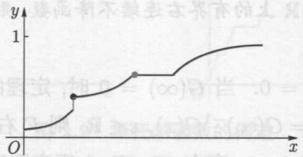
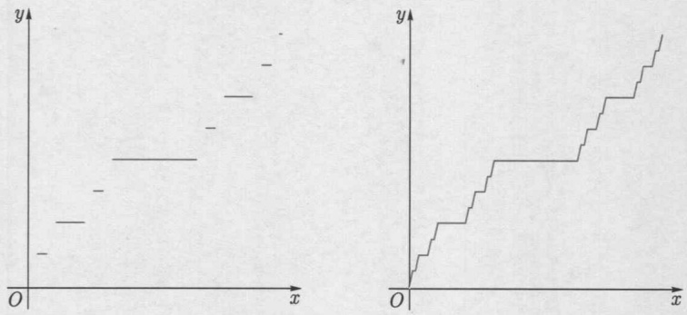

# 第二章 随机变量及其分布

原始 PDF 第 50–77 页。

## 第二章

## 随机变量及其分布

---

36

第二章 随机变量及其分布

在随机现象中, 有很多问题与带有随机性的数量有关. 例如, 在产品检验中我们关心抽样中残次品的数量, 在电话服务中我们关心某个时间段内的呼叫和服务次数等. 有些与随机现象有关的问题初看起来与数量无关, 但与数值联系起来之后, 可以简化表示或分析. 为研究这些问题, 需要引进随机变量的概念. 在数学上, 随机变量就是定义在概率空间上的可测函数, 而随机变量的分布或分布函数给出其取值概率的定量描述.

本章讨论随机变量及分布函数的基本构造与性质, 并分别介绍离散型和绝对连续型概率分布的若干典型的例子.

## 2.1 可测函数与随机变量

在数学上, 我们将随机变量定义为概率空间上的具有可测性质的函数, 可测性保证了它在一些常见的集合中取值的概率有意义.

## 2.1.1 可测映射

设 $\xi$ 为由集合 $\Omega$ 到集合 $E$ 的映射. 特别地, 当 $E = \mathbb{R}$ 或 $= \mathbb{R}^d$ 时 $\xi$ 就是 $\Omega$ 上的函数. 集合 $B \subseteq E$ 在 $\xi$ 下的原像定义为

$$
\xi^ {- 1} (B) = \{\omega \in \Omega : \xi (\omega) \in B \}.
$$

我们有时也会把上面的集合写为 $\{\xi \in B\}$ 或 $(\xi \in B)$. 给定 $E$ 的子集类 $\mathcal{C}$, 记

$$
\xi^ {- 1} (\mathcal {C}) = \{\xi^ {- 1} (B): B \in \mathcal {C} \}.
$$

集合 $A \subseteq \Omega$ 的示性函数 $1_A$ 定义为

$$
1 _ {A} (\omega) = \left\{ \begin{array}{l l} 1, & \omega \in A, \\ 0, & \omega \in A ^ {c}. \end{array} \right.
$$

例2.1.1 对于任何 $B \subseteq \mathbb{R}$, 显然有

$$
\begin{array}{l} B \cap \{0, 1 \} = \varnothing \Rightarrow 1 _ {A} ^ {- 1} (B) = \varnothing ; \\ B \cap \{0, 1 \} = \{1 \} \Rightarrow 1 _ {A} ^ {- 1} (B) = A; \\ B \cap \{0, 1 \} = \{0 \} \Rightarrow 1 _ {A} ^ {- 1} (B) = A ^ {c}; \\ B \cap \{0, 1 \} = \{0, 1 \} \Rightarrow 1 _ {A} ^ {- 1} (B) = \Omega . \\ \end{array}
$$

下面的引理罗列了关于映射的原像的几个常用的结果, 请读者自行给出其证明.

---

2.1 可测函数与随机变量

37

引理2.1.1 对于映射 $\xi : \Omega \to E$，有如下性质成立:

(1) $\xi^{-1}(E) = \Omega, \xi^{-1}(B^c) = \xi^{-1}(B)^c;$
(2) $\xi^{-1}\left(\bigcup_{i}B_{i}\right) = \bigcup_{i}\xi^{-1}(B_{i}),\xi^{-1}\left(\bigcap_{i}B_{i}\right) = \bigcap_{i}\xi^{-1}(B_{i});$
(3) 对 $B \subseteq C \subseteq E$ 有 $\xi^{-1}(B) \subseteq \xi^{-1}(C)$;
(4) 若 $\mathcal{E}$ 是 $E$ 上的 $\sigma$ 代数, 则 $\xi^{-1}(\mathcal{E})$ 是 $\Omega$ 上的 $\sigma$ 代数.

设 $\mathcal{E}$ 是 $E$ 上的 $\sigma$ 代数. 考虑可测空间 $(E, \mathcal{E})$. 再设 $\{\xi_i : i \in I\}$ 是由 $\Omega$ 到 $E$ 的一族映射, 其中 $I$ 为指标集. 我们称 $\Omega$ 上的 $\sigma$ 代数

$$
\sigma \left(\left\{\xi_ {i}: i \in I \right\}\right) := \sigma \left(\left\{\xi_ {i} ^ {- 1} (B): B \in \mathcal {E}, i \in I \right\}\right) \tag {2.1.1}
$$

为由 $\{\xi_i : i \in I\}$ 生成的 $\sigma$ 代数. 特别地, 由引理2.1.1(4)不难看出, 由单个映射 $\xi$ 生成的 $\sigma$ 代数为

$$
\sigma (\xi) = \xi^ {- 1} (\mathscr {E}) = \{\xi^ {- 1} (B): B \in \mathscr {E} \}. \tag {2.1.2}
$$

命题2.1.2 对于 $E$ 的任何子集类 $\mathcal{C}$ 有 $\sigma (\xi^{-1}(\mathcal{C})) = \xi^{-1}(\sigma (\mathcal{C}))$.

证明 由引理2.1.1(4)知 $\xi^{-1}(\sigma(\mathcal{C}))$ 是 $\sigma$ 代数.因 $\xi^{-1}(\mathcal{C})\subseteq \xi^{-1}(\sigma (\mathcal{C}))$ ，有$\sigma (\xi^{-1}(\mathcal{C}))\subseteq \xi^{-1}(\sigma (\mathcal{C}))$ .另一方面，令

$$
\mathscr {G} = \{B \subseteq E: \xi^ {- 1} (B) \in \sigma (\xi^ {- 1} (\mathscr {C})) \}.
$$

显然

$$
\xi^ {- 1} (\mathcal {G}) = \{\xi^ {- 1} (B): B \in \mathcal {G} \} \subseteq \sigma (\xi^ {- 1} (\mathcal {C})). \tag {2.1.3}
$$

利用引理2.1.1易证 $\mathcal{G}$ 为 $E$ 上的 $\sigma$ 代数.若 $B\in \mathcal{C}$ ，则

$$
\xi^ {- 1} (B) \in \xi^ {- 1} (\mathscr {C}) \subseteq \sigma (\xi^ {- 1} (\mathscr {C})),
$$

故 $B \in \mathcal{G}$. 这说明 $\mathcal{C} \subseteq \mathcal{G}$, 故 $\sigma(\mathcal{C}) \subseteq \mathcal{G}$. 于是

$$
\xi^ {- 1} (\sigma (\mathscr {C})) \subseteq \xi^ {- 1} (\mathscr {G}) \subseteq \sigma (\xi^ {- 1} (\mathscr {C})).
$$

其中最后的包含关系是由于 $(2.1.3)$ 式.

定义 2.1.1 设  $(\Omega, \mathcal{F})$  和  $(E, \mathcal{E})$  均为可测空间. 我们称  $\xi: \Omega \rightarrow E$  为可测映射, 是指有

$$
\sigma (\xi) = \xi^ {- 1} (\mathcal {E}) \subseteq \mathcal {F},
$$

即对任何 $B \in \mathcal{E}$ 都有 $\xi^{-1}(B) = \{\xi \in B\} \in \mathcal{F}$.

下面命题的结论显然成立.

---

38

第二章 随机变量及其分布

命题 2.1.3 (1) 一族映射  $\{\xi_{i}: i \in I\}$  中的每个元素都关于  $\sigma(\{\xi_{i}: i \in I\})$  可测；

(2) 一族映射 $\{\xi_i : i \in I\}$ 中的每个元素都关于 $\mathcal{F}$ 可测当且仅当 $\sigma(\{\xi_i : i \in I\}) \subseteq \mathcal{F}$.

例 2.1.2 设  $E=\{x_{1},x_{2},\cdots\}$  是可数集, 而 E 是 E 的一切子集构成的  $\sigma$  代数. 则映射  $\xi:\Omega\to E$  可测当且仅当对每个  $k=1,2,\cdots$  有  $A_{k}:=\{\xi=x_{k}\}\in\mathcal{F}$ .

由 $(\Omega, \mathcal{F})$ 到 $(\mathbb{R}, \mathcal{B})$ 或 $(\mathbb{R}^d, \mathcal{B}^d)$ 的可测映射称为可测函数；而 $(\mathbb{R}^d, \mathcal{B}^d)$ 上的可测函数也称为博雷尔函数.

## 2.1.2 可测函数的性质

定理2.1.4 定义在可测空间 $(\Omega, \mathcal{F})$ 上的实值函数 $\xi$ 可测的充要条件是，对于任意的 $x \in \mathbb{R}$ 有 $\xi^{-1}(-\infty, x] \in \mathcal{F}$.

证明 必要性. 若 $\xi$ 可测, 对 $x \in \mathbb{R}$, 因 $(- \infty, x] \in \mathcal{B}$, 有 $\xi^{-1}(-\infty, x] \in \mathcal{F}$.

充分性. 设对任何 $x \in \mathbb{R}$ 有 $\xi^{-1}(-\infty, x] \in \mathcal{F}$. 由引理2.1.1易证 $\mathcal{E} = \{B \in \mathcal{B} : \xi^{-1}(B) \in \mathcal{F}\}$ 为 $\sigma$ 代数. 依假设有 $\mathcal{E} \supseteq \mathcal{P} := \{(-\infty, x] : x \in \mathbb{R}\}$, 故 $\mathcal{E} \supseteq \sigma(\mathcal{P}) = \mathcal{B}$, 即对任何 $B \in \mathcal{B}$ 有 $\xi^{-1}(B) \in \mathcal{F}$. 因此 $\xi$ 可测.

推论2.1.5 定义在可测空间 $(\Omega, \mathcal{F})$ 上的实值函数 $\xi$ 可测的充要条件是下列性质之一成立:

(1) 对于任意的  $x \in R$  有  $\xi^{-1}(-\infty, x) \in \mathcal{F}$ ;
(2) 对于任意的 $x \in \mathbb{R}$ 有 $\xi^{-1}(x, \infty) \in \mathcal{F}$;
(3) 对于任意的 $x \in \mathbb{R}$ 有 $\xi^{-1}[x, \infty) \in \mathcal{F}$.

推论 2.1.6 定义在 R 上的单调函数 f 是博雷尔可测的.

证明 不妨设 $f$ 不降. 则对 $x \in \mathbb{R}$, 原像 $f^{-1}(-\infty, x]$ 是形如 $(- \infty, a]$ 或 $(- \infty, a)$ 的区间. 两种情况下都有 $f^{-1}(-\infty, x] \in \mathcal{B}$. 根据定理2.1.4函数 $f$ 关于博雷尔 $\sigma$ 代数可测.

定理2.1.7 定义在 $\mathbb{R}^d$ 上的连续函数 $f$ 是博雷尔可测的.

证明 因为 $f$ 在 $\mathbb{R}^d$ 上连续, 对任何 $G \in \mathcal{O}$ 有 $f^{-1}(G) \in \mathcal{O}^d$, 故 $f^{-1}(\mathcal{O}) \subseteq \mathcal{O}^d$. 所以

$$
f ^ {- 1} (\mathcal {B}) = f ^ {- 1} (\sigma (\mathcal {O})) = \sigma (f ^ {- 1} (\mathcal {O})) \subseteq \sigma (\mathcal {O} ^ {d}) = \mathcal {B} ^ {d}.
$$

这说明 f 关于  $B^{d}$  可测.

定理2.1.8 设 $\xi$ 为 $\Omega$ 上的函数, 而 $f$ 为 $\mathbb{R}$ 上的博雷尔可测函数. 则 $\eta := f(\xi)$ 关于 $\Omega$ 上的 $\sigma$ 代数 $\sigma(\xi)$ 可测. 特别地, 若 $\xi$ 为 $(\Omega, \mathcal{F})$ 上的可测函数, 则 $\eta$ 为 $(\Omega, \mathcal{F})$ 上的可测函数.

---

2.1 可测函数与随机变量

39

证明 任取 $B \in \mathcal{B}$. 因 $f$ 为 $(\mathbb{R}, \mathcal{B})$ 上的可测函数, 有 $f^{-1}(B) \in \mathcal{B}$, 因而

$$
\eta^ {- 1} (B) = \xi^ {- 1} (f ^ {- 1} (B)) \in \sigma (\xi).
$$

这就证明了第1个结论. 第2个结论显然成立.

定理2.1.9 若 $\xi$ 和 $\eta$ 为 $(\Omega, \mathcal{F})$ 上的可测函数, 则 $\xi + \eta, \xi - \eta$ 和 $\xi \eta$ 均为 $(\Omega, \mathcal{F})$ 上的可测函数. 而且, 若还有 $\eta \neq 0$, 则 $\xi / \eta$ 也为 $(\Omega, \mathcal{F})$ 上的可测函数.

证明 对于 $x \in \mathbb{R}$ 令 $Q_x = \{(r, s): r$ 和 $s$ 均为有理数且满足 $r + s < x\}$. 则 $Q_x$ 为可数集且

$$
\{\xi + \eta <   x \} = \bigcup_ {(r, s) \in Q _ {x}} \{\xi <   r \} \cap \{\eta <   s \}. \tag {2.1.4}
$$

事实上, 若 $\omega \in \Omega$ 属于 (2.1.4) 式右边的集合, 它显然属于该式左边的集合. 反之, 设 $\omega \in \Omega$ 属于 (2.1.4) 式左边的集合. 则 $\delta := x - \xi(\omega) - \eta(\omega) > 0$. 取有理数 $r \in (\xi(\omega), \xi(\omega) + \delta/2)$ 和 $s \in (\eta(\omega), \eta(\omega) + \delta/2)$. 显然 $r + s < \xi(\omega) + \eta(\omega) + \delta = x$ 且有 $\xi(\omega) < r$ 和 $\eta(\omega) < s$, 故 $\omega$ 属于 (2.1.4) 式右边的集合. 由推论 2.1.5 和 (2.1.4) 式知 $\xi + \eta$ 为 $(\Omega, \mathcal{F})$ 上的可测函数. 其他结论的证明类似. □

定理2.1.10 若 $\xi$ 和 $\eta$ 为 $(\Omega, \mathcal{F})$ 上的可测函数，则下面的集合均可测:

$$
\{\xi <   \eta \}, \{\eta <   \xi \}, \{\xi \neq \eta \}, \{\xi = \eta \}.
$$

证明 注意有理数集 $\mathbb{Q}$ 可数且在实轴上稠密. 易知

$$
\{\xi <   \eta \} = \bigcup_ {r \in \mathbb {Q}} \{\xi <   r <   \eta \} = \bigcup_ {r \in \mathbb {Q}} \big (\{\xi <   r \} \cap \{r <   \eta \} \big),
$$

其中 $\{\xi < r\}, \{r < \eta\} \in \mathcal{F}$, 故知 $\{\xi < \eta\} \in \mathcal{F}$. 类似地有 $\{\eta < \xi\} \in \mathcal{F}$, 进而有 $\{\xi \neq \eta\} = \{\xi < \eta\} \cup \{\eta < \xi\} \in \mathcal{F}$ 和 $\{\xi = \eta\} = \{\xi \neq \eta\}^c \in \mathcal{F}$.

定理2.1.11 设 $\{\xi_n\}$ 为 $(\Omega, \mathcal{F})$ 上的可测函数列. 则下面函数 (若有限) 可测:

$$
\sup _ {n} \xi_ {n}, \quad \inf _ {n} \xi_ {n}, \quad \lim _ {n} \sup _ {n} \xi_ {n}, \quad \lim _ {n} \inf _ {n} \xi_ {n}.
$$

证明 对任意的 $x \in \mathbb{R}$, 我们有

$$
\{\sup _ {n} \xi_ {n} \leqslant x \} = \bigcap_ {n} \{\xi_ {n} \leqslant x \}
$$

和

$$
\{\inf _ {n} \xi_ {n} <   x \} = \bigcup_ {n} \{\xi_ {n} <   x \}.
$$

由推论2.1.5知 $\sup_{n}\xi_n$ 和 $\inf_{n}\xi_n$ 可测，进而 $\lim_{n}\sup_{n}\xi_n$ 和 $\lim_{n}\inf_{n}\xi_n$ 可测.

---

40

第二章 随机变量及其分布

设 $(\Omega, \mathcal{F}, \mu)$ 为测度空间. 若可测函数 $\xi$ 和 $\eta$ 满足 $\mu (\xi \neq \eta) = 0$, 则称它们相对于 $\mu$ 几乎处处相等, 记作 $\xi = \eta$ (a.e.) 或 $\xi \stackrel{\mathrm{a.e.}}{=} \eta$. 更一般地, 若存在 $N \in \mathcal{F}$ 使得 $\mu(N) = 0$ 且某个性质对于所有 $\omega \in N^c$ 成立, 我们称该性质相对于测度 $\mu$ 几乎处处 (a.e.) 成立.

例 2.1.3 设  $\Omega$  上的实函数  $\xi$  的取值范围是可数集  $E = \{x_{1}, x_{2}, \cdots\}$ . 令  $A = \{A_{k} : k = 1, 2, \cdots\}$ , 其中  $A_{k} = \{\xi = x_{k}\}$ . 则  $\sigma(\xi) = \sigma(\mathcal{A})$  是由 A 中的集合的所有可能的并构成的集类 (规定零个集合的并为空集). 注意  $\xi$  关于  $\sigma(\xi)$  可测.

例 2.1.4 在上例的情况下, 若 f 为 R 上的博雷尔可测函数, 根据定理 2.1.8 知  $X := f(\xi)$  关于  $\sigma(\xi)$  可测. 反之, 若  $\Omega$  上的函数 X 关于  $\sigma(\xi)$  可测, 则它在每个集合  $A_{k}$  上必为常数, 不妨设  $X = \sum_{k=1}^{\infty} a_{k} 1_{A_{k}}$ . 显然  $f := \sum_{k=1}^{\infty} a_{k} 1_{\{x_{k}\}}$  为 R 上的博雷尔可测函数且  $X = f(\xi)$ . 所以  $\Omega$  上的函数 X 关于  $\sigma(\xi)$  可测当且仅当存在 R 上的博雷尔可测函数 f 使得  $X = f(\xi)$ .

## 2.1.3 测度的分布函数

称 $\mathbb{R}$ 上的函数 $G$ 为分布函数, 是指存在欧氏可测空间 $(\mathbb{R}, \mathcal{B})$ 上的局部有限测度 $\mu$ 满足

$$
G (b) - G (a) = \mu (a, b ], \quad a \leqslant b \in \mathbb {R}. \tag {2.1.5}
$$

此时也称 $G$ 是 $\mu$ 的分布函数. 特别地, 若 $\mu$ 是概率测度, 则称 $G$ 为概率分布函数.

根据测度的性质, 不难证明:

命题 2.1.12 欧氏可测空间  $(\mathbb{R}, \mathcal{B})$  上的局部有限测度  $\mu$  的分布函数 G 具有性质:

(1) G 右连续且单调不降;
(2) G 有界当且仅当  $\mu$  是有限测度, 且此时有  $\mu(\mathbb{R}) = G(\infty) - G(-\infty)$ ;
(3) 若 $G$ 是 $\mu$ 的分布函数, 则 $G + c$ 也是 $\mu$ 的分布函数, 其中 $c \in \mathbb{R}$ 为常数.

例2.1.5 利用分布函数 $G$ ，可以确定相应的局部有限测度 $\mu$ 在一些典型的集合上的取值.特别地，对于任何 $a\leqslant b\in \mathbb{R}$ 有

$$
\mu (a, b ] = G (b) - G (a); \quad \mu (a, b) = G (b -) - G (a);
$$

$$
\mu [ a, b ] = G (b) - G (a -); \quad \mu [ a, b) = G (b -) - G (a -).
$$

若 $\mu$ 是有限测度, 则有

$$
\mu (- \infty , b ] = G (b) - G (- \infty); \quad \mu (- \infty , b) = G (b -) - G (- \infty);
$$

$$
\mu (a, \infty) = G (\infty) - G (a); \quad \mu [ a, \infty) = G (\infty) - G (a -).
$$

设 $(\mathbb{R},\mathcal{B})$ 上的局部有限测度 $\mu$ 有分布函数 $G$. 称 $x\in \mathbb{R}$ 为 $\mu$ 或 $G$ 的跳跃点, 是指

$$
\Delta G (x) := G (x) - G (x -) = \mu (\{x \}) > 0.
$$

---

2.1 可测函数与随机变量

41

此时称  $\Delta G(x)$  为  $\mu$  或 G 在点 x 的跳幅. 显然, 跳跃点集  $E := \{x \in \mathbb{R} : \Delta G(x) > 0\}$  至多为可数集, 且 G 在  $E^{c} = R \setminus E$  上连续. 写该集合为  $E = \{x_{1}, x_{2}, \cdots\}$ , 并记  $q(x_{i}) = \Delta G(x_{i})$ . 称  $\mu$  或 G 是离散型的, 是指有

$$
G (b) - G (a) = \sum_ {x _ {i} \in (a, b ]} q (x _ {i}), \quad a \leqslant b \in \mathbb {R}. \tag {2.1.6}
$$

此时称 $q$ 为 $\mu$ 或 $G$ 的密度函数或密度.

称 $(\mathbb{R},\mathcal{B})$ 上的局部有限测度 $\mu$ 或其分布函数 $G$ 是绝对连续型的, 是指存在 $\mathbb{R}$ 上的非负黎曼可积函数 $q$ 使得

$$
G (b) - G (a) = \int_ {a} ^ {b} q (u) \mathrm{d} u, \quad a \leqslant b \in \mathbb {R}. \tag {2.1.7}
$$

此时称 $q$ 为 $\mu$ 或 $G$ 的密度函数或密度. 显然, 绝对连续型分布函数是 $\mathbb{R}$ 上的连续函数. 另外, 根据数学分析的结果, 若函数 $G$ 连续可微, 则 (2.1.7) 式对 $q = G'$ 成立.

下面的定理说明 $(\mathbb{R},\mathcal{B})$ 上的局部有限测度由其分布函数唯一决定. 定理的证明需要用到附录中介绍的邓肯类定理.

定理2.1.13 设 $\mu$ 和 $\nu$ 是欧氏可测空间 $(\mathbb{R},\mathcal{B})$ 上的局部有限测度. 若这两个测度以同一个函数 $G$ 为分布函数, 则它们相等, 即对一切 $B \in \mathcal{B}$ 有 $\mu(B) = \nu(B)$.

证明 (1) 考虑 $G$ 为有界分布函数的情况. 令 $\mathcal{D} = \{A \in \mathcal{B} : \mu(A) = \nu(A)\}$. 显然 $\mu(\mathbb{R}) = G(\infty) - G(-\infty) = \nu(\mathbb{R})$, 故有 $\mathbb{R} \in \mathcal{D}$. 若 $A, B \in \mathcal{D}$ 且 $A \subseteq B$, 则有 $\mu(A) = \nu(A)$ 和 $\mu(B) = \nu(B)$, 进而

$$
\mu (B \setminus A) = \mu (B) - \mu (A) = \nu (B) - \nu (A) = \nu (B \setminus A),
$$

故 $B \setminus A \in \mathcal{D}$. 若 $\{A_n\} \subseteq \mathcal{D}$ 单调不降, 由测度的下连续性有

$$
\mu \Big (\bigcup_ {n = 1} ^ {\infty} A _ {n} \Big) = \lim _ {n \to \infty} \mu (A _ {n}) = \lim _ {n \to \infty} \nu (A _ {n}) = \nu \Big (\bigcup_ {n = 1} ^ {\infty} A _ {n} \Big),
$$

故 $\bigcup_{n=1}^{\infty} A_n \in \mathcal{D}$. 这就证明了 $\mathcal{D}$ 是邓肯类.

(2) 继续考虑 $G$ 为有界分布函数的情况. 令 $\mathcal{C}$ 是一切形如 $(a, b] \subseteq \mathbb{R}$ 的区间构成的集类. 显然 $\mathcal{C}$ 对于交运算封闭. 因为 $\mu(a, b] = G(b) - G(a) = \nu(a, b]$, 所以有 $\mathcal{C} \subseteq \mathcal{D}$. 根据邓肯类定理有 $\mathcal{D} \supseteq d(\mathcal{C}) = \sigma(\mathcal{C}) = \mathcal{B}$, 即对一切 $A \in \mathcal{B}$ 有 $\mu(A) = \nu(A)$.
(3) 考虑 $G$ 为一般分布函数的情况. 对于 $n \geqslant 1$ 和 $A \in \mathcal{B}$ 定义 $\mu_n(A) = \mu(A \cap (-n, n])$ 和 $\nu_n(A) = \nu(A \cap (-n, n])$. 则 $\mu_n$ 和 $\nu_n$ 都是有限测度, 且有共同的分布函数 $G_n(x) = G(x \vee (-n) \wedge n)$. 根据前两步证明的结论, 对任何 $n \geqslant 1$ 有 $\mu_n = \nu_n$, 进而易知 $\mu = \nu$.

---

42

第二章 随机变量及其分布

对应于 $(\mathbb{R},\mathcal{B})$ 上的有限测度 $\mu$ ，有唯一的分布函数 $G$ 满足 $G(-\infty) = 0$ .该分布函数由

$$
G (x) = \mu (- \infty , x ], \quad x \in \mathbb {R} \tag {2.1.8}
$$

给出. 后面当提到有限测度的分布函数时, 总是指由 (2.1.8) 式定义的函数.

## 2.1.4 随机变量的概念

定义2.1.2 设 $(\Omega, \mathcal{F}, \mathbf{P})$ 为概率空间. 称由 $(\Omega, \mathcal{F})$ 到某个可测空间 $(E, \mathcal{E})$ 的可测映射 $\xi$ 为随机变量. 特别地, 当 $(E, \mathcal{E})$ 为欧氏可测空间 $(\mathbb{R}, \mathcal{B})$ 时, 称 $\xi$ 为实值随机变量.

给定取值于 $(E, \mathcal{E})$ 的随机变量 $\xi$, 对于集合 $B \in \mathcal{E}$ 我们自然希望可以讨论 $\{\xi \in B\}$ 发生的概率, 而概率测度 $\mathbf{P}$ 是 $\mathcal{F}$ 上的集函数. 所以定义2.1.2中要求 $\{\xi \in B\} \in \mathcal{F}$ 是合理的. 若某个性质在 $\Omega$ 上相对于 $\mathbf{P}$ 几乎处处成立, 就称该性质几乎必然成立.

定理2.1.14 设 $\xi$ 为定义在概率空间 $(\Omega, \mathcal{F}, \mathbf{P})$ 上取值于可测空间 $(E, \mathcal{E})$ 的随机变量. 令

$$
\mu (B) = \mathbf {P} (\xi^ {- 1} (B)) = \mathbf {P} (\xi \in B), \quad B \in \mathscr {E}. \tag {2.1.9}
$$

则  $\mu$  为  $(E, \mathcal{E})$  上的概率测度.

证明 显然, 对任何 $B \in \mathcal{E}$ 有 $\mu(B) \geqslant 0$, 且 $\mu(E) = 1$. 现设 $\{B_n\} \subseteq \mathcal{E}$ 是两两不交的集合列. 则当 $i \neq j$ 时有

$$
\xi^ {- 1} (B _ {i}) \cap \xi^ {- 1} (B _ {j}) = \xi^ {- 1} (B _ {i} \cap B _ {j}) = \varnothing ,
$$

也即 $\{\xi^{-1}(B_n)\}$ 两两不交. 由概率 $\mathbf{P}$ 的可数可加性和引理2.1.1得

$$
\begin{array}{l} \mu \left(\bigcup_ {n = 1} ^ {\infty} B _ {n}\right) = \mathbf {P} \left(\xi^ {- 1} \left(\bigcup_ {n = 1} ^ {\infty} B _ {n}\right)\right) \\ = \mathbf {P} \left(\bigcup_ {n = 1} ^ {\infty} \xi^ {- 1} (B _ {n})\right) \\ = \sum_ {n = 1} ^ {\infty} \mathbf {P} (\xi^ {- 1} (B _ {n})) = \sum_ {n = 1} ^ {\infty} \mu (B _ {n}). \\ \end{array}
$$

所以  $\mu$  为  $(E, \mathcal{E})$  上的概率测度.

定义 2.1.3 称由 (2.1.9) 式定义的  $(E, \mathcal{E})$  上的概率测度  $\mu$  为随机变量  $\xi$  的概率分布，简称分布。特别地，当  $(E, \mathcal{E})$  为欧氏可测空间  $(\mathbb{R}, \mathcal{B})$  时，也称  $\mu$  的分布函数 F 为  $\xi$  的分布函数。后面经常将二者分别写作  $\mu_{\xi}$  和  $F_{\xi}$ ，以标明其与  $\xi$  的关系。

---

2.1 可测函数与随机变量

43

如无特别申明, 后面所说的随机变量都指实值随机变量. 对于概率空间 $(\Omega, \mathcal{F}, \mathbf{P})$ 上的随机变量 $\xi$ 和 $\eta$, 如果有 $\mathbf{P}(\xi = \eta) = 1$, 就称 $\xi$ 和 $\eta$ 几乎必然相等, 记作 $\xi = \eta$ (a.s.) 或 $\xi \stackrel{\mathrm{a.s.}}{=} \eta$. 特别地, 若有 $a \in E$ 使得 $\xi \stackrel{\mathrm{a.s.}}{=} a$, 则称 $\xi$ 是退化的. 否则称 $\xi$ 是非退化的.

将随机变量定义为概率空间上的可测函数, 其优点是具有广泛的适用性. 但由于概率空间是抽象空间, 在很多时候不便于进行分析和计算. 分布和分布函数给出了随机变量的取值概率的定量描述. 它们将很多计算转移到欧氏空间 $\mathbb{R}$, 为相关的讨论提供了方便.

若随机变量 $\xi$ 和 $\eta$ 具有相同的概率分布, 则称它们同分布, 并记作 $\xi \stackrel{\mathrm{d}}{=} \eta$. 根据前面的讨论, 某个随机变量 $\xi$ 的概率分布函数 $F$ 为 $\mathbb{R}$ 上的右连续不降函数且满足

$$
F (- \infty) = 0, \quad F (\infty) = 1.
$$

例2.1.6 设随机变量 $\xi$ 有分布函数 $F_{\xi}$. 则对任何 $a \leqslant b \in \mathbb{R}$ 有

$$
\mathbf {P} (a <   \xi \leqslant b) = F _ {\xi} (b) - F _ {\xi} (a), \quad \mathbf {P} (a <   \xi <   b) = F _ {\xi} (b -) - F _ {\xi} (a),
$$

$$
\mathbf {P} (a \leqslant \xi \leqslant b) = F _ {\xi} (b) - F _ {\xi} (a -), \quad \mathbf {P} (a \leqslant \xi <   b) = F _ {\xi} (b -) - F _ {\xi} (a -).
$$

例 2.1.7 设  $(\Omega, \mathcal{F}, \mathbf{P})$  为例 1.2.11 中定义的关于成功事件  $A \subseteq \Omega$  的伯努利概率空间, 其中  $F = \{\varnothing, A, A^{c}, \Omega\}$ , 而  $\mathbf{P}(A) = p (0 \leqslant p \leqslant 1)$ . 令  $\xi(\omega) = 1_{A}(\omega)$ . 则  $\xi$  是  $(\Omega, \mathcal{F}, \mathbf{P})$  上的随机变量. 它取值 1 或 0, 代表一次伯努利随机试验中成功的次数. 显然

$$
\mathbf {P} (\xi = 1) = \mathbf {P} (A) = p, \quad \mathbf {P} (\xi = 0) = \mathbf {P} (A ^ {c}) = 1 - p.
$$

该随机变量有分布函数

$$
F _ {\xi} (x) = (1 - p) 1 _ {\{0 \leqslant x <   1 \}} + 1 _ {\{x \geqslant 1 \}}, \quad x \in \mathbb {R}.
$$

特别地, 当 $\xi$ 是取值为 $a \in \mathbb{R}$ 的退化随机变量, 其分布 $\mu_{\xi}$ 就是狄拉克测度 $\delta_{a}$. 此时我们有

$$
\mu_ {\xi} (B) = 1 _ {B} (a), \quad B \in \mathcal {B}
$$

和

$$
F _ {\xi} (x) = 1 _ {\{x \geqslant a \}}, \quad x \in \mathbb {R}.
$$

在这种情况下, 我们分别称 $\mu$ 和 $F$ 为退化概率分布和退化分布函数.

## 练习题

1. 设 $\xi$ 为定义在非空集 $\Omega$ 上的实值函数. 证明:

---

44

第二章 随机变量及其分布

(1) $\xi^{-1}(\mathbb{R}) = \Omega, \xi^{-1}(B^c) = \xi^{-1}(B)^c;$
(2) $\xi^{-1}\left(\bigcup_{i}B_{i}\right) = \bigcup_{i}\xi^{-1}(B_{i}),\xi^{-1}\left(\bigcap_{i}B_{i}\right) = \bigcap_{i}\xi^{-1}(B_{i});$
(3) 对 $B \subseteq C \subseteq \mathbb{R}$ 有 $\xi^{-1}(B) \subseteq \xi^{-1}(C)$;
(4) 若 $\mathcal{E}$ 是 $\mathbb{R}$ 上的 $\sigma$ 代数, 则 $\xi^{-1}(\mathcal{E})$ 是 $\Omega$ 上的 $\sigma$ 代数.

2. 设 $\xi$ 为可测空间 $(\Omega, \mathcal{F})$ 上的实函数. 证明: 对于任何 $A \subseteq \Omega$ 示性函数 $1_A$ 关于 $\mathcal{F}$ 可测当且仅当 $A \in \mathcal{F}$.

3. 设 $\xi$ 和 $\eta$ 为 $(\Omega, \mathcal{F})$ 上的可测函数. 证明:

(1)  $\xi - \eta$  和  $\xi\eta$  均为  $(\Omega, \mathcal{F})$  上的可测函数;

(2) 若 $\eta \neq 0$, 则 $\xi / \eta$ 为 $(\Omega, \mathcal{F})$ 上的可测函数.

4. 给出有界区间  $(a, b) \subseteq \mathbb{R}$  上的勒贝格测度的分布函数 G.

5. 设随机变量 $\xi$ 满足 $\mathbf{P}(\xi \geqslant a) \geqslant 1 - \alpha$ 和 $\mathbf{P}(\xi \leqslant b) \geqslant 1 - \beta$, 其中 $a \leqslant b \in \mathbb{R}$, 而 $\alpha, \beta \in [0,1]$. 证明

$$
\mathbf {P} (a \leqslant \xi \leqslant b) \geqslant 1 - \alpha - \beta.
$$

## 2.2 离散型随机变量

称随机变量  $\xi$  是离散型的, 是指它具有离散型概率分布函数 F. 此时  $\xi$  的可能的取值范围是某个可数集  $E := \{x_{1}, x_{2}, \cdots\} \subseteq R$ . 令 p 为 F 的密度函数. 则有

$$
F (x) = \mathbf {P} (\xi \leqslant x) = \sum_ {x _ {i} \leqslant x} p (x _ {i}), \quad x \in \mathbb {R}, \tag {2.2.1}
$$

其中

$$
p (x _ {i}) = \mathbf {P} (\xi = x _ {i}), \quad i = 1, 2, \dots . \tag {2.2.2}
$$

注意

$$
\sum_ {i = 1} ^ {\infty} p (x _ {i}) = 1.
$$

此时也将 p 称为  $\xi$  的分布列、分布密度或密度. 利用概率测度的可数可加性得

$$
\mathbf {P} (\xi \in B) = \sum_ {x _ {i} \in B} p (x _ {i}), \quad B \in \mathcal {B}.
$$

给定可数集  $E := \{x_{1}, x_{2}, \cdots\} \subseteq R$  上的以 p 为密度函数的离散型概率测度  $\mu$ ，是否一定存在以  $\mu$  为分布的离散型随机变量呢？下面的命题回答了这个问题.

---

2.2 离散型随机变量

45

命题 2.2.1 在上述情况下, 令  $\Omega=\{1,2,\cdots\}$ , 并令 F 为  $\Omega$  的所有子集构成的  $\sigma$  代数. 对于  $A\in F$ , 令

$$
\mathbf {P} (A) = \sum_ {i \in A} p (x _ {i}). \tag {2.2.3}
$$

对任何 $i \in \Omega$ 令 $\xi(i) = x_i$. 则 $\xi$ 为概率空间 $(\Omega, \mathcal{F}, \mathbf{P})$ 上的离散型随机变量, 且有分布列 $\{p(x_1), p(x_2), \dots\}$.

证明 显然, 由 (2.2.3) 式定义的 $\mathbf{P}$ 是可测空间 $(\Omega, \mathcal{F})$ 上的概率测度. 因 $\mathcal{F}$ 包含 $\Omega$ 的所有子集, 所以 $\xi$ 可测. 由 (2.2.3) 式知 (2.2.2) 式成立. 所以 $\xi$ 为离散型随机变量, 且有分布列 $\{p(x_1), p(x_2), \cdots\}$.

例 2.2.1 令  $(\Omega_{1},\mathcal{F}_{1},\mathbf{P}_{1})$  为关于成功事件  $A \subseteq \Omega_{1}$  的伯努利概率空间, 其中  $F_{1} = \{\varnothing, A, A^{c}, \Omega\}$ . 设成功概率为  $\mathbf{P}_{1}(A) = p (0 \leqslant p \leqslant 1)$ . 考虑其可数无穷维乘积概率空间  $(\Omega, \mathcal{F}, \mathbf{P}) := (\Omega_{1}^{\infty}, \mathcal{F}_{1}^{\infty}, \mathbf{P}_{1}^{\infty})$ . 此概率空间描述可数无穷次伯努利试验. 对  $k \geqslant 1$  记  $B_{k} = \Omega_{1}^{k-1} \times A \times \Omega_{1}^{\infty}$ , 它表示第 k 次试验成功. 注意事件  $B_{1}, B_{2}, \cdots$  相互独立. 再记

$$
\xi_ {k} (\omega) = 1 _ {B _ {k}} (\omega) = 1 _ {A} (\omega_ {k}), \quad \omega = (\omega_ {1}, \omega_ {2}, \dots) \in \Omega_ {1} ^ {\infty}. \tag {2.2.4}
$$

则  $\xi_{k}$  是  $(\Omega, \mathcal{F}, \mathbf{P})$  上的随机变量. 直观上, 若第 k 次试验成功, 则  $\xi_{k}=1$ ; 否则  $\xi_{k}=0$ . 显然有  $\mathbf{P}(\xi_{k}=1)=\mathbf{P}(B_{k})=p$  和  $\mathbf{P}(\xi_{k}=0)=\mathbf{P}(B_{k}^{c})=1-p$ . 注意前 n 次试验中成功的总次数可表示为  $\xi:=\xi_{1}+\xi_{2}+\cdots+\xi_{n}$ . 由定理 2.1.9 知  $\xi$  是  $(\Omega, \mathcal{F}, \mathbf{P})$  上的随机变量.

对于离散型变量的概率问题, 一般可以借助级数和的方法处理, 这为很多计算带来了方便. 本节下面讨论伯努利试验中出现的几个离散型随机变量的分布.

## 2.2.1 二项分布

令 $(\Omega, \mathcal{F}, \mathbf{P})$ 是例2.2.1中定义的伯努利概率空间的可数无穷维乘积空间，而 $\xi$ 和 $\xi_k$ 也如那里定义。不难算出

$$
\mathbf {P} (\xi = i) = \mathrm{C} _ {n} ^ {i} p ^ {i} q ^ {n - i}, \quad i = 0, 1, \dots , n. \tag {2.2.5}
$$

上式右端给出的离散型概率分布称为二项分布, 记作 $B(n,p)$. 特别地, 称 $B(1,p)$ 为伯努利分布. 注意

$$
\sum_ {i = 0} ^ {n} \mathrm{C} _ {n} ^ {i} p ^ {i} q ^ {n - i} = (p + q) ^ {n} = 1.
$$

由(2.2.5)式得

$$
\frac {\mathbf {P} (\xi = i)}{\mathbf {P} (\xi = i - 1)} = 1 + \frac {(n + 1) p - i}{i q}.
$$

---

46

第二章 随机变量及其分布

注意当 $i < (n + 1)p$ 时, $\mathbf{P}(\xi = i) > \mathbf{P}(\xi = i - 1)$, 而当 $i > (n + 1)p$ 时, $\mathbf{P}(\xi = i) < \mathbf{P}(\xi = i - 1)$. 所以 $\mathbf{P}(\xi = i)$ 的值先随 $i$ 的增加而上升, 再随 $i$ 的增加而下降. 使 $\mathbf{P}(\xi = i)$ 取得最大值的 $i$ 称为二项分布的最可能值.

我们用 $\lfloor x\rfloor$ 表示不超过 $x\in \mathbb{R}$ 的最大整数. 显然 $i_0\coloneqq \lfloor (n + 1)p\rfloor$ 是最可能值. 若 $(n + 1)p$ 是整数, 则 $i_0$ 和 $i_0 - 1$ 同为最可能值.

例 2.2.2 掷一枚质地均匀的硬币 2n 次, 记正面朝上的次数为  $\xi$ . 则  $\xi$  服从  $B(2n, 1/2)$  分布, 其最可能值为  $\lfloor(2n+1)p\rfloor=n$ . 利用斯特林 (Stirling) 公式有  $n!\approx n^{n}e^{-n}\sqrt{2\pi n}$ , 得到

$$
\begin{array}{l} \mathbf {P} (\xi = n) = \mathrm{C} _ {2 n} ^ {n} \Big (\frac {1}{2} \Big) ^ {2 n} = \frac {(2 n) !}{(n !) ^ {2} 2 ^ {2 n}} \\ \approx \frac {2 ^ {2 n + 1} n ^ {2 n} \mathrm{e} ^ {- 2 n} \sqrt {\pi n}}{n ^ {2 n + 1} \mathrm{e} ^ {- 2 n} 2 ^ {2 n + 1} \pi} = \frac {1}{\sqrt {n \pi}} \rightarrow 0, \quad n \rightarrow \infty . \\ \end{array}
$$

## 2.2.2 几何分布

令 $(\Omega, \mathcal{F}, \mathbf{P})$ 是例 2.2.1 中定义的伯努利概率空间的可数无穷维乘积空间.对于 $\omega = (\omega_1, \omega_2, \cdots) \in \Omega$ 和 $k = 1, 2, \cdots$ 定义

$$
\eta (\omega) = k, \quad \omega_ {1} \in A ^ {c}, \dots , \omega_ {k - 1} \in A ^ {c} \text {且} \omega_ {k} \in A.
$$

则 $\eta$ 代表了首次成功时的试验次数, 称为首次成功时间. 显然

$$
\{\eta = k \} = (A ^ {c}) ^ {k - 1} \times A \times \Omega_ {1} ^ {\infty}.
$$

根据乘积概率测度的定义, 有

$$
\mathbf {P} (\eta = k) = (1 - p) ^ {k - 1} p, \quad k = 1, 2, \dots .
$$

上式右端给出的离散型概率分布称为以 $p$ 为参数的几何分布，记作 $G(p)$

定理2.2.2 取值为非负整数的随机变量 $\eta$ 服从几何分布当且仅当对任意的 $n, k \geqslant 1$ 有

$$
\mathbf {P} (\eta > k + n | \eta > n) = \mathbf {P} (\eta > k). \tag {2.2.6}
$$

证明 “$\Rightarrow$” 假设 $\eta$ 服从几何分布 $G(p)$. 则

$$
\mathbf {P} (\eta > n) = \sum_ {k = n + 1} ^ {\infty} (1 - p) ^ {k - 1} p = \frac {p (1 - p) ^ {n}}{1 - q} = (1 - p) ^ {n}.
$$

由此易得 (2.2.6) 式.

---

2.2 离散型随机变量

47

“$\Leftarrow$”令 $q_{n} = \mathbf{P}(\xi > n)$. 由 (2.2.6) 式有

$$
\frac {q _ {k + n}}{q _ {n}} = q _ {k} \quad \Rightarrow \quad q _ {k + n} = q _ {n} q _ {k}.
$$

因此 $q_{k} = q_{1}^{k}$ .取 $p = 1 - q_{1}$ 得

$$
\mathbf {P} (\eta = k) = q _ {k - 1} - q _ {k} = (1 - p) ^ {k - 1} p,
$$

即  $\eta$  服从几何分布  $G(p)$ .

由 (2.2.6) 式表达的性质称为几何分布的无记忆性, 其成立的原因是由于伯努利试验是独立重复进行的.

例 2.2.3 在一串 10 把外形相同的钥匙中, 只有一把能打开某扇房门, 现用这些钥匙尝试开门, 试对放回与不放回的情形, 分别求出  $E = \{ \text{至多试三次打开门} \}$  的概率.

解 (1) 每次取一把钥匙试开, 然后放回, 以 $\xi$ 表示首次打开门的试开次数. 则 $\xi$ 服从参数为 $p = 0.1$ 的几何分布, 故

$$
\mathbf {P} (E) = \mathbf {P} (\xi \leqslant 3) = 0. 1 + 0. 9 \times 0. 1 + 0. 9 ^ {2} \times 0. 1 = 0. 2 7 1.
$$

(2) 每次取一把钥匙试开, 不放回, 则

$$
\mathbf {P} (E) = 1 - \mathbf {P} (E ^ {c}) = 1 - \frac {\mathrm{C} _ {9} ^ {3}}{\mathrm{C} _ {1 0} ^ {3}} = 0. 3.
$$

## 2.2.3 帕斯卡分布

考虑可数重伯努利试验. 对于 $n = 1,2,\dots$ ，令 $\eta_{n}$ 为到第 $n$ 次成功时的试验次数，称为第 $n$ 次成功的时间. 则 $\{\eta_n = k\} = \{\text{前} k - 1\text{次试验中恰有} n - 1\text{次成功且第} k\text{次试验成功}\}$. 由此易得

$$
\mathbf {P} (\eta_ {n} = k) = \mathrm{C} _ {k - 1} ^ {n - 1} p ^ {n} (1 - p) ^ {k - n}, \quad k = n, n + 1, n + 2, \dots . \tag {2.2.7}
$$

上式右端给出的离散型概率分布称为以 $(n,p)$ 为参数的帕斯卡(Pascal)分布,记作 $Pa(n,p)$ .

显然, 几何分布  $G(p)$  是帕斯卡分布  $Pa(n,p)$  当 n=1 时的特例.

考虑泰勒 (Taylor) 展开式: 对  $|x| < 1$  有

$$
\begin{array}{l} (1 - x) ^ {- n} = \sum_ {k = 0} ^ {\infty} \frac {n (n + 1) \cdots (n + k - 1)}{k !} x ^ {k} \\ = \sum_ {k = 0} ^ {\infty} \mathrm{C} _ {n + k - 1} ^ {n - 1} x ^ {k} = \sum_ {k = n} ^ {\infty} \mathrm{C} _ {k - 1} ^ {n - 1} x ^ {k - n}. \\ \end{array}
$$

取 x = 1 - p 即知 (2.2.7) 式右端之和确实为 1.

---

48

第二章 随机变量及其分布

在可数重伯努利试验中, 令 $\zeta_{n} = \eta_{n} - n$ 为第 $n$ 次成功前的失败次数. 不难看出, 对 $k = 0,1,2,\dots$ 有

$$
\begin{array}{l} \mathbf {P} (\zeta_ {n} = k) = \mathrm{C} _ {k + n - 1} ^ {n - 1} p ^ {n} (1 - p) ^ {k} = \mathrm{C} _ {k + n - 1} ^ {k} p ^ {n} (1 - p) ^ {k} \\ = \frac {(k + n - 1) \cdots (n + 1) n}{k !} p ^ {n} (1 - p) ^ {k} \\ = \frac {(- n) (- n - 1) \cdots (- n - k + 1)}{k !} p ^ {n} (p - 1) ^ {k}. \\ \end{array}
$$

对组合记号作简单推广后, 可将上式表示为

$$
\mathbf {P} (\zeta_ {n} = k) = \mathrm{C} _ {- n} ^ {k} p ^ {n} (p - 1) ^ {k}, \quad k = 0, 1, 2, \dots . \tag {2.2.8}
$$

上式右端给出的离散型概率分布称为以 $(n,p)$ 为参数的负二项分布，记作 $NB(n,p)$.

例 2.2.4 口袋中有两盒火柴, 开始时每盒中都有 n 根火柴, 每次从中任取一盒并任取一根. 求此人掏出一盒发现已空而另一盒尚余 r 根的概率.

解 令 $E = \{$ 掏出甲盒已空而乙盒尚余 $r$ 根 $\}$. 我们将 $\{$ 取出甲盒 $\}$ 解释为成功, 则

$$
E = \{\text {第} n + 1 \text {次成功发生在第} n + 1 + n - r \text {次试验} \}.
$$

根据帕斯卡分布的概率表达式有

$$
\mathbf {P} (E) = \mathrm{C} _ {2 n - r} ^ {n} \Big (\frac {1}{2} \Big) ^ {2 n - r + 1},
$$

由对称性知所求概率为  $2\mathbf{P}(E)$ .

例 2.2.5 (分赌注问题) 甲、乙两人赌博水平相当, 各下赌注 d 元, 商量先胜三局者胜. 如果甲胜一局而乙尚未获胜时终止, 问赌注如何分配合理?

解 假若在目前的形势下二人继续赌博, 则甲取得赌注 $\Leftrightarrow$ 在后面 $p = 1/2$ 的可数重伯努利试验中, 第 2 次成功发生在第 3 次失败之前 $\Leftrightarrow$ 到第 2 次成功为止的试验次数小于 $5 \Leftrightarrow \eta_{2} < 5$, 这里 $\eta_{2}$ 服从帕斯卡分布 $Pa(2,1/2)$. 根据该帕斯卡分布的概率表达式有

$$
\mathbf {P} (\eta_ {2} <   5) = \left(\frac {1}{2}\right) ^ {2} + \mathrm{C} _ {2} ^ {1} \left(\frac {1}{2}\right) ^ {3} + \mathrm{C} _ {3} ^ {1} \left(\frac {1}{2}\right) ^ {4} = \frac {1 1}{1 6}.
$$

## 2.2.4 泊松分布

在伯努利试验的应用中, 我们经常会遇到成功概率很小, 且试验次数很多的情况. 在这种时候, 下面的定理给出了相应的二项分布的一种近似.

定理2.2.3 设对每个 $n \geqslant 1$ 有随机变量 $\xi_{n}$ 服从二项分布 $B(n, p_n)$ 且 $\lim_{n \to \infty} np_n = \lambda > 0$. 则

$$
\lim _ {n \to \infty} \mathbf {P} (\xi_ {n} = k) = \frac {\lambda^ {k}}{k !} \mathrm{e} ^ {- \lambda}, \quad k = 0, 1, 2, \dots . \tag {2.2.9}
$$

---

2.2 离散型随机变量

49

证明 注意

$$
\begin{array}{l} \mathbf {P} (\xi_ {n} = k) = \frac {n (n - 1) \cdots (n - k + 1)}{k !} p _ {n} ^ {k} (1 - p _ {n}) ^ {n - k} \\ = \frac {(n p _ {n}) ^ {k}}{k !} \cdot 1 \cdot \left(1 - \frac {1}{n}\right) \dots \left(1 - \frac {k - 1}{n}\right) (1 - p _ {n}) ^ {n - k}, \\ \end{array}
$$

在假设条件下有

$$
\lim _ {n \to \infty} (1 - p _ {n}) ^ {n} = \lim _ {n \to \infty} (1 - p _ {n}) ^ {(1 / p _ {n}) (n p _ {n})} = \mathrm{e} ^ {- \lambda},
$$

故得欲证结果.

等式 (2.2.9) 右端的数列构成一个离散型概率分布, 称为参数为 $\lambda$ 的泊松 (Poisson) 分布, 记作 $P(\lambda)$. 上面的定理称为泊松定理. 该定理说明, 当 $n$ 很大而 $np$ 不太大时, 二项分布 $B(n, p)$ 可用泊松分布 $P(np)$ 近似代替.

例 2.2.6 泊松分布  $P(\lambda)$  的最可能的值为  $\lfloor\lambda\rfloor$ ，即不超过  $\lambda$  的最大整数。当  $\lambda$  为整数时，最可能值有两个，即  $\lambda$  和  $\lambda-1$ 。

例 2.2.7 用  $\xi$  表示在一定时间内某种仪器发射出的粒子数, 设它服从泊松分布  $P(\lambda)$ . 再假定发射出的每个粒子被记录下来的概率为 p (0 < p < 1), 没有被记录的概率为 1 - p, 且各个粒子是否被记录相互独立. 令记录下的粒子数为  $\eta$ , 则  $\eta$  服从泊松分布  $P(\lambda p)$ .

证明 记 q = 1 - p. 利用全概率公式,

$$
\begin{array}{l} \mathbf {P} (\eta = k) = \sum_ {n = k} ^ {\infty} \mathbf {P} (\xi = n) \mathbf {P} (\eta = k | \xi = n) \\ = \sum_ {n = k} ^ {\infty} \frac {\lambda^ {n}}{n !} \mathrm{e} ^ {- \lambda} \mathrm{C} _ {n} ^ {k} p ^ {k} q ^ {n - k} \\ = \sum_ {n = k} ^ {\infty} \frac {(\lambda p) ^ {k}}{k !} \mathrm{e} ^ {- \lambda p} \frac {(q \lambda) ^ {n - k}}{(n - k) !} \mathrm{e} ^ {- \lambda (1 - p)} \\ = \frac {(\lambda p) ^ {k}}{k !} \mathrm{e} ^ {- \lambda p} \sum_ {i = 0} ^ {\infty} \frac {(q \lambda) ^ {i}}{i !} \mathrm{e} ^ {- \lambda q} \\ = \frac {(\lambda p) ^ {k}}{k !} \mathrm{e} ^ {- \lambda p}. \\ \end{array}
$$

这说明  $\eta$  服从泊松分布  $P(\lambda p)$ .

## 2.2.5 泊松粒子流

设有一个随机粒子流, 对于 $t \geqslant 0$ 在时段 $(0, t]$ 内到达的粒子个数 $N_{t}$ 有限, 特别地, $N_{0} = 0$. 这里的 $N_{t}$ 是随机变量, 而当 $\omega \in \Omega$ 固定后 $t \mapsto N_{t}(\omega)$ 是右连续不降整数值阶

---

50

第二章 随机变量及其分布

梯函数. 记

$$
P _ {k} (t) = \mathbf {P} \left(N _ {t} = k\right), \quad k = 0, 1, 2, \dots . \tag {2.2.10}
$$

从理论和应用两方面, 下面的假定都是自然的:

- 独立增量性: 对 $0 \leqslant t_1 < t_2 \leqslant t_3 < t_4$ 和 $k_1, k_2 \geqslant 0$, 随机事件 $\{N_{t_1} - N_{t_2} = k_1\}$ 与 $\{N_{t_3} - N_{t_4} = k_2\}$ 独立;
- 平稳增量性: 对任意的 $s, t \geqslant 0$ 有 $\mathbf{P}(N_{s+t} - N_s = k) = P_k(t)$;
- 普通性: 当 $t \to 0$ 时有

$$
1 - P _ {0} (t) - P _ {1} (t) = \sum_ {k = 2} ^ {\infty} P _ {k} (t) = o (t).
$$

假定上面三个条件成立. 因为 $t \mapsto N_t$ 是右连续不降整数值阶梯函数, 由全概率公式和独立平稳增量性, 对于 $n \geqslant 0$ 和 $t, s > 0$,

$$
\begin{array}{l} \mathbf {P} \left(N _ {t + s} = n\right) = \sum_ {k = 0} ^ {n} \mathbf {P} \left(N _ {s} = k\right) \mathbf {P} \left(N _ {t + s} = n \mid N _ {s} = k\right) \\ = \sum_ {k = 0} ^ {n} \mathbf {P} \left(N _ {s} = k\right) \mathbf {P} \left(N _ {t + s} - N _ {s} = n - k \mid N _ {s} = k\right) \\ = \sum_ {k = 0} ^ {n} \mathbf {P} \left(N _ {s} = k\right) \mathbf {P} \left(N _ {t + s} - N _ {s} = n - k\right) \\ = \sum_ {k = 0} ^ {n} \mathbf {P} (N _ {s} = k) \mathbf {P} (N _ {t} = n - k). \\ \end{array}
$$

因此有方程

$$
P _ {n} (t + s) = \sum_ {k = 0} ^ {n} P _ {n - k} (t) P _ {k} (s). \tag {2.2.11}
$$

基于方程 (2.2.11), 我们可以证明:

定理 2.2.4 在前面三个假定条件之下, 存在  $\lambda > 0$  使对任意 t > 0 有

$$
P _ {n} (t) = \frac {(\lambda t) ^ {n}}{n !} \mathrm{e} ^ {- \lambda t}, \quad n = 0, 1, 2, \dots . \tag {2.2.12}
$$

证明 第1步. 根据方程(2.2.11), 对 $t > 0, \delta > 0$ 有

$$
P _ {0} (t + \delta) = P _ {0} (t) P _ {0} (\delta). \tag {2.2.13}
$$

反复应用上式得 $P_0(nt) = P_0(t)^n$ ，故 $P_0(t / n) = P_0(t)^{1 / n}$ ，进而有

$$
P _ {0} (k / n) = P _ {0} (1 / n) ^ {k} = P _ {0} (1) ^ {k / n}, \quad n \geqslant 1, k \geqslant 0.
$$

---

2.2 离散型随机变量

51

由 (2.2.13) 式知 $P_0(t)$ 关于 $t \geqslant 0$ 单调减, 故得 $P_0(t) = P_0(1)^t$.

第2步. 往证 $P_0(1) > 0$. 若此结论不成立, 则对任何 $t > 0$ 有 $P_0(t) = P_0(1)^t = 0$, 故

$$
\mathbf {P} (N _ {t} \geqslant 1) = 1 - \mathbf {P} (N _ {t} = 0) = 1 - P _ {0} (t) = 1.
$$

注意

$$
\{N _ {t} \geqslant n \} \supseteq \bigcap_ {k = 1} ^ {n} \{N _ {k t / n} - N _ {(k - 1) t / n} \geqslant 1 \}.
$$

故由独立增量性和平稳增量性有

$$
\begin{array}{l} \mathbf {P} (N _ {t} \geqslant n) \geqslant \mathbf {P} \left(\bigcap_ {k = 1} ^ {n} \left\{N _ {k t / n} - N _ {(k - 1) t / n} \geqslant 1 \right\}\right) \\ = \prod_ {k = 1} ^ {n} \mathbf {P} \left(N _ {k t / n} - N _ {(k - 1) t / n} \geqslant 1\right) \\ = \prod_ {k = 1} ^ {n} \mathbf {P} \left(N _ {t / n} \geqslant 1\right) = \left[ 1 - P _ {0} (t / n) \right] ^ {n} = 1. \\ \end{array}
$$

再由概率的上连续性得 $\mathbf{P}(N_t = \infty) = \lim_{n\to \infty}\mathbf{P}(N_t\geqslant n) = 1,$ 这与 $N_{t}$ 几乎必然有限的假定矛盾.所以 $P_0(1) > 0$

第3步. 令 $\lambda = -\ln P_0(1)$. 则 $P_0(t) = \mathrm{e}^{-\lambda t}$, 即欲证等式 (2.2.12) 对于 $n = 0$ 成立. 设 (2.2.12) 式对 $n - 1$ 成立. 由普通性, 当 $\delta \to 0$ 时有

$$
\sum_ {k = 2} ^ {n} P _ {n - k} (t) P _ {k} (\delta) \leqslant \sum_ {k = 2} ^ {\infty} P _ {k} (\delta) = o (\delta),
$$

故由 (2.2.11) 式得

$$
P _ {n} (t + \delta) = P _ {n} (t) P _ {0} (\delta) + P _ {n - 1} (t) P _ {1} (\delta) + o (\delta). \tag {2.2.14}
$$

根据泰勒展开式有

$$
P _ {0} (\delta) = \mathrm{e} ^ {- \lambda \delta} = 1 - \lambda \delta + o (\delta),
$$

再次应用普通性得

$$
P _ {1} (\delta) = 1 - P _ {0} (\delta) - \sum_ {i = 2} ^ {\infty} P _ {i} (\delta) = \lambda \delta + o (\delta),
$$

回到 (2.2.14) 式得

$$
P _ {n} (t + \delta) = P _ {n} (t) [ 1 - \lambda \delta ] + P _ {n - 1} (t) \lambda \delta + o (\delta),
$$

---

52

第二章 随机变量及其分布

从而有

$$
\frac {[ P _ {n} (t + \delta) - P _ {n} (t) ]}{\delta} + \lambda P _ {n} (t) = \lambda P _ {n - 1} (t) + o (1).
$$

令 $\delta \to 0$ ，并利用归纳假设得

$$
P _ {n} ^ {\prime} (t) + \lambda P _ {n} (t) = \frac {\lambda^ {n} t ^ {n - 1}}{(n - 1) !} \mathrm{e} ^ {- \lambda t}.
$$

注意对 $n \geqslant 1$ 有 $P_{n}(0) = 0$, 求解上述微分方程得到

$$
P _ {n} (t) = \frac {(\lambda t) ^ {n}}{n !} \mathrm{e} ^ {- \lambda t}.
$$

根据数学归纳法知 (2.2.12) 式对任意 $n \geqslant 0$ 成立.

根据定理2.2.4, 对于任何 $\delta > 0$ 有 $P_0(\delta) = \mathrm{e}^{-\lambda \delta}$ 和 $P_1(\delta) = \lambda \delta \mathrm{e}^{-\lambda \delta}$, 因而对 $t > 0$ 有

$$
\mathbf {P} (N _ {t} - N _ {t - \delta} = 1 | N _ {t} - N _ {t - \delta} \geqslant 1) = \frac {\lambda \delta \mathrm{e} ^ {- \lambda \delta}}{1 - \mathrm{e} ^ {- \lambda \delta}} \rightarrow 1, \quad \delta \rightarrow 0.
$$

这说明, 若在某时刻 $t > 0$ 有粒子到达, 则到达的粒子数几乎必然为 1 个.

基于定理 2.2.4 的结论, 我们自然地给出下面的定义.

定义2.2.1 称随机变量族 $(N_{t}:t\geqslant 0)$ 是参数为 $\lambda \geqslant 0$ 的泊松过程, 是指当 $\omega \in \Omega$ 固定后 $t\mapsto N_t(\omega)$ 是右连续不降整数值阶梯函数, 且下面两个性质成立:

(i) 对任何 $s, t \geqslant 0$, 增量 $N_{s + t} - N_s$ 服从参数为 $\alpha t$ 的泊松分布, 即

$$
\mathbf {P} (N _ {s + t} - N _ {s} = k) = \frac {\lambda^ {k} t ^ {k}}{k !} \mathrm{e} ^ {- \lambda t}, \quad k = 0, 1, 2, \dots ; \tag {2.2.15}
$$

(ii) 对任何 $0 = t_0 < t_1 < \cdots < t_n$ 及 $k_1, k_2, \cdots, k_n \geqslant 0$, 随机事件 $\{N_{t_1} = k_1\}, \{N_{t_2} - N_{t_1} = k_2\}, \cdots, \{N_{t_n} - N_{t_{n-1}} = k_n\}$ 相互独立.

泊松过程由法国数学家泊松 (Siméon-Denis Poisson, 1781—1840) 提出. 该模型在应用中经常出现. 例如, 其取值 $N_{t}$ 常被视为某个服务系统在 $t \geqslant 0$ 时刻前接到的服务请求的次数, 而过程的第 $n$ 次跳跃发生的时间 $S_{n}$ 可理解为第 $n$ 次服务请求的时刻. 关于泊松过程的构造和性质, 我们将在本书下册做更详细的讨论.

## 练习题

1. 设某市不同路口的红绿灯独立工作, 每个路口的红灯、绿灯出现的时间相同. 用 X 表示一辆汽车首次遇到红灯时已经经过的路口数. 求 X 的概率分布.
2. 用 $\xi$ 表示成功概率为 $p (0 \leqslant p \leqslant 1)$ 的伯努利实验中第一个游程（即连续成功或连续失败）的长度. 求 $\xi$ 的分布.

---

2.3 绝对连续型随机变量

53

3. 连续射击某个目标, 直至第一次击中目标或者射击次数达到 5 次就停止. 假定一次射击击中目标的概率为 $p (0 \leqslant p \leqslant 1)$ 且各次射击结果独立. 用 $X$ 表示停止时的射击次数. 求 $X$ 的概率分布.

4. 某种昆虫在单位时间内产卵的个数 $\xi$ 服从泊松分布 $P(\lambda)$, 其中每个卵孵化出幼虫的概率为 $p$, 各个卵是否孵化相互独立, 并且虫子产卵的个数和产出卵是否孵化相互独立. 以 $\eta$ 表示单位时间内幼虫的个数. 求 $\eta$ 的概率分布.

5. 设随机变量 $X$ 服从泊松分布 $P(\lambda)$. 记 $p = \mathbf{P}(X$ 为奇数) 和 $q = \mathbf{P}(X$ 为偶数). 证明:

$$
p = \mathrm{e} ^ {- \lambda} \sinh \lambda = \frac {1}{2} (1 - \mathrm{e} ^ {- 2 \lambda}), \quad q = \mathrm{e} ^ {- \lambda} \cosh \lambda = \frac {1}{2} (1 + \mathrm{e} ^ {- 2 \lambda}).
$$

提示: 注意  $q + p = 1$  和  $q - p = e^{-2\lambda}$ .

## 2.3 绝对连续型随机变量

称随机变量 $\xi$ 是绝对连续型的, 是指它具有绝对连续型概率分布函数 $F$, 即 $F$ 可以表示为

$$
F (x) = \int_ {- \infty} ^ {x} p (u) \mathrm{d} u, \quad x \in \mathbb {R}, \tag {2.3.1}
$$

其中 $p$ 为 $F$ 的密度函数, 它是 $\mathbb{R}$ 上的非负可积函数且满足

$$
\int_ {- \infty} ^ {\infty} p (u) \mathrm{d} u = 1.
$$

我们也将 $p$ 称为 $\xi$ 的分布密度或密度. 注意

$$
\mathbf {P} (a \leqslant \xi \leqslant b) = \int_ {a} ^ {b} p (u) \mathrm{d} u, \quad a \leqslant b \in \mathbb {R}.
$$

显然 $\xi$ 取任何一个固定值 $a \in \mathbb{R}$ 的概率为零. 特别地, 若密度函数 $p$ 在点 $x \in \mathbb{R}$ 连续, 则当 $\delta \to 0$ 时,

$$
\mathbf {P} (x - \delta / 2 \leqslant \xi \leqslant x + \delta / 2) = \int_ {x - \delta / 2} ^ {x + \delta / 2} p (u) \mathrm{d} u = p (x) \delta + o (\delta).
$$

可见  $p(x)$  的值反映了  $\xi$  落入 x 附近的概率的大小.

若有集合 $E \in \mathcal{B}$ 使当 $x \in E^c$ 有 $p(x) = 0$, 也说 $\xi$ 是集合 $E$ 上的绝对连续型随机变量. 此时

$$
\mathbf {P} (a \leqslant \xi \leqslant b) = \int_ {[ a, b ] \cap E} p (u) \mathrm{d} u, \quad a \leqslant b \in \mathbb {R}.
$$

---

54

第二章 随机变量及其分布

对于绝对连续型随机变量的概率问题, 通常可以借助定积分的理论进行处理. 对于包括绝对连续型随机变量在内的一般随机变量的严格构造, 我们将在下节进行系统的讨论. 本节下面介绍几种常见的绝对连续型分布.

## 2.3.1 均匀分布

定义 2.3.1 给定实数 a < b, 定义

$$
p (x) = \left\{ \begin{array}{l l} { \frac {1}{b - a},} & {a <   x <   b,} \\ {0,} & {x \leqslant a \text {或} x \geqslant b.} \end{array} \right.
$$

以此函数为密度的绝对连续型分布称为区间 $(a,b)$ 上的均匀分布，记作 $U(a,b)$.

均匀分布 $U(a,b)$ 描述的就是区间 $(a,b)$ 上的几何概率模型. 由(2.3.1)式得到均匀分布 $U(a,b)$ 的分布函数为

$$
F (x) = \left\{ \begin{array}{l l} 0, & x <   a, \\ \frac {x - a}{b - a}, & a \leqslant x <   b, \\ 1, & x \geqslant b. \end{array} \right.
$$

## 2.3.2 指数分布

假设 $\{N_{t}:t\geqslant 0\}$ 是以 $\lambda >0$ 为参数的泊松过程，且有 $N_0 = 0$ ，它描述了某个随机粒子流的粒子数的变化过程.令 $\tau$ 为第一个粒子的到达时间.显然 $\tau$ 的分布函数 $F$ 满足

$$
F (x) = \mathbf {P} (\tau \leqslant x) = \mathbf {P} (N _ {x} \geqslant 1) = 1 - \mathrm{e} ^ {- \lambda x}, \quad x > 0.
$$

对上式求导得到 $\tau$ 的密度函数

$$
p (x) = \lambda \mathrm{e} ^ {- \lambda x}, \quad x > 0. \tag {2.3.2}
$$

称以 (2.3.2) 式为密度的绝对连续型分布为指数分布, 记作 $E(\lambda)$.

定理2.3.1 取值于非负实数的随机变量 $\tau$ 服从指数分布当且仅当对任意的 $t \geqslant 0, s \geqslant 0$ 有

$$
\mathbf {P} (\tau > s + t | \tau > t) = \mathbf {P} (\tau > s). \tag {2.3.3}
$$

证明 “$\Rightarrow$” 假设 $\tau$ 服从指数分布, 则对任意的 $t \geqslant 0$ 有 $\mathbf{P}(\tau > t) = \mathrm{e}^{-\lambda t}$, 故 (2.3.3) 式成立.

---

2.3 绝对连续型随机变量

55

“$\Leftarrow$”假设(2.3.3)式成立.记 $f(s) = \mathbf{P}(\tau >s)$, 则 $s\mapsto f(s)$ 单调减.根据(2.3.3)式得 $f(s + t) = f(s)f(t)$, 故有

$$
f (n s) = f (s) ^ {n}, f (s) = f (s / n) ^ {n}, f (s / n) = f (s) ^ {1 / n}.
$$

这样, 对任何非负有理数 $m / n$ 有

$$
f (m / n) = f (1 / n) ^ {m} = f (1) ^ {m / n}.
$$

再利用 $f$ 的单调性, 对任何非负实数 $s$ 有

$$
f (s) = f (1) ^ {s} = \mathrm{e} ^ {s \ln f (1)} = \mathrm{e} ^ {- \lambda s},
$$

其中  $\lambda = -\ln f(1) \geqslant 0.$

由 (2.3.3) 式表达的性质称为指数分布的无记忆性. 该分布经常被用作寿命的模型, 而无记忆性可以解释为 “永远年轻”.

## 2.3.3 伽马分布

假设 $\{N_{t}:t\geqslant 0\}$ 是泊松过程, 考虑第 $n$ 个粒子的到达时间 $S_{n}$. 显然 $S_{n}$ 的分布函数 $F$ 满足

$$
F (t) = \mathbf {P} (S _ {n} \leqslant t) = \mathbf {P} (N _ {t} \geqslant n) = \sum_ {k = n} ^ {\infty} \frac {(\lambda t) ^ {k}}{k !} \mathrm{e} ^ {- \lambda t}, \quad t > 0,
$$

求导得到

$$
F ^ {\prime} (t) = \sum_ {k = n} ^ {\infty} \frac {\lambda^ {k} t ^ {k - 1}}{(k - 1) !} \mathrm{e} ^ {- \lambda t} - \sum_ {k = n} ^ {\infty} \frac {\lambda^ {k + 1} t ^ {k}}{k !} \mathrm{e} ^ {- \lambda t}.
$$

所以上述分布有密度函数

$$
p (t) = \frac {\lambda^ {n} t ^ {n - 1}}{(n - 1) !} \mathrm{e} ^ {- \lambda t}, \quad t > 0.
$$

上面的观察导出一类重要的绝对连续型概率分布. 我们先来回忆伽马 (Gamma) 函数的定义

$$
\Gamma (r) = \int_ {0} ^ {\infty} x ^ {r - 1} \mathrm{e} ^ {- x} \mathrm{d} x, \quad r > 0.
$$

所以对任何 $\lambda > 0$ 有

$$
\frac {\lambda^ {r}}{\Gamma (r)} \int_ {0} ^ {\infty} x ^ {r - 1} \mathrm{e} ^ {- \lambda x} \mathrm{d} x = \frac {1}{\Gamma (r)} \int_ {0} ^ {\infty} y ^ {r - 1} \mathrm{e} ^ {- y} \mathrm{d} y = 1.
$$

---

56

第二章 随机变量及其分布

定义2.3.2 称一个绝对连续型概率分布为以 $\lambda, r > 0$ 为参数的伽马分布，并记作 $\Gamma(\lambda, r)$，是指它有密度函数

$$
p (x) = \frac {\lambda^ {r}}{\Gamma (r)} x ^ {r - 1} \mathrm{e} ^ {- \lambda x}, \quad x > 0. \tag {2.3.4}
$$

例2.3.1 伽马函数具有如下的基本性质:

$$
\Gamma (r + 1) = r \Gamma (r), \quad r > 0.
$$

特别地, 若 $n \geqslant 1$ 为整数, 则

$$
\Gamma (n + 1) = n \Gamma (n) = \dots = n!.
$$

另外有

$$
\Gamma \Big (\frac {1}{2} \Big) = \int_ {0} ^ {\infty} x ^ {- 1 / 2} \mathrm{e} ^ {- x} \mathrm{d} x = \sqrt {2} \int_ {0} ^ {\infty} \mathrm{e} ^ {- t ^ {2} / 2} \mathrm{d} t = \sqrt {\pi}.
$$

显然, 指数分布 $E(\lambda)$ 是伽马分布 $\Gamma(\lambda, r)$ 当 $r = 1$ 时的特例. 事实上, 指数分布与伽马分布的关系类似于几何分布与帕斯卡分布的关系.

## 2.3.4 正态分布

给定常数 $a \in \mathbb{R}$ 和 $\sigma > 0$, 我们定义函数

$$
\phi_ {a, \sigma} (x) = \frac {1}{\sigma \sqrt {2 \pi}} \mathrm{e} ^ {- \frac {(x - a) ^ {2}}{2 \sigma^ {2}}}, \quad x \in \mathbb {R}.
$$

利用广义积分的计算可以证明:

$$
\int_ {- \infty} ^ {\infty} \phi_ {a, \sigma} (x) \mathrm{d} x = 1.
$$

定义2.3.3 对于 $a \in \mathbb{R}$ 和 $\sigma > 0$, 以 $\phi_{a, \sigma}(x)$ 为密度函数的绝对连续型分布称为参数为 $(a, \sigma^2)$ 的正态分布或高斯 (Gauss) 分布, 记作 $N(a, \sigma^2)$. 称 $N(0,1)$ 为标准正态分布.

为了叙述上的方便, 人们也经常把分布函数 $F(x) \equiv 1_{\{x \geqslant a\}}$ 确定的离散型概率分布解释为对应于 $\sigma = 0$ 的正态分布, 即退化正态分布.

不难发现, 正态分布的密度函数  $\phi_{a,\sigma}(x)$  有如下性质:

- 此分布关于 $x = a$ 对称, 即有 $\phi_{a,\sigma}(a - x) = \phi_{a,\sigma}(a + x), x \in \mathbb{R}$.
- 函数 $\phi_{a,\sigma}$ 最大值在 $x = a$ 取到, 且 $\max \phi_{a,\sigma}(x) = 1 / (\sigma \sqrt{2\pi})$.
- 数 $\sigma^2$ 越大密度函数的图像越平缓; 数 $\sigma^2$ 越小密度函数的图像越陡峭.

---

2.3 绝对连续型随机变量

57

定义正态分布 $N(a,\sigma^2)$ 的分布函数

$$
\varPhi_ {a, \sigma} (x) = \int_ {- \infty} ^ {x} \phi_ {a, \sigma} (y) \mathrm{d} y, \quad x \in \mathbb {R}. \tag {2.3.5}
$$

特别地, 我们分别用 $\phi := \phi_{0,1}$ 和 $\Phi := \Phi_{0,1}$ 表示标准正态分布 $N(0,1)$ 的密度函数和分布函数. 易见正态分布函数具有如下性质:

$$
\varPhi_ {a, \sigma} (x) = \varPhi \Big (\frac {x - a}{\sigma} \Big), \quad \varPhi (x) + \varPhi (- x) = 1, \quad x \in \mathbb {R}.
$$

一般地, 受大量微小因素叠加影响的随机变量服从正态分布, 我们将在第五章给出这个说法的严格数学解释.

例 2.3.2 (3σ 原则) 设随机变量  $\xi$  服从正态分布  $N(a, \sigma^{2})$ . 由 (2.3.5) 式计算可以得到

$$
\begin{array}{l} \mathbf {P} (| \xi - a | \leqslant \sigma) = 0. 6 8 2 6, \quad \mathbf {P} (| \xi - a | \leqslant 2 \sigma) = 0. 9 5 4 4, \\ \mathbf {P} (| \xi - a | \leqslant 3 \sigma) = 0. 9 9 7 4. \\ \end{array}
$$

可见  $\xi$  的取值主要集中于 a 附近.

例2.3.3 注意标准正态分布 $N(0,1)$ 的密度函数满足 $\phi'(x) = -x\phi(x)$. 设随机变量 $\xi$ 服从分布 $N(0,1)$. 根据分部积分公式, 对任何 $x > 0$ 有

$$
\mathbf {P} (\xi \geqslant x) = \int_ {x} ^ {\infty} \phi (z) \mathrm{d} z = \frac {\phi (x)}{x} - \int_ {x} ^ {\infty} \frac {\phi (z) \mathrm{d} z}{z ^ {2}} \geqslant \frac {\phi (x)}{x} - \frac {1}{x ^ {2}} \mathbf {P} (\xi \geqslant x).
$$

所以有

$$
\mathbf {P} (\xi \geqslant x) \geqslant \frac {x \phi (x)}{1 + x ^ {2}}.
$$

此式给出了概率 $\mathbf{P}(\xi \geqslant x)$ 的一个非常有用的下界估计.

正态分布是对数学、统计学、物理及工程等领域都非常重要的一种概率分布. 该分布最早由法国裔英国籍的数学家棣莫弗 (Abraham de Moivre, 1667—1754) 在求二项分布的渐近公式中得到. 德国数学家高斯 (Carolus Fridericus Gauss, 1777—1855) 在研究测量误差时从另一个角度导出了正态分布, 并系统地讨论了它的性质.

## 练习题

1. 设 $\xi$ 为绝对连续型随机变量. 证明对任意的 $a \in \mathbb{R}$ 有 $\mathbf{P}(\xi = a) = 0$.
2. 设 $f, g$ 都是 $\mathbb{R}$ 上的概率分布密度函数, 而 $p, q \in [0,1]$ 满足 $p + q = 1$. 证明 $pf + qg$ 是 $\mathbb{R}$ 上的概率分布密度函数.

---

58

第二章 随机变量及其分布

3. 设绝对连续型随机变量 $X$ 的密度函数 $p$ 满足

$$
p (x) = \left\{ \begin{array}{l l} 2 a x, & 0 \leqslant x <   1, \\ 2 - x, & 1 \leqslant x <   2, \\ 0, & \text {其他.} \end{array} \right.
$$

求常数 $a$ 和概率 $\mathbf{P}(X < 3 / 2)$.

4. 设 $\mathbb{R}$ 上的绝对连续型随机变量 $\xi$ 有密度函数 $f(x) = \mathrm{e}^{-x - \mathrm{e}^{-x}}$. 求 $\xi$ 的分布函数 $F$ (称为极值分布).
5. 设随机变量 $\xi$ 服从标准正态分布 $N(0,1)$. 令 $X = \sigma \xi + a$, 其中 $\sigma \neq 0$ 和 $a$ 为常数. 证明 $X$ 服从正态分布 $N(a, \sigma^2)$.
6. 设随机变量  $\xi$  服从指数分布  $E(\lambda)$ . 求  $\eta = \lfloor \xi \rfloor + 1$  的分布.

## 2.4 概率分布函数的实现与分解

本节讨论概率分布函数的两个基本问题, 即可实现性和分解定理. 在命题 2.2.1 中我们给出了离散型随机变量的构造. 那么, 任给 R 上的概率分布函数 F, 是否必然存在以其为分布函数的随机变量  $\xi$  呢? 如果存在, 我们就称  $\xi$  为 F 的一个实现.

命题2.4.1 取 $\Omega = (0,1)$, 令 $\mathcal{F} = (0,1) \cap \mathcal{B} = \{(0,1) \cap B : B \in \mathcal{B}\}$, 再令 $\mathbf{P}$ 为 $(\Omega, \mathcal{F})$ 上的勒贝格测度. 对于 $\omega \in \Omega$ 令 $\eta(\omega) = \omega$. 则 $(\Omega, \mathcal{F}, \mathbf{P})$ 是概率空间, 而 $\eta$ 是服从均匀分布 $U(0,1)$ 的随机变量.

上面命题的证明很简单, 请大家自行完成.

例2.4.1 设随机变量 $\eta$ 服从均匀分布 $U(0,1)$. 对实数 $a < b$, 令 $\xi = a + (b - a)\eta$. 则 $a < \xi < b$ 且有

$$
F _ {\xi} (x) = \mathbf {P} (\xi \leqslant x) = \mathbf {P} \Big (\eta \leqslant \frac {x - a}{b - a} \Big) = \frac {x - a}{b - a}, \quad a <   x <   b.
$$

故 $\xi$ 服从均匀分布 $U(a,b)$

上例启发我们, 从服从均匀分布 $U(0,1)$ 的随机变量出发, 构造具有一般分布函数的随机变量. 为此需要用到不降函数的广义逆.

## 2.4.1 不降函数的广义逆

给定非空开区间 $(a,b)\subseteq \mathbb{R}$ 上的不降函数 $G$ ，令 $\alpha = G(a+)$ 和 $\beta = G(b-)$ .若区间

---

2.4 概率分布函数的实现与分解

59

$(\alpha,\beta)$  非空, 令

$$
G ^ {- 1} (y) = \inf \{x \in (a, b): y \leqslant G (x) \}, \quad \alpha <   y <   \beta . \tag {2.4.1}
$$

称 $G^{-1}$ 为 $G$ 的广义逆.

命题2.4.2 设 $F$ 为 $\mathbb{R}$ 上的右连续不降函数且满足 $F(-\infty) = 0$ 和 $F(\infty) = 1$. 则如下性质成立:

(1) 对任何  $y \in (0,1)$  有  $F(F^{-1}(y)) \geqslant y;$
(2) 对 $x \in \mathbb{R}$ 和 $y \in (0,1)$ 有 $F^{-1}(y) \leqslant x \Leftrightarrow y \leqslant F(x)$, 进而 $x < F^{-1}(y) \Leftrightarrow F(x) < y$;
(3) $F^{-1}$  在  $(0,1)$  上不降且左连续;
(4) 若 F 在 x 处有跳跃, 则  $F^{-1}$  在区间  $[F(x-), F(x)]$  上恒等于 x;
(5) 若 $F$ 在非空区间 $(a, b)$ 上恒等于 $y$, 则 $F^{-1}$ 在点 $y$ 处有跳幅不小于 $b - a$ 的跳跃;
(6) 若 $F^{-1}$ 在 $y$ 处连续, 则当 $F^{-1}(y) < z$ 时有 $y < F(z)$, 而当 $z < F^{-1}(y)$ 时有 $F(z) < y$.

证明 (1) 记 $x_0 = F^{-1}(y)$. 由 (2.4.1) 式可取 $x_n \downarrow x_0$ 满足 $F(x_n) \geqslant y$. 再由 $F$ 的右连续性知

$$
F (x _ {0}) = \lim _ {n \to \infty} F (x _ {n}) \geqslant y.
$$

(2) 若 $F^{-1}(y) \leqslant x$, 则 $F(F^{-1}(y)) \leqslant F(x)$. 再由 (1) 得 $y \leqslant F(x)$. 反之, 若 $y \leqslant F(x)$, 则由 (2.4.1) 式得 $F^{-1}(y) \leqslant x$.

(3) 显然 $F^{-1}$ 在 $(0,1)$ 内不降. 任取 $(0,1) \ni y_n \uparrow y$. 则 $F^{-1}(y_n) \leqslant F^{-1}(y)$ 且 $\{F^{-1}(y_n)\}$ 不降. 故存在极限 $z := \lim_{n \to \infty} F^{-1}(y_n)$. 显然 $F^{-1}(y_n) \leqslant z \leqslant F^{-1}(y)$. 因 $F$ 不降, 再利用 (2) 中所证结果有 $F(z) \geqslant F(F^{-1}(y_n)) \geqslant y_n$. 令 $n \to \infty$ 得 $F(z) \geqslant y$. 由 (2.4.1) 式有 $z \geqslant F^{-1}(y)$. 综上得 $z = F^{-1}(y)$.

(4) 和 (5) 由图 2.1 易见.

line

| X | Y |
| --- | --- |
| ~0.25 | ~0.35 |
| ~0.65 | ~0.65 |

图 2.1 函数  $F: x \mapsto y$  (黑色) 和广义逆  $F^{-1}: y \mapsto X$  (蓝色)

(6) 设 $F^{-1}$ 在 $y$ 处连续且 $F^{-1}(y) < z$. 显然有 $y \leqslant F(z)$. 假若 $y = F(z)$, 则 $F$ 在 $[F^{-1}(y), z]$ 上恒等于 $y$. 由 (5) 这与 $F^{-1}$ 在 $y$ 处连续相矛盾. 根据反证法有 $y < F(z)$. 类似地, 当 $z < F^{-1}(y)$ 时有 $F(z) < y$.

---

60

第二章 随机变量及其分布

## 2.4.2 随机变量的构造

我们前面已经严格构造了服从均匀分布的随机变量. 从服从均匀分布 $U(0,1)$ 的随机变量出发, 可以构造出具有任意给定分布函数的随机变量. 这就是下面定理的结果.

定理2.4.3 设 $F$ 为 $\mathbb{R}$ 上的右连续不降函数且满足 $F(-\infty) = 0$ 和 $F(\infty) = 1$ 而 $\eta$ 是服从均匀分布 $U(0,1)$ 的随机变量. 则 $\xi := F^{-1}(\eta)$ 是随机变量且具有分布函数 $F$, 因而 $F$ 是概率分布函数.

证明 由推论2.1.6知不降函数 $F^{-1}$ 可测，再由定理2.1.8知 $\xi = F^{-1}(\eta)$ 为随机变量.根据命题2.4.2(2)，对任何 $x\in \mathbb{R}$ 有

$$
\mathbf {P} (\xi \leqslant x) = \mathbf {P} \{F ^ {- 1} (\eta) \leqslant x \} = \mathbf {P} \{\eta \leqslant F (x) \} = F (x).
$$

所以 $\xi$ 有分布函数 $F$.

例2.4.2 指数分布 $E(1)$ 的分布函数为 $F(x) = 1 - \mathrm{e}^{-x}, x > 0$. 易知

$$
F ^ {- 1} (y) = - \ln (1 - y), \quad y \in (0, 1).
$$

设 $\eta$ 服从分布 $U(0,1)$. 则 $-\ln (1 - \eta)$ 服从分布 $E(1)$.

例 2.4.3 标准正态分布  $N(0,1)$  的分布函数  $\Phi$  严格单增, 故必有反函数  $\Phi^{-1}$ . (该反函数无显示表达, 但其取值可以通过反查正态分布表得到.) 若  $\eta$  服从分布  $U(0,1)$ , 则  $\xi := \Phi^{-1}(\eta)$  服从分布  $N(0,1)$ .

例2.4.4 定理2.4.3的结论提供了人工生成具有任意分布函数 $F$ 的随机变量的方法.这可分成下面的步骤来实现:

(1) 在  $0,1,\cdots,9$  中有放回地随机抽取 n 个数  $a_{1},a_{2},\cdots,a_{n}$ ;
(2) 构造小数  $\eta_{n}=0.a_{1}a_{2}\cdots a_{n}$ . 则  $\eta_{n}$  近似服从分布  $U(0,1)$ ，且 n 越大精度越高；
(3) 定义  $\xi_{n}=F^{-1}(\eta_{n})$ . 则  $\xi_{n}$  为分布函数近似于 F 的随机变量.

## 2.4.3 有限测度的构造

定理2.4.4 设 $G$ 为 $\mathbb{R}$ 上的有界右连续不降函数. 则存在 $(\mathbb{R},\mathcal{B})$ 上的唯一的有限测度 $\mu$ 以 $G$ 为分布函数.

证明 不妨设 $G(-\infty) = 0$。当 $G(\infty) = 0$ 时，定理的结论显然成立。下面考虑 $G(\infty) > 0$ 的情况。令 $F(x) = G(\infty)^{-1}G(x), x \in \mathbb{R}$。则 $F$ 右连续不降且满足 $F(-\infty) = 0$ 和 $F(\infty) = 1$。根据定理2.4.3，存在 $(\mathbb{R}, \mathcal{B})$ 上概率测度 $\mu$ 以 $F$ 为分布函数。显然 $\nu := G(\infty)\mu$ 是 $(\mathbb{R}, \mathcal{B})$ 上的以 $G$ 为分布函数的有限测度，其唯一性由定理2.1.13保证。

上面的定理说明 $\mathbb{R}$ 上的任何有界右连续不降函数都是某个有限测度的分布函数. 基于该定理, 可以证明 $\mathbb{R}$ 上的任何右连续不降函数都是某个局部有限测度的分布函数.

---

2.4 概率分布函数的实现与分解

61

## \*2.4.4 概率分布函数的分解

前面介绍过两种典型的概率分布函数, 即离散型和绝对连续型的分布函数. 我们称分布函数 $F$ 是奇异连续型的, 是指 $F$ 连续, $F'$ 几乎处处存在且为零 (即使 $F'(x) \neq 0$ 的所有点 $x$ 构成的集合的勒贝格测度为零). 下面的定理给出了概率分布函数的基本结构的描述.

定理 2.4.5（勒贝格分解）任何概率分布函数 F 有唯一的如下形式的分解:

$$
F (x) = C _ {1} F _ {1} (x) + C _ {2} F _ {2} (x) + C _ {3} F _ {3} (x), \quad x \in \mathbb {R}, \quad C _ {1}, C _ {2}, C _ {3} \geqslant 0 \text {且} C _ {1} + C _ {2} + C _ {3} = 1
$$

其中 $F_{1}$ 是离散型概率分布函数, $F_{2}$ 是绝对连续型概率分布函数, 而 $F_{3}$ 是奇异绝对连续型概率分布函数.

对于上面定理的证明感兴趣的读者, 可以参考实分析方面的著作, 如见 [10, pp.335-337].

例 2.4.5 如图 2.2 所示, 利用著名的康托尔 (Cantor) 集合, 可以分步构造单位区间 [0,1] 上的康托尔函数 F 如下:

$$
F (x) = \frac {1}{2}, x \in \left[ \frac {1}{3}, \frac {2}{3} \right]; F (x) = \left\{ \begin{array}{l l} \frac {1}{2 ^ {2}}, & x \in \left[ \frac {1}{3 ^ {2}}, \frac {2}{3 ^ {2}} \right], \\ \frac {1}{2} + \frac {1}{2 ^ {2}}, & x \in \left[ \frac {2}{3} + \frac {1}{3 ^ {2}}, \frac {2}{3} + \frac {2}{3 ^ {2}} \right]; \end{array} \right. \dots .
$$

可以证明, 函数 $F$ 在 $[0,1]$ 上连续不降, 且有 $F(0+) = 0$ 和 $F(1-) = 1$. 因此可以将其扩张为 $\mathbb{R}$ 上的概率分布函数.

图 2.2 康托尔函数的构造

另外, 显然满足  $\dot{F}^{\prime}(x)=0$  的点  $x\in[0,1]$  构成的集合 U 的勒贝格测度为

$$
m (U) = \frac {1}{3} + \frac {2}{3 ^ {2}} + \dots + \frac {2 ^ {n - 1}}{3 ^ {n}} + \dots = 1.
$$

所以 F 的如上扩张是奇异型的概率分布函数.

---

62

第二章 随机变量及其分布

## 练习题

1. 设随机变量  $\xi$  服从均匀分布  $U(0,1)$ . 求方程  $x^{2} + 3\xi x + 1 = 0$  有实根的概率.
2. 设 $F$ 为 $\mathbb{R}$ 上的概率分布函数. 定义

$$
\hat {F} (x) = 1 - F ((- x) -), \tilde {F} (x) = \frac {1}{2} [ F (x) + \hat {F} (x) ], \quad x \in \mathbb {R}.
$$

证明  $\hat{F}$  和  $\tilde{F}$  都是 R 上的概率分布函数.

3. 在上题的情况下, 设随机变量 $X, \hat{X}$ 和 $\tilde{X}$ 分别具有概率分布函数 $F, \hat{F}$ 和 $\tilde{F}$. 证明: 对任何 $a \in \mathbb{R}$ 有 $\mathbf{P}(X \geqslant a) = \mathbf{P}(\hat{X} \leqslant -a)$ 和 $\mathbf{P}(\tilde{X} \geqslant a) = \mathbf{P}(\tilde{X} \leqslant -a)$.
4. 设 $X$ 是取值于非空区间 $(0, a)$ 的随机变量且有连续的分布函数. 再设对任何子区间 $(b, c) \subseteq (0, a)$ 概率 $\mathbf{P}(b < X < c)$ 只和区间长度 $c - b$ 有关. 求 $X$ 的分布.
5. 设一个质点在零时刻从原点出发, 在数轴的整数点上进行随机游动, 每个单位时间移动一格, 每次向右移动的概率为 $p (0 \leqslant p \leqslant 1)$, 向左移动的概率为 $1 - p$, 且每次的移动相互独立. 用 $X_{n}$ 表示 $n$ 时刻质点所处的位置. 对 $0 \leqslant k \leqslant n$ 求概率 $\mathbf{P}(X_{n} = k)$.
